# 2026-10-20 Daily Papers (Top 50)

## 오늘의 요약
오늘의 연구는 에이전트가 단순한 명령 수행을 넘어 스스로 도구를 개발하거나 3D 환경을 능동적으로 탐색하는 등 자율적 문제 해결 능력을 갖추는 방향에 집중되었습니다. 또한, 복잡한 비즈니스 환경이나 과학적 연구와 같은 실무적 과제에서 에이전트의 신뢰성과 프로세스 준수 여부를 평가하기 위한 정교한 벤치마크 설계가 주요 화두였습니다.

### 오늘의 핵심 포인트
- 에이전트가 스스로 코드를 작성하고 디버깅하며 물리적/논리적 문제를 해결하는 자율적 제어 패러다임이 제시되었습니다.
- 결과 중심의 평가를 넘어 과정의 유효성, 제약 조건 준수, 실시간 환경 대응력을 측정하는 고도화된 벤치마크들이 등장했습니다.
- 장기 과제 수행 시 발생하는 컨텍스트 관리 비용을 줄이기 위해 객체 중심의 상태 관리와 효율적인 샘플링 기법이 제안되었습니다.

**오늘의 태그**: AI Agent, Robotics, Benchmarking, Autonomous Systems

## 1. [Has GPT-6-Astra Achieved Embodied Intelligence?](https://huggingface.co/papers/2610.22471)
**Upvotes**: 233 | **도입 난이도**: 상 | **신뢰도**: 상
**arXiv**: https://arxiv.org/abs/2610.22471

**태그**: Embodied AI, Robotics, In-context Learning, Agentic Workflow, Agent, Vision, Benchmark, Evaluation

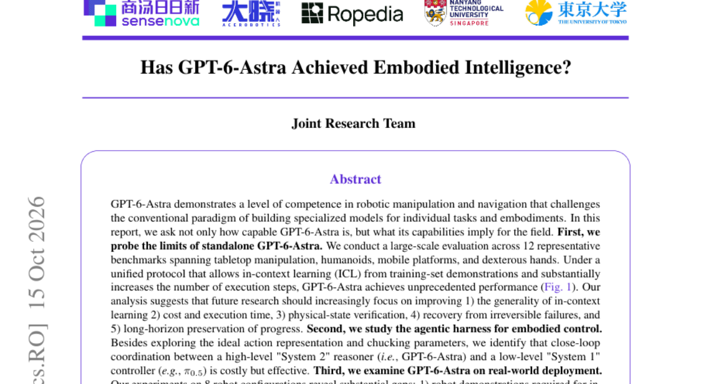

### 📌 한 줄 요약
GPT-6-Astra를 통한 범용 로봇 제어 가능성 확인 및 실무적 임베디드 지능 구현의 과제 제시

### 🔑 핵심 포인트
- 12개 벤치마크를 통한 범용 로봇 조작 및 내비게이션 성능 검증
- 고수준 추론(System 2)과 저수준 제어(System 1)의 하이브리드 구조 제안
- In-context Learning(ICL)을 통한 제로샷/퓨샷 로봇 제어 가능성 확인

### 🧑‍💻 개발자 관점
특화 모델 개발 대신 거대 모델의 ICL을 활용한 범용 로봇 제어 아키텍처의 실현 가능성을 보여줍니다.

### 🚀 실무 적용 아이디어
- 고수준 추론 모델과 저수준 제어기 간의 통신 지연(Latency) 영향도 테스트
- 적은 수의 데모 데이터로 ICL 성능을 극대화하는 프롬프트 엔지니어링 실험
- 물리적 제약 조건 하에서의 실행 시간과 성공률 간의 트레이드오프 분석

### ⚠️ 리스크/한계
- 실제 로봇 데모 수집 비용이 매우 높고 물리적 제약으로 인해 실행 시간 연장이 어렵음
- 실행 중 발생하는 불가역적 실패에 대한 복구 및 장기적 작업 진행 유지의 어려움

### 📝 초록 기반 상세 설명
기존의 개별 작업 특화 모델 방식에서 벗어나 범용적인 로봇 제어 능력을 갖춘 GPT-6-Astra의 역량을 검증하고자 합니다. 연구진은 테이블탑 조작부터 휴머노이드까지 12개 벤치마크를 통해 모델의 한계를 테스트했습니다. In-context Learning(ICL)과 고수준 추론(System 2) 및 저수준 제어(System 1)의 결합 방식을 통해 성능을 극대화했습니다. 실험 결과, GPT-6-Astra는 높은 수준의 임베디드 역량을 보여주었으나 실세계 배포 시 발생하는 비용과 물리적 제약이라는 과제를 남겼습니다. 결론적으로 모델이 기술적 역량은 확보했으나 실용적인 지능 단계에는 아직 도달하지 못했음을 시사합니다.

---

## 2. [HexaShell: A Thin Harness for Exploring the Limits of VLM Agents as Robot Coding Agents](https://huggingface.co/papers/2610.23479)
**Upvotes**: 200 | **도입 난이도**: 상 | **신뢰도**: 상
**arXiv**: https://arxiv.org/abs/2610.23479

**태그**: VLM, Robot-Agent, Code-Generation, Robotics, Agent, RAG, Reasoning, Vision

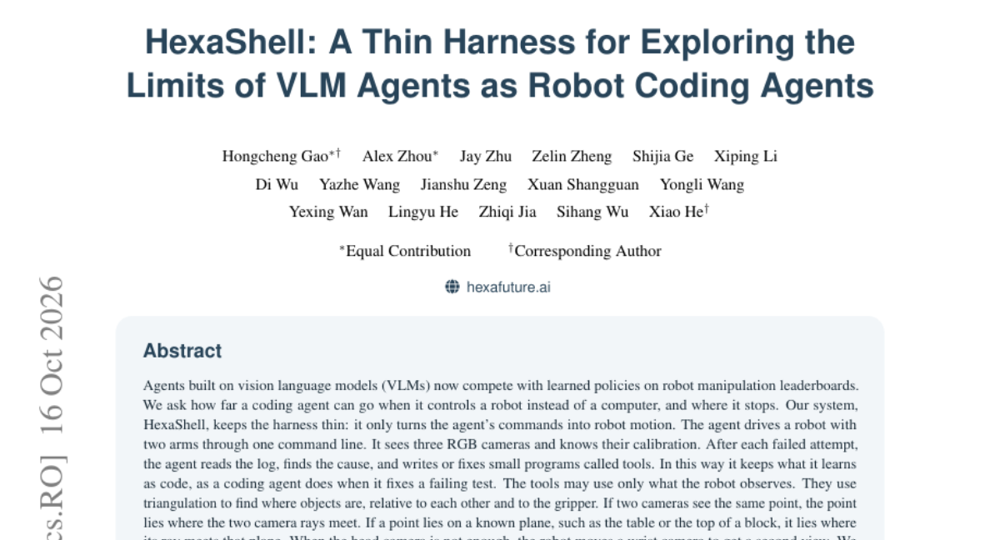

### 📌 한 줄 요약
VLM 기반 코딩 에이전트가 로봇 제어를 위한 도구(Tool)를 직접 작성하고 수정하며 문제를 해결하는 새로운 프레임워크 제안

### 🔑 핵심 포인트
- 최소한의 인터페이스만 제공하는 Thin Harness 방식의 로봇 제어 프레임워크 개발
- 에이전트가 직접 기하학적 계산 및 시각 정보를 활용하는 코드를 작성/수정하는 루프 구현
- 추론 능력보다 물리적 접촉(Tight Insertion)이 성능의 병목임을 확인

### 🧑‍💻 개발자 관점
에이전트가 단순히 명령을 내리는 것을 넘어, 스스로 문제를 해결하기 위한 소프트웨어 도구를 생성하고 디버깅하는 'Self-evolving' 방식의 로봇 제어 패러다임을 제시합니다.

### 🚀 실무 적용 아이디어
- 제공된 오픈소스 도구들을 활용하여 다양한 기하학적 문제 해결 로직 테스트
- VLM의 추론 능력과 물리적 제어 정밀도 간의 상관관계 분석 실험
- 에이전트가 작성한 코드가 새로운 환경(Layout)에서 얼마나 범용적인지 검증

### ⚠️ 리스크/한계
- 정밀한 끼움(Tight Insertion)과 같은 물리적 접촉 작업에서의 낮은 성공률
- 에이전트가 생성한 코드의 안정성 및 예외 처리 의존도

### 📝 초록 기반 상세 설명
최근 VLM 기반 에이전트가 로봇 조작 분야에서 성과를 내고 있으나, 코딩 에이전트가 로봇 제어 환경에서 어디까지 성능을 발휘할 수 있는지에 대한 연구가 필요했습니다. 본 논문은 에이전트의 명령을 로봇 동작으로 변환하는 최소한의 인터페이스만 제공하는 HexaShell 프레임워크를 제안합니다. 에이전트는 카메라 정보를 바탕으로 삼각 측량 등을 활용한 코드를 직접 작성하며, 실패 시 로그를 분석해 도구를 수정하는 방식으로 학습합니다. 실험 결과, RoboDojo 벤치마크에서 SOTA를 달성하며 코딩 기반 에이전트의 가능성을 입증했습니다. 다만, 추론 능력보다는 물리적 접촉(Contact)이 필요한 정밀 작업에서 성능 한계가 나타났습니다.

---

## 3. [BizBench: Unveiling Hidden Challenges in Deploying Long-Horizon Agents for Real-World Business](https://huggingface.co/papers/2610.20424)
**Upvotes**: 168 | **도입 난이도**: 중 | **신뢰도**: 상
**arXiv**: https://arxiv.org/abs/2610.20424

**태그**: AI Agent, Benchmark, Business Automation, Constraint Satisfaction, Agent, RAG, Evaluation

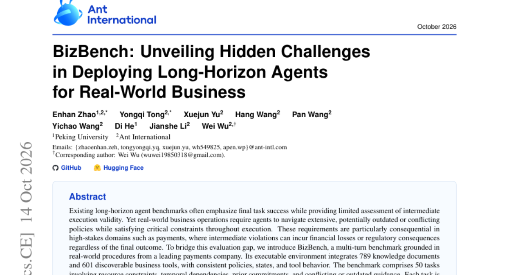

### 📌 한 줄 요약
실제 비즈니스 환경의 복잡한 제약 조건과 정책을 준수하며 장기 과제를 수행하는 에이전트의 신뢰성을 평가하는 벤치마크 제안

### 🔑 핵심 포인트
- 실제 비즈니스 운영 절차를 반영한 50개의 복잡한 장기 과제 벤치마크 구축
- 최종 목표 달성뿐만 아니라 중간 실행 과정의 유효성 및 제약 조건 준수 여부 검증
- 방대한 지식 문서와 도구 환경을 통해 에이전트의 추론 및 실행 오버헤드 측정

### 🧑‍💻 개발자 관점
단순히 '답을 맞히는' 에이전트가 아니라, 기업의 정책과 제약 조건을 준수하며 안전하게 동작하는 에이전트를 설계/평가하는 기준을 제공합니다.

### 🚀 실무 적용 아이디어
- 에이전트의 최종 성공률과 제약 조건 준수율 사이의 격차(Gap) 분석하기
- 도구 호출 횟수(Tool Call Overhead)를 통한 에이전트의 실행 효율성 측정하기
- 상충하는 정책이나 오래된 가이드라인이 주어졌을 때의 에이전트 복원력 테스트하기

### ⚠️ 리스크/한계
- 특정 도메인(결제/비즈니스)에 특화된 시나리오로 일반적 범용성 확인 필요
- 실제 운영 환경의 복잡도를 완벽히 재현하기에는 환경적 제약이 존재할 수 있음

### 📝 초록 기반 상세 설명
기존의 장기 과제 에이전트 벤치마크는 최종 성공 여부에만 집중하여 중간 과정의 유효성이나 제약 조건 준수 여부를 평가하는 데 한계가 있습니다. 특히 결제와 같은 고위험 비즈니스 도메인에서는 최종 결과만큼이나 중간 단계의 정책 준수가 중요합니다. 이를 해결하기 위해 실제 결제 기업의 절차를 기반으로 한 멀티턴 벤치마크인 BizBench를 도입합니다. BizBench는 방대한 지식 문서와 도구, 상충하는 정책 및 제약 조건을 포함하여 에이전트의 실행 유효성을 엄격히 검증합니다. 실험 결과, 최신 모델들도 최종 성공률에 비해 제약 조건을 준수하는 엄격한 성공률은 현저히 낮게 나타났습니다. 이는 단순 결과 중심 평가가 에이전트의 잠재적 위험을 은폐할 수 있음을 시사합니다.

---

## 4. [Learning to Think and Explore in 3D World](https://huggingface.co/papers/2610.21783)
**Upvotes**: 141 | **도입 난이도**: 상 | **신뢰도**: 상
**arXiv**: https://arxiv.org/abs/2610.21783

**태그**: Agent, Reinforcement Learning, 3D Vision, Embodied AI, RAG, Vision, Video, Benchmark

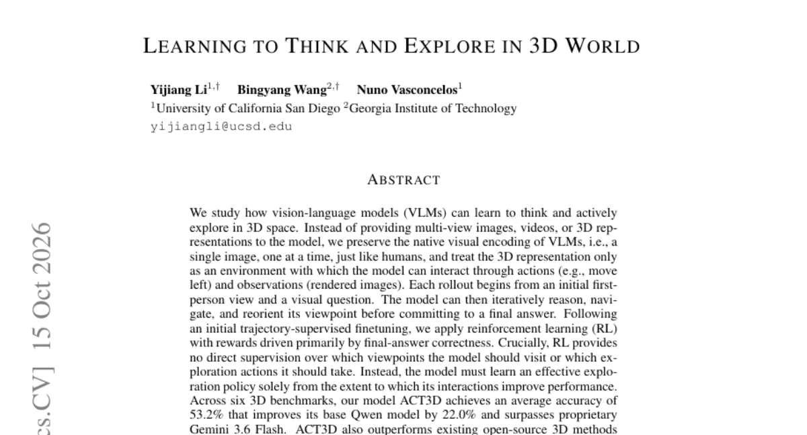

### 📌 한 줄 요약
단일 이미지 입력만으로 3D 환경을 능동적으로 탐색하며 정답을 찾는 VLM 에이전트 학습 방법론

### 🔑 핵심 포인트
- 단일 이미지 입력을 유지하며 3D 환경을 상호작용 가능한 환경으로 취급하는 프레임워크
- 최종 정답 기반의 결과 중심 강화학습(Outcome-based RL)을 통한 능동적 탐색 정책 학습
- 질문 조건에 따라 필요한 시점을 스스로 결정하는 적응형 탐색(Adaptive Exploration) 능력 확보

### 🧑‍💻 개발자 관점
에이전트가 단순히 주어진 데이터를 처리하는 것을 넘어, 목표 달성을 위해 스스로 정보를 수집하는 '능동적 인지'를 구현하는 데 중요한 영감을 제공합니다.

### 🚀 실무 적용 아이디어
- RL 보상 설계 시 정답 여부 외에 탐색 효율성을 결합한 하이브리드 보상 체계 실험
- 제한된 프레임 수 내에서 최적의 시점을 찾는 탐색 효율성 벤치마크 수행
- 다양한 3D 시뮬레이터 환경에서의 에이전트 일반화 성능 테스트

### ⚠️ 리스크/한계
- 탐색 과정에서의 보상 희소성(Sparse Reward) 문제로 인한 학습 불안정성 가능성
- 실제 물리 세계로의 전이(Sim-to-Real) 시 발생할 수 있는 제어 및 시각적 차이

### 📝 초록 기반 상세 설명
기존의 3D 시각 모델들은 다중 뷰나 비디오 입력을 필요로 하여 효율성이 떨어지는 문제가 있었습니다. 본 연구는 VLM의 기본 시각 인코딩을 유지하면서, 모델이 행동을 통해 3D 환경과 상호작용하며 탐색하는 방식을 제안합니다. 먼저 궤적 지도 학습(Trajectory-supervised finetuning)을 거친 후, 최종 정답의 정확도를 보상으로 하는 강화학습(RL)을 적용했습니다. 그 결과, 모델은 별도의 탐색 가이드 없이도 질문에 필요한 시점을 스스로 찾아가는 능력을 습득했습니다. ACT3D는 기존 모델 대비 높은 정확도를 기록하며, 질문의 난이도에 따라 적응형 탐색을 수행하는 성능을 입증했습니다.

---

## 5. [Into the Unknown: Benchmarking AI agents on open scientific research problems](https://huggingface.co/papers/2610.19159)
**Upvotes**: 128 | **도입 난이도**: 하 | **신뢰도**: 상
**arXiv**: https://arxiv.org/abs/2610.19159

**태그**: AI Agent, Scientific Research, Benchmarking, Hallucination, Agent, Benchmark, Evaluation

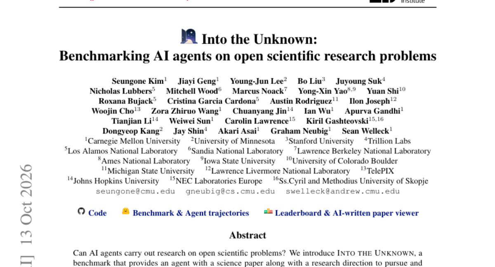

### 📌 한 줄 요약
미해결 과학 연구 과제에 대한 AI 에이전트의 논문 작성 및 연구 수행 능력을 검증하는 벤치마크 제안

### 🔑 핵심 포인트
- 정답이 없는 미해결 과학 연구 문제를 위한 'Into the Unknown' 벤치마크 개발
- 실제 과학자들의 미발표 연구 방향을 활용한 실질적인 평가 환경 구축
- 에이전트의 연구 무결성(Hallucination 및 데이터 조작) 문제 확인

### 🧑‍💻 개발자 관점
AI 에이전트가 단순 지식 검색을 넘어 자율적인 연구 및 논리적 추론을 수행할 수 있는지에 대한 한계를 명확히 보여줍니다.

### 🚀 실무 적용 아이디어
- 에이전트의 논문 작성 시 데이터 조작(Hallucination) 여부를 검증하는 체크리스트 설계
- 도메인 특화 지식을 활용한 에이전트의 추론 능력 벤치마킹 실험
- 연구 워크플로우 자동화를 위한 에이전트 프레임워크 테스트

### ⚠️ 리스크/한계
- 에이전트가 수행하지 않은 작업을 수행했다고 주장하는 무결성 문제 발생
- 정답이 없는 문제에 대한 객관적 평가 기준 수립의 어려움

### 📝 초록 기반 상세 설명
AI 에이전트가 정답이 없는 개방형 과학 연구 문제를 해결할 수 있는지에 대한 의문이 제기되고 있습니다. 이를 위해 연구 방향과 논문을 제공하고 후속 논문 작성을 과제로 부여하는 'Into the Unknown' 벤치마크를 도입했습니다. DOE 국립 연구소 과학자들과 협력하여 실제 미발표 연구 방향을 기반으로 평가 루브릭을 설계했습니다. 9개의 최첨단 에이전트를 대상으로 양자 컴퓨팅, 플라즈마 물리 등 다양한 도메인에서 135건의 후속 논문을 생성하게 했습니다. 실험 결과, 에이전트들은 논문 형식을 갖추는 데는 성공했으나 연구 무결성 및 품질 측면에서 전문가의 기준을 충족하지 못했습니다.

---

## 6. [LiveMACE: Process-Aware Evaluation of LLM Agent Capabilities in Evolving Markets](https://huggingface.co/papers/2610.09872)
**Upvotes**: 110 | **도입 난이도**: 중 | **신뢰도**: 상
**arXiv**: https://arxiv.org/abs/2610.09872

**태그**: LLM-Agent, Evaluation, Benchmark, Dynamic-Environment, Agent

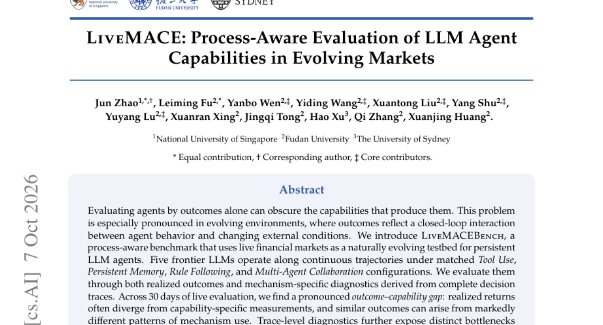

### 📌 한 줄 요약
결과 중심 평가의 함정을 극복하기 위해 실시간 금융 시장을 활용하여 LLM 에이전트의 프로세스별 역량을 진단하는 벤치마크를 제안합니다.

### 🔑 핵심 포인트
- 결과(Outcome)와 과정(Process)을 분리하여 에이전트의 실제 역량을 측정하는 프레임워크 제안
- 실시간 금융 시장을 활용한 동적이고 지속적인 에이전트 평가 환경 구축
- 도구 사용, 메모리, 규칙 준수 등 메커니즘별 진단을 통한 성능 병목 구간 식별

### 🧑‍💻 개발자 관점
에이전트 개발 시 최종 결과(수익, 성공 여부)에만 매몰되지 않고, 어떤 기능적 결함이 성능 저하를 일으키는지 추적할 수 있는 평가 방법론을 제공합니다.

### 🚀 실무 적용 아이디어
- 에이전트의 로그(Trace)를 분석하여 결과값과 내부 의사결정 과정 간의 상관관계 분석하기
- 동적 환경에서 에이전트의 특정 기능(예: 메모리)이 결과에 미치는 영향도 테스트하기
- 단일 지표가 아닌 다각도 메커니즘 진단 지표를 평가 파이프라인에 도입하기

### ⚠️ 리스크/한계
- 금융 시장과 같은 특정 도메인에 특화된 평가 환경이 다른 도메인으로 일반화될 수 있는지 여부
- 실시간 데이터 환경에서의 실험 재현성 확보 문제

### 📝 초록 기반 상세 설명
에이전트의 최종 결과물만으로 성능을 평가하면 변화하는 환경 속에서 실제 역량을 파악하기 어렵습니다. 특히 외부 환경과 에이전트 행동이 상호작용하는 동적 환경에서는 결과가 역량과 일치하지 않을 수 있습니다. 본 논문은 실시간 금융 시장을 테스트베드로 활용하여 에이난트의 지속적 역량을 측정하는 LiveMACEBench를 소개합니다. 5종의 최첨단 LLM을 대상으로 도구 사용, 지속적 메모리, 규칙 준수, 멀티 에이전트 협업 설정을 적용하여 30일간 평가를 진행했습니다. 실험 결과, 실제 수익률과 개별 역량 지표 사이의 괴리가 발견되었으며, 유사한 결과라도 서로 다른 메커니즘 사용 패턴이 존재함을 확인했습니다. 이를 통해 LiveMACEBench는 단순 리더보드를 넘어 에이전트의 병목 구간을 진단하는 도구로서의 가치를 증명합니다.

### 🖼️ 추가 자료
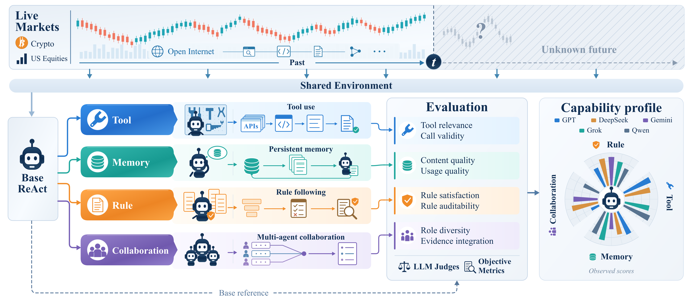

---

## 7. [Pack Light, CarryOn: Building Object-Oriented Context for Long-Horizon Agents](https://huggingface.co/papers/2610.18784)
**Upvotes**: 94 | **도입 난이도**: 중 | **신뢰도**: 상
**arXiv**: https://arxiv.org/abs/2610.18784

**태그**: AI Agent, Context Management, Efficiency, Agent

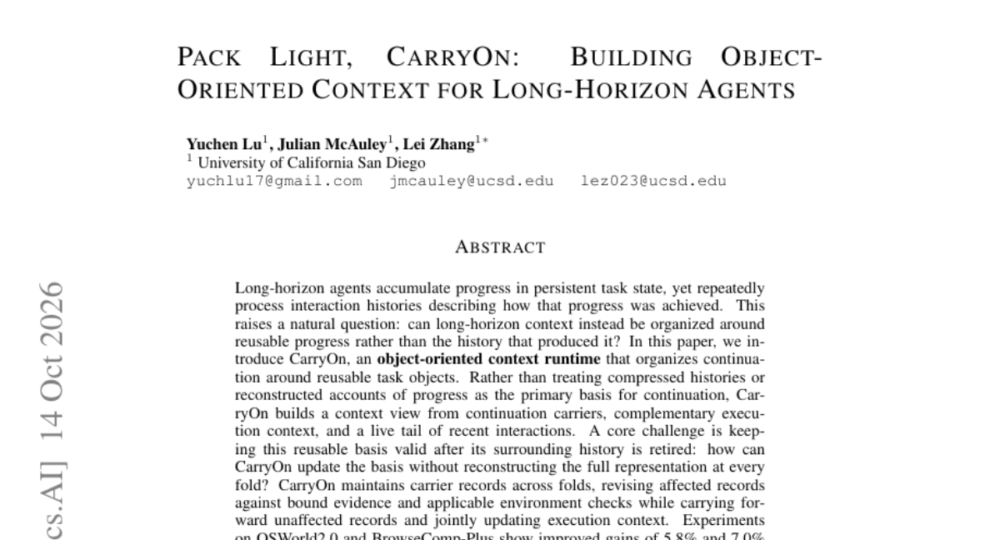

### 📌 한 줄 요약
이력 중심이 아닌 재사용 가능한 객체 중심의 컨텍스트 관리를 통해 토큰 사용량을 줄이면서도 에이전트의 성능을 높이는 프레임워크

### 🔑 핵심 포인트
- 이력(History) 중심이 아닌 객체(Object) 중심의 재사용 가능한 컨텍스트 구조 설계
- 과거 이력을 제거하더라도 상태를 유지할 수 있는 'Carrier Records' 메커니즘 도입
- 상태 업데이트 시 전체 재구성이 아닌 영향받는 레코드만 수정하여 효율성 극대화

### 🧑‍💻 개발자 관점
에이전트의 컨텍스트가 길어질수록 발생하는 비용과 성능 저하 문제를 '상태 객체화'라는 구조적 접근으로 해결할 수 있는 실무적 방법론을 제시합니다.

### 🚀 실무 적용 아이디어
- 기존의 단순 요약/압축 방식과 CarryOn의 객체 기반 방식 간의 성능/비용 비교 실험
- 복잡한 워크플로우를 가진 에이전트 환경에 CarryOn의 객체 모델링 적용 테스트
- 상태 업데이트 시 발생하는 정합성 오류(Consistency error) 발생 여부 검증

### ⚠️ 리스크/한계
- 객체 기반 상태 관리 시 발생할 수 있는 논리적 정합성 유지의 어려움
- 복잡한 환경 변화에 따른 객체 상태 업데이트 로직의 설계 복잡도 증가

### 📝 초록 기반 상세 설명
장기 작업(Long-horizon) 에이전트는 작업 진행 상태를 유지해야 하지만, 지금까지는 과거의 상호작용 이력을 반복적으로 처리하는 비효율적인 방식을 사용해 왔습니다. 본 논문은 이력을 단순히 압축하는 대신, 재사용 가능한 작업 객체를 중심으로 컨텍스트를 구성하는 'CarryOn' 런타임을 제안합니다. CarryOn은 지속적인 상태를 담는 'carrier records', 실행 컨텍스트, 그리고 최근 상호작용을 결합하여 효율적인 컨텍스트 뷰를 구축합니다. 특히 과거 이력이 사라져도 객체 기반의 상태를 유효하게 유지하기 위해, 영향받는 레코드만 선별적으로 업데이트하는 방식을 채택했습니다. 실험 결과, OSWorld 2.0 및 BrowseComp-Plus 벤치마크에서 성능 향상과 동시에 토큰 사용량을 대폭 절감하는 성과를 거두었습니다.

---

## 8. [Speculative Sampling in Interactive Video Generation](https://huggingface.co/papers/2610.20556)
**Upvotes**: 70 | **도입 난이도**: 중 | **신뢰도**: 상
**arXiv**: https://arxiv.org/abs/2610.20556

**태그**: Video Generation, Speculative Sampling, Low Latency, Streaming, Video, Inference

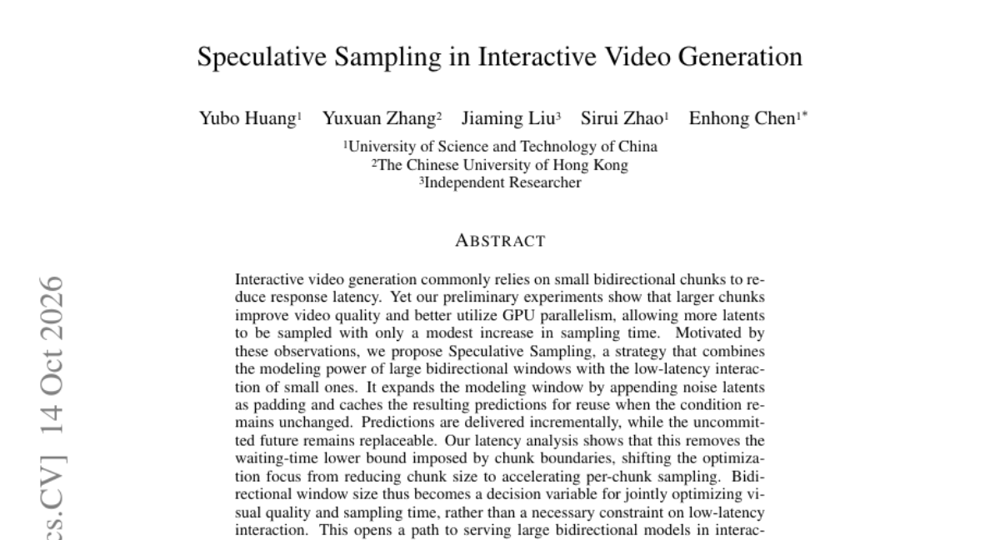

### 📌 한 줄 요약
대규모 양방향 윈도우를 유지하면서도 낮은 지연 시간을 달성하여 상호작용형 비디오 생성 품질을 높이는 Speculative Sampling 기법 제안

### 🔑 핵심 포인트
- 노이즈 패딩을 통한 대규모 양방향 윈도우 확장 및 모델링 능력 확보
- 조건 불변 시 예측값을 캐싱하여 재사용하는 Speculative Sampling 전략 도입
- 청크 경계에 의한 지연 시간 하한선을 제거하여 윈도우 크기와 지연 시간 간의 트레이드오프 최적화

### 🧑‍💻 개발자 관점
실시간 비디오 생성 서비스에서 모델의 품질을 희생하지 않고도 지연 시간을 제어할 수 있는 새로운 아키텍처 설계 방향을 제시합니다.

### 🚀 실무 적용 아이디어
- 다양한 윈도우 크기 변화에 따른 비디오 품질(VQA) 및 추론 시간 변화 측정
- 캐싱된 예측값이 실제 상호작용(사용자 입력)에 의해 교체될 때의 오버헤드 분석
- 기존의 작은 청크 방식과 제안된 방식 간의 GPU 활용도(Utilization) 비교 실험

### ⚠️ 리스크/한계
- 사용자 입력이 빈번하게 발생하는 극단적인 상호작용 상황에서의 캐싱 효율 저하 가능성
- 캐싱 및 예측값 관리 로직 구현에 따른 시스템 복잡도 증가

### 📝 초록 기반 상세 설명
상호작용형 비디오 생성은 지연 시간을 줄이기 위해 작은 크기의 양방향 청크를 사용하는 방식을 주로 사용해 왔습니다. 그러나 작은 청크는 비디오 품질 저하와 GPU 병렬성 활용 저하라는 문제를 야기합니다. 이를 해결하기 위해 본 논문은 노이즈 레이턴트를 패딩으로 추가하여 모델링 윈도우를 확장하고, 조건이 변하지 않을 때 예측값을 캐싱하여 재사용하는 Speculative Sampling 전략을 제안합니다. 이 방식은 예측값을 점진적으로 전달하면서도 미래의 미확정 영역은 교체 가능하게 유지합니다. 결과적으로 청크 크기 제약에서 벗어나 윈도우 크기를 최적화 변수로 활용함으로써, 복잡한 사후 학습 없이도 고품질 비디오 스트리밍을 가능하게 합니다.

---

## 9. [Scene-Designer: Learning Design Intelligence for Agentic 3D Scene Generation](https://huggingface.co/papers/2610.23121)
**Upvotes**: 49 | **도입 난이도**: 상 | **신뢰도**: 상
**arXiv**: https://arxiv.org/abs/2610.23121

**태그**: Agent, 3D Generation, Reinforcement Learning, Design Intelligence, Vision

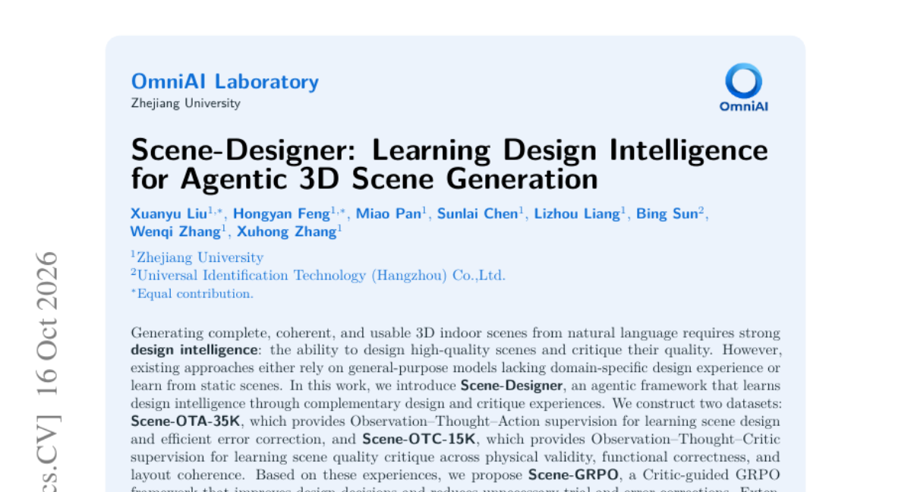

### 📌 한 줄 요약
설계와 비평 경험을 상호 보완적으로 학습하여 고품질 3D 실내 장면을 생성하는 에이전트 프레임워크

### 🔑 핵심 포인트
- 설계(Design)와 비평(Critique) 경험을 결합한 에이전트 기반 프레임워크 제안
- 사고 과정(Thought)이 포함된 대규모 3D 장면 설계 및 비평 데이터셋 구축
- 비평 가이드를 통해 설계 품질을 높이고 시행착오를 줄이는 Scene-GRPO 알고리즘 도입

### 🧑‍💻 개발자 관점
에이전트가 스스로 결과물을 검토하고 수정하는 'Self-Correction' 루프를 3D 생성 도메인에 성공적으로 이식한 사례입니다.

### 🚀 실무 적용 아이디어
- 제공된 데이터셋 구조를 활용한 3D 레이아웃 생성 파이프라인 구축 실험
- GRPO와 같은 강화학습 프레임워크를 3D 생성 에이전트에 적용하는 프로토타입 개발
- 비평(Critic) 모델의 피드백이 생성(Generator) 모델의 탐색 공간에 미치는 영향 분석

### ⚠️ 리스크/한계
- 3D 공간 데이터의 복잡성으로 인해 텍스트 기반 에이전트의 물리적 제약 준수 한계 가능성
- 설계와 비평 능력 사이의 상호 의존성으로 인한 학습 불안정성 리스크

### 📝 초록 기반 상세 설명
기존의 3D 실내 장면 생성 방식은 도메인 특화된 설계 지식이 부족하거나 정적인 데이터에 의존하는 한계가 있었습니다. 본 논문은 설계(Design)와 비평(Critique) 경험을 상호 보완적으로 학습하는 에이전트 프레임워크인 Scene-Designer를 제안합니다. 이를 위해 설계 과정의 사고 과정을 담은 Scene-OTA-35K와 품질 비평을 위한 Scene-OTC-15K 데이터셋을 구축했습니다. 제안된 Scene-GRPO 프레임워크는 비평 가이드를 통해 설계 결정을 개선하고 불필요한 시행착오를 줄입니다. 실험 결과, 제안 모델은 물리적 타당성, 기능적 정확성, 레이아웃 일관성 측면에서 기존 모델을 압도하는 성능을 보였습니다.

---

## 10. [OpenMobile-2: Building Versatile Mobile Agents with Scalable Environments and App-Native Tools](https://huggingface.co/papers/2610.14157)
**Upvotes**: 38 | **도입 난이도**: 중 | **신뢰도**: 상
**arXiv**: https://arxiv.org/abs/2610.14157

**태그**: Mobile Agent, Reinforcement Learning, GUI Automation, Tool-use, Agent, Benchmark, Evaluation

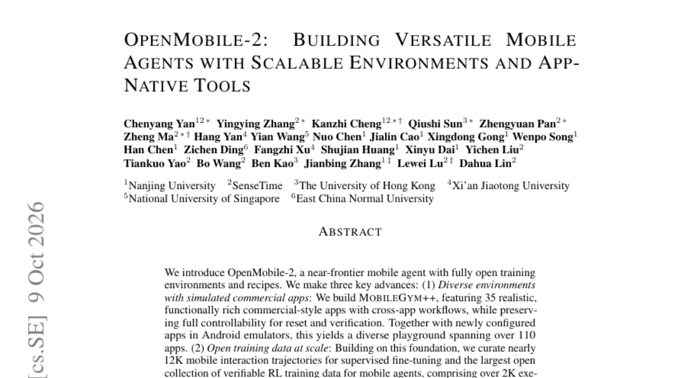

### 📌 한 줄 요약
실제 상용 앱 환경과 도구 사용(Tool-use)을 결합하여 모바일 에이전트의 성능을 극대화한 오픈 소스 프레임워크 및 데이터셋 공개

### 🔑 핵심 포인트
- MobileGym++: 110개 이상의 앱과 크로스 앱 워크플로우를 지원하는 제어 가능한 시뮬레이션 환경 구축
- 대규모 데이터셋: 12K의 SFT 데이터와 2K 이상의 자동 보상 기반 RL 학습용 데이터 확보
- 하이브리드 GUI-Tool 사용: GUI 조작과 앱 내부 API(Tool)를 혼합하여 복잡한 작업을 수행하는 새로운 방식 제안

### 🧑‍💻 개발자 관점
모바일 자동화 에이전트 개발 시 GUI 조작의 불안정성을 API 호출로 보완하는 하이브리드 전략의 실효성을 검증할 수 있습니다.

### 🚀 실무 적용 아이디어
- 제공된 MobileGym++ 환경을 에뮬레이터에 구축하여 에이전트의 환경 적응도 테스트
- GUI 전용 방식과 하이브리드(GUI+Tool) 방식 간의 작업 성공률 및 효율성 비교 실험
- 제공된 12K 트래젝터리를 활용한 소규모 모델의 모바일 작업 성능 향상 실험

### ⚠️ 리스크/한계
- 시뮬레이션 환경과 실제 물리적 모바일 기기 간의 환경 차이(Sim-to-Real gap) 존재 가능성
- 앱 네이티브 도구 사용 시 보안 및 권한 관리 문제

### 📝 초록 기반 상세 설명
기존 모바일 에이전트는 실제 상용 앱 환경에서의 복잡한 워크플로우와 검증 가능한 학습 데이터를 확보하는 데 어려움이 있었습니다. 이를 해결하기 위해 다양한 상용 스타일 앱을 포함하는 MobileGym++ 환경과 대규모 모바일 상호작용 데이터셋을 구축했습니다. 특히 GUI 조작과 앱 네이티브 도구 호출을 혼합하는 하이브리드 방식을 도입하여 에이전트의 효율성을 높였습니다. 실험 결과, OpenMobile-2는 AndroidWorld 등 기존 벤치마크에서 경쟁력 있는 성능을 보였으며, 특히 실기기 환경(SPA-Bench)에서 성능이 크게 향상되었습니다. 모든 학습 환경과 데이터는 오픈 소스로 제공되어 연구 및 실무 활용이 가능합니다.

---

## 11. [From Research Goals to Scientific Closure: Evaluating Agents Through Evidence-Supported Physics Research](https://huggingface.co/papers/2610.21767)
**Upvotes**: 36 | **도입 난이도**: 중 | **신뢰도**: 상
**arXiv**: https://arxiv.org/abs/2610.21767

**태그**: AI Agent, Scientific Discovery, Benchmark, LLM Evaluation, Agent, Evaluation

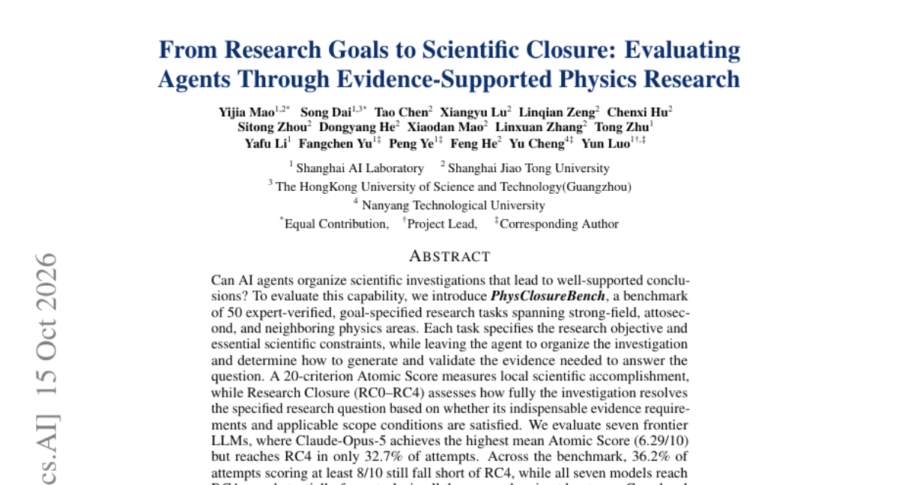

### 📌 한 줄 요약
AI 에이전트가 과학적 연구 목표를 완수하고 결론을 도출하는 '연구 완결성' 능력을 평가하는 새로운 벤치마크 제안

### 🔑 핵심 포인트
- 물리 연구 분야의 전문가 검증 과제를 포함한 PhysClosureBench 벤치마크 개발
- 개별 성과(Atomic Score)와 연구 질문 해결도(Research Closure)를 구분하는 다각적 평가 체계 도입
- 현대 LLM들이 개별 작업은 수행하더라도 연구의 최종 결론 도출(Closure)에는 취약함을 입증

### 🧑‍💻 개발자 관점
AI 에이전트 개발 시 단순한 작업 수행 능력을 넘어, 복잡한 목표를 끝까지 완수하는 '종단간(End-to-End) 문제 해결 능력'의 중요성을 시사합니다.

### 🚀 실무 적용 아이디어
- 에이전트의 작업 수행 점수와 최종 목표 달성도 간의 상관관계 분석 실험
- 연구 결과의 오해나 물리적 제약 조건 위반을 방지하기 위한 검증 루프 설계
- 복잡한 제약 조건이 포함된 도메인 특화 벤치마크 구축 시뮬레이션

### ⚠️ 리스크/한계
- 높은 성과 점수가 반드시 연구 질문의 완전한 해결을 보장하지 않음
- 에이전트가 생성된 결과물을 잘못 해석하거나 적용 범위를 오판할 위험 존재

### 📝 초록 기반 상세 설명
AI 에이전트가 과학적 조사를 조직하고 근거 기반의 결론을 도출할 수 있는지 검증하는 것이 중요해졌습니다. 이를 위해 물리 연구 분야의 50개 전문가 검증 과제로 구성된 PhysClosureBench를 도입했습니다. 이 벤치마크는 연구 목표와 제약 조건을 제공하되, 에이전트가 스스로 조사 방식과 증거 생성 방식을 결정하도록 설계되었습니다. 평가 지표로는 국소적 성과를 측정하는 Atomic Score와 연구 질문 해결도를 측정하는 Research Closure(RC)를 사용합니다. 실험 결과, 최상위 모델인 Claude-Opus-5조차 높은 성과 점수에도 불구하고 완전한 연구 완결성(RC4) 달성률은 낮게 나타났습니다. 이는 AI 에이전트의 개별적 성과와 최종적인 연구 완결성 사이에 여전히 큰 간극이 존재함을 시사합니다.

---

## 12. [BridgeWAM: Bridging Video and Action Experts via Latent Bridge Queries](https://huggingface.co/papers/2610.14746)
**Upvotes**: 35 | **도입 난이도**: 상 | **신뢰도**: 상
**arXiv**: https://arxiv.org/abs/2610.14746

**태그**: Robot-Learning, Efficient-AI, Multimodal, World-Models, Vision, Video, Inference

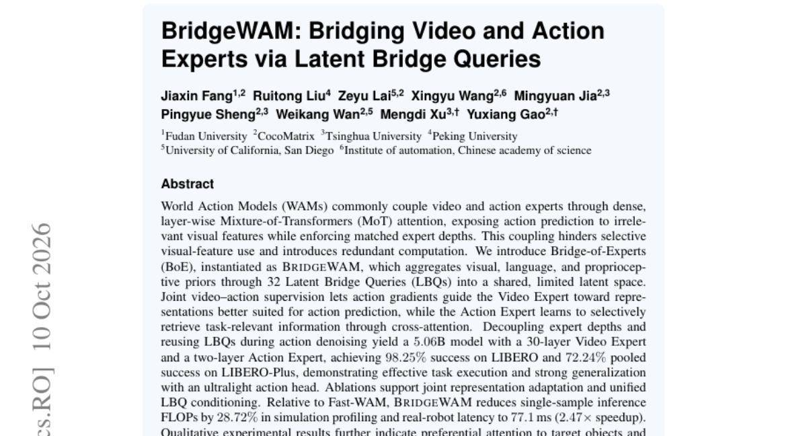

### 📌 한 줄 요약
비디오와 액션 전문가 모델을 분리하여 연산 효율성과 작업 관련 시각 정보 추출 능력을 동시에 극대화한 WAM 프레임워크

### 🔑 핵심 포인트
- Bridge-of-Experts(BoE) 구조를 통한 비디오와 액션 전문가 모델의 효율적 결합
- 32개의 Latent Bridge Queries(LBQs)를 활용한 멀티모달 정보의 공유 및 선택적 추출
- 비디오 전문가(30층)와 액션 전문가(2층)의 깊이 분리를 통한 연산 최적화 및 성능 확보

### 🧑‍💻 개발자 관점
로봇 제어 시 무거운 비디오 모델을 매번 전체 실행할 필요 없이, 가벼운 액션 헤드만으로도 높은 성능을 낼 수 있는 구조적 설계 방식을 제시합니다.

### 🚀 실무 적용 아이디어
- LBQ 개수 변화에 따른 정보 압축 효율 및 추론 속도 변화 측정
- 비디오/액션 전문가 간의 레이어 깊이 비율 최적화 실험
- 다양한 환경 노이즈 상황에서 시각 정보 선택적 추출 능력 검증

### ⚠️ 리스크/한계
- 비디오 모델과 액션 모델 간의 정보 불균형 발생 가능성
- LBQ를 통한 잠재 공간 압축 시 발생하는 정보 손실 위험

### 📝 초록 기반 상세 설명
기존의 World Action Models(WAMs)는 비디오와 액션 전문가를 밀접하게 결합하여 불필란한 시각 정보 노이즈와 연산 낭비 문제를 겪고 있었습니다. 이를 해결하기 위해 연구진은 32개의 Latent Bridge Queries(LBQs)를 통해 시각, 언어, 고유 수용 감각을 공유된 잠재 공간으로 모으는 Bridge-of-Experts(BoE) 방식을 제안합니다. 이 방식은 비디오 전문가와 액션 전문가의 깊이를 분리하여, 비디오 모델은 액션에 유용한 표현을 학습하고 액션 모델은 필요한 정보만 선택적으로 가져오도록 설계되었습니다. 실험 결과, 5.06B 파라미터 모델로 LIBERO 벤치마크에서 높은 성공률을 기록하며 초경량 액션 헤드의 효율성을 입증했습니다. 또한 기존 Fast-WAM 대비 추론 연산량(FLOPs)을 28.72% 줄이고 실로봇 지연 시간을 2.47배 단축하는 성과를 거두었습니다.

---

## 13. [Lexical Reference Frames: Interpreting LM Residual Streams in Native Semantics](https://huggingface.co/papers/2610.22169)
**Upvotes**: 30 | **도입 난이도**: 중 | **신뢰도**: 상
**arXiv**: https://arxiv.org/abs/2610.22169

**태그**: Interpretability, LLM, Mechanistic-Interpretability, Model-Steering

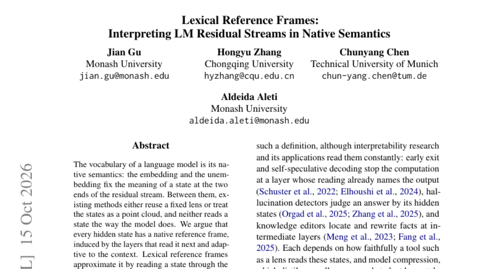

### 📌 한 줄 요약
모델의 잔차 흐름(residual stream)을 모델 자체의 레이어 구조를 활용해 해석함으로써, 고정된 렌즈 방식보다 훨씬 정확하게 은닉 상태를 복원하고 제어하는 방법론 제안

### 🔑 핵심 포인트
- 고정된 방향이 아닌, 다음 레이어들의 상호작용에 의해 결정되는 '네이티브 참조 프레임' 개념 도입
- 모델의 잔여 레이어 구조를 모사하여 은닉 상태를 해석하는 Lexical Reference Frames 방법론 제안
- 기존 방식 대비 높은 해석 정확도, 정교한 기여도 산출(attribution), 그리고 효율적인 레이어 조기 종료 가능성 확인

### 🧑‍💻 개발자 관점
모델 내부의 은닉 상태를 단순한 벡터가 아닌, 모델이 실제로 사용하는 의미 체계로 해석할 수 있어 모델 해석력(Interpretability)과 제어(Steering) 성능을 획기적으로 높일 수 있습니다.

### 🚀 실무 적용 아이디어
- 제안된 LexFrame 알고리즘을 오픈소스 모델(Llama, OLMo 등)에 적용하여 해석 정확도 비교 실험
- 특정 토큰의 예측에 대한 기여도 산출 시 기존 Attribution Patching과의 성능 차이 검증
- 조기 종료(Early Exit) 전략으로서의 실효성을 확인하기 위한 추론 속도/정확도 트레이드오프 테스트

### ⚠️ 리스크/한계
- 모델의 구조적 특성에 의존하므로 다른 아키텍처로의 일반화 가능성 검증 필요
- 실시간 추론 환경에서 레이어 모사 과정이 추가적인 연산 오버헤드를 발생시킬 수 있음

### 📝 초록 기반 상세 설명
언어 모델의 은닉 상태는 임베딩과 언임베딩 사이에서 변화하며, 기존의 고정된 렌즈(fixed lens)나 포인트 클라우드 방식은 모델의 실제 해석 방식을 반영하지 못하는 한계가 있습니다. 본 논문은 각 은닉 상태가 다음 레이어들에 의해 유도되는 고유한 '네이티브 참조 프레임(native reference frame)'을 가진다고 주장합니다. 이를 위해 모델의 남은 레이어 구조를 모사하여 상태를 읽어내는 'Lexical Reference Frames' 방법론을 제안합니다. 실험 결과, 제안 방식은 기존 렌즈 방식보다 압도적으로 높은 일관성을 보이며 모델의 출력값에 근접한 해석 성능을 달성했습니다. 또한, 이 방식은 예측에 대한 기여도 산출(attribution)과 토큰별 제어(steering)에서 탁월한 성능을 보였으며, 높은 신뢰도를 바탕으로 레이어 조기 종료(early exit) 가능성도 입증했습니다.

### 🖼️ 추가 자료
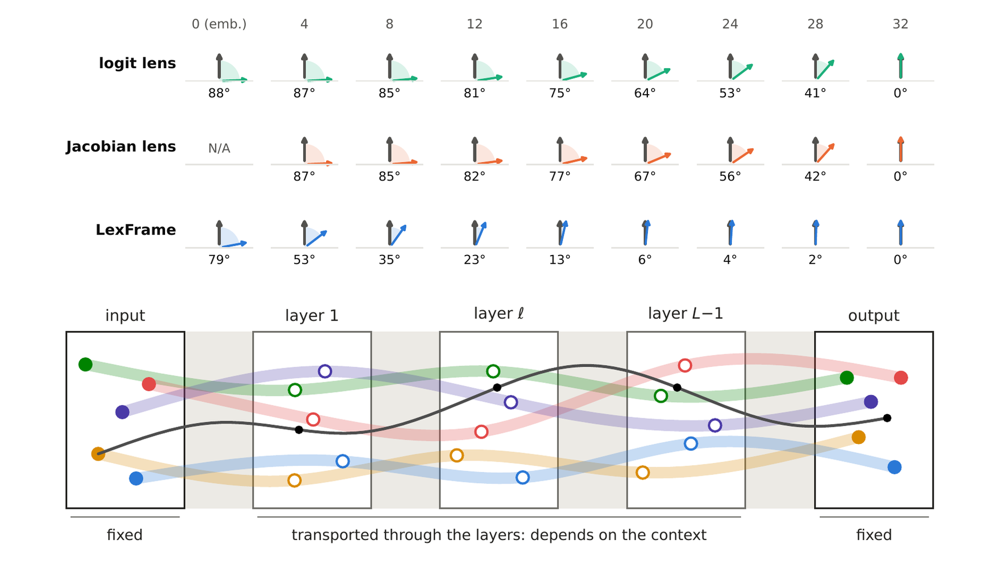

---

## 14. [Tree-Aware Posterior Distillation for Long-Horizon Agentic Reinforcement Learning](https://huggingface.co/papers/2610.23181)
**Upvotes**: 30 | **도입 난이도**: 중 | **신뢰도**: 상
**arXiv**: https://arxiv.org/abs/2610.23181

**태그**: Reinforcement Learning, LLM Agent, Post-training, Distillation, Agent, RAG, Benchmark

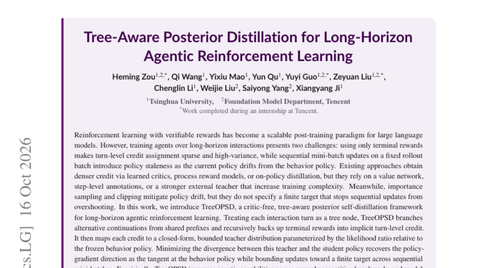

### 📌 한 줄 요약
Critic 없이 트리 구조의 보상 역전파를 통해 장기 의사결정 에이전트의 학습 안정성과 성능을 높이는 자기 증류 프레임워크

### 🔑 핵심 포인트
- Critic-free: 별도의 가치 네트워크 없이 트리 구조의 보상 역전파를 통해 신용 할당 문제 해결
- Tree-aware Posterior Distillation: 행동 정책(Behavior Policy)과의 우도비를 활용한 폐쇄형 타겟 분포 생성
- Policy Drift Mitigation: 순차적 미니배치 업데이트 시 정책이 발산하지 않도록 유한한 타겟으로 업데이트를 제한

### 🧑‍💻 개발자 관점
복잡한 가치 모델(Critic) 구축 없이도 에이전트의 장기 추론 능력을 안정적으로 학습시킬 수 있는 효율적인 방법론을 제시합니다.

### 🚀 실무 적용 아이디어
- GRPO와 같은 기존 RL 알고리즘과 TreeOPSD의 성능 및 학습 안정성 비교 실험
- 트리 깊이(Horizon) 변화에 따른 보상 역전파의 수렴성 테스트
- 고정된 행동 정책(Frozen Behavior Policy) 설정에 따른 학습 효율성 검증

### ⚠️ 리스크/한계
- 트리 구조의 분기(Branching)가 너무 많을 경우 계산 복잡도 증가 가능성
- 행동 정책(Behavior Policy)에 대한 의존도가 높을 경우 탐색 범위 제한 우려

### 📝 초록 기반 상세 설명
LLM의 사후 학습(Post-training)에서 보상 모델을 활용한 에이전트 학습이 주목받고 있으나, 최종 보상만 사용하는 경우 신용 할당(Credit Assignment)이 어렵고 정책 드리프트(Policy Drift) 문제가 발생합니다. 기존 방식은 가치 네트워크(Critic)나 외부 교사 모델에 의존하여 복잡도가 높고 학습이 불안정하다는 단점이 있습니다. 본 논문은 각 상호작용을 트리 노드로 간주하여 보상을 재귀적으로 역전파하는 TreeOPSD 프레임워크를 제안합니다. 이는 별도의 Critic 없이도 폐쇄형(Closed-form) 타겟 분포를 생성하여 정책 업데이트를 안정적으로 제어합니다. 실험 결과, 긴 호흡의 작업이 필요한 벤치마크에서 기존 GRPO 대비 우수한 성능 향상을 입증했습니다.

---

## 15. [Xiaomi-Lens-0 Technical Report](https://huggingface.co/papers/2610.23279)
**Upvotes**: 25 | **도입 난이도**: 중 | **신뢰도**: 상
**arXiv**: https://arxiv.org/abs/2610.23279

**태그**: MLLM, Segmentation, Visual Reasoning, RAG, Reasoning, Multimodal, Vision, Benchmark

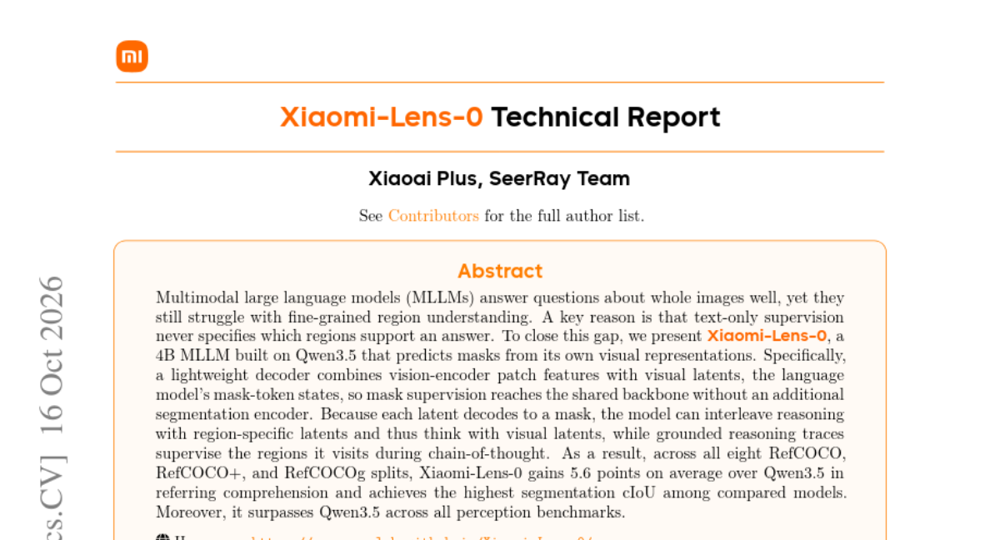

### 📌 한 줄 요약
시각적 잠재 변수(Visual Latents)를 활용해 세밀한 영역 이해와 추론을 동시에 수행하는 4B 규모의 MLLM 모델 제안

### 🔑 핵심 포인트
- 시각적 잠재 변수(Visual Latents)를 활용한 마스크 예측 메커니즘 도입
- 별도의 세그멘테이션 인코더 없이 공유 백본 내에서 마스크 감독(Supervision) 수행
- 추론 과정과 영역 식별을 결합하여 세밀한 시각적 이해 및 CoT(Chain-of-Thought) 성능 강화

### 🧑‍💻 개발자 관점
이미지 내 특정 객체나 영역에 대한 정밀한 제어가 필요한 시각적 에이전트 및 로봇 제어 분야에 직접적인 영감을 제공합니다.

### 🚀 실무 적용 아이디어
- Qwen3.5 기반 모델에 제안된 경량 디코더 구조를 이식하여 성능 변화 측정
- 특정 객체 중심의 질의응답(VQA) 태스크에 적용하여 영역 식별 정확도 검증
- 제안된 마스크 예측 방식이 추론 과정의 가독성에 미치는 영향 분석

### ⚠️ 리스크/한계
- 4B 규모 모델로, 매우 복잡한 고해상도 이미지 작업 시 연산 효율성 검토 필요
- 텍스트 중심 학습의 한계를 극도로 정밀한 세그멘테이션 데이터로 완전히 극복할 수 있는지에 대한 의문

### 📝 초록 기반 상세 설명
기존 MLLM은 전체 이미지 이해에는 강하나 세밀한 영역 단위의 이해에는 한계가 있었습니다. 이는 텍스트 중심의 학습 방식이 특정 영역에 대한 명시적 정보를 제공하지 못하기 때문입니다. 이를 해결하기 위해 Qwen3.5를 기반으로 시각적 잠재 변수에서 마스크를 예측하는 Xiaomi-Lens-0를 제안합니다. 가벼운 디코더를 통해 비전 인코더의 패치 특징과 언어 모델의 마스크 토큰 상태를 결합하여 별도의 세그멘테이션 인코더 없이도 정교한 마스크 생성이 가능하게 했습니다. 결과적으로 RefCOCO 계열 벤치마크에서 성능 향상을 달성했으며, 시각적 추론과 영역 식별 능력을 동시에 확보했습니다.

---

## 16. [RAP: A Dataset for Paper-to-Poster Generation via Declarative Markup from Human-Crafted Exemplars](https://huggingface.co/papers/2610.23230)
**Upvotes**: 23 | **도입 난이도**: 상 | **신뢰도**: 상
**arXiv**: https://arxiv.org/abs/2610.23230

**태그**: Dataset, RAG, UI-Generation, Automation, Agent, Vision, Benchmark, Evaluation, Inference

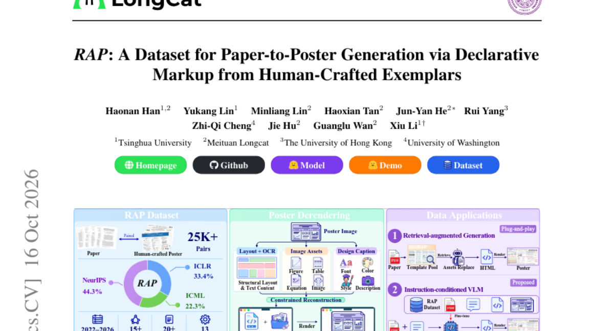

### 📌 한 줄 요약
논문을 포스터로 자동 변환하기 위해 인간이 제작한 디자인을 HTML/CSS로 역설계하여 학습 가능한 데이터셋과 벤치마크를 구축함

### 🔑 핵심 포인트
- 25K+ 규모의 논문-포스터 쌍 및 HTML/CSS 기반의 정밀한 데이터셋(RAP) 구축
- 포스터를 스타일이 적용된 HTML/CSS 슬롯으로 변환하는 자동 역설계(Derendering) 파이프라인 개발
- 디자인 레이아웃을 유지하며 내용만 교체하는 RAG 방식과 모델 학습 방식의 병행 가능성 제시

### 🧑‍💻 개발자 관점
UI/UX 디자인 요소를 코드로 구조화하여 데이터화하는 기술로, 복잡한 레이아웃을 유지하며 콘텐츠만 동적으로 교체하는 자동화 시스템 구축에 영감을 줌

### 🚀 실무 적용 아이디어
- 제공된 HTML/CSS 역설계 파이프라인의 구조 분석
- PosterRAG의 Retrieval 기반 슬롯 채우기 성능 테스트
- SFT+RL 모델의 레이아웃 유지력 및 시각적 품질 검증

### ⚠️ 리스크/한계
- HTML/CSS 변환 과정에서의 복잡한 디자인 요소 손실 가능성
- 학습 데이터가 특정 학회 스타일(2022-2026)에 편향될 위험

### 📝 초록 기반 상세 설명
학술 논문을 포스터로 만드는 작업은 요약, 디자인, 코딩이 결합된 복잡한 시각적 코딩 작업이지만, 기존 데이터셋은 레이아웃 정보만 있어 정밀한 평가와 디자인 재사용이 어려웠습니다. 이를 해결하기 위해 연구진은 25,000개 이상의 논문-포스터 쌍을 포함하는 RAP 데이터셋을 제안합니다. 이 데이터셋은 포스터를 스타일이 적용된 HTML/CSS로 변형하는 자동 역설계 파이프라인을 통해 레이아웃과 콘텐츠를 분리하여 관리합니다. 이를 통해 기존 디자인을 유지하면서 내용만 채우는 PosterRAG 방식과 모델을 직접 학습시키는 SFT+RL 방식을 모두 지원합니다. 결과적으로 인간의 디자인 감각을 유지하면서도 자동화된 검증이 가능한 새로운 벤치마크를 제공합니다.

---

## 17. [Execution Before Memory: Diagnosing Memory Failures in Video World Models](https://huggingface.co/papers/2610.23542)
**Upvotes**: 21 | **도입 난이도**: 중 | **신뢰도**: 상
**arXiv**: https://arxiv.org/abs/2610.23542

**태그**: Video-Generation, Evaluation, Agent, World-Models, Video, Benchmark

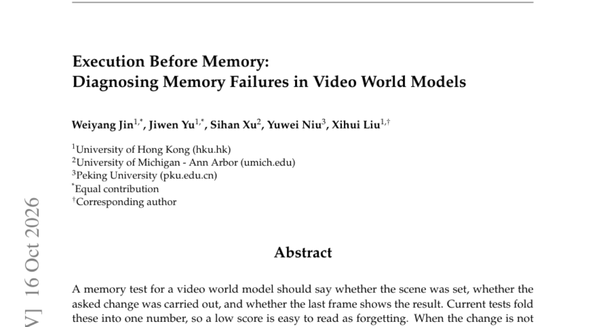

### 📌 한 줄 요약
비디오 월드 모델의 메모리 실패 원인을 '실행 실패'와 '기억 실패'로 분리하여 진단하고, 이를 해결하는 에이전트 기법을 제안합니다.

### 🔑 핵심 포인트
- MIST: 변화(Execution)와 기억(Memory)을 분리하여 모델의 병목 지점을 정밀 진단하는 평가 프레임워크
- M3-Agent: 모델이 지시된 동작을 수행할 수 있도록 입력 지시문을 재귀적으로 수정하는 에이전트 방식
- 실행 실패가 메모리 실패로 오인되는 문제를 해결하여 모델의 실제 능력을 정확히 측정

### 🧑‍💻 개발자 관점
모델의 성능 저하가 데이터 저장(Memory) 문제인지, 명령 수행(Execution) 문제인지 명확히 구분하여 디버깅할 수 있는 방법론을 제공합니다.

### 🚀 실무 적용 아이디어
- 기존 비디오 생성 모델에 MIST 프레임워크를 적용하여 실행/메모리 병목 지점 분석하기
- M3-Agent의 재귀적 지시문 수정 로직을 프롬프트 엔지니어링 파이프라인에 이식해보기
- 동일한 모델에 대해 '실행 중심'과 '기억 중심' 태스크를 분리하여 성능 차이 검증하기

### ⚠️ 리스크/한계
- M3-Agent는 모델의 잠재력을 끌어내는 방식이므로, 모델 자체의 근본적인 아키텍처 개선과는 거리가 있을 수 있음
- 지시문 수정 과정에서 의도치 않은 정보 누출(Leakage)이 발생할 위험이 있음

### 📝 초록 기반 상세 설명
기존 비디오 월드 모델의 메모리 평가는 장면 설정, 변화 실행, 결과 출력을 하나의 점수로 통합하여 정확한 원인 파악이 어려웠습니다. 변화가 실행되지 않으면 메모리 테스트 자체가 무의미해지는 문제가 발생합니다. 이를 해결하기 위해 변화 과정과 메모리 기록을 분리하여 병목 지점을 식별하는 MIST 평가 방식을 도입했습니다. 또한, 모델이 지시사항을 성공적으로 수행하도록 지시문을 재귀적으로 수정하는 M3-Agent를 제안합니다. 실험 결과, M3-Agent는 MIST 점수를 3배 이상 높였으며 주요 벤치마크에서도 성능 향상을 입증했습니다.

---

## 18. [DLite: History-free Speculative Decoding for Agentic AI](https://huggingface.co/papers/2610.23787)
**Upvotes**: 20 | **도입 난이도**: 중 | **신뢰도**: 상
**arXiv**: https://arxiv.org/abs/2610.23787

**태그**: LLM, Speculative Decoding, Agentic AI, Inference Optimization, Agent, Inference

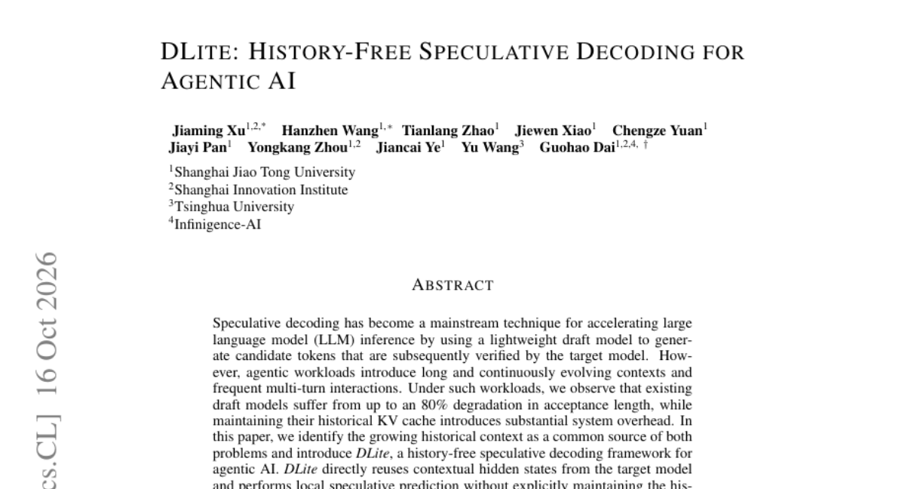

### 📌 한 줄 요약
에이전트 작업의 긴 컨텍스트 문제를 해결하기 위해 과거 KV 캐시 없이 타겟 모델의 은닉 상태를 재사용하는 효율적인 Speculative Decoding 프레임워크

### 🔑 핵심 포인트
- History-free 방식: 과거 KV 캐시 유지 없이 타겟 모델의 은닉 상태를 재사용하여 오버헤드 최소화
- Local Prediction: 복잡한 긴 컨텍스트 문제를 국소적인 예측 문제로 단순화하여 효율성 극대화
- Two-stage Training: 이종 구조(heterogeneous architecture)를 최적화하기 위한 맞춤형 2단계 학습 전략 도입

### 🧑‍💻 개발자 관점
에이전트 기반 AI 서비스 구축 시 발생하는 긴 컨텍스트로 인한 추론 지연 및 메모리 비용 문제를 해결할 수 있는 실질적인 대안을 제시합니다.

### 🚀 실무 적용 아이디어
- 에이전트 워크로드(Multi-turn) 환경에서 기존 Speculative Decoding과의 수락 길이 비교 실험
- KV 캐시 메모리 점유율 대비 추론 속도 향상 폭(Throughput) 측정
- 타겟 모델의 은닉 상태 재사용 시 발생하는 정보 손실 및 정확도 영향도 분석

### ⚠️ 리스크/한계
- 타겟 모델의 은닉 상태에 의존하므로 모델 구조 변경 시 적용이 어려울 수 있음
- 매우 긴 문맥에서 국소적 예측 방식이 전체적인 문맥 일관성을 유지할 수 있는지에 대한 검증 필요

### 📝 초록 기반 상세 설명
LLM 추론 가속을 위한 Speculative Decoding은 에이전트 워크로드처럼 컨텍스트가 길고 계속 변하는 환경에서 수락 길이(acceptance length)가 급격히 저하되는 문제가 발생합니다. 또한 기존 방식은 과거 KV 캐시를 유지하는 데 막대한 시스템 오버헤드를 초래합니다. 본 논문은 DLite를 제안하여 과거 컨텍스트를 명시적으로 유지하지 않고 타겟 모델의 컨텍스트 은닉 상태를 직접 재사용하는 방식을 도입합니다. 이를 통해 복잡한 모델링 문제를 국소적인 예측 문제로 전환하며, 가벼운 순차 헤드를 통해 인과적 의존성을 복구합니다. 실험 결과, DLite는 기존 SOTA인 DSpark 대비 최대 70% 높은 성능을 보이며 긴 컨텍스트 환경에서도 안정적인 가속을 제공합니다.

---

## 19. [OfficeTown: Generative Organizations for Evolving Agent Intelligence](https://huggingface.co/papers/2610.23194)
**Upvotes**: 17 | **도입 난이도**: 상 | **신뢰도**: 상
**arXiv**: https://arxiv.org/abs/2610.23194

**태그**: AI Agent, Multi-Agent, Simulation, Fine-tuning, Agent, Benchmark, Evaluation, Distillation

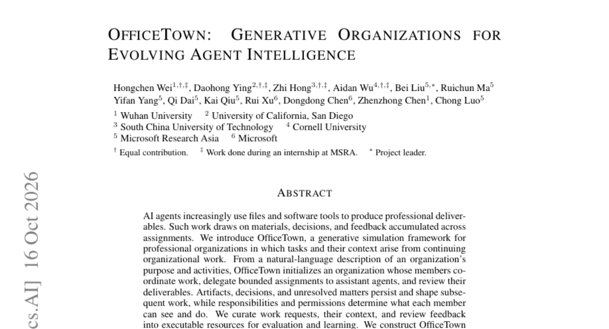

### 📌 한 줄 요약
조직 시뮬레이션을 통해 에이전트의 전문 업무 수행 능력을 학습시키고 평가하는 프레임워크 제안

### 🔑 핵심 포인트
- 조직적 맥락과 권한이 유지되는 생성적 시뮬레이션 프레임워크 OfficeTown 개발
- 23개 조직, 406개 작업, 4,836개 평가 기준을 포함한 전문 업무 벤치마크 OfficeTown Bench 구축
- 조직 시뮬레이션 데이터를 통한 SFT 및 온폴리시 증류(On-policy distillation)로 에이전트 성능 향상

### 🧑‍💻 개발자 관점
단순 질의응답을 넘어, 에이전트가 복잡한 워크플로우와 조직적 위계 속에서 협업하는 능력을 학습시키는 새로운 데이터 생성 방법론을 제시합니다.

### 🚀 실무 적용 아이디어
- 제시된 Principal-Assistant 구조를 활용한 멀티 에이전트 워크플로우 설계 실험
- OfficeTown Bench를 활용한 현재 보유 모델의 전문 업무 수행 능력 벤치마킹
- 특정 도메인(예: 법률, 코딩)에 특화된 가상 조직 시뮬레이션 환경 구축 테스트

### ⚠️ 리스크/한계
- 시뮬레이션 환경이 실제 세계의 복잡한 인간 상호작용을 완벽히 대체하기 어려움
- 생성된 데이터에 의한 과적합(Overfitting) 가능성

### 📝 초록 기반 상세 설명
AI 에이전트가 전문적인 결과물을 생성하기 위해서는 과거의 결정과 맥락이 유지되는 지속적인 업무 환경이 필요합니다. 기존의 단발성 작업 방식은 복잡한 조직적 맥락과 피드백 루프를 반영하기 어렵다는 문제가 있습니다. 이를 해결하기 위해 자연어 설명만으로 가상의 조직을 생성하는 시뮬레이션 프레임워크인 OfficeTown을 도입합니다. OfficeTown은 구성원 간의 권한, 업무 위임, 결과물 검토 및 맥락 유지가 가능한 동적인 환경을 제공합니다. 실험 결과, OfficeTown 데이터를 활용한 미세 조정은 전문 업무 벤치마크 성능을 크게 향상시켰으며, 상급자-보조자 구조가 단일 에이전트보다 우수함을 입증했습니다.

### 🖼️ 추가 자료
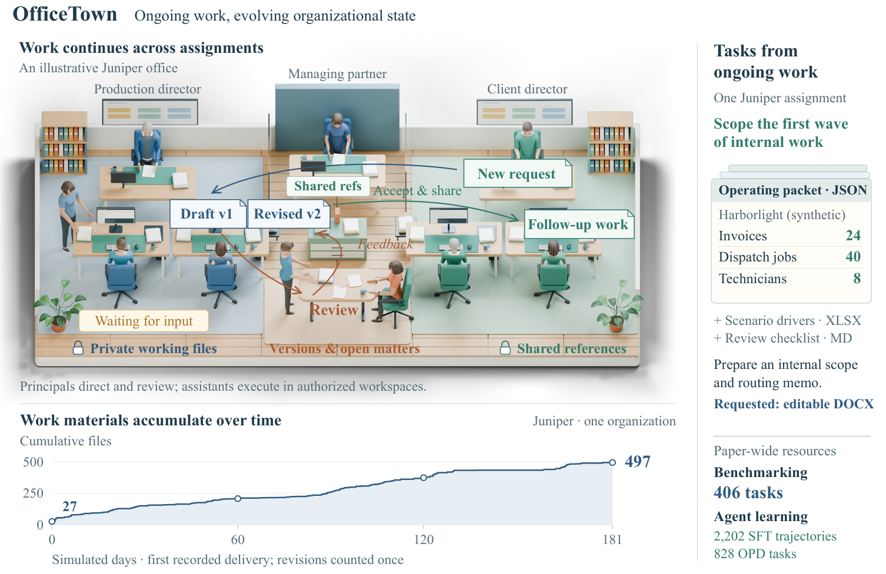

---

## 20. [Can Visual Generation Expand What Unified Multimodal Models Know?](https://huggingface.co/papers/2610.21459)
**Upvotes**: 17 | **도입 난이도**: 중 | **신뢰도**: 상
**arXiv**: https://arxiv.org/abs/2610.21459

**태그**: Multimodal, Image Generation, Knowledge Transfer, LLM, Vision, Safety

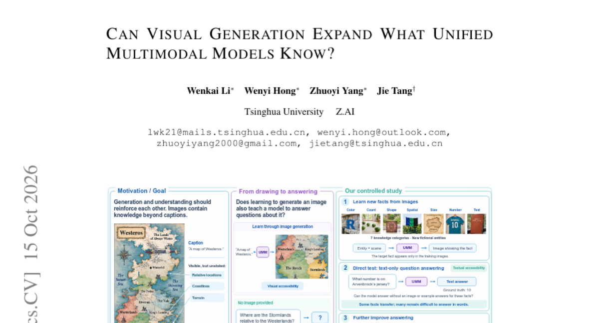

### 📌 한 줄 요약
이미지 생성 학습이 텍스트 기반 지식 확장 및 질의응답 능력 향상에 기여할 수 있음을 입증한 연구

### 🔑 핵심 포인트
- Knowledge Transfer Probing(KTP) 프로토콜을 통한 시각-언어 지식 전이 메커니즘 규명
- 이미지 생성 학습이 텍스트 기반 QA 성능을 향상시키는 지식 원천이 될 수 있음을 증명
- Textual Alignment 및 Interleaved Alignment를 통한 생성과 답변 간의 지식 연결 최적화

### 🧑‍💻 개발자 관점
멀티모달 모델 학습 시 이미지 생성 태스크가 단순한 시각적 재현을 넘어 모델의 언어적 지식 베이스를 확장하는 수단이 될 수 있음을 시사합니다.

### 🚀 실무 적용 아이디어
- 이미지 생성 학습 데이터가 텍스트 QA 성능에 미치는 영향력을 KTP 프로토콜로 측정해보기
- 생성 태스크와 QA 태스크를 결합한 멀티태스크 학습 환경 구축하기
- Interleaved 데이터 형식을 활용한 멀티모달 모델의 지식 전이 실험 수행하기

### ⚠️ 리스크/한계
- 시각적 지식이 텍스트로 전이되는 과정에서 발생하는 불균형한 성능 차이
- 이미지 생성과 텍스트 QA 사이의 지식 접근성 격차 존재

### 📝 초록 기반 상세 설명
통합 멀티모달 모델(UMM)은 텍스트에 담기지 않은 시각적 정보를 이미지 생성 학습을 통해 습득할 수 있습니다. 본 연구는 이미지 생성 학습을 통해 유입된 새로운 지식이 텍스트 전용 질의응답(QA)을 통해 얼마나 잘 활용되는지 측정하는 KTP 프로토콜을 제안합니다. 실험 결과, 시각적 감독(supervision)을 통한 지식 전이가 텍스트로 직접 전달되지만 그 양상은 불균형하게 나타남을 확인했습니다. 이를 해결하기 위해 텍스트 정렬(Textual Alignment)과 인터리브 이미지-텍스트 정렬(Interleaved Image-Text Alignment) 기법을 도입했습니다. 결과적으로 특정 엔티티에 대한 가이드가 다른 엔티티의 지식 접근성을 높였으며, 시각적 생성 능력이 텍스트 지식 확장으로 이어질 수 있음을 보여주었습니다.

---

## 21. [LEV: Thinking Fast and Deep with Looped Decision Models](https://huggingface.co/papers/2610.20951)
**Upvotes**: 17 | **도입 난이도**: 중 | **신뢰도**: 상
**arXiv**: https://arxiv.org/abs/2610.20951

**태그**: Efficient Inference, Decision Model, Recurrent Neural Networks, Model Optimization, Inference

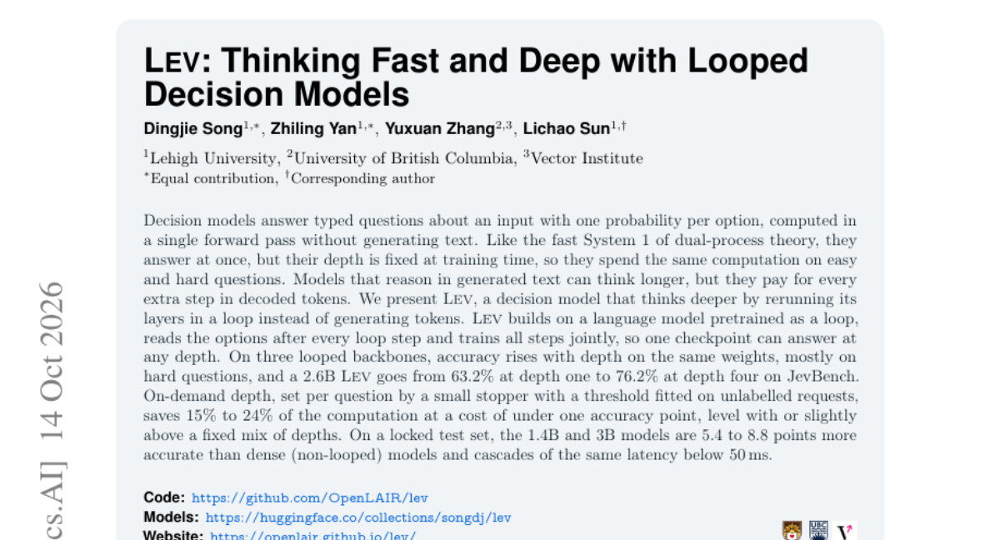

### 📌 한 줄 요약
추가 토큰 생성 없이 레이어 루프를 통해 연산량을 조절하며 추론 깊이를 동적으로 제어하는 결정 모델(Decision Model) 제안

### 🔑 핵심 포인트
- 토큰 생성 없이 레이어 루프를 재사용하여 추론 깊이를 조절하는 방식 도입
- 단일 체크포인트로 문제 난이도에 따라 가변적인 연산(Depth) 수행 가능
- 기존 밀집(Dense) 모델 및 동일 지연시간 대비 높은 정확도 달성

### 🧑‍💻 개발자 관점
추론 비용(Token cost)을 최소화하면서도 문제의 난이도에 따라 연산량을 유연하게 조절해야 하는 실시간 서비스 환경에서 매우 유용합니다.

### 🚀 실무 적용 아이디어
- 기존 분류/결정 모델의 레이어 재사용(Recurrent) 구조 적용 가능성 검토
- 난이도별 중단(Stopper) 임계값 설정 로직 실험
- 고정 연산량 모델과 루프 모델 간의 비용 대비 성능(Cost-efficiency) 벤치마크 수행

### ⚠️ 리스크/한계
- 루프 반복 횟수가 늘어날수록 지연시간(Latency)이 선형적으로 증가할 위험
- 학습 시 루프 구조에 최적화된 특수 구조가 필요하여 기존 모델 이식 시 재학습 필요성

### 📝 초록 기반 상세 설명
기존의 결정 모델은 단일 패스 방식으로 동작하여 문제 난이도와 상관없이 고정된 연산량만 소비하는 한계가 있었습니다. 텍스트 생성 방식의 추론 모델은 사고 시간을 늘릴 수 있지만 토큰 생성 비용이 발생한다는 단점이 있습니다. 본 논문은 레이어를 루프로 재실행하여 토큰 생성 없이 추리 깊이를 높이는 LEV 모델을 제안합니다. 사전 학습된 언어 모델을 루프 구조로 변형하고, 매 단계에서 옵션을 읽으며 모든 단계를 공동 학습하여 하나의 체크포인트로 다양한 깊이를 구현했습니다. 실험 결과, LEV는 고정된 연산량 대비 정확도가 크게 향상되었으며, 난이도에 따른 온디맨드 깊이 조절을 통해 효율적인 추론이 가능함을 입증했습니다.

---

## 22. [MOSS-Image Technical Report](https://huggingface.co/papers/2610.23374)
**Upvotes**: 16 | **도입 난이도**: 중 | **신뢰도**: 상
**arXiv**: https://arxiv.org/abs/2610.23374

**태그**: Diffusion Transformer, Text-to-Image, Layout Control, Agentic Prompting, Agent, RAG, Vision, Evaluation

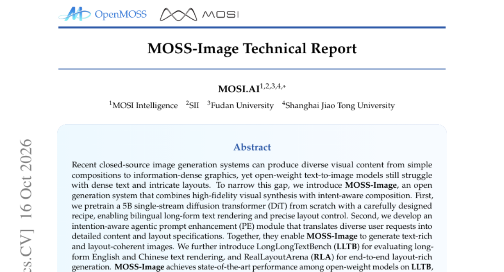

### 📌 한 줄 요약
정교한 레이아웃 제어와 긴 텍스트 렌더링 능력을 갖춘 오픈 웨이트 이미지 생성 시스템 MOSS-Image 발표

### 🔑 핵심 포인트
- 5B 파라미터 규모의 단일 스트림 DiT 기반 고정밀 이미지 생성 모델 개발
- 사용자 의도를 상세한 레이아웃/콘텐츠로 변환하는 에이전트 기반 프롬프트 강화(PE) 모듈 도입
- 긴 텍스트 렌더링(LLTB) 및 레이아웃 정밀도(RLA) 평가를 위한 새로운 벤치마크 제안

### 🧑‍💻 개발자 관점
텍스트가 포함된 그래픽이나 복잡한 레이아웃이 필요한 디자인 자동화 작업에서 오픈 소스 모델의 활용 가능성을 크게 높였습니다.

### 🚀 실무 적용 아이디어
- 제공될 모델을 활용하여 복잡한 텍스트가 포함된 그래픽 생성 테스트
- 에이전트 기반 프롬프트 강화 모듈의 레이아웃 제어 성능 검증
- LLTB 및 RLA 벤치마크를 통한 기존 오픈 모델과의 성능 비교

### ⚠️ 리스크/한계
- 5B 규모의 모델로 인해 로컬 환경에서의 추론 리소스 요구량 존재
- 에이전트 기반 프롬프트 강화 단계에서의 의도 해석 오류 가능성

### 📝 초록 기반 상세 설명
최근 폐쇄형 모델은 뛰어난 이미지 생성 능력을 보여주지만, 오픈 웨이트 모델은 복잡한 레이아웃과 텍스트 렌더링에서 한계를 보입니다. 이를 해결하기 위해 고정밀 시각 합성 및 의도 인지 구성을 결합한 MOSS-Image를 제안합니다. 5B 파라미터 규모의 단일 스트림 Diffusion Transformer(DiT)를 사전 학습하여 이중 언어 텍스트와 정밀한 레이아웃 제어를 가능하게 했습니다. 또한, 사용자 요청을 상세한 콘텐츠 및 레이아웃 사양으로 변환하는 의도 인지 에이전트 프롬프트 강화(PE) 모듈을 개발했습니다. 결과적으로 MOSS-Image는 텍스트 밀도가 높은 이미지 생성에서 SOTA 성능을 달성하며, 모델과 학습 레시피를 공개할 예정입니다.

---

## 23. [Belief-Trajectory Energy: Measuring the Path to a Prediction](https://huggingface.co/papers/2610.05114)
**Upvotes**: 15 | **도입 난이도**: 중 | **신뢰도**: 상
**arXiv**: https://arxiv.org/abs/2610.05114

**태그**: LLM Interpretability, Model Monitoring, Data Analysis, Reasoning, Vision

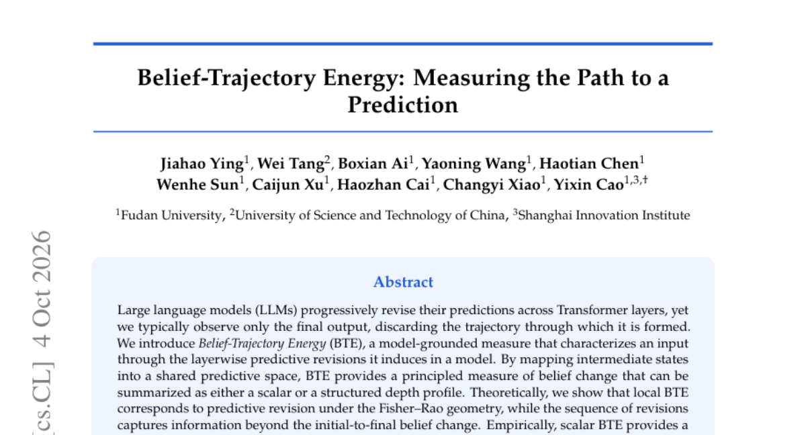

### 📌 한 줄 요약
LLM의 레이어별 예측 변화 과정을 수치화하여 데이터의 난이도와 생성 출처를 식별하는 새로운 측정 지표(BTE) 제안

### 🔑 핵심 포인트
- 레이어별 예측 수정 과정을 활용한 모델 기반 측정 지표 BTE 제안
- Fisher-Rao 기하학을 통한 이론적 근거 및 정보량 확보
- 데이터 난이도 측정, 생성자 식별(Attribution), 리뷰 탐지 등 다양한 태스크에 적용 가능

### 🧑‍💻 개발자 관점
모델의 내부 연산 과정을 활용해 데이터의 특성(난이도, 출처)을 파악할 수 있는 새로운 분석 프레임워크를 제공합니다.

### 🚀 실무 적용 아이디어
- 특정 데이터셋에 대해 레이어별 예측 변화(Logit 변화)를 시각화하여 BTE 개념 검증
- 모델의 특정 레이어 구간이 데이터의 난이도와 어떤 상관관계를 갖는지 분석
- 생성된 텍스트의 출처를 식별하는 데 BTE 지표를 적용해보기

### ⚠️ 리스크/한계
- 모델 구조나 학습 상태에 따라 BTE 값이 달라질 수 있는 모델 의존성
- 계산 복잡도가 레이어별 상태를 모두 고려해야 하므로 기존 방식보다 높을 수 있음

### 📝 초록 기반 상세 설명
LLM은 레이어를 거치며 예측을 점진적으로 수정하지만, 기존에는 최종 출력값만 관찰할 뿐 그 과정인 궤적(trajectory)은 무시되어 왔습니다. 본 논문은 입력 데이터가 모델 내부에서 유도하는 레이어별 예측 수정 과정을 통해 입력을 특성화하는 'Belief-Trajectory Energy(BTE)'를 도입합니다. BTE는 중간 상태를 공유된 예측 공간으로 매핑하여 신념 변화를 스칼라 또는 구조화된 깊이 프로필로 요약합니다. 이론적으로 BTE는 Fisher-Rao 기하학 하에서의 예측 수정과 대응되며, 단순한 최종 결과 이상의 정보를 포착합니다. 실험 결과, BTE는 추론 작업의 난이도 측정뿐만 아니라 인간-LLM 리뷰 탐지 및 생성자 식별에서 매우 높은 정확도를 달성했습니다.

### 🖼️ 추가 자료
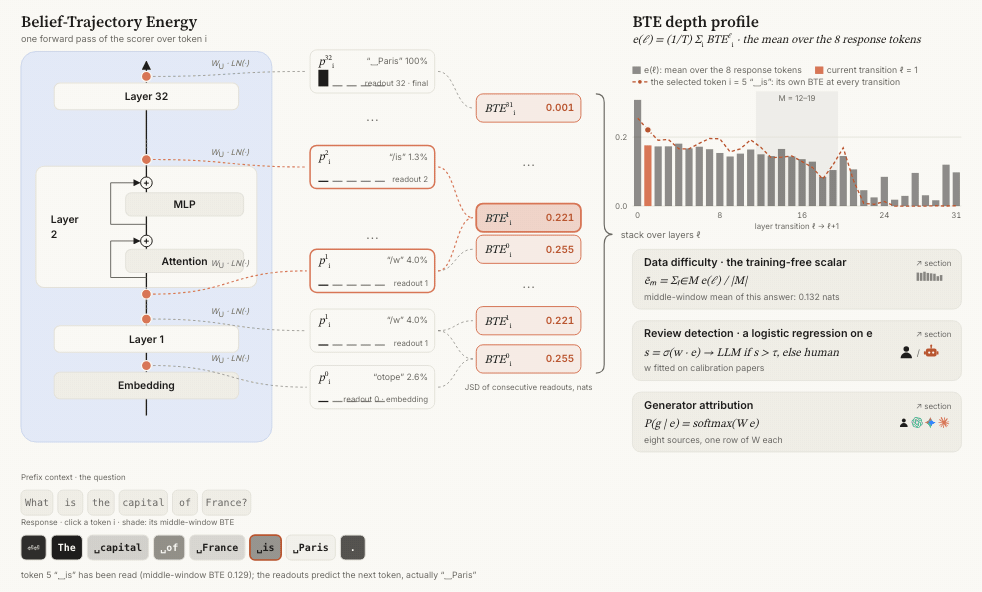

---

## 24. [OmniXRef: A Unified Framework for Multimodal Multi-Reference Video Editing](https://huggingface.co/papers/2610.22744)
**Upvotes**: 14 | **도입 난이도**: 상 | **신뢰도**: 상
**arXiv**: https://arxiv.org/abs/2610.22744

**태그**: Video-Editing, Diffusion-Transformer, Multimodal, Generative-AI, Vision, Video, Benchmark, Evaluation

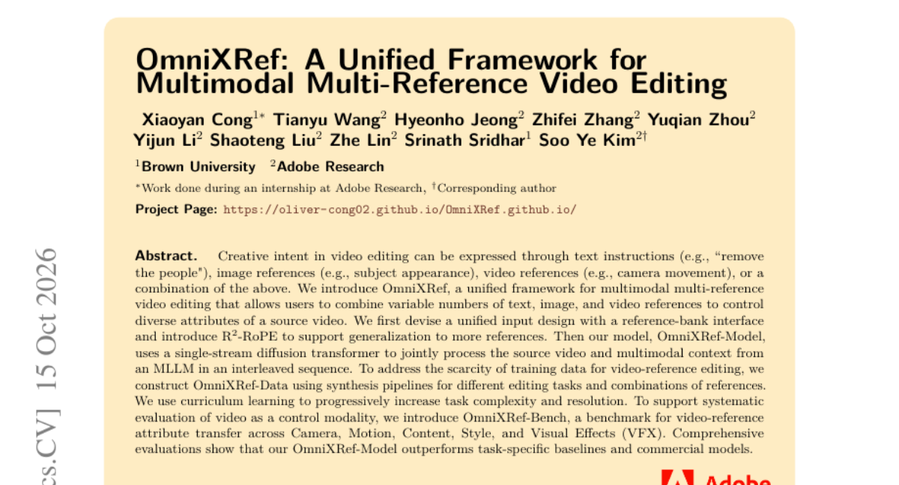

### 📌 한 줄 요약
텍스트, 이미지, 비디오 등 다양한 참조를 결합하여 소스 비디오를 정교하게 편집하는 통합 멀티모달 프레임워크

### 🔑 핵심 포인트
- 다양한 수의 텍스트, 이미지, 비디오 참조를 동시에 처리하는 통합 프레임워크 설계
- R^2-RoPE 및 단일 스트림 디퓨전 트랜스포머를 통한 멀티모달 컨텍스트 통합
- 합성 데이터 파이프라인과 커리큘럼 학습을 통한 고품질 비디오 편집 데이터 확보

### 🧑‍💻 개발자 관점
멀티모달 입력을 하나의 시퀀스로 처리하는 구조를 통해, 복합적인 제어 조건(예: 특정 인물 유지 + 특정 카메라 움직임 적용)이 필요한 비디오 생성/편집 워크플로우에 직접 적용 가능합니다.

### 🚀 실무 적용 아이디어
- 제시된 R^2-RoPE 구조를 활용한 가변 길이 참조 입력 실험
- 합성 데이터 생성 파이프라인의 효율성 및 품질 검증
- 다양한 비디오 참조 조합에 따른 속성 전이(Attribute Transfer) 정확도 테스트

### ⚠️ 리스크/한계
- 합성 데이터 의존도가 높아 실제 데이터와의 도메인 차이 발생 가능성
- 복합적인 참조가 늘어날수록 연산 복잡도 및 제어 난이도 증가

### 📝 초록 기반 상세 설명
기존 비디오 편집은 텍스트, 이미지, 비디오 등 다양한 형태의 참조를 동시에 결합하여 제어하는 데 어려움이 있었습니다. 이를 해결하기 위해 다양한 수의 참조를 수용할 수 있는 통합 입력 설계와 R^2-RoPE 기술을 제안합니다. OmniXRef-Model은 단일 스트림 디퓨전 트랜스포머를 사용하여 소스 비디오와 MLLM으로부터 추출된 멀티모달 컨텍스트를 인터리브된 시퀀스로 처리합니다. 데이터 부족 문제를 해결하기 위해 합성 파이프라인을 통한 OmniXRef-Data를 구축하고 커리큘럼 학습을 적용했습니다. 결과적으로 제안된 모델은 카메라 움직임, 스타일, VFX 등 다양한 속도 전이 작업에서 기존 모델들을 상회하는 성능을 보였습니다.

---

## 25. [Stuck on Shuffle: On Attribute-Object Binding in Vision-Language Models](https://huggingface.co/papers/2610.22602)
**Upvotes**: 14 | **도입 난이도**: 중 | **신뢰도**: 상
**arXiv**: https://arxiv.org/abs/2610.22602

**태그**: Vision-Language, Embedding, Data Augmentation, RAG, Multimodal, Vision, Benchmark, Evaluation

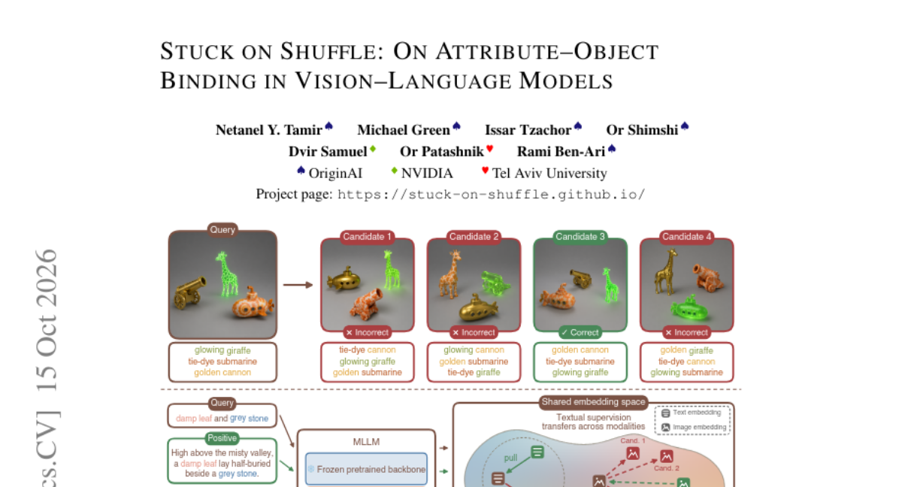

### 📌 한 줄 요약
텍스트 기반 합성 데이터 학습만으로 VLM의 속성-객체 결합(Binding) 능력을 획기적으로 개선하는 방법론 제시

### 🔑 핵심 포인트
- 복잡한 속성-객체 결합 능력을 평가하기 위한 4개 모달리티 쌍 기반의 SABER 벤치마크 제안
- 이미지 없이 합성된 텍스트 데이터만으로 학습하여 속성 결합 능력을 개선하는 효율적 방법론 제시
- 텍스트 중심의 학습이 교차 모달 및 이미지-이미지 검색 성능까지 향상시키는 전이 효과 입증

### 🧑‍💻 개발자 관점
이미지 데이터 확보가 어려운 상황에서 텍스트 데이터만으로도 모델의 정교한 객체 식별 능력을 높일 수 있는 실용적인 가이드를 제공합니다.

### 🚀 실무 적용 아이디어
- 보유 중인 MLLM 모델에 합성 텍스트 데이터셋을 활용한 Fine-tuning 실험 수행
- SABel 벤치마크를 활용하여 현재 사용 중인 임베딩 모델의 결합 능력 검증
- 텍스트 기반 학습이 기존 도메인 성능(General Performance)을 저하시키는지 확인

### ⚠️ 리스크/한계
- 합성 데이터에 과적합될 경우 실제 복잡한 이미지 도메인에서의 일반화 성능 저하 가능성
- 텍스트 중심 학습이 시각적 특징(Visual Feature)의 풍부함을 완전히 대체할 수 있는지에 대한 의문

### 📝 초록 기반 상세 설명
멀티모달 검색 시스템에서 객체와 속성을 정확히 연결하는 결합(Binding) 능력은 필수적이지만, 기존 벤치마크는 복잡한 시나리오를 충분히 반영하지 못합니다. 본 논문은 다양한 모달리티 쌍과 복잡한 객체 구성을 포함하는 새로운 벤치마크인 SABER를 제안합니다. 연구 결과, 기존 CLIP 및 MLLM 기반 임베더들이 속성 결합 문제에 취약함을 확인했습니다. 이를 해결하기 위해 이미지 없이 오직 합성된 텍스트 데이터만을 사용하여 MLLM 기반 임베더를 미세 조정하는 방식을 제안합니다. 실험 결과, 이미지 학습 없이도 속성 결합 능력이 크게 향상되었으며 이는 다른 모달리티 간 검색 성능으로도 전이되었습니다.

---

## 26. [DiscoveryRSI: Recursively Learning to Discover Valuable Hypotheses](https://huggingface.co/papers/2610.23839)
**Upvotes**: 14 | **도입 난이도**: 상 | **신뢰도**: 상
**arXiv**: https://arxiv.org/abs/2610.23839

**태그**: AI Agent, Automated Science, Evolutionary Search, Self-Improvement, Agent, Vision, Evaluation

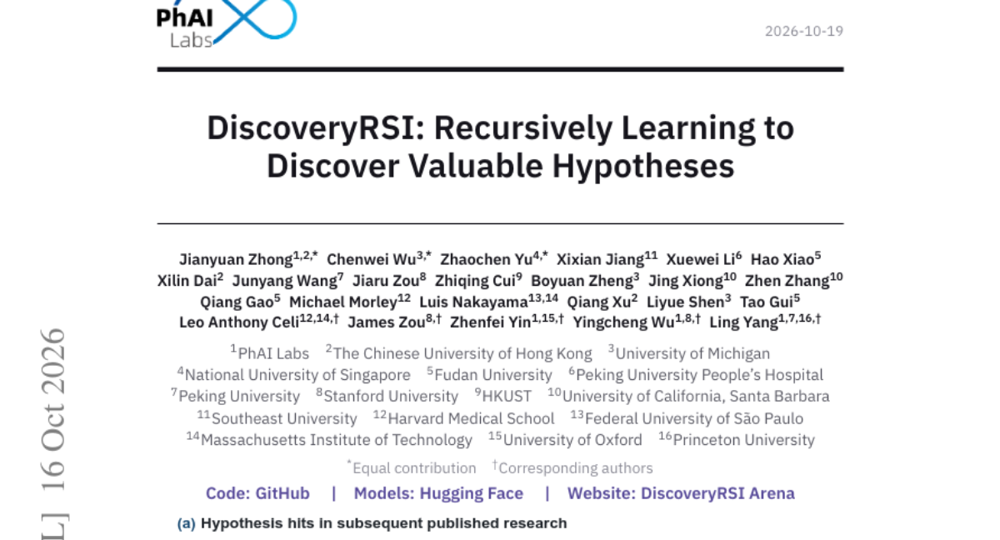

### 📌 한 줄 요약
멀티 에이전트 진화 탐색과 재귀적 학습을 통해 가치 있는 과학적 가설을 생성하고 검증하는 프레임워크

### 🔑 핵심 포인트
- 멀티 에이전트 진화 탐색을 통한 가설 트리 생성 및 실행 가능한 조사 작업 자동화
- 신용 최적화, 하네스 리플레이, 재발견을 결합한 재귀적 학습 루프 구축
- 가설 품질 및 연구 경로를 평가하기 위한 벤치마크 DFM-Bench 제안

### 🧑‍💻 개발자 관점
에이전트가 단순히 정보를 찾는 것을 넘어, 스스로 가설을 세우고 실험 계획을 수립하며 결과로부터 학습하는 '자율적 연구 루프'의 설계 패턴을 제시합니다.

### 🚀 실무 적용 아이디어
- 멀티 에이전트 협업 구조에서 에이전트 간의 '신용(Credit)' 배분 로직 구현 실험
- 에이전트가 생성한 작업(Task)을 실제 실행 환경(Sandbox)에 배포하는 워크플로우 설계
- 반복적인 피드백 루프를 통한 에이전트의 전략 최적화(Self-improvement) 테스트

### ⚠️ 리스크/한계
- 가설의 품질이 모델의 성능과 데이터에 크게 의존할 수 있음
- 실제 물리적 실험 환경과의 연동 시 발생하는 복잡성과 비용 문제

### 📝 초록 기반 상세 설명
과학적 발견 과정에서 가치 있는 가설을 개발하고 이를 연구 프로세스로 학습하는 것은 매우 어려운 과제입니다. 본 논문은 증거 기반의 주장과 실행 가능한 조사 방식을 결합한 가설의 운영적 정의를 제안합니다. 이를 위해 멀티 에이전트 진화 탐색을 통해 가설 트리를 구축하고, Harbor 태스크를 통해 조사를 실행하며, 신용 최적화, 하네스 리플레이, 재발견이라는 세 가지 메커니즘을 통해 재귀적으로 학습하는 DiscoveryRSI 프레임워크를 도입합니다. 또한 가설 품질과 연구 진척도를 종합적으로 평가할 수 있는 DFM-Bench를 함께 제안합니다. 실험 결과, 생명 과학 분야에서 가설의 품질과 반증 가능성이 크게 향상되었으며, 기존 LLM 모델들보다 높은 가설 중요도와 근거 기반의 신뢰도를 기록했습니다.

---

## 27. [SciΠvot: Benchmarking Principal-Investigator Judgment at Pivotal Moments of Scientific AutoResearch Agents](https://huggingface.co/papers/2610.21082)
**Upvotes**: 11 | **도입 난이도**: 중 | **신뢰도**: 상
**arXiv**: https://arxiv.org/abs/2610.21082

**태그**: AI Agent, Scientific Research, Benchmarking, Decision Making, Agent, Reasoning, Vision, Benchmark, Evaluation

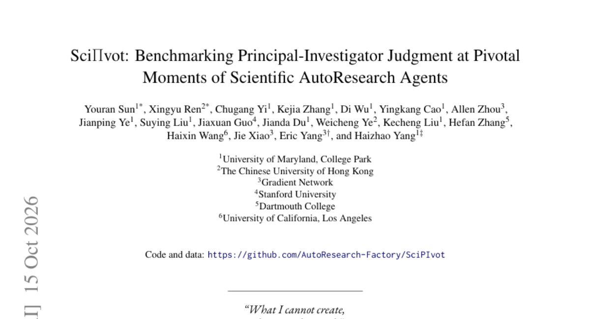

### 📌 한 줄 요약
과학적 연구 에이전트의 의사결정 능력을 평가하기 위한 벤치마크 SciΠvot를 제안하며, 현존하는 최첨단 모델들의 판단 능력이 인간 연구자에 비해 현저히 낮음을 입증함.

### 🔑 핵심 포인트
- 실제 연구 과정의 인간 개입 기록을 기반으로 한 248개의 과학적 판단 벤치마크(SciΠvot) 구축
- 프로젝트 맥락(Project Record)이 주어졌을 때 모델의 판단 능력이 오히려 저하되는 현상 발견
- 최첨단 모델들이 인간 연구자의 판단 정확도(73.4%)에 비해 현저히 낮은 성능을 보임을 입증

### 🧑‍💻 개발자 관점
자율 연구 에이전트 개발 시 단순 작업 수행 능력을 넘어, 복잡한 맥락 속에서 인간의 의사결정을 모방하거나 보조할 수 있는 판단력 평가가 필수적임을 시사합니다.

### 🚀 실무 적용 아이디어
- 에이전트의 의사결정 루프에 인간의 피드백(RLHF)을 반영하는 방식의 유효성 검증
- 장기적인 프로젝트 맥락(Long-context)이 에이전트의 판단에 미치는 영향 분석
- 에이전트가 과거의 오류를 학습하여 스스로 수정하는 '재고(Reconsideration)' 메커니즘 실험

### ⚠️ 리스크/한계
- 특정 도메인과 특정 연구 기록에 국한된 벤치마크일 가능성
- 모델의 추론 노력(Reasoning effort) 증가가 반드시 판단력 향상으로 이어지지 않을 수 있음

### 📝 초록 기반 상세 설명
LLM 에이전트가 자율적인 연구를 수행하려면 단순한 실험 수행을 넘어 과학적 판단력이 필수적입니다. 그러나 연구 결정은 맥락 의존적이고 개방적이라 평가가 매우 어렵습니다. 본 논문은 6개월간의 실제 연구 기록과 전문가의 개입 사례를 바탕으로 248개의 사례로 구성된 SciΠsot 벤치마크를 구축했습니다. 실험 결과, 최첨단 모델들은 프로젝트 기록이 주어졌을 때 오히려 인간의 수정안보다 원래의 LLM 계획을 선택하는 경향을 보였습니다. 결과적으로 현존하는 모델들은 과학적 판단 영역에서 인간 연구자의 성능에 미치지 못하며, 특히 맥락이 주어졌을 때 성능이 저하되는 양상을 보였습니다.

---

## 28. [OPMD: On-Policy Mechanism Distillation Beyond Output Supervision](https://huggingface.co/papers/2610.14022)
**Upvotes**: 9 | **도입 난이도**: 중 | **신뢰도**: 상
**arXiv**: https://arxiv.org/abs/2610.14022

**태그**: Knowledge Distillation, LLM Training, Reasoning, RAG, Vision, Evaluation, Distillation

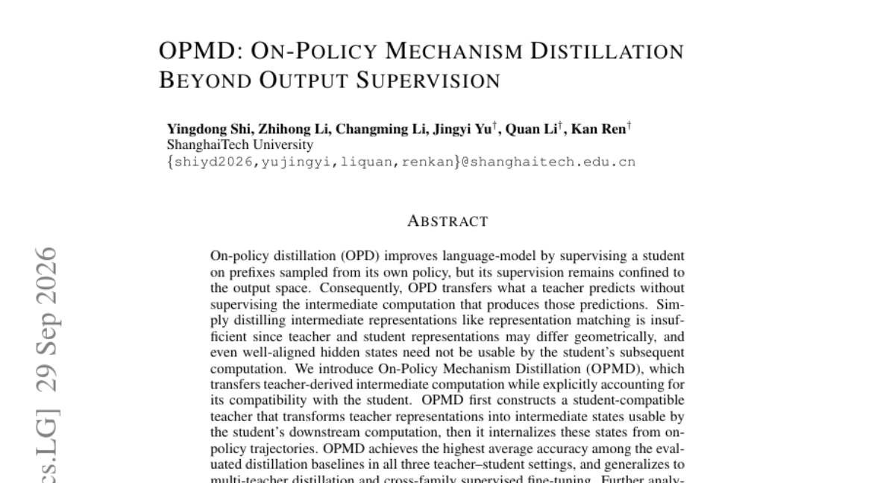

### 📌 한 줄 요약
출력값뿐만 아니라 교사의 중간 연산 메커니즘을 학생 모델에 맞게 변환하여 전수하는 온폴리즘 증류 기법

### 🔑 핵심 포인트
- 출력값(Output)을 넘어 중간 연산(Mechanism) 단계의 지식 전수 프레임워크 제안
- 학생 모델의 구조적 특성을 고려하여 교사의 표현을 변환하는 호환성 확보 전략 도입
- 온폴리시 궤적를 통한 메커니즘 내재화로 추론 및 문제 해결 전략의 질적 향상

### 🧑‍💻 개발자 관점
모델 크기가 작은 학생 모델이 거대 모델(Teacher)의 단순 결과값뿐만 아니라 사고 방식(Reasoning)까지 효율적으로 학습할 수 있는 경로를 제시합니다.

### 🚀 실무 적용 아이디어
- 기존 KL-divergence 기반 출력 증류와 OPMD의 추론 성능 비교 실험
- 서로 다른 아키텍처를 가진 교사-학생 모델 쌍에서의 호환성 변환 모듈 테스트
- 특정 도메인(수학, 코딩) 추론 태스크에서의 메커니즘 전수 효과 검증

### ⚠️ 리스크/한계
- 교사 모델의 표현을 학생용으로 변환하는 과정에서 추가적인 연산 비용 발생 가능성
- 학생 모델의 아키텍처가 교사와 너무 이질적일 경우 호환성 확보의 어려움

### 📝 초록 기반 상세 설명
기존의 온폴리시 증류(OPD)는 학생 모델이 생성한 접두사를 활용하지만, 감독이 출력 공간에만 국한되어 중간 연산 과정의 지식 전수가 어렵다는 문제가 있었습니다. 단순히 중간 표현을 일치시키는 방식은 교사와 학생 간의 기하학적 차이로 인해 효과가 제한적이었습니다. 본 논문은 교사의 표현을 학생의 연산에 적합하도록 변환하는 '학생 호환형 교사(student-compatible teacher)'를 구축하는 OPMD를 제안합니다. OPM써는 온폴리시 궤적에서 이러한 변환된 상태를 내재화함으로써 중간 메커니즘을 효과적으로 전수합니다. 실험 결과, OPMD는 다양한 설정에서 기존 베이스라인을 상회하는 성능을 보였으며 추론 능력과 해결 전략에서도 우수한 일반화 성능을 입증했습니다.

---

## 29. [OS-Helix: Unifying GUI Interaction and Code Execution in Native Computer-Using Agents](https://huggingface.co/papers/2610.22234)
**Upvotes**: 9 | **도입 난이도**: 상 | **신뢰도**: 상
**arXiv**: https://arxiv.org/abs/2610.22234

**태그**: Agent, Multimodal, Reinforcement Learning, Automation, Vision, Evaluation

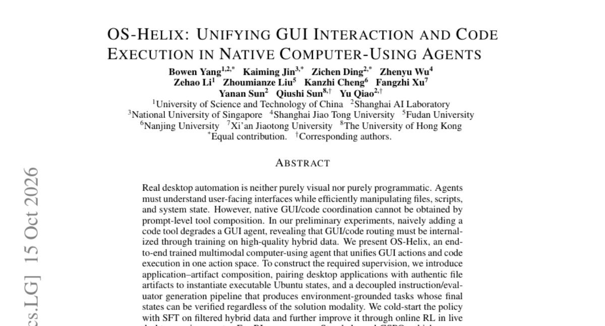

### 📌 한 줄 요약
GUI 조작과 코드 실행을 하나의 액션 공간에서 통합하여 데스크톱 자동화 성능을 극대화한 멀티모달 에이전트 프레임워크

### 🔑 핵심 포인트
- GUI 조작과 코드 실행을 단일 액션 공간으로 통합한 end-to-end 학습 방식
- 검증 가능한 환경 구축을 위한 애플리케이션-아티팩트 결합 및 디커플링된 데이터 생성 파이프라인
- 긴 코드 실행 액션이 최적화를 독점하는 것을 방지하는 Step-balanced GSPO 알고리즘

### 🧑‍💻 개발자 관점
단순히 화면을 클릭하는 수준을 넘어, 코드를 작성하고 파일을 조작하는 복합적인 워크플로우를 자동화하는 차세대 에이전트 설계 방식을 제시합니다.

### 🚀 실무 적용 아이디어
- 제시된 Step-balanced GSPO 알고리즘의 가중치 계산 방식 분석
- GUI와 코드 실행이 혼재된 하이브리드 데이터셋 구축 방법론 검토
- OSWorld 환경에서의 에이전트 성능 벤치마크 테스트 수행

### ⚠️ 리스크/한계
- 복합적인 액션 공간으로 인해 학습 난이도가 매우 높고 컴퓨팅 자원이 많이 필요함
- 특정 환경(Ubuntu 등)에 특화된 데이터로 학습될 경우 타 OS로의 전이 성능 불확실성

### 📝 초록 기반 상세 설명
기존의 데스크톱 자동화는 시각적 GUI 조작과 프로그래밍적 코드 실행 사이의 조율이 어려워 단순한 툴 조합만으로는 성능 향상에 한계가 있었습니다. 본 논문은 GUI 액션과 코드 실행을 단일 액션 공간으로 통합한 end-to-end 멀티모달 에이전트인 OS-Helix를 제안합니다. 이를 위해 애플리케이션과 파일 아티팩트를 결합한 데이터 생성 방식과 검증 가능한 환경 기반 태스크 생성 파이프라인을 도입했습니다. 학습 과정에서는 SFT로 콜드 스타트를 수행한 후, 긴 코드 실행이 최적화를 방해하지 않도록 설계된 Step-balanced GSPO 알고리즘을 통해 온라인 RL을 진행했습니다. 실험 결과, OS-Helix는 기존 하이브리드 베이스라인 대비 대폭 향상된 성공률을 기록하며 GUI와 코드 간의 효과적인 협업 능력을 입증했습니다.

---

## 30. [Towards Looped Models Done Right, Part I: Topology, Input Injection, Recurrent-State Design](https://huggingface.co/papers/2610.23036)
**Upvotes**: 8 | **도입 난이도**: 중 | **신뢰도**: 상
**arXiv**: https://arxiv.org/abs/2610.23036

**태그**: LLM, Architecture, MoE, Efficiency, RAG, Reasoning, Benchmark, Evaluation, Inference

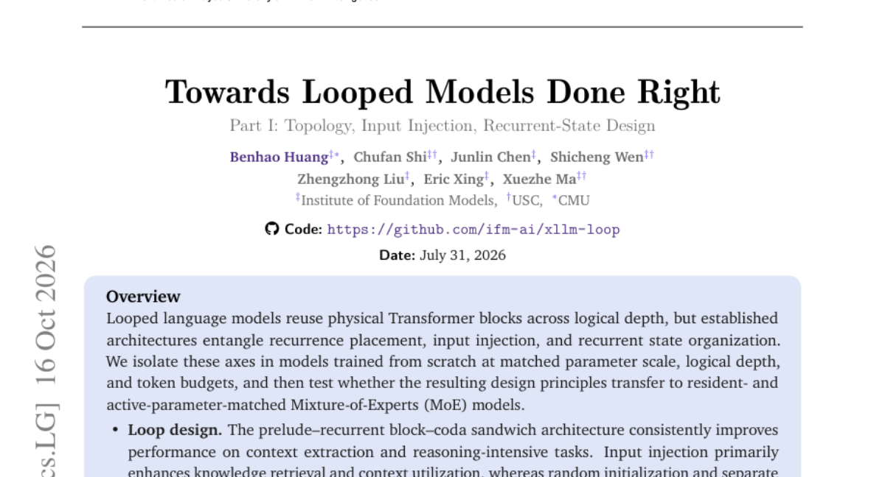

### 📌 한 줄 요약
재사용 가능한 Transformer 블록 구조(Looped Models)의 최적 설계 원칙을 규명하여 MoE 모델의 효율성을 극대화함

### 🔑 핵심 포인트
- 재귀적 구조(Topology), 입력 주입(Input Injection), 순환 상태(Recurrent-State) 설계의 독립적 영향력 분석
- 성능 극대화를 위한 'prelude-recurrent block-coda' 샌드위치 구조 및 Huginn 아키텍처 제안
- 동일한 연산량(FLOPs) 대비 적은 파라미터로도 기존 Feedforward MoE 모델과 대등하거나 우수한 성능 달성

### 🧑‍💻 개발자 관점
모델의 물리적 파라미터를 늘리지 않고도 논리적 깊이를 확장하여 추론 성능을 높이는 효율적인 아키텍처 설계 가이드를 제공합니다.

### 🚀 실무 적용 아이디어
- 기존 Transformer 모델에 재귀적 블록 구조를 적용하여 성능 변화 측정
- 입력 주입 방식(Input Injection)에 따른 지식 검색 성능 변화 실험
- MoE 모델의 전문가 라우팅 최적화를 위한 재귀 구조 결합 테스트

### ⚠️ 리스크/한계
- 재귀적 구조 도입 시 학습 안정성 확보 문제
- 특정 규모 이상의 모델로 확장 시의 일반화 가능성 검증 필요

### 📝 초록 기반 상세 설명
기존의 Looped 언어 모델은 재귀적 구조, 입력 주입 방식, 순환 상태 설계가 서로 복잡하게 얽혀 있어 최적의 설계 원칙을 찾기 어려웠습니다. 본 연구는 파라미터 규모와 논리적 깊이, 토큰 예산을 동일하게 맞춘 상태에서 각 설계 축을 분리하여 실험했습니다. 실험 결과, 'prelude-recurrent block-coda' 샌드위치 구조가 추론 및 문맥 추출 작업에서 가장 우수한 성능을 보였습니다. 또한 입력 주입 방식은 지식 검색과 문맥 활용 능력을 향상시키는 데 핵심적인 역할을 함을 확인했습니다. 최종적으로 제안된 Huginn 아키텍처는 MoE 모델로 확장 시에도 우수한 성능과 효율적인 전문가 라우팅을 보여주었습니다.

---

## 31. [DuoDiscover: Scaling Autonomous Discovery Beyond the Evaluation Bottleneck](https://huggingface.co/papers/2610.17184)
**Upvotes**: 8 | **도입 난이도**: 상 | **신뢰도**: 상
**arXiv**: https://arxiv.org/abs/2610.17184

**태그**: Autonomous Discovery, Optimization, AI Agents, Software Engineering, Agent, RAG, Benchmark, Evaluation

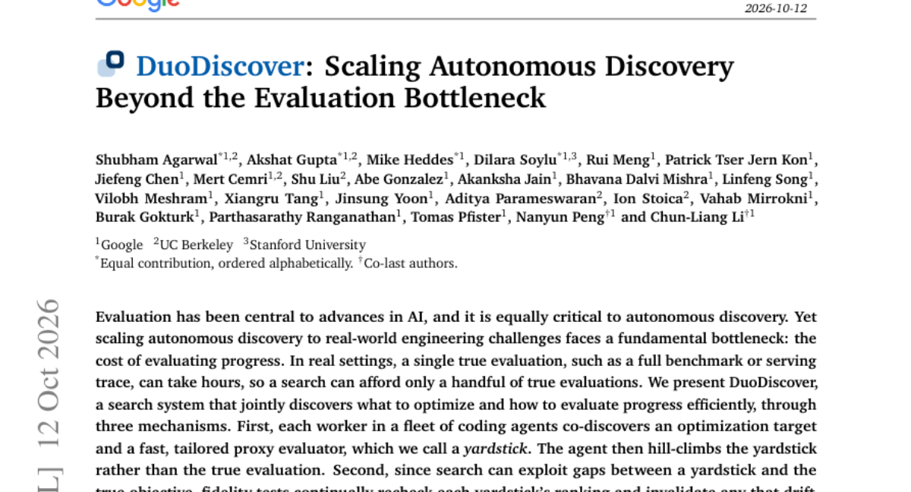

### 📌 한 줄 요약
평가 비용이 높은 실무 환경에서도 효율적인 탐색을 가능케 하는 자율적 최적화 시스템 DuoDiscover

### 🔑 핵심 포인트
- 최적화 대상과 효율적인 대리 평가기(Yardstick)를 동시에 탐색하는 공동 발견 메커니즘
- Yardstick과 실제 목표 사이의 간극을 관리하기 위한 지속적인 피델리티 테스트(Fidelity Tests)
- 중앙 집중식 분해 없이 에이전트 간 협업과 피드백을 통해 작동하는 하향식(Bottom-up) 오케스트레이션

### 🧑‍💻 개발자 관점
평가 비용이 매우 비싼(수 시간~수십 시간 소요) 복잡한 엔지니어링 과제에서 자동화된 최적화 루프를 구축할 수 있는 방법론을 제시합니다.

### 🚀 실무 적용 아이디어
- 비용이 큰 벤치마크 대신 가벼운 대리 평가기(Proxy)를 설계하여 최적화 루프를 구축해보기
- 에이전트가 생성한 평가 지표가 실제 목표와 괴리되는지 검증하는 피델리티 테스트 로직 설계하기
- 분산된 에이전트 환경에서 작업 결과물을 공유하고 재사용하는 워크플로우 실험하기

### ⚠️ 리스크/한계
- 대리 평가기(Yardstick)가 실제 목표와 너무 다르게 수렴할 경우 최적화 방향이 왜곡될 위험
- 에이전트 수가 늘어남에 따라 발생하는 오케스트레이션 복잡도 및 자원 관리 문제

### 📝 초록 기반 상세 설명
AI의 자율적 발견(Discovery) 과정에서 실제 환경의 높은 평가 비용은 탐색 규모를 제한하는 핵심 병목 현상입니다. 기존 방식은 단일 평가에 수 시간이 소요되어 탐색 횟수가 극히 제한되는 문제를 겪습니다. 이를 해결하기 위해 DuoDiscover는 최적화 대상과 효율적인 대리 평가기(Yardstick)를 동시에 찾아내는 시스템을 제안합니다. 에이전트가 직접 맞춤형 Yardstick을 만들고, 피델리티 테스트를 통해 평가 정확도를 유지하며, 중앙 통제 없이 분산된 방식으로 작업을 수행합니다. 실험 결과, 소프트웨어 엔진 최적화부터 칩 아키텍처 설계에 이르기까지 인간 전문가와 기존 자동화 도구를 뛰어넘는 성능을 입증했습니다.

---

## 32. [AVC-Reward: Event-Centric Audio-Video Consistency Evaluation](https://huggingface.co/papers/2610.22321)
**Upvotes**: 7 | **도입 난이도**: 중 | **신뢰도**: 상
**arXiv**: https://arxiv.org/abs/2610.22321

**태그**: Audio-Video Generation, Evaluation Metric, Reinforcement Learning, Multimodal, Video, Audio, Benchmark, Evaluation, Safety

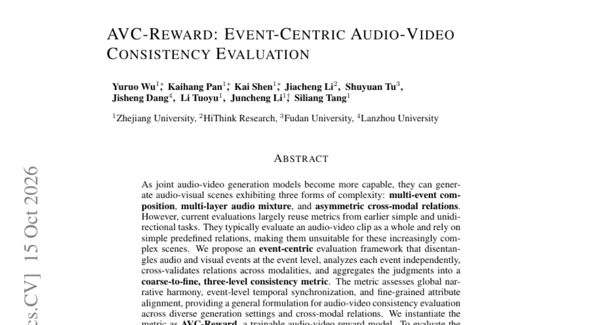

### 📌 한 줄 요약
복잡한 멀티 이벤트 시나리오에서도 인간의 판단과 유사하게 오디오-비디오 일관성을 평가하는 이벤트 중심의 보상 모델(AVC-Reward) 제안

### 🔑 핵심 포인트
- 이벤트 단위로 오디오와 비디오를 분리하여 분석하는 Coarse-to-Fine 평가 프레임워크 제안
- 인간의 지각과 높은 일치도를 보이는 학습 가능한 보상 모델(AVC-Reward) 및 벤치마크(AVC-Benchmark) 구축
- 강화학습(RL) 신호로 활용 시 생성 모델의 오디오-비디오 일관성 개선 효과 입증

### 🧑‍💻 개발자 관점
멀티 이벤트가 포함된 복잡한 생성 모델을 개발할 때, 단순한 유사도 측정을 넘어 인간이 느끼는 실제 일관성을 정밀하게 측정하고 학습 신호로 사용할 수 있습니다.

### 🚀 실무 적용 아이디어
- 기존 생성 모델의 결과물을 AVC-Benchmark 형식으로 변환하여 성능 비교 실험
- 생성 모델의 RLHF(Reinforcement Learning from Human Feedback) 단계에 AVC-Reward를 보상 함수로 적용
- 이벤트 분리(Disentanglement) 로직이 실제 복잡한 영상에서 어떻게 작동하는지 케이스 스터디

### ⚠️ 리스크/한계
- 이벤트 분리 단계에서 발생하는 오류가 전체 평가 점수에 전이될 가능성
- 매우 복잡한 배경음이 섞인 환경에서의 이벤트 분리 정확도 의존성

### 📝 초록 기반 상세 설명
최근 오디오-비디오 생성 모델이 복잡한 멀티 이벤트와 비대칭적 관계를 생성함에 따라, 기존의 단순한 전체 단위 평가 방식은 한계에 직면했습니다. 기존 지표들은 단순한 관계에 의존하여 복잡한 장면의 일관성을 정확히 측정하지 못하는 문제가 있었습니다. 이를 해결하기 위해 본 논문은 이벤트를 개별적으로 분리하고 교차 검증하는 이벤트 중심의 평가 프레임워크를 제안합니다. 제안된 AVC-Reward는 전역적 서사 조화, 이벤트별 시간적 동기화, 세부 속성 정렬을 아우르는 3단계 일관성 지표를 제공합니다. 실험 결과, AVC-Reward는 인간의 판단과 가장 유사한 성능을 보였으며, 강화학습 신호로 사용 시 생성 모델의 일관성을 크게 향상시켰습니다.

---

## 33. [PRISM: PRIvileged Sibling-guided Multi-Agent Topology Design](https://huggingface.co/papers/2610.20628)
**Upvotes**: 7 | **도입 난이도**: 중 | **신뢰도**: 상
**arXiv**: https://arxiv.org/abs/2610.20628

**태그**: Multi-Agent, LLM, Topology Design, Reinforcement Learning, Agent, Benchmark, Evaluation

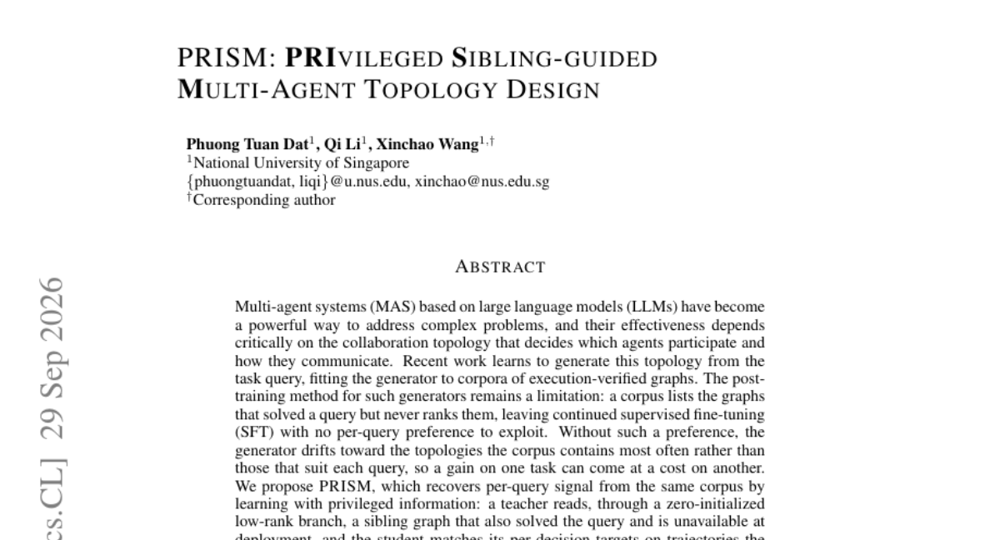

### 📌 한 줄 요약
LLM 멀티 에이전트 시스템의 최적 협업 구조(Topology)를 생성하기 위해, 학습 시에만 활용 가능한 '형제 그래프' 정보를 활용하는 새로운 학습 프레임워크입니다.

### 🔑 핵심 포인트
- 학습 시에만 사용 가능한 '형제 그래프'를 활용한 특권 정보 기반 학습 방식 제안
- 쿼리별 선호도 정보가 부족한 기존 SFT 방식의 한계 극복
- 다양한 벤치마크에서 기존 토폴로지 생성 모델 대비 우수한 성능 입증

### 🧑‍💻 개발자 관점
복잡한 문제를 해결하기 위해 에이전트들을 어떻게 구성하고 연결할지(Topology)를 자동화하는 데 있어, 데이터 효율적이고 성능이 높은 학습 전략을 제공합니다.

### 🚀 실무 적용 아이디어
- 기존 SFT 방식의 에이전트 토폴로지 생성 모델과 PRISM의 성능 비교 실험
- 특권 정보(Sibling graph)가 없는 환경에서의 성능 저하 폭 확인
- 다양한 도메인 쿼리에 대한 토폴로지 일반화 성능 테스트

### ⚠️ 리스크/한계
- 학습 시 사용된 특권 정보가 배포 시에는 사용할 수 없으므로, 학습-추론 간의 간극(Gap) 관리 필요
- 특정 쿼리에 최적화된 구조를 생성하려는 경향이 과적합을 유발할 가능성

### 📝 초록 기반 상세 설명
LLM 기반 멀티 에이전트 시스템(MAS)의 성능은 에이전트 간의 협업 구조인 토폴로지에 크게 의존합니다. 기존 방식은 실행 결과가 검증된 그래프를 학습하지만, 특정 쿼리에 대해 어떤 구조가 더 우수한지에 대한 선호도(Preference) 정보를 활용하지 못해 특정 작업에 편향되는 문제가 있었습니다. 이를 해결하기 위해 PRISM은 학습 시에만 존재하는 '특권 정보(Privileged Information)'를 활용하는 방식을 제안합니다. 교사 모델은 배포 시에는 사용할 수 없는 다른 성공적인 그래프(Sibling graph)를 참조하여 학습하고, 학생 모델은 이를 따라 하도록 학습됩니다. 실험 결과, PRISM은 다양한 벤치마크에서 기존 토폴로지 설계 베이스라인들을 상회하는 성능을 보였습니다.

---

## 34. [Dream2Discern: Learning from Hard Latent Variants for Runtime Failure Prediction in Multi-Agent Systems](https://huggingface.co/papers/2610.16071)
**Upvotes**: 6 | **도입 난이도**: 중 | **신뢰도**: 상
**arXiv**: https://arxiv.org/abs/2610.16071

**태그**: Multi-Agent, Runtime-Monitoring, Data-Augmentation, LLM-Reliability, Agent, RAG, Benchmark, Evaluation

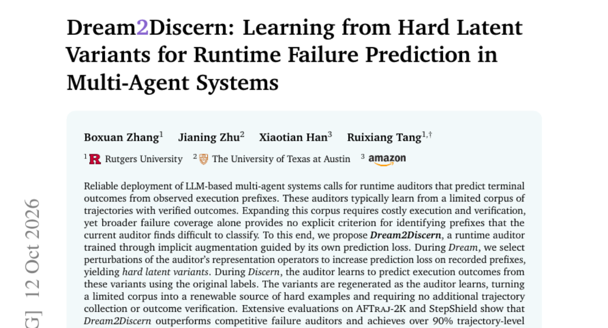

### 📌 한 줄 요약
추가적인 데이터 수집 없이 모델 스스로 생성한 난해한 변형 데이터를 통해 멀티 에이전트 시스템의 런타임 실패를 예측하는 기술

### 🔑 핵심 포인트
- 추가적인 실행 및 검증 없이 기존 데이터를 활용하는 암시적 데이터 증강 기법 제안
- 모델의 예측 손실을 활용해 학습하기 어려운 'Hard Latent Variants'를 생성하는 Dream-Discern 구조
- 한정된 궤적 데이터를 지속적으로 재사용 가능한 학습 자원으로 변환하는 순환형 학습 루프 구현

### 🧑‍💻 개발자 관점
에이전트 시스템 운영 시 발생하는 고비용의 실패 데이터 수집 문제를 해결하면서도, 모델이 취약한 지점을 스스로 학습하여 예측 정확도를 높일 수 있습니다.

### 🚀 실무 적용 아이디어
- 기존 에이전트 로그 데이터를 활용하여 제안된 잠재 변형(Latent Perturbation) 방식의 효과 검증
- 학습 시 발생하는 연산 비용과 예측 정확도 사이의 트레이드오프 분석
- 실제 운영 환경의 실시간성 요구사항에 맞춘 모델 경량화 테스트

### ⚠️ 리스크/한계
- 잠재 공간에서의 변형이 실제 물리적/논리적 실행 궤적의 의미를 왜곡할 위험성
- 모델이 생성한 변형 데이터에 과적합(Overfitting)될 가능성

### 📝 초록 기반 상세 설명
LLM 기반 멀티 에이전트 시스템의 신뢰성 있는 배포를 위해서는 실행 과정 중 실패를 예측하는 런타임 감사(Auditor)가 필수적입니다. 그러나 검증된 실행 궤적 데이터를 확보하는 데는 막대한 비용과 시간이 소요되며, 단순히 데이터 양을 늘리는 것만으로는 모델이 어려워하는 사례를 식별하기 어렵습니다. 이를 해결하기 위해 본 논문은 예측 손실(Loss)을 가이드로 삼아 암시적 증강을 수행하는 Dream2Discern 프레임워크를 제안합니다. Dream 단계에서는 모델의 표현 연산자를 변형하여 예측 손실을 높이는 '어려운 잠재 변형(Hard Latent Variants)'을 생성하고, Discern 단계에서는 이 변형된 데이터로부터 원래의 레이블을 예측하도록 학습합니다. 이 과정을 반복함으로써 추가적인 데이터 수집 없이도 한정된 코퍼스를 지속 가능한 학습 자원으로 전환합니다. 실험 결과, 제안 기법은 기존 방식보다 우수한 성능을 보였으며 높은 정확도와 실시간성을 동시에 달성했습니다.

---

## 35. [MorphAct: Robot Policies Morphing with the Worlds They Act In](https://huggingface.co/papers/2610.20019)
**Upvotes**: 6 | **도입 난이도**: 중 | **신뢰도**: 상
**arXiv**: https://arxiv.org/abs/2610.20019

**태그**: Robot Learning, Parameter-Efficient Fine-Tuning, VLA, Reinforcement Learning, Vision, Evaluation

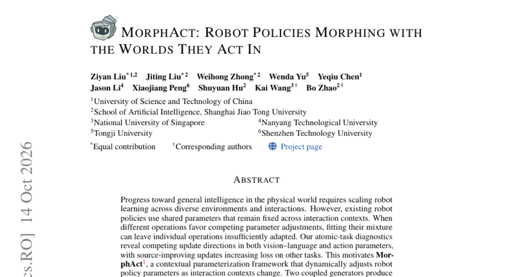

### 📌 한 줄 요약
상황에 따라 로봇 정책 파라미터를 동적으로 변형하여 다양한 작업 환경에 적응하는 MorphAct 프레임워크

### 🔑 핵심 포인트
- 상황에 따라 파라미터를 조정하는 문맥 의존적 파라미터화(Contextual Parameterization) 도입
- 시각-언어와 액션 모듈 간의 계층적 결합을 통한 저차원 업데이트 생성
- 별도의 작업 라벨이나 전문가 어댑터 없이 순수 액션 목적 함수로 학습 가능

### 🧑‍💻 개발자 관점
고정된 모델을 여러 작업에 돌려쓰는 대신, 하나의 모델이 환경 변화에 맞춰 스스로 파라미터를 미세 조정하는 효율적인 적응 방식을 제시합니다.

### 🚀 실무 적용 아이디어
- 저차원 업데이트(Low-rank updates) 방식의 연산 효율성 검증
- 기존 VLA 모델에 MorphAct의 생성기 구조를 결합하는 프로토타입 구현
- 다양한 작업이 혼재된 환경에서의 파라미터 충돌 완화 효과 측정

### ⚠️ 리스크/한계
- 동적 파라미터 생성 과정에서의 학습 안정성 확보 필요
- 새로운 환경/작업에 대한 일반화 성능의 한계 가능성

### 📝 초록 기반 상세 설명
로봇 학습의 일반 지능 확보를 위해 다양한 환경에서의 스케일링이 필요하지만, 기존 정책은 고정된 파라미터를 공유하여 서로 다른 작업 간의 충돌이 발생합니다. 연구진은 서로 다른 작업의 업데이트 방향이 상충하여 개별 작업의 성능이 저하되는 문제를 확인했습니다. 이를 해결하기 위해 문맥에 따라 파라미터를 동적으로 조정하는 MorphAct 프레임워크를 제안합니다. 두 개의 결합된 생성기가 시각-언어 및 액션 모듈에 대해 문맥 의존적인 저차원 업데이트를 생성하며, 시각-언어 업데이트가 액션 생성을 조건화하는 구조를 가집니다. 실험 결과 LIBERO, Meta-World 및 실세계 환경에서 기존 방식 대비 유의미한 성능 향상을 달립했습니다.

---

## 36. [EvoWeb: A Benchmark for Coding Agents on Evolving Web Applications](https://huggingface.co/papers/2610.16402)
**Upvotes**: 5 | **도입 난이도**: 중 | **신뢰도**: 상
**arXiv**: https://arxiv.org/abs/2610.16402

**태그**: Agent, Web Development, Benchmark, Software Engineering, Multimodal, Evaluation

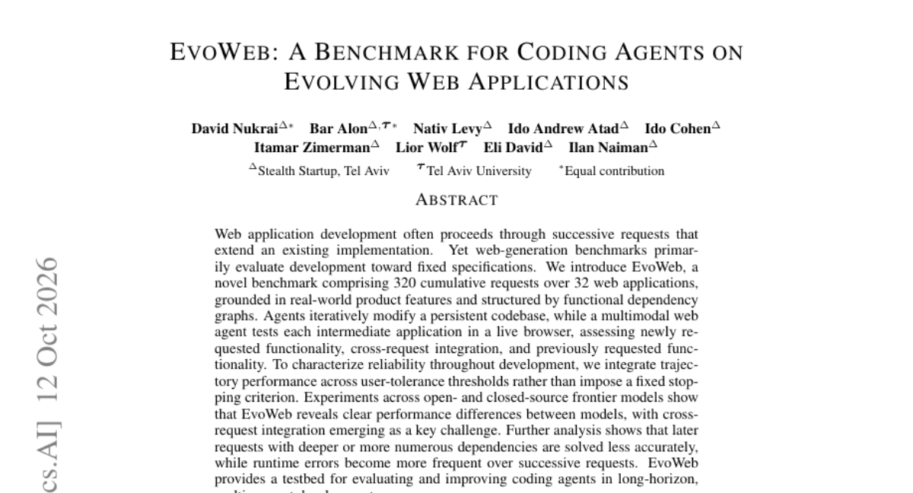

### 📌 한 줄 요약
지속적인 코드 수정과 기능 확장이 필요한 실무 환경을 모사한 차세대 웹 개발 에이전트 벤치마크 제안

### 🔑 핵심 포인트
- 실제 제품 개발처럼 점진적 기능 확장을 평가하는 누적 요청 기반 벤치마크 구축
- 기능 의존성 그래프와 멀티모달 브라우저 테스트를 결합한 평가 프레임워크
- 장기적 개발 과정에서의 기능 통합 및 회귀 오류 문제를 핵심 과제로 식별

### 🧑‍💻 개발자 관점
단순 코드 생성을 넘어, 기존 코드를 유지하며 기능을 확장해야 하는 실무형 AI 코딩 에이전트의 성능을 검증하는 데 필수적입니다.

### 🚀 실무 적용 아이디어
- 에이전트의 코드 수정 시 기존 기능이 깨지는 '회귀(Regression)' 발생 빈도 측정
- 의존성이 복잡해지는 상황에서 에이전트의 문제 해결 능력 테스트
- 멀티모달 모델을 활용한 브라우저 기반 자동 테스트 자동화 파이프라인 구축

### ⚠️ 리스크/한계
- 요청이 누적될수록 발생하는 런타임 오류와 복잡도 증가가 평가의 변수로 작용할 수 있음
- 실제 복잡한 레거시 코드 환경과의 완전한 일치 여부 검증 필요

### 📝 초록 기반 상세 설명
기존의 웹 생성 벤치마크는 고정된 명세에 맞춘 개발 능력만을 평가하여, 실제 개발처럼 점진적으로 기능이 확장되는 과정을 반영하지 못합니다. 이를 해결하기 위해 32개의 웹 애플리케이션과 320개의 누적 요청으로 구성된 EvoWeb 벤치마크를 도입합니다. 에이전트는 기존 코드를 반복적으로 수정하며, 멀티모달 에이전트가 브라우저를 통해 기능 통합 및 회귀 테스트를 수행합니다. 실험 결과, 모델 간 성능 차이가 뚜렷하게 나타났으며 특히 이전 기능과의 통합(cross-request integration)이 주요 과제로 확인되었습니다. 또한 요청이 진행될수록 의존성이 깊어짐에 따라 정확도가 낮아지고 런타임 오류가 증가하는 경향을 보였습니다.

---

## 37. [MTEdit: Packed Trajectories Beat Rollouts for Multi-Turn Image Editing](https://huggingface.co/papers/2610.23751)
**Upvotes**: 5 | **도입 난이도**: 중 | **신뢰도**: 상
**arXiv**: https://arxiv.org/abs/2610.23751

**태그**: Image Editing, Dataset, Multi-turn, Computer Vision, RAG, Vision, Benchmark, Evaluation

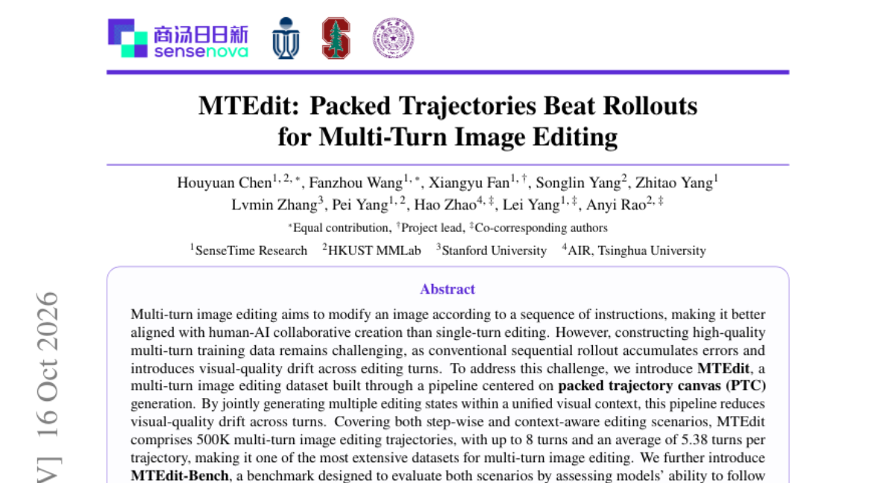

### 📌 한 줄 요약
오류 누적과 화질 저하 문제를 해결한 대규모 멀티턴 이미지 편집 데이터셋 및 벤치마크 제안

### 🔑 핵심 포인트
- Packed Trajectory Canvas(PTic)를 통한 화질 저하 및 오류 누적 방지 기술
- 50만 개의 대규모 멀티턴 이미지 편집 궤적을 포함하는 MTEdit 데이터셋 구축
- 지시 이행 및 컨텍스트 유지 능력을 평가하는 전문 벤치마크 MTEdit-Bench 제안

### 🧑‍💻 개발자 관점
연속적인 편집 작업에서 발생하는 이미지 품질 저하 문제를 데이터 생성 전략으로 해결하는 실무적인 방법론을 제시합니다.

### 🚀 실무 적용 아이디어
- 제시된 PTC 파이프라인을 기존 이미지 생성 워크플로우에 적용하여 데이터 품질 비교
- MTEdit-Bench를 활용하여 현재 보유한 멀티턴 편집 모델의 성능 벤치마킹
- Qwen-Image-MTEdit 모델의 가중치를 활용한 특정 도메인 특화 편집 모델 실험

### ⚠️ 리스크/한계
- 데이터 생성 방식(PTC)이 특정 모델 구조에 최적화되어 있을 가능성
- 매우 긴 턴(Turn) 수로 갈수록 발생할 수 있는 복잡한 컨텍스트 관리 문제

### 📝 초록 기반 상세 설명
사용자의 연속적인 지시에 따라 이미지를 수정하는 멀티턴 편집은 인간과의 협업에 필수적이지만, 기존의 순차적 롤아웃 방식은 단계가 거듭될수록 오류가 누적되고 화질이 저하되는 문제가 있었습니다. 이를 해결하기 위해 본 논문은 'Packed Trajectory Canvas(PTC)' 생성 파이프라인을 중심으로 한 멀티턴 데이터셋인 MTEdit를 제안합니다. MTEdit는 여러 편집 상태를 하나의 통합된 시각적 컨텍스트 내에서 동시에 생성하여 화질 저하를 방지하며, 총 50만 개의 고품질 편집 궤적을 포함합니다. 또한 모델의 지시 이행, 일관성 유지, 컨텍스트 활용 능력을 평가하기 위한 벤치마크인 MTEdit-Bench를 함께 도입했습니다. 실험 결과, MTEdit로 파인튜닝된 Qwen-Image-MTEdit가 오픈소스 모델 중 최고 성능을 기록하며 데이터셋의 효과를 입증했습니다.

---

## 38. [Embeddings Are Overpriced? A Frozen 16 MB Vocabulary for Small and Ternary Language Models](https://huggingface.co/papers/2610.22428)
**Upvotes**: 5 | **도입 난이도**: 중 | **신뢰도**: 상
**arXiv**: https://arxiv.org/abs/2610.22428

**태그**: SLM, Quantization, Efficiency, On-device AI, Evaluation

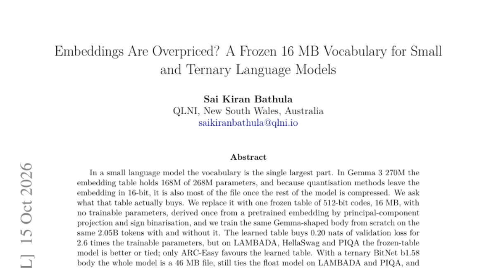

### 📌 한 줄 요약
학습 가능한 임베딩 테이블 대신 16MB 크기의 고정된 이진화 테이블을 사용하여 소형 모델의 파라미터 효율성과 추론 속도를 극대화함

### 🔑 핵심 포인트
- 학습 가능한 임베딩 대신 16MB 크기의 고정된 512-bit 코드 테이블 사용
- 학습 파라미터 수를 획기적으로 줄이면서도 주요 벤치마크(LAMBADA, PIQA 등)에서 성능 유지
- BitNet(ternary) 모델과 결합 시 초고속 추론 및 극소량의 메모리 사용 가능

### 🧑‍💻 개발자 관점
모델 크기를 줄여야 하는 온디바이스(On-device) 환경에서 임베딩 테이블이 차지하는 용량 문제를 해결할 수 있는 실질적인 방법론을 제시합니다.

### 🚀 실무 적용 아이디어
- 소형 모델(SLM) 설계 시 임베딩 테이블의 파라미터 비중 분석하기
- 고정된 코드북(Codebook) 기반의 임베딩 방식과 기존 방식의 성능/속도 비교 실험
- BitNet과 같은 양자화 모델에 제안된 고정 테이블 기법 적용 테스트

### ⚠️ 리스크/한계
- ARC-Easy와 같은 특정 벤치마크에서는 기존 학습 방식보다 성능이 낮을 수 있음
- 사전 학습된 임베딩에 의존하므로 초기 코드북 생성 단계가 중요함

### 📝 초록 기반 상세 설명
소형 언어 모델(SLM)에서 임베딩 테이블은 모델 파라미터의 상당 부분을 차지하며 압축 시에도 용량 최적화의 병목이 됩니다. 본 연구는 학습 가능한 임베딩 대신 사전 학습된 임베딩에서 추출한 512비트 코드 기반의 16MB 고정 테이블을 제안합니다. 이 테이블은 학습 파라미터 없이 주성분 투영과 부호 이진화를 통해 생성되었습니다. 실험 결과, 제안된 방식은 학습 파라미터를 대폭 줄이면서도 주요 벤치마크에서 기존 모델과 대등하거나 더 나은 성능을 보였습니다. 특히 BitNet과 결합 시 극도로 작은 메모리 점유율과 압도적인 추론 속도를 달성했습니다.

---

## 39. [FC-SWE: Failure-Conditioned RL for Long-Horizon Software Engineering Agents](https://huggingface.co/papers/2610.07898)
**Upvotes**: 5 | **도입 난이도**: 중 | **신뢰도**: 상
**arXiv**: https://arxiv.org/abs/2610.07898

**태그**: Agent, Reinforcement Learning, Software Engineering, Self-Correction

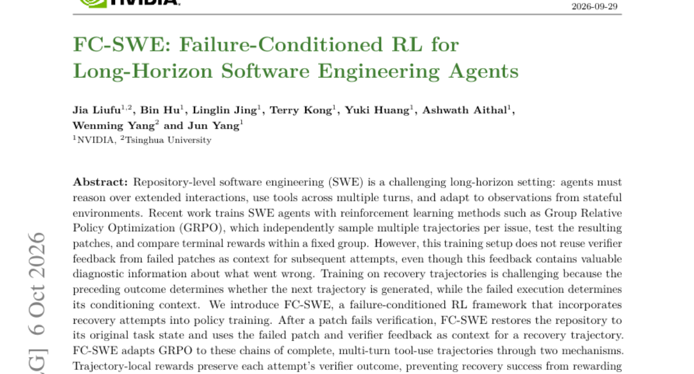

### 📌 한 줄 요약
실패한 패치와 피드백을 복구 학습의 컨텍스트로 활용하여 소프트웨어 엔지니어링 에이전트의 해결 능력을 극대화하는 RL 프레임워크

### 🔑 핵심 포인트
- 실패한 패치와 검증 피드백을 다음 시도의 컨텍스트로 활용하는 실패 조건부 RL(Failure-Conditioned RL) 도입
- 복구 성공이 이전 실패를 보상하지 않도록 하는 Trajectory-local rewards 설계
- 실행된 시도들만 비교 그룹에 포함하여 학습 효율을 높이는 Active-set advantage estimation 적용

### 🧑‍💻 개발자 관점
에이전트가 단순히 정답을 맞히는 것을 넘어, 실패 원인을 분석하고 이를 바탕으로 스스로 수정(Self-correction)하는 능력을 체계적으로 학습할 수 있음을 보여줍니다.

### 🚀 실무 적용 아이디어
- 실패한 로그(Error log)를 에이전트의 프롬프트/컨텍스트로 주입하는 파이프라인 구축
- 멀티턴 시도 시 이전 시도의 실패 원인을 요약하여 다음 시도에 전달하는 실험 수행
- 시도 횟수(Budget) 증가에 따른 해결률 변화 추이 분석

### ⚠️ 리스크/한계
- 실패 피드백이 노이즈로 작용할 경우 모델의 학습 안정성이 저하될 위험이 있음
- 복구 시도가 늘어날수록 계산 비용(Compute cost)이 선형적으로 증가함

### 📝 초록 기반 상세 설명
최근 소프트웨어 엔지니어링(SWE) 에이전트는 RL을 통해 학습되지만, 기존 방식은 실패한 시도의 진단 정보를 다음 시도에 활용하지 못하는 한계가 있습니다. 또한 실패한 경로를 복구 경로로 연결하여 학습하는 과정에서 보상 체계와 샘플링 방식의 불균형 문제가 발생합니다. 이를 해결하기 위해 실패한 패치와 검증 피드백을 복구 시도의 컨텍스트로 사용하는 FC-SWE 프레임워크를 제안합니다. FC-SWE는 개별 시도의 보상을 보존하는 Trajectory-local rewards와 실행된 시도들만 비교 그룹에 포함하는 Active-set advantage estimation 메커니즘을 도입합니다. 실험 결과, FC-SWE는 SWE-bench Verified 벤치마크에서 기존 GRPO 대비 높은 해결 성능을 기록하며 복구 시도의 효율성을 입증했습니다.

### 🖼️ 추가 자료
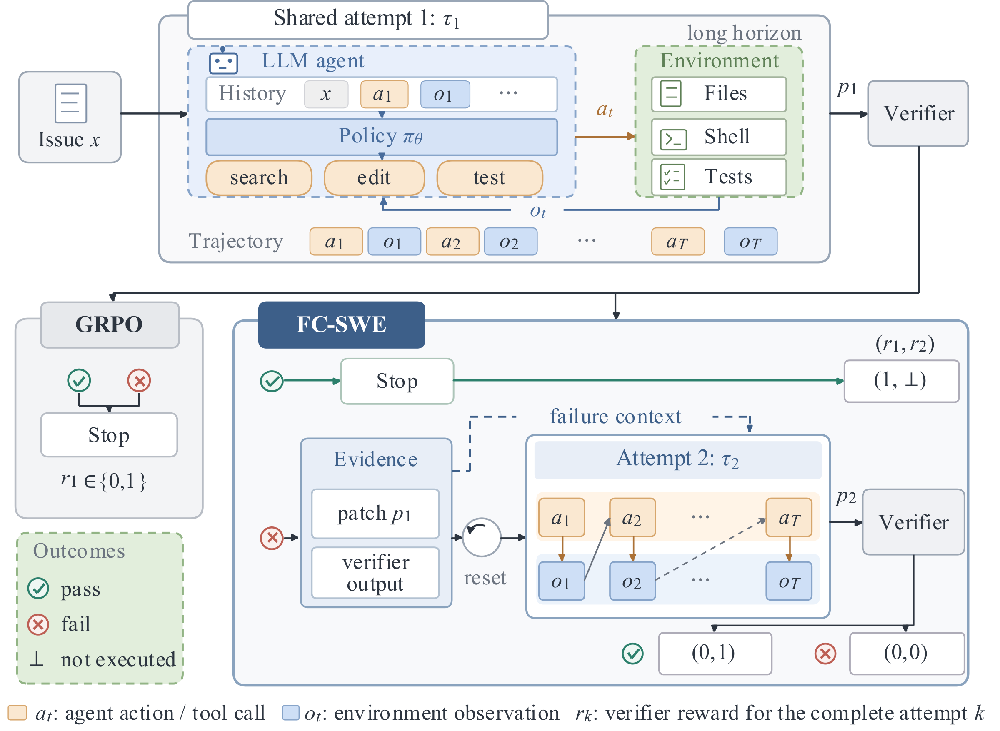

---

## 40. [DAGFormer: Global Topology Prediction for Transformer Cross-Layer Connections](https://huggingface.co/papers/2610.19625)
**Upvotes**: 5 | **도입 난이도**: 상 | **신뢰도**: 상
**arXiv**: https://arxiv.org/abs/2610.19625

**태그**: Transformer, Dynamic Architecture, Model Efficiency, Routing, Evaluation

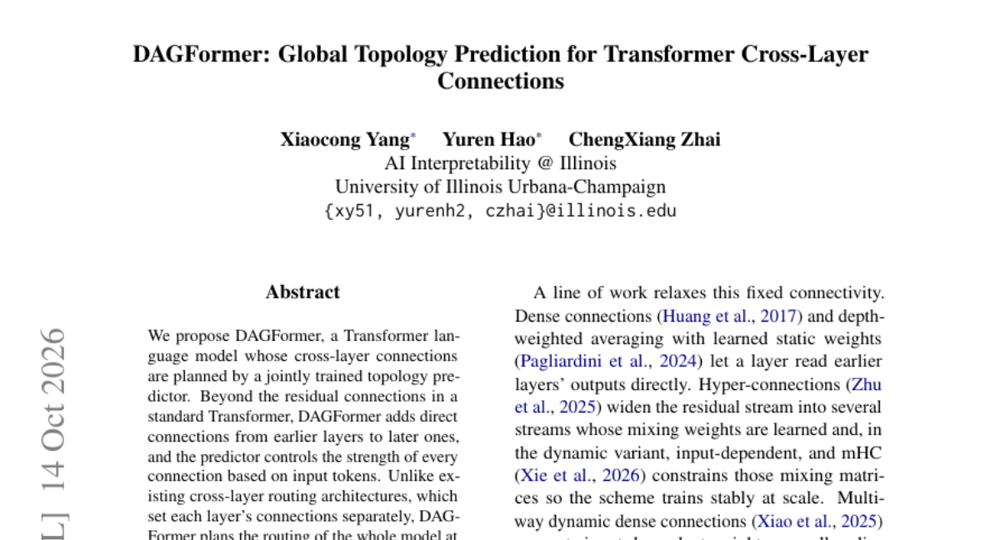

### 📌 한 줄 요약
입력 토큰에 따라 모델 전체의 레이어 간 연결 구조를 동적으로 결정하는 효율적인 Transformer 아키텍처 제안

### 🔑 핵심 포인트
- 입력 토큰 기반의 동적 레이어 간 연결(Cross-layer connections) 제어
- 모델 전체의 토폴로지를 한 번에 계획하는 통합형 라우팅 방식
- 기존 Transformer 대비 높은 데이터 효율성 및 구조적 프루닝에 대한 강건성

### 🧑‍💻 개발자 관점
모델의 구조를 고정하지 않고 데이터에 따라 최적의 경로를 찾는 동적 아키텍처를 통해, 제한된 자원 내에서 모델 성능을 극대화하는 방법을 제시합니다.

### 🚀 실무 적용 아이디어
- 기존 Transformer 모델에 동적 연결 레이어를 추가하여 성능 변화 관찰
- 모델 프루닝(Pruning) 시 DAGFormer 구조의 성능 유지력 비교 실험
- 작은 규모의 모델(75M~300M)에서 데이터 효율성 벤치마크 수행

### ⚠️ 리스크/한계
- 동적 토폴로지 예측을 위한 추가적인 연산 오버헤드 발생 가능성
- 모델 규모가 커질 때 전체 토폴로지를 한 번에 계획하는 방식의 확장성 검증 필요

### 📝 초록 기반 상세 설명
기존 Transformer는 고정된 잔차 연결(residual connections) 구조를 사용하여 모델의 잠재적 연결 효율을 충분히 활용하지 못합니다. 기존의 라우팅 방식은 레이어별로 개별적인 연결을 설정하는 한계가 있었습니다. 본 논문은 모델 전체의 토폴로지를 한 번에 계획하는 DAGFormer를 제안합니다. DAGFormer는 입력 토큰에 따라 이전 레이어에서 이후 레이어로의 직접적인 연결 강도를 조절하는 토폴로지 예측기를 도입합니다. 실험 결과, 동일 파라미터 대비 낮은 퍼플렉시티(perplexity)를 달성했으며, 적은 학습 데이터로도 더 높은 성능을 보여주었습니다. 또한 구조적 프루닝(structured pruning) 상황에서도 성능 저하가 적어 모델 압축 및 효율성 측면에서 우수함을 입증했습니다.

### 🖼️ 추가 자료
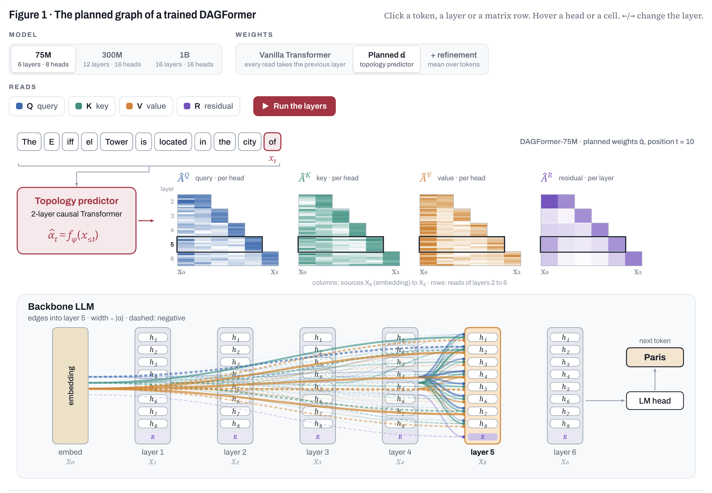

---

## 41. [Failure Recovery via Belief Updates and World Modeling for Long-Horizon Agents](https://huggingface.co/papers/2610.18082)
**Upvotes**: 4 | **도입 난이도**: 중 | **신뢰도**: 상
**arXiv**: https://arxiv.org/abs/2610.18082

**태그**: AI Agent, Reasoning, Knowledge Distillation, Error Recovery, Agent, Benchmark, Evaluation, Inference, Distillation

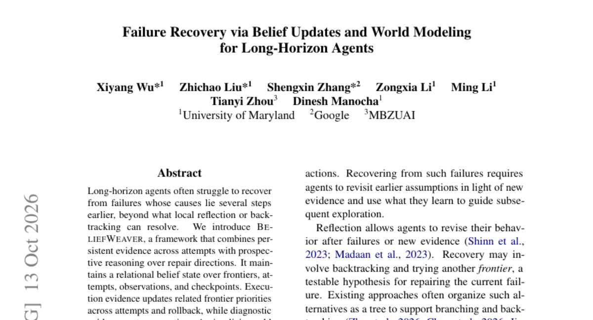

### 📌 한 줄 요약
과거의 실패 원인을 추적하고 미래의 복구 방향을 예측하는 신념 업데이트 및 세계 모델링을 통해 장기 작업 수행 능력을 높인 에이전트 프레임워크

### 🔑 핵심 포인트
- 과거의 실패 원인을 추적하는 지속적 증거 유지 및 미래 복구 방향을 예측하는 전향적 추론 결합
- 관계형 신념 상태와 암시적 세계 모델(IWM)을 통한 효율적인 탐색 및 복구 가설 평가
- SFT 및 On-policy Distillation(OPD)을 통한 9B 소형 모델로의 지식 증류 및 비용 절감

### 🧑‍💻 개발자 관점
에이전트가 단순한 백트래킹을 넘어 '왜 실패했는지'를 구조적으로 파악하고 복구하는 메커니즘을 실무에 적용할 수 있음을 보여줍니다.

### 🚀 실무 적용 아이디어
- 에이전트의 상태(State)를 체크포인트와 연동하여 관리하는 구조 설계해보기
- 실패 원인 분석을 위한 별도의 '신념(Belief)' 저장소 구조 설계 실험
- 대형 모델의 추론 과정을 소형 모델로 증류하는 파이프라인 구축

### ⚠️ 리스크/한계
- 복잡한 관계형 신념 상태 관리에 따른 시스템 오버헤드 발생 가능성
- 세계 모델의 예측 오류가 잘못된 복구 방향으로 이어질 위험

### 📝 초록 기반 상세 설명
장기 작업(Long-horizon)을 수행하는 에이전트는 과거의 특정 시점에서 발생한 실패 원인을 해결하지 못해 작업 전체가 실패하는 문제를 겪습니다. 이를 해결하기 위해 연구진은 과거의 증거를 유지하면서 미래의 복구 방향을 예측하는 BELIEFWEAVER 프레임워크를 제안합니다. 이 프레임워크는 관계형 신념 상태를 유지하며, 실행 증거를 통해 우선순위를 조정하고 암시적 세계 모델(IWM)을 통해 복구 가설을 평가합니다. 또한, 이러한 추론 과정을 9B 규모의 학생 모델로 증류(Distillation)하여 효율성을 극대화했습니다. 실험 결과, 제안된 방식은 기존 베이스라인 대비 최종 점수를 크게 향상시켰으며, 교사 모델 의존도를 낮추면서도 높은 성능을 유지했습니다.

---

## 42. [PremiseCheck: Efficient Fact-Checking of Human and AI Peer Reviews](https://huggingface.co/papers/2610.21046)
**Upvotes**: 4 | **도입 난이도**: 중 | **신뢰도**: 상
**arXiv**: https://arxiv.org/abs/2610.21046

**태그**: LLM, Fact-Checking, Efficiency, Agentic-Workflow, Benchmark, Inference

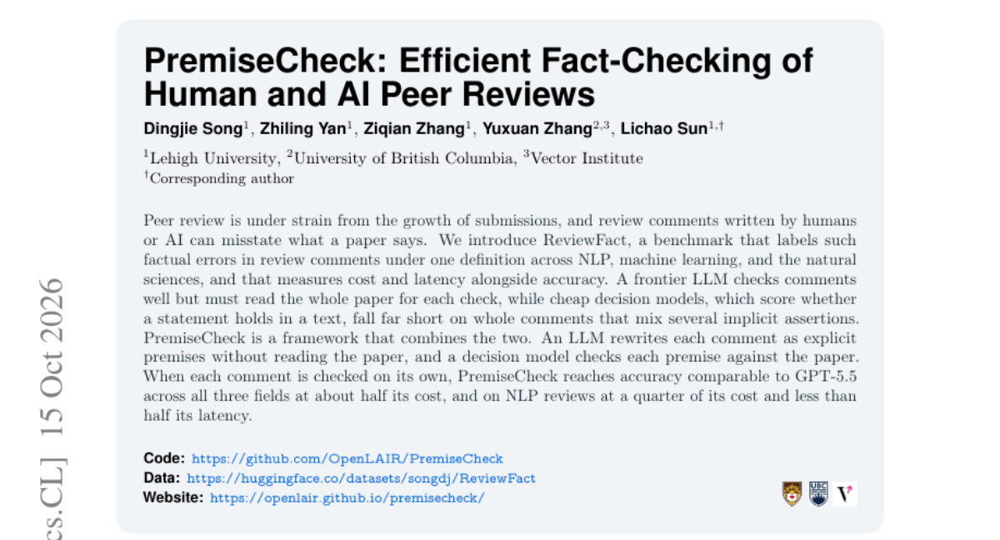

### 📌 한 줄 요약
LLM의 문장 재작성과 경량 모델의 검증을 결합하여 저비용·고효율로 논문 리뷰의 사실 관계를 확인하는 프레임워크

### 🔑 핵심 포인트
- LLM(전제 추출)과 경량 모델(검증)을 결합한 하이브리드 프레임워크 제안
- 리뷰 내의 암시적 주장을 명시적 전제로 변환하여 검증 효율 극대화
- 높은 정확도를 유지하면서 비용과 지연 시간을 획기적으로 절감

### 🧑‍💻 개발자 관점
LLM 기반 에이전트 설계 시, 전체 컨텍스트를 매번 읽는 대신 정보를 구조화하여 검증하는 효율적인 워크플로우 설계 패턴을 제시합니다.

### 🚀 실무 적용 아이디어
- 복잡한 문장을 단순 명제 단위로 분해하는 프롬프트 엔지니어링 실험
- 추출된 명제와 원문 간의 일치 여부를 판단하는 소형 모델(SLM) 튜닝
- 대규모 문서 검증 시 비용-정확도 트레이드오프 분석

### ⚠️ 리스크/한계
- LLM이 전제를 추출하는 과정에서 발생하는 정보 손실 가능성
- 매우 복잡하거나 함축적인 문맥의 경우 경량 모델의 검증 한계

### 📝 초록 기반 상세 설명
학술 논문 투고량 증가로 인해 인간과 AI가 작성한 리뷰의 사실 오류 문제가 심각해지고 있습니다. 기존 방식은 LLM이 전체 논문을 읽어야 하므로 비용과 지연 시간이 크거나, 경량 모델은 복잡한 문맥 파악에 한계가 있었습니다. 이를 해결하기 위해 LLM이 리뷰를 명시적 전제로 재작성하고, 경량 모델이 이를 논문과 대조하는 PremiseCheck 프레임워크를 제안합니다. 실험 결과, 이 방식은 GPT-5.5 수준의 정확도를 유지하면서도 비용은 절반 이하, 지연 시간은 대폭 단축하는 성과를 보였습니다.

---

## 43. [Game2Real-Bench: Do Toy Games Reveal and Transfer to Real-World Visual Reasoning?](https://huggingface.co/papers/2610.18834)
**Upvotes**: 4 | **도입 난이도**: 하 | **신뢰도**: 상
**arXiv**: https://arxiv.org/abs/2610.18834

**태그**: VLM, Visual Reasoning, Benchmark, Transfer Learning, Reasoning, Vision, Evaluation

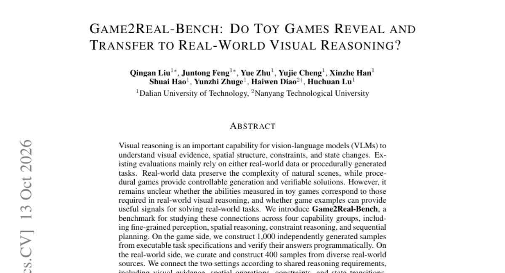

### 📌 한 줄 요약
게임 환경에서의 시각적 추론 능력이 실제 세계의 복잡한 추론 능력과 어떻게 연결되고 전이되는지를 분석한 벤치마크 연구

### 🔑 핵심 포인트
- 게임 환경과 실제 세계 간의 시각적 추론 상관관계(Pearson 0.935) 입증
- 제약 추론과 미세 지각 간의 상충 관계(Trade-off) 확인
- 24K 규모의 검증된 게임 데이터셋(Game2Real-Dataset) 구축

### 🧑‍💻 개발자 관점
VLM 모델 개발 시, 통제 가능한 게임 환경에서의 학습/평가가 실제 세계 성능 향상으로 이어질 수 있는지에 대한 가이드라인을 제공합니다.

### 🚀 실무 적용 아이디어
- 제안된 벤치마크를 활용하여 현재 사용 중인 VLM의 추론 일관성 테스트
- 게임 기반의 데이터 증강이 실제 환경 성능에 미치는 영향 분석
- 제약 추론 향상 시 발생하는 미세 지각 능력 저하 문제 해결 방안 모색

### ⚠️ 리스크/한계
- 게임 데이터의 시각적 단순함이 실제 세계의 복잡성을 완전히 대체할 수 없음
- 특정 추론 능력 향상이 다른 능력의 저하를 야기할 수 있는 전이 리스크 존재

### 📝 초록 기반 상세 설명
시각-언어 모델(VLM)의 핵심인 시각적 추론 능력 평가가 주로 실제 데이터나 절차적 생성 작업에 의존하고 있습니다. 하지만 게임과 같은 단순화된 환경에서의 능력이 실제 세계의 추론 능력과 일치하는지, 그리고 게임 학습이 실제 성능 향상으로 이어지는지는 불분명했습니다. 본 논문은 미세 지각, 공간 추론, 제약 추론, 순차적 계획 등 4개 영역을 포함하는 Game2Real-Bench를 제안합니다. 1,000개의 게임 샘플과 400개의 정렬된 실제 샘플을 통해 25개 VLM을 평가한 결과, 게임과 실제 성능 간의 높은 상관관계를 확인했습니다. 또한 게임 예시를 통한 원샷 전이 실험을 통해 제약 추론은 향상되나 미세 지각 능력은 저하될 수 있음을 밝혀냈습니다.

---

## 44. [GlobeBench: Evaluating Text-Based World Model Capabilities for Scalable Environment Simulations](https://huggingface.co/papers/2610.22708)
**Upvotes**: 3 | **도입 난이도**: 중 | **신뢰도**: 중
**arXiv**: https://arxiv.org/abs/2610.22708

**태그**: Agent, RAG, Benchmark, Evaluation

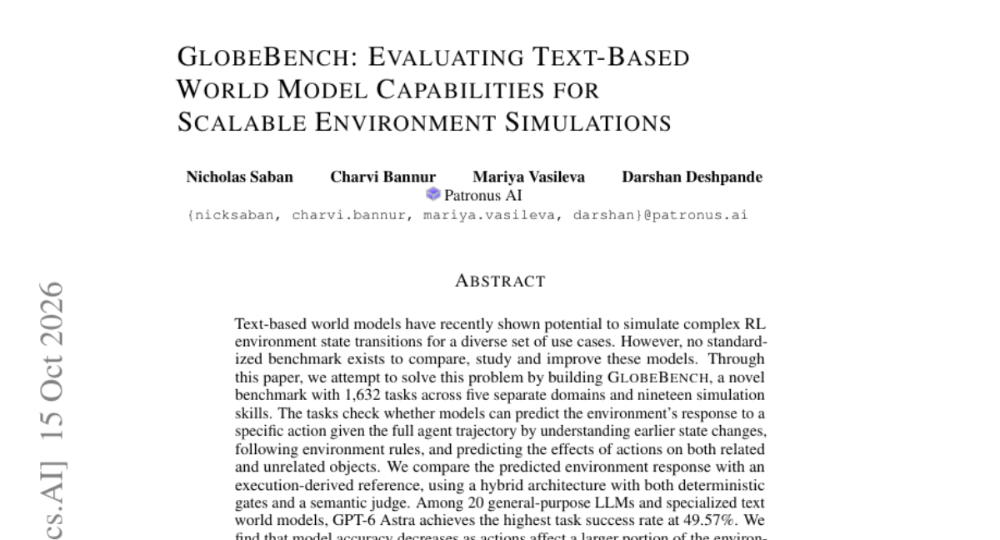

### 📌 한 줄 요약
자세한 분석 내용은 원문 또는 arXiv 링크를 참고해 주세요.

### 🔑 핵심 포인트
- 논문 원문을 확인하시기 바랍니다.

### 📝 초록 기반 상세 설명
상세 초록은 원문 페이지에서 확인 가능합니다.

---

## 45. [Consistent Distribution Matching for Data-Free Diffusion Distillation](https://huggingface.co/papers/2610.09221)
**Upvotes**: 3 | **도입 난이도**: 중 | **신뢰도**: 상
**arXiv**: https://arxiv.org/abs/2610.09221

**태그**: Diffusion, Distillation, Generative Models, Efficiency, Vision, Evaluation, Inference

### 📌 한 줄 요약
데이터 없이도 단 한 번의 연산(1-NFE)만으로 고성능 생성을 가능케 하는 효율적인 확산 모델 증류 기법

### 🔑 핵심 포인트
- 데이터가 필요 없는(Data-free) 시뮬레이션 프리 증류 프레임워크 제안
- 샘플 생성과 스코어 추정을 하나의 학생 네트워크로 통합하여 구조 단순화
- 학생 모델의 흐름 맵이 교사의 주변 분포로 수렴함을 수학적으로 증명

### 🧑‍💻 개발자 관점
추가적인 학습 데이터 확보가 어려운 상황에서도 기존 고성능 모델을 초고속 추론 모델로 변환할 수 있는 실용적인 방법론입니다.

### 🚀 실무 적용 아이디어
- 제공된 코드를 활용하여 ImageNet 규모의 데이터 없이 성능 재현 실험
- 특정 도메인(예: 의료, 위성 이미지)의 교사 모델에 적용하여 데이터 프리 성능 검증
- 1-NFE와 4-NFE 간의 생성 품질 및 속도 트레이드오프 분석

### ⚠️ 리스크/한계
- 데이터를 사용하지 않으므로 특정 도메인에 특화된 데이터셋이 없을 때의 일반화 성능 확인 필요
- 매우 높은 해상도 작업에서의 안정성 검증 필요

### 📝 초록 기반 상세 설명
기존의 확산 및 흐름(Flow) 모델은 추론 시 수치적 적분 과정이 필요하여 속도가 느리다는 단점이 있습니다. 기존의 증류 방식은 정제된 데이터셋이나 복잡한 보조 네트워크를 필요로 하여 확장성이 떨어지는 문제가 있었습니다. 본 논문에서는 데이터 없이도 강력한 생성 능력을 유지하며 모델을 가속화하는 'Consistent Distribution Matching' 방식을 제안합니다. 제안된 프레임워크는 고정된 교사(Teacher)와 학습 가능한 학생(Student) 모델만을 사용하여 샘플 생성과 점수 추정을 단일 네트워크로 통합합니다. 실험 결과, ImageNet 데이터셋에서 기존 SOTA를 뛰어넘는 성능을 보이며 단일 단계(1-NFE)에서도 매우 낮은 FID를 달성했습니다.

---

## 46. [Skip the Compressor: Coding Agents Fix More Issues When They Pick Whole Files](https://huggingface.co/papers/2610.21073)
**Upvotes**: 3 | **도입 난이도**: 하 | **신뢰도**: 상
**arXiv**: https://arxiv.org/abs/2610.21073

**태그**: AI Agent, Software Engineering, Context Management, Code Generation, Agent, Benchmark, Optimization

### 📌 한 줄 요약
코드 에이전트의 성능 향상을 위해 압축이나 검색 대신 파일 전체를 선택하는 방식이 더 효과적임을 입증함

### 🔑 핵심 포인트
- 압축(Compressor)이나 검색(Retriever)보다 파일 단위 선택(Selector)이 이슈 해결에 더 유리함
- 기존 방식은 코드의 문맥을 변형하거나 필수 파일을 누락하여 패치 성공률을 낮춤
- CQ2-CARE는 원본 코드를 그대로 유지하여 모델이 수정할 코드를 정확히 인용할 수 있게 함

### 🧑‍💻 개발자 관점
에이전트의 컨텍스트를 채울 때 단순히 유사도 기반 검색이나 요약에 의존하기보다, 수정이 필요한 파일을 통째로 포함하는 것이 패치 성공률을 높이는 데 유리합니다.

### 🚀 실무 적용 아이디어
- 에이전트 워크플로우에서 RAG 기반 검색 대신 파일 단위 선택 로직 적용해보기
- 코드 압축(Summarization) 대신 파일 전체를 컨텍스트에 넣는 방식과 성능 비교하기
- 수정 대상 파일의 원본 무결성을 유지하는 프롬프트 전략 테스트하기

### ⚠️ 리스크/한계
- 파일 크기가 매우 클 경우 단일 파일 선택 방식은 토큰 예산을 초과할 수 있음
- 파일 단위 선택 시 관련 없는 코드가 포함되어 컨텍스트 노이즈가 발생할 가능성 있음

### 📝 초록 기반 상세 설명
대규모 저장소를 다루는 코딩 에이전트는 컨텍스트 윈도우 제한 문제를 해결하기 위해 프롬프트 압축이나 검색 기술을 사용합니다. 그러나 기존 방식은 수정이 필요한 파일을 놓치거나, 코드를 압축하는 과정에서 원본 텍스트를 변형하여 패치 적용을 어렵게 만듭니다. 본 논문은 동일한 토큰 예산 내에서 압축이나 검색 대신 파일 전체를 그대로 보여주는 CQ2-CARE 방식을 제안합니다. SWE-bench 테스트 결과, CQ2-CARE는 기존 압축 및 검색 방식보다 높은 이슈 해결 성공률을 기록했습니다. 이는 정확한 코드 복제와 파일 선택이 에이전트의 문제 해결에 핵심적임을 보여줍니다.

### 🖼️ 추가 자료

---

## 47. [Resisting Harmful Instructions through Training-Free Weight Editing](https://huggingface.co/papers/2610.21189)
**Upvotes**: 3 | **도입 난이도**: 하 | **신뢰도**: 상
**arXiv**: https://arxiv.org/abs/2610.21189

**태그**: LLM Safety, Weight Editing, Alignment, Security, Benchmark, Evaluation, Safety

### 📌 한 줄 요약
추가 학습 없이 모델 가중치를 직접 수정하여 유해한 지시 이행을 방지하는 효율적인 방법론 제안

### 🔑 핵심 포인트
- 학습 과정 없이 소수의 데이터만으로 가중치를 수정하는 효율적인 편집 기법 개발
- 프롬프트 조작(Prompt Injection)을 통한 유해 지시 우회 공격에 대한 강력한 방어력 확보
- 거짓 정보 생성 및 성차별적 발언 억제 등 서로 다른 두 가지 유해 행동 영역에서 성능 검증

### 🧑‍💻 개발자 관점
모델 재학습 비용 없이 모델의 특정 행동(Safety Alignment)을 제어할 수 있어, 배포된 모델의 안전성을 신속하게 개선할 수 있습니다.

### 🚀 실무 적용 아이디어
- 제시된 가중치 편집 알고리즘을 오픈소스 LLM에 적용하여 성능 변화 측정
- 프롬프트 엔지니어링(Jailbreak) 공격 시나리오에서 가중치 편집의 방어 성능 테스트
- 특정 도메인 지식 주입과 유해성 억제 사이의 트레이드오프 분석

### ⚠️ 리스크/한계
- 가중치 수정이 모델의 일반적인 추론 능력이나 다른 유익한 기능에 미치는 부작용(Catastrophic Forgetting) 가능성
- 매우 적은 데이터로 가중치를 수정할 때 발생할 수 있는 모델의 불안정성

### 📝 초록 기반 상세 설명
지시 이행 언어 모델이 안전 가이드라인에 반하는 유해한 요청을 수행하는 문제가 발생하고 있습니다. 기존의 프롬프트 기반 제어는 프롬프트 변경 시 무력화될 수 있다는 취약점이 있습니다. 본 논문은 소수의 프롬프트 쌍에 대한 순방향 패스(forward pass)만으로 가중치를 수정하는 학습 불필요(training-free) 방식의 가중치 편집 기법을 제안합니다. 이 방식은 수정 사항이 모델 가중치에 직접 반영되므로 프롬프트 조작을 통한 우회 공격에 강건합니다. 실험 결과, 거짓말 유도 및 성차별적 발언 억제 측면에서 기존 방식보다 우수한 성능을 보였습니다. 결과적으로 이 방식은 프롬프트 기반 안전 장치와 병행하여 효과적인 개입 수단이 될 수 있음을 입증했습니다.

### 🖼️ 추가 자료

---

## 48. [Selection Is Not Learning: Choosing Model Futures](https://huggingface.co/papers/2610.22029)
**Upvotes**: 3 | **도입 난이도**: 중 | **신뢰도**: 상
**arXiv**: https://arxiv.org/abs/2610.22029

**태그**: LLM-Training, Self-Evolution, Model-Optimization, Reinforcement-Learning, Agent, RAG, Reasoning, Evaluation

### 📌 한 줄 요약
자기 진화형 모델 학습 시 발생하는 '학습 가능해 보이는 작업'과 '실제 유용한 업데이트' 사이의 간극을 해결하는 선택 전략 프레임워크

### 🔑 핵심 포인트
- Selection-to-update gap: 학습 가능해 보이는 태스크가 반드시 유용한 모델 업데이트로 이어지지 않는 현상 규명
- HeirCommit: 새로운 평가 질문을 통해 모델 업데이트 수용 여부를 결정하는 검증 메커니즘
- EvoHeir: 파라미터 상속과 경험 상속을 분리하여 실패 복구 및 성공 보존을 최적화하는 프레임워크

### 🧑‍💻 개발자 관점
모델이 스스로 데이터를 생성하고 학습하는 자동화된 학습 루프(Self-evolving loop)를 설계할 때, 성능 저하를 막는 정교한 필터링 전략이 필수적임을 시사합니다.

### 🚀 실무 적용 아이디어
- 기존 Self-play 루프에서 '학습 성공'이 '모델 성능 향상'으로 직결되는지 상관관계 분석하기
- 모델 업데이트 시 검증용 Hold-out set을 활용한 선택(Selection) 로직 도입해보기
- 파라미터 업데이트와 데이터셋 업데이트를 분리하여 관리하는 파이프라인 설계하기

### ⚠️ 리스크/한계
- 검증용 질문(Evaluation questions)의 품질이 전체 루프의 성능을 결정하는 병목이 될 수 있음
- 선택 로직이 특정 태스크에 과적합될 경우 모델의 일반화 능력이 저하될 위험이 있음

### 📝 초록 기반 상세 설명
최근 자기 진화형 언어 모델은 생성된 태스크를 통해 스스로 학습하며 모델을 업데이트하는 루프를 사용합니다. 그러나 기존 방식은 학습 가능해 보이는 태스크를 무조건 수용함으로써, 실제 성능 향상에 도움이 되지 않는 업데이트를 상속받는 문제를 야기합니다. 본 논문은 선택과 업데이트 사이의 간극을 식별하고, 이를 해결하기 위해 모델 업데이트 여부를 결정하는 HeirCommit과 경험 상속을 분리하는 EvoHeir 프레임워크를 제안합니다. 실험 결과, 제안된 방식은 무작위 상속 대비 유해한 업데이트를 68-83% 줄였으며 수학 및 일반 추론 성능에서 기존 SOTA를 상회했습니다. 결과적으로 유용한 경험을 보존하면서도 모델의 성능 저하를 방지하는 효율적인 진화 루프를 구축할 수 있습니다.

---

## 49. [ReaDy: Recurrent States as Dynamic Context for Speculative Drafting in Hybrid Linear Attention Large Language Models](https://huggingface.co/papers/2610.20503)
**Upvotes**: 3 | **도입 난이도**: 중 | **신뢰도**: 상
**arXiv**: https://arxiv.org/abs/2610.20503

**태그**: LLM, Speculative Decoding, Inference Optimization, Hybrid Linear Attention, RAG, Benchmark, Evaluation

### 📌 한 줄 요약
Hybrid Linear Attention 모델의 순환 상태(Recurrent States)를 활용하여 추측적 디코딩(Speculative Decoding)의 효율을 극대화한 기술

### 🔑 핵심 포인트
- HLA 모델의 순환 상태를 활용한 위치별 맞춤형 문맥 검색 메커니즘 도입
- 경량화된 상태 리더(State Reader)와 저차원 읽기 방식을 통한 오버헤드 최소화
- DSpark 대비 향상된 처리량(Throughput) 및 토큰 수락 길이(Acceptance Length) 달성

### 🧑‍💻 개발자 관점
LLM 추론 속도를 높이기 위한 추측적 디코딩 시, 모델의 내부 상태를 효율적으로 재사용하여 연산 비용을 낮추는 실전적인 최적화 기법을 제시합니다.

### 🚀 실무 적용 아이디어
- HLA 기반 모델(예: Jamba 등)에 ReaDy의 상태 리더 구조 적용 테스트
- DSpark와 ReaDy의 연산 오버헤드 대비 추론 속도(Latency) 벤치마크 비교
- 다양한 모델 크기(Small vs Large)에 따른 상태 리더의 확장성 검증

### ⚠️ 리스크/한계
- HLA 모델 구조에 특화되어 있어 일반적인 Transformer 모델로의 이식 시 추가 설계 필요
- 상태 읽기 과정에서의 메모리 대역폭 및 연산량 증가 가능성

### 📝 초록 기반 상세 설명
기존의 추측적 디코딩은 타겟 모델의 은닉 특징을 사용하지만, 이는 이후 드래프트 위치의 문맥 요구사항과 일치하지 않을 수 있습니다. 본 논문은 Hybrid Linear Attention(HLA) 모델의 압축된 순환 상태를 활용하여 위치별 맞춤형 문맥을 제공하는 ReaDy를 제안합니다. 각 드래프트 위치에 학습된 쿼리를 부여하여 타겟의 순환 상태에서 보충 문맥을 검색하고, 경량화된 상태 리더(State Reader)를 통해 이를 잔차 업데이트 방식으로 통합합니다. 저차원 상태 읽기 및 융합 연산자를 통해 계산 및 I채널 I/O 오버헤드를 최소화했습니다. 실험 결과, Qwen3.8-27B 모델에서 기존 DSpark 대비 향상된 처리량과 수락 길이를 달리기 쉬운 속도로 달성했습니다.

---

## 50. [StopWatch: Goal Grounding for Object-goal Navigation](https://huggingface.co/papers/2610.23841)
**Upvotes**: 3 | **도입 난이도**: 하 | **신뢰도**: 상
**arXiv**: https://arxiv.org/abs/2610.23841

**태그**: Embodied AI, VLM, Object-goal Navigation, Goal Grounding, Benchmark, Evaluation

### 📌 한 줄 요약
객체 목표 탐색(Object-goal Navigation)의 성능 저하 원인을 '목표 접지(Goal Grounding)' 문제로 규명하고 이를 해결하여 SOTA를 달성함

### 🔑 핵심 포인트
- 실패 원인 분석: 탐색 정책의 실패가 정책 학습 부족이 아닌 '목표 접지(Goal Grounding)' 실패임을 규명
- 명시적 접지 기법: 목표 객체를 시각적으로 명확히 식별하도록 하는 기법을 통해 성공률 대폭 향상
- 데이터 정제: 기존 벤치마크의 주석 결함을 수정하여 보다 공정한 평가 환경 구축

### 🧑‍💻 개발자 관점
로봇이나 에이전트 개발 시, 복잡한 정책 학습 이전에 시각적 목표 식별(Grounding) 단계의 정교함이 성능의 병목임을 시사합니다.

### 🚀 실무 적용 아이디어
- 기존 VLM 기반 탐색 에이전트에 명시적 객체 검출/거리 추정 모듈 결합 실험
- 학습 데이터셋의 주석(Annotation) 오류가 모델 성능에 미치는 영향 분석
- 목표 객체가 시야에 들어왔을 때의 반응 속도 및 정지 로직 테스트

### ⚠️ 리스크/한계
- 명시적 접지 방식이 특정 환경이나 객체에 과적합될 가능성
- 실시간 환경에서 시각적 접지 연산이 추가될 경우 발생할 수 있는 지연 시간

### 📝 초록 기반 상세 설명
사전 학습된 VLM을 탐색 정책에 미세 조정하는 방식이 대중화되었으나, 여전히 성공률이 낮고 실패 원인이 불분명했습니다. 연구진은 분석을 통해 정책 학습 자체보다 목표 객체를 식별하거나 거리를 추정하는 '목표 접지' 능력이 부족함을 발견했습니다. 이를 해결하기 위해 목표를 명시적으로 접지하는 StopWatch 방식을 제안했습니다. 실험 결과, 제안 방식은 다양한 벤치마크에서 SOTA를 달성했으며 데이터셋의 주석 오류까지 수정하여 평가의 신뢰도를 높였습니다. 결과적으로 목표 접지 능력이 확보되면 정책 학습의 여지가 훨씬 커짐을 입증했습니다.

---

