# 2026-10-21 Daily Papers (Top 50)

## 오늘의 요약
오늘의 연구는 대규모 모델의 효율적인 미세 조정과 메모리 내재화 아키텍처, 그리고 로봇 학습을 위한 1인칭 시점(Egocentric) 데이터 활용에 집중되었습니다. 특히 거대 모델의 성능을 유지하면서도 연산 비용을 낮추는 효율적 학습 방법론과, 물리적 세계 이해를 위한 시각-언어 통합 모델링이 주요 화두였습니다.

### 오늘의 핵심 포인트
- PEFT와 메모리 네이티브 아키텍처를 통해 거대 모델의 효율적인 학습과 장기 기억 관리 방안이 제시되었습니다.
- 인간의 1인칭 시점 데이터를 활용하여 로봇의 물리적 세계 이해와 정밀한 3D 재구성을 수행하는 연구들이 주목받았습니다.
- 실제 산업 현장의 문제를 해결하는 에이전트 평가와 로봇 군집 학습 등 실무적이고 확장 가능한 AI 프레임워크가 제안되었습니다.

**오늘의 태그**: Embodied AI, Efficient Learning, Egocentric Vision, LLM Agents, Robot Learning

## 1. [Scaling Parameter-Efficient Fine-Tuning for Brain Encoding](https://huggingface.co/papers/2610.26802)
**Upvotes**: 230 | **도입 난이도**: 중 | **신뢰도**: 상
**arXiv**: https://arxiv.org/abs/2610.26802

**태그**: PEFT, LoRA, Multimodal, Brain-Decoding, Efficiency, Audio

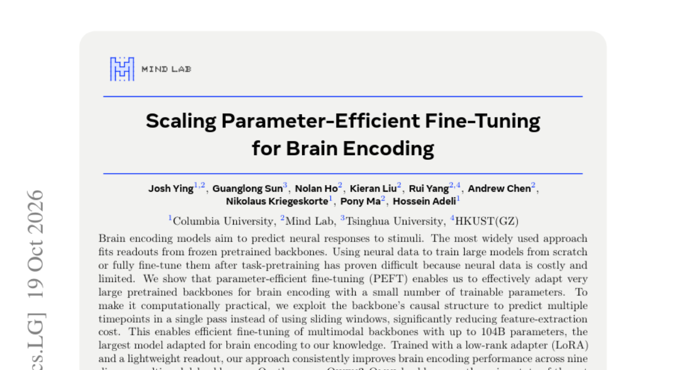

### 📌 한 줄 요약
PEFT와 효율적인 연산 구조를 결합하여 100B급 대규모 멀티모달 모델을 뇌 인코딩 작업에 성공적으로 적응시킨 연구

### 🔑 핵심 포인트
- LoRA를 활용한 104B 규모 대형 멀티모달 백본의 효율적인 뇌 인코딩 적응
- 인과적 구조를 이용한 시점 예측 최적화로 특징 추출 비용 절감
- 멀티-LoRA 커널 개발을 통한 대규모 모델 앙상블 및 확장성 확보

### 🧑‍💻 개발자 관점
데이터가 부족한 특수 도메인(의료/신경과학)에서 거대 모델의 성능을 유지하면서도 저비용으로 효율적인 미세 조정이 가능함을 보여줍니다.

### 🚀 실무 적용 아이디어
- LoRA를 활용한 도메인 특화(Domain-specific) 미세 조정 실험
- 시계열 데이터 처리를 위한 인과적 구조 기반의 연산 최적화 적용
- 다수의 LoRA 어댑터를 결합한 앙상블 기법 테스트

### ⚠️ 리스크/한계
- 특수 목적(뇌 인코딩)에 최적화된 방식이 일반적인 태스크에서도 동일한 효율을 보일지 검증 필요
- 거대 모델 사용에 따른 기본 하드웨어 요구 사양 존재

### 📝 초록 기반 상세 설명
뇌 인코딩 모델은 자극에 대한 신경 반응을 예측하는 것이 목적이지만, 제한된 신경 데이터로 인해 거대 모델을 직접 학습하거나 전체 파라미터를 미세 조정하는 것은 매우 어렵습니다. 본 연구는 PEFT(Parameter-Efficient Fine-Tuning)를 활용하여 소수의 파라미터만으로 거대 사전 학습 모델을 뇌 인코딩에 효과적으로 적응시키는 방법을 제안합니다. 특히 백본의 인과적 구조를 활용해 슬라이딩 윈도우 대신 단일 패스로 여러 시점을 예측함으로써 연산 비용을 획기적으로 줄였습니다. LoRA와 경량 리드아웃을 결합한 결과, 104B 규모의 모델에서도 우수한 성능을 보였으며 Algonauts 2025 챌린지에서 최고 성능을 달성했습니다. 또한 멀티-LoRA 커널을 개발하여 수백 개의 모델을 효율적으로 학습 및 앙상블할 수 있는 확장성까지 확보했습니다.

---

## 2. [MemT-1.0: Towards Memory-Native Evolution](https://huggingface.co/papers/2610.26825)
**Upvotes**: 107 | **도입 난이도**: 상 | **신뢰도**: 상
**arXiv**: https://arxiv.org/abs/2610.26825

**태그**: LLM Architecture, Long Context, Memory-Native, Agent, Efficiency, RAG, Evaluation, Inference

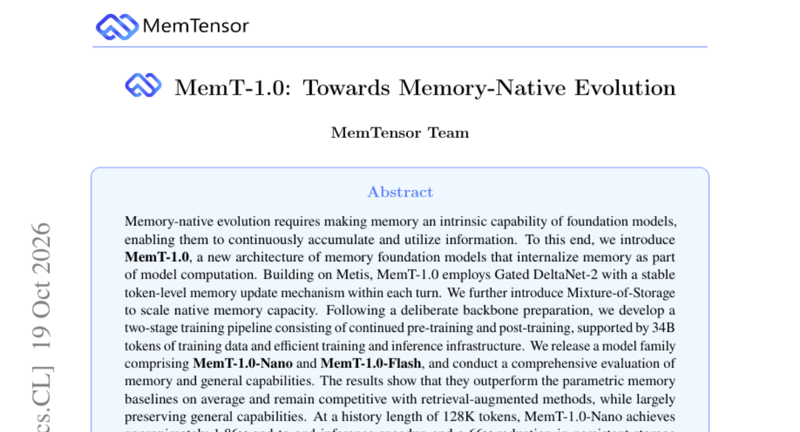

### 📌 한 줄 요약
메모리를 모델 연산의 일부로 내재화하여 RAG 없이도 효율적인 장기 기억과 에이전트 성능을 확보한 차세대 메모리 네이티브 아키텍처

### 🔑 핵심 포인트
- Gated DeltaNet-2 기반의 안정적인 토큰 단위 메모리 업데이트 메커니즘
- Mixture-of-Storage를 통한 대규모 네이티브 메모리 용량 확장
- KV 캐시 대비 압도적인 추론 속도 향상 및 저장 공간 절감

### 🧑‍💻 개발자 관점
RAG의 외부 검색 의존도를 낮추면서도 모델 내부에서 효율적으로 장기 기억을 관리할 수 있는 새로운 아키텍처적 방향성을 제시합니다.

### 🚀 실무 적용 아이디어
- 제시된 Gated DeltaNet-2 구조의 연산 효율성 검증
- 에이전트 작업 환경에서의 장기 기억 유지 능력 테스트
- 기존 KV 캐시 방식 대비 메모리 효율성 벤치마크 수행

### ⚠️ 리스크/한계
- 모델 내부 메모리 용량 확장에 따른 연산 복잡도 증가 가능성
- 일반적인 범용 성능(General Capabilities) 유지 여부에 대한 지속적 모니터링 필요

### 📝 초록 기반 상세 설명
기존 파라미터 기반 모델은 정보를 지속적으로 축적하고 활용하는 데 한계가 있습니다. 이를 해결하기 위해 메모리를 모델 연산의 핵심 요소로 통합하는 MemT-1.0 아키텍처를 제안합니다. Gated DeltaNet-2를 통해 안정적인 토큰 단위 메모리 업데이트를 구현하고, Mixture-of-Storage를 도입하여 메모리 용량을 확장했습니다. 34B 토큰 규모의 2단계 학습 파이프라인을 통해 모델을 최적화했습니다. 실험 결과, 기존 파라미터 기반 방식보다 우수하며 RAG 방식과 경쟁 가능한 성능을 보이면서도 추론 속도와 저장 공간 효율을 크게 개선했습니다.

---

## 3. [Learning from Fleet Experience: A Collective Learning Paradigm for Robots](https://huggingface.co/papers/2610.25736)
**Upvotes**: 107 | **도입 난이도**: 중 | **신뢰도**: 상
**arXiv**: https://arxiv.org/abs/2610.25736

**태그**: Robot Learning, Fleet Learning, Reinforcement Learning, Scalable AI, RAG, Vision, Evaluation

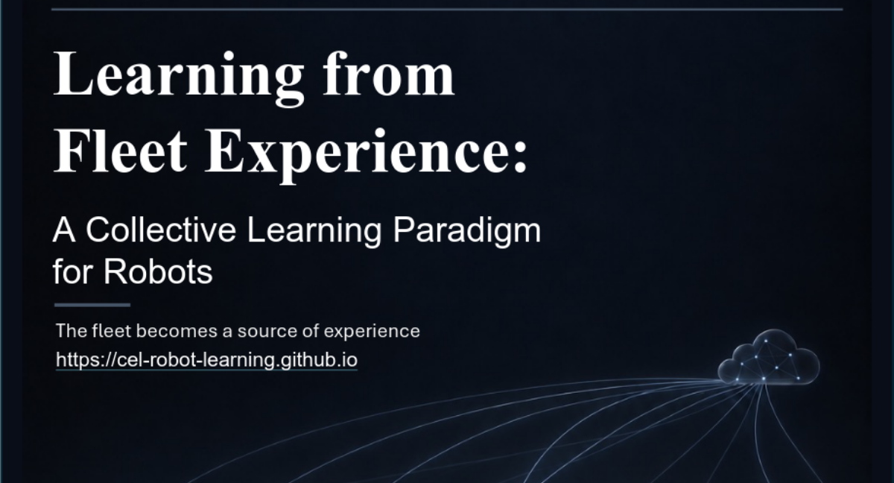

### 📌 한 줄 요약
추가적인 전문가 개입 없이 로봇 군집(Fleet)의 실패 사례를 성공 데이터로 변환하여 정책을 개선하는 집단 학습 패러다임 제안

### 🔑 핵심 포인트
- 전문가 개입 없이 실패 상황을 활용해 성공 데이터를 검색/학습하는 FERT 알고리즘 개발
- 로봇 규모 확장에 따른 데이터 수집 비용 문제를 해결하는 집단 경험 학습(CEL) 프레임워크 제안
- 분산된 로봇 환경에서도 안정적인 학습/배포를 지원하는 FATS 시스템 구축

### 🧑‍💻 개발자 관점
대규모 로봇 운영 시 사람이 일일이 개입하지 않고도, 현장에서 발생하는 실패 데이터를 자동화된 방식으로 학습에 활용할 수 있는 확장 가능한 방법론을 제시합니다.

### 🚀 실무 적용 아이디어
- 실패한 궤적과 유사한 성공 궤적을 매칭하는 Retrieval 기반 학습 로직 구현 테스트
- 비동기적 데이터 수집 및 모델 배포 파이프라인(FATS 유사 구조) 설계
- 데이터 규모(Fleet size) 증가에 따른 성능 향상 곡선 검증

### ⚠️ 리스크/한계
- 실패 상황과 유사한 성공 사례를 찾는 검색(Retrieval) 과정에서의 정밀도 의존성
- 잘못된 데이터가 학습될 경우 발생할 수 있는 정책 오염(Policy Drift) 위험

### 📝 초록 기반 상세 설명
로봇 배포 과정에서 발생하는 실행 경험은 정책 신뢰도를 높일 수 있는 중요한 자원이지만, 기존의 인간 개입 방식은 로봇 규모가 커질수록 유지 관리가 어렵다는 문제가 있습니다. 본 논문은 배포된 로봇들이 실행 경험을 공유하여 공통 정책을 개선하는 집단 경험 학습(CEL) 패러다임을 소개합니다. 이를 위해 실패 상황에서 관련된 성공 궤적을 검색하여 정책을 업데이트하는 FERT(failure-guided experience retrieval fine-tuning) 기법을 제안합니다. 또한, 로봇 군집 내 국소적 중단 상황에서도 학습과 배포가 원활히 이루어지는 결함 허용 비동기 학습 시스템(FATS)을 구현했습니다. 실험 결과, 다양한 조작 작업에서 높은 성공률을 달ั้น 데다 로봇 규모가 커질수록 성능이 향상됨을 입증했습니다.

---

## 4. [OR-License: Evaluating LLM Agents as Real-World Operations Research Practitioners](https://huggingface.co/papers/2610.24087)
**Upvotes**: 104 | **도입 난이도**: 중 | **신뢰도**: 상
**arXiv**: https://arxiv.org/abs/2610.24087

**태그**: LLM-Agent, Operations-Research, Benchmark, Problem-Formulation, Agent, RAG, Evaluation

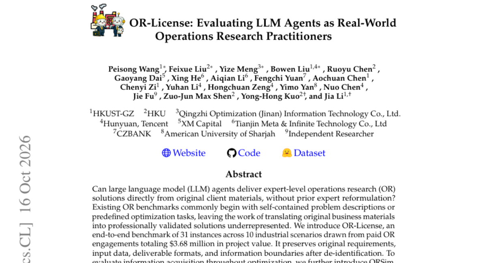

### 📌 한 줄 요약
실제 산업 현장의 복잡한 요구사항을 해결하는 OR(운영 연구) 전문가로서의 LLM 에이전트 역량을 평가하는 벤치마크 연구

### 🔑 핵심 포인트
- 실제 산업 현장의 데이터와 요구사항을 반영한 31개 인스턴스 규모의 OR-License 벤치마크 구축
- 문제 정식화부터 솔루션 도출까지의 전 과정을 평가하는 DAQ(Deployment-Adjusted Quality) 지표 도입
- 비즈니스 정보와 전문 지식을 분리하여 에이전트의 정보 획득 능력을 측정하는 ORSim 시뮬레이터 활용

### 🧑‍💻 개발자 관점
단순한 코드 생성을 넘어, 모호한 비즈니스 요구사항을 수학적 모델로 변환하고 실행 가능한 솔루션을 도출해야 하는 에이전트 개발자에게 실무적 가이드라인을 제공합니다.

### 🚀 실무 적용 아이디어
- 에이전트의 문제 정식화(Formulation) 단계에서의 오류 패턴 분석
- 비즈니스 요구사항(Ambiguous requirements)을 정형화된 모델로 변환하는 프롬프트 엔지니어링 실험
- 에이전트가 생성한 솔루션의 실행 가능성(Feasibility) 검증 루프 구축

### ⚠️ 리스크/한계
- 실제 데이터의 비식별화 과정에서 발생할 수 있는 정보 손실 가능성
- 특정 도메인(OR)에 특화된 벤치마크로 일반적인 에이전트 성능과 직접 비교 시 주의 필요

### 📝 초록 기반 상세 설명
기존의 OR 벤치마크는 정제된 문제 위주로 구성되어 있어, 실제 비즈니스 요구사항을 최적화 모델로 변환하는 실무 역량을 평가하기 어렵습니다. 이를 해결하기 위해 실제 368만 달러 규모의 프로젝트 데이터를 기반으로 한 end-to-end 벤치마크인 OR-License를 제안합니다. 연구진은 비즈니스 사실만을 제공하는 시뮬레이터 ORSim을 도입하여 정보 획득 및 문제 정식화 과정을 통제하며 평가합니다. 실험 결과, 최신 모델들이 일부 지표에서 전문가를 상회하기도 했으나, 실행 가능성과 품질을 종합한 DAQ 지표에서는 아직 전문가 수준에 미치지 못했습니다. 결론적으로 에이전트가 신뢰할 수 있는 솔루션을 내놓기 위해서는 정보 격차 해소와 충실한 문제 정식화 능력이 필수적임을 확인했습니다.

---

## 5. [Holi-World: Building Holistic World Intelligence from Human-Ego Experience](https://huggingface.co/papers/2610.26549)
**Upvotes**: 103 | **도입 난이도**: 상 | **신뢰도**: 상
**arXiv**: https://arxiv.org/abs/2610.26549

**태그**: Egocentric-Vision, World-Models, Self-Supervised-Learning, Robotics, Reasoning, Evaluation

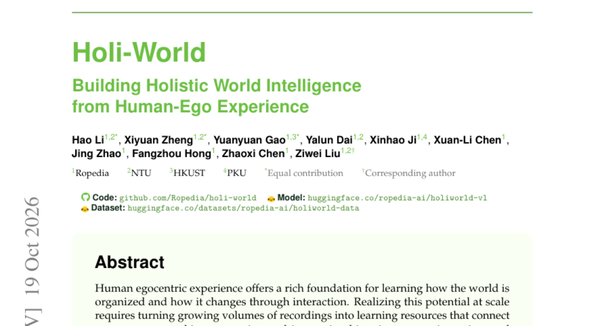

### 📌 한 줄 요약
인간의 1인칭 시점 경험 데이터를 활용하여 장면 구조, 객체 의미, 상호작용 이력을 통합 학습하는 세계 모델링 생태계 구축

### 🔑 핵심 포인트
- 경험 캡처부터 모델 학습까지 연결하는 통합 생태계(Holi-World) 제안
- 정적 장면 구조와 동적 객체 상태를 결합한 자동화된 데이터 구축 파이프라인(Foundry) 개발
- 1인칭 시점의 공간적·시간적 추론 능력을 극대화한 HOLIWORLD-VL-4B 모델 및 벤치마크 구축

### 🧑‍💻 개발자 관점
로봇 공학이나 AR/VR 분야에서 인간의 시점 데이터를 효율적으로 학습 데이터로 변환하여 물리적 세계 이해도를 높이는 데 중요한 프레임워크를 제공합니다.

### 🚀 실무 적용 아이디어
- 제안된 데이터 구축 파이프라인을 기존 Egocentric 데이터셋에 적용하여 데이터 품질 비교
- Holi-World 모델의 공간/시간 추론 능력을 로봇 조작 태스크에 이식하는 실험
- 자동 생성된 QA 데이터와 수동 주석 데이터 간의 정렬 품질 검증

### ⚠️ 리스크/한계
- 수동 주석 의존도를 낮추었으나, 자동 생성된 데이터의 정밀도가 실제 물리 법칙과 괴리될 가능성
- 특정 환경(100개 장면)에서 수집된 데이터에 대한 모델의 일반화 성능 검증 필요

### 📝 초록 기반 상세 설명
인간의 자기중심적(egocentric) 경험은 세계의 구조와 변화를 학습하기 위한 풍부한 기초를 제공하지만, 이를 대규모 학습 자원으로 변환하는 데는 막대한 수동 주석 비용이 발생합니다. 본 논문은 경험 캡처, 세계 표현, 자동 데이터 구축, 모델 학습 및 평가를 연결하는 통합 생태계인 HOLI-WORLD를 제안합니다. HOLIWORLD-Foundry는 정적/동적 인식을 결합하여 장면 구조와 객체 상태, 상호작용 이력을 연결하는 세계 기록을 자동 생성합니다. 이를 통해 구축된 HOLIWORLD-Data는 약 80K의 QA 쌍을 포함하며, 이를 통해 학습된 HOLIWORLD-VL-4B 모델은 강력한 공간 및 시간 추론 능력을 보여줍니다. 실험 결과, 제안된 방법론은 기존 벤치마크와 HOLIWORLD-Bench에서 뛰어난 성능을 입증하며 실용적인 세계 모델링 기반을 제공합니다.

---

## 6. [EgoXperience: Learning World-Grounded Egocentric Representations from Human Experience](https://huggingface.co/papers/2610.26625)
**Upvotes**: 96 | **도입 난이도**: 상 | **신뢰도**: 상
**arXiv**: https://arxiv.org/abs/2610.26625

**태그**: Computer Vision, 3D Reconstruction, Egocentric Vision, SLAM, Robotics, Vision, Video, Benchmark, Evaluation, Safety

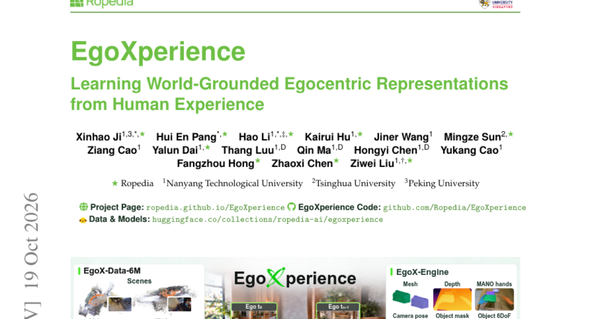

### 📌 한 줄 요약
단일 모노큘러 비디오에서 카메라, 장면, 손, 객체의 일관된 3D 재구성을 동시에 수행하는 통합 프레임워크 제안

### 🔑 핵심 포인트
- EgoX-Engine: SLAM과 객체 추적을 결합한 자동화된 정밀 주석 생성 엔진 개발
- EgoX-Data-6M: 다양한 환경에서의 작업 중심 조작 및 이동이 포함된 50시간 분량의 대규모 데이터셋 구축
- EgoX 모델: 단일 모노큘러 비디오 입력만으로 카메라, 장면, 손, 객체를 하나의 세계 좌표계로 통합 재구성

### 🧑‍💻 개발자 관점
로봇 제어 및 AR/VR 분야에서 1인칭 시점의 공간 정보와 상호작용을 정밀하게 디지털화하는 데 직접적인 기술적 토대를 제공합니다.

### 🚀 실무 적용 아이디어
- 제공된 EgoX-Bench를 활용하여 기존 3D 재구성 모델과의 성능 비교 실험 수행
- EgoX-Engine의 자동 주석 생성 로직이 실제 SLAM 데이터와 얼마나 일치하는지 검증
- 단일 카메라 환경에서 다양한 조도 및 복잡한 배경에서의 재구성 안정성 테스트

### ⚠️ 리스크/한계
- 단일 모노큘러 비디오 기반이므로 조명 변화나 가려짐(occlusion)에 따른 기하학적 오차 발생 가능성
- 대규모 데이터셋과 복잡한 모델 구조로 인해 높은 연산 자원 요구 가능성

### 📝 초록 기반 상세 설명
기존의 1인칭 시점(egocentric) 비디오 재구성은 카메라 움직임, 주변 기하 구조, 손-객체 상호작용 간의 일관성을 유지하는 데 어려움이 있었습니다. 이를 해결하기 위해 데이터 수집부터 자동 주석 생성, 모델링, 벤치마킹을 아우르는 EgoXperience 패러다임을 제안합니다. 핵심인 EgoX-Engine은 SLAM 기반의 세계 정렬과 기하학적 객체 추적을 결합하여 정밀한 주석을 생성합니다. 이를 통해 구축된 EgoX-Data-6M 데이터셋과 EgoX 모델은 단일 포워드 패스로 일관된 세계 좌표계 내에서 4가지 요소를 동시에 재구성합니다. 실험 결과, 기존 베이스라인 대비 카메라, 손, 깊이 오차를 대폭 줄이며 최첨단 성능을 달성했습니다.

---

## 7. [ScaleNav: Scalable Internet Video Pretraining for Language-Conditioned Local Navigation](https://huggingface.co/papers/2610.25690)
**Upvotes**: 84 | **도입 난이도**: 상 | **신뢰도**: 상
**arXiv**: https://arxiv.org/abs/2610.25690

**태그**: Embodied AI, Robot Navigation, Video Pretraining, Sim-to-Real, Video, Benchmark, Evaluation, Safety

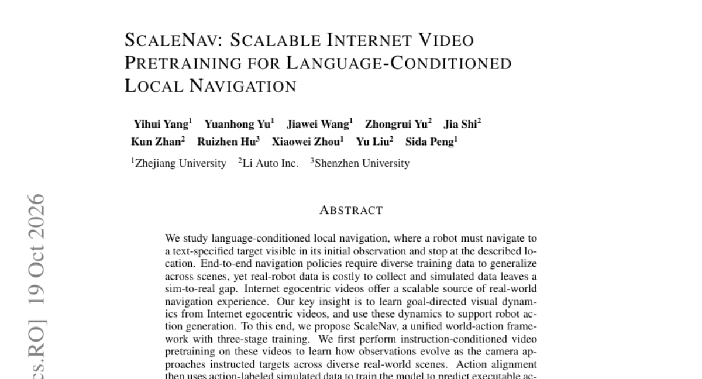

### 📌 한 줄 요약
인터넷 1인칭 영상을 활용한 비디오 사전학습을 통해 로봇의 언어 기반 국소 내비게이션 성능을 극대화한 프레임워크

### 🔑 핵심 포인트
- 인터넷 1인칭 영상을 활용한 목표 지향적 시각 역학(Goal-directed Visual Dynamics) 학습
- 비디오 사전학습 -> 액션 정렬 -> 공동 미세 조정으로 이어지는 3단계 통합 프레임워크
- 시뮬레이션과 실세계 데이터의 간극을 극복하는 Scalable한 학습 방식 제안

### 🧑‍💻 개발자 관점
실제 로봇 데이터 수집 없이도 대규모 인터넷 영상을 통해 로봇의 시각적 이해와 이동 능력을 결합할 수 있는 새로운 학습 파이프라인을 제시합니다.

### 🚀 실무 적용 아이디어
- 제공된 코드를 활용하여 Habitat 환경에서 ScaleNav의 사전학습 모델 성능 검증
- 다양한 1인칭 영상 데이터셋을 활용한 비디오 사전학습 단계의 효과 분석
- 로봇 하드웨어(4족 보행 등)에 적용 시 시뮬레이션 액션과 실물 액션 간의 오차 측정

### ⚠️ 리스크/한계
- 인터넷 영상의 시점과 실제 로봇 하드웨어의 움직임 간의 물리적 차이 존재
- 대규모 비디오 학습을 위한 높은 컴퓨팅 자원 요구

### 📝 초록 기반 상세 설명
언어 지시를 따르는 로봇 내비게이션은 다양한 환경에 대한 일반화가 필수적이지만, 실세계 데이터 수집 비용과 시뮬레이션과 실세계 간의 간극(Sim-to-Real)이 큰 문제였습니다. 본 논문은 인터넷의 1인칭 시점 영상이 풍부한 내비게이션 경험을 제공할 수 있다는 점에 주목했습니다. 이를 위해 제안된 ScaleNav는 목표 지향적 시각 역학(Visual Dynamics)을 학습하는 3단계 훈련 프레임워크를 제안합니다. 먼저 비디오 사전학습을 통해 지시된 목표에 접근할 때 관찰값이 어떻게 변하는지 학습하고, 이후 시뮬레이션 데이터를 통해 실행 가능한 액션 청크를 예측하도록 정렬합니다. 마지막으로 전체 모델을 공동 미세 조정하여 최종 내비게이션 성능을 최적화합니다. 실험 결과, 제안 모델은 주요 벤치마크에서 기존 베이스라인을 상회하였으며 실제 4족 보행 로봇에서도 성공적으로 동작함을 입증했습니다.

---

## 8. [SpecMRL: Redesign Matryoshka Representation Learning within Parametric Spectrum](https://huggingface.co/papers/2610.26824)
**Upvotes**: 79 | **도입 난이도**: 하 | **신뢰도**: 상
**arXiv**: https://arxiv.org/abs/2610.26824

**태그**: Embedding, Compression, Representation Learning, Evaluation, Optimization

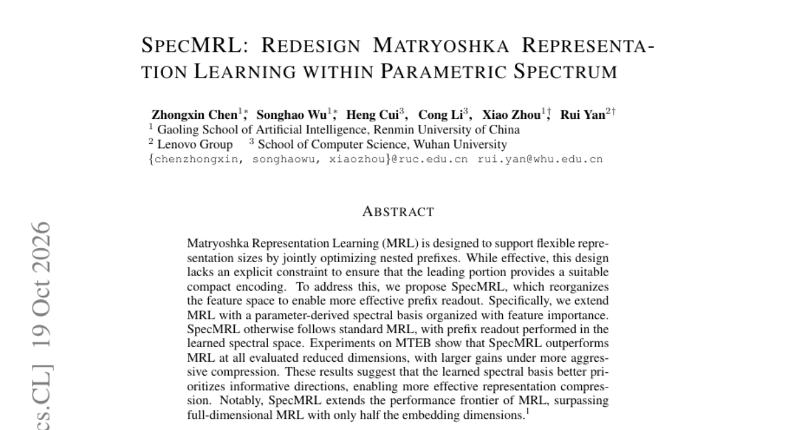

### 📌 한 줄 요약
매트리요시 학습(MRL)의 구조를 스펙트럼 기반으로 재설계하여, 적은 차원에서도 높은 성능을 유지하는 효율적인 임베딩 압축 기술

### 🔑 핵심 포인트
- 특징 중요도에 따라 정렬된 파라미터 유도 스펙트럼 기저 도입
- 프리픽스 차원이 더 효과적인 압축 정보를 담도록 특징 공간 재구성
- 적은 차원에서도 전체 차원 모델의 성능을 상회하는 강력한 압축 효율성 확보

### 🧑‍💻 개발자 관점
임베딩 차원을 줄여야 하는 벡터 DB 운영 비용 절감 상황에서, 성능 저하를 최소화하며 모델 크기를 획기적으로 줄일 수 있습니다.

### 🚀 실무 적용 아이디어
- 기존 MRL 모델의 임베딩 차원을 절반으로 줄여 SpecMRL과 성능 비교 실험
- MTEB와 같은 벤치마크 환경에서 차원 축소율에 따른 성능 유지력 테스트
- 학습된 스펙트럼 기저가 실제 특징 중요도와 일치하는지 시각화 분석

### ⚠️ 리스크/한계
- 더 공격적인 압축 시 스펙트럼 기저의 안정성 검증 필요
- 특정 도메인 데이터셋에서의 일반화 성능 확인 필요

### 📝 초록 기반 상세 설명
기존의 Matryoshka Representation Learning(MRL)은 중첩된 프리픽스 최적화를 통해 유연한 차원 조절을 지원하지만, 앞부분의 차원이 충분히 압축된 정보를 담도록 보장하는 제약 조건이 부족합니다. 이를 해결하기 위해 본 논문은 특징 공간을 재구성하여 프리픽스 읽기 성능을 높이는 SpecM의 방식을 제안합니다. 구체적으로, 특징 중요도에 따라 정렬된 파라미터 유도 스펙트럼 기저(spectral basis)를 MRL에 도입했습니다. SpecMRL은 표준 MRL의 형식을 따르되, 학습된 스펙트럼 공간 내에서 프리픽스 읽기가 수행됩니다. 실험 결과, SpecMRL은 MTEB 벤치마크의 모든 차원 축소 구간에서 기존 MRL을 능가했으며, 특히 압축률이 높을수록 성능 향폭이 컸습니다. 결과적으로 SpecMRL은 절반의 차원만으로도 전체 차원을 사용하는 기존 MRL의 성능을 뛰어넘는 효율성을 보여주었습니다.

---

## 9. [OpenVLHarness: Real World Visual Agentic Tool-Use with Multimodal Memory](https://huggingface.co/papers/2610.26860)
**Upvotes**: 79 | **도입 난이도**: 중 | **신뢰도**: 상
**arXiv**: https://arxiv.org/abs/2610.26860

**태그**: Agent, Multimodal, Tool-Use, Memory-System, RAG, Reasoning, Vision, Benchmark, Evaluation, Inference

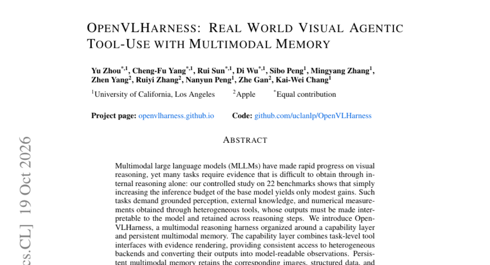

### 📌 한 줄 요약
외부 도구 활용과 멀티모달 메모리 시스템을 결합하여 MLLM의 시각적 추론 및 데이터 처리 능력을 극대화하는 프레임워크

### 🔑 핵심 포인트
- Capability Layer: 이기종 도구의 출력을 모델이 읽을 수 있는 관찰값으로 변환하는 인터페이스 제공
- Persistent Multimodal Memory: 이미지, 구조화된 데이터, 웹 참조를 추론 과정 전반에 걸쳐 유지하는 메모리 시스템
- Coding Interface: 생성된 프로그램을 실행하여 여러 도구의 결과를 결합하고 계산하는 기능

### 🧑‍💻 개발자 관점
단순한 텍스트/이미지 입력을 넘어, 외부 API나 데이터베이스를 활용해 정밀한 수치와 근거를 확보해야 하는 에이전트 개발 시 핵심 아키텍처 모델이 될 수 있습니다.

### 🚀 실무 적용 아이디어
- 제시된 Capability Layer 구조를 활용해 특정 도구(예: 계산기, 지도 API)를 MLLM에 연결하는 프로토타입 구현
- 메모리 유지 방식이 모델의 컨텍스트 윈도우와 추론 비용에 미치는 영향 분석
- 코드 실행 환경(Sandboxed Code Execution)과 모델 간의 상호작용 워크플로우 테스트

### ⚠️ 리스크/한계
- 외부 도구 및 코드 실행 환경에 대한 보안 리스크(Sandboxing 필수)
- 메모리 크기 증가에 따른 추론 비용 및 지연 시간 관리 문제

### 📝 초록 기반 상세 설명
최근 MLLM의 발전에도 불구하고, 외부 지식이나 정밀한 수치 측정이 필요한 복잡한 시각적 추론 작업은 모델 내부의 추론만으로는 한계가 있습니다. 단순히 추론 예산을 늘리는 것만으로는 이러한 외부 증거 기반 작업의 성능 향상이 미미하다는 점이 확인되었습니다. 이를 해결하기 위해 도구 인터페이스와 증거 렌더링을 결합한 'Capability Layer'와 데이터/이미지를 유지하는 'Persistent Multimodal Memory'를 갖춘 OpenVLHarness를 제안합니다. 이 프레임워크는 코딩 인터페이스를 통해 여러 도구의 결과를 조합하고 반복적인 증거 확보를 가능하게 합니다. 실험 결과, 다양한 백본 모델에서 기존 베이스라인 대비 유의미한 성능 향상을 보였으며, 특히 적은 토큰 비용으로도 고성능 모델의 최대 추론 성능을 상회하는 효율성을 입증했습니다.

---

## 10. [Self-Evolving Coding Agents via Harness-Policy Optimization](https://huggingface.co/papers/2610.22791)
**Upvotes**: 40 | **도입 난이도**: 상 | **신뢰도**: 상
**arXiv**: https://arxiv.org/abs/2610.22791

**태그**: Agent, Reinforcement Learning, Coding, Self-Improvement, RAG, Benchmark

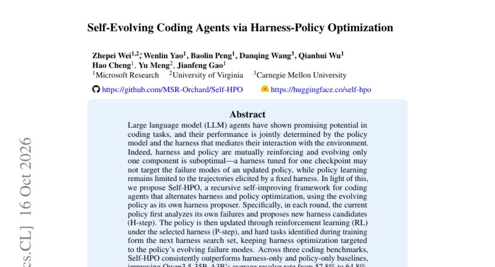

### 📌 한 줄 요약
에이전트의 정책(Policy)과 환경(Harness)을 상호 진화시켜 코딩 성능을 극대화하는 재귀적 최적화 프레임워크

### 🔑 핵심 포인트
- 정책(Policy)과 환경(Harness)의 상호 보완적 진화를 위한 재귀적 프레임워크 제안
- 에이전트가 스스로 실패 사례를 분석하여 다음 학습을 위한 환경을 제안하는 H-step/P-step 구조
- 고정된 환경의 한계를 극심하게 극복하며, 모델의 진화에 맞춘 타겟팅된 환경 최적화 구현

### 🧑‍💻 개발자 관점
에이전트 개발 시 모델 학습뿐만 아니라, 모델의 약점을 공략하는 테스트 환경(Harness)을 자동 생성하는 것이 성능 향상의 핵심임을 시사합니다.

### 🚀 실무 적용 아이디어
- 현재 사용 중인 코딩 에이전트의 실패 로그를 기반으로 새로운 테스트 케이스를 자동 생성하는 파이프라인 구축
- 강화학습 시 고정된 벤치마크 대신, 모델의 취약점을 반영한 동적 환경(Dynamic Harness) 적용 실험
- 더 강력한 외부 모델을 Harness Proposer로 사용하여 에이전트의 성능 한계 테스트

### ⚠️ 리스크/한계
- 환경과 정책이 동시에 변하므로 학습 과정의 안정성 확보가 어려울 수 있음
- 특정 환경에 과적합(Overfitting)될 경우 일반화 성능이 저하될 위험 존재

### 📝 초록 기반 상세 설명
LLM 코딩 에이전트의 성능은 모델 정책과 환경 간의 상호작용에 의해 결정되지만, 기존 방식은 고정된 환경에서 모델만 학습하거나 그 반대의 경우에 머물러 최적의 시너지를 내지 못합니다. 이를 해결하기 위해 정책과 환경을 번갈아 최적화하는 Self-HPO 프레임워크를 제안합니다. 에이전트가 자신의 실패 사례를 분석하여 새로운 테스트 환경을 제안하고, 그 환경에서 다시 강화학습을 수행하는 방식으로 두 요소를 동시 진화시킵니다. 실험 결과, 제안된 방식은 기존의 단일 최적화 방식보다 높은 성능 향상을 보였으며 일반화 성능과 신뢰도(Pass@1)를 동시에 개선했습니다. 특히 두 구성 요소의 결합 효과가 개별 효과의 합보다 크게 나타나 상호 보완적 진화가 가능함을 입증했습니다.

---

## 11. [CoworkEnv: Synthesizing Training Environments for Long-Horizon Cowork Agents](https://huggingface.co/papers/2610.24960)
**Upvotes**: 37 | **도입 난이도**: 상 | **신뢰도**: 상
**arXiv**: https://arxiv.org/abs/2610.24960

**태그**: AI Agent, Reinforcement Learning, Workflow Automation, Synthetic Data, Agent, Benchmark, Evaluation

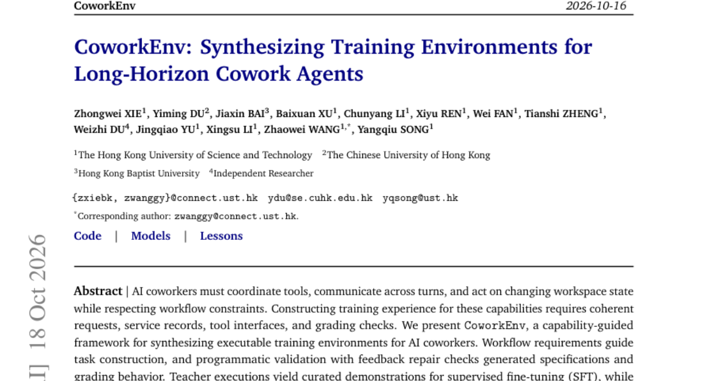

### 📌 한 줄 요약
AI 동료 에이전트의 복잡한 워크플로우 수행 능력을 높이기 위한 자동화된 학습 환경 합성 프레임워크 제안

### 🔑 핵심 포인트
- 워크플로우 기반의 실행 가능한 학습 환경 자동 합성 프레임워크(CoworkEnv) 개발
- SFT(교사 데이터)와 RL(학생 데이터)을 결합한 하이브리드 학습 파이프라인 구축
- 복잡한 다중 턴(Multi-turn) 작업 및 도구 사용 능력을 위한 자동 검증 및 피드백 루프 구현

### 🧑‍💻 개발자 관점
에이전트가 실제 업무 환경(Tool-use, Multi-turn)에서 동작하도록 학습시키기 위한 데이터 생성 및 검증 자동화 전략을 배울 수 있습니다.

### 🚀 실무 적용 아이디어
- 특정 도구 사용 워크플로우를 프로그래밍 방식으로 검증하는 환경 설계 실험
- SFT 데이터와 RL 보상 체계 간의 성능 상관관계 분석
- 생성된 환경이 모델의 일반화 성능에 미치는 영향 테스트

### ⚠️ 리스크/한계
- 합성된 환경이 실제 인간의 복잡한 워크플로우를 완벽히 모사하는지에 대한 검증 필요
- 환경 생성 로직 자체의 편향이 모델의 성능 편향으로 이어질 위험

### 📝 초록 기반 상세 설명
AI 동료 에이전트는 도구 사용, 다중 턴 통신, 변화하는 작업 환경 대응 등 복잡한 협업 능력이 필요합니다. 하지만 이러한 능력을 학습시키기 위한 일관된 요청, 서비스 기록, 도구 인터페이스 및 검증 체계를 구축하는 것은 매우 어렵습니다. 본 논문은 워크플로우 요구사항에 따라 실행 가능한 학습 환경을 생성하는 CoworkEnv 프레임워크를 제안합니다. 생성된 환경은 프로그래밍 방식의 검증을 거치며, 교사 모델의 실행 데이터는 SFT용으로, 학생 모델의 상호작용은 RL용으로 활용됩니다. 실험 결과, 제안된 방식을 통해 모델의 성능이 크게 향상되었으며 RL 학습 역학에 대한 분석을 통해 환경의 유효성을 입증했습니다.

---

## 12. [MT Forcing: Towards Stable and Consistent Multi-Turn Image Editing with Autoregressive Diffusion](https://huggingface.co/papers/2610.25404)
**Upvotes**: 34 | **도입 난이도**: 중 | **신뢰도**: 상
**arXiv**: https://arxiv.org/abs/2610.25404

**태그**: Diffusion, Image Editing, Multi-turn, Generative AI, RAG, Multimodal, Vision, Distillation

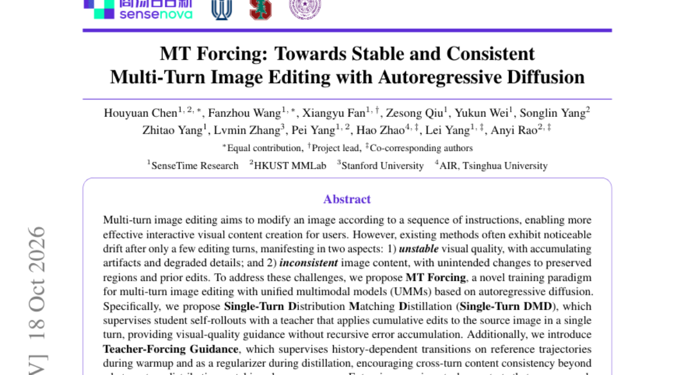

### 📌 한 줄 요약
자기회귀 확산 모델의 누적 오차를 해결하여 다회차 이미지 편집의 품질과 일관성을 높이는 새로운 학습 패러다임 제안

### 🔑 핵심 포인트
- Single-Turn DMD: 단일 턴에서 누적 편집을 수행하는 교사 모델을 활용해 재귀적 오차 없이 고품질 가이드를 제공하는 증류 기법
- Teacher-Forcing Guidance: 웜업 및 정규화 단계에서 참조 궤적을 활용해 턴 간 콘텐츠 일관성을 확보하는 기법
- 자기회귀 확산 모델의 드리프트 문제 해결: 반복적인 편집 과정에서 발생하는 화질 저하 및 내용 변형 방지

### 🧑‍💻 개발자 관점
대화형 이미지 생성 에이전트 개발 시, 반복적인 수정 작업에서 발생하는 이미지 붕괴 문제를 해결할 수 있는 실질적인 학습 방법론을 제공합니다.

### 🚀 실무 적용 아이디어
- 제안된 Single-Turn DMD와 Teacher-Forcing 기법을 기존 Diffusion 모델 학습 파이프라인에 적용해 비교 실험
- 다양한 편집 명령 시퀀스(Long-horizon)에 따른 드리프트 발생 임계점 측정
- 기존의 재귀적 편집 방식과 MT Forcing 방식 간의 연산 비용 및 품질 상관관계 분석

### ⚠️ 리스크/한계
- 교사 모델(Teacher)의 품질에 따라 학생 모델의 성능이 종속될 가능성
- 복잡한 편집 시나리오에서 턴이 매우 길어질 경우의 장기적 일관성 유지 여부

### 📝 초록 기반 상세 설명
사용자의 연속적인 명령에 따라 이미지를 수정하는 다회차 이미지 편집은 대화형 콘텐츠 생성에 필수적입니다. 그러나 기존 방식은 편집 횟수가 늘어날수록 화질 저하와 의도치 않은 영역의 변형이 발생하는 드리프트 현상을 겪습니다. 이를 해결하기 위해 본 논문은 자기회귀 확산 기반의 통합 멀티모달 모델(UMM)을 위한 'MT Forcing' 학습 패러다임을 제안합니다. Single-Turn DMD를 통해 재귀적 오차 누적 없이 고품질 가이드를 제공하며, Teacher-Forcing Guidance를 통해 턴 간 콘텐츠 일관성을 유지합니다. 실험 결과, 제안 방식은 시각적 품질 안정성과 턴 간 일관성을 모두 크게 개선함을 입증했습니다.

---

## 13. [Interlock: From Local Correctness to Task Completion in Long-Horizon Agents](https://huggingface.co/papers/2610.19686)
**Upvotes**: 32 | **도입 난이도**: 중 | **신뢰도**: 상
**arXiv**: https://arxiv.org/abs/2610.19686

**태그**: LLM-Agent, Task-Planning, Automated-Evaluation, Fine-tuning, Agent, RAG, Evaluation

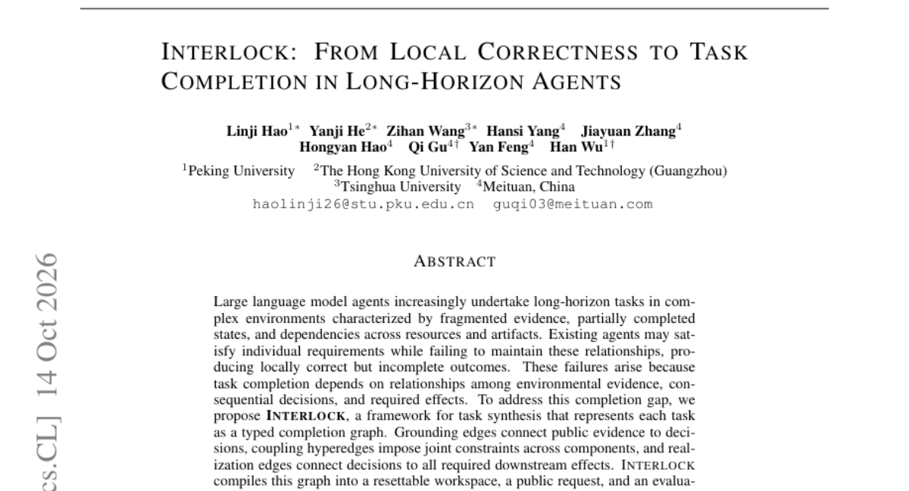

### 📌 한 줄 요약
복잡한 장기 과업 수행 시 개별 단계의 정답을 넘어 전체 요구사항 간의 관계를 유지하며 과업을 완수하는 Interlock 프레임워크 제안

### 🔑 핵심 포인트
- 과업을 의존성과 제약 조건이 포함된 '타입화된 완성 그래프'로 모델링
- 요구사항 유지(Source-coverage) 및 가용 자원 검증(Public-input)을 포함한 다중 검증 프로세스
- 성공적인 실행 궤적을 활용한 에이전트 미세 조정(Fine-tuning)을 통한 성능 향상 입증

### 🧑‍💻 개발자 관점
단순히 질문에 답하는 에이전트를 넘어, 여러 단계의 결과물이 서로 얽혀 있는 복잡한 워크플로우 자동화 설계 시 유용한 프레임워크 구조를 제공합니다.

### 🚀 실무 적용 아이디어
- 복잡한 의존성이 있는 워크플로우를 그래프 구조로 모델링하여 프로토타입 구현
- 에이전트가 생성한 결과물을 검증하기 위한 자동화된 루브릭(Rubric) 설계 실험
- 성공적인 작업 로그를 데이터셋화하여 에이전트 미세 조정에 적용

### ⚠️ 리스크/한계
- 그래프 모델링 과정에서 요구사항 정의가 복잡할 경우 설계 비용 증가
- 검증 루브릭 자체가 잘못 설계될 경우 잘못된 궤적이 학습되어 성능 저하 위험

### 📝 초록 기반 상세 설명
LLM 에이전트가 복잡한 환경에서 장기 과업을 수행할 때, 개별 요구사항은 충족하더라도 요소 간의 의존성이나 관계를 놓쳐 최종 과업 완수에 실패하는 문제가 발생합니다. 이를 해결하기 위해 각 과업을 타입화된 '완성 그래프(Completion Graph)'로 표현하는 Interlock 프레임워크를 제안합니다. 이 프레임워크는 증거, 결정, 결과 간의 관계를 그래프로 구조화하고, 이를 워크스페이스와 평가 루브릭으로 컴파일하여 검증합니다. 검증 과정에서는 소스 커버리지 리뷰, 공개 입력 리뷰, 에이전트 판사(Agent-as-judge)를 통해 요구사항 준수 여부를 엄격히 확인합니다. 실험 결과, 생성된 성공 궤적을 활용한 미세 조정(Fine-tuning)이 다양한 벤치마크에서 성능 향상을 이끌어냄을 입증했습니다.

---

## 14. [AnyGoal: On World Model Generalization Beyond Expert Rollouts](https://huggingface.co/papers/2610.26844)
**Upvotes**: 28 | **도입 난이도**: 하 | **신뢰도**: 상
**arXiv**: https://arxiv.org/abs/2610.26844

**태그**: World Model, Reinforcement Learning, Generalization, Benchmark, Agent, RAG, Evaluation

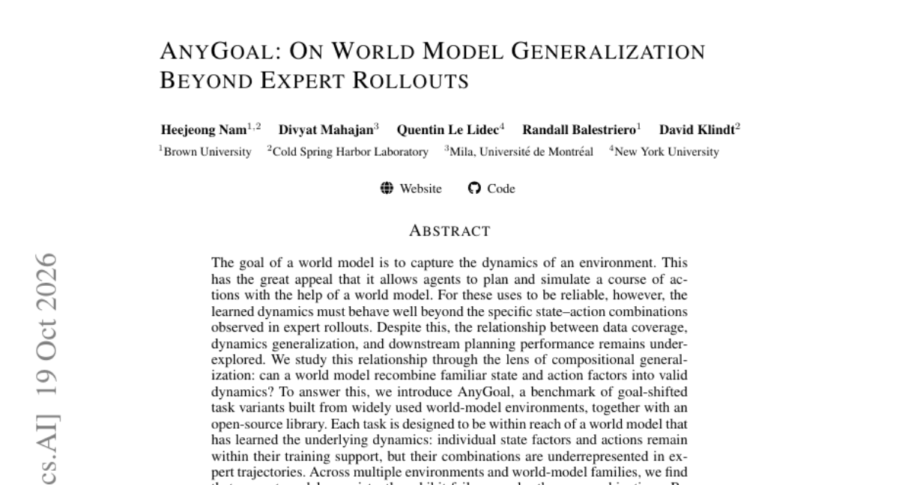

### 📌 한 줄 요약
전문가 데이터 범위를 벗어난 새로운 목표(Goal-shifted) 상황에서 월드 모델의 일반화 능력을 평가하는 벤치마크 AnyGoal 제안

### 🔑 핵심 포인트
- 새로운 목표 조합(Goal-shifted)을 평가하기 위한 벤치마크 AnyGoal 및 오픈소스 라이브러리 개발
- 학습 데이터 내의 요소들을 조합하여 새로운 상황을 만드는 '조합적 일반화' 능력 검증
- 기존 월드 모델들이 전문가 데이터 범위를 벗어난 재조합 상황에서 취약함을 확인

### 🧑‍💻 개발자 관점
에이전트가 학습 시 보지 못한 새로운 목표를 만났을 때 발생할 수 있는 예측 오류와 계획 실패를 사전에 검증할 수 있는 기준을 제공합니다.

### 🚀 실무 적용 아이디어
- AnyGoal 벤치마크를 사용하여 현재 사용 중인 월드 모델의 일반화 성능 테스트
- 학습 데이터의 상태-행동 조합 범위를 벗어난 시나리오에서의 모델 예측 오차 분석
- 조합적 일반화 능력을 높이기 위한 데이터 증강(Augmentation) 전략 실험

### ⚠️ 리스크/한계
- 제시된 벤치마크가 특정 환경(Goal-shifted)에 국한되어 있을 가능성
- 실제 복잡한 물리 세계의 모든 변수를 반영하기에는 한계가 있을 수 있음

### 📝 초록 기반 상세 설명
월드 모델은 환경의 역학을 학습하여 에이전트의 계획과 시뮬레이션을 가능하게 하지만, 학습 데이터(Expert rollouts)를 벗어난 상태-행동 조합에서의 신뢰성 문제는 여전히 해결되지 않았습니다. 본 논문은 데이터 커버리지와 역학 일반화 사이의 관계를 조사하기 위해, 익숙한 요소들을 새로운 조합으로 재구성하는 '조합적 일반화(Compositional generalization)' 관점을 도입합니다. 이를 위해 기존 월드 모델 환경을 기반으로 목표가 이동된 태스크 변형들을 포함하는 벤치마크인 AnyGoal과 오픈소스 라이브러리를 제안합니다. 실험 결과, 현재의 다양한 월드 모델들은 학습 데이터 내의 요소들을 사용함에도 불구하고 새로운 조합 상황에서 일관된 실패를 보였습니다. 본 연구는 월드 모델이 새로운 계획 태스크로 일반화되는 과정을 평가하기 위한 체계적인 프레임워크를 제공합니다.

### 🖼️ 추가 자료
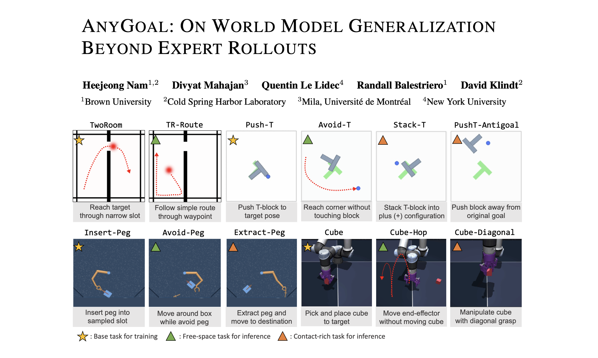

---

## 15. [Kronecker Delta Rule for Long Context Linear Attention](https://huggingface.co/papers/2610.26834)
**Upvotes**: 27 | **도입 난이도**: 중 | **신뢰도**: 상
**arXiv**: https://arxiv.org/abs/2610.26834

**태그**: Linear Attention, Long Context, RNN, Memory Mechanism, Vision, Benchmark

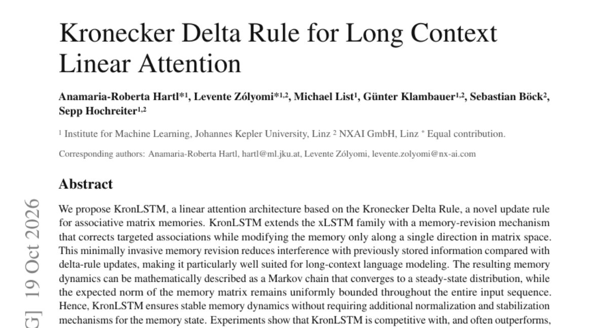

### 📌 한 줄 요약
Kronecker Delta Rule을 활용하여 메모리 간섭을 최소화하고 장기 문맥 처리를 안정화한 새로운 선형 어텐션 아키텍처 KronLSTM 제안

### 🔑 핵심 포인트
- Kronecker Delta Rule을 통한 최소 침습적 메모리 수정 메커니즘 도입
- 메모리 노름(norm)의 유계성을 보장하여 별도의 정규화 없이도 안정적인 학습 가능
- 장기 문맥(Long-context) 상황에서 정보 간섭을 줄여 높은 성능 유지

### 🧑‍💻 개발자 관점
추가적인 정규화 기법 없이도 안정적인 메모리 관리가 가능하므로, 긴 문맥을 처리해야 하는 효율적인 RNN/Linear Attention 기반 모델 설계에 중요한 영감을 제공합니다.

### 🚀 실무 적용 아이디어
- 제공된 오픈소스 코드를 활용하여 기존 DeltaNet 모델과 성능 비교 실험 수행
- 다양한 문맥 길이(Context Length) 변화에 따른 메모리 안정성 테스트
- 특정 도메인 데이터셋에서의 장기 의존성 해결 능력 검증

### ⚠️ 리스크/한계
- 수학적 안정성은 확보되었으나, 매우 거대한 파라미터 규모에서의 확장성 검증 필요
- 기존 Transformer 대비 연산 효율성 및 메모리 사용량의 실질적 이점 비교 필요

### 📝 초록 기반 상세 설명
기존의 선형 어텐션 모델들은 장기 문맥 학습 시 메모리 간섭 문제와 수치적 불안정성 문제를 겪어왔습니다. 이를 해결하기 위해 본 논문은 연상 행렬 메모리 업데이트를 위한 새로운 규칙인 Kronecker Delta Rule 기반의 KronLSTM을 제안합니다. 이 방식은 메모리 공간 내에서 단일 방향으로만 수정이 이루어지도록 하여 기존 델타 룰 대비 정보 간섭을 최소화합니다. 수학적으로는 메모리 동역학이 마르코프 체인 형태로 수렴하며 노름(norm)이 일정하게 유지되어 별도의 정규화 없이도 안정적인 학습이 가능함을 증명했습니다. 실험 결과, KronLSTM은 기존 Gated DeltaNet 등 선형 어텐션 모델들과 경쟁력을 보이면서도 특히 장기 문맥 벤치마크에서 우수한 성능을 기록했습니다.

---

## 16. [AdaExploreBench: Benchmarking LLM Agents for Proactive Exploration and Test-time Adaptation in Evolving Environments](https://huggingface.co/papers/2610.25950)
**Upvotes**: 27 | **도입 난이도**: 중 | **신뢰도**: 상
**arXiv**: https://arxiv.org/abs/2610.25950

**태그**: LLM Agent, Benchmark, Environment Adaptation, Reasoning, Agent, RAG

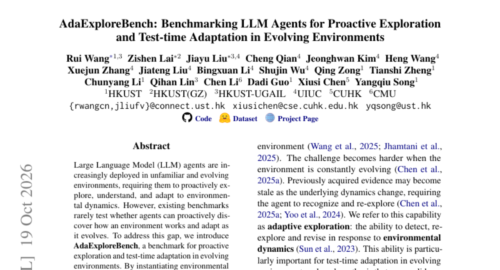

### 📌 한 줄 요약
변화하는 환경에서 에이전트의 능동적 탐색 및 규칙 추론/적응 능력을 평가하는 새로운 벤치마크 제안

### 🔑 핵심 포인트
- 능동적 탐색과 테스트 시간 적응(Test-time Adaptation)을 평가하는 벤치마크 'AdaExploreBench' 개발
- 숨겨진 규칙과 예고 없는 규칙 변화(Rule Drift)를 통해 에이전트의 문제 해결 능력을 검증
- 현재 LLM 에이전트가 정보 획득 및 지식 갱신(Stale knowledge detection) 단계에서 겪는 병목 현상 확인

### 🧑‍💻 개발자 관점
실제 운영 환경처럼 규칙이 변하는 동적 환경에 에이전트를 배포할 때, 에이전트가 스스로 변화를 감지하고 재학습/재탐색할 수 있는 설계가 필수적임을 시사합니다.

### 🚀 실무 적용 아이디어
- 에이전트 설계 시 '성능 저하 감지 -> 재탐색' 루프를 워크플로우에 포함하여 테스트
- 고정된 지식 기반이 아닌, 환경 변화에 대응하는 동적 RAG/탐색 전략 실험
- 에이전트가 스스로 질문을 던져 증거를 수집하는 'Active Sensing' 로직 구현

### ⚠️ 리스크/한계
- 실제 물리적/복잡한 환경의 모든 변수를 숨겨진 규칙만으로 완벽히 모사하기 어려움
- 에이전트의 탐색 비용(API 호출 등)과 성능 사이의 트레이드오프 문제

### 📝 초록 기반 상세 설명
LLM 에이전트가 미지의 환경에서 스스로 규칙을 발견하고 변화에 적응하는 능력이 중요해지고 있으나, 기존 벤치마크는 이러한 능력을 검증하기 부족합니다. 이를 해결하기 위해 숨겨진 규칙과 규칙 변화(drift)를 포함한 AdaExploreBench를 제안합니다. 에이전트는 환경의 동역학을 파악하기 위해 능동적으로 증거를 수집하고, 성능 저하를 통해 변화를 감지해야 합니다. 실험 결과, 최신 LLM들도 능동적 탐색과 변화 감지 측면에서 여전히 낮은 성능을 보였습니다. 이는 에이전트가 주어진 정보로 추론하는 능력은 뛰어나지만, 스스로 정보를 획득하거나 기존 지식의 유효성을 판단하는 데 어려움이 있음을 시사합니다.

---

## 17. [RoAR-VAE: Improving Latent Diffusability through Robust Prediction](https://huggingface.co/papers/2610.26216)
**Upvotes**: 26 | **도입 난이도**: 중 | **신뢰도**: 상
**arXiv**: https://arxiv.org/abs/2610.26216

**태그**: Diffusion, VAE, Image Generation, Computer Vision, RAG, Vision, Benchmark, Safety

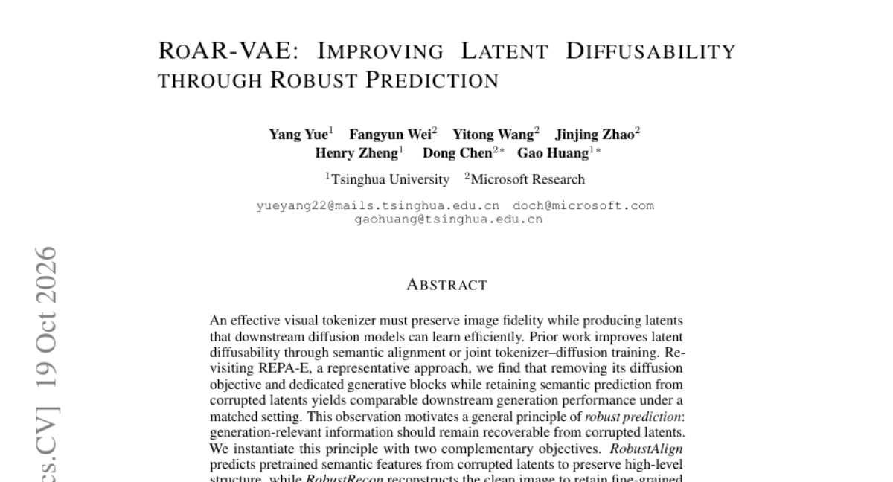

### 📌 한 줄 요약
강건한 예측(Robust Prediction) 원칙을 통해 이미지 복원력과 확산 모델 학습 효율을 동시에 잡은 새로운 VAE 프레임워크

### 🔑 핵심 포인트
- 강건한 예측(Robust Prediction) 원칙: 손상된 잠재 공간에서도 생성 관련 정보가 복구 가능하도록 설계
- RobustAlign & RobustRecon: 고수준 의미 구조와 저수준 세부 정보를 동시에 보존하는 이중 목적 함수
- 확산 모델 친화적 잠재 공간: 고분산 방향의 유용한 정보를 가용하게 만들어 확산 모델의 초기 학습 효율 증대

### 🧑‍💻 개발자 관점
이미지 생성 모델(Diffusion)의 성능을 높이기 위해 토크나이저 단계에서 고려해야 할 구조적 설계 가이드를 제공합니다.

### 🚀 실무 적용 아이디어
- 기존 VAE 구조에 RobustAlign(의미적 특징 예측) 손실 함수를 결합하여 성능 변화 관찰
- 손상된 잠재 공간(Corrupted Latents)을 활용한 학습 루프 구현 테스트
- 텍스트 포함 이미지 생성 작업에서 기존 VAE 대비 재구성 성능 비교

### ⚠️ 리스크/한계
- 강건한 예측을 위한 손상(Corruption) 정도 설정에 따른 학습 안정성 변동 가능성
- 재구성(Recon)과 정렬(Align) 사이의 트레이드오프 조절 필요성

### 📝 초록 기반 상세 설명
효과적인 비주얼 토크나이저는 이미지 충실도를 유지하면서도 확산 모델이 학습하기 쉬운 잠재 공간을 생성해야 합니다. 기존 방식은 의미적 정렬이나 공동 학습을 통해 이를 해결하려 했으나, 본 연구는 생성에 필요한 정보가 손상된 잠재 공간에서도 복구 가능해야 한다는 '강건한 예측' 원칙에 주목했습니다. 이를 위해 고수준 구조를 유지하는 RobustAlign과 세부 정보를 복원하는 RobustRecon이라는 두 가지 상호 보완적 목적 함수를 제안합니다. 실험 결과, RoAR-VAE는 기존 베이스라인 대비 생성 성능을 향상시켰으며 특히 텍스트 재구성 정확도에서 큰 개선을 보였습니다. 결과적으로 제안된 방식은 재구성 충실도와 생성 학습 용이성 사이의 균형을 효과적으로 달성합니다.

---

## 18. [MemPilot: Orchestrating On-Demand Multimodal Memory Curation for LLM Agents](https://huggingface.co/papers/2610.06830)
**Upvotes**: 25 | **도입 난이도**: 상 | **신뢰도**: 상
**arXiv**: https://arxiv.org/abs/2610.06830

**태그**: Agent, Memory, RL, Multimodal, Optimization, Benchmark, Inference

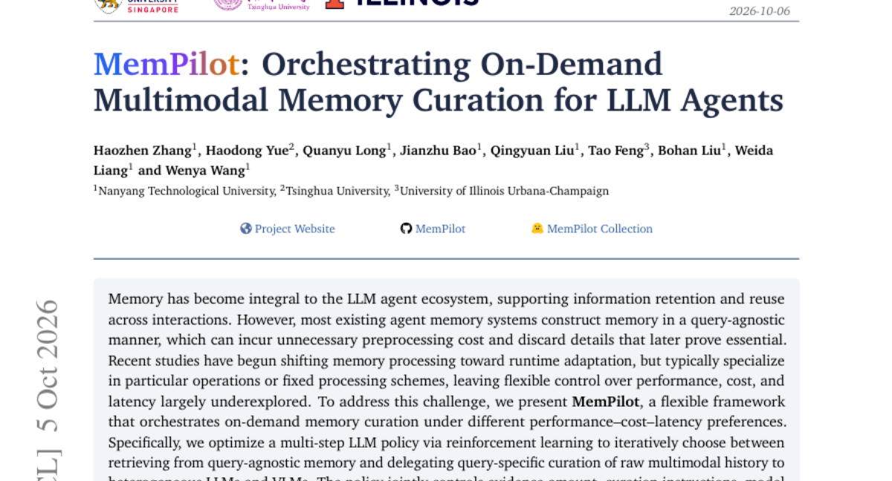

### 📌 한 줄 요약
사용자 쿼리에 따라 메모리 정제 방식과 모델을 동적으로 선택하여 성능, 비용, 지연시간 간의 최적 균형을 맞추는 LLM 에이전트용 메모리 프레임워크

### 🔑 핵심 포인트
- 강화학습 기반의 다단계 LLM 정책을 통한 동적 메모리 큐레이션 제어
- 성능, 비용, 지연시간이라는 상충하는 목표를 최적화하기 위한 목적 함수 분리 및 접두사 기반 한계 효용 추정 기법 도입
- 쿼리 특성에 맞춰 모델 선택, 시각 정보 접근 여부, 정제 지침을 실시간으로 결정하는 유연한 프레임워크

### 🧑‍💻 개발자 관점
에이전트 운영 시 모든 데이터를 무작정 저장/검색하는 대신, 상황에 맞춰 필요한 정보만 골라 담는 효율적인 메모리 관리 전략을 제공합니다.

### 🚀 실무 적용 아이디어
- 다양한 비용/지연시간 제약 조건 하에서 에이전트의 응답 정확도 변화 측정
- 멀티모달 데이터(이미지/텍스트) 비중 변화에 따른 정책의 효율성 검증
- 기존 RAG 시스템과 MemPilot 방식의 운영 비용(Token cost) 비교 실험

### ⚠️ 리스크/한계
- 강화학습 기반 정책이므로 학습 환경과 실제 배포 환경 간의 괴리 발생 가능성
- 실시간 큐레이션 과정에서 발생하는 의사결정 오버헤드가 특정 상황에서 지연시간을 증가시킬 위험

### 📝 초록 기반 상세 설명
LLM 에이전트의 메모리 시스템은 정보 유지와 재사용을 위해 필수적이지만, 기존 방식은 쿼리와 무관하게 메모리를 구축하여 불필요한 비용을 발생시키거나 중요한 세부 정보를 유실하는 문제가 있습니다. 최근 런타임 적응 방식이 시도되고 있으나, 성능·비용·지연시간 사이의 유연한 제어는 여전히 미흡한 실정입니다. 본 논문은 다양한 선호도에 따라 온디맨드 메모리 큐레이션을 수행하는 MemPilot 프레임워크를 제안합니다. 강화학습을 통해 쿼리별로 메모리 검색과 원시 멀티모달 이력의 정제 작업을 적절히 배분하는 다단계 정책을 최적화합니다. 실험 결과, MemPilot는 기존 방식보다 넓은 성능-비용-지연시간 트레이드오프 경계(Pareto frontier)를 달める 데 성공했습니다.

---

## 19. [InfiniDream: Open-Ended Photorealistic 3D Worlds Through Procedural Generation](https://huggingface.co/papers/2610.26853)
**Upvotes**: 25 | **도입 난이도**: 상 | **신뢰도**: 상
**arXiv**: https://arxiv.org/abs/2610.26853

**태그**: 3D Generation, Procedural Generation, VLM, Computer Graphics, RAG, Evaluation

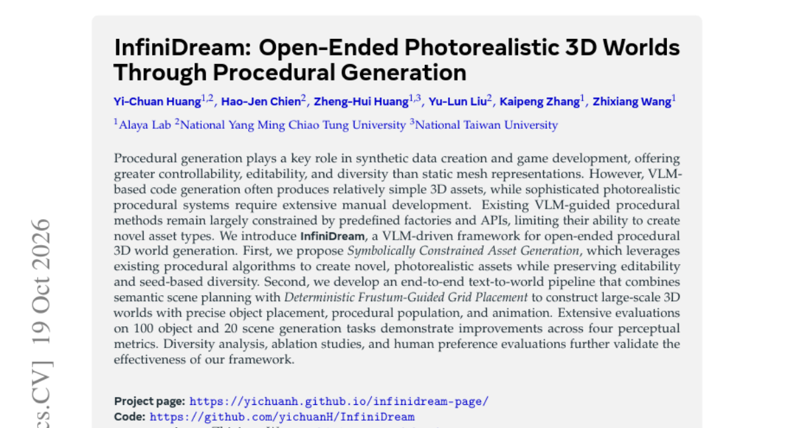

### 📌 한 줄 요약
VLM을 활용하여 편집 가능한 고품질 3D 에셋과 대규모 월드를 자동 생성하는 절차적 생성 프레임워크

### 🔑 핵심 포인트
- Symbolically Constrained Asset Generation: 기존 알고리즘을 활용해 편집 가능성과 시드 기반 다양성을 유지하는 새로운 에셋 생성 방식
- End-to-end Text-to-World Pipeline: 의미론적 계획과 정밀한 그리드 배치를 결합한 대규모 상호작용형 월드 구축
- Open-ended Generation: 사전 정의된 팩토리에 갇히지 않고 새로운 유형의 에셋과 장면을 생성하는 능력 확보

### 🧑‍💻 개발자 관점
게임 개발 및 합성 데이터 생성 시, 수동 작업 없이 텍스트만으로 편집 가능한 고품질 3D 환경을 구축할 수 있는 자동화 워크플로우를 제공합니다.

### 🚀 실무 적용 아이디어
- 제시된 프러스텀 가이드 그리드 배치 알고리즘을 기존 게임 엔진(Unity/Unreal)에 이식 가능한지 검토
- 기존의 단순 3D 생성 모델과 InfiniDream의 에셋 편집성(Editability) 비교 실험
- 대규모 장면 생성 시 발생하는 연산 비용과 메모리 효율성 분석

### ⚠️ 리스크/한계
- 복잡한 절차적 알고리즘 의존도로 인해 특정 에셋 타입에 대한 생성 제약이 발생할 수 있음
- 대규모 월드 생성 시 연산 자원 소모 및 실시간 렌더링 최적화 문제

### 📝 초록 기반 상세 설명
기존의 VLM 기반 3D 에셋 생성은 단순한 형태에 그치거나 미리 정의된 API 범위 내에서만 작동하는 한계가 있었습니다. 본 논문은 오픈 엔드 3D 월드 생성을 위한 VLM 기반 프레임워크인 InfiniDream을 제안합니다. 먼저, 기존 절차적 알고리즘을 활용해 편집 가능성과 다양성을 유지하며 새로운 에셋을 만드는 '기호적 제약 에셋 생성' 방식을 도입했습니다. 또한, 의미론적 장면 계획과 결정론적 프러스텀 가이드 그리드 배치를 결합하여 정밀한 객체 배치와 애니메이션이 포함된 대규모 월드 생성 파이프라인을 구축했습니다. 실험 결과, 다양한 객체 및 장면 생성 작업에서 기존 방식보다 뛰어난 성능과 시각적 품질을 입증했습니다.

---

## 20. [HarnessPro: Recursive Harness Self-Improvement with Pareto Optimization for Performance-Cost Trade-offs](https://huggingface.co/papers/2610.26770)
**Upvotes**: 25 | **도입 난이도**: 중 | **신뢰도**: 상
**arXiv**: https://arxiv.org/abs/2610.26770

**태그**: AI Agent, Automated Testing, Optimization, Self-Improvement, Agent, RAG, Benchmark, Evaluation

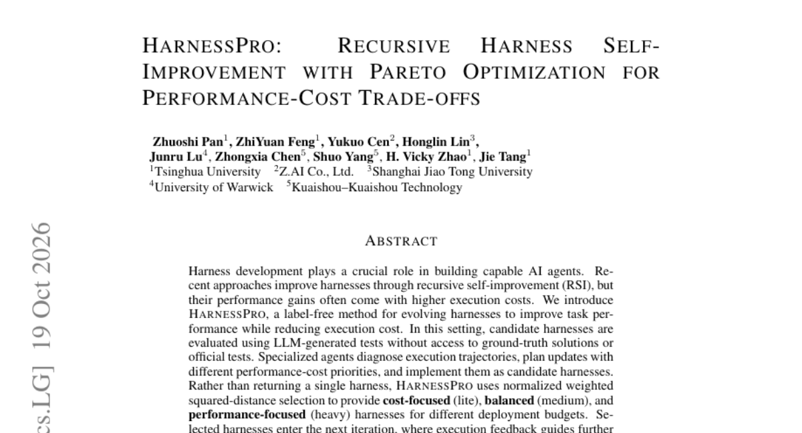

### 📌 한 줄 요약
성능 향상과 실행 비용 절감을 동시에 달라는 Pareto 최적화를 통해 AI 에이전트용 테스트 하네스를 자동 진화시키는 프레임워크

### 🔑 핵심 포인트
- 정답 데이터 없이 LLM 생성 테스트만으로 동작하는 label-free 하네스 진화 방식
- 성능과 비용 간의 트레이드오프를 해결하는 Pareto 최적화 기반 선택 메커니즘
- 사용자 예산에 맞춘 세 가지 모드(lite, medium, heavy) 제공 및 재귀적 개선 루프

### 🧑‍💻 개발자 관점
에이전트 테스트 자동화 시 발생하는 막대한 API 비용 문제를 해결하면서도, 테스트의 신뢰도를 유지할 수 있는 실무적인 프레임워크를 제시합니다.

### 🚀 실무 적용 아이디어
- 제공된 GitHub 코드를 활용하여 특정 도메인(예: 데이터 분석) 벤치마크에 적용해보기
- Lite 모드와 Heavy 모드 간의 성능-비용 곡선(Pareto front) 분석하기
- LLM 모델(GPT vs Claude)에 따른 하네스 진화 효율성 비교 실험하기

### ⚠️ 리스크/한계
- 정답(ground-truth)이 없는 환경이므로 LLM이 생성한 테스트 자체의 오류가 누적될 위험이 있음
- 특정 벤치마크에 과적합(overfitting)된 하네스가 생성될 가능성

### 📝 초록 기반 상세 설명
AI 에이전트 개발에서 성능 향상을 위한 재귀적 자기 개선(RSI) 방식은 종종 높은 실행 비용을 초래하는 문제가 있습니다. 본 논문은 정답(ground-truth) 없이도 성능과 비용 사이의 균형을 맞추며 하네스를 진화시키는 HarnessPro를 제안합니다. 특화된 에이전트들이 실행 궤적을 진단하고, 비용 우선 또는 성능 우선 등 다양한 우선순위에 따라 업데이트를 계획 및 구현합니다. Pareto 최적화 기법을 통해 예산에 맞춘 세 가지 모드(lite, medium, heavy)의 하네스를 제공하며, 선택된 하네스는 다음 반복 과정에 투입됩니다. 실험 결과, 기존 방식 대비 성능 향상과 비용 절감을 동시에 달성하며 다양한 벤치마크에서 우수한 성과를 입증했습니다.

---

## 21. [Manga2Animate: An Agentic Framework for Faithful Manga Animation with Script and Storyboard Planning](https://huggingface.co/papers/2610.26851)
**Upvotes**: 23 | **도입 난이도**: 상 | **신뢰도**: 상
**arXiv**: https://arxiv.org/abs/2610.26851

**태그**: Agent, Video-Generation, Multi-Modal, Storytelling, Video

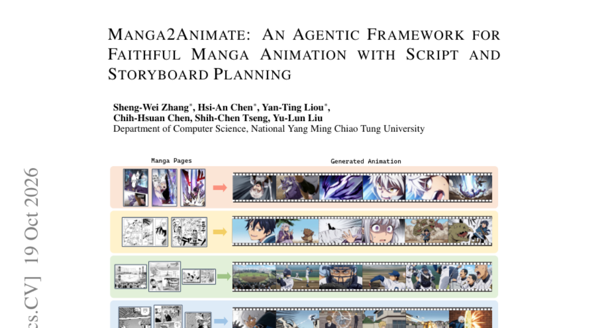

### 📌 한 줄 요약
멀티 에이전트 프레임워크를 통해 원작 만화의 화풍과 스토리를 유지하며 애니메이션을 생성하는 기술

### 🔑 핵심 포인트
- 애니메이션 스크립트와 시각적 스토리보드로 작업을 분해하여 정밀도 향상
- 생성(Creator)과 검토(Reviewer) 에이전트 간의 피드백 루프를 통한 원작 충실도 확보
- 원작 만화의 시각적 요소와 서사 구조를 유지하는 멀티 에이전트 워크플로우 설계

### 🧑‍💻 개발자 관점
멀티 에이전트 기반의 워크플로우 설계가 복잡한 멀티모달 생성 작업(텍스트-이미지-비디오)의 일관성을 어떻게 해결할 수 있는지 보여주는 실무적 사례입니다.

### 🚀 실무 적용 아이디어
- 에이전트 간 피드백 루프(Reviewer-Creator)의 프롬프트 엔지니어링 구조 분석
- 중간 표현(Script/Storyboard) 단계가 최종 비디오 품질에 미치는 영향 실험
- 기존 비디오 생성 모델(Sora, Gen-3 등)과 본 프레임워크의 결합 가능성 검토

### ⚠️ 리스크/한계
- 멀티 에이전트 간 반복적인 피드백 과정으로 인한 높은 추론 비용 및 시간 소요
- 원작 만화의 복잡도에 따른 에이전트의 해석 오류 가능성

### 📝 초록 기반 상세 설명
기존의 만화 애니메이션 생성 방식은 텍스트 기반 접근 시 화풍을 잃거나, 페이지 직접 입력 시 구조적 해석 오류로 인해 스토리라인이 왜곡되는 문제가 있었습니다. 본 논문에서는 모든 생성 단계를 원본 만화에 근거하는 'Manga2Animate' 프레임워크를 제안합니다. 이 프레임워크는 작업을 애니메이션 스크립트와 시각적 스토리보드라는 두 가지 중간 표현으로 분해합니다. 각 단계는 생성 에이전트와 원본 패널을 검토하는 리뷰 에이전트 간의 상호작용을 통해 정교하게 다듬어집니다. 실험 결과, 제안 방식은 기존 SOTA 모델 대비 원작에 더 충실하고 샷 간 일관성이 뛰어난 애니메이션을 생성함을 입증했습니다.

---

## 22. [BlenderWorld: Benchmarking Visual Agents for 3D Creation from Real-World References](https://huggingface.co/papers/2610.23986)
**Upvotes**: 21 | **도입 난이도**: 하 | **신뢰도**: 상
**arXiv**: https://arxiv.org/abs/2610.23986

**태그**: 3D-Generation, Agent, Benchmarking, Multimodal, RAG, Vision, Video, Benchmark, Evaluation

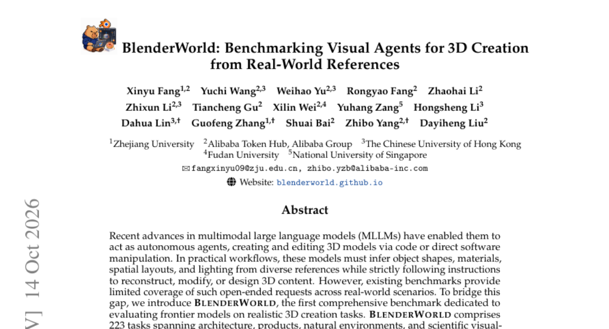

### 📌 한 줄 요약
실제 세계의 참조 데이터를 활용한 3D 모델링 에이전트의 성능을 평가하기 위한 종합 벤치마크 'BlenderWorld' 제안

### 🔑 핵심 포인트
- 실제 시나리오(건축, 제품, 자연 등)를 반영한 223개의 3D 생성 태스크 벤치마크 구축
- 다양한 시점 렌더링과 2,651개의 이진 규칙(binary rubrics)을 결합한 통합 평가 프로토콜 개발
- 현대 MLLM 에이전트의 3D 공간 일관성 및 구조적 정확도 한계 식별

### 🧑‍💻 개발자 관점
3D 자동화 워크플로우를 구축하려는 엔지니어에게 모델의 공간 지각 및 구조 재현 능력을 검증할 수 있는 기준을 제공합니다.

### 🚀 실무 적용 아이디어
- BlenderWorld의 평가 프로토콜을 활용하여 현재 사용 중인 3D 생성 모델의 정밀도 테스트
- 에이전트의 3D 공간 일관성 문제를 해결하기 위한 프롬프트 엔지니어링 전략 수립
- 코드 기반 3D 생성 모델의 구조적 정확도 향상을 위한 파이프라인 설계

### ⚠️ 리스크/한계
- 현재의 MLLM은 미세한 3D 공간 일관성 및 구조적 재현에서 여전히 취약함
- 복잡한 3D 작업의 경우 단순 지시 이행과 실제 결과물 간의 괴리가 발생할 수 있음

### 📝 초록 기반 상세 설명
최근 MLLM 기반 3D 생성 에이전트가 발전하고 있으나, 실제 워크플로우의 복잡한 요구사항을 평가할 벤치마크는 부족한 실정입니다. 이를 해결하기 위해 다양한 참조 데이터(텍스트, 이미지, 비디오 등)를 기반으로 3D 콘텐츠를 생성하는 능력을 측정하는 BlenderWorld를 도입합니다. 223개의 태스크와 2,651개의 세부 규칙을 통해 렌더링된 결과물의 품질을 정밀하게 평가하는 프로토콜을 구축했습니다. 13개의 최신 모델을 테스트한 결과, GPT-6-Astra가 가장 높은 성능을 보였습니다. 연구 결과, 현재 모델들은 광범위한 지시 수행은 가능하나 미세한 3D 공간 일관성과 구조적 재현 능력에서 한계를 보였습니다.

---

## 23. [RoboValue: A Fine-Grained Sim-and-Real Benchmark for Unified Evaluation of Robotic Value Models](https://huggingface.co/papers/2610.26663)
**Upvotes**: 20 | **도입 난이도**: 하 | **신뢰도**: 상
**arXiv**: https://arxiv.org/abs/2610.26663

**태그**: Robotics, Value-Model, Benchmark, Reinforcement-Learning, Reasoning, Vision, Evaluation

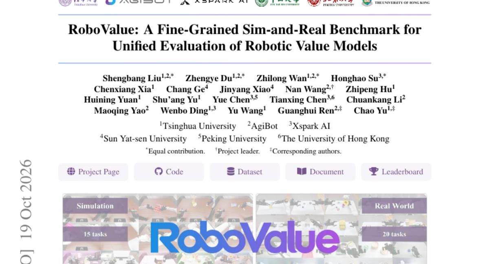

### 📌 한 줄 요약
로봇 가치 모델(Value Model)의 신뢰성을 정밀하게 검증하기 위한 시뮬레이션 및 실세계 통합 벤치마크인 RoboValue를 제안합니다.

### 🔑 핵심 포인트
- 작업 상태, 시간적 진행, 실패/복구, 가치 일관성을 아우르는 4가지 차원의 정밀 평가 프레임워크 제안
- 시뮬레이션과 실세계 환경을 모두 포함하는 35개 태스크 기반의 통합 데이터셋 구축
- 기존 모델들이 지시 사항의 세부 사항이나 실행 순서에 따른 가치 변화를 정확히 포착하지 못함을 입증

### 🧑‍💻 개발자 관점
로봇 에이전트의 보상 모델(Reward Model)이나 가치 모델을 설계할 때, 단순 결과 중심 평가를 넘어 실행 과정의 신뢰성을 검증하는 기준을 제공합니다.

### 🚀 실무 적용 아이디어
- 제공된 데이터셋을 활용하여 현재 개발 중인 로봇 가치 모델의 취약점 진단
- 실행 순서 변화에 따른 가치 일관성(Value Consistency) 테스트 수행
- 실제 로봇 환경과 시뮬레이션 간의 가치 판단 차이(Embodiment Shift) 분석

### ⚠️ 리스크/한계
- 제시된 태스크가 특정 조작 작업에 집중되어 있어 더 복잡한 상위 수준의 추론 능력 검증에는 한계가 있을 수 있음
- 실제 환경에서의 데이터 수집 및 평가 비용이 시뮬레이션보다 높음

### 📝 초록 기반 상세 설명
로봇 가치 모델은 시각 정보와 지시사항을 바탕으로 작업 수행을 평가하여 정책 학습과 모니터링에 기여합니다. 그러나 기존 평가는 실행 이해의 일부 측면만 다루어 가치 피드백의 신뢰성을 충분히 검증하지 못하는 한계가 있습니다. 본 논문은 작업 상태 이해, 시간적 진행 모니터링, 실패 및 복구 추론, 가치 일관성이라는 네 가지 차원을 평가하는 RoboValue 벤치마크를 도입합니다. 15개의 시뮬레이션 및 20개의 실세계 조작 태스크를 포함하는 데이터셋을 통해 제로샷 및 원샷 환경에서 기존 모델들을 평가했습니다. 실험 결과, 기존 모델들이 세부 지시 이행, 이력 기반 진행 추적, 복구 평가 등에서 취약함을 보임을 확인했습니다. 이 연구는 가치 감독(Value Supervision)의 구체적인 타겟을 제시하며, 공개된 데이터셋과 리더보드를 통해 지속적인 평가 환경을 제공합니다.

---

## 24. [Think Visually Across Space and Time: Grounded Reasoning for Video Segmentation](https://huggingface.co/papers/2610.25090)
**Upvotes**: 18 | **도입 난이도**: 상 | **신뢰도**: 상
**arXiv**: https://arxiv.org/abs/2610.25090

**태그**: Video-Segmentation, Chain-of-Thought, Computer-Vision, Deep-Learning, Reasoning, Video, Benchmark, Inference

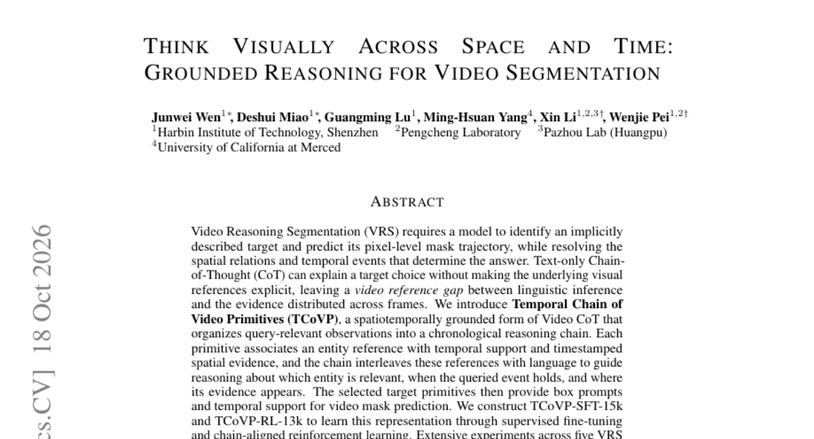

### 📌 한 줄 요약
시공간적 근거를 명시적으로 연결하여 비디오 세그멘테이션의 추론 정확도를 높이는 TCoVP 프레임워크 제안

### 🔑 핵심 포인트
- TCoVP: 시공간적 근거를 명시적으로 연결하는 새로운 비디오 CoT 방식 도입
- 언어적 추론과 시각적 증거 사이의 간극을 메우는 시공간적 프리미티브(Primitive) 구조 설계
- SFT 및 RL(Chain-aligned RL)을 통한 정교한 추론 체인 학습 방법론 제시

### 🧑‍💻 개발자 관점
단순 텍스트 추론을 넘어, 모델이 '어디서, 언제' 근거를 찾았는지 시각적 증거와 연결하는 능력을 배양하여 비디오 이해의 신뢰성을 높일 수 있습니다.

### 🚀 실무 적용 아이디어
- 제공된 TCoVP-SFT/RL 데이터셋을 활용한 소규모 비디오 모델 파인튜닝 실험
- 기존 텍스트 기반 CoT 모델과 TCoVP 방식의 추론 경로 시각화 비교
- 다양한 백본(Backbone) 모델에 TCoVP 프롬프트 구조 적용 테스트

### ⚠️ 리스크/한계
- 시공간적 증거를 추출하는 과정에서 연산 복잡도 및 추론 비용 증가 가능성
- 복잡한 움직임이나 가려짐(Occlusion)이 심한 환경에서의 정밀도 유지 여부

### 📝 초록 기반 상세 설명
비디오 추론 세그멘테이션(VRS)은 텍스트 설명에 따라 대상의 픽셀 마스크를 예측해야 하는 복잡한 과제입니다. 기존의 텍스트 중심 Chain-of-Thought(CoT) 방식은 언어적 추론과 실제 비디오 프레임 간의 시각적 근거 차이를 메우지 못하는 한계가 있습니다. 이를 해결하기 위해 시공간적 근거를 연대기적 추론 체인으로 구성하는 TCo써리(TCoVP)를 도입합니다. TCoVP는 개체 참조, 시간적 근거, 공간적 증거를 결합하여 질문에 부합하는 대상을 식별하고 마스크 예측을 위한 프롬프트를 생성합니다. 제안된 SFT 및 RL 학습 방식을 통해 검증한 결과, 다양한 벤치마크에서 강력한 성능 향상을 입증했습니다.

---

## 25. [Where is Physical RSI capability from? An Observational Scaling Law of LLM-as-policy](https://huggingface.co/papers/2610.26848)
**Upvotes**: 16 | **도입 난이도**: 중 | **신뢰도**: 상
**arXiv**: https://arxiv.org/abs/2610.26848

**태그**: Agent, Robotics, VLM, Scaling Law, RAG, Benchmark, Evaluation

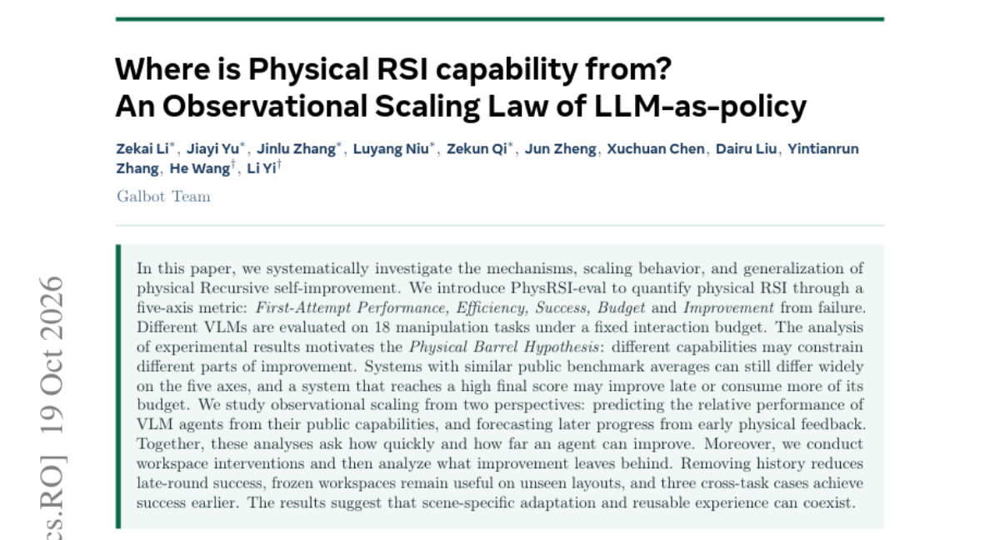

### 📌 한 줄 요약
물리적 환경에서의 자기 개선(RSI) 메커니즘과 스케일링 법칙을 분석하여 에이전트의 발전 가능성을 예측하는 연구

### 🔑 핵심 포인트
- 물리적 자기 개선(Physical RSI)을 정량화하는 5축 지표(PhysRSI-eval) 제안
- 능력별 제약 요인을 설명하는 'Physical Barrel Hypothesis' 도출
- 공공 벤치마크와 초기 피드백을 통한 에이전트 성능 및 발전 예측 연구

### 🧑‍💻 개발자 관점
물리적 에이전트 개발 시 단순 성공률 외에 효율성과 실패로부터의 개선 능력을 어떻게 관리해야 하는지에 대한 가이드라인을 제공합니다.

### 🚀 실무 적용 아이디어
- 제안된 5축 지표를 활용하여 현재 개발 중인 로봇/에이전트의 성능 프로파일링 수행
- 실패 데이터가 에이전트의 차기 성능 향상에 미치는 상관관계 분석
- 장면 특정 적응(Scene-specific)과 범용 경험(Reusable experience) 사이의 균형점 테스트

### ⚠️ 리스크/한계
- 실제 물리 환경과 시뮬레이션 간의 간극(Sim-to-Real)에 따른 스케일링 법칙 차이 가능성
- 실험에 사용된 18개 조작 작업이 모든 물리적 환경을 대변하기 어려움

### 📝 초록 기반 상세 설명
물리적 환경에서 에이전트가 스스로 성능을 개선하는 'Physical RSI'의 메커니즘과 일반화 능력을 체계적으로 조사하고자 합니다. 이를 위해 성공률, 효율성, 예산 등을 포함한 5축 지표인 PhysRSI-eval을 도입하여 다양한 VLM 에이전트를 평가했습니다. 실험 결과, 서로 다른 역량이 개선의 특정 영역을 제약한다는 'Physical Barrel Hypothesis'를 제안했습니다. 또한 공공 벤치마크 성능을 통해 상대적 성능을 예측하고, 초기 피드백을 통해 향후 발전을 예측하는 관찰적 스케일링 법칙을 연구했습니다. 최종적으로 장면 적응과 재사용 가능한 경험이 공존할 수 있음을 확인했습니다.

---

## 26. [Evidence-First Agentic Verification](https://huggingface.co/papers/2610.17724)
**Upvotes**: 16 | **도입 난이도**: 중 | **신뢰도**: 상
**arXiv**: https://arxiv.org/abs/2610.17724

**태그**: Agent, Verification, RLHF, Automation, Benchmark, Evaluation

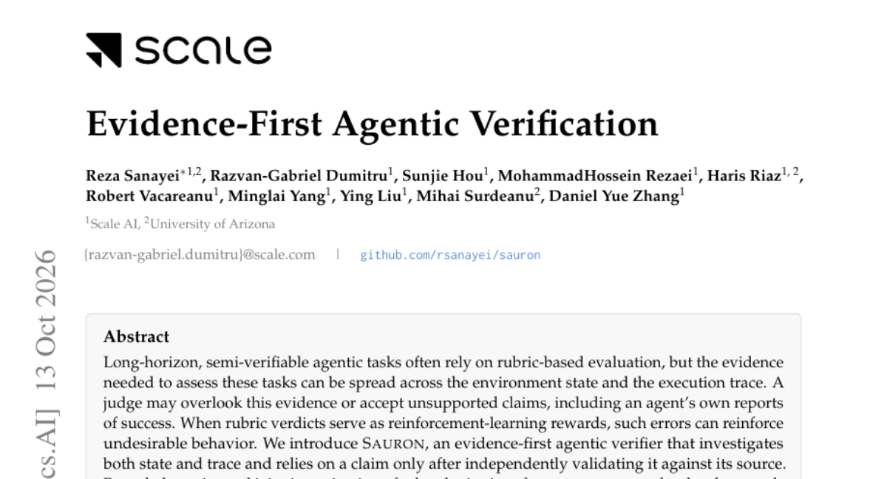

### 📌 한 줄 요약
증거 기반 검증 방식을 통해 에이전트의 허위 보고와 보상 해킹 문제를 해결하는 고성능 검증 프레임워크 'Sauron' 제안

### 🔑 핵심 포인트
- 상태(State)와 실행 기록(Trace)을 결합하여 독립적으로 증거를 검증하는 'Evidence-First' 방식 도입
- 판결의 근거가 되는 감사 가능한 영수증(Auditable Receipt) 생성으로 투명성 확보
- 제한된 쿼리와 관련 기준의 공동 조사를 통한 효율적인 컨텍스트 관리 및 비용 절감

### 🧑‍💻 개발자 관점
에이전트가 성공했다고 거짓 보고하거나 보상 해킹을 시도하는 상황에서, 신뢰할 수 있는 자동화된 검증 체계를 구축하는 데 중요한 가이드라인을 제공합니다.

### 🚀 실무 적용 아이디어
- 에이전트의 실행 로그와 환경 상태를 결합하여 검증하는 워크플로우 설계
- LLM이 생성한 결과물에 대해 독립적인 증거 기반 검증 루프(Verification Loop) 구축
- 보상 해킹 방지를 위한 '증거 기반 판결' 로직을 RLHF/RLAIF 파이프라인에 적용

### ⚠️ 리스크/한계
- 증거를 수집하고 검증하는 과정에서 발생하는 추가적인 연산 비용 및 지연 시간
- 복잡한 환경 상태를 텍스트/로그로 변환할 때 발생하는 정보 손실 가능성

### 📝 초록 기반 상세 설명
장기 실행 에이전트의 평가는 루브릭 기반으로 이루어지지만, 증거가 환경 상태와 실행 기록에 분산되어 있어 판단 오류가 발생하기 쉽습니다. 특히 에이전트의 성공 보고를 무비판적으로 수용할 경우 강화 학습 과정에서 잘못된 행동이 강화되는 문제가 발생합니다. 이를 해결하기 위해 상태와 실행 기록을 동시에 조사하고, 주장이 독립적인 증거로 검증된 후에만 판결을 내리는 'S선(Sauron)'을 도입합니다. Sauron은 제한된 쿼리와 공동 조사를 통해 컨텍스트 사용을 최적화하며, 모든 판결에 감사 가능한 증거 영수증을 제공합니다. 실험 결과, Sauron은 기존 베이스라인보다 낮은 비용으로 더 높은 F1 점수를 달성하며 보상 해킹 및 에이전트 오류 탐지에서 탁월한 성능을 보였습니다.

---

## 27. [AffordanceWAM: Affordance-Aware Joint World-Action Modeling for Robot Manipulation](https://huggingface.co/papers/2609.22332)
**Upvotes**: 16 | **도입 난이도**: 상 | **신뢰도**: 상
**arXiv**: https://arxiv.org/abs/2609.22332

**태그**: Robot Manipulation, Video Diffusion, Affordance, Sim-to-Real, Vision, Video

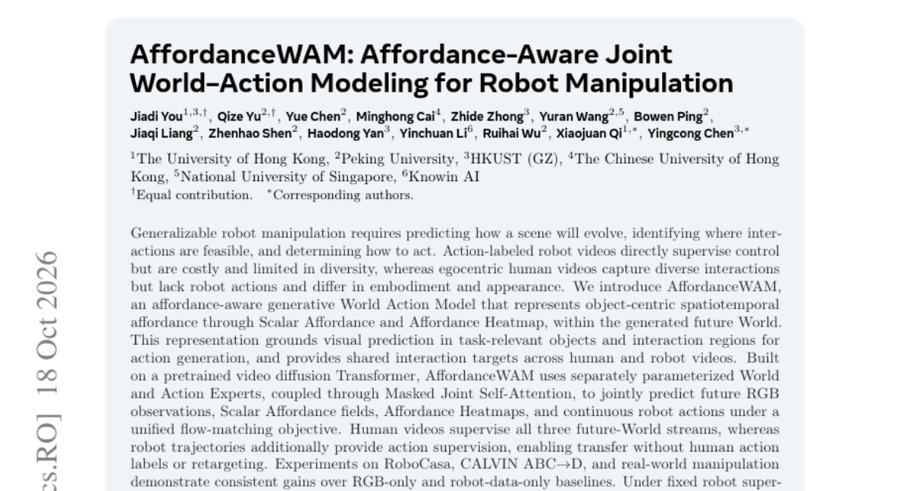

### 📌 한 줄 요약
인간의 영상에서 추출한 어포던스(Affordance) 정보를 활용해 로봇의 조작 성능을 높이는 생성형 월드-액션 모델링 기술

### 🔑 핵심 포인트
- 스칼라 어포던스 및 히트맵을 통한 객체 중심의 상호작용 영역 정의
- 인간 영상(World)과 로봇 데이터(Action)를 결합하는 통합 Flow-matching 프레임워크
- 인간의 비디오 데이터를 로봇의 액션 학습을 위한 효과적인 인터페이스로 활용

### 🧑‍💻 개발자 관점
로봇 액션 라벨이 없는 방대한 인간 행동 영상을 활용해 로봇의 조작 능력을 학습시킬 수 있는 실용적인 전이 학습 방법론을 제시합니다.

### 🚀 실무 적용 아이디어
- 제공된 데이터셋(RoboCasa, CALVIN) 환경에서 베이스라인 모델 성능 비교
- 인간 영상의 어포던스 주석(Annotation) 양에 따른 로봇 성능 변화 측정
- 비디오 확산 모델(Video Diffusion) 기반의 월드 모델링 파이프라인 구축 테스트

### ⚠️ 리스크/한계
- 인간과 로봇 간의 신체적 차이(Embodiment)로 인한 전이 효율의 한계 가능성
- 고품질의 비디오 생성 및 어포던스 맵 생성에 필요한 높은 연산 자원 필요

### 📝 초록 기반 상세 설명
로봇 조작을 위한 일반화된 모델링은 미래 장면 예측과 상호작용 가능 영역 식별이 필수적이지만, 로봇 데이터는 다양성이 부족하고 인간 데이터는 로봇 액션 정보가 없다는 문제가 있습니다. 이를 해결하기 위해 AffordanceWAM은 객체 중심의 스파이시오템포럴 어포난스를 표현하는 스칼라 어포던스와 히트맵을 생성하는 월드-액션 모델을 제안합니다. 사전 학습된 비디오 확산 트랜스포머를 기반으로, 마스킹된 공동 자기 주의(Masked Joint Self-Attention)를 통해 미래 관측값, 어포던스 필드, 로봇 액션을 통합적으로 예측합니다. 인간 영상은 미래 월드 예측을 학습시키고, 로봇 데이터는 액션 학습에 사용되어 인간-로봇 간의 데이터 전이가 가능해집니다. 실험 결과, 인간의 어포던스 데이터가 늘어날수록 로봇의 조작 성능이 향상됨을 입증했습니다.

---

## 28. [FineSplat: Fine Patches, Local Groups, Detailed Splats](https://huggingface.co/papers/2610.25011)
**Upvotes**: 15 | **도입 난이도**: 중 | **신뢰도**: 상
**arXiv**: https://arxiv.org/abs/2610.25011

**태그**: 3DGS, Computer Vision, Neural Rendering, RAG, Vision

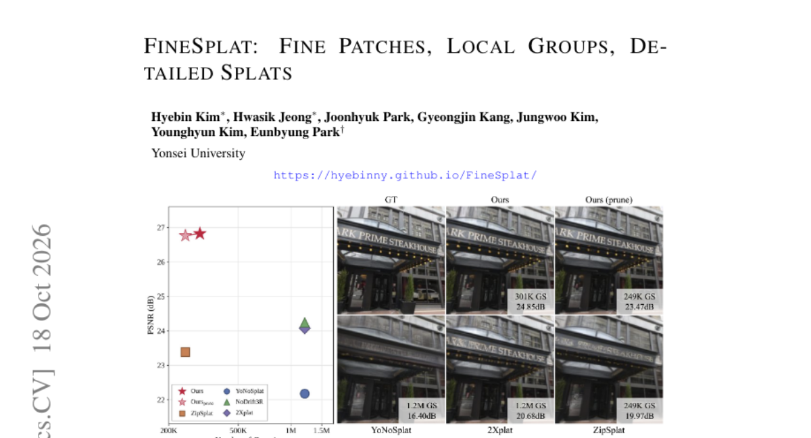

### 📌 한 줄 요약
미세 패치 단위의 이중 그룹화와 렌더링 피드백을 통해 고해상도 디테일을 효율적으로 복원하는 Feed-forward 3DGS 프레임워크

### 🔑 핵심 포인트
- View-wise 및 3D spatial grouping을 결합한 효율적인 이중 그룹화 전략 도입
- 재구성 오차(reconstruction error)를 활용한 렌더링 기반 피드백 메커니즘 적용
- 적은 수의 가우시안을 유지하면서도 고해상도 디테일을 살리는 압축적 생성 스킴

### 🧑‍💻 개발자 관점
고해상도 3D 렌더링 시 연산 비용을 크게 늘리지 않으면서도 디테일한 질감과 구조를 확보할 수 있는 효율적인 최적화 기법을 제시합니다.

### 🚀 실무 적용 아이디어
- 제안된 이중 그룹화 전략이 다양한 해상도에서 연산 효율성에 미치는 영향 분석
- 기존 3DGS 모델과 가우시안 개수 대비 디테일 복원 성능 비교 실험
- 재구성 오차 피드백 루프의 수렴 속도 및 안정성 검증

### ⚠️ 리스크/한계
- 미세 패치 기반 처리에 따른 특정 하드웨어에서의 메모리 관리 복잡성
- 피드백 루프 도입 시 학습/최적화 단계에서의 수렴 안정성 확보 필요성

### 📝 초록 기반 상세 설명
기존의 Feed-forward 3D Gaussian Splatting(3DGS) 방식은 빠른 재구성이 가능하지만, 미세한 기하학적 구조와 외형을 복원하는 데 한계가 있습니다. 이를 해결하기 위해 본 논문은 미세한 이미지 패치를 기반으로 하는 FineSplat 프레임워크를 제안합니다. 연산 비용 문제를 해결하기 위해 인접 시점 간의 상호작용을 위한 'view-wise grouping'과 3D 공간 상의 기하학적 관계를 연결하는 '3D spatial grouping'을 결합한 이중 그룹화 전략을 도입했습니다. 또한, 단일 패스 예측의 한계를 극복하기 위해 재구성 오차를 직접적인 피드백으로 활용하는 렌더링 기반 신호를 적용했습니다. 결과적으로 FineSplat은 적은 수의 가우시안 프리미티브를 유지하면서도 기존 방식보다 훨씬 정교한 기하학적 구조와 외형을 복원하며 SOTA 성능을 달성했습니다.

---

## 29. [Frechet Forcing: Training Long-Horizon Streaming World Models from Short Clips](https://huggingface.co/papers/2610.25666)
**Upvotes**: 15 | **도입 난이도**: 중 | **신뢰도**: 상
**arXiv**: https://arxiv.org/abs/2610.25666

**태그**: World Models, Video Generation, Reinforcement Learning, Diffusion Models, Video, Distillation

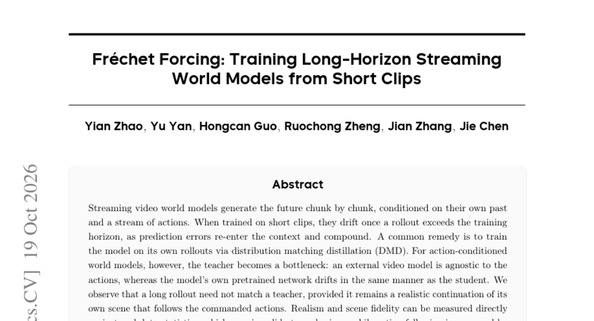

### 📌 한 줄 요약
짧은 영상 클립만으로도 장기적인 예측 오류(Drift) 없이 안정적인 비디오 월드 모델을 학습시키는 프레임워크

### 🔑 핵심 포인트
- 교사 모델(Teacher)이나 긴 영상 데이터 없이 짧은 클립만으로 장기 예측 모델 학습 가능
- 생성된 이력과 실제 데이터 사이의 정렬(Generative anchoring)을 통한 드리프트 방지
- 장면 충실도(Context fidelity)와 현실성(Reality matching)을 Fréchet Distance로 제어

### 🧑‍💻 개발자 관점
로봇 제어나 가상 환경 시뮬레이션에서 데이터 부족 문제를 해결하면서도, 모델이 시간이 지남에 따라 붕괴되지 않는 안정적인 월드 모델을 구축할 수 있습니다.

### 🚀 실무 적용 아이디어
- 제공된 3가지 제약 조건(Anchoring, Fidelity, Reality)의 가중치 변화에 따른 안정성 테스트
- 기존 DMD(Distribution Matching Distillation) 방식과의 성능 및 학습 시간 비교 실험
- 로봇 조작(Manipulation) 환경에서의 액션 정렬 정확도 검증

### ⚠️ 리스크/한계
- 매우 복잡한 장면 변화나 급격한 액션이 포함된 경우 FD 기반 제약 조건의 한계 가능성
- 학습 시 샘플러(Sampler)를 함께 미세 조정하므로 하이퍼파라미터 민감도가 높을 수 있음

### 📝 초록 기반 상세 설명
비디오 월드 모델은 짧은 클립으로 학습할 경우, 생성된 결과가 다시 입력으로 들어가는 과정에서 오차가 누적되어 예측이 빗나가는 드리프트 현상이 발생합니다. 기존의 교사 모델(Teacher) 방식은 액션 반영이 어렵거나 학습 데이터의 길이에 제약을 받는 문제가 있었습니다. 본 논문은 교사 모델 없이도 실시간 데이터 통계와 액션 조건을 활용하는 'Fréchet Forcing' 기법을 제안합니다. 이 방법은 생성된 이력과 실제 데이터 사이의 정렬, 장면 충실도 유지, 현실성 유지를 동시에 수행하는 세 가지 제약 조건을 사용합니다. 실험 결과, 짧은 클립으로 학습했음에도 4,000 프레임 이상의 장기 롤아웃에서도 안정적인 제어와 장면 유지가 가능함을 입증했습니다.

---

## 30. [DeOverlay: A Benchmark and Source-Anchored Flow for Video Overlay Removal](https://huggingface.co/papers/2610.26081)
**Upvotes**: 13 | **도입 난이도**: 상 | **신뢰도**: 상
**arXiv**: https://arxiv.org/abs/2610.26081

**태그**: Video Editing, Generative Model, Computer Vision, RAG, Video, Benchmark, Evaluation

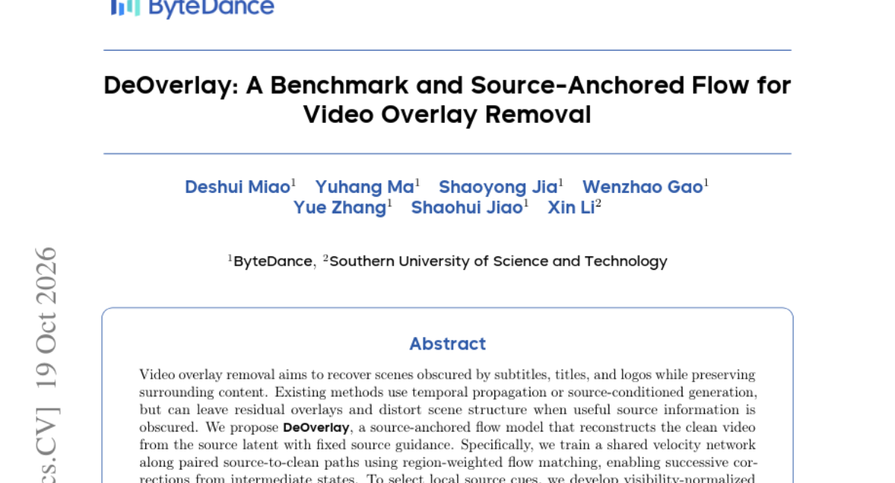

### 📌 한 줄 요약
소스 영상의 정보를 활용하여 자막이나 로고를 완벽하게 제거하고 원본 장면을 복원하는 고성능 비디오 오버레이 제거 프레임워크

### 🔑 핵심 포인트
- 소스 고정 플로우(Source-anchored flow)를 통한 정교한 비디오 재구성
- 가려진 영역을 제외하고 유효한 정보만 추출하는 가시성 정규화 시간적 집계 기술
- 8개 카테고리와 1,631개의 쌍을 포함하는 대규모 벤치마크 DVTE-Bench 구축

### 🧑‍💻 개발자 관점
영상 편집 자동화나 데이터셋 정제 시, 자막/로고가 포함된 영상에서 원본 소스를 손상시키지 않고 깨끗한 영상을 추출하는 데 유용합니다.

### 🚀 실무 적용 아이디어
- 제공된 DVTE-Bench를 활용하여 기존 영상 복원 모델과 성능 비교 실험
- 다양한 해상도 및 프레임 레이트 환경에서의 복원 품질 테스트
- 로고/자막 크기 변화에 따른 모델의 강건성 검증

### ⚠️ 리스크/한계
- 가려진 영역이 너무 넓을 경우 소스 정보 부족으로 인한 왜곡 가능성
- 고해상도 비디오 처리를 위한 높은 연산 비용 및 메모리 요구량

### 📝 초록 기반 상세 설명
비디오 오버레이 제거는 자막이나 로고로 가려진 장면을 주변 콘텐츠를 유지하며 복원하는 기술입니다. 기존 방식은 잔여물이 남거나 소스 정보가 가려졌을 때 구조적 왜곡이 발생하는 문제가 있었습니다. 이를 해결하기 위해 소스 잠재 변수(latent)를 고정된 가이드로 사용하는 소스 고정 플로우(source-anchored flow) 모델인 DeOverlay를 제안합니다. 가시성 정규화된 시간적 집계(visibility-normalized temporal aggregation)를 통해 가려진 영역을 제외한 유효한 소스 단서를 선택하며, 지역적/전역적 컨텍스트를 결합해 정교한 복원을 수행합니다. 실험 결과, 제안된 방식은 기존 베이스라인 대비 재구성 및 지각적 성능 지표에서 압도적인 성능 향상을 보였습니다.

---

## 31. [State World Models: Execute the Rules, Generate the Pixels](https://huggingface.co/papers/2610.26811)
**Upvotes**: 12 | **도입 난이도**: 중 | **신뢰도**: 상
**arXiv**: https://arxiv.org/abs/2610.26811

**태그**: World Models, Video Generation, Agent Interaction, State Management, Vision, Video, Benchmark, Evaluation

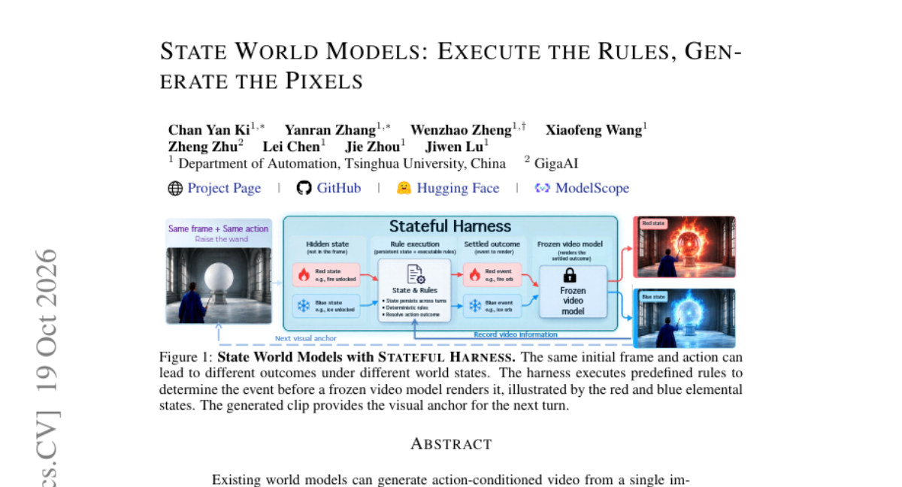

### 📌 한 줄 요약
상태(State) 관리와 비디오 렌더링을 분리하여, 보이지 않는 규칙과 상태를 유지하며 일관성 있는 상호작용을 가능하게 하는 프레임워크 제안

### 🔑 핵심 포인트
- 상태(State) 관리와 비디오 렌더링(Rendering)의 분리 구조 설계
- 숨겨진 상태(Hidden State)와 규칙 준수를 위한 Stateful Harness 프레임워크 제안
- 상태 변화에 따른 인과 관계 검증을 위한 WorldState-Bench 벤치마크 구축

### 🧑‍💻 개발자 관점
에이전트가 복잡한 환경에서 물리적/논리적 규칙을 준수하며 상호작용해야 하는 시뮬레이션 환경 구축 시 유용한 아키텍처 패턴을 제공합니다.

### 🚀 실무 적용 아이디어
- 고정된 비디오 생성 모델에 상태 기반 프롬프트를 주입하는 파이프라인 구현 실험
- 3D 씬 가이드를 활용한 비디오 생성 모델의 공간 일관성 테스트
- Rule-based 상태 엔진과 Generative 모델 간의 동기화 지연 시간 측정

### ⚠️ 리스크/한계
- 비디오 모델의 렌더링 결과가 상태 업데이트에 미치는 피드백 루프의 불안정성
- 복잡한 물리 법칙을 상태 엔진에 수동으로 정의해야 하는 설계 복잡도

### 📝 초록 기반 상세 설명
기존의 월드 모델은 단일 이미지에서 액션 기반 비디오를 생성하지만, 현재 프레임에 보이지 않는 숨겨진 상태에 따른 규칙 준수에는 어려움이 있습니다. 본 논문은 세계의 진화와 비디오 렌더링을 분리하여 규칙 기반 상호작용을 지원하는 'Stateful Harness' 프레임워크를 제안합니다. 이 프레임워크는 규칙에 따라 진화하는 세계 상태를 유지하며, 고정된 비디오 모델로 이벤트를 렌더링하고 생성된 클립을 통해 다음 상태를 업데이트합니다. 평가를 위해 숨겨진 상태에 따른 결과 차이를 검증하는 'WorldState-Bench'를 구축했습니다. 실험 결과, 규칙 실행과 렌더링을 분리함으로써 기존 비디오 모델의 성능을 대폭 향상하며 일관된 결과물을 생성함을 입증했습니다.

### 🖼️ 추가 자료
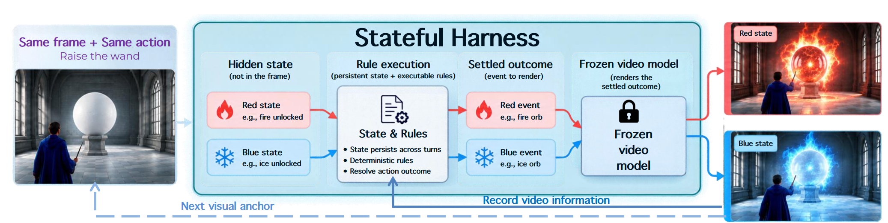

---

## 32. [Harnessing Textual Refusal Directions for Multimodal Safety](https://huggingface.co/papers/2606.31876)
**Upvotes**: 11 | **도입 난이도**: 하 | **신뢰도**: 상
**arXiv**: https://arxiv.org/abs/2606.31876

**태그**: MLLM, AI Safety, Steering, Multimodal, Vision, Video, Evaluation, Safety

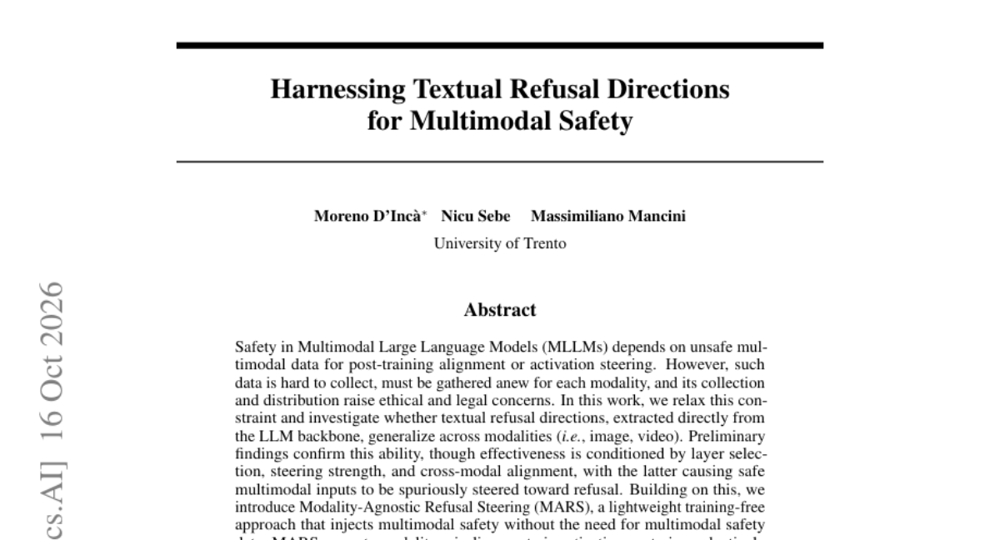

### 📌 한 줄 요약
멀티모달 안전 데이터 없이 텍스트 거절 방향을 활용하여 MLLM의 안전성을 확보하는 경량 학습 프레임워크 제안

### 🔑 핵심 포인트
- 학습 데이터 없이 텍스트 거절 방향을 멀티모달로 전이하는 기술 연구
- 모달리티 불일치 문제를 해결하는 MARS(Modality-Agnostic Refusal Steering) 프레임워크 제안
- 안전성 향상과 모델 유용성(Utility) 사이의 균형 최적화

### 🧑‍💻 개발자 관점
위험한 멀티모달 데이터를 직접 수집/학습하지 않고도 기존 LLM의 능력을 활용해 안전한 MLLM을 구축할 수 있는 효율적인 방법론을 제시합니다.

### 🚀 실무 적용 아이디어
- 제시된 MARS 알고리즘을 오픈소스 MLLM(예: LLaVA)에 적용하여 성능 비교
- 스티어링 강도(steering strength) 변화에 따른 과잉 거절(over-refusal) 임계점 테스트
- 다양한 비디오/이미지 데이터셋에서의 교차 모달리티 정렬 성능 검증

### ⚠️ 리스크/한계
- 특정 레이어 선택 및 스티어링 강도 설정에 따라 성능 편차가 발생할 수 있음
- 과도한 스티어링 시 모델의 유용성이 저하되는 과잉 거절 위험 존재

### 📝 초록 기반 상세 설명
멀티모달 거대언어모델(MLLM)의 안전성 확보를 위해 기존에는 위험한 멀티모달 데이터 수집이 필수적이었으나, 이는 윤리적·법적 문제를 야기합니다. 본 연구는 LLM 백본에서 추출한 텍스트 거절 방향이 다른 모달리티(이미지, 비디오)로도 일반화될 수 있는지 조사했습니다. 이를 바탕으로 별도의 학습 없이 안전성을 주입하는 Modality-Agnostic Refusal Steering(MARS) 기법을 제안합니다. MARS는 활성화 중심화(activation centering)를 통해 모달리티 불일치를 해결하고, 신뢰 영역 내에서 스티어링 강도를 적응적으로 조절합니다. 실험 결과, MARS는 유용성을 유지하면서도 안전성을 크게 향상시켰으며 텍스트 거절 방향이 강력한 멀티모달 정렬 기반이 될 수 있음을 입증했습니다.

---

## 33. [ACEdit: Stable Multi-Turn Image Editing via Asymmetric Conditioning](https://huggingface.co/papers/2610.22328)
**Upvotes**: 10 | **도입 난이도**: 중 | **신뢰도**: 상
**arXiv**: https://arxiv.org/abs/2610.22328

**태그**: Image Editing, Diffusion Models, Multi-turn, Knowledge Distillation, RAG, Vision, Inference, Distillation

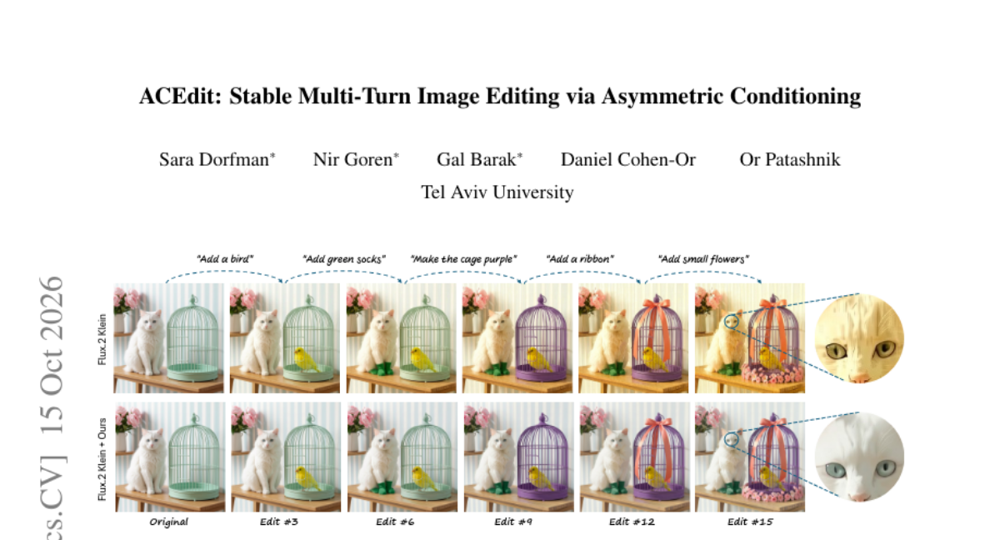

### 📌 한 줄 요약
연쇄적인 편집 과정에서 발생하는 이미지 품질 저하 문제를 해결하기 위해 비대칭 조건부 학습 방식을 도입한 안정적인 멀티턴 이미지 편집 기술

### 🔑 핵심 포인트
- 누적되는 분포 변화(Distribution Shift) 문제를 해결하기 위한 Self-Forcing 기법 도입
- 교사 모델(원본 기반)과 학생 모델(이전 출력 기반) 간의 비대칭 조건부 증류(Asymmetric Conditioning) 설계
- 멀티턴 편집 시 발생하는 품질 저하 및 지시사항 이탈 문제 억제

### 🧑‍💻 개발자 관점
사용자와의 지속적인 상호작용을 통해 이미지를 점진적으로 수정하는 에이전트형 편집 도구 개발 시 필수적인 안정성을 제공합니다.

### 🚀 실무 적용 아이디어
- 제안된 비대칭 증류(Asymmetric Conditioning) 로직을 기존 Diffusion 모델 학습 파이프라인에 이식 실험
- 매우 긴 시퀀스(10회 이상의 편집)에서의 품질 유지력 벤치마크 테스트
- 단일 편집 품질과 멀티턴 안정성 사이의 트레이드오프 분석

### ⚠️ 리스크/한계
- 교사 모델의 성능에 따라 학생 모델의 최종 품질이 종속될 위험이 있음
- 학습 과정에서 복잡한 증류(Distillation) 과정으로 인해 학습 비용이 증가할 수 있음

### 📝 초록 기반 상세 설명
기존의 이미지 편집 모델은 단일 편집에는 뛰어나지만, 여러 번의 편집이 반복될수록 누적되는 분포 변화(distribution shift)로 인해 품질이 급격히 저하되는 문제가 있습니다. 이를 해결하기 위해 모델이 이전 단계의 출력물을 다시 입력으로 사용하는 'Self-Forcing' 원리를 이미지 편집에 도입했습니다. 하지만 자가 생성된 이미지는 정답(ground-truth)과 차이가 있어 직접적인 학습이 어렵다는 난관이 있습니다. 이를 해결하기 위해 원본 이미지를 유지하는 교사(Teacher) 모델과 이전 출력을 사용하는 학생(Student) 모델 간의 비대칭 조건부 증류(Asymmetric Conditioning) 방식을 제안합니다. 실험 결과, 긴 멀티턴 편집 과정에서도 품질 저하를 최소화하며 지시사항을 정확히 반영하는 성능을 보였습니다.

### 🖼️ 추가 자료
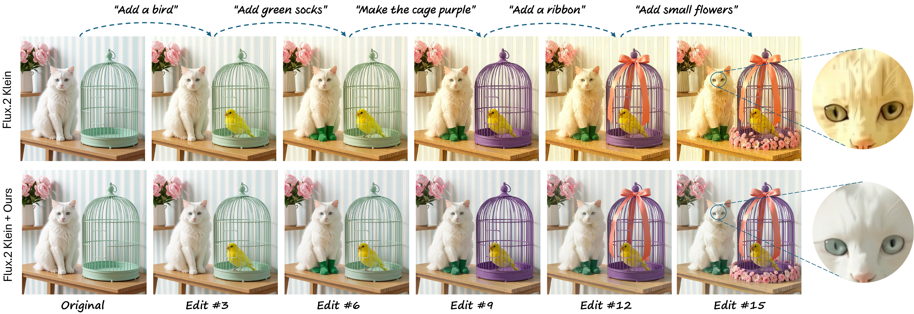

---

## 34. [LIBERO-Industry: Benchmarking Robotic Manipulation under Industrial Process Constraints](https://huggingface.co/papers/2610.16782)
**Upvotes**: 10 | **도입 난이도**: 중 | **신뢰도**: 상
**arXiv**: https://arxiv.org/abs/2610.16782

**태그**: Robotics, Benchmark, Manufacturing, VLA, Vision, Evaluation

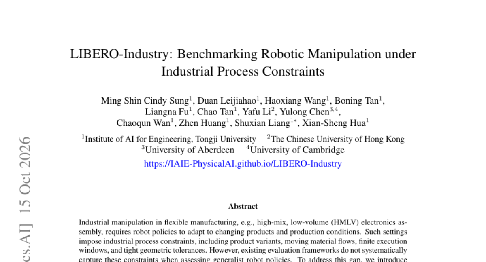

### 📌 한 줄 요약
산업 현장의 동적 제약 조건을 반영하여 로봇 조작 정책의 강건성을 평가하는 새로운 벤치마크인 LIBERO-Industry를 제안합니다.

### 🔑 핵심 포인트
- 산업적 제약(동적 흐름, 시간 제한, 공차 등)을 반영한 새로운 로봇 벤치마크 LIBERO-Industry 제안
- S2D, D2S, D2D 등 3가지 시나리오와 216개의 체계적인 태스크 구성
- VLA(Vision-Language-Action) 및 월드 모델 등 최신 정책의 산업 환경 적응력 검증

### 🧑‍💻 개발자 관점
실제 제조 현장의 변동성(Moving flow, Tight tolerance)을 시뮬레이션 환경에서 어떻게 정량화하고 평가할 수 있는지에 대한 방법론을 제공합니다.

### 🚀 실무 적용 아이디어
- 제공된 216개 태스크를 활용하여 현재 보유한 로봇 정책의 강건성(Robustness) 테스트
- 제약 조건(속도, 시간, 공차) 변화에 따른 성능 저하 곡선 분석
- LIBERO-Industry의 공동 학습(Co-training) 프로토콜을 기존 모델에 적용

### ⚠️ 리스크/한계
- 시뮬레이션 기반 벤치마크이므로 실제 물리적 마찰이나 하드웨어 노이즈 반영에는 차이가 있을 수 있음
- 제약 조건이 복잡해질수록 모델의 성능 저하가 급격하여 학습 난이도가 매우 높음

### 📝 초록 기반 상세 설명
HMLV(다품종 소량 생산) 환경의 로봇 조작은 제품 변동성, 이동하는 물류, 엄격한 기하학적 공차 등 복잡한 산업적 제약 조건을 수반합니다. 기존의 로봇 학습 프레임워크는 이러한 실질적인 산업 공정 제약 조건을 체계적으로 평가하는 데 한계가 있었습니다. 본 논문은 LIBERO 벤치마크를 확장하여 산업적 제약 조건을 제어 가능한 작업 조건과 측정 가능한 성공 기준으로 변환한 LIBERO-Industry를 소개합니다. S2D, D2S, D2D와 같은 세 가지 시나리오를 통해 총 216개의 태스크를 제공하며, 물체 형상, 컨베이어 속도, 작업 시간 등을 체계적으로 변화시킵니다. 실험 결과, 일반화 로봇 정책들은 제약 조건이 복합적으로 적용될수록 성능이 점진적으로 저하됨을 확인했습니다. 또한, 제안된 공동 학습(co-training) 프로토콜이 기존 방식보다 높은 전이 성능을 달성함을 입증했습니다.

---

## 35. [Remembering Has a Price: Learning Memory Worth under Resource Constraints](https://huggingface.co/papers/2610.26453)
**Upvotes**: 10 | **도입 난이도**: 중 | **신뢰도**: 상
**arXiv**: https://arxiv.org/abs/2610.26453

**태그**: LLM-Agent, Memory-Management, Efficiency, Lifelong-Learning, Agent, RAG, Reasoning, Evaluation

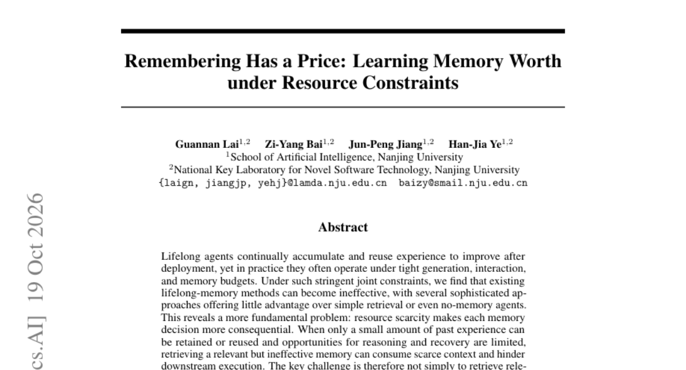

### 📌 한 줄 요약
자원 제약 환경에서 단순한 관련성 검색이 아닌, 비용 대비 가치가 높은 메모리만을 선별하여 에이전트의 효율성을 극대화하는 프레임워크 제안

### 🔑 핵심 포인트
- 자원 제약 상황에서 '관련성'보다 '가치(Worth)' 중심의 메모리 관리 중요성 규명
- 희소한 실행 피드백을 활용하여 쿼리별 메모리 가치를 학습하는 TokenWorth 프레임워크 제안
- 메모리 검색 및 관리 과정에서 토큰 소모를 최소화하면서 성능을 유지하는 최적화 전략

### 🧑‍💻 개발자 관점
LLM 에이전트 운영 시 발생하는 높은 토큰 비용과 컨텍스트 제한 문제를 해결하기 위해, 어떤 데이터를 저장하고 불러올지 결정하는 실무적 가이드라인을 제공합니다.

### 🚀 실무 적용 아이디어
- 제한된 컨텍스트 윈도우를 가진 모델에서 기존 RAG 방식과 TokenWorth 방식의 성능/비용 비교 실험
- 에이전트의 피드백(성공/실패)을 기반으로 한 메모리 가치 점수 산출 로직 구현 테스트
- 메모리 용량 제한을 단계별로 높여가며 가치 기반 필터링의 효율성 임계점 확인

### ⚠️ 리스크/한계
- 희소한 피드백에 의존할 경우 학습 데이터 부족으로 인한 가치 판단 오류 가능성
- 특정 도메인에 특화된 가치 판단 기준이 다른 환경에서 일반화되지 않을 위험

### 📝 초록 기반 상세 설명
지속적 학습 에이전트는 배포 후 경험을 축적하지만, 실제 환경에서는 생성 및 메모리 예산이 매우 제한적입니다. 기존의 메모리 방식은 자원이 부족할 때 관련성이 높더라도 실행에 도움이 되지 않는 메모리를 가져와 오히려 귀중한 컨텍스트를 낭비하는 문제가 발생합니다. 본 논문은 단순히 관련 있는 경험을 찾는 것이 아니라, 어떤 경험이 보관 및 재사용할 가치가 있는지를 결정하는 것이 핵심임을 밝힙니다. 이를 해결하기 위해 희소한 실행 피드백으로부터 쿼리 의존적 메모리 가치를 학습하는 경량 온라인 프레임워크인 TokenWorth를 제안합니다. 실험 결과, TokenWorth는 가장 적은 토큰을 사용하면서도 높은 작업 성공률을 달리며 자원 제약 하에서의 효율적인 메모리 관리 능력을 입증했습니다.

---

## 36. [Learning to Discriminate Scene Structures Makes Self-Supervised Depth Learning Scalable](https://huggingface.co/papers/2610.23600)
**Upvotes**: 10 | **도입 난이도**: 중 | **신뢰도**: 상
**arXiv**: https://arxiv.org/abs/2610.23600

**태그**: Computer Vision, Depth Estimation, Self-Supervised Learning, Domain Generalization, Vision, Evaluation

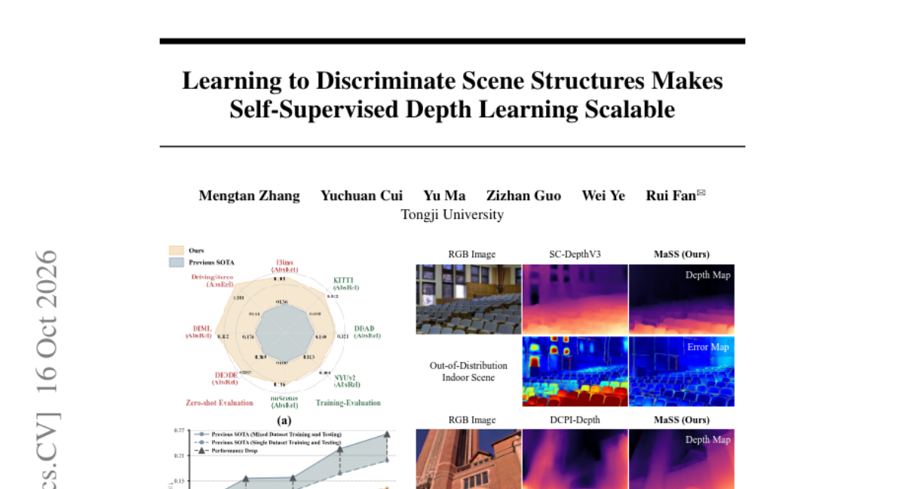

### 📌 한 줄 요약
데이터 도메인이 달라도 일관된 성능을 내는 확장 가능한 자기주도형 단안 깊이 추정 프레임워크 제안

### 🔑 핵심 포인트
- 문맥적 특징과 분리된 전용 구조 표현 경로(Structural Representation Pathway) 도입
- 도메인 간 충돌을 방지하는 새로운 장면 구조 판별(Scene-structure Discrimination) 목적 함수 설계
- 다양한 데이터셋 혼합 학습 시 성능이 향상되는 확장성 확보

### 🧑‍💻 개발자 관점
다양한 환경(실내/실외 등)에서 수집된 이종 데이터를 통합 학습해야 하는 자율주행이나 로봇 비전 시스템 개발 시 유용합니다.

### 🚀 실무 적용 아이디어
- 제공된 소스코드를 활용하여 서로 다른 도메인의 데이터셋 혼합 학습 실험 수행
- 기존 단안 깊이 추정 모델과 MaSS의 제로샷(Zero-shot) 성능 비교 테스트
- 구조적 특징과 문맥적 특징이 분리되는지 시각화 분석

### ⚠️ 리스크/한계
- 구조적 표현 경로와 문맥적 특징 간의 완벽한 분리 여부에 대한 검증 필요
- 매우 복잡하거나 정형화되지 않은 장면에서의 구조적 편향 발생 가능성

### 📝 초록 기반 상세 설명
자기주도형 단안 깊이 추정은 미라벨링 데이터 활용이 가능해 매력적이지만, 다양한 장면을 학습할 때 성능이 저하되는 문제가 있습니다. 기존 방식은 전이 가능한 기하학적 구조 대신 데이터셋 특유의 구조적 편향을 학습하여 도메인 간 최적화 충돌을 일으킵니다. 이를 해결하기 위해 문맥적 특징과 분리된 전용 구조 표현 경로를 도입한 MaSS 프레임워크를 제안합니다. 새로운 장면 구조 판별 목적 함수를 통해 일반화된 레이아웃 인지 구조를 학습하도록 유도합니다. 실험 결과, MaSS는 혼합 도메인 학습 시 성능 향상을 보이는 최초의 모델로 입증되었으며 제로샷 평가에서도 뛰어난 일반화 성능을 보였습니다.

---

## 37. [Self-Evaluating Recursive Agents](https://huggingface.co/papers/2610.04902)
**Upvotes**: 10 | **도입 난이도**: 상 | **신뢰도**: 상
**arXiv**: https://arxiv.org/abs/2610.04902

**태그**: AI Agent, Reinforcement Learning, Task Decomposition, Self-Improvement, Agent, RAG, Vision, Evaluation, Inference

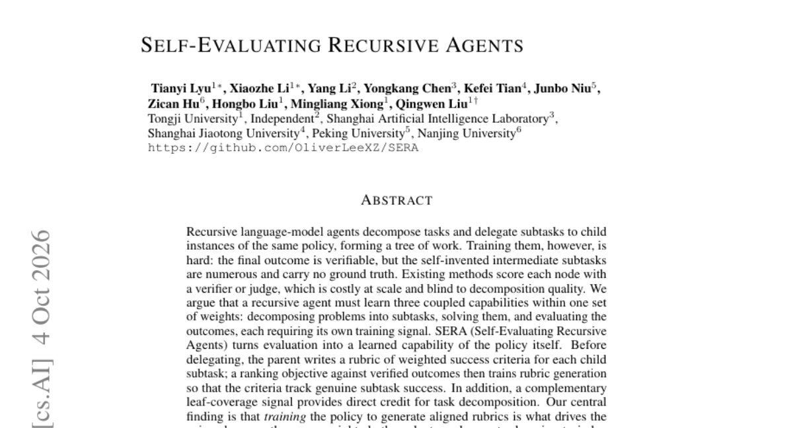

### 📌 한 줄 요약
에이전트가 스스로 평가 기준(Rubric)을 생성하여 문제 분해와 해결 능력을 동시에 학습하는 재귀적 에이전트 프레임워크

### 🔑 핵심 포인트
- 평가 기준(Rubric) 생성을 정책의 핵심 학습 능력으로 통합
- 분해(Decomposition), 해결(Solving), 평가(Evaluation)를 단일 가중치 내에서 상호 보완적으로 학습
- 외부 감독 의존도를 낮추면서도 추론 시 트리 탐색(Tree Search)의 선택기로 활용 가능

### 🧑‍💻 개발자 관점
복잡한 워크플로우를 가진 에이전트 설계 시, 정답 데이터가 부족한 중간 단계의 품질을 어떻게 관리하고 자동화할지에 대한 방법론을 제시합니다.

### 🚀 실무 적용 아이디어
- 복잡한 계층적 작업(Hierarchical Task) 데이터셋 구축 실험
- 생성된 Rubric이 실제 작업 성공률과 얼마나 상관관계를 갖는지 상관계수 분석
- 단일 모델 내에서 평가와 실행 능력이 충돌하는지 확인하기 위한 멀티태스크 학습 실험

### ⚠️ 리스크/한계
- 초기 학습 단계에서 잘못된 Rubric이 생성될 경우 에이전트 전체 성능이 붕괴될 위험
- 복잡한 작업일수록 Rubric 생성 자체가 새로운 난제로 작용할 가능성

### 📝 초록 기반 상세 설명
재귀적 에이전트는 복잡한 작업을 하위 작업으로 분해하여 해결하지만, 중간 단계의 정답(Ground Truth)이 없어 학습이 어렵다는 문제가 있습니다. 기존의 외부 검증 방식은 비용이 많이 들고 분해 품질을 반영하기 어렵습니다. SERA는 부모 에이전트가 자식 작업에 대한 가중치 기반 평가 기준(Rubik)을 직접 작성하도록 하여 평가를 정책 자체의 학습 능력으로 전환합니다. 랭킹 목적 함수와 리프 커버리지 신호를 통해 분해, 해결, 평가 능력을 하나의 가중치 내에서 통합 학습합니다. 실험 결과, 스스로 생성한 평가 기준이 해결 능력을 높이는 핵심 동력임을 확인했으며 기존 베이스라인 대비 성능을 크게 향상시켰습니다.

---

## 38. [ECHO: Efficient Causal Self-Recursion Beyond Auxiliary Multi-Token Prediction](https://huggingface.co/papers/2610.24766)
**Upvotes**: 8 | **도입 난이도**: 중 | **신뢰도**: 상
**arXiv**: https://arxiv.org/abs/2610.24766

**태그**: LLM, Efficient Training, Inference Optimization, Self-Recursion, Reasoning, Vision, Inference, Safety

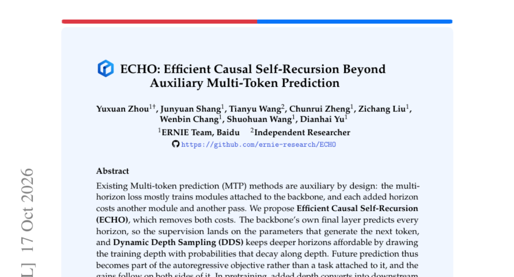

### 📌 한 줄 요약
추가 모듈 없이 백본 자체의 재귀적 예측을 통해 효율적인 멀티 토큰 생성과 추론 능력을 확보하는 기술

### 🔑 핵심 포인트
- 백본의 최종 레이어를 활용하여 추가 모듈 없이 멀티 호라이즌 예측 수행
- Dynamic Depth Sampling(DDS)을 통한 효율적인 심층 학습 및 비용 최적화
- 미래 예측을 부가 작업이 아닌 핵심 자기회귀 목표로 통합하여 성능 극대화

### 🧑‍💻 개발자 관점
추가적인 파라미터나 연산 오버헤드 없이도 모델의 추론 및 코드 생성 능력을 높일 수 있는 효율적인 학습 프레임워크를 제시합니다.

### 🚀 실무 적용 아이디어
- 기존 MTP 모델과 ECHO 방식의 학습 오버헤드 및 추론 속도 비교 실험
- DDS 확률 감쇠(decay) 설정에 따른 모델의 추론/코드 생성 성능 변화 측정
- 제한된 컴퓨팅 자원 환경에서 ECHO의 스케일링 효율성 검증

### ⚠️ 리스크/한계
- 백본 구조에 의존적인 설계로 인해 특정 아키텍처로의 이식성 제한 가능성
- 매우 깊은 호라이즌 예측 시 발생할 수 있는 학습 안정성 문제

### 📝 초록 기반 상세 설명
기존의 멀티 토큰 예측(MTP) 방식은 별도의 모듈을 추가해야 하며, 이는 연산 비용 증가와 학습 효율 저하를 야기합니다. 이를 해결하기 위해 백본의 최종 레이어가 모든 예측 호라이즌을 담당하는 Efficient Causal Self-Recursion(ECHO) 방식을 제안합니다. 학습 시에는 Dynamic Depth Sampling(DDS)을 통해 깊은 호라이즌의 비용을 효율적으로 관리하며, 미래 예측을 부가 작업이 아닌 자기회귀 목적 함수 자체에 통합합니다. 그 결과, 학습 오버헤드를 절반으로 줄이면서도 추론 및 코드 생성 성능을 높였습니다. 추론 시에는 모델이 스스로 드래프터(drafter) 역할을 수행하며, 높은 엔트로피 상황에서도 정렬된 생성 능력을 유지합니다.

---

## 39. [Policy Is Not Capability: Some Safety Benchmarks Measure Which Definition of "Unsafe" You Trained On](https://huggingface.co/papers/2610.25060)
**Upvotes**: 7 | **도입 난이도**: 하 | **신뢰도**: 상
**arXiv**: https://arxiv.org/abs/2610.25060

**태그**: LLM Safety, Guardrails, Evaluation, Data Contamination, Vision, Benchmark, Distillation, Safety

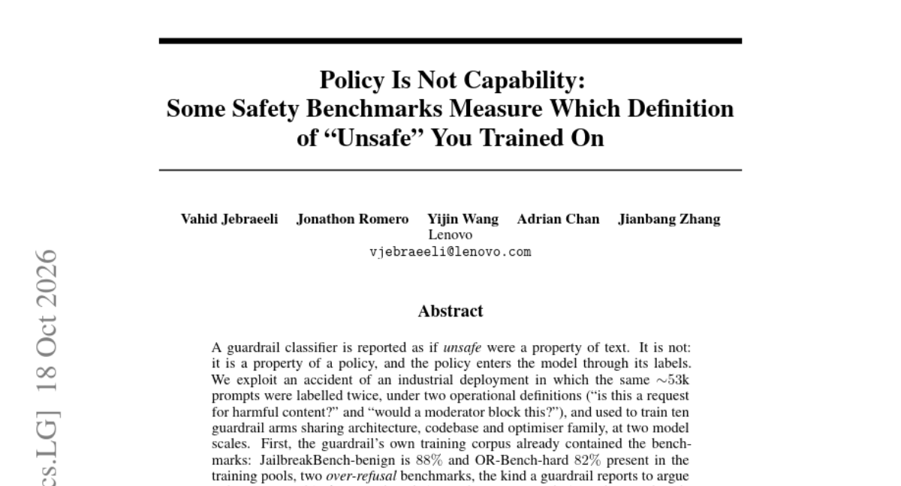

### 📌 한 줄 요약
안전 벤치마크 점수가 모델의 실제 성능이 아닌 학습 시 적용된 '정책 정의'에 의해 왜곡될 수 있음을 경고함

### 🔑 핵심 포인트
- 안전 벤리마크 점수는 모델의 탐지 능력보다 학습 시 사용된 정책 정의(Label Definition)에 의해 결정될 수 있음
- 기존 벤치마크 데이터가 학습 데이터에 포함되어 성능이 왜곡되는 데이터 오염(Contamination) 문제 확인
- 모델의 파라미터 극소량만으로도 특정 정책에 맞춰 벤치마크 점수를 극단적으로 이동시킬 수 있음

### 🧑‍💻 개발자 관점
가드레일 모델을 평가할 때 벤치마크 점수만 믿는 것은 위험하며, 학습 데이터와 평가 데이터 간의 오염 여부를 반드시 검증해야 함

### 🚀 실무 적용 아이디어
- 가드레일 모델 평가 시 학습 데이터와 벤치마크 데이터 간의 중복 여부를 엄격히 검증할 것
- 벤치마크 점수뿐만 아니라, 적용된 정책 정의(Policy Definition)를 명시적으로 기록하고 관리할 것
- 모델의 성능이 특정 벤치마크에 과적합(Overfitting)되지 않았는지 다양한 정책 시나리오로 테스트할 것

### ⚠️ 리스크/한계
- 벤치마크 점수가 높다고 해서 모델의 실제 안전성이 보장되지 않음
- 학습 시 사용된 정책가(Teacher)의 영향력이 모델에 전이되어 평가 결과가 왜곡될 수 있음

### 📝 초록 기반 상세 설명
최근 가드레일 분류기는 '유해성'을 텍스트 자체의 속성처럼 보고하지만, 실제로는 학습된 정책의 속성이다. 연구진은 동일한 데이터셋이 서로 다른 두 가지 운영 정의(정책)로 라벨링되어 10개의 가드레일 모델 학습에 사용된 산업적 사례를 분석했다. 실험 결과, 기존 안전 벤치마크 데이터가 학습 코퍼스에 포함되어 있어 성능이 과대계상되는 오염 문제가 발견되었다. 또한, 벤치마크 점수는 모델의 탐지 능력보다 학습 시 주입된 정책 정의에 따라 극단적으로 갈리는 경향을 보였다. 결론적으로 벤치마크 점수는 모델의 실질적 성능이 아닌, 어떤 정책으로 학습되었는지를 나타내는 지표로 오인될 위험이 크다.

---

## 40. [A Conditional No-Hair Theorem for Transformers: How Language Models Forget Their Prompt](https://huggingface.co/papers/2610.24133)
**Upvotes**: 7 | **도입 난이도**: 하 | **신뢰도**: 상
**arXiv**: https://arxiv.org/abs/2610.24133

**태그**: Transformer, Long-Context, LLM-Mechanics, Attention

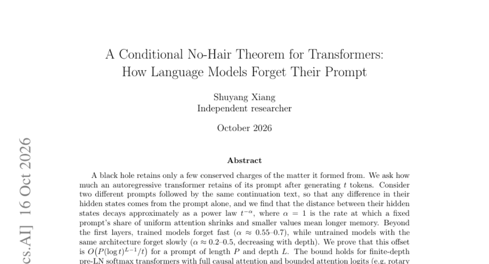

### 📌 한 줄 요약
트랜스포머 모델이 생성 토큰이 늘어남에 따라 초기 프롬프트의 영향력이 멱법칙(Power Law)에 따라 감쇠하는 현상과 그 수학적 원인을 규명함

### 🔑 핵심 포인트
- 프롬프트 영향력의 감쇠가 멱법칙(Power Law)을 따르며, 생성 토큰이 늘어날수록 프롬프트의 영향은 점차 희석됨
- 학습된 모델은 의도적으로 프롬프트 영향력을 빠르게 감쇠시키도록 최적화되어 있음
- 프롬프트의 정보는 생성된 텍스트(Relay mechanism)를 통해 전달되며, 이는 수학적 상한선 내에서 제어됨

### 🧑‍💻 개발자 관점
긴 문맥(Long-context) 작업 시 프롬프트 지시사항이 생성 토큰이 늘어남에 따라 자연스럽게 희석될 수 있음을 이해하고, 이를 방지하기 위한 전략을 세우는 데 중요합니다.

### 🚀 실무 적용 아이디어
- 프롬프트 길이와 생성 토큰 수 변화에 따른 모델의 지시 이행 능력(Instruction Following) 변화 측정
- 학습 단계(Step)에 따른 프롬프트 유지력(α 값)의 변화 추적 실험
- 매우 긴 문맥 생성 시 프롬프트 정보를 유지하기 위한 구조적/학습적 기법 적용 테스트

### ⚠️ 리스크/한계
- 특정 구조(pre-LN, softmax)와 조건(non-zero activations) 하에서의 이론적 증명이므로 모든 모델에 일반화하기 어려울 수 있음
- 실제 서비스 환경의 복잡한 프롬프트 엔지니어링 상황을 완전히 대변하지는 못함

### 📝 초록 기반 상세 설명
자기회귀 트랜스포머 모델이 생성 과정에서 초기 프롬프트 정보를 얼마나 유지하는지 분석하고자 합니다. 서로 다른 프롬프트가 동일한 후속 텍스트를 생성할 때, 은닉 상태 간의 거리가 생성 토큰 수(t)에 따라 멱법칙 형태로 감소함을 발견했습니다. 연구 결과, 학습된 모델은 프롬프트를 빠르게 잊는 반면(α ≈ 0.55~0.7), 학습되지 않은 모델은 더 느리게 잊는 특성을 보였습니다. 이를 수학적으로 증명하기 위해 pre-LN 구조와 유한 깊이 조건을 바탕으로 프롬프트 영향력의 상한선을 도출했습니다. 결과적으로 프롬프트의 직접적 영향은 문맥이 길어짐에 따라 희석되며, 생성된 텍xt 자체가 프롬프트의 속성을 전달하는 역할을 하게 됩니다.

---

## 41. [UniAVC: Unified Audio-Video Creation via Progressive Training and Asymmetric Scheduling](https://huggingface.co/papers/2610.24791)
**Upvotes**: 7 | **도입 난이도**: 상 | **신뢰도**: 상
**arXiv**: https://arxiv.org/abs/2610.24791

**태그**: Generative AI, Multimodal, Audio-Video, Diffusion Models, Video, Audio, Inference

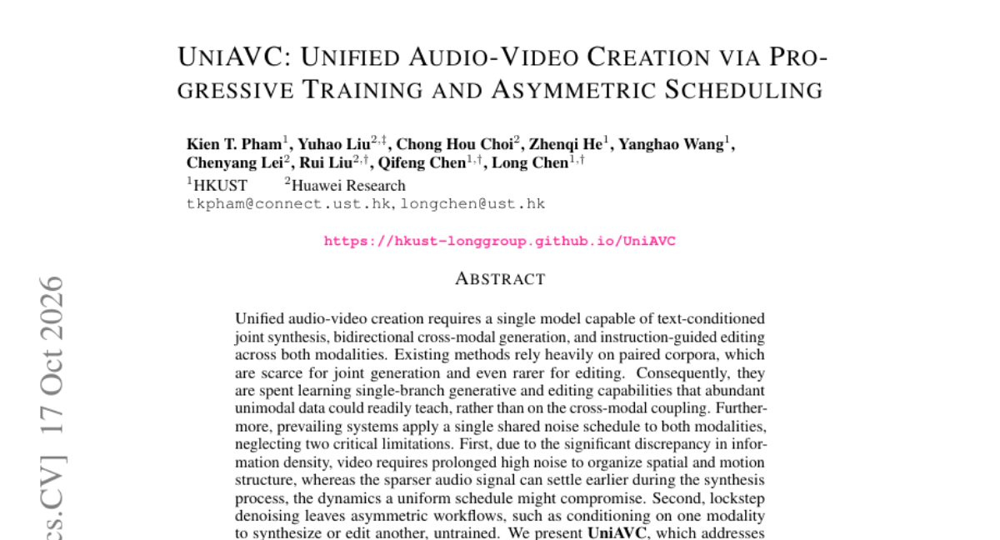

### 📌 한 줄 요약
단일 모델로 텍스트 기반 생성, 양방향 오디오-비디오 생성 및 편집을 모두 수행하는 통합 프레임워크

### 🔑 핵심 포인트
- 점진적 학습(Progressive Training): 단일 모달리티 학습 후 교차 모달 학습을 통해 데이터 부족 문제 해결
- 비대칭 스케줄링(Asymmetric Scheduling): 정보 밀도 차이를 고려하여 모달리티별 독립적 노이즈 스케줄 적용
- 통합 워크플로: 별도 어댑터 없이 생성, 편집, 의도 기반 편집 및 자기 정제(self-refinement) 가능

### 🧑‍💻 개발자 관점
데이터 부족 문제를 학습 전략으로 극복하고, 비대칭적 스케줄링을 통해 오디오와 비디오의 특성을 살린 고품질 멀티모달 생성 워크플로를 구축할 수 있습니다.

### 🚀 실무 적용 아이디어
- 단일 모달리티 학습과 교차 모달 학습의 비율에 따른 생성 품질 변화 관찰
- 비대칭 스케줄링 적용 시 오디오-비디오 간 동기화(Sync) 정밀도 테스트
- 기존 통합 모델 대비 데이터 효율성 및 편집 성능 비교 실험

### ⚠️ 리스크/한계
- 학습 단계별 데이터 관리 및 스케줄링 복잡도 증가
- 매우 높은 정보 밀도를 가진 비디오와 낮은 오디오 간의 완벽한 정렬(Alignment) 난이도

### 📝 초록 기반 상세 설명
기존의 오디오-비디오 생성 모델은 부족한 쌍(paired) 데이터에 의존하여 단일 모달리티 학습에 치중하거나, 두 모달리티 간의 정보 밀도 차이를 무시한 동일한 노이즈 스케줄을 사용하여 성능 저하를 겪었습니다. 이를 해결하기 위해 UniAVC는 먼저 각 모달리티를 독립적으로 학습하여 생성 및 편집 능력을 확보한 후, 쌍 데이터를 통해 교차 모달 상관관계를 학습하는 점진적 학습 방식을 제안합니다. 또한, 정보 밀도 차이를 고려하여 모달리티별로 독립적인 노이즈 스케줄을 적용하는 비대칭 스케줄링을 도입했습니다. 이러한 방식은 한쪽 모달리티를 고정한 채 다른 쪽을 편집하거나, 만족스럽지 않은 결과물만 선택적으로 재생성하는 기능을 가능하게 합니다. 결과적으로 UniAVC는 별도의 어댑터 없이도 다양한 생성 및 편집 작업을 하나의 가중치로 수행할 수 있습니다.

---

## 42. [Competing Learning in Hybrid Architectures](https://huggingface.co/papers/2610.26830)
**Upvotes**: 7 | **도입 난이도**: 중 | **신뢰도**: 상
**arXiv**: https://arxiv.org/abs/2610.26830

**태그**: Hybrid Architecture, Training Strategy, LLM, Deep Learning, RAG, Reasoning, Evaluation

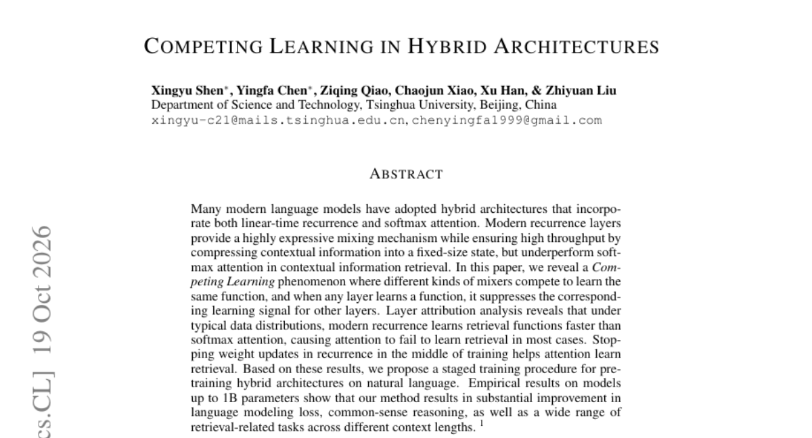

### 📌 한 줄 요약
하이브리드 아키텍처에서 순환(Recurrence)과 어텐션(Attention) 간의 학습 경쟁 문제를 해결하여 모델 성능을 극대화하는 단계별 학습법 제안

### 🔑 핵심 포인트
- 하이브리드 모델에서 순환 레이어가 어텐션의 학습을 방해하는 'Competing Learning' 현상 규명
- 순환 레이어가 어텐션보다 검색 기능을 더 빠르게 학습하여 발생하는 불균형 문제 확인
- 학습 중간에 순환 레이어 업데이트를 멈추는 단계별 학습(Staged Training) 전략 제안

### 🧑‍💻 개발자 관점
하이브리드 구조(예: SSM + Attention)를 설계할 때, 특정 레이어가 다른 레이어의 기능을 잠식하는 문제를 방지하는 학습 전략의 중요성을 시사합니다.

### 🚀 실무 적용 아이디어
- 하이브리드 아키텍처 모델 학습 시 레이어별 학습 속도 및 기여도 모니터링
- 학습 스케줄링에 순환/어텐션 레이어 간의 업데이트 주기 차등 적용 실험
- 동일한 데이터셋에서 레이어별 기능(Retrieval vs Mixing) 분담 여부 확인

### ⚠️ 리스크/한계
- 제안된 단계별 학습 방식이 특정 데이터 분포나 아키텍처에만 국한될 가능성
- 학습 스케줄링 복잡도 증가로 인한 하이퍼파라미터 튜닝 난이도 상승

### 📝 초록 기반 상세 설명
최근 언어 모델은 선형 시간 순환 구조와 소프트맥스 어텐션을 결합한 하이브리드 아키텍처를 채택하고 있습니다. 그러나 순환 레이어가 어텐션보다 정보 검색 기능을 더 빠르게 학습하여, 어텐션이 관련 기능을 학습하지 못하게 방해하는 '경쟁적 학습(Competing Learning)' 현상이 발생합니다. 연구진은 레이어 기여도 분석을 통해 순환 레이어가 어텐션의 학습 신호를 억제함을 밝혀냈습니다. 이를 해결하기 위해 학습 중간에 순환 레이어의 업데이트를 일시 중단하여 어텐션이 학습할 기회를 주는 단계별 학습 절차를 제안합니다. 실험 결과, 최대 1B 파라미터 모델에서 언어 모델링 손실과 상식 추론, 다양한 길이의 검색 작업 성능이 크게 향상되었습니다.

---

## 43. [Factorization-Guided Training and Inference for Diffusion-Drafted Speculative Decoding](https://huggingface.co/papers/2610.23935)
**Upvotes**: 7 | **도입 난이도**: 상 | **신뢰도**: 상
**arXiv**: https://arxiv.org/abs/2610.23935

**태그**: LLM Inference, Speculative Decoding, Diffusion Models, Throughput Optimization, Vision, Benchmark, Inference

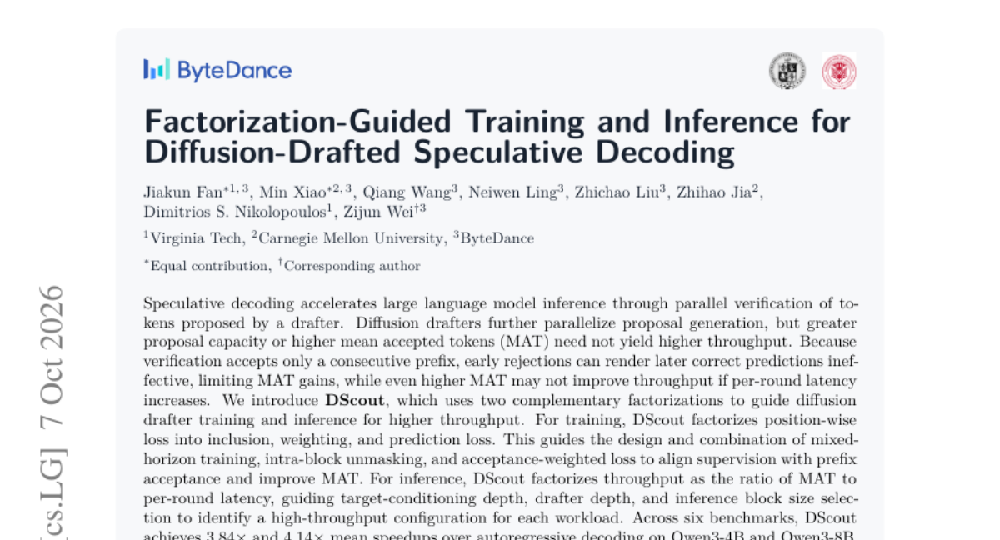

### 📌 한 줄 요약
Diffusion 기반 Speculative Decoding의 학습 및 추론 과정을 최적화하여 LLM 추론 처리량(Throughput)을 극대화한 기술

### 🔑 핵심 포인트
- 학습 단계: 손실 함수를 분해하여 접두사 수락 가능성을 높이는 Mixed-horizon 및 Intra-block unmasking 기법 적용
- 추론 단계: MAT와 지연 시간 간의 트레이드오프를 고려한 Throughput 중심의 구성 최적화
- 성능: 기존 SOTA 대비 높은 처리량과 모델별 워크로드에 최적화된 동적 구성 정책 제공

### 🧑‍💻 개발자 관점
LLM 서비스 운영 시 단순히 수락률을 높이는 것이 아니라, 실제 처리량(Throughput)을 기준으로 Drafter의 구조와 파라미터를 튜닝하는 것이 중요함을 시사합니다.

### 🚀 실무 적용 아이디어
- Drafter의 생성 속도와 수락률 사이의 상관관계를 측정하는 벤치마크 환경 구축
- Diffusion 기반 Drafter 모델의 학습 시 Loss 분해 기법 적용 테스트
- 다양한 모델 크기에서 MAT/Latency 비율을 통한 최적 블록 크기 산출 실험

### ⚠️ 리스크/한계
- Drafter의 복잡도가 증가할 경우 추론 지연 시간이 급증하여 전체 처리량이 저하될 위험이 있음
- 특정 워크로드에 최적화된 설정이 다른 도메인에서는 성능 저하를 야기할 수 있음

### 📝 초록 기반 상세 설명
Speculative Decoding은 Drafter가 제안한 토큰을 병렬 검증하여 LLM 추론을 가속하지만, 제안된 토큰이 앞부분에서 거부되면 이후 토큰이 유효하더라도 활용되지 못하는 문제가 있습니다. 또한, 높은 수락률(MAT)을 확보하더라도 라운드당 지연 시간이 늘어나면 전체 처리량은 오히려 감소할 수 있습니다. 이를 해결하기 위해 DScout는 학습 시 손실 함수를 포함(inclusion), 가중치(weighting), 예측(prediction) 손락으로 분해하여 접두사 수락률을 높이도록 유도합니다. 추론 시에는 처리량을 MAT와 라운드당 지연 시간의 비율로 정의하여 최적의 구성(깊이, 블록 크기 등)을 결정합니다. 실험 결과, DScout는 기존 자기회귀 디코딩 대비 최대 4배 이상의 속도 향상을 달성하며 SOTA 모델보다 우수한 성능을 보였습니다.

---

## 44. [Co-Evolving Acting and Forecasting for Language Agents](https://huggingface.co/papers/2610.20597)
**Upvotes**: 7 | **도입 난이도**: 중 | **신뢰도**: 상
**arXiv**: https://arxiv.org/abs/2610.20597

**태그**: LLM-Agent, Reinforcement-Learning, Sample-Efficiency, Agent, Vision, Benchmark, Inference

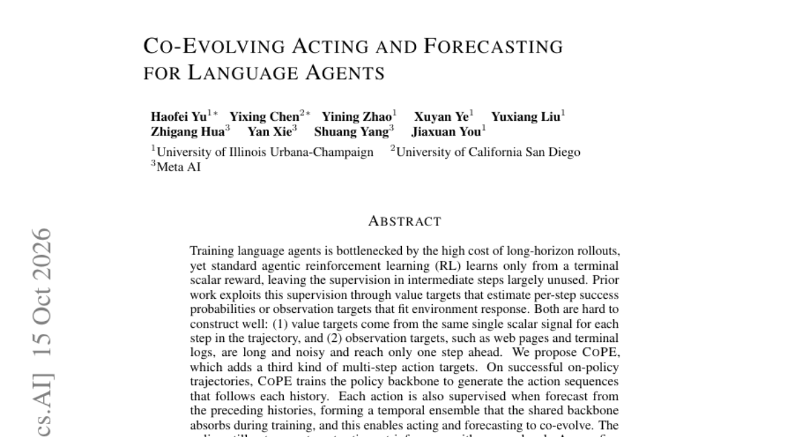

### 📌 한 줄 요약
멀티스텝 액션 예측을 통해 데이터 효율성과 에이전트 성능을 동시에 높이는 Co-Evolving 학습 프레임워크

### 🔑 핵심 포인트
- 멀티스텝 액션 타겟을 도입하여 중간 단계의 풍부한 감독 신호 활용
- 액션 수행과 미래 예측이 상호 보완하며 진화하는 Co-Evolving 학습 메커니즘
- 추론 시 추가 비용 없이 단일 백본만으로 높은 샘플 효율성 및 성능 달성

### 🧑‍💻 개발자 관점
에이전트 학습 시 발생하는 막대한 비용과 데이터 부족 문제를 해결할 수 있는 효율적인 학습 전략을 제시합니다.

### 🚀 실무 적용 아이디어
- 제공된 GitHub 코드를 활용하여 ScienceWorld 등 시뮬레이션 환경에서 성능 재현
- 기존 RL(GRPO 등)과 CoPE의 샘플 효율성 차이 비교 실험
- 복잡한 환경에서 멀티스텝 액션 타겟이 추론 안정성에 미치는 영향 분석

### ⚠️ 리스크/한계
- 성공적인 궤적(On-policy trajectories)에 의존하므로 초기 학습 단계에서의 데이터 품질 중요성
- 복잡한 환경에서 멀티스텝 예측이 실제 액션 수행과 괴리될 가능성

### 📝 초록 기반 상세 설명
언어 에이전트 학습은 긴 과정의 롤아웃 비용이 높고, 최종 보상만 사용하는 기존 RL 방식은 중간 단계의 풍부한 정보를 활용하지 못하는 문제가 있습니다. 기존의 가치 타겟이나 관찰 타겟 방식은 단일 스칼라 신호에 의존하거나 노이즈가 많은 환경 데이터에 국한된다는 한계가 있습니다. 이를 해결하기 위해 CoPE는 성공적인 궤적에서 미래 액션 시퀀스를 생성하도록 학습하는 '멀티스텝 액션 타겟'을 제안합니다. 이 방식은 액션 수행(Acting)과 미래 예측(Forecasting)이 하나의 백본에서 상호 진화하도록 유도합니다. 실험 결과, CoPE는 기존 GRPO 및 RL 베이스라인보다 높은 성능을 보였으며, 특히 ScienceWorld 환경에서 최대 2배에 달하는 샘플 효율성을 달정을 기록했습니다. 추론 시에는 추가 오버헤드 없이 단일 정책 백본만으로 동작합니다.

---

## 45. [World Model Interpretability: From Decoding Representations to Understanding Latent Worlds](https://huggingface.co/papers/2610.25296)
**Upvotes**: 7 | **도입 난이도**: 상 | **신뢰도**: 상
**arXiv**: https://arxiv.org/abs/2610.25296

**태그**: JEPA, World Models, Interpretability, Causality, AI Agents, Vision

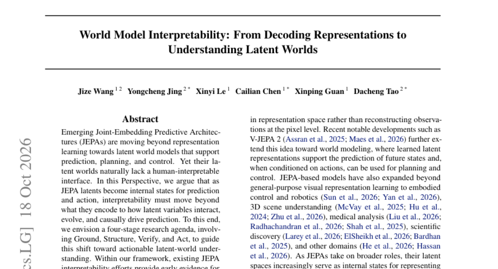

### 📌 한 줄 요약
JEPA 기반 세계 모델의 해석 가능성을 단순 표현 디코딩에서 잠재 변수 간의 상호작용 및 인과 관계 이해로 확장하는 연구 프레임워크 제안

### 🔑 핵심 포인트
- JEPA의 잠재 공간을 단순 데이터 압축이 아닌 '행동 가능한 세계 모델'로 정의
- 해석 가능성의 패러다임을 '표현 디코딩'에서 '잠재 변수의 인과적 상호작용 이해'로 전환
- 연구 방향성을 제시하는 4단계 프레임워크(Ground, Structure, Verify, Act) 제안

### 🧑‍💻 개발자 관점
에이전트가 스스로 환경을 모델링하는 시대에, 모델의 내부 상태가 왜 특정 행동을 유도하는지 인과적으로 파악하는 능력이 필수적입니다.

### 🚀 실무 적용 아이디어
- JEPA 모델의 잠재 변수 변화에 따른 예측 결과의 인과 관계 분석 실험
- 잠재 공간의 구조적 특징(Structure)을 시각화하거나 수학적으로 정형화하는 시도
- 특정 잠재 변수에 대한 개입(Intervention)이 모델의 계획/제어에 미치는 영향 측정

### ⚠️ 리스크/한계
- 제안된 4단계 프레임워크가 이론적 제안에 머물러 있어 구체적인 구현 방법론은 부족함
- 고차원 잠재 공간에서의 인과 관계를 인간이 이해 가능한 수준으로 추출하는 것의 난이도

### 📝 초록 기반 상세 설명
최근 등장한 JEPA(Joint-Embedding Predictive Architectures)는 단순 표현 학습을 넘어 예측, 계획, 제어를 지원하는 잠재 세계 모델로 진화하고 있습니다. 그러나 이러한 잠재 공간은 인간이 직관적으로 이해하기 어려운 구조를 가집니다. 본 논문은 해석 가능성의 초점을 단순한 표현 디코딩에서 잠재 변수의 상호작용, 진화, 인과적 예측 능력 이해로 전환해야 한다고 주장합니다. 이를 위해 Ground, Structure, Verify, Act라는 4단계 연구 아젠다를 제안합니다. 기존의 해석 방식은 초기 단계인 Ground에 머물러 있으며, 구조적 분석과 인과적 검증 및 개입은 여전히 미개척 영역으로 남아 있습니다. 결과적으로 본 논문은 잠재 세계를 이해하고 검증하며 행동하는 데 초점을 맞춘 새로운 해석 가능성 패러다임을 제시합니다.

---

## 46. [StopLoss: Teaching Agents to Predict Failure and Stop Early](https://huggingface.co/papers/2610.25525)
**Upvotes**: 6 | **도입 난이도**: 하 | **신뢰도**: 상
**arXiv**: https://arxiv.org/abs/2610.25525

**태그**: AI Agent, Cost Optimization, Failure Prediction, Fine-tuning, Agent, Vision, Evaluation

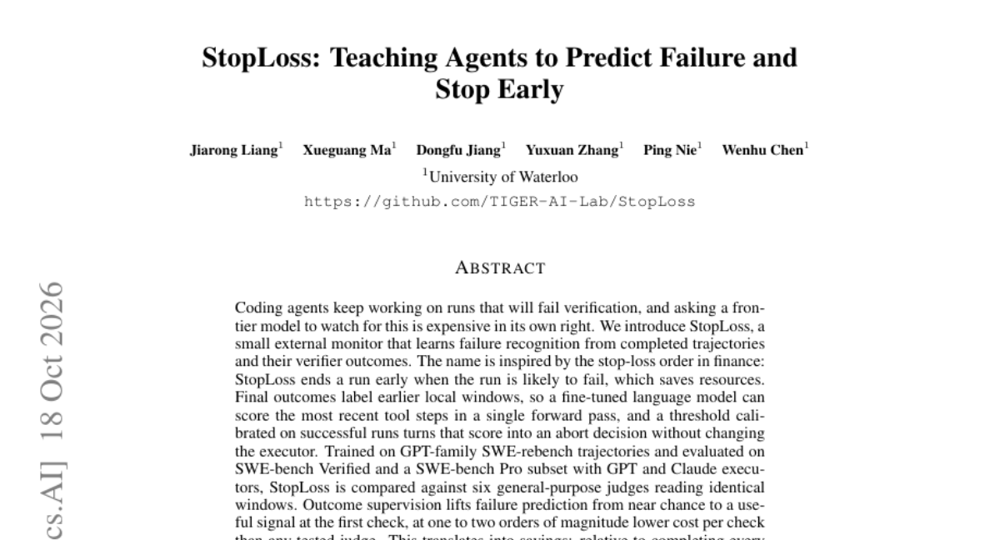

### 📌 한 줄 요약
실패할 코딩 에이전트의 작업을 조기에 중단시켜 비용을 절감하는 경량 모니터링 프레임워크

### 🔑 핵심 포인트
- 최종 결과(Outcome)를 활용해 과거 작업 단계들을 라벨링하는 학습 방식 도입
- 실행기(Executor)를 수정하지 않고도 임계값 조정을 통해 조기 중단 결정 가능
- 거대 모델 판사(Judge) 대비 1~2개 차수(orders of magnitude) 낮은 비용으로 효율적 실패 예측

### 🧑‍💻 개발자 관점
에이전트 기반 자동화 시스템 구축 시, 실패가 명확한 작업에 낭비되는 API 비용을 획기적으로 줄일 수 있습니다.

### 🚀 실무 적용 아이디어
- 자체 에이전트 로그를 활용해 실패/성공 데이터셋 구축 실험
- 경량 모델(예: Qwen, Llama-8B)을 활용한 실패 예측 모니터링 프로토타입 구현
- 다양한 임계값(Threshold) 설정에 따른 성공 유지율과 비용 절감 간의 트레이드오프 분석

### ⚠️ 리스크/한계
- 실패 예측 모델이 너무 민감할 경우 성공 가능성이 있는 작업이 조기에 종료될 위험이 있음
- 학습 데이터에 포함되지 않은 새로운 유형의 실패 패턴에 대한 대응력 문제

### 📝 초록 기반 상세 설명
코딩 에이전트가 실패할 작업에 계속 자원을 소모하는 것은 막대한 비용 문제를 야기합니다. 기존의 거대 모델(LLM)을 활용한 모니터링은 그 자체로 비용이 높다는 단점이 있습니다. 본 논문은 완료된 궤적과 검증 결과를 학습하여 실패를 예측하는 경량 외부 모니터인 StopLoss를 제안합니다. StopLoss는 최종 결과를 기반으로 이전 단계들을 라벨링하여 학습하며, 임계값 조정을 통해 실행기 수정 없이 조기 중단 여부를 결정합니다. 실험 결과, StopLoss는 성공적인 작업의 99%를 유지하면서도 작업당 비용을 크게 절감하며 기존 LLM 판사 모델들보다 훨씬 낮은 비용으로 유효한 실패 예측 신호를 제공했습니다.

---

## 47. [Progress-Aware Distillation for Mitigating Stagnation in Small Language Model Agents](https://huggingface.co/papers/2610.19439)
**Upvotes**: 6 | **도입 난이도**: 중 | **신뢰도**: 상
**arXiv**: https://arxiv.org/abs/2610.19439

**태그**: Agent, Knowledge Distillation, LLM Efficiency, Reasoning, Benchmark, Inference, Distillation

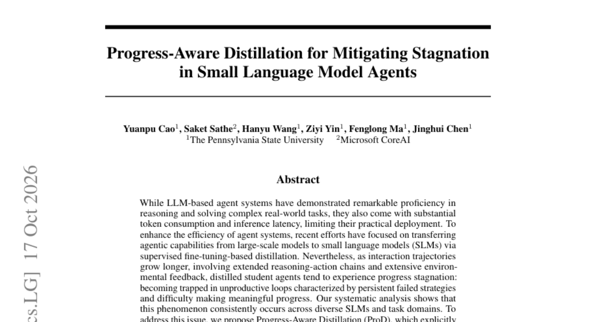

### 📌 한 줄 요약
SLM 에이전트가 반복적인 실패 루프에 빠지는 '정체 현상'을 해결하여 효율적인 에이전트 증류 기술을 제안합니다.

### 🔑 핵심 포인트
- SLM 에이전트가 긴 추론 과정에서 겪는 '정체(Stagnation)' 현상 규명
- 교사와 학생 모델 간의 격차를 활용한 적응형 마진 기반의 ProD 알고리즘 제안
- 다양한 규모(0.6B~8B)의 SLM에서 성공률 및 효율성 개선 입증

### 🧑‍💻 개발자 관점
저사양 환경에서 에이전트를 구동할 때 발생하는 무한 루프나 반복적 실패 문제를 해결하여 운영 비용을 절감할 수 있습니다.

### 🚀 실무 적용 아이디어
- 기존 SFT 방식의 SLM 에이전트와 ProD 방식의 성능 비교 실험
- 작업 단계(Step)가 길어질수록 정체 현상이 심화되는지 임계점 테스트
- 다양한 도메인(In-domain vs Out-of-domain)에서의 일반화 성능 검증

### ⚠️ 리스크/한계
- 교사 모델의 성능에 의존적인 정체 감지 메커니즘
- 매우 복잡한 환경에서 발생하는 새로운 형태의 정체 현상에 대한 대응 여부

### 📝 초록 기반 상세 설명
LLM 기반 에이전트는 뛰어난 성능을 보이지만 높은 토큰 소비와 지연 시간이라는 실무적 한계가 있습니다. 이를 해결하기 위해 대형 모델의 능력을 소형 언어 모델(SLM)로 전이하는 증류 방식이 사용되지만, 작업 과정이 길어질수록 SLM이 무의미한 루프에 빠지는 '정체 현상'이 발생합니다. 본 논문은 학생 모델의 궤적에서 정체 구간을 감지하고 페널티를 부여하는 Progress-Aware Distillation(ProD) 기법을 제안합니다. ProD는 교사와 학생 사이의 정체 격차를 적응형 마진으로 인코딩하여 학생이 교사의 행동을 점진적으로 모방하도록 유도합니다. 실험 결과, 0.6B~8B 규모의 다양한 SLM에서 성공률과 작업 완료 효율이 크게 향상됨을 확인했습니다.

---

## 48. [N-Gram Memories at Two Bits: Quantizing Lookup Tables in Large Language Models](https://huggingface.co/papers/2610.21810)
**Upvotes**: 6 | **도입 난이도**: 상 | **신뢰도**: 상
**arXiv**: https://arxiv.org/abs/2610.21810

**태그**: LLM, Quantization, Memory Optimization, Embedding, RAG

### 📌 한 줄 요약
LLM의 거대한 룩업 테이블(Lookup Table)을 2비트 수준으로 압축하여 메모리 효율을 극대화하는 기술

### 🔑 핵심 포인트
- Conditional Program(CP): 필요한 행만 선택적으로 재구성하는 압축 방식 제안
- 2-bit 양자화 최적화: Gaussian trellis를 활용해 낮은 비트에서도 높은 복원 정밀도 유지
- 메모리 효율성: 대규모 임베딩 테이블의 저장 용량을 1/4 수준으로 절감

### 🧑‍💻 개발자 관점
모델의 파라미터 크기가 커짐에 따라 발생하는 GPU 메모리 부족 문제를 해결하고, 더 큰 모델을 제한된 하드웨어에서 구동할 수 있는 실질적인 대안을 제시합니다.

### 🚀 실무 적용 아이디어
- 제안된 CP 방식의 코드북과 기존 Low-rank 방식 간의 성능/압축비 비교 실험
- 특정 도메인 데이터셋에서의 Gaussian-like 통계 특성 유지 여부 검증
- LLM 추론 엔진(vLLM 등)에 해당 압축/복원 로직 통합 시 지연 시간(Latency) 측정

### ⚠️ 리스크/한계
- 압축/복원 과정에서 발생하는 연산 오버헤드가 추론 속도에 미치는 영향
- 특정 데이터 분포에 의존적인 Gaussian-like 통계 특성의 일반화 문제

### 📝 초록 기반 상세 설명
LLM의 용량을 확장하기 위해 조건부 메모리(Conditional memory)를 사용하지만, 모든 임베딩 테이블을 유지해야 하는 메모리 부담이 발생합니다. 본 논문은 입력이 요청하는 행(row)만 재구성할 수 있는 압축 표현 방식인 Conditional Program(CP)을 제안합니다. CP는 각 행을 짧은 코드와 로컬 스케일로 표현하며, 공유된 재구성 프로그램을 통해 효율적으로 복원합니다. Gaussian trellis와 독립적 디코딩 방식을 적용한 결과, 2비트 양자화 환경에서 기존 방식 대비 KL 발산(KL divergence)을 41~63% 낮추었습니다. DeepSeek 모델 적용 시 테이블 저장 용량을 203GB에서 51GB로 대폭 절감하여 GPU 메모리 확보에 성공했습니다.

---

## 49. [HandsOn: A Large-Scale Simulation Benchmark for Generalizable Dexterous Manipulation](https://huggingface.co/papers/2610.26765)
**Upvotes**: 6 | **도입 난이도**: 중 | **신뢰도**: 상
**arXiv**: https://arxiv.org/abs/2610.26765

**태그**: Robotics, Simulation, Dexterous Manipulation, Benchmark, Generalization, Vision, Evaluation

### 📌 한 줄 요약
다양한 로봇 하드웨어와 물체에 대응하는 범용적 손 조작(Dexterous Manipulation) 능력을 검증하기 위한 대규모 시뮬레이션 벤치마크 플랫폼 제안

### 🔑 핵심 포인트
- 5종의 로봇 팔, 6종의 손, 200여 개의 다양한 자산을 포함하는 대규모 시뮬레이션 환경 구축
- 데모 기반 학습(Core-50)과 제로샷 전이/조합(Transfer-16)을 평가하는 체계적인 벤치마크 설계
- Diffusion, VLA, VLM 등 최신 제어 알고리즘의 범용 조작 성능 비교 검증

### 🧑‍💻 개발자 관점
로봇 하드웨어가 바뀌어도 동작이 유지되는 'Embodiment-agnostic' 제어 알고리즘 개발 시 강력한 테스트베드로 활용 가능합니다.

### 🚀 실무 적용 아이디어
- HandsOn 시뮬레이션 환경을 구축하여 현재 개발 중인 조작 알고리즘의 일반화 성능 테스트
- Transfer-16 태스크를 통해 학습되지 않은 새로운 물체/관계에 대한 제어 전이 능력 검증
- VLM 기반 제어와 강화학습 기반 제어의 물리적 정밀도 차이 비교 실험

### ⚠️ 리스크/한계
- 시뮬레이션 환경과 실제 로봇 간의 Sim-to-Real 간극 존재 가능성
- 복잡한 물리적 접촉 및 협응 제어의 난이도로 인해 낮은 성공률이 발생할 수 있음

### 📝 초록 기반 상세 설명
범용 조작 기술은 로봇의 형태, 물체, 작업 요구사항이 변해도 신뢰할 수 있는 동작을 수행해야 합니다. 본 논문은 다양한 로봇 팔과 손, 수많은 자산을 포함하는 합성 시뮬레이션 플랫폼인 HandsOn을 소개합니다. 이 벤치마크는 18,000개의 인간 데모와 66개의 검증된 태스크를 제공하며, Core-50과 Transfer-16이라는 두 가지 평가 체계를 통해 일반화 능력을 측정합니다. 실험 결과, 최적의 멀티태스크 정책은 Core-50에서 29.1%의 성공률을 기록했으며, LLM 기반 제어 방식과의 성능 차이를 통해 정교한 물리적 상호작용의 난이도를 입증했습니다. HandsOn은 향후 조작 일반화 연구와 물리적 상호작용의 한계를 탐구하는 데 중요한 기준이 될 것입니다.

### 🖼️ 추가 자료

---

## 50. [HSPR: Recovering Software-Agent Benchmark Scores via Hierarchical Posterior Inference](https://huggingface.co/papers/2610.24611)
**Upvotes**: 5 | **도입 난이도**: 중 | **신뢰도**: 상
**arXiv**: https://arxiv.org/abs/2610.24611

**태그**: Agent, Benchmark, Evaluation, Bayesian, Inference

### 📌 한 줄 요약
최소한의 태스크 예산만으로 소프트웨어 에이전트의 전체 벤치마크 점수를 정확하게 추정하는 계층적 사후 추론 프레임워크

### 🔑 핵심 포인트
- 계층적 사후 추론(HSPR)을 통한 효율적인 에이전트 점수 복구 메커니즘 제안
- 사후 분포 가이드 기반의 적응적 태스크 선택(Acquisition) 전략 적용
- 최소한의 태스크 예산(10%)으로 전체 벤치마크 점수를 정밀하게 추정

### 🧑‍💻 개발자 관점
에이전트 성능 평가 시 모든 테스트 케이스를 실행하는 비용을 획기적으로 줄이면서도 신뢰할 수 있는 점수를 얻을 수 있습니다.

### 🚀 실무 적용 아이디어
- SWE-bench와 같은 대규모 벤치마크 환경에서 HSPR 알고리즘 적용 테스트
- 태스크 예산(Budget) 변화에 따른 점수 추정 오차(MAE) 변화량 측정
- 기존의 무작위 샘플링 방식과 HSPR의 적응적 샘플링 성능 비교

### ⚠️ 리스크/한계
- 태스크 간 상관관계가 매우 낮거나 데이터 구조가 복잡할 경우 추정 정확도 저하 가능성
- 적은 예산에서의 추정치는 여전히 전체 평가 대비 불확실성을 내포함

### 📝 초록 기반 상세 설명
소프트웨어 에이전트의 전체 벤치마크 평가에는 막대한 비용과 시간이 소요됩니다. 일부 태스크만 평가할 경우 에이전트 간 순위는 유지될 수 있으나 개별 점수의 정확도는 떨어지는 문제가 발생합니다. 이를 해결하기 위해 HSPR은 소스 데이터의 응답 요인과 그룹별 성공률의 불확실성을 결합한 계층적 사후 추론 방식을 도입합니다. 관찰된 결과를 바탕으로 타겟 에이전트의 잠재 상태와 그룹 성공률을 업데이트하며, 사후 분포 가이드를 통해 다음 태스크를 적응적으로 선택합니다. 실험 결과, SWE-bench 계열의 벤치마크에서 10%의 적은 예산만으로도 기존 방식 대비 가장 낮은 오차(MAE)를 기록하며 우수한 성능을 입증했습니다.

---

