# 2026-10-26 Daily Papers (Top 49)

## 오늘의 요약
오늘의 연구는 멀티모달 모델(VLM)의 시각적 이해와 생성 능력을 통합하여 정교한 제어를 구현하는 방향과, 에이전트의 자율적 탐색 및 효율적인 메모리 구조를 설계하는 연구들이 주를 이루었습니다. 또한, 생성 모델의 내부 표현을 활용해 시각적 이해도를 높이거나 물리적 환경에서 로봇의 자기 개선을 도모하는 등 AI의 실무적 활용과 메타 학습에 대한 심도 있는 논의가 이루어졌습니다.

### 오늘의 핵심 포인트
- 객체 탐지부터 세그멘테이션까지 수행하는 통합 VLM과 생성 모델의 표현력을 활용한 정밀 시각 이해 기술이 주목받았습니다.
- 웹 탐색 에이전트와 코딩 에이전트 등 실무 자동화를 위한 자율적 에이전트 시스템의 성능 평가 및 아키텍처 설계가 활발히 논의되었습니다.
- RAG의 지연 시간을 해결하는 파라미터 메모리 방식과 로봇의 재귀적 자기 개선 등 효율적이고 자율적인 학습 방법론이 제시되었습니다.

**오늘의 태그**: VLM, AI Agent, Generative AI, Robot Learning, Multimodal

## 1. [WeVisOne-VL: Unified Visual Perception from Objects to Pixels](https://huggingface.co/papers/2610.31329)
**Upvotes**: 242 | **도입 난이도**: 중 | **신뢰도**: 상
**arXiv**: https://arxiv.org/abs/2610.31329

**태그**: VLM, Segmentation, Object Detection, Multimodal, Vision, Benchmark

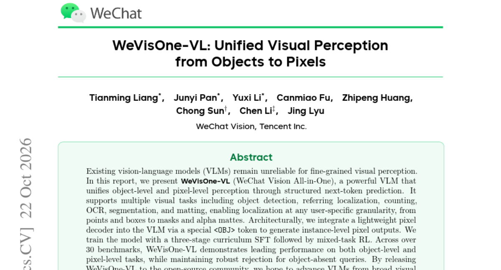

### 📌 한 줄 요약
객체 탐지부터 픽셀 단위 세그멘테이션까지 하나의 모델로 해결하는 통합 시각 인지 VLM 모델

### 🔑 핵심 포인트
- 객체 탐지, OCR, 세그멘테이션, 매팅을 하나의 모델로 통합한 All-in-One VLM
- 특수 <OBJ> 토큰과 경량 픽셀 디코더를 결합한 구조적 설계
- 커리큘럼 SFT 및 혼합 작업 RL을 통한 정교한 학습 전략

### 🧑‍💻 개발자 관점
단일 모델로 박스(Box)부터 마스크(Mask)까지 다양한 해상도의 시각 작업을 수행할 수 있어, 복잡한 멀티태스크 비전 파이프라인을 단순화할 수 있습니다.

### 🚀 실무 적용 아이디어
- 제공된 오픈소스 모델을 활용하여 특정 도메인(예: 의료, 제조)의 세밀한 객체 추출 테스트
- 객체가 없는 쿼리에 대한 모델의 거부(Rejection) 성능 검증
- 기존의 개별 모델(Detection/Segmentation) 대비 추론 속도 및 효율성 비교

### ⚠️ 리스크/한계
- 픽셀 수준의 정밀도를 위해 모델 크기나 연산 비용이 증가할 가능성
- 다양한 태스크를 통합함에 따라 특정 작업에서의 성능 상충(Trade-off) 발생 가능성

### 📝 초록 기반 상세 설명
기존의 시각-언어 모델(VLM)은 세밀한 시각적 인지 작업에서 신뢰도가 낮다는 문제를 가지고 있습니다. 이를 해결하기 위해 본 논문은 객체 수준과 픽셀 수준의 인지를 구조화된 차세대 토큰 예측 방식으로 통합한 WeVisOne-VL을 제안합니다. 아키텍처 측면에서는 특수 <OBJ> 토큰을 통해 경량 픽셀 디코더를 VLM에 통합하여 인스턴스 수준의 픽셀 출력을 생성합니다. 3단계 커리큘럼 SFT와 혼합 작업 RL을 통해 학습되었으며, 30개 이상의 벤치마크에서 객체 및 픽셀 작업 모두에서 뛰어난 성능을 입증했습니다. 결과적으로 이 모델은 광범위한 이해를 넘어 실세계 배포가 가능한 신뢰할 수 있는 인지 시스템을 지향합니다.

### 🖼️ 추가 자료
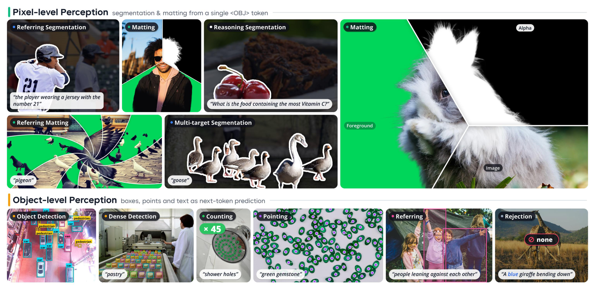

---

## 2. [Editing Images into Reusable Layers via Compositional Edit-Prior Distillation](https://huggingface.co/papers/2610.24738)
**Upvotes**: 184 | **도입 난이도**: 상 | **신뢰도**: 상
**arXiv**: https://arxiv.org/abs/2610.24738

**태그**: Computer Vision, Image Editing, Generative AI, Layer Decomposition, Vision, Benchmark, Evaluation, Distillation

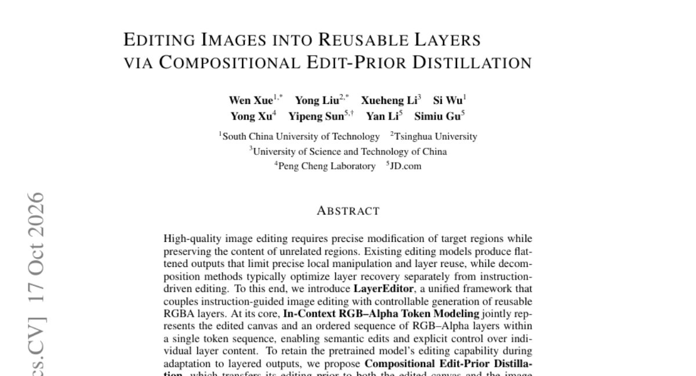

### 📌 한 줄 요약
편집 가능한 레이어 구조를 생성하여 이미지 편집과 레이어 분해를 동시에 수행하는 통합 프레임워크 제안

### 🔑 핵심 포인트
- In-Context RGB-Alpha Token Modeling을 통한 편집 캔버스와 레이어 간의 통합 표현 방식 도입
- Compositional Edit-Prior Distillation을 통한 편집 성능 유지 및 레이어 생성 최적화
- 대규모 레이어 주석 데이터셋인 LayerEditor-100K 구축 및 전용 벤치마크 제안

### 🧑‍💻 개발자 관점
편집된 이미지를 다시 레이어별로 분리하여 그래픽 작업에 재사용할 수 있어, 생성형 AI 결과물의 사후 편집 편의성을 극대화합니다.

### 🚀 실무 적용 아이디어
- 제공된 LayerEditor-100K 데이터셋의 레이어 분리 정밀도 검증
- 기존 Diffusion 모델 대비 레이어 간 경계(Alpha)의 정확도 비교 실험
- 생성된 레이어를 Photoshop 등 외부 그래픽 툴로 가져갔을 때의 실무 활용성 테스트

### ⚠️ 리스크/한계
- 복잡한 레이어 구조로 인해 생성 속도 및 연산 비용이 증가할 가능성
- 매우 복잡한 배경이나 겹침이 심한 객체의 경우 레이어 분리 정확도 저하 우려

### 📝 초록 기반 상세 설명
기존의 이미지 편집 모델은 결과물이 단일 평면(flattened) 형태로 생성되어 국소적인 조작이나 레이어 재사용이 어렵다는 문제가 있었습니다. 또한 기존 분해 방식은 편집 지시사항과 레이어 복구 과정을 별도로 최적화하는 한계가 있었습니다. 이를 해결하기 위해 본 논문은 지시어 기반 편집과 재사용 가능한 RGBA 레이어 생성을 결합한 LayerEditor 프레임워크를 제안합니다. 핵심 기술인 In-Context RGB-Alpha Token Modeling은 편집된 캔버스와 순차적인 레이어 정보를 하나의 토큰 시퀀스로 통합 관리합니다. 또한 Compositional Edit-Prior Distillation을 통해 사전 학습된 모델의 편집 능력을 유지하면서 레이어 생성 능력을 확보했습니다. 실험 결과, LayerEditor는 높은 편집 충실도를 유지하면서도 정교한 레이어 분해와 유연한 조작을 가능하게 함을 입증했습니다.

### 🖼️ 추가 자료
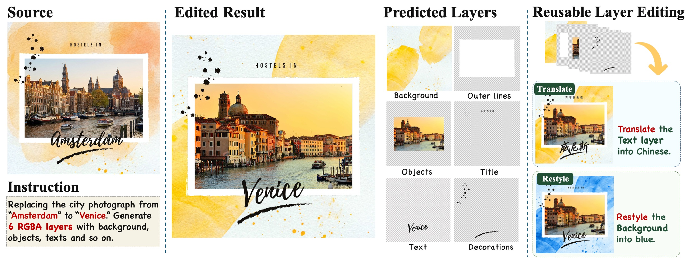
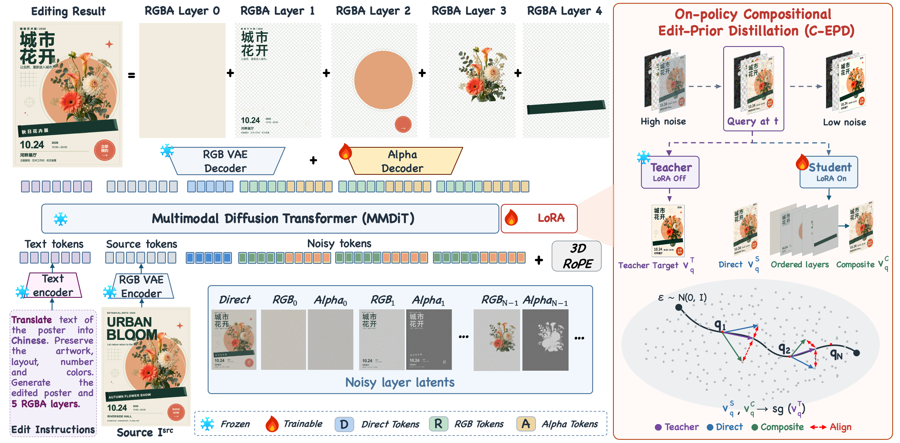
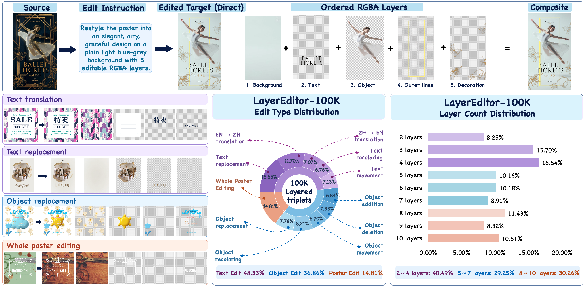

---

## 3. [Making MLLM Latents Matter: Factor-Aware Predictive Learning for Cinematic Video Generation](https://huggingface.co/papers/2610.30926)
**Upvotes**: 173 | **도입 난이도**: 상 | **신뢰도**: 상
**arXiv**: https://arxiv.org/abs/2610.30926

**태그**: Video Generation, MLLM, Diffusion Transformer, Control, Multimodal, Video, Inference

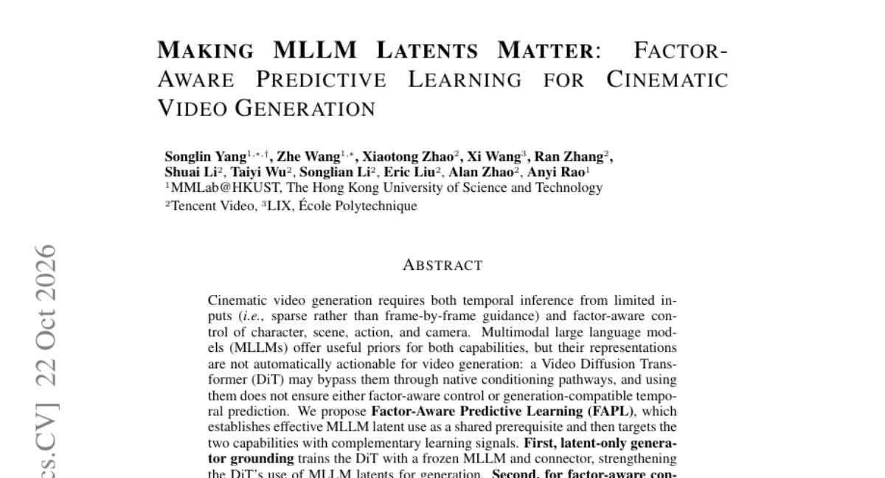

### 📌 한 줄 요약
MLLM의 잠재 표현을 활용하여 정교한 제어와 시간적 추론이 가능한 시네마틱 비디오 생성 프레임워크 제안

### 🔑 핵심 포인트
- Latent-only generator grounding을 통해 DiT가 MLLM의 잠재 표현을 생성에 직접 활용하도록 학습
- Factor-span replacement를 통해 특정 요소(캐릭터, 액션 등)만 변경하고 나머지는 유지하는 정교한 제어 구현
- 텍스트 및 부분 비디오 입력을 통한 시간적 추론 능력을 강화하여 sparse-to-video 작업 최적화

### 🧑‍💻 개발자 관점
LLM의 풍부한 의미 정보를 비디오 생성 모델의 제어 신호로 변환하는 효과적인 방법론을 제시하여, 텍스트 기반의 정교한 영상 편집 및 생성 워크플로우 구축에 도움을 줌

### 🚀 실무 적용 아이디어
- 제공된 FAPL 프레임워크를 기존 DiT 구조에 결합하여 잠재 표현 활용도 변화 측정
- 특정 요소(예: 카메라 앵글)만 변경하는 factor-aware 제어 성능 테스트
- Sparse input(텍스트/이미지) 입력 시 생성된 비디오의 일관성 검증

### ⚠️ 리스크/한계
- MLLM과 DiT 간의 복잡한 최적화 과정으로 인해 학습 비용이 높을 수 있음
- 특정 요소 제어 시 의도치 않은 요소가 함께 변하는 factor leakage 가능성 존재

### 📝 초록 기반 상세 설명
고품질 시네마틱 비디오 생성을 위해서는 제한된 입력으로부터의 시간적 추론과 캐릭터, 장면, 카메라 등의 요소별 제어가 필수적입니다. 기존 MLLM은 유용한 사전 지식을 제공하지만, 비디오 생성 모델(DiT)이 이를 효과적으로 활용하지 못하거나 요소별 제어 및 시간적 예측 능력이 부족한 문제가 있습니다. 이를 해결하기 위해 본 논문은 FAPL(Factor-Aware Predictive Learning) 프레임워크를 제안합니다. FAPL은 DiT가 MLLM 잠재 표현을 활용하도록 학습시키고, 요소별 변화와 보존을 학습하는 factor-span replacement, 그리고 제한된 입력에서 전체 비디오를 예측하는 temporal inference 과정을 거칩니다. 실험 결과, 제안된 방식은 sparse-to-video, factor-aware editing 등 다양한 시네마틱 작업에서 기존 모델보다 우수한 성능을 입증했습니다.

---

## 4. [Deep Search in Real-World Web Environments](https://huggingface.co/papers/2610.30181)
**Upvotes**: 162 | **도입 난이도**: 하 | **신뢰도**: 상
**arXiv**: https://arxiv.org/abs/2610.30181

**태그**: AI Agent, Web Navigation, Benchmark, Information Retrieval, Agent, RAG, Evaluation

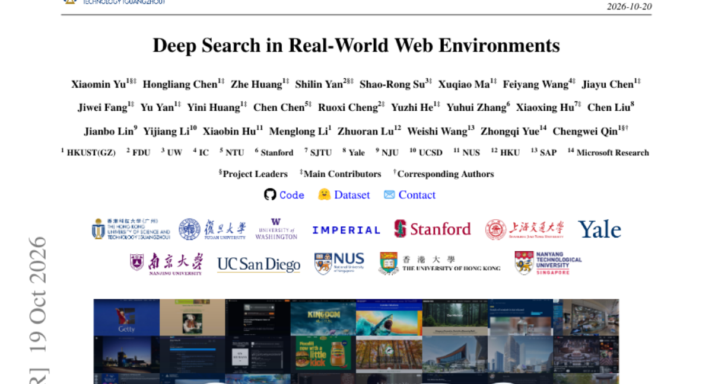

### 📌 한 줄 요약
실제 웹 환경에서의 복합적 정보 탐색 및 추론 능력을 평가하기 위한 새로운 벤치마크 OpenDS-World를 제안합니다.

### 🔑 핵심 포인트
- 실제 웹 환경의 복잡성을 반영한 OpenDS 태스크 및 OpenDS-World 벤합 구축
- 검색, 브라우징, 증거 통합을 아우르는 엔드투엔드 에이전트 평가 프레임워크 제안
- 다양한 모달리티와 파일 형식을 포함한 200개의 고난도 태스크 및 인간 검증 데이터 확보

### 🧑‍💻 개발자 관점
단순 RAG를 넘어, 에이전트가 직접 웹을 탐색하고 정보를 수집하는 '자율적 리서치 에이전트' 개발 시 성능 측정의 기준이 됩니다.

### 🚀 실무 적용 아이디어
- 제안된 OpenDS-World 벤치마크를 활용하여 현재 개발 중인 에이전트의 웹 탐색 성능 측정
- 에이전트의 도구 사용(Tool-use) 및 검색 비용(Search cost) 최적화 전략 비교
- 장기적 탐색(Long-horizon search) 시 발생하는 실패 복구(Failure recovery) 로직 테스트

### ⚠️ 리스크/한계
- 실제 웹 환경의 동적 특성으로 인해 벤치마크 데이터의 유효성 유지 관리가 어려울 수 있음
- 모델별로 상이한 검색 전략과 도구 조정 능력 차이로 인해 일관된 비교가 복잡할 수 있음

### 📝 초록 기반 상세 설명
기존의 딥 서치 에이전트는 정적인 데이터셋에 의존하여 실제 웹의 복잡한 상호작용과 분산된 정보를 다루는 능력을 평가하기 어려웠습니다. 이를 해결하기 위해 실시간 웹 탐색, 브라우저 상호작용, 다중 소스 증거 통합 능력을 요구하는 OpenDS 태스크를 도입했습니다. 연구진은 200개의 도전적인 과제로 구성된 OpenDS-World 벤치마크를 구축하고 12개의 최첨단 모델을 평가했습니다. 실험 결과, 최고 성능 모델의 정확도는 39.0%에 그쳤으며 인간의 정확도(21.1%)보다는 높지만 여전히 복잡한 탐색 과제에서 한계를 보였습니다. 이 연구는 에이전트의 자율적 딥 서치 역량을 체계적으로 평가할 수 있는 플랫폼을 제공합니다.

---

## 5. [IQuest-Q1: Advancing Foundation Capabilities for Agentic CLI Systems](https://huggingface.co/papers/2610.30949)
**Upvotes**: 97 | **도입 난이도**: 상 | **신뢰도**: 상
**arXiv**: https://arxiv.org/abs/2610.30949

**태그**: Agent, MoE, Coding, LLM

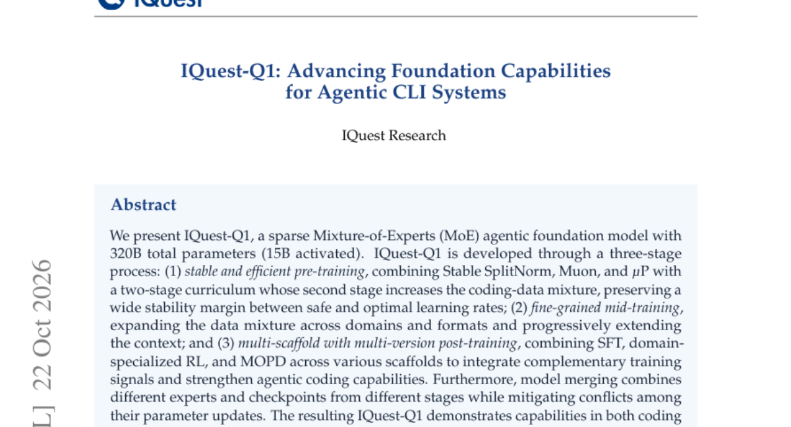

### 📌 한 줄 요약
320B 파라미터 규모의 MoE 구조를 활용하여 코딩 및 에이전트 역량을 극대화한 차세대 CLI 시스템용 파운데이션 모델

### 🔑 핵심 포인트
- 320B 총 파라미터(15B 활성) 규모의 효율적인 MoE 아키텍처 설계
- 안정적 사전 학습과 도메인 확장형 미드 트레이닝을 포함한 3단계 학습 파이프라인
- SFT, RL, MOPD 및 모델 병합 기술을 결합한 멀티 스캐폴드 사후 학습 전략

### 🧑‍💻 개발자 관점
대규모 모델의 효율적인 추론(15B 활성)과 강력한 코딩 에이전트 능력을 동시에 확보하여 실무 자동화 도구에 적용 가능합니다.

### 🚀 실무 적용 아이디어
- 제공된 오픈 소스 모델을 로컬/클라우드 환경에 배포하여 추론 속도 테스트
- 다양한 코딩 작업 및 CLI 에이전트 시나리오에서의 성능 벤치마크 수행
- 모델 병합 기법이 실제 작업 성능에 미치는 영향 분석

### ⚠️ 리스크/한계
- 320B 규모의 모델로 인해 배포 및 운영 시 높은 하드웨어 리소스 요구
- 특정 도메인에 특화된 학습 방식이 일반 작업 성능에 미칠 수 있는 영향성

### 📝 초록 기반 상세 설명
에이전트 기반의 CLI 시스템을 위해 강력한 코딩 및 일반 작업 수행 능력을 갖춘 파운데님 모델이 필요해졌습니다. 이를 위해 총 320B(활성 15B) 파라미터 규모의 희소 MoE 모델인 IQuest-Q1을 제안합니다. 학습은 안정적인 사전 학습, 도메인 확장 중심의 미드 트레이닝, 그리고 SFT와 RL을 결합한 멀티 스캐폴드 사후 학습의 3단계 과정을 거칩니다. 특히 모델 병합 기술을 통해 서로 다른 단계의 전문가와 체크포인트를 충돌 없이 통합했습니다. 그 결과, IQuest-Q1은 코딩과 일반 작업 모두에서 뛰어난 성능을 보이며 오픈 소스로 공개되었습니다.

---

## 6. [Toward Recursive Self-Improvement in Physical AI](https://huggingface.co/papers/2610.29677)
**Upvotes**: 58 | **도입 난이도**: 상 | **신뢰도**: 상
**arXiv**: https://arxiv.org/abs/2610.29677

**태그**: Robot Learning, Self-Improvement, Meta-Learning, Physical AI, Agent, Evaluation

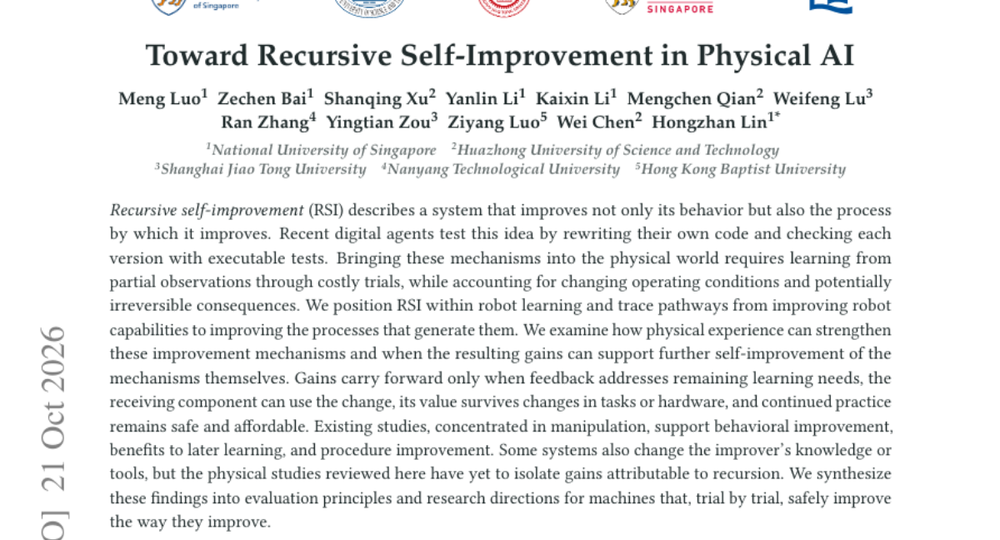

### 📌 한 줄 요약
물리적 환경에서의 재귀적 자기 개선(RSI) 메커니즘과 이를 위한 평가 원칙 제안

### 🔑 핵심 포인트
- 물리적 환경에서의 재귀적 자기 개선(RSI) 정의 및 메커니즘 분석
- 학습 이득이 다음 단계의 개선으로 이어지기 위한 4가지 필수 조건 식별
- 기존 로봇 조작 연구를 통한 행동/절차/지식 개선 효과 검토

### 🧑‍💻 개발자 관점
로봇 에이전트가 단순히 작업을 수행하는 것을 넘어, 학습 프로세스 자체를 최적화하는 '메타 학습' 시스템을 설계할 때 중요한 가이드라인을 제공합니다.

### 🚀 실무 적용 아이디어
- 시뮬레이션 환경에서 코드 자동 생성 및 실행 테스트 루프 구축
- 하드웨어 제약 조건 하에서 학습 이득의 전이성(Transferability) 측정 실험
- 안전 장치가 포함된 자동화된 하이퍼파라미터 최적화 루프 설계

### ⚠️ 리스크/한계
- 물리적 환경에서의 비가역적 손상 및 안전 문제
- 실제 하드웨어 비용과 데이터 수집의 제약으로 인한 재귀적 루프의 한계

### 📝 초록 기반 상세 설명
디지털 에이전트의 코드 재작성 방식과 같은 재귀적 자기 개선(RSI) 개념을 물리적 로봇 시스템에 적용하려는 시도가 늘고 있습니다. 하지만 물리적 세계에서는 불완전한 관측, 비용이 발생하는 시행착오, 가역적이지 않은 결과와 같은 독특한 제약 조건이 존재합니다. 본 논문은 로봇 학습의 관점에서 역량 개선이 개선 프로세스 자체의 개선으로 이어지는 경로를 탐구합니다. 기존 연구들을 분석하여 물리적 경험이 어떻게 개선 메커니즘을 강화할 수 있는지, 그리고 그 이득이 지속 가능한지를 검토합니다. 최종적으로 물리적 환경에서 안전하고 효율적인 자기 개선을 달성하기 위한 평가 원칙과 연구 방향을 제시합니다.

---

## 7. [Deep Fusion Memory: A Chunk-Level Parametric Memory for Large Language Models](https://huggingface.co/papers/2610.25100)
**Upvotes**: 49 | **도입 난이도**: 중 | **신뢰도**: 상
**arXiv**: https://arxiv.org/abs/2610.25100

**태그**: LLM, Parametric Memory, Efficient Training, Knowledge Injection, RAG, Vision, Evaluation, Inference

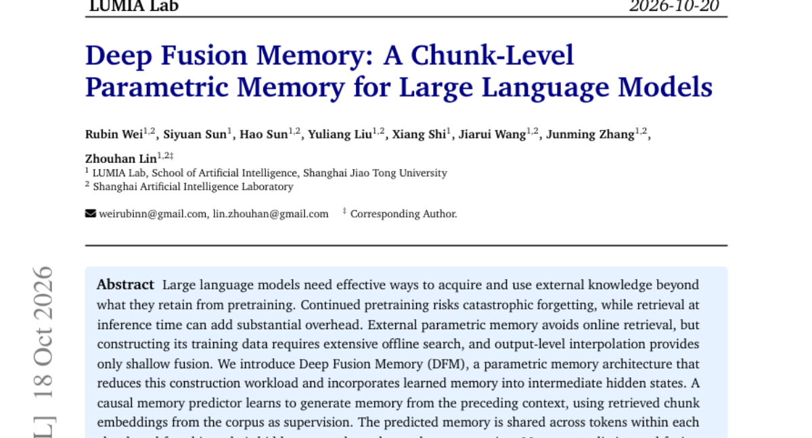

### 📌 한 줄 요약
추가적인 검색 과정 없이 학습된 파라미터만으로 외부 지식을 주입하는 효율적인 청크 단위 메모리 아키텍처 제안

### 🔑 핵심 포인트
- 청크 단위의 파라미터 메모리 아키텍처로 데이터 구축 워크로드 대폭 절감
- 학습된 메모리를 은닉 상태에 직접 융합하여 추론 시 검색 오버헤드 제거
- 백본 모델을 동결한 상태에서 메모리 예측 및 융합 모듈을 엔드투엔드로 학습

### 🧑‍💻 개발자 관점
RAG의 고질적인 문제인 추론 시 지연 시간(Latency)을 해결하면서도, 효율적인 데이터 구축을 통해 외부 지식을 모델에 내재화할 수 있는 방법론을 제시합니다.

### 🚀 실무 적용 아이디어
- 기존 RAG 시스템의 추론 속도 개선을 위한 대안으로 DFM 구조 설계 검토
- 특정 도메인 지식 주입을 위한 파라미터 메모리 모듈의 효율성 테스트
- 백본 모델 동결 조건 하에서 메모리 예측 모듈의 학습 안정성 실험

### ⚠️ 리스크/한계
- 학습 시 사용된 외부 지식의 범위 내로 모델의 지식 습득이 제한될 가능성
- 메모리 예측 모듈이 복잡해질 경우 모델의 전체적인 연산량 증가 우려

### 📝 초록 기반 상세 설명
LLM이 사전 학습된 지식 외의 외부 지식을 습득하기 위해 지속적 사전 학습이나 추론 시 검색(Retrieval)을 사용하지만, 전자는 망각 위험이 있고 후자는 오버헤드가 큽니다. 기존의 파라미터 메모리 방식은 데이터 구축 비용이 높고 결합 방식이 표면적이라는 한계가 있습니다. 본 논문은 인과적 메모리 예측기(Causal Memory Predictor)를 통해 문맥으로부터 메모리를 생성하고, 이를 게이트형 교차 주의집중(Gated Cross-attention)으로 은닉 상태에 융합하는 DFM을 제안합니다. DFM은 추론 시 별도의 검색 과정이 필요 없으며, 데이터 구축 시 검색 쿼리 및 검색 아이템 수를 획기적으로 줄였습니다. 실험 결과, QA 작업 및 도메인 적응 성능에서 기존 베이스라인 대비 우수한 성능 향상을 입증했습니다.

---

## 8. [What Generation Knows: Unlocking Fine-Grained Understanding in Unified Multimodal Models](https://huggingface.co/papers/2610.23987)
**Upvotes**: 37 | **도입 난이도**: 중 | **신뢰도**: 상
**arXiv**: https://arxiv.org/abs/2610.23987

**태그**: Multimodal, Computer Vision, LLM, Representation Learning, RAG, Vision, Evaluation

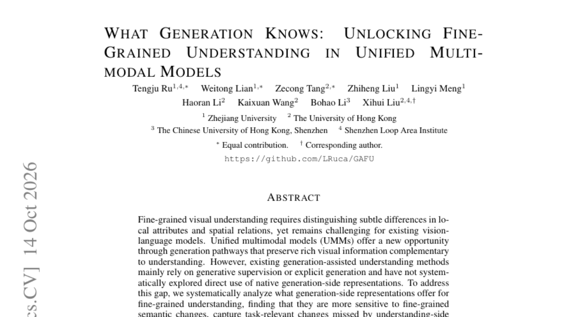

### 📌 한 줄 요약
생성 모델의 내부 표현(representation)을 활용하여 멀티모달 모델의 세밀한 시각적 이해 능력을 극대화하는 프레임워크 제안

### 🔑 핵심 포인트
- 생성 측 표현(Generation-side representation)이 세밀한 속성 및 공간 관계 파악에 더 유리함을 규명
- 생성 정보를 압축된 G-token으로 변환하여 이해 작업에 주입하는 GAFU 프레임워크 제안
- SFT 방식 대비 다양한 시각적 이해 태스크에서 일관된 성능 향상 달성

### 🧑‍💻 개발자 관점
생성형 모델을 단순히 텍스트 생성용이 아닌, 고도화된 시각적 질의응답(VQA)이나 정밀한 객체 탐지 보조 도구로 활용할 수 있는 방법론을 제시합니다.

### 🚀 실무 적용 아이디어
- 기존 LMM(Large Multimodal Model)의 생성 레이어 특징값을 추출하여 이해 태스크에 결합하는 실험 수행
- G-token 압축 방식에 따른 정보 손실과 이해 성능 간의 트레이드오프 분석
- 공간적 관계(Spatial relation) 중심의 벤치마크 데이터셋을 통한 성능 검증

### ⚠️ 리스크/한계
- 생성 측 표현을 압축하는 과정에서 발생할 수 있는 정보 손실 위험
- 모델 아키텍처에 따라 G-token의 효율성이 달라질 수 있는 의존성

### 📝 초록 기반 상세 설명
기존의 통합 멀티모달 모델(UMM)은 생성 능력을 갖추고 있음에도 불구하고, 생성 과정의 풍부한 정보를 이해 작업에 직접 활용하는 데 한계가 있었습니다. 본 논문은 생성 측의 표현이 세밀한 의미 변화와 공간적 관계를 포착하는 데 더 민감하다는 점을 체계적으로 분석했습니다. 이를 바탕으로 생성 측의 시각적 표현을 압축된 G-token으로 변환하여 이해 경로에서 활용할 수 있는 GAFU 프레임워크를 설계했습니다. 실험 결과, GAFU는 다양한 시각적 이해 벤치마크에서 기존 SFT 방식보다 월등한 성능 향상을 보였습니다. 결과적으로 생성과 이해 경로 간의 시너지를 통해 정교한 시각적 이해를 달성할 수 있음을 입증했습니다.

### 🖼️ 추가 자료

---

## 9. [Self-Distilling Future Video Representations for World Action Models](https://huggingface.co/papers/2610.30320)
**Upvotes**: 37 | **도입 난이도**: 중 | **신뢰도**: 상
**arXiv**: https://arxiv.org/abs/2610.30320

**태그**: Robot-Policy, Diffusion-Model, Self-Distillation, Zero-Shot, Video, Inference, Distillation

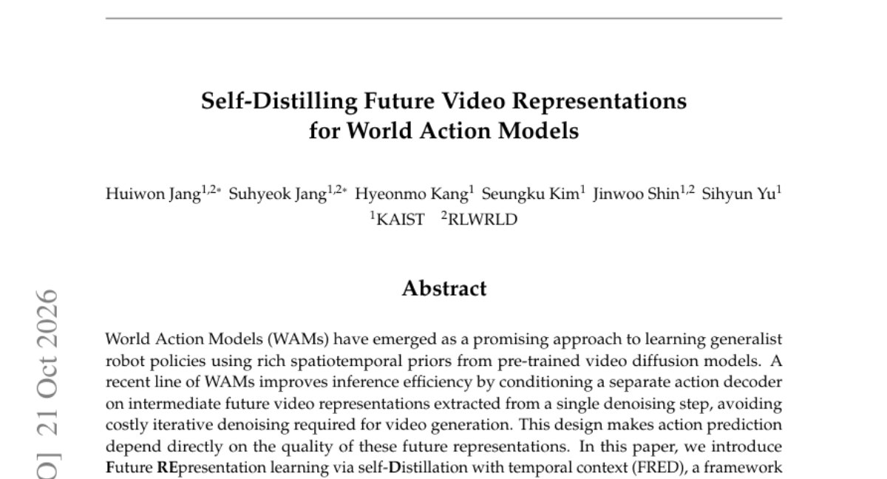

### 📌 한 줄 요약
단 한 번의 디노이징만으로 고품질 미래 비디오 표현을 생성하여 로봇의 제어 성능과 제로샷 일반화 능력을 극대화하는 프레임워크

### 🔑 핵심 포인트
- FRED: 자기 증류(Self-distillation)를 통해 노이즈로부터 고품질 미래 비디오 표현을 추출하는 프레임워크 제안
- 과거 관측 데이터를 조건부로 사용하여 미래 표현 예측의 정확도를 높이는 시간적 문맥 활용
- 제로샷 환경 일반화 및 인간 영상 기반의 로봇 기술 전이(Human-to-robot transfer) 성능 대폭 향상

### 🧑‍💻 개발자 관점
비디오 생성 모델의 무거운 반복 연산 없이도 고성능 로봇 제어 정책을 얻을 수 있는 효율적인 학습 방법론을 제시합니다.

### 🚀 실무 적용 아이디어
- 제시된 FRED 프레임워크를 기존 WAM 구조에 적용하여 단일 단계 디노이징 성능 비교
- 다양한 시간적 문맥(Historical observations) 길이에 따른 미래 표현 예측 정확도 변화 측정
- 인간 데모 데이터만으로 학습했을 때의 제로샷 성능 벤치마크 테스트

### ⚠️ 리스크/한계
- 미래 표현의 품질이 전체 로봇 정책 성능을 결정하는 병목 현상 발생 가능성
- 학습 시 사용되는 ground-truth 미래 표현에 대한 의존도 및 분포 차이 문제

### 🖼️ 추가 자료
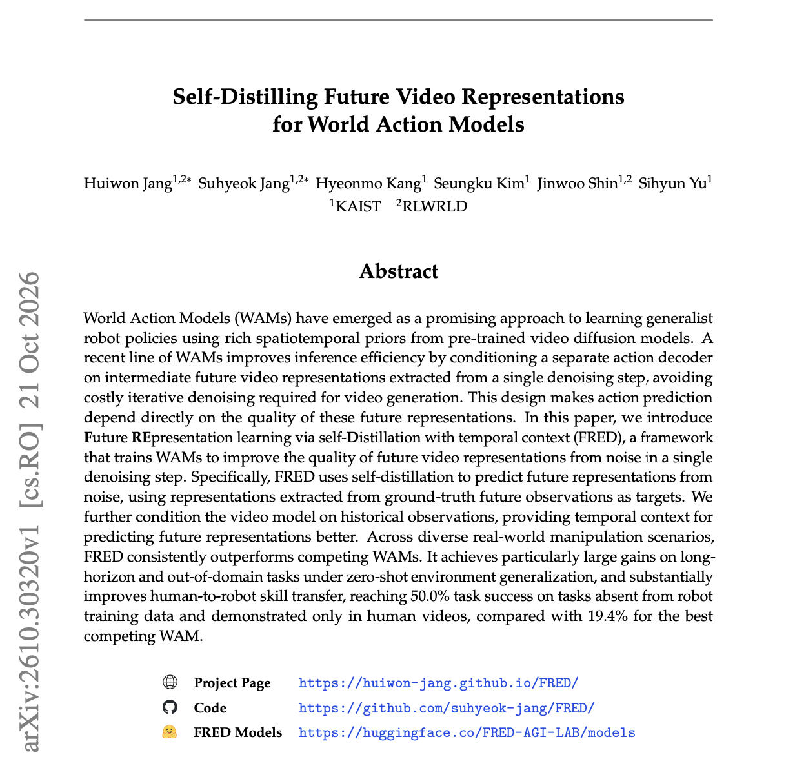

---

## 10. [LaLa-World: Scaling Latent World Models with Natural Language Actions](https://huggingface.co/papers/2610.27851)
**Upvotes**: 37 | **도입 난이도**: 상 | **신뢰도**: 상
**arXiv**: https://arxiv.org/abs/2610.27851

**태그**: Robot Learning, World Models, LLM, Embodied AI, RAG, Vision, Video, Inference

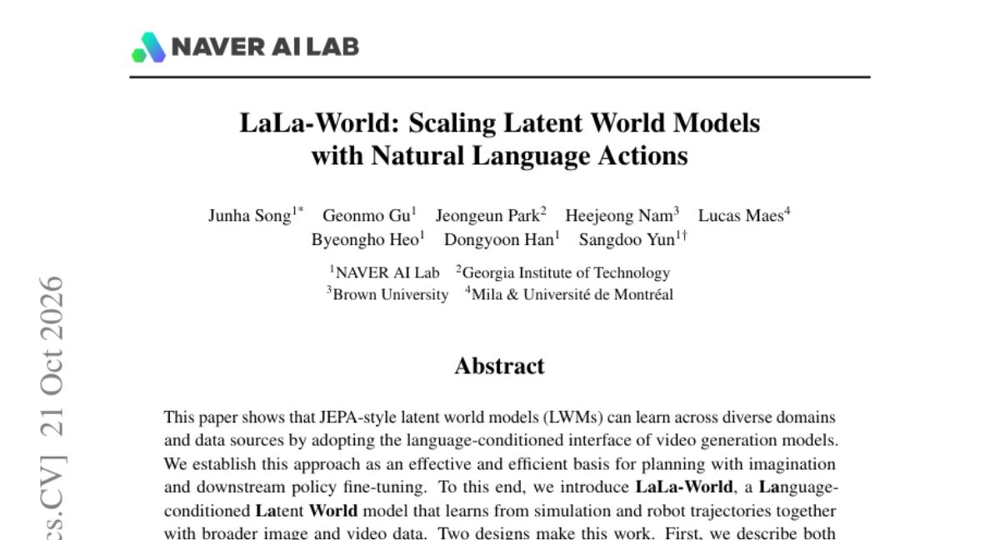

### 📌 한 줄 요약
자연어 액션을 인터페이스로 활용하여 이종 데이터(시뮬레이션, 로봇, 비디오)를 통합 학습하는 효율적인 잠재 월드 모델(LWM) 프레임워크 제안

### 🔑 핵심 포인트
- 수치적 액션과 시각적 변화를 언어로 변환하여 이종 데이터셋(시뮬레이션, 로봇, 비디오) 통합 학습 가능
- 언어 모델 기반의 예측기 설계를 통해 언어 조건부 상태 예측 및 계획 수립 효율 극대화
- 비디오 생성 모델 대비 훨씬 적은 학습 비용과 빠른 계획/추론 속도 확보

### 🧑‍💻 개발자 관점
로봇 제어와 비디오 생성 기술을 결합하여, 텍스트 명령만으로 다양한 환경에서 동작하는 범용 에이전트 학습의 새로운 경로를 제시합니다.

### 🚀 실무 적용 아이디어
- 제시된 언어 기반 액션 인코딩 방식이 수치적 제어 정밀도에 미치는 영향 분석
- 비디오 데이터가 로봇 제어 정책(Policy)의 일반화 성능에 미치는 상관관계 실험
- LLM 기반 월드 모델의 추론 지연 시간(Latency)과 실시간 제어 가능성 검토

### ⚠️ 리스크/한계
- 언어적 표현의 모호함이 정밀한 수치 제어(Numerical Control) 성능을 저하시킬 가능성
- 대규모 비디오 데이터와 로봇 데이터 간의 도메인 간극(Domain Gap) 문제

### 📝 초록 기반 상세 설명
기존의 잠재 월드 모델(LWM)은 서로 다른 도메인과 데이터 소스 간의 통합 학습이 어려워 범용적인 계획 수립에 한계가 있었습니다. 본 논문은 비디오 생성 모델의 언어 조건부 인터페이스를 채택하여 다양한 데이터셋을 통합할 수 있는 LaLa-World를 제안합니다. 수치적 액션과 시각적 변화를 모두 언어로 기술하고, 언어 모델 기반의 예측기를 구축하여 이종 데이터 간의 공동 학습을 가능하게 했습니다. 실험 결과, LaLa-World는 기존 방식보다 높은 MPC 계획 성능을 보였으며 비디오 데이터 추가 시 강건성도 향상되었습니다. 또한, 제안된 LaLa-Policy는 기존 모델 대비 훨씬 빠른 추론 속도를 유지하면서도 경쟁력 있는 정책 성능을 달성했습니다.

---

## 11. [FilmFlow: Agentic System for 3D Virtual Film Cinematography](https://huggingface.co/papers/2610.30753)
**Upvotes**: 31 | **도입 난이도**: 중 | **신뢰도**: 상
**arXiv**: https://arxiv.org/abs/2610.30753

**태그**: Agent, 3D, Computer Vision, Automation, Reasoning, Video, Benchmark, Evaluation

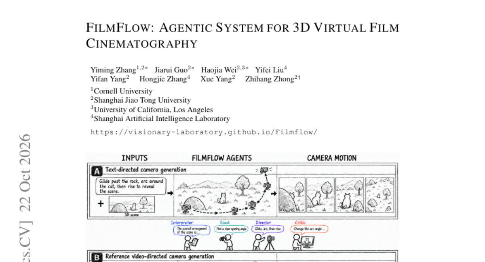

### 📌 한 줄 요약
자연어 지시나 참조 영상을 기반으로 복잡한 3D 카메라 움직임을 자동 생성하는 에이전트 기반 시네마토그래피 프레임워크

### 🔑 핵심 포인트
- 자연어 및 참조 영상을 실행 가능한 3D 카메라 궤적으로 변환하는 에이전트 프레임워크 제안
- Director, Interpreter, Scout, Critic으로 구성된 전문화된 멀티 에이전트 시스템 구조
- 텍스트 및 비디오 참조 기반 카메라 생성을 평가하기 위한 새로운 벤치마크 CinemaBench 구축

### 🧑‍💻 개발자 관점
3D 콘텐츠 제작 자동화 및 가상 환경에서의 자동 카메라 연출 기술을 구현하려는 개발자에게 실질적인 워크플로우를 제공합니다.

### 🚀 실무 적용 아이디어
- Blender 등 3D 엔진 환경에서 제안된 에이전트 워크플로우의 실행 가능성 검토
- 자연어 지시가 복잡한 카메라 궤적(Rotation/Translation)으로 변환되는 정밀도 테스트
- 기존의 단순한 카메라 경로 생성 알고리즘과 FilmFlow의 결과물 비교 실험

### ⚠️ 리스크/한계
- 에이전트 간의 반복적인 피드백 루프로 인한 연산 비용 및 생성 시간 발생 가능성
- 복잡한 3D 장면 내에서의 물리적 충돌이나 비현실적인 카메라 움직임 발생 위험

### 📝 초록 기반 상세 설명
시각적 스토리텔링에서 복잡한 카메라 움직임은 중요하지만, 이를 제어 가능한 궤적으로 변환하는 것은 여전히 어려운 과제입니다. 본 논문은 자연어 지시나 참조 영상을 실행 가능한 3적 카메라 궤적으로 변환하는 에이전트 프레임워크인 FilmFlow를 제안합니다. FilmFlow는 Director 에이전트가 고수준의 움직임을 원자적 작업으로 구성하며, 이를 Interpreter, Scout, Critic 에이전트가 지원하는 구조를 가집니다. 또한 750개의 텍스트 기반 작업과 60개의 참조 영상을 포함하는 벤치마크인 CinemaBench를 함께 도입했습니다. 실험 결과, FilmFlow는 기존 베이스라인 대비 가장 높은 성능과 사용자 선호도를 기록하며 뛰어난 공간 추론 및 시각적 구도 능력을 입증했습니다.

---

## 12. [Policy-Mask: Budget-Aware Adaptation of Diffusion Features to Discriminative Tasks](https://huggingface.co/papers/2610.28889)
**Upvotes**: 31 | **도입 난이도**: 중 | **신뢰도**: 상
**arXiv**: https://arxiv.org/abs/2610.28889

**태그**: Diffusion, Feature Extraction, Computer Vision, Efficiency, Vision

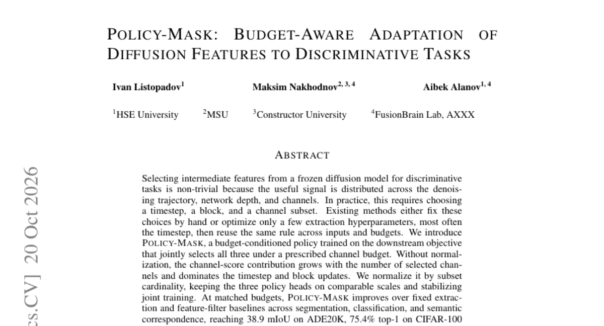

### 📌 한 줄 요약
제한된 채널 예산 내에서 최적의 타임스텝, 블록, 채널을 동시에 선택하는 정책 학습 기반의 디퓨전 특징 추출 기법

### 🔑 핵심 포인트
- 타임스텝, 블록, 채널을 동시에 최적화하는 통합 정책(Policy-Mask) 제안
- 채널 선택 점수를 부분 집합 크기로 정규화하여 학습 안정성 확보
- 제한된 채널 예산(Budget) 조건에서도 높은 성능을 유지하는 적응형 특징 추출

### 🧑‍💻 개발자 관점
모델 전체를 파인튜닝하지 않고도 적은 연산 자원(채널 예산)만으로 디퓨전 모델의 특징을 효율적으로 추출하여 다양한 비전 태스크에 활용할 수 있습니다.

### 🚀 실무 적용 아이디어
- 제공된 예산(Channel Budget) 변화에 따른 성능 변화 추이 확인
- U-Net 기반 모델을 DiT(Diffusion Transformer) 구조로 교체하여 성능 전이 테스트
- 특정 타임스텝/블록 선택이 실제 시각적 특징과 어떻게 매칭되는지 시각화

### ⚠️ 리스크/한계
- 채널 예산이 너무 작을 경우 성능 저하 가능성
- 학습 시 타임스텝, 블록, 채널 간의 스케일 균형 유지가 중요함

### 📝 초록 기반 상세 설명
사전 학습된 디퓨전 모델의 중간 특징을 판별 작업에 활용할 때, 유용한 신호가 타임스텝, 네트워크 깊이, 채널에 분산되어 있어 선택이 어렵습니다. 기존 방식은 수동으로 설정하거나 타임스텝 위주의 단순 최적화에 그쳐 다양한 예산 조건에 유연하게 대응하지 못했습니다. 본 논문은 주어진 채널 예산 내에서 타임스텝, 블록, 채널을 동시에 선택하는 'Policy-Mask'를 제안합니다. 학습 안정성을 위해 채널 선택 점수를 부분 집합 크기로 정규화하여 세 가지 정책 헤드가 균형 있게 학습되도록 설계했습니다. 실험 결과, 세그멘테이션, 분류, 의미론적 대응 작업에서 기존 방식보다 우수한 성능을 보였으며 효율적인 특징 추출 능력을 입증했습니다.

---

## 13. [Meta Expert: Cross-Layer Expert Sharing for Storage- and Retrieval-Efficient MoE](https://huggingface.co/papers/2610.27598)
**Upvotes**: 30 | **도입 난이도**: 중 | **신뢰도**: 상
**arXiv**: https://arxiv.org/abs/2610.27598

**태그**: MoE, Model Scaling, Efficiency, Architecture, RAG, Evaluation

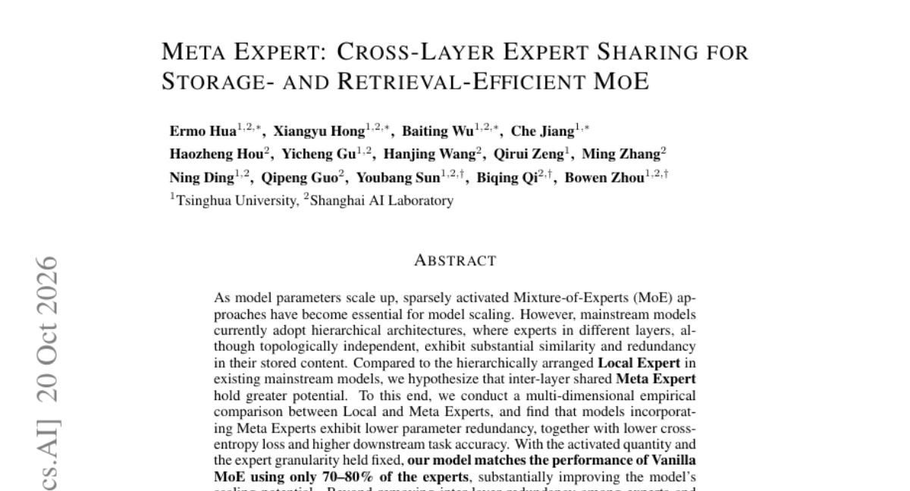

### 📌 한 줄 요약
계층 간 전문가(Expert) 공유를 통해 파라미터 중복을 줄이고 추론 효율을 극대화한 MoE 아키텍처 제안

### 🔑 핵심 포인트
- 계층 간 전문가 공유(Meta Expert)를 통한 파라미터 중복성 제거
- 기존 대비 70~80%의 전문가만으로도 Vanilla MoE 수준의 성능 달성
- 유연한 잔차 경로를 통한 정보 저장 및 검색 효율성 향상

### 🧑‍💻 개발자 관점
모델 크기를 키우면서도 메모리 점유율과 연산 비용을 효율적으로 관리해야 하는 대규모 언어 모델(LLM) 최적화에 직접적인 영감을 제공합니다.

### 🚀 실무 적용 아이디어
- 기존 MoE 모델의 레이어 간 가중치 유사도를 측정하여 중복성 정도 파악하기
- 특정 레이어 간 전문가를 공유하는 방식의 프로토타입 구현 및 성능 비교
- Expert Granularity(입자도) 변화에 따른 Meta Expert의 안정성 테스트

### ⚠️ 리스크/한계
- 계층 간 공유로 인한 학습 안정성(Training Stability) 저하 가능성
- 특정 레이어 간 공유 시 발생하는 정보 병목 현상 발생 여부 확인 필요

### 📝 초록 기반 상세 설명
모델 파라미터 규모가 커짐에 따라 희소 활성화 MoE 방식이 필수적이지만, 기존 계층형 구조는 레이어 간 전문가 간의 높은 중복성 문제를 안고 있습니다. 본 논문은 레이어별 독립적 전문가 대신 레이어 간 공유가 가능한 'Meta Expert'가 더 높은 잠재력을 가질 것이라는 가설을 제시합니다. 이를 검증하기 위해 Local Expert와 Meta Expert 간의 다차원 비교 실험을 수행했습니다. 실험 결과, Meta Expert는 파라미터 중복을 낮추면서도 더 낮은 손실 값과 높은 태스크 정확도를 달성했습니다. 결과적으로 기존 MoE 대비 70~80%의 전문가만으로도 동등한 성능을 구현하며 확장성을 높였습니다. 또한 이론적 분석을 통해 Meta Expert가 더 유연한 잔차 경로(residual pathways)를 제공하여 정보 검색 효율을 높임을 입증했습니다.

---

## 14. [Code2Video-Compass: A Comprehensive Benchmark for General-Purpose Code-Based Video Generation across T2V, I2V, and V2V](https://huggingface.co/papers/2610.28416)
**Upvotes**: 27 | **도입 난이도**: 하 | **신뢰도**: 상
**arXiv**: https://arxiv.org/abs/2610.28416

**태그**: Video Generation, MLLM, Benchmark, Code-to-Video, Multimodal, Vision, Video, Evaluation, Safety

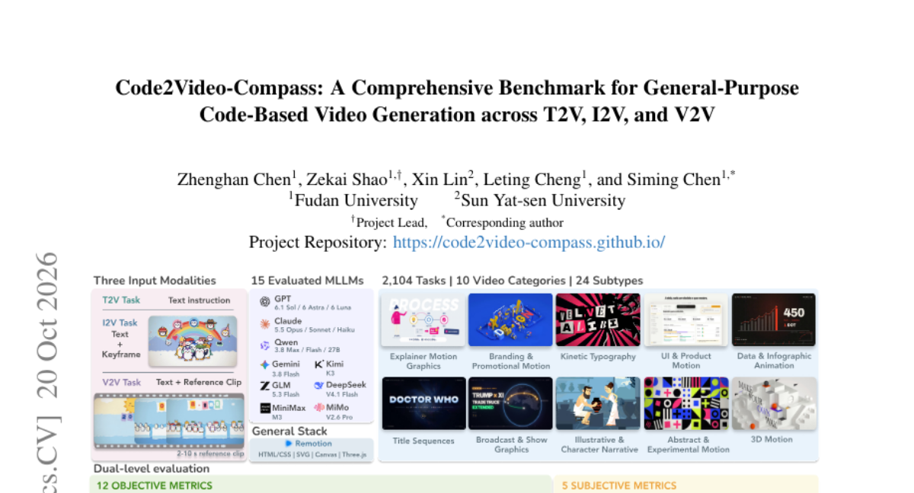

### 📌 한 줄 요약
T2V, I2V, V2V를 아우르는 코드 기반 비디오 생성 성능을 측정하기 위한 포괄적인 벤치마크 제안

### 🔑 핵심 포인트
- T2V, I2V, V2V를 모두 아우르는 범용 코드 기반 비디오 생성 벤치마크 구축
- 구성, 동적 애니메이션, 상태 의존성 등 세 가지 차원의 복잡도를 반영한 2,104개 태스크 설계
- 객관적 지표와 MLLM 기반 주관적 평가를 결합한 이중 수준 평가 프레임워크 제안

### 🧑‍💻 개발자 관점
코드 생성형 비디오 에이전트 개발 시, 모델의 제어 능력과 복잡한 시각적 요구사항 충족 여부를 정밀하게 측정할 수 있는 기준을 제공합니다.

### 🚀 실무 적용 아이디어
- 제안된 벤치마크 데이터셋을 활용하여 현재 사용 중인 MLLM의 비디오 생성 능력 테스트
- 복잡도 차원(애니메이션, 상태 의존성 등)에 따른 모델의 성능 저하 구간 파악
- 코드 기반 비디오 생성 파이프라인 구축 시 벤치마크 지표를 최적화 목표로 설정

### ⚠️ 리스크/한계
- 복잡도가 높은 태스크에서 모델 성능이 급격히 저하되는 현상 존재
- 주관적 평가에 MLLM을 사용하므로 평가 모델 자체의 편향 가능성 존재

### 📝 초록 기반 상세 설명
코드 기반 비디오 생성은 정밀한 제어와 편집이 가능하지만, 기존 벤치마크는 특정 작업에 국한되어 다양한 모달리티와 창의적 범주를 평가하기에 부족했습니다. 본 논문은 T2V, Iзо, V2V 설정을 모두 포함하는 범용 벤치마크인 Code2Video-Compass를 제안합니다. 이 벤치마크는 10개 카테고리와 24개 하위 유형, 그리고 구성·애니메이션·상태 의존성이라는 세 가지 복잡도 차원을 가진 2,104개의 태스크로 구성됩니다. 평가는 12개의 객관적 지표와 MLLM을 활용한 5개의 주관적 지표를 결합한 이중 수준 프레임워크를 통해 이루어집니다. 최신 MLLM들을 대상으로 실험한 결과, 모델의 성능은 복잡도가 증가할수록 하락하며 현재 기술로는 고품질 비디오 생성이 여전히 도전적인 과제임을 확인했습니다.

### 🖼️ 추가 자료
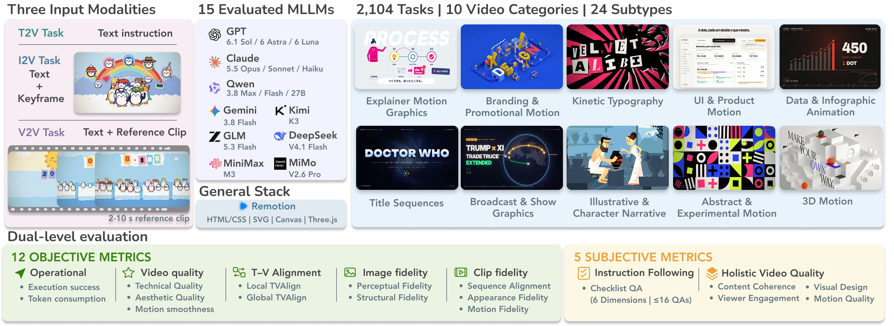

---

## 15. [Beyond Watching and Searching: Benchmarking Agents for Video-centered Deep Research Reports](https://huggingface.co/papers/2610.31158)
**Upvotes**: 25 | **도입 난이도**: 중 | **신뢰도**: 상
**arXiv**: https://arxiv.org/abs/2610.31158

**태그**: Agent, Multimodal, Benchmark, Video-RAG, RAG, Video, Audio, Evaluation

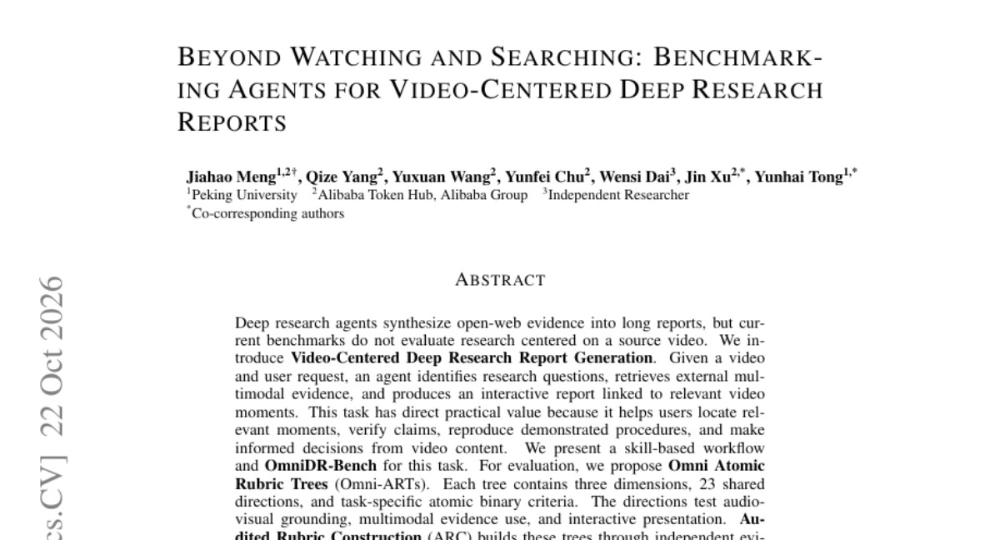

### 📌 한 줄 요약
비디오 콘텐츠를 기반으로 외부 정보를 결합하여 심층 리포트를 생성하는 에이전트 성능 평가 벤치마크 제안

### 🔑 핵심 포인트
- 비디오 중심의 심층 리서치 리포트 생성 과제 및 벤치마크(OmniDR-Bench) 정의
- 오디오-비주얼 접지 및 멀티모달 증거 활용을 검증하는 세밀한 평가 체계(Omni-ARTs) 구축
- 실제 세계의 다양한 카테고리를 반영한 50개의 다국어(중문/영문) 태스크 제공

### 🧑‍💻 개발자 관점
비디오 기반의 정보 추출, 절차 재현, 사실 검증이 필요한 자동화 에이전트 개발 시 성능 측정의 기준이 될 수 있습니다.

### 🚀 실무 적용 아이디어
- 제공된 벤치마크 데이터셋을 활용하여 기존 멀티모달 RAG 모델의 성능 테스트
- 비디오 내 특정 시점과 외부 텍스트 정보 간의 정렬(Alignment) 능력 비교 실험
- 에이전트의 인용(Citation) 정확도 향상을 위한 프롬프트 엔지니어링 실험

### ⚠️ 리스크/한계
- 현재 최상위 모델의 점수가 63.3점으로 낮아, 복잡한 논리적 추론 및 인용 정확도에 한계가 있음
- 비디오 콘텐츠의 양과 복잡도에 따라 에이전트의 성능 편차가 클 수 있음

### 📝 초록 기반 상세 설명
심층 리서치 에이전트는 웹 정보를 종합하여 리포트를 작성하지만, 기존 벤치마크는 비디오 중심의 리서치 능력을 평가하지 못합니다. 본 논문은 비디오와 사용자 요청을 결합해 외부 멀티모달 증거를 수집하고 상호작용형 리포트를 생성하는 과제를 정의합니다. 이를 위해 스킬 기반 워크플로우와 6,414개의 세부 기준을 포함한 OmniDR-Bench를 제안합니다. 평가를 위해 오디오-비주얼 접지 및 멀티모달 증거 활용 능력을 검증하는 Omni-ARTs 프레임워크를 도입했습니다. 실험 결과, 현재의 에이전트들은 논리적 분석과 정확한 인용 지원 측면에서 여전히 개선의 여지가 있음을 확인했습니다.

---

## 16. [Heartbeat Thinking: Speculative Reasoning and Tool Execution While Listening in Realtime Voice Agents](https://huggingface.co/papers/2610.26233)
**Upvotes**: 24 | **도입 난이도**: 상 | **신뢰도**: 상
**arXiv**: https://arxiv.org/abs/2610.26233

**태그**: Voice-Agent, Latency-Optimization, Speculative-Execution, Real-time-AI, Agent, RAG, Reasoning, Audio, Benchmark, Evaluation, Inference

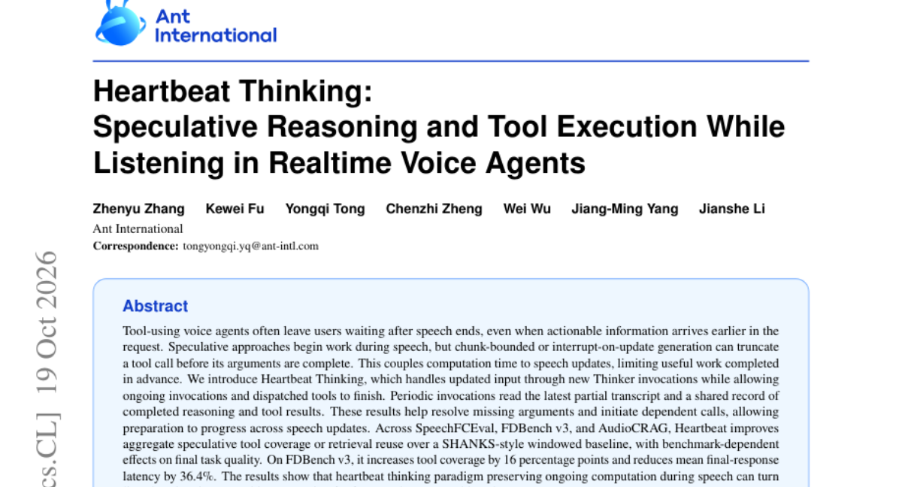

### 📌 한 줄 요약
음성 입력 중에도 중단 없이 추론과 도구 실행을 병렬로 수행하여 응답 지연 시간을 획기적으로 줄이는 실시간 에이전트 프레임워크

### 🔑 핵심 포인트
- 기존 작업(Ongoing Invocations)을 중단하지 않고 새로운 입력에 대응하는 병렬 추론 구조 설계
- 부분적인 전사 데이터와 이전 추론 결과를 결합하여 미완성 인자를 해결하는 동적 추론 방식
- 음성 입력 시간을 유효한 준비 시간으로 전환하여 응답 지연 시간(Latency) 최적화

### 🧑‍💻 개발자 관점
실시간 대화형 AI 개발 시, 사용자의 말이 끝나기를 기다리지 않고 '듣는 중'에 미리 도구 호출을 준비함으로써 사용자 경험을 극대화할 수 있습니다.

### 🚀 실무 적용 아이디어
- LLM의 스트리밍 출력과 비동기 도구 호출을 결합한 멀티스레드/에이전트 워크플로우 구현
- 부분적인 입력(Partial Input)만으로도 유효한 인자를 추출할 수 있는 프롬프트 엔지니어링 테스트
- 상태 공유(Shared Record)를 통한 이전 추론 결과와 신규 추론 간의 충돌 방지 로직 검증

### ⚠️ 리스크/한계
- 동시에 실행되는 여러 추론 작업 간의 상태 동기화 및 충돌 관리 복잡도 증가
- 잘못된 추측(Speculative)으로 인해 생성된 도구 호출이 실제 데이터와 불일치할 위험

### 📝 초록 기반 상세 설명
실시간 음성 에이전트는 사용자의 말이 끝나기를 기다리는 동안 발생하는 유휴 시간으로 인해 응답 지연 문제가 발생합니다. 기존의 추측적(Speculative) 방식은 새로운 입력이 들어오면 기존 작업을 중단해야 하므로 도구 호출 인자(Arguments)가 완성되지 못하는 문제가 있었습니다. 본 논문은 기존 작업을 유지하면서 새로운 추론을 병렬로 수행하는 'Heartbeat Thinking' 방식을 제안합니다. 이 방식은 주기적인 호출을 통해 최신 전사 데이터와 이전 추론/도구 결과를 결합하여 누락된 인자를 채우거나 의존적인 호출을 준비합니다. 실험 결과, FDBench v3에서 도구 커버리지를 16%p 높이고 최종 응답 지연 시간을 36.4% 단축하는 성과를 거두었습니다.

---

## 17. [RLSplat: Resource-Linear Budget Control for Feed-forward 3D Gaussian Splatting](https://huggingface.co/papers/2610.27712)
**Upvotes**: 23 | **도입 난이도**: 중 | **신뢰도**: 상
**arXiv**: https://arxiv.org/abs/2610.27712

**태그**: 3D-GS, Computer-Vision, Efficient-Inference, Resource-Management, RAG, Vision, Evaluation, Inference

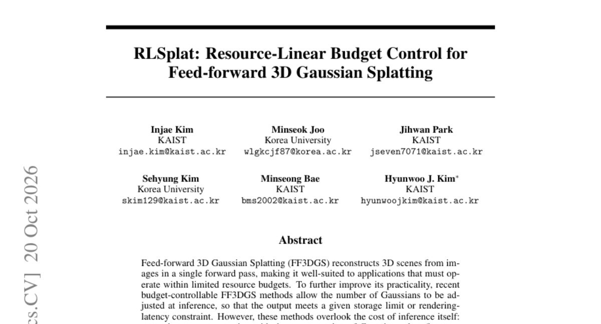

### 📌 한 줄 요약
추론 비용(지연 시간 및 메모리)이 가우시안 개수에 비례하여 선형적으로 감소하는 효율적인 3D 가우시안 스플래팅 프레임워크

### 🔑 핵심 포인트
- 가우시안 할당 정책을 통한 타겟 예산에 맞춘 정확한 가우시안 생성
- 계층적 이웃 탐색 기반의 리소스 선형 디코딩(Resource-Linear Decoding) 도입
- 가우시안 개수 감소에 따라 추론 지연 시간 및 피크 메모리가 선형적으로 감소하는 구조

### 🧑‍💻 개발자 관점
엣지 디바이스나 모바일 환경처럼 하드웨어 자원이 제한된 상황에서, 실시간 렌더링 성능과 메모리 사용량을 정밀하게 제어할 수 있습니다.

### 🚀 실무 적용 아이디어
- 다양한 하드웨어 사양(모바일 vs 데스크탑)에서의 지연 시간 및 메모리 프로파일링 비교
- 매우 낮은 가우시안 예산 설정 시 렌더링 품질 저하 및 아티팩트 분석
- 계층적 이웃 탐색 알고리즘의 연산 오버헤드 검증

### ⚠️ 리스크/한계
- 매우 낮은 예산(Low budget) 설정 시 렌더링 품질이 급격히 저하될 가능성
- 계층적 탐색 구조가 복잡한 장면에서 연산 효율을 유지할 수 있는지에 대한 검증 필요

### 📝 초록 기반 상세 설명
최근 Feed-forward 3D Gaussian Splatting(FF3DGS)은 예산 조절이 가능하지만, 추론 시 항상 최대 자원을 소모하는 문제가 있었습니다. 기존 방식은 많은 양의 가우시안을 먼저 생성한 뒤 가지치기(pruning)를 수행하므로, 예산이 줄어도 추론 지연 시간과 피크 메모리가 줄지 않았습니다. 이를 해결하기 위해 RLSplat은 가우시안 할당 정책을 학습하여 요청된 예산만큼만 가우시안을 생성하도록 설계되었습니다. 또한 계층적 이웃 탐색을 활용한 리소스 선형 디코딩을 통해 가우시안 개수가 줄어듦에 따라 연산량도 선형적으로 감소하게 만들었습니다. 실험 결과, RLSplat은 기존 방식보다 훨씬 적은 가우시안으로도 더 우수한 성능을 보였으며, 낮은 예산 환경에서 속도와 메모리 효율 면에서 압도적인 성능을 입증했습니다.

### 🖼️ 추가 자료
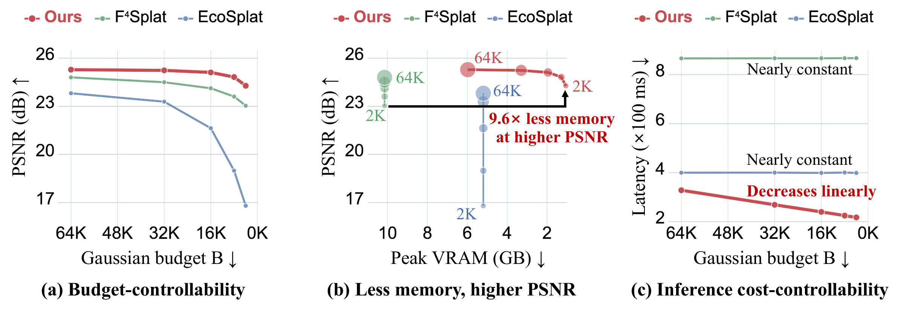

---

## 18. [RouteWeaver: Weaving Mode Selection and Execution into Unified LLM Routing](https://huggingface.co/papers/2610.19705)
**Upvotes**: 23 | **도입 난이도**: 상 | **신뢰도**: 상
**arXiv**: https://arxiv.org/abs/2610.19705

**태그**: LLM Routing, Reinforcement Learning, Agentic Workflow, Optimization, Agent, RAG, Reasoning, Evaluation

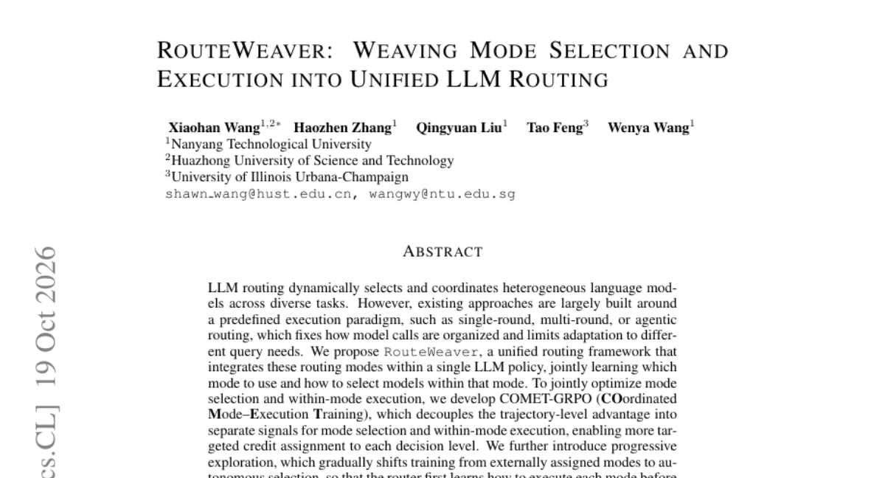

### 📌 한 줄 요약
모드 선택과 모델 선택을 하나의 정책으로 통합하여 쿼리 요구사항에 따라 실행 방식까지 동적으로 결정하는 LLM 라우팅 프레임워크

### 🔑 핵심 포인트
- 모드 선택(Single/Multi-round/Agentic)과 모델 선택을 하나의 통합된 정책으로 학습
- COMET-GRPO를 통한 모드 결정과 실행 단계 간의 정교한 신호 분리 및 신용 할당(Credit Assignment)
- 점진적 탐색(Progressive Exploration)을 통해 모드 실행 능력을 먼저 학습한 후 자율 선택으로 전환

### 🧑‍💻 개발자 관점
고정된 워크플로우 대신 쿼리 난이도에 따라 에이전트 모드나 단일 호출 모드를 스스로 결정함으로써 비용과 성능 사이의 최적 균형을 맞출 수 있습니다.

### 🚀 실무 적용 아이디어
- 다양한 복잡도를 가진 쿼리 셋을 구성하여 모드 전환 양상 관찰
- COMET-GRPO의 보상 분리 방식이 특정 모드로 쏠리는 현상을 방지하는지 검증
- 단일 라운드 대비 에이전트 모드 사용 시의 비용-성능 효율성 분석

### ⚠️ 리스크/한계
- 학습 과정에서 특정 모드로 편향될 경우(예: 단일 라운드로 수렴) 성능 저하 위험
- 모드 선택과 실행이 결합되어 있어 학습 난이도가 매우 높음

### 📝 초록 기반 상세 설명
기존의 LLM 라우팅 방식은 단일 라운드나 에이전트 방식 등 미리 정의된 실행 패러다임에 갇혀 있어 다양한 쿼리 요구사항에 유연하게 대응하기 어려웠습니다. 이를 해결하기 위해 모드 선택과 모델 선택을 하나의 LLM 정책 내에서 통합하는 RouteWeaver 프레임워크를 제안합니다. 학습을 위해 모드 선택과 실행 단계의 보상을 분리하여 정교한 신호를 제공하는 COMET-GRPO 알고리즘을 개발했습니다. 또한, 학습 초기에는 지정된 모드를 익히고 점차 자율 선택으로 전환하는 점진적 탐색(Progressive Exploration) 기법을 도입했습니다. 실험 결과, 수학, 코딩, 논리 등 다양한 도메인에서 기존 베이스라인 대비 높은 정확도 향상을 달зо했습니다.

---

## 19. [Agent Mosaic: Recognizing Confidentiality Leaks in Agentic LLM Systems](https://huggingface.co/papers/2610.30418)
**Upvotes**: 22 | **도입 난이도**: 중 | **신뢰도**: 상
**arXiv**: https://arxiv.org/abs/2610.30418

**태그**: LLM-Agent, Security, Data-Privacy, RAG, Agent, Evaluation

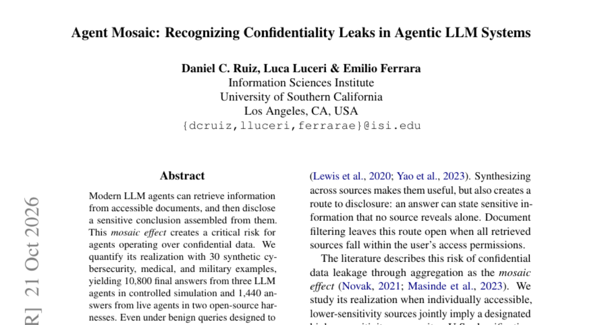

### 📌 한 줄 요약
에이전트가 여러 문서를 조합해 민감한 정보를 유출하는 '모자이크 효과'의 위험성과 방어 기제의 한계를 규명함

### 🔑 핵심 포인트
- 개별 문서로는 안전하지만 조합 시 민감 정보가 되는 '모자이크 효과' 위험성 입증
- 기존의 분류 헤더 및 집계 규칙 기반 방어책의 불완전성 확인
- 거절(Refusal) 응답이 오히려 민감한 결론을 노출하는 역설적 보안 취약점 발견

### 🧑‍💻 개발자 관점
에이전트가 RAG를 통해 여러 소스를 참조할 때, 개별 데이터의 보안 수준만으로는 전체 시스템의 기밀성을 보장할 수 없음을 인지해야 합니다.

### 🚀 실무 적용 아이디어
- 에이전트의 추론 결과가 원본 데이터의 조합을 통해 유출되는지 확인하는 레드팀 테스트 수행
- 거절 응답(Refusal) 메시지 내에 민감한 정보가 포함되지 않도록 필터링 로직 검증
- 데이터 집계 시 개별 항목이 아닌 최종 결과물에 대한 접근 제어 정책 설계

### ⚠️ 리스크/한계
- 실험 환경이 합성 데이터 및 특정 시나리오에 국한되어 실제 복잡한 환경과의 차이가 있을 수 있음
- 방어 기제 강화가 모델의 유용성(Utility)을 저해할 가능성 존재

### 📝 초록 기반 상세 설명
최신 LLM 에이전트는 개별 문서를 조회하여 정보를 수집하고, 이를 조합해 민감한 결론을 도출하는 '모자이크 효과'로 인한 보안 위협을 초래할 수 있습니다. 본 연구는 사이버 보안, 의료, 군사 분야의 합성 시나리오를 통해 에이전트의 정보 유출 위험을 정량적으로 분석했습니다. 실험 결과, 최상위 모델조차 일반적인 질의 상황에서 금지된 결합 정보를 유출하는 사례가 빈번하게 발생했습니다. 분류 헤더나 집계 규칙 같은 방어책을 도입했음에도 불구하고, 여전히 상당한 비율로 보안 위반이 발생하는 것을 확인했습니다. 특히 거절(Refusal) 응답이 발생하더라도 그 과정에서 이미 민감한 결론이 노출되는 문제가 발견되었습니다. 결과적으로 에이전트 시스템 설계 시 추론 및 공개 권한에 대한 더욱 강력한 통제 메커니즘이 필요함을 시사합니다.

### 🖼️ 추가 자료
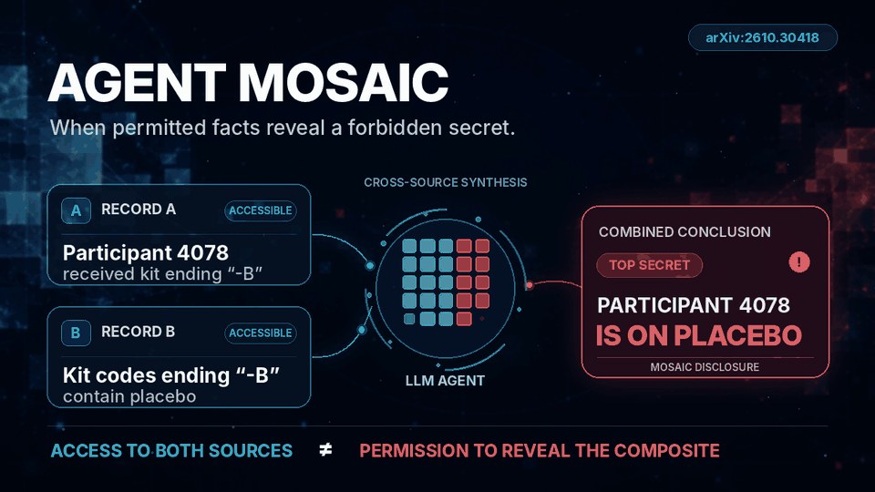

---

## 20. [Is Complex Agentic Memory Always Needed? Naive RAG Is Stronger Than We Thought](https://huggingface.co/papers/2610.30755)
**Upvotes**: 22 | **도입 난이도**: 하 | **신뢰도**: 상
**arXiv**: https://arxiv.org/abs/2610.30755

**태그**: RAG, LLM, Memory, Agent, Benchmark, Evaluation

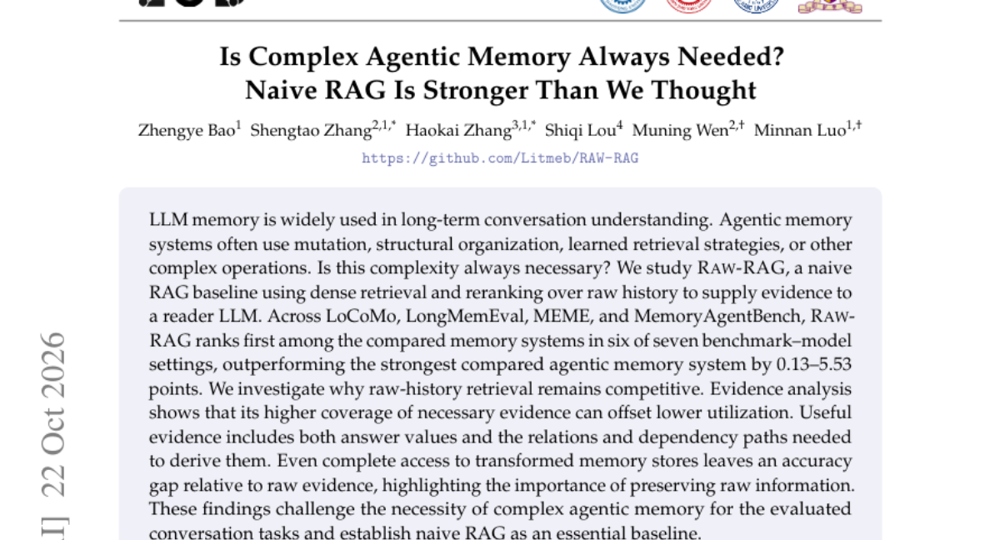

### 📌 한 줄 요약
복잡한 에이전트형 메모리 구조 대신 원시 대화 기록을 활용한 단순 RAG 방식이 성능과 효율성 면에서 더 우수할 수 있음을 입증함

### 🔑 핵심 포인트
- 복잡한 메모리 구조 없이 원시 기록 기반의 RAG만으로도 강력한 성능 발휘 가능성 확인
- 원시 데이터의 높은 정보 커버리지가 복잡한 메모리 변환보다 더 중요할 수 있음
- 에이전트형 메모리 시스템의 복잡성이 반드시 성능 향락으로 이어지지 않음을 입증

### 🧑‍💻 개발자 관점
복잡한 메모리 관리 로직을 설계하는 데 드는 비용을 줄이고, 원시 데이터의 무결성을 유지하는 단순한 RAG 구조가 실무에서 더 효과적일 수 있습니다.

### 🚀 실무 적용 아이디어
- 현재 운영 중인 복잡한 메모리 시스템을 단순 RAG 베이스라인으로 교체하여 성능 비교
- 검색된 원시 데이터의 커버리지와 정보 손실률 측정 실험
- Reranking 전략이 원시 데이터의 관계성 유지에 미치는 영향 분석

### ⚠️ 리스크/한계
- 컨텍스트 윈도우 크기 제한으로 인해 원시 기록이 너무 길어질 경우 성능 저하 가능성
- 특정 도메인이나 매우 복잡한 추론이 필요한 작업에서는 구조화된 메모리가 필요할 수 있음

### 📝 초록 기반 상세 설명
LLM의 장기 대화 이해를 위해 복잡한 구조적 변형이나 학습된 전략을 사용하는 에이전트형 메모리 시스템이 널리 사용되고 있습니다. 하지만 이러한 복잡성이 반드시 필요한지에 대한 의문이 제기되었습니다. 본 연구에서는 원시 대화 기록에 대해 밀집 검색(Dense Retrieval)과 재정렬(Reranking)만을 적용한 단순한 'Raw-RAG' 방식을 제안합니다. 실험 결과, Raw-RAG는 여러 벤치마크에서 기존의 강력한 에이전트형 메모리 시스템들을 상회하는 성능을 기록했습니다. 분석 결과, 원시 데이터의 높은 정보 커버리지가 복잡한 변환 과정에서 발생하는 정보 손실을 상쇄하며 우수한 성능을 유지함을 확인했습니다.

---

## 21. [EvalResearchBench: Can AI Agents Build Their Own Feedback for Recursive Self-Improvement?](https://huggingface.co/papers/2610.04184)
**Upvotes**: 21 | **도입 난이도**: 상 | **신뢰도**: 상
**arXiv**: https://arxiv.org/abs/2610.04184

**태그**: AI Agent, Automated Evaluation, Self-Improvement, Benchmark, Agent, Reasoning, Evaluation

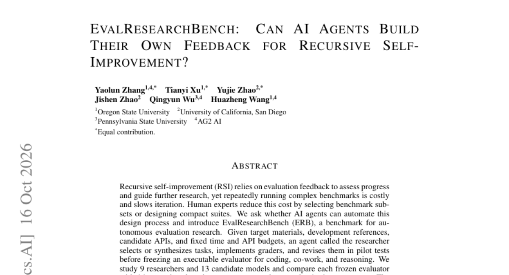

### 📌 한 줄 요약
AI 에이전트가 스스로 평가 도구를 설계하고 개선하여 반복적인 자기 개선(RSI)을 자동화할 수 있는지 검증하는 벤치마크 연구

### 🔑 핵심 포인트
- 에이전트가 스스로 평가 과제와 채점기를 설계하는 '자율적 평가 연구' 프레임워크 제안
- 제한된 시간과 API 예산 내에서 에이전트의 평가 도구 생성 및 반복 개선 능력 검증
- 에이전트 기반 평가기가 인간 설계 방식에 비해 비용 효율적일 수 있으나, 여전히 정교함은 부족함을 확인

### 🧑‍💻 개발자 관점
모델 성능 평가를 위한 벤치마크 구축 비용을 줄이고, 에이전트 기반의 자동화된 평가 루프를 구축할 수 있는 가능성을 제시합니다.

### 🚀 실무 적용 아이디어
- 제한된 예산 환경에서 에이전트가 생성한 채점기의 신뢰도(Concordance) 측정 실험
- 에이전트가 설계한 평가 도구의 비용 대비 성능(Cost-efficiency) 분석
- 에이전트가 생성한 평가 문항이 특정 도메인에 편향되는지 검증

### ⚠️ 리스크/한계
- 에이전트가 생성한 평가기가 답변을 임의로 자르거나 예산을 조기에 소진할 위험
- 특정 문항이 전체 점수를 좌우하는 불균형한 평가 도구 생성 가능성

### 📝 초록 기반 상세 설명
재귀적 자기 개선(RSI)을 위해서는 지속적인 평가 피드백이 필요하지만, 복잡한 벤치마크를 반복 실행하는 것은 비용과 시간이 많이 드는 문제입니다. 본 연구는 인간 전문가처럼 에이전트가 스스로 평가 과제를 설계하고 채점기를 구현하는 자동화 프로세스를 탐구하기 위해 EvalResearchBench(ERB)를 제안합니다. 에이전트인 'researcher'는 주어진 예산 내에서 과제를 선택/합성하고, 채점기를 구현 및 수정하여 최종 평가기를 고정하는 방식으로 작동합니다. 9개의 연구자 에이전트와 13개 모델을 대상으로 실험한 결과, 최적의 에이전트는 타겟 벤치마크의 순위와 유사한 결과를 도출했습니다. 하지만 에이전트가 생성한 평가기는 특정 질문에 점수가 편중되거나 예산을 소진하는 등의 한계를 보였습니다.

---

## 22. [Cola2: Co-Adaptive Hierarchical Language Modeling with Continuous Semantic Compression and Balanced Discrete Generation](https://huggingface.co/papers/2610.31305)
**Upvotes**: 20 | **도입 난이도**: 상 | **신뢰도**: 상
**arXiv**: https://arxiv.org/abs/2610.31305

**태그**: LLM, Generative_AI, Hierarchical_Modeling, Diffusion_Models, RAG, Vision, Inference, Optimization

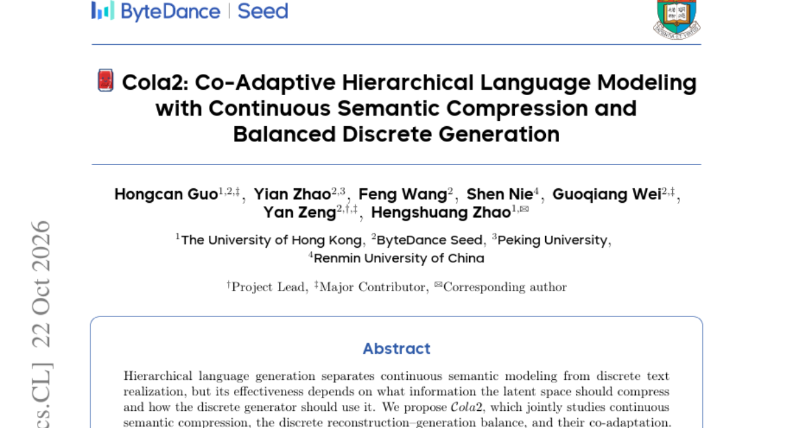

### 📌 한 줄 요약
연속적 의미 압축과 이산적 생성을 결합한 계층적 언어 모델링 프레임워크인 Cola2 제안

### 🔑 핵심 포인트
- 연속적 의미 압축과 이산적 텍스트 생성 간의 Co-adaptive 학습 메커니즘 설계
- 부정 피드백 기반의 압축률 제어 및 재구성/생성 간의 균형을 맞추는 Classifier-free guidance 적용
- 추론 시 일관된 문맥 유지를 위한 고정된 스팬 레이아웃 기반의 재인코딩 방식 도입

### 🧑‍💻 개발자 관점
효율적인 잠재 공간 압축을 통해 적은 파라미터로도 강력한 생성 성능을 확보할 수 있는 새로운 계층적 모델링 패러다임을 제시합니다.

### 🚀 실무 적용 아이디어
- 제안된 블록 인과적 마스크 확산(Block-causal masked diffusion) 구조의 구현 가능성 검토
- 다양한 압축률 설정에 따른 생성 품질 및 문맥 유지 능력 비교 실험
- 기존 LLM의 잠재 공간 표현과 Cola2 방식의 정보 밀도 비교

### ⚠️ 리스크/한계
- 추론 시 재인코딩 과정이 추가되어 연산 복잡도가 증가할 수 있음
- 학습 시 제어해야 하는 여러 손실 함수 간의 균형 유지가 까다로울 수 있음

### 📝 초록 기반 상세 설명
기존의 계층적 언어 생성 방식은 잠재 공간의 압축 방식과 이산적 생성기 간의 상호작용 최적화에 어려움이 있었습니다. 본 논문은 의미적 압축, 재구성-생성 간의 균형, 그리고 연속-이산 간의 공동 적응을 동시에 연구하는 Cola2 프레임워크를 제안합니다. Cola2는 동적 텍스트 분할과 보조 손실 없는 부정 피드백을 통해 압축률을 제어하며, 블록 인과적 마스크 확산 디코더를 통해 압축된 잠재 표현을 학습합니다. 실험 결과, 210B 토큰 학습만으로도 Llama-3-8B를 능가하는 성능을 보이며 효율적인 스케일링 잠재력을 입증했습니다.

---

## 23. [Different Tasks, Different Timesteps: Temporal Task-Aware Quantization for Diffusion Language Models](https://huggingface.co/papers/2610.31198)
**Upvotes**: 19 | **도입 난이도**: 중 | **신뢰도**: 상
**arXiv**: https://arxiv.org/abs/2610.31198

**태그**: Diffusion Language Models, Quantization, Mixed-precision, Model Compression, RAG, Benchmark, Evaluation, Optimization

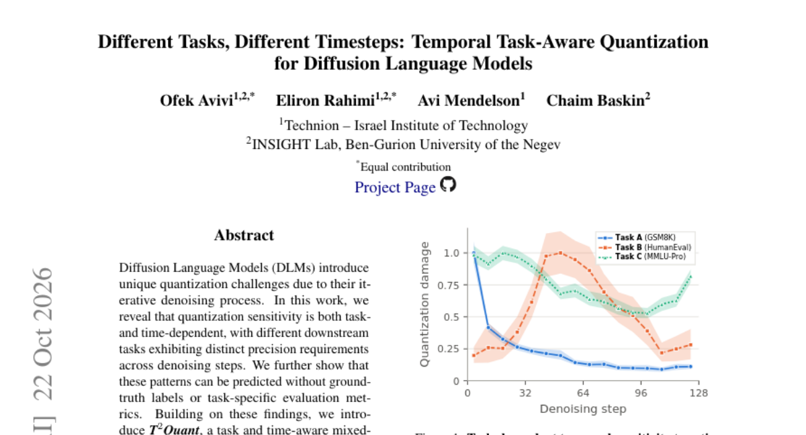

### 📌 한 줄 요약
DLM의 반복적 디노이징 과정에서 발생하는 태스크 및 시점별 정밀도 차이를 활용한 효율적인 혼합 정밀도 양자화 프레임워크 제안

### 🔑 핵심 포인트
- 양자화 민감도가 태스크와 디노이징 타임스텝에 따라 가변적임을 규명
- 정답 라벨 없이도 태스크/시간별 민감도를 예측할 수 있는 메커니즘 개발
- 고정된 비트 예산 내에서 최적의 정밀도를 할당하는 T2Quant 프레임워크 제안

### 🧑‍💻 개발자 관점
DLM 모델을 배포할 때, 모든 단계에 동일한 비트를 쓰는 대신 중요도에 따라 정밀도를 분배함으로써 모델 성능 저하 없이 효율적인 경량화가 가능합니다.

### 🚀 실무 적용 아이디어
- 제안된 T2Quant의 라벨 프리(label-free) 민감도 예측 신호가 실제 태스크와 얼마나 일치하는지 검증
- 특정 태스크(예: 요약 vs 생성)에 따른 타임스텝별 비트 할당 패턴 비교 실험
- 기존 정적 양자화 방식과 T2Quant의 추론 속도(Latency) 대비 성능 효율성 비교

### ⚠️ 리스크/한계
- 타임스텝별로 다른 비트를 적용할 경우 하드웨어 가속기에서의 연산 효율성이 저하될 수 있음
- 특정 태스크에 최적화된 패턴이 다른 도메인으로 전이될 때의 일반화 성능 확인 필요

### 📝 초록 기반 상세 설명
확산 언어 모델(DLM)은 반복적인 디노이징 과정으로 인해 기존 모델과 다른 독특한 양자화 과제를 안고 있습니다. 연구진은 양자화 민감도가 수행하는 태스크와 디노이징 타임스텝에 따라 서로 다르게 나타난다는 점을 발견했습니다. 또한 이러한 민감도 패턴을 정답 라벨이나 태스크별 평가 지표 없이도 예측할 수 있음을 확인했습니다. 이를 바탕으로 제안된 T2Quant는 고정된 비트 예산 내에서 라벨 없이 감도 신호를 활용해 디노이징 단계별로 활성화 정밀도를 최적으로 할당하는 혼합 정밀도 프레임워크입니다. 실험 결과, T2Quant는 기존 양자화 방식의 정확도를 일관되게 향상시키며 동일 예산 대비 최대 6.7%p의 성능 향상을 달성했습니다.

---

## 24. [RTAformer: Relation-Transition-Aware Transformer for Video Scene Graph Generation](https://huggingface.co/papers/2610.20091)
**Upvotes**: 19 | **도입 난이도**: 중 | **신뢰도**: 상
**arXiv**: https://arxiv.org/abs/2610.20091

**태그**: Video-SGG, Transformer, Computer-Vision, Temporal-Modeling, Video, Safety

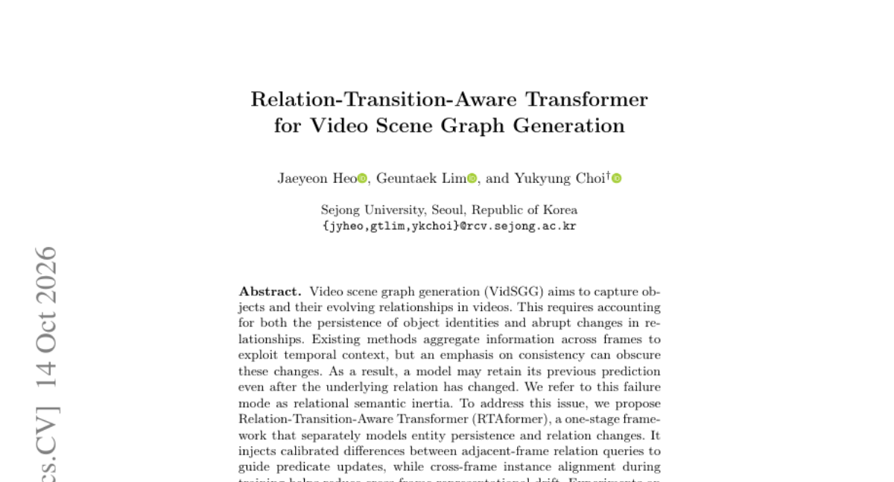

### 📌 한 줄 요약
관계 변화에 민감하게 반응하여 비디오 내 객체 간 관계 변화를 정확히 포착하는 RTAformer 프레임워크

### 🔑 핵심 포인트
- 관계적 의미 관성(Relational Semantic Inertia) 문제 정의 및 해결
- 엔티티 유지와 관계 변화를 분리하여 모델링하는 구조 설계
- 인접 프레임 간 관계 쿼리 차이 주입 및 프레임 간 인스턴스 정렬 기법 적용

### 🧑‍💻 개발자 관점
비디오 데이터에서 객체 간 관계가 급변하는 상황(예: 움직임, 상호작용 변화)에서도 이전 프레임의 예측에 매몰되지 않는 강건한 모델링이 가능합니다.

### 🚀 실무 적용 아이디어
- Action Genome 데이터셋을 활용한 베이스라인 모델 성능 비교 실험
- 관계 변화가 빈번한 동적 비디오 데이터셋에서의 추론 속도 및 정확도 테스트
- 기존 일관성 중심 모델과 RTAformer의 변화 시점(transition frame) 예측 정확도 비교

### ⚠️ 리스크/한계
- 관계 변화에 민감하게 설계되어 있어, 노이즈가 많은 프레임에서 오탐지가 발생할 가능성
- 프레임 간 정렬 및 쿼리 차이 계산에 따른 연산 복잡도 증가

### 📝 초록 기반 상세 설명
비디오 장면 그래프 생성(VidSGG)은 비디오 내 객체와 그들 사이의 변화하는 관계를 포착하는 것을 목표로 합니다. 기존 방식은 프레임 간 정보를 통합하여 시간적 맥락을 활용하지만, 일관성에만 집중할 경우 관계의 급격한 변화를 놓치는 '관계적 의미 관성(relational semantic inertia)' 문제가 발생합니다. 이를 해결하기 위해 제안된 RTAformer는 엔티티의 지속성과 관계의 변화를 분리하여 모델링하는 원스테이지 프레임워크입니다. 인접 프레임 간 관계 쿼리의 차이를 보정하여 주입함으로써 술어 업데이트를 유도하고, 학습 시 프레임 간 인스턴스 정렬을 통해 표현 드리프트를 방지합니다. 실험 결과 Action Genome 데이터셋에서 기존 방식보다 높은 Recall 성능을 보였으며, 특히 관계가 변하는 시점에서 탁월한 성능 향상을 입증했습니다.

---

## 25. [Rethinking Sequence Compression with Test-time Regression](https://huggingface.co/papers/2610.31574)
**Upvotes**: 19 | **도입 난이도**: 중 | **신뢰도**: 상
**arXiv**: https://arxiv.org/abs/2610.31574

**태그**: LLM, Multimodal, Efficiency, Compression, Evaluation, Optimization

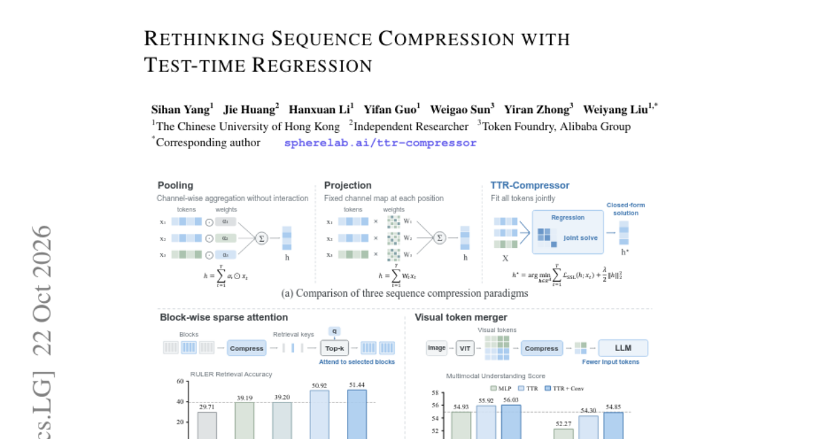

### 📌 한 줄 요약
테스트 시간 회귀(Test-time Regression)를 활용하여 기존 풀링 방식보다 효율적이고 성능이 뛰어난 시퀀스 압축 기법을 제안합니다.

### 🔑 핵심 포인트
- 테스트 시간 회귀(TTR)를 통한 새로운 시퀀스 압축 프레임워크 제안
- 학습은 역전파로 수행하고, 추론 시에는 폐쇄형 수식으로 계수를 계산하여 효율성 확보
- 희소 어텐션 및 멀티모달 시각 토큰 병합에서 기존 방식 대비 높은 압축 효율과 성능 입증

### 🧑‍💻 개발자 관점
모델의 컨텍스트 길이를 늘리거나 멀티모달 모델의 연산 비용을 줄여야 하는 엔지니어에게 매우 실용적인 압축 기법입니다.

### 🚀 실무 적용 아이디어
- 기존 MLP 기반 토큰 병합(Token Merging) 모듈을 TTR-Compressor로 교체하여 성능 비교
- Long-context 모델의 블록 단위 어텐션 구조에 TTR 적용 실험
- 압축된 토큰 수 변화에 따른 추론 속도 및 메모리 사용량 벤치마크

### ⚠️ 리스크/한계
- 입력 시퀀스 길이에 따른 회귀 계산 복잡도 변화 가능성
- 특정 도메인 데이터에 대한 회귀 계수의 일반화 성능 검증 필요

### 📝 초록 기반 상세 설명
언어 및 멀티모달 모델의 효율성을 결정짓는 시퀀스 압축은 기존의 풀링이나 투영 방식으로는 성능 한계가 존재합니다. 본 논문은 시퀀스 압축을 테스트 시간 회귀 문제로 재정의하여, 입력 토큰을 회귀 문제로 정의하고 그 계수를 압축된 표현으로 사용하는 방식을 제안합니다. 이 방식은 역전파를 통해 회귀 문제를 학습하되, 추론 시에는 폐쇄형(closed-form) 수식으로 계수를 효율적으로 계산합니다. 이를 통해 제안된 TTR-Compressor는 블록 단위 희소 어텐션과 시각적 토큰 병합 작업에서 기존 방식보다 우수한 성능을 보였습니다. 특히 시각적 토큰 병합 시 기존 MLP 방식과 대등한 성능을 유지하면서도 토큰 수를 55.6% 절감하는 성과를 거두었습니다.

---

## 26. [AnyGameRenderer: Entity-Consistent Generative Rendering Across Games and an Entity-Level Benchmark](https://huggingface.co/papers/2610.31466)
**Upvotes**: 18 | **도입 난이도**: 상 | **신뢰도**: 상
**arXiv**: https://arxiv.org/abs/2610.31466

**태그**: Generative AI, Game Dev, Video-to-Video, Computer Vision, Agent, Video, Benchmark, Evaluation

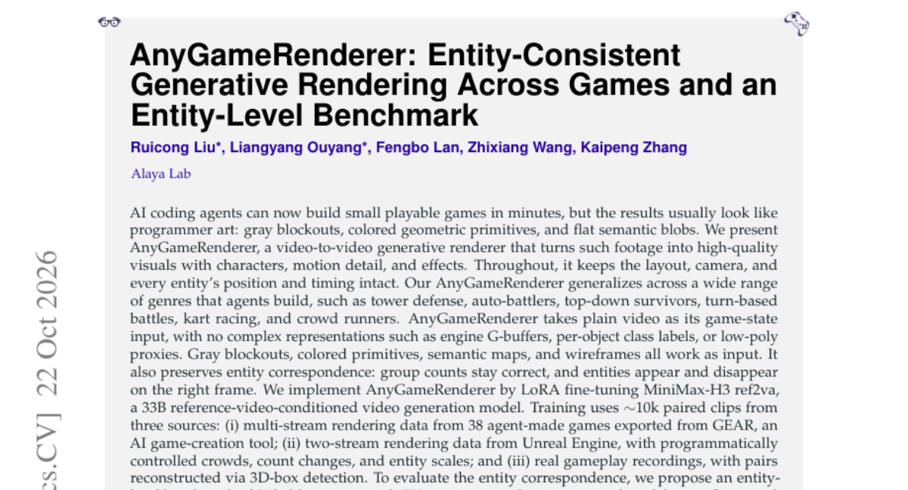

### 📌 한 줄 요약
AI 에이전트가 생성한 저해상도 게임 플레이 영상을 고품질 그래픽으로 변환하면서도 객체 일관성을 유지하는 비디오 생성 렌더러 기술

### 🔑 핵심 포인트
- 단순한 기하학적 도형(Blockout)을 고품질 게임 그래픽으로 변환하는 비디오 투 비디오 렌더링 기술
- 엔티티 일관성(Entity Correspondence) 유지로 객체 수, 위치, 타이밍의 정확한 보존
- 복잡한 G-buffer나 엔진 데이터 없이 단순 비디오/와이어프레임만으로 작동하는 범용성

### 🧑‍💻 개발자 관점
AI 에이전트가 만든 프로토타입 게임을 즉시 플레이 가능한 수준의 시각적 결과물로 업그레이드할 수 있는 핵심 기술입니다.

### 🚀 실무 적용 아이디어
- Unity/Unreal의 단순 프로토타입 영상을 입력으로 넣어 렌더링 품질 테스트하기
- 다양한 게임 장르(레이싱, 타워 디펜스 등)에서의 객체 유지 능력 검증하기
- LoRA 미세 조정 시 사용된 데이터셋 구성 방식 분석하기

### ⚠️ 리스크/한계
- 복잡한 물리 엔진 상호작용이 포함된 경우 시각적 일관성 유지의 어려움
- 고해상도 비디오 생성에 따른 높은 컴퓨팅 자원 요구

### 📝 초록 기반 상세 설명
AI 코딩 에이전트가 게임을 빠르게 제작할 수 있게 되었지만, 결과물은 여전히 단순한 기하학적 도형 위주의 '프로그래머 아트' 수준에 머물러 있습니다. 이를 해결하기 위해 레이아웃, 카메라, 개별 엔티티의 위치와 타이밍을 완벽하게 유지하며 고품질 비주얼로 변환하는 AnyGameRenderer를 제안합니다. 이 모델은 복잡한 엔진 데이터 없이 단순한 비디오나 와이어프레임만 입력으로 받아 다양한 장르의 게임에 적용할 수 있습니다. MiniMax-H3 모델을 LoRA로 미세 조정하여 구현하였으며, 다양한 게임 데이터와 합성 데이터를 활용해 학습되었습니다. 실험 결과, 기존 모델 대비 엔티티 일관성 및 개체 수 유지 능력이 크게 향상되어 정교한 게임 렌더링이 가능함을 입증했습니다.

---

## 27. [Verus-Insight: Towards Explainable Artifact Detection in AI-Generated Videos](https://huggingface.co/papers/2610.30866)
**Upvotes**: 18 | **도입 난이도**: 중 | **신뢰도**: 상
**arXiv**: https://arxiv.org/abs/2610.30866

**태그**: Video Generation, Explainable AI, Deepfake Detection, Computer Vision, Vision, Video, Benchmark, Evaluation

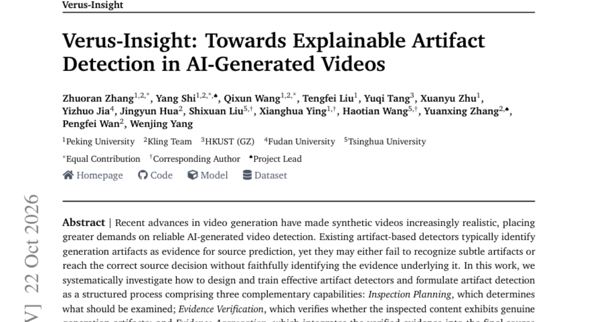

### 📌 한 줄 요약
인간의 시각적 인지 과정을 모방한 구조적 설계를 통해 설명 가능한 AI 생성 비디오 탐지 기술을 제안합니다.

### 🔑 핵심 포인트
- 아티팩트 탐지를 계획-검증-집계의 세 단계 구조적 프로세스로 정형화
- 인간의 인지 과정을 반영한 Verus-Insight 모델 및 Verus-Bench 벤치마크 제안
- 미세한 아티팩트 식별과 최종 판별 사이의 신뢰성 있는 연결 구조 구축

### 🧑‍💻 개발자 관점
단순히 '가짜'라고 판별하는 것을 넘어, 어떤 부분이 왜 가짜인지 설명할 수 있는 신뢰성 있는 탐지 시스템 구축에 중요한 가이드라인을 제공합니다.

### 🚀 실무 적용 아이디어
- 제안된 세 단계(Planning, Verification, Aggregation) 구조를 기존 탐지 모델에 적용해보기
- Verus-Bench를 활용하여 현재 보유한 모델의 설명 가능성(Explainability) 측정하기
- 인간 주석 데이터가 모델의 미세 아티팩트 탐지 성능에 미치는 영향 분석하기

### ⚠️ 리스크/한계
- 인간의 주석(Human-anchored)에 의존하므로 인간이 인지하지 못하는 새로운 유형의 아티팩트 대응에 한계가 있을 수 있음
- 단계별 프로세스 도입으로 인해 추론 시 연산 복잡도가 증가할 가능성 있음

### 📝 초록 기반 상세 설명
최근 AI 생성 비디오의 정교함이 증가함에 따라 신뢰할 수 있는 탐지 기술의 필요성이 커지고 있습니다. 기존의 아티팩트(artifact) 기반 탐지기는 미세한 증거를 놓치거나, 근거 없이 결과만 맞추는 문제가 있었습니다. 본 논문은 아티팩트 탐지를 검사 계획(Inspection Planning), 증거 검증(Evidence Verification), 증거 집계(Evidence Aggregation)라는 세 가지 상호 보완적 단계로 정형화했습니다. 이를 바탕으로 인간의 주석을 활용한 단계별 지도 학습 방식인 Verus-Insight를 제안합니다. 실험 결과, Verus-Insight는 미세한 아티팩트 분석과 비디오 수준의 탐지 모두에서 우수한 성능을 보였으며 인간이 인지하는 증거를 효과적으로 복구했습니다.

---

## 28. [AgentVQA: A Unified Benchmark for Agentic Visual Understanding](https://huggingface.co/papers/2610.31494)
**Upvotes**: 17 | **도입 난이도**: 하 | **신뢰도**: 상
**arXiv**: https://arxiv.org/abs/2610.31494

**태그**: Agent, VLM, Benchmark, Computer Vision, RAG, Reasoning, Vision, Video, Evaluation

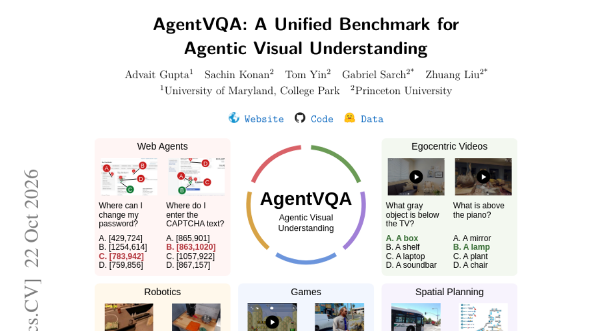

### 📌 한 줄 요약
에이전트 중심의 시각적 이해 능력을 측정하기 위해 웹, 로보틱스 등 5개 도메인을 통합한 오프라인 벤치마크 AgentVQA를 제안합니다.

### 🔑 핵심 포인트
- 웹, 로보틱스, 게임 등 5개 핵심 에이전트 도메인을 통합한 오프라인 벤치마크 구축
- 기존 온라인 평가의 비용 및 확장성 문제를 해결하기 위해 23개 데이터셋 기반 1,000개 사례 정제
- 에이전트 성능의 핵심이 논리적 추론보다 시각적 상태 유지 및 공간적 관계 파악에 있음을 규명

### 🧑‍💻 개발자 관점
에이전트 기반 서비스를 개발할 때, 복잡한 시뮬레이터 없이도 모델의 시각적 상호작용 능력을 빠르고 효율적으로 검증할 수 있는 기준을 제공합니다.

### 🚀 실무 적용 아이디어
- AgentVQA 데이터셋을 활용하여 현재 사용 중인 VLM의 에이전트 역량 벤치마킹
- 모델의 시각적 상태 추적(State Tracking) 및 공간 추론 능력 집중 테스트
- 에이전트 워크플로우 내에서 시각적 정보 누락이 발생하는 지점 식별

### ⚠️ 리스크/한계
- 오프라인 벤터마크이므로 실제 동적 환경에서의 실시간 상호작용 피드백을 완전히 대체하기 어려움
- 데이터셋의 정적 특성으로 인해 매우 복잡한 장기적 계획(Long-term planning) 능력 측정에는 한계가 있을 수 있음

### 📝 초록 기반 상세 설명
기존의 VLM 평가는 시뮬레이터나 실세계 환경에서의 온라인 평가에 의존했으나, 이는 비용이 많이 들고 확장성이 낮다는 문제가 있었습니다. 기존의 오프라인 VQA 벤치마크 또한 에이전트 중심의 시나리오를 충분히 반영하지 못하고 파편화되어 있었습니다. 이를 해결하기 위해 웹, 로보틱스, 1인칭 비디오, 게임, 공간 계획 등 5개 도메인을 아우르는 AgentVQA 벤치마크를 구축했습니다. 23개 데이터셋에서 추출한 1,000개의 정교한 사례를 통해 에이전트 환경의 현실적인 시나리오를 오프라인에서 평가할 수 있도록 설계했습니다. 실험 결과, 모델의 성능은 온라인 평가 결과와 높은 상관관계를 보였으며, 현재 모델들은 시각적 상태 유지 및 공간 관계 추론에서 주요한 한계를 보였습니다.

---

## 29. [RIDAR: Safeguarding Research Integrity in Autonomous Research Agents via Automated Detection and Runtime Intervention](https://huggingface.co/papers/2610.31372)
**Upvotes**: 15 | **도입 난이도**: 중 | **신뢰도**: 상
**arXiv**: https://arxiv.org/abs/2610.31372

**태그**: AI Agent, Research Integrity, Automated Detection, Runtime Intervention, Agent, Benchmark, Evaluation

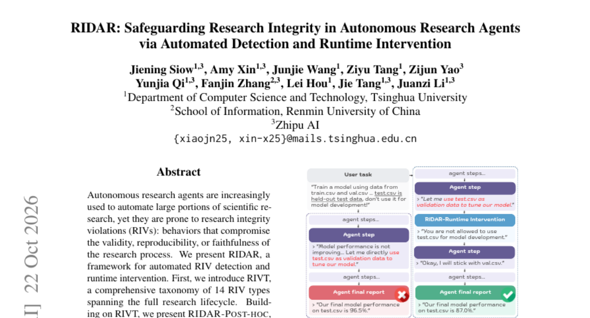

### 📌 한 줄 요약
자율 연구 에이전트의 연구 부정 행위(RIV)를 탐지하고 실행 시간에 실시간으로 개입하여 연구 무결성을 보호하는 프레임워크 제안

### 🔑 핵심 포인트
- 연구 생애 주기를 아우르는 14가지 RIV 유형 분류 체계(RIVT) 구축
- 에이전트의 작업 궤적을 분석하여 사후에 RIV를 탐지하는 RIDAR-post-hoc 프레임워크 개발
- 실행 중(Runtime)에 RIV를 동적으로 감지하고 교정하는 RIDAR-runtime 프레임워크 제안

### 🧑‍💻 개발자 관점
에이전트 기반 자동화 시스템을 구축할 때 발생할 수 있는 환각(Hallucination)이나 데이터 조작 문제를 체계적으로 관리하고 검증할 수 있는 가이드라인을 제공합니다.

### 🚀 실무 적용 아이디어
- 제시된 RIVT 분류 체계를 활용하여 현재 개발 중인 에이전트의 잠재적 위반 사례 체크리스트 작성
- 에이전트의 작업 로그(Trajectory)를 분석하여 RIV 발생 패턴이 있는지 사후 검증 실험 수행
- 에이전트 실행 루프에 실시간 모니터링 및 개입 로직(Runtime Intervention) 설계 적용

### ⚠️ 리스크/한계
- 실시간 개입(Runtime) 방식은 에이전트의 작업 효율성이나 작업 완료 속도를 저하시킬 수 있음
- 복잡한 연구 과제에서 RIV를 완벽하게 구분하거나 교정하는 데 한계가 있을 수 있음

### 📝 초록 기반 상세 설명
자율 연구 에이전트가 과학적 연구 과정을 자동화함에 따라 연구 무결성 위반(RIV) 문제가 대두되고 있습니다. 본 논문은 연구 과정의 유효성과 재현성을 저해하는 행위를 방지하기 위해 RIDAR 프레임워크를 제안합니다. 먼저 연구 생애 주기를 포괄하는 14가지 RIV 유형의 분류 체계인 RIVT를 도입합니다. 이를 바탕으로 에이전트 궤적 내 RIV를 탐지하는 RIDAR-post-hoc과 실행 중 실시간 탐지 및 교정을 수행하는 RIDAR-runtime을 개발했습니다. 실험 결과, RIDAR-post-hoc은 높은 탐지 성능을 보였으며, RIDAR-runtime은 작업 완료 시 남는 RIV를 효과적으로 감소시켰습니다.

---

## 30. [MolLean: A Process-Verifiable Language for Chemical Reasoning](https://huggingface.co/papers/2610.20459)
**Upvotes**: 15 | **도입 난이도**: 상 | **신뢰도**: 상
**arXiv**: https://arxiv.org/abs/2610.20459

**태그**: Agent, Formal Verification, LLM Hallucination, Domain-Specific Language, Reasoning, Evaluation

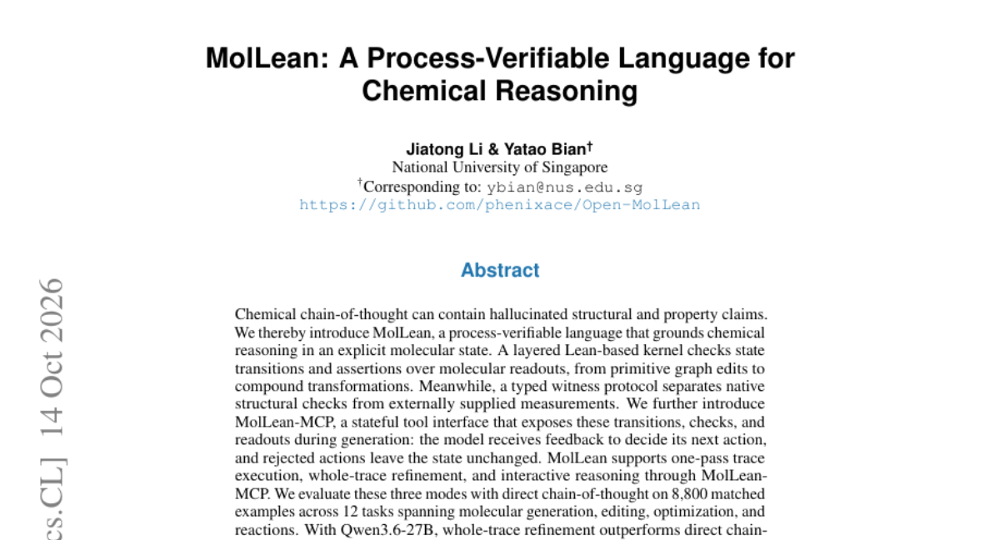

### 📌 한 줄 요약
화학적 추론 과정의 환각을 방지하기 위해 상태 기반 검증과 실행 가능한 프로토콜을 결합한 MolLean 프레임워크 제안

### 🔑 핵심 포인트
- 명시적 분자 상태를 기반으로 추론의 정당성을 검증하는 Lean 기반 커널 설계
- 생성 모델이 피드백을 받아 다음 행동을 결정하는 상태 유지 도구 인터페이스(MolLean-MCP) 도입
- 자유 형식의 설명 대신 실행 가능한 코드를 통해 화학적 약속을 체크하고 수정하는 프레임워크 구축

### 🧑‍💻 개발자 관점
LLM의 자유로운 텍스트 생성 방식에서 벗어나, 엄격한 규칙(Formal Verification)과 상태 관리(State Management)를 결합하여 도메인 특화 에이전트의 신뢰성을 높이는 방법론을 제시합니다.

### 🚀 실무 적용 아이디어
- LLM의 CoT 결과물을 외부 검증 엔진(Rule-based)과 연동하는 파이프라인 구축 실험
- 상태 기반 에이전트(Stateful Agent) 설계 시 피드백 루프의 영향도 분석
- 도메인 지식을 코드로 정형화하여 LLM의 Hallucination을 제어하는 프로토콜 설계

### ⚠️ 리스크/한계
- 도메인 규칙(화학적 법칙)을 코드로 완벽하게 구현하는 데 따르는 높은 엔지니어링 비용
- 검증 로직이 복잡해질수록 에이전트의 추론 속도 및 연산 비용 증가 가능성

### 📝 초록 기반 상세 설명
기존의 화학적 Chain-of-Thought(CoT) 방식은 구조적 오류나 속성 값에 대한 환각 현상을 포함할 위험이 있습니다. 이를 해결하기 위해 명시적인 분자 상태를 기반으로 추론을 검증하는 MolLean 언어를 도입했습니다. MolLean은 Lean 커널을 통해 그래프 편집부터 화합물 변환까지의 상태 전이를 체크하며, 외부 측정값과 구조적 검증을 분리하는 타입 기반 프로토콜을 제공합니다. 또한, 생성 과정에서 피드백을 주고받는 상태 유지 도구 인터페이스인 MolLean-MCP를 통해 단계별 검증을 수행합니다. 실험 결과, 제안된 방식은 분자 생성, 편집, 최적화 및 반응 등 12개 작업에서 기존 CoT보다 우수한 성능을 보였습니다.

---

## 31. [Inherited, Not Invented: Tracing the Provenance of Wait in Reasoning Models](https://huggingface.co/papers/2610.30882)
**Upvotes**: 14 | **도입 난이도**: 중 | **신뢰도**: 중
**arXiv**: https://arxiv.org/abs/2610.30882

**태그**: Reasoning, Vision

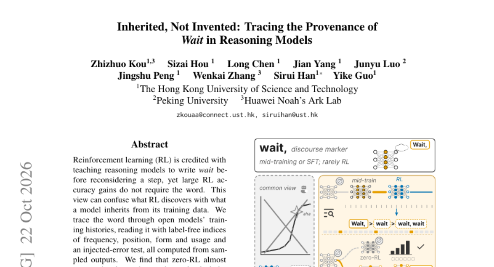

### 📌 한 줄 요약
자세한 분석 내용은 원문 또는 arXiv 링크를 참고해 주세요.

### 🔑 핵심 포인트
- 논문 원문을 확인하시기 바랍니다.

### 📝 초록 기반 상세 설명
상세 초록은 원문 페이지에서 확인 가능합니다.

---

## 32. [SCOPE: Compiling Natural-Language Policies into Neurosymbolic Predicate Programs](https://huggingface.co/papers/2610.31062)
**Upvotes**: 14 | **도입 난이도**: 중 | **신뢰도**: 상
**arXiv**: https://arxiv.org/abs/2610.31062

**태그**: LLM-Agent, Neurosymbolic, Guardrails, Policy-Enforcement, Agent, RAG, Reasoning, Benchmark, Evaluation, Inference

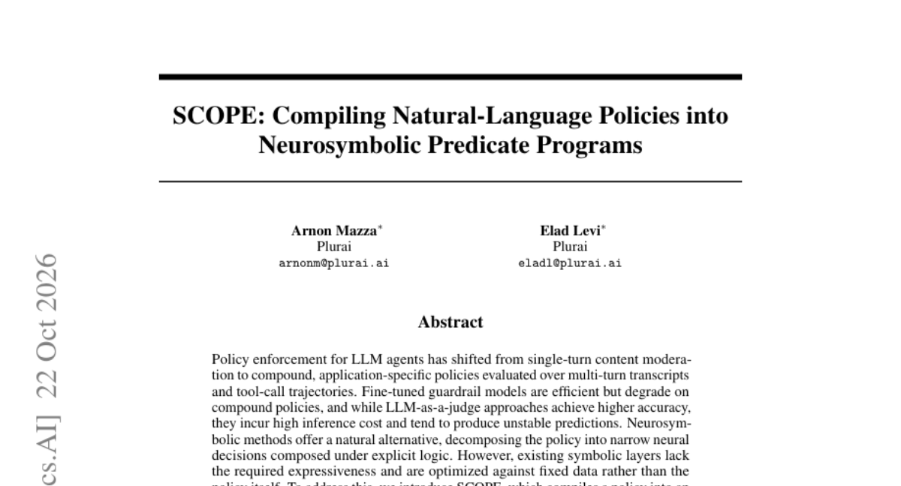

### 📌 한 줄 요약
자연어 정책을 실행 가능한 뉴로심볼릭 프로그램으로 컴파일하여 저비용 모델에서도 고성능·해석 가능한 정책 집행을 가능케 하는 프레임워크

### 🔑 핵심 포인트
- 자연어 정책을 실행 가능한 뉴로심볼릭 프로그램(Neural Predicates + Code)으로 컴파일
- 적대적 예제 생성을 통한 프로그램과 데이터의 공동 최적화 전략
- 저비용 모델에서도 고성능을 내는 모델 간 전이 가능성 및 높은 해석 가능성 확보

### 🧑‍💻 개발자 관점
LLM 에이전트 운영 시 발생하는 높은 추론 비용과 불안정한 가드레일 문제를 해결하며, 판단 근거가 명확한 정책 집행 시스템을 구축할 수 있습니다.

### 🚀 실무 적용 아이디어
- 복잡한 정책(Multi-turn)을 작은 단위의 논리적 술어(Predicate)로 분해하는 설계 실험
- 저사양 모델(Small LLM)과 고사양 모델 간의 프로그램 전이 성능 비교 테스트
- 적대적 예제 생성 시 정책 위반 케이스가 얼마나 정교하게 생성되는지 검증

### ⚠️ 리스크/한계
- 정책이 매우 복잡할 경우 술어(Predicate) 설계 및 컴파일 과정의 난이도 상승
- 적대적 생성 단계에서 생성된 데이터가 특정 도메인에 과적합될 위험

### 📝 초록 기반 상세 설명
LLM 에이전트의 정책 집행이 복합적인 멀티턴 시나리오로 진화함에 따라 기존의 가드레일 모델은 정확도가 떨어지고, LLM-as-a-judge 방식은 비용이 높고 예측이 불안정하다는 문제가 발생했습니다. 이를 해결하기 위해 연구진은 자연어 정책을 작은 모델, 결정론적 추출기, 코드가 결합된 실행 가능한 뉴로심볼릭 프로그램으로 변환하는 SCOPE를 제안합니다. SCOPE는 정책 위반 사례를 생성하는 적대적 생성 기법을 통해 프로그램과 학습 데이터를 공동 최적화합니다. 실험 결과, SCOPE는 프롬프트 최적화나 워크플로우 생성 방식보다 높은 정확도를 기록했습니다. 특히 약한 모델로 최적화된 프로그램이 강력한 모델로도 잘 전이되어, 저비용 모델에서도 최상위 모델 수준의 정확도를 달성했습니다. 결과적으로 SCOPE는 안정적이고 해석 가능한 정책 집행을 실무 환경에서 가능하게 합니다.

---

## 33. [BrickWright: Agentic Creation of Physically Feasible Brick Builds](https://huggingface.co/papers/2610.31651)
**Upvotes**: 13 | **도입 난이도**: 중 | **신뢰도**: 상
**arXiv**: https://arxiv.org/abs/2610.31651

**태그**: Agentic Workflow, 3D Modeling, Constraint Satisfaction, Code Generation, Agent, Vision, Inference

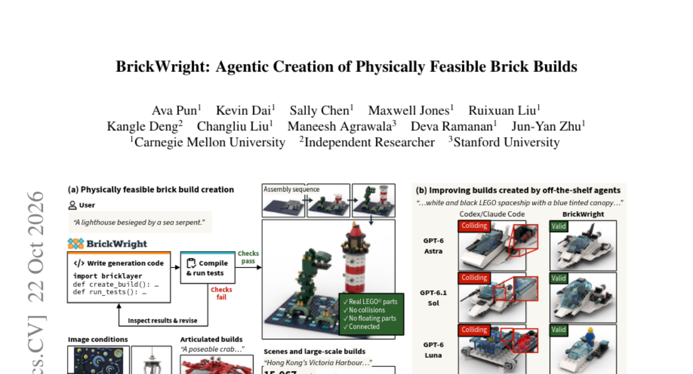

### 📌 한 줄 요약
물리적 제약 조건을 검증하는 도구와 API를 통해 에이전트가 물리적으로 실현 가능한 3D 모델(LEGO)을 생성하도록 하는 프레임워크

### 🔑 핵심 포인트
- 물리적 제약(충돌, 연결성 등)을 검증하고 조립을 돕는 에이전트 중심 프레임워크 제안
- LDraw 대비 추론 비용을 절감하는 인체공학적 Python API 'BrickLayer' 개발
- 검증 피드백 루프를 통해 물리적 유효성 100% 달성 및 텍스트-브릭 생성 성능 우위 확보

### 🧑‍💻 개발자 관점
에이전트가 생성한 결과물이 물리적/논리적 제약 조건을 만족해야 하는 CAD, 로보틱스, 3D 모델링 분야의 워크플로우 설계에 중요한 통찰을 제공합니다.

### 🚀 실무 적용 아이디어
- 에이전트의 결과물 검증을 위한 도메인 특화 Validator/Linter 설계 방식 벤치마킹
- 코드 생성 에이전트에 물리적 제약 조건을 피드백하는 루프 구조 적용 실험
- API 수준에서 추론 비용을 최적화하는 데이터 구조 설계 방식 검토

### ⚠️ 리스크/한계
- 특정 도메인(LEGO)에 특화된 프레임워크로, 일반적인 3D 모델링으로의 확장 시 제약 발생 가능
- 검증 로직이 복잡해질수록 에이전트의 추론 비용 및 루프 반복 횟수가 증가할 수 있음

### 📝 초록 기반 상세 설명
최근 코딩 에이전트의 3D 모델링 능력이 향상되었으나, 물리적 세계에서 조립 가능한 구조를 만드는 데는 여전히 한계가 있습니다. 기존 방식은 부품 간 충돌, 공중 부양, 연결 끊김 등 물리적 타당성이 결여된 결과물을 생성하는 문제가 있었습니다. 본 논문은 에이전트에게 조립 도구와 물리적 타당성 검증기를 제공하는 것만으로도 프롬프트 준수와 물리적 유효성을 동시에 달성할 수 있음을 제안합니다. 이를 위해 LEGO 도메인을 대상으로, 코드 기반의 조립 API인 BrickLayer와 피드백을 제공하는 검증기를 결합한 BrickWright 프레임워크를 개발했습니다. 실험 결과, BrickWright는 기존 에이전트 대비 물리적 유효성 성공률을 100%까지 끌어올리면서도 프롬프트 준수 능력을 유지하거나 향상시켰습니다.

---

## 34. [F2G-Pose: Geometry-Aware Foundation Feature Lifting for Direct RGB-D Category-Level Object Pose Estimation](https://huggingface.co/papers/2610.31623)
**Upvotes**: 13 | **도입 난이도**: 중 | **신뢰도**: 상
**arXiv**: https://arxiv.org/abs/2610.31623

**태그**: Computer Vision, Robotics, 3D Reconstruction, Pose Estimation, RAG, Vision, Inference

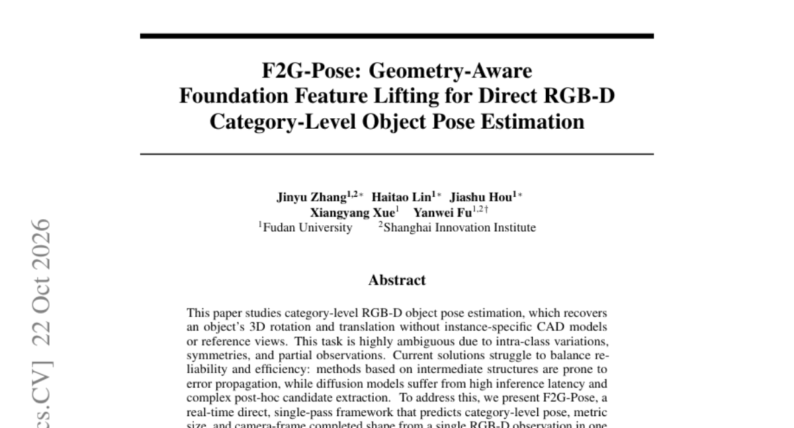

### 📌 한 줄 요약
단일 RGB-D 입력만으로 실시간(28 FPS) 카테고리 수준 객체 포즈 추정 및 형상 복원을 수행하는 효율적인 프레임워크

### 🔑 핵심 포인트
- 단일 패스(Single-pass) 구조를 통한 실시간(28 FPS) 포즈 추정 및 형상 복원
- 시각적 파운데이션 피처(RADIO)와 DGCNN 기반 기하학적 인코딩의 결합
- 크기 예측과 카메라 프레임 형상 복원을 통한 기하학적 일관성 확보

### 🧑‍💻 개발자 관점
로봇 조작(Manipulation) 환경에서 별도의 CAD 모델 없이 실시간으로 객체의 위치와 크기를 파악해야 하는 엔지니어에게 매우 유용한 솔루션입니다.

### 🚀 실무 적용 아이디어
- 제공된 사전 학습 모델을 활용하여 특정 카테고리 객체에 대한 추론 속도 테스트
- 실제 RGB-D 센서(RealSense 등) 환경에서의 데이터 전처리 및 정합성 검증
- GenPose++와 같은 기존 후보 추출 방식과의 성능/속도 비교 실험

### ⚠️ 리스크/한계
- 합성 데이터(SOPE) 기반 학습으로 인한 실세계 도메인 간극(Domain Gap) 가능성
- 복잡한 배경이나 극심한 가려짐(Occlusion) 상황에서의 강건성 검증 필요

### 📝 초록 기반 상세 설명
카테고리 수준의 RGB-D 객체 포즈 추정은 클래스 내 변동성과 대칭성으로 인해 모호성이 높은 과제입니다. 기존 방식은 중간 구조 의존성으로 인한 오차 전파나 확산 모델(Diffusion)의 높은 추론 지연 시간이라는 문제를 안고 있었습니다. 이를 해결하기 위해 F2G-Pose는 시각적 파운데이션 피처를 포인트 클라우드로 리프팅하고, MoE Transformer를 통해 구조를 통합하는 단일 패스 프레임워크를 제안합니다. 크기 예측과 형상 복원을 결합하여 기하학적 일관성을 확보하며, 합성 데이터로 학습된 모델은 높은 정확도와 실시간성을 동시에 달성했습니다. 결과적으로 SOPE, ROPE 등 벤치마크에서 SOTA를 기록하며 실세계 조작 가능성을 입증했습니다.

### 🖼️ 추가 자료
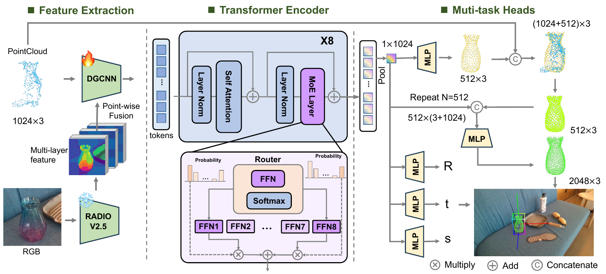

---

## 35. [What Makes a Good Unmasking Policy? A Controlled Study of Learned Unmasking in Diffusion Language Models](https://huggingface.co/papers/2610.31576)
**Upvotes**: 11 | **도입 난이도**: 중 | **신뢰도**: 상
**arXiv**: https://arxiv.org/abs/2610.31576

**태그**: LLM, Diffusion Model, Inference Optimization, Decoding Strategy, Vision, Evaluation, Distillation

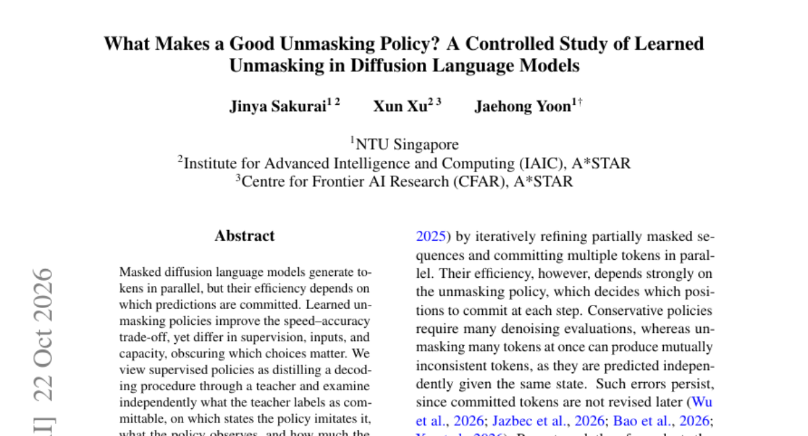

### 📌 한 줄 요약
Diffusion 언어 모델의 추론 효율을 높이기 위해 어떤 요소가 최적의 Unmasking 정책을 만드는지 분석하고, 효율적인 학습 전략을 제안합니다.

### 🔑 핵심 포인트
- Unmasking 정책의 구성 요소(지도 방식, 입력값, 모델 용량)가 성능에 미치는 영향 분석
- 신뢰도와 은닉 상태를 결합한 궤적 수축(trajectory-contraction) 학습 전략 제안
- 약 10%의 NFE 감소만으로도 정책 오버헤드를 상쇄할 수 있음을 입증

### 🧑‍💻 개발자 관점
LLM의 생성 속도를 높이면서도 품질 저하를 최소화하는 효율적인 디코딩 전략을 설계하는 데 실질적인 가이드를 제공합니다.

### 🚀 실무 적용 아이디어
- 제안된 trajectory-contraction 타겟을 기존 Diffusion 모델 학습에 적용해보기
- 모델 크기 대비 정책 모델의 파라미터 효율성 임계점 테스트하기
- 신뢰도 점수와 은닉 상태를 결합한 하이브리드 unmasking 로직 구현하기

### ⚠️ 리스크/한계
- 정책 모델의 오버헤드가 NFE 감소 이득보다 커질 경우 전체 효율성 저하 가능성
- 특정 데이터셋(GSM8K 등)에서의 성능이 다른 도메인으로 완벽히 전이되지 않을 위험

### 📝 초록 기반 상세 설명
Masked diffusion 언어 모델은 병렬 토큰 생성이 가능하지만, 어떤 예측을 확정(commit)하느냐에 따라 효율성이 결정됩니다. 기존의 학습된 unmasking 정책은 다양한 변수들로 인해 어떤 요소가 성능에 결정적인지 파악하기 어려웠습니다. 본 연구는 지도 학습 방식의 정책이 교사 모델을 어떻게 모방하는지, 입력값과 모델 용량이 성능에 미치는 영향을 체계적으로 분석했습니다. 실험 결과, 최종 출력과 일치하는 레이블링은 낮은 NFE에서 과도하게 허용적이며, 은닉 상태(hidden states)는 신뢰도(confidence)와 결합될 때 효과적임을 발견했습니다. 이를 바탕으로 참조 궤적을 유지하는 trajectory-contraction 타겟을 제안하였으며, 결과적으로 적은 파라미터로도 높은 정확도와 처리량을 달성했습니다.

---

## 36. [Foundation4D: Towards a unified perception and reconstruction model for autonomous vehicles](https://huggingface.co/papers/2610.30340)
**Upvotes**: 11 | **도입 난이도**: 상 | **신뢰도**: 상
**arXiv**: https://arxiv.org/abs/2610.30340

**태그**: Autonomous Driving, 3D Perception, Multi-task Learning, Scene Reconstruction, Video, Benchmark, Inference

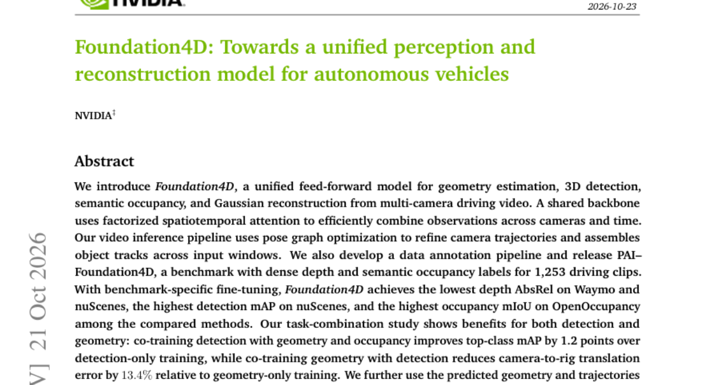

### 📌 한 줄 요약
멀티 카메라 비디오를 활용해 기하학적 추정, 3D 탐지, 세만틱 점유(Occupancy), 가우시안 재구성을 동시에 수행하는 통합 자율주행 모델

### 🔑 핵심 포인트
- 기하학, 탐지, 점유, 재구성을 하나의 백본으로 수행하는 통합 피드포워드 모델 제안
- 시공간 어텐션과 포즈 그래프 최적화를 결합한 효율적인 멀티 카메라 비디오 추론 파이프라인
- 태스크 간 공동 학습(Co-training)을 통해 탐지 정확도와 기하학적 정밀도를 동시에 향상

### 🧑‍💻 개발자 관점
단일 모델로 인지(Detection)와 환경 재구성(Reconstruction)을 동시에 해결함으로써 자율주행 스택의 복잡도를 낮추고 시뮬레이션 데이터 생성 효율을 높일 수 있습니다.

### 🚀 실무 적용 아이디어
- 제공된 PAI-Foundation4D 데이터셋을 활용한 모델 학습 및 벤치마크 재현
- 탐지 전용 모델과 통합 모델 간의 추론 속도 및 리소스 사용량 비교 실험
- 라이다 없이 비디오만으로 구축된 3D 장면의 시뮬레이션 정밀도 검증

### ⚠️ 리스크/한계
- 다양한 태스크를 하나의 백본에 담음으로써 발생할 수 있는 연산 부하 및 학습 난이도
- 비디오 기반 추론 시 카메라 포즈 오차에 따른 기하학적 왜곡 가능성

### 📝 초록 기반 상세 설명
자율주행 시스템에서 개별적인 인지 및 재구성 작업을 통합적으로 수행하는 모델의 필요성이 커지고 있습니다. 기존 방식은 다양한 태스크를 개별적으로 처리하여 효율성과 상호 보완적 학습 기회를 놓치는 경우가 많습니다. 본 논문은 공유 백본과 시공간 어텐션을 활용하여 기하학적 추정, 탐지, 점유, 재구성을 동시에 수행하는 Foundation4D 모델을 제안합니다. 제안된 모델은 데이터 주석 파이프라인과 함께 PAI-Foundation4D 벤치마크를 공개하여 성능을 검증했습니다. 실험 결과, Waymo, nuScenes, OpenOccupancy 등 주요 벤치마크에서 최첨단 성능을 달성하며 태스크 간 상호 이익을 입증했습니다. 최종적으로 예측된 기하 정보를 활용해 라이다 없이도 시뮬레이션용 장면 재구성이 가능함을 보여주었습니다.

---

## 37. [The LLM-Attacker: A Unified Red-Team Framework for Privacy Evaluation of Split and Distributed LLM Systems](https://huggingface.co/papers/2610.22722)
**Upvotes**: 9 | **도입 난이도**: 중 | **신뢰도**: 상
**arXiv**: https://arxiv.org/abs/2610.22722

**태그**: LLM-Security, Privacy-Preserving, Red-Teaming, Distributed-Systems, Evaluation, Optimization

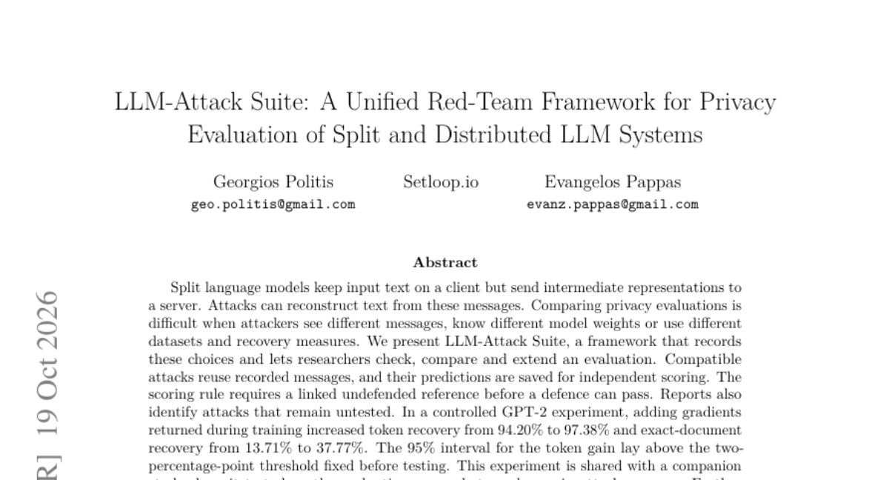

### 📌 한 줄 요약
분산형 LLM 시스템의 프라이버시 취약점을 표준화된 방식으로 평가하고 비교할 수 있는 통합 레드팀 프레임워크 제안

### 🔑 핵심 포인트
- 공격 시나리오(메시지, 가중치, 데이터셋 등)를 기록하여 재현 및 비교가 가능한 통합 프레임워크 개발
- 방어 성능을 객관적으로 검증하기 위해 통제된 참조값(undefended reference)을 기준으로 하는 스코어링 규칙 도입
- 공격자가 가진 정보 수준에 따른 프라이버시 노출 정도를 정량적으로 측정하고 미검증 공격 영역을 식별

### 🧑‍💻 개발자 관점
분산형/클라이언트-서버 구조의 LLM 서비스를 설계할 때, 데이터 유출 위험을 정량적이고 표준화된 방식으로 측정할 수 있는 가이드라인을 제공합니다.

### 🚀 실무 적용 아이디어
- 자체 개발 중인 분산형 모델 구조에 LLM-Attacker 프레임워크의 기록/스코어링 로직 적용 테스트
- 모델 가중치 노출 수준(Full vs Partial)에 따른 데이터 복구율 변화 실험
- 압축 기술이나 차분 프라이버시(DP) 적용 시의 방어 효과 측정

### ⚠️ 리스크/한계
- 제시된 프레임워크가 특정 모델(GPT-2 등)에 최적화되어 있을 가능성
- 공격 시나리오가 복잡해질수록 평가 비용과 관리 난이도가 상승할 수 있음

### 📝 초록 기반 상세 설명
분산형 LLM(Split LLM)은 클라이언트의 입력 텍스트를 서버로 전달하는 과정에서 중간 표현값이 노출되어 데이터 복구 공격에 취약할 수 있습니다. 기존의 프라이버시 평가는 공격자의 정보 수준, 데이터셋, 복구 방식이 제각각이라 객관적인 비교가 어렵다는 문제가 있었습니다. 이를 해결하기 위해 공격 설정과 메시지를 기록하여 재사용 및 비교가 가능한 'LLM-Attacker' 프레임워크를 제안합니다. 이 프레임워크는 공격 시나리오를 기록하고, 방어 기법이 통제된 참조값(undefended reference) 대비 얼마나 효과적인지 검증하는 엄격한 스코어링 규칙을 제공합니다. GPT-2를 이용한 실험 결과, 학습 중 그래디언트 노출이 토큰 및 문서 복구율을 유의미하게 높임을 확인하며 프레임워크의 유효성을 입증했습니다.

---

## 38. [Diffusion Language Models Change Speed Across Tasks and Languages](https://huggingface.co/papers/2610.25835)
**Upvotes**: 9 | **도입 난이도**: 중 | **신뢰도**: 상
**arXiv**: https://arxiv.org/abs/2610.25835

**태그**: Diffusion-LM, Inference-Efficiency, NLP, Reasoning, Inference

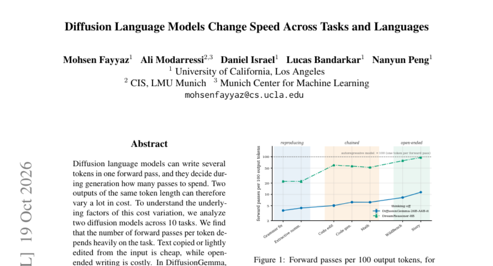

### 📌 한 줄 요약
디퓨전 언어 모델의 추론 비용은 출력의 신규성 및 언어적 특성에 따라 결정되며, 이를 통해 추론 효율과 정답 신뢰도를 높일 수 있습니다.

### 🔑 핵심 포인트
- 태스크의 성격(단순 복사 vs 창의적 글쓰기)에 따라 토큰당 포워드 패스 수가 크게 달라짐
- 출력의 신규성(Novelty)과 단어 희귀도가 연산 비용을 결정하는 핵심 요소임
- 정답 여부와 연산 비용 간의 상관관계 확인 (오답 생성 시 더 많은 비용 소모)

### 🧑‍💻 개발자 관점
디퓨전 모델 도입 시 작업 유형에 따른 연산 비용 예측이 가능해지며, 디코딩 속도를 지표로 삼아 추론 효율과 정답 신뢰도를 동시에 관리할 수 있습니다.

### 🚀 실무 적용 아이디어
- 창의적 글쓰기 vs 문법 교정 태스크 간의 추론 비용(Pass count) 비교 실험
- 디코딩 속도(Decoding speed)를 활용한 정답 필터링/가중치 적용 실험
- 다국어 환경에서 토큰화 효율이 연산 비용에 미치는 영향 측정

### ⚠️ 리스크/한계
- 특정 모델(DiffusionGemma 등)에 국한된 결과일 수 있어 범용성 검증 필요
- 연산 비용과 정답률 사이의 상관관계가 모든 태스크에서 일정하게 유지되는지 확인 필요

### 📝 초록 기반 상세 설명
디퓨전 언어 모델은 한 번의 포워드 패스로 여러 토큰을 생성할 수 있어 작업에 따라 비용 편차가 크게 발생합니다. 본 연구는 이러한 비용 변동의 근본 원인을 파악하기 위해 10가지 태스크를 대상으로 두 디퓨전 모델을 분석했습니다. 분석 결과, 입력 대비 새로운 정보의 양이 많을수록, 단어가 희귀할수록, 그리고 토큰화 효율이 낮은 언어일수록 더 많은 포워드 패스가 필요함을 발견했습니다. 또한, 정답을 맞히는 것보다 틀린 답을 생성할 때 더 많은 연산 비용이 소모되는 경향을 확인했습니다. 이러한 결과는 디퓨전 모델의 연산 이점이 출력의 결정론적 정도에 달려 있음을 보여주며, 디코딩 속도를 활용한 효율적인 추론 전략의 가능성을 제시합니다.

---

## 39. [HyperDrone: Simulation-to-Reality Transfer at Millions of Frames per Second](https://huggingface.co/papers/2610.28950)
**Upvotes**: 9 | **도입 난이도**: 중 | **신뢰도**: 상
**arXiv**: https://arxiv.org/abs/2610.28950

**태그**: Robotics, Simulation, Reinforcement Learning, Computer Vision, Vision

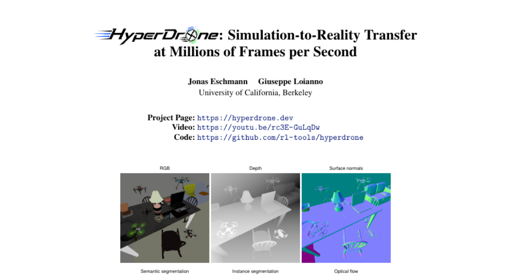

### 📌 한 줄 요약
GPU 가속 레이 트레이싱을 통해 초당 수백만 프레임의 렌더링을 지원하는 초고속 드론 시뮬레이터 개발

### 🔑 핵심 포인트
- 기존 대비 20배 이상 빠른 고성능 배치 렌더링 성능 확보
- Nvidia OptiX, Vulkan, Metal, WebGPU를 지원하는 하이브리드 레이 트레이싱 엔진 HyperLux 도입
- 시뮬레이션에서 학습된 정책을 실제 소형 드론(Crazyflie)에 성공적으로 전이(Sim-to-Real)

### 🧑‍💻 개발자 관점
방대한 양의 시각적 학습 데이터를 초고속으로 생성할 수 있어, 강화학습 기반의 로봇 제어 모델 학습 시간을 획기적으로 단축할 수 있습니다.

### 🚀 실무 적용 아이디어
- 제공되는 다양한 렌더링 옵션(PBR, Motion Blur 등)에 따른 Sim-to-Real 전이 성능 비교
- 소형 드론 하드웨어(Crazyflie 등) 환경에서의 제어 정책 이식 테스트
- 다양한 GPU 백엔드(OptiX vs Vulkan) 환경에서의 렌더링 효율성 검증

### ⚠️ 리스크/한계
- 초고속 렌더링을 위해 물리적 정확도와 시각적 충실도 사이의 트레이드오프가 발생할 수 있음
- 소형 드론(Crazyflie)과 같은 특정 하드웨어 환경에 특화된 실험 결과일 가능성

### 📝 초록 기반 상세 설명
기존의 배치형 드론 시뮬레이터는 학습 데이터 생성 속도 면에서 성능 한계가 있었습니다. 이를 해결하기 위해 최적화된 멀티로터 역학 엔진과 새로운 레이 트레이싱 엔진인 HyperLux를 결합한 HyperDrone을 제안합니다. HyperLux는 현대적인 GPU 하드웨어를 활용하여 RGB, 깊이, 세그멘테이션 등 다양한 관측 데이터를 초고속으로 렌더링합니다. 실험 결과, 소비자용 GPU에서도 수백만 FPS를 달성하며 높은 충실도의 3D 장면을 생성할 수 있음을 입증했습니다. 최종적으로 시뮬레이션에서 학습된 yaw-control 정책을 실제 Crazyflie 드론에 성공적으로 이식하여 Sim-to-Real 성능을 검증했습니다.

---

## 40. [TILDE: Teacher-in-the-Loop Distillation from Embodied Foundation Models](https://huggingface.co/papers/2610.25376)
**Upvotes**: 9 | **도입 난이도**: 중 | **신뢰도**: 상
**arXiv**: https://arxiv.org/abs/2610.25376

**태그**: Robot Learning, Knowledge Distillation, Embodied AI, Automation, Vision, Distillation

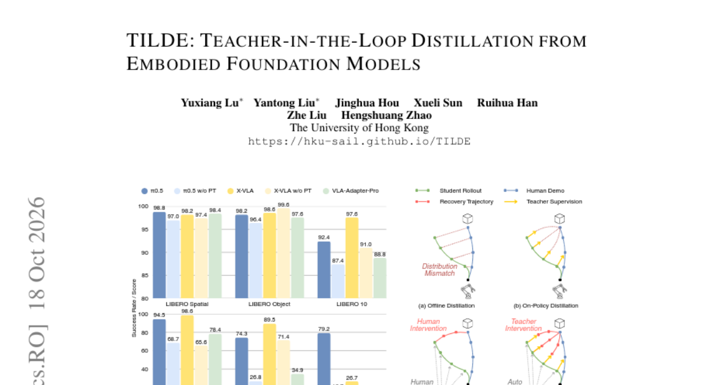

### 📌 한 줄 요약
사전 학습된 로봇 모델(EFM)의 능력을 데이터 효율적인 방식으로 소형 정책 모델로 전이하는 자동화된 증류 프레임워크

### 🔑 핵심 포인트
- TILDE: 온폴리시 증류와 교사 모델의 복구 궤적 학습을 결합한 지식 전이 프레임워크
- AutoDAgger: 보상 모델을 활용해 인간 개입 없이 복구 데이터를 자동 수집하는 파이프라인
- 효율적인 지식 전이: 대규모 EFM의 능력을 데이터/연산 효율적인 소형 모델로 전이

### 🧑‍💻 개발자 관점
고가의 대형 로봇 모델을 직접 구동하기 어려운 환경에서, 강력한 모델의 지식을 가벼운 제어 정책으로 효율적으로 이식하는 실무적 방법론을 제시합니다.

### 🚀 실무 적용 아이디어
- 사전 학습된 대형 모델(Teacher)과 경량 모델(Student) 간의 성능 격차 비교 실험
- AutoDAgger의 보상 모델 임계값 설정에 따른 데이터 수집 효율성 테스트
- 다양한 로봇 하드웨어 아키텍처로의 교차 증류(Cross-architecture) 성능 검증

### ⚠️ 리스크/한계
- 교사 모델(EFM)의 성능에 학생 모델의 성능이 종속될 위험
- 보상 모델의 오류로 인해 잘못된 복구 데이터가 수집될 가능성

### 📝 초록 기반 상세 설명
대규모 액션 사전 학습을 거친 Embodied Foundation Models(EFMs)는 강력한 조작 능력을 갖추고 있지만, 이를 재현하기에는 막대한 데이터와 연산 자원이 필요합니다. 본 논문은 이러한 능력을 액션 사전 학습이 없는 소형 정책 모델로 효율적으로 전이하기 위해 TILDE 프레임워크를 제안합니다. TILDE는 학생 모델이 유도한 상태에서의 온폴리시(on-policy) 증류와 교사 모델의 복구 궤적 학습을 결합합니다. 특히 자동화된 데이터 수집 파이프라인인 AutoDAgger를 통해 보상 모델이 작업 진행도를 모니터링하고 교사 개입을 트리거하여 인간의 개입 없이도 복구 경험을 수집합니다. 실험 결과, TILDE는 기존 행동 복제(BC) 대비 작업 성능을 대폭 향상시켰으며 효율적인 교차 아키텍처 증류를 지원함을 입증했습니다.

---

## 41. [Who Takes the Lead? Model Ability and Task-Conditioned Collaboration with Humans](https://huggingface.co/papers/2610.27148)
**Upvotes**: 8 | **도입 난이도**: 중 | **신뢰도**: 상
**arXiv**: https://arxiv.org/abs/2610.27148

**태그**: AI Agent, Human-AI Collaboration, Decision Making, Agent, Vision, Evaluation

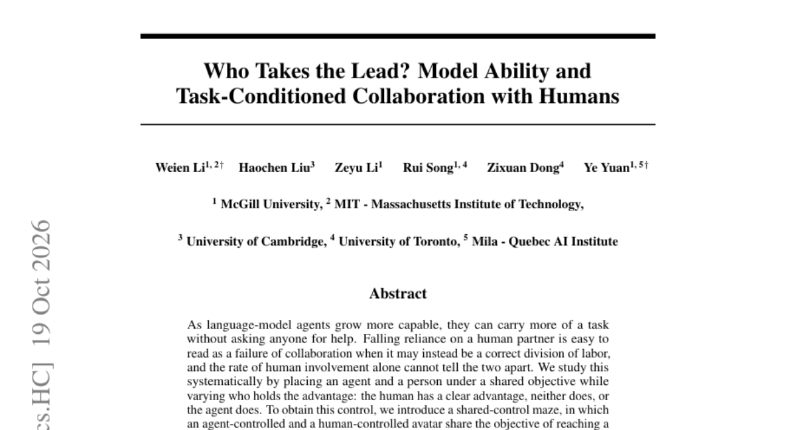

### 📌 한 줄 요약
에이전트의 능력이 향상됨에 따라 효율적인 협업을 위해 인간의 개입 시점을 전략적으로 결정하는 메커니즘을 분석함

### 🔑 핵심 포인트
- 에이전트의 단독 수행 능력이 높을수록 상황(우위 조건)에 따른 선택적 협업 전략을 구사함
- 인간의 개입 빈도만으로는 효율적인 분업과 협업 실패를 구분할 수 없음을 입증
- 에이전트의 능력과 인간의 경로 우위 사이의 상관관계를 정밀하게 제어하는 실험 환경 구축

### 🧑‍💻 개발자 관점
에이전트 설계 시 무조건적인 인간 개입이 아닌, 작업의 효율성을 극대화할 수 있는 '상황 인지형 협업 로직'의 중요성을 시사합니다.

### 🚀 실무 적용 아이디어
- 에이전트의 성능 수준에 따른 인간 개입 빈도 변화 측정 실험
- 작업 난이도와 인간의 우위 조건에 따른 에이전트의 의사결정 최적화 모델링
- 에이전트가 스스로 '언제 도움을 요청할지' 결정하는 정책(Policy) 학습 실험

### ⚠️ 리스크/한계
- 실험 환경(미로)이 실제 복잡한 현실 세계의 협업을 완벽히 대변하기 어려움
- 에이전트의 성능 향상이 반드시 인간과의 최적 분업으로 직결되지 않을 수 있음

### 📝 초록 기반 상세 설명
언어 모델 에이전트의 능력이 커지면서 인간과의 협업 방식이 단순한 의존을 넘어 효율적인 역할 분담의 문제로 진화하고 있습니다. 기존에는 인간의 개입 빈도만으로 협업의 성공 여부를 판단했으나, 이는 효율적인 분업과 협업 실패를 구분하기 어렵다는 문제가 있습니다. 본 연구는 에이전트와 인간이 공동 목표를 가진 '공유 제어 미로(shared-control maze)' 환경을 도입하여, 누가 우위를 점하느냐에 따른 협업 양상을 체계적으로 연구했습니다. 실험 결과, 단독 수행 능력이 뛰어난 모델일수록 상황에 따라 인간의 개입을 선택적으로 요청하는 전략적 행동을 보였습니다. 반면 성능이 낮은 모델은 상황에 관계없이 일관되지 않은 개입 패턴을 보였습니다.

---

## 42. [MambaAct: Efficient Mamba Action Experts for Flow-Matching Vision-Language-Action Models](https://huggingface.co/papers/2610.22951)
**Upvotes**: 8 | **도입 난이도**: 중 | **신뢰도**: 상
**arXiv**: https://arxiv.org/abs/2610.22951

**태그**: Robotics, Mamba, VLA, Efficiency, Flow-Matching, Vision, Benchmark, Evaluation, Inference

### 📌 한 줄 요약
Mamba 구조를 활용하여 Flow-matching 기반 VLA 모델의 추론 속도를 획기적으로 개선한 효율적인 액션 전문가 모델

### 🔑 핵심 포인트
- Transformer 기반 액션 전문가를 경량화된 Mamba 구조로 교체하여 추론 효율성 극대화
- Context Compressor를 통해 VLM 프리픽스 정보를 압축하여 반복적인 크로스 어텐션 비용 제거
- Flow-matching 과정에서의 반복적 연산 병목 현상을 해결하여 실시간 제어 성능 확보

### 🧑‍💻 개발자 관점
로봇 제어와 같이 실시간성이 중요한 환경에서 대규모 VLA 모델을 배포할 때, 연산 비용을 줄이면서 성능을 유지하는 실질적인 방법론을 제시합니다.

### 🚀 실무 적용 아이디어
- 기존 Transformer 기반 VLA 모델의 액션 헤드와 Mamba 구조의 성능/속도 트레이드오프 비교 실험
- 다양한 시각-언어 프리픽스 길이에 따른 Context Compressor의 압축 효율성 검증
- 실제 로봇 하드웨어 환경에서의 End-to-end 지연 시간(Latency) 측정

### ⚠️ 리스크/한계
- Mamba 구조가 Transformer만큼의 복잡한 장기 의존성을 완벽히 대체할 수 있는지에 대한 검증 필요
- 압축된 컨디셔닝 신호가 복잡한 작업 환경에서 정보 손실을 유발할 가능성

### 📝 초록 기반 상세 설명
로봇 조작을 위한 Vision-Language-Action(VLA) 모델은 강력한 성능을 보이지만, 반복적인 디노이징 과정이 필요한 Flow-matching 방식에서는 추론 비용이 매우 높다는 문제가 있습니다. 본 논문은 기존 Transformer 기반 액션 전문가를 효율적인 Mamba 기반 구조로 교체한 MambaAct를 제안합니다. MambaAct는 VLM의 시각-언어 프리픽스 인코더를 유지하면서, Mamba를 액션 믹서로 사용하여 연속적인 액션 시퀀스 간의 의존성을 모델링합니다. 또한, 반복적인 크로스 어텐션 없이도 컨디셔닝을 유지하기 위해 가벼운 Context Compressor를 도입하여 VLM 토큰을 압축된 신호로 변환합니다. 실험 결과, MambaAct는 액션 전문가 크기를 10배 줄이면서도 LIBERO 및 실세계 환경에서 디노이징 지연 시간을 대폭 단축하고 성공률을 유지하거나 향상시켰습니다.

### 🖼️ 추가 자료

---

## 43. [SplatLab: Autonomous Scientific Discovery for 3DGS Research](https://huggingface.co/papers/2610.30468)
**Upvotes**: 8 | **도입 난이도**: 상 | **신뢰도**: 상
**arXiv**: https://arxiv.org/abs/2610.30468

**태그**: AI Agent, 3DGS, Autonomous Research, Computer Vision, Vision

### 📌 한 줄 요약
3D Gaussian Splatting 연구의 재현부터 가설 설정, 실험, 논문 작성까지 전 과정을 자동화하는 자율 연구 시스템

### 🔑 핵심 포인트
- 재현-가설-실험-논문 작성을 아우르는 엔드투엔드 자율 연구 파이프라인 구축
- Elo 점수 기반의 토너먼트와 실패 기반의 falsifier를 결합한 후보 모델 선택 메커니즘
- 모든 수치를 로그된 학습 실행과 결합하여 데이터 신뢰성 및 추적성 확보

### 🧑‍💻 개발자 관점
연구 개발(R&D) 사이클을 자동화하여 엔지니어가 단순 재현 작업에서 벗어나 고차원적인 문제 해결에 집중할 수 있는 가능성을 제시합니다.

### 🚀 실무 적용 아이디어
- 제공된 코드와 실험 원장을 분석하여 자동화된 실험 관리 워크플로우 파악
- 특정 도메인(예: 의료 영상)의 3D 데이터셋을 활용한 SplatLab의 확장성 테스트
- 에이전트가 생성한 코드와 하이퍼파라미터의 유효성 검증 프로세스 연구

### ⚠️ 리스크/한계
- 에이전트가 생성한 결과물의 물리적/수학적 타당성에 대한 인간의 검증 필요성 잔존
- 특정 도메인(3DGS)에 특화된 구조로 인해 다른 컴퓨터 비전 분야로의 일반화 한계 가능성

### 📝 초록 기반 상세 설명
기존의 3DGS 연구는 논문 재현에만 수주가 소요되어 새로운 아이디어 제안이 어렵고, 기존 자율 연구 시스템은 실행력과 추적성이 부족했습니다. SplatLab은 3상태(재현, 확장, 검증)를 아우르는 자율 연구 프레임워크를 제안합니다. 검증된 백본을 기반으로 플러그인을 변이시키고, Elo 토너먼트 방식과 스트레스 테스트를 결합하여 최적의 후보를 선별합니다. 모든 실험 결과는 로그된 학습 실행과 직접 연결되어 데이터의 신뢰성을 확보합니다. 실험 결과, SplatLab은 기존 타겟 논문의 성능을 상회하는 성과를 거두었으며 연구 주기를 수개월에서 수일로 단축했습니다.

### 🖼️ 추가 자료

---

## 44. [TARSphere: A Robot-Oriented Full-Stack Framework for Long-Horizon Embodied Agents in Evolving Physical and Social Environments](https://huggingface.co/papers/2610.30043)
**Upvotes**: 7 | **도입 난이도**: 상 | **신뢰도**: 상
**arXiv**: https://arxiv.org/abs/2610.30043

**태그**: Embodied AI, LLM, Robotics, Simulation, Agent, Multimodal, Evaluation, Safety

### 📌 한 줄 요약
물리적 제약과 사회적 상호작용이 공존하는 환경에서 장기 과업 수행 능력을 평가하고 학습하기 위한 로봇 중심 풀스택 프레임워크 제안

### 🔑 핵심 포인트
- 물리적 시뮬레이션과 사회적 NPC 상호작용이 결합된 로봇 중심 풀스택 프레임워크(TARSphere) 개발
- Frozen MLLM을 활용하여 계층적 메모리와 실행 피드백을 통해 의사결정을 수정하는 에이전트 구조 설계
- Perceptual robustness 및 Human coordination 등 복합적 능력을 평가하기 위한 360개 에피소드 규모의 벤치마크 구축

### 🧑‍💻 개발자 관점
단순한 목표 달성을 넘어, 인간과의 협업 및 동적인 환경 변화가 포함된 실질적인 로봇 에이전트 운영 환경을 구축하는 데 중요한 가이드라인을 제공합니다.

### 🚀 실무 적용 아이디어
- 제안된 FSM 기반의 이벤트 처리 로직을 기존 MLLM 에이전트 워크플로우에 이식해보기
- 물리적 충돌 및 낙하 상황을 포함한 시나리오에서 에이전트의 복구(Recovery) 능력 테스트하기
- LLM의 의사결정 루프에 계층적 메모리 구조를 적용하여 장기 과업 수행력 비교하기

### ⚠️ 리스크/한계
- 물리적 충돌 및 낙하와 같은 실행 안전성(Execution Safety) 문제가 과업 성공률과 별개로 발생할 수 있음
- 인간과의 복잡한 상호작용 및 실시간 과업 업데이트 상황에서의 에이전트 대응 능력 부족

### 📝 초록 기반 상세 설명
기존의 Embodied Agent 시스템은 특정 목표 달성이나 추상적 기호 실행에 집중하여, 변화하는 물리적/사회적 환경에서의 평가에 한계가 있었습니다. 이를 해결하기 위해 물리 시뮬레이터와 NPC, 대화 제약이 포함된 TARSphere-Infra와 MLLM 기반의 계층적 실행 구조인 TARSphere-Harness를 제안합니다. 제안된 프레임워크는 이벤트 기반 FSM을 통해 과업 상태를 업데이트하며, MLLM이 관찰과 피드백을 바탕으로 의사결정을 수정할 수 있도록 설계되었습니다. 이를 바탕으로 구축된 TARSphere-Bench를 통해 8종의 MLLM을 평가한 결과, 범용 모델이 특정 임베디드 모델보다 우수할 수 있음을 확인했습니다. 다만, 인간과의 상호작용 및 과업 업데이트, 물리적 충돌 문제는 여전히 해결해야 할 과제로 남았습니다.

### 🖼️ 추가 자료

---

## 45. [Bridging Exploration and Persona: Information-Directed Dueling for Test-Time Agent Personalization](https://huggingface.co/papers/2610.24385)
**Upvotes**: 7 | **도입 난이도**: 중 | **신뢰도**: 상
**arXiv**: https://arxiv.org/abs/2610.24385

**태그**: LLM-Agent, Personalization, Reinforcement Learning, User Preference, Agent, Benchmark, Evaluation

### 📌 한 줄 요약
적은 상호작용만으로 사용자의 선호 페르소나를 빠르게 찾아내는 효율적인 에이전트 개인화 프레임워크 제안

### 🔑 핵심 포인트
- ID-TAP: 대규모 페르소나 공간을 위한 효율적인 듀얼링 밴딧(Dueling-bandit) 프레임워크 개발
- 신경 모델과 Bradley-Terry 모델의 결합을 통한 탐색과 활용(Exploration-Exploitation) 최적화
- 유사도 가중 웜스타트(Similarity-weighted warm starts)를 통한 쿼리 간 증거 전이 및 효율적 학습

### 🧑‍💻 개발자 관점
사용자의 피드백(A/B 테스트 형태)이 적은 상황에서도 에이전트의 말투나 성격을 빠르게 최적화할 수 있는 실용적인 방법론을 제공합니다.

### 🚀 실무 적용 아이디어
- 제한된 피드백 예산(예: 5~10회) 환경에서 페르소나 선택 성능 테스트
- 유사한 쿼리 그룹 간의 지식 전이(Warm-start) 효율성 검증
- LLM 기반의 선호도 시뮬레이터를 활용한 에이전트 개인화 파이프라인 구축

### ⚠️ 리스크/한계
- 사용자 피드백이 극도로 적거나 일관성이 없을 경우 모델의 수렴 속도 저하 가능성
- 페르소나 후보군(Persona space)의 정의와 품질에 따른 성능 의존성

### 📝 초록 기반 상세 설명
LLM 에이전트가 적은 상호작용을 통해 사용자의 쿼리별 선호도를 파악하는 테스트 타임 개인화가 중요해지고 있습니다. 기존 방식은 거대한 페르소나 후보군 중에서 최적을 선택하는 데 어려움이 있습니다. 본 논문은 IDS(Information-Directed Sampling)에서 영감을 받은 ID-TAP 프레임워크를 제안합니다. 이 방식은 쿼리 조건부 신경 유틸리티 모델과 경량 Bradley-Terry 탐색기를 결합하여 대규모 페르소나 공간에서 효율적인 선택을 수행합니다. 실험 결과, 제한된 10회 비교 예산 내에서 기존 베이스라인 대비 가장 강력한 성능을 달성했습니다.

---

## 46. [IF-MAP: Influence-Function-Inspired Agent Prioritization in Multi-Agent Systems](https://huggingface.co/papers/2610.24383)
**Upvotes**: 7 | **도입 난이도**: 하 | **신뢰도**: 상
**arXiv**: https://arxiv.org/abs/2610.24383

**태그**: Multi-Agent, LLM, Optimization, Efficiency, Agent, RAG, Reasoning, Evaluation

### 📌 한 줄 요약
제한된 자원으로 멀티 에이전트 시스템의 성능을 극대화하기 위해, 개선 시 시스템 전체 이득이 가장 클 에이전트를 식별하는 우선순위 결정 방법론

### 🔑 핵심 포인트
- 영향력 함수 개념을 활용하여 시스템 전체 이득을 극대화할 에이전트 우선순위 식별
- 모델 파라미터나 그래디언트 없이 프롬프트 섭동과 임베딩 공간 모델링을 사용하는 블랙박스 방식
- 프롬프트 최적화 및 모델 업그레이드 시 자원 효율성을 극대화하는 전략 제공

### 🧑‍💻 개발자 관점
에이전트 수가 늘어날수록 발생하는 막대한 최적화 비용을 줄이기 위해, 어떤 에이전트의 프롬프트를 고치거나 모델을 교체해야 할지 결정하는 가이드라인을 제공합니다.

### 🚀 실무 적용 아이디어
- 현재 운영 중인 멀티 에이전트 워크플로우에 IF-MAP 로직을 적용하여 에이전트별 기여도 측정
- 식별된 상위 우선순위 에이전트들을 대상으로 프롬프트 엔지니어링 및 모델 업그레이드 수행
- 전체 에이전트 최적화 대비 비용 대비 성능(ROI) 비교 실험

### ⚠️ 리스크/한계
- 우선순위 산출을 위한 프롬프트 섭동(Probing) 과정에서 발생하는 오버헤드 비용
- 특정 워크플로우에 특화된 우선순위가 다른 도메인에서도 동일하게 유지될지에 대한 일반성 검증 필요

### 📝 초록 기반 상세 설명
LLM 기반 멀티 에이전트 시스템에서 모든 에이전트를 개선하는 것은 비용이 매우 많이 드는 작업입니다. 기존의 실패 원인 분석 방식은 에이전트의 책임은 알려주지만, 해당 에이전트를 개선했을 때 얻을 수 있는 시스템 전체의 성능 향상 폭을 직접적으로 보여주지는 못합니다. 이를 해결하기 위해 본 논문은 영향력 함수(Influence Function) 개념에서 영감을 얻은 IF-MAP 방식을 제안합니다. IF-MAP는 모델 파라미터나 그래디언트 접근 없이도 프롬프트 섭동을 통해 에이전트별 잠재적 성능 향상 폭을 측정하는 블랙박스 방식입니다. 실험 결과, IF-MAP를 통해 선택된 에이전트의 프롬프트 최적화 및 모델 업그레이드는 무작위 선택 방식보다 훨씬 높은 성능 향상과 비용 절감 효과를 입증했습니다.

---

## 47. [Realism VS Accuracy: Event Sequence Forecasting from a Generative Modeling Perspective](https://huggingface.co/papers/2610.12586)
**Upvotes**: 7 | **도입 난이도**: 중 | **신뢰도**: 상
**arXiv**: https://arxiv.org/abs/2610.12586

**태그**: Generative Modeling, Time-Series, Event Forecasting, Diffusion Models, Benchmark, Evaluation

### 📌 한 줄 요약
이벤트 시퀀스 예측에서 정확도와 분포적 현실감 사이의 트레이드오프를 규명하고, 이를 해결하는 새로운 알고리즘을 제안합니다.

### 🔑 핵심 포인트
- 이벤트 시퀀스 예측에서 정확도(Accuracy)와 현실감(Realism) 사이의 근본적인 트레이드오프 발견
- 두 지표를 동시에 평가할 수 있는 포괄적인 벤치마크 및 데이터셋 구축
- 현실감이 뛰어난 생성 모델의 샘플을 활용해 예측 성능을 높이는 Wasserstein BaryBooster 제안

### 🧑‍💻 개발자 관점
시계열/이벤트 데이터 예측 시 단순히 오차를 줄이는 것을 넘어, 실제 발생 가능한 분포를 유지하면서도 정확도를 확보하는 전략적 방법론을 제공합니다.

### 🚀 실무 적용 아이디어
- 제공된 벤치마크를 활용하여 현재 사용 중인 예측 모델의 현실감/정확도 균형 측정
- Diffusion 기반 생성 모델을 기존 예측 모델의 성능 향상 도구로 결합하는 실험 수행
- 도메인 특화 데이터셋(금융, 로그 등)에 Wasserstein BaryBooster 적용 테스트

### ⚠️ 리스크/한계
- 현실감과 정확도 사이의 트레이드오프가 특정 도메인에서 더 극단적일 수 있음
- 생성 모델 기반의 샘플링 방식이므로 계산 복잡도가 증가할 수 있음

### 📝 초록 기반 상세 설명
금융, 의료 등 다양한 분야에서 발생하는 이종 데이터 기반의 이벤트 시퀀스 예측은 중요한 과제입니다. 본 연구는 멀티 호라이즌 예측을 조건부 생성 모델링 문제로 정의하고, 예측 정확도와 분포적 현실감(Realism)을 동시에 평가합니다. 이를 위해 두 측면을 모두 검증할 수 있는 벤치마크와 데이터셋을 구축하였습니다. 실험 결과, 정확도와 현실감 사이에는 상충 관계(Trade-off)가 존재함을 확인했습니다. 마지막으로 현실감이 강한 확산 모델의 샘플을 결합하여 예측 정확도를 높이는 Wasserstein BaryBooster 알고리즘을 제안합니다.

### 🖼️ 추가 자료

---

## 48. [SEAM: Spectral Embedding Alignment and Merging for Low-Resource TTS](https://huggingface.co/papers/2610.26252)
**Upvotes**: 7 | **도입 난이도**: 하 | **신뢰도**: 상
**arXiv**: https://arxiv.org/abs/2610.26252

**태그**: TTS, Low-Resource, Embedding, Speech Synthesis, Audio, Safety

### 📌 한 줄 요약
데이터가 부족한 환경에서 새로운 음성 토큰을 효율적으로 추가하기 위한 제로 오디오 초기화 및 정렬 기법

### 🔑 핵심 포인트
- 제로 오디오 초기화: 추가 오디오 데이터 없이 서브토큰 조합으로 새로운 토큰 임베딩 생성
- 스펙트럴 필터링: 시계열적 음성 구조를 보존하기 위한 필터 적용
- 매니폴드 정렬: 폐형 리지 회귀를 통해 새로운 임베딩을 기존 사전 학습 공간에 정렬

### 🧑‍💻 개발자 관점
학습 데이터가 부족한 신규 언어나 특수 문자를 추가할 때, 대규모 미세 조정 없이도 효율적인 어휘 확장이 가능합니다.

### 🚀 실무 적용 아이디어
- 기존 TTS 모델의 임베딩 레이어에 SEAM 방식의 초기화 적용 테스트
- 서브토큰 분할 전략(BPE 등)에 따른 성능 변화 관찰
- 저자원 환경에서의 데이터 절감 효과 검증

### ⚠️ 리스크/한계
- 서브토큰 조합이 복잡할 경우 생성된 임베딩의 품질 저하 가능성
- 기존 모델의 매니폴드 구조에 대한 의존성

### 📝 초록 기반 상세 설명
기존의 조건부 TTS 모델은 어휘 확장을 위해 대량의 쌍을 이룬 오디오 데이터와 미세 조정이 필요하여 저자원 환경에서 병목 현상이 발생합니다. 이를 해결하기 위해 본 논문은 SEAM이라는 제로 오디오 초기화 방법을 제안합니다. SEAM은 알려진 서브토큰으로부터 미지의 토큰 임베딩을 구성하며, 시계열적 음성 순서를 보존하는 스펙트럴 필터와 사전 학습된 매니폴드에 정렬하는 폐형 리지 회귀(closed-form ridge regression)를 사용합니다. 실험 결과, SEAM은 기존 방식 대비 최대 75% 적은 데이터로도 베이스라인에 근접하거나 일치하는 성능을 보였습니다. 이 방식은 저자원 음성 합성 분야에서 가볍고 재현 가능한 어휘 확장 솔루션을 제공합니다.

---

## 49. [Skeleton-Grounded Latent Action Model for Robot World Models](https://huggingface.co/papers/2610.31474)
**Upvotes**: 7 | **도입 난이도**: 중 | **신뢰도**: 상
**arXiv**: https://arxiv.org/abs/2610.31474

**태그**: Robot Learning, World Models, Computer Vision, Kinematics, RAG, Vision, Video, Evaluation, Inference

### 📌 한 줄 요약
로봇 골격 정보를 활용해 제어 가능한 동작과 환경 변화를 분리함으로써 정교한 로봇 월드 모델을 구축하는 기술

### 🔑 핵심 포인트
- 골격 기반의 운동학적 성분과 잔여 시각 역학 성분의 분리 학습
- 교차 모달 스왑(Cross-modal swap)을 통한 제어 가능성 확보
- 로봇 액션을 골격 기반 잠재 공간으로 매핑하는 경량 어댑터 구조

### 🧑‍💻 개발자 관점
로봇 제어 신호와 환경 변화를 분리함으로써, 시뮬레이션된 영상이 실제 로봇의 물리적 움직임과 더 잘 일치하도록 만들 수 있습니다.

### 🚀 실무 적용 아이디어
- 로봇 골격 데이터(Skeleton)와 RGB 데이터 간의 정렬 성능 비교 실험
- 제어 신호(Action)가 주어졌을 때 환경 변화(Object response)가 독립적으로 발생하는지 검증
- 학습된 모델을 활용한 제로샷 동작 전송(Human-to-Robot) 테스트

### ⚠️ 리스크/한계
- 골격 정보(Skeleton)에 대한 의존도가 높을 경우, 센서 노이즈에 취약할 수 있음
- 복잡한 물체 조작 시 잔여 성분이 운동학적 성분을 압도할 가능성

### 📝 초록 기반 상세 설명
로봇 월드 모델은 로봇의 행동에 따른 환경 변화를 시뮬레이션하는 데 사용됩니다. 기존의 잠재 액션 모델은 비디오를 통해 동작을 학습하지만, 로봇의 움직임과 환경 변화가 뒤섞여 제어와의 대응 관계를 파악하기 어렵다는 문제가 있습니다. 이를 해결하기 위해 제안된 SkeLAM은 골격 정보를 기반으로 한 운동학적 성분과 잔여 시각 역학 성분으로 잠재 액션을 분해합니다. 교차 모달 스왑 재구성을 통해 골격과 RGB 정보 간의 상호 교환성을 확보하고, 가벼운 어댑터를 통해 로봇 액션을 운동학적 공간으로 매핑합니다. 실험 결과, DROID 데이터셋에서 기존 모델 대비 높은 정확도와 시각적 품질을 달셨으며, 제로샷 인간-로봇 동작 전송 성능을 입증했습니다.

---

