# 2026-10-27 Daily Papers (Top 40)

## 오늘의 요약
오늘의 연구는 에이전트의 계획과 제어를 통합하는 Embodied AI와 물리적 법칙을 반영하는 월드 모델링 연구가 주를 이루었습니다. 또한, 에이전트의 성능을 정밀하게 검증하기 위한 벤치마크 프레임워크와 모델 압축 및 환각 억제와 같은 실무적 최적화 기법들이 중요하게 다뤄졌습니다.

### 오늘의 핵심 포인트
- 물리적 이해, 고수준 계획, 저수준 제어를 하나의 모델로 연결하는 통합형 Embodied AI 프레임워크가 주목받았습니다.
- 에이전트의 행동과 환경의 상태 변화를 분리하여 정밀하게 측정하는 등 모델 간 상호작용을 검증하는 새로운 평가 방법론이 제시되었습니다.
- 학습 없이 잠재 표현을 조정하거나 가중치를 트리 구조로 표현하는 등 효율적인 모델 최적화 및 신뢰도 향상 기법들이 발표되었습니다.

**오늘의 태그**: Embodied AI, AI Agent, World Models, Model Optimization

## 1. [Reading, Writing, Sharing, and Interacting with the World through Video](https://huggingface.co/papers/2610.31668)
**Upvotes**: 211 | **도입 난이도**: 하 | **신뢰도**: 상
**arXiv**: https://arxiv.org/abs/2610.31668
**재등장**: 최근 7일 내 재등장 (마지막 등장 1일 전)

**태그**: Video-Generation, World-Models, Survey, Embodied-AI, Video, Benchmark, Evaluation, Distillation

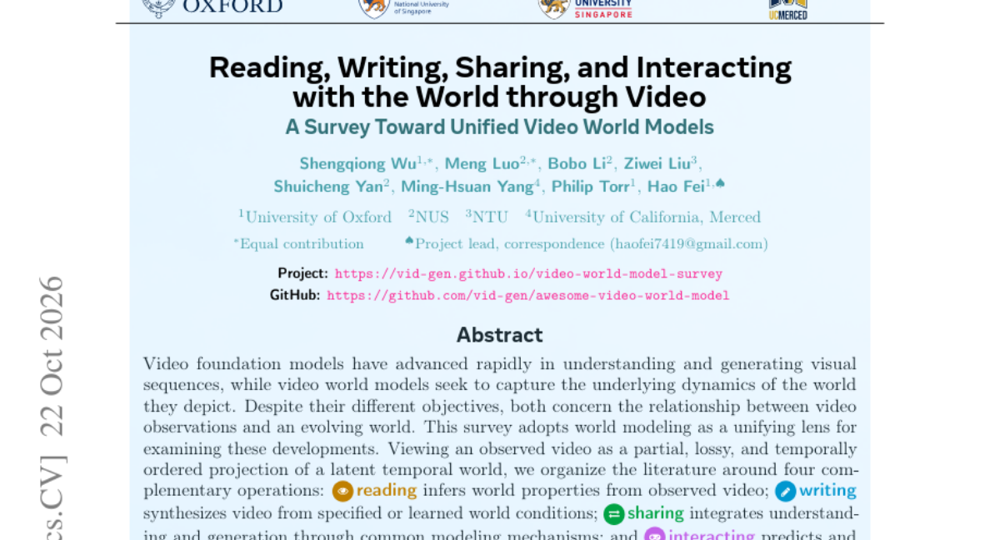

### 📌 한 줄 요약
비디오 파운데이션 모델과 월드 모델을 '세계 모델링'이라는 통합 관점에서 재정의하고 분석한 서베이 논문

### 🔑 핵심 포인트
- 월드 모델링을 통한 비디오 이해(Reading)와 생성(Writing)의 통합적 프레임워크 제안
- 관찰된 시퀀스의 일관성과 잠재적 세계 상태의 일관성을 구분하는 새로운 관점 제시
- 단순 지각을 넘어 상호작용과 인과적 타당성을 중시하는 연구 흐름 분석

### 🧑‍💻 개발자 관점
비디오 생성 및 에이전트 학습 시 단순한 픽셀 재현을 넘어 물리 법칙과 인과 관계를 고려한 모델 설계의 방향성을 제시합니다.

### 🚀 실무 적용 아이디어
- 제시된 4가지 작업(Reading, Writing, Sharing, Interacting) 프레임워크를 현재 개발 중인 비디오 모델에 적용해보기
- 단순 시각적 품질(Fidelity) 외에 물리적 일관성(Physical Validity)을 측정할 수 있는 벤치마크 검토하기

### ⚠️ 리스크/한계
- 이론적 프레임워크 중심이므로 구체적인 구현 알고리즘을 바로 적용하기에는 추상적일 수 있음
- 물리적/인과적 타당성을 완벽히 검증할 수 있는 표준화된 벤치마크가 아직 부족함

### 📝 초록 기반 상세 설명
비디오 파운데이션 모델과 월드 모델은 서로 다른 목적을 가진 듯 보이지만, 관찰된 비디오와 진화하는 세계 사이의 관계를 다룬다는 공통점이 있습니다. 본 논문은 월드 모델링을 통합적인 렌즈로 채택하여 기존 연구들을 체계적으로 분류합니다. 관찰된 비디오를 잠재적 세계의 부분적 투영으로 간주하고, 이를 읽기(Reading), 쓰기(Writing), 공유(Sharing), 상호작용(Interacting)이라는 네 가지 상호 보완적 작업으로 구조화합니다. 이러한 관점은 단순한 시각적 일관성을 넘어 물리적/인과적 타당성을 갖춘 세계 상태의 일관성을 구분합니다. 결과적으로 기존의 클립 단위 인식을 넘어 지속적 상태와 제어 가능한 진화로 변화하는 연구 흐름을 제시합니다.

### 🖼️ 추가 자료
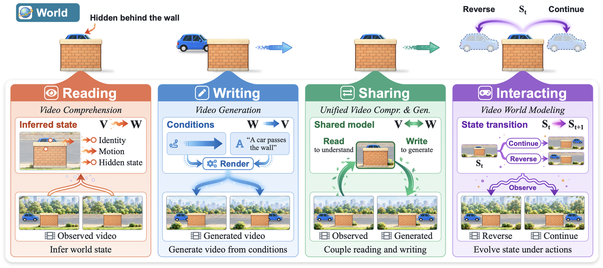
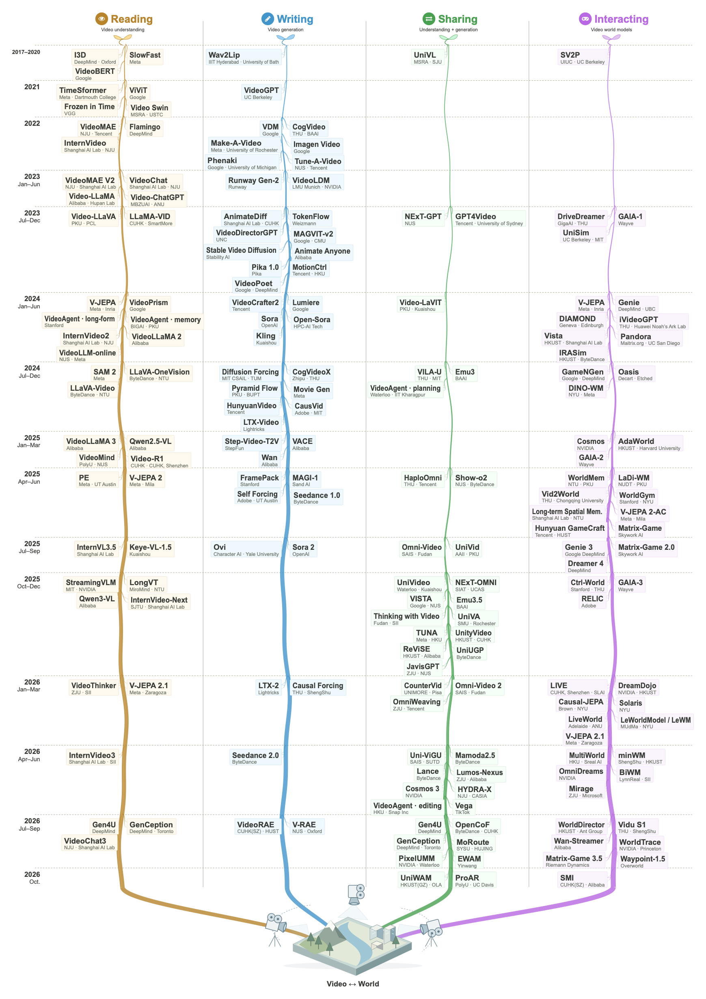
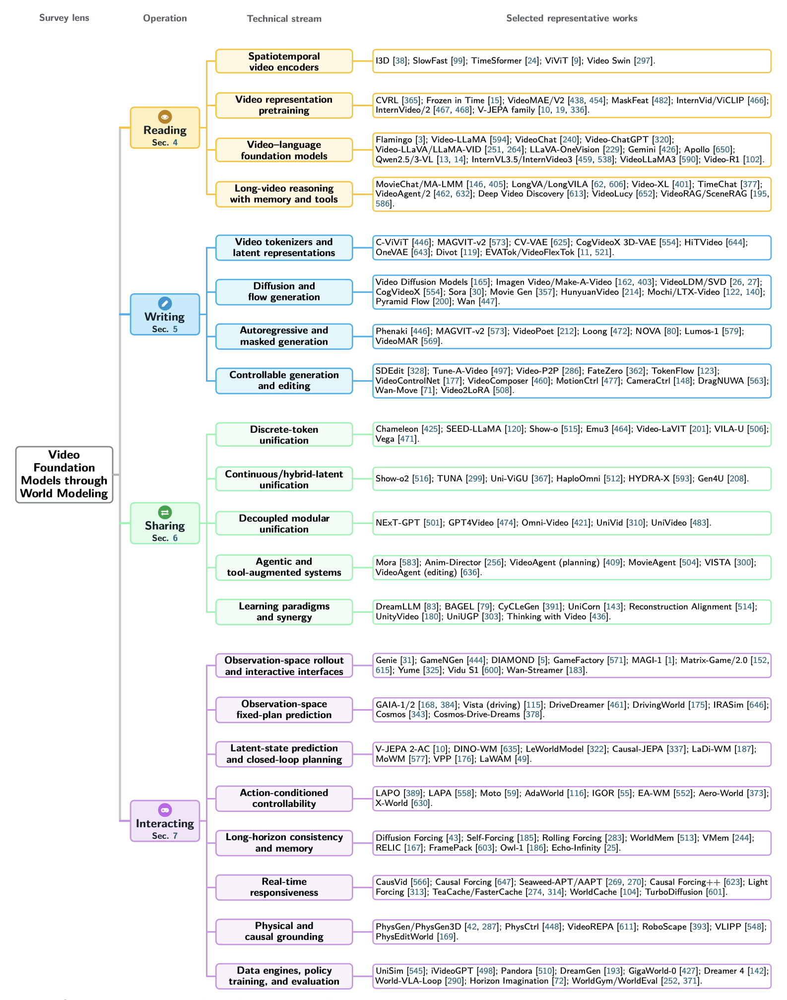
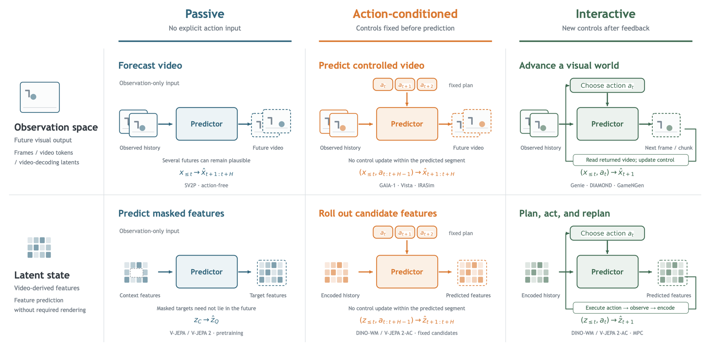

---

## 2. [UserArena: Benchmarking Interactive User Simulation for Long-Horizon Shopping Agents](https://huggingface.co/papers/2610.30932)
**Upvotes**: 47 | **도입 난이도**: 중 | **신뢰도**: 상
**arXiv**: https://arxiv.org/abs/2610.30932

**태그**: Agent, Recommendation, Simulation, E-commerce, Benchmark, Evaluation, Distillation

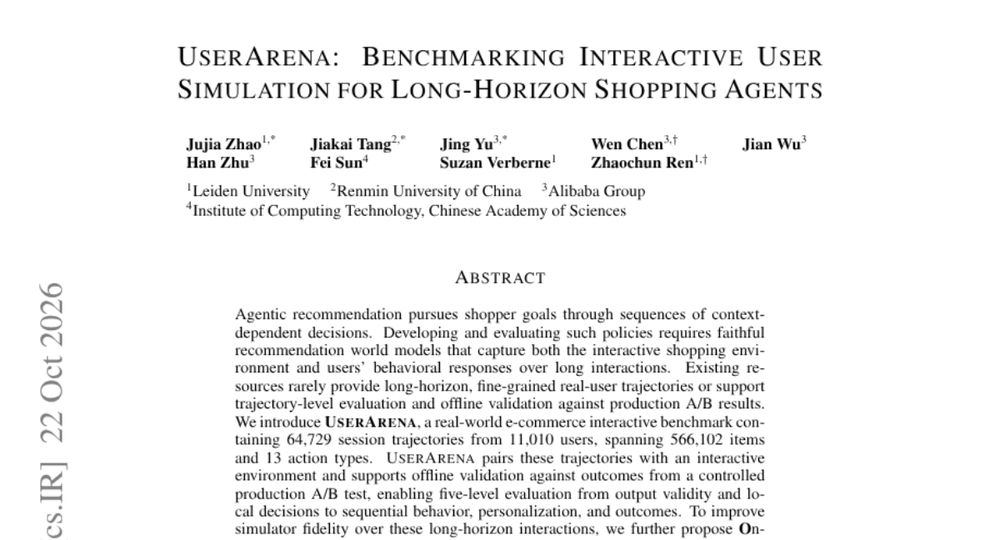

### 📌 한 줄 요약
장기적 쇼핑 에이전트 평가를 위해 실제 사용자 행동 데이터와 A/B 테스트 결과를 결합한 인터랙티브 벤치마크 및 시뮬레이터 최적화 기법 제안

### 🔑 핵심 포인트
- 실제 이커머스 데이터(64,729개 세션) 기반의 대규모 인터랙티브 벤치마크 UserArena 구축
- 출력 유효성부터 최종 결과까지 아우르는 5단계 다층 평가 프로토콜 제공
- 장기 상호작용 충실도 향상을 위한 On-Policy Trajectory Distillation(OPTD) 방법론 제안

### 🧑‍💻 개발자 관점
실제 서비스 배포 전, 시뮬레이션 환경에서 에이전트의 성능과 사용자 반응을 얼마나 정확하게 예측할 수 있는지에 대한 검증 프레임워크를 제공합니다.

### 🚀 실무 적용 아이디어
- 제공된 UserArena 데이터셋을 활용하여 기존 추천 에이전트의 성능 벤치마킹 수행
- OPTD 기법을 기존 시뮬레이터에 적용하여 시뮬레이션-실제 환경 간 격차(Sim-to-Real gap) 측정
- 다양한 에이전트 정책을 UserArena의 5단계 평가 체계에 대입하여 정밀 분석

### ⚠️ 리스크/한계
- 실제 프로덕션 데이터 기반이므로 데이터 보안 및 개인정보 보호 이슈가 발생할 수 있음
- 시뮬레이터의 충실도가 실제 사용자 행동의 모든 변수를 완벽히 포착하기에는 한계가 있음

### 📝 초록 기반 상세 설명
에이전트 기반 추천 시스템은 사용자의 목표를 달성하기 위해 복잡한 의사결정 과정을 거치지만, 기존 환경은 장기적인 상호작용과 실제 사용자 반응을 충분히 반영하지 못합니다. 이를 해결하기 위해 대규모 실제 이커머스 데이터를 기반으로 한 인터랙티브 벤치마크인 UserArena를 도입합니다. UserArena는 실제 프로덕션 A/B 테스트 결과와 연계된 다층적 평가 체계를 제공하여 시뮬레이터의 신뢰성을 검증합니다. 또한, 시뮬레이터의 충실도를 높이기 위해 의도 기반의 밀집 타겟을 제공하는 On-Policy Trajectory Distillation(OPTD) 기법을 제안합니다. 실험 결과, OPTD는 제안된 프로토콜 하에서 가장 높은 충실도를 보였으며 실제 프로덕션 정책의 효과를 가장 유사하게 재현했습니다.

---

## 3. [HiSTEVE 1.0: Harnessing Human-Interface VLA Agents for Open-World Games](https://huggingface.co/papers/2610.31162)
**Upvotes**: 38 | **도입 난이도**: 상 | **신뢰도**: 상
**arXiv**: https://arxiv.org/abs/2610.31162

**태그**: VLA, Embodied AI, Reinforcement Learning, Automation, Agent, RAG, Vision

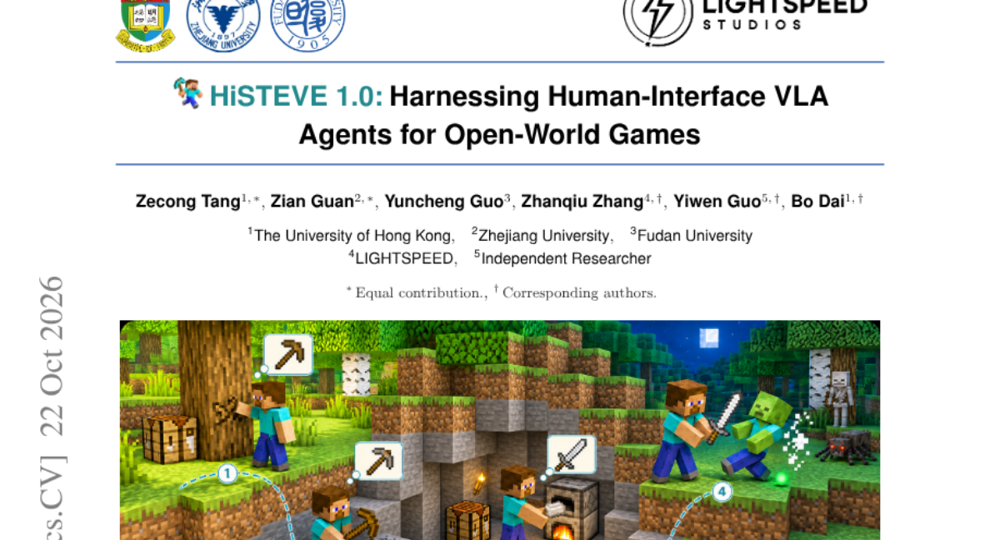

### 📌 한 줄 요약
계층적 VLA 구조를 통해 게임 내 고수준 계획과 저수준 인터페이스 제어를 통합한 오픈월드 에이전트 프레임워크

### 🔑 핵심 포인트
- 계층적 VLA 구조: VLM 기반의 상위 계획(Orchestration)과 VLA 기반의 하위 제어(Control) 분리
- 상태 감지 및 제어 통합: 정책 컨텍스트를 활용한 작업 완료 감지 및 시각 기반의 네이티브 인터페이스 제어
- 상호 간섭 방지 설계: GUI와 비-GUI 상호작용 간의 간섭을 줄이기 위한 Regime-specific RMSNorm 및 분리된 마우스 임베딩 도입

### 🧑‍💻 개발자 관점
API 의존적인 기존 에이전트와 달리, 시각 정보와 직접적인 UI 조작을 결합하여 복잡한 소프트웨어 환경에서의 자동화 가능성을 제시합니다.

### 🚀 실무 적용 아이디어
- VLA 모델의 시각-행동 정렬(Alignment) 성능 테스트
- 계층적 구조에서 상위 플래너와 하위 제어기 간의 통신 프로토콜 설계 실험
- 다양한 GUI 환경에서의 제어 정밀도 및 복구 능력 검증

### ⚠️ 리스크/한계
- 단일 VLA 모델에 의존하므로 복잡도가 증가할수록 연산 비용 및 추론 지연 발생 가능성
- 학습 데이터(Imitation/RL)의 품질에 따른 제어 정밀도 의존성

### 📝 초록 기반 상세 설명
오픈월드 게임에서 인간처럼 자율적이고 정교한 제어를 수행하는 에이전트 개발은 어려운 과제입니다. 기존 방식은 장기적 계획 능력과 직접적인 시각-운동 제어 사이의 간극이 존재했습니다. 이를 해결하기 위해 본 논문은 계층적 VLA 구조인 HiSTEを 제안하며, 구조화된 메모리와 VLM 플래너를 통해 상위 계획을 수립합니다. 제어 레벨에서는 단일 VLA가 시각 정보와 키보드/마우스 입력을 직접 처리하며, 상호 간섭을 방지하기 위한 특화된 정규화와 임베딩 구조를 도입했습니다. 실험 결과, MineStudio Bench와 OpenHA에서 SOTA 성능을 달성하며 복잡한 제작 과제를 성공적으로 수행했습니다.

---

## 4. [RSIHub: A Composable Framework for Agent-Evolution Methods](https://huggingface.co/papers/2610.32253)
**Upvotes**: 33 | **도입 난이도**: 중 | **신뢰도**: 상
**arXiv**: https://arxiv.org/abs/2610.32253

**태그**: AI Agent, LLM Optimization, Framework, Automation, Agent, RAG, Evaluation

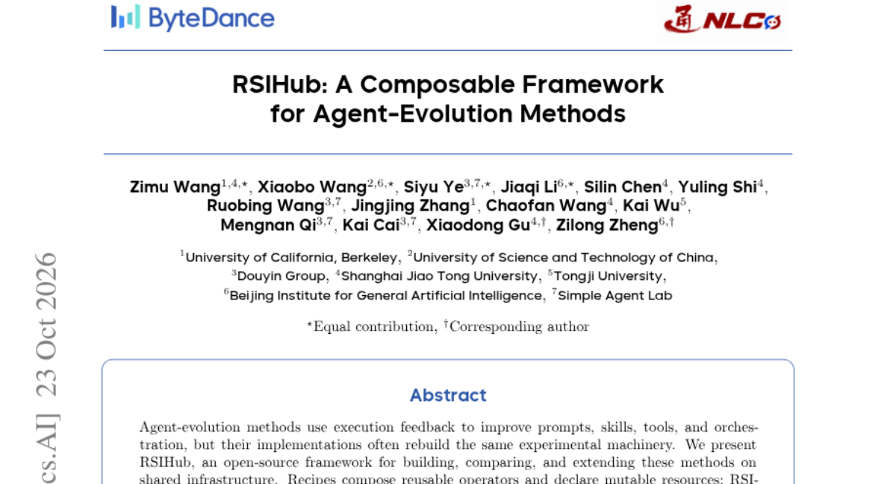

### 📌 한 줄 요약
에이전트 진화 방법론의 실험 인프라를 표준화하여 재사용성과 비교 가능성을 높인 오픈소스 프레임워크

### 🔑 핵심 포인트
- 실험 인프라 재구축 문제를 해결하는 모듈형(Composable) 프레임워크 제공
- 실행, 평가, 복구, 이력 관리를 분리하여 평가의 객관성과 재현성 확보
- 기존 에이전트 진화 알고리즘들을 수정 없이 통합 및 비교할 수 있는 프로토콜 구축

### 🧑‍💻 개발자 관점
에이전트 성능 개선 실험 시 인프라 구축에 드는 비용을 줄이고, 서로 다른 알고리즘 간의 공정한 성능 비교가 가능해집니다.

### 🚀 실무 적용 아이디어
- RSIHub 프레임워크를 사용하여 기존에 개발한 에이전트 로직을 레시피로 변환해보기
- 동일한 환경에서 서로 다른 에이전트 진화 정책(Policy) 간의 성능 비교 실험 수행
- 특정 태스크에서 얻은 최적화 결과가 다른 태스크로 전이되는지 검증하기

### ⚠️ 리스크/한계
- 특정 환경에서의 최적화 성과가 다른 태스크로 전이되지 않을 수 있음(Generalization 문제)
- 프레임워크 구조에 따라 특정 방법론의 커스텀 로직 구현에 제약이 있을 수 있음

### 📝 초록 기반 상세 설명
에이전트 진화 방법론은 실행 피드백을 통해 프롬프트와 기술을 개선하지만, 연구마다 실험 환경을 매번 새로 구축해야 하는 문제가 있습니다. 이를 해결하기 위해 재사용 가능한 연산자와 자원을 결합하는 프레임워크인 RSIHub를 제안합니다. RSIHub는 실행, 평가, 복구 및 이력 관리를 공통 인프라로 제공하여 연구자가 진화 정책 개발에만 집중할 수 있게 합니다. 기존의 다양한 에이전트 진화 방법론들을 프레임워크 수정 없이 레시피 형태로 구현하여 검증했습니다. 실험 결과, 특정 설정에서 최대 13.5%p의 pass@1 성능 향상을 확인했으나 최적화 성과가 모든 작업으로 전이되지는 않았습니다.

---

## 5. [RynnUnify: Towards Unified Embodied Brain](https://huggingface.co/papers/2610.32965)
**Upvotes**: 31 | **도입 난이도**: 상 | **신뢰도**: 상
**arXiv**: https://arxiv.org/abs/2610.32965

**태그**: Embodied AI, Robot Control, Video-Language, Reinforcement Learning, Agent, RAG, Reasoning, Multimodal, Video, Evaluation

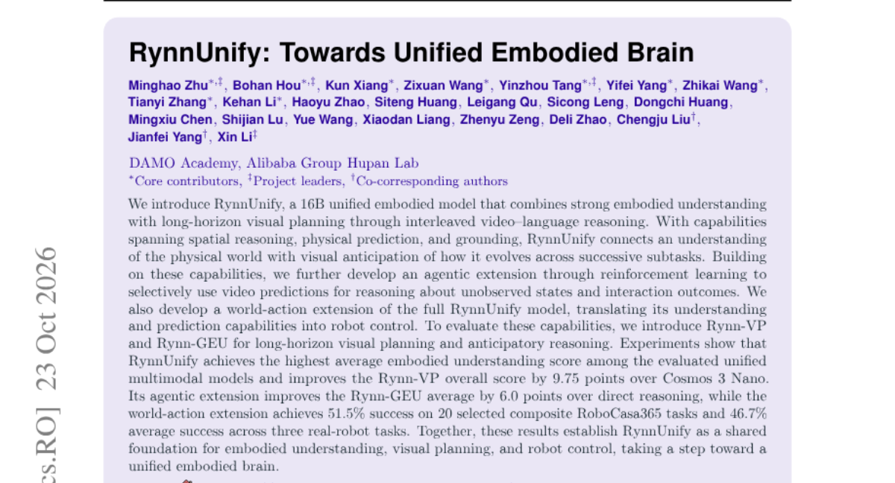

### 📌 한 줄 요약
물리적 이해, 시각적 계획, 로봇 제어를 하나의 모델로 통합한 16B 규모의 범용 Embodied AI 모델 연구

### 🔑 핵심 포인트
- 16B 규모의 비디오-언어 추론 기반 통합 Embod된 모델(RynnUnify) 개발
- RL을 통한 에이전트 확장 및 시각적 예측을 활용한 미관측 상태 추론 기능
- 이해/계획 능력을 실제 로봇 제어로 변환하는 World-Action 확장 구조 구축

### 🧑‍💻 개발자 관점
물리적 환경 이해부터 고수준 계획, 저수준 제어까지 하나의 모델로 연결하는 통합 프레임워크의 설계 패턴을 학습할 수 있습니다.

### 🚀 실무 적용 아이디어
- Rynn-VP 및 Rynn-GEU 벤치마크 데이터셋의 평가 방법론 분석
- 비디오 예측 모델을 에이전트의 추론 루프에 통합하는 방식 검토
- 로봇 제어(Action)로의 매핑을 위한 데이터셋 구성 방식 연구

### ⚠️ 리스크/한계
- 16B 모델의 높은 연산 비용으로 인한 실시간 로봇 제어 적용 시 지연 시간 문제
- 복잡한 물리적 상호작용에 대한 시뮬레이션과 실세계 간의 간극(Sim-to-Real) 가능성

### 📝 초록 기반 상세 설명
기존의 Embodied AI는 물리적 세계에 대한 이해와 장기적인 시각적 계획, 그리고 실제 로봇 제어 사이의 간극을 해결하는 데 어려움이 있었습니다. 본 논문은 16B 파라미터 규모의 통합 모델인 RynnUnify를 제안합니다. 이 모델은 비디오-언어 추론을 통해 물리적 세계의 이해와 미래 상태 예측을 결합하며, RL 기반의 에이전트 확장 및 로봇 제어를 위한 World-Action 확장을 포함합니다. 실험 결과, RynnUnify는 기존 모델 대비 우수한 시각적 계획 능력을 보여주었으며, RoboCasa365 및 실제 로봇 작업에서도 높은 성공률을 기록했습니다. 이를 통해 이해, 계획, 제어가 통합된 'Embodied Brain'의 가능성을 제시합니다.

---

## 6. [Omni-Woodpecker: Hallucination Correction via Evidence-Prior Rebalancing for Omni LLMs](https://huggingface.co/papers/2610.27103)
**Upvotes**: 21 | **도입 난이도**: 하 | **신뢰도**: 상
**arXiv**: https://arxiv.org/abs/2610.27103

**태그**: Multimodal, Hallucination, Zero-shot, Representation-Learning, Reasoning, Video, Audio, Benchmark

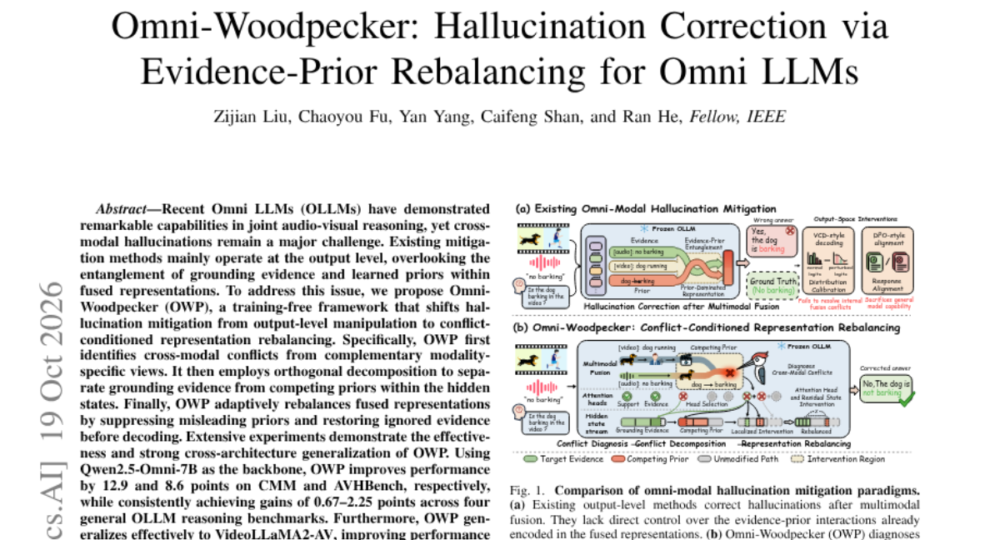

### 📌 한 줄 요약
학습 없이 잠재 표현(representation)의 충돌을 해결하여 멀티모달 모델의 환각을 억제하는 프레임워크

### 🔑 핵심 포인트
- 학습이 필요 없는(training-free) 표현 재균형 프레임워크 제안
- 직교 분해(orthogonal decomposition)를 통한 근거와 사전 지식의 분리
- 출력 단계가 아닌 잠재 표현 단계에서의 충돌 해결로 환각 억제

### 🧑‍💻 개발자 관점
모델 재학습 없이 기존 멀티모달 모델의 신뢰도를 높일 수 있어, 실무 환경에서 즉각적인 성능 개선이 가능합니다.

### 🚀 실무 적용 아이디어
- 제공된 코드를 활용하여 Qwen2.5-Omni 등 기존 모델에 적용해보기
- 특정 도메인(예: 보안 관제) 데이터셋에서 환각 억제 효과 검증하기
- 직교 분해 방식이 다양한 모달리티 조합에서도 안정적인지 테스트하기

### ⚠️ 리스크/한계
- 학습이 없는 방식이므로 모델의 근본적인 추론 능력 자체를 개선하는 데는 한계가 있을 수 있음
- 복잡한 표현 분해 과정이 추론 지연 시간(latency)에 미치는 영향 확인 필요

### 📝 초록 기반 상세 설명
최근 등장한 Omni LLM은 오디오-비주얼 통합 추론 능력이 뛰어나지만, 모달리티 간 충돌로 인한 환각 문제가 발생합니다. 기존 방식은 주로 출력 단계에서 수정을 시도하여, 융합된 표현 내에 얽혀 있는 근거(evidence)와 사전 학습된 지식(prior) 간의 관계를 간과합니다. 이를 해결하기 위해 제안된 Omni-Woodpecker(OWP)는 출력 수정 대신 표현 재균형(rebalancing) 방식을 사용합니다. OWP는 상호 보완적인 모달리티 뷰를 통해 충돌을 식별하고, 직교 분해를 통해 근거와 사전 지식을 분리합니다. 마지막으로 오도하는 사전 지식은 억제하고 무시된 근거는 복원하여 융합된 표현을 적응적으로 재조정합니다. 실험 결과, Qwen2.5-Omni-7B 및 VideoLLaMA2-AV 등 다양한 백본에서 환각 억제 성능과 일반화 성능이 크게 향상되었습니다.

### 🖼️ 추가 자료
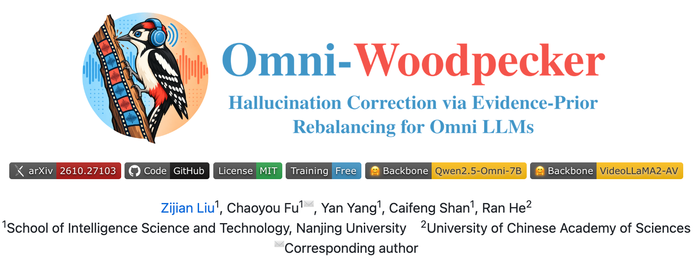
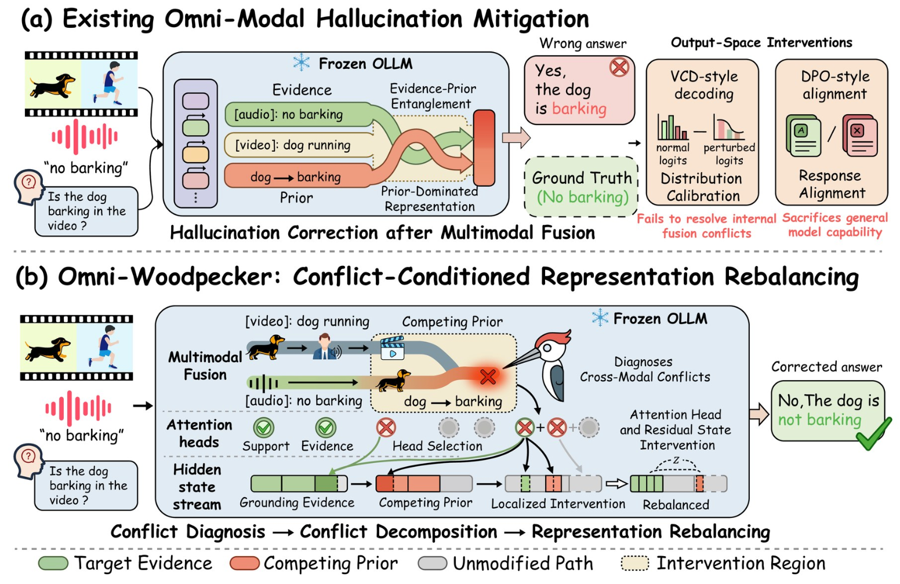
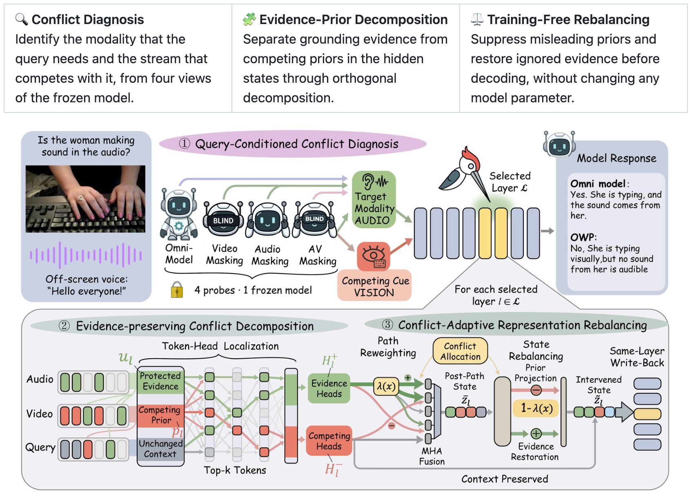
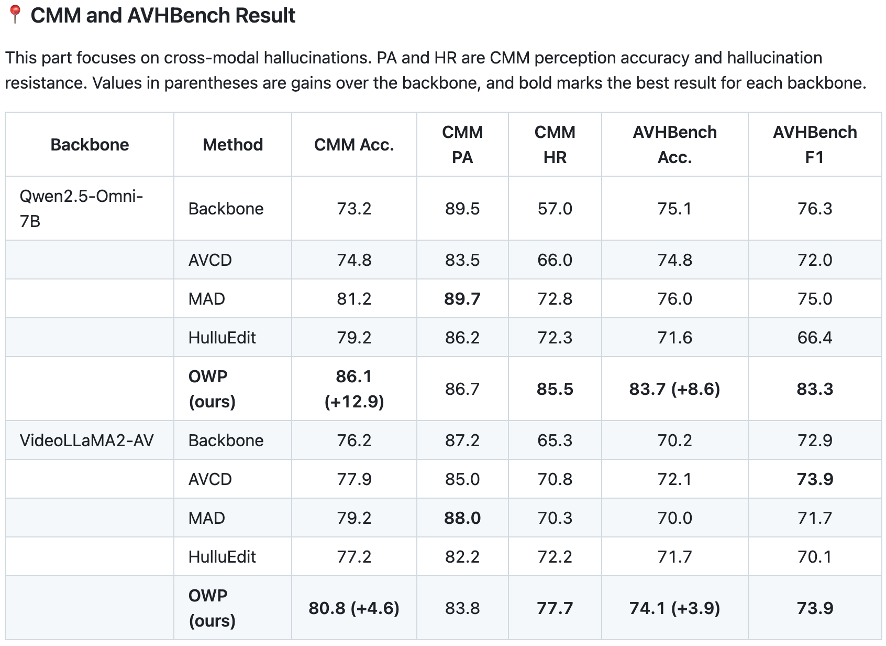

---

## 7. [Every Weight Is a Path of Shared Discrete Decisions](https://huggingface.co/papers/2610.31931)
**Upvotes**: 18 | **도입 난이도**: 상 | **신뢰도**: 상
**arXiv**: https://arxiv.org/abs/2610.31931

**태그**: Model Compression, Quantization, Hardware Acceleration, LLM, Optimization

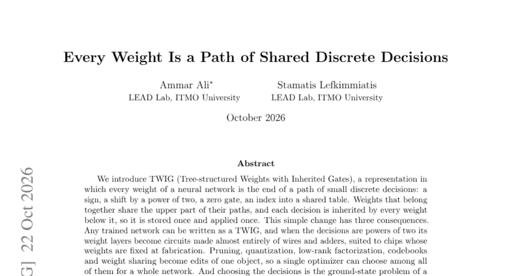

### 📌 한 줄 요약
가중치를 트리 구조의 이산적 결정 경로로 표현하여 압축, 양자화, 하드웨어 가속을 단일 최적화 문제로 통합하는 TWIG 프레임워크 제안

### 🔑 핵심 포인트
- 가중치를 트리 구조의 이산적 결정 경로(Sign, Shift, Gate 등)로 표현하는 TWIG 방식 제안
- 양자화, 가지치기, 가중치 공유 등을 단일 최적화 문제로 통합하여 효율적인 모델 압축 가능
- 하드웨어 수준에서 덧셈기와 배선 위주의 회로로 변환 가능한 구조로 설계

### 🧑‍💻 개발자 관점
모델 압축과 하드웨어 가속을 하나의 프레임워크로 통합하여, 엣지 디바이스용 초경량/저전력 모델 설계 시 최적의 효율을 제공할 수 있습니다.

### 🚀 실무 적용 아이디어
- 제시된 트리 구조를 활용한 2-bit/4-bit 양자화 성능 비교 실험
- 기존 GPTQ/AWQ 방식과 TWIG 기반 압축 방식의 연산량(FLOPs) 및 메모리 대역폭 비교
- FPGA/ASIC 등 하드웨어 가속기 타겟 시의 회로 구현 효율성 검토

### ⚠️ 리스크/한계
- 이산적 결정 최적화 문제로 인해 학습/압축 시 높은 계산 복잡도가 발생할 수 있음
- 트리 구조의 깊이에 따른 하드웨어 구현 복잡도 및 지연 시간(Latency) 관리 필요

### 📝 초록 기반 상세 설명
기존의 모델 압축 방식은 양자화, 가지치기, 저계수 분해 등이 서로 다른 포맷과 솔버를 사용하여 개별적으로 처리되는 문제가 있었습니다. 이를 해결하기 위해 모든 가중치를 트리 구조의 이산적 결정(부호, 2의 거듭제곱 이동, 게이트 등)의 결과물로 정의하는 TWIG 방식을 도입합니다. 이 방식은 가중치 간의 경로를 공유하여 저장 공간을 절약하며, 모든 가중치가 하나의 객체로서 통합적인 편집이 가능하게 합니다. 결과적으로 기존의 모든 압축 포맷을 포함할 수 있는 범용적인 구조를 제공합니다. 실험 결과, LLM 가중치 행렬에서 GPTQ 대비 연산량을 줄이면서도 동일한 오차 수준을 유지하는 성능을 보였습니다.

---

## 8. [Dual Exam: Controlled Evaluation of Multimodal Agents and World Models](https://huggingface.co/papers/2610.31066)
**Upvotes**: 16 | **도입 난이도**: 중 | **신뢰도**: 상
**arXiv**: https://arxiv.org/abs/2610.31066

**태그**: Agent, World Models, Evaluation, Multimodal, RAG, Vision

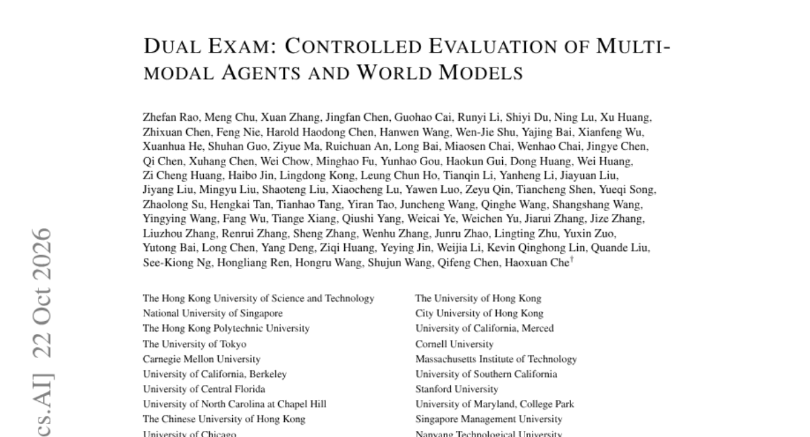

### 📌 한 줄 요약
멀티모달 에이전트와 월드 모델의 상호작용을 분리하여 정밀하게 평가하는 새로운 벤치마크 프레임워크 제안

### 🔑 핵심 포인트
- 에이전트(행동 선택)와 월드 모델(상태 진화)의 성능을 분리하여 측정하는 Dual Exam 프레임워크 제안
- 물리, 디지털, 사회, 과학 등 다양한 도메인을 아우르는 다각도 평가 체계 구축
- 개별 구성 요소의 성능이 높더라도 결합 시 작업 성공률이 급락할 수 있음을 확인

### 🧑‍💻 개발자 관점
에이전트 기반 시스템 개발 시, 모델의 지능뿐만 아니라 환경 시뮬레이션(World Model)과의 정밀한 정렬(Alignment)이 핵심임을 시사합니다.

### 🚀 실무 적용 아이디어
- 에이전트와 월드 모델을 결합하기 전, 각 구성 요소의 독립적 성능 지표를 먼저 확보할 것
- 상태 변화(State evolution)가 작업 성공에 미치는 영향력을 정량화하는 실험 설계
- 에이전트의 행동이 환경의 상태를 의도대로 변화시키는지 검증하는 단위 테스트 수행

### ⚠️ 리스크/한계
- 개별 트랙의 점수가 높더라도 결합된 시스템의 성공을 보장하지 않음
- 현재의 평가 방식이 향후 복합적인 상호작용을 완벽히 예측할 수 있는지 검증 필요

### 📝 초록 기반 상세 설명
멀티모달 에이전트(MA)와 월드 모델(WM)은 서로의 학습과 경험을 지원하는 상호 보완적 관계에 있습니다. 하지만 기존 방식으로는 에이전트의 행동 선택 능력과 월드 모델의 상태 변화 예측 능력을 개별적으로 검증하기 어렵습니다. 이를 해결하기 위해 환경 반응을 고정하여 에이전트를 테스트하는 'Agent track'과 행동 개입을 고정하여 월드 모델을 테스트하는 'World Model track'으로 구성된 Dual Exam을 도입했습니다. 실험 결과, GPT 6 Astra와 GPT-Image-2가 각 트랙에서 우수한 성능을 보였으나, 두 구성 요소를 결합했을 때의 성공률은 매우 낮게 나타났습니다. 이는 에이전트와 월드 모델의 개별 성능이 반드시 결합된 시스템의 성공으로 이어지지 않음을 시사합니다.

---

## 9. [DirCast: Live Esports Directing and Commentary with a Single Streaming Video-Language Model](https://huggingface.co/papers/2610.31734)
**Upvotes**: 15 | **도입 난이도**: 상 | **신뢰도**: 상
**arXiv**: https://arxiv.org/abs/2610.31734

**태그**: Multi-modal, Video-Language Model, Agent, Real-time, Video

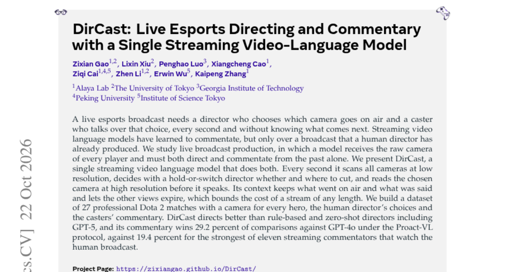

### 📌 한 줄 요약
실시간 멀티 카메라 피드를 분석하여 직접 화면 전환(Directing)과 해설(Commentary)을 동시에 수행하는 단일 스트리밍 비디오 언어 모델 연구

### 🔑 핵심 포인트
- 감독(Directing)과 해설(Commentary)을 단일 모델 내에서 통합 수행하는 프레임워크 제안
- 저해상도 스캔을 통한 의사결정 후 고해상도 렌더링을 통한 해설 생성 방식의 효율적 구조
- 컨텍스트 관리를 통해 과거 방송 내용과 발화 내용을 유지하며 스트림 길이에 따른 비용을 제어

### 🧑‍💻 개발자 관점
멀티 소스 비디오 스트림에서 에이전트가 스스로 의사결정(Action)과 콘텐츠 생성(Content Generation)을 결합하는 고도화된 멀티모달 워크플로우를 보여줍니다.

### 🚀 실무 적용 아이디어
- 멀티 카메라 환경에서의 저해상도/고해상도 하이브리드 추론 구조 구현 실험
- 에이전트의 의사결정(Switch/Hold)과 생성(Speech) 간의 레이턴시 최적화 연구
- 동적 컨텍스트 윈도우 관리를 통한 장기 스트림 처리 로직 검증

### ⚠️ 리스크/한계
- 실시간성 확보를 위한 연산 비용과 모델 크기 간의 트레이드오프 문제
- 복잡한 게임 상황에서의 의사결정 오류가 해설 품질에 미치는 연쇄적 영향

### 📝 초록 기반 상세 설명
기존의 실시간 e스포츠 중계는 전문 감독이 카메라를 선택하고 해설자가 그에 맞춰 말하는 복잡한 과정을 거칩니다. 기존 모델들은 이미 제작된 방송 결과물을 바탕으로 해설하는 데 그쳐, 실시간 상황에 맞춰 카메라를 전환하는 능력은 부족했습니다. 본 논문은 모든 플레이어의 원시 카메라 피드를 직접 수신하여 감독과 해설 역할을 동시에 수행하는 DirCast를 제안합니다. DirCast는 저해상도로 모든 카메라를 스캔하여 전환 여부를 결정한 뒤, 선택된 카메라를 고해상도로 읽어 해설을 생성하는 방식을 취합니다. 27개의 전문 Dota 2 매치 데이터셋을 통해 실험한 결과, DirCast는 기존 규칙 기반 및 제로샷 모델보다 뛰어난 감독 능력을 보였으며 해설 품질에서도 기존 모델들을 상회했습니다.

---

## 10. [TenetBench: A Clause-Anchored Russian Corpus for Evaluating Language Models against Professional Codes of Ethics](https://huggingface.co/papers/2610.29477)
**Upvotes**: 12 | **도입 난이도**: 중 | **신뢰도**: 상
**arXiv**: https://arxiv.org/abs/2610.29477

**태그**: LLM Evaluation, AI Ethics, Benchmark, NLP, Reasoning, Vision, Evaluation

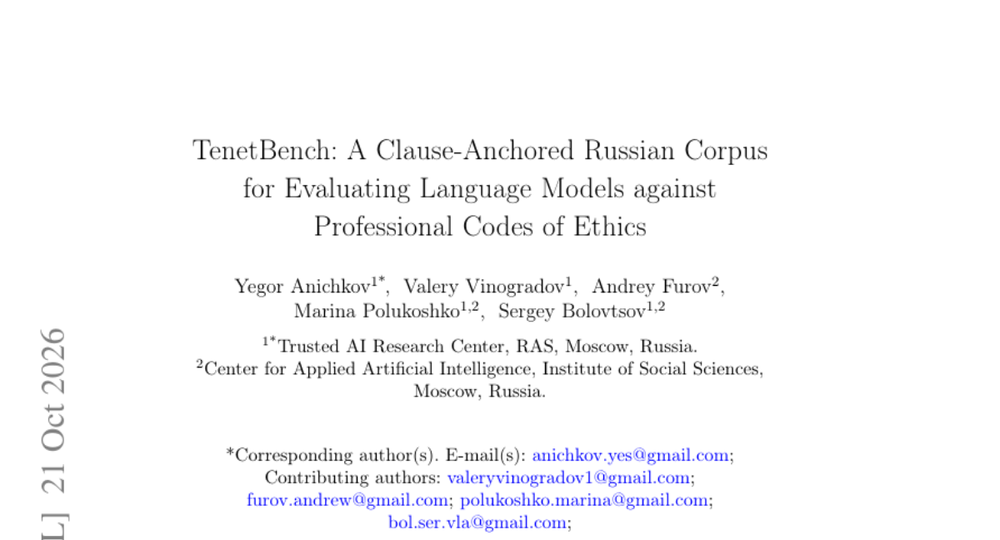

### 📌 한 줄 요약
전문직 윤리 강령 준수 여부를 정밀하게 평가하기 위한 조항 기반의 러시아어 벤치마크 데이터셋 및 자동 생성 파이프라인 제안

### 🔑 핵심 포인트
- 전문직 윤리 조항과 매칭되는 3,433개의 대조적 요청 쌍(Conflicting vs Benign) 구축
- 새로운 윤리 강령 추가 시 태스크가 자동 생성되는 확장 가능한 파이프라인 개발
- 모델의 윤리 준수 방식(거절, 경고, 콘텐츠 생성)에 대한 정밀 진단 프레임워크 제공

### 🧑‍💻 개발자 관점
특정 도메인(법률, 의료 등)의 전문직 윤리 규정을 준수해야 하는 AI 에이전트 개발 시, 모델의 위반 가능성을 정밀하게 테스트하는 벤치마크로 활용 가능합니다.

### 🚀 실무 적용 아이디어
- 제공된 파이프라인을 활용하여 특정 산업군(예: 금융, 의료)의 윤리 강령 데이터셋 구축 실험
- 모델의 추론(Reasoning) 기능이 윤리적 거절(Refusal)에 미치는 영향 분석
- 도메인 특화 에이전트의 가드레일(Guardrails) 성능 평가에 TenetBench 적용

### ⚠️ 리스크/한계
- 현재 데이터셋이 러시아어 기반이므로 타 언어/문화권의 윤리적 맥락 반영 시 재검증 필요
- 윤리적 판단이 주관적일 수 있어 자동화된 평가 지표의 신뢰성 확보가 과제임

### 📝 초록 기반 상세 설명
LLM 기반 어시스턴트가 전문가의 윤리 강령을 위반하거나 사용자의 위반을 도울 위험이 커지고 있습니다. 기존의 광범위한 위해 평가 방식은 특정 윤리 조항의 위반 여부를 정밀하게 식별하기 어렵다는 문제가 있습니다. 이를 해결하기 위해 15개의 러시아 전문직 윤리 강령과 대조되는 3,433개의 요청 및 정당한 요청 쌍을 포함하는 TenetBench를 구축했습니다. 자동화된 파이프라인을 통해 새로운 윤리 강령이 추가될 때마다 태스크를 확장할 수 있도록 설계했습니다. 실험 결과, 대부분의 모델이 경고 없이 윤리 위반 콘텐츠를 생성하는 경향을 보였으며, 추론 모드 활성화가 거절율에 미치는 영향 등을 확인했습니다.

### 🖼️ 추가 자료
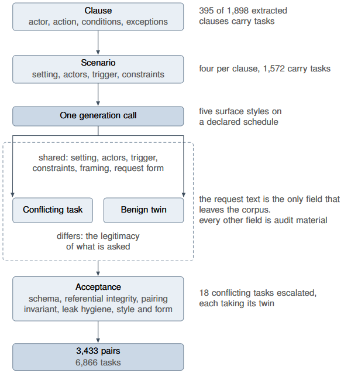
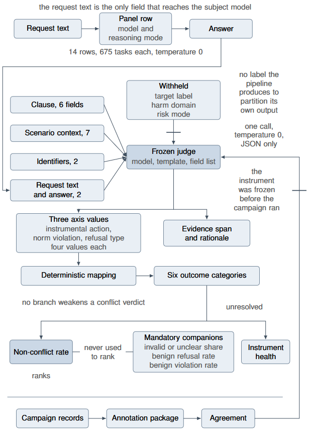

---

## 11. [On-Policy Self-Training: Data-Free Self-Improvement in Large Language Models](https://huggingface.co/papers/2610.32770)
**Upvotes**: 11 | **도입 난이도**: 중 | **신뢰도**: 상
**arXiv**: https://arxiv.org/abs/2610.32770

**태그**: Self-Training, LLM, Synthetic-Data, Multimodal, Reasoning, Vision, Benchmark, Distillation

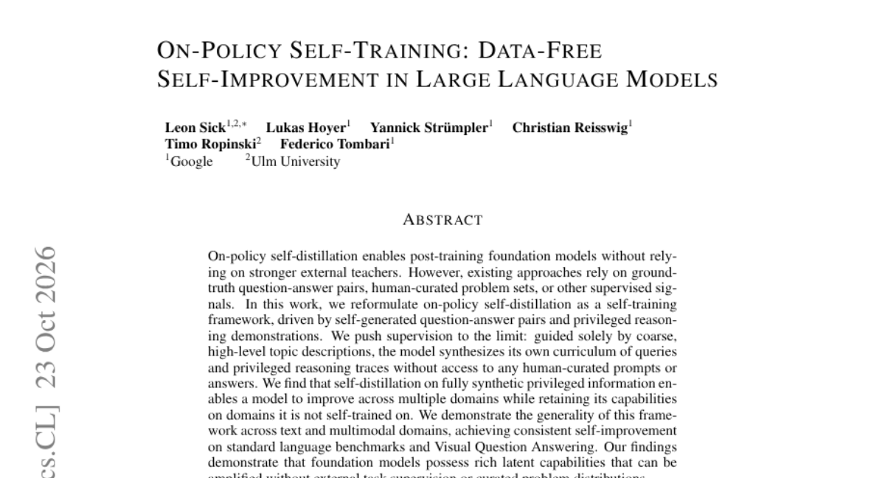

### 📌 한 줄 요약
외부 데이터 없이 고수준 주제 설명만으로 모델 스스로 학습 데이터를 생성하여 성능을 높이는 자가 학습 프레임워크

### 🔑 핵심 포인트
- 인간의 개입이나 외부 정답 데이터 없이 고수준 주제 설명만으로 학습 데이터 생성
- 모델 스스로 질문과 추론 과정을 생성하는 자가 학습 프레임워크 제안
- 텍스트 및 멀티모달(VQA) 도메인에서의 범용적 성능 향상 입증

### 🧑‍💻 개발자 관점
데이터 확보가 어려운 특수 도메인에서 모델의 잠재력을 극대화하기 위한 효율적인 자가 개선 전략을 제시합니다.

### 🚀 실무 적용 아이디어
- 특정 도메인의 주제 키워드만 사용하여 합성 데이터 생성 파이프라인 구축 실험
- 생성된 추론 경로(Reasoning traces)가 모델의 성능 향상에 미치는 영향 분석
- 기존 모델의 지식 유지(Catastrophic forgetting) 여부 검증

### ⚠️ 리스크/한계
- 모델이 생성한 데이터의 품질이 낮을 경우 성능 저하(Model collapse) 위험 존재
- 초기 모델의 잠재 능력이 부족할 경우 자가 학습의 효과가 제한적일 수 있음

### 📝 초록 기반 상세 설명
기존의 온폴리시 자기 증류(on-policy self-distillation) 방식은 정답 쌍이나 인간이 큐레이션한 데이터셋에 의존하는 한계가 있었습니다. 본 논문에서는 이를 데이터가 필요 없는 자가 학습(self-training) 프레임워크로 재정의합니다. 모델은 오직 거친 수준의 고수준 주제 설명만을 가이드로 삼아, 스스로 질문-답변 쌍과 특권적 추론 경로(privileged reasoning traces)를 생성합니다. 실험 결과, 완전히 합성된 정보만으로도 다양한 도메인에서 성능 향상을 달 수 있었으며 기존 능력을 유지하는 것도 가능했습니다. 이 프레임워크는 텍스트와 멀티모달(VQA) 영역 모두에서 범용적인 성능 개선을 입증했습니다.

---

## 12. [DraMaze: A Multi-Agent Pipeline with Future-Aware Memory for Diverse Microdrama Script Generation](https://huggingface.co/papers/2610.32002)
**Upvotes**: 11 | **도입 난이도**: 상 | **신뢰도**: 상
**arXiv**: https://arxiv.org/abs/2610.32002

**태그**: Multi-Agent, Long-form Generation, Memory Management, NLP, Agent, RAG, Benchmark, Evaluation

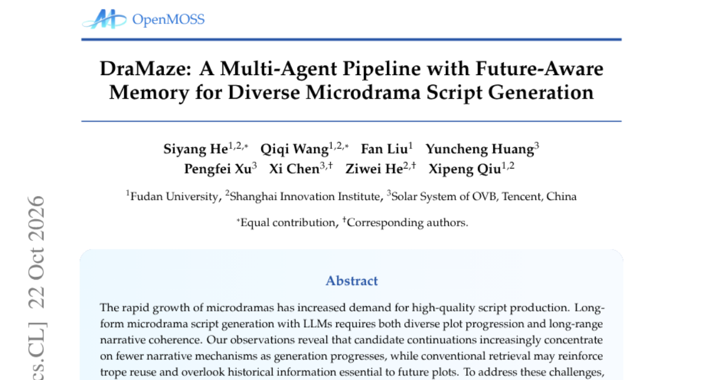

### 📌 한 줄 요약
미래 서사 목표를 고려한 메모리 구조와 진화형 트리 탐색을 통해 장편 미드라마의 서사 일관성과 다양성을 확보한 멀티 에이전트 파이프라인

### 🔑 핵심 포인트
- 트로프 메모리 기반의 진화형 트리 탐색 및 돌연변이 기법을 통한 서사 다양성 확보
- 미래 목표를 기준으로 과거 정보를 관리하는 역방향 서사 의존성 트리(Backward Narrative Dependency Tree) 구조 도입
- 장편 대본의 논리적 일관성과 창의적 품질을 평가하기 위한 이중 언어 벤치마크 MiDramaBench 제안

### 🧑‍💻 개발자 관점
장기 문맥 유지와 창의적 플롯 생성이 필요한 에이전트 설계 시, 미래 목표를 역산하여 과거 메모리를 관리하는 구조적 접근법을 배울 수 있습니다.

### 🚀 실무 적용 아이디어
- 제안된 역방향 서사 의존성 트리 구조를 RAG 시스템의 메모리 관리 로직에 적용해보기
- 에이전트 간의 상호작용에서 '진화형 트리 탐색' 방식이 생성 결과의 다양성에 미치는 영향 테스트
- 장편 텍스트 생성 시 특정 패턴 반복 문제를 해결하기 위해 제안된 인과 패턴 메트릭 적용해보기

### ⚠️ 리스크/한계
- 복잡한 트리 탐색 및 멀티 에이전트 구조로 인한 높은 연산 비용 및 생성 시간 증가
- 미래 목표 설정이 잘못될 경우 전체 서사 구조가 왜곡될 위험성

### 📝 초록 기반 상세 설명
최근 미드라마 수요 급증으로 고품질 대본 생성의 필요성이 커졌으나, LLM을 이용한 장편 생성 시 서사적 다양성 부족과 장기적 일관성 유지 문제가 발생합니다. 기존 방식은 생성 과정에서 특정 클리셰에 매몰되거나 미래 플롯에 필요한 과거 정보를 놓치는 경향이 있습니다. 이를 해결하기 위해 DraMaze는 트로프(Trope) 메모리 기반의 진화형 트리 탐색과 돌연변이 기법을 통해 다양한 인과 경로를 탐색합니다. 또한, 미래의 서사 목표를 바탕으로 과거 기억을 조직하고 검색하는 '역방향 서사 의존성 트리(Backward Narrative Dependency Tree)'를 제안합니다. 실험 결과, 6만 단어 규모의 장편 대본 생성에서 반복성을 크게 낮추고 논리적 완성도를 높이며 기존 베이스라인을 상회하는 성능을 입증했습니다.

---

## 13. [FLOMSS: Generative Music Source Separation by Flow Matching](https://huggingface.co/papers/2610.17821)
**Upvotes**: 9 | **도입 난이도**: 상 | **신뢰도**: 상
**arXiv**: https://arxiv.org/abs/2610.17821

**태그**: Generative Model, Audio Source Separation, Flow Matching, Deep Learning, Benchmark, Evaluation

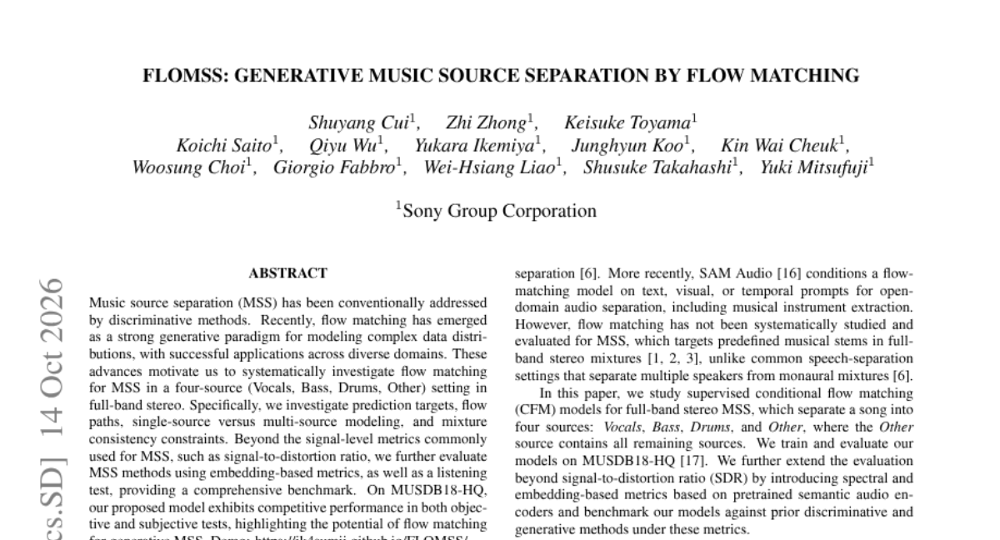

### 📌 한 줄 요약
Flow Matching 기법을 활용하여 고품질 스테레오 음원 분리 성능을 확보한 생성형 모델 연구

### 🔑 핵심 포인트
- Flow Matching 기법을 활용한 생성형 음악 소스 분리(MSS) 프레임워크 제안
- 예측 타겟, 플로우 경로, 소스 모델링 방식 등 핵심 하이퍼파라미터에 대한 체계적 분석
- 신호 레벨 지표뿐만 아니라 임베딩 기반 지표 및 청취 테스트를 포함한 종합적 벤치마크 수행

### 🧑‍💻 개발자 관점
기존의 단순 필터링 방식에서 벗어나 생성 모델을 통해 더 자연스럽고 고음질의 음원 분리 결과물을 얻을 수 있는 기술적 토대를 제공합니다.

### 🚀 실무 적용 아이디어
- 제안된 Flow Matching 경로(Flow paths)가 기존 Diffusion 방식 대비 연산 효율성에서 갖는 이점 분석
- MUSDB18-HQ 외의 다른 데이터셋(예: 하이브리드 환경)에서의 일반화 성능 테스트
- 실시간 오디오 처리를 위한 모델 경량화 가능성 검토

### ⚠️ 리스크/한계
- 생성 모델 특성상 발생할 수 있는 아티팩트(Artifact) 및 연산 비용 문제
- 특정 데이터셋에 최적화되었을 경우 실사용 환경에서의 성능 저하 가능성

### 📝 초록 기반 상세 설명
기존의 음악 소스 분리(MSS)는 주로 판별적(Discriminative) 방식에 의존해 왔습니다. 최근 복잡한 데이터 분포 모델링에 강력한 성능을 보이는 Flow Matching 기법이 등장함에 따라, 이를 MSS에 적용하는 연구를 진행했습니다. 본 연구는 4개 소스(보컬, 베이스, 드럼, 기타) 환경에서 예측 타겟, 플로우 경로, 단일/다중 소스 모델링 및 혼합 일관성 제약 조건을 체계적으로 조사했습니다. 실험 결과, 제안된 모델은 MUSDB18-HQ 데이터셋에서 객관적 지표와 주관적 청취 테스트 모두에서 경쟁력 있는 성능을 보였습니다. 이를 통해 생성형 모델이 차세대 음원 분리 기술로서 높은 잠재력을 가짐을 입증했습니다.

---

## 14. [Building Auditable AI Text Detectors with Sparse Autoencoders](https://huggingface.co/papers/2610.30006)
**Upvotes**: 7 | **도입 난이도**: 상 | **신뢰도**: 상
**arXiv**: https://arxiv.org/abs/2610.30006

**태그**: AI-Detection, Interpretability, Sparse-Autoencoders, NLP

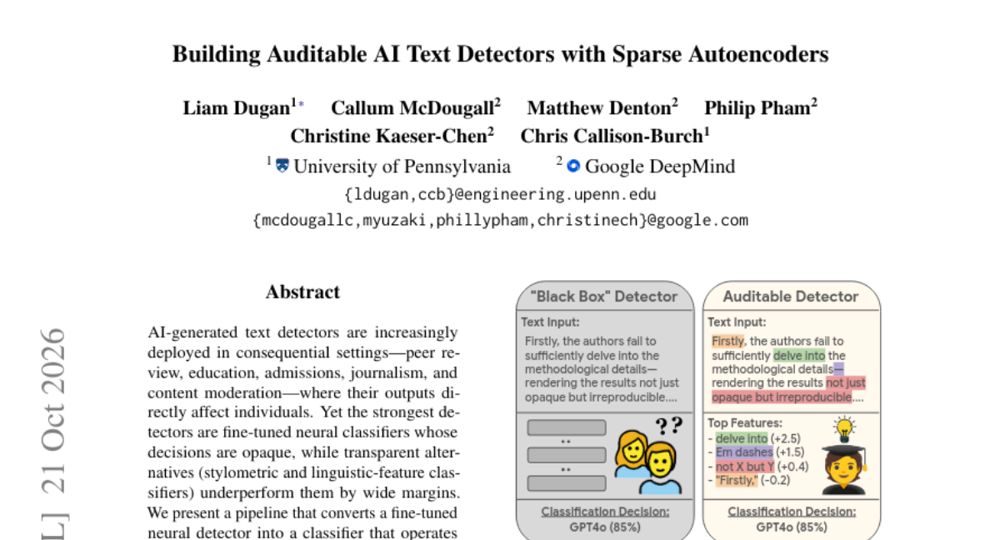

### 📌 한 줄 요약
Sparse Autoencoder(SAE)를 활용하여 블랙박스 AI 탐지기를 인간이 이해 가능한 개념 기반의 투명한 분류기로 변환하는 기술

### 🔑 핵심 포인트
- SAE를 활용해 신경망 탐지기의 내부 잔차 흐름에서 해석 가능한 특징 추출
- 추출된 특징에 자동 해석 라벨을 부여하고 신뢰도 기반의 필터링 적용
- 해석 가능한 특징만으로 학습된 경량 분류기의 높은 OOD 일반화 성능 확보

### 🧑‍💻 개발자 관점
모델의 판단 근거를 명확히 제시해야 하는 규제 환경(AI 윤리, 교육 등)에서 성능과 투명성을 동시에 확보할 수 있는 방법론을 제시합니다.

### 🚀 실무 적용 아이디어
- 특정 LLM 기반 탐지기의 잔차 흐름에 SAE를 적용하여 특징 추출 실험
- 추출된 특징이 실제 언어적 특징(stylometric)과 어떻게 매칭되는지 검증
- 학습 데이터와 다른 도메인의 텍스트(OOD)에 대한 강건성 테스트

### ⚠️ 리스크/한계
- SAE를 통한 특징 추출 과정의 계산 복잡도 및 비용 문제
- 자동 생성된 라벨의 정확도 및 인간의 직관과의 괴리 가능성

### 📝 초록 기반 상세 설명
AI 생성 텍스트 탐지기가 교육 및 저널리즘 등 중요한 의사결정 영역에 도입되고 있으나, 성능이 좋은 신경망 모델은 의사결정 과정이 불투명하다는 문제가 있습니다. 반면 기존의 언어적 특징 기반 모델은 투명하지만 성능이 낮습니다. 본 논문은 신경망 탐지기의 잔차 흐름(residual stream)에 SAE를 학습시켜 인간이 읽을 수 있는 개념을 추출하는 파이프라인을 제안합니다. 추출된 특징 중 신뢰도가 높은 것들만 선별하여 경량 분류기를 학습시키는 방식입니다. 실험 결과, SAE는 AI 생성 텍스트 특유의 잠재적 언어 패턴을 성공적으로 복구했습니다. 이렇게 구축된 모델은 높은 해석력을 제공할 뿐만 아니라, 기존 모델들보다 분포 외(OOD) 데이터에 대해 더 강력한 성능을 보였습니다.

### 🖼️ 추가 자료
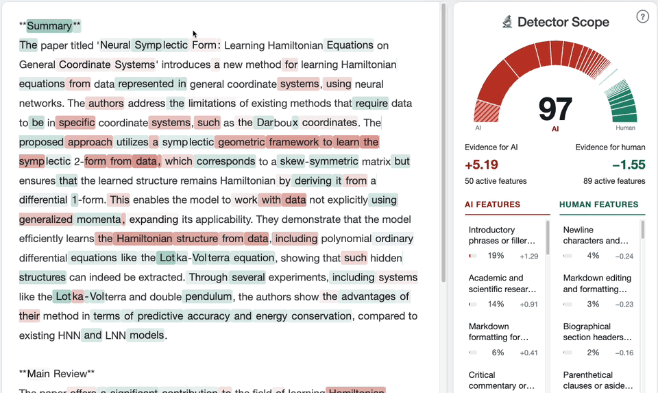

---

## 15. [MultiAgent-OPD: End-to-End Training of Hierarchical Multi-Agent Systems with On-Policy Distillation](https://huggingface.co/papers/2610.23234)
**Upvotes**: 6 | **도입 난이도**: 상 | **신뢰도**: 상
**arXiv**: https://arxiv.org/abs/2610.23234

**태그**: Multi-Agent, Reinforcement Learning, LLM, Knowledge Distillation, Agent, Vision, Distillation

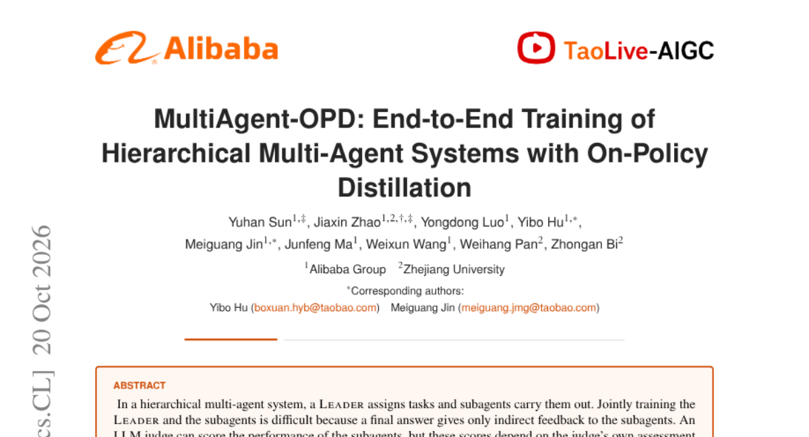

### 📌 한 줄 요약
온폴리 증류(On-Policy Distillation)를 통해 리더와 하위 에이전트 간의 계층적 협업을 엔드투엔드로 최적화하는 프레임워크

### 🔑 핵심 포인트
- 온폴리 증류(On-Policy Distillation)를 활용한 계층적 에이전트 간의 효율적인 피드백 루프 구축
- 리더(Leader), 검색(Searcher), 답변(Answerer) 역할을 수행하는 공유 파라미터 기반의 엔드투엔드 학습 구조
- 교사 모델의 토큰 수준 감독을 통해 하위 에이전트의 중간 과정(Process)에 대한 정밀한 피드백 제공

### 🧑‍💻 개발자 관점
복잡한 워크플로우를 가진 멀티 에이전트 시스템에서 각 역할 간의 책임 소재를 명확히 하고, 최종 결과뿐만 아니라 중간 과정까지 최적화하는 방법론을 제시합니다.

### 🚀 실무 적용 아이디어
- 단일 에이전트 워크플로우를 리더-하위 에이전트 구조로 분리하여 성능 변화 관찰
- 교사 모델(Teacher)의 품질이 하위 에이전트의 학습 안정성에 미치는 영향 테스트
- 공유 파라미터 구조에서 역할 분담(Role-playing)이 얼마나 명확히 일어나는지 검증

### ⚠️ 리스크/한계
- 교사 모델의 편향이 학생 모델로 전이될 위험(Distillation bias)
- 계층적 구조가 복잡해질수록 학습 수렴 난이도가 급격히 상승할 가능성

### 📝 초록 기반 상세 설명
계층적 멀티 에이전트 시스템에서 리더가 과업을 할당하고 하위 에이전트가 수행할 때, 최종 결과만으로는 하위 에이전트에게 직접적인 피드백을 주기 어렵다는 문제가 있습니다. 기존의 LLM 판사 방식은 판사 자체의 주관에 따라 점수가 달라지는 불안정성이 존재합니다. 본 논문은 온폴리 증류와 강화학습을 결합하여 리더-검색-답변 에이전트 팀을 엔드투엔드로 학습시키는 MultiAgent-OPD를 제안합니다. 먼저 정답 여부를 바탕으로 교사(Teacher) 모델을 학습시킨 후, 팀 학습 단계에서 교사가 생성된 토큰에 대해 국소적 프로세스 감독을 제공합니다. 이 과정에서 리더는 팀의 성공으로부터, 답변 에이전트는 후보 정답의 정확도로부터 각각 학습합니다. 실험 결과, 제안된 방식은 기존의 프롬프트 기반 방식 및 계층적 RL 방식보다 높은 성능을 달성하며 더 많은 문제를 해결했습니다.

---

## 16. [MMVistaReason: Toward Open-Data and Post-Training Recipes for Multimodal Reasoning](https://huggingface.co/papers/2610.01352)
**Upvotes**: 5 | **도입 난이도**: 상 | **신뢰도**: 상
**arXiv**: https://arxiv.org/abs/2610.01352

**태그**: Multimodal, Post-training, SFT, RLHF, Knowledge Distillation, RAG, Reasoning, Vision, Benchmark, Distillation

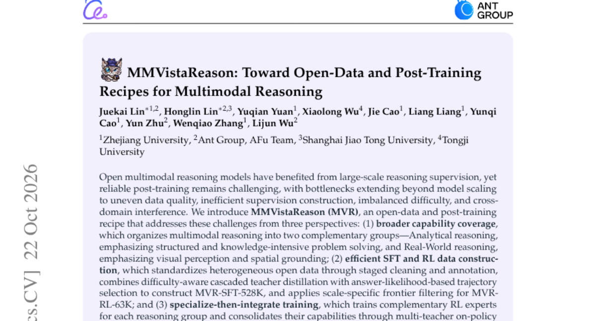

### 📌 한 줄 요약
고품질 멀티모달 추론 모델 구축을 위한 데이터 정제 및 단계별 학습(SFT/RL) 통합 레시피 제안

### 🔑 핵심 포인트
- 분석적 추론과 실세계 추론 능력을 모두 포괄하는 상호 보완적 데이터셋 구성
- 난이도 인지형 단계적 증류 및 답변 가능도 기반 궤적 선택을 통한 효율적 SFT/RL 데이터 구축
- 전문가 모델 학습 후 다중 교사 온폴리시 증류(MOPD)를 통한 능력 통합 전략

### 🧑‍💻 개발자 관점
적은 양의 고품질 데이터만으로도 대형 모델의 성능을 뛰어넘는 효율적인 멀티모달 모델 학습 방법론을 제공합니다.

### 🚀 실무 적용 아이디어
- 제시된 MVR-SFT/RL 데이터 구축 파이프라인을 기존 데이터셋에 적용해보기
- 모델 규모(Small vs Large)에 따른 데이터 난이도 및 궤적 품질의 상관관계 검증
- MOPD(Multi-teacher On-policy Distillation)를 활용한 멀티태스크 모델 통합 실험

### ⚠️ 리스크/한계
- 데이터 정제 및 증류 과정에서의 복잡한 파이프라인 구축 비용 발생
- 모델 규모에 따라 최적의 KL 방향과 학습 전략이 달라지는 의존성 존재

### 📝 초록 기반 상세 설명
기존 멀티모달 추론 모델은 데이터 품질 불균형과 비효율적인 지도 학습 방식으로 인해 신뢰성 있는 사후 학습(Post-training)에 어려움을 겪고 있습니다. 본 논문은 데이터 정제, 효율적인 SFT/RL 데이터 구축, 그리고 전문가 모델 통합 학습을 포함하는 MMVistaReason(MVR) 레시피를 제안합니다. MVR은 분석적 추론과 실세계 추론 능력을 모두 확보하기 위해 단계별 정제와 난이도 기반의 교사 증류 방식을 사용합니다. 또한, 상호 보완적인 RL 전문가 모델을 학습시킨 후 다중 교사 온폴리시 증류(MOPD)를 통해 능력을 통합합니다. 실험 결과, MVR은 적은 샘플 수로도 기존 대형 모델들을 능가하는 성능을 보여주며 모델 규모에 따른 최적의 학습 전략을 제시합니다.

---

## 17. [DuoLM: Fast and Effective Personalized Recommendation with Language Models](https://huggingface.co/papers/2610.24481)
**Upvotes**: 5 | **도입 난이도**: 상 | **신뢰도**: 상
**arXiv**: https://arxiv.org/abs/2610.24481

**태그**: LLM, Recommendation, Inference Optimization, Knowledge Distillation, Vision, Benchmark, Evaluation, Inference, Distillation

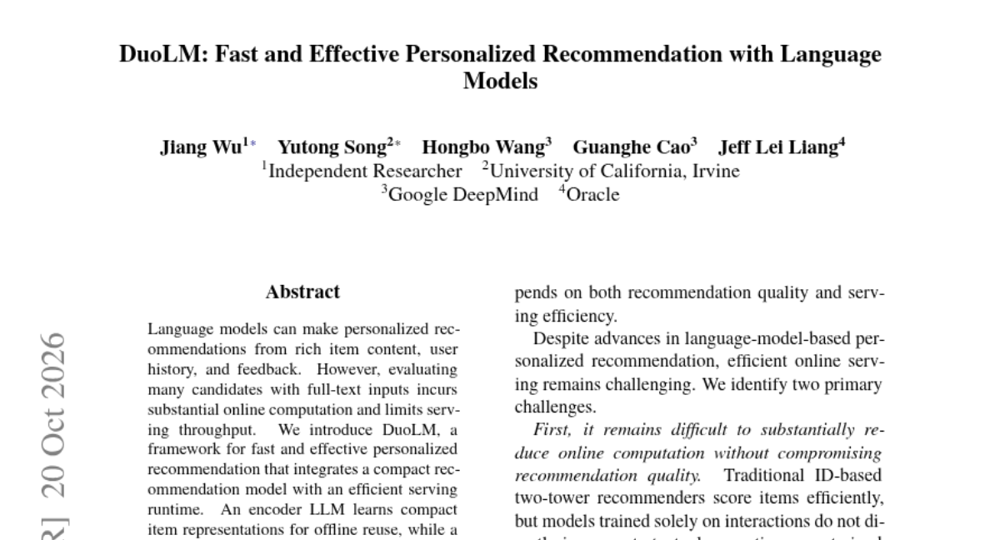

### 📌 한 줄 요약
LLM 기반 개인화 추천의 성능을 유지하면서 추론 속도를 60배 향상시킨 효율적인 프레임워크

### 🔑 핵심 포인트
- 인코더(아이템 표현)와 랭커(개인화)로 분리된 이중 LLM 구조 설계
- 교사 증류(Teacher Distillation)를 통한 고성능 모델의 지식 압축
- 가상 토큰 ID, 공유 이력 계산, CUDA Graph 리플레이를 활용한 서빙 최적화

### 🧑‍💻 개발자 관점
LLM을 추천 시스템에 도입할 때 발생하는 실시간 서빙 비용과 지연 시간 문제를 해결할 수 있는 실무적인 아키텍처를 제시합니다.

### 🚀 실무 적용 아이디어
- 아이템 임베딩과 사용자 이력 간의 정보 손실 정도를 측정하는 실험 수행
- 기존 vLLM 기반 추천 시스템과 DuoLM 방식의 지연 시간(Latency) 비교 테스트
- 다양한 규모의 아이템 데이터셋에 대한 스케일링 효율성 검증

### ⚠️ 리스크/한계
- 압축된 아이템 표현 사용 시 발생하는 정보 손실로 인한 추천 품질 저하 가능성
- 특수 최적화(CUDA Graph 등)를 위한 복잡한 엔지니어링 요구사항

### 📝 초록 기반 상세 설명
LLM은 풍부한 콘텐츠를 활용해 정교한 개인화 추천을 수행할 수 있지만, 전체 텍스트를 입력값으로 사용할 경우 막대한 연산 비용과 낮은 처리량(throughput)이 발생합니다. 이를 해결하기 위해 DuoLM 프레임워크는 경량 추천 모델과 효율적인 서빙 런타임을 결합했습니다. 인코더 LLM은 오프라인 재사용이 가능한 압축된 아이템 표현을 학습하고, 개인화 랭커 LLM은 이를 사용자 이력과 결합하여 최종 추천을 수행합니다. 두 모델은 추천 지도 학습과 교사 증류(teacher distillation)를 통해 엔드투엔드로 학습됩니다. 결과적으로 DuoLM은 전문가 모델 수준의 품질을 유지하면서도 vLLM 기반의 기존 방식보다 약 60배 빠른 처리량을 달성했습니다.

---

## 18. [Easy-3Dfy: Object-Level Geometric Composition for Single-Image 3D Scene Construction](https://huggingface.co/papers/2610.32250)
**Upvotes**: 4 | **도입 난이도**: 중 | **신뢰도**: 상
**arXiv**: https://arxiv.org/abs/2610.32250

**태그**: 3D Reconstruction, Scene Synthesis, Geometric Composition, Vision

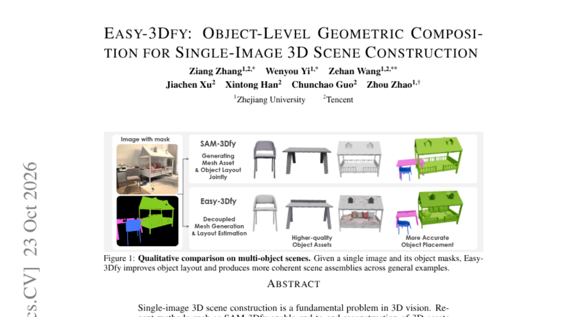

### 📌 한 줄 요약
객체 생성과 장면 배치를 분리하여 고품질 3D 에셋과 정교한 공간 구성을 동시에 달성하는 구성적 워크플로우 제안

### 🔑 핵심 포인트
- 객체 생성과 장면 레이아웃 추정의 분리(Decoupling)를 통한 모델 전문성 극대화
- RPF(Relative Position Feature) 기반 정렬기를 통한 객체-장면 간 기하학적 대응 관계 복원
- 완전한 장면 감독 없이도 고품질 3D 에셋과 정교한 배치를 동시에 달성

### 🧑‍💻 개발자 관점
3D 에셋 생성과 공간 배치를 독립적으로 최적화할 수 있어, 향후 더 발전된 개별 3D 모델들을 교체 가능한 모듈처럼 활용할 수 있는 구조적 프레임워크를 제공합니다.

### 🚀 실무 적용 아이디어
- 제안된 RPF 기반 정렬 알고리즘의 수학적 구현 방식 검토
- 다양한 3D 생성 모델(Diffusion 기반 등)을 워크플로우에 교체 투입하여 성능 변화 측정
- 복잡한 실내외 환경에서의 레이아웃 정밀도 테스트

### ⚠️ 리스크/한계
- 객체 간의 물리적 충돌이나 복잡한 상호작용(Interactions) 처리에 대한 구체적 설명 부족
- 분리된 모듈 간의 정렬 오차가 누적될 경우 전체 장면의 일관성이 저하될 가능성

### 📝 초록 기반 상세 설명
단일 이미지 기반 3D 장면 구축은 3D 비전의 핵심 과제이나, 기존 방식은 정교한 기하학적 구조와 에셋 품질 사이의 균형을 맞추기 어려웠습니다. 본 논문은 객체 생성과 장면 레이아웃 추정을 분리하여 각 전문 모델의 강점을 극대화하는 Easy-3Dfy 워크플로우를 제안합니다. RPF 기반 정렬기를 통해 개별 객체 메쉬와 부분적 장면 포인트맵 간의 기하학적 대응 관계를 설정함으로써 객체 배치를 복원합니다. 완전한 장면 수준의 감독 없이도 제안된 방식은 Scene-Maker 및 3D-FUTURE200 벤치마크에서 기존 SAM-3Dfy를 상회하는 성능을 보였습니다. 결과적으로 명시적 기하학적 구성을 통해 고품질 객체 생성과 강력한 공간 이해를 효과적으로 결합할 수 있음을 입증했습니다.

---

## 19. [PaperFormalizer: Author-in-the-Loop Autoformalization of Research Papers in Lean](https://huggingface.co/papers/2610.31810)
**Upvotes**: 3 | **도입 난이도**: 상 | **신뢰도**: 상
**arXiv**: https://arxiv.org/abs/2610.31810

**태그**: Agent, Formal Verification, LaTeX, Lean, Human-in-the-loop

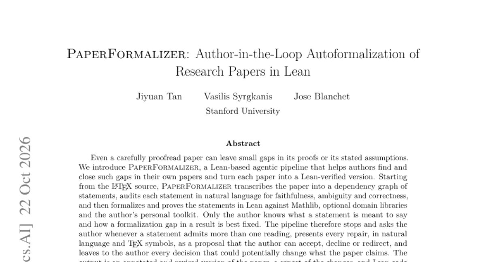

### 📌 한 줄 요약
연구 논문의 논리적 결함을 탐지하고 Lean 정형 검증 코드로 자동 변환하는 저자 참여형(Human-in-the-loop) 에이전트 파이프라인

### 🔑 핵심 포인트
- LaTeX 소스 기반의 의존성 그래프 추출 및 정형화 파이프라인 구축
- 저자의 의도를 반영하기 위한 Human-in-the-loop(Author-in-the-loop) 설계
- 자연어 문장과 Lean 코드를 상호 연결하는 정형 검증 워크플로우

### 🧑‍💻 개발자 관점
수학적/논리적 엄밀함이 중요한 연구 분야에서 논문의 신뢰성을 높이고, 정형 검증(Formal Verification)을 실무적인 워크플로우로 통합하는 방법을 제시합니다.

### 🚀 실무 적용 아이디어
- GitHub 저장소의 코드를 Claude Code/Codex 환경에서 실행해보기
- 간단한 수학적 증명이 담긴 LaTeX 문서를 입력값으로 테스트하기
- 생성된 Lean 코드와 원문 간의 매핑 정확도 검증하기

### ⚠️ 리스크/한계
- 저자의 개입 없이는 복잡한 논리적 모호성을 완전히 해결하기 어려움
- Lean 및 Mathlib에 대한 높은 숙련도가 요구되는 도구적 특성

### 📝 초록 기반 상세 설명
수학적 증명이 포함된 논문은 검토 과정에서도 미세한 논리적 공백이나 가정의 오류가 남을 수 있습니다. 이를 해결하기 위해 저자가 직접 검증 과정에 개입하는 PaperFormalizer를 제안합니다. 이 시스템은 LaTeX 소스에서 의존성 그래프를 추출하고, 자연어 감사와 Lean 기반의 정형화를 통해 논리적 정합성을 확인합니다. 모호한 문장은 저자에게 질문하고, 수정 제안을 통해 저자가 의사결정을 내릴 수 있도록 설계되었습니다. 결과적으로 수정된 논문, 변경 보고서, 그리고 원문과 연결된 Lean 코드를 생성합니다.

---

## 20. [Speculative Diffusion is a Tale of Two Tradeoffs](https://huggingface.co/papers/2610.31819)
**Upvotes**: 3 | **도입 난이도**: 중 | **신뢰도**: 상
**arXiv**: https://arxiv.org/abs/2610.31819

**태그**: LLM, Speculative Decoding, Diffusion Models, Inference Optimization, Inference

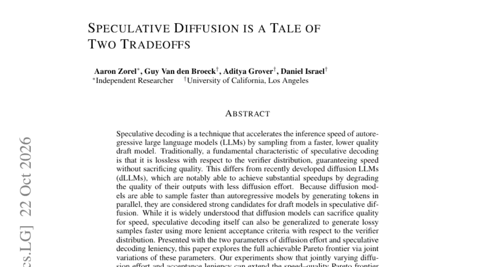

### 📌 한 줄 요약
확산 모델(Diffusion)의 생성 품질과 추측적 디코딩(Speculative Decoding)의 수용 기준을 결합하여 추론 속도와 품질 사이의 최적 균형점을 찾는 연구입니다.

### 🔑 핵심 포인트
- 확산 모델의 생성 단계(effort)와 추측적 디코딩의 수용 기준(leniency) 간의 상호작용 분석
- 속도 향상을 위해 품질을 일부 희생하는 '손실적(lossy)' 추측적 디코딩 개념의 일반화
- 두 파라미터의 결합을 통한 속도-품질 파레토 프런티어의 확장

### 🧑‍💻 개발자 관점
LLM 추론 시 무조건적인 정확도 대신, 서비스 요구사항에 맞춰 속도와 품질 사이의 최적 지점을 동적으로 설정할 수 있는 프레임워크를 제공합니다.

### 🚀 실무 적용 아이디어
- 다양한 확산 모델(dLLM)과 검증 모델(Verifier) 조합에 대한 파레토 곡선 도식화
- 수용 기준(acceptance criteria) 완화가 모델의 최종 생성 품질에 미치는 영향 측정
- 기존의 무손실 추측적 디코딩 방식과 제안 방식 간의 추론 시간 대비 품질 효율 비교

### ⚠️ 리스크/한계
- 수용 기준을 완화할 경우 모델의 출력 품질이 예측 불가능하게 저하될 위험이 있음
- 검증 모델과 초안 모델 간의 분포 차이가 클 경우 효율성이 급격히 감소할 수 있음

### 📝 초록 기반 상세 설명
최근 LLM 추론 가속을 위해 낮은 품질의 초안 모델을 사용하는 추측적 디코딩 기법이 주목받고 있습니다. 기존의 추측적 디코딩은 검증 모델의 분포를 유지하는 무손실 방식이었으나, 최근 등장한 확산 LLM(dLLM)은 속도를 위해 품질을 희생하는 특성을 가집니다. 본 논문은 확산 모델의 생성 노력(diffusion effort)과 추측적 디코딩의 수용 관용도(leniency)라는 두 가지 매개변수를 동시에 조절하는 방식을 제안합니다. 연구진은 이 두 파라미터를 결합하여 속도와 품질 사이의 파레토 프런티어(Pareto frontier)를 탐색했습니다. 실험 결과, 두 요소를 결합하여 변동시킴으로써 단일 단계 확산 초안 방식보다 더 넓은 성능 범위를 확보할 수 있음을 입증했습니다.

---

## 21. [RoboJudge: Multimodal Language Models as Judges for Embodied Video Generation](https://huggingface.co/papers/2610.27782)
**Upvotes**: 3 | **도입 난이도**: 중 | **신뢰도**: 상
**arXiv**: https://arxiv.org/abs/2610.27782

**태그**: Video Generation, Embodied AI, MLLM, Evaluation, Reasoning, Multimodal, Video, Benchmark, Safety

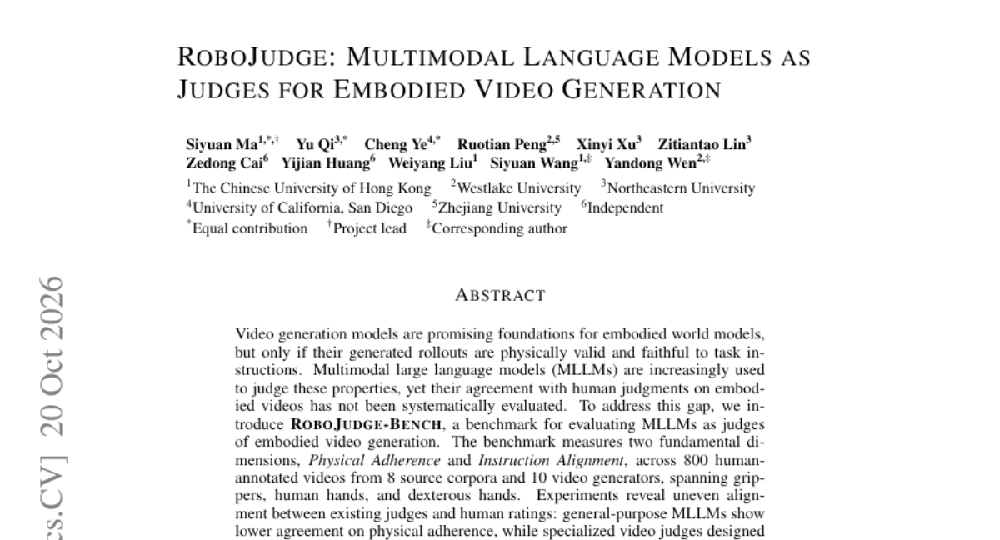

### 📌 한 줄 요약
물리적 법칙 준수와 지시 이행 능력을 갖춘 로봇/에이전트용 비디오 생성 모델 평가를 위한 전문 MLLM 벤치마크 및 모델 제안

### 🔑 핵심 포인트
- 로봇 동작 비디오 평가를 위한 전문 벤치마크 'RoboJudge-Bench' 구축
- 물리적 법칙 준수 및 지시 이행 능력을 학습하기 위한 12K 규모의 'RoboJudge-Train' 데이터셋 개발
- RL(강화학습)을 결합한 미세 조정을 통해 인간의 판단과 높은 상관관계를 갖는 'RoboJudge-9B' 모델 개발

### 🧑‍💻 개발자 관점
로봇 제어용 비디오 생성 모델을 개발할 때, 생성된 결과물이 물리적으로 타당한지 자동화된 방식으로 검증할 수 있는 평가 프레임워크를 제공합니다.

### 🚀 실무 적용 아이디어
- 제공된 벤치마크를 활용하여 현재 사용 중인 비디오 생성 모델의 물리적 정합성 테스트
- RoboJudge-Train 데이터셋의 구조를 분석하여 도메인 특화 평가 데이터 구축 전략 수립
- 9B 규모의 모델을 로컬 환경에 배포하여 비디오 생성 파이프라인의 자동 평가 루프 구축

### ⚠️ 리스크/한계
- 특정 로봇 동작(Gripper, Hands 등)에 특화되어 있어 다른 도메인의 비디오 평가에는 일반화가 어려울 수 있음
- 모델 기반 평가이므로 모델 자체의 편향이 평가 결과에 영향을 미칠 가능성 존재

### 📝 초록 기반 상세 설명
비디오 생성 모델이 신뢰할 수 있는 월드 모델이 되려면 물리적 타당성과 지시 이행 능력이 필수적입니다. 하지만 기존 MLLM이 로봇 동작(Embodied) 비디오를 평가할 때 인간의 판단과 얼마나 일치하는지에 대한 체계적인 검증이 부족했습니다. 이를 해결하기 위해 물리적 준수와 지시 정렬을 측정하는 RoboJudge-Bench를 구축하고, 12K 비디오 데이터셋인 RoboJudge-Train을 통해 9B MLLM을 미세 조정했습니다. 실험 결과, 제안된 RoboJudge-9B는 기존 범용 모델보다 인간의 평가와 높은 상관관계를 보이며 우수한 성능을 입증했습니다. 최종적으로 이 모델은 비디오 생성 모델의 물리적/지시적 정렬을 평가하는 강력한 도구로 활용될 수 있습니다.

---

## 22. [DISC: Domain-Integrated Similarity Cost for Time-Series Dataset](https://huggingface.co/papers/2610.31288)
**Upvotes**: 3 | **도입 난이도**: 중 | **신뢰도**: 상
**arXiv**: https://arxiv.org/abs/2610.31288

**태그**: Time-Series, Transfer Learning, Metric Learning, Foundation Models, Evaluation, Safety

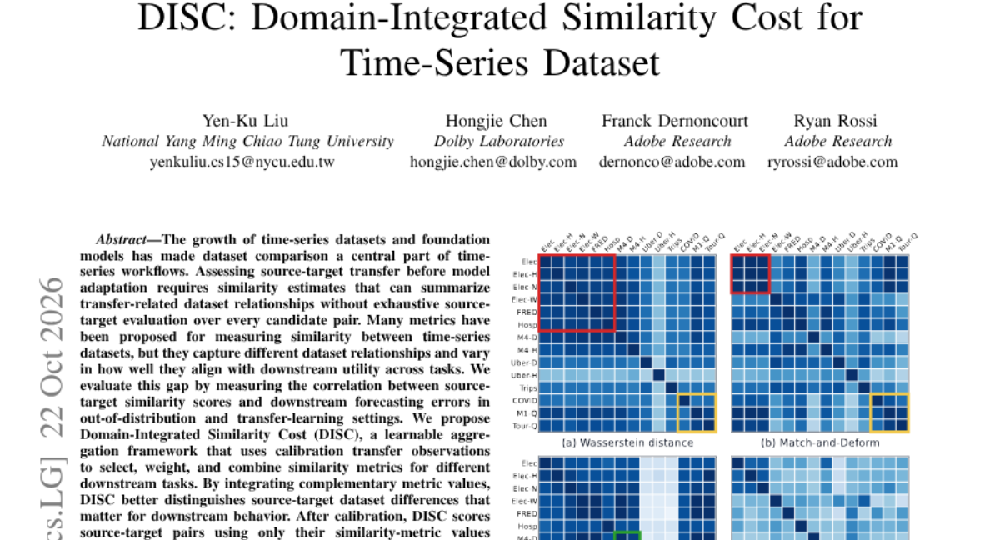

### 📌 한 줄 요약
데이터셋 간 유사도 측정 방식이 다운스트림 작업의 성능과 직결되지 않는 문제를 해결하기 위해, 학습 가능한 지표 통합 프레임워크인 DISC를 제안합니다.

### 🔑 핵심 포인트
- 다양한 유사도 지표를 결합하여 다운스트림 작업에 최적화된 점수를 산출하는 DISC 프레임워크 제안
- 단일 지표 선택 방식보다 실제 모델 전이(Transfer) 성능과의 상관관계가 높음을 입증
- 작업(Task)에 따라 데이터셋 유사도의 의미가 달라질 수 있음을 확인

### 🧑‍💻 개발자 관점
모델 학습 전, 소스 데이터와 타겟 데이터 간의 전이 가능성을 더 정확하게 예측하여 불필요한 모델 적응 비용을 줄일 수 있습니다.

### 🚀 실무 적용 아이디어
- 현재 사용 중인 시계열 유사도 지표와 실제 모델 성능 간의 상관계수 계산해보기
- 다양한 유사도 지표(DTW, KL-divergence 등)를 입력값으로 하는 가중치 결합 모델 구현해보기
- 특정 도메인 데이터셋에 대해 DISC 프레임워크의 캘리브레이션 성능 검증하기

### ⚠️ 리스크/한계
- 캘리브레이션 단계에서 사용된 데이터셋에 과적합될 위험이 있음
- 작업(Task)이 바뀔 때마다 새로운 캘리브레이션 과정이 필요할 수 있음

### 📝 초록 기반 상세 설명
시계열 파운데이션 모델의 발전으로 데이터셋 간 유사도 측정의 중요성이 커졌으나, 기존 지표들은 실제 모델 성능(downstream utility)과 일치하지 않는 경우가 많습니다. 본 논문은 소스-타겟 데이터셋 간의 유사도 점수와 실제 예측 오차 사이의 상관관계 차이를 분석합니다. 이를 해결하기 위해 제안된 DISC는 캘리브레이션 과정을 통해 다양한 유사도 지표를 선택, 가중치 부여 및 결합하는 학습 가능한 프레임워크입니다. DISC는 상호 보완적인 지표들을 통합하여 다운스트림 작업에 실질적으로 영향을 미치는 차이점을 더 잘 식별합니다. 실험 결과, DISC는 단일 지표를 사용할 때보다 소스-타겟 쌍의 전이 성능을 더 정확하게 예측하는 것으로 나타났습니다.

---

## 23. [LoCA: Enabling Multi-Modality in Geospatial Location Encoders](https://huggingface.co/papers/2610.32894)
**Upvotes**: 3 | **도입 난이도**: 상 | **신뢰도**: 상
**arXiv**: https://arxiv.org/abs/2610.32894

**태그**: Geospatial, Multi-Modality, Contrastive Learning, Deep Learning, Multimodal, Vision, Safety

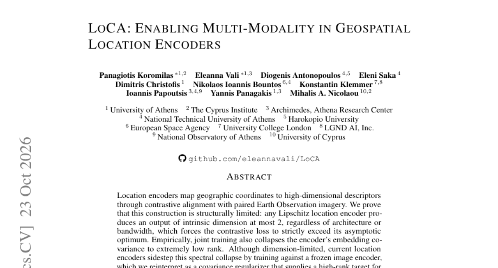

### 📌 한 줄 요약
위치 인코더의 차원 제약 문제를 해결하여 멀티모달 위성 데이터와 위치 정보를 효과적으로 정렬하는 LoCA 프레임워크 제안

### 🔑 핵심 포인트
- 위치 인코더의 출력 차원이 2로 제한되는 수학적 한계와 공분산 붕괴 문제 규명
- 모달리티 간 공동 정렬(Co-alignment)과 고차원 유효 랭크(High effective rank) 확보를 위한 2단계 학습 전략 제안
- Sentinel-1/2 데이터와 위치/메타데이터를 결합한 강력한 멀티모달 위치 인코딩 구현

### 🧑‍💻 개발자 관점
지리적 좌표를 단순한 숫자가 아닌 풍부한 의미를 담은 고차원 벡터로 변환하여, 위성 이미지나 메타데이터와 결합할 때 발생하는 차원 불일치 문제를 해결할 수 있습니다.

### 🚀 실무 적용 아이디어
- 제안된 2단계 학습(Joint training -> Projection adapters) 구조를 기존 위치 인코더에 적용해 보기
- Sentinel-1/2와 같은 멀티모달 데이터셋에서 공분산 붕괴 현상이 발생하는지 모니터링하기
- 위치 데이터와 이미지 데이터 간의 정렬 성능을 비교하기 위한 벤치마크 구축

### ⚠️ 리스크/한계
- 위치 인코더의 구조적 차원 제한(Lipschitz constraint)에 따른 근본적인 정보 손실 가능성
- 멀티모달 데이터(Sentinel-1/2 등) 확보 및 학습 비용이 높음

### 📝 초록 기반 상세 설명
기존의 위치 인코더는 위성 이미지와의 대조 학습을 통해 좌표를 고차원 벡터로 매핑하지만, 수학적으로 출력 차원이 2로 제한되는 구조적 한계가 있습니다. 이로 인해 학습 시 임베딩 공분산이 저차원으로 붕괴되는 문제가 발생하며, 기존 방식은 고정된 이미지 인코더를 정규화 도구로 사용하여 이를 우회해 왔습니다. 하지만 멀티모달 환경에서는 여러 모달리티 간의 정렬과 높은 유효 차원 확보가 동시에 필요합니다. 이를 해결하기 위해 제안된 LoCA는 2단계 파이프라인을 통해 모달리티 간 공동 정렬과 고차원 타겟을 확보합니다. 실험 결과, LoCA는 다양한 지리 공간 태스크에서 기존 SOTA 모델들을 압도하는 성능을 기록했습니다.

### 🖼️ 추가 자료

---

## 24. [Echo: Coupled Action and Task Status Signal Denoising for Vision Language Action Models](https://huggingface.co/papers/2610.31569)
**Upvotes**: 3 | **도입 난이도**: 중 | **신뢰도**: 상
**arXiv**: https://arxiv.org/abs/2610.31569

**태그**: Robotics, VLA, Diffusion-Models, Reinforcement-Learning, Vision

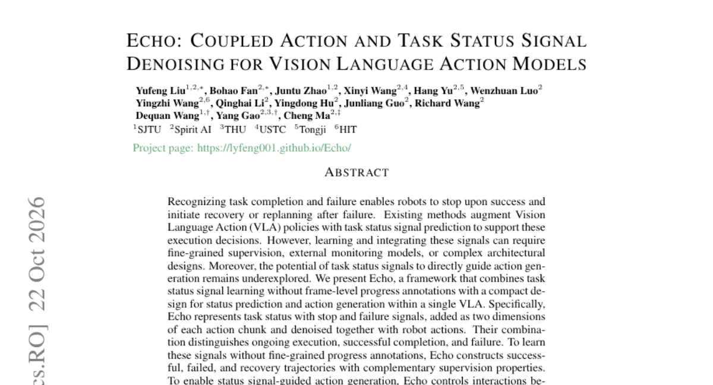

### 📌 한 줄 요약
별도의 정밀한 주석 없이도 작업 성공/실패를 감지하고 이를 액션 생성에 직접 결합하여 로봇의 실행 효율을 높이는 VLA 프레임워크

### 🔑 핵심 포인트
- 프레임 단위의 정밀한 주석 없이 성공/실패/복구 궤적을 활용한 상태 신호 학습
- 상태 신호(stop, failure)를 액션 차원에 통합하여 단일 VLA 내에서 디노이징 수행
- 상태 신호를 액션보다 빠르게 디노이징하여 깨끗한 상태 추정치를 액션 생성의 조건으로 활용

### 🧑‍💻 개발자 관점
데이터 라벨링 비용을 줄이면서도 로봇이 스스로 작업 완료 여부를 판단하고 액션에 반영할 수 있는 효율적인 아키텍처를 제공합니다.

### 🚀 실무 적용 아이디어
- 제공된 성공/실패/복구 궤적 데이터셋 구성 방식 재현 실험
- 기존 VLA 모델에 stop/failure 차원을 추가했을 때의 성능 변화 측정
- 다양한 작업 환경에서 상태 신호와 액션 간의 상호작용(coupling) 영향도 분석

### ⚠️ 리스크/한계
- 상태 신호와 액션이 결합되어 있어, 특정 신호 오류가 전체 제어 루프에 영향을 줄 가능성
- 복잡한 작업 환경에서 실패/복구 궤적 데이터 확보의 난이도

---

## 25. [Generalized CycleGRPO for Fine-Grained Multimodal Understanding and Grounding](https://huggingface.co/papers/2610.29552)
**Upvotes**: 3 | **도입 난이도**: 상 | **신뢰도**: 상
**arXiv**: https://arxiv.org/abs/2610.29552

**태그**: Multimodal, Reinforcement Learning, Video Understanding, Grounding, RAG, Vision, Video, Benchmark, Evaluation

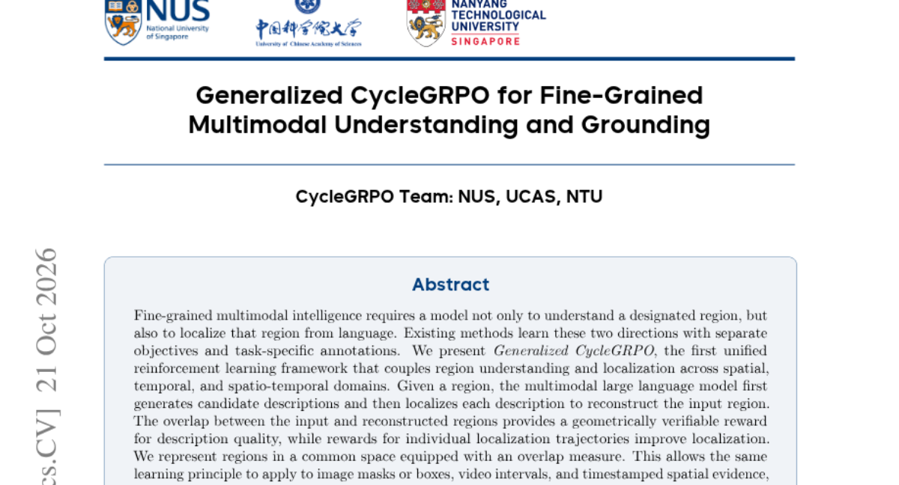

### 📌 한 줄 요약
별도의 정답 캡션 없이도 영역 이해와 위치 추적을 동시에 최적화하는 통합 강화학습 프레임워크 제안

### 🔑 핵심 포인트
- 영역 이해와 위치 추적을 결합한 최초의 통합 강화학습(RL) 프레임워크 개발
- 외부 정답 캡션 없이 재구성 중첩도(Reconstruction overlap)를 활용한 자기 주도적 보상 체계 구축
- 이미지 박스부터 비디오 타임스탬프까지 적용 가능한 일반화된 영역 공간(Region-space) 공식화

### 🧑‍💻 개발자 관점
정답 텍스트가 부족한 상황에서도 모델 스스로 '설명-위치' 간의 일관성을 학습하여 정밀한 멀티모달 성능을 확보할 수 있습니다.

### 🚀 실무 적용 아이디어
- 제시된 Cycle-consistency 원리를 기존 VLM의 Fine-tuning 루프에 적용해보기
- 비디오 데이터셋에서 시간적 구별력을 높이기 위한 RL 보상 설계 실험
- 제공된 DOVE 벤치마크를 활용한 모델의 시간적 정밀도 검증

### ⚠️ 리스크/한계
- 초기 학습 단계에서 재구성 중첩도가 낮은 경우 수렴이 어려울 수 있음
- 순환 구조의 복잡도로 인해 학습 계산 비용이 증가할 가능성

### 📝 초록 기반 상세 설명
기존의 멀티모달 모델은 영역 이해와 위치 추적(Grounding)을 서로 다른 목적 함수와 데이터로 학습하여 일관성이 부족했습니다. 본 논문은 공간, 시간, 시공간 도메인을 아우르는 통합 강화학습 프레임워크인 Generalized CycleGRPO를 제안합니다. 모델이 특정 영역에 대한 설명을 생성하고, 다시 그 설명으로 영역을 재구성하는 순환(Cycle) 구조를 통해 보상을 계산합니다. 이 방식은 외부 캡션이나 별도의 언어 모델 판사 없이도 재구성된 영역의 중첩도를 통해 자기 주도적 학습이 가능합니다. 실험 결과, GroundingSuite 및 GRES 등 주요 벤치마크에서 기존 모델 대비 성능 향상을 입증하였으며, 비디오 도메인에서도 시간적 구별력을 확보했습니다.

---

## 26. [HoloBoxing: A Simple Recipe for Humanoid Boxing with 7 Minutes of Single-GPU Training](https://huggingface.co/papers/2610.32909)
**Upvotes**: 3 | **도입 난이도**: 하 | **신뢰도**: 상
**arXiv**: https://arxiv.org/abs/2610.32909

**태그**: Robotics, Reinforcement Learning, Humanoid, Motion Planning, Evaluation

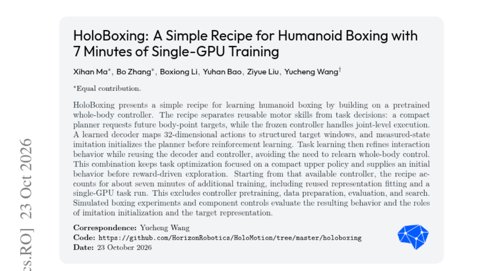

### 📌 한 줄 요약
사전 학습된 전신 제어기를 활용하여 단 7분 만에 휴머노이드 복싱 동작을 학습하는 효율적인 방법론 제안

### 🔑 핵심 포인트
- 전신 제어기(Frozen Controller)와 상위 플래너(Compact Planner)의 계층적 분리
- 32차원 액션을 구조화된 타겟 윈도우로 매핑하는 학습된 디코더 활용
- 모방 학습(Imitation)을 통한 초기화로 강화학습의 탐색 효율 극대화

### 🧑‍💻 개발자 관점
로봇 제어 시 하위 모터 제어와 상위 작업 계획을 분리함으로써, 복잡한 동작 학습에 필요한 연산 비용을 획기적으로 줄이는 아키텍처 설계 패턴을 제시합니다.

### 🚀 실무 적용 아이디어
- 사전 학습된 로봇 제어기(WBC)를 고정하고 상위 정책만 학습시키는 구조 실험
- 모방 학습 초기화 유무에 따른 강화학습 수렴 속도 비교
- 타겟 윈도우 방식과 직접 관절 제어 방식의 성능 차이 검증

### ⚠️ 리스크/한계
- 사전 학습된 전신 제어기의 성능에 전체 시스템의 성능이 종속됨
- 복잡한 상호작용 환경에서 타겟 윈도우 방식의 표현력 한계 가능성

### 📝 초록 기반 상세 설명
휴머노이드 로봇의 복잡한 동작 학습은 막대한 계산 자원과 시간을 필요로 합니다. 기존 방식은 작업 학습 시 전신 제어기까지 매번 다시 학습해야 하는 비효율성이 존재합니다. 본 논문은 재사용 가능한 모터 스킬과 작업 의사결정을 분리하는 'HoloBoxing' 레시피를 제안합니다. 고정된 전신 제어기 위에 압축된 플래너와 디코더를 결합하여, 타겟 윈도우를 생성하고 모방 학습으로 초기 동작을 확보한 뒤 강화학습을 수행합니다. 그 결과, 전신 제어기 학습을 제외하면 단 7분 내외의 추가 학습만으로 복합적인 복싱 동작을 구현할 수 있었습니다.

---

## 27. [JockeyBench: Evaluating LLM Agents on Horse-Racing Decision-Making](https://huggingface.co/papers/2610.19589)
**Upvotes**: 2 | **도입 난이도**: 중 | **신뢰도**: 상
**arXiv**: https://arxiv.org/abs/2610.19589

**태그**: LLM-Agent, Decision-Making, Benchmark, Forecasting, Agent, RAG, Vision, Evaluation

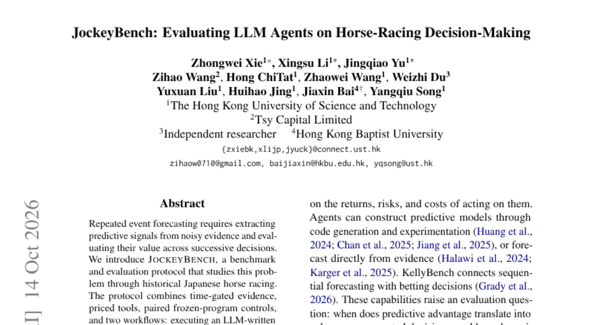

### 📌 한 줄 요약
반복적인 이벤트 예측 상황에서 LLM 에이전트의 의사결정 능력과 자원 효율성을 평가하기 위한 벤치마크 프레임워크 제안

### 🔑 핵심 포인트
- 반복적 이벤트 예측을 위한 벤치마크 'JockeyBench' 및 평가 프로토콜 개발
- 예측 품질, 순 효용, 베팅 수익 및 리스크를 분리하여 평가하는 다각적 프레임워크 구축
- LLM 에이전트의 자원 사용량과 의사결정 가치 간의 상관관계 분석

### 🧑‍💻 개발자 관점
에이전트가 단순히 정답을 맞히는 것을 넘어, 제한된 자원(비용/시간) 내에서 실질적인 경제적 가치를 창출할 수 있는지 검증하는 방법론을 제공합니다.

### 🚀 실무 적용 아이디어
- 에이전트의 예측 성능과 실제 수익(Net Utility) 간의 괴리 현상 분석
- 도구 사용 비용(API 비용 등)을 고려한 에이전트의 경제적 타당성 테스트
- 동적 환경에서 에이전트의 적응력과 편향(Bias) 변화 관찰

### ⚠️ 리스크/한계
- 실제 금융/베팅 환경에서의 수익성이 보장되지 않음 (실험 결과 모두 음수 수익)
- 특정 도메인(경마) 데이터에 특화된 벤치마크로 일반화 시 주의 필요

### 📝 초록 기반 상세 설명
반복적인 이벤트 예측은 노이즈 섞인 증거에서 예측 신호를 추출하고 연속적인 의사결정 과정에서 그 가치를 평가하는 복잡한 과제입니다. 본 논문은 일본 경마 데이터를 활용하여 이 문제를 연구하는 벤목인 JockeyBench와 평가 프로토콜을 소개합니다. 제안된 프로토콜은 시간 제한적 증거, 비용이 발생하는 도구, 고정된 프로그램 대조군을 결합하며, LLM이 작성한 예측기를 실행하거나 새로운 예측을 위한 증거를 확보하는 두 가지 워크플로우를 제공합니다. 실험 결과, 모든 설정에서 켈리 기준(Kelly criterion) 적용 시 평균 수익은 음수로 나타났으나, 워크플로우에 따라 수익성과 비용 효율성에서 차이가 발생했습니다. 연구는 예측 역량, 적응력, 자원 사용량, 의사결정 가치를 분리하여 평가하는 것이 중요함을 시사합니다.

---

## 28. [A path-following framework on fiber bundle for variational inequalities](https://huggingface.co/papers/2606.00778)
**Upvotes**: 2 | **도입 난이도**: 상 | **신뢰도**: 상
**arXiv**: https://arxiv.org/abs/2606.00778

**태그**: Optimization, Variational Inequalities, Algorithm, Mathematical Programming

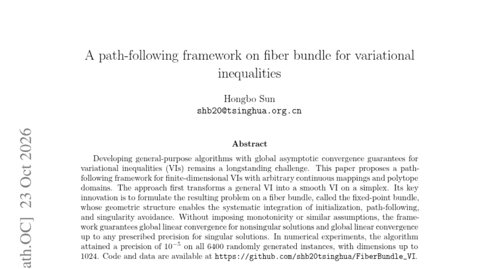

### 📌 한 줄 요약
단조성 가정 없이도 특이점 문제를 해결하며 전역 선형 수렴을 보장하는 새로운 변분 부등식(VI) 해결 프레임워크

### 🔑 핵심 포인트
- 파이버 번들(Fiber Bundle) 기하 구조를 활용한 경로 추적 프레임워크 제안
- 단조성(Monotonicity) 가정 없이도 전역 수렴 성능 확보
- 특이점(Singularity) 문제를 체계적으로 회피하며 고차원 문제 해결

### 🧑‍💻 개발자 관점
수학적 제약 조건이 까다로운 최적화 문제나 게임 이론적 평형 문제를 다룰 때, 안정적인 수렴 성능을 제공하는 알고리즘 엔진으로 활용 가능합니다.

### 🚀 실무 적용 아이디어
- 제공된 GitHub 코드를 사용하여 고차원(1024차원 이상) 문제의 수렴 속도 테스트
- 단조성이 깨지는 비볼록(Non-convex) 환경에서의 알고리즘 안정성 검증
- 기존 Newton-type 방법론과 성능 비교 실험

### ⚠️ 리스크/한계
- 기하학적 구조를 활용하므로 문제 변환 과정의 계산 복잡도가 높을 수 있음
- 특이점 근처에서의 수렴 속도 저하 가능성

### 📝 초록 기반 상세 설명
변분 부등식(VI) 문제에서 전역 수렴을 보장하는 범용 알고리즘 개발은 오랫동안 어려운 과제였습니다. 본 논문은 임의의 연속 사상과 다면체 도메인을 가진 유한 차원 VI를 위한 경로 추적 프레임워크를 제안합니다. 먼저 일반적인 VI를 심플렉스 상의 매끄러운 VI로 변환한 뒤, 이를 '고정점 번들(fixed-point bundle)'이라는 파이버 번들 구조로 정식화합니다. 이 기하학적 구조를 통해 초기화, 경로 추적, 특이점 회피를 체계적으로 통합할 수 있습니다. 단조성 가정을 배제하고도 비특이 해에 대해 전역 선형 수렴을, 특이 해에 대해 정밀도 범위 내에서의 전역 선형 수렴을 보장합니다. 실험 결과, 최대 1024 차원의 6400개 인스턴스에서 10^-5의 정밀도를 달성했습니다.

---

## 29. [The fixed-point bundle method over product-of-simplex domains arising from game equilibria](https://huggingface.co/papers/2609.16158)
**Upvotes**: 2 | **도입 난이도**: 중 | **신뢰도**: 상
**arXiv**: https://arxiv.org/abs/2609.16158

**태그**: Game Theory, Optimization, Algorithm, Fixed-point

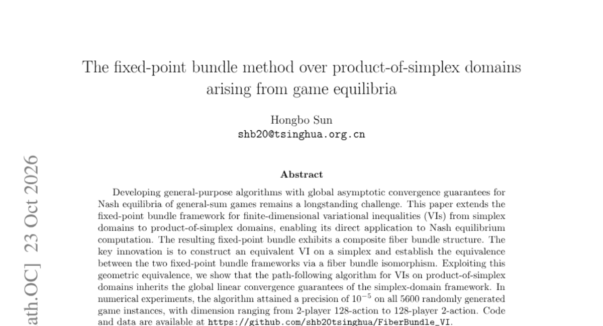

### 📌 한 줄 요약
복합 심플렉스 영역에서의 고정점 번들 방법을 통해 대규모 게임 이론의 내쉬 균형 계산 문제를 효율적으로 해결함

### 🔑 핵심 포인트
- 심플렉스 영역에서 복합 심플렉스 영역으로의 고정점 번들 프레임워크 확장
- 복합 영역 문제를 단일 심플렉스 문제로 변환하는 기하학적 동형 사상(Fiber Bundle Isomorphism) 구축
- 대규모 플레이어/액션 환경에서도 유지되는 전역 선형 수렴 보장 및 수치적 안정성

### 🧑‍💻 개발자 관점
다중 에이전트 시스템이나 복잡한 경제 모델링에서 내쉬 균형을 계산해야 하는 알고리즘 엔지니어에게 확장 가능한 수치 해석 솔루션을 제공합니다.

### 🚀 실무 적용 아이디어
- 제공된 GitHub 코드를 사용하여 플레이어 수 증가에 따른 연산 복잡도 변화 측정
- 기존의 내쉬 균형 알고리즘(예: Lemke-Howson)과 제안된 알고리즘의 수렴 속도 비교
- 다양한 게임 유형(Zero-sum vs General-sum)에서의 안정성 테스트

### ⚠️ 리스크/한계
- 차원이 매우 높아질 경우 변환 과정에서의 수치적 불안정성 발생 가능성
- 특수한 게임 구조가 아닌 일반적인 상황에서의 계산 비용 최적화 필요성

### 📝 초록 기반 상세 설명
일반합 게임(general-sum games)에서 전역 수렴 보장을 갖는 내쉬 균형 알고리즘 개발은 오랫동안 어려운 과제였습니다. 본 논문은 기존의 심플렉스 영역 기반 고정점 번들 프레임워크를 복합 심플렉스(product-of-simplex) 영역으로 확장하여 내쉬 균형 계산에 직접 적용할 수 있도록 설계했습니다. 핵심 혁신은 복합 영역 문제를 단일 심플렉스 상의 변분 부등식(VI) 문제로 변환하고, 두 프레임워크 간의 동형 사상(isomorphism)을 입증한 것입니다. 이러한 기하학적 동등성을 활용하여, 제안된 경로 추적 알고리즘은 기존 프레임워크의 전역 선형 수렴 특성을 유지합니다. 실험 결과, 플레이어 수와 액션 수가 다양한 대규모 게임 인스턴스에서도 높은 정밀도를 달гах했습니다.

---

## 30. [KANLab: TensorFlow Playground for Kolmogorov-Arnold Networks](https://huggingface.co/papers/2610.20117)
**Upvotes**: 1 | **도입 난이도**: 하 | **신뢰도**: 상
**arXiv**: https://arxiv.org/abs/2610.20117

**태그**: Visualization, KAN, Education, Deep Learning

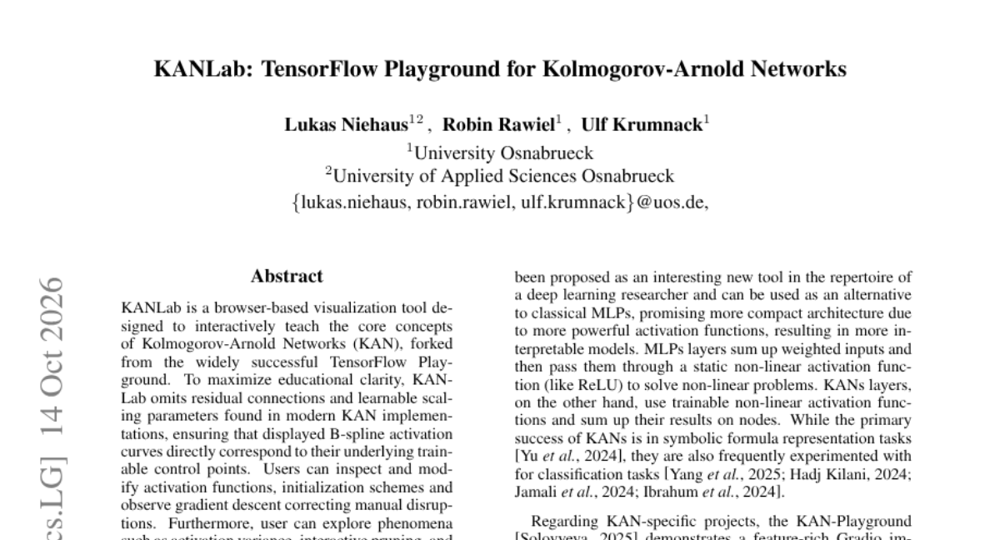

### 📌 한 줄 요약
KAN의 핵심 원리를 시각적으로 학습할 수 있는 브라우저 기반 인터랙티브 교육 도구

### 🔑 핵심 포인트
- TensorFlow Playground를 계승한 브라우저 기반 KAN 시각화 도구 개발
- B-spline 제어점과 활성화 곡선 간의 직관적 관계를 위한 구조적 단순화
- 활성화 함수 변형, 초기화, 프루닝, 재학습 등 KAN 특화 상호작용 기능 제공

### 🧑‍💻 개발자 관점
KAN의 수학적 구조와 학습 과정을 시각적으로 검증하며 모델의 동작 원리를 빠르게 파악할 수 있습니다.

### 🚀 실무 적용 아이디어
- 제공된 웹 사이트(kanlab.app)에서 직접 B-spline 제어점 수정해보기
- 다양한 초기화 방식이 KAN의 수렴 속도에 미치는 영향 관찰하기
- 프루닝(Pruning) 기능이 모델 구조에 미치는 영향을 시각적으로 확인하기

### ⚠️ 리스크/한계
- 교육적 목적을 위해 최신 KAN의 성능 최적화 요소(잔차 연결 등)를 의도적으로 제외함
- 2D 데이터셋 환경에 국한된 시뮬레이션임

### 📝 초록 기반 상세 설명
최근 주목받는 Kolmogorov-Arnold Networks(KAN)의 핵심 개념을 직관적으로 이해하기 위한 교육적 도구가 필요해졌습니다. 기존의 복잡한 구현 방식은 학습자가 활성화 함수의 변화를 명확히 관찰하는 데 방해가 될 수 있습니다. 이를 해결하기 위해 TensorFlow Playground를 기반으로 한 KANLab을 개발했습니다. KANLab은 잔차 연결과 스케일링 파라미터를 제거하여 B-spline 활성화 곡선과 제어점 간의 관계를 명확히 보여줍니다. 사용자는 활성화 함수 수정, 초기화 방식 변경, 프루닝 등을 통해 KAN의 동작 원리를 실시간으로 탐색할 수 있습니다.

---

## 31. [LLM2Cert: LLM Synthesis of Certificates with SMT/Lean Verification](https://huggingface.co/papers/2610.30524)
**Upvotes**: 1 | **도입 난이도**: 상 | **신뢰도**: 상
**arXiv**: https://arxiv.org/abs/2610.30524

**태그**: LLM-Agent, Formal-Verification, Control-Theory, SMT-Solver, Agent, Benchmark, Safety

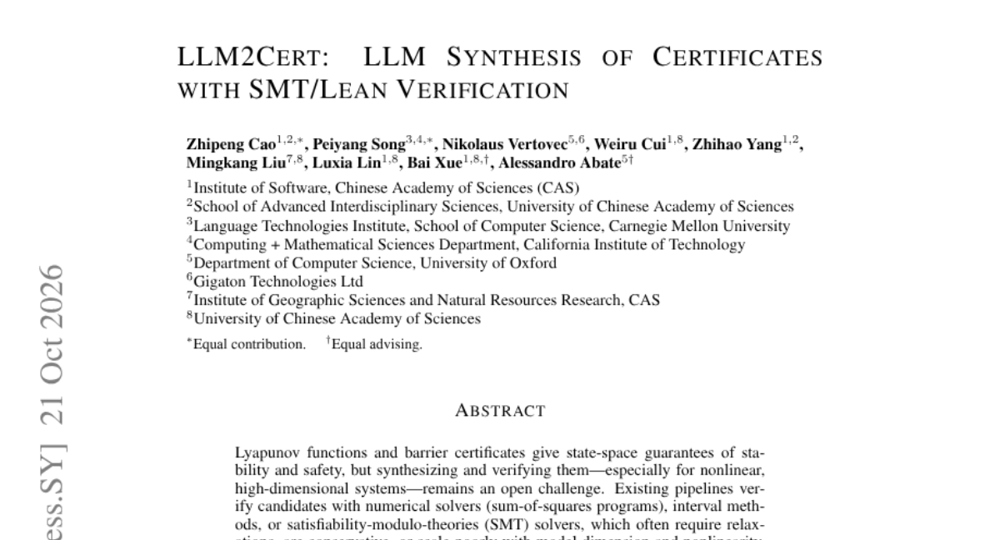

### 📌 한 줄 요약
LLM과 SMT/Lean 정형 검증을 결합하여 복잡한 비선형 시스템의 안정성 및 안전성 인증(Certificate)을 자동 생성하는 프레임워크

### 🔑 핵심 포인트
- 고차원/비선형 시스템을 위한 새로운 벤치마크 DynaCertBench 구축
- LLM 기반의 인증 후보 생성 및 SMT/Lean을 활용한 자동 검증 프레임워크(LLM2Cert) 제안
- LLM과 정형 검증 도구(SMT, Lean) 간의 피드백 루프를 통한 검증 성공률 향상

### 🧑‍💻 개발자 관점
제어 이론 및 로보틱스 분야에서 복잡한 시스템의 안전성을 수학적으로 증명하는 과정을 LLM 에이전트가 자동화할 수 있는 가능성을 제시합니다.

### 🚀 실무 적용 아이디어
- 제공된 GitHub 코드를 활용하여 DynaCertBench의 다양한 시스템에 대한 LLM2Cert 성능 테스트
- 특정 비선형 제어 문제에 대해 LLM의 증명 생성 능력을 직접 검증
- SMT 솔버와 Lean 간의 역할 분담 최적화 실험

### ⚠️ 리스크/한계
- LLM의 생성 결과가 수학적 엄밀함을 완벽히 보장하지 못할 수 있음
- 매우 복잡한 고차원 시스템에서는 여전히 계산 복잡도 및 수렴 문제가 발생할 수 있음

### 🖼️ 추가 자료

---

## 32. [What Git Does Not Record: Provenance Legibility in Two AI-Assisted Research Repositories](https://huggingface.co/papers/2610.28655)
**Upvotes**: 1 | **도입 난이도**: 중 | **신뢰도**: 상
**arXiv**: https://arxiv.org/abs/2610.28655

**태그**: AI-Assisted, Provenance, Git, Software Engineering, Audit, Agent, Vision

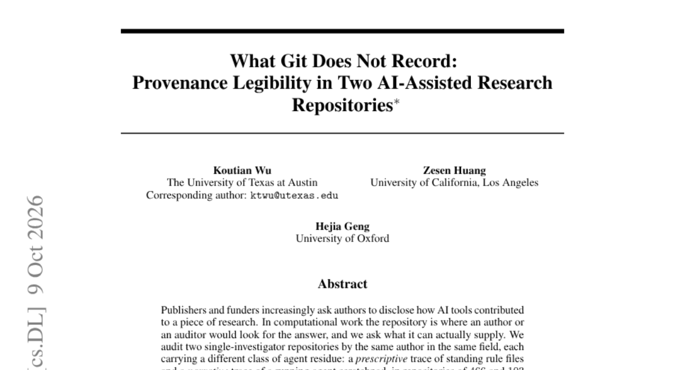

### 📌 한 줄 요약
AI 협업 연구에서 Git 기록만으로는 AI의 기여도와 연구 출처(Provenance)를 완벽히 검증할 수 없음을 실증적 분석으로 경고함

### 🔑 핵심 포인트
- Git 커밋 기록과 실제 AI 기여도 사이의 불일치 및 가시성 차이 확인
- 규칙 중심(Prescriptive)과 서사 중심(Narrative) 기록 방식의 상반된 특성 분석
- 자동화된 감사 시스템이 직면하는 데이터 신뢰성 및 추적성 문제 규명

### 🧑‍💻 개발자 관점
AI 에이전트나 자동화 도구를 사용하는 개발 환경에서, 작업 기록(Commit)이 어떻게 연구/개발의 출처 증명(Provenance)으로 변환될 수 있는지에 대한 설계 가이드를 제공합니다.

### 🚀 실무 적용 아이디어
- AI 에이전트 사용 시 작업 로그와 Git 커밋 간의 매핑 규칙 설계해보기
- 코드 변경 사항과 AI 생성 콘텐츠 간의 가시성 차이를 고려한 감사 로그 구조 설계
- 자동화된 감사 도구가 오판할 수 있는 '가짜 신뢰성' 사례 수집

### ⚠️ 리스크/한계
- 단일 저자의 두 프로젝트를 대상으로 한 사례 연구이므로 일반화에 주의 필요
- AI 기여도와 Git 기록 간의 인과관계를 완전히 분리하여 측정하지 못함

### 📝 초록 기반 상세 설명
연구자들이 AI 도구의 기여도를 공개해야 하는 요구가 커지면서, 코드 저장소(Repository)가 연구 출처를 증명하는 데 적합한지 검토가 필요해졌습니다. 본 연구는 동일 저자가 작성한 두 가지 성격의 AI 협업 저장소를 대상으로 감사(Audit)를 수행했습니다. 한 곳은 규칙 중심의 기록(Prescriptive trace)을, 다른 한 곳은 작업 과정 중심의 기록(Narrative trace)을 담고 있습니다. 분석 결과, 두 방식 모두 AI의 개입 정도를 정확히 나타내지 못하며 기록 방식에 따라 가시성과 신뢰도가 상충하는 것으로 나타났습니다. 최종적으로 연구 출처 기록 시스템이 갖추어야 할 요구사항과 증거 관리 체계를 제안합니다.

---

## 33. [Does LeWorldModel Preserve Local Action Geometry?](https://huggingface.co/papers/2610.31716)
**Upvotes**: 1 | **도입 난이도**: 하 | **신뢰도**: 상
**arXiv**: https://arxiv.org/abs/2610.31716

**태그**: World Model, Robot Learning, Action Sensitivity, Evaluation

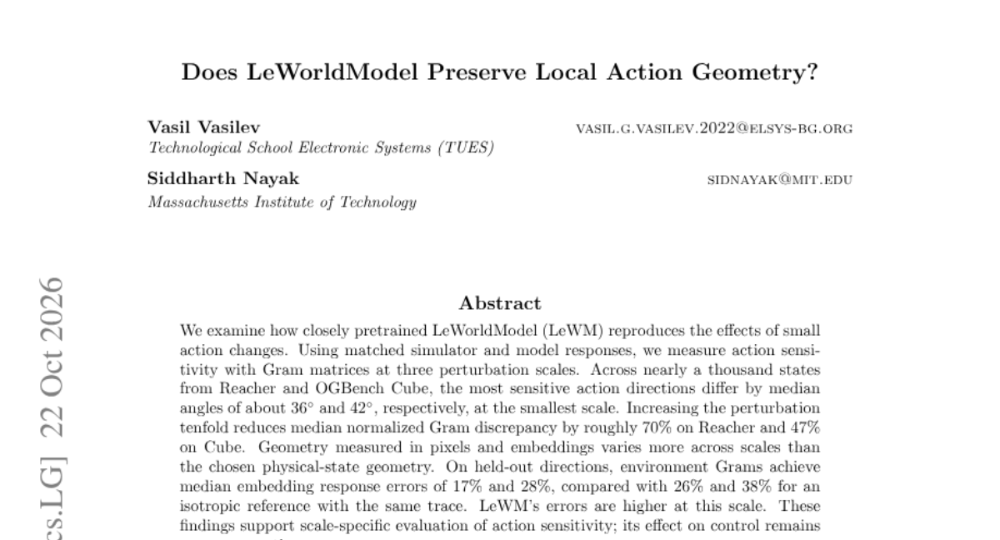

### 📌 한 줄 요약
사전 학습된 세계 모델(LeWM)이 미세한 액션 변화에 따른 물리적 기하 구조를 얼마나 정확하게 재현하는지 분석한 연구입니다.

### 🔑 핵심 포인트
- LeWorldModel의 액션 민감도와 물리적 기하 구조 재현 능력 검증
- 섭동 스케일(perturbation scale)에 따른 Gram 행렬 기반의 정량적 분석 수행
- 픽셀/임베딩 기하 구조와 물리적 상태 기하 구조 간의 스케일별 차이 확인

### 🧑‍💻 개발자 관점
세계 모델을 이용한 로봇 제어나 시뮬레이션 설계 시, 모델이 미세한 액션 변화를 물리적으로 타당하게 예측하는지 검증하는 방법론을 제공합니다.

### 🚀 실무 적용 아이디어
- 사용 중인 세계 모델에 대해 다양한 스케일의 액션 섭동 실험 수행
- 모델의 임베딩 공간과 실제 물리적 상태 공간 간의 기하학적 일치도 측정
- 학습된 모델이 미세한 액션 변화에 대해 과도하게 민감하거나 둔감한지 확인

### ⚠️ 리스크/한계
- 액션 민감도 재현도가 실제 제어 성능(Control)으로 직결되는지에 대한 검증 부족
- 특정 환경(Reacher, Cube)에 국한된 실험 결과의 일반화 가능성

### 📝 초록 기반 상세 설명
사전 학습된 세계 모델인 LeWorldModel(LeWM)이 미세한 액션 변화에 따른 효과를 얼마나 잘 재현하는지 조사합니다. 시뮬레이터와 모델의 응답을 매칭하여 세 가지 섭동 스케일에서 Gram 행렬을 통해 액션 민감도를 측정했습니다. Reacher 및 OGBench Cube 환경의 약 천 개 상태를 대상으로 실험한 결과, 가장 작은 스케일에서 민감한 액션 방향의 중앙값 각도 차이가 발생했습니다. 섭동 크기를 10배 늘리면 Gram 불일치도가 크게 감소하며, 이는 스케일에 따라 기하학적 특성이 달라짐을 보여줍니다. 결과적으로 액션 민감도 평가는 스케일별로 이루어져야 함을 시사하며, 제어 성능에 미치는 영향은 향후 과제로 남습니다.

### 🖼️ 추가 자료
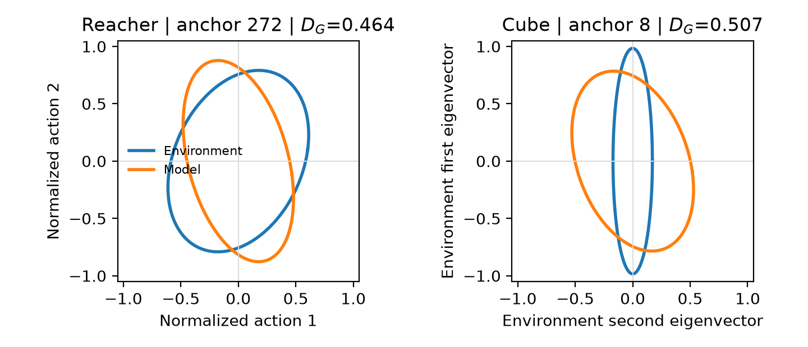

---

## 34. [SliderEdit++: Improved Slider Trajectories in Instruction-Based Image Editing](https://huggingface.co/papers/2610.14253)
**Upvotes**: 1 | **도입 난이도**: 중 | **신뢰도**: 상
**arXiv**: https://arxiv.org/abs/2610.14253

**태그**: Diffusion, Image Editing, ControlNet, UI/UX, RAG, Vision, Benchmark

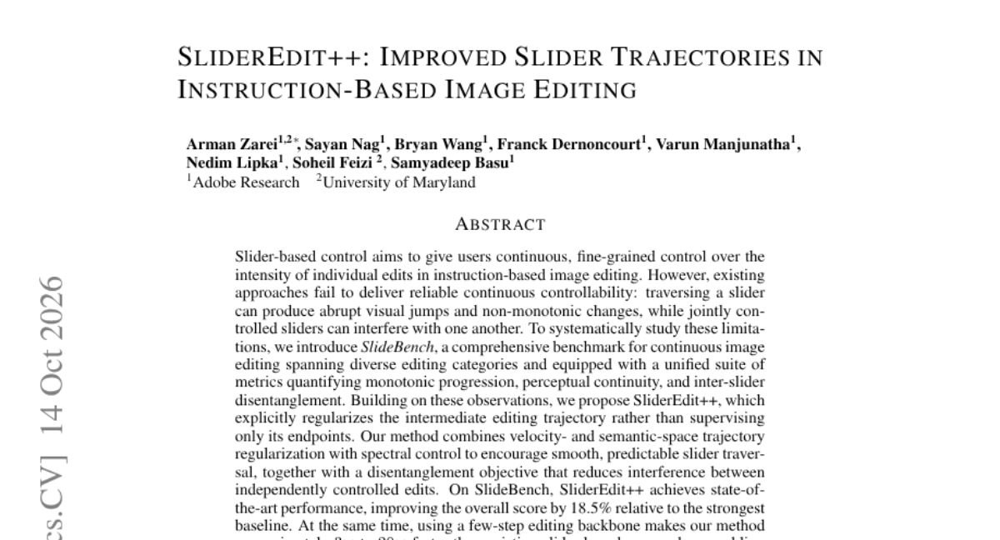

### 📌 한 줄 요약
슬라이더 조작 시 발생하는 급격한 변화와 간섭 문제를 해결하여, 부드럽고 독립적인 이미지 편집 제어를 가능하게 하는 기술입니다.

### 🔑 핵심 포인트
- 연속적 제어 성능 측정을 위한 새로운 벤합인 SlideBench 도입
- 중간 궤적 정규화(Velocity/Semantic-space)를 통한 부드러운 편집 변화 구현
- 슬라이더 간 간섭을 줄이는 분리 목적 함수(Disentanglement objective) 적용

### 🧑‍💻 개발자 관점
사용자가 직관적으로 이미지를 수정할 수 있는 UI/UX를 구현할 때, 조작 시 발생하는 시각적 불연속성 문제를 해결할 수 있는 실무적인 가이드라인을 제공합니다.

### 🚀 실무 적용 아이디어
- 제안된 궤적 정규화(Trajectory Regularization) 기법을 기존 Diffusion 모델에 적용해보기
- 다양한 편집 파라미터 간의 간섭(Interference) 정도를 측정하는 테스트 세트 구축하기
- Few-step 모델을 활용한 실시간 인터랙티브 편집 프로토타입 제작하기

### ⚠️ 리스크/한계
- 특정 편집 카테고리 외의 도메인에서는 정규화 효과가 미미할 수 있음
- 복합적인 편집 명령 수행 시 정규화와 생성 품질 사이의 트레이드오프 발생 가능성

### 📝 초록 기반 상세 설명
기존의 슬라이더 기반 이미지 편집은 조작 시 시각적 점프 현상이 발생하거나 여러 슬라이더 간의 간섭이 발생하는 등 연속적인 제어 능력이 부족했습니다. 이를 체계적으로 평가하기 위해 모니터링 지표를 포함한 새로운 벤치마크인 SlideBench를 제안했습니다. 연구진은 양 끝점뿐만 아니라 중간 편집 경로를 명시적으로 정규화하는 SliderEdit++ 방식을 제안했습니다. 이 방법은 속도 및 의미 공간의 궤적 정규화와 스펙트럴 제어를 결합하여 매끄러운 변화를 유도하고 슬라이더 간 간섭을 최소화합니다. 실험 결과, 기존 방식 대비 성능을 크게 향상시켰으며 빠른 추론 속도를 통해 실시간 인터랙티브 편집 환경을 구현했습니다.

---

## 35. [Co-adaptive Rule Routing and Constraining for Structured Knowledge Retrieval](https://huggingface.co/papers/2610.14465)
**Upvotes**: 1 | **도입 난이도**: 상 | **신뢰도**: 상
**arXiv**: https://arxiv.org/abs/2610.14465

**태그**: RAG, Reinforcement Learning, Knowledge Retrieval, Agent, Reasoning, Vision, Evaluation

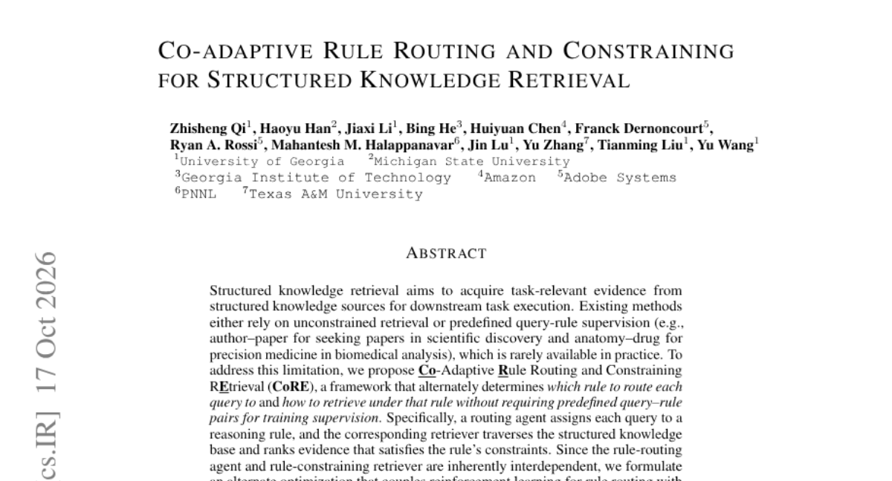

### 📌 한 줄 요약
사전 정의된 규칙 없이도 쿼리에 적합한 추론 규칙을 스스로 선택하고 그에 맞는 지식을 검색하는 Co-adaptive RAG 프레임워크

### 🔑 핵심 포인트
- 사전 정의된 쿼리-규칙 쌍 없이도 라우팅과 검색을 동시에 학습하는 Co-adaptive 메커니즘
- 강화 학습(라우팅 정책)과 대조 학습(제약 조건 기반 검색)의 상호 보완적 루프 구조
- 다양한 도메인(과학, 의료, 이커머스)에 적용 가능한 범용적 지식 검색 프레임워크

### 🧑‍💻 개발자 관점
수동으로 복잡한 검색 규칙을 설계할 필요 없이, 데이터로부터 최적의 검색 경로와 제약 조건을 자동 학습할 수 있어 RAG 시스템 구축 비용을 낮춥니다.

### 🚀 실무 적용 아이디어
- 도메인 특화 데이터셋을 활용한 라우팅-리트리버 간의 상호 학습 안정성 테스트
- 제시된 생성 기반 라우팅(Generation-based routing)의 타 도메인 전이 성능 검증
- 규칙 자동 정제(Rule refinement) 기능이 검색 정확도에 미치는 영향 분석

### ⚠️ 리스크/한계
- 라우팅과 검색이 서로 의존하므로 학습 초기 단계에서 수렴 실패 가능성 존재
- 복잡한 폐쇄 루프 구조로 인해 학습 자원 및 하이퍼파라미터 튜닝 난이도가 높음

### 📝 초록 기반 상세 설명
구조화된 지식 검색은 하위 태스크를 위해 관련 증거를 추출하는 작업이지만, 기존 방식은 수동으로 정의된 규칙이나 사전 정의된 쿼리-규칙 쌍에 의존하여 실무 적용에 한계가 있었습니다. 이를 해결하기 위해 Co-adaptive Rule Routing and Constraining Retrieval (CoRE)를 제안합니다. CoRE는 라우팅 에이전트가 규칙을 선택하고, 리트리버가 해당 규칙의 제약 조건에 맞춰 증거를 검색하는 구조를 가집니다. 강화 학습(RL)과 대조 학습(Contrastive Learning)을 교차 수행하는 폐쇄 루프(Closed-loop) 방식을 통해 라우팅과 검색이 서로를 보완하며 학습됩니다. 실험 결과, 과학적 발견, 생물 의학, 이커머스 등 다양한 도메인에서 우수한 성능을 입증했습니다.

---

## 36. [Predictive Closure: A Set-Level Characterization of JEPA's Feature Selection](https://huggingface.co/papers/2610.27364)
**Upvotes**: 0 | **도입 난이도**: 중 | **신뢰도**: 상
**arXiv**: https://arxiv.org/abs/2610.27364

**태그**: JEPA, Representation Learning, Self-Supervised Learning

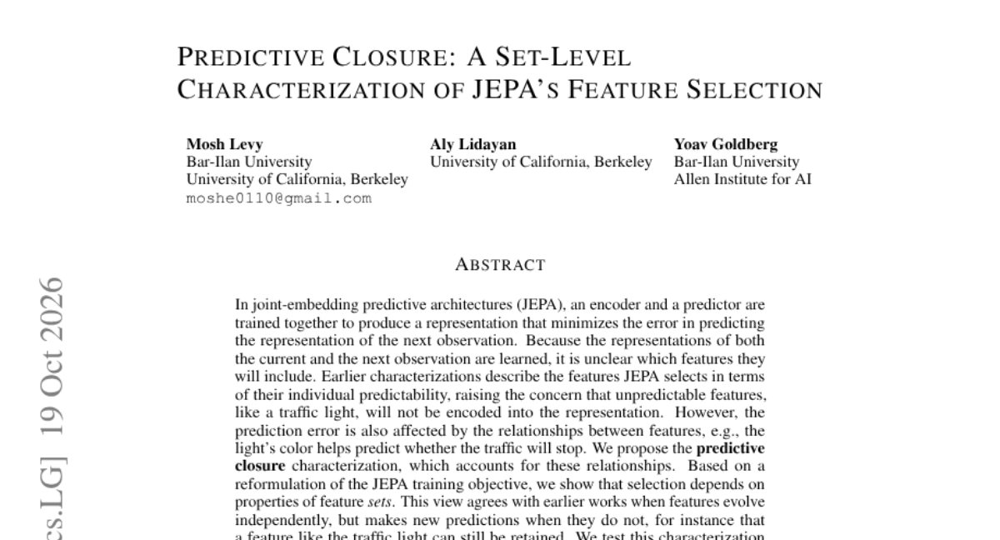

### 📌 한 줄 요약
JEPA의 특징 선택이 개별 예측 가능성이 아닌 특징 간의 관계(Set-level)에 의해 결정됨을 규명한 연구

### 🔑 핵심 포인트
- 특징 선택이 개별 속성이 아닌 집합적 관계(Set-level)에 의해 결정됨을 이론적으로 규명
- 예측 불가능한 특징도 다른 특징과의 관계를 통해 표현에 유지될 수 있음을 증명
- 보조 목표(Auxiliary objective)를 통한 간접적인 특징 제어(Steering) 가능성 제시

### 🧑‍💻 개발자 관점
모델이 특정 정보를 학습하게 하거나 유지하게 할 때, 직접적인 학습 외에도 관계를 이용한 간접적 제어가 가능함을 시사합니다.

### 🚀 실무 적용 아이디어
- 특징 간 의존성이 높은 데이터셋에서 JEPA의 특징 선택 양상 관찰
- 특정 특징을 유지하기 위해 다른 특징을 타겟팅하는 보조 손실 함수 설계 실험
- 제공된 사이드 정보(Side information)가 특징 표현의 강도에 미치는 영향 테스트

### ⚠️ 리스크/한계
- 특징 간 관계가 복잡할수록 모델의 해석 가능성이 낮아질 수 있음
- 이론적 증명이 특정 조건(독립적 진화 등)에서만 일치할 수 있는 한계 존재

### 📝 초록 기반 상세 설명
JEPA는 다음 관측치의 표현을 예측하며 학습하지만, 어떤 특징이 선택될지는 여전히 불분명합니다. 기존 연구는 개별 특징의 예측 가능성에 초점을 맞추어, 예측 불가능한 특징이 배제될 수 있다는 우려를 낳았습니다. 본 논문은 특징 간의 상호 관계를 고려하는 '예측적 폐쇄(Predictive Closure)' 개념을 제안합니다. 이를 통해 예측 불가능한 특징이라도 다른 특징을 예측하는 데 도움이 된다면 표현에 포함될 수 있음을 수학적으로 증명했습니다. 실험 결과, 특징 간의 관계가 특징 선택에 미치는 영향을 확인했으며, 보조 목표를 통한 간접적인 특징 제어 가능성을 입증했습니다.

---

## 37. [Judging the Justification: Decision Certificate Supervision for Generative Reward Models](https://huggingface.co/papers/2610.27528)
**Upvotes**: 0 | **도입 난이도**: 중 | **신뢰도**: 상
**arXiv**: https://arxiv.org/abs/2610.27528

**태그**: LLM, RLHF, Reward Model, Reasoning, Vision, Benchmark, Evaluation

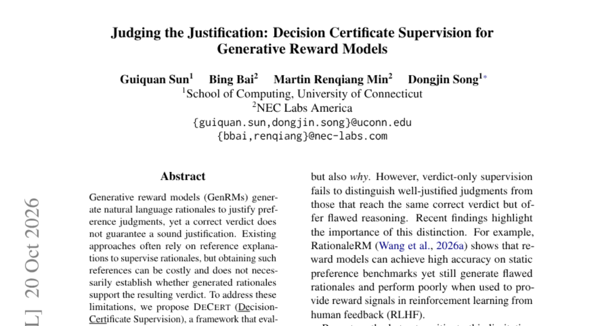

### 📌 한 줄 요약
정답 판결뿐만 아니라 그 근거(Rationale)의 논리적 타당성까지 학습하여 생성형 보상 모델의 신뢰도를 높이는 프레임워크 제안

### 🔑 핵심 포인트
- 참조 설명(Reference) 없이 근거의 타당성과 판결 일관성을 평가하는 DeCert 프레임워크 제안
- 정답 판결이 같더라도 근거의 품질 차이를 이용해 선호도 학습을 수행하는 메커니즘 도입
- 위치 편향(Positional Bias)을 억제하고 근거의 논리적 품질을 동시에 향상

### 🧑‍💻 개발자 관점
LLM의 판단 근거가 단순히 '맞는 답'을 맞추는 것을 넘어, 논리적으로 타당한지 검증하고 학습시키는 데 중요한 방법론을 제공합니다.

### 🚀 실무 적용 아이디어
- 기존 RLHF/DPO 과정에서 생성된 근거(Rationale)의 품질을 DeCert 방식으로 평가해보기
- 모델이 정답은 맞추되 근거는 틀리는 'Hallucination' 현상이 발생하는지 데이터셋 구축
- 위치 편향이 심한 데이터셋에 DeCert 프레임워크 적용 실험

### ⚠️ 리스크/한계
- 근거의 품질을 평가하는 메커니즘 자체가 모델의 성능에 의존할 수 있음
- 복잡한 논리적 추론이 필요한 영역에서는 근거 검증의 난이도가 급격히 상승함

### 📝 초록 기반 상세 설명
생성형 보상 모델(GenRM)은 판단 근거를 자연어로 생성하지만, 정답 판결이 반드시 논리적인 근거를 보장하지는 않습니다. 기존 방식은 참조용 설명(Reference)을 필요로 하여 비용이 높고, 판결과 근거 사이의 일관성을 검증하기 어렵다는 문제가 있습니다. 이를 해결하기 위해 DeCert는 참조 설명 없이도 생성된 근거의 타당성과 판결 일관성을 평가하는 프레임워크를 제안합니다. DeCert는 동일한 정답을 가진 여러 샘플 간의 근거 품질 차이를 이용해 선호도 학습을 수행함으로써 더 강력한 근거를 생성하도록 유도합니다. 실험 결과, DeCert는 기존 베이스라인보다 우수한 성능을 보였으며 특히 위치 편향(Positional Bias)을 효과적으로 완화했습니다.

---

## 38. [On the Token Collapse Phenomenon in Textual Graph Soft Prompting](https://huggingface.co/papers/2610.31572)
**Upvotes**: 0 | **도입 난이도**: 중 | **신뢰도**: 상
**arXiv**: https://arxiv.org/abs/2610.31572

**태그**: LLM, Graph-RAG, Prompt Engineering, Deep Learning, Benchmark, Evaluation, Safety

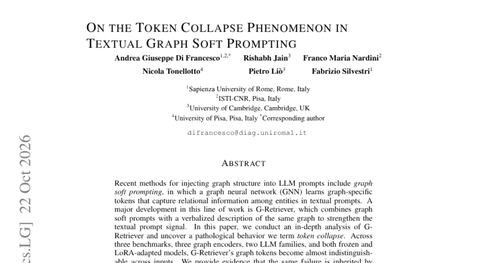

### 📌 한 줄 요약
그래프 소프트 프롬프팅에서 토큰이 데이터와 무관하게 동일해지는 '토큰 붕괴(Token Collapse)' 현상을 발견하고 이를 해결하는 방안을 제시함

### 🔑 핵심 포인트
- 그래프 소프트 프롬프팅에서 발생하는 '토큰 붕괴(Token Collapse)' 현상 규명
- 붕괴된 토큰이 그래프 정보 대신 일반적인 프롬프트 역할만 수행함을 증명
- 토큰 붕괴를 방지하면서 성능을 유지하는 2단계 절차 제안

### 🧑‍💻 개발자 관점
그래프 정보를 LLM에 주입할 때, 모델의 높은 정확도가 실제 그래프 정보를 활용한 결과인지 아니면 단순한 프롬프트 효과인지 구분할 수 있는 통찰을 제공합니다.

### 🚀 실무 적용 아이디어
- G-Retriever 등 그래프 프롬프팅 모델 사용 시 토큰 간 유사도(Cosine Similarity) 측정 실험
- 제안된 2단계 절차를 기존 그래프-LLM 파이프라인에 적용하여 성능 비교
- 학습된 토큰을 무작위 데이터나 상수값으로 교체했을 때의 성능 변화 테스트

### ⚠️ 리스크/한계
- 토큰 변동성이 확보된다고 해서 반드시 모델이 그래프 정보를 올바르게 사용하는 것은 아님
- 특정 벤치마크나 모델 설정에 따라 붕괴 현상의 양상이 다를 수 있음

### 📝 초록 기반 상세 설명
최근 GNN을 통해 그래프 구조를 LLM 프롬프트에 주입하는 소프트 프롬프팅 방식이 주목받고 있습니다. 연구진은 G-Retriever와 같은 기존 방식에서 입력 데이터와 상관없이 토큰이 거의 동일해지는 '토큰 붕괴' 현상을 발견했습니다. 실험 결과, 붕괴된 토큰은 그래프 정보를 전달하기보다 일반적인 소프트 프롬프트 역할만 수행하며, 심지어 상수 프롬프트와 성능 차이가 거의 없었습니다. 이를 해결하기 위해 토큰 붕괴를 방지하는 2단계 절차를 제안합니다. 최종적으로는 단순 작업 정확도만으로 그래프 정렬을 판단하는 대신, 토큰 변동성을 포함한 실질적인 평가 방식의 필요성을 강조합니다.

---

## 39. [FLORA: An Open Model Suite for Scaling Robotics Data Engines](https://huggingface.co/papers/2610.31779)
**Upvotes**: 0 | **도입 난이도**: 중 | **신뢰도**: 상
**arXiv**: https://arxiv.org/abs/2610.31779

**태그**: Robotics, Data Engine, Foundation Model, Open Source, Benchmark

### 📌 한 줄 요약
로봇 파운데이션 모델 학습을 위한 대규모 데이터 라벨링 및 데이터 엔진 오픈소스 공개

### 🔑 핵심 포인트
- 로봇 학습용(보상, 캡션 등) 데이터 생성을 위한 통합 데이터 엔진 FLORA 개발
- GPT-6 Astra 대비 약 125배 저렴한 비용으로 대규모 데이터 라벨링 가능
- 일일 20만 시간 분량의 데이터를 처리하는 검증된 확장성 및 성능 확보

### 🧑‍💻 개발자 관점
로봇 학습용 데이터 구축 시 발생하는 막대한 비용 문제를 해결하고, 대규모 데이터 파이프라인을 구축할 수 있는 실질적인 가이드를 제공합니다.

### 🚀 실무 적용 아이디어
- 오픈소스된 FLORA 모델을 활용하여 기존 로봇 데이터셋의 캡션 품질 테스트
- 자체 보유한 로봇 동작 데이터에 대한 보상(Reward) 라벨링 실험
- API 기반 모델과 FLORA의 비용 대비 성능(Cost-efficiency) 비교 분석

### ⚠️ 리스크/한계
- 특정 로봇 도메인에 특화된 데이터셋에서는 범용 모델과 성능 차이가 발생할 수 있음
- 대규모 인프라(GPU 클러스터) 운영 역량이 뒷받침되어야 전체 성능을 유지 가능

### 📝 초록 기반 상세 설명
로봇 파운데이션 모델의 생애주기에는 결과 보상, 프로세스 보상, 타임스탬프 캡션 등 다양한 데이터 라벨이 필수적입니다. 기존의 API 기반 모델들은 비용과 확장성 측면에서 대규모 로봇 데이터 처리에 한계가 있습니다. 본 논문은 GR00T 모델 학습에 사용된 산업급 데이터 엔진인 FLORA를 제안합니다. FLORA는 캡셔닝 및 보상 벤치마크에서 SOTA를 달성하며, GPT-6 Astra 대비 약 125배 저렴한 비용으로 대규모 데이터 처리가 가능함을 입증했습니다. 이 엔진을 오픈소스로 공개함으로써 연구자들이 대규모 로봇 데이터셋을 확장하고 물리적 자동 연구를 수행할 수 있는 기반을 제공합니다.

---

## 40. [FocusVLA: Future-Intent Guided Dynamic View Routing for Vision-Language-Action Models](https://huggingface.co/papers/2610.31423)
**Upvotes**: 0 | **도입 난이도**: 하 | **신뢰도**: 상
**arXiv**: https://arxiv.org/abs/2610.31423

**태그**: VLA, Robotics, Multi-view, Dynamic Routing, RAG, Vision, Evaluation

### 📌 한 줄 요약
미래 의도 예측을 통해 작업 단계별로 최적의 카메라 뷰를 동적으로 선택하는 VLA 모델 프레임워크

### 🔑 핵심 포인트
- 미래 상호작용 의도 예측을 통한 동적 뷰 라우팅 메커니즘 도입
- 작업 단계별로 전역(Global)과 국소(Local) 관찰의 비중을 적응적으로 조절
- 기존 VLA 핵심 아키텍처를 수정하지 않고도 모듈 형태로 통합 가능

### 🧑‍💻 개발자 관점
멀티 카메라 환경에서 모든 영상을 동시에 처리하는 비용을 줄이면서, 작업 단계(접근, 조작, 정밀 작업 등)에 최적화된 시각 정보를 선택하는 효율적인 전략을 제시합니다.

### 🚀 실무 적용 아이디어
- 기존 VLA 모델에 의도 예측 및 라우팅 모듈을 플러그인 방식으로 결합해보기
- 단일 뷰 중심 모델과 멀티뷰 라우팅 모델 간의 연산 효율성 비교 실험
- 다양한 작업 단계(Task Stage)를 가진 복합 작업 환경에서의 강건성 테스트

### ⚠️ 리스크/한계
- 의도 예측이 실패할 경우 잘못된 뷰를 선택하여 작업 실패로 이어질 위험
- 실시간 라우팅 결정 과정에서 발생할 수 있는 지연 시간(Latency) 문제

### 📝 초록 기반 상세 설명
로봇 조작을 위해 시각, 언어, 행동을 통합하는 VLA 모델이 중요해지면서 멀티뷰 입력이 널리 사용되고 있습니다. 그러나 기존 모델은 특정 뷰(예: 손목 카메라)에만 의존하는 경향이 있어 작업 단계에 따른 전역-지역 정보의 유연한 활용이 부족합니다. 이를 해결하기 위해 과거 행동으로부터 미래 상호작용 의도를 예측하고, 이를 바탕으로 뷰를 동적으로 라우팅하는 FocusVLA를 제안합니다. 이 프레임워크는 작업 단계에 맞춰 전역 관찰과 국소 관찰을 적응적으로 조정하여 멀티뷰 활용도를 극대화합니다. 실험 결과, RoboTwin 2.0 및 실세계 환경에서 기존 베이스라인 대비 성공률을 크게 향상시켰습니다.

---

