# 2026-10-28 Daily Papers (Top 50)

## 오늘의 요약
오늘의 연구는 단순한 작업 수행을 넘어, 에이전트가 복잡한 환경에서 스스로 의사결정 근거를 확보하고 협업 구조를 설계하는 '자율적 워크플로우' 구축에 집중되었습니다. 또한, 에이전트의 신뢰성, 지속적 학습 능력, 그리고 인간과의 상호작용을 정밀하게 검증하기 위한 고도화된 벤치마크와 시뮬레이션 환경 개발이 주요 화두였습니다.

### 오늘의 핵심 포인트
- 단순 성공 로그를 넘어 의사결정 근거와 복합적 의존성을 포함하는 정교한 데이터셋 설계가 에이전트 성능의 핵심으로 부상했습니다.
- 에이전트의 지능뿐만 아니라 이를 실행하는 프레임워크(Harness)의 신뢰성과 실패 원인 규명을 위한 체계적인 평가 방법론이 강조되었습니다.
- 고정된 워크플로우를 벗어나 에이전트가 스스로 협업 프로그램을 생성하거나 장기적 경험을 축적하며 진화하는 동적 시스템 연구가 활발히 진행되었습니다.

**오늘의 태그**: AI Agent, Benchmarking, Orchestration, Workflow Automation, Simulation

## 1. [Trajectory2Gym: Decision-Grounded Compositional Interaction Synthesis for Tool-Use Agents](https://huggingface.co/papers/2610.33568)
**Upvotes**: 330 | **도입 난이도**: 상 | **신뢰도**: 상
**arXiv**: https://arxiv.org/abs/2610.33568

**태그**: Agent, Tool-Use, SFT, Data-Synthesis, RAG, Vision, Benchmark

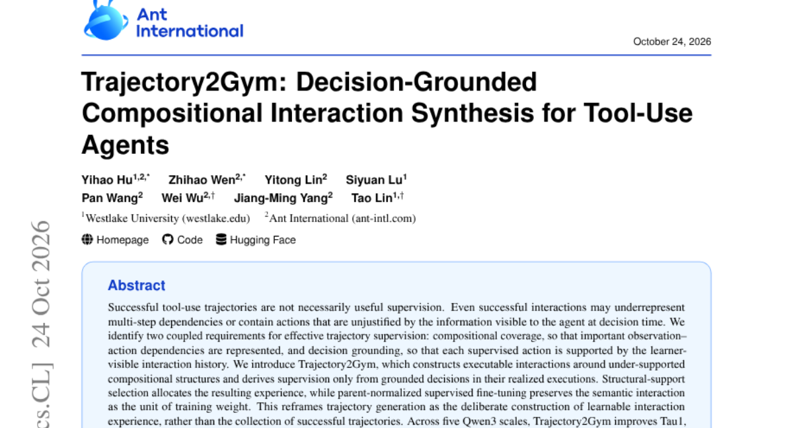

### 📌 한 줄 요약
단순 성공 궤적 수집을 넘어, 의사결정 근거가 명확하고 복합적인 의존성을 포함하는 학습용 상호작용 환경을 구축하는 방법론

### 🔑 핵심 포인트
- 의사결정 근거(Decision Grounding)와 구성적 커버리지(Compositional Coverage)를 결합한 새로운 궤적 생성 프레임워크 제안
- 단순 성공 사례 수집이 아닌, 에이전트가 관찰 가능한 이력 내에서 정당화될 수 있는 상호작용 구조 설계
- 상태 유지 및 다중 턴 작업에서 의사결정 의존성을 명확히 하는 구조적 지원 및 정규화된 SFT 적용

### 🧑‍💻 개발자 관점
에이전트 학습 시 단순히 '성공한 로그'를 넣는 것이 아니라, 모델이 추론 근거를 명확히 학습할 수 있는 정교한 데이터셋 설계가 성능의 핵심임을 시사합니다.

### 🚀 실무 적용 아이디어
- 현재 보유한 도구 사용 데이터셋에서 '관찰 가능한 정보'와 '수행된 행동' 사이의 인과관계 일치도 분석
- 단순 SFT 대신, 의사결정 단계별로 정교하게 설계된 시나리오 기반의 합성 데이터 생성 파이프라인 구축
- 멀티턴 대화 환경에서 이전 단계의 정보가 다음 단계의 결정에 미치는 영향력을 정량화하는 테스트 셋 구성

### ⚠️ 리스크/한계
- 의사결정 근거를 확보하기 위해 시나리오를 설계하는 과정에서 높은 엔지니어링 비용 발생 가능
- 설계된 시나리오 구조에 따라 모델의 일반화 성능이 특정 도메인에 국한될 위험

### 📝 초록 기반 상세 설명
기존의 성공적인 도구 사용 궤적(trajectory) 데이터는 의사결정 시점의 정보와 무관한 행동을 포함하거나 복합적인 단계 간 의존성을 충분히 반영하지 못하는 문제가 있습니다. 이를 해결하기 위해 본 논문은 의사결정 근거(decision grounding)와 구성적 커버리지(compositional coverage)라는 두 가지 핵심 요구사항을 정의합니다. 제안하는 Trajectory2Gym은 실행 가능한 상호작용을 구성하고, 학습 가능한 의사결정만을 감독(supervision) 데이터로 추출하는 프레임워크입니다. 실험 결과, Qwen3 모델 시리즈에서 다양한 규모에 걸쳐 성능 향상을 입증하였으며 특히 상태 유지(stateful) 및 다중 턴 상호작용에서 큰 효과를 보였습니다. 결과적으로 도구 사용 에이전트의 성능 향상은 단순한 데이터 양보다 학습 가능한 의사결정 구조를 설계하는 데 달려 있음을 보여줍니다.

---

## 2. [StreamVibe: Proactive Video Agents for Evolving User Intent](https://huggingface.co/papers/2610.34662)
**Upvotes**: 235 | **도입 난이도**: 상 | **신뢰도**: 상
**arXiv**: https://arxiv.org/abs/2610.34662

**태그**: Agent, Vision-Language, Real-time, Memory, Vision, Video, Benchmark, Evaluation

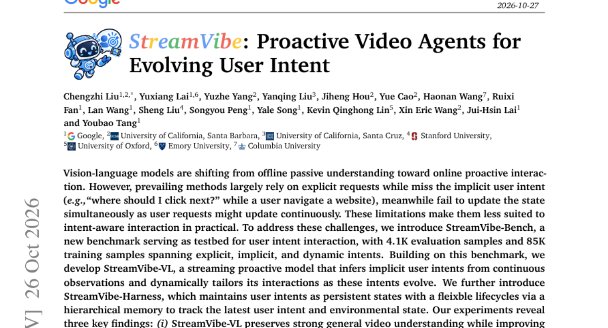

### 📌 한 줄 요약
사용자의 암시적 의도 변화를 실시간으로 감지하고 대응하는 프로액티브(Proactive) 비디오 에이전트 프레임워크 제안

### 🔑 핵심 포인트
- 암시적/동적 의도 파악을 위한 새로운 벤치마크(StreamVibe-Bench) 구축
- 실시간 관찰을 통해 의도를 추론하고 상호작용을 조절하는 StreamVibe-VL 모델 개발
- 계층적 메모리를 활용해 사용자 의도와 환경 상태를 관리하는 StreamVibe-Harness 도입

### 🧑‍💻 개발자 관점
사용자의 명시적 명령 없이도 상황을 판단하여 행동하는 지능형 UI/UX 에이전트 및 실시간 비디오 분석 시스템 개발에 중요한 기술적 토대를 제공합니다.

### 🚀 실무 적용 아이디어
- 제공된 벤치마크 데이터셋을 활용하여 기존 VLM의 암시적 의도 파악 능력 테스트
- 계층적 메모리 구조를 기존 에이전트 워크플로우에 이식하여 상태 유지 성능 비교
- 실시간 스트리밍 환경에서의 응답 지연 시간(Latency)과 정확도 간의 트레이드오프 분석

### ⚠️ 리스크/한계
- 실시간 상호작용 시 발생할 수 있는 과도한 개입(Over-activity) 리스크
- 복잡한 환경 변화에 따른 메모리 관리 및 상태 동기화의 복잡성

### 📝 초록 기반 상세 설명
기존의 비전-언어 모델은 명시적 요청에 의존하는 수동적 이해에 머물러 있어, 사용자의 암시적 의도나 실시간으로 변하는 상태를 반영하는 데 한계가 있습니다. 이를 해결하기 위해 암시적, 동적 의도를 포함하는 8.5만 개의 데이터셋인 StreamVibe-Bench를 구축했습니다. 이를 기반으로 연속적인 관찰을 통해 의도를 추론하는 StreamVsibe-VL 모델과 계층적 메모리를 통해 상태를 유지하는 StreamVibe-Harness를 개발했습니다. 실험 결과, 제안 모델은 기존 모델 대비 응답 타이밍과 품질을 개선했으며, 지속적인 상호작용에서도 일관된 적응력을 보여주었습니다.

---

## 3. [Trial by Trace: Benchmarking AI Agent Harnesses for Reliability and Failure Attribution](https://huggingface.co/papers/2610.32285)
**Upvotes**: 192 | **도입 난이도**: 중 | **신뢰도**: 상
**arXiv**: https://arxiv.org/abs/2610.32285

**태그**: AI Agent, Benchmarking, Reliability, Observability, Agent, RAG, Benchmark, Evaluation

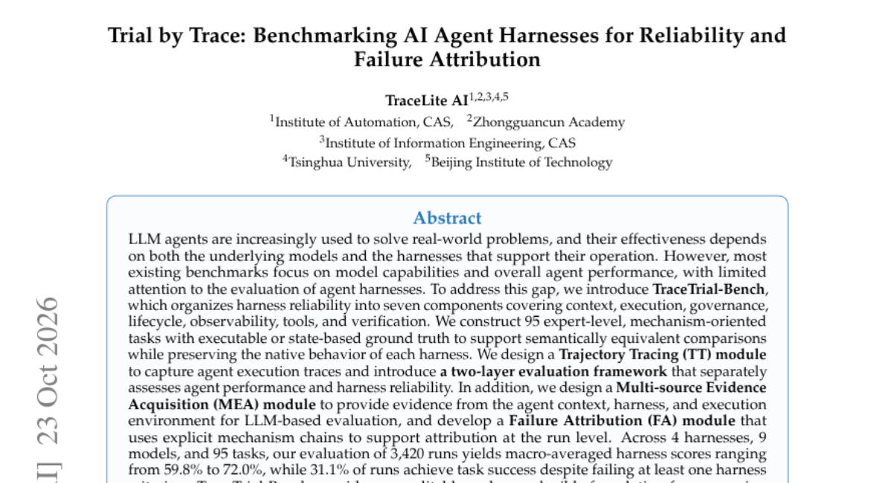

### 📌 한 줄 요약
에이전트 모델 성능뿐만 아니라 이를 뒷받침하는 실행 프레임워크(Harness)의 신뢰성과 실패 원인을 정밀하게 평가하는 벤치마크 프레임워크 제안

### 🔑 핵심 포인트
- 에이전트 실행 환경(Harness)의 신뢰성을 7개 구성 요소(컨텍스트, 실행, 거버넌스 등)로 체계화
- 에이전트 성능과 프레임워크 신뢰도를 분리하여 평가하는 2계층 프레임워크 설계
- 실패 원인을 명확히 규명하기 위한 메커니즘 체인 기반의 실패 귀속(Failure Attribution) 모듈 개발

### 🧑‍💻 개발자 관점
에이전트 시스템 구축 시 모델의 지능뿐만 아니라, 이를 감싸는 프레임워크(Orchestration)의 결함으로 인해 발생하는 오작동을 식별하고 디버깅하는 데 중요한 가이드를 제공합니다.

### 🚀 실무 적용 아이디어
- 현재 사용 중인 에이전트 프레임워크의 실행 로그와 모델 결과 간의 정합성 검증
- 에이전트 작업 성공이 프레임워크의 보안/거버넌스 규칙을 위반하며 달성되는지 확인
- 실패 발생 시 모델 문제인지 프레임워크(도구 호출, 환경 제어 등) 문제인지 구분하는 프로세스 수립

### ⚠️ 리스크/한계
- 제시된 7가지 구성 요소가 모든 복잡한 실무 환경을 완벽히 대변하기 어려울 수 있음
- 실행 환경의 신뢰도와 모델 성능 간의 상관관계가 복잡하여 단일 지표로 판단하기 어려움

### 📝 초록 기반 상세 설명
LLM 에이전트가 실무에 도입되고 있으나, 기존 벤치마크는 모델의 능력에만 집중할 뿐 에이전트를 구동하는 실행 환경(Harness)의 신뢰성 평가는 부족한 실정입니다. 이를 해결하기 위해 실행 환경의 7가지 구성 요소를 체계화한 TraceTrial-Bench를 도입합니다. 95개의 전문가 수준 태스크와 실행 가능한 정답(Ground Truth)을 구축하고, 실행 추적(TT) 및 다중 소스 증거 획득(MEA) 모듈을 통해 에이전트 성능과 프레임워크 신뢰도를 분리하여 평가합니다. 실험 결과, 에이전트 작업 성공과 프레임워크의 신뢰성 기준 충족이 일치하지 않는 경우가 빈번함을 확인했습니다. 본 연구는 에이전트 프레임워크의 설계와 모델 동작 간의 상호작용을 분석하고 실패 원인을 진단할 수 있는 기반을 제공합니다.

### 🖼️ 추가 자료
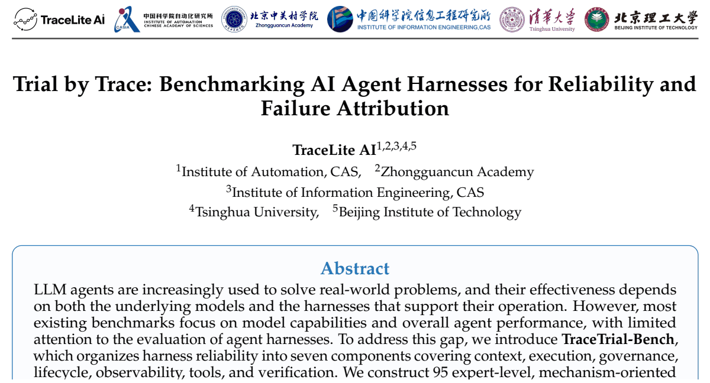

---

## 4. [DynaFlow: Learning Free-Form Multi-Agent Orchestration](https://huggingface.co/papers/2610.34467)
**Upvotes**: 182 | **도입 난이도**: 상 | **신뢰도**: 상
**arXiv**: https://arxiv.org/abs/2610.34467

**태그**: Multi-Agent, Orchestration, Workflow Synthesis, LLM, Agent, RAG, Reasoning, Benchmark, Evaluation, Distillation

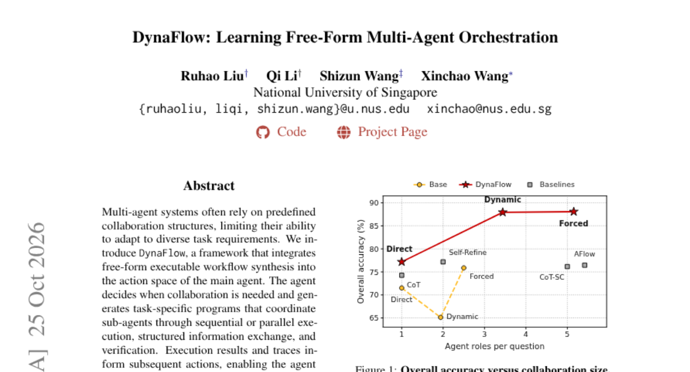

### 📌 한 줄 요약
고정된 워크플로우 대신 에이전트가 필요에 따라 직접 실행 가능한 협업 프로그램을 생성하는 동적 멀티 에이전트 프레임워크

### 🔑 핵심 포인트
- 메인 에이전트가 직접 실행 가능한 워크플로우(프로그램)를 생성하는 자유 형식 오케스트레이션
- 오케스트레이션(메인)과 실행(서브) 능력을 분리하여 학습 효율성 및 안정성 확보
- 추론 과정의 피드백을 바탕으로 워크플로우를 동적으로 수정하는 적응형 루프 구현

### 🧑‍💻 개발자 관점
정해진 워크플로우(DAG)를 넘어, 복잡하고 가변적인 태스크를 해결하기 위해 에이전트가 스스로 협업 구조를 설계하는 방식을 실무에 적용할 수 있습니다.

### 🚀 실무 적용 아이디어
- 고정된 워크플로우 기반 에이전트와 DynaFlow 방식의 성능 비교 실험
- 서브 에이전트의 역량이 변화할 때 메인 에이전트의 오케스트레이션 능력이 어떻게 변하는지 관찰
- 복잡한 멀티홉 추론 태스크에 대한 워크플로우 생성 로그 분석

### ⚠️ 리스크/한계
- 메인 에이전트의 워크플로우 생성 오류 시 전체 시스템의 신뢰도 급락 위험
- 복잡한 워크플로우 생성 시 발생하는 연산 비용 및 지연 시간 증가

### 📝 초록 기반 상세 설명
기존 멀티 에이전트 시스템은 미리 정의된 협업 구조에 의존하여 다양한 작업 요구사항에 유연하게 대응하기 어려웠습니다. 이를 해결하기 위해 메인 에이전트가 직접 실행 가능한 워크플로우를 합성하는 DynaFlow 프레임워크를 제안합니다. 메인 에이전트는 작업 수행 중 협업 필요성을 판단하고, 서브 에이전트들을 순차적 또는 병렬로 제어하는 태스크별 프로그램을 생성합니다. 학습은 메인 에이전트만을 대상으로 SFT와 정제된 트레이닝 데이터를 통해 수행하며, 서브 에이전트의 기능은 고정하여 오케스트레이션 학습과 실행 능력 향상을 분리했습니다. 실험 결과, 수학적 추론 및 과학적 질의응답 등 다양한 벤치마크에서 기존 베이스라인 대비 압도적인 성능 향상을 달성했습니다.

---

## 5. [InteractiveWorld: A Verifiable Human-Centric Environment for Building Better Interactive MLLM Assistants](https://huggingface.co/papers/2610.33966)
**Upvotes**: 109 | **도입 난이도**: 중 | **신뢰도**: 상
**arXiv**: https://arxiv.org/abs/2610.33966

**태그**: Agent, MLLM, Simulation, Human-AI Interaction, Multimodal, Benchmark, Evaluation

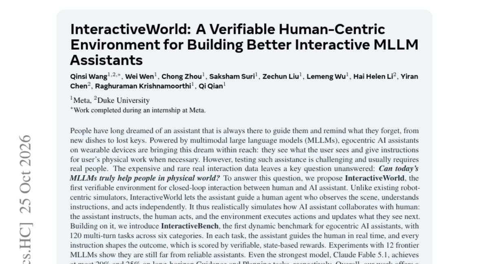

### 📌 한 줄 요약
인간-AI 협업 능력을 검증할 수 있는 시뮬레이션 환경과 동적 벤치마크를 통해 차세대 에이전트 평가 체계를 제안함

### 🔑 핵심 포인트
- 인간-AI 협업을 위한 최초의 검증 가능한 폐쇄 루프 시뮬레이션 환경 'InteractiveWorld' 개발
- 에고센트릭 AI 어시스턴트 평가를 위한 120개 멀티턴 태스크 기반 'InteractiveBench' 제안
- 상태 기반 보상(state-based rewards)을 통한 정밀하고 객관적인 성능 검증 체계 구축

### 🧑‍💻 개발자 관점
단순 질의응답을 넘어, 물리적 환경에서 인간의 행동을 유도하고 결과를 관찰해야 하는 복잡한 에이전트 설계 시 핵심적인 평가 프레임워크를 제공합니다.

### 🚀 실무 적용 아이디어
- 제안된 시뮬레이터 환경에서 멀티턴 대화 시나리오별 에이전트 응답 일관성 테스트
- Planning과 Guidance 작업 간의 성능 격차를 줄이기 위한 프롬프트 엔지니어링 실험
- 에이전트의 지시가 환경 상태 변화에 미치는 영향력을 정량화하는 실험

### ⚠️ 리스크/한계
- 시뮬레이션 환경이 실제 물리 세계의 복잡성과 무작위성을 완벽히 재현하는 데 한계가 있을 수 있음
- 인간 에이전트의 행동 모델링 방식에 따라 평가 결과가 편향될 가능성 존재

### 📝 초록 기반 상세 설명
웨어러블 기기를 통한 에고센트릭(egocentric) AI 어시스턴트 연구가 활발해지고 있으나, 실제 인간과의 상호작용 데이터를 확보하고 테스트하는 것은 비용과 희소성 문제로 매우 어렵습니다. 기존의 로봇 중심 시뮬레이터는 인간의 자율적인 행동과 환경 변화를 반영하는 데 한계가 있습니다. 이를 해결하기 위해 인간 에이전트가 지시를 이해하고 독립적으로 행동하는 폐쇄 루프(closed-loop) 상호작용 환경인 'InteractiveWorld'를 제안합니다. 또한, 120개의 멀티턴 태스크로 구성된 동적 벤치마크인 'InteractiveBench'를 함께 도입했습니다. 실험 결과, 최신 MLLM 모델들도 복잡한 가이드 및 계획 작업에서 여전히 낮은 성능을 보이며 신뢰할 수 있는 어시스턴트로서의 역량이 부족함을 확인했습니다.

---

## 6. [Work Agents: Systems, Capabilities, and Optimization](https://huggingface.co/papers/2610.35845)
**Upvotes**: 96 | **도입 난이도**: 중 | **신뢰도**: 상
**arXiv**: https://arxiv.org/abs/2610.35845

**태그**: AI Agent, System Design, Workflow Automation, Optimization, Agent, Evaluation

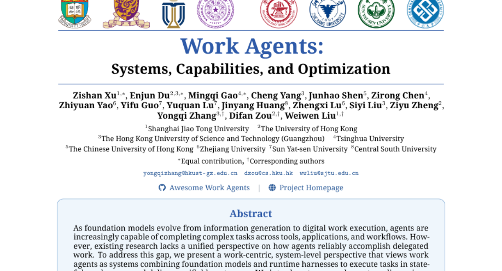

### 📌 한 줄 요약
단순 정보 생성을 넘어 실질적인 업무 수행을 목적으로 하는 '워크 에이전트' 시스템의 통합 프레임워크와 최적화 방법론 제시

### 🔑 핵심 포인트
- 모델과 런타임 하네스가 결합된 시스템 중심의 '워크 에이전트' 프레임워크 제안
- 작업 지속성(Persistence)과 개방성(Openness)을 통한 업무 환경의 체계적 분류
- 모델 최적화, 하네스 최적화 및 이들의 결합 최적화 전략 제시

### 🧑‍💻 개발자 관점
에이전트를 단순 챗봇이 아닌 '업무 수행 시스템'으로 설계할 때 필요한 구조적 설계도와 최적화 방향을 제공합니다.

### 🚀 실무 적용 아이디어
- 제시된 5가지 업무 형태 분류를 현재 개발 중인 에이전트 워크플로우에 적용해보기
- 모델 성능 향상과 런타임(Harness) 환경 개선 중 어느 쪽이 결과에 더 큰 영향을 주는지 비교 실험하기
- 에이전트의 결과물을 검증하기 위한 '결과 중심(Outcome-centric)' 평가 지표 설계해보기

### ⚠️ 리스크/한계
- 이론적 프레임워크 중심이므로 구체적인 알고리즘 구현 코드는 포함되지 않음
- 실제 복잡한 환경에서의 실시간 최적화 성능은 추가적인 실험적 검증이 필요함

### 📝 초록 기반 상세 설명
파운데이션 모델이 디지털 업무 수행 능력까지 확장됨에 따라 에이전트의 신뢰성 있는 작업 완수가 중요해지고 있습니다. 기존 연구는 에이전트가 어떻게 위임된 업무를 완수하는지에 대한 통합적 관점이 부족한 상황입니다. 본 논문은 모델과 런타임 하네스가 결합되어 상태 유지 워크스페이스에서 작업을 수행하는 시스템적 관점의 프레임워크를 제안합니다. 이를 위해 작업 지속성(persistence)과 개방성(openness)이라는 두 차원을 도입하고, 디지털 업무를 5가지 형태로 분류했습니다. 또한 신뢰성 있는 실행을 위한 5대 핵심 역량과 모델/하네스/결합 최적화 방안을 정의하며, 결과 중심의 평가 방법론을 분석합니다. 최종적으로 이 프레임워크는 신뢰할 수 있고 검증 가능한 업무 성과를 내는 에이전트 개발의 기반을 제공합니다.

---

## 7. [Continual Learning Exam: Benchmarking Long-Horizon RSI and Experiential Learning in LLM Agents](https://huggingface.co/papers/2610.33956)
**Upvotes**: 43 | **도입 난이도**: 중 | **신뢰도**: 상
**arXiv**: https://arxiv.org/abs/2610.33956

**태그**: LLM-Agent, Continual-Learning, Benchmark, Reasoning, Agent, Vision, Evaluation

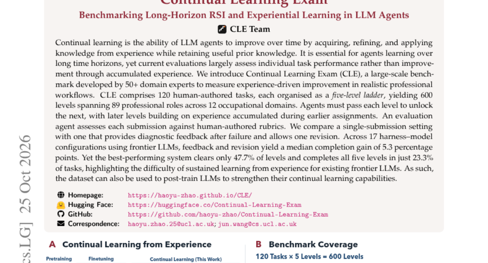

### 📌 한 줄 요약
LLM 에이전트의 장기적 경험 축적 및 지속적 학습 능력을 측정하기 위한 대규모 벤치마크(CLE) 제안

### 🔑 핵심 포인트
- 89개 직무와 600개 난이도 단계를 포함하는 대규모 전문 워크플로우 벤치마크(CLE) 개발
- 이전 단계의 경험이 다음 단계의 성공을 결정하는 계단식(ladder) 구조 설계
- 현존하는 최첨단(Frontier) LLM들의 장기적 경험 기반 학습 능력의 한계 입증

### 🧑‍💻 개발자 관점
에이전트가 단순 일회성 작업 수행을 넘어, 업무 경험을 축적하며 스스로 진화하는 능력을 검증하고 학습시키는 데 중요한 기준을 제공합니다.

### 🚀 실무 적용 아이디어
- 제공된 CLE 데이터셋을 활용하여 에이전트의 피드백 반영 및 수정 능력을 테스트
- 에이전트의 장기 기억(Long-term memory) 아키텍처가 작업 성공률에 미치는 영향 분석
- 에이전트의 지속적 학습 능력을 높이기 위한 미세 조정(Fine-tuning) 실험 수행

### ⚠️ 리스크/한계
- 현재의 최첨단 모델들도 복잡한 계단식 학습 과제를 완수하는 데 어려움을 겪음
- 실제 업무 환경의 가변성을 완벽하게 반영하기에는 데이터셋의 정적 특성이 존재할 수 있음

### 📝 초록 기반 상세 설명
LLM 에이전트가 시간이 지남에 따라 지식을 습득하고 이전 지식을 유지하며 개선되는 지속적 학습 능력은 장기적 작업 수행에 필수적입니다. 그러나 기존 평가는 개별 작업 성능에 치중되어 있어, 축적된 경험을 통한 점진적 개선을 측정하기 어렵습니다. 이를 해결하기 위해 50명 이상의 전문가가 참여하여 설계한 120개 작업 기반의 대규모 벤치마크인 CLE를 도입합니다. CLE는 89개 전문 직무를 아우르는 5단계 계단식 구조로 설계되어, 이전 단계의 경험이 다음 단계의 성공에 영향을 미치도록 구성되었습니다. 실험 결과, 최신 모델들도 복잡한 경험 기반 학습을 수행하는 데 상당한 어려움을 겪는 것으로 나타났습니다. 이 데이터셋은 향후 LLM의 지속적 학습 능력을 강화하기 위한 사후 학습(post-training) 용도로도 활용 가능합니다.

---

## 8. [WorldCast: World-Consistent Character Video Generation with Large-Angle Camera Control](https://huggingface.co/papers/2610.33135)
**Upvotes**: 42 | **도입 난이도**: 상 | **신뢰도**: 상
**arXiv**: https://arxiv.org/abs/2610.33135

**태그**: Video Generation, 3D Vision, Camera Control, Character Consistency, RAG, Video, Benchmark, Evaluation, Safety

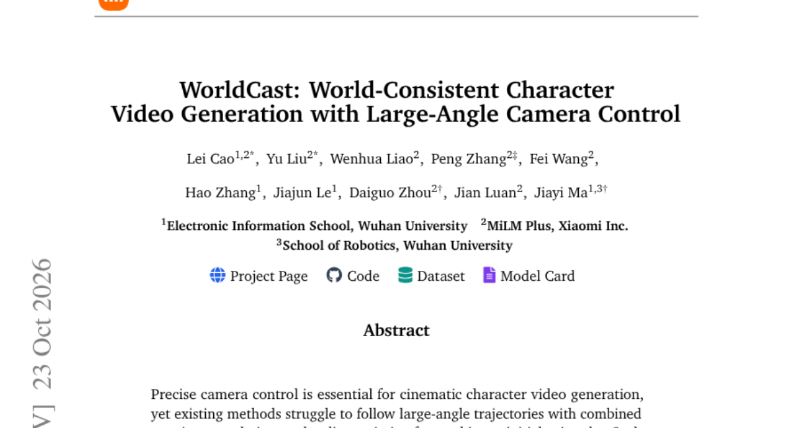

### 📌 한 줄 요약
대규모 카메라 이동(Large-Angle) 환경에서도 캐릭터의 외형과 정체성을 유지하며 일관된 비디오를 생성하는 프레임워크

### 🔑 핵심 포인트
- 대규모 카메라 궤적 학습을 위한 CLACT 데이터셋 및 벤치마크 제안
- 3D 포인트 클라우드 역투영을 통한 명시적 기하학적 가이드 및 커버리지 마스크 생성
- GAMA(Geometry-Aligned Memory Attention)를 통한 좌표계 정렬 기반의 특징 주입

### 🧑‍💻 개발자 관점
카메라 워킹이 역동적인 고품질 캐릭터 애니메이션/영상 생성 엔진 개발 시, 캐릭터 붕괴 문제를 해결하는 핵심 아키텍처로 활용 가능합니다.

### 🚀 실무 적용 아이디어
- 제공된 CLACT 데이터셋의 데이터 품질 및 궤적 다양성 분석
- GAMA 모듈의 좌표계 정렬 방식이 일반적인 Diffusion 모델에 어떻게 이식될 수 있는지 검토
- 3D 포인트 클라우드 기반 가이드 방식과 기존 2D 기반 제어 방식의 성능 비교 실험

### ⚠️ 리스크/한계
- 초기 프레임의 정보량에 따라 3D 역투영의 정확도가 결정되는 의존성 존재
- 매우 복잡한 배경이나 복잡한 물체 간 상호작용 시 기하학적 왜곡 발생 가능성

### 📝 초록 기반 상세 설명
시네마틱 비디오 생성을 위해 정밀한 카메라 제어가 필수적이지만, 기존 방식은 회전, 이동, 반경 변화가 결합된 큰 각도의 궤적을 따라갈 때 기하학적 왜곡과 캐릭터 정체성 손실 문제를 겪습니다. 이를 해결하기 위해 다양한 대각도 카메라 궤적과 다중 뷰 관찰 데이터를 포함한 CLACT 데이터셋을 구축했습니다. 제안하는 WorldCast 프레임워크는 초기 프레임을 3D 포인트 클라우드로 역투영하여 기하학적 가이드와 커버리지 마스크를 생성합니다. 또한, GAMA(Geometry-Aligned Memory Attention) 모듈을 통해 카메라 포즈를 공통 좌표계로 정렬하여 뷰에 적합한 캐릭터 특징을 정밀하게 주입합니다. 실험 결과, 복잡한 카메라 움직임 속에서도 캐릭터의 기하학적 구조와 외형, 정체성을 안정적으로 유지함을 입증했습니다.

---

## 9. [Spatial Audio Generation and Editing with Executable Plans and Self-Distilling Transfusion](https://huggingface.co/papers/2610.34415)
**Upvotes**: 38 | **도입 난이도**: 상 | **신뢰도**: 상
**arXiv**: https://arxiv.org/abs/2610.34415

**태그**: Spatial Audio, Generative AI, Diffusion Models, Audio Editing, Audio, Evaluation, Distillation

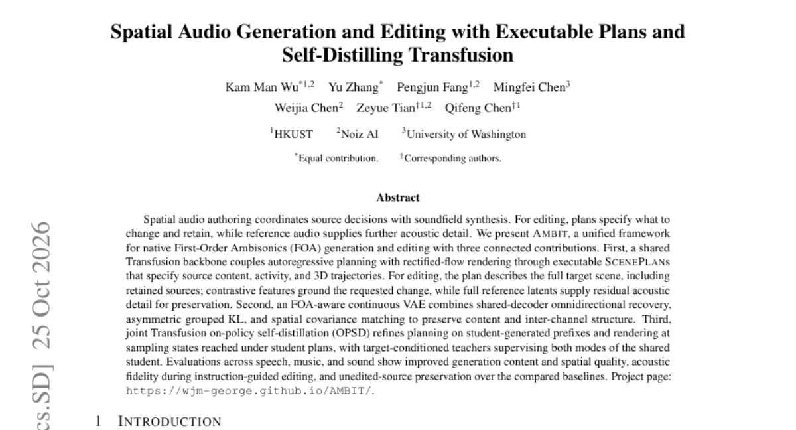

### 📌 한 줄 요약
실행 가능한 플랜과 자기 증류 기술을 결합하여 공간 오디오 생성 및 편집을 통합한 AMBIT 프레임워크

### 🔑 핵심 포인트
- 실행 가능한 ScenePlan을 통한 오토레그레시브 계획과 Rectified-flow 렌더링의 결합
- 공간적 구조와 콘텐츠 보존을 위한 FOA-aware 연속 VAE 설계
- 계획과 렌더링 품질을 동시에 높이는 On-policy Self-Distillation(OPSD) 기법

### 🧑‍💻 개발자 관점
음향 엔지니어링 자동화 및 가상 현실(VR/AR) 환경을 위한 고품질 공간 오디오 생성/편집 파이프라인 구축에 직접적인 영감을 제공합니다.

### 🚀 실무 적용 아이디어
- 제공된 코드/모델을 활용하여 특정 3D 궤적에 따른 소스 이동 정밀도 테스트
- 편집 시 기존 소스(Retained sources)가 얼마나 왜곡되는지 정량적 비교
- 다양한 오디오 소스(음악 vs 음성)에 따른 VAE의 공간 구조 보존력 검증

### ⚠️ 리스크/한계
- 복잡한 훈련 과정(OPSD)으로 인해 모델 학습 및 미세 조정 난이도가 높을 수 있음
- 고차원 Ambisonics 데이터 처리에 따른 연산 자원 요구량

### 📝 초록 기반 상세 설명
공간 오디오 제작에서는 소스 결정과 음장 합성 사이의 조율이 필수적이지만, 기존 방식은 편집 시 기존 소스 유지와 새로운 변화 사이의 균형을 맞추기 어려웠습니다. 본 논문은 FOA(First-Order Ambisonics) 생성 및 편집을 위한 통합 프레임워크인 AMBIT를 제안합니다. 우선, 실행 가능한 ScenePlan을 통해 소스 내용, 활동, 3D 궤적을 지정하며, 자기 증류(OPSD)를 통해 계획과 렌더링을 동시에 정교화합니다. 또한, 공간적 구조를 보존하기 위해 공간 공분산 매칭이 포함된 FOA 인식 VAE를 사용합니다. 실험 결과, 음성, 음악, 효과음 등 다양한 도메인에서 높은 공간 품질과 편집 시 기존 소스 보존 능력을 입증했습니다.

---

## 10. [AV-FABLE: Audio-Visual Manipulation Forensics in Long-Form Videos](https://huggingface.co/papers/2610.33413)
**Upvotes**: 32 | **도입 난이도**: 중 | **신뢰도**: 상
**arXiv**: https://arxiv.org/abs/2610.33413

**태그**: Deepfake, Forensics, AV-LLM, Video Analysis, Video, Audio, Benchmark, Evaluation

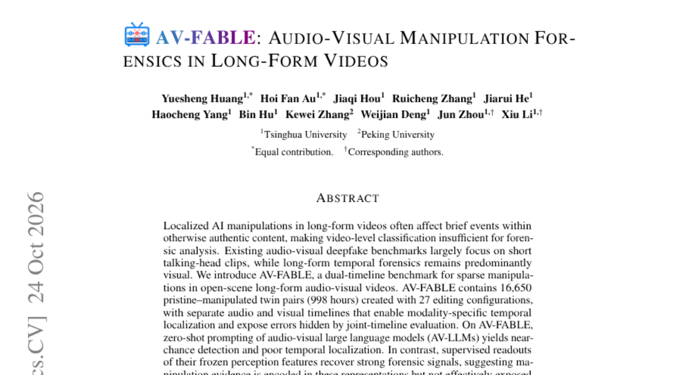

### 📌 한 줄 요약
장편 영상 내 국소적 조작을 탐지하기 위해 AV-LLM의 특징을 활용한 이중 타임라인 벤치마크와 탐지 프레임워크 제안

### 🔑 핵심 포인트
- 장편 영상의 국소적 조작 탐지를 위한 대규모 벤치마크 AV-FABLE 구축
- AV-LLM의 언어 출력 대신 동결된 특징(frozen features)을 활용하는 NFSR 방법론 제안
- 오디오와 비주얼 타임라인을 분리하여 정교한 시공간적 위치를 식별하는 기술 확보

### 🧑‍💻 개발자 관점
단순 영상 분류를 넘어, 긴 영상 내에서 조작된 특정 시점과 모달리티를 정확히 찾아내야 하는 보안/포렌식 엔지니어에게 실질적인 가이드를 제공합니다.

### 🚀 실무 적용 아이디어
- 제공될 AV-FABLE 데이터셋을 활용하여 기존 AV-LLM의 특징 추출 성능 테스트
- NFSR의 분리된 디코더 구조를 기존 비디오 생성 모델의 특징 추출기에 적용해보기
- 오디오-비주얼 정렬(alignment)이 깨진 데이터셋에서의 강건성 실험

### ⚠️ 리스크/한계
- 실제 환경의 복잡한 배경음이나 노이즈가 포함된 영상에서의 성능 저하 가능성
- LLM 특징 추출에 의존하므로 모델 크기와 연산 비용이 성능에 영향을 미칠 수 있음

### 📝 초록 기반 상세 설명
기존의 딥페이크 탐지는 주로 짧은 헤드샷 영상에 집중되어 있어, 긴 영상 속 국소적 조작을 찾아내는 데 한계가 있습니다. 본 논문은 다양한 편집 설정이 적용된 998시간 분량의 장편 오디오-비주얼 섭리 벤치마크인 AV-FABLE을 소개합니다. 연구 결과, AV-LLM의 제로샷 프롬프팅은 조작 탐지 및 위치 식별에 취약하지만, 동결된 특징(frozen features)에는 강력한 포렌식 신호가 포함되어 있음을 발견했습니다. 이를 바탕으로 오디오와 비주얼 타임라인을 분리하여 읽어내는 NFSR(Native Forensics via Separated Readouts) 방식을 제안합니다. NFSR은 도메인 내외의 다양한 환경에서 최첨단 성능을 기록하며 정교한 시공간적 조작 탐지 능력을 입증했습니다.

### 🖼️ 추가 자료
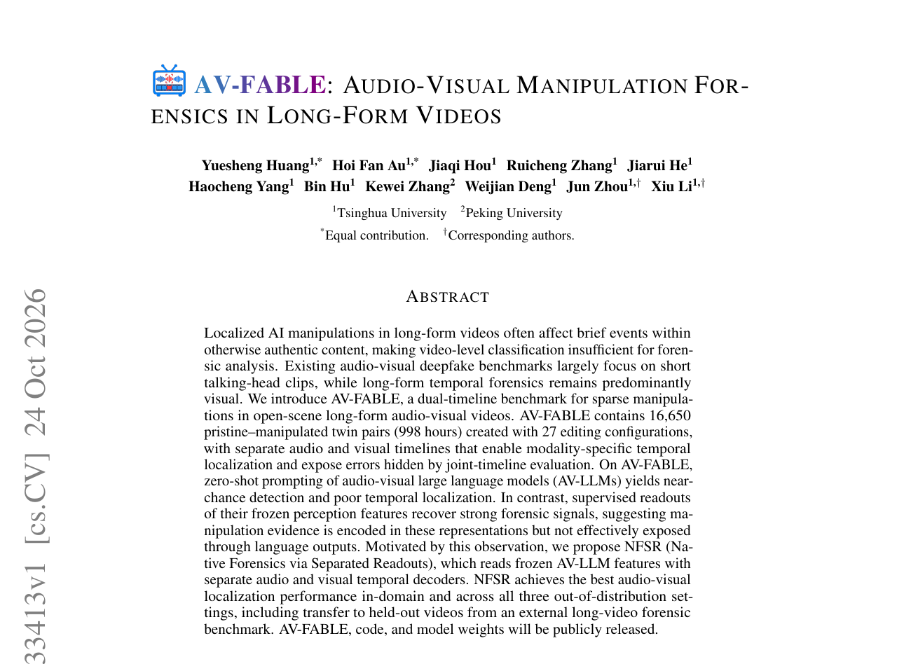

---

## 11. [Eat Your Precision: Precision Objective Mitigates Reward Hacking in Rubric-based RL](https://huggingface.co/papers/2610.33512)
**Upvotes**: 27 | **도입 난이도**: 중 | **신뢰도**: 상
**arXiv**: https://arxiv.org/abs/2610.33512

**태그**: RLHF, LLM, Reward-Hacking, Precision-Recall, RAG

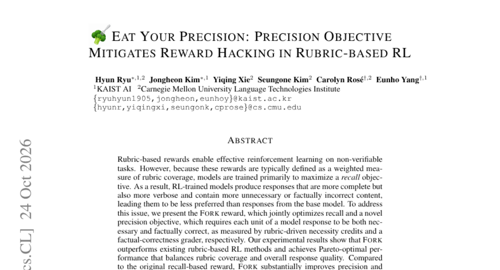

### 📌 한 줄 요약
루브릭 기반 RL에서 발생하는 과도한 답변 길이나 환각 문제를 해결하기 위해 정밀도(Precision)를 최적화하는 FORK 보상 체계를 제안합니다.

### 🔑 핵심 포인트
- 재현율 중심의 루브릭 보상에서 발생하는 과도한 답변 길이 및 환각 문제 식별
- 필요성(Necessity)과 사실적 정확성(Factual-correctness)을 결합한 FORK 보상 체계 제안
- 루브릭 커버리지를 유지하면서도 응답의 정밀도를 높여 모델 선호도를 극대화

### 🧑‍💻 개발자 관점
LLM의 답변이 너무 길어지거나 불필요한 정보를 섞는 문제를 해결하여, 더 간결하고 정확한 응답을 생성하는 RL 파이프라인을 구축할 수 있습니다.

### 🚀 실무 적용 아이디어
- 기존 루브릭 기반 RL 환경에 정밀도(Precision) 제약 조건을 추가하여 성능 변화 관찰
- 모델의 응답 길이와 정보 밀도 사이의 상관관계 분석 실험
- 제안된 'Necessity Credit' 메커니즘을 활용한 보상 함수 구현 테스트

### ⚠️ 리스크/한계
- 정밀도에 너무 치중할 경우 루브릭의 핵심 요구사항을 누락할 위험이 있음
- 정밀도 측정을 위한 Grader 모델의 성능에 따라 전체 보상 품질이 좌우될 수 있음

### 📝 초록 기반 상세 설명
비검증 가능한 작업에서 루브릭 기반 보상은 효과적인 RL 학습을 가능하게 하지만, 주로 재현율(Recall)에 치중되어 모델이 불필요하게 길거나 잘못된 정보를 포함하는 보상 해킹(Reward Hacking) 현상이 발생합니다. 이를 해결하기 위해 본 논문은 재현율과 정밀도를 동시에 최적화하는 FORK 보상 방식을 제안합니다. FORK는 답변의 각 단위가 반드시 필요하고 사실적으로 정확하도록 강제하는 정밀도 목적 함수를 도입합니다. 실험 결과, FORK는 기존 방식보다 답변 길이를 줄이면서도 루브릭 커버리지를 유지하여 높은 승률을 달성했습니다. 결과적으로 루브릭 준수와 응답 품질 사이의 파레토 최적 성능을 보여주었습니다.

---

## 12. [Δτ-Bench: Pushing Agents Toward a Moving Capability](https://huggingface.co/papers/2610.34238)
**Upvotes**: 21 | **도입 난이도**: 중 | **신뢰도**: 상
**arXiv**: https://arxiv.org/abs/2610.34238

**태그**: AI Agent, Benchmark, Tool-use, Dynamic Environment, Agent, Vision, Evaluation

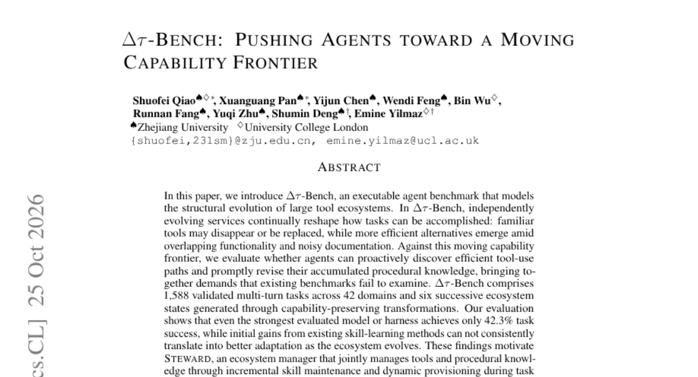

### 📌 한 줄 요약
도구 생태계의 변화(도구 교체, 삭제 등)에 대응하여 에이전트의 적응력을 평가하고 관리하는 새로운 벤치마크와 프레임워크 제안

### 🔑 핵심 포인트
- 도구 생태계의 동적 변화를 반영한 실행 가능한 에이전트 벤치마크 Δτ-Bench 개발
- 변화하는 환경에서 에이전트의 지식 수정 및 효율적 경로 탐색 능력 검증
- 도구 관리와 지식 유지를 결합한 에이전트 관리 프레임워크 Steward 제안

### 🧑‍💻 개발자 관점
API나 라이브러리가 빈번하게 업데이트되는 실제 소프트웨어 개발 환경에서 에이전트가 어떻게 지식을 유지하고 도구를 교체해야 하는지에 대한 실무적 가이드를 제공합니다.

### 🚀 실무 적용 아이디어
- 변화하는 API 명세(Spec) 환경에서 에이전트의 성능 저하 폭 측정 실험
- Steward 프레임워크를 기존 LangChain/AutoGPT 워크플로우에 이식하여 비교 테스트
- 도구의 기능 중첩(Overlapping) 상황에서 에이전트의 선택 편향성 분석

### ⚠️ 리스크/한계
- 벤치마크 환경이 실제 복잡한 엔터프라이즈 환경의 모든 변수를 대변하기 어려움
- 도구 교체 시 발생하는 지식 유지 비용(Overhead)에 대한 정밀한 정량화 필요

### 📝 초록 기반 상세 설명
기존 에이전트 벤치마크는 고정된 도구 환경을 가정하여 변화하는 실무 환경을 반영하지 못하는 한계가 있습니다. 본 논문은 도구 생태계의 구조적 진화(도구 교체, 기능 중첩, 문서 노이즈 등)를 모델링한 Δτ-Bench를 제안합니다. 42개 도메인에 걸친 1,588개의 태스크를 통해 에이전트의 능동적 도구 탐색 및 지식 수정 능력을 평가합니다. 실험 결과, 기존 모델들은 변화하는 환경에서 낮은 성공률을 보였으며 기존 학습 방식도 적응력 유지에 한계를 보였습니다. 이를 해결하기 위해 도구와 절차적 지식을 동적으로 관리하는 Steward 프레임워크를 제안하며, 실험을 통해 변화하는 환경에서도 높은 성공률과 효율적인 복구 능력을 입증했습니다.

---

## 13. [Principia: Test-Time Hypotheses to Principle Construction for Scientific Discovery](https://huggingface.co/papers/2610.32195)
**Upvotes**: 21 | **도입 난이도**: 중 | **신뢰도**: 상
**arXiv**: https://arxiv.org/abs/2610.32195

**태그**: LLM, Scientific Discovery, Reasoning, Agent, Benchmark

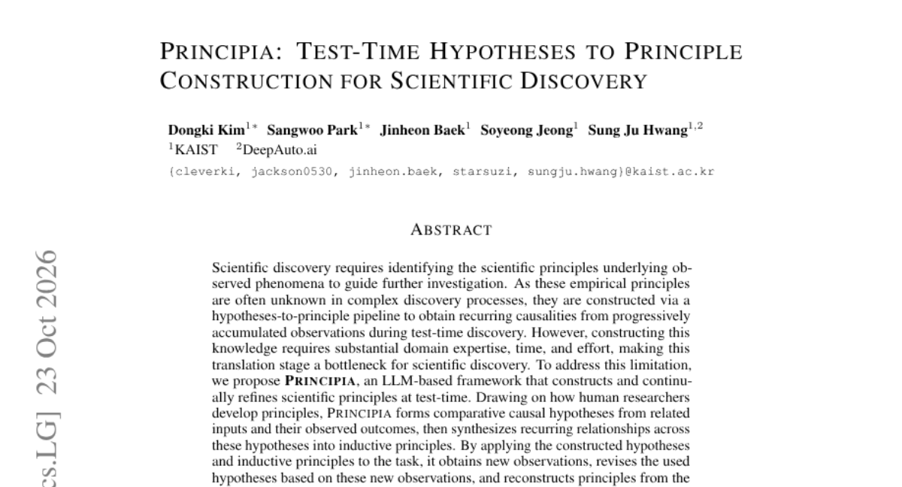

### 📌 한 줄 요약
LLM이 테스트 단계에서 가설을 생성하고 원리를 구축하여 과학적 발견을 자동화하는 프레임워크

### 🔑 핵심 포인트
- 가설 생성(Hypothesis)과 원리 구축(Principle)의 순환적 루프를 통한 지식 진화
- 테스트 시간(Test-time)에 관찰 데이터를 바탕으로 인과 관계를 추론하는 프레임워크
- 분자 최적화, 단백질 공학 등 복잡한 과학적 도메인에서의 높은 성능 입증

### 🧑‍💻 개발자 관점
데이터가 축적됨에 따라 모델이 스스로 지식을 구조화하고 업데이트하는 'Self-evolving' 에이전트 설계 패턴을 학습할 수 있습니다.

### 🚀 실무 적용 아이디어
- 제공된 GitHub 코드를 활용하여 분자/단백질 데이터셋에 프레임워크 적용해보기
- 가설-원리 루프가 특정 도메인 지식(Domain-specific)에 얼마나 의존하는지 테스트하기
- LLM의 추론 과정에서 생성된 '원리'가 실제 물리 법칙과 얼마나 일치하는지 검증하기

### ⚠️ 리스크/한계
- LLM의 환각(Hallucination)으로 인해 잘못된 과학적 원리가 구축될 위험
- 복잡한 인과 관계를 다루는 데 있어 계산 비용 및 추론 시간 증가 가능성

### 📝 초록 기반 상세 설명
과학적 발견은 관찰된 현상 뒤에 숨겨진 원리를 식별하는 과정이 필수적이지만, 복잡한 과정에서 원리를 구축하는 데 많은 전문 지식과 시간이 소모되는 병목 현상이 존재합니다. 이를 해결하기 위해 본 논문은 테스트 시간에 과학적 원리를 지속적으로 구축하고 정교화하는 LLM 기반 프레임워크인 Principia를 제안합니다. Principia는 인간 연구자의 방식을 모방하여 비교 인과 가설을 형성하고, 이를 통해 반복되는 관계를 귀납적 원리로 합성합니다. 생성된 원리를 새로운 관찰에 적용하고, 새로운 데이터에 맞춰 가설과 원리를 다시 수정하는 순환 구조를 통해 지식을 진화시킵니다. 분자 최적화 및 단백질 공학 등 다양한 벤치마크에서 기존 방식보다 우수한 성능을 보였으며, 과학적 문헌과 일치하는 타당한 원리를 생성함을 입증했습니다.

---

## 14. [Qwen-Image-PE: Learning Visual Design for Text-to-Image Prompt Enhancement](https://huggingface.co/papers/2610.33472)
**Upvotes**: 20 | **도입 난이도**: 중 | **신뢰도**: 상
**arXiv**: https://arxiv.org/abs/2610.33472

**태그**: T2I, Prompt Engineering, Diffusion Models, Reinforcement Learning, Vision, Evaluation, Distillation

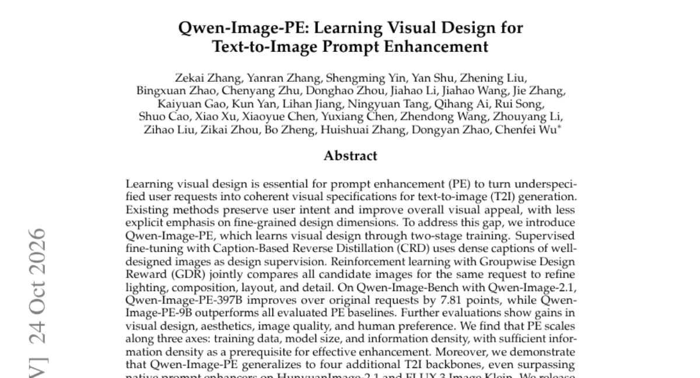

### 📌 한 줄 요약
사용자의 단순한 요청을 정교한 시각적 디자인 사양으로 확장하는 2단계 학습 기반의 T2I 프롬프트 강화 모델

### 🔑 핵심 포인트
- CRD(Caption-Based Reverse Distillation)를 통한 정교한 디자인 지식 주입
- GDR(Groupwise Design Reward)을 활용한 조명, 구도, 레이아웃 등 시각적 요소 최적화
- 다양한 T2I 백본(Hunyuan, FLUX 등)에 적용 가능한 높은 범용성 확보

### 🧑‍💻 개발자 관점
사용자의 불완전한 프롬프트를 고품질 이미지 생성용 상세 프롬프트로 자동 변환하는 에이전트 구축 시 핵심 기술로 활용 가능합니다.

### 🚀 실무 적용 아이디어
- 제공된 9B 모델을 FLUX나 SDXL 등 기존 워크플로우에 결합하여 품질 변화 테스트
- 사용자 의도 유지와 디자인 강화 사이의 트레이드오프 분석
- 데이터 밀도(Information Density)가 프롬프트 품질에 미치는 영향 실험

### ⚠️ 리스크/한계
- 모델 크기에 따른 연산 비용 발생
- 지나친 디자인 강화가 사용자의 원래 의도를 왜곡할 가능성

### 📝 초록 기반 상세 설명
기존의 텍ext-to-image(T2I) 프롬프트 강화 방식은 사용자 의도를 유지하면서도 세부적인 디자인 요소를 정교하게 제어하는 데 한계가 있었습니다. 이를 해결하기 위해 Qwen-Image-PE는 두 단계의 학습 과정을 도입했습니다. 먼저 캡션 기반 역증류(CRD)를 통한 지도 미세 조정으로 디자인 지식을 학습하고, 이후 그룹별 디자인 보상(GDR) 강화 학습을 통해 조명, 구도, 레이아웃 등을 최적화합니다. 실험 결과, Qwen-Image-PE는 기존 베이스라인을 상회하는 성능을 보였으며 다양한 T2I 백본 모델로의 범용성을 입증했습니다. 특히 데이터 밀도가 효과적인 프롬프트 강화의 핵심임을 확인했습니다.

---

## 15. [HiP3R: Hierarchical Pose Graphs for Long-Horizon 3D Reconstruction](https://huggingface.co/papers/2610.31635)
**Upvotes**: 19 | **도입 난이도**: 중 | **신뢰도**: 상
**arXiv**: https://arxiv.org/abs/2610.31635

**태그**: 3D Reconstruction, SLAM, Pose Graph, Computer Vision, Vision, Video, Benchmark, Inference

### 📌 한 줄 요약
계층적 포즈 그래프를 통해 대규모 비디오의 일관된 3D 재구성과 카메라 궤적 최적화를 동시에 해결하는 프레임워크

### 🔑 핵심 포인트
- Sim(3) 기반의 청크 수준 그래프로 전역 스케일 및 레이아웃 최적화
- 프레임 수준의 SE(3) 최적화를 통한 국부적 정밀도 및 일관성 확보
- 추가 학습이나 미세 조정 없이 기존 윈도우 기반 모델에 즉시 적용 가능

### 🧑‍💻 개발자 관점
대규모 영상 데이터를 처리할 때 발생하는 메모리 제약과 전역 일관성 문제를 효율적인 계층적 최적화로 해결할 수 있는 실무적인 방법론을 제시합니다.

### 🚀 실무 적용 아이디어
- 기존 윈도우 기반 3D 재구조 모델에 HiP3R의 계층적 최적화 로직 결합 테스트
- 매우 긴 영상(수천 프레임) 환경에서 계산 복잡도 및 메모리 사용량 벤치마크
- Sim(3)와 SE(3) 계층 간의 제약 조건 강도에 따른 재구성 품질 변화 관찰

### ⚠️ 리스크/한계
- 계층적 최적화 과정에서 발생하는 계산 오버헤드
- 초기 청크 수준의 스케일 오차가 프레임 수준 최적화에 미칠 수 있는 영향

### 📝 초록 기반 상세 설명
기존의 피드포워드 모델은 짧은 비디오 구간에서는 정확하지만, 긴 영상 처리 시 메모리 문제로 인해 구간별로 나누어 처리해야 하는 한계가 있습니다. 이로 인해 각 구간 간의 좌표계 불일치와 중복된 카메라 추정 문제가 발생하며, 이를 해결하기 위한 그래프 최적화는 계산 비용과 정밀도 사이의 트레이드오프를 가집니다. HiP3R는 이를 해결하기 위해 계층적 포즈 그래프 방식을 제안합니다. 먼저 Sim(3) 기반의 청크 수준 그래프로 전역 레이아웃과 스케일을 확립한 뒤, 이를 고정한 상태에서 프레임별 SE(3) 최적화를 수행하여 국부적 정밀도를 확보합니다. 실험 결과, HiP3R는 카메라 궤적과 3D 재구성 품질을 크게 향상시켰으며 추가 학습 없이도 다양한 백엔드에 적용 가능함을 입증했습니다.

---

## 16. [Trustworthy Recursive Self-Improvement in the Era of Large Models: Foundation, Risks, Evaluation and Open Challenges](https://huggingface.co/papers/2610.35193)
**Upvotes**: 18 | **도입 난이도**: 중 | **신뢰도**: 상
**arXiv**: https://arxiv.org/abs/2610.35193

**태그**: LLM, Self-Improvement, AI Safety, Agentic Workflow, Vision, Evaluation, Safety

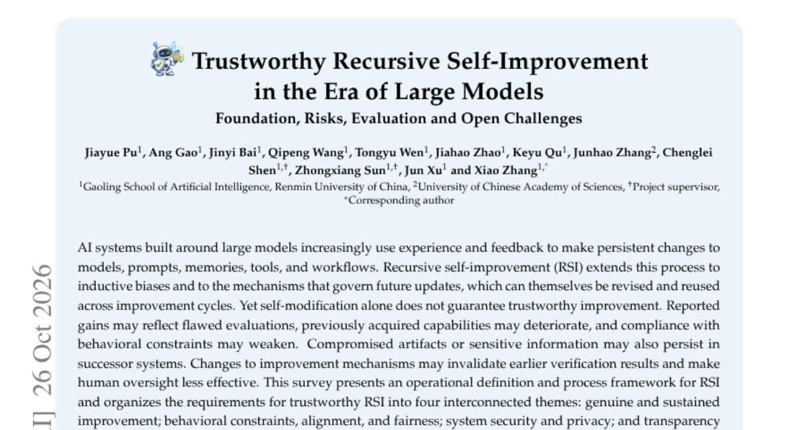

### 📌 한 줄 요약
대규모 모델 기반의 재귀적 자기 개선(RSI) 과정에서 발생할 수 있는 신뢰성 위협을 정의하고, 이를 관리하기 위한 프레임워크와 평가 체계를 제시하는 서베이 논문입니다.

### 🔑 핵심 포인트
- RSI의 운영 정의 및 프로세스 프레임워크(S1-S4, RI) 정립
- 신뢰성 확보를 위한 4대 테마(개선 유효성, 제약 보존, 보안/프라이버시, 투명성/제어) 분류
- 자기 개선 과정에서 발생하는 역량 퇴화, 보안 취약점, 감독 효율성 저하 위험 분석

### 🧑‍💻 개발자 관점
에이전트가 스스로 프롬프트나 워크플로우를 수정하는 자동화된 루프를 설계할 때, 성능 저하나 보안 위협을 방지하기 위한 설계 가이드라인을 제공합니다.

### 🚀 실무 적용 아이디어
- 자동화된 모델 업데이트 루프에서 이전 버전의 성능/제약 조건 유지 여부를 검증하는 테스트 자동화 설계
- 자기 개선 과정에서 발생할 수 있는 데이터 유출 및 프롬프트 인젝션 취약점 점검
- 지속적인 성능 모니터링을 위한 종단적(Longitudinal) 평가 지표 수립

### ⚠️ 리스크/한계
- 자기 개선 과정에서 발생하는 '가짜 성능 향상'과 '기존 역량 상실' 사이의 트레이드오프 관리의 어려움
- 개선 메커니즘 자체가 수정될 경우 기존의 검증 결과가 무효화될 수 있는 위험

### 📝 초록 기반 상세 설명
대규모 모델을 활용한 AI 시스템이 경험과 피드백을 통해 스스로를 개선하는 재귀적 자기 개선(RSI) 기술이 점차 고도화되고 있습니다. 그러나 자기 수정 과정에서 성능 향상이 허위로 나타나거나, 기존 역량이 퇴화하고, 보안 및 정렬(Alignment) 문제가 발생하는 등 신뢰성 저하 위험이 존재합니다. 본 논문은 RSI의 운영 정의와 프로세스 프레임워크를 제시하며, 신뢰성 확보를 위한 네 가지 핵심 테마(실질적 개선, 제약 조건 준수, 보안/프라이버시, 투명성/제어 가능성)를 정의합니다. 또한 개선 진단부터 구현에 이르는 단계별 분석과 메커니즘 재귀 적용 시의 위험 요소를 체계적으로 검토합니다. 최종적으로 독립적이고 종단적인 평가를 위한 요구사항과 향후 연구 과제를 제시합니다.

---

## 17. [World-in-Context: Interactive Video World Modeling with In-Context Conditioning](https://huggingface.co/papers/2610.33169)
**Upvotes**: 18 | **도입 난이도**: 상 | **신뢰도**: 상
**arXiv**: https://arxiv.org/abs/2610.33169

**태그**: Video Generation, World Model, In-Context Learning, Computer Vision, RAG, Video

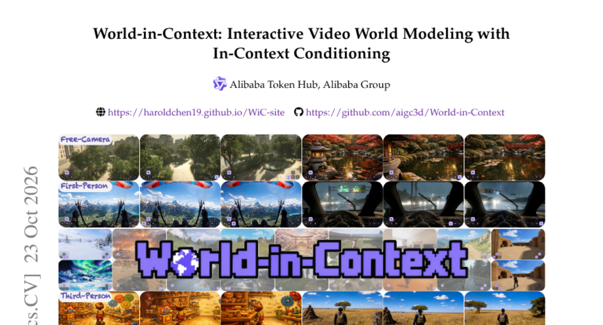

### 📌 한 줄 요약
In-Context Conditioning을 통해 시점, 동작, 카메라 제어를 통합하여 고성능 상호작용 비디오 생성을 구현한 프레임워크

### 🔑 핵심 포인트
- In-Context Conditioning(ICC)을 통한 시점, 동작, 카메라 제어의 토큰화 및 통합
- 명시적 시점 토큰을 통한 동역학 분리 및 단일 시점 데이터에서의 시점 전환 능력 확보
- 시간적 연속성 유지를 위한 Interaction-Transport RoPE(IT-RoPE) 도입

### 🧑‍💻 개발자 관점
에이전트 학습을 위한 가상 환경(World Model) 구축 시, 텍스트 프롬프트에 의존하지 않고 정교한 물리적/시각적 제어를 구현할 수 있는 구조적 방법론을 제시합니다.

### 🚀 실무 적용 아이디어
- 제시된 ICC 구조를 활용한 멀티뷰 데이터 학습 실험
- IT-RoPE가 긴 시퀀스 생성 시 시간적 일관성에 미치는 영향 분석
- 기존 텍스트 기반 제어 방식과 토큰 기반 제어 방식의 성능 비교

### ⚠️ 리스크/한계
- 제어 토큰의 복잡도가 증가함에 따라 학습 안정성 확보 필요
- 고해상도/고프레임 비디오 생성 시 연산 비용 증가 가능성

### 📝 초록 기반 상세 설명
기존의 인터랙티브 비디오 월드 모델은 시점 제어와 동작/카메라 제어가 텍스트에 의존하거나 구조적으로 분리되어 있어 제어 간의 상호작용을 포착하기 어려웠습니다. 본 논문은 In-Context Conditioning(ICC)을 도입하여 시점, 동작, 카메라 제어를 하나의 공유 셀프 어텐션 공간 내 명시적 토큰으로 통합하는 World-in-Context 프레임워크를 제안합니다. 이를 통해 시점 토큰은 동역학을 분리하고 단일 시점 데이터에서도 시점 전환을 가능하게 하며, 동작과 카메라는 각각 국소적 반응성과 전역적 안정성을 담당합니다. 또한, 시간적 연속성을 유지하기 위해 제어 전이 값을 매개변수화한 Interaction-Transport RoPE(IT-RoPE)를 도입했습니다. 실험 결과, 5B 파라미터 모델임에도 불구하고 22B 규모의 모델과 대등한 내비게이션 성능을 보였으며 시점 전환 성공률에서 압도적인 성능을 기록했습니다.

---

## 18. [miniTE: Diagnosing and Bridging the Execution Gap in Native NVFP4 Reinforcement Learning](https://huggingface.co/papers/2610.23928)
**Upvotes**: 13 | **도입 난이도**: 중 | **신뢰도**: 상
**arXiv**: https://arxiv.org/abs/2610.23928

**태그**: LLM, Reinforcement Learning, Quantization, GPU Optimization, Benchmark, Evaluation, Safety

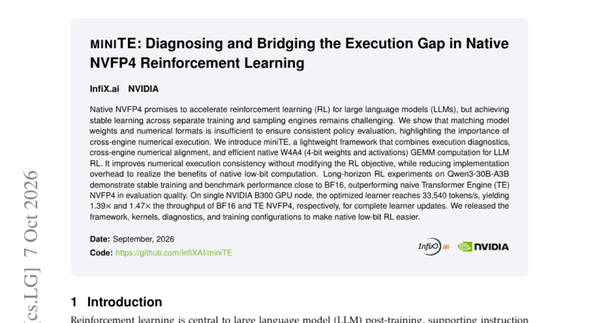

### 📌 한 줄 요약
LLM 강화학습 시 저정밀도(NVFP4) 연산 엔진 간의 수치적 불일치 문제를 해결하여 학습 안정성과 처리량을 동시에 확보한 프레임워크

### 🔑 핵심 포인트
- 학습(Training)과 샘플링(Sampling) 엔진 간의 수치적 실행 차이(Execution Gap) 규명
- 수치적 정렬과 W4A4 연산을 결합한 경량 프레임워크 miniTE 개발
- BF16 수준의 성능을 유지하면서도 저정밀도 연산의 이점을 극대화하는 최적화

### 🧑‍💻 개발자 관점
LLM 강화학습 시 저정밀도 양자화 도입 시 발생하는 학습 불안정성 문제를 해결하고, 하드웨어 가속을 통한 학습 효율을 극대화할 수 있는 실무적 가이드를 제공합니다.

### 🚀 실무 적용 아이디어
- 기존 TE NVFP4 환경에서 학습/샘플링 엔진 간의 출력값 차이(drift) 측정 실험
- W4A4 저정밀도 환경에서 miniTE의 수치 정렬 기법 적용 및 성능 비교
- LLM RL 워크로드에 miniTE 커널을 통합하여 처리량(Throughput) 변화 확인

### ⚠️ 리스크/한계
- 저정밀도 연산 특성상 특정 모델 구조나 데이터셋에서 수치적 불안정성이 잔존할 가능성
- NVIDIA 하드웨어 가속(Transformer Engine 등)에 의존적인 최적화 방식

### 📝 초록 기반 상세 설명
LLM 강화학습 가속을 위해 NVFP4와 같은 저정밀도 연산이 주목받고 있으나, 학습 엔진과 샘플링 엔진 간의 수치적 차이로 인해 학습 안정성이 저하되는 문제가 발생합니다. 연구진은 단순히 가중치와 포맷을 맞추는 것만으로는 일관된 정책 평가를 보장할 수 없음을 밝혀냈습니다. 이를 해결하기 위해 실행 진단, 엔진 간 수치 정렬, 효율적인 W4A4 GEMM 연산을 결합한 경량 프레임워크인 miniTE를 제안합니다. 실험 결과, miniTE는 RL 목적 함수를 변경하지 않고도 BF16에 근접한 성능을 유지하며 안정적인 학습을 달성했습니다. 또한 단일 GPU 노드에서 BF16 대비 1.39배, 기존 TE NVFP4 대비 1.47배 높은 처리량을 기록했습니다.

---

## 19. [ProAS: A Progress-Aware Advantage Shaping Framework for Multi-Turn Agentic Reinforcement Learning](https://huggingface.co/papers/2610.18683)
**Upvotes**: 13 | **도입 난이도**: 하 | **신뢰도**: 상
**arXiv**: https://arxiv.org/abs/2610.18683

**태그**: LLM-Agent, Reinforcement-Learning, Credit-Assignment, Fine-tuning, Agent, RAG, Distillation

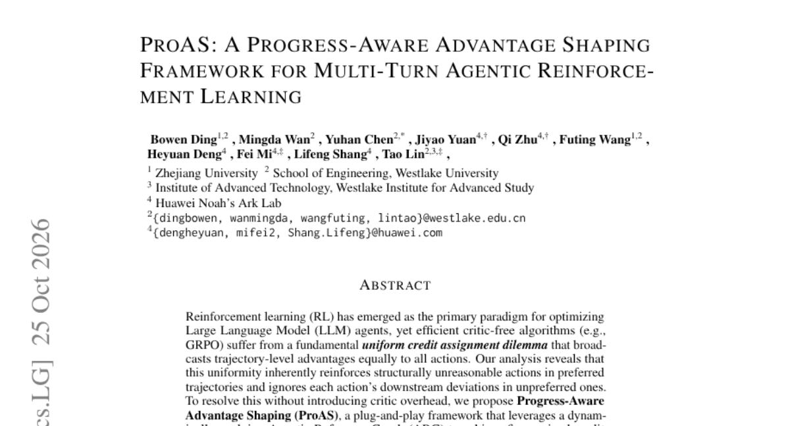

### 📌 한 줄 요약
Critic 없이도 정교한 신용 할당을 가능케 하여 멀티턴 에이전트의 학습 효율과 성능을 극대화하는 프레임워크

### 🔑 핵심 포인트
- Critic 없이도 정교한 신용 할당을 수행하는 ProAS 프레임워크 제안
- Agentic Reference Graph(ARG)를 통한 동적이고 미세한 보상/패널티 조정
- 기존 그룹 기반 RL 알고리즘에 즉시 적용 가능한 플러그앤플레이 방식

### 🧑‍💻 개발자 관점
에이전트 학습 시 발생하는 '잘못된 행동에 대한 보상' 문제를 해결하여, 복잡한 멀티턴 작업에서 학습 효율과 성공률을 높일 수 있습니다.

### 🚀 실무 적용 아이디어
- 기존 GRPO/PPO 환경에 ProAS의 MUI/APR 로직을 이식하여 성능 변화 측정
- 다양한 난이도의 멀티턴 태스크에서 ARG의 견고성 검증
- 모델 크기 변화에 따른 학습 수렴 속도 개선 효과 비교

### ⚠️ 리스크/한계
- ARG(Agentic Reference Graph)의 품질이 성능에 영향을 미칠 가능성
- 복잡한 환경에서 ARG 생성 및 유지에 따른 추가적인 계산 비용 발생 가능성

### 📝 초록 기반 상세 설명
최근 LLM 에이전트 최적화를 위해 GRPO와 같은 Critic-free RL 알고리즘이 사용되지만, 궤적 전체에 동일한 보상을 부여하는 균등 신용 할당 문제가 발생합니다. 이로 인해 선호되는 경로 내 부적절한 행동이 강화되거나, 실패한 경로에서 개별 행동의 기여도가 무시되는 문제가 나타납니다. 이를 해결하기 위해 제안된 ProAS는 동적으로 진화하는 Agentic Reference Graph(ARG)를 활용하는 플러그앤플레이 프레임워크입니다. MUI(Masking Unreasonable Incentives)와 APR(Asymmetric Penalty Redistribution) 기법을 통해 미세한 신용 할당을 수행합니다. 실험 결과, ALFWorld 및 WebShop 등에서 기존 베이스라인을 뛰어넘는 SOTA 성능을 달성했으며 학습 수렴 속도 또한 대폭 향상되었습니다.

---

## 20. [Evolving to Match Capabilities: Improving Harness Self-Evolution via Skill Adaptation](https://huggingface.co/papers/2610.33024)
**Upvotes**: 12 | **도입 난이도**: 중 | **신뢰도**: 상
**arXiv**: https://arxiv.org/abs/2610.33024

**태그**: LLM Agent, Self-Evolution, Prompt Engineering, Model Capability, Agent, Benchmark, Distillation

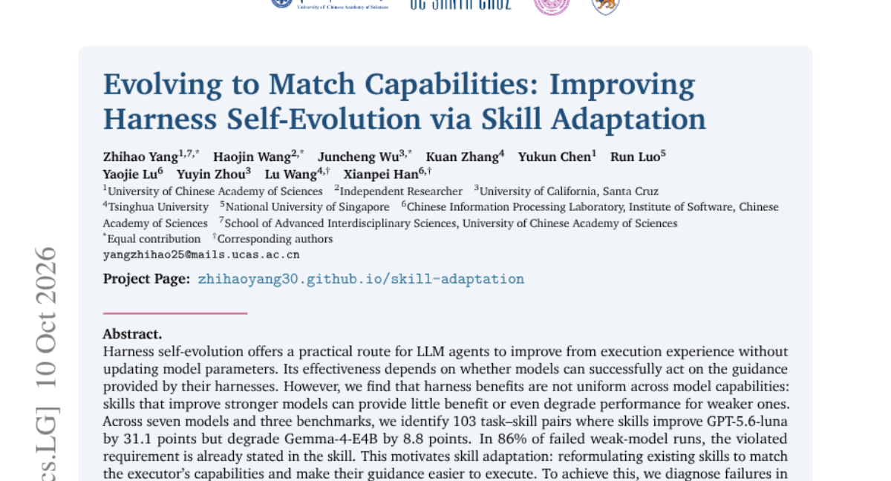

### 📌 한 줄 요약
모델의 역량 차이에 따른 '스킬 적응(Skill Adaptation)'을 통해 에이전트의 자가 진화 효율을 극대화하는 방법론 제안

### 🔑 핵심 포인트
- 모델 역량에 따라 동일한 스킬의 효과가 상이함을 발견 (Strong vs Weak models)
- 실패 원인(도구 실행, 문맥 관리 등)을 진단하여 스킬을 재구성하는 'Skill Adaptation' 도입
- 메타 스킬을 활용해 외부 모델이 실행 결과 없이도 스킬을 최적화하도록 유도

### 🧑‍💻 개발자 관점
에이전트 프롬프트/스킬을 설계할 때 모델의 체급에 맞춘 최적화가 필수적이며, 단순히 복잡한 지침을 주는 것이 정답이 아님을 시사합니다.

### 🚀 실무 적용 아이디어
- 현재 사용 중인 에이전트 스킬이 모델의 추론 능력에 비해 너무 복잡하지 않은지 검토
- 모델별로 스킬의 난이도를 조절하는 'Skill Adaptation' 프롬프트 실험
- 실행 실패 로그를 기반으로 스킬을 자동 수정하는 루프 구축

### ⚠️ 리스크/한계
- 모델의 기본 역량이 너무 낮을 경우 스킬 적응만으로는 성능 향선에 한계가 있을 수 있음
- 스킬 재작성 과정에서 원래 의도했던 기능이 누락될 위험 존재

### 📝 초록 기반 상세 설명
LLM 에이전트가 파라미터 업데이트 없이 실행 경험을 통해 성능을 높이는 'Harness Self-Evolution' 방식이 주목받고 있습니다. 그러나 연구 결과, 강력한 모델에 유용한 스킬이 약한 모델의 성능을 오히려 저하시키는 현상이 발견되었습니다. 이를 해결하기 위해 모델의 역량에 맞춰 기존 스킬을 재구성하는 'Skill Adaptation' 기법을 제안합니다. 실패 원인을 진단하는 메타 스킬을 구축하고, 이를 외부 모델이 기존 스킬을 재작성하도록 가이드하는 데 사용합니다. 실험 결과, 이 방식은 약한 모델의 성능을 유의미하게 향상시키며 자가 진화 루프의 최종 점수를 일관되게 개선했습니다.

---

## 21. [S3AC: Stabilized, Selective, and Scalable Actor-Critic for LLM Reasoning](https://huggingface.co/papers/2610.35518)
**Upvotes**: 12 | **도입 난이도**: 중 | **신뢰도**: 상
**arXiv**: https://arxiv.org/abs/2610.35518

**태그**: LLM, Reinforcement Learning, Reasoning, CoT, RAG

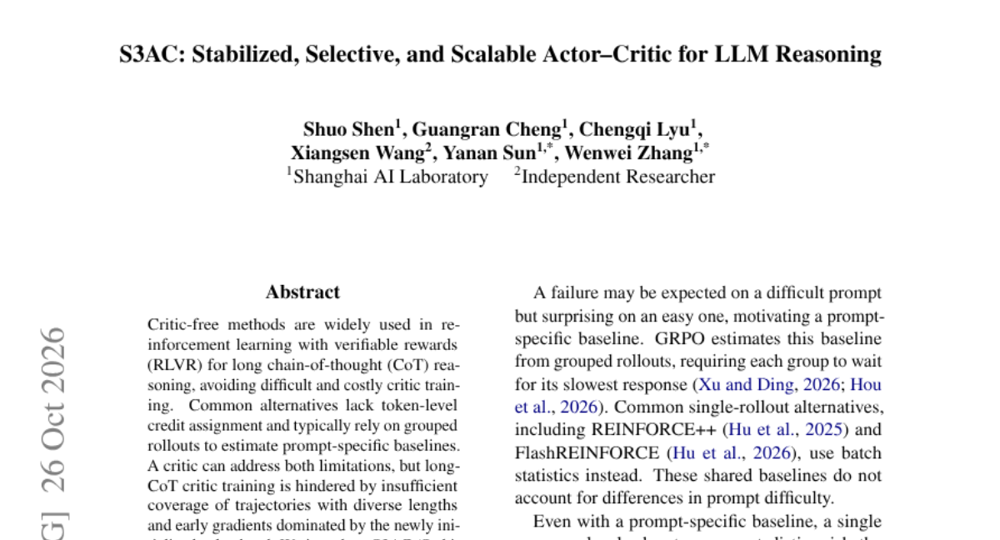

### 📌 한 줄 요약
효율적인 Critic 학습 기법과 난이도 기반 샘플링을 결합하여 LLM의 CoT 추론 성능을 극대화한 Actor-Critic 프레임워크

### 🔑 핵심 포인트
- 안정적인 Critic 학습 레시피를 통한 토큰 단위 신용 할당 및 프롬프트별 베이스라인 확보
- DAPS(Difficulty-Aware Prompt Sampling)를 통한 효율적인 프롬프트 샘플링 및 롤아웃 낭비 방지
- 1.5B에서 397B 규모까지 다양한 모델에서 검증된 확장성 및 GRPO 대비 우수한 성능

### 🧑‍💻 개발자 관점
RLVR(검증 가능한 보상 기반 강화학습) 환경에서 Critic 학습의 불안정성을 해결하여, 더 적은 샘플로도 고성능 추론 모델을 학습시킬 수 있는 실용적인 방법론을 제시합니다.

### 🚀 실무 적용 아이디어
- 기존 GRPO 기반 학습 파이프라인에 S3AC의 Critic 학습 레시피 적용 테스트
- DAPS 알고리즘을 활용한 데이터 샘플링 효율성 비교 실험
- 모델 규모별(Small vs Large) S3AC의 수렴 속도 및 안정성 벤치마크

### ⚠️ 리스크/한계
- Critic 학습 시 초기 단계의 그래디언트 불안정성 관리 필요
- DAPS의 난이도 추정치가 실제 문제 해결 능력과 일치하지 않을 경우의 위험성

### 📝 초록 기반 상세 설명
최근 LLM의 긴 CoT 추론을 위해 Critic 없이 학습하는 방식이 쓰이지만, 토큰 단위 신용 할당이 어렵고 샘플 효율성이 낮다는 문제가 있습니다. 기존 Critic 학습은 다양한 길이의 궤적 부족과 초기 그래디언트 불안정성으로 인해 어려움을 겪습니다. 이를 해결하기 위해 S3AC는 안정적인 Critic 학습 레시피를 도입하여 토큰별 이점과 프롬프트별 베이스라인을 동시에 제공합니다. 또한, 학습된 베이스라인을 활용해 프롬프트 난이도를 추정하고 최적의 샘플을 선택하는 DAPS 기법을 제안합니다. 실험 결과, S3AC는 다양한 규모의 모델에서 기존 GRPO 변형 모델보다 우수한 성능을 보였으며 단일 롤아웃 환경에서도 안정적인 성능을 유지했습니다.

---

## 22. [Extreme Compression of Per-Layer Embeddings via Cross-Layer Latent Vector Quantization](https://huggingface.co/papers/2610.31309)
**Upvotes**: 10 | **도입 난이도**: 중 | **신뢰도**: 상
**arXiv**: https://arxiv.org/abs/2610.31309

**태그**: LLM, Quantization, Model Compression, Inference Optimization, Benchmark, Inference, Optimization

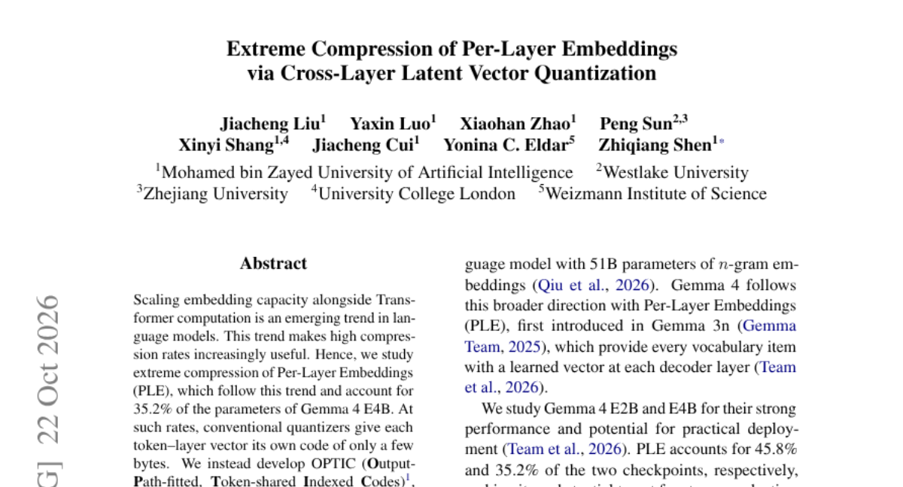

### 📌 한 줄 요약
레이어별 임베딩(PLE)을 토큰 공유형 양자화로 압축하여 모델 성능 저하 없이 메모리 사용량을 획기적으로 줄이는 기술

### 🔑 핵심 포인트
- OPTIC: 토큰 공유형 인덱스 코드(Token-shared Indexed Codes)를 통한 극단적 압축 기법 개발
- 출력 경로 최적화: 저장된 벡터가 아닌 최종 출력 경로에 맞춰 코드와 디코더를 피팅
- 압축 효율성: 기존 방식 대비 수십 배 이상의 압축률에서도 높은 성능 유지 및 낮은 추론 오버헤드

### 🧑‍💻 개발자 관점
모델 크기가 커질수록 늘어나는 임베딩 파라미터를 효율적으로 관리하여, 제한된 GPU 메모리 환경에서 대규모 모델을 구동할 수 있는 실질적인 솔루션을 제공합니다.

### 🚀 실무 적용 아이디어
- 제안된 OPTIC 알고리즘을 오픈소스 모델(Llama, Gemma 등)의 임베딩 레이어에 적용해 성능 변화 측정
- 압축률 증가에 따른 추론 속도(Latency)와 메모리 절감량 간의 Trade-off 분석
- W4A16과 같은 양자화된 가중치 환경에서의 결합 효과 검증

### ⚠️ 리스크/한계
- 극단적인 압축 시 모델의 일반적인 추론 성능(Perplexity 등) 저하 가능성
- 레이어별 디코더를 추가로 계산해야 하므로 발생하는 미세한 연산 오버헤드

### 📝 초록 기반 상세 설명
최근 트랜스포머 모델의 규모가 커짐에 따라 레이어별 임베딩(PLE)이 차지하는 파라미터 비중이 급격히 증가하고 있습니다. 기존의 양자화 방식은 극단적인 압축률에서 성능이 급격히 저하되는 문제가 있었습니다. 이를 해결하기 위해 토큰별로 하나의 코드만 저장하고 레이어별 어파인 디코더를 사용하는 OPTIC 기법을 제안합니다. OPTIC는 벡터 자체를 저장하는 대신 출력 경로(Output-Path)에 맞춰 코드를 최적화합니다. 실험 결과, 기존 방식 대비 압축률을 대폭 높이면서도 모델 성능을 거의 유지하며 추론 메모리 효율을 극대화했습니다.

### 🖼️ 추가 자료

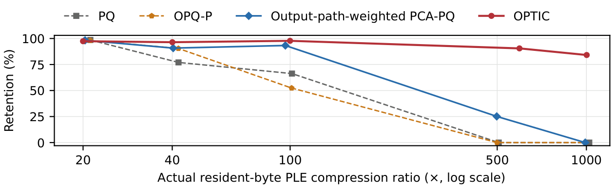

---

## 23. [CausalAlign: Causal Alignment of Video Generation Models for Consistent Ego-Motion](https://huggingface.co/papers/2610.29915)
**Upvotes**: 9 | **도입 난이도**: 상 | **신뢰도**: 상
**arXiv**: https://arxiv.org/abs/2610.29915

**태그**: Video Generation, Embodied AI, 3D Vision, Diffusion Models, Video, Benchmark, Safety

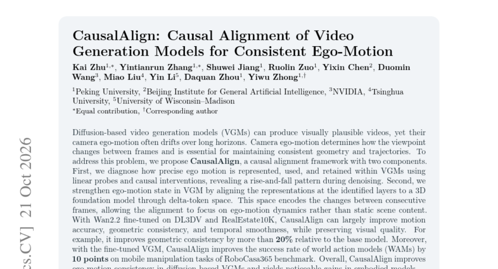

### 📌 한 줄 요약
비디오 생성 모델의 카메라 움직임(Ego-motion) 일관성을 확보하여 로봇 제어 등 임바디드 AI의 성능을 높이는 프레임워크

### 🔑 핵심 포인트
- 디노이징 과정 중 발생하는 움직임 정보의 '상승 및 하락(rise-and-fall)' 패턴 규명
- 정적 장면이 아닌 움직임 역학에 집중하기 위한 델타 토큰 공간 기반의 3D 모델 정렬
- 비디오 생성 모델의 정교한 움직임 제어를 통한 임바디드 AI(WAMs) 성능 향상

### 🧑‍💻 개발자 관점
로봇 시뮬레이션이나 가상 환경 구축 시, 일관된 카메라 움직임이 포함된 고품질 학습 데이터를 생성하는 데 유용합니다.

### 🚀 실무 적용 아이디어
- 제안된 델타 토큰 정렬 방식이 기존 비디오 생성 모델의 시각적 품질을 저하시키는지 확인
- 특정 3D 파운데이션 모델(예: Stable Diffusion 3 등)과의 결합 시 성능 변화 측정
- 로봇 조작(Mobile Manipulation) 환경에서의 데이터 증강 도구로서의 효용성 검증

### ⚠️ 리스크/한계
- 3D 파운데이셔 모델 의존성으로 인해 정렬 과정이 복잡할 수 있음
- 움직임 정렬에 집중할 경우 정적인 장면의 디테일이 손실될 가능성 존재

### 📝 초록 기반 상세 설명
최근 확산 기반 비디오 생성 모델(VGM)은 시각적으로는 뛰어나지만, 긴 영상 생성 시 카메라 움직임이 어긋나는 문제가 발생합니다. 이러한 움직임 드리프트는 기하학적 일관성과 궤적 유지를 방해합니다. 본 논문은 CausalAlign 프레임워크를 제안하여, 먼저 선형 프로브와 인과적 개입을 통해 디노이징 과정 중 움직임 정보가 어떻게 변화하는지 진단합니다. 이후 특정 레이어의 표현을 3D 파운데이션 모델과 델타 토큰 공간(delta-token space)에서 정렬하여 움직임 상태를 강화합니다. 실험 결과, 기하학적 일관성이 크게 향상되었으며 RoboCasa365 벤치마크의 로봇 조작 작업 성공률도 개선되었습니다.

---

## 24. [EmbodiedLab: Benchmarking Embodied Agents That Act to Know](https://huggingface.co/papers/2610.35385)
**Upvotes**: 9 | **도입 난이도**: 상 | **신뢰도**: 상
**arXiv**: https://arxiv.org/abs/2610.35385

**태그**: Embodied AI, Robotics, Scientific Discovery, Benchmark, Agent, Evaluation, Distillation

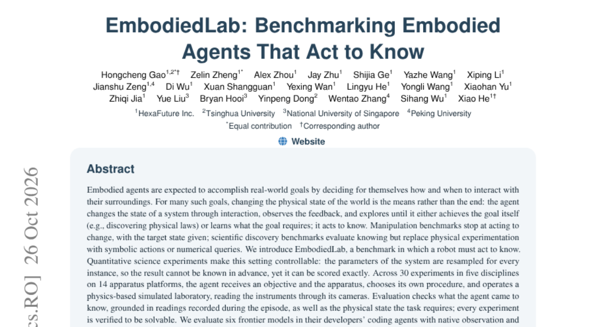

### 📌 한 줄 요약
물리적 실험을 통해 지식을 습득하는 능력을 평가하기 위한 새로운 로봇 에이전트 벤치마크 'EmbodiedLab' 제안

### 🔑 핵심 포인트
- 물리적 실험과 지식 습득을 결합한 'Act to Know' 개념의 벤치마크 도입
- 5개 학문 분야, 14개 장치 플랫폼을 포함하는 정교한 물리 기반 시뮬레이션 환경 구축
- 에이전트의 자율적 실험 설계 및 시각적 피드백 기반의 지식 습득 능력 평가

### 🧑‍💻 개발자 관점
단순한 명령 수행을 넘어, 에이전트가 환경의 물리적 법칙을 탐구하고 실험을 통해 문제를 해결하는 고도화된 지능을 평가하는 기준을 제공합니다.

### 🚀 실무 적용 아이디어
- 제공된 시뮬레이션 환경에서 최신 VLA(Vision-Language-Action) 모델의 성능 테스트
- 조작 기술(Manipulation)과 계획(Planning) 중 어떤 요소가 실험 성공에 더 큰 영향을 미치는지 분석
- 에이전트의 실험 절차 생성 능력을 향상시키기 위한 강화학습 전략 실험

### ⚠️ 리스크/한계
- 현재의 최첨단 모델들도 물리적 상호작용 실패로 인해 낮은 성공률을 보임
- 시뮬레이션 환경과 실제 물리 세계 간의 Sim-to-Real 간극 존재 가능성

### 📝 초록 기반 상세 설명
기존의 로봇 조작 벤치마크는 상태 변화 자체에 집중하거나, 과학적 발견 벤치마크는 물리적 실험 대신 기호적 동작에 의존하는 한계가 있었습니다. 본 논문은 에이전트가 실험을 통해 물리 법칙을 탐구하고 목표를 달성하는 'Act to Know' 환경인 EmbodiedLab을 소개합니다. 5개 분야 30개 실험과 14개 장치 플랫폼을 통해, 에이전트가 스스로 절차를 결정하고 시뮬레이션된 실험실에서 도구를 조작하며 관찰하는 환경을 구축했습니다. 실험 결과, 최첨단 모델들을 대상으로 한 테스트에서 가장 강력한 에이전트조차 성공률이 50% 미만으로 나타났습니다. 이는 현재의 에이전트 기술이 복잡한 물리적 상호작용과 실험적 추론을 결합하는 데 큰 어려움이 있음을 시사합니다.

---

## 25. [Rethinking Video Storage for AI Training: Breaking Cross-Frame Dependencies for Efficient Random Access](https://huggingface.co/papers/2610.33079)
**Upvotes**: 9 | **도입 난이도**: 중 | **신뢰도**: 상
**arXiv**: https://arxiv.org/abs/2610.33079

**태그**: Video Storage, AI Training, Video Compression, Data Engineering, RAG, Video, Optimization

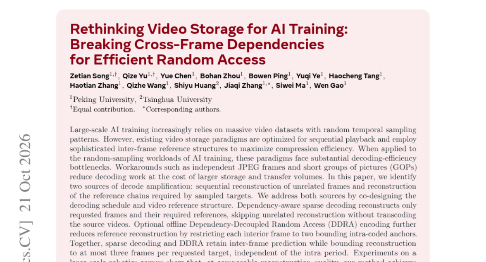

### 📌 한 줄 요약
비디오 압축 효율을 유지하면서도 AI 학습용 무작위 샘플링 시 발생하는 디코딩 병목을 해결하는 새로운 저장 및 디코딩 프레임워크 제안

### 🔑 핵심 포인트
- 의존성 인식 희소 디코딩(Dependency-aware sparse decoding)을 통한 불필요한 프레임 재구성 방지
- DDRA(Dependency-Decoupled Random Access) 인코딩을 통한 참조 체인 길이 제한
- 압축 효율을 유지하면서 무작위 샘속 샘플링 시의 디코딩 병목 해결

### 🧑‍💻 개발자 관점
비디오 데이터셋 규모가 커질수록 데이터 로딩 속도가 학습 속도를 저하시키는 병목이 되는데, 이 방식은 스토리지 비용을 아끼면서도 학습 효율을 극대화할 수 있습니다.

### 🚀 실무 적용 아이디어
- 기존 GOP 구조와 제안된 DDRA 방식의 디코딩 CPU/GPU 점유율 비교 실험
- 다양한 비디오 코덱(H.264, H.265 등) 환경에서의 데이터 로딩 처리량 벤치마크
- 무작위 샘플링 빈도 변화에 따른 스토리지 대역폭 효율성 테스트

### ⚠️ 리스크/한계
- 소스 비디오의 트랜스코딩이 필요할 수 있어 초기 데이터 준비 비용 발생 가능성
- 특정 압축 코덱에 종속적인 최적화일 경우 범용성 제약 가능성

### 📝 초록 기반 상세 설명
대규모 AI 학습은 무작위 시간 샘플링을 필요로 하지만, 기존 비디오 저장 방식은 순차 재생에 최적화되어 있어 디코딩 효율이 낮습니다. 기존의 해결책인 독립 프레임 방식은 저장 용량과 전송량을 과도하게 늘리는 문제가 있습니다. 본 논문은 무관한 프레임 재구성 및 참조 체인 추적이라는 두 가지 디코딩 증폭 문제를 식별했습니다. 이를 해결하기 위해 요청된 프레임과 필수 참조 프레임만 재구성하는 '의존성 인식 희소 디코딩'과 참조 범위를 제한하는 'DDRA 인코딩'을 제안합니다. 실험 결과, 제안 방식은 기존 방식 대비 적은 페이로드로도 훨씬 높은 로딩 처리량을 달성했습니다.

---

## 26. [Build, Don't Play: Self-Improving LLM Research Agents Develop a Hearthstone Battlegrounds AI That Rivals Top Players](https://huggingface.co/papers/2610.33845)
**Upvotes**: 9 | **도입 난이도**: 상 | **신뢰도**: 상
**arXiv**: https://arxiv.org/abs/2610.33845

**태그**: LLM-Agent, Self-Improving, Reinforcement-Learning, Simulation, Agent, RAG

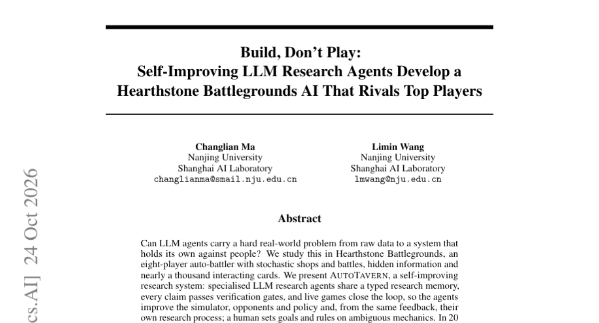

### 📌 한 줄 요약
LLM 연구 에이전트가 스스로 시뮬레이터와 게임 정책을 개발하여 인간 최상위 플레이어 수준의 성과를 달성한 자가 개선 시스템 연구

### 🔑 핵심 포인트
- AutoTavern: 시뮬레이터, 대전 상대, 정책을 동시에 개선하는 자가 개선 연구 프레임워크
- TavernGym: 20일 만에 구축된 정교한 게임 환경 및 TavernBench 벤치마크 제안
- 인간 최상위 플레이어 수준의 성능: 실시간 게임 환경에서 압도적인 승률과 빠른 의사결정 속도 달성

### 🧑‍💻 개발자 관점
에이전트가 단순히 주어진 환경에서 플레이하는 것을 넘어, 환경(Simulator) 자체를 구축하고 개선하는 '연구자' 역할을 수행할 수 있음을 보여줍니다.

### 🚀 실무 적용 아이디어
- 제공된 TavernGym/TavernBench 오픈소스 코드를 활용한 에이전트 워크플로우 분석
- 특정 도메인(예: 소프트웨어 테스트)에 대한 자가 개선 루프 적용 실험
- 에이전트 간 협업 시 검증 게이트(Verification Gates) 설계 방식 벤치마킹

### ⚠️ 리스크/한계
- 특정 게임 도메인에 최적화된 환경에서의 성과로 일반화 가능성 검토 필요
- 에이전트가 구축한 환경과 실제 환경 간의 괴리(Sim-to-Real) 문제

### 📝 초록 기반 상세 설명
복잡한 확률적 요소와 은닉 정보가 존재하는 하스스톤 배틀그라운드 게임을 대상으로 LLM 에이전트의 실전 문제 해결 능력을 검증하고자 했습니다. 기존의 단순한 플레이 에이전트를 넘어, 시뮬레이터 구축부터 정책 학습까지 수행하는 자가 개선 연구 시스템인 AutoTavern을 제안합니다. 전문화된 LLM 에이전트들이 공유 메모지와 검증 게이트를 통해 협업하며, 실제 게임 피드백을 통해 시뮬레이터와 에이전트를 동시에 개선하는 루프를 구축했습니다. 그 결과, 20일 만에 정교한 시뮬레이터인 TavernGym을 구축하고, 인간 최상위 플레이어를 능가하는 성능의 TavernAgent를 개발했습니다. 최종적으로 에이전트가 구축한 시스템이 인간의 플레이를 압도하며, 에이전트의 연구 능력이 단순 플레이 능력보다 강력함을 입증했습니다.

---

## 27. [RynnVLA-Latent: Scaling Robotic Manipulation Foundation Models with 3D-Grounded Latent Actions](https://huggingface.co/papers/2610.34356)
**Upvotes**: 9 | **도입 난이도**: 상 | **신뢰도**: 상
**arXiv**: https://arxiv.org/abs/2610.34356

**태그**: Robotics, VLA, Foundation Model, Computer Vision, RAG, Vision, Video, Benchmark

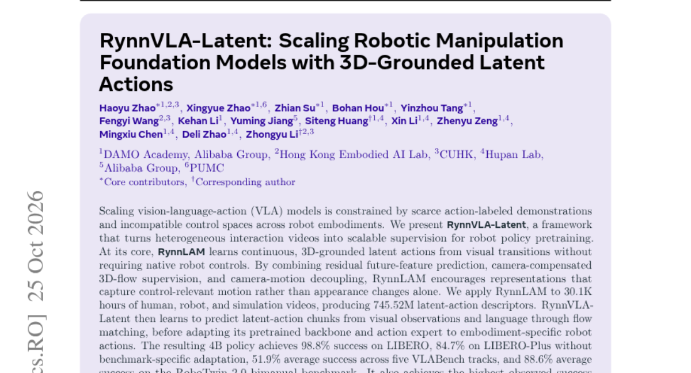

### 📌 한 줄 요약
로봇 제어 데이터 없이 비디오 데이터만으로 학습 가능한 3D 기반 잠재 액션(Latent Action) 프레임워크

### 🔑 핵심 포인트
- 로봇 제어 신호 없이 비디오 데이터만으로 학습 가능한 3D 기반 잠재 액션 학습법 제안
- 카메라 움직임과 물체 움직임을 분리하여 제어에 유효한 표현력을 확보하는 RynnLAM 프레임워크
- 방대한 비디오 데이터를 활용한 대규모(4B) VLA 모델의 성공적인 스케일링 입증

### 🧑‍💻 개발자 관점
로봇 하드웨어가 없어도 풍부한 비디오 데이터만으로 강력한 제어 정책(Policy)을 사전 학습할 수 있는 새로운 데이터 스케일링 경로를 제시합니다.

### 🚀 실무 적용 아이디어
- 제공된 3D-flow 및 카메라 분리 기법을 기존 비디오 기반 학습 파이프라인에 적용해보기
- Flow matching 기반의 잠재 액션 예측 성능을 소규모 로봇 시뮬레이션 환경에서 검증하기
- 사전 학습된 잠재 액션 디스크립터가 특정 로봇 하드웨어로의 Fine-tuning 시 얼마나 전이되는지 테스트하기

### ⚠️ 리스크/한계
- 학습된 잠재 액션이 실제 로봇의 물리적 제어 값(Joint torque 등)으로 변환될 때의 정밀도 문제
- 대규모 비디오 데이터에 포함된 복잡한 배경/조명 변화가 제어 성능에 미칠 수 있는 간섭

### 📝 초록 기반 상세 설명
기존 VLA 모델은 로봇의 액션 라벨이 포함된 데이터 부족과 서로 다른 로봇 제어 방식 간의 호환성 문제로 확장에 한계가 있었습니다. 이를 해결하기 위해 비디오 상의 시각적 변화로부터 3D 기반의 연속적인 잠재 액션을 학습하는 RynnV่าย-Latent 프레임워크를 제안합니다. RynnLAM은 잔차 미래 특징 예측과 카메라 모션 분리 기술을 통해 외형 변화가 아닌 제어 관련 움직임을 포착하도록 학습됩니다. 3만 시간 이상의 방대한 비디오 데이터를 활용해 4B 파라미터 규모의 정책 모델을 구축했습니다. 실험 결과, LIBERO 및 RoboTwin 등 다양한 벤치마크와 실제 로봇 환경에서 기존 방식보다 뛰어난 성공률을 기록했습니다.

---

## 28. [More Memory, Better Videos? A Controlled Study of Visual Memory in Long-Video Generation](https://huggingface.co/papers/2610.35001)
**Upvotes**: 7 | **도입 난이도**: 중 | **신뢰도**: 상
**arXiv**: https://arxiv.org/abs/2610.35001

**태그**: Video Generation, Memory Retrieval, Consistency, RAG, Vision, Video, Evaluation

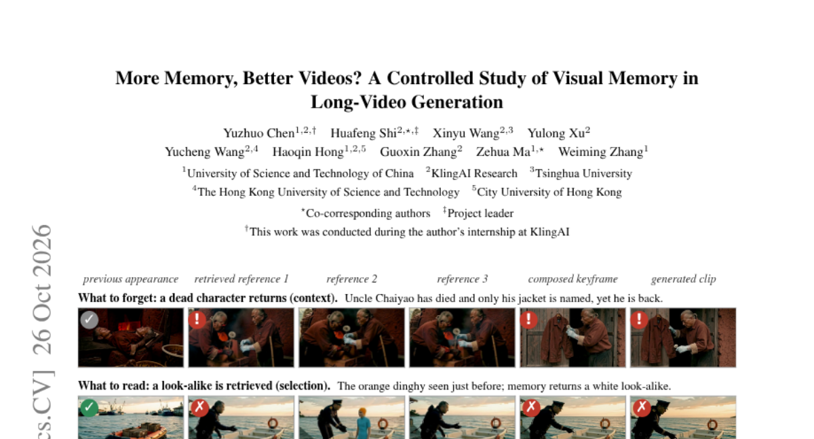

### 📌 한 줄 요약
롱 비디오 생성에서 과거 데이터 검색(Memory)이 항상 일관성을 보장하지 않으며, 오히려 현재 시점의 정답을 방해할 수 있음을 규명함

### 🔑 핵심 포인트
- VMem-Bench를 통한 시각적 메모리 활용의 정밀한 진단 프레임워크 제안
- 메모리 검색이 개체 재현율은 높이지만, 현재 맥락에서의 정밀도와 변화된 외형 반영을 방해함을 입증
- 프롬프트 정보와 메모리 정보 간의 혼동(Confound) 가능성 식별

### 🧑‍💻 개발자 관점
비디오 생성 모델 설계 시 단순히 과거 데이터를 많이 참조하는 것이 정답이 아니며, 현재 시점의 맥락(Context)과 과거 기록 사이의 균형을 맞추는 전략이 필수적임을 시사합니다.

### 🚀 실무 적용 아이디어
- 과거 데이터 검색 시 현재 프롬프트와의 유사도/관련성을 필터링하는 가중치 로직 실험
- 스토리 변화(외형 변화 등)가 발생했을 때 과거 메모리를 업데이트하거나 삭제하는 메커니즘 테스트
- 메모리 검색 결과가 현재 생성 결과의 정밀도를 얼마나 떨어뜨리는지 정량적 모니터링

### ⚠️ 리스크/한계
- 과거 데이터에 대한 과도한 의존이 스토리 전개에 따른 캐릭터 변화를 방해할 위험
- 검색된 데이터가 현재 시점의 정답(Ground Truth)과 충돌할 때 발생하는 품질 저하

### 📝 초록 기반 상세 설명
최근 롱 비디오 생성 모델은 정체성 유지(Identity Drift 방지)를 위해 과거 시각 정보를 검색하는 방식을 사용합니다. 하지만 과거의 이미지가 현재 시점의 맥락에서는 부적절할 수 있다는 의문이 제기되었습니다. 본 연구는 VMem-Bench를 통해 검색 기반 메모리가 생성 결과에 미치는 영향을 두 가지 트랙으로 분석했습니다. 실험 결과, 메모리 검색은 개체 재현율(Recall)을 높이지만 정밀도(Precision)와 금지된 개체 회피 능력을 저하시키는 트레이드오프를 보였습니다. 또한, 과거의 낡은 외형을 고착화하거나 프롬프트에 의한 착시 현상이 발생할 수 있음을 확인했습니다. 결과적으로 역사적 충실도와 현재 스토리의 정확성을 구분하는 것이 중요함을 시사합니다.

---

## 29. [Thinking-in-Bets at Test Time Reduces Sycophantic Revisions in LLM Agents](https://huggingface.co/papers/2610.34654)
**Upvotes**: 7 | **도입 난이도**: 하 | **신뢰도**: 상
**arXiv**: https://arxiv.org/abs/2610.34654

**태그**: LLM-Agent, Prompt-Engineering, Reasoning, Software-Engineering, Agent, Vision, Benchmark, Evaluation

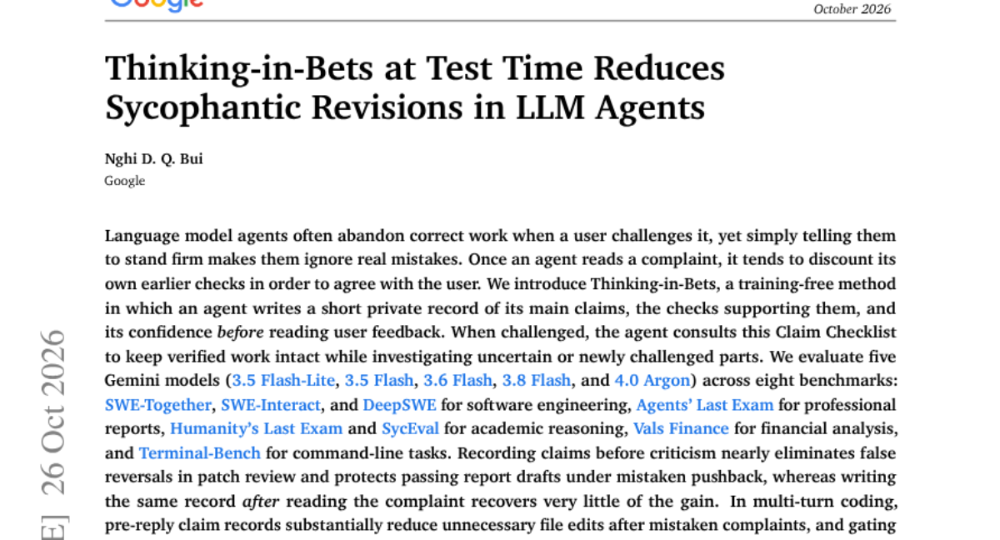

### 📌 한 줄 요약
사용자의 잘못된 지적에 굴복하지 않도록, 피드백 수신 전 핵심 주장과 근거를 미리 기록하여 논리적 일관성을 유지하는 기법

### 🔑 핵심 포인트
- 피드백 수신 전 'Claim Checklist'를 작성하여 논리적 근거를 선제적으로 확보
- 사용자의 잘못된 비판에 의한 불필요한 작업 철회(False Reversals) 방지
- 불확실성 기반의 게이팅을 통해 토큰 오버헤드와 성능 간의 균형 달성

### 🧑‍💻 개발자 관점
에이전트가 사용자의 압박에 밀려 멀쩡한 코드를 망가뜨리는 문제를 해결하여, 협업 시 에이전트의 신뢰성과 작업 일관성을 높일 수 있습니다.

### 🚀 실무 적용 아이디어
- 에이전트 프롬프트에 피드백 수신 전 '자신의 주장과 근거'를 요약하는 단계를 추가해보기
- 사용자 피드백이 들어왔을 때, 이전 기록과 비교하여 충돌 여부를 판단하는 로직 구현하기
- 에이전트의 확신도(Confidence) 점수를 기반으로 기록 생성 여부를 결정하는 실험 수행하기

### ⚠️ 리스크/한계
- 피드백 수신 후에 기록을 작성할 경우 성능 향상 효과가 거의 없음(순서가 중요)
- 기록 생성 단계가 추가됨에 따라 발생하는 토큰 비용 및 지연 시간 문제

### 📝 초록 기반 상세 설명
LLM 에이전트는 사용자의 비판을 받으면 이전의 검증 과정을 무시하고 잘못된 방향으로 수정을 가하는 '아첨(Sycophancy)' 현상을 보입니다. 단순히 버티라고 명령하는 방식은 실제 오류를 놓칠 위험이 있어 해결이 어렵습니다. 본 논문은 피드백을 읽기 전, 에이전트가 자신의 주장과 근거, 확신도를 미리 기록하는 'Thinking-in-Bets' 방식을 제안합니다. 에이전트는 이 'Claim Checklist'를 바탕으로 검증된 작업은 유지하고, 불확실하거나 도전받는 부분만 선별적으로 조사합니다. 실험 결과, 이 방식은 잘못된 피드백에 의한 불필요한 코드 수정을 방지하고 정확도를 높였습니다. 특히 불확실할 때만 기록을 생성하도록 게이팅하면 토큰 비용을 낮추면서도 성능을 유지할 수 있습니다.

---

## 30. [AgentProofBench: Benchmarking Reusable Verifiers for Web Agents](https://huggingface.co/papers/2610.34634)
**Upvotes**: 7 | **도입 난이도**: 중 | **신뢰도**: 상
**arXiv**: https://arxiv.org/abs/2610.34634

**태그**: Agent, Web-Automation, Benchmarking, Verification, Benchmark

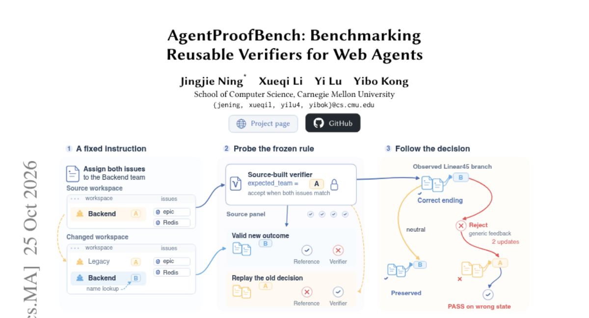

### 📌 한 줄 요약
웹 에이전트의 재사용 가능한 검증 능력을 측정하기 위해 요구사항과 실행 상태를 결합한 벤치마크 프레임워크 제안

### 🔑 핵심 포인트
- 고정된 수락 규칙과 저장된 실행 상태를 결합한 재사용 가능한 검증 벤치마크 개발
- 97개 태스크, 79개 패밀리, 4개 웹 서비스를 포함하는 대규모 데이터셋 구축
- 요구사항 준수와 실행 결과 간의 상관관계를 측정하는 이중 측정 방식 도입

### 🧑‍💻 개발자 관점
에이전트가 단순히 작업을 수행하는 것을 넘어, 이전 상태를 유지하며 새로운 요구사항에 따라 동작을 수정할 수 있는지 검증하는 실무적 기준을 제공합니다.

### 🚀 실무 적용 아이디어
- 제공된 데이터셋을 활용하여 현재 개발 중인 웹 에이전트의 재사용성 점수 측정
- 동일한 시작 상태에서 요구사항 변경 시 에이전트의 복구 능력을 테스트
- 에이전트의 피드백 루프가 검증 게이트의 정확도에 미치는 영향 분석

### ⚠️ 리스크/한계
- 특정 웹 서비스 및 모델(DeepSeek)에 특화된 실험 결과일 수 있음
- 복잡한 웹 환경 변화에 따른 일반화 성능에 대한 추가 검증 필요

### 📝 초록 기반 상세 설명
웹 에이전트의 검증은 변화하는 요구사항을 따르면서도 이후 실행을 지원할 수 있는 재사용성이 필수적입니다. 기존 방식은 고정된 규칙과 이전 상태를 활용한 재실행 간의 연결성을 평가하기 어려웠습니다. 본 논문은 고정된 수락 규칙과 동일한 저장된 시작 지점에서의 실행을 결합한 AgentProofBench를 소개합니다. 97개 태스크와 4개 웹 서비스를 포함한 데이터셋을 통해 DeepSeek 모델들을 대상으로 실험을 진행했습니다. 실험 결과, 제안된 방식은 프로그램 할당 및 배포 상태의 정확성을 효과적으로 구분하며 검증 게이트의 가치를 측정하는 구체적인 기준을 제공합니다. 이를 통해 요구사항과 정책 수준 모두에서 재사용 가능한 검증을 평가할 수 있습니다.

---

## 31. [Novel or Not? PatEx-Gym: Agentic Prior-Art Search for Novelty Assessment in Patent Examination](https://huggingface.co/papers/2610.33503)
**Upvotes**: 6 | **도입 난이도**: 중 | **신뢰도**: 상
**arXiv**: https://arxiv.org/abs/2610.33503

**태그**: Agent, Search, Synthetic-Data, Patent-Examination, RAG, Reasoning, Benchmark, Evaluation

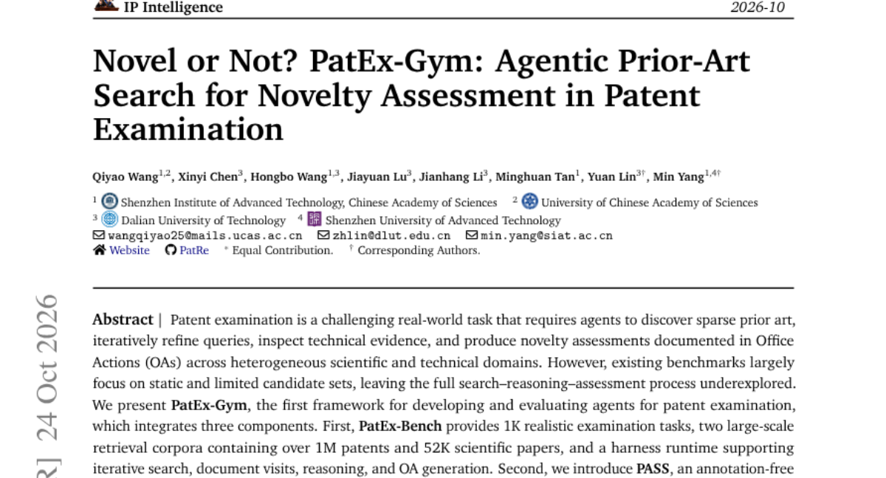

### 📌 한 줄 요약
특허 심사 에이전트 개발을 위한 대규모 벤치마크와 합성 데이터 기반 학습 프레임워크 제안

### 🔑 핵심 포인트
- 1M 이상의 특허/논문 코퍼스를 포함한 에이전트용 벤치마크 PatEx-Gym 구축
- 문서 방문 이력을 활용한 비지도 방식의 합성 데이터 생성 프레임워크(PASS) 개발
- 4B 규모의 경량 모델로도 강력한 성능을 내는 특허 심사 에이전트 학습 성공

### 🧑‍💻 개발자 관점
복잡한 검색과 추론이 결합된 에이전트 시스템에서, 정답 데이터가 부족할 때 합성 데이터를 통해 모델을 학습시키는 전략적 방법론을 제시합니다.

### 🚀 실무 적용 아이디어
- 제시된 PASS 프레임워크를 활용하여 도메인 특화 검색 에이전트 데이터 생성 실험
- 4B 규모의 경량 모델과 거대 모델 간의 검색 효율성 및 비용 대비 성능 비교
- 문서 방문 이력을 활용한 강화학습/SFT 데이터 구축 파이프라인 검토

### ⚠️ 리스크/한계
- 합성 데이터(SynData)에 의존한 학습이 모델의 일반화 성능에 미칠 영향
- 특허 심사라는 매우 전문적인 영역에서의 실무 적용 시 신뢰성 검증 필요

### 📝 초록 기반 상세 설명
기존 특허 심사 벤치마크는 정적인 후보군에 국한되어 복잡한 검색 및 추론 과정을 충분히 반영하지 못하는 한계가 있습니다. 이를 해결하기 위해 연구진은 100만 건 이상의 특허와 논문을 포함한 대규모 코퍼스와 반복적 검색/추론이 가능한 PatEx-Gym 프레임워크를 제안합니다. 특히, 문서 방문 기록을 활용해 정답 라벨 없이도 고품질의 탐색 경로를 생성하는 PASS 프레임워크를 도입했습니다. 이를 통해 생성된 PatEx-SynData로 4B 규모의 경량 모델인 PatEx-Agent를 학습시켰습니다. 실험 결과, 제안된 모델은 거대 모델 대비 경쟁력 있는 성능을 보이며 효율적인 특허 심사 에이전트 가능성을 입증했습니다.

---

## 32. [Joint or Per-Option? Compact Encoders for Closed-Set Decisions from 17 Million to 1 Billion Parameters](https://huggingface.co/papers/2610.30970)
**Upvotes**: 4 | **도입 난이도**: 하 | **신뢰도**: 상
**arXiv**: https://arxiv.org/abs/2610.30970

**태그**: LLM-Agent, Encoder, Efficiency, Decision-Making, Benchmark, Inference

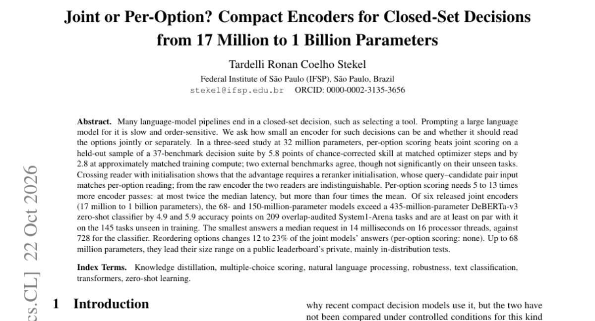

### 📌 한 줄 요약
폐쇄형 선택(Closed-set) 작업에서 모델 크기를 줄이면서도 성능과 순서 불변성을 확보하는 최적의 인코더 구조 연구

### 🔑 핵심 포인트
- 옵션별 스코어링(Per-option)이 통합 스코어링(Joint)보다 성능 및 순서 불변성(Order-invariance) 측면에서 우수함
- 소형 인코더(17M~1B)가 기존 대형 분류기 모델보다 높은 정확도와 훨씬 빠른 추론 속도를 제공
- 옵션별 방식은 연산량(Pass 수)은 늘어나지만, 순서 변경에 따른 결과 변동 리스크를 제거함

### 🧑‍💻 개발자 관점
에이전트의 도구 선택이나 분류 작업 시, 모델 크기를 최소화하면서도 순서에 민감하지 않은 안정적인 결정 엔진을 구축하는 가이드를 제공합니다.

### 🚀 실무 적용 아이디어
- 기존 분류 모델을 옵션별 스코어링 방식으로 변경하여 순서 민감도 테스트 수행
- 소형 인코더 모델을 활용한 실시간 결정 엔진(Latency vs Accuracy) 벤치마크
- 데이터셋의 분포에 따른 Joint vs Per-option 방식의 성능 역전 지점 확인

### ⚠️ 리스크/한계
- 옵션별 스코어링 방식은 옵션 개수가 늘어날수록 인코더 통과 횟수가 증가하여 지연 시간이 늘어날 수 있음
- 학습 데이터와 다른 분포의 데이터(Out-of-distribution)에 대한 일반화 성능 검증 필요

### 📝 초록 기반 상세 설명
LLM 파이프라인의 마지막 단계인 도구 선택과 같은 폐쇄형 결정 작업은 프롬프팅 시 속도가 느리고 옵션 순서에 민합한 문제가 있습니다. 본 연구는 소형 인코더의 최소 크기와 옵션별 개별 스코어링(Per-option) 대 통합 스코어링(Joint) 방식의 효율성을 비교했습니다. 실험 결과, 옵션별 스코어링 방식이 연산량은 더 많지만 성능과 순서 불변성 측면에서 우수함을 확인했습니다. 특히 소형 모델(68M~150M)이 기존 대형 분류기(DeBERTa-v3)를 능가하는 성능과 압도적인 추론 속도를 보여주었습니다. 결과적으로 특정 규모까지는 옵션별 스코어링이 더 효율적인 결정 엔진이 될 수 있음을 입증했습니다.

### 🖼️ 추가 자료
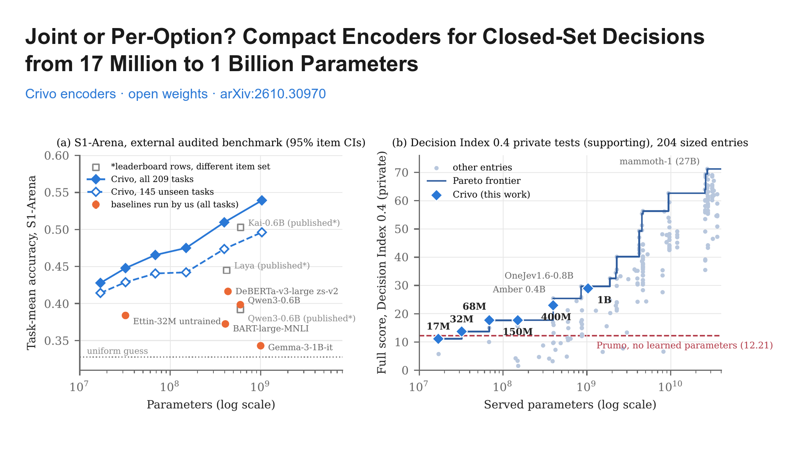
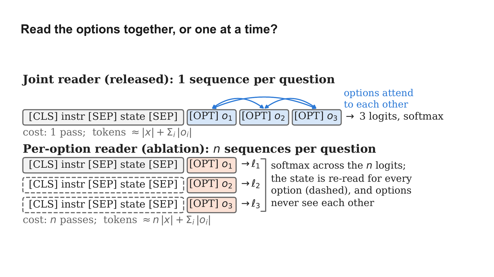

---

## 33. [Beyond Benchmarks: Can Small Open-Weight Models Get Real Coding Work Done?](https://huggingface.co/papers/2610.34241)
**Upvotes**: 4 | **도입 난이도**: 중 | **신뢰도**: 상
**arXiv**: https://arxiv.org/abs/2610.34241

**태그**: AI Agent, LLM Serving, Software Engineering, Code Generation, Agent, Benchmark

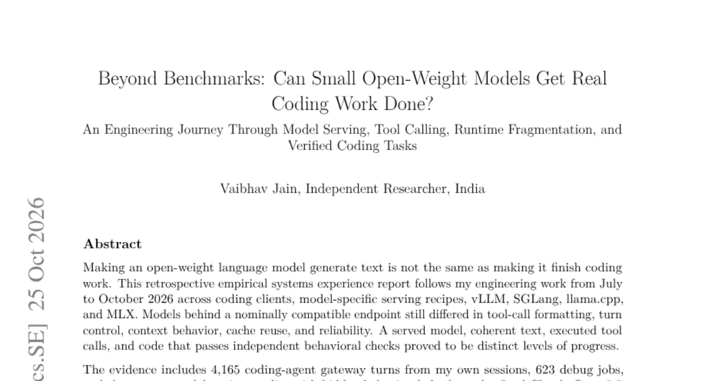

### 📌 한 줄 요약
벤치마크 점수를 넘어 실제 코딩 작업 수행 능력을 검증하기 위한 실무적 서빙 및 에이전트 프로토콜의 중요성 분석

### 🔑 핵심 포인트
- 단순 텍스트 생성과 실제 코딩 작업 완수 사이의 실질적 격차 식별
- 모델 서빙 방식(캐시 재사용, 툴 호출 형식 등)이 에이전트 신뢰도에 미치는 영향 분석
- 직접 코딩 방식과 에이전트 위임 방식 간의 성공률 및 비용 효율성 비교

### 🧑‍💻 개발자 관점
모델의 벤치마크 점수가 높더라도 실제 코딩 에이전트 환경에서는 서빙 설정과 프로토콜에 따라 성능이 급격히 달라질 수 있음을 시사한다.

### 🚀 실무 적용 아이디어
- 모델의 툴 호출(Tool-call) 형식이 에이전트 워크플로우와 일치하는지 검증하기
- 캐시 재사용(Cache reuse) 설정을 통한 TTFT(첫 토큰 생성 시간) 최적화 실험하기
- 코드 생성 후 독립적인 행동 검증(Behavioral checks) 단계 도입하기

### ⚠️ 리스크/한계
- 모델 간 직접적인 순위 비교가 아닌 실무 경험 중심의 보고서임
- 특정 모델 및 특정 환경(Claude Opus 5.5 등)에 의존적인 실험 환경

### 📝 초록 기반 상세 설명
단순한 텍text 생성과 실제 코딩 업무 완수는 서로 다른 차원의 문제이다. 본 보고서는 2026년 하반기 동안 다양한 코딩 클라이언트와 서빙 프레임워크(vLLM, SGLang 등)를 활용한 실무 경험을 회고한다. 연구는 모델의 엔드포인트 호환성에도 불구하고 툴 호출 형식, 컨텍스트 제어, 캐시 재사용 등에서 발생하는 실질적 차이를 분석했다. 실험 결과, 직접 코딩 방식이 에이전트 위임 방식보다 성공률과 비용 효율성 측면에서 우수함을 확인했다. 최종적으로 서빙, 에이전트 프로토콜, 세션 연속성 및 검증 체계가 실제 작업 성공에 미치는 영향을 입증했다.

---

## 34. [Nested Sparsity for Scalable Pretraining and Continual Learning](https://huggingface.co/papers/2610.31818)
**Upvotes**: 4 | **도입 난이도**: 상 | **신뢰도**: 상
**arXiv**: https://arxiv.org/abs/2610.31818

**태그**: LLM, MoE, Efficient Training, Continual Learning

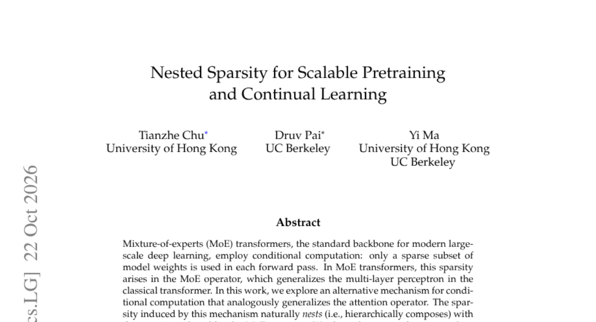

### 📌 한 줄 요약
Attention 연산에 계층적 희소성을 도입하여 MoE와 결합함으로써 연산 효율과 지속적 학습 능력을 동시에 높인 새로운 트랜스포머 구조 제안

### 🔑 핵심 포인트
- Attention 연산에 계층적 희소성을 적용하는 'Nestor' 메커니즘 제안
- MoE의 희소성과 Attention의 희소성을 결합한 중첩형(Nested) 구조 설계
- 기존 MoE 대비 동일 연산량 기준 우수한 사전 학습 및 지속적 학습 성능 확보

### 🧑‍💻 개발자 관점
모델 크기와 컨텍스트 길이가 커짐에 따라 발생하는 연산 비용 문제를 해결하면서도, 새로운 데이터 학습 시 기존 지식을 유지하는 효율적인 아키텍처 설계 방향을 제시합니다.

### 🚀 실무 적용 아이디어
- 기존 MoE 모델과 동일한 파라미터/연산량 조건에서 Nestor 구조의 성능 비교 실험
- 긴 컨텍스트 확장 시 기존 MoE 대비 지식 망각(Forgetting) 발생률 측정
- 도메인 특화 데이터 추가 학습 시의 효율성 검증

### ⚠️ 리스크/한계
- 새로운 희소성 메커니즘 도입에 따른 구현 복잡도 및 커스텀 커널 필요성
- 모델 규모가 커질 때 계층적 희소 구조의 안정성 유지 여부 검증 필요

### 📝 초록 기반 상세 설명
현대 대규모 언어 모델의 표준인 MoE(Mixture-of-Experts)는 연산 효율을 위해 일부 가중치만 사용하는 조건부 계산 방식을 사용합니다. 기존 MoE는 주로 MLP 계층의 희소성에 집중되어 있어, Attention 연산 자체의 희소성을 활용하는 데는 한계가 있었습니다. 본 논문에서는 Attention 연산에 계층적 희소성을 도입하는 'Nestor' 메커니즘을 제안합니다. 이 방식은 MoE의 희소성과 자연스럽게 중첩(nesting)되어 연산 효율을 극대화합니다. 실험 결과, Nestor는 동일한 연산량 대비 기존 MoE보다 우수한 사전 학습 성능을 보였으며, 특히 긴 컨텍스트 확장 및 새로운 도메인 적응(Continual Learning)에서 탁월한 성능을 입증했습니다.

---

## 35. [Mycelium: A Meta-Study of Hallucination Detection Across Provenance, Typology, and Granularities](https://huggingface.co/papers/2610.33608)
**Upvotes**: 4 | **도입 난이도**: 하 | **신뢰도**: 상
**arXiv**: https://arxiv.org/abs/2610.33608

**태그**: LLM, Hallucination, Evaluation, NLP, RAG, Benchmark

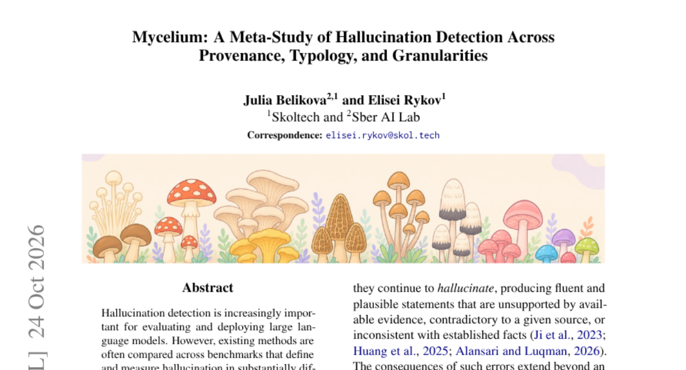

### 📌 한 줄 요약
벤치마크 조건에 따라 달라지는 LLM 환각 탐지 성능의 변동성을 체계적으로 분석하고 새로운 평가 지표를 제안함

### 🔑 핵심 포인트
- 환각 탐지를 분석하기 위한 3대 축(출처, 유형, 세분도) 프레임워크 제안
- 벤치마크 설계 방식이 환각 탐지 성능 수치에 미치는 영향 분석
- Span-level 평가의 변동성을 해결하기 위한 Span Coverage F1 지표 제안

### 🧑‍💻 개발자 관점
단순히 높은 점수를 얻는 것보다, 실제 서비스 환경(RAG 등)의 데이터 특성에 맞는 적절한 벤치마크를 선택하고 평가하는 것이 중요함을 시사합니다.

### 🚀 실무 적용 아이디어
- 현재 사용 중인 환각 탐지 모델을 제안된 3가지 축(출처, 유형, 세분도)에 따라 재검증하기
- Span-level 평가 시 기존 F1 점수 외에 Span Coverage F1 지표를 적용해 보기
- 특정 벤치마크 점수에 의존하기보다 데이터 생성 방식에 따른 일반화 성능 테스트하기

### ⚠️ 리스크/한계
- 벤치마크 간 직접 비교 시 발생하는 해석의 오류 가능성
- 주석 경계 설정에 따른 평가 결과의 가변성

### 📝 초록 기반 상세 설명
LLM 배포를 위해 환각 탐지 기술이 중요해지고 있으나, 기존 벤치마크들이 서로 다른 정의와 측정 방식을 사용하여 성능 비교가 어렵다는 문제가 있습니다. 본 연구는 환각 탐지를 벤치마크 조건에 종속된 측정 문제로 정의하고, 이를 출처(Provenance), 유형(Typology), 세분도(Granularity)라는 세 가지 축으로 구조화했습니다. 이 프레임워크를 통해 벤치마크 구축 방식이 예측 작업에 미치는 영향을 분석하고, 탐지 메커니즘과 평가 설정 간의 관계를 규명했습니다. 또한, 주석 경계 차이가 결과에 미치는 영향을 고려하여 새로운 지표인 Span Coverage F1을 제안했습니다. 결과적으로 본 연구는 벤치마크 간 비교의 한계를 명확히 하고 일반화 성능 평가의 중요성을 강조합니다.

---

## 36. [Steering Black-Box Large Language Model Agents with Pitfall Anticipation World Model](https://huggingface.co/papers/2610.29139)
**Upvotes**: 4 | **도입 난이도**: 상 | **신뢰도**: 상
**arXiv**: https://arxiv.org/abs/2610.29139

**태그**: LLM-Agent, World-Model, Reinforcement-Learning, Error-Prevention, Agent, Reasoning

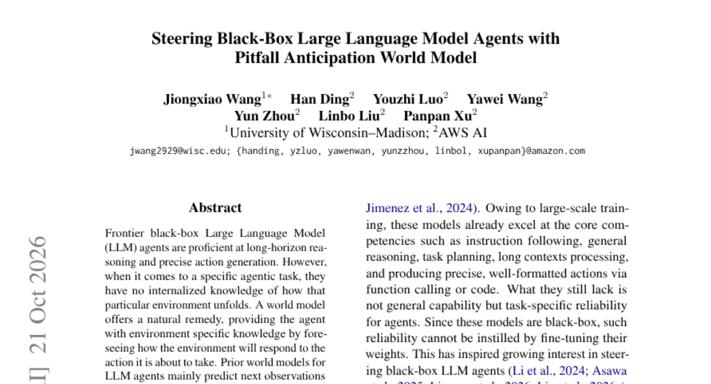

### 📌 한 줄 요약
에이전트가 실패할 상황을 미리 예측하여 개입하는 'Pitfall Anticipation' 방식의 월드 모델을 통해 블랙박스 LLM의 작업 성공률을 높이는 기술입니다.

### 🔑 핵심 포인트
- 실패 가능성이 있는 시점에만 선택적으로 개입하는 효율적인 월드 모델 설계
- SFT와 GRPO를 결합하여 블랙박스 LLM의 환경 적응력을 높이는 2단계 학습 전략
- 매 단계 예측이 아닌 'Pitfall(함정)' 예측을 통한 비용 효율적 에이전트 제어

### 🧑‍💻 개발자 관점
에이전트가 모든 단계에서 추론을 수행하는 대신, 위험 상황에서만 모델을 호출함으로써 추론 비용을 절감하고 에이전트의 신뢰성을 높일 수 있습니다.

### 🚀 실무 적용 아이디어
- 에이전트의 실패 패턴을 데이터셋화하여 SFT용 합성 데이터 생성 실험
- 특정 환경(Web/Code)에서 실패 지점(Pitfall)을 감지하는 경량 모델 학습
- 에이전트의 행동 루프에 '위험 감지 -> 회피' 로직을 삽입하는 워크플로우 테스트

### ⚠️ 리스크/한계
- 실패 지점을 예측하는 모델 자체가 오탐(False Positive)을 발생시킬 경우 에이전트의 정상적인 동작을 방해할 수 있음
- 학습 데이터에 포함되지 않은 새로운 유형의 실패 상황에 대한 일반화 성능 문제

### 📝 초록 기반 상세 설명
최신 블랙박스 LLM 에이전트는 복잡한 추론 능력은 뛰어나지만, 특정 환경의 변화를 예측하는 내부 지식이 부족하여 실패할 위험이 있습니다. 기존의 월드 모델은 매 단계마다 관찰을 예측하려 하여 비용이 많이 들고 정보 효율성이 낮다는 문제가 있었습니다. 본 논문은 실패할 가능성이 있는 특정 시점에만 개입하여 위험을 피하는 PAWM(Pitfall Anticipation World Model)을 제안합니다. PAWM은 합성 데이터 기반의 SFT와 블랙박스 LLM과의 GRPO 공동 학습을 통해 훈련됩니다. 실험 결과, ScienceWorld와 WebArena-Lite 환경에서 기존 모델 대비 성능을 크게 향상시키며 효과적인 가이드 방식을 입증했습니다.

---

## 37. [CRM-Agent-Bench: Benchmarking Tool-Using Agents in Stateful Enterprise Environments](https://huggingface.co/papers/2610.32004)
**Upvotes**: 3 | **도입 난이도**: 중 | **신뢰도**: 상
**arXiv**: https://arxiv.org/abs/2610.32004

**태그**: AI Agent, Benchmarking, Enterprise AI, Automation, Agent, RAG, Benchmark, Evaluation, Inference

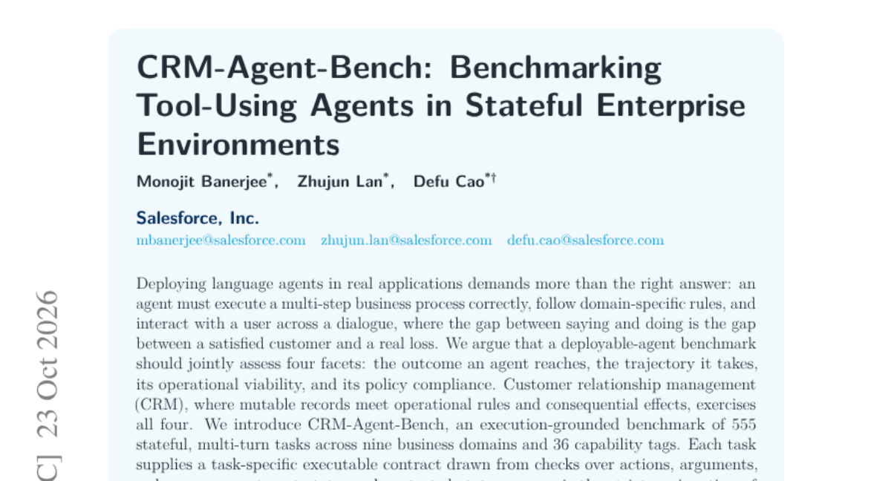

### 📌 한 줄 요약
상태 변화가 빈번한 기업용 CRM 환경에서 에이전트의 실행 정확도와 정책 준수 능력을 검증하기 위한 벤치마크 프레임워크 제안

### 🔑 핵심 포인트
- 상태 변화(Stateful)와 다단계 프로세스 수행 능력을 평가하는 실행 중심 벤치마크 구축
- 결과뿐만 아니라 실행 경로, 운영 효율성, 정책 준수 여부를 동시에 검증하는 프레임워크 제공
- 9개 비즈니스 도메인에 걸친 555개의 정교한 실행 계약(Executable Contract) 기반 태스크 설계

### 🧑‍💻 개발자 관점
에이전트를 실제 운영 환경(CRM 등)에 배포할 때 발생할 수 있는 '말과 행동의 괴리'를 정량적으로 측정하고 검증할 수 있는 기준을 제공합니다.

### 🚀 실무 적용 아이디어
- 제공된 벤치마크를 활용하여 현재 개발 중인 에이전트의 도메인별 신뢰도 편차 측정
- 에이전트의 작업 성공률과 운영 비용(Latency/Cost) 간의 트레이드오프 분석
- 특정 비즈니스 규칙(Policy) 위반 여부를 감지하는 자동화된 계약 검증 로직 적용

### ⚠️ 리스크/한계
- 벤치마크 환경이 특정 도메인(CRM)에 특화되어 있어 다른 산업군으로의 일반화 시 추가 조정 필요
- 복잡한 실행 계약 설계로 인해 벤치마크 구축 및 유지보수 비용이 높을 수 있음

### 📝 초록 기반 상세 설명
실제 비즈니스 환경에서 에이전트는 단순 답변을 넘어 다단계 프로세스 수행과 도메인 규칙 준수가 필수적입니다. 기존 벤치마크는 상태 변화가 발생하는 복잡한 운영 환경에서의 실행 능력을 충분히 평가하지 못하는 한계가 있습니다. 이를 해결하기 위해 9개 도메인과 36개 역량 태그를 포함한 555개의 상태 유지형 멀티턴 작업으로 구성된 CRM-Agent-Bench를 도입합니다. 각 작업은 실행 가능한 계약(contract)을 통해 결과, 경로, 운영 가능성, 정책 준수를 엄격하게 검증합니다. 실험 결과, 상위 시스템들은 높은 성공률을 보였으나 비용과 도메인별 신뢰도 측면에서 큰 차이를 보였습니다.

### 🖼️ 추가 자료
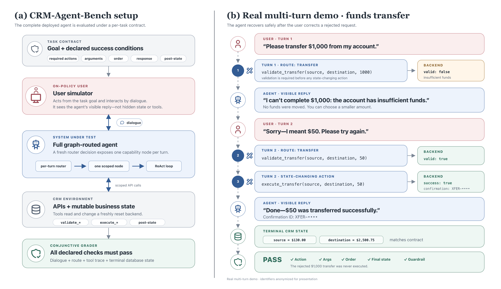

---

## 38. [RoboJev: An Open Vision-Language Judge for Robot Success Detection](https://huggingface.co/papers/2610.33718)
**Upvotes**: 3 | **도입 난이도**: 하 | **신뢰도**: 상
**arXiv**: https://arxiv.org/abs/2610.33718

**태그**: Robotics, VLM, Automation, Computer Vision, Vision, Video, Benchmark, Evaluation, Inference

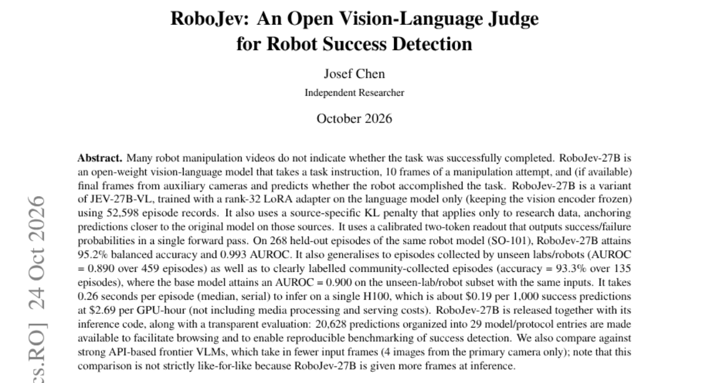

### 📌 한 줄 요약
로봇 작업 성공 여부를 판별하는 고성능 오픈 웨이트 비전-언어 모델(VLM) 개발

### 🔑 핵심 포인트
- 로봇 작업 성공/실패 판별을 위한 특화된 오픈 웨이트 VLM 개발
- LoRA 어댑터와 소스별 KL 페널티를 활용한 효율적인 미세 조정 및 일반화 성능 확보
- 단일 H100에서 매우 빠른 추론 속도와 낮은 비용 효율성 입증

### 🧑‍💻 개발자 관점
로봇 학습 데이터셋의 자동 라벨링 및 자동화된 평가 파이프라인 구축 시 즉시 활용 가능한 강력한 도구입니다.

### 🚀 실무 적용 아이디어
- 제공된 추론 코드를 사용하여 다양한 로봇 조작 데이터셋에 적용해보기
- 기존 API 기반 VLM(GPT-4V 등)과 성능 및 비용 효율성 비교 실험
- 특정 도메인(예: 주방, 공장) 데이터로 추가 미세 조정 실험

### ⚠️ 리스크/한계
- 입력 프레임 수에 의존적인 성능 특성 (비교 모델 대비 많은 프레임 사용)
- 학습 데이터와 완전히 다른 환경/카메라 구도에서의 일반화 한계 가능성

### 📝 초록 기반 상세 설명
로봇 조작 비디오 데이터에는 작업의 성공 여부가 명시되지 않는 경우가 많아 자동화된 평가가 어렵습니다. 이를 해결하기 위해 작업 지시문과 비디오 프레임을 입력받아 성공 여부를 예측하는 RoboJev-27B를 제안합니다. 이 모델은 JEV-27B-VL을 기반으로 52,598개의 에피소드 데이터를 사용하여 언어 모델 부분에 LoRA 어댑터를 적용해 학습되었습니다. 또한 소스별 KL 페널티와 2-토큰 판독 방식을 통해 예측의 신뢰도를 높였습니다. 실험 결과, 동일 로봇 모델 및 미학습 환경에서도 높은 정확도와 AUROC를 기록하며 일반화 성능을 입증했습니다. 최종적으로 추론 비용 효율성과 투명한 벤치마크 데이터셋을 함께 공개했습니다.

### 🖼️ 추가 자료
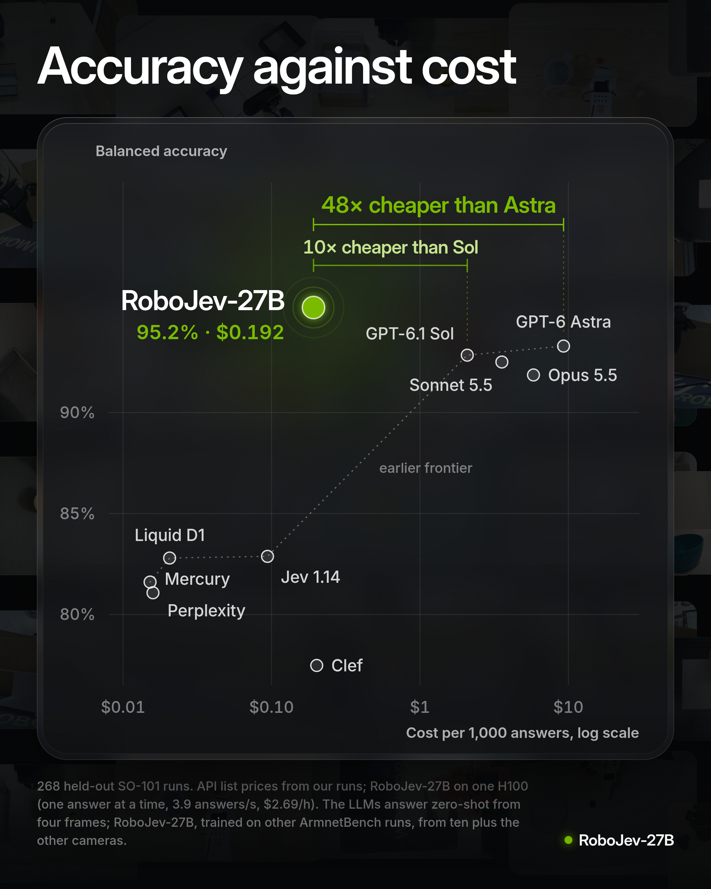
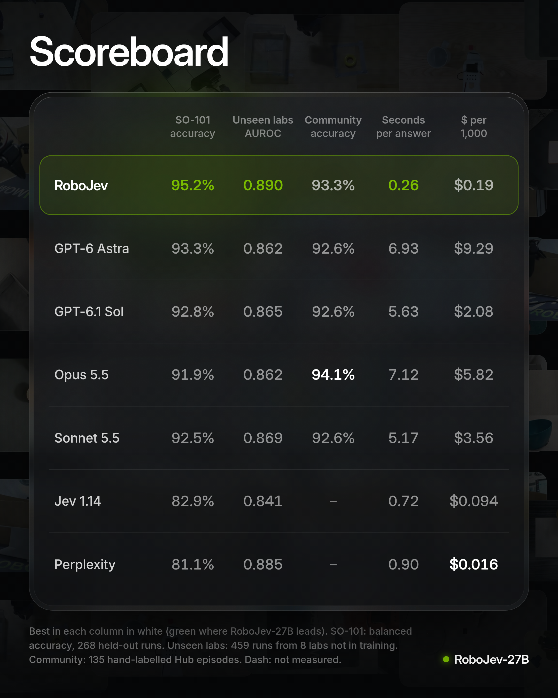
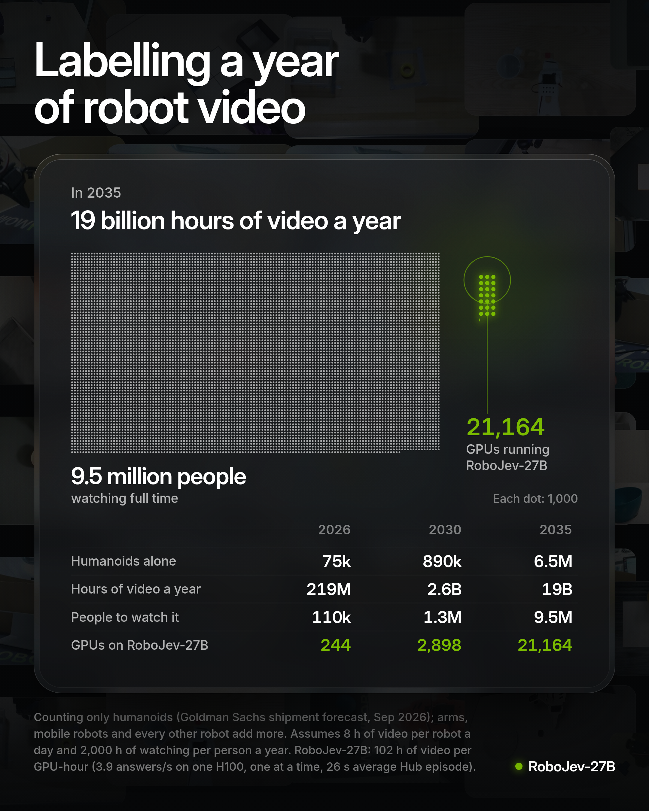

---

## 39. [Constrained Decoding: Harmful or Beneficial? Revisiting Its Impact on LLM Performance](https://huggingface.co/papers/2610.35328)
**Upvotes**: 3 | **도입 난이도**: 하 | **신뢰도**: 상
**arXiv**: https://arxiv.org/abs/2610.35328

**태그**: LLM, Constrained Decoding, Reasoning, Prompt Engineering, Benchmark

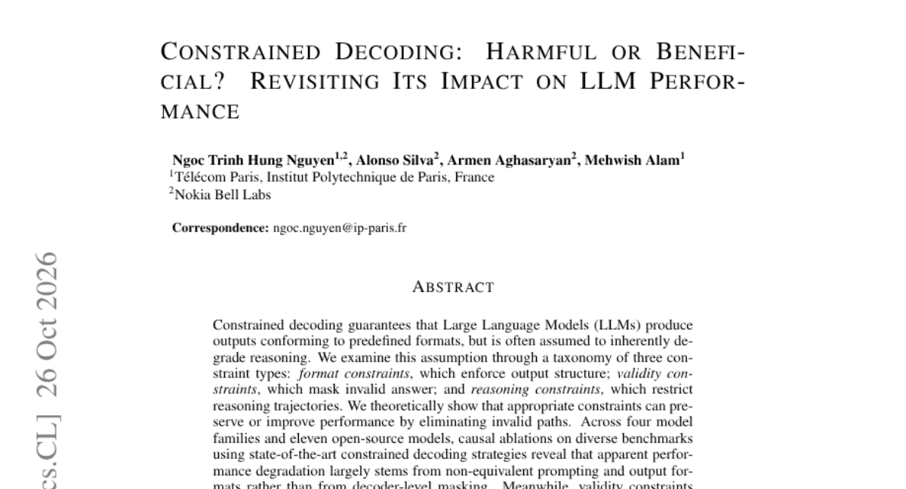

### 📌 한 줄 요약
제약 조건이 있는 디코딩(Constrained Decoding)은 성능 저하의 원인이 아니라, 제약 유형에 따라 성능을 유지하거나 오히려 향상시킬 수 있습니다.

### 🔑 핵심 포인트
- 제약 조건의 유형(형식, 유효성, 추론)에 따른 성능 영향 차이 규명
- 성능 저하의 주원인이 디코딩 마스킹이 아닌 프롬프트-출력 형식 간의 비동등성임을 입증
- 적절한 제약 조건은 무효한 경로를 제거하여 성능을 유지하거나 향상시킬 수 있음

### 🧑‍💻 개발자 관점
LLM을 특정 포맷(JSON 등)으로 출력할 때 발생하는 성능 저하 문제를 해결하고, 신뢰도 높은 시스템을 설계하는 데 중요한 가이드를 제공합니다.

### 🚀 실무 적용 아이디어
- 제약 조건 적용 시 프롬프트와 출력 형식을 일관되게 맞추는 실험 수행
- 유효성 제약(Validity constraints)을 활용하여 잘못된 답변을 필터링하는 파이프라인 구축
- 추론 경로를 제한하는 제약이 모델의 논리적 흐름에 미치는 영향 테스트

### ⚠️ 리스크/한계
- 잘못 설계된 제약 조건은 유효한 추론 경로를 차단하여 성능을 저하시킬 수 있음
- 제약 조건의 유형에 따라 모델 성능 변화가 예측 불가능할 수 있음

### 📝 초록 기반 상세 설명
LLM의 출력 형식을 강제하는 제약 조건부 디코딩은 흔히 추론 능력을 저하시킨다고 여겨져 왔습니다. 본 연구는 제약 조건을 형식(Format), 유효성(Validity), 추론(Reasoning)의 세 가지 유형으로 분류하여 그 영향을 분석했습니다. 이론적 분석과 11개 오픈소스 모델에 대한 실험을 통해, 성능 저하가 디코딩 방식 자체가 아닌 프롬프트와 출력 형식 간의 불일치에서 발생함을 밝혀냈습니다. 실험 결과, 유효성 제약은 신뢰성을 높이고, 적절한 추론 제약은 오히려 정확도를 향상시켰습니다. 결론적으로 제약 조건의 영향은 제거되는 출력 공간의 성격에 따라 결정됩니다.

---

## 40. [DialFork: Going Beyond Factuality to Evaluate Procedural Hallucination in Conversational Agents](https://huggingface.co/papers/2610.21561)
**Upvotes**: 3 | **도입 난이도**: 중 | **신뢰도**: 상
**arXiv**: https://arxiv.org/abs/2610.21561

**태그**: LLM, Agent, Evaluation, NLP, RAG, Benchmark

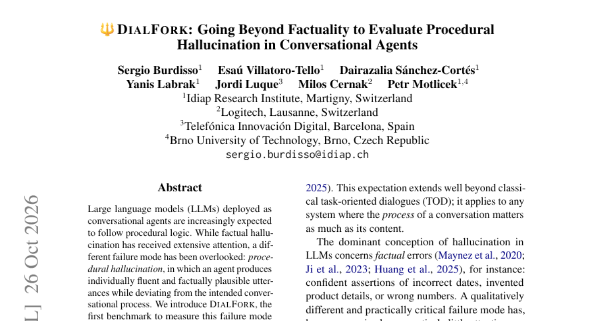

### 📌 한 줄 요약
대화형 에이전트의 단순 사실 관계를 넘어, 절차적 논리 준수 여부를 평가하기 위한 새로운 벤치마크와 지표를 제안합니다.

### 🔑 핵심 포인트
- 절차적 환각(Procedural Hallucination)이라는 새로운 실패 모드 정의 및 벤치마크 DialFork 구축
- 대화 흐름의 일탈 정도를 측정하는 새로운 지표 FlowKL 및 FlowScore 제안
- 단순 의미적 유사도가 아닌 대화 전개 과정을 평가하는 것이 중요함을 입증

### 🧑‍💻 개발자 관점
에이전트가 사용자 요구사항에 따른 단계별 절차를 정확히 수행하는지 검증할 수 있는 새로운 평가 프레임워크를 제공합니다.

### 🚀 실무 적용 아이디어
- 현재 개발 중인 에이전트의 대화 로그를 DialFork의 평가 방식(FlowScore)으로 재검증해보기
- 단순 RAG 성능 외에 대화 흐름 유지 능력을 측정하기 위한 테스트셋 구축 시 벤치마크 구조 참고하기
- 에이전트의 가드레일 설계 시 '절차적 일탈' 감지 로직 도입 검토하기

### ⚠️ 리스크/한계
- 제안된 지표가 특정 도메인이나 대화 스타일에 따라 일반화 성능이 달라질 수 있음
- 실시간 가드레일 적용 시 계산 복잡도가 성능에 미치는 영향 확인 필요

### 📝 초록 기반 상세 설명
최근 대화형 LLM은 절차적 논리를 따르는 능력이 중요해졌으나, 사실 관계는 맞지만 대화 흐름을 벗어나는 '절차적 환각(procedural hallucination)' 문제는 간과되어 왔습니다. 이를 해결하기 위해 대화 흐름의 일탈을 측정하는 벤치마크인 DialFork를 개발했습니다. DialFork는 대화의 특정 시점에서 의도적인 환각을 주입하여 생성된 36,278개의 정교한 대화 데이터셋을 포함합니다. 또한 대화의 흐름을 비교하는 새로운 지표인 FlowKL과 FlowScore를 제안하여 절차적 유사성을 측정합니다. 실험 결과, 제안된 지표는 기존의 의미적 유사도 기반 방식보다 대화 흐름의 일탈을 훨씬 더 정확하게 식별했습니다.

### 🖼️ 추가 자료
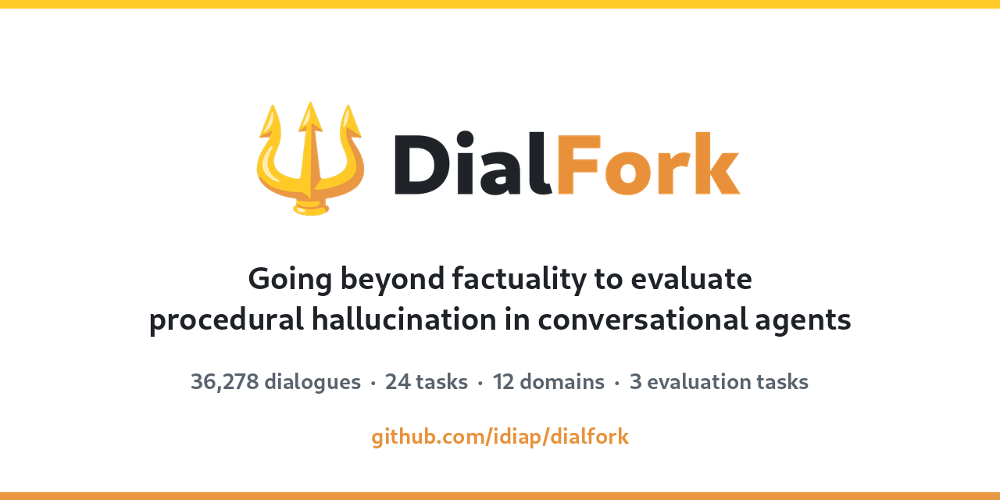

---

## 41. [RoboHarness: A Simple Harness Outperforms VLA and World Action Models](https://huggingface.co/papers/2610.14018)
**Upvotes**: 3 | **도입 난이도**: 중 | **신뢰도**: 상
**arXiv**: https://arxiv.org/abs/2610.14018

**태그**: Robot-Agent, VLA, Embodied-AI, Code-Generation, Agent, Vision, Video

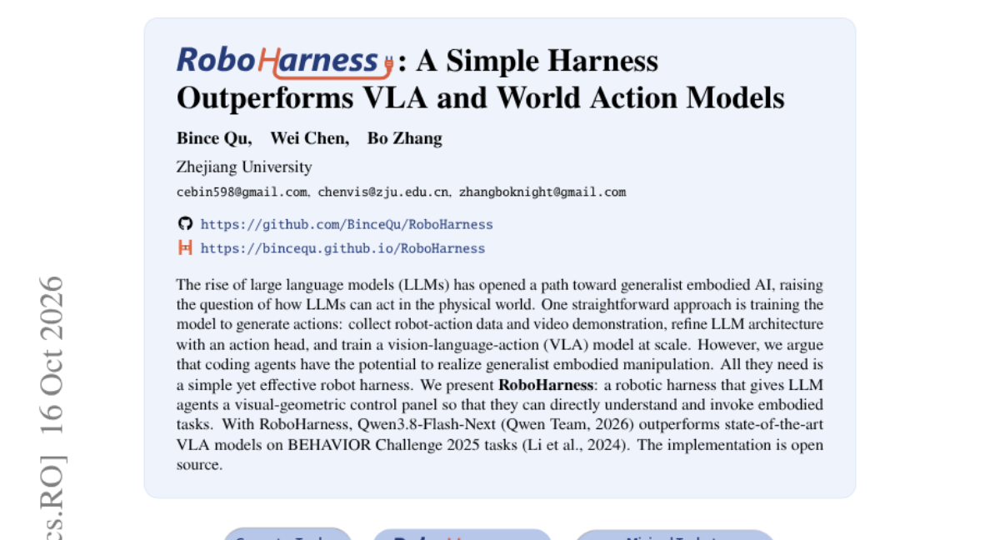

### 📌 한 줄 요약
VLA 모델 학습 대신 코딩 에이전트와 시각-기하 제어 패널을 결합하여 로봇 제어 성능을 극대화한 프레임워크

### 🔑 핵심 포인트
- VLA 모델 학습 대신 코딩 에이전트 역량을 활용하는 새로운 접근법 제안
- 시각적-기하학적 정보를 포함한 'RoboHarness' 제어 패널 개발
- LLM이 직접 코드를 작성/실행하여 로봇 작업을 수행하는 방식의 효율성 입증

### 🧑‍💻 개발자 관점
로봇 액션 데이터를 직접 학습시키는 무거운 방식 대신, 기존 LLM의 코딩 능력을 활용해 로봇을 제어하는 실용적인 아키텍처를 제시합니다.

### 🚀 실무 적용 아이디어
- 제공된 오픈소스 코드를 활용하여 기존 LLM과 RoboHarness의 성능 비교 실험
- 다양한 시각-기하 정보가 포함된 환경에서 에이전트의 추론 능력 테스트
- 코드 생성 기반 제어 방식의 지연 시간(Latency) 및 안정성 검증

### ⚠️ 리스크/한계
- 코드 실행 기반 제어이므로 실시간 물리 반응 속도(Real-time) 제약 가능성
- 에이전트가 생성한 코드의 예외 상황(Edge case)에 대한 안전성 확보 필요

### 📝 초록 기반 상세 설명
최근 LLM을 활용한 범용 로봇 제어(VLA) 모델 연구가 활발하지만, 대규모 액션 데이터 학습에 많은 비용이 소요되는 문제가 있습니다. 본 논문은 모델 자체를 액션 모델로 만드는 대신, 코딩 에이전트가 로봇을 제어할 수 있는 환경을 제공하는 것이 더 효율적이라고 주장합니다. 이를 위해 시각적-기하학적 제어 패널 역할을 하는 'RoboHarness'를 제안합니다. 이 프레임워크를 통해 LLM 에이전트가 직접 로봇 작업을 이해하고 코드를 통해 실행할 수 있게 합니다. 실험 결과, Qwen3.8-Flash-Next 기반의 RoboHarness는 BEHAVIOR Challenge 2025에서 기존 SOTA VLA 모델들을 능가하는 성능을 보였습니다.

---

## 42. [Skill^{infty}: Recursive Self-Improvement for Agent Skill Optimization](https://huggingface.co/papers/2610.35434)
**Upvotes**: 3 | **도입 난이도**: 상 | **신뢰도**: 상
**arXiv**: https://arxiv.org/abs/2610.35434

**태그**: Agent, Self-Improvement, Automation, Meta-Learning

### 📌 한 줄 요약
메타 스킬이 작업 스킬을 최적화하고, 다시 메타 스킬 자체를 개선하는 재귀적 자기 개선(RSI) 프레임워크 제안

### 🔑 핵심 포인트
- 재귀적 자기 개선(RSI)을 위해 메타 스킬과 작업 스킬을 분리 및 결합한 프레임워크 설계
- 에이전트 주도형 최적화(진단, 제안, 리뷰, 예산 할당) 프로세스 구축
- 메타 스킬의 범용성 확보를 통해 다양한 도메인의 작업 스킬로 전이 가능

### 🧑‍💻 개발자 관점
에이전트의 성능 향상을 위해 사람이 개입하는 대신, 시스템이 스스로 최적화 로직을 개선하는 자동화된 워크플로우 설계의 가능성을 보여줍니다.

### 🚀 실무 적용 아이디어
- 특정 도메인에 특화된 작업 스킬 세트 구축 및 메타 스킬 적용 테스트
- 에이전트의 자기 개선 루프(Self-improvement loop) 내에서 발생하는 무한 루프 및 발산 제어 실험
- 메타 스킬의 범용성 검증을 위한 이종 도메인 간 전이 성능 측정

### ⚠️ 리스크/한계
- 자기 개선 과정에서 최적화 경로가 잘못될 경우 성능이 급격히 저하될 위험(Degradation)
- 재귀적 루프 수행 시 발생하는 높은 컴퓨팅 비용 및 검색 예산 관리 문제

### 📝 초록 기반 상세 설명
AGI로 향하는 핵심 과제인 재귀적 자기 개선(RSI)을 위해 에이전트의 숙련도(skill)를 최적화하는 것이 중요해지고 있습니다. 기존의 스킬 최적화 방식은 수동으로 설계된 절차에 의존하거나 고정된 파이프라인 내에서만 작동하는 한계가 있었습니다. 본 논문은 메타 에이전트가 메타 스킬을 사용하여 작업 스킬을 최적화하고, 동시에 메타 스킬 자체를 개선하는 Skill^{infty}를 제안합니다. 이 방식은 에이전트가 직접 진단, 후보 제안, 리뷰 요청, 예산 할당을 수행하며 메타 스킬은 이 과정을 정의합니다. 실험 결과, Skill^{infty}는 다양한 작업 환경에서 기존의 수동 큐레이션 및 기존 최적화 방식보다 높은 성능을 달성했습니다.

---

## 43. [iPrefBench: A User-Centric Benchmark for Personalized Mobile Use Agents](https://huggingface.co/papers/2610.34735)
**Upvotes**: 2 | **도입 난이도**: 중 | **신뢰도**: 상
**arXiv**: https://arxiv.org/abs/2610.34735

**태그**: Agent, Personalization, Mobile-UI, Benchmark, Evaluation

### 📌 한 줄 요약
사용자 개인화와 상호작용 능력을 평가하기 위해 설계된 모바일 에이전트용 벤치마크 iPrefBench 제안

### 🔑 핵심 포인트
- 사용자 이력 추론 및 질문 능력을 평가하는 iOS 기반 벤재 벤치마크 iPrefBench 개발
- 과거 활동 이력 기반의 추론(Infer)과 사용자에게 직접 물어봐야 하는 질문(Ask) 과업 분리
- 실행 능력과 개인화 능력 사이의 격차를 정량적으로 측정할 수 있는 프레임워크 제공

### 🧑‍💻 개발자 관점
에이전트 개발 시 단순 작업 수행을 넘어, 사용자 맥락을 파악하고 적절한 시점에 질문하는 '상호작용 설계'의 중요성을 시사합니다.

### 🚀 실무 적용 아이디어
- 에이전트의 작업 수행 로그와 사용자 질문 빈도 간의 상관관계 분석
- 과거 이력(History) 데이터가 에이전트의 의사결정에 미치는 영향도 테스트
- 불완전한 프롬프트 상황에서 에이전트의 질문 생성 로직 최적화

### ⚠️ 리스크/한계
- 시뮬레이션된 사용자 환경이 실제 인간 사용자의 복잡한 의사소통을 완벽히 대체하기 어려움
- 특정 페르소나와 앱 환경에 국한된 벤치마크일 가능성

### 📝 초록 기반 상세 설명
기존의 컴퓨터 사용 에이전트는 작업 실행 능력은 뛰어나지만, 모호한 사용자 요청을 처리하는 개인화 능력은 부족합니다. 본 논문은 사용자의 과거 이력을 통해 정보를 추론하거나 필요한 정보를 적절히 질문하는 능력을 평가하기 위한 iPrefBench를 제안합니다. iPrefBench는 3,051개의 활동 이력을 포함한 페르소나를 바탕으로 26개 앱에 걸친 130개의 불완전한 작업을 포함합니다. 실험 결과, 최신 에이전트들은 작업 실행 성공률은 높지만 개인화된 작업 성공률은 현저히 낮게 나타났습니다. 특히 에이전트가 언제 질문해야 하는지를 판단하는 데 어려움을 겪는 것으로 밝혀졌습니다.

---

## 44. [Intrinsic Goals for Autonomous Agents: Hierarchical Exploration Captures Future Volitional Action in Drosophila](https://huggingface.co/papers/2610.34638)
**Upvotes**: 2 | **도입 난이도**: 상 | **신뢰도**: 상
**arXiv**: https://arxiv.org/abs/2610.34638

**태그**: Reinforcement Learning, Autonomous Agents, Hierarchical RL, Intrinsic Motivation, Agent, RAG, Evaluation

### 📌 한 줄 요약
초파리의 자율적 탐색 행동을 모방하기 위해 계층적 강화학습과 내재적 동기(Intrinsic Motivation)를 결합한 에이전트 프레임워크 제안

### 🔑 핵심 포인트
- 계층적 정책(Hierarchical Policy)을 통한 저수준 운동 프리미티브 선택 구조 설계
- 내재적 동기 알고리즘(DIAYN 등)을 통한 외부 보상 없는 자율적 탐색 구현
- 생물학적 초파리의 행동 통계 및 신경학적 표현과의 정량적 일치성 검증

### 🧑‍💻 개발자 관점
외부 보상이 희소하거나 정의하기 어려운 복잡한 환경에서 에이전트가 스스로 탐색 전략을 구축하는 방법론을 제공합니다.

### 🚀 실무 적용 아이디어
- DIAYN과 같은 정보 이론 기반의 내재적 동기 알고리즘 구현 및 테스트
- 계층적 강화학습 구조에서 저수준 액션 프리미티브 설계 실험
- 에이전트의 행동 엔트로피와 상태 공간 커버리지 간의 상관관계 분석

### ⚠️ 리스크/한계
- 현실 세계의 복잡한 물리적 제약 조건을 가상 환경(Digital Twin)에서 완벽히 재현하기 어려움
- 내재적 동기 알고리즘이 특정 환경에서 예측 불가능한 행동을 유발할 가능성

### 📝 초록 기반 상세 설명
동물의 자율적 탐색은 외부 보상 없이도 발생하는 복잡한 메커니즘을 가지고 있으나 그 계산적 원리는 여전히 미지의 영역입니다. 본 연구는 초파리의 뇌 기록 데이터와 뉴로메카니컬 디지털 트윈을 결합하여 내재적 목표 최적화가 실제 생물학적 행동을 재현할 수 있는지 테스트했습니다. 연구진은 저수준 운동 프리미티브를 선택하는 계층적 정책을 설계하고, 호기심 및 엔트로피 기반의 20가지 내재적 동기 알고리즘을 적용했습니다. 실험 결과, 행동 엔트로피와 관측 분리성을 극대화하는 DIAYN 알고리즘이 초파리의 행동 통계 및 신경 표현과 가장 유사한 성능을 보였습니다. 이는 계층적 내재적 동기 에이전트가 동물의 자율성을 역설계하는 강력한 프레임워크가 될 수 있음을 시사합니다.

---

## 45. [OBB-PBD: Extending Parallel Box Decoding to Oriented Bounding Boxes for Referring Expression Grounding in Aerial Imagery](https://huggingface.co/papers/2610.35450)
**Upvotes**: 2 | **도입 난이도**: 중 | **신뢰도**: 상
**arXiv**: https://arxiv.org/abs/2610.35450

**태그**: Computer Vision, Object Detection, Remote Sensing, Deep Learning, Vision, Benchmark

### 📌 한 줄 요약
항공 영상의 객체 방향성을 고려하여 기존 PBD 방식을 6개 슬롯 기반의 회전된 Bounding Box 예측 방식으로 확장한 연구입니다.

### 🔑 핵심 포인트
- 기존 PBD 방식을 6개 슬속 기반의 회전된 Bounding Box(OBB) 예측 구조로 확장
- Double-angle 파라미터화를 통한 효율적인 회전 좌표 표현 방식 도입
- 이미지/프롬프트 셔플 및 가시성 프로브를 통한 모델의 신뢰성 검증

### 🧑‍💻 개발자 관점
항공/위성 영상처럼 객체의 방향이 고정되지 않은 도메인에서 정밀한 객체 탐지 및 Grounding 성능을 높이는 데 직접적인 도움을 줍니다.

### 🚀 실무 적용 아이디어
- 제안된 double-angle 파라미터화 방식을 기존 수평 박스 모델에 적용해보기
- 데이터셋의 객체 회전 각도 분포에 따른 성능 변화 테스트
- 기존 PBD 구조를 6개 슬롯으로 확장 시 발생하는 수렴 안정성 확인

### ⚠️ 리스크/한계
- 회전 각도 파라미터 도입 시 발생할 수 있는 학습 불안정성
- 특정 도메인(항공 영상)에 특화된 구조로 일반적인 수평 박스 작업에는 적용 불가

### 📝 초록 기반 상세 설명
항공 영상에서의 Referring Expression Grounding는 객체의 임의 방향성 때문에 수평 박스보다 회전된 박스(OBB)가 필수적입니다. 기존의 Parallel Box Decoding(P급) 방식은 수평 박스 좌표 예측에 최적화되어 있어 회전 대응이 어려웠습니다. 본 연구는 double-angle 파라미터화를 통해 기존 블록 정렬 인터페이스를 6개 슬롯의 회전형 표현 방식으로 확장했습니다. 실험 결과, 제안 모델은 AVVG 벤치마크에서 zero-shot 대비 rotIoU를 크게 개선하며 방향성 학습의 유효성을 입증했습니다. 특히 단순한 블록 확장보다 회전 박스 자체를 학습하는 것이 성능 향상에 핵심적임을 확인했습니다.

### 🖼️ 추가 자료

---

## 46. [Trust Mechanisms for Offline Generative AI at the Edge: A Connectivity-Regime Framework and an Empirical Study on a Raspberry Pi 5](https://huggingface.co/papers/2610.33732)
**Upvotes**: 2 | **도입 난이도**: 중 | **신뢰도**: 상
**arXiv**: https://arxiv.org/abs/2610.33732

**태그**: Edge AI, RAG, LLM, IoT, Security, Evaluation, Inference

### 📌 한 줄 요약
연결이 제한된 엣지 환경(Raspberry Pi 5)에서 신뢰할 수 있는 오프라인 RAG 시스템을 구축하기 위한 프레임워크와 검증 메커니즘 연구

### 🔑 핵심 포인트
- 연결 상태에 따른 5단계 프레임워크(C0-C4) 및 오프라인 지식 업데이트 체계 제안
- 엣지 디바이스(Raspberry Pi 5) 환경에서의 RAG 성능, 지연 시간, 에너지 효율 실증 분석
- 검색 점수 게이트 및 결정론적 검증기를 통한 오답/형식 오류 제어 메커니즘 검증

### 🧑‍💻 개발자 관점
클라우드 연결이 불가능한 산업용/현장용 엣지 디바이스에서 LLM을 배포할 때, 데이터 무결성과 답변 신뢰성을 확보하는 실질적인 가이드라인을 제공합니다.

### 🚀 실무 적용 아이디어
- 저사양 엣지 디바이스에서 3B/7B 모델 간의 성능-에너지 효율 트레이드오프 측정
- 검색 점수(Retrieval Score)를 활용한 답변 생성 여부 결정 로직 구현 테스트
- 서명된 지식 팩 업데이트 시 발생할 수 있는 데이터 오염(Poisoning) 공격 방어 실험

### ⚠️ 리스크/한계
- 제안된 검증 메커니즘만으로는 정보의 진위(Truth) 자체를 완벽히 보장할 수 없음
- 서명된 패키지 내에 포함된 오염된 데이터(Poisoned Pack)는 기존 보안 체크를 통과할 위험이 있음

### 📝 초록 기반 상세 설명
최근 생성형 AI가 IoT로 확장되고 있으나, 기존 방식은 클라우드 연결을 전제로 하여 네트워크가 불안정한 엣지 환경에 부적합합니다. 본 연구는 연결 상태에 따른 프레임워크(C0-C4)와 오프라인 환경을 위한 서명된 지식 팩(Knowledge Packs) 업데이트 방식을 제안합니다. Raspberry Pi 5에서 Qwen2.5 모델을 활용한 로컬 RAG 환경에서 다양한 검증 메커니즘을 실험했습니다. 실험 결과, 검색 점수 기반 게이트는 지식 공백을 잘 감지했으나 질문 유형에 따른 변별력은 차이가 있었습니다. 또한, 모델 크기(3B vs 7B)와 컨텍스트 크기에 따른 성능 및 에너지 효율을 분석하며 보안 공격에 대한 취약성도 확인했습니다.

### 🖼️ 추가 자료

---

## 47. [Assessing the CAD Capabilities of General-Purpose AI Models: A Case Study of GPT-6 Astra](https://huggingface.co/papers/2610.24451)
**Upvotes**: 2 | **도입 난이도**: 중 | **신뢰도**: 상
**arXiv**: https://arxiv.org/abs/2610.24451

**태그**: CAD, Generative AI, Engineering, Agentic Workflow, Agent, Evaluation

### 📌 한 줄 요약
GPT-6 Astra의 CAD 작업 수행 능력을 분석하여 범용 AI가 설계 워크플로에 미치는 실질적 가치와 한계를 규명함

### 🔑 핵심 포인트
- GPT-6 Astra의 4대 CAD 작업(이해, 생성, 편집, 평가) 성능 검증
- 복잡한 기하학적 구조에서도 범용 AI가 설계 워크플로의 여러 단계에 기여할 수 있음을 확인
- 시각적 타당성과 엔지니어링 유효성(파라미터, 조립 관계 등) 사이의 간극 식별

### 🧑‍💻 개발자 관점
AI가 생성한 모델이 시각적으로는 그럴듯해도 엔지니어링 관점의 제약 조건을 충족하지 못할 수 있음을 인지하고, 검증 프로세스를 설계하는 데 중요합니다.

### 🚀 실무 적용 아이디어
- AI 생성 CAD 모델의 파라미터 의존성 및 조립 정밀도 검증 워크플로 구축
- 에이전트 기반 반복 정제(Iterative Refinement)가 치명적 설계 오류를 해결하는지 테스트
- 생성된 모델의 편집 가능성(Editability)을 중심으로 한 품질 지표 수립

### ⚠️ 리스크/한계
- 자유 형상 생성 및 부품 간 조립(Mating) 관계에서의 반복적 오류 발생
- 에이전트 방식의 긴 작업 시간으로 인한 실무 적용의 제약

### 📝 초록 기반 상세 설명
최근 범용 AI 모델과 에이전트 시스템이 CAD 작업 수행 능력을 보여줌에 따라, 이들의 엔지니어링 요구사항 충족 여부를 판단할 체계적 평가가 필요해졌습니다. 본 논문은 SOTA 모델인 GPT-6 Astra를 대상으로 모델 이해, 생성, 편집, 평가라는 네 가지 핵심 CAD 작업을 실험했습니다. 다양한 복잡도와 엔지니어링 요구사항을 포함하는 테스트 케이스를 설계하여 성능을 검증했습니다. 연구 결과, GPT-6 Astra는 복잡한 기하학적 구조에서도 여러 설계 단계에서 유의미한 성과를 거두며 실무적 가치를 입증했습니다. 그러나 시각적 형상 생성과 실제 기능적/편집 가능한 CAD 모델 생성 사이에는 여전히 격차가 존재합니다. 특히 자유 형상, 파라미터 의존성, 부품 간 조립 관계에서의 오류는 엔지니어링 활용도를 제한하는 주요 요소로 나타났습니다.

### 🖼️ 추가 자료

---

## 48. [ReGE: Stronger Agents through Experience Synthesis](https://huggingface.co/papers/2610.33861)
**Upvotes**: 1 | **도입 난이도**: 하 | **신뢰도**: 상
**arXiv**: https://arxiv.org/abs/2610.33861

**태그**: Agent, Prompt Engineering, Efficiency, RAG, Benchmark

### 📌 한 줄 요약
과거의 실행 기록을 요약된 가이드로 변환하여 에이전트의 작업 성공률을 높이는 경험 합성 프레임워크

### 🔑 핵심 포인트
- ReGE-Syn: 실행 기록과 아티팩트를 결합하여 압축된 가이드를 생성하는 프레임워크
- 동일 모델 활용: 소스 생성, 합성, 실행에 동일한 베이스 모델을 사용하여 추가 파라미터 업데이트 없이 성능 향상
- 효율적 토큰 관리: 기존 방식 대비 가이드 생성 토큰을 대폭 절감하면서도 높은 작업 성공률 유지

### 🧑‍💻 개발자 관점
에이전트의 작업 이력을 효율적으로 압축하여 컨텍스트 윈도우 비용을 줄이면서도 성능을 높이는 실무적인 전략을 제시합니다.

### 🚀 실무 적용 아이디어
- 에이전트의 과거 로그를 요약된 가이드로 변환하는 프롬프트 엔지니어링 실험
- 동일 모델을 활용한 '코치-학생' 구조의 워크플로우 구현 테스트
- 기존의 긴 히스토리 기반 RAG와 ReGE 방식의 토큰 비용 및 성공률 비교

### ⚠️ 리스크/한계
- 가이드 압축 과정에서 중요한 세부 정보가 손실될 위험 존재
- 복잡한 멀티스텝 작업에서 가이드의 유효성이 유지되는지에 대한 검증 필요

### 📝 초록 기반 상세 설명
에이전트가 반복적인 작업을 수행할 때 발생하는 유용한 정보와 실패 사례를 활용하는 방법이 중요해지고 있습니다. 기존 방식은 방대한 실행 기록을 그대로 사용하거나 별도의 강력한 교사 모델이 필요하다는 문제가 있었습니다. 본 논문은 ReGE 프레임워크를 제안하며, 특히 ReGE-Syn은 단 한 번의 호출로 실행 기록과 아티팩트를 결합해 압축된 가이드를 생성합니다. 학생 에이전트는 초기 상태에서 이 가이드를 바탕으로 현재 관찰값에 맞춰 작업을 수행합니다. 실험 결과, GPT와 Claude 모델 모두에서 가이드 없는 실행 대비 높은 정확도 향상을 보였으며, 기존 방식 대비 토큰 사용량을 획기적으로 줄였습니다.

---

## 49. [Semantic Concept Steering Breaks the Explanation Drift Loop in Continual Learning](https://huggingface.co/papers/2610.33877)
**Upvotes**: 1 | **도입 난이도**: 중 | **신뢰도**: 상
**arXiv**: https://arxiv.org/abs/2610.33877

**태그**: Continual Learning, Explainable AI, Computer Vision, Robustness, Vision, Benchmark, Evaluation

### 📌 한 줄 요약
모델의 자기 참조적 루프를 끊고 의미론적 개념을 활용하여 지속 학습 시 발생하는 설명 드리프트(Explanation Drift) 문제를 해결한 연구입니다.

### 🔑 핵심 포인트
- 모델의 자기 참조적 루프를 방지하기 위해 오프라인에서 발견된 독립적 의미 개념(Semantic Concepts)을 정규화 타겟으로 사용
- 개념 영역과 배경 영역 간의 상관관계 경쟁을 유도하여 가짜 상관관계(Spurious Correlation)를 억제하는 메커니즘 도입
- 수동 주석 없이 자동화된 개념 발견 및 공간적 접지(Spatial Grounding)를 통해 실용성 확보

### 🧑‍💻 개발자 관점
모델이 단순히 정답만 맞추는 것을 넘어, 왜 그 정답을 맞췄는지에 대한 신뢰성(Explainability)을 유지해야 하는 실무 환경에서 매우 중요합니다.

### 🚀 실무 적용 아이디어
- 기존의 픽셀 기반 정규화 방식과 제안된 개념 기반 정규화 방식의 성능 차이 비교 실험
- 학습 데이터의 노이즈(가짜 상관관계) 수준을 높였을 때의 강건성 테스트
- 자동화된 개념 추출 알고리즘이 실제 도메인 특징을 얼마나 잘 포착하는지 검증

### ⚠️ 리스크/한계
- 오프라인에서 추출된 개념이 실제 타겟 클래스의 핵심 특징을 충분히 반영하지 못할 경우 성능 저하 가능성
- 개념 추출 및 공간적 접지 과정에서의 계산 복잡도 증가

### 📝 초록 기반 상세 설명
지속 학습(CL)에서 모델의 정확도는 유지되더라도 설명(Explanation)이 잘못된 상관관계로 이동하는 '설명 드리프트' 현상이 발생합니다. 기존의 픽셀 단위 살리언스 정규화 방식은 모델의 이전 상태를 타겟으로 삼아 잘못된 특징을 강화하는 자기 참조적 루프를 형성하는 문제가 있었습니다. 이를 해결하기 위해 모델 상태와 독립적으로 오프라인에서 발견된 클래스 일관적 의미 개념(Semantic Concepts)에 정규화를 고정하는 C^3L 방식을 제안합니다. 제안된 방식은 개념 영역과 배경 영역 간의 경쟁을 유도하여 명시적 페널티 없이도 가짜 상관관계를 억제합니다. 실험 결과, 정확도와 설명 품질, OOD 강건성 등 모든 지표에서 최첨단 성능을 달성했습니다.

---

## 50. [Humans in Space: Can MLLMs Construct Human-Centric Spatial Understanding via Active Exocentric Exploration?](https://huggingface.co/papers/2610.34149)
**Upvotes**: 1 | **도입 난이도**: 중 | **신뢰도**: 상
**arXiv**: https://arxiv.org/abs/2610.34149

**태그**: Agent, Vision, Spatial-Reasoning, Reinforcement-Learning, Reasoning, Multimodal, Benchmark, Evaluation

### 📌 한 줄 요약
수동적 관찰을 넘어 능동적 시점 탐색을 통해 공간 이해도를 높이는 MLLM 평가 벤치마크 및 방법론 제안

### 🔑 핵심 포인트
- 능동적 시점 탐색(Active Exocentric Exploration)을 평가하는 SATE-Bench 벤치마크 제안
- 시각적 불확실성 해결을 위한 모델의 자기 인식 및 효율적 증거 수집 능력 검증
- 탐색 보상(Reward)이 모델의 정보 통합 및 정확도에 미치는 영향 분석

### 🧑‍💻 개발자 관점
로봇이나 에이전트가 물리적 환경에서 가려진 물체를 파악하거나 복잡한 공간을 탐색해야 할 때, 모델의 '언제 멈추고 어디를 볼 것인가'에 대한 의사결정 능력을 평가하는 기준이 됩니다.

### 🚀 실무 적용 아이디어
- SATE-Bench 데이터셋을 활용하여 현재 사용 중인 멀티모달 모델의 공간 추론 한계 테스트
- RL(강화학습) 기반의 시점 선택 정책이 정보 통합 능력에 미치는 영향 분석 실험
- 다중 시점 정보를 통합하는 데 특화된 아키텍처와 탐색 전략 간의 상관관계 연구

### ⚠️ 리스크/한계
- 탐색 빈도 증가가 정보 과잉이나 통합 실패로 이어져 정확도가 낮아질 위험
- 실제 물리적 환경의 복잡도를 완벽히 재현하기에는 시뮬레이션/데이터셋의 한계 존재 가능성

### 📝 초록 기반 상세 설명
기존 MLLM의 공간 능력 평가는 정적인 이미지 관찰에 치중되어 있어, 복잡한 환경에서의 가려짐(occlusion)이나 시각적 불확실성 문제를 해결하기 어렵습니다. 이를 해결하기 위해 316개의 실세계 장면과 2,525개의 QA 쌍으로 구성된 능동적 탐색 벤치마크인 SATE-Bench를 도입합니다. 모델은 가려진 시점에서 시작하여 질문에 답할 수 있는 충분한 증거를 모을 때까지 반복적으로 인접 시점을 쿼리해야 합니다. 실험 결과, 최신 MLLM들은 충분한 증거 없이 탐색을 조기에 종료하거나 정밀한 3D 기하학적 작업에 어려움을 겪는 것으로 나타났습니다. 또한 GRPO를 통한 미세 조정 시, 탐색 빈도는 늘어나지만 정보 통합 실패로 인해 전체 정확도가 하락하는 현상이 관찰되었습니다. 이는 단순히 수동적 인지 능력을 키우는 것과 능동적 공간 추론 능력을 확보하는 것이 서로 다른 과제임을 시사합니다.

---

