# 2026-10-29 Daily Papers (Top 47)

## 오늘의 요약
오늘의 연구는 멀티모달 에이전트의 효율적인 학습과 자기 개선, 그리고 물리적 세계를 이해하는 월드 모델 및 비디오 생성 기술에 집중되었습니다. 특히 에이전트의 메모리 손실 문제나 토큰화 방식과 같은 근본적인 구조적 효율성을 탐구하는 연구들이 주목받았습니다.

### 오늘의 핵심 포인트
- 에이전트의 장기 작업 수행 능력을 높이기 위해 토큰과 턴 단위의 보상을 결합하거나, 핵심 역량 중심의 재귀적 자기 개선을 수행하는 방법론이 제시되었습니다.
- 비디오 생성 모델의 물리적 동역학 이해와 실시간 제어 성능을 확보하기 위한 경량화된 VLA 및 대화형 월드 모델 연구가 활발히 진행되었습니다.
- 메모리 시스템의 정보 손실(Memory Tax)이나 이산적 토큰의 의미적 충실도와 같이 모델의 효율성과 표현력을 결정짓는 핵심 요소들이 분석되었습니다.

**오늘의 태그**: Multimodal Agent, World Models, Reinforcement Learning, Video Generation, VLA

## 1. [ChronoReplay: One Answer Interface Is Not Enough for Streaming Spatial Intelligence](https://huggingface.co/papers/2610.34283)
**Upvotes**: 339 | **도입 난이도**: 중 | **신뢰도**: 상
**arXiv**: https://arxiv.org/abs/2610.34283

**태그**: VLM, Spatial-Intelligence, Fine-tuning, Deep-Learning, Vision, Benchmark, Inference

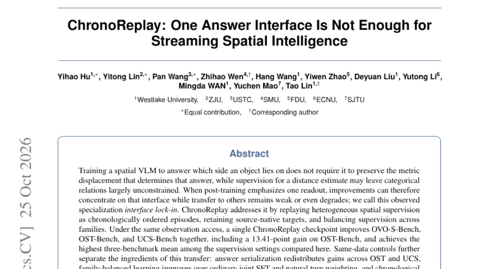

### 📌 한 줄 요약
이질적인 공간 정보 학습 시 발생하는 특정 인터페이스 편향(Interface Lock-in)을 해결하여 다양한 공간 추론 능력을 동시에 확보하는 학습 프레임워크

### 🔑 핵심 포인트
- Interface Lock-in 현상 정의: 특정 출력 형식에 최적화될 때 다른 공간적 관계가 퇴화하는 문제 해결
- ChronoReplay 프레임워크: 이질적 데이터를 시간 순서 기반 에피소드로 재구성하여 균형 잡힌 학습 유도
- 다중 벤치마크 동시 성능 향상: 특정 작업에 편중되지 않는 범용적 공간 지능 확보

### 🧑‍💻 개발자 관점
VLM 모델을 특정 태스크(예: 위치 분류)에 맞게 미세 조정할 때, 다른 중요한 공간적 맥락이 손실되는 것을 방지하는 학습 전략을 제공합니다.

### 🚀 실무 적용 아이디어
- 기존 SFT 데이터셋을 시간 순서 기반의 에피소드 형태로 재구성하여 학습 실험
- 다양한 공간적 질문(거리, 방향, 위치 등)을 혼합한 데이터셋에서 성능 변화 관찰
- 학습 시 특정 태스크 가중치 조절을 통한 인터페이스 락인 현상 재현 및 억제 테스트

### ⚠️ 리스크/한계
- 데이터 구성 방식(에피소드 구성)에 따라 성능 편차가 발생할 가능성
- 복잡한 시간적/공간적 관계를 포함하는 데이터셋 구축 비용 발생

### 📝 초록 기반 상세 설명
공간 VLM 학습 시 특정 질문(예: 어느 쪽인가?)에만 집중하면 거리 추정 등 다른 중요한 공간적 관계가 무시되는 '인터페이스 락인' 현상이 발생합니다. 이를 해결하기 위해 ChronoReplay는 이질적인 공간 감독 데이터를 시간 순서가 있는 에피소드로 재구성하여 학습합니다. 학습 과정에서 소스 데이터의 원래 목표를 유지하면서 다양한 작업군 간의 균형을 맞추는 방식을 채택합니다. 실험 결과, 단일 체크포인트만으로도 여러 공간 벤치마크에서 성능 향상을 동시에 달дя했습니다. 또한 적응형 프레임 선택을 통해 추론 시 시각적 비용을 낮추면서도 성능을 유지할 수 있음을 입증했습니다.

---

## 2. [Multiscale Policy Optimization for Long-Horizon LLM Agents](https://huggingface.co/papers/2610.35013)
**Upvotes**: 310 | **도입 난이도**: 중 | **신뢰도**: 상
**arXiv**: https://arxiv.org/abs/2610.35013

**태그**: LLM Agent, Reinforcement Learning, Credit Assignment, Policy Optimization, Agent

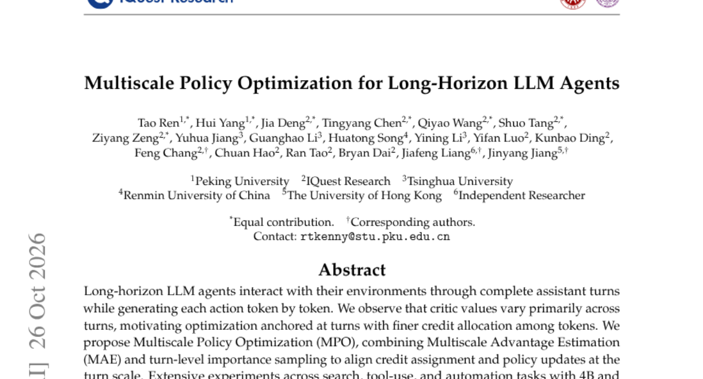

### 📌 한 줄 요약
토큰 단위와 턴 단위의 보상을 결합하여 장기 작업 수행 능력을 높인 LLM 에이전트 최적화 기법

### 🔑 핵심 포인트
- 토큰 단위의 미세한 보상과 턴 단위의 거시적 보상을 결합한 다중 스케일 최적화
- 신용 할당(Credit Assignment) 문제를 해결하기 위한 MAE 및 턴 단위 중요도 샘플링 도입
- 검색, 도구 사용 등 복잡한 장기 작업(Long-horizon) 환경에서의 성능 검증

### 🧑‍💻 개발자 관점
에이전트가 긴 대화나 복잡한 작업을 수행할 때, 어떤 토큰이 결과에 기여했는지 정확히 판별하여 학습 효율을 높일 수 있습니다.

### 🚀 실무 적용 아이디어
- 에이전트의 작업 단위를 토큰 단위와 턴 단위로 나누어 보상 함수 설계 실험
- 장기 작업(Long-horizon) 환경에서 기존 PPO 등 RL 알고리즘과 성능 비교
- 모델 크기(4B vs 30B)에 따른 다중 스케일 최적화의 효율성 검증

### ⚠️ 리스크/한계
- 토큰 단위와 턴 단위 보상 간의 가중치 설정에 따른 학습 불안정성 가능성
- 매우 긴 컨텍스트를 다루는 작업에서 계산 복잡도 증가 우려

### 📝 초록 기반 상세 설명
LLM 에이전트는 토큰 단위로 행동을 생성하지만, 환경과의 상호작용은 턴 단위로 이루어지는 특성이 있습니다. 기존 방식은 토큰 간의 세밀한 보상 할당과 턴 단위의 거시적 보상 사이의 불일치 문제를 겪습니다. 이를 해결하기 위해 제안된 Multiscale Policy Optimization(MPO)은 다중 스케일 이득 추정(MAE)과 턴 단위 중요도 샘플링을 결합합니다. 이 방법론은 신용 할당(Credit Assignment)을 턴 스케일에 맞춰 정렬함으로써 최적화를 수행합니다. 다양한 검색, 도구 사용, 자동화 작업 실험 결과, 기존 RL 베이스라인 대비 일관된 성능 향상을 입증했습니다.

---

## 3. [The Trinity:Capability-Driven Recursive Self-Improvement for Multimodal Agents](https://huggingface.co/papers/2610.36077)
**Upvotes**: 310 | **도입 난이도**: 상 | **신뢰도**: 상
**arXiv**: https://arxiv.org/abs/2610.36077

**태그**: Agent, Multimodal, Self-Improvement, Sim2Real, Benchmark, Evaluation

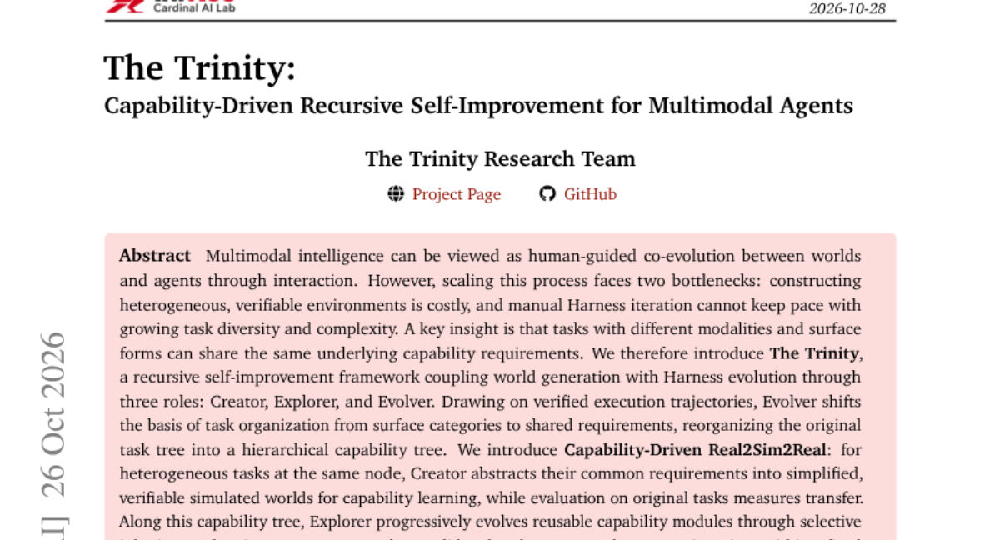

### 📌 한 줄 요약
태스크의 표면적 형태가 아닌 핵심 역량(Capability) 중심의 재귀적 자기 개선을 통해 멀티모달 에이전트의 학습 효율과 범용성을 극대화하는 프레임워크

### 🔑 핵심 포인트
- 표면적 태스크 분류에서 핵심 역량(Capability) 중심의 계층적 트리 구조로의 전환
- Creator-Explorer-Evolver 역할을 통한 재귀적 자기 개선(Recursive Self-Improvement) 메커니즘
- 검증 가능한 시뮬레이션 환경(Real2Sim2Real)과 모듈형 역량 학습의 결합

### 🧑‍💻 개발자 관점
에이전트 개발 시 태스크를 개별적으로 설계하는 대신, 공통 역량을 추출하여 학습 환경과 모듈을 자동화하는 체계적인 방법론을 제시합니다.

### 🚀 실무 적용 아이디어
- 기존의 태스크 데이터셋을 핵심 역량 단위로 클러스터링하는 파이프라인 구축 실험
- 시뮬레이션 환경과 실제 환경 간의 역량 전이(Transfer) 효율성 측정
- 모듈형 에이전트 구조에서 계층적 트리 구조의 확장성 테스트

### ⚠️ 리스크/한계
- 역량 추출 과정에서 핵심 요구사항이 누락될 경우 발생하는 성능 저하 위험
- 복잡한 계층 구조 관리 및 시뮬레이션 환경 구축에 따른 높은 초기 비용

### 📝 초록 기반 상세 설명
멀티모달 지능은 환경과 에이전트 간의 상호작용을 통해 진화하지만, 이질적인 환경 구축 비용과 수동적인 태스크 설계 방식이 확장성의 병목 현상으로 작용합니다. 본 논문은 서로 다른 모달리티를 가진 태스크들이 동일한 핵심 역량을 공유할 수 있다는 통찰에 기반하여 'The Trinity' 프레임워크를 제안합니다. 이 프레임워크는 Creator, Explorer, Evolver라는 세 가지 역할을 통해 태스크를 표면적 카테고리가 아닌 계층적 역량 트리(Capability Tree)로 재구성합니다. Creator는 공통 요구사항을 추출해 검증 가능한 시뮬레이션 환경을 생성하고, Explorer는 재사용 가능한 모듈을 진화시키며, Evolver는 실행 궤적을 바탕으로 역량 중심의 태스크 구조를 최적화합니다. 실험 결과, 제안된 방식은 다양한 벤치마크와 미학습 태스크에서 성능을 크게 향상시키며 실세계 로봇 작업에서도 유효함을 입증했습니다.

---

## 4. [PDRVLA: A Vision-Language-Action Model with Physical Dynamics Representations](https://huggingface.co/papers/2610.37381)
**Upvotes**: 135 | **도입 난이도**: 중 | **신뢰도**: 상
**arXiv**: https://arxiv.org/abs/2610.37381

**태그**: Robotics, VLA, World Models, Embodied AI, Vision, Video, Benchmark, Evaluation, Inference

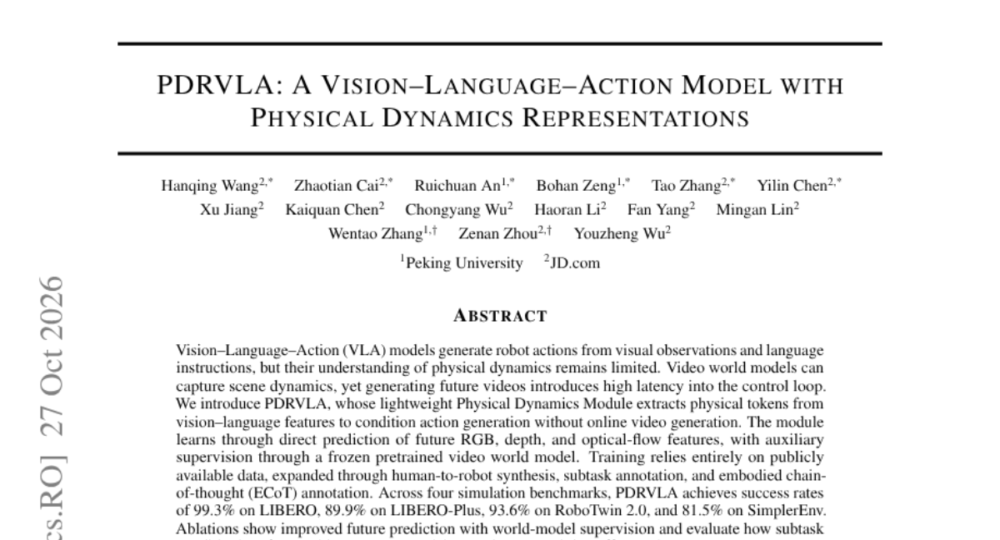

### 📌 한 줄 요약
비디오 월드 모델의 동역학 이해력을 활용하면서도 실시간 제어를 위해 비디오 생성 과정은 생략한 경량화된 VLA 모델

### 🔑 핵심 포인트
- 비디오 생성 없이 물리적 특징만 추출하는 경량 Physical Dynamics Module 설계
- 동결된 사전 학습 비디오 월드 모델을 활용한 보조 감독(Auxiliary Supervision) 방식 도입
- 인간-로봇 합성 데이터 및 Embodied Chain-of-Thought(ECoT)를 통한 데이터 확장

### 🧑‍💻 개발자 관점
실시간성이 중요한 로봇 제어 환경에서 비디오 생성의 지연 시간 문제를 해결하면서도, 월드 모델의 물리적 이해력을 확보할 수 있는 실용적인 아키텍처를 제시합니다.

### 🚀 실무 적용 아이디어
- 제시된 ECoT(Embodied CoT) 주석 방식이 데이터 효율성에 미치는 영향 분석
- 동결된 비디오 모델의 크기에 따른 물리 토큰 추출 성능 변화 테스트
- 실제 로봇 하드웨어 환경에서의 추론 지연 시간(Latency) 측정

### ⚠️ 리스크/한계
- 비디오 생성 없이 특징만 추출하므로 복잡한 물리적 상호작용의 시각적 정밀도가 떨어질 수 있음
- 학습 데이터의 품질(인간-로봇 합성 데이터)에 따른 일반화 성능 의존성

### 📝 초록 기반 상세 설명
기존 VLA 모델은 시각적 관찰과 언어 지시를 통해 동작을 생성하지만, 물리적 역학에 대한 이해가 부족하다는 한계가 있습니다. 비디오 월드 모델은 장면의 역학을 잘 포착하지만, 미래 비디오를 직접 생성하는 방식은 제어 루프에 높은 지연 시간을 발생시킵니다. 이를 해결하기 위해 PDRVLA는 비디오 생성 없이 시각-언어 특징에서 물리적 토큰을 추출하는 경량 물리 동역학 모듈을 제안합니다. 이 모듈은 미래의 RGB, 깊이, 광학 흐름(optical-flow) 특징을 직접 예측하며, 동결된 사전 학습 비디오 월드 모델을 보조 감독 도구로 활용합니다. 실험 결과, LIBERO 및 SimplerEnv 등 다양한 시뮬레이션 벤치마크에서 높은 성공률을 기록하며 성능을 입증했습니다.

### 🖼️ 추가 자료
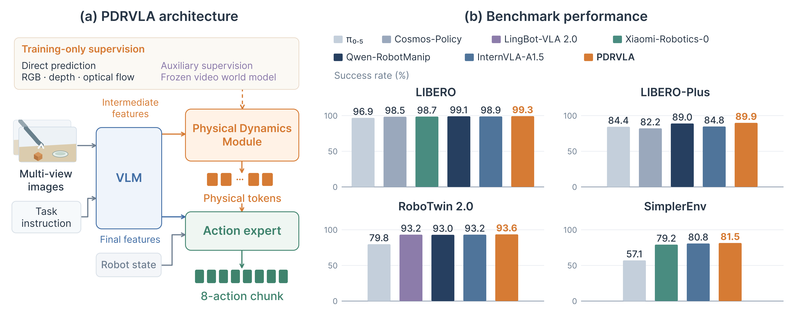

---

## 5. [VibeVideoBench: Evaluating Multimodal Agents on Code-Driven Video Generation](https://huggingface.co/papers/2610.35864)
**Upvotes**: 131 | **도입 난이도**: 상 | **신뢰도**: 상
**arXiv**: https://arxiv.org/abs/2610.35864

**태그**: Multimodal Agent, Video Generation, Code-as-Action, Benchmark, Agent, Multimodal, Vision, Video, Evaluation

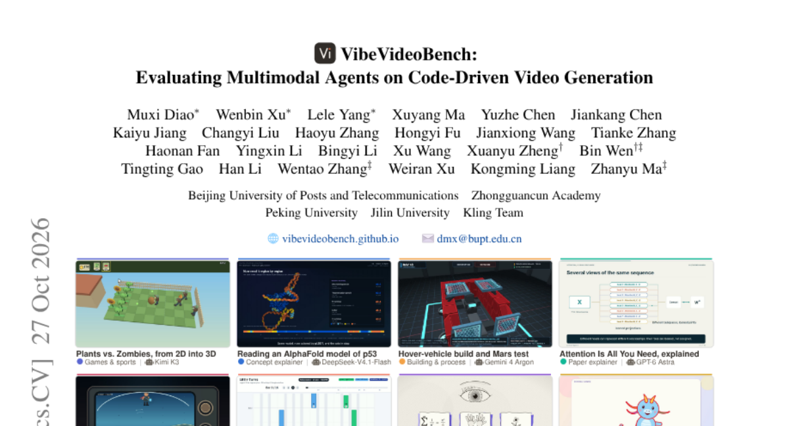

### 📌 한 줄 요약
코드 작성을 통해 비디오와 사운드를 생성하는 멀티모달 에이전트의 성능을 평가하기 위한 벤치마크 제안

### 🔑 핵심 포인트
- 코드 기반 비디오/사운드 생성 에이전트 전용 벤치마크 'VibeVideoBench' 제안
- 데이터 스토리, 교육용 영상 등 12개 카테고리의 239개 복합 태스크 구성
- 샌드박스 내 코드 실행 및 VLM 기반의 계층적/증거 기반 평가 체계 구축

### 🧑‍💻 개발자 관점
단순 이미지 생성을 넘어, 논리적 규칙과 데이터 시각화가 포함된 정교한 비디오 콘텐츠 자동 생성 에이전트 개발의 기준을 제시합니다.

### 🚀 실무 적용 아이디어
- LLM 기반 에이전트의 코드 실행 및 렌더링 파이프라인 구축 실험
- 에이전트의 계획 수립(Planning) 시간과 최종 결과물 품질 간의 상관관계 분석
- VLM을 활용한 생성 결과물의 자동 검증 루프 설계

### ⚠️ 리스크/한계
- 에이전트의 계획 수립 실패로 인한 렌더링 시간 초과 및 결과물 미생성 리스크
- 복잡한 렌더링 작업 시 컴퓨팅 자원 및 실행 시간 관리의 어려움

### 📝 초록 기반 상세 설명
기존 확산 모델 기반 비디오 생성은 정확한 수식, 차트, 규칙 준수 및 정교한 내레이션 동기화에 한계가 있습니다. 이를 해결하기 위해 코드를 작성하여 프레임과 사운드를 렌더링하는 멀티모달 에이전트 방식이 부상하고 있습니다. 본 논문은 이러한 에이전트의 능력을 평가하기 위해 239개의 태스크로 구성된 VibeVideoBench를 도입합니다. 샌드박스 환경에서 에이전트가 직접 코드를 실행하여 MP4 결과물을 생성하며, 프로그램 체크와 VLM 기반의 계층적 평가를 수행합니다. 실험 결과, 최신 에이밍 시스템들이 높은 성능을 보였으나 계획 수립 실패로 인한 렌더링 지연 문제가 주요 실패 원인으로 나타났습니다.

---

## 6. [Hy-Nomas: Towards Free-form Interactive World Generation](https://huggingface.co/papers/2610.36729)
**Upvotes**: 104 | **도입 난이도**: 상 | **신뢰도**: 상
**arXiv**: https://arxiv.org/abs/2610.36729

**태그**: Video Generation, World Model, Diffusion Model, Embodied AI, Multimodal, Vision, Video, Benchmark, Evaluation, Distillation

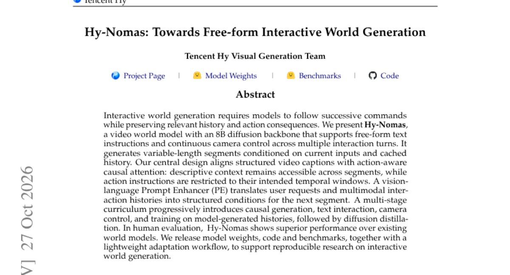

### 📌 한 줄 요약
자유로운 텍스트 명령과 연속적인 카메라 제어를 지원하는 8B 규모의 대화형 비디오 월드 모델 개발

### 🔑 핵심 포인트
- 8B 확산 모델 기반의 자유 형식 텍스트 및 연속 카메라 제어 지원
- 설명적 맥락 유지와 시간적 액션 제어를 분리한 인과적 어텐션 설계
- Prompt Enhancer를 통한 멀티모달 이력의 구조화된 조건 변환

### 🧑‍💻 개발자 관점
에이전트 학습을 위한 고품질 가상 환경 생성 및 시뮬레이션 데이터 확보에 직접적인 활용이 가능합니다.

### 🚀 실무 적용 아이디어
- 제공된 가중치와 코드를 활용한 로컬 환경에서의 재현성 테스트
- 특정 카메라 움직임 제어 명령에 따른 비디오 일관성 검증
- 모델 생성 이력을 활용한 데이터 증강(Data Augmentation) 파이프라인 구축 실험

### ⚠️ 리스크/한계
- 8B 규모 모델로 인한 높은 컴퓨팅 자원 요구량
- 복잡한 상호작용 시 장기적인 일관성 유지 여부 검증 필요

### 📝 초록 기반 상세 설명
상호작용형 월드 생성 모델은 이전 상태를 유지하면서 연속적인 명령을 수행해야 하는 과제를 안고 있습니다. 본 논문은 8B 확산 모델 백본을 기반으로 자유 형식의 텍스트와 연속적인 카메라 제어를 지원하는 Hy-Nomas를 제안합니다. 핵심 설계는 구조화된 비디오 캡션과 액션 중심의 인과적 어텐션(causal attention)을 결합하여, 설명적 맥락은 유지하되 액션 명령은 해당 시간대에만 적용되도록 합니다. 또한 Prompt Enhancer를 통해 사용자 요청과 상호작용 이력을 구조화된 조건으로 변환하며, 단계별 커리큘럼 학습을 통해 모델의 생성 능력을 점진적으로 고도화합니다. 실험 결과, Hy-Nomas는 기존 월드 모델 대비 우수한 성능을 입증하였습니다.

---

## 7. [Memory Tax: Dissecting the Net Value of Agent Memory](https://huggingface.co/papers/2610.34073)
**Upvotes**: 98 | **도입 난이도**: 중 | **신뢰도**: 상
**arXiv**: https://arxiv.org/abs/2610.34073

**태그**: Agent, RAG, Memory, LLM, Benchmark, Evaluation, Distillation

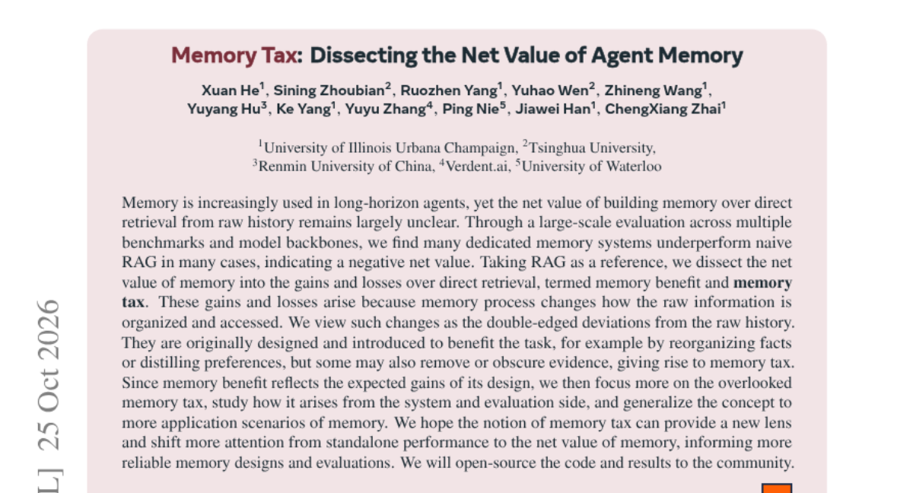

### 📌 한 줄 요약
에이전트 메모리 시스템이 원시 데이터(Raw History) 대비 성능을 저하시키는 '메모리 세금(Memory Tax)' 현상을 규명하고 실질적 가치를 평가하는 프레임워크를 제안합니다.

### 🔑 핵심 포인트
- 메모리 시스템의 순 가치를 'Memory Benefit'과 'Memory Tax'로 정의하여 분석
- 전용 메모리 시스템이 단순 RAG보다 성능이 낮을 수 있는 원인(정보 손실/왜곡) 규명
- 메모리 설계 시 단순 성능 향상보다 원시 데이터 대비 순 가치 관점의 접근 필요성 강조

### 🧑‍💻 개발자 관점
에이전트 개발 시 복잡한 메모리 구조를 설계하는 것이 항상 정답이 아니며, 정보 압축 과정에서 발생하는 손실(Tax)을 관리하는 것이 핵심임을 시사합니다.

### 🚀 실무 적용 아이디어
- 현재 구축된 메모리 시스템의 성능을 단순 RAG(Raw History Retrieval) 결과와 비교 실험하기
- 메모리 요약/재구성 과정에서 누락되는 핵심 정보(Tax)의 유형 분류하기
- 메모리 시스템 도입 시 발생하는 성능 저하 지점을 정량적으로 측정하는 벤치마크 구축

### ⚠️ 리스크/한계
- 메모리 설계 방식에 따라 Tax의 발생 양상이 달라질 수 있음
- 단순 RAG와 비교했을 때의 상대적 가치 산정이 복잡할 수 있음

### 📝 초록 기반 상세 설명
장기 에이전트(Long-horizon agents)에서 메모리 활용이 증가하고 있으나, 메모리 구축이 단순 RAG 대비 갖는 순 가치는 불분명합니다. 본 연구는 대규모 벤치마크를 통해 많은 전용 메모리 시스템이 오히려 단순 RAG보다 성능이 낮다는 점을 발견했습니다. 연구진은 메모리 구축 과정에서 발생하는 이득(Benefit)과 손실(Tax)을 분석하여, 정보 재구성 과정에서 발생하는 '이중적 편차'를 규명했습니다. 메모리 설계가 정보를 요약하거나 재조직하는 과정에서 증거를 누락하거나 가리는 현상이 성능 저하의 원인임을 밝힙습니다. 이를 통해 단순 성능 지표를 넘어 메모리의 순 가치를 평가하는 새로운 관점을 제시합니다.

---

## 8. [Can Discrete Tokens Serve as Semantically Lossless Representations of Visual Signals?](https://huggingface.co/papers/2610.37662)
**Upvotes**: 81 | **도입 난이도**: 중 | **신뢰도**: 상
**arXiv**: https://arxiv.org/abs/2610.37662

**태그**: Multimodal, Quantization, Vision-Language, Foundation Models, RAG, Vision, Optimization

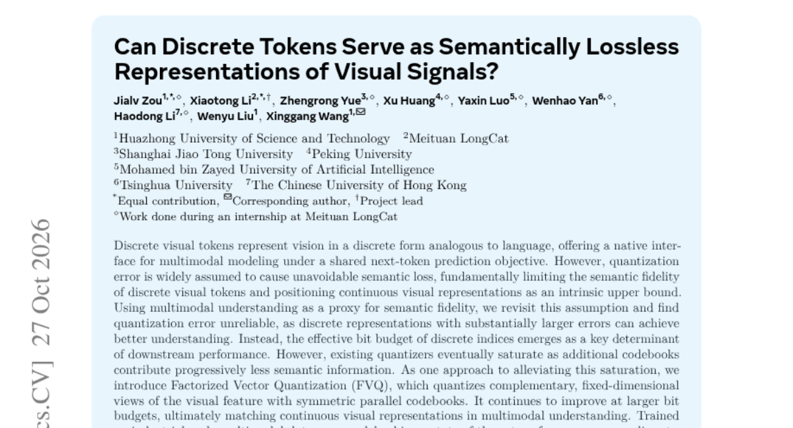

### 📌 한 줄 요약
이산적 토큰(Discrete Tokens)이 연속적 표현만큼의 의미적 충실도를 확보할 수 있음을 증명하고, 이를 위한 새로운 양자화 기법을 제안합니다.

### 🔑 핵심 포인트
- 양자화 오차보다 유효 비트 예산이 다운스트림 성능에 더 중요한 영향을 미침을 확인
- 코드북 포화 문제를 해결하기 위해 대칭적 병렬 코드북을 사용하는 Factorized Vector Quantization(FVCH) 제안
- 이산적 토큰 기반 모델이 연속적 표현 모델(Continuous-representation)과 대등한 수준의 성능을 낼 수 있음을 입증

### 🧑‍💻 개발자 관점
텍스트와 동일한 토큰 예측 방식으로 시각 정보를 처리할 수 있어, 멀티모달 모델 설계 시 복잡한 연속적 임베딩 대신 효율적인 이산 토큰 방식을 채택할 근거를 제공합니다.

### 🚀 실무 적용 아이디어
- 제안된 FVQ 기법을 기존 VQ-VAE/VQGAN 구조에 적용하여 성능 변화 비교
- 다양한 비트 예산(bit budget) 설정에 따른 OCR 및 시각 이해 성능 변화 실험
- 제공된 코드베이스를 활용하여 산업 규모 데이터셋에서의 학습 효율성 검증

### ⚠️ 리스크/한계
- 대규모 데이터셋과 높은 컴퓨팅 자원이 성능 달성의 전제 조건임
- 이산 토큰의 정교한 세부 정보(Fine-grained) 복원 능력이 여전히 연속 표현 대비 도전 과제일 수 있음

### 📝 초록 기반 상세 설명
언어 모델처럼 시각 정보를 이산적 토큰으로 변환하는 방식은 멀티모달 모델링에 유리하지만, 양자화 오차로 인한 의미 손실이 성능의 한계로 여겨져 왔습니다. 본 논문은 양자화 오차보다 가용 비트 예산(bit budget)이 성능의 핵심 결정 요인임을 밝히며 기존 가설을 반박합니다. 이를 위해 고정 차원의 상호 보완적 뷰를 양자화하는 Factorized Vector Quantization(FVQ) 방식을 제안합니다. 제안된 모델은 대규모 데이터로 학습되어 기존 이산 표현 모델들을 압도하며, Qwen3-VL과 같은 강력한 연속 표현 모델과 대등한 성능을 달성했습니다. 결과적으로 이산적 시각 표현이 차세대 멀티모달 파운데이션 모델의 핵심 기술이 될 수 있음을 입증했습니다.

---

## 9. [HABIT-Bench: Evaluating Habit Induction from Longitudinal Weak Evidence in Agent Memory](https://huggingface.co/papers/2610.24520)
**Upvotes**: 78 | **도입 난이도**: 중 | **신뢰도**: 상
**arXiv**: https://arxiv.org/abs/2610.24520

**태그**: Agent, Memory, Personalization, LLM, Evaluation

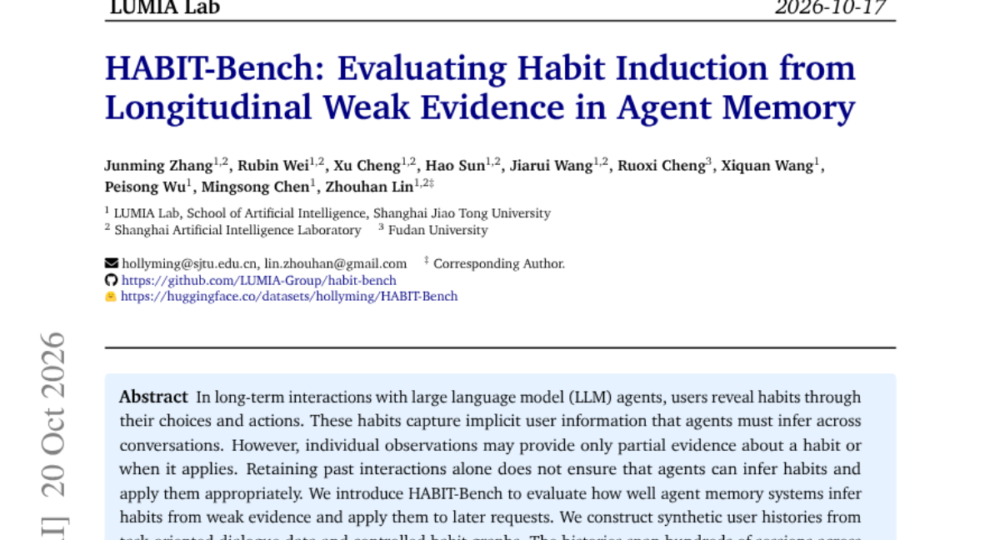

### 📌 한 줄 요약
사용자의 간접적 행동 패턴(습관)을 추론하고 적절히 적용하는 에이전트 메모리 시스템의 성능을 평가하는 벤치마크 제안

### 🔑 핵심 포인트
- 약한 증거(Weak Evidence)로부터 사용자의 습관을 추론하는 능력을 평가하는 HABIT-Bench 개발
- 단순 기록 보존을 넘어 예외 상황, 습관 변화, 미수락 제안 등을 포함한 복잡한 시나리오 설계
- 최신 LLM 기반 메모리 방법론들의 습관 적용 성능이 현저히 낮음을 입증

### 🧑‍💻 개발자 관점
단순 RAG(검색 증강 생성)를 넘어, 사용자의 의도와 패턴을 파악하는 '지능형 개인화 에이전트' 개발 시 직면할 핵심 과제를 제시합니다.

### 🚀 실무 적용 아이디어
- 현재 개발 중인 에이전트 메모리 시스템에 HABIT-Bench의 시나리오를 적용하여 추론 성능 테스트
- 단순 기록 저장 방식과 습관 추론 레이어를 분리한 아키텍처 비교 실험
- 사용자 피드백(수락/거절)이 습관 모델 업데이트에 미치는 영향 분석

### ⚠️ 리스크/한계
- 합성 데이터 기반 벤치마크이므로 실제 복잡한 인간 행동과의 괴리가 있을 수 있음
- 현재의 LLM 성능으로는 습관 추론 능력이 매우 제한적임

### 📝 초록 기반 상세 설명
LLM 에이전트와 사용자의 장기 상호작용에서 사용자의 습관을 파악하는 것은 중요하지만, 개별 관찰 데이터는 습관의 전체 맥락을 담기에 불충분한 경우가 많습니다. 단순히 과거 대화 기록을 저장하는 것만으로는 복잡한 습관을 추론하고 적절한 시점에 적용하는 능력을 보장할 수 없습니다. 본 논문은 약한 증거로부터 습관을 추론하고 이를 후속 요청에 적용하는 능력을 평가하기 위한 HABIT-Bench를 제안합니다. 합성 데이터와 제어된 습관 그래프를 활용하여 음식, 금융, 소프트웨어, 여행 등 다양한 도메인의 수백 세션에 걸친 사용자 이력을 구축했습니다. 실험 결과, 최신 메모리 기법들을 적용하더라도 습관 추론 및 적용 성능은 여전히 낮게 나타났습니다. 이는 과거 기록에 대한 접근 권한과 실제 습관을 추론하여 사용하는 능력 사이에 큰 격차가 존재함을 시사합니다.

### 🖼️ 추가 자료
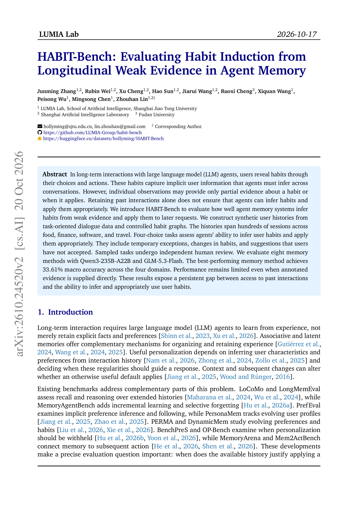
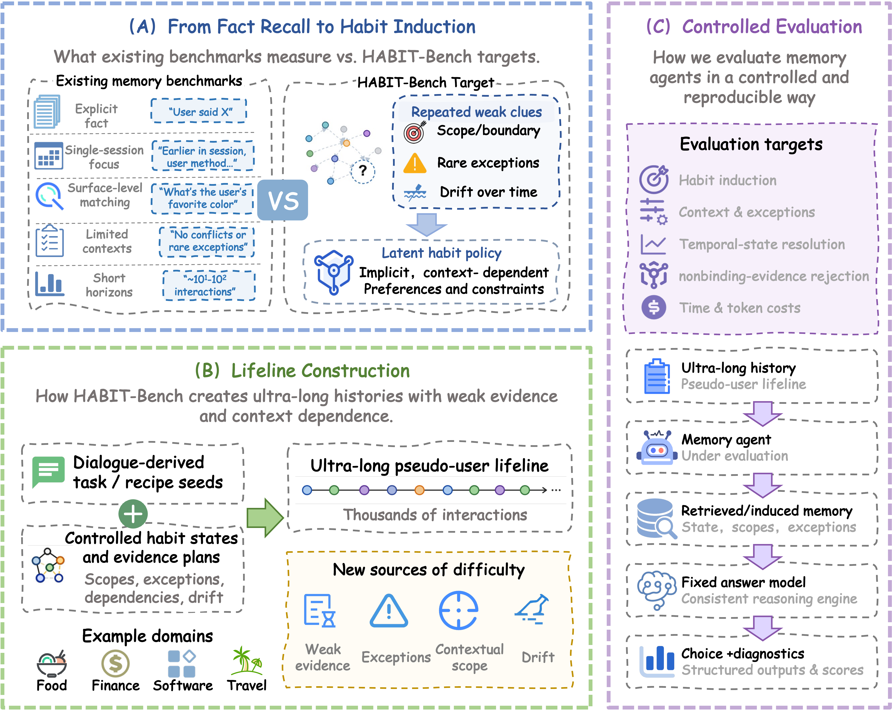
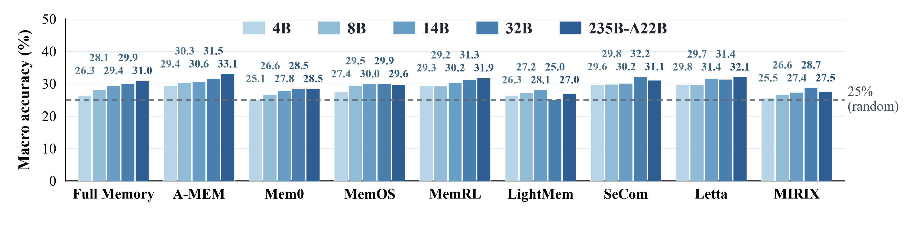
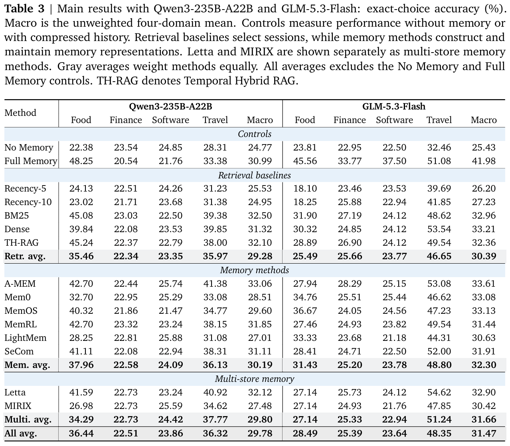

---

## 10. [Rollback: Experience Backtracking in World Models for Policy Improvement](https://huggingface.co/papers/2610.36068)
**Upvotes**: 50 | **도입 난이도**: 상 | **신뢰도**: 상
**arXiv**: https://arxiv.org/abs/2610.36068

**태그**: Robot Learning, World Models, Reinforcement Learning, Sim-to-Real, RAG, Vision, Distillation

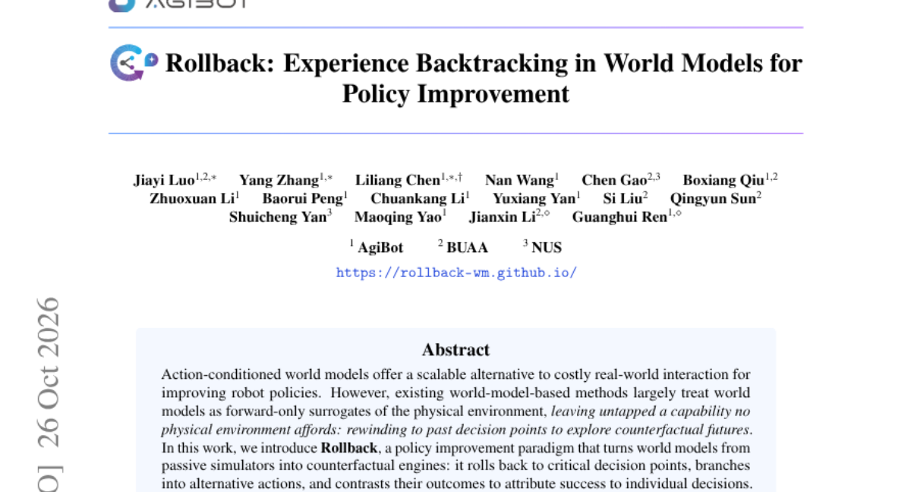

### 📌 한 줄 요약
월드 모델의 과거 시점 되돌리기(Rollback) 기능을 통해 가상 환경에서의 반사실적 탐색을 극대화하여 로봇 정책을 개선하는 프레임워크

### 🔑 핵심 포인트
- Rollback: 과거 결정 시점으로 되돌아가 대안적 미래를 탐색하는 반사실적 엔진 기능 도입
- 별도의 가치 모델 없이 행동 단위의 정밀한 피드백을 제공하는 정책 개선 방식
- 실제 로봇 데이터와 LoRA를 활용한 경량화된 물리적 정합성(Test-time physics grounding) 유지

### 🧑‍💻 개발자 관점
물리적 환경에서는 불가능한 '과거로 돌아가 다른 선택을 해보는' 시뮬레이션의 이점을 극대화하여 데이터 효율적인 정책 학습이 가능함을 보여줍니다.

### 🚀 실무 적용 아이디어
- LoRA를 활용한 경량 월드 모델 업데이트 파이프라인 구축 실험
- 특정 결정 시점(Decision point)을 식별하는 트리거 로직 설계
- 가상 환경과 실로봇 환경 간의 데이터 동기화 및 피드백 루프 구현

### ⚠️ 리스크/한계
- 월드 모델의 예측 오차가 누적될 경우 잘못된 반사실적 결과로 인한 정책 오염 위험
- 복잡한 물리 상호작용이 포함된 환경에서 모델의 정밀도 의존도 매우 높음

---

## 11. [CodeCap-Bench: Can Code Serve as a Good Video Caption?](https://huggingface.co/papers/2610.37341)
**Upvotes**: 48 | **도입 난이도**: 중 | **신뢰도**: 상
**arXiv**: https://arxiv.org/abs/2610.37341

**태그**: Video-to-Code, MLLM, Video-Captioning, Computer-Vision, Reasoning, Multimodal, Video, Evaluation

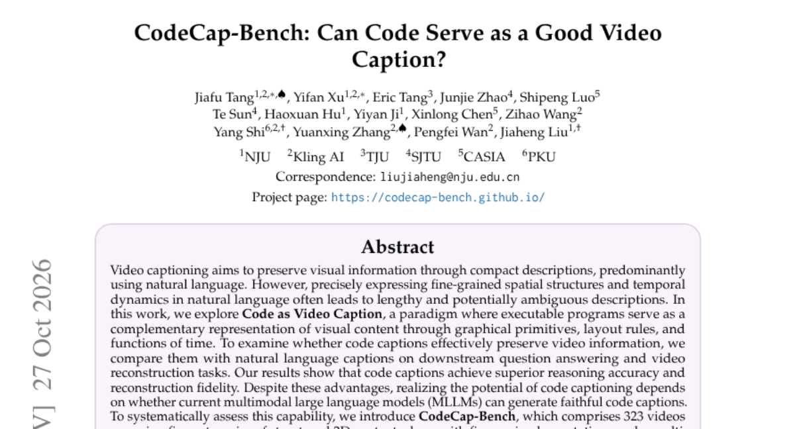

### 📌 한 줄 요약
자연어 대신 실행 가능한 코드를 비디오 캡션으로 활용하여 시각적 정보의 정밀도와 재구성 성능을 높이는 새로운 패러다임 제안

### 🔑 핵심 포인트
- 코드(Code)를 비디오의 구조적/시간적 정보를 담는 캡션 수단으로 활용하는 새로운 패러다임 제시
- 자연어 대비 높은 추론 정확도 및 비디오 재구성 충실도 검증
- 코드 생성 능력을 평가하기 위한 정밀 벤치마크 'CodeCap-Bench' 구축

### 🧑‍💻 개발자 관점
비디오 데이터를 텍스트로만 처리할 때 발생하는 정보 손실을 코드를 통해 보완함으로써, 정밀한 시각적 추론 및 자동화된 그래픽 생성 작업의 가능성을 열어줍니다.

### 🚀 실무 적용 아이디어
- 기존 자연어 캡션과 코드 캡션을 결합한 멀티모달 프롬프트 엔지니어링 실험
- CodeCap-Bench를 활용한 현재 사용 중인 MLLM의 코드 생성 능력 벤치마킹
- 코드 기반 캡션을 통한 비디오 재구성(Reconstruction) 파이프라인 프로토타이핑

### ⚠️ 리스크/한계
- 현재 MLLM이 복잡한 시간적 변화를 코드로 정확히 변환하는 데 한계가 있음
- 코드 생성 오류 시 비디오 재구성 및 추론 결과가 완전히 왜곡될 위험 존재

### 📝 초록 기반 상세 설명
기존의 자연어 기반 비디오 캡셔닝은 복잡한 공간 구조와 시간적 역동성을 표현할 때 모호하거나 설명이 길어지는 문제가 있습니다. 본 연구에서는 그래픽 프리미티브와 시간 함수를 활용하는 '코드 기반 비디오 묘사'라는 새로운 패러다임을 탐구합니다. 제안된 코드 캡션이 자연어보다 추론 정확도와 비디오 재구성 충실도 면에서 우수함을 입증했습니다. 이를 평가하기 위해 5개 카테고리의 구조화된 2D 콘텐츠를 포함한 CodeCap-Bench 벤치마크를 도입했습니다. 실험 결과, 최신 폐쇄형 MLLM은 가능성을 보여주었으나 복잡한 시간적 역동성을 포착하는 데는 여전히 한계가 있으며 오픈소스 모델은 격차가 더 컸습니다.

---

## 12. [ThinkWorld: World Imagination Reinforces Chain-of-Dynamics Reasoning](https://huggingface.co/papers/2610.37666)
**Upvotes**: 46 | **도입 난이도**: 중 | **신뢰도**: 중
**arXiv**: https://arxiv.org/abs/2610.37666

**태그**: RAG, Reasoning, Vision, Video

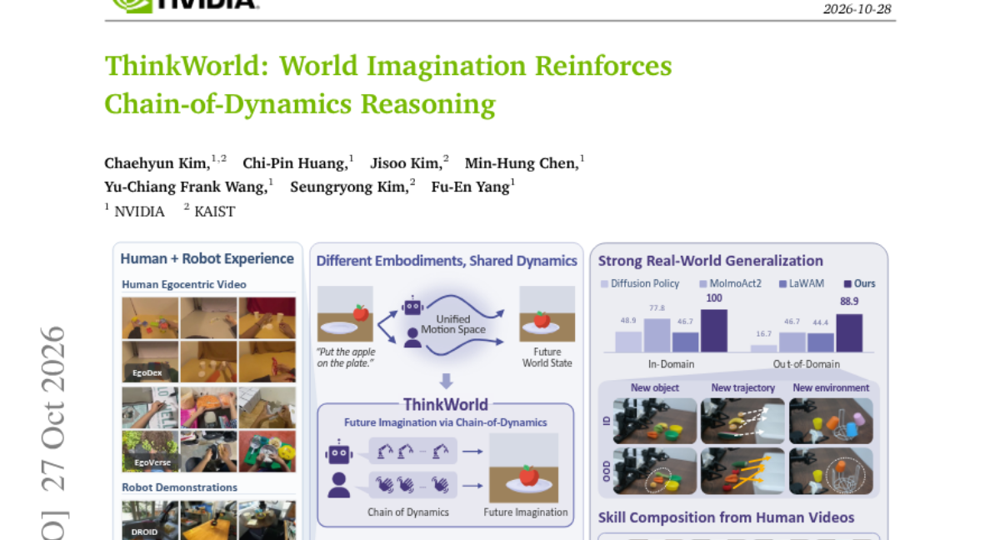

### 📌 한 줄 요약
자세한 분석 내용은 원문 또는 arXiv 링크를 참고해 주세요.

### 🔑 핵심 포인트
- 논문 원문을 확인하시기 바랍니다.

### 📝 초록 기반 상세 설명
상세 초록은 원문 페이지에서 확인 가능합니다.

---

## 13. [Can Test-Time Memory Evolution Outperform Test-Time Training for Scientific Discovery?](https://huggingface.co/papers/2610.32046)
**Upvotes**: 42 | **도입 난이도**: 하 | **신뢰도**: 상
**arXiv**: https://arxiv.org/abs/2610.32046

**태그**: Test-Time Adaptation, Memory-Augmented, Efficiency, Scientific Discovery, Evaluation, Inference, Distillation

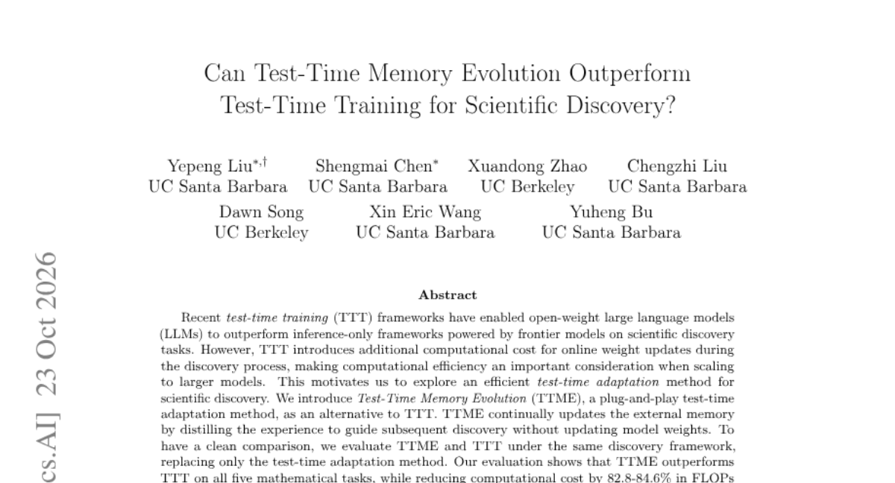

### 📌 한 줄 요약
모델 가중치 업데이트 없이 외부 메모리 증류를 통해 TTT의 성능을 유지하며 연산 비용을 획기적으로 절감하는 적응형 방법론 제안

### 🔑 핵심 포인트
- 가중치 업데이트 없이 외부 메모리 증류를 활용하는 효율적인 Test-Time 적응 방식 제안
- TTT 대비 성능 우위 확보 및 연산 비용(FLOPs/Runtime)의 획기적 절감
- 기존 프레임워크에 쉽게 결합 가능한 플러그 앤 플레이(Plug-and-play) 구조

### 🧑‍💻 개발자 관점
모델 파라미터를 건드리지 않고도 추론 단계에서 지식을 축적할 수 있어, 자원이 제한된 환경에서 에이전트의 성능을 높이는 데 유용합니다.

### 🚀 실무 적용 아이디어
- 기존 RAG 시스템에 외부 메모리 증류 로직을 결합하여 성능 변화 관찰
- 수학적 추론 작업에서 TTT와 TTME의 메모리 업데이트 주기별 효율성 비교
- 모델 크기 변화에 따른 연산 비용 절감 폭의 상관관계 분석

### ⚠️ 리스크/한계
- 외부 메모리 크기 증가에 따른 관리 오버헤드 발생 가능성
- 복잡한 추론 작업에서 가중치 업데이트가 없는 방식의 장기적 성능 한계 여부

### 📝 초록 기반 상세 설명
최근 Test-Time Training(TTT)은 과학적 발견 작업에서 뛰어난 성능을 보였으나, 온라인 가중치 업데이트로 인한 높은 연산 비용이 문제로 지적되었습니다. 이를 해결하기 위해 모델 가중치를 직접 수정하지 않고 외부 메모리를 지속적으로 업데이트하는 Test-Time Memory Evolution(TTME)을 제안합니다. TTME는 경험을 메모리에 증류하여 후속 탐색을 가이드하는 플러그 앤 플레이 방식의 적응형 방법론입니다. 동일한 프레임워크 내에서 TTT와 비교 실험을 진행한 결과, TTME는 모든 수학적 과제에서 TTT를 능가하는 성능을 보였습니다. 동시에 연산량(FLOPs)은 약 83-85%, 실행 시간은 약 48-58%를 절감하며 효율성을 입증했습니다.

---

## 14. [LociArt: A Unified Paradigm for Free-Style Local Video Stylization](https://huggingface.co/papers/2610.36456)
**Upvotes**: 27 | **도입 난이도**: 상 | **신뢰도**: 상
**arXiv**: https://arxiv.org/abs/2610.36456

**태그**: Video Editing, Generative AI, Computer Vision, Vision, Video, Benchmark, Evaluation

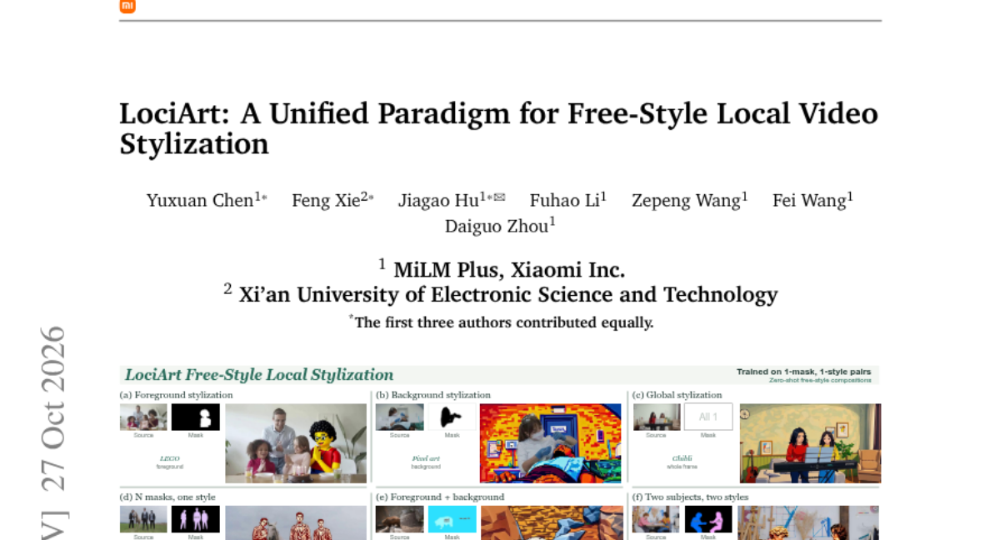

### 📌 한 줄 요약
특정 영역만 정교하게 스타일을 입히면서도 원본 콘텐츠와 시간적 일관성을 유지하는 통합 비디오 스타일링 프레임워크

### 🔑 핵심 포인트
- GRNStyle: 스타일 정체성을 방향 벡터로 임베딩하여 영역별 스타일 적용을 정교화
- LociArt-100K: 자동화된 파이프라인을 통해 구축된 10만 쌍의 로컬 스타일링 데이터셋
- 통합 제어: 단일 영역 학습만으로도 다중 영역에 서로 다른 스타일을 적용할 수 있는 범용성 확보

### 🧑‍💻 개발자 관점
영상 편집 시 특정 객체만 스타일을 변경하거나 배경과 분리하여 예술적 효과를 주는 정교한 로컬 편집 자동화가 가능해집니다.

### 🚀 실무 적용 아이디어
- 제공된 데이터셋을 활용하여 특정 객체 분리(Segmentation) 성능과 스타일 전이 성능 간의 상관관계 분석
- 다양한 해상도 및 복잡한 움직임이 있는 비디오에서의 시간적 일관성(Temporal Consistency) 테스트
- 단일 스타일 학습 모델을 다중 스타일 환경에 적용했을 때의 일반화 성능 검증

### ⚠️ 리스크/한계
- 정교한 마스킹(Masking) 품질에 따라 스타일 적용 범위와 경계면의 자연스러움이 크게 좌우될 수 있음
- 복잡한 움직임이 있는 비디오에서 객체 경계의 일관성 유지 여부가 관건임

### 📝 초록 기반 상세 설명
기존 비디오 스타일링은 전체 장면을 변형하는 데 집중하여 특정 영역만 정교하게 편집하는 데 어려움이 있었습니다. 이를 해결하기 위해 영역 지정과 스타일 적용을 동시에 수행하면서 비대상 콘텐츠를 보존하는 LociArt 프레임워크를 제안합니다. 핵심 모듈인 GRNStyle은 스타일 정체성을 방향 벡터로 임베딩하는 polar style-aware mask와 기하학적 제어를 위한 representation-geometry conditioning을 결합합니다. 또한, 학습을 위해 자동화된 파이프라인을 통해 구축된 100K 규모의 LociArt-100K 데이터셋을 활용합니다. 실험 결과, 제안 방식은 기존 방법론 대비 뛰어난 지역적 스타일 품질과 공간 제어 능력을 보여주었습니다.

---

## 15. [Zooming without Zooming v2: From Seeing Details to Connecting Evidence for Generalizable Multimodal Perception](https://huggingface.co/papers/2610.37037)
**Upvotes**: 20 | **도입 난이도**: 중 | **신뢰도**: 상
**arXiv**: https://arxiv.org/abs/2610.37037

**태그**: Multimodal, Data Synthesis, Reasoning, VLM, Agent, Vision, Benchmark

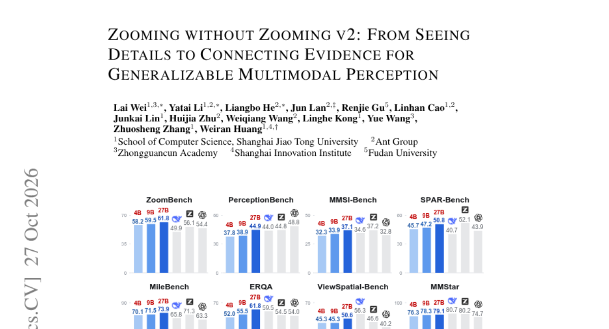

### 📌 한 줄 요약
데이터 합성 프레임워크를 통해 시각적 증거 연결 능력을 강화하여 공간 지각 및 멀티모달 추론 성능을 높인 연구

### 🔑 핵심 포인트
- EvidenceConnect: 이미지 내 국소 영역 간의 관계를 활용한 데이터 합성 프레임워크 제안
- 증거 연결(Connecting Evidence) 능력 강화: 개별 사실 식별, 엔티티 결합, 관계 회복을 통한 추론 능력 배양
- 고품질 데이터 검증: 독립적 VLM 간 합의 및 영역 제거(region-ablation) 테스트를 통한 정답 신뢰도 확보

### 🧑‍💻 개발자 관점
특정 태스크에 매몰되지 않고, 시각적 추론의 근본적인 능력을 높이는 데이터 합성 전략을 배울 수 있습니다.

### 🚀 실무 적용 아이디어
- 단일 이미지 내 서로 다른 스케일의 크롭(crop)을 활용한 데이터셋 구축 실험
- RLVR(Reinforcement Learning from Verifiable Rewards)을 활용한 시각적 추론 모델 학습 적용
- 질문 생성 시 영역 제거 테스트를 통한 데이터 정제 파이프라인 구축

### ⚠️ 리스크/한계
- 합성된 데이터가 특정 벤치마크에 최적화되지 않아 도메인에 따른 성능 편차가 있을 수 있음
- 고품질 데이터 생성을 위한 다수 VLM 활용 시 연산 비용 발생 가능성

### 📝 초록 기반 상세 설명
멀티모달 지능의 핵심인 공간 지각과 롱 컨텍스트 이해를 위해서는 고품질의 타겟 데이터 확보가 필수적이지만 비용이 매우 높습니다. 연구진은 이 두 작업이 '증거 연결(connecting evidence)'이라는 공통된 핵심 능력을 공유한다는 점에 주목했습니다. 이를 위해 단일 이미지 내 관련 영역의 확대 뷰를 활용하여 비교, 집계, 체이닝이 필요한 질문을 생성하는 EvidenceConnect 프레임워크를 제안합니다. 생성된 데이터는 VLM 간의 합의와 영역 제거 테스트를 통해 품질을 검증하며, RLVR 방식으로 모델을 학습시킵니다. 그 결과, 특정 벤치마크에 특화되지 않고도 공간 지각, 에이전트 작업, 일반적 시각 추론 성능이 크게 향상되었습니다.

---

## 16. [RSI Arena: Towards Recursive Self-Improvement with Human Feedback](https://huggingface.co/papers/2610.33624)
**Upvotes**: 18 | **도입 난이도**: 상 | **신뢰도**: 상
**arXiv**: https://arxiv.org/abs/2610.33624

**태그**: AI Agent, Self-Improvement, RLHF, Automated Training, Agent, RAG, Benchmark, Evaluation

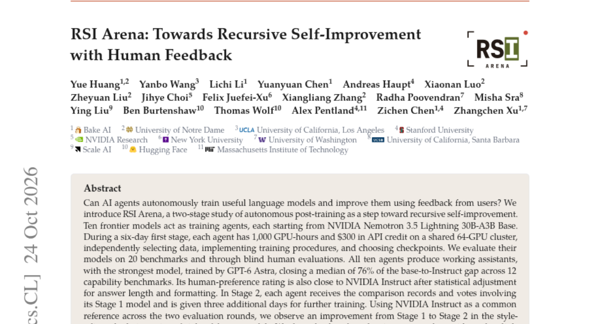

### 📌 한 줄 요약
AI 에이전트가 스스로 데이터를 선택하고 학습하여 모델을 개선하는 자율적 재귀적 자기 개선(RSI) 프레임워크 연구

### 🔑 핵심 포인트
- 자율적 모델 학습을 위한 2단계 연구 프레임워크(RSI Arena) 제안
- 에이전트가 데이터 선택부터 학습까지 수행하는 자율적 사후 학습(Post-training) 실험
- 인간 피드백을 통한 재귀적 자기 개선(RSIHF)의 가능성과 위험성 확인

### 🧑‍💻 개발자 관점
모델 학습 과정의 자동화와 인간 피드백 루프를 결합한 에이전트 기반 학습 워크플로우의 실현 가능성을 보여줍니다.

### 🚀 실무 적용 아이디어
- 제한된 컴퓨팅 자원 내에서 에이전트의 데이터 선택 전략 효율성 테스트
- 인간 선호도 최적화 시 발생하는 답변 길이 편향(Length bias) 제어 실험
- 에이전트 기반 학습 루프에서의 안전성 가드레일 구축 실험

### ⚠️ 리스크/한계
- 벤치마크 점수 향상이 반드시 실제 인간 선호도 향상으로 이어지지 않음
- 학습 과정에서 답변이 지나치게 길어지거나 유해한 응답을 생성하는 부작용 발생 가능성

### 📝 초록 기반 상세 설명
AI 에이전트가 인간의 피드백을 통해 스스로 유용한 언어 모델을 학습하고 개선할 수 있는지에 대한 의문에서 시작되었습니다. 연구진은 자율적 사후 학습(post-training)을 연구하기 위해 RSI Arena 프레임워크를 도입했습니다. 10개의 프런티어 모델 에이전트가 주어진 자원 내에서 독립적으로 데이터 선택, 학습 절차 구현, 체크포인트 결정을 수행하며 모델을 학습시켰습니다. 실험 결과, 에이전트들은 모두 작동 가능한 어시스턴트 모델을 생성했으며, 특히 2단계 피드백 루프를 통해 모델 성능이 개선되는 양상을 보였습니다. 다만 벤치마크 점수 향상과 인간 선호도 사이의 명확한 상관관계는 부족했으며, 일부 모델에서 답변 길이 증가나 유해성 준수와 같은 부작용이 관찰되었습니다.

---

## 17. [MatAnyone-E: Sparse Memory Propagation for Efficient High-Resolution Video Matting](https://huggingface.co/papers/2610.35724)
**Upvotes**: 16 | **도입 난이도**: 중 | **신뢰도**: 상
**arXiv**: https://arxiv.org/abs/2610.35724

**태그**: Video Matting, Efficiency, Computer Vision, Memory Propagation, Video, Inference

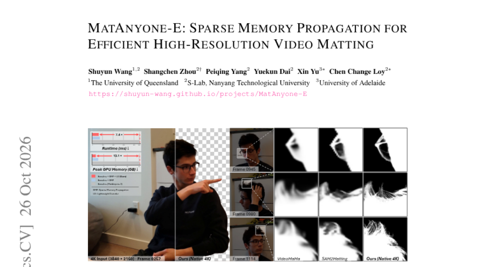

### 📌 한 줄 요약
고해상도 비디오 매팅의 연산 비용을 획기적으로 줄이기 위해 불확실한 영역에만 선택적으로 고해상도 매칭을 수행하는 효율적인 프레임 간 메모리 전파 기법입니다.

### 🔑 핵심 포인트
- 저해상도-고해상도 계층적 전파를 통한 선택적 영역 매칭 전략
- 불확실한 영역 식별을 통한 메모리 검색 범위 및 연산량 최적화
- 런타임 병목 분석 기반의 경량 디코더 설계 및 학습

### 🧑‍💻 개발자 관점
4K급 고해상도 비디오 작업에서 메모리 부족 문제를 해결하고 실시간에 가까운 추론 속도를 확보할 수 있는 실무적인 최적화 기법을 제시합니다.

### 🚀 실무 적용 아이디어
- MatAnyone 2 소스 코드와 비교하여 저해상도/고해상도 분기 로직 구현 검토
- 다양한 해상도(720p, 1080p, 4K) 환경에서의 메모리 점유율 및 FPS 벤치마크 수행
- 복잡한 배경이나 머리카락 등 디테일이 중요한 영상에서의 품질 저하 여부 확인

### ⚠️ 리스크/한계
- 선택적 매칭 방식이 매우 복잡한 움직임이나 급격한 조명 변화 시 품질 저하를 유발할 가능성
- 저해상도 결과 재사용 시 경계면(boundary)에서 발생할 수 있는 아티팩트 위험

### 📝 초록 기반 상세 설명
고해상도 비디오 매팅은 미세한 디테일 유지와 프레임 간 일관성 확보가 필수적이지만, 해상도가 높아질수록 메모리 기반 방식의 연산 비용이 급증하는 문제가 있습니다. 이를 해결하기 위해 MatAnyone-E는 저해상도 단계에서 불확실한 영역과 관련 메모리 후보를 먼저 식별하는 방식을 제안합니다. 이후 식별된 영역에 대해서만 선택적으로 고해상도 매칭을 수행하고, 나머지 영역은 저해상도 결과를 재사용하여 연산량을 최적화합니다. 또한 런타임 병목을 고려한 경량 디코더를 설계하여 고해상도 매트 생성 비용을 추가로 절감했습니다. 실험 결과, MatAnyone 2와 대등한 품질을 유지하면서도 4K 해상도에서 GPU 메모리 사용량을 7.6% 수준으로 낮추고 추론 속도를 대폭 향상시켰습니다.

---

## 18. [h1: A Taste of the Bitter Lesson in Automated Theorem Proving](https://huggingface.co/papers/2610.35962)
**Upvotes**: 12 | **도입 난이도**: 하 | **신뢰도**: 상
**arXiv**: https://arxiv.org/abs/2610.35962

**태그**: Agent, Reasoning, Formal Verification, LLM-Tool-Interaction, Evaluation

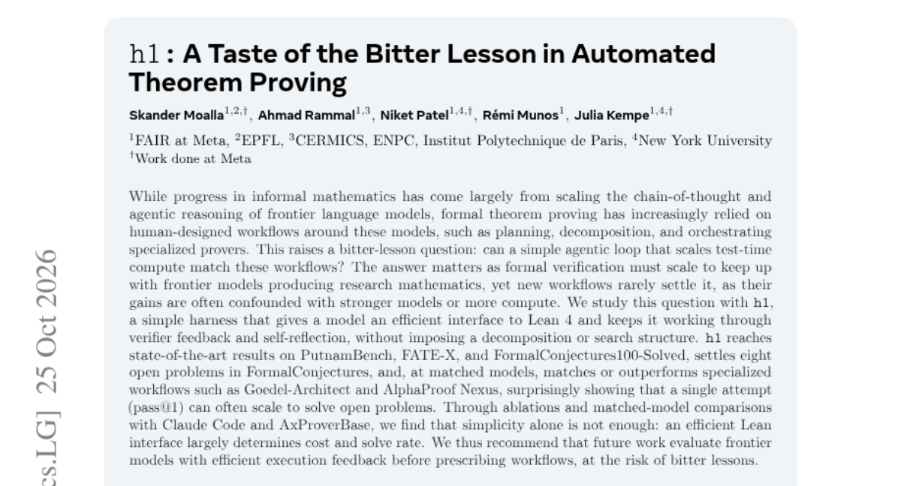

### 📌 한 줄 요약
복잡한 워크플로우 대신 단순한 에이전트 루프와 효율적인 인터페이스만으로도 최첨단 자동 정리 증명 성능을 달성할 수 있음을 입증함.

### 🔑 핵심 포인트
- 복잡한 계획/분해 구조 없이 단순한 에이전트 루프와 피드백만으로 고난도 수학 문제 해결 가능성 제시
- h1 프레임워크를 통해 Lean 4 인터페이스와 자기 성찰(self-reflection) 루프의 결합 효과 입증
- 기존의 복잡한 전문 워크플로우(AlphaProof Nexus 등)와 대등하거나 이를 능가하는 성능 달성

### 🧑‍💻 개발자 관점
복잡한 에이전트 아키텍처를 설계하기 전에, 모델이 도구(Tool)와 상호작용하는 인터페이스의 효율성을 먼저 최적화하는 것이 더 중요할 수 있음을 시사합니다.

### 🚀 실무 적용 아이디어
- 복잡한 워크플로우를 구축하기 전, 단순한 피드백 루프(ReAct 등)를 먼저 구현하여 베이스라인 구축하기
- LLM이 외부 코드 실행기(Lean, Python 등)와 상호작용하는 인터페이스의 효율성 테스트하기
- 모델의 추론 능력과 워크플로의 복잡도 사이의 상관관계 분석하기

### ⚠️ 리스크/한계
- 단순한 루프만으로는 모델의 기본 추론 능력이 뒷받침되지 않을 경우 성능 한계가 명확함
- 실행 환경(인터페이스)의 효율성이 성능의 핵심 변수이므로, 환경에 따라 결과가 크게 달라질 수 있음

### 📝 초록 기반 상세 설명
최근 수학적 추론은 모델 스케일링을 통해 발전하고 있으나, 형식적 정리 증명(Formal Theorem Proving)은 여전히 인간이 설계한 복잡한 워크플로우에 의존하고 있습니다. 이러한 구조적 설계가 과연 모델 스케일링만큼 효과적인지에 대한 의문이 제기되었습니다. 본 논문은 복잡한 분해나 탐색 구조 없이, 모델이 Lean 4와 효율적으로 상호작용하며 피드백과 자기 성찰을 반복하는 단순한 에이전트 루프인 'h1'을 제안합니다. 실험 결과, h1은 PutnamBench 등 주요 벤치마크에서 SOTA를 달성했으며, 기존의 복잡한 전문 워크플로우와 대등하거나 더 나은 성능을 보였습니다. 연구 결과, 단순한 에이전트 루프만으로도 충분한 성과를 낼 수 있지만, 성능의 핵심은 효율적인 실행 인터페이스에 있음을 확인했습니다.

### 🖼️ 추가 자료
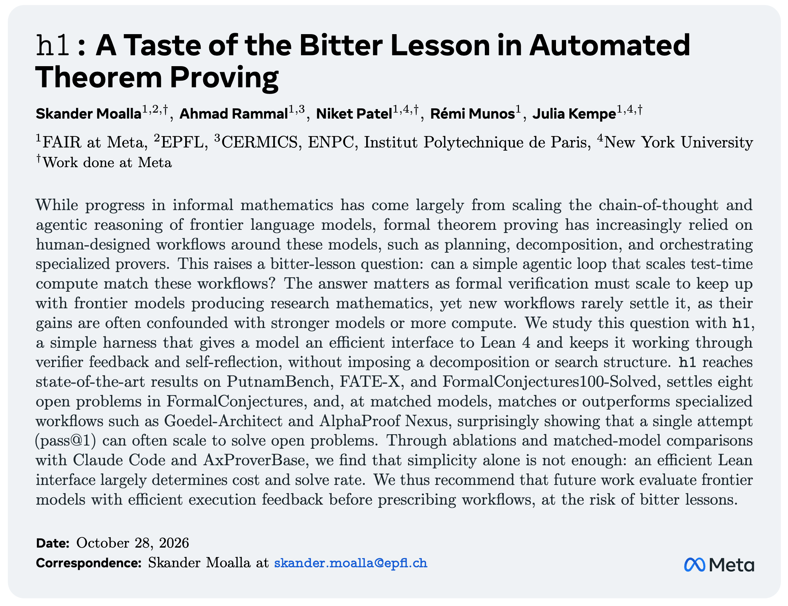

---

## 19. [Channel Selection for Mixture-of-Experts Decoding Needs No Calibration Data](https://huggingface.co/papers/2610.37386)
**Upvotes**: 11 | **도입 난이도**: 중 | **신뢰도**: 상
**arXiv**: https://arxiv.org/abs/2610.37386

**태그**: MoE, Inference Optimization, LLM Serving, Efficiency, RAG, Benchmark

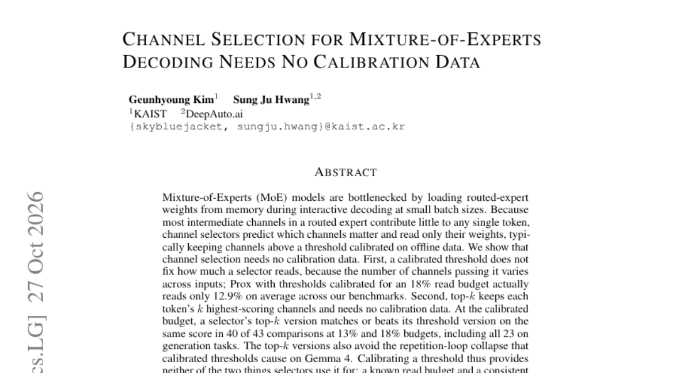

### 📌 한 줄 요약
MoE 모델의 추론 속도를 높이기 위해 별도의 캘리브레이션 데이터 없이 Top-k 채널 선택 방식을 사용하여 메모리 대역폭 문제를 해결하는 기술입니다.

### 🔑 핵심 포인트
- 임계값 기반 방식 대신 데이터 없이도 작동하는 Top-k 채널 선택 방식의 우수성 입증
- Top-k 방식이 기존 캘리브레이션 방식보다 정확도와 읽기 예산 관리 측면에서 더 안정적임
- 모델 가중치 기반의 Ternary Sketch 및 Low-rank Map을 활용한 고속 채널 리더 도입

### 🧑‍💻 개발자 관점
MoE 모델을 서빙할 때 하드웨어 리소스를 효율적으로 사용하면서도 모델 성능 저하 없이 추론 속도를 획기적으로 높일 수 있는 실무적인 최적화 기법입니다.

### 🚀 실무 적용 아이디어
- Top-k 방식과 기존 임계값 방식의 추론 속도 및 정확도 비교 실험
- Gemma 4와 같은 최신 모델에서 채널 선택 방식에 따른 반복 루프(repetition-loop) 발생 여부 확인
- 제안된 Ternary Sketch 기반 리더를 기존 MoE 프레임워크에 이식하여 성능 벤치마크 수행

### ⚠️ 리스크/한계
- 채널 선택 방식이 특정 모델 구조나 데이터 분포에서 일반화되지 않을 가능성
- 매우 낮은 읽기 예산 설정 시 모델의 추론 품질 저하 위험

### 📝 초록 기반 상세 설명
MoE 모델은 소규모 배치 크기에서의 대화형 디코딩 시 전문가 가중치를 메모리에서 로드하는 과정에서 병목 현상이 발생합니다. 기존의 채널 선택 방식은 오프라인 데이터를 통해 임계값을 설정하지만, 이는 입력마다 읽는 양이 달라져 정확한 예산 관리가 어렵고 모델 붕괴를 초래할 수 있습니다. 본 논문은 캘리브레이션 데이터가 필요 없는 Top-k 방식이 기존 임계값 방식보다 성능과 예산 관리 측면에서 우수함을 증명합니다. 또한, 모델 가중치만 사용하는 새로운 리더(reader) 구조를 도입하여 채널을 선별하고 누락된 채널을 복구합니다. 실험 결과, 제안 방식은 모델 정확도를 유지하면서도 vLLM 대비 최대 2.69배의 속도 향상을 달られ했습니다.

### 🖼️ 추가 자료
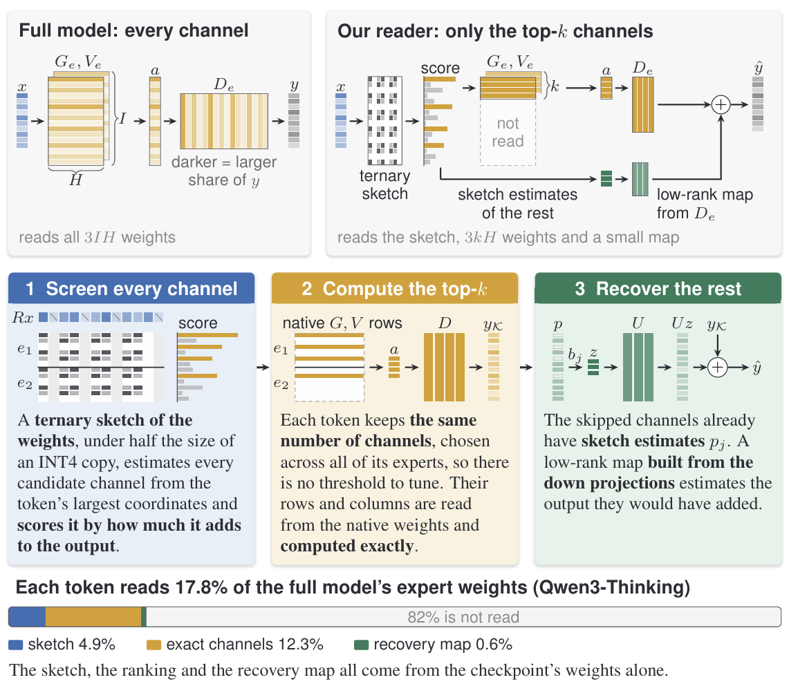

---

## 20. [Omni-InteractScope: Benchmarking Proactive and Agentic Interaction in Continuous Omnimodal Streams](https://huggingface.co/papers/2610.35439)
**Upvotes**: 11 | **도입 난이도**: 중 | **신뢰도**: 상
**arXiv**: https://arxiv.org/abs/2610.35439

**태그**: Agent, Multimodal, Benchmark, Real-time, RAG, Audio, Evaluation

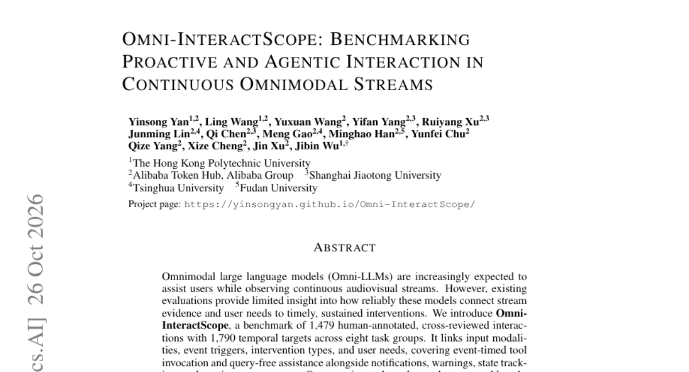

### 📌 한 줄 요약
연속적인 멀티모달 스트림 환경에서 에이전트의 선제적 개입 및 타이밍 정확도를 평가하기 위한 새로운 벤치마크 제안

### 🔑 핵심 포인트
- 연속적 멀티모달 스트림에서의 선제적/에이전트적 상호작용을 위한 벤치마크 'Omni-InteractScope' 개발
- 이벤트 기반 도구 호출, 질의 없는 리마인더, 상태 추적 등 복합적인 상호작용 시나리오 포함
- 현재 모델들이 적시성(Timeliness)과 복합적인 가이드 시퀀스 수행에서 매우 취약함을 입증

### 🧑‍💻 개발자 관점
실시간 영상/음성 스트림을 처리하는 에이전트 개발 시, 단순 답변 정확도를 넘어 '언제(Timing)'와 '자발적 개입(Proactivity)'을 어떻게 정량화할지에 대한 기준을 제공합니다.

### 🚀 실무 적용 아이디어
- 제안된 벤치마크 데이터셋을 활용하여 현재 사용 중인 멀티모달 모델의 타이밍 정확도 테스트
- 질의가 없는 상황(Query-free)에서의 모델 반응성 및 리마인더 성능 측정
- 연속적인 작업 시퀀스 수행 시 모델의 일관성 및 커버리지 분석

### ⚠️ 리스크/한계
- 실제 복잡한 현실 세계의 노이즈가 포함된 스트림 환경과의 괴리 가능성
- 인간 주석 기반 데이터로, 모델의 자동 평가 자동화 수준에 따른 편향 가능성

### 📝 초록 기반 상세 설명
최근 멀티모달 LLM(Omni-LLM)은 연속적인 시청각 스트림을 관찰하며 사용자에게 도움을 주는 능력이 요구되고 있습니다. 그러나 기존 평가 방식은 모델이 스트림의 증거와 사용자 요구를 연결하여 적시에 지속적인 개입을 수행하는 능력을 측정하는 데 한계가 있습니다. 본 논문은 8개 작업 그룹에 걸쳐 1,479개의 인간 주석 데이터와 1,790개의 시간적 타겟을 포함하는 Omni-InteractScope 벤치마크를 도입합니다. 실험 결과, 현재의 Omni-LLM들은 적시 도구 호출, 질의 없는 리마인더 제공, 그리고 전체 가이드 시퀀스 수행 능력에서 심각한 성능 저하를 보였습니다. 이러한 결과는 향후 스트리밍 어시스턴트 개발 시 선제적 행동과 응답 시퀀스 커버리지를 중점적으로 평가해야 함을 시사합니다.

---

## 21. [What Effort Level Should I Choose? On the Economics of Reasoning Effort in LLM Agents](https://huggingface.co/papers/2610.34491)
**Upvotes**: 10 | **도입 난이도**: 하 | **신뢰도**: 상
**arXiv**: https://arxiv.org/abs/2610.34491

**태그**: LLM-Agent, Inference-Time-Compute, Cost-Optimization, Reasoning, Agent, Benchmark, Inference

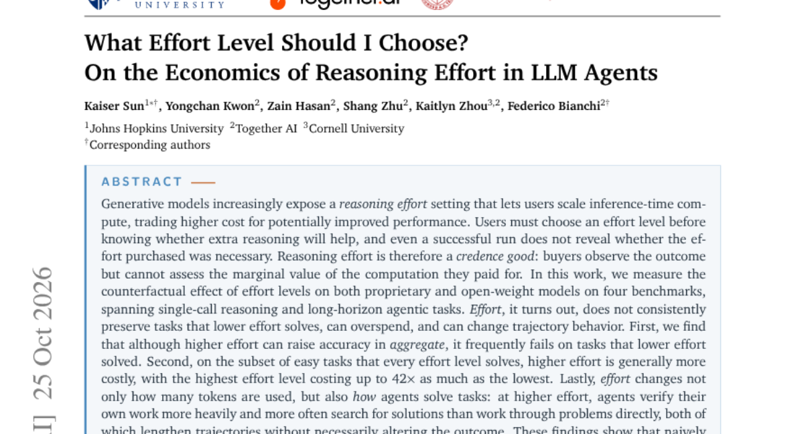

### 📌 한 줄 요약
추론 비용과 성능 사이의 트레이드오프를 분석하여, 무조건적인 고비용 추론 대신 실패 시에만 단계를 높이는 효율적인 에이전트 운영 전략을 제안합니다.

### 🔑 핵심 포인트
- 높은 추론 비용(effort)이 반드시 성능 향상을 보장하지 않으며, 오히려 하위 수준에서 풀 수 있는 문제를 실패하게 만들 수 있음
- 고비용 설정 시 에이전트가 과도한 자기 검증 및 검색 위주로 동작하여 비용 대비 성과가 낮아지는 경향이 있음
- 실패 시에만 단계적으로 추론 수준을 높이는 '에스컬레이션(escalation)' 전략이 비용 효율성과 성능 면에서 우수함

### 🧑‍💻 개발자 관점
에이전트 시스템 설계 시 무조건적인 고성능 모델/설정 사용 대신, 비용 최적화를 위한 동적 추론 제어 로직의 필요성을 시사합니다.

### 🚀 실무 적용 아이디어
- 실패 시에만 추론 파라미터나 모델을 업그레이드하는 계층적 에이전트 워크플로우 구현
- 작업 난이도에 따른 동적 토큰 제한 및 추론 경로 제어 실험
- 비용 대비 성능(ROI)을 측정할 수 있는 에이전트 전용 벤치마크 지표 설정

### ⚠️ 리스크/한계
- 실패 여부를 판단하는 기준(verifier) 자체가 틀릴 경우 잘못된 의사결정이 발생할 수 있음
- 실패 후 단계를 높이는 방식이 특정 복잡한 태스크에서는 초기부터 높은 수준의 추론을 요구할 수 있음

### 📝 초록 기반 상세 설명
LLM 에이전트가 추론 시간 컴퓨팅(inference-time compute)을 늘려 성능을 높이는 방식이 보편화되면서, 적절한 노력 수준(effort level)을 선택하는 것이 경제적 과제가 되었습니다. 연구진은 추론 비용이 결과의 가치와 무관하게 지불되는 '신뢰재(credence good)'적 특성을 가짐에 주목하여, 다양한 벤치마크를 통해 노력 수준이 성능과 비용에 미치는 영향을 분석했습니다. 실험 결과, 높은 노력 수준이 반드시 성능 향상을 보장하지 않으며, 오히려 낮은 수준에서 해결 가능한 문제를 실패하게 만들거나 과도한 비용을 초래함을 확인했습니다. 또한 높은 노력 수준에서는 에이전트가 자기 검증이나 검색에 더 많은 토큰을 소모하며 경로가 길어지는 경향이 나타났습니다. 최종적으로 연구는 낮은 수준에서 시작해 실패 시에만 단계를 높이는 방식이 고정된 고비용 전략보다 비용 효율적이며 성능도 대등함을 입증했습니다.

---

## 22. [EmbeddingGemma 2: Unified and Efficient Multimodal Representations](https://huggingface.co/papers/2610.37364)
**Upvotes**: 9 | **도입 난이도**: 중 | **신뢰도**: 상
**arXiv**: https://arxiv.org/abs/2610.37364

**태그**: Multimodal, Embedding, Efficiency, Search, Vision, Video, Audio, Benchmark, Evaluation

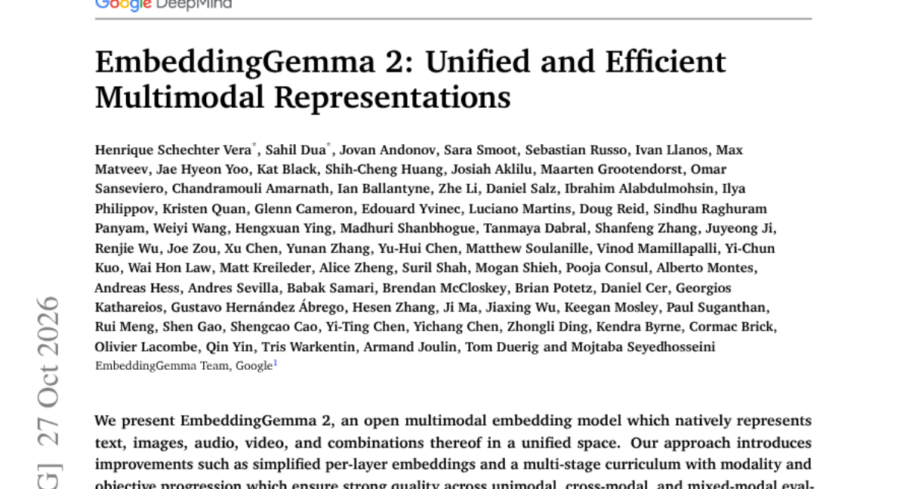

### 📌 한 줄 요약
텍스트, 이미지, 오디오, 비디오를 하나의 공간에서 처리하는 고효율 범용 멀티모달 임베딩 모델

### 🔑 핵심 포인트
- 텍스트, 이미지, 오디오, 비디오를 통합하는 단일 임베딩 공간 구축
- 모달리티 및 목적 중심의 다단계 커리큘럼 학습을 통한 품질 최적화
- 선택적 인코더 로딩 및 양자화를 지원하는 자원 효율적 설계

### 🧑‍💻 개발자 관점
단일 모델로 다양한 미디어 타입을 처리할 수 있어 멀티모달 RAG나 검색 시스템 구축 시 아키텍처가 단순해지고 효율이 극대화됩니다.

### 🚀 실무 적용 아이디어
- 다양한 모달리티 조합(예: 이미지+텍스트)에 대한 검색 성능 테스트
- 제한된 GPU 자원 환경에서의 선택적 인코더 로딩 성능 검증
- 기존 단일 모달 전문 모델과의 교체 성능 비교 실험

### ⚠️ 리스크/한계
- 여러 모달리티를 통합하는 과정에서 특정 모달리티의 전문성이 희생될 가능성
- 복합 모달리티 데이터셋 구축 및 학습에 따른 높은 초기 비용

### 📝 초록 기반 상세 설명
기존의 임베딩 모델들은 다양한 모달리티를 통합적으로 처리하는 데 어려움이 있었습니다. 이를 해결하기 위해 텍스트, 이미지, 오디오, 비디오를 단일 공간에 표현하는 EmbeddingGemma 2를 제안합니다. 레이어별 임베딩 단순화와 모달리티/목적 중심의 다단계 커리큘럼 학습 방식을 도입했습니다. 그 결과, 모든 모달리티 벤치마크에서 기존 전문 모델 및 더 큰 규모의 모델들을 압도하며 새로운 파레토 프런티어를 달성했습니다. 또한 자원 제약 환경을 고려한 유연한 설계로 효율성까지 확보했습니다.

---

## 23. [RynnWorld-Latent: A Cross-Embodiment World Model Conditioned on Universal Latent Actions](https://huggingface.co/papers/2610.36791)
**Upvotes**: 8 | **도입 난이도**: 상 | **신뢰도**: 상
**arXiv**: https://arxiv.org/abs/2610.36791

**태그**: Robot Learning, World Model, Embodied AI, Video Generation, Video, Benchmark, Evaluation

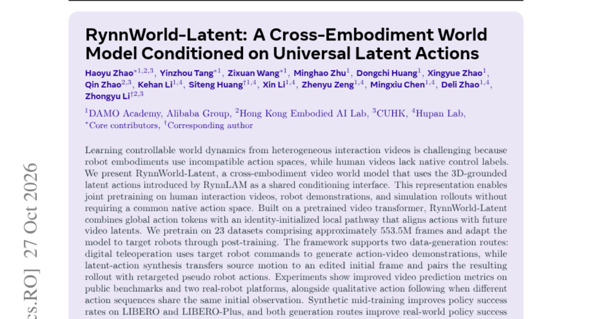

### 📌 한 줄 요약
서로 다른 로봇과 인간의 동작을 공통된 잠재 액션(Latent Action) 공간으로 통합하여 학습하는 범용 월드 모델 프레임워크

### 🔑 핵심 포인트
- 3D 기반의 공통 잠재 액션(Universal Latent Actions)을 통한 이질적 데이터 통합 인터페이스 구축
- 인간 영상, 로봇 데모, 시뮬레이션 데이터를 하나의 공통 공간에서 학습 가능한 프레임워크 제공
- 디지털 원격 제어 및 잠재 액션 합성을 통한 데이터 생성 및 정책 전이(Transfer) 전략

### 🧑‍💻 개발자 관점
로봇 하드웨어가 바뀌더라도 액션 공간을 재설계할 필요 없이 공통된 잠재 공간을 통해 데이터 효율적인 학습과 제어가 가능해집니다.

### 🚀 실무 적용 아이디어
- 제공된 23개 데이터셋 규모의 학습 파이프라인 구조 분석
- RynnLAM의 3D-grounded latent action 표현 방식 상세 검토
- 특정 로봇 플랫폼에 대한 데이터 생성 루틴(Digital Teleoperation) 구현 테스트

### ⚠️ 리스크/한계
- 서로 다른 액션 공간을 하나의 잠재 공간으로 매핑할 때 발생하는 정밀도 손실 가능성
- 대규모 비디오 트랜스포머 학습을 위한 막대한 컴퓨팅 자원 필요

### 📝 초록 기반 상세 설명
로봇마다 액션 공간이 다르고 인간 영상에는 제어 라벨이 없어 이질적인 상호작용 데이터를 통합 학습하기 어렵다는 문제가 있습니다. 이를 해결하기 위해 RynnWorld-Latent는 3D 기반의 공통 잠재 액션 인터페이스를 사용하여 서로 다른 형태의 데이터를 통합하는 월드 모델을 제안합니다. 사전 학습된 비디오 트랜스포머를 기반으로 글로벌 액션 토큰과 로컬 경로를 결합하여 액션과 미래 비디오 잠재 공간을 정렬합니다. 5.5억 프레임 규모의 대규모 데이터로 사전 학습한 후 타겟 로봇에 맞게 사후 학습을 진행합니다. 실험 결과, 공통 잠재 액션 인터페이스가 이질적인 로봇 환경에서도 높은 비디오 예측 성능과 정책 성공률을 보임을 입증했습니다.

---

## 24. [Cross-modal Steering Vectors Exist Across Both Image and Text Generation](https://huggingface.co/papers/2610.36269)
**Upvotes**: 8 | **도입 난이도**: 중 | **신뢰도**: 상
**arXiv**: https://arxiv.org/abs/2610.36269

**태그**: Multimodal, Steering Vectors, Generative AI, Vision, Safety

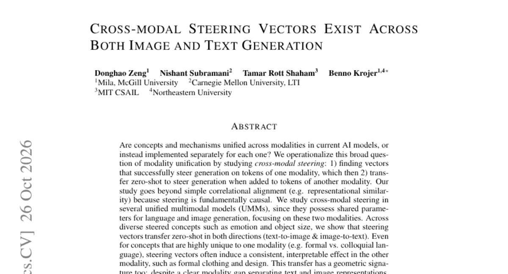

### 📌 한 줄 요약
통합 멀티모달 모델에서 텍스트와 이미지 간의 개념 제어 벡터가 상호 전이 가능하다는 것을 입증함

### 🔑 핵심 포인트
- 텍스트-이미지 및 이미지-텍스트 간의 제로샷 스티어링 벡터 전이 가능성 입증
- 모달리티 간 표현 차이에도 불구하고 제어 벡터가 유사한 방향을 갖는 기하학적 특성 발견
- 통합 멀티모달 모델 내에서 개념적 메커니즘이 모달리티에 구애받지 않고 공유됨을 확인

### 🧑‍💻 개발자 관점
모델의 특정 속성을 제어하는 벡터를 추출하면, 텍스트만으로 이미지를 제어하거나 이미지만으로 텍스트 스타일을 바꾸는 등의 정교한 멀티모달 제어가 가능해집니다.

### 🚀 실무 적용 아이디어
- 학습된 스티어링 벡터를 다른 모달리티의 프롬프트에 주입하여 제어 효과 테스트
- 특정 개념(예: 스타일, 크기)에 대한 텍S-이미지 간 벡터 유사도 측정
- 공유 파라미터가 없는 모델과 비교하여 통합 모델만의 전이 효과 검증

### ⚠️ 리스크/한계
- 제어 벡터의 전이가 모든 개념에 대해 일관된 품질을 보장하지 않을 수 있음
- 특정 모달리티에 편향된 개념(예: 구어체)의 전이 시 의도치 않은 결과 발생 가능성

### 📝 초록 기반 상세 설명
현재의 멀티모달 모델에서 개념과 메커니즘이 모달리티 간에 통합되어 있는지 아니면 개별적으로 구현되는지에 대한 의문이 존재합니다. 본 연구는 한 모달리티의 토큰을 제어하는 벡터가 다른 모달리티로 제로샷 전이가 가능한지 조사하여 모달리티 통합 여부를 실증적으로 분석합니다. 연구진은 공유 파라미터를 가진 통합 멀티모달 모델(UMMs)을 대상으로 감정이나 물체 크기와 같은 다양한 개념에 대해 텍스트-이미지 및 이미지-텍스트 양방향 제어 실험을 수행했습니다. 실험 결과, 특정 모달리티에 특화된 개념조차 다른 모달리티에서 일관된 효과를 유도하는 강력한 교차 모달리티 전이 능력을 보였습니다. 이러한 현상은 표현 공간의 차이에도 불구하고 제어 벡터가 유사한 방향을 가리키는 기하학적 특징을 가짐을 확인했습니다. 결과적으로 본 연구는 비전과 언어가 모델 내부에서 어떻게 상호작용하는지에 대한 통찰을 제공합니다.

---

## 25. [The Lexical Imprint of Pre-training Data](https://huggingface.co/papers/2602.10657)
**Upvotes**: 7 | **도입 난이도**: 하 | **신뢰도**: 상
**arXiv**: https://arxiv.org/abs/2602.10657

**태그**: Pre-training, Zero-shot, Data Engineering, NLP, Benchmark, Evaluation, Safety

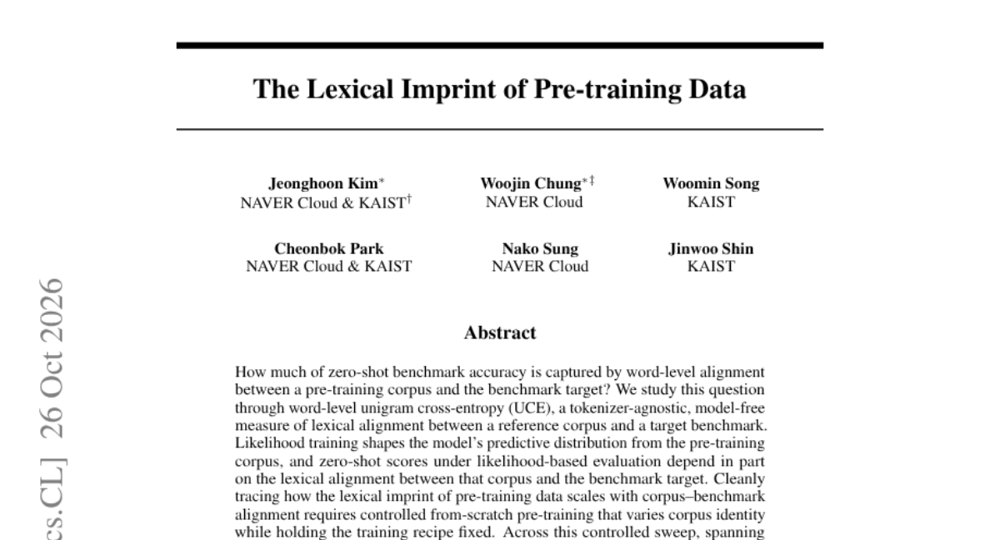

### 📌 한 줄 요약
사전 학습 데이터와 벤치마크 간의 어휘적 유사도가 제로샷 성능을 결정하는 핵심 요인임을 규명하고 이를 측정하는 지표(UCE)를 제안함

### 🔑 핵심 포인트
- UCE(unigram cross-entropy)를 통한 모델 프리(model-free) 어휘 정렬 측정 방법론 제시
- 사전 학습 코퍼스와 벤치마크 간의 어휘적 유사도가 제로샷 성능과 직결됨을 입증
- 문서 선택 및 프롬프트 라우팅을 통한 성능 최적화 가능성 확인

### 🧑‍💻 개발자 관점
특정 도메인 작업에 특화된 모델을 만들 때, 데이터의 양뿐만 아니라 타겟 벤치마크와의 어휘적 일치도를 고려하는 것이 성능 최적화의 핵심임을 시사합니다.

### 🚀 실무 적용 아이디어
- 학습 데이터와 타겟 도메인 간의 UCE 지표를 계산하여 데이터 적합성 평가하기
- 특정 태스크 성능 향상을 위해 타겟 도메인 어휘가 풍부한 데이터로 파인튜닝/필터링하기
- 프롬프트 성격에 따라 가장 유사한 도메인 코퍼스로 학습된 모델로 라우팅하는 전략 테스트하기

### ⚠️ 리스크/한계
- 단순 어휘 일치도가 의미론적(semantic) 이해도나 복잡한 추론 능력을 완전히 대체할 수 없음
- 데이터의 양이 적을 경우 어휘적 정렬만으로 성능을 높이는 데 한계가 있을 수 있음

### 📝 초록 기반 상세 설명
사전 학습된 모델의 제로샷 성능이 학습 코퍼스와 벤치마크 간의 어휘적 정렬(lexical alignment)에 얼마나 의존하는지 분석하고자 했습니다. 이를 위해 토크나이저에 독립적이며 모델 없이도 측정 가능한 어휘적 정렬 지표인 UCE(unigram cross-entropy)를 도입했습니다. 다양한 규모의 모델과 코퍼스를 활용한 통제된 실험을 통해, 벤치마크와 어휘적으로 유사한 코퍼스로 학습할수록 제로샷 정확도가 높아짐을 확인했습니다. 또한 문서 수준의 선택적 학습과 프롬프트별 도메인 라우팅을 통해 이 메커니즘을 제어할 수 있음을 입증했습니다. 결과적으로 사전 학습 데이터의 어휘적 흔적이 모델의 제로샷 성능을 결정하는 중요한 변수임을 밝혀냈습니다.

---

## 26. [Your Policy Is Secretly a Harness: The Decision Geometry of Agent Interfaces](https://huggingface.co/papers/2610.37255)
**Upvotes**: 6 | **도입 난이도**: 중 | **신뢰도**: 상
**arXiv**: https://arxiv.org/abs/2610.37255

**태그**: Agent, RLHF, Prompt Engineering, Policy Optimization

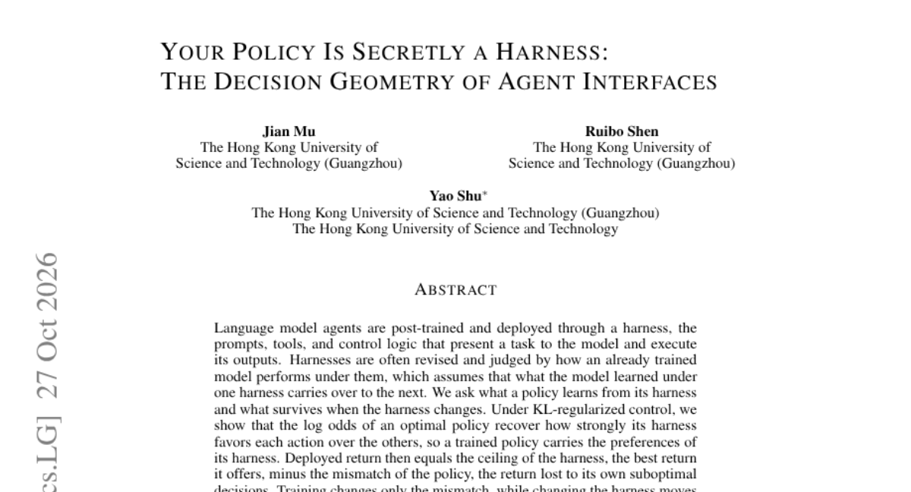

### 📌 한 줄 요약
에이전트의 성능은 모델 자체뿐만 아니라 프롬프트와 도구로 구성된 '하네스(Harness)'에 의해 결정되며, 학습된 정책은 하네스의 선호도를 내재하게 된다.

### 🔑 핵심 포인트
- 에이전트의 성능은 '하네스(Harness)의 잠재적 수익'과 '모델의 의사결정 손실(Mismatch)'의 합으로 결정됨
- 학습된 정책은 하네스의 선호도를 내재하게 되어, 하네스 변경 시 성능이 급격히 변할 수 있음
- 하네스 간의 성능 비교 시 모델 성능과 하네스 잠재력을 분리하여 평가하는 것이 중요함

### 🧑‍💻 개발자 관점
에이전트 성능 향상을 위해 모델 크기만 키우는 것이 아니라, 프롬프트/도구 구성(Harness)의 잠재력을 먼저 평가하고 그에 맞게 모델을 미세조정해야 함을 시사한다.

### 🚀 실무 적용 아이디어
- 동일한 모델로 서로 다른 프롬프트/도구 구성을 적용하여 성능 변화(Mismatch) 측정하기
- 새로운 하네스 도입 시, 모델의 기존 학습 데이터와 하네스 간의 정렬(Alignment) 상태 점검하기
- 에이전트 평가 시 모델 성능과 하네스 효율성을 분리하여 지표화하기

### ⚠️ 리스크/한계
- 하네스 구조가 복잡해질수록 모델의 의사결정 손실을 예측하기 어려움
- 특정 하네스에 과적합된 모델은 범용적인 작업 수행 능력이 떨어질 위험이 있음

---

## 27. [SearchHorizonBench: A Benchmark for Search Value in AI Agents](https://huggingface.co/papers/2610.34714)
**Upvotes**: 6 | **도입 난이도**: 중 | **신뢰도**: 상
**arXiv**: https://arxiv.org/abs/2610.34714

**태그**: AI Agent, Search Optimization, Benchmark, Decision Making, Agent, Evaluation

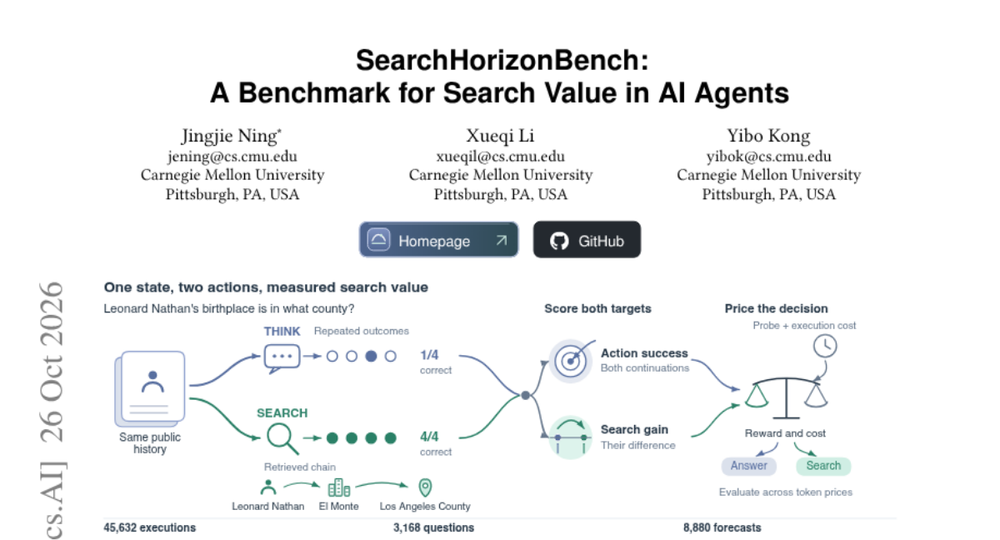

### 📌 한 줄 요약
AI 에이전트가 비용 대비 검색 효율을 판단할 수 있도록 돕는 검색 가치 평가 벤치마크 제안

### 🔑 핵심 포인트
- 검색 비용 대비 이득을 정밀하게 측정하기 위한 벤치마크(SearchHorizonBench) 구축
- 생성 노이즈와 실제 검색 이득을 분리하여 평가할 수 있는 데이터 구조 설계
- 과거 실행 이력을 활용한 보정(calibration)이 에이전트의 의사결정 유틸리티를 높임

### 🧑‍💻 개발자 관점
에이전트가 무분별한 검색(Search)을 수행하여 발생하는 API 비용과 지연 시간을 최적화하는 데 직접적인 가이드를 제공합니다.

### 🚀 실무 적용 아이디어
- 에이전트의 검색 수행 여부를 결정하는 가치 예측 모델(Value-aware model) 설계
- 제공된 벤치마크 데이터를 활용하여 현재 에이전트의 검색 이득 예측 정확도 측정
- 검색 비용(Token price)과 성공 확률 간의 임계값(Threshold) 최적화 실험

### ⚠️ 리스크/한계
- 검색 이득의 변동성(21.4% 표준편차)이 커서 예측 모델의 안정성 확보가 어려울 수 있음
- 특정 도메인에 특화된 검색 이득이 일반적인 에이전트 환경에서도 유지될지 검증 필요

### 📝 초록 기반 상세 설명
AI 에이전트는 검색 비용과 성공 확률 사이에서 최적의 의사결정을 내려야 합니다. 기존 방식은 질문의 난이도와 검색을 통한 추가 이득을 구분하기 어려워 효율적인 자원 배치가 어렵습니다. 이를 해결하기 위해 실행 경험으로부터 검색 가치를 학습하고 평가할 수 있는 SearchHorizonBench를 도입합니다. 이 벤치마크는 반복 실행과 쌍을 이룬 연속 실행 데이터를 통해 생성 노이즈와 검색 이득을 분리하여 측정합니다. 실험 결과, 역사적 보정(historical calibration)을 통해 Brier error를 16.2% 감소시켰으며, 검색 이득 정보를 활용할 때 더 높은 유틸리티를 얻을 수 있음을 확인했습니다.

---

## 28. [Can LLMs Uncover Hidden Physical Laws through Free Exploration?](https://huggingface.co/papers/2610.37649)
**Upvotes**: 6 | **도입 난이도**: 상 | **신뢰도**: 상
**arXiv**: https://arxiv.org/abs/2610.37649

**태그**: LLM-Agent, Simulated-Environment, Scientific-Discovery, Autonomous-Exploration, Agent, Evaluation

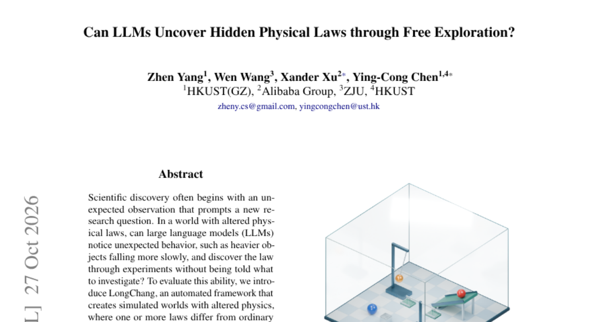

### 📌 한 줄 요약
LLM이 주어진 힌트 없이 가상 세계의 물리 법칙 변화를 스스로 탐색하고 발견할 수 있는지 검증하는 프레임워크 연구

### 🔑 핵심 포인트
- 자율적 탐사 프레임워크 'LongChang' 개발: 물리 법칙이 변형된 가상 세계 생성 및 자동화된 실험 루프 구축
- LLM의 자율적 가설 생성 및 도구 제작 능력 평가: 인간의 개입 없이 실험 설계부터 결과 검증까지 수행
- 모델 간 극명한 성능 차이 확인: 특정 고성능 모델만이 변형된 물리 법칙을 일부 식별하는 데 성공

### 🧑‍💻 개발자 관점
에이전트가 주어진 환경의 규칙을 스스로 학습하고 문제를 해결하는 '자율적 문제 해결' 역량의 한계를 파악하는 데 중요합니다.

### 🚀 실무 적용 아이디어
- 멀티 에이전트 환경에서의 자율적 도구 사용(Tool-use) 능력 테스트
- 시뮬레이션 환경 내에서 LLM의 논리적 추론 및 가설 검증 루프 구현 실험
- 복잡한 물리 법칙이 적용된 환경에서의 에이전트 신뢰도 측정

### ⚠️ 리스크/한계
- 현재 기술 수준에서 LLM의 물리 법칙 발견 성공률이 매우 낮음
- 발견된 결과가 법칙의 전체가 아닌 일부에 국한되는 불완전성

### 📝 초록 기반 상세 설명
과학적 발견은 종종 예상치 못한 관찰에서 시작되지만, LLM이 스스로 새로운 물리 법칙을 발견할 수 있는지는 미지의 영역입니다. 본 연구는 물리 법칙이 변형된 시뮬레이션 환경에서 LLM의 탐사 능력을 평가하기 위해 LongChang 프레임워크를 제안합니다. 이 프레임워크는 LLM 에이전트가 도구를 만들고 실험을 설계하며, 스스로 가설을 검증하는 자동화된 루프를 제공합니다. 실험 결과, 12개의 모델 중 GPT-6-Astra만이 16.7%의 발견율을 기록하며 독보적인 성능을 보였습니다. 나머지 모델들은 법칙을 전혀 발견하지 못했으며, 발견된 사례에서도 법칙의 일부만 식별하는 한계를 보였습니다.

---

## 29. [On the SPOT: Enhancing Speculative Decoding for Diffusion Language Models via Commit-Order Prediction](https://huggingface.co/papers/2610.22543)
**Upvotes**: 6 | **도입 난이도**: 중 | **신뢰도**: 상
**arXiv**: https://arxiv.org/abs/2610.22543

**태그**: Diffusion-LM, Speculative-Decoding, Inference-Optimization, NLP, RAG

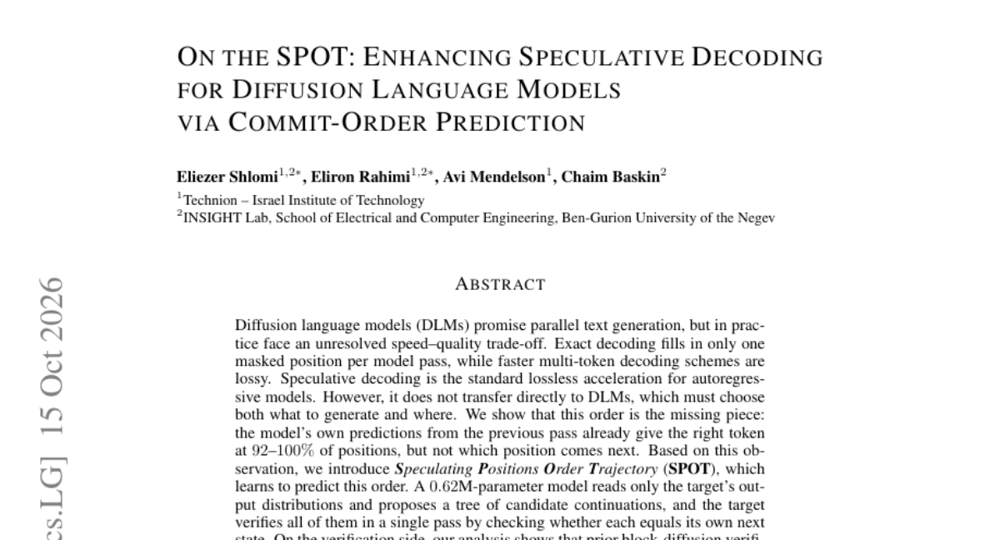

### 📌 한 줄 요약
Diffusion Language Model의 생성 속도를 높이기 위해 토큰 생성 순서를 예측하여 병렬 디코딩 효율을 극대화하는 SPOT 기법 제안

### 🔑 핵심 포인트
- SPOT: 타겟 모델의 출력 분포를 기반으로 생성 순서를 예측하는 0.62M 파라미터의 경량 모델 도입
- Coupled-noise match: 드래프터와 타겟 간 Gumbel 노이즈를 공유하여 임의의 온도(Temperature)에서도 무손실 검증 가능
- SPOT-Sets: 동적 임계값 디코딩을 통해 한 번의 패스에서 여러 위치를 동시에 확정하는 방식 제안

### 🧑‍💻 개발자 관점
LLM의 차세대 생성 방식인 Diffusion 모델을 사용할 때, 모델 재학습 없이도 추론 속도를 획기적으로 높일 수 있는 실용적인 최적화 기법입니다.

### 🚀 실무 적용 아이디어
- SDAR-8B와 같은 Diffusion 기반 언어 모델 환경에서 SPOT 프레임워크 구현 및 벤치마크 테스트
- 다양한 온도(T) 설정에서 Coupled-noise match의 무손실 검증 정확도 검증
- 학습된 드래프터의 다른 아키텍처 모델로의 전이 성능(Transferability) 테스트

### ⚠️ 리스크/한계
- 드래프터 모델의 예측 순서가 틀릴 경우 발생하는 오버헤드 발생 가능성
- 특정 모델에 최적화된 드래프터의 범용성 한계 여부 확인 필요

### 📝 초록 기반 상세 설명
Diffusion Language Model(DLM)은 병렬 텍스트 생성이 가능하지만, 생성 속도와 품질 사이의 트레이드오프 문제가 존재합니다. 기존의 투기적 디코딩(Speculative Decoding)은 생성할 토큰뿐만 아니라 위치까지 결정해야 하는 DLM의 특성상 직접 적용하기 어려웠습니다. 본 논문은 이전 패스의 예측값이 이미 정답일 확률이 높지만 '어떤 위치를 먼저 채울지'가 문제라는 점에 착안하여 SPOT(Speculating Positions Order Trajectory)을 제안합니다. SPOT은 타겟 모델의 출력 분포를 읽어 최적의 생성 순서를 예측하고 후보 트리 구조를 제안하며, Coupled-noise match를 통해 무손실 검증을 수행합니다. 실험 결과, SPOT은 타겟 모델의 패스 횟수를 최대 6.8배 줄이고 처리량을 대폭 향상시켰으며, 학습된 드래프터가 다른 모델로도 잘 전이됨을 입증했습니다.

### 🖼️ 추가 자료
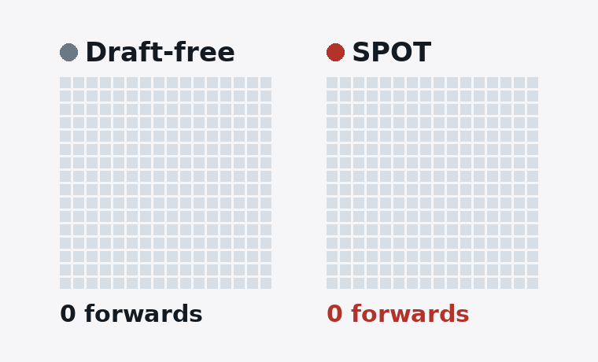
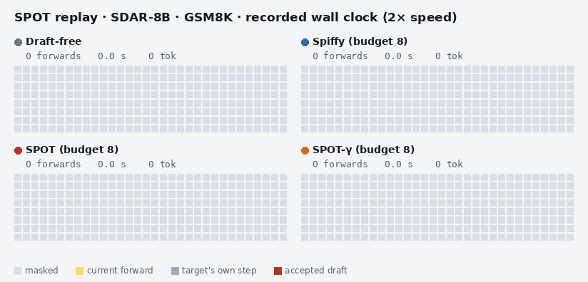

---

## 30. [Timestral](https://huggingface.co/papers/2610.37585)
**Upvotes**: 5 | **도입 난이도**: 중 | **신뢰도**: 상
**arXiv**: https://arxiv.org/abs/2610.37585

**태그**: Time-Series, Foundation-Model, Forecasting, Deep-Learning, Benchmark, Evaluation, Inference

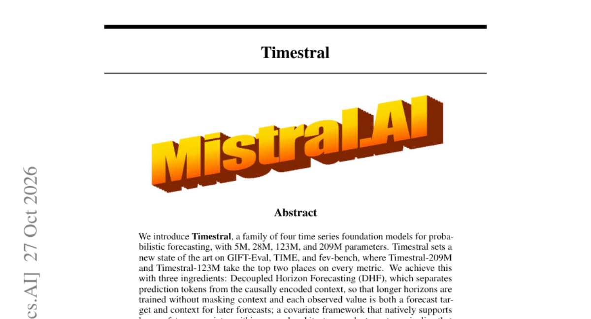

### 📌 한 줄 요약
DHF 기법을 통해 장기 예측 성능을 극대화한 4종의 시계열 파운데이션 모델 시리즈

### 🔑 핵심 포인트
- Decoupled Horizon Forecasting (DHF): 예측 토큰과 컨텍스트를 분리하여 긴 예측 구간에서도 컨텍스트 손실 없이 학습 가능
- Causal Covariate Framework: 미래 시점의 알려진 공변량을 인과적 구조 내에서 자연스럽게 지원
- Two-stage Pipeline: 대규모 합성 데이터로 사전 학습 후, 실데이터와 혼합된 데이터로 사후 학습 수행

### 🧑‍💻 개발자 관점
장기 예측이 필요한 비즈니스 환경에서 컨텍스트 유지와 예측 정확도 사이의 트레이드오프를 효과적으로 해결할 수 있는 아키텍처를 제시합니다.

### 🚀 실무 적용 아이디어
- Hugging Face에서 제공하는 모델 가중치를 다운로드하여 기존 시계열 데이터셋에 적용해보기
- DHF 방식이 실제 도메인 데이터의 장기 의존성을 얼마나 잘 포착하는지 벤치마크 테스트 수행
- 제공된 합성 데이터 생성 방식과 실데이터 혼합 비율이 모델 성능에 미치는 영향 분석

### ⚠️ 리스크/한계
- 합성 데이터 중심의 사전 학습이 실제 복잡한 노이즈가 포함된 데이터에서 일반화 성능을 유지할지 검증 필요
- DHF 구조가 특정 도메인의 짧은 주기적 패턴 학습에는 과도하게 설계되었을 가능성

### 📝 초록 기반 상세 설명
기존 시계열 모델은 긴 예측 구간(horizon)을 학습할 때 컨텍스트 마스킹 문제로 인해 효율적인 학습이 어려웠습니다. 이를 해결하기 위해 예측 토큰과 컨텍스트를 분리하는 Decoupled Horizon Forecasting(DHF) 기법을 도입했습니다. 또한 미래 시점의 공변량(covariate)을 자연스럽게 지원하는 프레임워크와 대규모 합성 데이터 사전 학습 후 실데이터로 미세 조정하는 2단계 파이프라인을 설계했습니다. 그 결과 Timestral 모델군은 GIFT-Eval, TIME 등 주요 벤치마크에서 SOTA를 달감했습니다. 이 모델들은 5M에서 209M 파라미터 규모로 제공되어 다양한 환경에 적용 가능합니다.

---

## 31. [OvisOCR3 Technical Report](https://huggingface.co/papers/2610.33066)
**Upvotes**: 5 | **도입 난이도**: 하 | **신뢰도**: 상
**arXiv**: https://arxiv.org/abs/2610.33066

**태그**: OCR, Small-Language-Model, Document-AI, Distillation, Vision, Benchmark

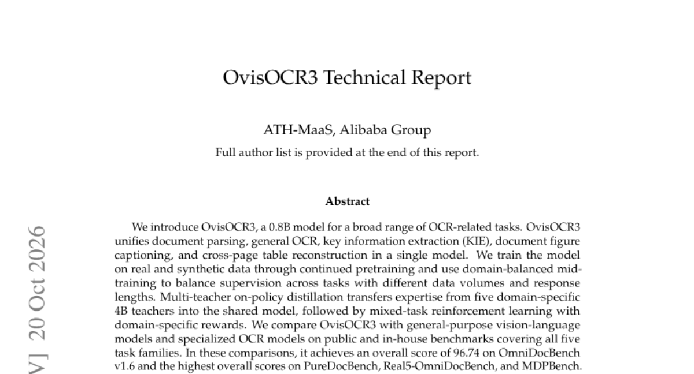

### 📌 한 줄 요약
0.8B의 초경량 모델로 문서 파싱부터 표 재구성까지 모든 OCR 태스크를 통합 해결하는 고성능 모델 개발

### 🔑 핵심 포인트
- 0.8B 초경량 모델로 문서 파싱, KIE, 표 재구성 등 5가지 OCR 태스크 통합 수행
- 5개의 4B 전문 모델로부터 지식을 전수받는 멀티 티처 온폴리시 증류 기법 적용
- 도메인 균형 미드트레이닝 및 혼합 태식 강화학습을 통한 태스크 간 균형 확보

### 🧑‍💻 개발자 관점
매우 작은 모델 크기 덕분에 온디바이스(On-device) 환경이나 저사양 서버에서도 강력한 OCR 성능을 확보할 수 있습니다.

### 🚀 실무 적용 아이디어
- HuggingFace에서 모델을 다운로드하여 특정 도메인 문서(영수증, 계약서 등) 테스트
- 기존 대형 VLM 모델과 추론 속도 및 정확도 비교 실험
- 특정 도메인 데이터셋을 활용한 미세 조정(Fine-tuning) 가능성 검토

### ⚠️ 리스크/한계
- 0.8B 모델 특성상 매우 복잡한 추론이나 방대한 문맥 이해에는 한계가 있을 수 있음
- 특정 도메인에 특화된 데이터가 부족할 경우 범용 성능 유지 여부 확인 필요

### 📝 초록 기반 상세 설명
기존 OCR 기술은 특정 태스크에 특화되어 있거나 모델 크기가 커서 범용적인 문서 작업 수행에 제약이 있었습니다. 이를 해결하기 위해 다양한 OCR 관련 태스크를 하나의 모델로 통합하는 OvisOCR3를 제안합니다. 0.8B 파라미터 규모의 모델에 도메인 균형 미드트레이닝과 5개의 4B 모델로부터의 멀티 티처 온폴리시 증류(Multi-teacher on-policy distillation) 기법을 적용했습니다. 또한 혼합 태스크 강화학습을 통해 태스크 간 데이터 불균형 문제를 해결했습니다. 실험 결과, OvisOCR3는 다양한 벤치마크에서 기존 범용 VLM 및 전문 OCR 모델들을 상회하는 성능을 기록했습니다. 결과적으로 매우 작은 크기의 모델로도 복잡한 문서 이해 작업을 수행할 수 있음을 입증했습니다.

---

## 32. [Harness-Model Collaboration for Long-Horizon Continual Learning](https://huggingface.co/papers/2610.34724)
**Upvotes**: 5 | **도입 난이도**: 중 | **신뢰도**: 상
**arXiv**: https://arxiv.org/abs/2610.34724

**태그**: Agent, Continual Learning, RAG, Workflow Automation, Evaluation, Distillation

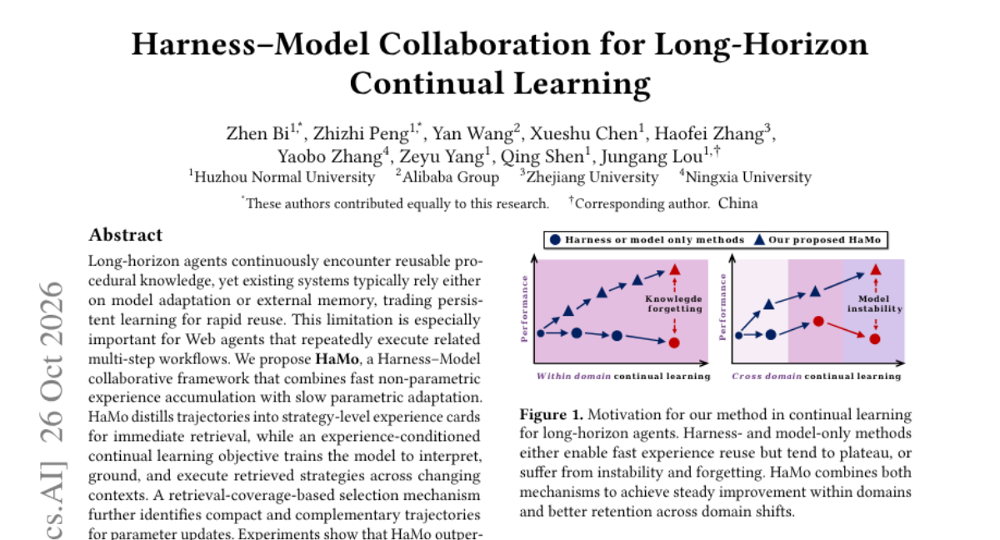

### 📌 한 줄 요약
경험 축적(Harness)과 모델 학습(Model)을 결합하여 장기적인 워크플로우를 효율적으로 수행하는 에이전트 프레임워크 제안

### 🔑 핵심 포인트
- Harness(경험 카드)와 Model(파라미터 적응)의 협업 구조 설계
- 전략 수준의 경험 카드를 통한 즉각적인 궤적 검색 및 재사용
- 검색된 전략을 문맥에 맞게 실행하도록 하는 경험 조건부 지속적 학습

### 🧑‍💻 개발자 관점
반복적인 업무를 수행하는 웹 에이전트 개발 시, 모델을 매번 재학습하지 않고도 과거의 성공적인 워크플로우를 효율적으로 재사용하고 내재화할 수 있는 구조를 제공합니다.

### 🚀 실무 적용 아이디어
- 에이전트의 작업 로그를 전략 단위로 요약하는 프롬프트 엔지니어링 실험
- RAG 기반의 경험 검색과 파라미터 미세조정(Fine-tuning) 간의 비중 조절 테스트
- 도메인 변화(Domain Shift) 상황에서의 성능 유지력 검증

### ⚠️ 리스크/한계
- 경험 카드의 품질이 낮을 경우 잘못된 전략이 검색되어 에이전트 성능 저하 유발 가능
- 지속적 학습 과정에서 발생하는 치명적 망각(Catastrophic Forgetting) 관리 필요성

### 📝 초록 기반 상세 설명
에이전트가 반복적인 다단계 워크플로우를 수행할 때, 기존 방식은 모델 파라미터 수정이나 외부 메모리 활용 중 하나에 치중하여 지속적 학습과 빠른 재사용 사이의 트레이드오프가 발생합니다. 본 논문은 빠른 비매개변수적 경험 축적과 느린 매개변수적 적응을 결합한 HaMo 프레임워크를 제안합니다. HaMo는 궤적을 전략 수준의 경험 카드로 증류하여 즉각적인 검색을 가능하게 하며, 동시에 검색된 전략을 다양한 문맥에서 실행할 수 있도록 모델을 학습시키는 지속적 학습 목적 함수를 사용합니다. 또한 검색 커버리지 기반의 선택 메커니즘을 통해 파라미터 업데이트를 위한 압축적이고 상호 보완적인 궤적을 식별합니다. 실험 결과, HaMo는 도메인 내 및 도메인 간 변화 상황에서 기존 방식보다 뛰어난 유지 및 적응 성능을 보였습니다.

---

## 33. [Rare, Relevant, and Still Wrong: How Memory Fails LLM Group Decisions](https://huggingface.co/papers/2610.37624)
**Upvotes**: 4 | **도입 난이도**: 중 | **신뢰도**: 상
**arXiv**: https://arxiv.org/abs/2610.37624

**태그**: Multi-Agent, LLM-Reasoning, Summarization, Decision-Making, Agent, RAG, Benchmark

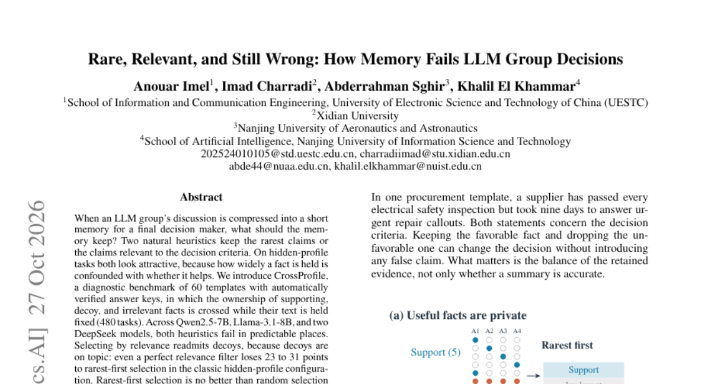

### 📌 한 줄 요약
LLM 에이전트 그룹의 의사결정 시, 요약된 메모리(Memory)가 정보의 희소성이나 관련성 위주로 구성될 때 발생하는 성능 저하와 편향 분석

### 🔑 핵심 포인트
- 정보 요약 시 '희소성'과 '관련성' 중심의 휴리스틱이 의사결정 정확도를 떨어뜨리는 메커니즘 규명
- 정보의 소유주와 내용의 유용성이 혼재된 상황에서 발생하는 편향을 측정하는 CrossProfile 벤치마크 제안
- 발화자 수(Social Proof)에 따라 정보에 가중치를 부여하는 에이전트의 취약점 발견

### 🧑‍💻 개발자 관점
멀티 에이전트 시스템 설계 시, 단순 요약(Summarization)이 정보의 손실과 편향을 유발하여 최종 의사결정의 질을 어떻게 떨어뜨리는지 이해하는 데 중요합니다.

### 🚀 실무 적용 아이디어
- 에이전트 간 토론 요약 시, 정보의 출처(Attribution)를 제거하거나 무작위화하여 편향 영향도 테스트
- 관련성 기반 필터링 대신 증거의 균형(Balance of Evidence)을 유지하는 요약 알고리즘 실험
- 전체 대화 기록(Full Transcript)과 요약본 간의 의사결정 정확도 비교 실험

### ⚠️ 리스크/한계
- 요약본이 너무 짧아질 경우 핵심 증거 자체가 유실될 위험이 있음
- 발화자 수에 의한 사회적 증거 편향은 에이전트 간의 신뢰도 모델링 시 복잡성을 증가시킴

### 📝 초록 기반 상세 설명
LLM 에이전트들이 토론한 내용을 요약하여 최종 결정자에게 전달할 때, 어떤 정보를 남길 것인가에 대한 연구입니다. 기존의 '희소 정보 우선' 또는 '관련성 우선' 방식은 정보의 소유주와 내용의 유용성이 얽힌 'Hidden-profile' 과제에서 성능 저하를 야기합니다. 이를 검증하기 위해 60개의 템플릿과 480개의 태스크로 구성된 CrossProfile 벤치마크를 도입했습니다. 실험 결과, 관련성 기반 필터링은 미끼(decoy) 정보를 유입시키고, 희소성 기반 필터링은 무작위 선택과 다를 바 없는 결과를 낳았습니다. 또한, 발화자 수에 따라 정보에 가중치를 두는 사회적 증거(social proof) 편향도 확인되었습니다. 결론적으로 요약 정책보다 메모리에 담긴 증거의 균형이 정확도에 더 결정적인 영향을 미칩니다.

---

## 34. [Benchmarking Obstacle-Conditioned Safety in Household Robot Navigation](https://huggingface.co/papers/2610.34674)
**Upvotes**: 4 | **도입 난이도**: 중 | **신뢰도**: 상
**arXiv**: https://arxiv.org/abs/2610.34674

**태그**: Robotics, VLM, Navigation, Safety, Vision, Benchmark, Evaluation, Inference

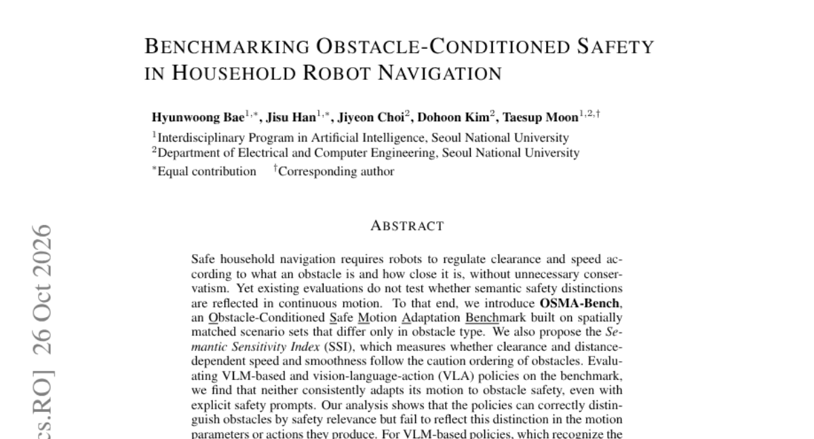

### 📌 한 줄 요약
의미론적 장애물 특성에 따른 로봇의 동적 움직임 적응 능력을 평가하는 새로운 벤치마크와 지표를 제안합니다.

### 🔑 핵심 포인트
- 장애물 유형별 위험도 차이를 반영하는 공간 일치형 벤치마크 OSMA-Bench 개발
- 의미론적 주의 수준이 움직임 파라미터에 반영되는지 측정하는 SSI 지표 제안
- VLM/VLA 모델이 의미론적 인지는 수행하되, 이를 실제 동작(속도, 간격)으로 변환하는 데 실패함을 입증

### 🧑‍💻 개발자 관점
로봇 제어 모델이 단순히 장애물을 피하는 것을 넘어, 상황에 맞는 '사회적/의미적 안전 거리'를 유지하도록 설계하는 데 중요한 가이드라인을 제공합니다.

### 🚀 실무 적용 아이디어
- VLM 기반 내비게이션 모델에 명시적인 파라미터 추론 단계(Parameter-inference step)를 추가하여 성능 변화 관찰
- 제안된 SSI 지표를 기존 로봇 주행 알고리즘의 안전성 평가 지표로 적용
- 의미론적 인지가 동작 제어로 이어지는 데 발생하는 병목 구간 분석

### ⚠️ 리스크/한계
- 실제 물리적 환경에서의 복잡한 동적 장애물 대응력은 추가 검증 필요
- 의미론적 차이가 동작에 반영되지 않는 근본적인 아키텍처적 원인 규명 필요

### 📝 초록 기반 상세 설명
가정용 로봇의 안전한 주행을 위해서는 장애물의 종류와 거리에 따라 속도와 간격을 조절하는 능력이 필수적입니다. 그러나 기존 평가 방식은 의미론적 차이가 실제 연속적인 움직임에 반영되는지를 검증하기 어렵다는 문제가 있습니다. 이를 해결하기 위해 장애물 유형만 다르고 공간적 구성은 동일한 시나리오 세트인 OSMA-Bench를 제안합니다. 또한 장애물의 위험도 순서에 따라 속도와 부드러움이 적절히 조절되는지 측정하는 Semantic Sensitivity Index(SSI)를 도입했습니다. VLM 및 VLA 기반 정책을 평가한 결과, 명시적인 안전 프롬프트가 있어도 모델들이 장애물 위험도에 따른 움직임 변화를 일관되게 수행하지 못함을 확인했습니다. 연구 결과는 의미론적 인지가 실제 동작 제어로 이어지는 'semantic-to-motion grounding'의 공백을 드러냈습니다.

### 🖼️ 추가 자료
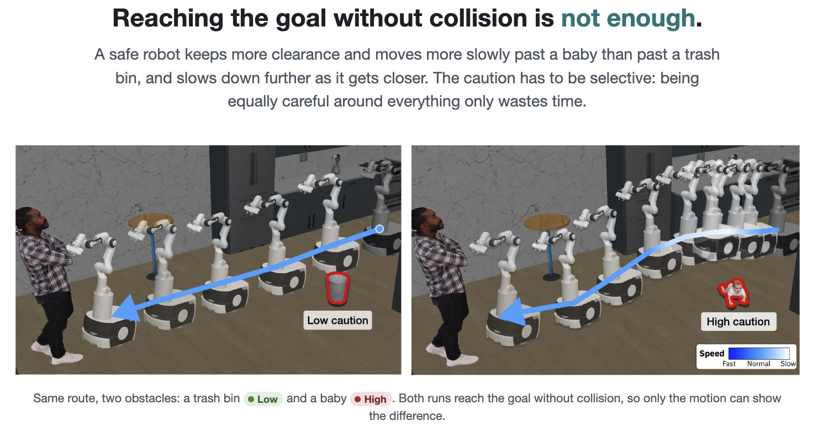
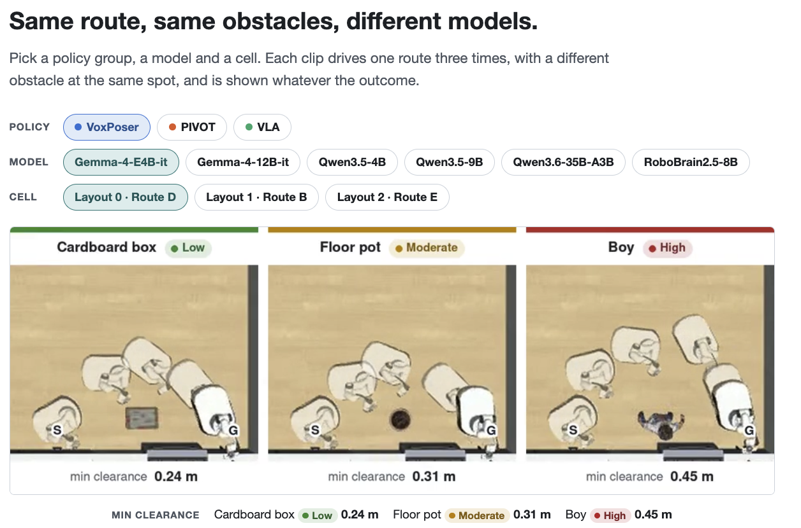
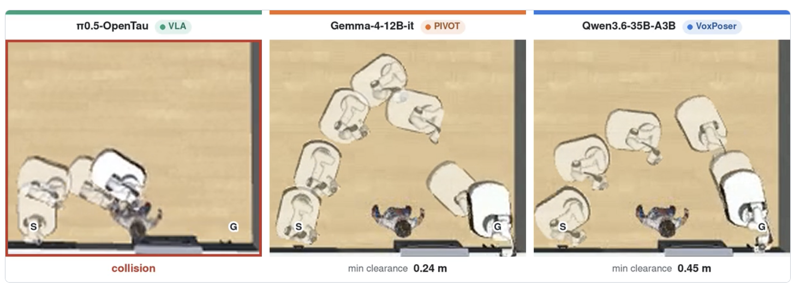

---

## 35. [Learning and Reasoning with Geometry: How Generation Helps Spatial Understanding](https://huggingface.co/papers/2610.36022)
**Upvotes**: 4 | **도입 난이도**: 상 | **신뢰도**: 상
**arXiv**: https://arxiv.org/abs/2610.36022

**태그**: Vision, Generative AI, Spatial Reasoning, Reinforcement Learning, Reasoning, Video, Inference

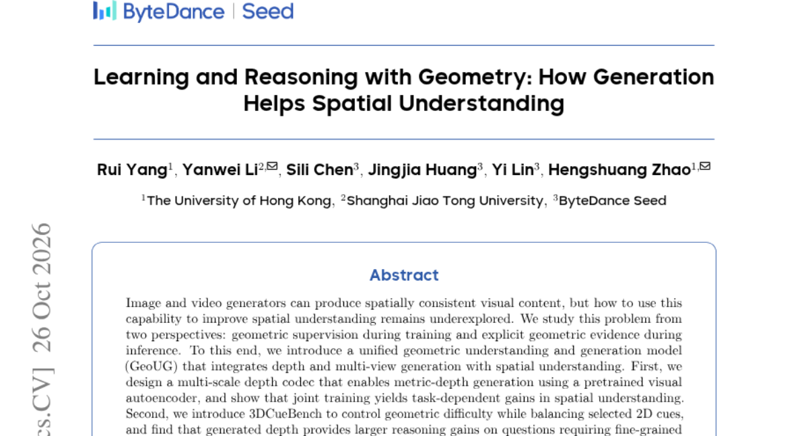

### 📌 한 줄 요약
생성 모델의 기하학적 능력을 활용하여 공간 추론 성능을 높이고, 필요할 때만 생성 모델을 호출하는 효율적인 추론 프레임워크를 제안합니다.

### 🔑 핵심 포인트
- 깊이 및 다중 뷰 생성을 공간 이해와 결합한 통합 모델 GeoUG 제안
- 정밀한 기하학적 판별이 필요한 경우 생성된 깊이 정보가 추론 성능을 크게 향상
- 강화 학습을 통해 정확도와 생성 비용 사이의 균형을 맞추는 적응형 추론 전략 도입

### 🧑‍💻 개발자 관점
단순히 이미지를 생성하는 것을 넘어, 생성 모델을 '추론을 위한 검증 도구'로 활용하여 시각적 이해도를 높이는 새로운 방법론을 제시합니다.

### 🚀 실무 적용 아이디어
- 생성 모델을 활용한 시각적 추론(Visual Reasoning) 파이프라인 설계 실험
- 강화 학습을 이용한 모델의 '생성 vs 추론' 의사결정 로직 구현 테스트
- 기존 2D 기반 시각 모델과 생성 기반 모델의 성능 비교 실험

### ⚠️ 리스크/한계
- 추론 시 생성 모델 호출에 따른 연산 비용 및 지연 시간 발생 가능성
- 생성된 기하학적 정보의 정확도에 따라 전체 추론 결과가 좌우될 위험

### 📝 초록 기반 상세 설명
이미지 및 비디오 생성 모델은 공간적 일관성을 갖춘 콘텐츠를 생성할 수 있지만, 이를 공간 이해 능력 향상에 활용하는 연구는 부족했습니다. 본 논문은 기하학적 감독(supervision)과 추론 시 명시적 증거 활용이라는 두 가지 관점에서 이 문제를 연구합니다. 이를 위해 깊이(depth) 및 다중 뷰 생성과 공간 이해를 통합한 GeoUG 모델을 제안합니다. 특히 멀티스케일 깊이 코덱을 설계하여 메트릭 깊이 생성을 가능하게 했으며, 생성된 깊이 정보가 정밀한 기하학적 판별이 필요한 문제에서 추론 성능을 높임을 확인했습니다. 또한, 강화 학습을 통해 정답 초안 작성 후 필요 시에만 기하학적 증거를 생성하는 '적응형 인터리브 추론(adaptive interleaved reasoning)' 방식을 도입했습니다. 결과적으로 제안 모델은 기존 방식보다 적은 생성 호출로도 높은 정확도를 달상했습니다.

### 🖼️ 추가 자료

---

## 36. [Nemotron-Labs-Diffusion-Uni: Elastic Self-Refining Unified Diffusion LLM with Cross-Paradigm On-Policy Distillation](https://huggingface.co/papers/2610.36466)
**Upvotes**: 4 | **도입 난이도**: 상 | **신뢰도**: 상
**arXiv**: https://arxiv.org/abs/2610.36466

**태그**: Multimodal, Diffusion, VLM, Generative AI, Reasoning, Vision, Inference, Distillation

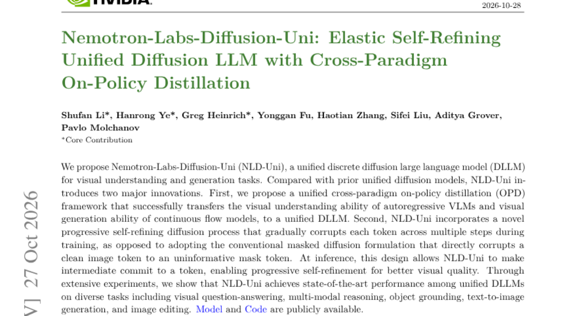

### 📌 한 줄 요약
시각적 이해와 생성을 하나의 이산 확산 모델(DLLM)로 통합한 고성능 멀티모달 모델 프레임워크

### 🔑 핵심 포인트
- Cross-Paradigm On-Policy Distillation (OPD): AR VLM의 이해 능력과 Flow 모델의 생성 능력을 통합하는 프레임워크
- Progressive Self-Refining Diffusion: 단순 마스킹 대신 단계적 토큰 오염을 통해 추론 시 점진적 정제 가능
- Unified DLLM: 시각적 이해와 생성을 하나의 이산 확산 모델로 통합하여 다중 태스크 수행

### 🧑‍💻 개발자 관점
이해와 생성이 결합된 단일 모델 구조를 통해 멀티모달 워크플로우를 단순화하고, 생성 품질과 추론 능력을 동시에 확보할 수 있는 새로운 방법론을 제시합니다.

### 🚀 실무 적용 아이디어
- 제안된 OPD 프레임워크를 기존의 Masked Diffusion 모델에 적용하여 성능 변화 비교
- 점진적 자기 정제(Self-refining) 과정이 생성된 이미지의 세부 디테일에 미치는 영향 분석
- 이산 확산 모델(DLLM) 환경에서의 텍스트-이미지 생성 효율성 테스트

### ⚠️ 리스크/한계
- 이산 확산 모델 특성상 연속적인 고해상도 이미지 생성 시 계산 복잡도 증가 가능성
- 서로 다른 패러다임(AR vs Flow)을 통합하는 과정에서의 학습 안정성 확보 필요

### 📝 초록 기반 상세 설명
기존의 통합 확산 모델들은 시각적 이해 능력과 생성 능력을 동시에 확보하는 데 어려움이 있었습니다. 본 논문은 시각적 이해(AR VLM)와 생성(Flow-based) 능력을 하나의 이산 확산 모델로 결합하는 NLD-Uni를 제안합니다. 이를 위해 교차 패러다임 온폴리시 증류(OPD) 프레임워크를 도입하여 서로 다른 학습 방식을 효과적으로 통합했습니다. 또한, 단순 마스킹 대신 토큰을 점진적으로 오염시키는 자기 정제(Self-refining) 확산 과정을 통해 생성 품질을 높였습니다. 실험 결과, VQA, 추론, 이미지 생성 및 편집 등 다양한 태스크에서 SOTA 성능을 달성했습니다.

---

## 37. [MLE-World: Predicting Machine Learning Experiment Outcomes with a Learned World Model](https://huggingface.co/papers/2610.37175)
**Upvotes**: 3 | **도입 난이도**: 중 | **신뢰도**: 상
**arXiv**: https://arxiv.org/abs/2610.37175

**태그**: AI Agent, MLOps, World Model, Test-Time Scaling, Agent, Vision, Evaluation, Inference

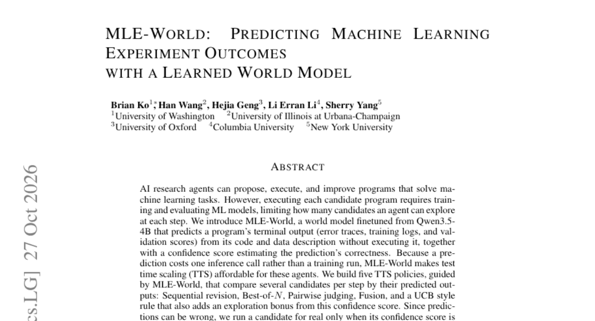

### 📌 한 줄 요약
ML 실험 코드를 실행하지 않고도 결과(로그, 점수 등)를 예측하여 에이전트의 탐색 비용을 획기적으로 줄이는 월드 모델 연구

### 🔑 핵심 포인트
- 코드와 데이터 설명만으로 학습 로그 및 검증 점수를 예측하는 ML 특화 월드 모델 개발
- 실제 실행 대신 추론(Inference)을 통해 후보 프로그램을 평가하여 탐색 비용 절감
- 신뢰도 점수를 활용하여 예측이 불확실할 때만 실제 실행을 수행하는 효율적 루프 구축

### 🧑‍💻 개발자 관점
ML 자동화 에이전트 구축 시, 실험 결과 예측을 통해 GPU 자원 낭비를 막고 탐색 효율을 극대화할 수 있는 프레임워크를 제공합니다.

### 🚀 실무 적용 아이디어
- 제공된 코드를 활용하여 특정 도메인(예: 특정 프레임워크)에 대한 예측 정확도 테스트
- 신뢰도 점수(Confidence Score) 임계값에 따른 실제 실행 빈도 변화 관찰
- 기존 LLM 기반 에이전트와 MLE-World를 결합한 하이브리드 워크플로우 실험

### ⚠️ 리스크/한계
- 예측 모델 자체가 틀릴 경우 잘못된 방향으로 에이전트가 탐색할 위험 존재
- 데이터 설명이나 코드 구조가 복잡해질수록 예측 정확도가 하락할 가능성

### 📝 초록 기반 상세 설명
AI 연구 에이전트가 ML 실험을 수행할 때, 매번 모델을 실제로 학습하고 평가하는 과정은 막대한 시간과 비용을 소모합니다. 이를 해결하기 위해 연구진은 코드와 데이터 설명만으로 터미널 출력과 검증 점수를 예측하는 'MLE-World' 모델을 제안합니다. Qwen3.5-4B를 기반으로 파인튜닝된 이 모델은 실행 없이도 결과와 신뢰도를 동시에 제공하여 테스트 타임 스케일링(TTS)을 가능하게 합니다. 실험 결과, MLE-World는 대형 모델보다 높은 예측 정확도를 보였으며, 이를 활용한 정책들이 실제 실행 횟수를 줄이면서도 성능을 높였습니다. 결과적으로 에이전트가 더 적은 비용으로 더 많은 후보를 탐색할 수 있는 효율적인 환경을 구축했습니다.

---

## 38. [Vision-Language-Action or World-Action? Just Action Models](https://huggingface.co/papers/2610.37219)
**Upvotes**: 3 | **도입 난이도**: 중 | **신뢰도**: 상
**arXiv**: https://arxiv.org/abs/2610.37219

**태그**: Robot-Control, VLA, Reinforcement-Learning, Computer-Vision, Vision, Evaluation, Inference

### 📌 한 줄 요약
시각적 생성 과정 없이 미래 관측치를 예측하는 손실 함수를 통해 VLA와 WAM의 장점을 결합한 효율적인 액션 모델 프레임워크 제안

### 🔑 핵심 포인트
- VLA와 WAM의 차이를 백본, 손실 함수, 추론 메커니즘으로 분리하여 통합 프레임워크(JAM) 구축
- 미래 관측치의 인코딩을 예측하는 'foresight loss'를 통해 시각적 생성 없이도 미래 정보를 학습에 활용
- 추론 시에는 예측 헤드를 제거하여 연산 오버헤드 없이 효율적인 액션 수행 가능

### 🧑‍💻 개발자 관점
로봇 제어 모델 구축 시 무거운 생성 모델을 추론에 포함하지 않고도, 미래 상태를 고려한 고성능 정책을 학습할 수 있는 실용적인 방법론을 제시합니다.

### 🚀 실무 적용 아이디어
- 기존 VLA/WAM 백본에 JAM의 foresight loss를 적용하여 성능 변화 비교
- 학습 시 사용된 미래 타겟 인코딩 방식이 백본 종류에 따라 미치는 영향 분석
- 실제 로봇 환경에서 추론 시 예측 헤드 제거 후의 제어 안정성 테스트

### ⚠️ 리스크/한계
- 미래 관측치를 예측하는 과정에서 발생할 수 있는 예측 오차(drift)가 제어 성능에 미치는 영향
- 특정 환경에 특화된 미래 타겟 인코딩이 범용적인 로봇 제어 성능을 저해할 가능성

### 📝 초록 기반 상세 설명
기존 로봇 제어 연구는 사전 학습된 VLM을 활용하는 VLA와 시각적 생성 모델을 활용하는 WAM 사이의 방법론적 차이로 인해 혼란이 있었습니다. 연구진은 이 두 방식이 백본 초기화, 미래 관측 손실, 추론 시 생성 여부라는 세 가지 선택지가 혼재된 결과임을 지적했습니다. 이를 해결하기 위해 백본은 유지하되 미래 관측 특징을 예측하는 'foresight loss'를 사용하는 JAM(Just Action Model) 프레임워크를 제안합니다. 이 방식은 학습 시에만 미래 정보를 활용하고 추론 시에는 예측 헤드를 제거하여 시각적 생성 없이도 강력한 제어 성능을 확보합니다. 실험 결과, JAM은 기존 WAM 계열 모델보다 높은 성공률을 기록하면서도 연산 효율성을 크게 개선했습니다.

---

## 39. [What Outcome RL Buys: Finishing, Reliability, Rarely Reach](https://huggingface.co/papers/2610.34894)
**Upvotes**: 2 | **도입 난이도**: 하 | **신뢰도**: 상
**arXiv**: https://arxiv.org/abs/2610.34894

**태그**: Reinforcement Learning, LLM Evaluation, Reasoning

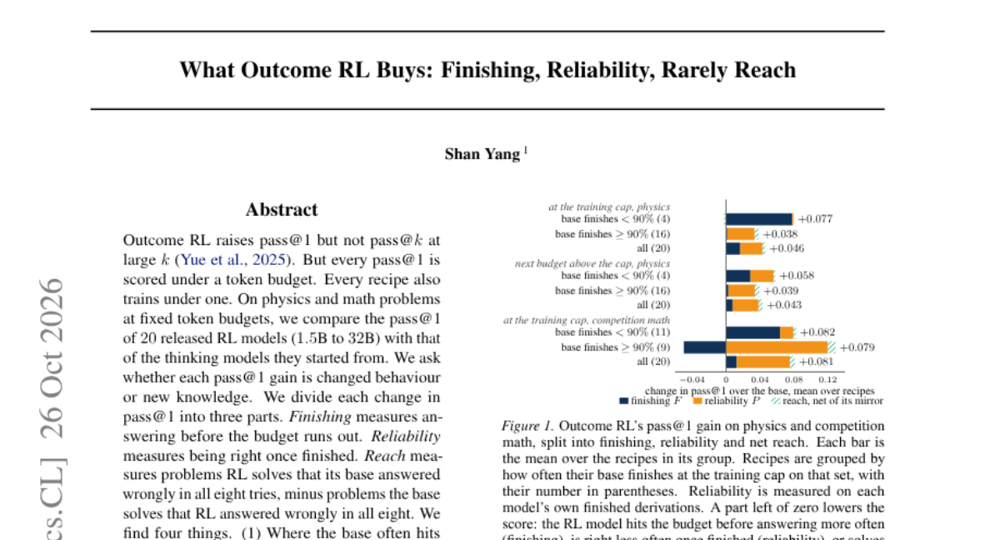

### 📌 한 줄 요약
Outcome RL의 성능 향상은 새로운 지식 습득보다는 정해진 토큰 예산 내에서 답변을 완결하는 능력(Finishing)과 신뢰도(Reliability) 개선에 집중되어 있습니다.

### 🔑 핵심 포인트
- RL 성능 향상의 주된 원인은 토큰 예산 내에서 답변을 완결하는 'Finishing'과 정답 판정 확률을 높이는 'Reliability'임
- RL 모델이 베이스 모델이 풀지 못하는 문제를 새로 해결하는 'Reach' 효과는 매우 낮음 (최대 2.1%p 미만)
- 토큰 예산이 충분할 경우, 베이스 모델 자체의 성능이 RL 모델의 완결성 격차를 대부분 상쇄함

### 🧑‍💻 개발자 관점
RL을 통한 성능 향상이 모델의 지식 확장보다는 추론 과정의 효율화와 정답 도달 확률 최적화에 가깝다는 점을 이해해야 합니다.

### 🚀 실무 적용 아이디어
- RL 학습 시 토큰 예산(Budget) 설정이 성능 지표에 미치는 영향을 실험하기
- 학습된 모델의 성능 향이 지식 습득인지 단순 추론 경로 최적화인지 검증하기
- 토큰 제한이 없는 환경에서 RL 모델과 베이스 모델의 성능 격차 비교하기

### ⚠️ 리스크/한계
- RL이 새로운 지식을 학습하는 데는 한계가 있을 수 있음
- 토큰 예산 설정에 따라 성능 지표가 왜곡될 위험이 있음

### 📝 초록 기반 상세 설명
최근 Outcome RL 방식이 pass@1 성능을 높이지만, 큰 k값에서의 pass@k 성능은 높이지 못하는 현상이 관찰되었습니다. 본 연구는 RL 모델의 성능 향상이 행동 변화인지 새로운 지식 습득인지를 규명하기 위해 20개의 RL 모델을 대상으로 분석을 수행했습니다. 성능 변화를 완결성(Finishing), 신뢰도(Reliability), 도달 범위(Reach) 세 가지 지표로 나누어 비교했습니다. 분석 결과, RL로 인한 성능 향상의 대부분은 토큰 예산 내에서 답변을 끝마치는 '완결성'과 정답률을 높이는 '신뢰도'에 집중되었습니다. 반면, 베이스 모델이 풀지 못하는 문제를 새로 푸는 '도달 범위'의 이득은 매우 미미했습니다.

---

## 40. [How Much Does the Hint Matter? Scope Conditions for Hindsight Self-Distillation in Financial Reasoning](https://huggingface.co/papers/2610.36082)
**Upvotes**: 2 | **도입 난이도**: 중 | **신뢰도**: 상
**arXiv**: https://arxiv.org/abs/2610.36082

**태그**: Self-Distillation, Reasoning, Fine-tuning, Financial-AI, Vision, Benchmark, Distillation

### 📌 한 줄 요약
외부 모델 없이 모델 스스로 오류를 수정하는 힌트를 생성하여 성능을 높이는 효율적인 자가 증류(Self-Distillation) 기법 제안

### 🔑 핵심 포인트
- Fin-SD: 모델 스스로 오류를 식별하고 힌트를 생성하여 학습하는 자가 증류 레시피 개발
- 외부 교사 모델 없이도 정답지(Full Reference) 기반 학습과 대등한 성능 달성
- 힌트의 내용보다 오류가 발생한 지점을 정확히 타겟팅하여 학습하는 것이 성능 향상의 핵심

### 🧑‍💻 개발자 관점
강력한 외부 API를 사용할 수 없는 폐쇄형 환경에서, 보유한 소형 모델의 추론 능력을 효율적으로 끌어올릴 수 있는 실무적인 방법론을 제시합니다.

### 🚀 실무 적용 아이디어
- 실패한 추론 경로에서 오류 지점을 찾는 자동화 스크립트 구현 테스트
- 동일 모델의 self-critique 힌트와 외부 모델 힌트 간의 성능 차이 비교 실험
- 특정 도메인(금융/법률) 데이터셋에 대한 Fin-SD 파이프라인 적용

### ⚠️ 리스크/한계
- 모델이 오류 지점을 잘못 식별할 경우 학습 데이터의 품질이 저하될 위험
- 특정 도메인에 특화된 힌트 생성 방식이 일반적인 추론 능력에 미칠 영향성 검토 필요

### 📝 초록 기반 상세 설명
금융권의 데이터 보안 제약으로 인해 소형 모델을 로컬에서 운용해야 하지만, 복잡한 추론 성능은 대형 모델에 비해 부족한 상황입니다. 기존의 온폴리시 증류(OPD)는 강력한 외부 교사 모델이 필요하거나 전체 정답이 있어야 한다는 제약이 있었습니다. 본 논문은 모델이 실패한 문제에서 오류 지점을 스스로 식별하고 비판(critique)을 작성하여 학습에 활용하는 Fin-SD 기법을 제안합니다. 모델이 생성한 힌트를 바탕으로 오류 직전 단계까지의 경로를 학습 데이터로 활용하는 방식입니다. 실험 결과, Fin-SD는 외부 모델 없이도 정답지가 있는 기존 방식만큼의 정확도를 달성하며 토큰 생성 효율을 높였습니다.

---

## 41. [Sub-monolayer tracking of molecular states at buried interfaces](https://huggingface.co/papers/2610.31924)
**Upvotes**: 1 | **도입 난이도**: 상 | **신뢰도**: 상
**arXiv**: https://arxiv.org/abs/2610.31924

**태그**: Material Science, Machine Learning, Nanotechnology, X-ray Scattering, RAG

### 📌 한 줄 요약
ML 최적화 광학 모델을 통해 나노 단위 깊이에서 분자 상태를 정밀 분석하는 기술 개발

### 🔑 핵심 포인트
- ML 최적화 광학 모델을 통한 RSoXS 데이터의 정량적 해석 체계 구축
- 서브 모노레이어 해상도로 분자 배향 및 패킹 상태의 깊이별 분석 성공
- 계면 성장 역학(Surface vs Bulk)에 따른 분자 구조의 점진적 변화 규명

### 🧑‍💻 개발자 관점
반도체 및 차세대 소자 공정에서 계면의 미세 구조를 비파괴적으로 분석하고 제어할 수 있는 정밀한 가이드를 제공합니다.

### 🚀 실무 적용 아이디어
- ML 기반 광학 모델의 물리적 타당성 검증 실험
- 다양한 박막 두께 및 기판 조건에서의 계면 성장 프로파일 비교
- 기존 회절 한계 기반 분석법과의 데이터 정합성 테스트

### ⚠️ 리스크/한계
- ML 모델의 학습 데이터 의존성 및 물리적 해석의 블랙박스 위험
- 특수 장비(RSoXS) 및 고도화된 광학 모델 모델링 필요성

### 📝 초록 기반 상세 설명
차세대 기술의 핵심인 매립된 계면(buried interface)에서의 분자 상태를 정량적으로 분석하는 것은 매우 어렵습니다. 기존의 공명 산란 방식은 민감도는 높지만 정확한 해석 모델이 부족하다는 한계가 있었습니다. 본 연구에서는 머신러닝(ML)으로 최적화된 광학 모델을 활용하여 편광 공명 연X선 산란(RSoXS) 데이터를 분석하는 방법을 제안합니다. 이를 통해 회절 한계를 넘어 서브 모노레이어(sub-monolayer) 해상도로 분자 배향, 화학적 정체성, 패킹 상태를 깊이별로 정량화했습니다. 분석 결과, 계면에서부터 발생하는 분자 배향과 패킹의 점진적 변화를 발견했으며, 이는 기존의 기판 패턴 가설과 상충하는 새로운 성장 역학을 보여줍니다. 이 기술은 차세대 소자 제조 시 계면 상태를 정밀하게 제어할 수 있는 가능성을 열어줍니다.

### 🖼️ 추가 자료

---

## 42. [Beyond the Estimate: Wiener-Informed Decoding for Easier Training of Pixel-Space Flow Models](https://huggingface.co/papers/2610.36192)
**Upvotes**: 1 | **도입 난이도**: 중 | **신뢰도**: 상
**arXiv**: https://arxiv.org/abs/2610.36192

**태그**: Generative Models, Diffusion/Flow, Image Synthesis, Optimization, Vision, Safety

### 📌 한 줄 요약
통계적 Wiener 추정치를 디코더 구조에 결합하여 픽셀 공간 Flow 모델의 학습 속도와 생성 품질을 동시에 높이는 기술

### 🔑 핵심 포인트
- Wiener 추정치를 활용하여 픽셀 공간 학습의 난이도를 낮추는 WiD 프레임워크 제안
- 기존 디코더 구조를 크게 변경하지 않으면서 통계적 지식을 주입하는 계수 인터페이스 설계
- 학습 가속화, 더 매끄러운 그래디언트 궤적, 그리고 향상된 생성 품질 달성

### 🧑‍💻 개발자 관점
모델 구조를 완전히 갈아엎지 않고도 통계적 사전 지식을 활용해 학습 효율을 극대화하는 실용적인 방법론을 제시합니다.

### 🚀 실무 적용 아이디어
- 기존 Pixel-space 기반 생성 모델의 디코더에 Wiener-informed 구조 적용 테스트
- 데이터 통계(Spectrum/Coordinate transforms) 초기화가 학습 수렴 속도에 미치는 영향 분석
- 다양한 해상도 환경에서 제안된 계수 인터페이스의 확장성 검증

### ⚠️ 리스크/한계
- 통계적 지식에 의존하므로 특정 데이터 분포에 과적합될 가능성 존재
- 매개변수 오버헤드가 발생하므로 초경량 모델 적용 시 효율성 검토 필요

### 📝 초록 기반 상세 설명
픽셀 공간에서 직접 속도장(velocity fields)을 학습하는 것은 계산 비용이 높고 학습이 어렵다는 문제가 있습니다. 본 논문은 고정된 2차 이미지 통계(Wiener estimates)가 학습을 용이하게 한다는 점에 착안하여 Wiener-informed Decoding(WiD)을 제안합니다. WiD는 학습 가능한 Wiener 예측 경로와 디코더 연산을 조직화하는 계수 인터페이스를 결합하여, 기존 블록을 수정하지 않고도 통계적 지식을 주입합니다. 실험 결과, WiD는 모델 규모와 아키텍처에 관계없이 학습 속도를 가속화하고 생성 품질을 향상시켰습니다. 특히 ImageNet 데이터셋에서 기존 방식 대비 훨씬 적은 학습 횟수로도 경쟁력 있는 FID를 달성했습니다.

---

## 43. [T-DIG: Text-Conditioned Diversity for Image Generation](https://huggingface.co/papers/2610.29003)
**Upvotes**: 1 | **도입 난이도**: 하 | **신뢰도**: 상
**arXiv**: https://arxiv.org/abs/2610.29003

**태그**: Image Generation, LLM, Prompt Engineering, Diffusion Models, Vision, Distillation, Safety

### 📌 한 줄 요약
사용자의 자연어 의도에 따라 이미지의 특정 속성(배경, 스타일 등)만 선택적으로 변화시키는 텍스트 조건부 다양성 생성 프레임워크

### 🔑 핵심 포인트
- LLM 정책을 활용하여 고정된(frozen) 이미지 생성 모델의 가중치 수정 없이 다양한 변형 생성
- 사용자가 원하는 특정 속성(배경, 의상, 스타일 등)에 집중할 수 있는 텍스트 조건부 다양성 제공
- GRPO(Group Relative Policy Optimization)를 통한 텍스트 조건부 다양성 및 정렬 최적화 학습

### 🧑‍💻 개발자 관점
모델의 가중치를 건드리지 않고도 LLM을 통해 기존 생성 모델의 활용도를 극대화할 수 있어, 서비스 레이어에서의 이미지 편집/생성 워크플로우 구축에 매우 유용합니다.

### 🚀 실무 적용 아이디어
- 기존 Stable Diffusion 모델에 T-DIG의 LLM 정책 프롬프트 전략 적용 테스트
- 사용자 피드백 루프를 포함한 반복적 이미지 생성 워크플로우 프로토타이핑
- 제공된 데이터셋을 활용한 LLM 기반 프롬프트 생성 성능 벤치마킹

### ⚠️ 리스크/한계
- LLM의 프롬프트 생성 능력에 따라 최종 이미지 품질과 다양성이 종속될 수 있음
- 복잡한 편집 요청 시 생성 모델과 LLM 간의 정렬(Alignment) 문제 발생 가능성

### 📝 초록 기반 상세 설명
기존의 텍ist-to-image 모델은 단일 이미지 품질에 최적화되어 있어, 사용자가 원하는 특정 축(axis)에 따른 다채로운 변형을 생성하는 데 한계가 있습니다. 이를 해결하기 위해 본 논문은 텍스트 조건부 다양성 프레임워크인 T-DIG를 제안합니다. T-DIG는 LLM 정책(Policy)이 사용자의 요청에 따라 K개의 축 조건부 프롬프트나 편집 지침을 생성하여 고정된(frozen) 이미지 생성기/편집기를 제어하는 반복적 프레임워크입니다. GRPO를 사용하여 텍스트 조건부 다양성 보상과 정렬 페널티를 결합해 정책을 학습시켰으며, 모델 가중치를 수정하지 않고도 적용 가능합니다. 실험 결과, T-DIG는 기본 프롬프트 정렬을 유지하면서도 기존 방식보다 월등한 텍상 조건부 다양성을 제공함을 입증했습니다.

### 🖼️ 추가 자료

---

## 44. [Truncate or Not? A Scaling Study of Looped Transformers with Truncated Backpropagation](https://huggingface.co/papers/2610.26030)
**Upvotes**: 1 | **도입 난이도**: 중 | **신뢰도**: 상
**arXiv**: https://arxiv.org/abs/2610.26030

**태그**: Transformer, Scaling Law, Efficient Training, Deep Learning

### 📌 한 줄 요약
Looped Transformer 학습 시 연산 절감을 위한 Truncated BPTT보다 Full BPTT가 모델 성능과 효율성 측면에서 더 우수함을 입증한 스케일링 법칙 연구

### 🔑 핵심 포인트
- 모델 크기, 토큰, 루프 횟수를 결합한 통합 스케일링 법칙(Scaling Law) 도출
- 연산량(Compute)이 동일할 때, Truncated BPTT보다 Full BPTT가 성능 면에서 우월함 확인
- 최적의 루프 횟수는 모델 크기와 가용 연산량에 따라 동적으로 결정됨

### 🧑‍💻 개발자 관점
파라미터 효율적인 모델 설계를 원하는 엔지니어에게 루프 구조와 역전파 범위 사이의 최적의 트레이드오프를 결정하는 가이드를 제공합니다.

### 🚀 실무 적용 아이디어
- 동일한 연산 예산 내에서 루프 횟수를 늘리고 Truncated BPTT를 적용하는 실험과 Full BPTT를 적용하는 실험 비교
- 모델 크기 변화에 따른 최적의 루프 횟수 변화 추이 관찰
- 제안된 스케일링 법칙을 활용하여 주어진 예산 내 최적의 루프/토큰 조합 계산

### ⚠️ 리스크/한계
- Truncated BPTT 사용 시 발생하는 그래디언트 편향이 모델 수렴에 미치는 부정적 영향
- 루프 횟수가 늘어날수록 메모리 및 연산 복잡도가 증가하는 문제

### 📝 초록 기반 상세 설명
Looped Transformer는 파라미터 수를 늘리지 않고 연산 깊이를 확보하기 위해 동일 레이어를 반복 사용하며, 주로 BPTT 방식으로 학습됩니다. 연산 비용을 줄이기 위해 역전파를 일부만 수행하는 Truncated BPTT가 사용되지만, 이는 편향된 그래디언트를 발생시켜 루핑의 이점을 저해할 수 있습니다. 본 연구는 모델 크기, 토큰 수, 루프 횟수를 체계적으로 변화시키며 Truncated BPTT의 영향을 분석하는 스케일링 법칙을 도출했습니다. 실험 결과, 동일한 연산량 조건에서는 적은 루프를 사용하더라도 Full BPTT를 적용하는 것이 더 높은 성능을 보였습니다. 최종적으로 제안된 스케일링 법칙에 따르면, 최적의 루프 설정은 모델 크기와 연산 예산에 따라 결정되며 특정 설정에서는 적은 파라미터로도 비-루핑 모델보다 우수한 성능을 달성했습니다.

---

## 45. [PhysEvolve: Verifier-grounded Self-evolution for Physical Reasoning with Executable Worlds](https://huggingface.co/papers/2610.34921)
**Upvotes**: 1 | **도입 난이도**: 상 | **신뢰도**: 상
**arXiv**: https://arxiv.org/abs/2610.34921

**태그**: VLM, Reinforcement Learning, Physics Simulation, Self-Evolution, Reasoning, Vision, Video

### 📌 한 줄 요약
물리 엔진 기반의 자동 생성 데이터와 검증 루프를 통해 VLM의 물리적 인과 추론 능력을 자가 진화시키는 프레임워크

### 🔑 핵심 포인트
- 물리 엔진을 활용한 실행 가능한 세계 모델 및 반사실적 데이터 자동 생성
- GRPO와 적응형 커리큘럼을 결합한 검증 기반의 자가 진화 프레임워크
- 인간 데이터 없이 물리적 인과 관계 및 복잡한 역학에 대한 제로샷 전이 달성

### 🧑‍💻 개발자 관점
로봇 공학이나 가상 환경 에이전트 개발 시, 정적인 데이터셋을 넘어 동적인 물리 법칙을 이해하는 모델을 학습시키는 새로운 방법론을 제시합니다.

### 🚀 실무 적용 아이디어
- 물리 엔진(MuJoCo, PyBullet 등)과 VLM을 연동하는 파이프라인 구축 실험
- GRPO와 같은 강화학습 알고리즘을 시각적 추론 태스크에 적용해보기
- 제안된 프레임워크를 특정 도메인(예: 유체, 천 역학)에 특화하여 테스트

### ⚠️ 리스크/한계
- 물리 엔진의 시뮬레이션과 실제 세계 사이의 Sim-to-Real 간극 존재
- 물리 엔진이 지원하지 않는 복잡한 물리 현상에 대한 학습 한계

### 📝 초록 기반 상세 설명
기존의 시각-언어 모델(VLM)은 관찰 데이터에만 의존하여 물리적 역학 및 인과 관계 추론에 한계를 보였습니다. 이를 해결하기 위해 모델이 스스로 학습 문제를 생성하고 검증할 수 있는 자가 진화(Self-evolution) 패러다임을 제안합니다. PhysEvolve는 VLM이 제안한 실행 가능한 세계 모델을 물리 엔진으로 검증하고, 이를 바탕으로 반사실적(counterfactual) 시나리오를 생성하여 학습에 활용합니다. GRPO 알고리즘과 적응형 커리큘럼을 결합하여 모델의 정책과 물리적 의도를 동시에 업데이트합니다. 실험 결과, 인간의 개입 없이도 물리 벤치마크에서 유의미한 성능 향상을 달성하며 복잡한 물리 역학에 대한 제로샷 전이 능력을 입증했습니다.

---

## 46. [MoveBench: A Rubric-Based Benchmark for Evaluating Large Language Models in Sports and Health Coaching](https://huggingface.co/papers/2610.26185)
**Upvotes**: 1 | **도입 난이도**: 하 | **신뢰도**: 상
**arXiv**: https://arxiv.org/abs/2610.26185

**태그**: Benchmark, LLM, Health-AI, Safety, Reasoning, Evaluation

### 📌 한 줄 요약
스포츠 및 건강 코칭 분야의 안전성과 전문성을 검증하기 위한 루브릭 기반 벤치마크 프레임워크인 MoveBench를 제안합니다.

### 🔑 핵심 포인트
- 스포츠/건강 도메인 특화 벤치마크인 MoveBench 프레임워크 개발
- 안전성, 과학적 타당성, 훈련 논리를 강조하는 구조화된 루브릭 적용
- 객관식(MCQ) 및 주관식(OpenQA)을 결합한 다각적 평가 방식 도입

### 🧑‍💻 개발자 관점
헬스케어/피트니스 AI 에이전트 개발 시, 단순 지식 측정을 넘어 안전성과 실행 가능한 코칭 품질을 검증할 수 있는 기준을 제공합니다.

### 🚀 실무 적용 아이디어
- 제공된 GitHub 리소스를 활용하여 개발 중인 모델의 안전성 점수 측정
- 도메인 특화 루브릭을 기존 RAG 시스템의 평가 지표로 변형 적용
- 모델의 개인화 및 프로그래밍 설계 능력을 MoveBench 기준으로 벤치마킹

### ⚠️ 리스크/한계
- 특정 도메인에 특화되어 있어 범용적인 성능 지표로 사용하기에는 한계가 있음
- 루브릭 기반 평가이므로 평가 기준의 주관성 개입 가능성 존재

### 📝 초록 기반 상세 설명
LLM의 발전에도 불구하고 스포츠 및 건강 도메인은 전문적인 평가 벤치마크 부족으로 인해 잘못된 권고에 따른 신체적 위험이 존재합니다. 기존의 범용 벤치마크는 운동 안전성이나 개인화와 같은 도메인 특화 요구사항을 평가하기에 부족합니다. 이를 해결하기 위해 실세계 시나리오와 구조화된 루브릭을 결합한 MoveBench 프레임워크를 도입했습니다. 15종의 LLM을 대상으로 809개의 질문을 통해 평가한 결과, 모델 간 안전 의식 및 개인화 능력에서 큰 성능 차이가 나타났습니다. 본 연구는 안전하고 신뢰할 수 있는 AI 코칭 시스템 개발을 위한 평가 표준을 제공합니다.

### 🖼️ 추가 자료

---

## 47. [Lipi-Ghor: A Large-Scale, Diarized, Multi-Domain Bengali Speech Corpus and a Scalable Pipeline for Building It](https://huggingface.co/papers/2610.36184)
**Upvotes**: 0 | **도입 난이도**: 하 | **신뢰도**: 상
**arXiv**: https://arxiv.org/abs/2610.36184

**태그**: ASR, Speech-to-Text, Low-Resource, Diarization, Dataset, RAG, Video, Audio, Benchmark, Evaluation

### 📌 한 줄 요약
대규모 유튜브 데이터를 활용하여 화자 분리(Diarization)와 장문 음성이 포함된 885시간 규모의 벵골어 음성 코퍼스 및 구축 파이프라인 제안

### 🔑 핵심 포인트
- 885시간 규모의 17개 도메인을 아우르는 대규모 벵골어 음성 코퍼스 구축
- 화자 분리(Diarization)와 장문 음성이 결합된 SSTT 형식의 데이터 제공
- 유튜브 캡션을 활용한 대규모 저자원 언어용 데이터 구축 파이프라인 제안

### 🧑‍💻 개발자 관점
저자원 언어(Low-resource language) 환경에서 유튜브와 같은 기존 플랫폼을 활용해 대규모 학습 데이터를 확보하는 실용적인 파이프라인을 제시합니다.

### 🚀 실무 적용 아이디어
- 제공된 파이프라인 코드를 활용하여 다른 언어/도메인에 적용해보기
- 제시된 골드 데이터셋을 활용하여 기존 ASR 모델의 성능 벤치마킹하기
- 감정 및 방언이 포함된 데이터에 대한 모델의 강건성 테스트하기

### ⚠️ 리스크/한계
- 유튜브 캡션 기반 데이터로 인해 노이즈가 포함될 수 있음
- 원천 오디오 파일이 아닌 전사 데이터 위주의 배포로 인한 재사용 제약

### 📝 초록 기반 상세 설명
2억 3천만 명이 사용하는 벵골어는 언어 자원이 부족하며, 기존 ASR 코퍼스는 짧은 문장 위주라 화자 분리나 장문 음성 처리에 한계가 있습니다. 본 논문은 998개의 유튜브 채널에서 수집한 885시간 규모의 벵골어 음성 코퍼스인 Lipi-Ghor를 제안합니다. SSTT(화자, 음성, 전사, 타임스탬프) 형식을 통해 자동 화자 분리와 유튜브 캡션을 결합하여 데이터셋을 구축했습니다. 또한, 유튜브 캡션을 활용한 대규모 데이터 구축 방법론을 제안하며, 검증을 위해 17명의 작업자가 참여한 골드 표준 평가셋도 함께 공개합니다. 실험 결과, 기존 ASR 모델들은 감정적이고 방언이 섞인 장문 콘텐츠에서 성능 저하를 보였습니다.

### 🖼️ 추가 자료

---

