# 2026-10-31 Daily Papers (Top 37)

## 오늘의 요약
오늘의 연구는 생성 모델의 효율적인 학습과 추론 최적화, 그리고 에이전트 학습을 위한 고품질 데이터 생성 방법론에 집중되었습니다. 특히 외부 데이터 의존성을 줄이면서 모델 스스로 성능을 개선하거나, 멀티모달 환경에서 복잡한 정보를 구조화하는 기술들이 주목받았습니다.

### 오늘의 핵심 포인트
- 외부 데이터나 인코더 의존도를 낮추면서 모델 내부 피처와 자기 개선 메커니즘을 활용해 효율성을 극대화하는 연구들이 제시되었습니다.
- 멀티모달 모델의 추론 비용을 줄이는 적응형 디코딩과 3D 가우시안 메모리를 활용한 실시간 세계 생성 등 실용적인 최적화 전략이 강조되었습니다.
- 에이전트 학습을 위한 전문적 작업 데이터 생성과 벤치마크의 난이도 분포 재정의 등 데이터 품질 및 평가 방법론에 대한 심도 있는 논의가 이루어졌습니다.

**오늘의 태그**: Generative Models, Multimodal AI, Efficiency Optimization, Agent Training, Self-Improvement

## 1. [Intrinsic Distribution Matching](https://huggingface.co/papers/2610.39633)
**Upvotes**: 234 | **도입 난이도**: 중 | **신뢰도**: 상
**arXiv**: https://arxiv.org/abs/2610.39633

**태그**: Diffusion, Text-to-Image, Distribution Matching, Fine-tuning, RAG, Vision, Evaluation, Distillation

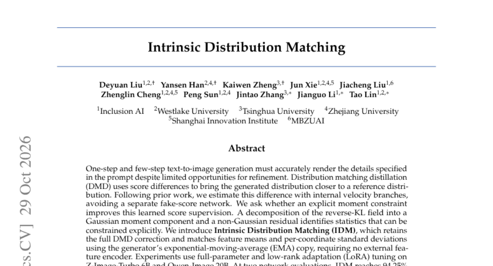

### 📌 한 줄 요약
추가적인 외부 인코더 없이 생성 모델의 EMA 피처를 활용하여 텍스트-이미지 생성의 정밀도를 높이는 분포 매칭 기술

### 🔑 핵심 포인트
- 역-KL 발산 분해를 통한 명시적 모멘트 제약(Mean/Std) 도입
- 외부 인코더(DINOv2 등) 없이 생성기 EMA 피처를 활용한 효율적 학습
- 적은 스텝의 생성 과정에서 텍스트-이미지 정렬(Alignment) 성능 극대화

### 🧑‍💻 개발자 관점
외부 모델 의존성을 줄이면서도 생성 모델의 내부 피처만으로 정밀한 분포 매칭이 가능함을 보여주어, 효율적인 모델 튜닝 가이드를 제공합니다.

### 🚀 실무 적용 아이디어
- 제공된 코드를 활용하여 Z-Image-Turbo 모델에 IDM 적용 실험
- 외부 인코더(DINOv2) 사용 시와 EMA 피처 사용 시의 성능 차이 비교
- LoRA 튜닝 시 모멘트 손실(Moment Loss) 가중치 변화에 따른 생성 품질 변화 관찰

### ⚠️ 리스크/한계
- EMA 피처를 사용하므로 학습 안정성이 EMA 상태에 의존적일 수 있음
- 매우 복잡한 구도나 스타일 변화 시 외부 인코더 대비 성능 저하 가능성

### 📝 초록 기반 상세 설명
최근 1~2단계의 적은 스텝으로 고품질 이미지를 생성하는 기술이 중요해졌으나, 적은 단계에서는 프롬프트 세부 사항을 정확히 렌더링하기 어렵습니다. 기존의 DMD 방식은 별도의 스코어 네트워크를 사용하지만, 본 논문은 명시적인 모멘트 제약(moment constraint)이 학습된 스코어 감독 성능을 개선할 수 있는지 질문합니다. 이를 위해 역-KL 발산(reverse-KL)을 가우시안 모멘트 성분과 비가우시안 잔차로 분해하여 제약 가능한 통계량을 식별했습니다. 제안하는 IDM 방식은 전체 DMD 보정 기능을 유지하면서, 외부 인코더 없이 생성기 자체의 EMA 복사본을 사용하여 피처 평균과 좌표별 표준편차를 일치시킵니다. 실험 결과, IDM은 Z-Image-Turbo 및 Qwen-Image 모델에서 기존 방식 대비 높은 텍스트-이미지 정렬 성능을 달리는 것을 확인했습니다.

---

## 2. [A-RSI: Adaptive Task Refresh for Zero-Data Multimodal Self-Improvement](https://huggingface.co/papers/2610.38568)
**Upvotes**: 148 | **도입 난이도**: 중 | **신뢰도**: 상
**arXiv**: https://arxiv.org/abs/2610.38568

**태그**: Self-Improvement, Automated Learning, Zero-Data, Multimodal, RAG, Vision, Benchmark

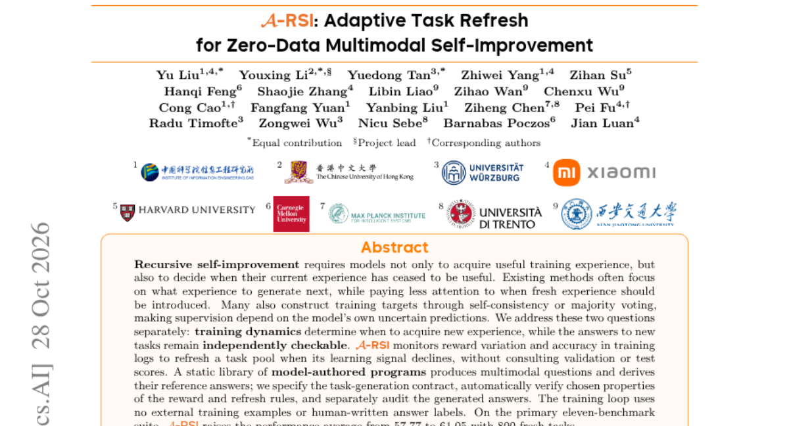

### 📌 한 줄 요약
외부 데이터 없이 모델 스스로 학습 시점과 과제를 결정하여 성능을 높이는 적응형 자기 개선 프레임워크

### 🔑 핵심 포인트
- 학습 로그 기반의 적응형 과제 갱신(Task Refresh) 메커니즘 도입
- 외부 데이터/인간 라벨 없이 모델 스스로 학습하는 Zero-Data 환경 구현
- 검증 가능한 정적 프로그램 라이브러리를 통한 신뢰할 수 있는 정답 생성

### 🧑‍💻 개발자 관점
데이터 수집 비용 없이 모델의 학습 효율을 극대화하는 자동화된 데이터 루프 설계 방식을 제시합니다.

### 🚀 실무 적용 아이디어
- 학습 로그의 보상 변동성을 지표로 하는 스케줄링 로직 구현 테스트
- 코드 기반의 정답 생성(Program-as-a-Label) 프레임워크 구축
- 기존 모델의 학습 정체 구간에서 과제 갱신 효과 검증

### ⚠️ 리스크/한계
- 생성된 과제의 다양성이 부족할 경우 모델이 특정 패턴에 과적합될 위험
- 프로그램 기반 정답 생성 시 논리적 한계에 따른 정답 오류 가능성

### 📝 초록 기반 상세 설명
모델의 재귀적 자기 개선 과정에서 언제 새로운 학습 경험이 필요한지 결정하는 것은 매우 중요합니다. 기존 방식은 주로 어떤 데이터를 생성할지에만 집중하며, 모델의 불확실한 예측에 의존해 정답을 만드는 경향이 있습니다. 본 논문은 학습 로그의 보상 변화와 정확도를 모니터링하여 학습 신호가 감소할 때 과제를 갱신하는 A-RSI를 제안합니다. 정적 프로그램 라이브러리를 통해 멀티모달 질문과 정답을 생성하며, 외부 데이터나 인간의 라벨 없이도 검증 가능한 과제를 생성합니다. 실험 결과, 800개의 새로운 과제 도입만으로 주요 벤치마크 성능을 57.77에서 61.05로 향상시켰습니다.

---

## 3. [Your Benchmark Is an Empirical Measure Over Difficulty](https://huggingface.co/papers/2610.29927)
**Upvotes**: 138 | **도입 난이도**: 중 | **신뢰도**: 상
**arXiv**: https://arxiv.org/abs/2610.29927

**태그**: Benchmark, Evaluation, LLM, Metric, RAG

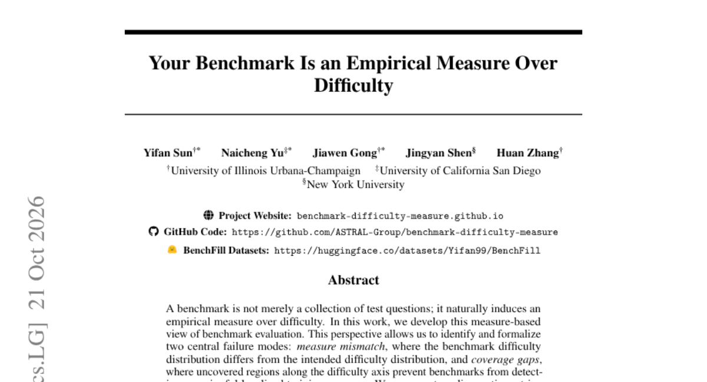

### 📌 한 줄 요약
벤치마크를 '난이도 분포' 관점에서 재정의하여 기존 평가 지표의 왜곡과 공백 문제를 해결하는 방법론을 제시합니다.

### 🔑 핵심 포인트
- 벤치마크를 난이도 축(difficulty axis) 상의 분포로 보는 새로운 평가 관점 제시
- 측도 불일치 및 커버리지 공백이라는 두 가지 핵심 실패 모드 식별
- 문항 재작성 알고리즘 BenchFill을 통한 벤치마크 품질 개선 방법론 제안

### 🧑‍💻 개발자 관점
모델 성능 측정 시 특정 난이도에만 편중된 벤치마크로 인해 발생하는 '가짜 성능 향상'을 방지하고, 모델의 세밀한 발전 과정을 정확히 모니터링할 수 있습니다.

### 🚀 실무 적용 아이디어
- 현재 사용 중인 벤치마크의 문항 난이도 분포를 시각화하여 편중 여부 확인
- 모델 학습 시 특정 난이도 구간에서 성능 정체가 발생하는지 커버리지 분석 수행
- BenchFill 알고리즘을 적용하여 부족한 난이도 구간의 데이터 보강 실험

### ⚠️ 리스크/한계
- 문항 재작성 시 난이도 추정의 정확도에 따라 결과가 달라질 수 있음
- 기존 벤치마크의 문항 품질(질적 측면)이 완전히 보장되지는 않음

### 📝 초록 기반 상세 설명
기존의 벤치마크는 단순한 문제 집합을 넘어 난이도에 대한 경험적 측도를 형성하지만, 이에 대한 이론적 분석은 부족했습니다. 본 연구는 벤치마크가 의도와 다르게 난이도 분포가 치우치는 '측도 불일치(measure mismatch)'와 특정 난이도 구간이 누락되는 '커버리지 공백(coverage gaps)' 문제를 정식화합니다. 이를 진단하기 위한 두 가지 지표를 제안하고 25개 주요 벤치마크를 분석한 결과, 많은 벤치마크가 특정 난이도에 편중되어 있음을 확인했습니다. 마지막으로 공백을 메우기 위해 난이도 타겟형 문항 재작성 알고리즘인 BenchFill을 제안합니다.

---

## 4. [Look Only When Needed: Certificate-Guided Visual Routing for Efficient Diffusion VLMs](https://huggingface.co/papers/2610.36671)
**Upvotes**: 89 | **도입 난이도**: 하 | **신뢰도**: 상
**arXiv**: https://arxiv.org/abs/2610.36671

**태그**: Diffusion-VLM, Inference-Optimization, Efficient-Decoding, Computer-Vision, RAG, Vision, Benchmark

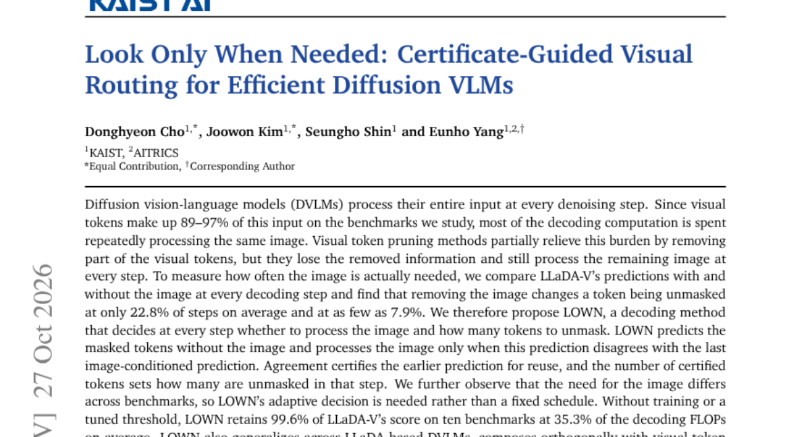

### 📌 한 줄 요약
이미지 정보가 불필요한 단계에서는 시각 토큰 처리를 생략하여 DVLM의 추론 연산량을 획기적으로 줄이는 적응형 디코딩 기법

### 🔑 핵심 포인트
- 이미지 없이 예측한 결과와 이미지 기반 결과의 일치도를 활용한 '인증(Certificate)' 기반 디코딩
- 매 단계 이미지 처리 여부와 언마스킹 토큰 수를 결정하는 적응형 스케줄링
- 추가 학습 없이 기존 LLaDA-V 모델에 즉시 적용 가능한 오소고날(Orthogonal)한 설계

### 🧑‍💻 개발자 관점
이미지 비중이 높은 멀티모달 모델의 추론 비용을 줄이면서도 성능 저하를 최소화할 수 있는 실용적인 최적화 전략을 제시합니다.

### 🚀 실무 적용 아이디어
- LLaDA-V와 같은 Diffusion 기반 VLM 모델에 LOWN 로직 적용 테스트
- 다양한 벤치마크 데이터셋에 따른 이미지 의존도 변화 관찰
- 기존 시각 토큰 프루닝 기법과 LOWN의 결합 시 시너지 확인

### ⚠️ 리스크/한계
- 이미지 없이 예측할 때 발생하는 오차 누적 가능성
- 특정 벤치마크나 태스크에 따라 이미지 의존도가 극단적으로 다를 수 있음

### 📝 초록 기반 상세 설명
Diffusion Vision-Language Models(DVLMs)는 매 디노이징 단계마다 전체 입력(이미지 포함)을 처리하므로 막대한 연산 비용이 발생합니다. 기존의 시각 토큰 프루닝 방식은 정보 손실 위험이 있고 매 단계 이미지를 처리해야 한다는 한계가 있습니다. 본 논문은 이미지 없이 예측한 결과와 이미지 기반 예측이 일치하는 구간이 많다는 점에 착안하여, 예측 불일치가 발생할 때만 이미지를 처리하는 LOWN 방식을 제안합니다. LOWN은 예측 일치 여부를 통해 이미지 처리 여부와 언마스킹할 토큰 수를 동적으로 결정합니다. 실험 결과, 추가 학습 없이도 성능 저하를 최소화하면서 디코딩 FLOPs를 약 35.3% 수준으로 낮추는 성과를 거두었습니다.

---

## 5. [L3G-World: Real-Time Infinite World Generation with Latent 3D Gaussian Memory](https://huggingface.co/papers/2610.40614)
**Upvotes**: 34 | **도입 난이도**: 상 | **신뢰도**: 상
**arXiv**: https://arxiv.org/abs/2610.40614

**태그**: 3D-Gaussian-Splatting, World-Models, Diffusion-Transformer, Real-Time-Generation, Video

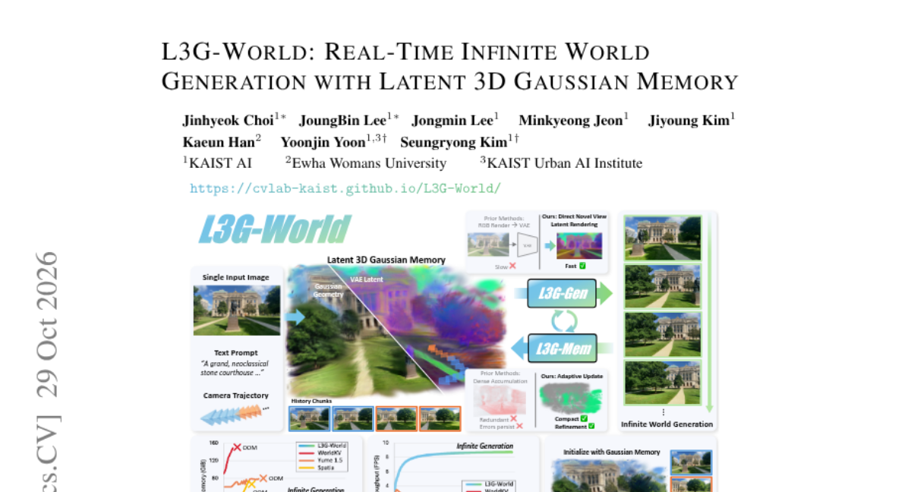

### 📌 한 줄 요약
3D 가우시안 메모리를 활용하여 실시간으로 무한한 공간 일관성을 유지하는 세계 생성 모델 개발

### 🔑 핵심 포인트
- L3G: VAE 재인코딩 없이 잠재 공간으로 직접 렌더링 가능한 3D 가우시안 메모리 도입
- 메모리 효율성: 스트림 길이에 비례하지 않고 장면의 물리적 크기에 따라 성장하는 메모리 구조
- 실시간성: 메모리 업데이트와 DiT의 교차적 오토레그레시브 방식을 통한 9 FPS 생성 달성

### 🧑‍💻 개발자 관점
실시간 게임 엔진이나 가상 환경 생성 시, 메모리 폭발 문제 없이 무한한 공간을 일관성 있게 생성할 수 있는 기술적 토대를 제공합니다.

### 🚀 실무 적용 아이디어
- 제시된 3D 가우시안 메모리 업데이트 알고리즘의 수식 검토
- 기존 3D Gaussian Splatting 기반 모델과의 렌더링 속도 및 메모리 점유율 비교 실험
- 제한된 하드웨어 자원 환경에서의 9 FPS 유지 가능성 테스트

### ⚠️ 리스크/한계
- 장면의 물리적 크기가 극단적으로 커질 경우 메모리 관리 복잡도 증가 가능성
- 가우시안 기반 표현의 복잡한 기하학적 구조에 대한 표현력 한계 여부 확인 필요

### 📝 초록 기반 상세 설명
기존의 인터랙티브 월드 모델은 긴 시간 동안 탐험할 때 공간 일관성을 유지하기 어렵고, 메모리 크기가 생성 길이에 비례하여 늘어나는 문제가 있었습니다. 또한 기존 3D 메모리 방식은 렌더링 후 다시 인코딩하는 과정 때문에 실시간 생성이 불가능했습니다. 본 논문은 효율적인 피드포워드 재구성과 압축된 3D 표현을 결합한 Latent 3D Gaussian Memory(L3G)를 제안합니다. L3G-World는 메모리 업데이트 모듈과 비디오 확산 트랜스포머(DiT)가 교차로 작동하며 공간 일관성을 유지합니다. 메모리 업데이트는 관찰된 영역에 가우시안을 생성/정제하여 메모리 크기를 스트림 길이가 아닌 장면 크기에 맞게 관리합니다. 결과적으로 기존 방식 대비 압도적인 속도 향상을 달обра며 9 FPS의 실시간 세계 생성을 달성했습니다.

### 🖼️ 추가 자료
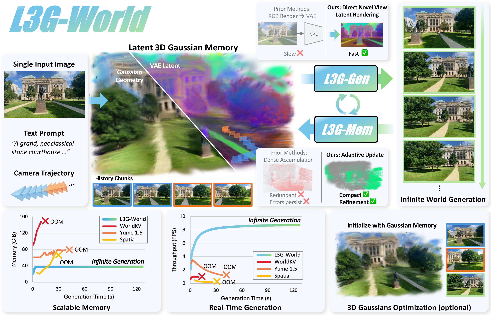

---

## 6. [Youtu-Parsing-Omni: One Encoder, One Schema, All Modalities](https://huggingface.co/papers/2610.39301)
**Upvotes**: 33 | **도입 난이도**: 중 | **신뢰도**: 상
**arXiv**: https://arxiv.org/abs/2610.39301

**태그**: Multimodal, Parsing, Agent, Self-Evolving, Vision, Video, Audio, Distillation, Safety

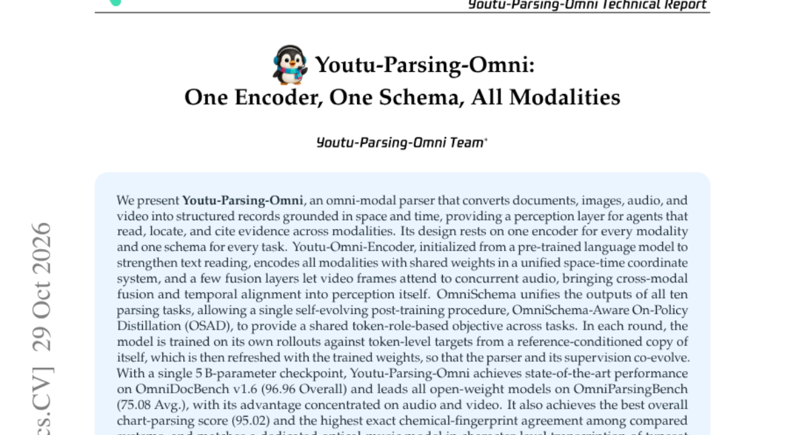

### 📌 한 줄 요약
단일 인코더와 스키마로 문서, 이미지, 오디오, 비디오를 구조화된 데이터로 변환하는 범용 멀티모달 파싱 모델

### 🔑 핵심 포인트
- 단일 인코더(Youtu-Omni-Encoder)와 단일 스키마(OmniSchema)를 통한 모달리티 통합
- 자기 진화형 학습 방식인 OSAD(OmniSchema-Aware On-Policy Distillation) 도입
- 시공간 좌표계 기반의 구조화된 레코드 생성 및 에이전트용 퍼셉션 레이어 제공

### 🧑‍💻 개발자 관점
멀티모달 데이터를 다루는 에이전트 개발 시, 복잡한 전처리 없이 단일 모델로 다양한 소스(영상, 음성, 문서)를 구조화된 데이터로 변환할 수 있습니다.

### 🚀 실무 적용 아이디어
- 제공된 5B 모델을 활용하여 비디오/오디오 기반의 구조화 데이터 추출 테스트
- 자체 데이터셋을 OmniSchema 형식으로 변환하여 OSAD 방식의 파싱 성능 검증
- 차트 및 악보 등 특수 도메인 데이터에 대한 파싱 정확도 비교 실험

### ⚠️ 리스크/한계
- 단일 인코더 구조로 인해 특정 모달리티에 특화된 모델 대비 성능 불균형 가능성
- 5B 모델 규모에서 복잡한 추론 작업 시 발생할 수 있는 성능 제약

### 📝 초록 기반 상세 설명
기존의 멀티모달 모델들은 다양한 데이터 형식을 처리하기 위해 복잡한 구조를 요구하는 경우가 많았습니다. 본 논문은 모든 모달리티를 하나의 인코더와 하나의 스키마로 통합하는 Youtu-Parsing-Omni를 제안합니다. Youtu-Omni-Encoder는 공유 가중치를 통해 시공간 좌표계 내에서 모든 모달리티를 인코딩하며, OSAD라는 자기 진화형 사후 학습 방식을 통해 태스크 간 정렬을 수행합니다. 실험 결과, 이 모델은 OmniDocBench 및 OmniParsingBench 등 주요 벤치마크에서 SOTA 성능을 달كيل 뿐만 아니라 차트 및 악보 파싱에서도 탁월한 성능을 보였습니다. 결과적으로 단일 5B 파라미터 체크포인트만으로 강력한 범용 파싱 능력을 입증했습니다.

### 🖼️ 추가 자료
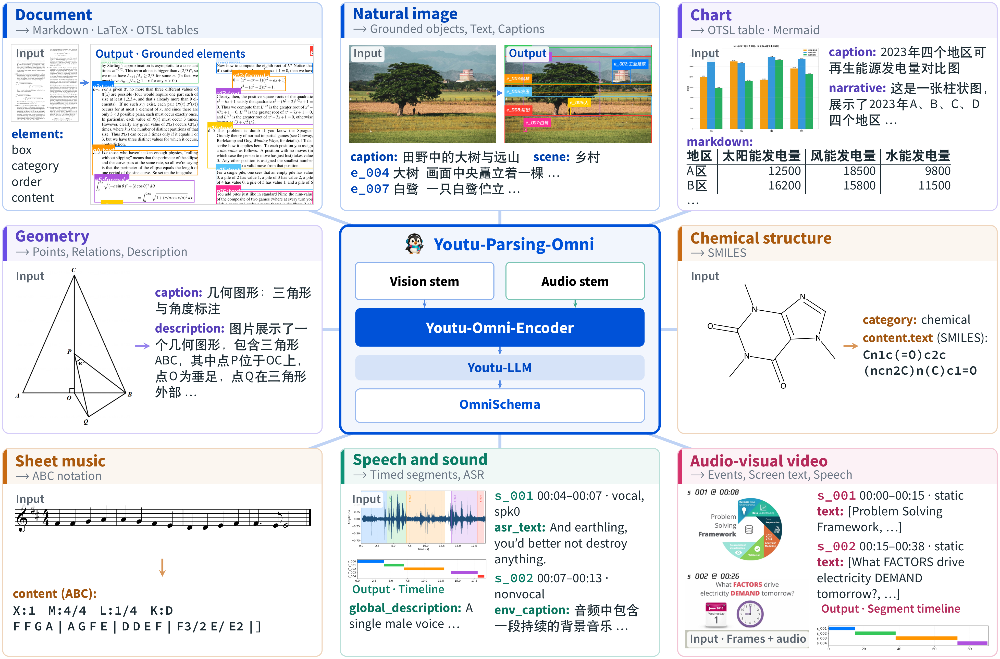
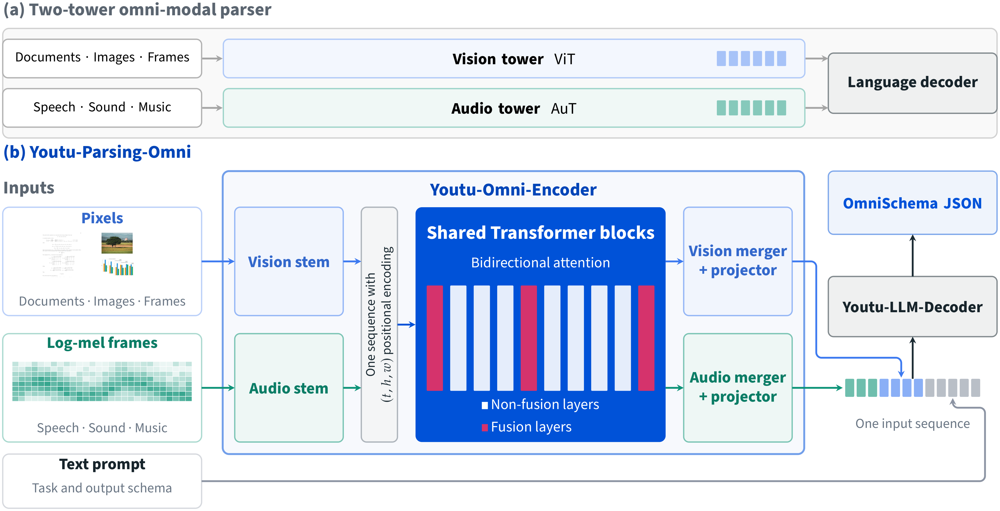

---

## 7. [WorkFactory: Turning Professional Intents into Executable Work for Scalable Agent Training](https://huggingface.co/papers/2610.37161)
**Upvotes**: 30 | **도입 난이도**: 중 | **신뢰도**: 상
**arXiv**: https://arxiv.org/abs/2610.37161

**태그**: Agent, Instruction Tuning, Data Synthesis, Workflow Automation, Vision, Benchmark

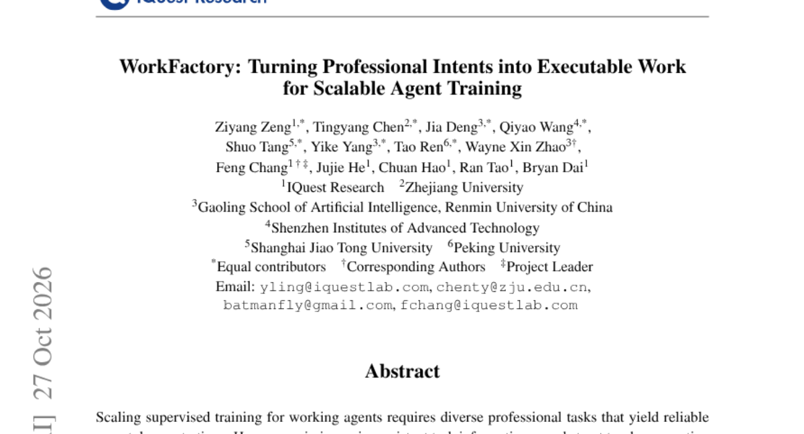

### 📌 한 줄 요약
전문적인 의도를 실행 가능한 작업으로 변환하여 고품질의 에이전트 학습 데이터를 대규모로 생성하는 프레임워크 제안

### 🔑 핵심 포인트
- 의도 기반 정보 지원 그래프를 통한 체계적인 작업 인스턴스화
- 프로브 실행을 통한 정보 결함 식별 및 자동 복구 메커니즘
- 612개 직업군, 11만 개 이상의 대규모 전문 작업 데이터셋 구축

### 🧑‍💻 개발자 관점
에이전트 학습 시 발생하는 '실행 불가능한 데이터' 문제를 구조적으로 해결하여 고품질의 전문가 데모를 확보하는 방법을 제시합니다.

### 🚀 실무 적용 아이디어
- 특정 도메인(예: 법률, 코딩)의 의도를 실행 가능한 태스크로 변환하는 워크플로우 테스트
- 생성된 작업 데이터가 모델의 추론 성능에 미치는 영향 분석
- 정보 지원 그래프 구조를 활용한 RAG 시스템과의 결합 실험

### ⚠️ 리스크/한계
- 모델 크기에 따른 수렴 효율 및 성능 저하 구간(diminishing returns) 존재
- 작업의 복잡도와 실행 길이에 따른 성능 변동성

### 📝 초록 기반 상세 설명
에이전트의 지도 학습을 위해서는 신뢰할 수 있는 전문가 데모가 포함된 다양한 전문 작업 데이터가 필요합니다. 그러나 작업 정보가 누락되거나 일관되지 않으면 작업 수행이 방해받고 학습 품질이 저하되는 문제가 발생합니다. 이를 해결하기 위해 의도로부터 정보 지원 그래프를 구축하여 작업 인스턴스화를 가이드하는 WorkFactory 프레임워크를 제안합니다. 프로브 실행(Probe executions)을 통해 정보 부족을 식별하고 작업을 수정함으로써 실행 가능한 태스크를 생성합니다. 이를 통해 612개 직업군에 걸친 11만 개 이상의 작업을 구축하고 WorkPilot 모델 시리즈를 학습시켰습니다. 실험 결과, 제안된 방법론이 전문 작업 벤치마크 성능을 크게 향상시킴을 확인했습니다.

---

## 8. [A Broader Look into MLLM's Retrieval Heads](https://huggingface.co/papers/2610.32411)
**Upvotes**: 28 | **도입 난이도**: 중 | **신뢰도**: 상
**arXiv**: https://arxiv.org/abs/2610.32411

**태그**: MLLM, Attention, Retrieval, Multimodal, RAG, Vision, Audio, Evaluation

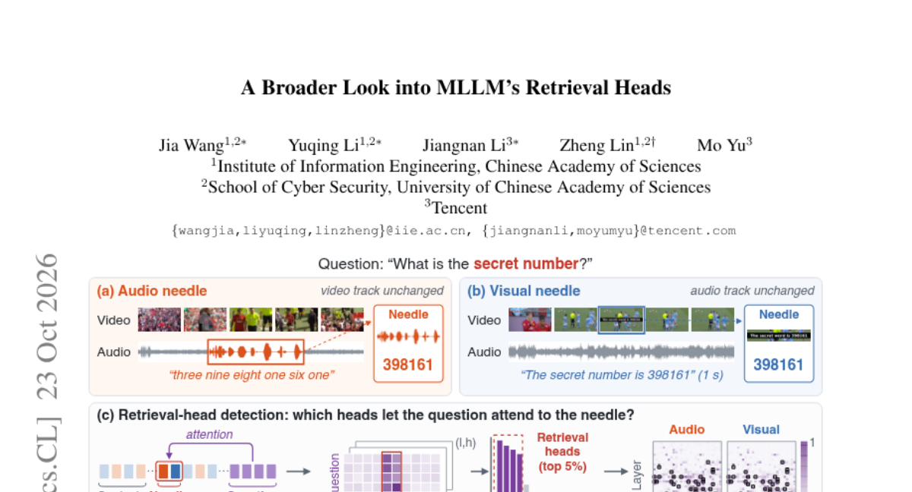

### 📌 한 줄 요약
멀티모달 모델의 정보 추출을 담당하는 'Retrieval Heads'의 공통 메커니즘을 규명하고, 이를 최적화하여 문서 및 멀티모달 검색 성능을 향상시켰습니다.

### 🔑 핵심 포인트
- 모달리티가 확장되어도 정보 추출을 담당하는 'retrieval heads'는 희소성을 유지하며 서로 공유됨을 발견
- retrieval heads를 랭킹 목적 함수(ranking objective)로 학습시켜 모델의 검색 성능을 최적화
- 특정 heads를 제거할 경우 멀티모달 검색뿐만 아니라 문서 이해, 공간 지각 등 핵심 기능도 저하됨을 확인

### 🧑‍💻 개발자 관점
모델의 특정 어텐션 헤드가 정보 추출에 핵심적임을 이해하면, RAG나 긴 문맥 처리 시 모델을 효율적으로 튜닝하거나 성능을 진단하는 데 유용합니다.

### 🚀 실무 적용 아이디어
- 사용 중인 MLLM에서 특정 모달리티 정보가 추출되는 어텐션 헤드 시각화 및 분석
- 특정 태스크(예: 문서 검색) 성능 향상을 위해 랭킹 손실을 이용한 어텐션 헤드 미세 조정 실험
- 모델의 특정 기능(공간 지각 등)이 저하될 때 관련 heads의 활성도 체크

### ⚠️ 리스크/한계
- 특정 heads에 대한 과도한 최적화가 다른 일반적인 추론 능력에 영향을 줄 위험이 있음
- 모델 아키텍처에 따라 retrieval heads의 특성이 다를 수 있어 일반화에 주의 필요

### 📝 초록 기반 상세 설명
멀티모달 거대언어모델(MLLM)은 긴 입력에서 관련 증거를 찾는 능력이 중요하지만, 기존 연구는 특정 모달리티에 국한되어 있었습니다. 본 논문은 오디오-비주얼 등 다양한 모달리티가 추가될 때 retrieval heads의 메커니즘이 어떻게 확장되는지 분석했습니다. 실험 결과, retrieval heads는 모달리티 간에 상당 부분 공유되며 매우 희소한(sparse) 형태로 존재함을 확인했습니다. 이러한 heads를 랭킹 목적 함수로 최적화함으로써 문서 이해 및 멀티모달 검색 성능을 유의미하게 개선했습니다. 결과적으로 기능적 어텐션 헤드는 모델 분석과 성능 향상 모두를 위한 핵심 요소임을 입증했습니다.

---

## 9. [Read, Allocate, Route: Role-Coupled Tokenization for Pixel-Space Generative Transformers](https://huggingface.co/papers/2610.40647)
**Upvotes**: 23 | **도입 난이도**: 중 | **신뢰도**: 상
**arXiv**: https://arxiv.org/abs/2610.40647

**태그**: Generative AI, Transformer, Image Generation, Efficiency, Vision

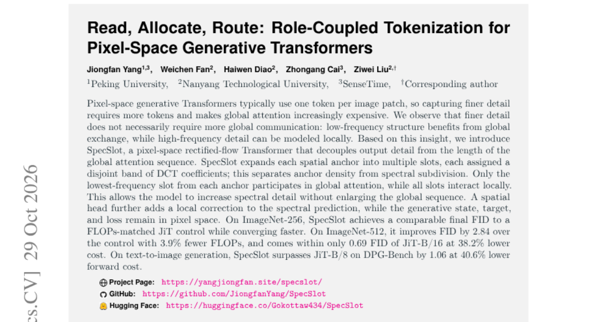

### 📌 한 줄 요약
글로벌 어텐션 부하를 줄이면서도 고해상도 디테일을 확보하는 역할 분담형 토큰화 기법(SpecSlot) 제안

### 🔑 핵심 포인트
- 저주파(구조)와 고주파(디테일)의 통신 요구사항 차이를 이용한 역할 분담형 토큰화
- 공간 앵커를 여러 슬롯으로 확장하여 글로벌 시퀀스 길이를 늘리지 않고도 스펙트럼 세분화 가능
- 픽셀 공간을 유지하면서도 효율적인 연산과 빠른 수렴을 달성하는 Rectified-flow 구조

### 🧑‍💻 개발자 관점
고해상도 이미지 생성 시 발생하는 연산량 폭증 문제를 구조적 설계로 해결하여, 제한된 리소스에서도 고품질 이미지를 생성할 수 있는 효율적인 아키텍처를 제시합니다.

### 🚀 실무 적용 아이디어
- DCT 기반 슬롯 분할 방식이 다양한 이미지 데이터셋(예: CIFAR, 고해상도 실사)에서 일관된 성능을 보이는지 검증
- 기존 ViT 기반 생성 모델의 패치 크기를 조절하며 SpecSlot의 연산 효율성 벤치마크 수행
- 텍스트-이미지 생성 태스크로 확장 시 프롬프트 정렬(Alignment) 성능 변화 관찰

### ⚠️ 리스크/한계
- DCT 계수 분할 방식이 특정 주파수 대역에서 아티팩트를 발생시킬 가능성
- 공간 앵커와 슬롯 간의 계층적 구조가 복잡한 질감 표현에 미치는 영향

### 📝 초록 기반 상세 설명
픽셀 공간의 생성 트랜스포머는 패치당 하나의 토큰을 사용하여 고해상도 디테일을 구현할 때 연산 비용이 급증하는 문제가 있습니다. 저자들은 저주파 구조는 글로벌 통신이 필요하지만, 고주파 디테일은 국소적 모델링만으로도 충분하다는 점에 주목했습니다. 이를 위해 각 공간 앵커를 여러 슬롯으로 확장하고 DCT 계수를 분할 할당하는 SpecSlot 방식을 도입했습니다. 저주파 슬롯만 글로벌 어텐션에 참여시키고 나머지 슬롯은 로컬로 상호작용하게 하여 시퀀스 길이를 유지하며 디테일을 높였습니다. 실험 결과, ImageNet 고해상도 생성에서 기존 모델 대비 낮은 연산 비용(FLOPs)으로 더 우수한 FID 성능을 달성했습니다.

---

## 10. [Co-Design Bench: Multimodal Collaborative Coding Evaluation for Agentic Models](https://huggingface.co/papers/2610.35138)
**Upvotes**: 19 | **도입 난이도**: 중 | **신뢰도**: 상
**arXiv**: https://arxiv.org/abs/2610.35138

**태그**: Agent, Multimodal, Software Engineering, Benchmark, RAG, Vision, Video, Audio, Evaluation

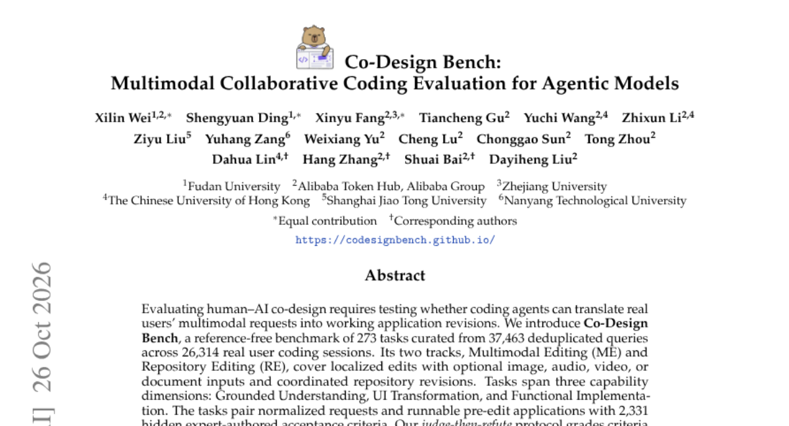

### 📌 한 줄 요약
실제 사용자 요청을 기반으로 멀티모달 입력과 코드 저장소를 동시에 다루는 에이전트의 협업 코딩 능력을 평가하는 벤치마크 제안

### 🔑 핵심 포인트
- 실제 사용자 데이터를 기반으로 한 273개의 멀티모달 코딩 태스크 벤치마크 구축
- 정답 코드(Gold Code) 없이 소스 및 브라우저 증거를 활용하는 'Judge-then-refute' 평가 프로토콜 도입
- 단순 코드 생성을 넘어 UI 변환 및 저장소 단위의 복합 수정 능력을 측정

### 🧑‍💻 개발자 관점
단순한 코드 조각 생성이 아닌, 이미지/문서 등 다양한 입력을 바탕으로 기존 프로젝트를 수정하는 '에이전트형 코딩 도구'의 성능을 측정하는 실질적인 기준을 제공합니다.

### 🚀 실무 적용 아이디어
- 현재 사용 중인 코딩 에이전트 모델을 Co-Design Bench의 ME/RE 트랙에 적용하여 성능 비교
- 에이전트가 복합적인 변경 사항(3~4개 이상의 타입)을 처리할 때 발생하는 성능 저하 지점 분석
- 제시된 'Judge-then-refute' 프로토콜을 활용하여 자체적인 자동 평가 파이프라인 구축 시도

### ⚠️ 리스크/한계
- 실제 사용자 데이터 기반이므로 특정 도메인이나 코딩 스타일에 편향될 가능성 존재
- 복합적인 변경 사항이 포함될수록 모델의 성공률이 급격히 낮아지는 성능 격차 문제

### 📝 초록 기반 상세 설명
사용자의 멀티모달 요청을 실제 작동하는 애플리케이션 수정으로 변환하는 에이전트 평가의 필요성이 커지고 있습니다. 본 논문은 26,314개의 실제 사용자 코딩 세션에서 추출한 273개의 태스크로 구성된 Co-Design Bench를 소개합니다. 이 벤치마크는 로컬 편집(ME)과 저장소 편집(RE) 두 트랙을 통해 이해도, UI 변환, 기능 구현 능력을 평가합니다. 평가를 위해 정답 코드 대신 전문가가 작성한 2,331개의 수락 기준(acceptance criteria)과 검증 프로토콜을 사용합니다. 실험 결과, 모델들은 부분적인 요구사항은 충족하지만 전체 태스크를 완벽히 완수하는 데는 어려움을 겪는 것으로 나타났습니다.

---

## 11. [VibeGame: Prompt-to-Game Development with AI-Native Engine and Self-Evolving Adversarial Agent Team](https://huggingface.co/papers/2610.33106)
**Upvotes**: 18 | **도입 난이도**: 상 | **신뢰도**: 상
**arXiv**: https://arxiv.org/abs/2610.33106

**태그**: AI-Agent, Game-Dev, Multi-Agent, Automated-Software-Engineering, Agent, Vision, Evaluation, Distillation

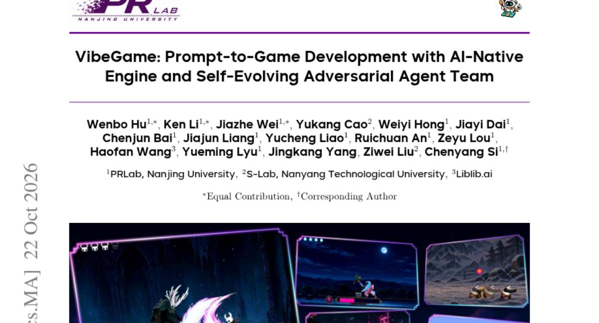

### 📌 한 줄 요약
자연어 프롬프트만으로 게임 코드, 에셋, 물리 엔진을 통합하여 완전한 2D 게임을 생성하는 AI 네이티브 프레임워크

### 🔑 핵심 포인트
- AI 네이티브 엔진: 게임 상태를 구조화된 텍스트로 관리하여 에이전트의 상태 검사 및 동작 검증 용이성 확보
- 적대적 에이전트 팀: 8개의 전문 에이전트가 구현과 리뷰를 분리하여 다회차 루프를 통해 오류를 수정
- 자기 진화 메커니즘: 성공적인 프로젝트를 재사용 가능한 스켈레톤 및 모듈로 추출하여 차기 개발에 활용

### 🧑‍💻 개발자 관점
코드뿐만 아니라 에셋과 물리 엔진이 결합된 복합 시스템 개발에서 에이전트가 어떻게 협업하고 검증해야 하는지에 대한 방법론을 제시합니다.

### 🚀 실무 적용 아이디어
- 구조화된 텍트 기반의 상태 관리 방식이 기존 엔진(Unity, Godot)과 어떻게 호환될 수 있는지 분석
- 멀티 에이전트 간의 역할 분담(Implementation vs Review) 구조를 일반 소프트웨어 개발에 적용해보기
- 에이전트가 생성한 코드와 에셋 간의 정합성 검증 로직 실험

### ⚠️ 리스크/한계
- 2D 게임에 특화된 구조로, 복잡한 3D 환경이나 고성능 물리 연산 적용 시 한계 가능성
- 에이전트 간의 충돌이나 무한 루프 발생 시 제어 비용 증가 우려

### 📝 초록 기반 상세 설명
LLM 에이전트를 통한 소프트웨어 개발은 발전하고 있으나, 코드와 에셋, 물리 엔진 등이 복합적으로 작용하는 게임 개발로의 확장은 여전히 어렵습니다. 본 논문은 자연어와 이미지를 통해 완전한 2격 2D 게임 프로젝트를 생성하는 VibeGame 프레임워크를 제안합니다. 이 시스템은 게임 상태를 스키마 검증이 가능한 구조화된 텍스트로 표현하는 AI 네이티브 엔진을 통해 에이전트가 상태를 검사하고 동작을 검증할 수 있게 합니다. 또한, 8개의 전문 에이전트로 구성된 적대적 에이전트 팀(Adversarial Agent Team)을 통해 구현과 리뷰를 분리하여 문제 해결 루프를 구축했습니다. 마지막으로 생성된 프로젝트를 재사용 가능한 모듈로 정제하는 자기 진화 메커니즘을 도입했습니다. 실험 결과, VibeGame은 기존 에이전트 프레임워크 대비 뛰어난 게임 생성 성능을 입증했습니다.

---

## 12. [HairDeck: Animation-Ready Stylized Hair Cards from a Single Image](https://huggingface.co/papers/2610.40599)
**Upvotes**: 17 | **도입 난이도**: 중 | **신뢰도**: 상
**arXiv**: https://arxiv.org/abs/2610.40599

**태그**: Computer Graphics, Diffusion Model, 3D Asset Generation, Game Development, Vision

### 📌 한 줄 요약
단일 이미지로부터 애니메이션 가능한 스타일라이즈드 헤어 카드 에셋을 생성하는 고속 디퓨전 모델

### 🔑 핵심 포인트
- Set Diffusion Transformer를 활용하여 헤어 카드를 순서 없는 집합으로 처리하는 새로운 생성 방식 제안
- 단일 이미지로부터 애니메이션 가능한 스프링 본(spring-bone) 체인과 카드 구조를 동시에 생성
- 기존 CHARM 대비 33배 빠른 속도와 낮은 기하학적 오차 달성

### 🧑‍💻 개발자 관점
수작업이 많이 필요한 헤어 카드 제작 공정을 자동화하여, 캐릭터 에셋 제작 파이프라인의 생산성을 획기적으로 높일 수 있습니다.

### 🚀 실무 적용 아이디어
- 제공된 프로젝트 페이지의 데모를 통해 생성된 헤어 카드의 애니메이션 품질 검증
- 다양한 각도의 단일 이미지 입력 시 생성된 카드 방향성(orientation)의 일관성 테스트
- 기존 게임 엔진(Unity/Unreal) 워크플로우로의 익스포트 호환성 확인

### ⚠️ 리스크/한계
- 단일 이미지 기반이므로 복잡한 측면/후면 디테일 재현의 한계 가능성
- 생성된 카드의 정교함이 아티스트의 수작업 수준을 완전히 대체할 수 있는지 여부

### 📝 초록 기반 상세 설명
게임 및 아바타 제작 시 스타일라이즈드 캐릭터의 헤어 카드는 아티스트가 직접 배치하는 리본 형태의 기하 구조를 의미합니다. 기존 방식은 실사 위주이거나 단일 메시를 생성하며, 기존의 CHARM 방식은 자기회귀 방식으로 생성하여 효율성이 낮았습니다. 본 논문은 헤어 카드를 순서가 없는 집합(unordered set)으로 정의하고, 각 카드를 하나의 토큰으로 처리하는 Set Diffusion Transformer를 제안합니다. 이를 통해 단일 이미지로부터 애니메이션용 스프링 본 체인과 헤어 카드를 동시에 생성합니다. 실험 결과, 기존 CHARM 대비 속도는 33배 빠르면서도 기하학적 오차를 크게 줄이며 우수한 성능을 보였습니다.

---

## 13. [WeVisCut: The Whole Editing Room in One Agent From Narration to Long-Form Video](https://huggingface.co/papers/2610.38352)
**Upvotes**: 14 | **도입 난이도**: 상 | **신뢰도**: 상
**arXiv**: https://arxiv.org/abs/2610.38352

**태그**: Agent, Video-Generation, Policy-Learning, Automation, Vision, Video, Benchmark

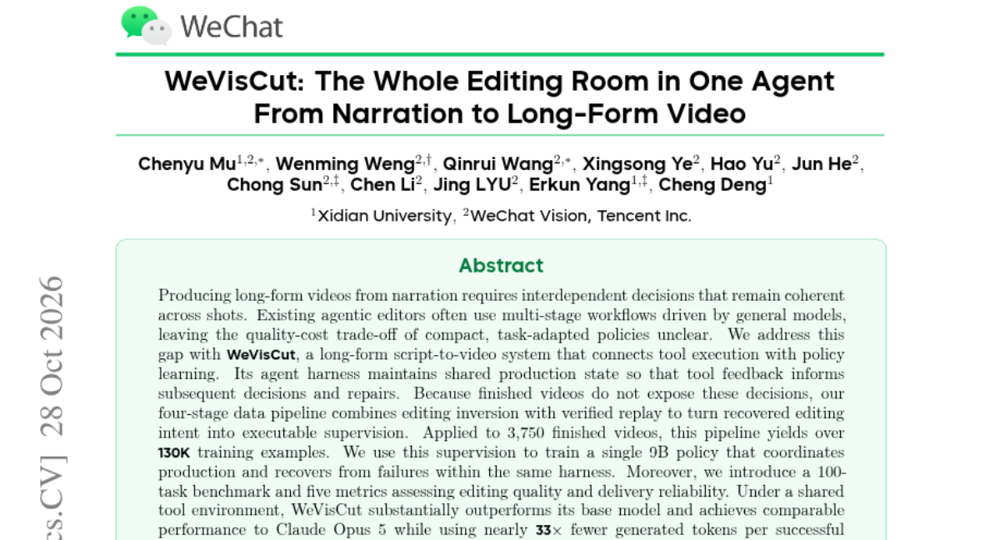

### 📌 한 줄 요약
단일 에이전트가 시나리오부터 최종 영상 편집까지 수행하며, 기존 워크플로우 대비 비용 효율성을 극대화한 영상 제작 시스템

### 🔑 핵심 포인트
- 도구 실행과 정책 학습이 결합된 단일 에이전트 기반의 영상 제작 프레임워크 개발
- 편집 의도를 실행 가능한 감독 데이터로 변환하는 4단계 데이터 파이프라인 구축
- 공유된 제작 상태(Shared Production State)를 통한 에이전트의 자가 복구 및 일관성 유지

### 🧑‍💻 개발자 관점
에이전트가 복잡한 워크플로우를 단일 모델로 수행할 때 발생하는 비용 문제를 데이터 파이프라인과 정책 학습으로 해결하는 실전적인 방법론을 제시합니다.

### 🚀 실무 적용 아이디어
- 제시된 4단계 데이터 파이프라인(편집 역추적 방식)의 로직 분석
- 9B 규모의 소형 모델로 복잡한 멀티스텝 태스크를 수행하는 에이전트 설계 구조 검토
- 에이전트의 상태 관리(State Management)와 오류 복구 메커니즘 실험

### ⚠️ 리스크/한계
- 학습 데이터가 기존 영상의 편집 의도를 복원하는 방식이므로, 창의적인 편집 스타일 반영에 한계가 있을 수 있음
- 9B 모델의 성능이 특정 도구 환경에 의존적일 가능성

### 📝 초록 기반 상세 설명
긴 분량의 영상을 제작하려면 샷 간의 일관성을 유지하는 복잡한 의사결정이 필요하지만, 기존의 다단계 에이전트는 비용과 품질 사이의 균형을 맞추기 어려웠습니다. 이를 해결하기 위해 WeVisCut은 도구 실행과 정책 학습을 결합한 스크립트-투-비디오 시스템을 제안합니다. 에이전트 하네스는 공유된 제작 상태를 유지하여 도구 피드백을 바탕으로 의사결정과 오류 복구를 수행합니다. 데이터 파이프라인은 편집 역추적과 검증된 재생 방식을 결합하여 13만 개 이상의 학습 데이터를 생성합니다. 이를 통해 학습된 9B 모델은 단일 에이전트로서 제작 조율 및 실패 복구 기능을 수행합니다. 실험 결과, WeVisCut은 기존 모델보다 우수한 성능을 보이면서도 토큰 사용량을 획기적으로 줄여 효율성을 입증했습니다.

### 🖼️ 추가 자료
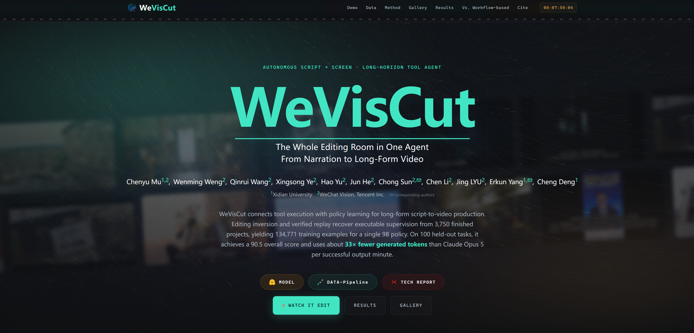

---

## 14. [IntReal: A Real-World Dataset and Benchmark for Multimodal Interleaved Generation](https://huggingface.co/papers/2610.38425)
**Upvotes**: 13 | **도입 난이도**: 하 | **신뢰도**: 상
**arXiv**: https://arxiv.org/abs/2610.38425

**태그**: Multimodal, Dataset, Evaluation, Generative AI, Vision, Benchmark

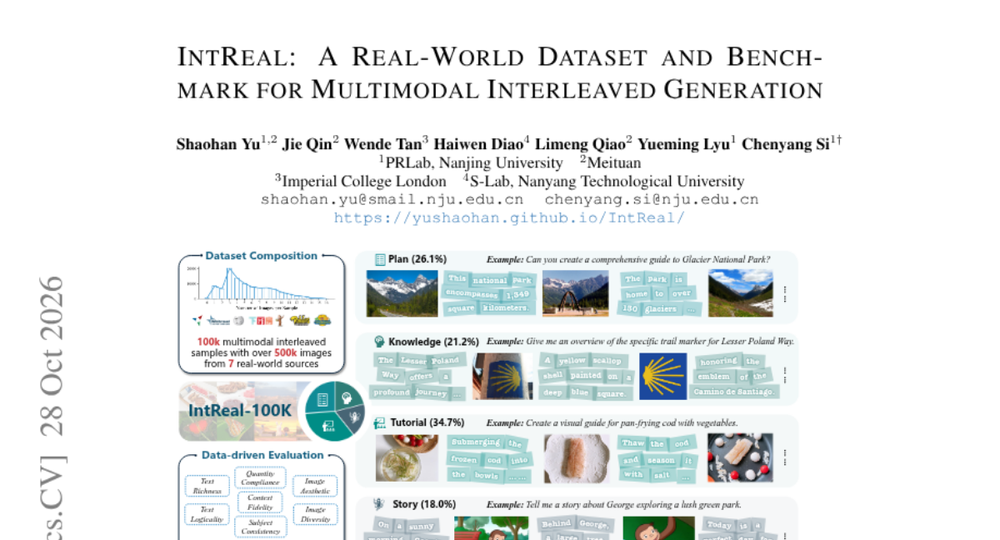

### 📌 한 줄 요약
텍스트와 이미지가 혼합된 멀티모달 생성 능력을 평가하고 학습시키기 위한 데이터셋과 정밀 평가 프레임워크를 제안합니다.

### 🔑 핵심 포인트
- 실세계 멀티모달 혼합 생성 데이터셋(IntReal-100K) 구축
- 7개 차원의 정밀 진단이 가능한 전문가 모델 기반 평가 스위트 개발
- 단일 모달리티 학습이 혼합 생성 성능 향상에 기여할 수 있음을 확인

### 🧑‍💻 개발자 관점
텍스트와 이미지가 혼합된 콘텐츠를 생성하는 차세대 멀티모달 모델 개발 시, 모델의 성능을 정밀하게 측정하고 학습 데이터로 활용할 수 있는 벤치마크를 제공합니다.

### 🚀 실무 적용 아이디어
- IntReal-100K 데이터셋을 기존 UMM 모델의 파인튜닝에 적용해보기
- 제안된 7개 차원 평가 지표를 활용해 현재 모델의 취약점 분석하기
- 단일 모달리티 최적화가 혼합 생성 성능에 미치는 영향 실험하기

### ⚠️ 리스크/한계
- 실세계 데이터셋이므로 데이터 정제 수준에 따라 모델 성능 편차가 발생할 수 있음
- 전문가 모델 기반 평가가 실제 사용자 경험과 완벽히 일치하지 않을 가능성 존재

### 📝 초록 기반 상세 설명
인간은 텍스트와 이미지가 자연스럽게 섞인 멀티모달 콘텐츠를 소비하지만, 이를 생성하는 기술은 아직 충분히 연구되지 않았습니다. 기존 연구는 명확한 태스크 정의와 학습 데이터가 부족하며, 모델의 성능을 세부적으로 진단할 평가 프로토콜도 부재한 상황입니다. 이를 해결하기 위해 4개 카테고리의 실세계 데이터셋인 IntReal-100K와 7개 차원의 정밀 진단이 가능한 IntReal Evaluation Suite를 제안합니다. 실험 결과, 제안된 평가 방식은 인간의 판단과 높은 일치도를 보이며 모델별 강점과 약점을 명확히 식별했습니다. 또한 IntReal-100K를 통한 학습이 생성 성능을 향상시키며, 단일 모달리티 최적화만으로도 혼합 생성 능력이 개선될 수 있음을 입증했습니다.

---

## 15. [CoSTA: Compressed Speech Token Adaptation for Efficient Spoken Dialogue Models](https://huggingface.co/papers/2610.21143)
**Upvotes**: 11 | **도입 난이도**: 중 | **신뢰도**: 상
**arXiv**: https://arxiv.org/abs/2610.21143

**태그**: Speech-to-Speech, Inference Optimization, LLM, Audio Generation, Benchmark, Inference, Optimization

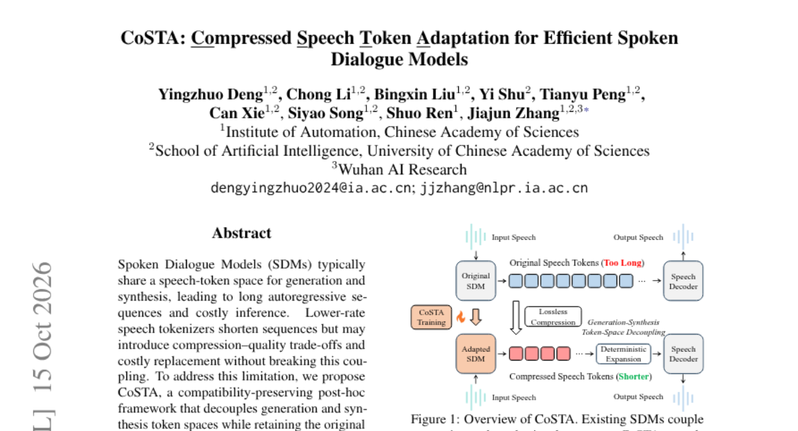

### 📌 한 줄 요약
기존 음성 토크나이저를 유지하면서 생성 토큰 길이를 줄여 추론 속도와 효율성을 높이는 디커플링 프레임워크

### 🔑 핵심 포인트
- 기존 음성 토크나이저/디코더를 교체하지 않는 호환성 유지형 프레임워크
- 생성용 압축 토큰과 합성용 원본 토큰 공간을 분리하여 시퀀스 길이 단축
- Mean-initialized vocabulary extension 및 발음/대화 적응을 통한 품질 유지

### 🧑‍💻 개발자 관점
모델 전체를 재학습하지 않고도 기존 음성 모델의 추론 속도를 높이고 대화 지연 시간을 줄일 수 있는 실용적인 최적화 기법입니다.

### 🚀 실무 적용 아이디어
- 기존 LLM 기반 음성 모델에 CoSTA의 어휘 확장 기법 적용 테스트
- 압축률 변화에 따른 음성 합성 품질(MOS) 및 추론 속도 간의 트레이드오프 분석
- 다국어 환경에서의 발음 적응(Pronunciation adaptation) 성능 검증

### ⚠️ 리스크/한계
- 압축률을 높일 경우 음성 품질 저하가 발생할 수 있는 트레이드오프 존재
- 결정론적 확장 과정에서 발생할 수 있는 아티팩트(Artifact) 가능성

### 📝 초록 기반 상세 설명
기존의 음성 대화 모델(SDM)은 생성과 합성 토큰 공간을 공유하여 긴 시퀀스로 인한 높은 추론 비용 문제를 겪습니다. 저율(low-rate) 토크나이저를 사용하면 시퀀스는 짧아지지만 품질 저하나 기존 모델과의 호환성 문제가 발생합니다. 이를 해결하기 위해 CoSTA는 기존 토크나이저와 디코더를 유지하면서 생성과 합성 토큰 공간을 분리하는 post-hoc 프레임워크를 제안합니다. CoSTA는 어휘 확장, 발음 적응, 대화 적응 과정을 거쳐 압축된 토큰을 생성한 뒤, 합성 전 다시 원래의 토큰 공간으로 결정론적 확장을 수행합니다. 실험 결과, 응답 품질을 유지하면서도 생성 속도를 약 1.7배 높이고 지연 시간과 처리량을 개선했습니다.

---

## 16. [WebAnything: From the Wild Web to Scalable Agent Environments](https://huggingface.co/papers/2610.37786)
**Upvotes**: 11 | **도입 난이도**: 중 | **신뢰도**: 상
**arXiv**: https://arxiv.org/abs/2610.37786

**태그**: Web-Agent, Environment-Simulation, Automation, Agent, RAG, Evaluation

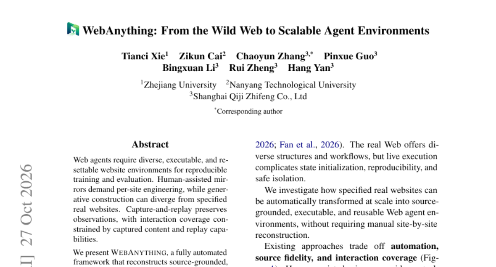

### 📌 한 줄 요약
실제 웹 사이트를 자동 재구성하여 에이전트 학습 및 평가를 위한 확장 가능한 환경을 구축하는 프레임워크

### 🔑 핵심 포인트
- 실제 URL을 기반으로 수동 작업 없이 재사용 가능한 웹 환경을 자동 구축하는 프레임워크 제안
- Explorer-Builder와 독립적 검증기를 통한 자동화된 구조 수집 및 오류 복구 메커니즘
- 대규모 웹 아티팩트 구축을 통한 에이전트 학습 및 평가 성능 향상 입증

### 🧑‍💻 개발자 관점
웹 에이전트 개발 시 매번 사이트별로 환경을 구축해야 하는 번거로움을 줄이고, 실제 웹 환경과 유사한 고품질 학습 데이터를 확보할 수 있습니다.

### 🚀 실무 적용 아이디어
- 제공된 GitHub 코드를 사용하여 특정 도메인의 웹 환경 자동 구축 테스트
- 구축된 환경에서 오픈소스 LLM 에이전트의 성공률 변화 측정
- 동적 요소가 많은 복잡한 웹 사이트에서의 복구 메커니즘 성능 검증

### ⚠️ 리스크/한계
- 초기 설정 및 권한 부여 단계에서의 수동 개입 필요성
- 웹 사이트의 구조적 변화에 따른 환경 유지 관리 비용 발생 가능성

### 📝 초록 기반 상세 설명
웹 에이전트 학습을 위해서는 실행 및 초기화가 가능한 다양한 웹 환경이 필요하지만, 기존의 수동 미러링은 사이트별 엔지니어링이 필요하고 생성형 방식은 실제 웹과 괴리될 위험이 있습니다. 본 논문은 실제 URL로부터 소스 기반의 재사용 가능한 웹 환경을 자동 구축하는 WebAnything 프레임워크를 제안합니다. Explorer-Builder가 브라우저 구조와 상호작용 결과를 수집하고, 독립적인 검증기가 후보를 확인하며 국소적 복구 또는 타겟팅된 재수집을 가이드합니다. 실험 결과, 14개 도메인에 걸쳐 244개의 웹 아티팩트를 구축하였으며 기존 방식보다 높은 충실도(fidelity)를 달성했습니다. 또한 Qwen3.5-9B 모델을 이 데이터로 파인튜닝했을 때 다양한 웹 에이전트 벤치마크에서 성능 향상을 입증했습니다.

---

## 17. [Glance: The Generator Is Its Own Reranker](https://huggingface.co/papers/2610.40454)
**Upvotes**: 10 | **도입 난이도**: 중 | **신뢰도**: 상
**arXiv**: https://arxiv.org/abs/2610.40454

**태그**: RAG, LLM, Efficiency, Retrieval, Evaluation

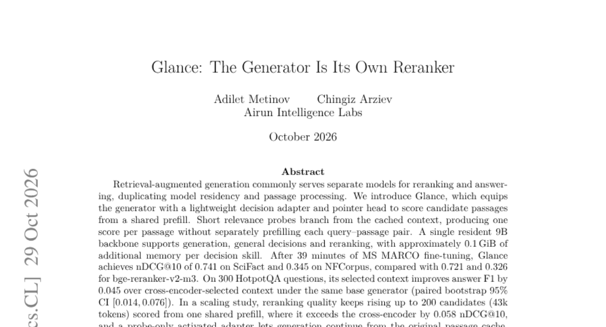

### 📌 한 줄 요약
단일 모델의 KV 캐시를 공유하여 Reranking과 Generation을 동시에 수행하는 효율적인 RAG 프레임워크

### 🔑 핵심 포인트
- 단일 백본 모델(9B)을 활용하여 생성, 의사결정, Reranking을 모두 수행하는 통합 구조
- 공유된 Prefill(KV 캐시)을 활용하여 후보 문서별 재입력 없이 스코어링하는 효율적 메커니즘
- 경량 어댑터와 포인터 헤드를 통해 추가 메모리 사용량을 최소화하면서 높은 Reranking 성능 확보

### 🧑‍💻 개발자 관점
모델 인스턴스를 여러 개 띄울 필요 없이 하나의 모델로 Reranking과 Generation을 처리할 수 있어, GPU 메모리 효율과 추론 속도를 획기적으로 개선할 수 있습니다.

### 🚀 실무 적용 아이디어
- 제시된 9B 백본 모델 구조를 기반으로 한 경량 어댑터 학습 실험
- KV 캐시 공유 방식이 긴 컨텍스트(Long-context) 환경에서 성능 저하를 일으키는지 검증
- 기존 Cross-encoder 방식과 대비하여 추론 지연 시간(Latency) 및 비용 절감 효과 측정

### ⚠️ 리스크/한계
- 현재 평가가 특정 백본 모델과 소규모 데이터셋에 집중되어 있어 범용성 검증 필요
- 매우 많은 수의 후보 문서를 처리할 때 KV 캐시 크기 및 메모리 관리 이슈 발생 가능성

### 📝 초록 기반 상세 설명
기존 RAG 시스템은 Reranker와 Generator가 별도의 모델로 운영되어 모델 상주 비용과 중복된 연산이 발생하는 문제가 있었습니다. 이를 해결하기 위해 Glance는 하나의 백본 모델에 경량 어댑터와 포인터 헤드를 결합한 방식을 제안합니다. 공유된 Prefill 단계에서 생성된 KV 캐시를 활용하여, 별도의 재입력 없이 짧은 relevance probe를 통해 후보 문서들을 스코어링합니다. 실험 결과, Glance는 SciFact 및 NFCorpus에서 기존 bge-reranker-v2-m3보다 높은 성능을 보였으며 HotpotQA에서도 우수한 답변 정확도를 기록했습니다. 특히 대규모 컨텍스트에서도 성능이 유지되며, 단일 백본만으로 효율적인 Reranking이 가능함을 입증했습니다.

### 🖼️ 추가 자료
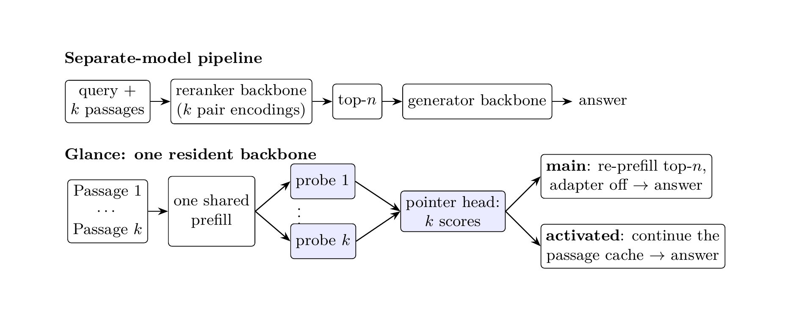

---

## 18. [Multi-Token Prediction Done Right](https://huggingface.co/papers/2610.38331)
**Upvotes**: 9 | **도입 난이도**: 하 | **신뢰도**: 상
**arXiv**: https://arxiv.org/abs/2610.38331

**태그**: LLM, Pre-training, Inference Optimization, Deep Learning, Reasoning, Inference, Distillation

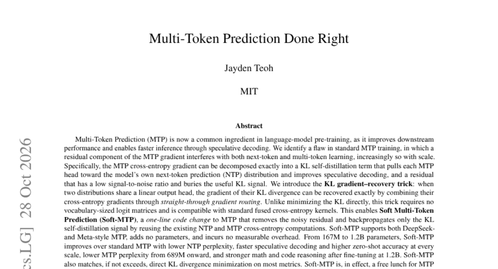

### 📌 한 줄 요약
기존 MTP의 노이즈를 제거하여 성능과 추론 속도를 동시에 높이는 효율적인 학습 기법인 Soft-MTP 제안

### 🔑 핵심 포인트
- MTP 학습 시 발생하는 노이즈 섞인 잔차 성분이 NTP 성능을 저해하는 문제 식별
- Straight-through gradient routing을 이용해 추가 연산 없이 KL 발산 신호를 복구하는 기법 제안
- 파라미터 증가 없이 성능과 추론 속도를 모두 개선하는 'Free Lunch' 방식의 최적화

### 🧑‍💻 개발자 관점
모델 크기를 키우지 않고도 MTP 학습 방식을 수정함으로써 추론 속도(Speculative Decoding)와 모델의 기본 추론 능력을 동시에 개선할 수 있습니다.

### 🚀 실무 적용 아이디어
- 기존 MTP 기반 모델 학습 코드에 Soft-MTP의 gradient-recovery 로직 적용 테스트
- 모델 규모별(167M~1.2B) NTP 및 MTP 성능 변화 비교 실험
- Speculative Decoding 환경에서 추론 속도 향상 폭 측정

### ⚠️ 리스크/한계
- 기존 MTP 구조를 유지하면서 학습 로직을 변경해야 하므로 구현 환경에 따른 호환성 확인 필요
- 매우 거대한 규모의 모델에서 KL 신호 복구 방식의 안정성 검증 필요

### 📝 초록 기반 상세 설명
최근 언어 모델 학습에서 성능 향상과 추론 가속을 위해 Multi-Token Prediction(MTP)이 널리 사용되고 있습니다. 그러나 기존 MTP 학습 방식은 잔차(residual) 성분이 차기 토큰 예측(NTP)과 다중 토큰 학습 모두를 방해하는 결함이 있음을 발견했습니다. 이를 해결하기 위해 저자들은 KL 발산(KL divergence) 신호만 정확히 추출하여 역전파하는 'KL gradient-recovery trick'을 도입했습니다. 이 기법을 적용한 Soft-MTP는 추가 파라미터나 연산 오버헤드 없이 기존 MTP의 노이즈를 제거하고 유용한 신호만 활용합니다. 실험 결과, 다양한 규모에서 NTP 퍼플렉시티 개선, 더 빠른 추측적 디코딩(speculative decoding), 그리고 수학 및 코드 추론 능력 향상을 입증했습니다.

### 🖼️ 추가 자료
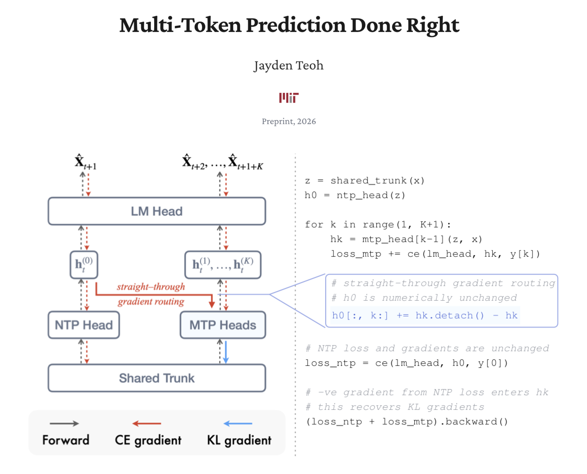

---

## 19. [Investor's Last Exam: Can AI Agents Do Equity Investment Without Seeing the Future?](https://huggingface.co/papers/2610.38342)
**Upvotes**: 9 | **도입 난이도**: 상 | **신뢰도**: 상
**arXiv**: https://arxiv.org/abs/2610.38342

**태그**: AI Agent, Financial Benchmark, Reasoning, Forecasting, Agent, RAG, Benchmark, Evaluation

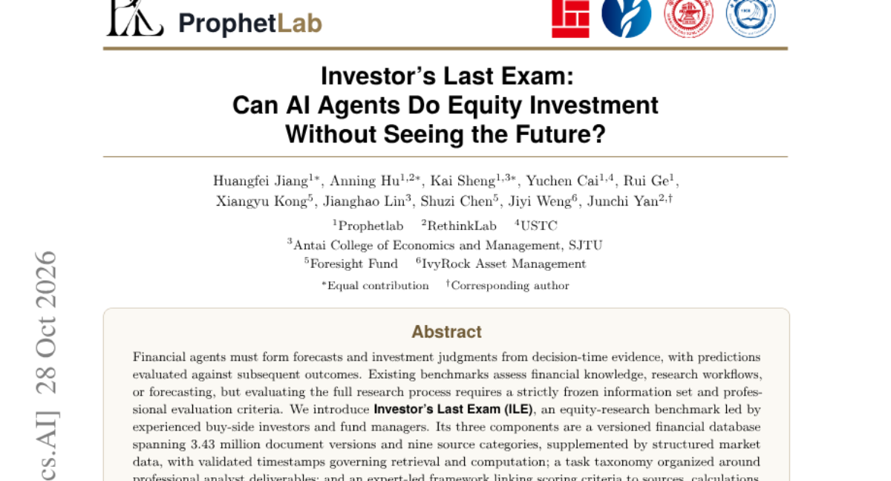

### 📌 한 줄 요약
실제 투자 프로세스를 모사하여 AI 에이전트의 분석 역량과 예측 정확도 간의 괴리를 검증하는 벤치마크 제안

### 🔑 핵심 포인트
- 시점별 데이터 통제를 통해 미래 정보 유출을 방지한 정교한 금융 데이터베이스 구축
- 분석 결과물(Deliverables) 중심의 전문적인 태스크 분류 체계 도입
- 분석 근거-가정-판단 간의 의존성을 추적하는 전문가 주도 평가 프레임워크 개발

### 🧑‍💻 개발자 관점
단순 질의응답을 넘어, 데이터 기반의 추론과 예측이 결합된 복합적인 금융 에이전트 성능을 검증하는 데 중요한 기준을 제시합니다.

### 🚀 실무 적용 아이디어
- 금융 특화 RAG 시스템 구축 시 ILE의 데이터 타임스탬프 관리 방식 적용
- 에이전트의 추론 과정(Chain-of-Thought)이 최종 예측값에 미치는 영향 분석
- 모델의 리서치 역량과 예측 정확도 간의 상관관계 측정 실험

### ⚠️ 리스크/한계
- 전문가 주도 설계로 인해 일반적인 범용 모델 평가로 확장하기에는 난이도가 높음
- 특정 도메인(주식 리서치)에 특화되어 있어 다른 금융 분야로의 일반화 가능성 검토 필요

### 📝 초록 기반 상세 설명
기존 금융 벤치마크는 단편적인 지식이나 워크플로우 평가에 치중되어 있어, 실제 투자 결정에 필요한 전체 연구 과정을 평가하기 어려웠습니다. 이를 해결하기 위해 전문 투자자들이 설계한 주식 리서치 벤용 벤치마크인 Investor's Last Exam(ILE)을 도입했습니다. ILE는 시점별 데이터가 엄격히 통제된 데이터베이스, 전문 분석 업무 중심의 태스크 분류, 그리고 근거-가정-판단을 연결하는 전문가 프레임워크를 특징으로 합니다. 실험 결과, 최신 모델들이 전반적인 리서치 능력은 보여주었으나 실제 예측 및 모델링 성능은 현저히 낮게 나타났습니다. 결과적으로 ILE는 AI 에이전트의 분석 역량이 어떻게 투자 성과로 이어지는지 추적하고 진단할 수 있는 기반을 제공합니다.

---

## 20. [AskStream: When and What to Ask Proactively under Uncertainty in Streaming Video Understanding](https://huggingface.co/papers/2610.38678)
**Upvotes**: 9 | **도입 난이도**: 상 | **신뢰도**: 상
**arXiv**: https://arxiv.org/abs/2610.38678

**태그**: Agent, Video-Understanding, Multimodal, Benchmark, Video

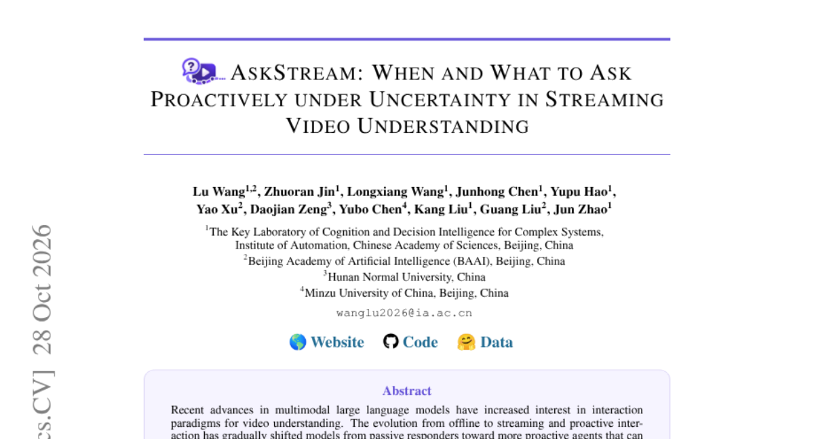

### 📌 한 줄 요약
불완전한 정보 환경에서 비디오 에이전트가 스스로 질문하여 불확실성을 해소하는 새로운 프로액티브 상호작용 프레임워크 제안

### 🔑 핵심 포인트
- 프로액티브 상호작용에 'Wait', 'Answer' 외에 'Ask' 액션을 추가하여 불확실성 해결
- 비디오와 사용자 불확실성을 모두 포함하는 최초의 멀티턴 스트리밍 비디오 벤치마크 AskStream 구축
- 정보가 불완전한 상황에서 모델이 언제, 무엇을 질문해야 하는지에 대한 새로운 과제 제시

### 🧑‍💻 개발자 관점
실시간 스트리밍 영상 분석 에이전트 개발 시, 정보 부족 상황에서 모델이 억지로 답을 내놓거나 무한 대기하는 문제를 해결하는 가이드라인을 제공합니다.

### 🚀 실무 적용 아이디어
- 제안된 AskStream 데이터셋을 활용하여 현재 보유한 비디오 에이전트의 질문 생성 능력 테스트
- Wait/Ask/Answer 세 가지 액션 간의 의사결정 로직 최적화 실험
- 불완전한 정보 상황에서의 환각(Hallucination) 방지를 위한 프롬프트 엔지니어링 적용

### ⚠️ 리스크/한계
- 질문(Ask) 액션이 빈번해질 경우 사용자 경험(UX) 측면에서 피로도가 증가할 수 있음
- 실시간 스트리밍 환경에서 질문과 답변 사이의 지연 시간(Latency) 관리 문제

### 📝 초록 기반 상세 설명
최근 멀티모달 모델은 수동적 응답을 넘어 능동적 에이전트로 진화하고 있으나, 기존 방식은 정보가 완전하다는 가정하에 동작하는 한계가 있습니다. 실제 환경에서는 비디오나 사용자로부터 발생하는 불확실성으로 인해 정보가 불완전한 경우가 많으며, 이는 모델의 무한 대기나 환각 현상을 유발합니다. 본 논문은 프로액티브 상호작용에 '질문(ask)'이라는 제3의 액션을 도입하여 부족한 정보를 능동적으로 요청하도록 정의합니다. 이를 위해 비디오 및 사용자 불확실성을 모두 고려한 최초의 멀티턴 벤치마크인 AskStream을 제안합니다. 실험 결과, 최신 모델들도 제안된 벤치마크에서 낮은 성능을 보여 현재의 능동적 정보 탐색 능력이 매우 부족함을 입증했습니다.

---

## 21. [EditAgent: Rethinking Agentic Image Editing](https://huggingface.co/papers/2610.39664)
**Upvotes**: 8 | **도입 난이도**: 중 | **신뢰도**: 상
**arXiv**: https://arxiv.org/abs/2610.39664

**태그**: Agent, Image Editing, VLM, Workflow Optimization, Vision, Benchmark

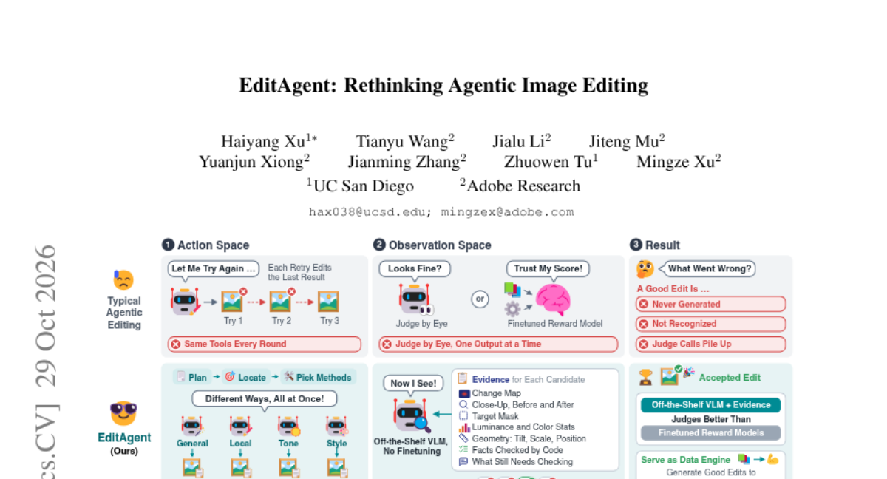

### 📌 한 줄 요약
에이전트의 행동 및 관찰 범위를 확장하여 복잡한 이미지 편집 성공률을 높인 프레임워크

### 🔑 핵심 포인트
- 행동 공간(Action Space) 확장을 위한 범용 및 전문 편집기 라우팅 전략 도입
- 검증 기록(Verification Record)을 활용하여 VLM의 판단 정확도 향상
- 병렬 생성 및 리스트 방식(Listwise) 판단을 통한 효율적인 의사결정 구조

### 🧑‍💻 개발자 관점
에이전트 설계 시 단순히 도구를 늘리는 것을 넘어, 판단을 위한 '관찰 데이터'를 어떻게 구조화할지가 성능의 핵심임을 보여줍니다.

### 🚀 실무 적용 아이디어
- 기존 이미지 편집 에이전트에 검증 기록(Verification Record)을 포함한 프롬프트 엔지니어링 적용해보기
- 단일 결과물 생성 방식과 리스트 방식(Listwise) 판단 방식의 속도 및 품질 비교 실험
- 특정 편집 작업(예: 배경 제거, 스타일 변환)에 특화된 전문 도구(Specialized methods)를 에이전트 워크플로우에 통합하기

### ⚠️ 리스크/한계
- 다양한 도구와 검증 기록을 관리함에 따른 시스템 복잡도 증가
- 병렬 생성 방식 사용 시 컴퓨팅 자원 소모 증가 가능성

### 📝 초록 기반 상세 설명
기존의 에이전트 기반 이미지 편집기는 실패 시 동일한 도구만 반복 사용하거나 시각적 판단에만 의존하는 한계가 있습니다. 연구진은 에이전트의 행동 공간(Action Space)과 판단을 위한 관찰 공간(Observation Space)이 제한적이라는 점에 주목했습니다. 이를 해결하기 위해 범용 편집기와 전문화된 편집기를 결Fal하고, 각 후보에 검증 기록을 첨리하는 EditAgent를 제안합니다. EditAgent는 병렬 생성과 리스트 방식의 한 번의 판단을 통해 효율성을 높였습니다. 실험 결과, 기존 오픈 웨이트 모델들의 성능을 개선하고 강력한 편집기 학습을 위한 데이터 엔진 역할까지 수행함을 입증했습니다.

### 🖼️ 추가 자료
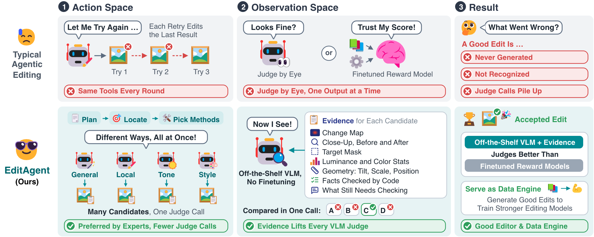

---

## 22. [Proving and Improving the Platonic Representation Hypothesis with JEPAs](https://huggingface.co/papers/2610.39302)
**Upvotes**: 7 | **도입 난이도**: 중 | **신뢰도**: 상
**arXiv**: https://arxiv.org/abs/2610.39302

**태그**: Multimodal, Representation Learning, JEPA, Scaling Laws, Vision, Benchmark, Evaluation, Safety

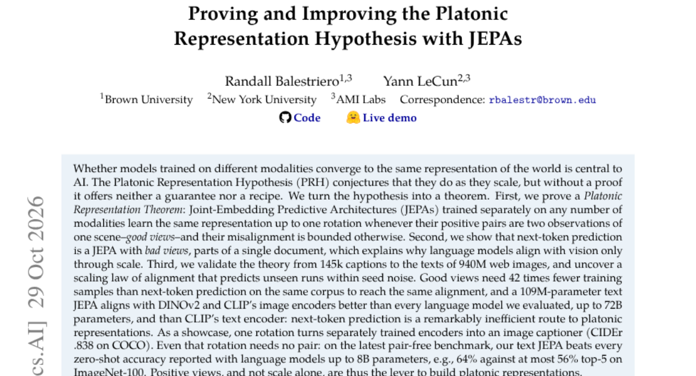

### 📌 한 줄 요약
단순 스케일링보다 '양질의 관점(Good Views)'을 활용한 JEPA 방식이 플라토닉 표현(Platonic Representation) 도달에 훨씬 효율적임을 증명함

### 🔑 핵심 포인트
- 플라토닉 표현 정리(Platonic Representation Theorem)를 통해 서로 다른 모달리티 간 표현 수렴 조건을 수학적으로 증명
- 차세대 토큰 예측(Next-token prediction)이 시각-언어 정렬에 있어 비효율적인 '나쁜 관점' 방식임을 규명
- 양질의 관점(Good views)을 활용한 JEPA가 스케일링보다 훨씬 적은 데이터로도 높은 정렬 효율을 가짐을 입증

### 🧑‍💻 개발자 관점
모델의 크기를 키우는 것보다 데이터의 구성(Positive pairs)과 학습 목적 함수를 설계하는 것이 멀티모달 정렬에 더 결정적임을 시사합니다.

### 🚀 실무 적용 아이디어
- 동일한 데이터셋 내에서 서로 다른 관점(View)을 생성하는 데이터 증강 전략 실험
- 단순 생성 작업 대신 JEPA 구조를 활용한 표현 학습(Representation Learning) 적용
- 학습된 인코더 간의 회전(Rotation) 정렬을 통한 제로샷 성능 테스트

### ⚠️ 리스크/한계
- 데이터의 '좋은 관점'을 정의하고 확보하는 데 따르는 비용과 복잡성
- 특정 도메인에 특화된 관점 설정 시 범용적 표현 학습과의 트레이드오프 발생 가능성

### 📝 초록 기반 상세 설명
서로 다른 모달리티로 학습된 모델들이 동일한 세계 표현으로 수렴한다는 '플라토닉 표현 가설(PRH)'은 스케일링에 따른 현상일 뿐 수학적 증명이 부족했습니다. 본 논문은 JEPAs(Joint-Embedding Predictive Architectures)를 통해 이 가설을 정리된 정리(Theorem)로 변환합니다. 연구 결과, 단순한 다음 토큰 예측(Next-token prediction)은 문서의 일부를 학습하는 '나쁜 관점'을 가진 JEPA로 작용하여 정렬 효율이 낮음을 밝혀냈습니다. 반면, 동일한 장면의 서로 다른 관점을 학습하는 '좋은 관점' 방식은 훨씬 적은 데이터로도 강력한 정렬을 달성합니다. 실험을 통해 제안된 방식이 기존 대규모 언어 모델보다 적은 파라미터로도 더 뛰어난 시각-언어 정렬 성능을 보임을 입증했습니다.

---

## 23. [PhysInsert: Physically Plausible Object Insertion with Geometric Priors and Bidirectional Object-Scene Interactions](https://huggingface.co/papers/2610.40453)
**Upvotes**: 7 | **도입 난이도**: 상 | **신뢰도**: 상
**arXiv**: https://arxiv.org/abs/2610.40453

**태그**: Computer Vision, Generative AI, 3D Geometry, Image Synthesis, Vision

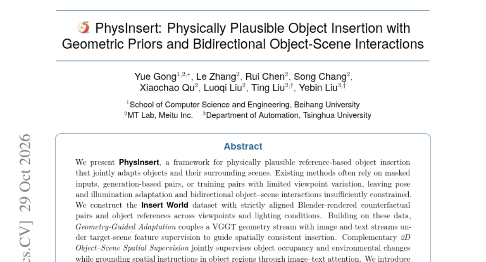

### 📌 한 줄 요약
기하학적 사전 정보와 양방향 상호작용을 통해 물리적으로 자연스러운 객체 삽입을 구현하는 프레임워크

### 🔑 핵심 포인트
- 다양한 시점과 조명 조건이 정렬된 고품질 'Insert World' 데이터셋 구축
- 기하학적 일관성을 유지하는 VGGT 기반의 기하 가이드 적응 기술
- 객체 점유와 환경 변화를 동시에 제어하는 양방향 객체-장면 공간 감독

### 🧑‍💻 개발자 관점
단순한 외형 복사를 넘어, 조명과 원근법이 반영된 자연스러운 3D 객체 배치가 필요한 그래픽스 및 합성 데이터 생성 작업에 유용합니다.

### 🚀 실무 적용 아이디어
- Blender를 활용한 유사한 형태의 대조적 데이터셋(Counterfactual pairs) 생성 실험
- 제공된 기하학 가이드(Geometry-Guided) 로직의 오픈소스 구현체 검토
- 기존 Diffusion 기반 Inpainting 모델과의 배치 정확도 비교 테스트

### ⚠️ 리스크/한계
- Blender 기반 합성 데이터에 의존하므로 실사 데이터로의 일반화 성능 검증 필요
- 복잡한 기하학적 구조를 가진 객체의 경우 정밀한 정렬이 어려울 수 있음

### 📝 초록 기반 상세 설명
기존의 객체 삽입 방식은 마스킹된 입력이나 제한된 시점의 데이터에 의존하여 포즈, 조명 적응 및 객체-장면 간의 상호작용 제약이 부족했습니다. 이를 해결하기 위해 다양한 시점과 조명 조건이 정렬된 'Insert World' 데이터셋을 구축했습니다. 제안하는 PhysInsert는 VGGT 기하학 스트림을 활용한 기하학 가이드 적응과 객체 점유 및 환경 변화를 동시에 제어하는 2D 객체-장면 공간 감독 방식을 결합합니다. 실험 결과, 기존 방식보다 향상된 이미지 충실도를 보였으며 사용자 연구에서도 배치 정확도와 조명/원근법 통합 능력이 우수함을 입증했습니다.

---

## 24. [Online Dense Reinforcement Learning with Planning-Grounding Agent for UI Navigation on Live IOS Apps](https://huggingface.co/papers/2610.39264)
**Upvotes**: 5 | **도입 난이도**: 상 | **신뢰도**: 상
**arXiv**: https://arxiv.org/abs/2610.39264

**태그**: Agent, Reinforcement Learning, UI Automation, Mobile OS, RAG, Vision, Benchmark, Evaluation, Inference

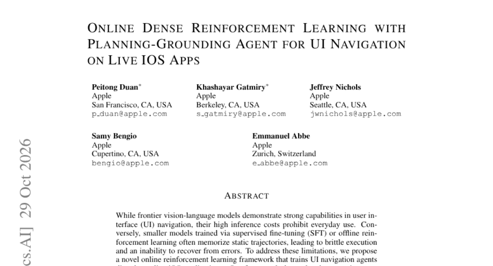

### 📌 한 줄 요약
실시간 iOS 환경에서 학습 가능한 분리형 에이전트 구조를 통해 저비용·고성능 UI 내비게이션 모델을 구현함

### 🔑 핵심 포인트
- Planning과 UI Grounding 모델을 분리하여 효율적인 UI 내비게이션 수행
- LLM-as-a-Judge를 활용한 단계별(Dense) 및 최종(Terminal) 보상 체계 설계
- 시각적 유사 상태를 활용해 크리틱 안정성을 높이는 GiGPPO 알고리즘 도입

### 🧑‍💻 개발자 관점
고비용의 거대 모델 대신 8B급 소형 모델로도 실무 수준의 UI 자동화 에이전트를 구축할 수 있는 경로를 제시합니다.

### 🚀 실무 적용 아이디어
- 분리형 에이전트(Planning vs Grounding) 구조를 기존 단일 모델 구조와 비교 실험
- LLM-as-a-Judge를 활용한 보상 설계가 에이전트의 오류 복구 능력에 미치는 영향 분석
- 가상 환경 인프라 구축 시 대규모 병렬 학습 환경 구성 가능성 검토

### ⚠️ 리스크/한계
- 실시간 가상 기기 인프라 구축 및 유지 비용이 매우 높을 수 있음
- LLM-as-a-Judge의 보상 편향이 에이전트의 특정 행동을 고착화할 위험 존재

### 📝 초록 기반 상세 설명
기존의 거대 시각-언어 모델은 높은 추론 비용이 문제였고, 소형 모델은 SFT나 오프라인 RL로 인해 정적 궤적에 매몰되어 오류 복구 능력이 부족했습니다. 이를 해결하기 위해 실시간 iOS 앱 환경에서 직접 학습하는 새로운 온라인 RL 프레임워크를 제안합니다. 에이전트를 Planning 에이전트와 UI Grounding 모델로 분리하고, LLM-as-a-Judge를 통해 단계별 보상과 최종 보상을 결합한 밀집 보상 체계를 구축했습니다. 또한, 유사한 시각적 상태를 활용해 크리틱 안정성을 높이는 GiGPPO 알고리즘과 수백 대의 가상 iOS 기기를 관리하는 인프라를 도입했습니다. 실험 결과, 제안된 8B 모델은 SFT 대비 뛰어난 일반화 성능을 보였으며 Gemini Pro급의 성능을 달성했습니다.

---

## 25. [AB-Attention: Accurate Block Attention for Accelerating Video Diffusion Transformers](https://huggingface.co/papers/2610.39663)
**Upvotes**: 4 | **도입 난이도**: 중 | **신뢰도**: 상
**arXiv**: https://arxiv.org/abs/2610.39663

**태그**: Video Generation, Attention Optimization, Inference Acceleration, Diffusion Models, Video, Inference

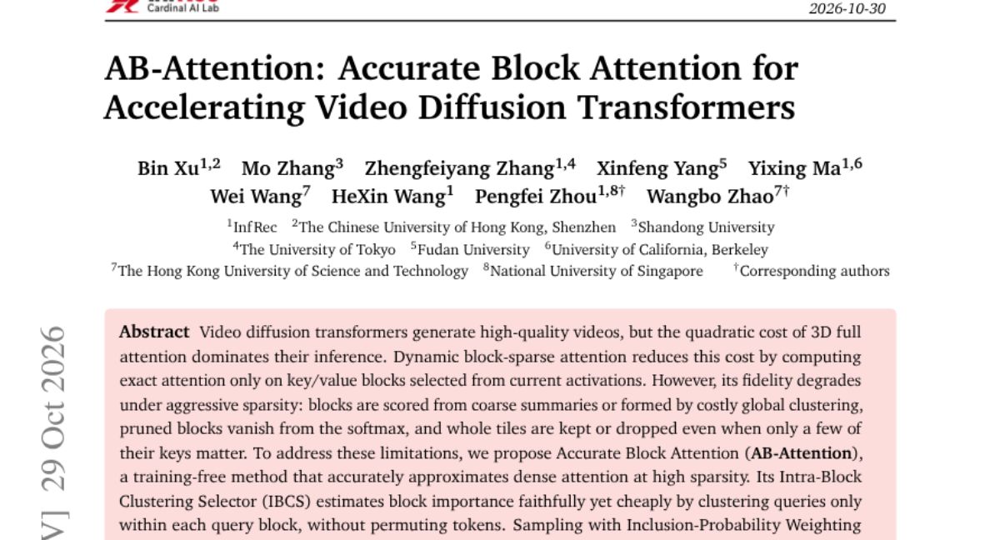

### 📌 한 줄 요약
비디오 확산 트랜스포머의 연산 비용을 획기적으로 줄이면서도 고정밀도를 유지하는 블록 희소 어텐션 기법

### 🔑 핵심 포인트
- IBCS(Intra-Block Clustering Selector): 토큰 순열 없이 쿼리 블록 내 클러스터링을 통해 블록 중요도를 저비용으로 추정
- SIP(Sampling with Inclusion-Probability Weighting): 포함 확률 기반 샘플링 및 역가중치 적용으로 밀집 어텐션 근사 정확도 향상
- Efficient Kernel: 텐서 코어 효율을 유지하면서도 타일보다 작은 KV 블록을 효율적으로 수집하는 커널 설계

### 🧑‍💻 개발자 관점
비디오 생성 모델의 추론 속도를 높이면서도 화질 저하를 최소화할 수 있는 실질적인 최적화 기법입니다.

### 🚀 실무 적용 아이디어
- 제공된 코드를 활용하여 Wan2.1/HunyuanVideo 모델의 추론 속도 및 PSNR 벤치마크 수행
- 다양한 희소도(Sparsity) 설정에 따른 화질 저하 임계점 확인
- 사용 중인 GPU 아키텍처에서 커널 연산 효율성 검증

### ⚠️ 리스크/한계
- 높은 희소도 설정 시 특정 시나리오에서 생성 품질의 가변성 발생 가능성
- 커스텀 커널 의존성으로 인한 특정 하드웨어 환경에서의 이식성 문제

### 📝 초록 기반 상세 설명
비디오 확산 트랜스포머는 고품질 영상 생성에 탁월하지만, 3D 풀 어텐션의 이차 복잡도 문제로 인해 추론 비용이 매우 높습니다. 기존의 동적 블록 희소 어텐션은 높은 희소도에서 정확도가 떨어지거나, 블록 단위 선택 방식이 세밀한 토큰 정보를 반영하지 못하는 한계가 있습니다. 이를 해결하기 위해 제안된 AB-Attention은 쿼리 블록 내 클러스터링을 통해 중요도를 추정하는 IBCS와 포함 확률 가중치를 적용한 SIP 방식을 도입합니다. 또한, 텐서 코어 연산 효율을 유지하면서도 작은 크기의 KV 블록을 모아 처리하는 커널을 통해 정밀한 선택을 지원합니다. 실험 결과, Wan2.1 및 HunyuanVideo 모델에서 89~92%의 높은 희소도를 달에서도 성능 저하를 최소화하며 최대 2.23배의 속도 향상을 달성했습니다.

---

## 26. [SO-101 Bench: Accessible Spatial Manipulation](https://huggingface.co/papers/2610.36420)
**Upvotes**: 4 | **도입 난이도**: 중 | **신뢰도**: 상
**arXiv**: https://arxiv.org/abs/2610.36420

**태그**: Robot Learning, Digital Twin, Sim-to-Real, LLM Agent, Spatial Manipulation, Agent, Benchmark, Evaluation

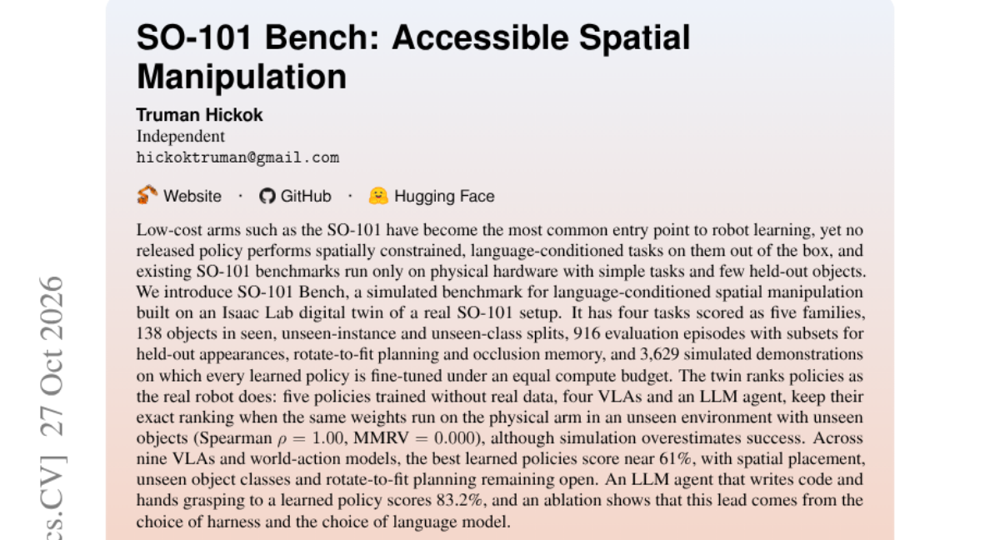

### 📌 한 줄 요약
실제 SO-101 로봇 환경을 정밀하게 모사한 시뮬레이션 벤치마크를 통해 언어 기반 공간 조작 성능을 검증하고 평가하는 프레임워크를 제안합니다.

### 🔑 핵심 포인트
- 실제 SO-1OD 로봇 환경을 정밀하게 복제한 Isaac Lab 기반 디지털 트윈 벤치마크 구축
- 미학습 객체 및 공간 제약(회전, 가려짐)을 포함한 고난도 언어 기반 조작 태스크 설계
- 시뮬레이션 평가 결과가 실물 로봇의 성능 순위와 완벽하게 일치(Spearman rho = 1.00)함을 검증

### 🧑‍💻 개발자 관점
시뮬레이션 환경이 실제 로봇의 성능 순위를 정확히 반영함을 보여주므로, 하드웨어 없이도 신뢰도 높은 정책 평가 및 학습이 가능함을 시사합니다.

### 🚀 실무 적용 아이디어
- Isaac Lab 환경에서 제공된 디지털 트윈을 활용해 로봇 제어 정책 학습 실험
- LLM 에이전트와 학습된 로봇 정책(VLA)을 결합한 하이브리드 제어 구조 테스트
- 시뮬레이션과 실물 환경 간의 성공률 차이(Sim-to-Real gap) 분석

### ⚠️ 리스크/한계
- 시뮬레이션이 성공률을 실제보다 과대평가하는 경향이 있음
- 공간 배치, 미학습 객체 클래스, 회전 정렬 등의 복잡한 작업은 여전히 해결 과제로 남음

### 📝 초록 기반 상세 설명
저가형 로봇 팔인 SO-101은 로봇 학습의 입문점으로 쓰이지만, 기존 벤치마크는 단순한 작업 위주이거나 물리적 하드웨어에만 국한되어 있었습니다. 본 논문은 실제 SO-101 환경의 디지털 트윈인 Isaac Lab 기반 'SO-101 Bench'를 소개합니다. 이 벤치마크는 다양한 객체와 공간 제약 조건(회전, 가려짐 등)을 포함하며, 시뮬레이션과 실물 로봇 간의 순위 상관관계가 완벽하게 일치함을 입증했습니다. 실험 결과, LLM 에이전트가 코드를 작성하고 학습된 정책에 파지(grasping)를 맡기는 방식이 가장 높은 성능을 보였습니다. 결과적으로 시뮬레이션이 실물 로봇의 성능 순위를 정확히 예측할 수 있음을 보여주었습니다.

---

## 27. [ABF-Bench: A Verifiable Benchmark for Agentic Blockchain Forensics](https://huggingface.co/papers/2610.23656)
**Upvotes**: 3 | **도입 난이도**: 중 | **신뢰도**: 상
**arXiv**: https://arxiv.org/abs/2610.23656

**태그**: Agent, Blockchain, Forensics, LLM, Benchmark, Evaluation

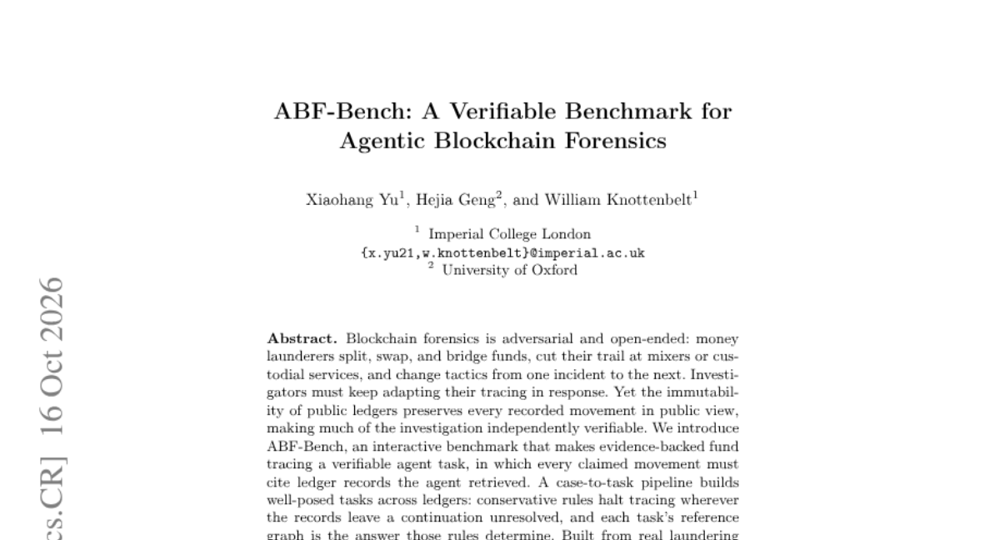

### 📌 한 줄 요약
실제 자금 세탁 시나리오를 기반으로 에이전트의 블록체인 추적 능력과 근거 제시 능력을 검증하는 벤치마크 제안

### 🔑 핵심 포인트
- 실제 자금 세탁 활동을 기반으로 설계된 검증 가능한 블록체인 포렌식 벤치마크(ABF-Bench) 개발
- 에이전트가 주장하는 모든 이동 경로에 대해 온체인 기록을 인용하도록 강제하는 검증 메커니즘 도입
- 범용 LLM 에이전트와 고정 순서 추적기(Fixed-order tracers) 간의 성능 비교 및 한계 분석

### 🧑‍💻 개발자 관점
LLM 에이전트를 활용한 자동화된 온체인 조사 도구 개발 시, 할루시네이션을 방지하고 추적 결과의 신뢰성을 확보하는 방법론을 제시합니다.

### 🚀 실무 적용 아이디어
- 제안된 ABF-Bench 프레임워크를 활용하여 현재 보유한 포렌식 에이전트의 재현율(Recall) 측정
- 에이전트가 근거 없는 기록을 인용하는 '과잉 확신(Overconfidence)' 문제를 해결하기 위한 프롬프트 엔지니어링 실험
- 복잡한 경로에서 에이전트가 조기에 탐색을 중단하는 문제를 해결하기 위한 워킹 메모리 최적화 테스트

### ⚠️ 리스크/한계
- 에이전트가 복잡도가 높은 대규모 태스크에서 조기에 탐색을 종료하여 재현율이 낮아지는 경향이 있음
- 실제 환경의 가변적인 수법을 완벽히 커버하기에는 벤치마크의 정적 규칙에 의존할 위험이 있음

### 📝 초록 기반 상세 설명
블록체인 포렌식은 자금 세탁 수법이 끊임없이 변하는 적대적이고 개방적인 환경에서 이루어집니다. 기존의 추적 방식은 복잡한 경로와 다양한 수법에 대응하기 어렵고 검증이 까다롭습니다. 본 논문은 모든 추적 결과가 온체인 기록을 근거로 제시되어야 하는 검증 가능한 벤치마크인 ABF-Bench를 제안합니다. 실제 자금 세탁 사례를 바탕으로 멀티홉 전송, DeFi, 크로스체인, 믹서 등을 포함한 복잡한 태스크를 구축했습니다. 실험 결과, 제안된 에이전트 하네스는 일반 범용 에이전트보다 높은 재현율을 보였으며, 고정 순서 추적기보다 증거 확보 속도와 미공개 수탁 서비스 식별 능력에서 우수함을 입증했습니다.

---

## 28. [OpenFlyV2: An onboard vision-language-action model for aerial perception and navigation](https://huggingface.co/papers/2610.39287)
**Upvotes**: 3 | **도입 난이도**: 상 | **신뢰도**: 상
**arXiv**: https://arxiv.org/abs/2610.39287

**태그**: VLA, Embodied AI, Edge AI, Robotics, Sim-to-Real, Reasoning, Multimodal, Vision

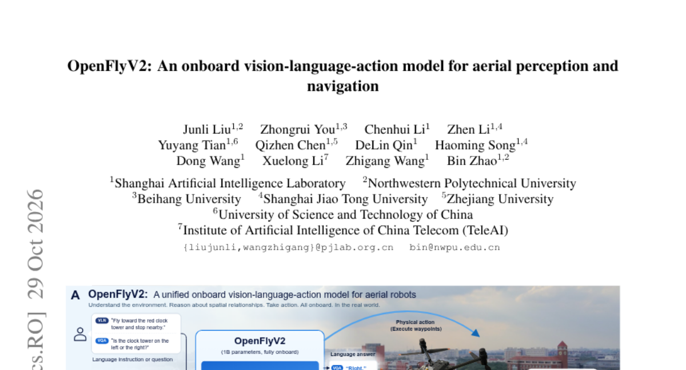

### 📌 한 줄 요약
자원 제한적인 온보드 환경에서 시각-언어-행동(VLA)을 통합하여 실시간 비행 제어를 구현한 모델

### 🔑 핵심 포인트
- 시각-언어-행동(VLA)을 하나의 모델로 통합한 온보드 아키텍처 설계
- 저사양 임베디드 플랫폼(Jetson Orin NX)을 위한 효율적인 액션 생성 및 메모리 메커니즘
- 시뮬레이션 학습 후 실세계로의 성공적인 제로샷(Zero-shot) 전이 성능 확보

### 🧑‍💻 개발자 관점
엣지 디바이스(Jetson 등)에서 복잡한 멀티모달 추론과 실시간 제어를 동시에 수행할 수 있는 실용적인 아키텍처 가이드를 제공합니다.

### 🚀 실무 적용 아이디어
- 제공된 시뮬레이션 데이터셋을 활용한 VLA 모델 학습 워크플로우 분석
- Jetson Orin NX와 같은 임베디드 환경에서의 추론 최적화 기법 검토
- Sim-to-Real 전이를 위한 데이터 증강 및 도메인 적응 전략 연구

### ⚠️ 리스크/한계
- 실제 환경에서의 성공률이 48%로, 복잡한 장애물이 많은 환경에서의 신뢰성 검증 필요
- 시뮬레이션 의존도가 높아 물리적 환경 차이에 따른 성능 저하 가능성 존재

### 📝 초록 기반 상세 설명
기존의 항공 로봇 시스템은 개별 기능에 특화되어 있거나 고성능 오프보드 연산에 의존하여 폐쇄 루프 제어가 어렵다는 문제가 있었습니다. 본 논문은 시각-언어 표현을 공유하여 의미 이해, 공간 추론, 연속적 비행 제어를 하나의 모델로 수행하는 OpenFlyV2 아키텍처를 제안합니다. 압축된 액션 전문가(Action Expert)와 모션 인지형 시간 메모리를 통해 저사양 플랫폼에서도 효율적인 제어가 가능하도록 설계했습니다. 시뮬레이션 기반의 대규모 데이터셋을 활용해 학습된 결과, NVIDIA Jetson Orin NX 환경에서 10Hz의 속도로 온보드 실행이 가능함을 입증했습니다. 최종적으로 실세계 데이터 없이도 시뮬레이션에서 학습된 모델이 실제 쿼드로터에 제로샷으로 전이되어 성공적인 내비게이션 성능을 보여주었습니다.

---

## 29. [Your LR Schedule May Not Be Principled: Effective Learning Rate Scheduling in Weight-Normalized Training](https://huggingface.co/papers/2610.40362)
**Upvotes**: 3 | **도입 난이도**: 하 | **신뢰도**: 상
**arXiv**: https://arxiv.org/abs/2610.40362

**태그**: Deep Learning, Optimization, Learning Rate, Weight Normalization

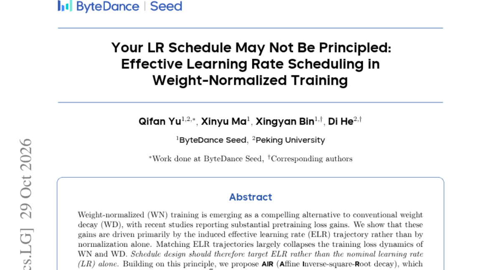

### 📌 한 줄 요약
Weight-Normalization 학습 시 성능 향상의 핵심은 명목 LR이 아닌 유도된 유효 학습률(ELR) 제어에 있음을 밝히고 새로운 스케줄링 기법인 AIR를 제안함

### 🔑 핵심 포인트
- WN의 성능 이점은 정규화 효과보다 유도된 유효 학습률(ELR) 궤적에 기인함
- ELR을 타겟팅하는 새로운 스케줄링 기법인 AIR(Affine Inverse-square-Root decay) 제안
- ELR 중심의 스케줄링은 WN뿐만 아니라 WD 환경에서도 동일한 학습 역학을 유도함

### 🧑‍💻 개발자 관점
학습 스케줄링 설계 시 단순히 LR 값을 조정하는 것을 넘어, 가중치 정규화 방식에 의해 변하는 '실제 유효 학습률'을 고려해야 함을 시사합니다.

### 🚀 실무 적용 아이디어
- Weight-Normalization을 사용하는 모델에 제안된 AIR 스케줄링 적용 실험
- 기존 Cosine 스케줄과 AIR 스케줄 간의 ELR 궤적 차이 비교 분석
- WD 환경에서 ELR 궤적을 일치시켰을 때의 성능 변화 확인

### ⚠️ 리스크/한계
- ELR 궤적 설계가 복잡할 경우 수동 튜닝의 난이도가 상승할 수 있음
- 특정 모델 구조나 학습 규모에 따른 일반화 여부 검증 필요

### 📝 초록 기반 상세 설명
최근 Weight-Normalization(WN) 방식이 Weight Decay(WD)의 대안으로 주목받으며 성능 향상을 보였으나, 그 원인이 명확하지 않았습니다. 본 연구는 WN의 성능 향상이 정규화 자체보다 유도된 유효 학습률(ELR) 궤적에 의해 발생함을 증명했습니다. 이에 따라 명목 LR이 아닌 ELR을 타겟팅하는 새로운 스케줄링 방식인 AIR(Affine Inverse-square-Root decay)를 제안합니다. 실험 결과, AIR는 기존 Cosine 스케줄보다 낮은 최종 손실과 더 높은 하이퍼파라미터 강건성을 보여주었습니다. 또한, 동일한 ELR 궤적을 WD에 적용했을 때도 동일한 학습 역학이 나타남을 확인하여 ELR이 스케줄링의 핵심 객체임을 입증했습니다.

---

## 30. [Training Foundation Models with a Single Algorithm](https://huggingface.co/papers/2610.40564)
**Upvotes**: 2 | **도입 난이도**: 중 | **신뢰도**: 상
**arXiv**: https://arxiv.org/abs/2610.40564

**태그**: LLM, Reinforcement Learning, Fine-tuning, Training Optimization, RAG

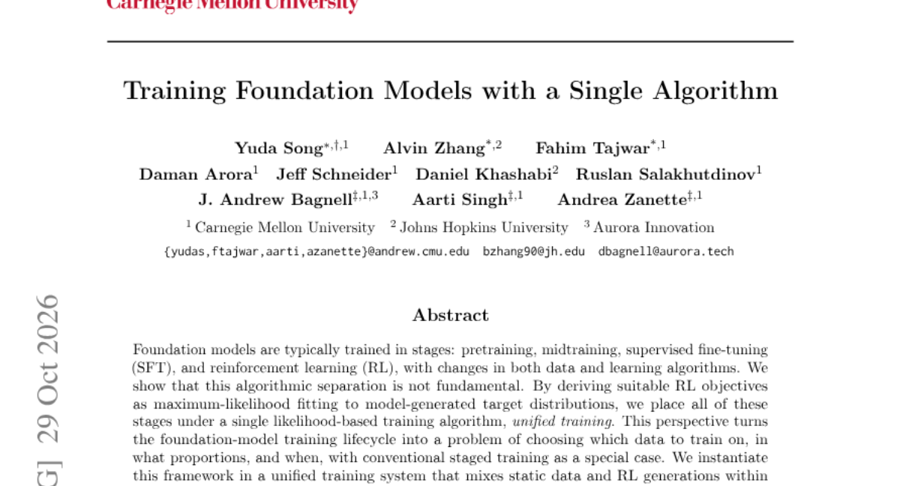

### 📌 한 줄 요약
파인튜닝과 RL을 하나의 알고리즘으로 통합하여 데이터 구성만으로 모델 성능을 최적화하는 학습 프레임워크 제안

### 🔑 핵심 포인트
- SFT와 RL을 하나의 MLE 기반 알고리즘으로 통합하는 'Unified Training' 프레임워크 제안
- 학습 단계를 알고리즘 변경이 아닌 데이터 구성(종류, 비율, 시점)의 문제로 전환
- 정적 데이터와 RL 생성 데이터를 혼합하여 연산 효율 및 모델 역량 최적화

### 🧑‍💻 개발자 관점
모델 학습 파이프라인을 복잡한 단계별 전환 대신 데이터 믹싱 전략 중심으로 단순화하여 운영 효율을 극대화할 수 있습니다.

### 🚀 실무 적용 아이디어
- 기존 SFT 데이터와 RL 생성 데이터를 혼합한 데이터 믹싱 비율 실험
- 단일 트레이너 환경에서의 데이터 스케줄링(Scheduling) 전략 수립
- 단계별 학습 대비 연산 자원 대비 성능(Accuracy-Compute tradeoff) 비교

### ⚠️ 리스크/한계
- 데이터 비율 설정에 따른 모델의 특정 능력 편향 가능성
- 대규모 데이터 혼합 시 학습 안정성 확보 필요성

### 📝 초록 기반 상세 설명
기존 파운데이션 모델 학습은 사전 학습, SFT, RL 등 단계별로 알고리즘과 데이터가 분리되어 진행되었습니다. 연구진은 이러한 단계적 분리가 필수적이지 않다는 점에 주목하여, RL 목적 함수를 최대 우도 추정(MLE) 방식으로 재정의했습니다. 이를 통해 모든 학습 단계를 하나의 우도 기반 알고리즘으로 통합하는 'Unified Training' 프레임워크를 제안합니다. 이 방식은 학습 과정을 데이터의 종류와 비율을 결정하는 문제로 단순화하며, 정적 데이터와 RL 생성 데이터를 단일 트레이너에서 혼합 학습합니다. 실험 결과, 통합 학습은 연산 효율성과 작업 커버리지를 개선하며 지속적 학습을 위한 강력한 기반을 제공함을 입증했습니다.

---

## 31. [Scaling Lean Theorem Proving for Real-World Code Verification](https://huggingface.co/papers/2610.38174)
**Upvotes**: 2 | **도입 난이도**: 상 | **신뢰도**: 상
**arXiv**: https://arxiv.org/abs/2610.38174

**태그**: Formal Verification, LLM Agents, Automated Theorem Proving, Rust, Software Engineering, Agent, Benchmark

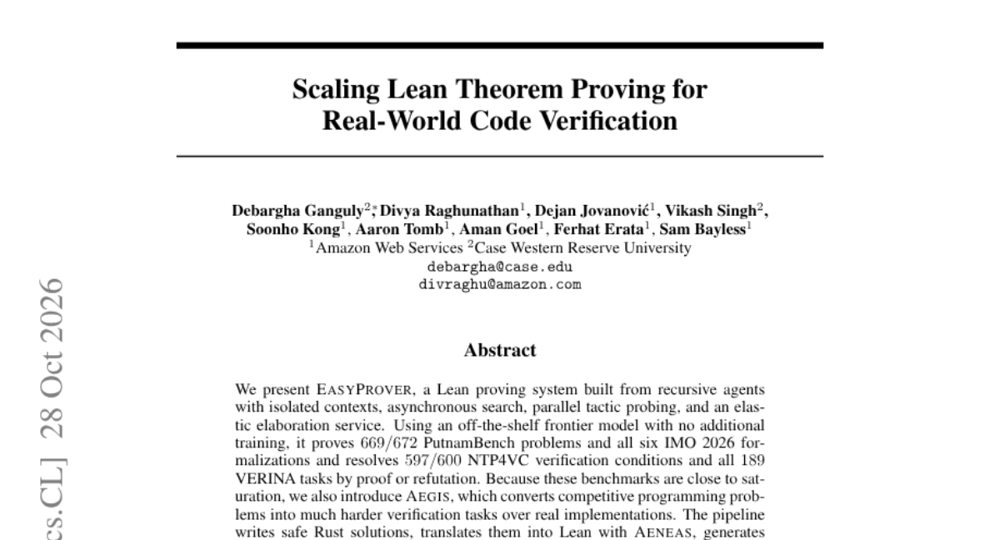

### 📌 한 줄 요약
재귀적 에이전트와 자동화된 벤치마크 생성을 통해 실세계 코드 검증 능력을 극대화한 Lean 증명 시스템 연구

### 🔑 핵심 포인트
- EasyProver: 재귀적 에이전트와 비동기 탐색을 결합한 고성능 Lean 증명 시스템
- Aegis: 경쟁 프로그래밍 문제를 실세계 구현 수준의 검증 과제로 변환하는 파이프라인
- 실제 코드 검증: 고정 너비 산술, 루프, 타입 캐스팅 등 구현 수준의 제약 조건을 포함한 벤치마크 구축

### 🧑‍💻 개발자 관점
수학적 정리를 넘어 실제 프로그래밍 언어(Rust 등)의 복잡한 구현 로직을 정형 검증할 수 있는 자동화된 방법론을 제시합니다.

### 🚀 실무 적용 아이디어
- EasyProver의 에이전트 구조를 기존 LLM 기반 코딩 에이전트에 이식해보기
- Aegis 파이프라인을 활용해 생성된 Rust-Lean 쌍의 정합성 검토하기
- 생성된 벤치마크를 활용해 RL 기반 증명 모델의 성능 테스트하기

### ⚠️ 리스크/한계
- 생성된 벤치마크가 특정 도메인(경쟁 프로그래밍)에 편향될 가능성
- 복잡한 구현 로직의 자동 생성 시 발생하는 정형화 과정의 오버헤드

### 📝 초록 기반 상세 설명
기존의 수학적/프로그래밍적 벤치마크는 점차 포화 상태에 이르러 실세계 코드 검증 능력을 측정하기 어려워지고 있습니다. 이를 해결하기 위해 재귀적 에이전트, 비동기 탐색, 탄력적 정교화 서비스를 결합한 EasyProver 시스템을 제안합니다. 또한, 경쟁 프로그래밍 문제를 고난도 검증 과제로 변환하는 Aegis 파이프라인을 도입하여 실질적인 구현 수준의 과제를 생성합니다. 실험 결과, EasyProver는 PutnamBench와 IMO 문제 등에서 탁월한 성능을 보였으며, Aegis를 통해 생성된 1만 개 이상의 복잡한 Rust-Lean 과제에서도 높은 검증 성공률을 기록했습니다. 이 연구는 자동화된 정형 검증과 RL 학습을 위한 고난도 데이터셋 제공에 기여합니다.

---

## 32. [Holo4D: Holistic 4D Reconstruction as Geometric Control for Video Diffusion](https://huggingface.co/papers/2610.25276)
**Upvotes**: 2 | **도입 난이도**: 중 | **신뢰도**: 상
**arXiv**: https://arxiv.org/abs/2610.25276

**태그**: Video Generation, 4D Reconstruction, Diffusion Models, Computer Vision, Video

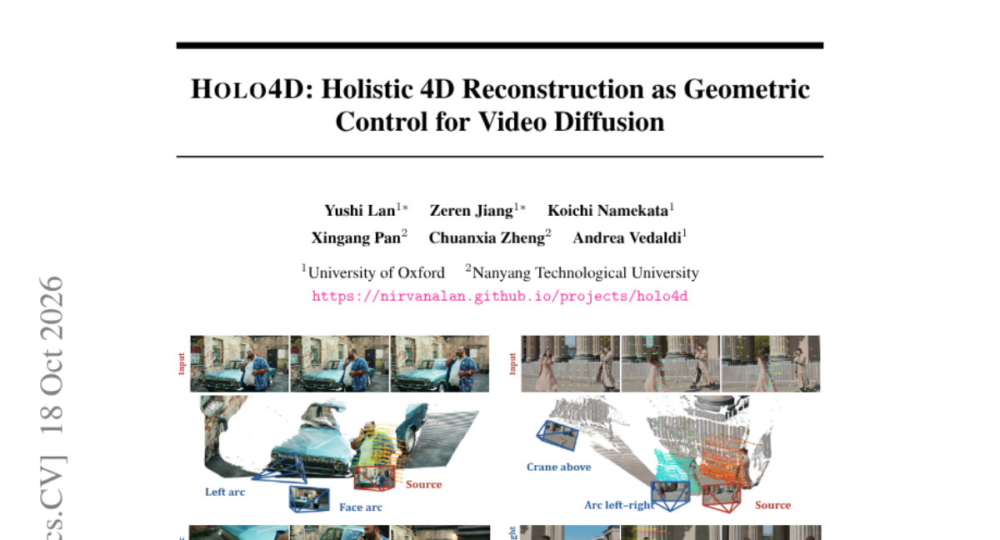

### 📌 한 줄 요약
재구성된 4D 구조를 가이드로 활용하여 비디오 확산 모델의 카메라 제어 및 신규 뷰 합성 성능을 극대화한 프레임워크

### 🔑 핵심 포인트
- 재구성된 3D 궤적을 4D 스캐폴드로 활용하여 기하학적 일관성 확보
- 사전 학습된 비디오 확산 모델을 재학습 없이 활용하는 모듈형 구조
- 소스 영상의 기하 구조와 외형을 타겟 뷰로 투영하는 정교한 가이드 메커니즘

### 🧑‍💻 개발자 관점
비디오 생성 모델의 고질적인 문제인 카메라 움직임 제어와 구조적 왜곡 문제를 해결할 수 있는 실용적인 워크플로우를 제시합니다.

### 🚀 실무 적용 아이디어
- 다양한 4D 재구성 모델(NeRF, Gaussian Splatting 등)을 스캐폴드로 교체하며 성능 비교
- 복잡한 움직임이 포함된 소스 영상에서의 기하학적 일관성 유지 여부 테스트
- 스캐폴드 가이드 강도 변화에 따른 생성 품질 변화 분석

### ⚠️ 리스크/한계
- 소스 영상의 재구성 품질이 생성 결과물의 품질에 직접적인 영향을 미침
- 매우 역동적이거나 복잡한 움직임에서는 4D 스캐폴드와 생성 모델 간의 불일치 발생 가능성

---

## 33. [After One-Click Video: The Inflow of Service-Type Content, the Failure of the Recommendation Pool Mechanism, and the BoLe System](https://huggingface.co/papers/2610.37695)
**Upvotes**: 2 | **도입 난이도**: 중 | **신뢰도**: 상
**arXiv**: https://arxiv.org/abs/2610.37695

**태그**: AI-Generated Content, Recommendation Systems, Content Economy, Algorithm Design, Video

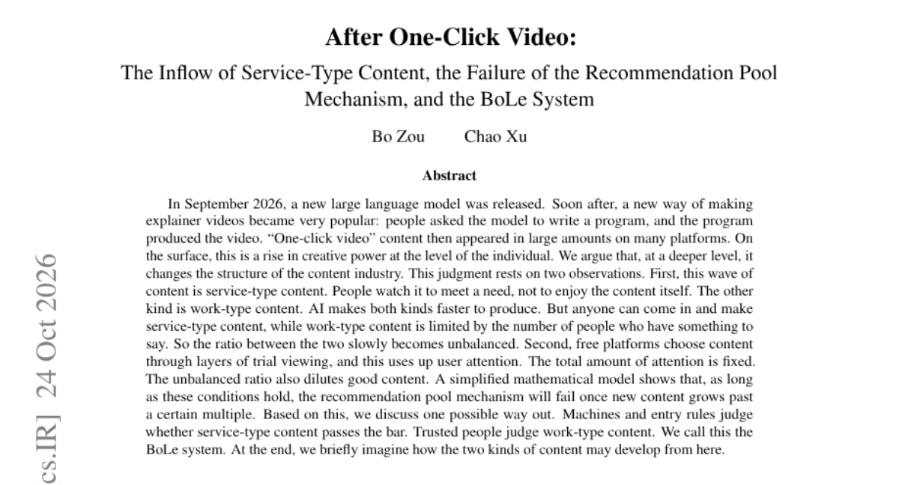

### 📌 한 줄 요약
AI 자동 생성 콘텐츠의 급증이 추천 알고리즘의 효율성을 저해하는 구조적 문제를 분석하고, 이를 해결하기 위한 'BoLe 시스템'을 제안함

### 🔑 핵심 포인트
- 서비스형(Service-type) vs 작업형(Work-type) 콘텐츠의 구조적 불균형 분석
- 콘텐츠 양의 급증이 기존 추천 풀(Recommendation Pool) 메커니즘을 붕괴시키는 수학적 모델링
- 기계적 규칙과 신뢰 기반 인적 검증을 결합한 'BoLe 시스템' 제안

### 🧑‍💻 개발자 관점
AI 생성 콘텐츠가 범람하는 환경에서 추천 알고리즘의 설계 방향과 콘텐츠 필터링 전략에 대한 구조적 통찰을 제공합니다.

### 🚀 실무 적용 아이디어
- 생성형 AI 콘텐츠 비중 증가에 따른 추천 알고리즘의 성능 저하 임계점 시뮬레이션
- 서비스형 콘텐츠와 작업형 콘텐츠를 구분하는 메타데이터 분류 모델 실험
- 신뢰도 기반의 하이브리드 추천 시스템 프로토타입 설계

### ⚠️ 리스크/한계
- 제안된 BoLe 시스템의 실제 구현 시 발생하는 운영 비용 및 복잡성
- 서비스형 콘텐츠의 정의와 분류 기준에 대한 주관적 해석 가능성

### 📝 초록 기반 상세 설명
LLM을 활용한 '원클릭 영상' 제작 기술로 인해 서비스형 콘텐츠가 폭발적으로 증가하는 시대가 도래했습니다. 이러한 콘텐츠는 단순 필요 충족을 목적으로 하며, 창작자 수의 제약이 있는 작업형 콘텐츠와 달리 무한히 생성될 수 있어 콘텐츠 생태계의 균형을 무너뜨립니다. 고정된 사용자 주의력을 기반으로 하는 기존의 추천 풀 메커니즘은 콘텐츠 양이 임계치를 넘어서면 질적 저하와 함께 실패하게 됩니다. 이를 해결하기 위해 기계적 검증과 신뢰 기반의 인간 검증을 결합한 'BoLe 시스템'을 제안합니다. 결과적으로 이 모델은 콘텐츠 유형에 따른 차별적 필터링을 통해 생태계의 지속 가능성을 확보하는 방안을 제시합니다.

---

## 34. [Unlocking Any-Order Generation in Pretrained Autoregressive Image Models](https://huggingface.co/papers/2610.39293)
**Upvotes**: 1 | **도입 난이도**: 하 | **신뢰도**: 상
**arXiv**: https://arxiv.org/abs/2610.39293

**태그**: Generative AI, Image Editing, Autoregressive Model, Efficient Fine-tuning, Vision, Inference

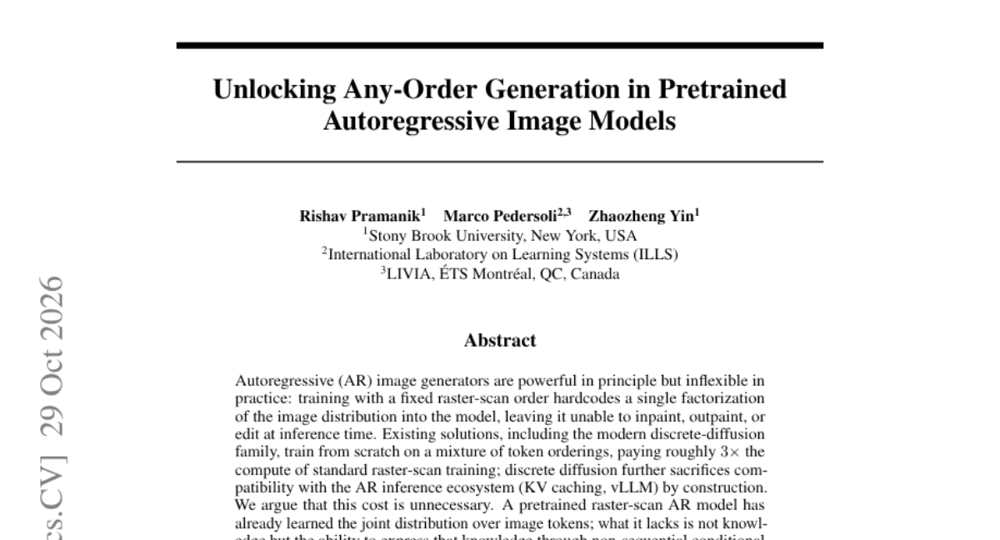

### 📌 한 줄 요약
사전 학습된 AR 이미지 모델의 지식을 유지하면서 인페인팅, 아웃페인팅 등 자유로운 생성 순서를 가능하게 하는 효율적인 적응 기법 제안

### 🔑 핵심 포인트
- 사전 학습된 래스터 스캔 AR 모델을 재학습 없이(또는 최소 비용으로) Any-order 생성기로 변환
- 미래 인지 위치 임베딩과 순서 커리큘럼을 통한 효율적인 최적화 경로 확보
- 기존 AR 추론 생태계(KV 캐싱, vLLM 등)와의 호환성을 유지하며 인페인팅/아웃페인팅 기능 확보

### 🧑‍💻 개발자 관점
모델을 처음부터 다시 학습하는 막대한 비용 없이, 기존에 학습된 고성능 AR 모델을 편집 및 다양한 생성 작업에 즉시 활용할 수 있는 실용적인 방법론을 제시합니다.

### 🚀 실무 적용 아이디어
- LlamaGen 등 기존 AR 모델에 제안된 위치 임베딩과 커리큘럼 적용 실험
- 인페인팅/아웃페인팅 작업 시 기존 래스터 스캔 모델과의 FID 성능 비교
- KV 캐싱 등 기존 추론 가속 프레임워크에서의 효율성 검증

### ⚠️ 리스크/한계
- 자유로운 순서 생성 시 클래스 조건부 FID 성능이 약간 저하될 수 있음
- 사전 학습된 모델의 원래 분포와 새로운 순서 사이의 최적화 균형 조절 필요

### 📝 초록 기반 상세 설명
기존의 자기회귀(AR) 이미지 생성 모델은 고정된 래스터 스캔 순서로 학습되어 인페인팅이나 편집과 같은 유연한 작업에 제약이 있었습니다. 이를 해결하기 위해 기존 모델을 처음부터 다시 학습하는 대신, 이미 학습된 분포를 활용하는 효율적인 적응 방식을 제안합니다. 방법론으로는 타겟 위치 식별 문제를 해결하는 '미래 인지 위치 임베딩(future-aware positional embeddings)'과 안정적인 최적화를 위한 '순서 커리큘럼(ordering curriculum)'을 사용합니다. 실험 결과, 기존 모델의 추론 스택을 유지하면서도 MaskGIT 대비 우수한 인페인팅 성능을 보였으며 적은 추가 연산 비용으로 유연한 생성 능력을 확보했습니다.

---

## 35. [Matched Capabilities, Different Behaviors: A Controlled Study of MCP and CLI Interfaces for Language Agents](https://huggingface.co/papers/2610.34298)
**Upvotes**: 1 | **도입 난이도**: 중 | **신뢰도**: 상
**arXiv**: https://arxiv.org/abs/2610.34298

**태그**: AI Agent, Interface Design, LLM Optimization, Agent, Benchmark, Evaluation

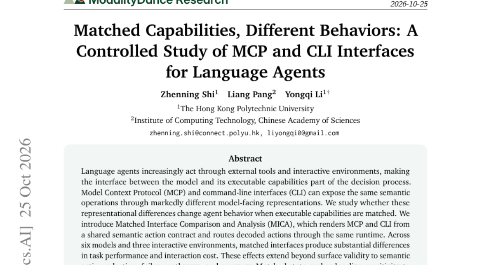

### 📌 한 줄 요약
에이전트의 도구 인터페이스(MCP vs CLI) 차이가 작업 성능과 비용에 미치는 영향을 분석하고 이를 최적화하는 프레임워크를 제안함

### 🔑 핵심 포인트
- MICA: 동일한 기능(Capability)을 가진 MCP와 CLI 간의 행동 차이를 정밀하게 비교하는 분석 방법론 제안
- 인터페이스 표현 방식이 에이전트의 작업 성공률과 토큰 비용(Interaction Cost)에 직접적인 영향을 미침을 입증
- DART: 검증된 시맨틱 액션을 유지하면서 인터페이스 구현 차이로 인한 문제를 해결하는 최적화 프레임워크 개발

### 🧑‍💻 개발자 관점
에이전트 개발 시 단순히 기능(API)을 구현하는 것을 넘어, 모델이 이해하기 쉬운 인터페이스 구조를 설계하는 것이 성능과 비용에 결정적임을 시사합니다.

### 🚀 실무 적용 아이디어
- 동일한 API 기능을 MCP 방식과 CLI 방식으로 각각 구현하여 에이전트의 성공률 비교 실험 수행
- 에이전트가 도구를 호출할 때 발생하는 토큰 소모량과 작업 성공률 간의 상관관계 분석
- DART와 유사하게 시맨틱 의사결정과 인터페이스 구현을 분리하는 구조로 에이전트 워크플로우 설계

### ⚠️ 리스크/한계
- 특정 모델이나 환경에 특화된 인터페이스 최적화일 수 있어 일반화 가능성 검토 필요
- 인터페이스 최적화가 복잡한 도구 사용 시 의사결정 품질에 미치는 장기적 영향 분석 필요

### 📝 초록 기반 상세 설명
언어 에이전트가 외부 도구를 사용하는 과정에서 인터페이스 표현 방식이 모델의 의사결정에 미치는 영향이 중요해지고 있습니다. 본 연구는 동일한 기능을 제공하더라도 MCP와 CLI처럼 표현 방식이 다를 때 에이전트의 행동이 어떻게 변하는지 분석합니다. 이를 위해 동일한 시맨틱 액션 계약을 기반으로 인터페이스를 비교하는 MICA 방법론을 도입했습니다. 실험 결과, 인터페이스 표현 방식의 차이가 작업 성능, 상호작용 비용, 실패 경로 등에 상당한 차이를 유발함을 확인했습니다. 이를 해결하기 위해 시맨틱 의사결정은 유지하되 인터페이스 구현만 최적화하는 DART 프레임워크를 제안합니다. 결과적으로 DART는 벤치마크 점수를 높이고 토큰 비용을 크게 절감하는 성과를 보였습니다.

---

## 36. [Broken on Arrival: Non-Functional Quantized LLM Artifacts in Public Model Registries and How to Catch Them](https://huggingface.co/papers/2609.05881)
**Upvotes**: 1 | **도입 난이도**: 하 | **신뢰도**: 상
**arXiv**: https://arxiv.org/abs/2609.05881

**태그**: LLM, Quantization, Model Deployment, Software Engineering, Evaluation, Optimization

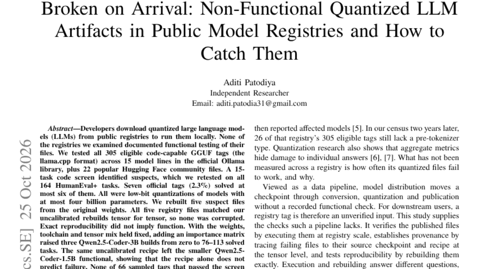

### 📌 한 줄 요약
공개 모델 저장소의 양자화된 LLM 파일이 기능적 결함을 가질 수 있음을 밝히고 이를 검증하는 도구를 제안함

### 🔑 핵심 포인트
- 공개 모델 저장소의 양자화 파일이 기능적으로 손상되었을 가능성 확인
- 파일 손상이 없더라도 양자화 설정(Importance Matrix 등)에 따라 성능이 급격히 저하될 수 있음
- 검증 도구 'quantcheck' 및 감사 데이터 공개

### 🧑‍💻 개발자 관점
로컬에서 양자화 모델을 사용할 때, 파일이 정상적으로 다운로드되었다고 해서 모델의 기능(추론 능력)까지 보장되는 것은 아님을 인지해야 합니다.

### 🚀 실무 적용 아이디어
- 로컬에서 사용하는 저비트 양자화 모델의 벤치마크 테스트 수행
- 모델 배포 전 quantcheck와 같은 검증 도구를 통한 기능성 스크리닝 도입
- 중요도 행렬(Importance Matrix)을 적용한 양자화 최적화 실험

### ⚠️ 리스크/한계
- 양자화 설정값에 따라 기능적 결함 여부가 결정되므로 단순 파일 체크만으로는 부족할 수 있음
- 모델 크기가 작을수록 양자화로 인한 성능 저하 위험이 높음

### 📝 초록 기반 상세 설명
개발자들은 로컬 실행을 위해 공개 저장소에서 양자화된 LLM을 다운로드하지만, 기존 저장소들은 파일의 기능적 무결성을 검증하지 않습니다. 연구진은 Ollama와 Hugging Face의 수백 개 GGUF 태그를 대상으로 코드 생성 능력을 테스트했습니다. 분석 결과, 일부 공식 태그에서도 심각한 기능 저하가 발견되었으며, 이는 파일 손상이 아닌 양자화 과정의 설정 문제임이 밝혀졌습니다. 특히 저비트 양자화 모델에서 이러한 문제가 두드러졌으며, 단순한 재현성이 기능적 정상 작동을 보장하지 않음을 확인했습니다. 이를 해결하기 위해 연구진은 감사 데이터와 함께 검증 도구인 quantcheck를 공개합니다.

### 🖼️ 추가 자료
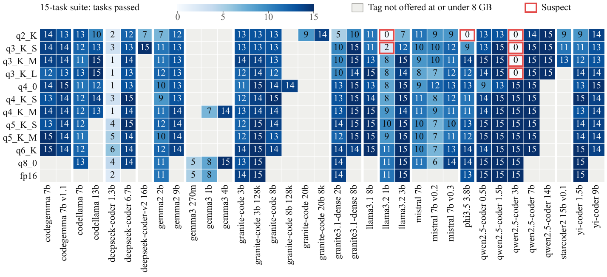

---

## 37. [FDSML: Formula-Driven Supervised Metric Learning with Parameter-Aware Triplet Loss](https://huggingface.co/papers/2610.39423)
**Upvotes**: 1 | **도입 난이도**: 중 | **신뢰도**: 상
**arXiv**: https://arxiv.org/abs/2610.39423

**태그**: Metric Learning, Synthetic Data, Pre-training, Computer Vision, RAG, Vision, Evaluation

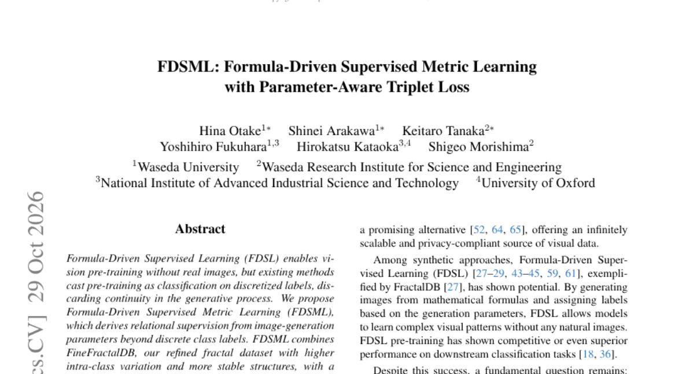

### 📌 한 줄 요약
이미지 생성 파라미터를 활용한 관계형 학습을 통해 합성 데이터 기반 사전 학습의 성능을 극대화한 연구

### 🔑 핵심 포인트
- 이산적 레이블을 넘어 생성 파라미터 공간의 연속성을 활용하는 관계형 학습 프레임워크 제안
- 높은 클래스 내 변동성을 확보한 FineFractalDB 데이터셋 구축
- 파라미터 거리 기반의 양성/음성 샘플을 할당하는 PA-Triplet Loss 도입

### 🧑‍💻 개발자 관점
실제 이미지가 부족한 상황에서 합성 데이터(Synthetic Data)만으로도 고성능의 임베딩 모델을 학습시킬 수 있는 방법론을 제시합니다.

### 🚀 실무 적용 아이디어
- 제시된 PA-Triplet Loss를 기존 Metric Learning 프레임워크에 적용하여 성능 변화 확인
- 데이터 생성 파라미터의 변화가 임베딩 공간의 구조에 미치는 영향 분석
- 특정 도메인(예: 의료, 제조)의 합성 데이터 생성 시 FDSML의 전이 학습 효과 검증

### ⚠️ 리스크/한계
- 파라미터 공간과 실제 이미지 특징 공간 간의 정렬(Alignment) 정도에 따라 성능이 좌우될 수 있음
- 복잡한 생성 모델을 사용하는 경우 파라미터 기반의 관계 설정이 어려울 수 있음

### 📝 초록 기반 상세 설명
기존의 수식 기반 사전 학습(FDSL)은 이산적인 클래스 레이블에만 의존하여 생성 과정의 연속성을 활용하지 못하는 한계가 있었습니다. 본 논문은 이미지 생성 파라미터 자체에서 관계적 감독 신호를 도출하는 FDSML 방식을 제안합니다. 이를 위해 클래스 내 변동성을 높인 FineFractalDB 데이터셋과 파라미터 공간의 거리를 반영하는 PA-Triplet Loss를 결합했습니다. 실험 결과, FDSML은 기존 FDSL 대비 이미지 검색(Retrieval) 성능을 크게 향상시켰으며 분류 및 강건성 측면에서도 경쟁력을 입증했습니다. 이는 단순 레이블 기반 분류보다 파라미터 기반의 관계적 학습이 전이 학습에 더 강력한 신호를 제공함을 시사합니다.

---

