# 2026-11-03 Daily Papers (Top 37)

## 오늘의 요약
오늘의 연구는 에이전트의 자율적 학습과 효율적인 추론 루프를 설계하는 데 집중되었으며, 특히 고수준 추론과 저수준 제어 간의 병목을 해결하려는 시도가 돋보였습니다. 또한, 멀티모달 모델의 생성 능력과 언어적 추론 능력을 결합하여 복잡한 제어 및 실시간 상호작용을 구현하는 연구들이 주요하게 다뤄졌습니다.

### 오늘의 핵심 포인트
- 에이전트가 스스로 학습 경로를 최적화하거나 시스템 1과 2의 협업을 통해 연산 효율을 극대화하는 자율적 워크플로우 연구가 활발했습니다.
- 비디오 모델의 시간적 특징과 멀티모달 잠재 공간을 활용하여 이미지 생성, 편집, 제어 작업을 통합하는 프레임워크가 제시되었습니다.
- 음성-추론-도구를 단일 모델로 통합하거나 물리적 제어와 고수준 추론을 비동기적으로 연결하는 등 시스템 복잡도를 낮추는 실용적 설계가 강조되었습니다.

**오늘의 태그**: Agentic Workflow, Multimodal, Self-Play, Efficiency, Video Generation

## 1. [FrameForge: Harnessing Priors of Video Foundation Models for Unified Image Generation](https://huggingface.co/papers/2610.36545)
**Upvotes**: 110 | **도입 난이도**: 상 | **신뢰도**: 상
**arXiv**: https://arxiv.org/abs/2610.36545

**태그**: Diffusion, Image Generation, Video Models, Image Editing, RAG, Reasoning, Vision, Video

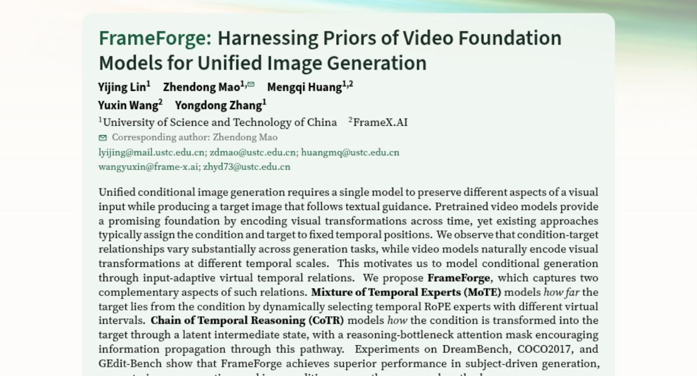

### 📌 한 줄 요약
비디오 파운데이션 모델의 시간적 관계를 가변적으로 활용하여 이미지 생성, 편집, 제어 작업을 통합 수행하는 프레임포지(FrameForge) 프레임워크

### 🔑 핵심 포인트
- 입력 데이터에 따라 시간적 간격을 조절하는 MoTE(Mixture of Temporal Experts) 도입
- 중간 상태를 통한 정보 전파를 유도하는 CoTR(Chain of Temporal Reasoning) 메커니즘 설계
- 비디오 모델의 시간적 특징을 활용하여 이미지 생성/편집/제어 작업을 하나의 프레임워크로 통합

### 🧑‍💻 개발자 관점
이미지 편집이나 스타일 변환 시 고정된 파라미터 대신 입력값에 따라 유연하게 변하는 시간적 관계를 활용함으로써 더 정교한 제어가 가능함을 시사합니다.

### 🚀 실무 적용 아이디어
- 비디오 생성 모델(SVD 등)을 이미지 편집 태스크에 적용하는 파이프라인 구축 실험
- MoTE의 시간적 간격(Interval) 설정에 따른 생성 품질 변화 분석
- Canny-to-image 등 구조 제어 태스크에서의 정밀도 검증

### ⚠️ 리스크/한계
- 비디오 모델 기반이므로 이미지 생성 시 연산 비용이 높을 수 있음
- 가상적 시간 관계 설정이 복과한 작업(Complex transformation)에서 안정성 검증 필요

### 📝 초록 기반 상세 설명
기존의 통합 조건부 이미지 생성 방식은 입력 조건과 타겟 사이의 관계를 고정된 시간적 위치에 할당하는 한계가 있었습니다. 연구진은 조건과 타겟 간의 관계가 작업마다 다르며, 비디오 모델이 다양한 시간적 스케일에서 시각적 변환을 인코딩한다는 점에 주목했습니다. 이를 해결하기 위해 입력에 적응하는 가상적 시간 관계를 모델링하는 FrameForge를 제안합니다. MoTE는 다양한 시간 간격을 가진 전문가를 동적으로 선택하여 타겟과의 거리를 조절하며, CoTR은 잠재적 중간 상태를 통해 정보가 흐르도록 유도하여 변환 과정을 모델링합니다. 실험 결과, 제안 방식은 주체 중심 생성, Canny 기반 생성, 이미지 편집 등 다양한 태스크에서 기존 방식보다 우수한 성능을 보였습니다.

### 🖼️ 추가 자료
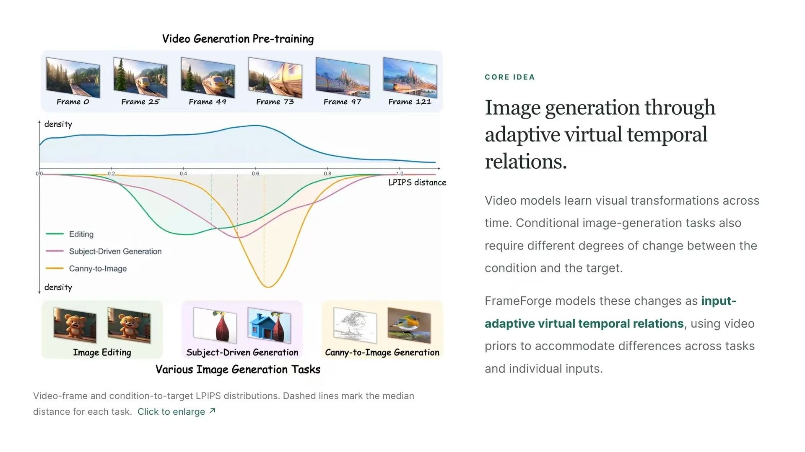
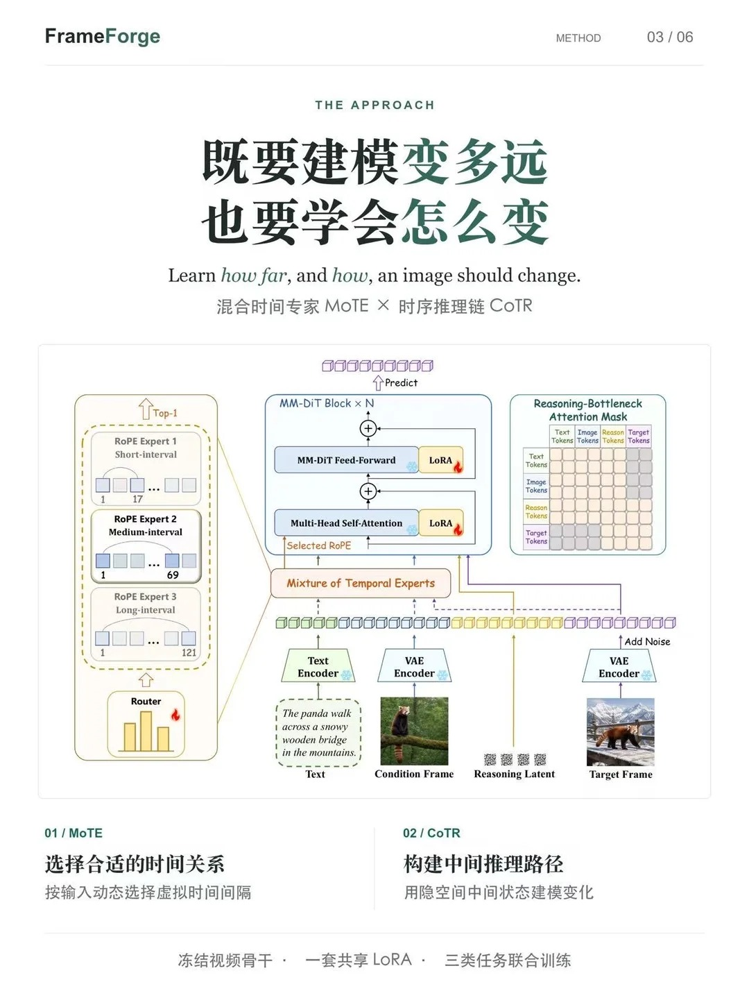

---

## 2. [R^2Orch: Recursive Self-Improvement for Agent Orchestration via Self-Play within a Skill-Internalization Loop](https://huggingface.co/papers/2610.22740)
**Upvotes**: 86 | **도입 난이도**: 상 | **신뢰도**: 상
**arXiv**: https://arxiv.org/abs/2610.22740

**태그**: Agent, Self-Play, Reinforcement Learning, Orchestration, Evaluation, Distillation

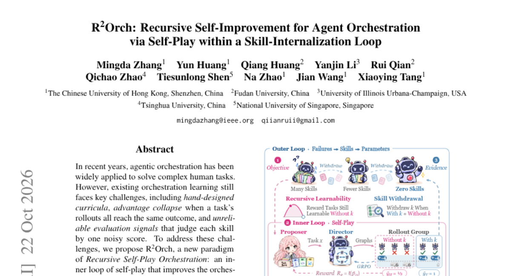

### 📌 한 줄 요약
자기 대국(Self-Play)과 재귀적 루프를 통해 에이전트 오케스트레이션 능력을 스스로 최적화하는 프레임워크

### 🔑 핵심 포인트
- 재귀적 자기 대국(Recursive Self-Play)을 통한 내/외부 루프 구조 설계
- 학습 효율을 극대화하기 위해 난이도와 결과 차이를 조절하는 '재귀적 학습 가능성' 목적 함수 도입
- 성능이 검증된 기술을 점진적으로 제거하여 최적의 오케스트레이션 효율을 달성하는 '기술 철회' 메커니즘

### 🧑‍💻 개발자 관점
수동적인 커리큘럼 설계 없이도 에이전트가 스스로 학습 가능한 과제를 생성하고 최적의 워크플로우를 찾아가는 자동화된 학습 경로를 제시합니다.

### 🚀 실무 적용 아이디어
- 제공된 코드를 활용하여 특정 도메인(예: 특정 API 호출 워크플로우)에서의 성능 재현
- Skill Withdrawal 단계에서 특정 기술이 제거될 때의 오케스트레이션 효율성 변화 관찰
- 다양한 난이도의 태스크 셋을 구성하여 Proposer의 과제 선택 로직 검증

### ⚠️ 리스크/한계
- 자기 대국 과정에서 발생할 수 있는 특정 패턴에 대한 과적합(Overfitting) 위험
- 복잡한 루프 구조로 인해 학습 초기 단계에서의 수렴 안정성 확보 필요

### 📝 초록 기반 상세 설명
최근 복잡한 작업을 해결하기 위해 에이전트 오케스트레이션이 널리 사용되고 있으나, 수동 설계된 커리큘럼과 평가 신호의 불확실성 등으로 인해 학습 효율이 떨어지는 문제가 있습니다. 이를 해결하기 위해 본 논문은 R^2Orch라는 재귀적 자기 대국 오케스트레이션 패러다임을 제안합니다. 이 방식은 스스로 선택한 작업으로 오케스트레이터를 개선하는 내부 루프와, 내부 루프의 개선 방식 자체를 개선하는 외부 루프로 구성됩니다. 특히 '재귀적 학습 가능성(Recursive Learnability)'과 '기술 철회(Skill Withdrawal)' 기법을 도입하여, 불필요한 기술은 제거하고 새로운 도전 과제를 지속적으로 발굴하도록 설계했습니다. 실험 결과, QA, 수학, 코딩 등 다양한 태스크에서 기존 베이스라인을 상회하는 성능을 입증했습니다.

### 🖼️ 추가 자료
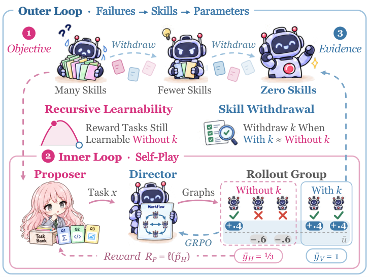
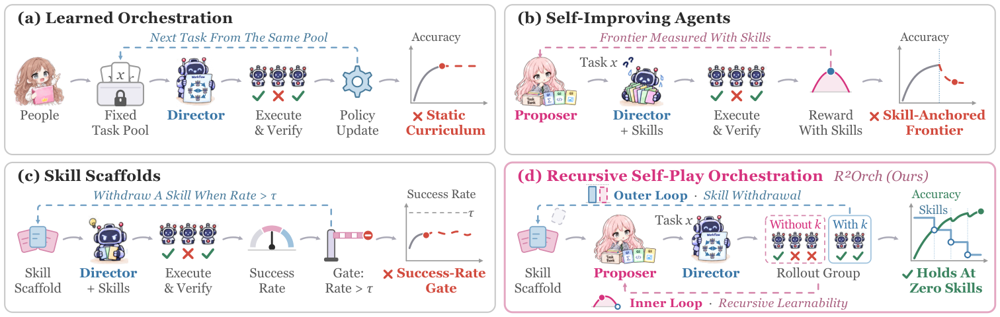
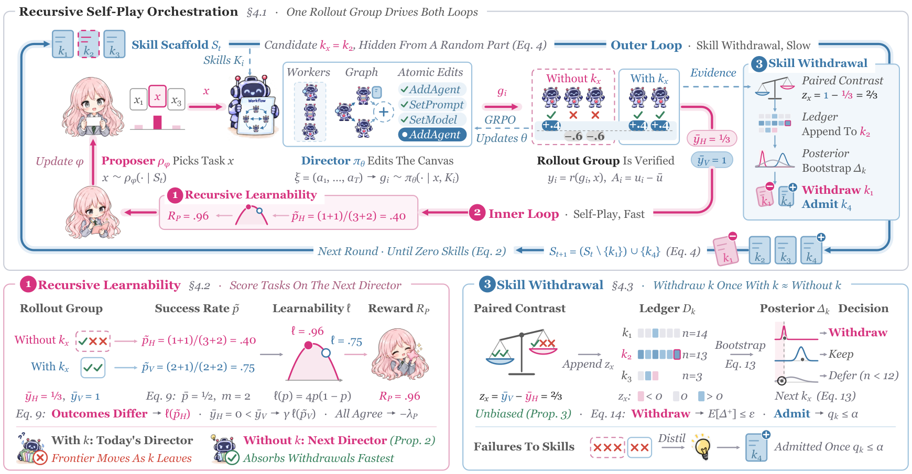

---

## 3. [Does Scaling Toward AGI Depend on What System-1 Lets System-2 Execute?](https://huggingface.co/papers/2610.39497)
**Upvotes**: 52 | **도입 난이도**: 중 | **신뢰도**: 상
**arXiv**: https://arxiv.org/abs/2610.39497

**태그**: Agent, Efficiency, Reasoning, Scaling Laws, Evaluation

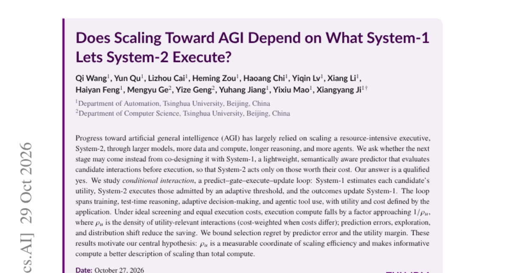

### 📌 한 줄 요약
System-1(예측)과 System-2(실행)의 협업 루프를 통해 불필요한 연산을 줄이고 스케일링 효율을 극대화하는 방법론 제안

### 🔑 핵심 포인트
- System-1(예측/필터링)과 System-2(실행)의 상호작용을 통한 효율적 연산 루프 설계
- 유효한 상호작용 밀도(ρ_u)를 활용한 연산 비용 절감 및 스케일링 효율 최적화
- 학습, 추론, 에이전트 도구 사용 등 다양한 태스크에 적용 가능한 범용 프레임워크

### 🧑‍💻 개발자 관점
에이전트나 복잡한 추론 모델 운영 시, 모든 요청에 무거운 모델을 돌리는 대신 가벼운 필터링 단계를 도입하여 비용과 성능의 균형을 잡는 전략적 가이드라인을 제공합니다.

### 🚀 실무 적용 아이디어
- 가벼운 분류 모델(System-1)과 무거운 추론 모델(System-2) 간의 임계값(threshold) 최적화 실험
- 특정 도구 사용(Tool-use) 태스크에서 예측 오류가 전체 성능에 미치는 영향 분석
- 에이전트 워크플로우에 '예측-게이트' 루프를 도입하여 비용 대비 성능(ROI) 측정

### ⚠️ 리스크/한계
- System-1의 예측 오류가 발생할 경우 유효한 실행 기회를 놓치는 선택 후회(selection regret) 발생
- 데이터 분포 변화(distribution shift) 시 필터링 성능 저하로 인한 효율성 급감 가능성

### 📝 초록 기반 상세 설명
AGI를 향한 기존의 발전은 막대한 자원을 소모하는 System-2(추론/실행)의 스케일링에 의존해 왔습니다. 본 논문은 단순히 모델 크기를 키우는 대신, 실행 전 후보를 평가하는 가벼운 System-1과 System-2를 공동 설계하는 방식에 주목합니다. 이를 위해 예측-게이트-실행-업데이트로 이어지는 '조건부 상호작용(conditional interaction)' 루프를 제안합니다. 실험 결과, 유효한 상호작용 밀도(ρ_u)에 따라 실행 연산량을 획기적으로 절감할 수 있음을 확인했습니다. 최종적으로 총 연산량보다 '정보 가치가 있는 연산량'이 스케일링 효율의 핵심 지표임을 입증합니다.

---

## 4. [REA: A Routed Embodied Agent Runtime for Asynchronous Brain-Cerebellum Control](https://huggingface.co/papers/2610.42053)
**Upvotes**: 43 | **도입 난이도**: 중 | **신뢰도**: 상
**arXiv**: https://arxiv.org/abs/2610.42053

**태그**: Embodied AI, Agentic Workflow, Robotics, Asynchronous Control, Agent, Reasoning, Evaluation

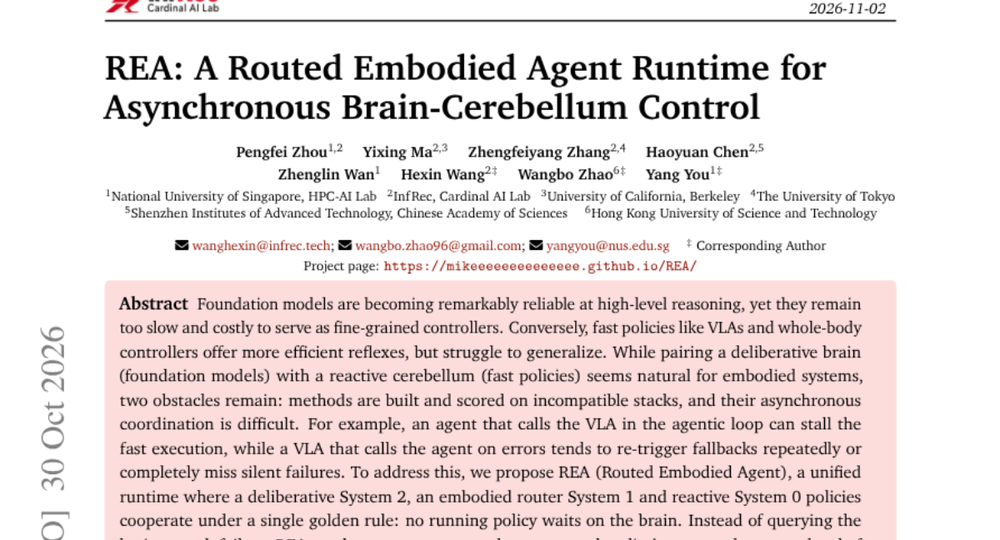

### 📌 한 줄 요약
비동기식 뇌-소뇌 구조를 통해 고수준 추론과 저수준 제어 간의 병목 현상을 해결한 에이전트 런타임 프레임워크

### 🔑 핵심 포인트
- 비동기적 뇌-소뇌 구조: 고수준 추론(System 2)이 저수준 제어(System 0/1)의 실행을 방해하지 않는 런타임 설계
- 세 가지 핵심 메커니즘: Route Memory(성공도 저장), Judge Gate(경계 기반 판단), Escalation Ladder(예산 기반 복구) 도입
- 효율적 자원 관리: 제어 스텝과 시간을 줄이면서도 높은 성공률을 유지하는 하이브리드 제어 루프 구현

### 🧑‍💻 개발자 관점
에이전트가 복잡한 추론을 수행하는 동안에도 로봇의 물리적 제어가 끊기지 않도록 하는 실시간 시스템 설계 패턴을 제시합니다.

### 🚀 실무 적용 아이디어
- LLM/VLA 기반 에이전트와 저수준 제어기 간의 비동기 통신 프로토콜 설계 실험
- 실패 발생 시 상위 모델로의 에스컬레이션(Escalation) 임계값 최적화 테스트
- 에이전트의 추론 지연(Latency)이 물리적 제어 루프에 미치는 영향 분석

### ⚠️ 리스크/한계
- 비동기 구조로 인해 발생할 수 있는 상태 불일치(State Inconsistency) 문제
- 복잡한 계층 구조로 인한 시스템 전체의 디버깅 및 가시성 확보의 어려움

### 📝 초록 기반 상세 설명
최근 파운데이션 모델은 고수준 추론에 능숙하지만 제어 루프 내에서 실행 속도가 느리고 비용이 높다는 문제가 있습니다. 반면 VLA와 같은 빠른 정책은 효율적이지만 일반화 능력이 부족하며, 두 시스템을 결합할 때 발생하는 비동기적 조율과 지연 문제가 실무적 장애물로 작용합니다. 이를 해결하기 위해 본 논문은 '뇌가 실행 중인 정책을 기다리지 않는다'는 원칙하에 설계된 REA(Routed Embodied Agent) 런타임을 제안합니다. REA는 성공 확률을 저장하는 route memory, 경계 기반의 judge gate, 그리고 예산 기반의 escalation ladder를 통해 비동기적 협업을 관리합니다. 실험 결과, LIBERO-Pro 및 RoboTwin 2.0 등 다양한 벤치마크에서 기존 단일 에이전트 모델보다 높은 성공률과 더 빠른 제어 효율을 달끔했습니다. 최종적으로 실물 로봇(Unitree G1)에서도 성공적인 전이 성능을 입증했습니다.

---

## 5. [Apriel Voice 27B Preview: An Open Model for Speech, Reasoning, and Tool Use](https://huggingface.co/papers/2610.40738)
**Upvotes**: 31 | **도입 난이도**: 상 | **신뢰도**: 상
**arXiv**: https://arxiv.org/abs/2610.40738

**태그**: Speech-to-Action, Multimodal, LLM-Agent, Model-Distillation, Reasoning, Vision, Audio, Inference, Distillation

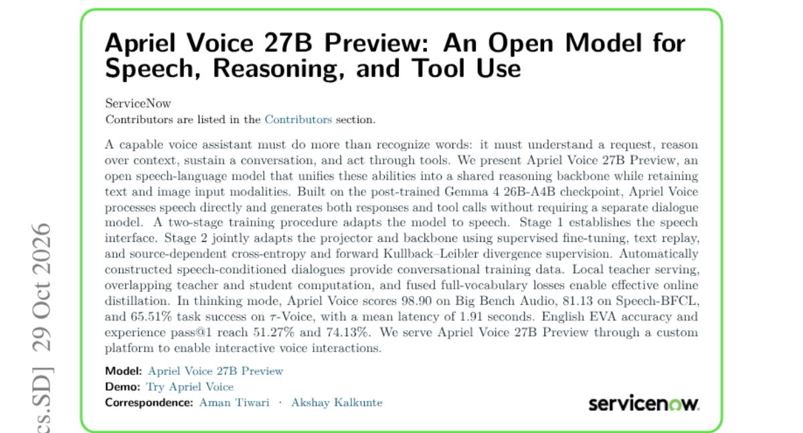

### 📌 한 줄 요약
음성 인식, 추론, 도구 사용을 하나의 모델로 통합한 27B 규모의 오픈 소스 음성-언어 모델(SLM) 발표

### 🔑 핵심 포인트
- 음성, 추론, 도구 사용 능력을 하나의 공유 백본에 통합한 단일 모델 구조
- 2단계 학습(Speech Interface 구축 및 Joint Adaptation)을 통한 효율적인 모달리티 적응
- 온라인 증류(Online Distillation) 및 융합 손실 함수를 통한 고성능/저지연 추론 구현

### 🧑‍💻 개발자 관점
별도의 STT/LLM 결합 없이 단일 모델로 음성 에이전트를 구축할 수 있어 시스템 복잡도와 지연 시간을 획기적으로 줄일 수 있습니다.

### 🚀 실무 적용 아이디어
- 제공된 커스텀 서빙 플랫폼을 통한 실시간 응답 지연 시간(Latency) 측정 실험
- 도구 호출(Tool Use) 기능의 정확도와 복합 명령 수행 능력 검증
- Gemma 4 기반 백본의 음성-텍스트 간 지식 전이 효율성 분석

### ⚠️ 리스크/한계
- 단일 모델 구조로 인한 특정 모달리티(예: 순수 텍스트 성능)의 성능 저하 가능성
- 27B 모델 규모로 인한 로컬 배포 시 높은 컴퓨팅 자원 요구

### 📝 초록 기반 상세 설명
기존 음성 비서는 단순 음성 인식을 넘어 문맥 이해와 도구 사용 능력을 동시에 갖추는 것이 필수적입니다. 본 논문은 텍스트 및 이미지 입력 모달리티를 유지하면서 음성 처리를 통합한 Apriel Voice s27B Preview를 제안합니다. Gemma 4 26B를 기반으로 구축되었으며, 별도의 대화 모델 없이 음성 입력으로부터 직접 응답과 도구 호출을 생성합니다. 2단계 학습 과정을 통해 음성 인터페이스를 구축하고, SFT와 KL 발산 감독 등을 결합하여 프로젝터와 백본을 공동 최적화했습니다. 실험 결과, Big Bench Audio 및 Speech-BFCL 등 주요 벤치마크에서 높은 성능을 기록하며 효율적인 온라인 증류 기법을 통해 낮은 지연 시간을 달성했습니다.

---

## 6. [WeFair: Fidelity-Aware Alignment from Human Feedback for Personalized Query Rewriting in Short-Video Search](https://huggingface.co/papers/2610.16927)
**Upvotes**: 26 | **도입 난이도**: 상 | **신뢰도**: 상
**arXiv**: https://arxiv.org/abs/2610.16927

**태그**: LLM, Search, RLHF, Personalization, NLP, Reasoning, Vision, Video, Inference, Safety

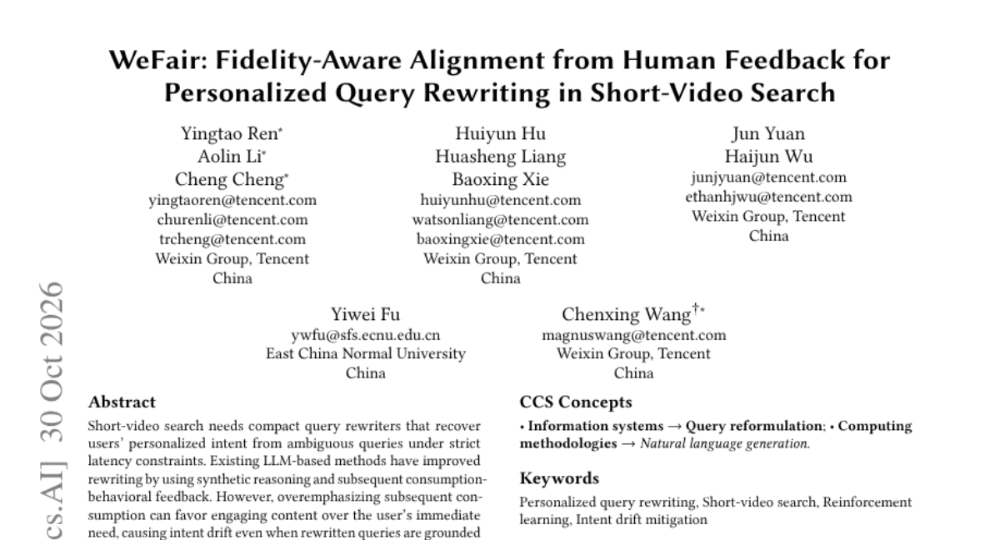

### 📌 한 줄 요약
사용자 의도 이탈을 방지하기 위해 피드백 충실도(Fidelity)를 단계별로 적용한 개인화 쿼리 재작성 기술

### 🔑 핵심 포인트
- 의도 이탈 방지를 위한 피드백 충실도(Fidelity) 기반 3단계 커리큘럼 학습 도입
- 데모(SFT) -> 선호(DPO) -> 검증(GRPO)으로 이어지는 단계적 정렬 전략
- 실제 사용자 쿼리 및 재작성 데이터를 활용한 고품질 데이터 마이닝 및 스크리닝

### 🧑‍💻 개발자 관점
검색 엔진이나 추천 시스템에서 LLM을 활용할 때, 단순 클릭/시청 피드백이 유도할 수 있는 '의도 이탈' 문제를 해결하는 실무적인 프레임워크를 제공합니다.

### 🚀 실무 적용 아이디어
- 사용자 피드백 데이터에 '의도 일치도' 가중치를 부여하는 커리큘럼 설계 실험
- DPO와 같은 선호 학습 시 의도 보존(Preservation)을 위한 제약 조건(Constraint) 적용 테스트
- 소형 모델(2B급)에서 복잡한 추론과 정렬을 동시에 달성하기 위한 데이터 정제 파이프라인 구축

### ⚠️ 리스크/한계
- 사용자의 실제 재작성 데이터를 확보하고 정제하는 과정의 복잡도와 비용
- 검증 단계의 엄격한 제약이 모델의 창의성이나 탐색 범위를 지나치게 제한할 가능성

### 🖼️ 추가 자료
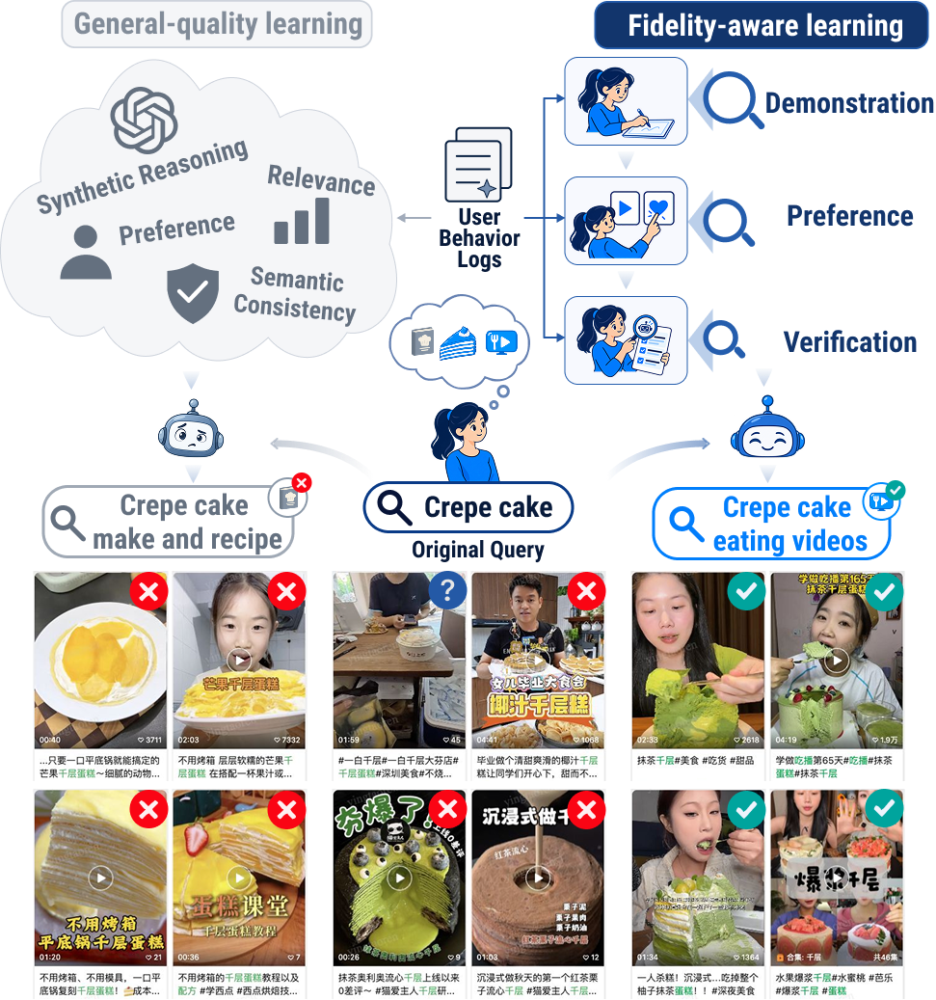

---

## 7. [Latent Reasoning in Continuous Space for Unified Multimodal Models](https://huggingface.co/papers/2610.42149)
**Upvotes**: 24 | **도입 난이도**: 상 | **신뢰도**: 상
**arXiv**: https://arxiv.org/abs/2610.42149

**태그**: Multimodal, Image Generation, Reasoning, RLHF, RAG, Vision, Benchmark, Evaluation

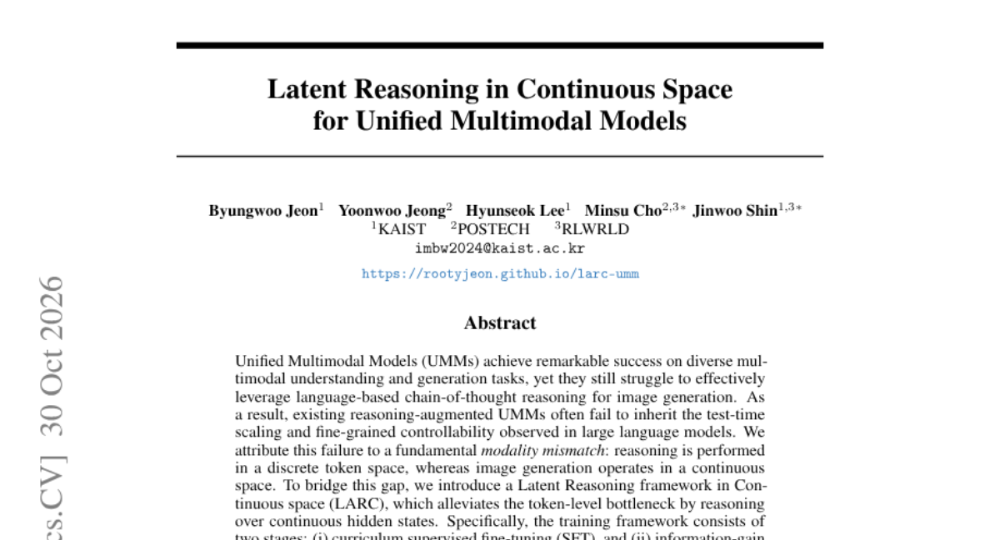

### 📌 한 줄 요약
이산적 토큰 공간의 한계를 넘어 연속적 잠재 공간에서 추론을 수행함으로써 멀티모달 모델의 생성 품질과 제어력을 높인 프레임워크

### 🔑 핵심 포인트
- 이산적 토큰 공간과 연속적 생성 공간 사이의 모달리티 불일치 문제 해결
- 커리큘럼 SFT와 정보 이득 RL을 결합한 2단계 학습 프레임워크 제안
- 테스트 타임 스케일링(Test-time scaling)을 통해 생성 품질 및 제어력 확보

### 🧑‍💻 개발자 관점
LLM의 강력한 추론 능력을 이미지 생성 모델에 직접 이식할 수 있는 새로운 방법론을 제시하여, 복잡한 프롬프트 제어 문제를 해결하는 데 중요한 영감을 줍니다.

### 🚀 실무 적용 아이디어
- 기존 토큰 기반 CoT 모델과 LARC 방식의 생성 결과물 비교 분석
- 연속적 잠재 공간에서의 추론이 생성물의 구도 및 세부 묘사에 미치는 영향 실험
- 모델 크기 변화에 따른 테스트 타임 스케일링 효율성 검증

### ⚠️ 리스크/한계
- 연속적 공간에서의 추론 시 발생할 수 있는 학습 불안정성 가능성
- RL 단계에서의 보상 설계 및 정보 이득 계산의 복잡도

### 📝 초록 기반 상세 설명
기존의 통합 멀티모달 모델(UMM)은 언어 기반의 Chain-of-Thought(CoT) 추론을 이미지 생성에 효과적으로 결합하지 못하는 문제가 있었습니다. 이는 추론이 이루어지는 이산적 토큰 공간과 이미지 생성이 이루어지는 연속적 공간 사이의 모달리티 불일치 때문입니다. 이를 해결하기 위해 본 논문은 연속적 잠재 공간에서 추론을 수행하는 LARC 프레임워크를 제안합니다. 학습은 커리큘럼 SFT를 통해 토큰 기반 추론을 잠재 추론으로 점진적으로 전환한 뒤, 정보 이득(Information-gain) RL을 통해 정답 없이도 스스로 진화하도록 설계되었습니다. 실험 결과, LARC는 생성 품질과 프롬프트 준수 능력을 크게 향상시켰으며 GenEval 벤치마크에서 SOTA 성능을 달성했습니다.

### 🖼️ 추가 자료
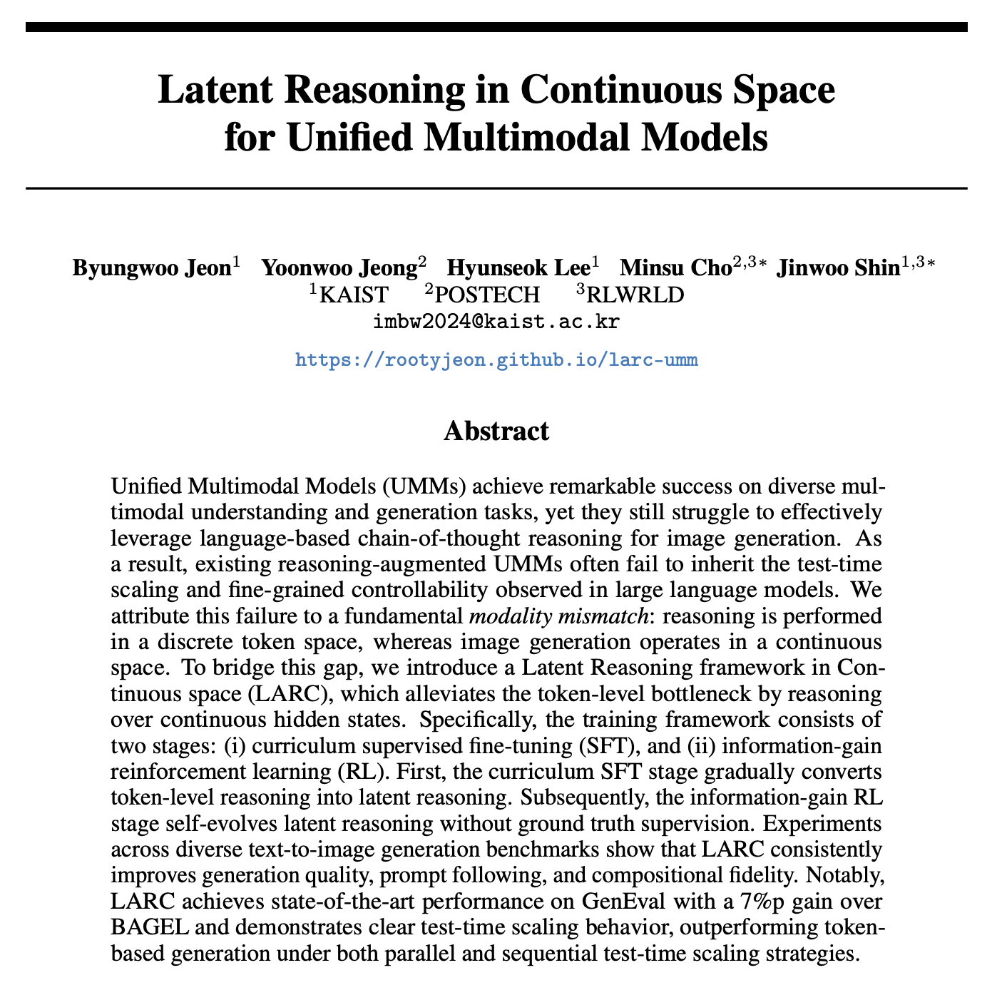

---

## 8. [Wizard: Manipulate Any World in Real Time via Agentic Control](https://huggingface.co/papers/2610.40339)
**Upvotes**: 24 | **도입 난이도**: 상 | **신뢰도**: 상
**arXiv**: https://arxiv.org/abs/2610.40339

**태그**: Video Generation, Agentic Control, Game Engine, Zero-shot Learning, Agent, RAG, Video, Safety

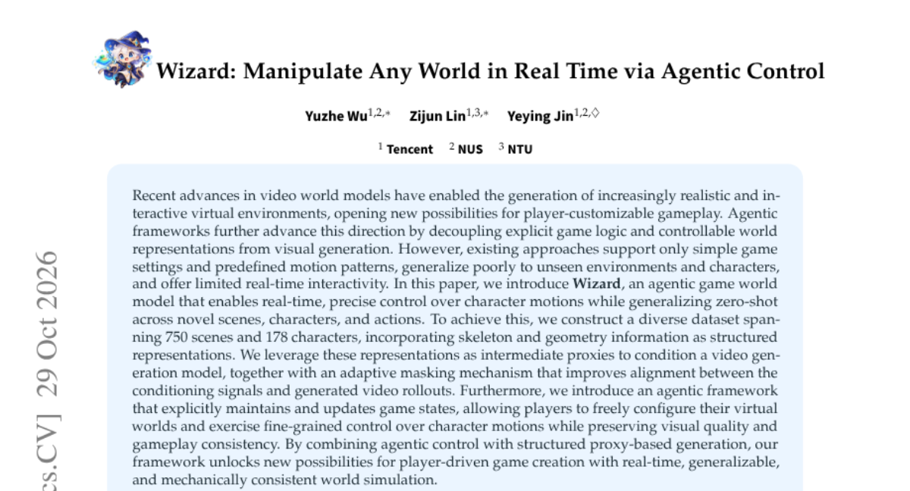

### 📌 한 줄 요약
구조화된 프록시와 에이전트 프레임워크를 결합하여 실시간 상호작용과 제로샷 일반화가 가능한 비디오 월드 모델 제안

### 🔑 핵심 포인트
- 스켈레톤 및 기하학적 정보를 활용한 구조화된 프록시 기반 비디오 생성
- 게임 상태를 명시적으로 유지하고 업데이트하는 에이전트 프레임워크 도입
- 새로운 장면, 캐릭터, 동작에 대한 강력한 제로샷 일반화 성능 확보

### 🧑‍💻 개발자 관점
게임 로직과 시각적 생성을 분리함으로써, 복잡한 물리 엔진 없이도 에이전트 제어를 통해 동적인 게임 환경을 구축할 수 있는 가능성을 제시합니다.

### 🚀 실무 적용 아이디어
- 제공된 스켈레톤/기하 프록시 데이터 형식이 비디오 생성 모델과 어떻게 정렬되는지 분석
- 에이전트 프레임워크가 게임 상태(State)를 유지하는 방식과 비디오 롤아웃 간의 일관성 검증
- 기존 비디오 생성 모델 대비 실시간 제어 성능 및 일반화 성능 비교 실험

### ⚠️ 리스크/한계
- 고품질 비디오 생성을 위한 연산 비용으로 인해 완전한 실시간성 확보 여부 불투명
- 복잡한 물리적 상호작용(충돌, 물체 조작 등)의 완벽한 구현 가능성 검증 필요

### 📝 초록 기반 상세 설명
최근 비디오 월드 모델의 발전으로 상호작용 가능한 가상 환경 생성이 가능해졌으나, 기존 방식은 단순한 게임 설정과 제한된 동작 패턴에 머물러 있었습니다. 또한 새로운 환경이나 캐릭터에 대한 일반화 능력이 부족하고 실시간 상호작용성이 낮다는 문제가 있었습니다. 본 논문에서는 다양한 장면과 캐릭터를 포함한 대규모 데이터셋을 구축하고, 스켈레톤 및 기하학적 정보를 중간 프록시로 활용하는 Wizard 프레임워크를 제안합니다. 여기에 적응형 마스킹 메커니즘과 게임 상태를 유지하는 에이전트 프레임워크를 결합하여 정밀한 동작 제어와 시각적 일관성을 동시에 확보했습니다. 결과적으로 사용자가 자유롭게 세계를 구성하고 캐릭터 동작을 세밀하게 제어할 수 있는 실시간 게임 월드 시뮬레이션을 구현했습니다.

---

## 9. [HiFOR: Hierarchical Foresight with Action-Guided World Grounding for Vision-Language-Action Model](https://huggingface.co/papers/2610.40373)
**Upvotes**: 23 | **도입 난이도**: 상 | **신뢰도**: 상
**arXiv**: https://arxiv.org/abs/2610.40373

**태그**: VLA, Robotics, Future Prediction, Hierarchical Learning, RAG, Vision, Benchmark, Evaluation

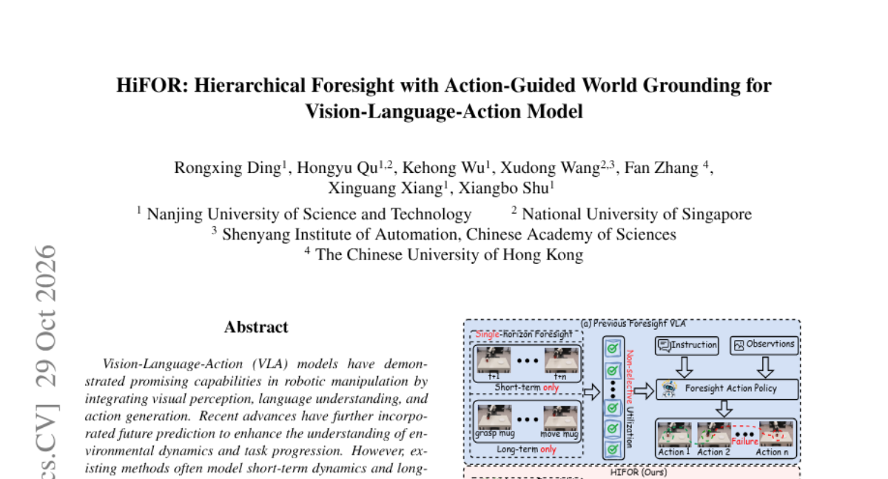

### 📌 한 줄 요약
계층적 미래 예측과 액션 기반의 정보 추출을 결합하여 로봇의 장단기 작업 수행 능력을 극대화한 VLA 프레임워크

### 🔑 핵심 포인트
- HDM을 활용한 단기/중기/장기 미래 상태 간의 계층적 의존성 모델링
- 시간, 시점, 공간 차원을 고려한 구조화된 잠재 월드 모델링(Structure-Aware Latent World Modeling)
- 액션 생성 시 현재 작업에 필요한 미래 정보만 선택적으로 가져오는 액션 가이드형 리트리벌

### 🧑‍💻 개발자 관점
로봇 제어 시 단순히 다음 동작만 예측하는 것이 아니라, 최종 목표와 현재 동작 사이의 관계를 구조적으로 관리하는 설계 패턴을 제공합니다.

### 🚀 실무 적용 아이디어
- HDM 구조를 활용한 다중 시간 스케일(Multi-scale) 예측 모델 구현 테스트
- 잠재 공간(Latent Space) 내에서 공간/시간 차원 분리 및 리트리벌 효율성 검증
- 실제 로봇 하드웨어 환경에서의 추론 지연 시간(Latency) 영향도 분석

### ⚠️ 리스크/한계
- 계층적 예측 모델의 복잡도로 인한 연산 비용 증가 가능성
- 실제 환경의 예기치 못한 변화(Out-of-distribution)에 대한 강건성 검증 필요

---

## 10. [OSWAM: An Effective World Action Model with One-Step Action Generation](https://huggingface.co/papers/2610.35850)
**Upvotes**: 22 | **도입 난이도**: 중 | **신뢰도**: 상
**arXiv**: https://arxiv.org/abs/2610.35850

**태그**: Diffusion, Autonomous Driving, Embodied Control, Real-time Inference, Inference, Distillation

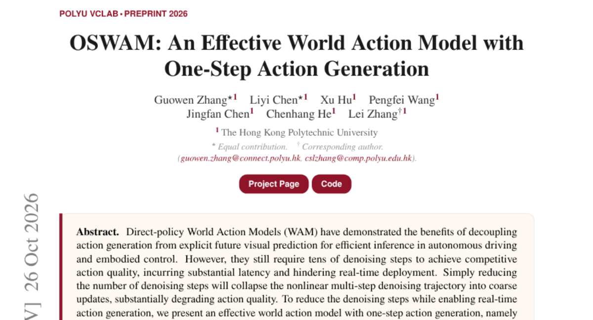

### 📌 한 줄 요약
단 한 번의 디퓨전 스텝만으로 고품질 액션을 생성하여 실시간 제어 성능을 극대화한 월드 액션 모델(WAM)

### 🔑 핵심 포인트
- 상상 토큰(Imagination Tokens)을 통한 구조화된 액션 사전 정보 제공 및 단일 스텝 디노이징 가능
- 특권 정보 증류(Privileged Information Distillation)를 통한 미래 지향적 액션 생성 최적화
- 수십 번의 반복 없이 단 한 번의 디퓨전 스텝으로 고품질 액션 생성 및 실시간성 확보

### 🧑‍💻 개발자 관점
디퓨전 기반 제어 모델의 고질적 문제인 추론 지연(Latency)을 획기적으로 줄여, 실제 로봇이나 자율 주행 하드웨어에 즉시 적용 가능한 수준의 속도를 제공합니다.

### 🚀 실무 적용 아이디어
- 제공된 코드를 활용하여 단일 스텝 생성 시의 액션 일관성(Coherence) 테스트
- 다양한 하드웨어 환경에서 40ms 수준의 실시간 추론 성능 재현 실험
- 상상 토큰 초기화 방식이 다른 물리 엔진 환경에서도 유효한지 검증

### ⚠️ 리스크/한계
- 단일 스텝 생성 시 복잡한 환경에서의 예외 상황 대응력 검증 필요
- 특권 정보(Privileged Information) 의존도가 높을 경우 실제 배포 환경에서의 성능 저하 가능성

### 📝 초록 기반 상세 설명
자율 주행 및 로봇 제어를 위한 Direct-policy WAM은 미래 예측 과정을 생략하여 효율적이지만, 고품질 액션 생성을 위해 수십 번의 디노이징 스텝이 필요해 실시간 배포에 한계가 있습니다. 단순히 스텝 수를 줄이면 액션 품질이 급격히 저하되는 문제가 발생합니다. 이를 해결하기 위해 본 논문은 물리적 사전 정보와 액션 조건부 표현을 제공하는 '상상 토큰(imagination tokens)'을 도입하여 디퓨전 과정을 초기화하는 OSWAM을 제안합니다. 또한 미래 정보를 활용한 특권 정보 증류(privileged information distillation)를 통해 미래 지향적 액션 생성을 강화했습니다. 실험 결과, OSWAM은 단 한 번의 스텝만으로도 기존 수십 스텝 방식과 대등하거나 더 우수한 성능을 보였습니다. 결과적으로 기존 방식 대비 약 3배의 속도 향상을 달성하며 실시간 추론이 가능한 수준의 효율성을 입증했습니다.

---

## 11. [ReLift: Dense 3D Tracking as Lifted Trajectory Repair](https://huggingface.co/papers/2610.42136)
**Upvotes**: 21 | **도입 난이도**: 하 | **신뢰도**: 상
**arXiv**: https://arxiv.org/abs/2610.42136

**태그**: 3D Tracking, Computer Vision, Trajectory Completion, Geometry, Vision, Video

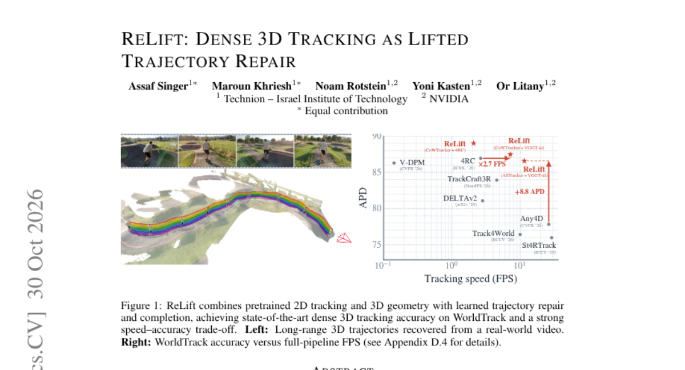

### 📌 한 줄 요약
기존 2D 트래커와 3D 기하 모델을 결합한 궤적을 기하학적 보정만으로 정교하게 복구하는 효율적인 3D 트래킹 프레임워크

### 🔑 핵심 포인트
- 3D 트래킹을 기하학적 궤적 복구(Trajectory Repair) 및 완성 문제로 재정의
- 이미지 없이 기하학적 입력만 사용하는 효율적인 피드포워드 프레임워크 설계
- 궤적 내/간 어텐션을 통해 폐쇄 및 오류를 처리하는 범용적 궤적 보정 메커니즘

### 🧑‍💻 개발자 관점
이미지 학습 없이 기하학적 데이터만으로 궤적을 정교화하므로, 기존의 2D/3D 모델을 교체하지 않고도 성능을 즉각적으로 향상시킬 수 있습니다.

### 🚀 실무 적용 아이디어
- 기존 2D-to-3D Lifted Trajectory 파이프라인에 ReLift 모듈 결합 테스트
- 다양한 2D 트래커(SAM, Co-Tracker 등)를 입력으로 사용하여 범용성 검증
- 폐쇄(Occlusion)가 빈번한 동적 객체 시나리오에서의 복구 성능 측정

### ⚠️ 리스크/한계
- 기하학적 입력에 의존하므로 초기 2D/3D 모델의 오차가 극심할 경우 복구 한계 존재
- 복잡한 물리적 상호작용이 포함된 궤적의 완전한 재구성은 어려울 수 있음

### 📝 초록 기반 상세 설명
단안 비디오 기반의 정밀한 3D 트래킹은 4D 데이터 부족으로 인해 2D 대응점과 깊이 추정, 폐쇄(occlusion) 상황에서의 궤적 추론을 동시에 학습하기 어렵다는 문제가 있습니다. 기존의 Lifted Trajectory 방식은 2D 대응 오류나 폐쇄 시 잘못된 깊이 값으로 인해 궤적이 왜곡되는 한계가 있습니다. 본 논문은 3D 트래킹을 기하학적 궤적 복구 및 완성 문제로 재정의한 ReLift 프레임워크를 제안합니다. ReLift는 궤적 내(along) 및 궤적 간(across) 어텐션을 교차 사용하여 신뢰할 수 있는 관측치를 보존하고, 손상된 위치를 복구하며, 누락된 움직임을 완성합니다. 이미지 없이 기하학적 입력만으로 학습이 가능하여 기존 트래커나 기하 모델에 의존하지 않는 범용성을 가집니다. 실험 결과, WorldTrack 벤치마크에서 기존 방식보다 높은 정확도를 달성하며 효율적인 성능을 입증했습니다.

---

## 12. [CEPO: A General Framework for Improving Prompt Optimization in Multi-Agent Systems](https://huggingface.co/papers/2610.34722)
**Upvotes**: 19 | **도입 난이도**: 하 | **신뢰도**: 상
**arXiv**: https://arxiv.org/abs/2610.34722

**태그**: Multi-Agent, Prompt Engineering, Optimization, Agent, Benchmark

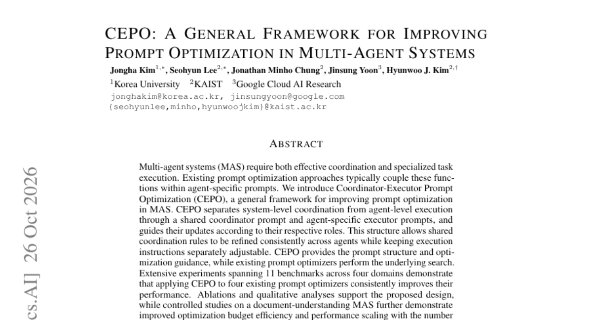

### 📌 한 줄 요약
멀티 에이전트 시스템에서 협업 규칙과 개별 실행 지침을 분리하여 프롬프트 최적화 효율을 극대화하는 프레임워크

### 🔑 핵심 포인트
- 코디네이터(협업)와 실행자(작업) 프롬프트의 구조적 분리
- 역할별 독립적 업데이트를 통한 일관된 협업 규칙 유지 및 실행 지침 최적화
- 기존 프롬프트 최적화 알고리즘과 결합 가능한 범용 프레임워크 설계

### 🧑‍💻 개발자 관점
복잡한 멀티 에이전트 환경에서 협업 규칙이 바뀌어도 개별 에이전트의 작업 능력을 유지하며 효율적으로 프롬프트를 튜닝할 수 있습니다.

### 🚀 실무 적용 아이디어
- 기존 단일 프롬프트 기반 MAS를 CEPO 구조로 분리하여 성능 비교
- 에이전트 수가 늘어날 때 발생하는 협업 충돌 문제에 CEPO 적용 테스트
- 사용 중인 프롬프트 최적화 도구(DSPy 등)에 CEPO 구조 결합 실험

### ⚠️ 리스크/한계
- 코디네이터와 실행자 간의 의존성 관리가 복잡해질 경우 최적화 난이도 상승 가능성
- 프롬프트 분리로 인해 발생하는 오버헤드 및 통신 비용 발생 가능성

### 📝 초록 기반 상세 설명
기존의 멀티 에이전트 시스템(MAS) 프롬프트 최적화 방식은 협업과 실행 기능이 하나의 프롬프트에 결합되어 있어 관리가 어렵고 최적화 효율이 낮았습니다. 이를 해결하기 위해 시스템 수준의 조정과 에이전트 수준의 실행을 분리하는 CEPO 프레임워크를 제안합니다. CEPO는 공유된 코디네이터 프롬프트와 개별 실행자 프롬프트를 분리하여 각 역할에 맞게 독립적으로 업데이트할 수 있도록 설계되었습니다. 기존 프롬프트 최적화 알고리즘을 그대로 사용하면서도 구조적 분리를 통해 최적화 가이드를 제공하는 것이 특징입니다. 11개 벤치마크 실험 결과, 기존 최적화 도구들의 성능을 일관되게 향상시켰으며 에이전트 수 증가에 따른 성능 확장성도 입증되었습니다.

---

## 13. [Venus-DefakerOne2: A Vision-Forensics Foundation Model with Broader Coverage](https://huggingface.co/papers/2610.37918)
**Upvotes**: 18 | **도입 난이도**: 중 | **신뢰도**: 상
**arXiv**: https://arxiv.org/abs/2610.37918

**태그**: Vision, Forensics, Deepfake, Foundation Model, RAG, Video, Benchmark

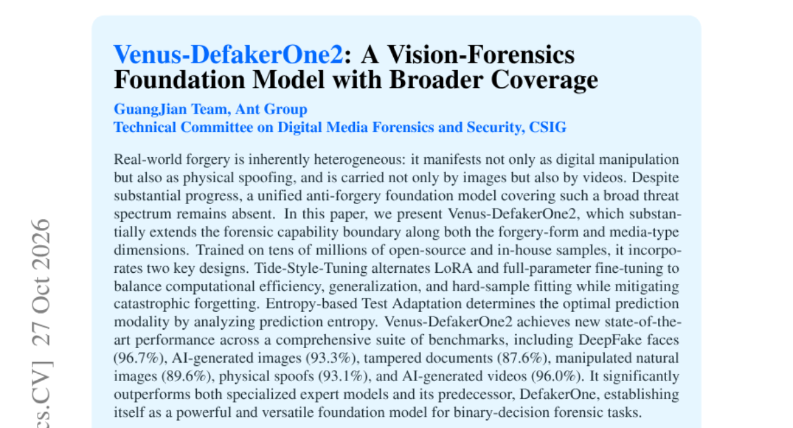

### 📌 한 줄 요약
이미지, 비디오, 물리적 스푸핑을 아우르는 광범위한 위변조 탐지를 위한 통합 비전 포렌식 파운데이션 모델

### 🔑 핵심 포인트
- LoRA와 전체 파라미터 미세 조정을 교차하는 Tide-Style-Tuning으로 효율성과 일반화 성능 확보
- Entropy 기반의 Test Adaptation을 통한 최적 예측 모달리티 결정
- 이미지, 비디오, 물리적 스푸핑을 모두 아우르는 광범위한 위변조 탐지 능력

### 🧑‍💻 개발자 관점
단일 모델로 다양한 유형의 위변조(Deepfake, 문서 조작, 물리적 스푸핑 등)를 처리할 수 있어, 보안 서비스 구축 시 모델 파편화를 줄이고 운영 효율을 극대화할 수 있습니다.

### 🚀 실무 적용 아이디어
- 제시된 Tide-Style-Tuning 기법을 기존 도메인 특화 모델에 적용하여 일반화 성능 비교
- Entropy 기반 적응 기법이 다양한 노이즈 환경에서 어떻게 작동하는지 검증
- 실제 서비스 환경의 데이터셋을 활용한 벤치마크 성능 재현

### ⚠️ 리스크/한계
- 범용 모델 특성상 특정 도메인에 극도로 특화된 전문 모델 대비 성능 저하 가능성
- 방대한 학습 데이터와 복합적인 구조로 인한 추론 비용 및 리소스 요구량

### 📝 초록 기반 상세 설명
현실 세계의 위변조는 디지털 조작부터 물리적 스푸핑까지 형태가 다양하며, 이미지와 비디오를 모두 포함하는 복합적인 양상을 띱니다. 기존 모델들은 이러한 광범위한 위협 스펙트럼을 통합적으로 다루는 데 한계가 있었습니다. 본 논문은 위변조 형태와 미디어 유형을 모두 확장한 Venus-DefakerOne2를 제안합니다. 이 모델은 효율적인 학습을 위한 Tide-Style-Tuning과 최적의 예측 모달리티를 결정하는 Entropy-based Test Adaptation 기법을 적용했습니다. 실험 결과, 딥페이크, AI 생성 이미지, 문서 위변조 등 다양한 벤치마크에서 SOTA 성능을 달성했습니다. 이를 통해 전문 모델들을 능가하는 범용적인 포렌식 파운데이션 모델로서의 가능성을 입증했습니다.

---

## 14. [CaPtain: A Pipeline for Post-Training Code-as-Policy Robot Agents](https://huggingface.co/papers/2610.40799)
**Upvotes**: 18 | **도입 난이도**: 상 | **신뢰도**: 상
**arXiv**: https://arxiv.org/abs/2610.40799

**태그**: Robot-Agent, Reinforcement-Learning, VLM, Sim-to-Real, Agent, Vision

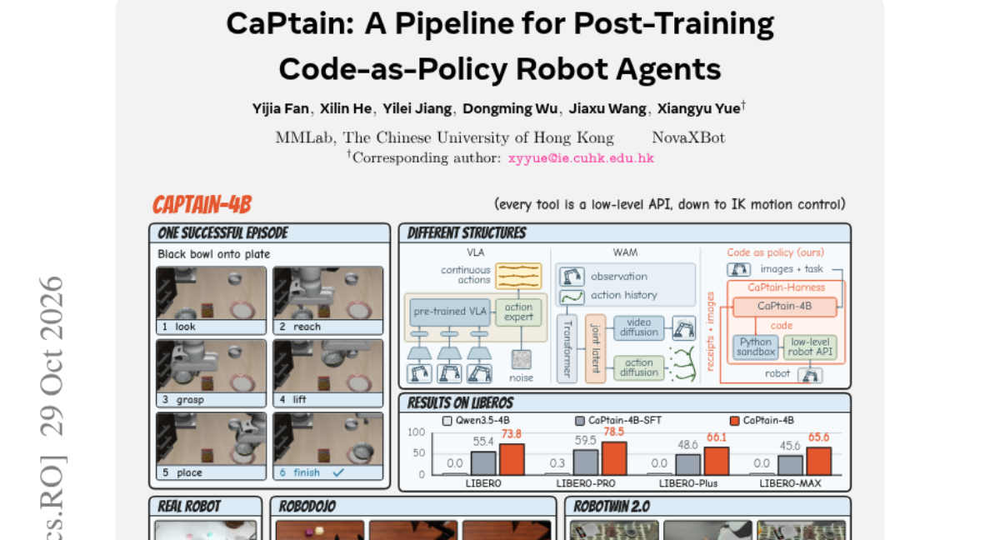

### 📌 한 줄 요약
소형 오픈 VLM을 강력한 로봇 제어 에이전트로 변환하는 SFT 및 물리적 크리틱 기반의 포스트 트레이닝 파이프라인 제안

### 🔑 핵심 포인트
- 소형 오픈 VLM을 위한 SFT 및 다중 턴 RL 결합 포스트 트레이닝 파이프라인 개발
- 시뮬레이터의 특권 상태를 활용하여 지연된 보상을 해결하는 물리적 크리틱(Physical Critic) 도입
- 시뮬레이션 학습만으로 실제 로봇 환경에서 동작 가능한 높은 일반화 성능 확보

### 🧑‍💻 개발자 관점
거대 모델이나 고가의 VLA 없이도 소형 모델을 활용해 정교한 로봇 제어 에이전트를 구축할 수 있는 실질적인 방법론을 제시합니다.

### 🚀 실무 적용 아이디어
- 제공된 CaPtain-Harness를 활용하여 소형 VLM의 로봇 제어 성능 벤치마킹
- 합성 데이터 기반 SFT와 물리적 크리틱 기반 RL의 성능 차이 비교 실험
- 시뮬레이션에서 학습된 모델의 SimplerEnv 등 타 도메인 전이 성능 테스트

### ⚠️ 리스크/한계
- 시뮬레이터의 특권 상태(privileged state)에 의존하는 크리틱 방식의 실제 환경 적용 시 괴리 가능성
- 합성 데이터 의존도가 높을 경우 발생할 수 있는 데이터 분포 불일치 문제

### 📝 초록 기반 상세 설명
최근 언어 모델 에이전트는 SFT와 RL을 결합한 학습 방식을 사용하지만, 기존의 Code-as-Policy(CaP) 방식은 거대 모델에 의존하거나 정교한 VLA 모델이 필요하여 소형 모델 적용이 어려웠습니다. 본 논문은 소형 오픈 VLM을 강력한 CaP 에이전트로 만드는 CaPtain 파이프라인을 제안합니다. 학습 과정은 GPT-6 Astra로 생성된 합성 데이터로 SFT를 수행한 후, 시뮬레이터의 특권 상태(privileged state)를 활용하는 물리적 크리틱(physical critic) 기반의 다중 턴 RL을 적용합니다. 실험 결과, Qwen3.5-4B 기반의 CaPtain-4B는 LIBERO 및 SimplerEnv 벤치마크에서 거대 모델을 능가하는 성능을 보였습니다. 최종적으로 시뮬레이션 학습만으로도 실제 로봇에서 성공적으로 동작함을 입증했습니다.

---

## 15. [Follow the Gradient: Tracing Safety Degradation Back to Training Data](https://huggingface.co/papers/2610.37481)
**Upvotes**: 14 | **도입 난이도**: 중 | **신뢰도**: 상
**arXiv**: https://arxiv.org/abs/2610.37481

**태그**: LLM Safety, Fine-tuning, Gradient-based Filtering, Data Cleaning, Safety

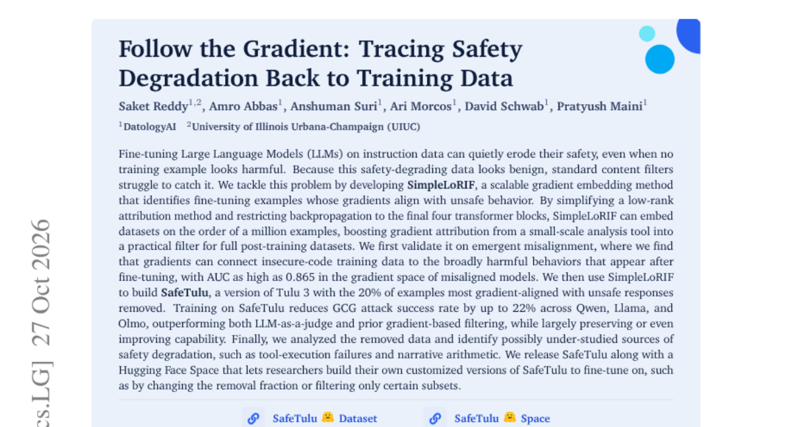

### 📌 한 줄 요약
그라디언트 임베딩 기술을 통해 겉보기에 무해한 학습 데이터가 모델의 안전성을 해치는 현상을 식별하고 제거하는 방법론 제안

### 🔑 핵심 포인트
- SimpleLoRIF: 대규모 데이터셋(백만 단위)에 적용 가능한 확장성 있는 그라디언트 임베딩 방법론 개발
- 잠재적 위험 식별: 겉보기에 무해한 데이터가 모델의 안전성을 저해하는 메커니즘을 그라디언트 공간에서 포착
- SafeTulu 구축: 위험도가 높은 데이터를 제거하여 공격 저항성을 높이면서도 모델 성능을 보존하는 데이터 정제 기술 입증

### 🧑‍💻 개발자 관점
모델 미세 조정 시 데이터 필터링이 단순히 키워드 매칭을 넘어, 모델의 내부 파라미터 변화(그라디언트) 관점에서 이루어져야 함을 시사합니다.

### 🚀 실무 적용 아이디어
- 자체 미세 조정 데이터셋에 SimpleLoRIF 로직을 적용하여 위험 데이터 비중 확인
- 데이터 제거 비율(removal fraction)에 따른 모델 성능과 안전성 간의 트레이드오프 실험
- 제공된 SafeTulu를 베이스라인으로 삼아 기존 데이터 정제 방식과 성능 비교

### ⚠️ 리스크/한계
- 그라디언트 기반 필터링이 모델의 특정 능력(capability)을 의도치 않게 저하시킬 가능성
- 데이터셋의 규모와 성격에 따라 그라디언트 정렬도가 달라질 수 있는 가변성

### 📝 초록 기반 상세 설명
LLM을 지시문 데이터로 미세 조정할 때, 겉으로는 무해해 보이는 데이터가 모델의 안전성을 점진적으로 저하시키는 문제가 발생합니다. 기존의 콘텐츠 필터링으로는 이러한 잠재적 위험 요소를 식별하기 어렵습니다. 이를 해결하기 위해 저차원 귀속(low-rank attribution) 방식을 간소화하여 대규모 데이터셋에 적용 가능한 SimpleLoRIF 기법을 개발했습니다. 이 방법은 미세 조정 시 발생하는 그라디언트가 유해한 행동과 정렬되는 데이터를 효과적으로 찾아냅니다. 연구진은 이를 통해 구축한 SafeTulu 모델이 공격 성공률을 낮추면서도 모델 성능을 유지함을 입증했습니다.

### 🖼️ 추가 자료
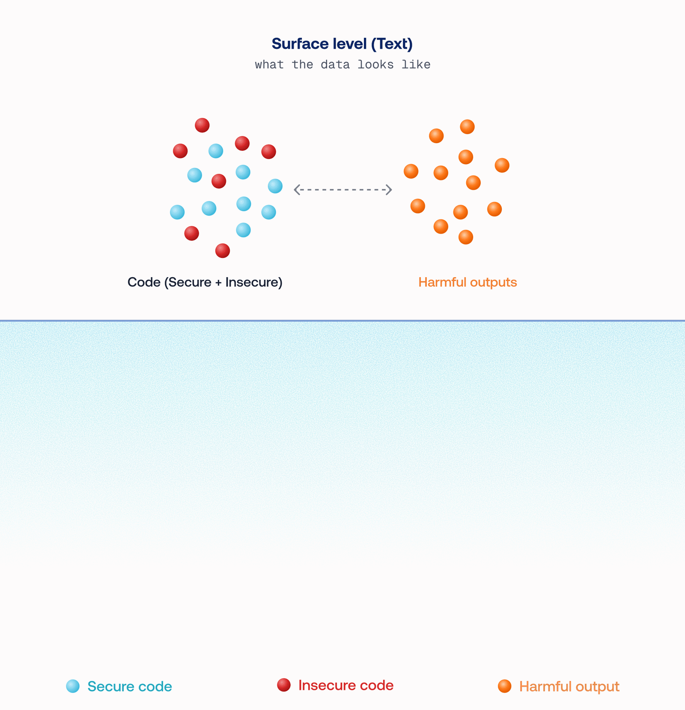

---

## 16. [Probing Spatial State Representations in Visual Foundation Models](https://huggingface.co/papers/2610.40636)
**Upvotes**: 14 | **도입 난이도**: 하 | **신뢰도**: 상
**arXiv**: https://arxiv.org/abs/2610.40636

**태그**: Agent, Vision, Spatial-AI, Foundation-Models, RAG, Evaluation

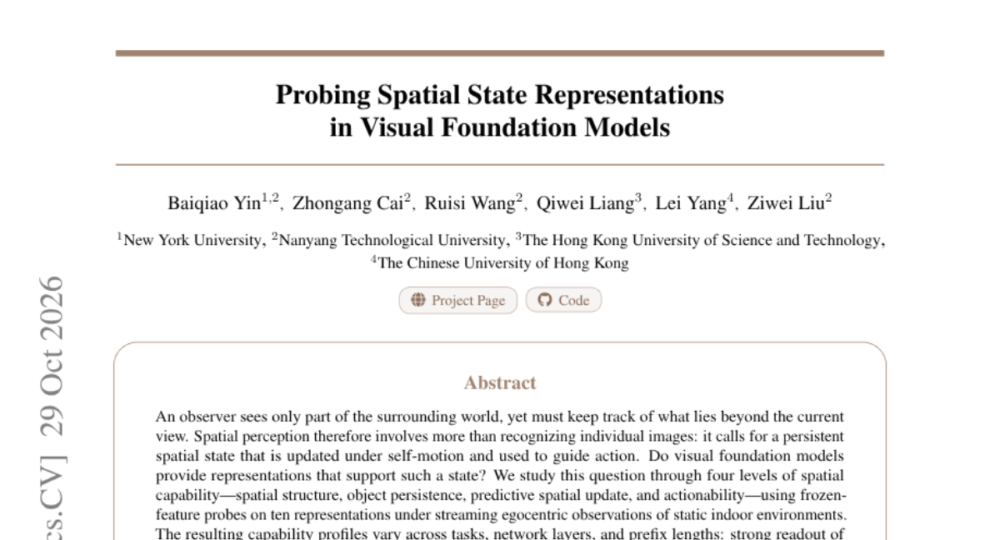

### 📌 한 줄 요약
시각적 파운데이션 모델이 단순한 장면 인식을 넘어, 움직이는 관찰자에게 필요한 지속적이고 예측 가능한 공간 상태를 유지할 수 있는지 분석한 연구입니다.

### 🔑 핵심 포인트
- 공간 능력을 구조, 지속성, 예측, 행동 가능성의 4단계로 체계화하여 분석
- 현재 장면의 높은 재현도가 미래의 객체 지속성이나 예측 능력을 보장하지 않음을 입증
- 공간적 행동 능력과 객체 지속성은 카메라 포즈 정보에, 미래 예측은 가시적 장면 정보에 의존함을 규명

### 🧑‍💻 개발자 관점
로봇 공학이나 자율 주행 에이전트 개발 시, 단순히 현재 이미지를 잘 인식하는 모델이 아니라 움직임 속에서도 객체 위치를 유지하고 미래를 예측할 수 있는 모델을 선택하는 기준을 제공합니다.

### 🚀 실무 적용 아이디어
- 사용 중인 VFM(Visual Foundation Model)의 레이어별 카메라 포즈 및 객체 지속성 프로빙 실험
- 정적 이미지 인식 성능과 동적 환경에서의 행동 유틸리티 간의 상관관계 측정
- 에이전트 학습 시 시야 밖 객체 유지 능력을 평가하는 벤치마크 적용

### ⚠️ 리스크/한계
- 실험이 정적 실내 환경의 스트리밍 관찰로 제한되어 복잡한 동적 환경에서의 일반화 확인 필요
- 특정 모델의 레이어와 프리픽스 길이에 따라 결과가 달라지는 가변성 존재

### 📝 초록 기반 상세 설명
관찰자는 시야 밖의 정보를 유지하며 움직이는 환경에서 공간 상태를 업데이트해야 합니다. 본 연구는 시각적 파운데이션 모델이 이러한 지속적 공간 상태를 지원하는 표현력을 갖추었는지 탐구합니다. 이를 위해 10개의 모델 표현을 대상으로 구조, 객체 지속성, 예측적 업데이트, 행동 가능성이라는 네 가지 수준의 공간 능력을 프로빙(probing)했습니다. 실험 결과, 현재 보이는 장면을 잘 읽어내는 능력이 반드시 객체 지속성이나 미래 특징 추출로 이어지지는 않음을 확인했습니다. 또한, 객체 지속성과 행동 능력은 카메라 포즈 정보에 의존하는 반면, 미래 예측은 가시적 장면 정보에 기반한다는 차이점을 발견했습니다. 결론적으로 공간 표현은 단순 디코딩을 넘어 정보의 유지, 예측적 업데이트, 목표 지향적 행동 활용 측면에서 평가되어야 합니다.

### 🖼️ 추가 자료
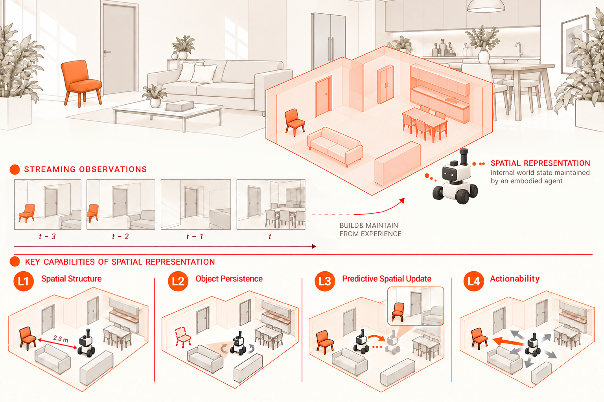

---

## 17. [WorldBridge: Bridging Video and Action for Task Generalization in World Action Models](https://huggingface.co/papers/2610.40748)
**Upvotes**: 12 | **도입 난이도**: 상 | **신뢰도**: 상
**arXiv**: https://arxiv.org/abs/2610.40748

**태그**: Robot Learning, World Models, Generalization, Computer Vision, RAG, Vision, Video, Benchmark

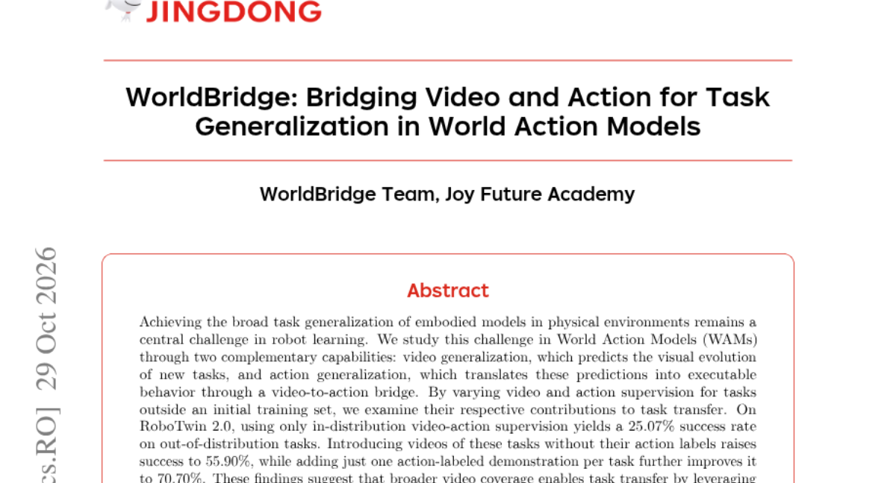

### 📌 한 줄 요약
비디오 예측과 액션 실행을 분리·결합하여 로봇의 미학습 작업에 대한 일반화 성능을 극대화한 WorldBridge 모델 제안

### 🔑 핵심 포인트
- 비디오 예측(시각적 진화)과 액션 브릿지(실행 가능한 행동)의 상호 보완적 역할 규명
- 구조적 어텐션과 Joint Flow Matching을 활용한 비디오/액션 전문가 분리 모델 구조 설계
- 이종 로봇 궤적 및 1인칭 시점 데이터를 표준화하는 통합 데이터 파이프라인 구축

### 🧑‍💻 개발자 관점
데이터가 부족한 새로운 작업 환경에서 비디오 데이터만으로도 성능을 높일 수 있는 방법론과 효율적인 데이터 파이프라인 설계 방식을 배울 수 있습니다.

### 🚀 실무 적용 아이디어
- 제시된 Joint Flow Matching 기반의 비디오-액션 결합 구조 구현 테스트
- 학습 데이터에 비디오만 포함했을 때와 액션이 포함되었을 때의 성능 차이 비교 실험
- 이종 로봇 데이터셋을 위한 데이터 필터링 및 표준화 파이프라인 구축

### ⚠️ 리스크/한계
- 비디오와 액션 전문가 간의 정렬(Alignment) 복잡도 증가
- 다양한 로봇 환경에 적용하기 위한 고품질 비디오 데이터 확보의 필요성

### 📝 초록 기반 상세 설명
로봇 학습에서 물리적 환경의 다양한 작업에 대한 일반화 성능 확보는 여전히 어려운 과제입니다. 본 논문은 World Action Models(WAMs)에서 비디오 일반화와 액션 일반화라는 두 가지 상호 보완적 능력을 연구합니다. 연구 결과, 학습되지 않은 작업의 비디오 데이터만 추가해도 성공률이 크게 향상되며, 소량의 액션 데이터가 결합될 때 성능이 극대화됨을 확인했습니다. 이를 바탕으로 비디오와 액션 전문가를 구조적 어텐션과 Joint Flow Matching으로 연결한 WorldBridge를 제안합니다. 실험 결과, RoboTwin 2.0 및 RoboCasa 등 다양한 벤치마크에서 SOTA 성능을 달상했습니다.

---

## 18. [GLOW-FM: Efficient Generative Low-Light Image Enhancement with One-Step Latent Flow Matching](https://huggingface.co/papers/2610.31222)
**Upvotes**: 10 | **도입 난이도**: 중 | **신뢰도**: 상
**arXiv**: https://arxiv.org/abs/2610.31222

**태그**: Computer Vision, Image Restoration, Generative Model, Efficiency, RAG, Vision, Benchmark, Evaluation, Inference

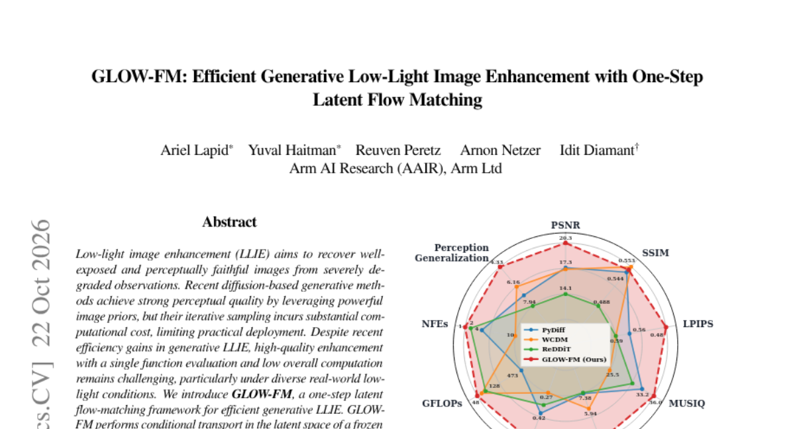

### 📌 한 줄 요약
단 한 번의 연산만으로 고품질 저조도 이미지를 복원하는 효율적인 잠재 흐름 매칭(Latent Flow Matching) 프레임워크

### 🔑 핵심 포인트
- Tiny-VAE의 잠재 공간을 활용한 효율적인 조건부 수송(Conditional Transport) 방식 도입
- Terminal Velocity Matching(TVM)을 통한 단일 단계(One-step) 추론 구현
- 낮은 연산량(34 GFLOPs)과 강력한 교차 데이터셋 일반화 성능 확보

### 🧑‍💻 개발자 관점
반복적인 디퓨전 샘플링 없이 단 한 번의 연산으로 고품질 이미지를 생성하므로, 모바일이나 엣지 디바이스와 같은 실시간성이 중요한 환경에 적용 가능합니다.

### 🚀 실무 적용 아이디어
- 제공된 Tiny-VAE 구조와 TVM 손실 함수 간의 상호작용 분석
- 다양한 저조도 환경(노이즈 수준 변화)에서의 단일 단계 복원 안정성 테스트
- 기존 Diffusion 기반 모델과 연산량 대비 화질(PSNR/SSIM/LPIPS) 비교 실험

### ⚠️ 리스크/한계
- 단일 단계 추론 특성상 복잡한 디테일 복원에서 다단계 샘플링 대비 품질 저하 가능성 존재
- Tiny-VAE의 잠재 공간 표현력에 따른 복원 품질의 제약

### 📝 초록 기반 상세 설명
최근 확산 모델 기반의 저조도 이미지 향상(LLIE) 기술은 뛰어난 품질을 보여주지만, 반복적인 샘플링 과정으로 인해 실시간 배포가 어렵다는 문제가 있습니다. 이를 해결하기 위해 본 논문은 단일 단계 추론이 가능한 GLOW-FM 프레임워크를 제안합니다. GLOW-FM은 고정된 Tiny-VAE의 잠재 공간에서 조건부 수송을 수행하며, Terminal Velocity Matching(TVM) 기법을 도입하여 단 한 번의 함수 평가만으로 향상을 가능하게 합니다. 실험 결과, 제안된 방식은 경쟁력 있는 화질과 뛰어난 데이터셋 일반화 성능을 입증했습니다. 특히 매우 낮은 연산량(34 GFLOPs)으로도 최첨단 성능을 달성하여 실용성을 확보했습니다.

---

## 19. [When Requirements Interact: Scaling Long-Horizon Coding via Interdependent Specifications](https://huggingface.co/papers/2610.40256)
**Upvotes**: 7 | **도입 난이도**: 상 | **신뢰도**: 상
**arXiv**: https://arxiv.org/abs/2610.40256

**태그**: AI Agent, Software Engineering, Reinforcement Learning, Code Generation, Agent, Reasoning, Benchmark

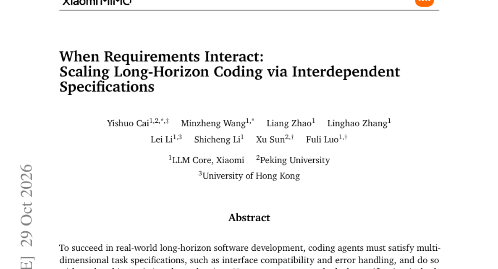

### 📌 한 줄 요약
상호 의존적인 복잡한 요구사항을 충족하며 장기 코딩 작업을 수행하는 에이전트 학습 프레임워크 제안

### 🔑 핵심 포인트
- 상호 의존적인 제약 조건을 포함하는 복잡한 코딩 태스크 합성 프레임워크(CodeSpecWeave) 개발
- 합성 에이전트와 리뷰 에이전트의 협업을 통한 고품질/고신뢰성 테스트 및 요구사항 생성
- 대규모 데이터셋 기반 강화학습을 통해 복잡한 엔지니어링 제약 조건 해결 능력 극대화

### 🧑‍💻 개발자 관점
단순 기능 구현을 넘어, 기존 코드와의 호환성이나 복잡한 제약 조건을 지키며 코딩해야 하는 실무 엔지니어링 환경에 근접한 에이전트 학습이 가능해집니다.

### 🚀 실무 적용 아이디어
- 제시된 CodeSpecWeave-Bench를 활용하여 현재 사용 중인 코딩 모델의 제약 조건 준수 능력 테스트
- 단순 기능 구현 위주의 데이터셋과 상호 의존적 제약 조건이 포함된 데이터셋 간의 모델 성능 차이 비교
- 에이전트 학습 시 다중 제약 조건을 동시에 만족시키는 강화학습 스케줄링 실험

### ⚠️ 리스크/한계
- 합성된 데이터가 실제 개발 환경의 모든 예외 상황을 완벽히 대변하기 어려울 수 있음
- 제약 조건이 복잡해질수록 테스트 생성 및 검증 과정의 비용이 급격히 증가할 위험이 있음

### 📝 초록 기반 상세 설명
실제 소프트웨어 개발에서는 인터페이스 호환성이나 에러 처리와 같이 여러 제약 조건이 얽힌 복잡한 요구사항을 동시에 만족해야 합니다. 기존의 코딩 에이전트들은 단순한 목표 달성에 치중하여, 제약 조건 간의 상호작용이나 복잡한 의존성을 다루는 데 한계가 있었습니다. 이를 해결하기 위해 상호 의존적인 사양을 가진 태스크를 합성하는 프레임워크인 CodeSpecWeave를 도입합니다. 이 프레임워크는 합성 에이전트가 요구사항과 테스트를 생성하고, 리뷰 에이전트가 모델들의 실행 경로를 검증하여 테스트의 신뢰성을 확보합니다. 이를 통해 구축된 대규모 데이터셋으로 강화학습을 수행한 결과, 기존 모델 대비 성능이 크게 향상되었습니다. 또한, 모델 간 변별력을 확보한 새로운 벤치마크인 CodeSpecWeave-Bench를 함께 공개했습니다.

---

## 20. [On the Origin and Evolution of Training-Inference Mismatch in LLM Reinforcement Learning](https://huggingface.co/papers/2610.40945)
**Upvotes**: 7 | **도입 난이도**: 중 | **신뢰도**: 상
**arXiv**: https://arxiv.org/abs/2610.40945

**태그**: LLM, Reinforcement Learning, Distributed Training, Optimization, Evaluation, Inference

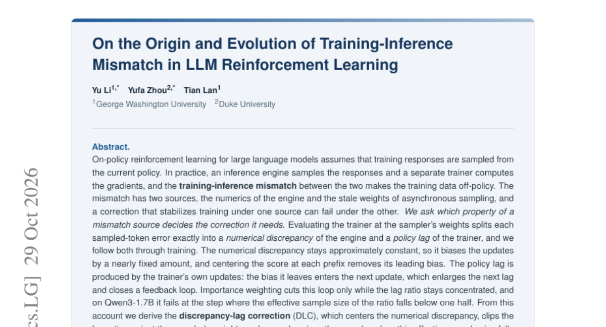

### 📌 한 줄 요약
LLM 강화학습 시 발생하는 추론 엔진과 학습 엔진 간의 불일치(Mismatch) 원인을 규명하고 이를 해결하는 DLC 기법을 제안합니다.

### 🔑 핵심 포인트
- 학습-추론 불일치의 두 원인(수치적 차이 및 정책 지연)을 이론적으로 분리 및 분석
- 수치적 편향 제거와 지연 비율 클리핑을 결합한 새로운 알고리즘 DLC 제안
- 비동기 샘플링 환경에서 유효 샘플 크기(ESS) 기반의 재동기화 메커니즘 도입

### 🧑‍💻 개발자 관점
분산 환경에서 대규모 LLM을 학습시킬 때 발생하는 성능 저하와 모델 붕괴 문제를 해결할 수 있는 실무적인 가이드를 제공합니다.

### 🚀 실무 적용 아이디어
- 분산 학습 환경에서 추론 엔진과 학습 엔진 간의 가중치 동기화 주기를 조절하며 성능 변화 관찰
- 제안된 DLC 알고리즘을 기존 RLHF/PPO 파이프라인에 적용하여 KL 발산 안정성 테스트
- 샘플링 엔진의 수치적 정밀도(FP16 vs BF16 등)가 학습 안정성에 미치는 영향 분석

### ⚠️ 리스크/한계
- 재동기화 주기가 너무 길 경우 정책 지연으로 인한 학습 효율 저하 가능성
- 특정 모델 크기나 아키텍처에서의 일반화 성능에 대한 추가 검증 필요

### 📝 초록 기반 상세 설명
LLM의 온폴리시(On-policy) 강화학습은 학습 데이터가 현재 정책에서 샘플링된다고 가정하지만, 실제로는 추론 엔진과 학습 엔진이 분리되어 있어 데이터가 오프폴리시(Off-policy)가 되는 문제가 발생합니다. 이 불일치는 수치적 차이(Numerical discrepancy)와 비동기 샘플링에 의한 정책 지연(Policy lag)이라는 두 가지 원인에서 비롯됩니다. 연구진은 이 두 요인을 분리하여 분석하고, 수치적 편향 제거와 지연 비율 클리핑 및 동기화를 결합한 DLC(Discrepancy-Lag Correction)를 제안합니다. 실험 결과, DLC는 모델 붕괴를 방지하면서도 온폴리시 학습에 근접한 KL 발산 수준을 유지하며 안정적인 학습을 가능하게 합니다.

---

## 21. [HALO: Human-Grounded Granular Evaluation of Proactive Agents](https://huggingface.co/papers/2610.39086)
**Upvotes**: 6 | **도입 난이도**: 중 | **신뢰도**: 상
**arXiv**: https://arxiv.org/abs/2610.39086

**태그**: AI Agent, Evaluation, Human-in-the-loop, Proactive AI, Agent, RAG, Reasoning

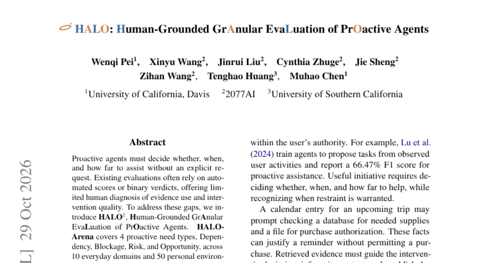

### 📌 한 줄 요약
에이전트의 과잉 개입 문제를 진단하고 적절한 개입 시점과 강도를 평가하기 위한 정밀 벤치마크 프레임워크 제안

### 🔑 핵심 포인트
- 4가지 핵심 필요 유형(Dependency, Blockage, Risk, Opportunity) 기반의 정밀 평가 프레임워크 구축
- 에이전트의 개입 시점(Timing)과 강도(Intensity)에 대한 인간 중심의 세밀한 진단 방법론 제시
- 과잉 개입이 에이전트 성능 저하의 주된 원인임을 데이터로 입증

### 🧑‍💻 개발자 관점
에이전트가 사용자 요청 없이 스스로 행동할 때 발생하는 '방해' 문제를 정량적으로 측정하고 제어하는 가이드라인을 제공합니다.

### 🚀 실무 적용 아이디어
- 에이전트의 개입 강도를 조절하는 파라미터(Intensity) 실험
- RAG 기반 증거 수집과 개입 결정 사이의 상관관계 분석
- 실패 사례(Over-proactivity)를 바탕으로 한 제약 조건(Constraint) 프롬프트 엔지니어링

### ⚠️ 리스크/한계
- 인간의 주관적 판단에 의존하는 평가 방식의 변동성
- 실제 복잡한 현실 세계의 동적 환경을 완벽히 모사하기에는 한계가 있음

### 📝 초록 기반 상세 설명
기존의 선제적 에이전트(Proactive Agent) 평가는 자동화된 점수나 이분법적 판결에 의존하여 개입의 질과 근거 활용 능력을 정밀하게 진단하기 어려웠습니다. 이를 해결하기 위해 4가지 필요 유형(의존성, 차단, 위험, 기회)과 다양한 도메인을 포함하는 HALO 벤치마크를 도입했습니다. HALO-8K 데이터셋은 400개 시나리오에 대해 전문가가 개입 수준, 수용성, 원인 진단을 수행하여 구축되었습니다. 실험 결과, 최상위 모델들의 수용성은 각각 72.88%와 56.63%로 나타났습니다. 연구 결과, 과잉 개입(Over-proactivity)이 주요 실패 원인이며, 특히 시점의 부적절함이나 과도한 강도가 거절 사유의 61.20%를 차지함을 확인했습니다.

---

## 22. [Supervising the Visible State: Separating Representation from View Selection in Streaming Video](https://huggingface.co/papers/2610.34926)
**Upvotes**: 5 | **도입 난이도**: 중 | **신뢰도**: 상
**arXiv**: https://arxiv.org/abs/2610.34926

**태그**: Video-Understanding, Streaming-Video, Causal-Reasoning, Efficiency, Reasoning, Vision, Video, Inference

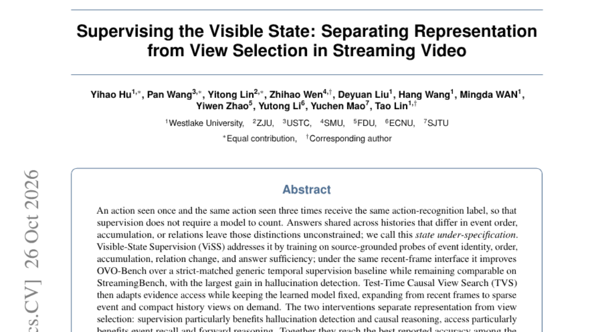

### 📌 한 줄 요약
비디오 데이터의 상태 불확실성을 해결하기 위해 표현 학습(Supervision)과 뷰 선택(View Selection)을 분리하여 효율적인 스트리밍 비디오 분석을 달성함

### 🔑 핵심 포인트
- ViSS: 이벤트의 순서, 누적, 관계 변화를 구분하도록 학습하여 상태 미지정 문제를 해결
- TVS: 학습된 모델을 유지하며 필요에 따라 과거 프레임이나 압축된 이력을 선택적으로 참조하는 동적 뷰 선택
- 표현 학습(Supervision)과 증거 접근(Access)의 분리를 통해 효율성과 추론 성능을 동시에 확보

### 🧑‍💻 개발자 관점
대규모 비디오 스트리밍 환경에서 모든 프레임을 전수 조사하는 대신, 필요한 시점에만 과거 이력을 참조함으로써 연산 효율과 추론 정확도를 동시에 높일 수 있는 구조를 제시합니다.

### 🚀 실무 적용 아이디어
- ViSS의 프로브 방식(이벤트 순서/누적 등)을 현재 비디오 모델의 학습 데이터셋에 적용해보기
- TVS와 같이 학습된 모델을 고정하고 쿼리에 따라 과거 프레임을 선택하는 윈도우 전략 테스트
- 모델이 정답을 얻은 후에도 새로운 프레임에 의해 정답이 바뀌는 '정답 교체' 현상 분석

### ⚠️ 리스크/한계
- 과거 이력을 참조하는 방식(TVS)의 경우, 선택된 뷰에 따라 모델의 성능 변동성이 발생할 수 있음
- 완벽한 오라클(Oracle) 모델과 비교했을 때, 정답 유지(Answer retention) 측면에서 여전히 격차가 존재함

### 📝 초록 기반 상세 설명
기존 스트리밍 비디오 모델은 이벤트의 순서나 누적 횟수 등 세부적인 상태 차이를 구분하지 못하는 '상태 미지정(state under-specification)' 문제에 직면해 있습니다. 이를 해결하기 위해 제안된 ViSS(Visible-State Supervision)는 이벤트의 정체성, 순서, 관계 변화 등을 포함한 소스 기반 프로브를 통해 모델의 표현력을 강화합니다. 또한, 학습된 모델을 고정한 채 필요한 증거만 선택적으로 참조하는 TVS(Test-Time Csual View Search)를 통해 효율적인 뷰 선택을 수행합니다. 실험 결과, 두 기법의 결합은 기존 방식보다 훨씬 적은 프레임 처리만으로도 OVO-Bench와 StreamingBench에서 최고 수준의 정확도를 달성했습니다. 특히 Hallucination(환각) 탐지와 인과 추론 능력에서 큰 개선을 보였습니다.

---

## 23. [MemSteer: Turning User Histories into Supervision for Agent Memory Optimization](https://huggingface.co/papers/2610.39276)
**Upvotes**: 5 | **도입 난이도**: 중 | **신뢰도**: 상
**arXiv**: https://arxiv.org/abs/2610.39276

**태그**: Agent, RAG, Memory Optimization, Automated Labeling, Vision, Evaluation

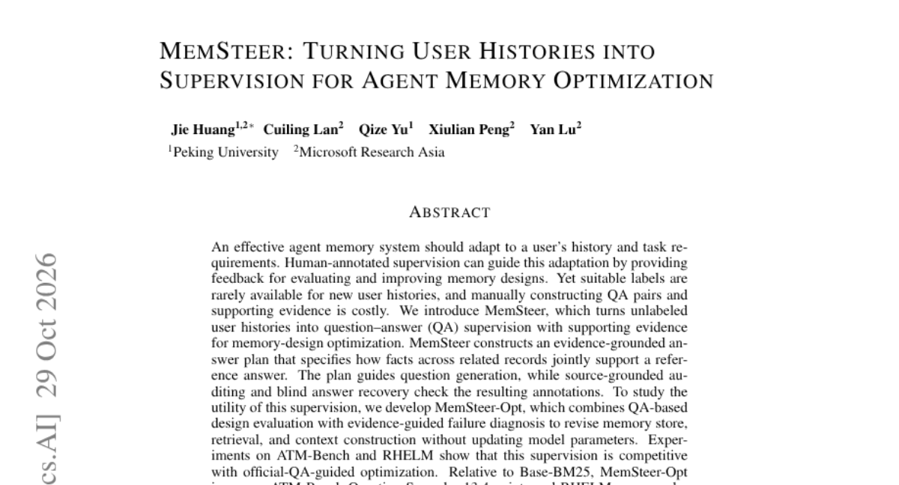

### 📌 한 줄 요약
사용자 이력을 기반으로 QA 쌍을 자동 생성하여 에이전트 메모리 시스템을 최적화하는 프레임워크

### 🔑 핵심 포인트
- 비정형 사용자 이력을 근거 기반(Evidence-grounded) QA 데이터로 자동 변환
- 모델 파라미터 업데이트 없이 메모리 저장 및 검색 로직을 개선하는 MemSteer-Opt 제안
- 수동 레이블링 없이도 공식 QA 가이드를 통한 최적화와 경쟁 가능한 성능 확보

### 🧑‍💻 개발자 관점
모델 자체를 재학습시키지 않고도 사용자 데이터만으로 RAG/메모리 시스템의 검색 및 컨텍스트 구성 로직을 정교하게 튜닝할 수 있는 실용적인 방법론을 제시합니다.

### 🚀 실무 적용 아이디어
- 보유 중인 사용자 대화 로그를 MemSteer 프레임워크로 QA 데이터셋화 해보기
- 생성된 QA를 활용해 현재 RAG 시스템의 검색/필터링 로직(Retrieval/Context) 수정 테스트
- 기존 BM25 또는 벡터 검색 기반 시스템과 MemSteer-Opt의 성능 비교 실험

### ⚠️ 리스크/한계
- 자동 생성된 QA 데이터의 품질이 원본 이력의 복잡도를 충분히 반영하지 못할 위험
- 생성된 QA에 의존한 최적화가 특정 도메인에 과적합(Overfitting)될 가능성

### 📝 초록 기반 상세 설명
효과적인 에이전트 메모리 시스템은 사용자 이력과 작업 요구사항에 적응해야 하지만, 새로운 이력에 대한 수동 레이블링은 비용이 매우 큽니다. 이를 해결하기 위해 MemSteer는 레이블이 없는 사용자 이력을 근거 기반의 QA 및 증거 데이터로 변환하는 방식을 제안합니다. MemStee-Opt는 생성된 QA를 활용해 모델 파라미터 수정 없이 메모리 저장, 검색, 컨텍스트 구성을 최적화합니다. 실험 결과, MemSteer-Opt는 기존 BM25 방식 대비 ATM-Bench와 RHELM 벤치마크에서 성능 향상을 입증했습니다. 또한 새로운 사용자 데이터에 대해서도 지속적인 설계 최적화가 가능함을 보여주었습니다.

---

## 24. [No Channels Left Behind: Understanding Diffusion Acceleration through Residual Gates](https://huggingface.co/papers/2610.40914)
**Upvotes**: 5 | **도입 난이도**: 하 | **신뢰도**: 상
**arXiv**: https://arxiv.org/abs/2610.40914

**태그**: Diffusion, Transformer, Training Acceleration, Generative Models, Vision

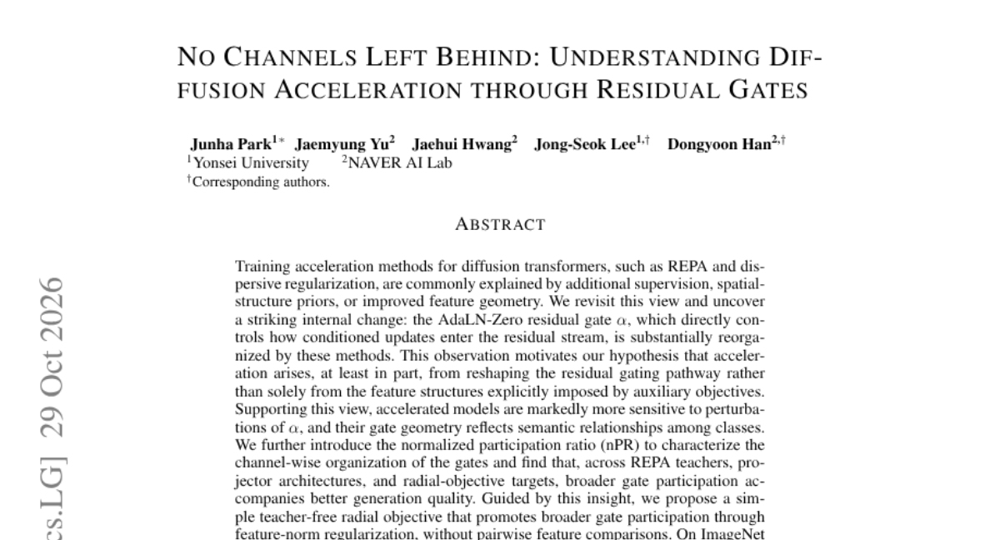

### 📌 한 줄 요약
Diffusion 가속화의 핵심 원인이 피처 구조가 아닌 잔차 게이트(Residual Gate)의 재구성에 있음을 밝히고, 이를 활용한 새로운 학습 목적 함수를 제안함

### 🔑 핵심 포인트
- 가속화 기법이 잔차 게이트(α)의 경로를 재구성하여 성능을 높인다는 새로운 관점 제시
- 게이트 참여도(nPR)와 생성 품질 사이의 상관관계 규명
- 교사 모델 없이 피처 노름 정규화만으로 게이트 참여를 넓히는 단순한 학습 목적 함수 제안

### 🧑‍💻 개발자 관점
Diffusion 모델 학습 시 피처 구조뿐만 아니라 잔차 연결(Residual Connection)의 게이트 값이 어떻게 변화하는지를 모니터링하는 것이 성능 최적화의 핵심임을 시사합니다.

### 🚀 실무 적용 아이디어
- 학습 중 AdaLN-Zero 게이트 값의 분포와 클래스별 변화 양상 시각화하기
- 기존 가속화 기법 적용 시 게이트 참여도(nPR)가 어떻게 변하는지 측정하기
- 제안된 feature-norm regularization을 기존 Diffusion 학습 루프에 적용해보기

### ⚠️ 리스크/한계
- 제안된 방식이 특정 아키텍처(DiT 등)에 특화된 현상일 가능성
- 게이트 재구성이 모든 가속화 시나리오에서 동일하게 나타나는지 추가 검증 필요

### 📝 초록 기반 상세 설명
기존의 Diffusion Transformer 가속화 방식은 주로 추가적인 감독이나 피처 기하학적 구조 개선에 초점을 맞추어 설명되어 왔습니다. 본 논문은 이러한 방식들이 실제로는 잔차 스트림에 업데이트를 전달하는 AdaLN-Zero 게이트(α)를 재구성한다는 점을 발견했습니다. 연구 결과, 가속화된 모델은 게이트 구조가 클래스 간 의미적 관계를 반영하며 외부 섭동에 더 민감하게 반응함을 확인했습니다. 이를 바탕으로 게이트 참여도를 넓히는 새로운 radial objective를 제안하여 별도의 교사 모델 없이도 성능을 개선했습니다. 실험 결과, 제안된 방식은 기존 방식보다 더 넓은 게이트 참여를 유도하며 더 높은 생성 품질을 달성했습니다.

### 🖼️ 추가 자료
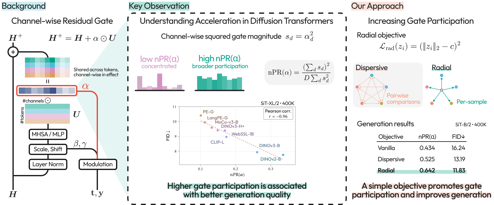

---

## 25. [RoboArchitect: Automating the Design of Robotic Agents with Persistent Memory](https://huggingface.co/papers/2610.42141)
**Upvotes**: 5 | **도입 난이도**: 중 | **신뢰도**: 상
**arXiv**: https://arxiv.org/abs/2610.42141

**태그**: Robotics, LLM-Agent, Automated-Design, Zero-shot-Transfer, Agent, RAG, Vision, Benchmark, Evaluation

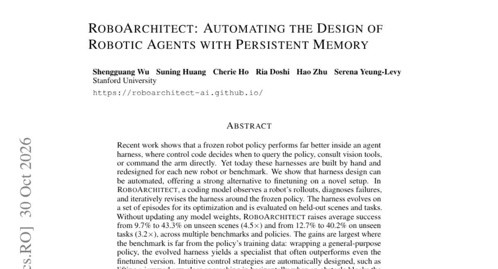

### 📌 한 줄 요약
모델 가중치 업데이트 없이 에이전트 제어 로직(Harness) 자동 설계를 통해 로봇 성능을 극대화하는 프레임워크

### 🔑 핵심 포인트
- 가중치 업데이트 없는 제어 로직(Harness) 자동 최적화
- 실패 진단 및 반복적 코드 수정을 통한 에이전트 진화
- 지속적 메모리 설계를 통한 경험 기반 의사결정 자동화

### 🧑‍💻 개발자 관점
모델 파인튜닝 비용 없이 제어 코드(Wrapper) 최적화만으로도 새로운 환경에 대한 로봇 성능을 비약적으로 높일 수 있음을 보여줍니다.

### 🚀 실무 적용 아이디어
- 기존 고정 정책 모델에 자동화된 제어 루프(Harness) 적용 실험
- 실패 사례를 코드로 변환하는 LLM 프롬프트 엔지니어링 테스트
- 메모리 구조(경험 저장 방식)가 제어 로직에 미치는 영향 분석

### ⚠️ 리스크/한계
- 제어 로직이 복잡해질수록 코딩 모델의 추론 비용 및 시간 증가
- 특정 환경에 과적합된 제어 로직이 생성될 위험성

### 📝 초록 기반 상세 설명
기존의 로봇 제어 프레임워크(Harness)는 수동으로 설계되어 새로운 로봇이나 벤치마크에 적용할 때마다 재설계가 필요했습니다. 본 논문은 고정된(frozen) 정책 모델을 유지하면서도 제어 로직을 자동화하는 RoboArchitect를 제안합니다. 코딩 모델이 로봇의 실행 결과(rollouts)를 관찰하고 실패 원인을 진단하며, 반복적으로 제어 코드를 수정하는 방식으로 작동합니다. 실험 결과, 모델 가중치를 업데이트하지 않고도 미학습 환경과 작업에서 성공률을 대폭 향상시켰습니다. 특히 범용 정책을 특화된 전문가로 변모시키며, 지속적 메모리(persistent memory)를 통해 학습된 경험을 다음 결정에 활용합니다.

---

## 26. [Think Twice: The Metis-1.6 Technical Report](https://huggingface.co/papers/2610.37903)
**Upvotes**: 3 | **도입 난이도**: 상 | **신뢰도**: 상
**arXiv**: https://arxiv.org/abs/2610.37903

**태그**: LLM, MoE, Efficiency, Architecture, RAG, Benchmark

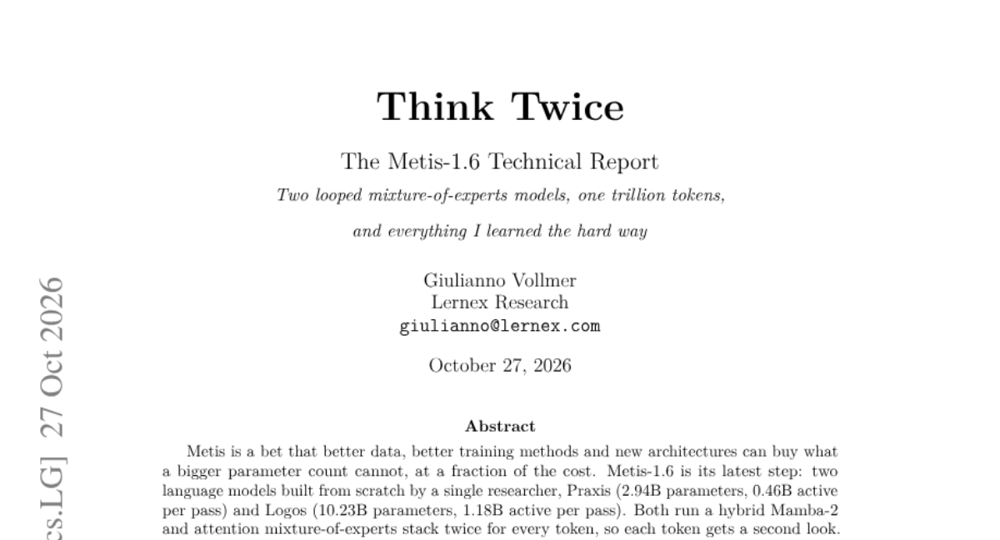

### 📌 한 줄 요약
적은 파라미터와 데이터로 효율성을 극대화한 하이브리드 MoE 아키텍처 연구

### 🔑 핵심 포인트
- Mamba-2와 Attention이 결합된 하이브리드 MoE 구조를 통한 효율적 추론
- 적은 파라미터와 데이터로도 높은 성능을 내는 Pareto frontier 지향적 설계
- 수학적 추론 능력에서 경쟁 모델 대비 압도적인 효율성 입증

### 🧑‍💻 개발자 관점
모델 크기를 무작정 키우는 대신, 아키텍처 설계와 데이터 효율성을 통해 비용 대비 성능을 극대화하는 실무적 방법론을 제시합니다.

### 🚀 실무 적용 아이디어
- Mamba-2와 Attention의 하이브리드 구조를 소규모 모델에 적용해보기
- MoE 구조에서 활성 파라미터와 전체 파라미터 간의 효율성 실험
- 수학적 추론 성능 향상을 위한 데이터 구성 방식 벤치마킹

### ⚠️ 리스크/한계
- 코드 작성, 지시 이행 및 긴 문맥(Long Context) 처리 능력 부족
- 특정 학습 설정(Optimizer, Reward function)에 따른 성능 변동성 위험

### 📝 초록 기반 상세 설명
모델 크기를 키우는 대신 데이터 품질과 효율적인 아키텍처를 통해 성능을 확보하려는 시도가 배경이 되었습니다. 연구진은 Mamba-2와 Attention이 결합된 MoE 구조를 가진 Praxis와 Logos 모델을 개발했습니다. 1.02T 토큰을 활용한 정교한 학습 과정을 거쳤으며, 결과적으로 비교 모델 대비 훨씬 적은 데이터와 활성 파라미터로도 경쟁력 있는 성능을 달성했습니다. 특히 수학적 추론 능력에서 뛰어난 성과를 보였으나 코드 및 긴 문맥 처리에는 약점을 보였습니다. 최종적으로 학습 과정에서의 시행착오와 아키텍처 설계의 교훈을 정리했습니다.

### 🖼️ 추가 자료
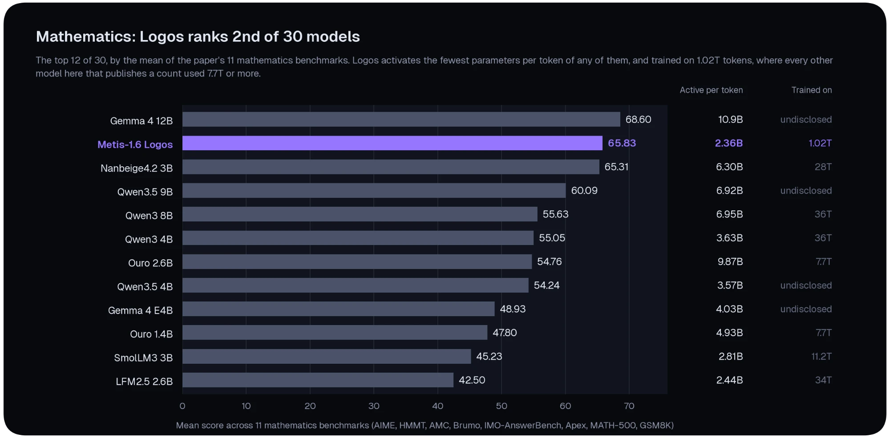
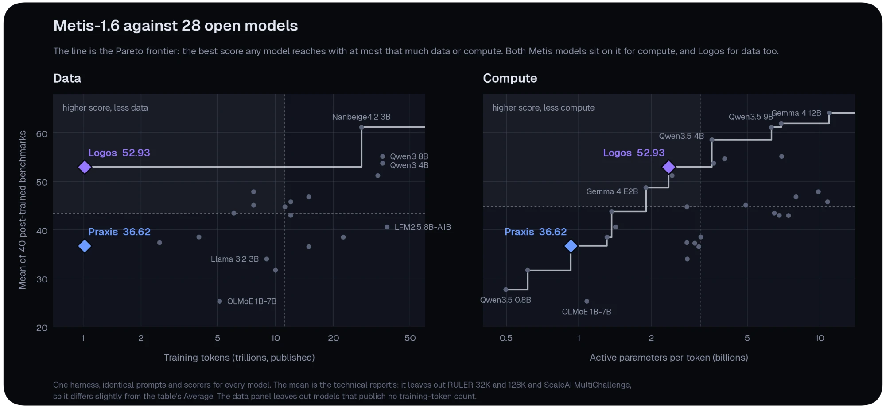

---

## 27. [VoxLock: Target-Speaker Extraction for Voice Agents Without an Enrollment Step](https://huggingface.co/papers/2610.40727)
**Upvotes**: 3 | **도입 난이도**: 하 | **신뢰도**: 상
**arXiv**: https://arxiv.org/abs/2610.40727

**태그**: Voice-Agent, Speech-Extraction, Edge-AI, Audio-Processing, Agent, Benchmark, Inference

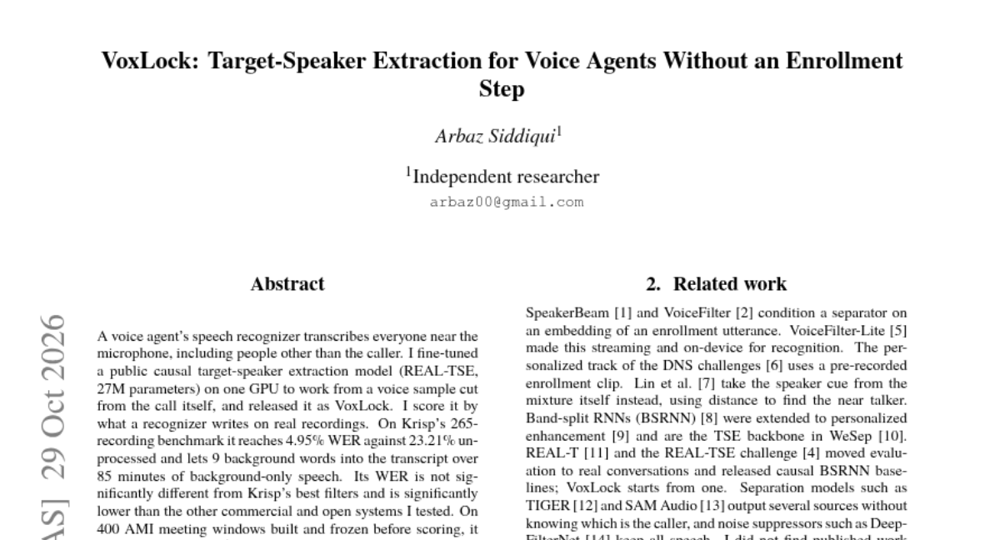

### 📌 한 줄 요약
사전 등록 과정 없이 통화 중 추출된 음성 샘플만으로 타겟 화자를 분리하는 고성능 저지연 음성 추출 모델

### 🔑 핵심 포인트
- 사전 등록(Enrollment) 단계가 필요 없는 타겟 화자 추출 기술
- 통화 중 추출된 샘플을 활용한 효율적인 미세 조정 기법
- CPU 환경에서도 실시간 처리가 가능한 낮은 지연 시간 및 경량화

### 🧑‍💻 개발자 관점
음성 에이전트 개발 시 사용자 등록 절차 없이도 주변 소음을 차단하고 타겟 화자의 음성만 깨끗하게 추출할 수 있어 실무 적용성이 매우 높습니다.

### 🚀 실무 적용 아이디어
- 제공된 코드를 활용하여 다양한 배경 소음 환경에서의 WER 성능 테스트
- CPU 환경에서 실시간 스트리밍 환경에 적용 시 지연 시간(Latency) 측정
- 통화 중 추출된 짧은 샘플의 길이에 따른 성능 변화 실험

### ⚠️ 리스크/한계
- 통화 중 추출된 샘플의 품질이 낮을 경우 타겟 화자 분리 성능 저하 가능성
- 매우 짧은 샘플 사용 시 발생할 수 있는 오버피팅 또는 일반화 문제

### 📝 초록 기반 상세 설명
음성 에이전트가 주변의 모든 소리를 인식하여 타겟 화자 외의 음성까지 텍스트로 변환하는 문제가 발생합니다. 이를 해결하기 위해 기존의 REAL-TSE 모델을 통화 중 추출된 음성 샘플로 미세 조정(Fine-tuning)한 VoxLock을 제안합니다. 별도의 사용자 등록(Enrollment) 단계 없이 통화 내 샘플만으로 작동하도록 설계되었습니다. 실험 결과, 기존 상용 필터 및 오픈소스 시스템 대비 월등히 낮은 WER(단어 오류율)을 기록했습니다. 또한 CPU 환경에서도 매우 낮은 지연 시간과 효율적인 자원 사용량을 보여주었습니다.

### 🖼️ 추가 자료
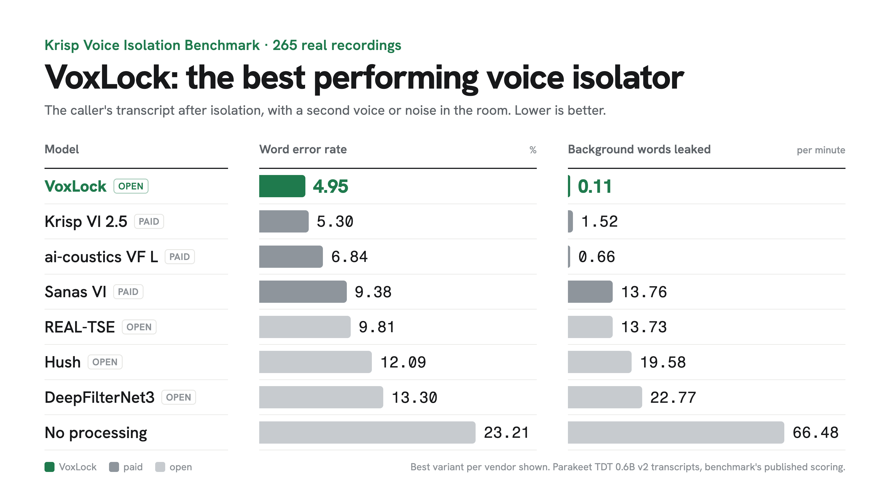

---

## 28. [SciGame: Let Agents Play the Scientific Discovery Games in the Real and Counterfactual World](https://huggingface.co/papers/2610.37919)
**Upvotes**: 3 | **도입 난이도**: 중 | **신뢰도**: 상
**arXiv**: https://arxiv.org/abs/2610.37919

**태그**: LLM-Agent, Scientific-Discovery, Benchmark, Reasoning, Agent, Evaluation, Inference

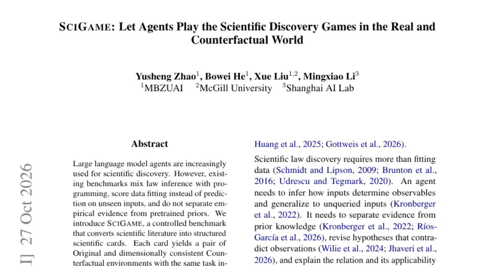

### 📌 한 줄 요약
과학적 발견을 위한 LLM 에이전트의 성능을 정밀하게 검증하기 위해, 기존 지식(Prior)과 새로운 환경을 분리한 대조적 벤치마크 'SciGame'을 제안합니다.

### 🔑 핵심 포인트
- 과학적 문헌을 구조화된 카드로 변환하여 원본과 반사실적 환경을 동시에 제공하는 벤치마크 구축
- 사전 학습된 지식(Prior)과 새로운 실험 데이터 간의 간섭 효과를 정밀하게 측정
- 에이전트의 설명력(Explanation)과 실제 수치적 정확도(Quantitative accuracy) 사이의 괴리 규명

### 🧑‍💻 개발자 관점
LLM 에이전트가 단순히 학습 데이터를 암기하여 답을 내는지, 아니면 실제 물리/과학 법칙을 추론하여 새로운 환경에 적응하는지를 구분하는 데 중요한 기준을 제공합니다.

### 🚀 실무 적용 아이디어
- 에이전트가 학습 데이터와 유사한 문제를 풀 때 발생하는 '지식 간섭' 현상 테스트
- 설명(Reasoning)은 완벽하지만 수치적 결과는 틀리는 '환각' 현상 모니터링
- 제한된 예산(Budget) 하에서 적응형 실험 프로토콜의 효율성 검증

### ⚠️ 리스크/한계
- 정확한 심볼릭 수식(Symbolic form)을 복구하는 능력은 여전히 에이전트의 주요 병목 구간임
- 사전 지식이 강한 모델일수록 새로운 법칙이 적용된 환경에서 성능이 급락할 위험이 있음

### 📝 초록 기반 상세 설명
최근 과학적 발견을 위해 LLM 에이전트가 활용되고 있으나, 기존 벤치마크는 프로그래밍과 법칙 추론이 혼재되어 있고 사전 학습된 지식과 실제 증거를 분리하지 못하는 한계가 있습니다. 이를 해결하기 위해 논문을 구조화된 카드로 변환하여 원본과 차원적으로 일관된 반사실적(Counterfactual) 환경을 제공하는 SciGame 벤치마크를 도입합니다. SciGame은 역사적 법칙과 최신 논문을 활용하며, 후보 가이드형 식별 및 개방형 발견 설정에서 에이전트를 평가합니다. 실험 결과, 익숙한 사전 지식이 법칙이 변경된 환경에서 오히려 성능을 저해하며, 적응형 실험 방식이 모델 성능에 따라 상이한 영향을 미침을 확인했습니다. 또한, 설명력이 높더라도 정량적 수치 재현에는 실패할 수 있다는 점을 밝혀냈습니다.

---

## 29. [CausalWAM: Learning the Causes of Actions in World Action Models](https://huggingface.co/papers/2610.42096)
**Upvotes**: 3 | **도입 난이도**: 중 | **신뢰도**: 상
**arXiv**: https://arxiv.org/abs/2610.42096

**태그**: Robot Learning, Causality, World Models, Reinforcement Learning

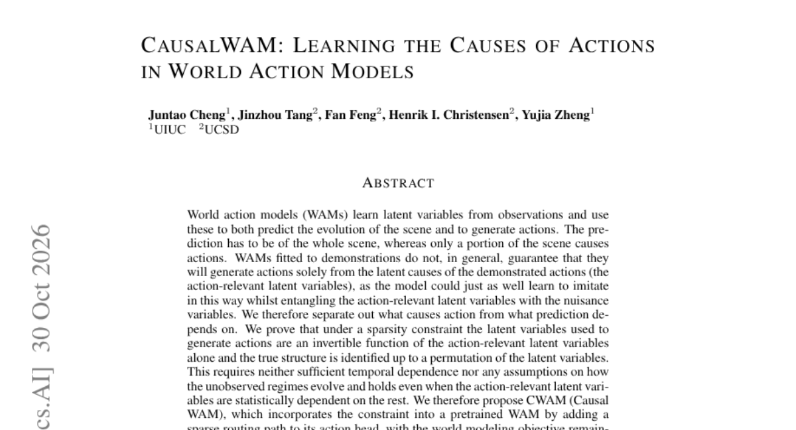

### 📌 한 줄 요약
행동 유발 요인과 환경 예측 요인을 분리하여 로봇의 행동 효율성과 신뢰성을 높이는 Causal WAM 프레임워크 제안

### 🔑 핵심 포인트
- 행동 유발 요인(action-relevant)과 환경 예측 요인(nuisance)의 명확한 분리
- 희소성 제약을 통한 잠재 변수의 구조적 식별 가능성(identifiability) 확보
- 기존 WAM 구조를 유지하면서 행동 헤드에 희소 라우팅을 추가하는 효율적인 구현 방식

### 🧑‍💻 개발자 관점
로봇 학습 시 불필요한 환경 정보(배경 등)에 매몰되지 않고, 실제 동작에 필요한 핵심 요소에만 집중하게 하여 제어 효율을 높일 수 있습니다.

### 🚀 실무 적용 아이디어
- 기존 WAM 모델의 행동 헤드에 Sparse Routing 레이어를 추가하여 성능 변화 관찰
- 데이터셋 내 노이즈(배경 변화 등)를 의도적으로 늘려 분리 성능 테스트
- 동일한 모델에서 행동 생성과 환경 예측의 손실 함수(loss) 간의 상충 관계 분석

### ⚠️ 리스크/한계
- 희소성 제약이 너무 강할 경우, 복잡한 행동 제어에 필요한 정보까지 누락될 위험이 있음
- 실제 환경의 복잡한 변수들이 희소성 제약만으로 완벽히 분리되지 않을 가능성

### 📝 초록 기반 상세 설명
기존의 World Action Models(WAMs)는 장면 전체를 예측하는 과정에서 행동과 무관한 노이즈(nuisance variables)가 행동 생성에 섞여 들어가는 문제를 겪습니다. 이를 해결하기 위해 행동에 직접적인 영향을 주는 잠재 변수와 환경 예측에 필요한 변수를 분리하는 이론적 프레임워크를 제안합니다. 희소성 제약(sparsity constraint)을 도입하여 행동 생성 헤드가 오직 행동 관련 잠재 변수만을 사용하도록 강제함으로써 구조적 식별 가능성을 증명했습니다. 제안된 Causal WAM(CWAM)은 기존 WAM의 학습 목적 함수를 유지하면서도 행동 헤드에 희소 라우팅 경로를 추가하는 방식으로 구현됩니다. 실험 결과, 합성 데이터와 실제 로봇 환경 모두에서 이론적 검증과 더불어 폐루프(closed-loop) 제어 성공률의 향상을 확인했습니다.

---

## 30. [rTaste: Do Research Agents Have Taste? Evaluating Early Stage Research Judgment](https://huggingface.co/papers/2610.40488)
**Upvotes**: 2 | **도입 난이도**: 하 | **신뢰도**: 상
**arXiv**: https://arxiv.org/abs/2610.40488

**태그**: AI Agent, Research Automation, LLM Evaluation, Agent, Evaluation

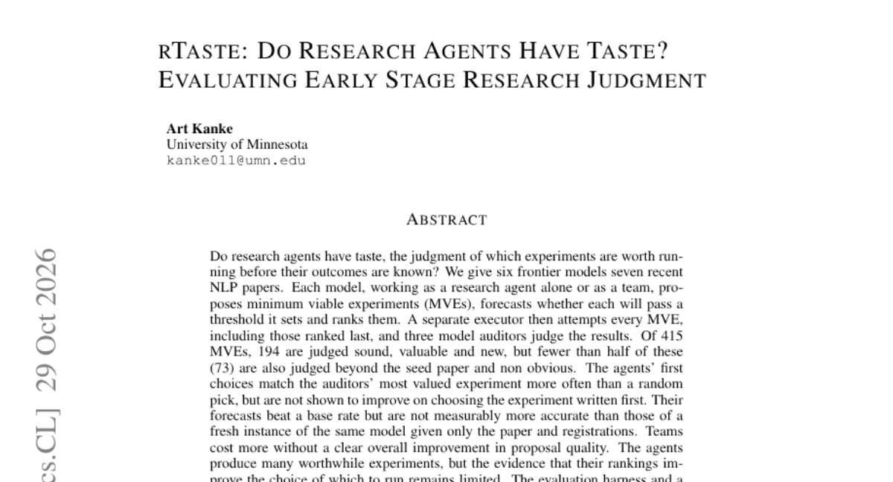

### 📌 한 줄 요약
AI 연구 에이전트가 실험의 가치를 판단하고 우선순위를 정하는 '연구적 안목(Taste)'을 갖추었는지 검증한 연구

### 🔑 핵심 포인트
- AI 에이전트의 실험 제안 능력 및 우선순위 선정(Taste) 능력 평가
- 최소 실행 가능 실험(MVE) 제안 및 예측 정확도 검증
- 에이전트 팀 구성이 개별 모델 대비 품질 향상에 미치는 영향 분석

### 🧑‍💻 개발자 관점
AI 에이전트가 단순 작업 수행을 넘어, 연구 가치를 판단하고 실험 방향을 설정하는 '연구 파트너'로서의 잠재력을 가졌는지 확인하는 데 중요합니다.

### 🚀 실무 적용 아이디어
- 제공된 rTaste 데이터셋을 활용하여 특정 모델의 실험 제안 품질 테스트하기
- 에이전트가 제안한 실험의 '독창성'과 '실행 가능성' 사이의 상관관계 분석하기
- 단일 모델과 멀티 에이전트 팀 간의 실험 제안 효율성 비교 실험하기

### ⚠️ 리스크/한계
- 에이전트의 순위 지정이 실제 최적의 실험 선택으로 이어지는지에 대한 증거 부족
- 제안된 실험이 기존 논문의 범위를 벗어나는 독창성을 확보하는 데 한계가 있음

### 📝 초록 기반 상세 설명
AI 에이전트가 실험 결과가 나오기 전 실험의 가치를 판단할 수 있는지에 대한 의문에서 연구가 시작되었습니다. 연구진은 6개의 최첨단 모델을 대상으로 최근 NLP 논문을 바탕으로 최소 실행 가능 실험(MVE)을 제안하고 순위를 매기게 했습니다. 이후 별도의 실행기를 통해 제안된 실험들을 수행하고, 감사 모델들이 그 결과를 평가하는 방식으로 실험을 진행했습니다. 결과적으로 에이전트들은 가치 있는 실험을 제안했지만, 제안된 실험이 기존 논문을 넘어선 독창적인 것인지는 부족했습니다. 에이전트의 선택이 무작위보다는 나았으나, 실험 순위가 실제 최적의 실험을 선택하는 데 결정적인 도움을 준다는 증거는 제한적이었습니다.

---

## 31. [TernScope: Model-Hardware Co-Design for Efficient Ternary Endoscopic Segmentation](https://huggingface.co/papers/2610.29617)
**Upvotes**: 2 | **도입 난이도**: 상 | **신뢰도**: 상
**arXiv**: https://arxiv.org/abs/2610.29617

**태그**: Edge AI, Quantization, Medical Imaging, Hardware Co-design, RAG, Inference, Optimization

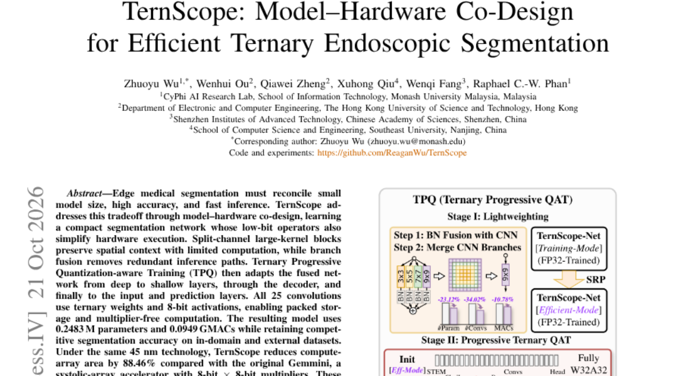

### 📌 한 줄 요약
모델-하드웨어 공동 설계를 통해 초경량·고성능을 동시에 달성한 3비트(Ternary) 내시경 분할 모델 및 가속기 구조 제안

### 🔑 핵심 포인트
- 모델-하드웨어 공동 설계를 통한 3비트 가중치 및 8비트 활성화 기반의 초경량 구조
- Split-channel 대형 커널과 Branch Fusion을 통한 연산 효율 및 공간 문맥 유지
- TPQ(Ternary Progressive Quantization-aware Training)를 통한 계층별 점진적 양자화 최적화

### 🧑‍💻 개발자 관점
임베디드 의료 기기처럼 자원이 극도로 제한된 환경에서 고성능 비전 모델을 배포하기 위한 실질적인 가이드라인을 제공합니다.

### 🚀 실무 적용 아이디어
- 제안된 TPQ(점진적 양자화) 알고리즘을 기존 경량 모델에 적용하여 정확도 변화 관찰
- Split-channel 커널 구조가 다양한 해상도의 의료 영상에서 공간 정보 유지에 미치는 영향 분석
- FP32 모델 대비 3비트 양자화 모델의 추론 속도 및 하드웨어 리소스 점유율 비교 실험

### ⚠️ 리스크/한계
- 3비트 가중치 사용으로 인한 극단적인 양자화 손실 발생 가능성
- 특정 하드웨어 아키텍처에 최적화된 구조이므로 범용 GPU 환경에서는 성능 이점이 낮을 수 있음

### 📝 초록 기반 상세 설명
엣지 디바이스 기반 의료 영상 분할은 모델 크기, 정확도, 추론 속도 사이의 트레이드오프를 해결해야 하는 과제를 안고 있습니다. 이를 위해 TernScope는 모델과 하드웨어를 동시에 최적화하는 공동 설계 방식을 제안합니다. Split-channel 대형 커널 블록과 분기 융합(Branch Fusion)을 통해 연산 효율을 높이고, TPQ(Ternary Progressive Quantization-aware Training)를 통해 점진적인 양자화 학습을 수행합니다. 모든 합성곱 연산은 3비트 가중치와 8비트 활성화를 사용하여 곱셈기 없는 연산과 패킹된 저장 방식을 가능하게 합니다. 결과적으로 매우 적은 파라미터와 연산량으로도 경쟁력 있는 정확도를 유지하며, 기존 가속기 대비 하드웨어 면적을 획기적으로 줄였습니다.

---

## 32. [GEPA-Curator: Curated Learning for Self Improving Agents](https://huggingface.co/papers/2610.37651)
**Upvotes**: 1 | **도입 난이도**: 중 | **신뢰도**: 상
**arXiv**: https://arxiv.org/abs/2610.37651

**태그**: Agent, Prompt Engineering, Self-Improving, Data Curation, RAG, Evaluation

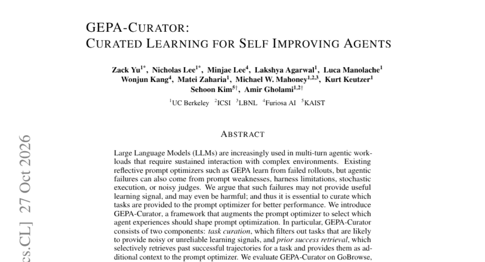

### 📌 한 줄 요약
에이전트의 실패 사례 중 유의미한 데이터만 선별하여 프롬프트 최적화 효율을 극대화하는 큐레이션 프레임워크

### 🔑 핵심 포인트
- 실패 사례 중 학습에 유용한 데이터만 선별하는 Task Curation 메커니즘 도입
- 과거의 성공적인 궤적을 검색하여 프롬프트 최적화의 맥락으로 활용하는 Prior Success Retrieval 구현
- 노이즈 섞인 실패 데이터로 인한 프롬프트 성능 저하 문제를 해결

### 🧑‍💻 개발자 관점
에이전트 학습 시 모든 실패 데이터를 무분별하게 사용하는 대신, 품질 높은 데이터만 선별하여 프롬프트를 개선하는 전략적 방법론을 제시합니다.

### 🚀 실무 적용 아이디어
- 현재 운영 중인 에이전트의 실패 로그를 분류하여 학습 데이터로서의 가치를 평가해보기
- 실패 사례뿐만 아니라 성공 사례를 RAG 형태로 프롬프트에 주입하는 실험 진행
- 프롬프트 최적화 시 노이즈(환경적 요인 vs 프롬프트 요인)를 구분하는 필터링 로직 설계

### ⚠️ 리스크/한계
- 큐레이션 과정에서 유용한 학습 신호까지 필터링될 위험(Over-filtering) 존재
- 데이터 선별 로직 자체의 성능이 전체 에이전트 성능의 병목이 될 수 있음

### 📝 초록 기반 상세 설명
LLM 에이전트가 복잡한 환경에서 지속적인 상호작용을 수행함에 따라 프롬프트 최적화의 중요성이 커지고 있습니다. 기존의 GEPA와 같은 방식은 실패한 실행 결과로부터 학습하지만, 프롬프트 자체의 결함이나 노이즈로 인한 실패는 오히려 잘못된 학습 신호를 제공할 위험이 있습니다. 이를 해결하기 위해 GEPA-Curator는 프롬프트 최적화에 사용할 경험을 선별하는 두 가지 핵심 기능을 도입합니다. 구체적으로 노이즈가 심한 작업을 필터링하는 'task curation'과 과거의 성공 사례를 맥락으로 제공하는 'prior success retrieval'을 결합했습니다. 실험 결과, GEPA-Curator는 기존 GEPA 및 ACE 대비 최대 20% 이상의 성능 향상을 기록하며 우수한 성능을 입증했습니다.

---

## 33. [Learning Quality-Controllable Robot Policies with Iterative Hindsight Relabeling](https://huggingface.co/papers/2610.37393)
**Upvotes**: 1 | **도입 난이도**: 중 | **신뢰도**: 상
**arXiv**: https://arxiv.org/abs/2610.37393

**태그**: Robot Learning, Imitation Learning, Reinforcement Learning, Policy Control, Evaluation, Inference

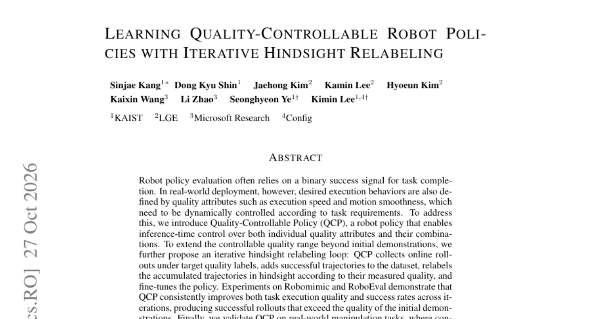

### 📌 한 줄 요약
실행 속도나 부드러움 등 품질 속성을 실시간으로 제어하며 성공률을 높이는 로봇 정책 학습 프레임워크

### 🔑 핵심 포인트
- 추론 시점에 속도, 부드러움 등 품질 속성을 동적으로 제어 가능한 QCP 프레임워크 제안
- 데이터 품질 범위를 확장하기 위한 반복적 히인사이트 리라벨링(Iterative Hindsight Relabeling) 루프 도입
- 초기 데모 데이터의 품질을 초과하는 고품질 궤적 생성 및 실무적 성능 검증

### 🧑‍💻 개발자 관점
단순히 '성공/실패'를 넘어 작업 목적에 맞는 최적의 움직임(빠른 작업 vs 안정적 작업)을 실시간으로 조절할 수 있는 기술적 토대를 제공합니다.

### 🚀 실무 적용 아이디어
- 기존 성공/실패 데이터셋에 속도/부드러움 점수를 추가하여 리라벨링 파이프라인 구축 실험
- 다양한 품질 제어 파라미터가 정책의 수렴 속도에 미치는 영향 분석
- 실제 로봇 환경에서 제어 파라미터 변화에 따른 작업 성공률 변화 측정

### ⚠️ 리스크/한계
- 반복적인 리라벨링 과정에서 특정 품질로의 편향(Bias)이 발생할 위험
- 실제 물리 환경에서의 데이터 수집 및 재학습 루프 운영 비용

### 📝 초록 기반 상세 설명
기존 로봇 정책 평가는 작업 성공 여부라는 이진 신호에만 의존하여 속도나 움직임의 부드러움 같은 품질 요소를 제어하기 어려웠습니다. 이를 해결하기 위해 품질 속성을 추론 시점에 제어할 수 있는 Quality-Controllable Policy(QCP)를 제안합니다. QCP는 타겟 품질에 맞춰 온라인 롤아웃을 수행하고, 수집된 데이터를 사후에 품질에 따라 재라벨링하여 정책을 미세 조정하는 반복적 히인사이트 리라벨링 루프를 사용합니다. 실험 결과, QCP는 초기 데모의 품질을 넘어서는 성공적인 동작을 생성하며 작업 성공률과 품질을 동시에 향상시켰습니다. 실제 조작 작업에서도 속도 조절을 통한 처리량 증대와 안정성 제어를 통한 성공률 향상 등 실용적인 이점을 입증했습니다.

---

## 34. [SketchDirector: Complex Scene Sketching via Agentic Layout Reasoning and Detail Refinement](https://huggingface.co/papers/2610.41260)
**Upvotes**: 1 | **도입 난이도**: 중 | **신뢰도**: 상
**arXiv**: https://arxiv.org/abs/2610.41260

**태그**: Agent, Vector Graphics, Diffusion Model, LLM, RAG, Reasoning, Vision

### 📌 한 줄 요약
LLM 에이전트와 확산 모델을 결합하여 복잡한 장면을 벡터 기반 스케치로 자동 생성하는 프레임워크

### 🔑 핵심 포인트
- LLM 기반의 장면 분해 및 베지에 곡선 기반 벡터 에셋 생성
- 자기 진화형 메모리를 활용한 에이전트 기반 공간 배치 추론 루프
- 기하학적 구조를 유지하며 디테일을 향상시키는 확산 모델 기반 정제 모듈

### 🧑‍💻 개발자 관점
텍스트만으로 편집 가능한 벡터 기반의 복잡한 장면 스케치를 생성할 수 있어, UI/UX 디자인 및 컨셉 아트 워크플로우 자동화에 활용 가능합니다.

### 🚀 실무 적용 아이디어
- 제공된 MCSketch8K 데이터셋을 활용한 레이아웃 생성 성능 테스트
- 베지에 곡선 기반 에셋과 확산 모델 간의 구조 보존 정밀도 검증
- LLM 에이전트의 메모리 크기에 따른 복잡한 장면 구성 능력 비교

### ⚠️ 리스크/한계
- 매우 복잡한 상호작용이 포함된 장면에서의 공간 배치 논리 오류 가능성
- 확산 모델 정제 과정에서 의도치 않은 기하학적 변형 발생 위험

### 📝 초록 기반 상세 설명
기존의 스케치 생성 방식은 이미지 가이드에 의존하거나 개별 객체 생성에 국한되어 복잡한 장면 구성에 한계가 있었습니다. 본 논문은 인간의 스케치 워크플로우를 모방한 에이전트 프레임워크인 SketchDirector를 제안합니다. 먼저 LLM이 장면 텍스트를 여러 개의 베지에 곡선 기반 에셋으로 분해하고, 에이전트 추론 루프가 메모리를 활용해 공간 배치를 반복적으로 계획 및 실행합니다. 마지막으로 확산 모델의 사전 지식을 활용해 기하학적 구조를 유지하며 디테일을 정교화합니다. 실험 결과, 제안 방식은 기존 모델 대비 의미적/구성적 품질에서 우수한 성능을 보였습니다.

---

## 35. [SOMA: A Benchmark for Fine-Grained Egocentric Behavior and Body-Motion Understanding](https://huggingface.co/papers/2610.36384)
**Upvotes**: 0 | **도입 난이도**: 하 | **신뢰도**: 상
**arXiv**: https://arxiv.org/abs/2610.36384

**태그**: Egocentric-Vision, MLLM, Benchmark, Body-Motion, Reasoning, Multimodal, Vision, Video, Evaluation

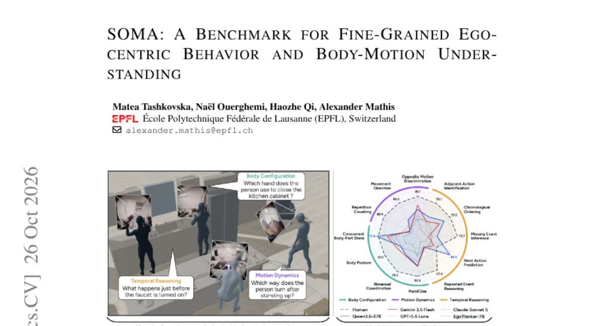

### 📌 한 줄 요약
1인칭 시점(Egocentric) 영상에서 미세한 신체 동작과 움직임을 이해하는 능력을 평가하기 위한 벤치마크 SOMA 제안

### 🔑 핵심 포인트
- 1인칭 시점의 미세 신체 동작 및 시간적 추론을 위한 SOMA 벤치마크 구축
- 37개 주요 MLLM 대상 광범위한 성능 평가 및 오류 분석 수행
- 모델 성능 향상을 위한 정렬된 비디오-동작-언어 학습 데이터셋 및 베이스라인 제공

### 🧑‍💻 개발자 관점
로봇 제어, 웨어러블 기기, AR/VR 등 1인칭 시점의 상호작용이 필요한 시스템 개발 시 필수적인 신체 이해 능력을 검증할 수 있습니다.

### 🚀 실무 적용 아이디어
- SOMA 벤치마크를 활용하여 현재 사용 중인 MLLM의 신체 동작 이해도 테스트
- 제공된 학습 데이터셋을 활용하여 1인칭 시점 특화 파인튜닝 실험 진행
- 모델의 손(hand) 편향성 및 시간적 추론 오류 패턴 분석

### ⚠️ 리스크/한계
- 인간의 성능(68.5%)과 모델 성능(50.0%) 간의 여전히 큰 격차 존재
- 1인칭 시점 특유의 가려짐(Occlusion) 문제로 인한 데이터 해석의 난이도

### 📝 초록 기반 상세 설명
기존 MLLM 평가는 객체나 장면 중심의 거친 동작 파악에 치중되어 있어, 신체 자체의 미세한 움직임을 이해하는 능력은 간과되어 왔습니다. 특히 1인칭 시점은 신체가 일부만 보이고 가려짐이 많아 추론이 매우 까다롭습니다. 이를 해결하기 위해 신체 구성, 동작 역학, 시간적 추론 능력을 평가하는 1,632개의 질문으로 구성된 SOMA 벤치마크를 도입했습니다. 37개의 최신 MLLM을 평가한 결과, 인간의 성능에 비해 모델들의 성능이 현저히 낮음을 확인했습니다. 연구진은 성능 격차를 줄이기 위해 정렬된 비디오-동작-언어 학습 데이터셋과 멀티모달 베이스라인을 함께 공개했습니다.

---

## 36. [AuditFL: A Contract-Backed Clearing Layer for Open Federated Learning](https://huggingface.co/papers/2610.41278)
**Upvotes**: 0 | **도입 난이도**: 상 | **신뢰도**: 상
**arXiv**: https://arxiv.org/abs/2610.41278

**태그**: Federated Learning, Blockchain, Smart Contract, Distributed Systems

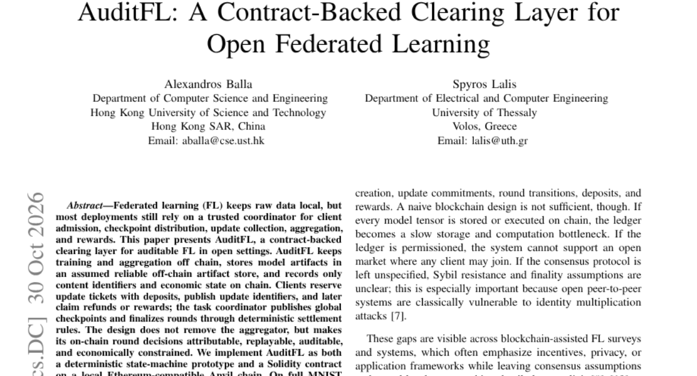

### 📌 한 줄 요약
오픈 환경의 연합 학습(FL)에서 중앙 코디네이터의 신뢰 문제를 해결하기 위해 블록체인 기반의 감사 및 정산 레이어를 도입한 프레임워크입니다.

### 🔑 핵심 포인트
- 오프체인 학습/집계와 온체인 감사/정산의 분리 설계
- 결정론적 정산 규칙을 통한 코디네이터의 책임성 및 가시성 확보
- 경제적 인센티브(예치 및 보상)를 통한 클라이언트 행동 제어

### 🧑‍💻 개발자 관점
중앙 서버를 완전히 믿을 수 없는 분산 환경에서, 학습 과정의 무결성을 검증하고 보상 체계를 자동화하는 아키텍처를 설계할 때 유용합니다.

### 🚀 실무 적용 아이디어
- 제안된 온체인/오프체인 하이브리드 아키텍처의 가스 비용 최적화 분석
- 대규모 클라이언트 환경에서의 트랜잭션 처리량(TPS) 병목 지점 확인
- 오프체인 아티팩트 저장소의 가용성 저하 시 복구 시나리오 테스트

### ⚠️ 리스크/한계
- 온체인 트랜잭션 비용(Gas)이 클라이언트 수에 따라 증가하는 구조적 비용 문제
- 오프체인 아티팩트 저장소의 신뢰성 및 가용성에 대한 의존성

### 📝 초록 기반 상세 설명
기존의 연합 학습은 데이터는 로컬에 유지하지만, 클라이언트 관리와 집계 과정을 담당하는 중앙 코디네이터를 신뢰해야 하는 문제가 있습니다. 본 논문은 AuditFL이라는 계약 기반의 클리어링 레이어를 제안하여 오픈 환경에서도 감사 가능한 FL 환경을 구축합니다. 학습과 집계는 오프체인에서 수행하되, 모델 식별자와 경제적 상태만 온체인에 기록하여 투명성을 확보합니다. 실험 결과, AuditFL은 기존 FL의 학습 궤적을 유지하면서도 클라이언트 탈락이나 무효 업데이트와 같은 장애 상황에서도 높은 정확도와 안정성을 유지함을 입증했습니다.

### 🖼️ 추가 자료
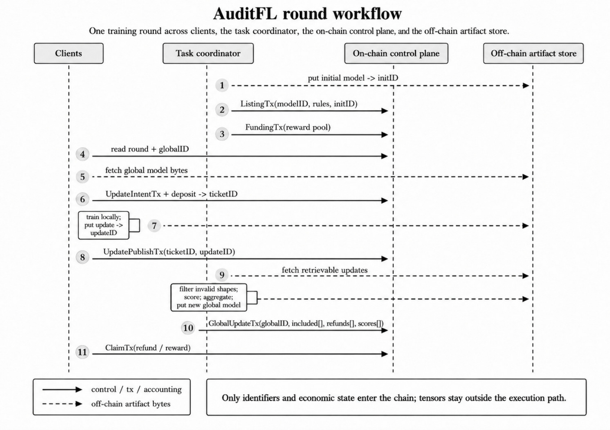

---

## 37. [TurnTurk-GPT: Text-Based Turn-Taking Prediction for Turkish](https://huggingface.co/papers/2610.42010)
**Upvotes**: 0 | **도입 난이도**: 중 | **신뢰도**: 상
**arXiv**: https://arxiv.org/abs/2610.42010

**태그**: NLP, Dialogue-System, LLM, Turn-taking, Evaluation

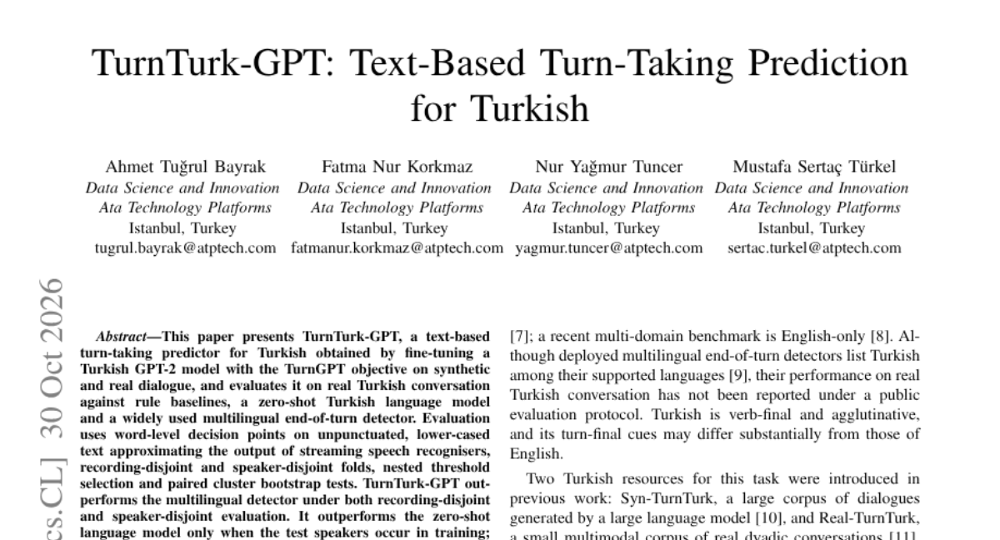

### 📌 한 줄 요약
터키어의 어미 변화 특성을 반영하여 대화 흐름을 예측하는 텍스트 기반 Turn-taking 모델 개발

### 🔑 핵심 포인트
- 터키어 특화 GPT-2 모델에 TurnGPT 목적 함수를 적용한 Turn-taking 예측 모델 개발
- 교착어 특성을 반영하여 동사 말 어미(suffix)가 발화 종료 결정에 미치는 영향 입증
- 기존 다국어 모델 및 제로샷 모델 대비 우수한 성능과 공개된 평가 프로토콜 제공

### 🧑‍💻 개발자 관점
음성 인식(ASR) 결과물과 같은 비정형 텍스트에서 자연스러운 대화 전환 시점을 결정하는 에이전트 개발에 활용 가능합니다.

### 🚀 실무 적용 아이디어
- 제공된 데이터셋을 활용하여 한국어와 같은 다른 교착어에 대한 성능 비교 실험 수행
- 실시간 스트리밍 ASR 출력 환경에서의 지연 시간(latency) 영향도 테스트
- 동사 어미 제거 등 형태소 변화에 따른 모델 강건성 테스트

### ⚠️ 리스크/한계
- 학습 데이터에 포함되지 않은 새로운 화자(unseen speaker)에 대해서는 성능 저하 가능성
- 합성 데이터만으로는 충분한 성능 확보가 어려움

### 📝 초록 기반 상세 설명
대화형 AI 시스템에서 자연스러운 대화 흐름을 위해 발화 종료 시점을 예측하는 기술이 필요합니다. 기존의 다국어 모델은 터키어와 같은 교착어의 특성을 충분히 반영하지 못하는 한계가 있습니다. 본 논문은 터키어 GPT-2 모델에 TurnGPT 목적 함수를 적용하여 텍스트 기반 Turn-taking 예측 모델인 TurnTurk-GPT를 제안합니다. 실험 결과, 제안 모델은 기존 다국어 모델보다 우수한 성능을 보였으며 특히 터키어의 동사 말 어미가 발화 종료 결정에 핵심적인 역할을 함을 확인했습니다. 연구팀은 모델과 평가 프로토콜을 공개하여 후속 연구를 지원합니다.

---

