# 2026-11-09 Daily Papers (Top 32)

## 오늘의 요약
오늘의 연구는 단순 자동화를 넘어 인간의 인지 능력을 확장하는 초개인화 에이전트와 로봇의 정밀한 제어를 위한 VLA 모델 고도화에 집중되었습니다. 또한, 효율적인 벤치마크 압축, 이미지 생성과 편집의 통합, 그리고 지속적인 상호작용 속에서 일관성을 유지하는 메모리 및 편집 프레임워크 등 실용적이고 확장 가능한 AI 시스템 설계가 주요 화두였습니다.

### 오늘의 핵심 포인트
- 인간의 맥락을 이해하고 인지 능력을 보완하는 '인지적 공생체' 및 초개인화 에이전트 설계 방향이 제시되었습니다.
- 로봇의 실시간 제어와 정밀한 조작을 위해 시각적 플래닝 효율화 및 3D 공간 이해를 결합한 학습 방법론이 강조되었습니다.
- 에이전트의 범용성 확보를 위한 환경 전이 학습과 다회차 편집 시 발생하는 드리프트 문제를 해결하는 효율적인 프레임워크들이 제안되었습니다.

**오늘의 태그**: AI Agents, Robotics, Personalized AI, Multimodal Learning, Efficient Inference

## 1. [From Autonomous Agents to Cognitive Symbionts: Toward AI-Augmented Human Intelligence](https://huggingface.co/papers/2611.05376)
**Upvotes**: 116 | **도입 난이도**: 상 | **신뢰도**: 상
**arXiv**: https://arxiv.org/abs/2611.05376

**태그**: AI-Augmented Intelligence, Human-AI Interaction, Personalized Agents, Cognitive Architecture, Agent

### 📌 한 줄 요약
개별적 에이전트를 넘어 인간의 인지 능력을 확장하는 '인지적 공생체(Cognitive Symbiont)' 패러다임 제안

### 🔑 핵심 포인트
- AGI(기계 지능)를 넘어 AHI(인간 증강 지능)로의 패러다임 전환 제안
- 인간의 작업 기억 한계를 보완하는 '인지적 공생체' 개념 정립
- 감지, 맥락 유지, 사고 지원, 행동 대행을 포함하는 공생 루프 설계

### 🧑‍💻 개발자 관점
단순 자동화 도구를 넘어, 사용자의 개인적 맥락과 실시간 상황을 완벽히 이해하는 초개인화 에이전트 설계의 방향성을 제시합니다.

### 🚀 실무 적용 아이디어
- 사용자의 실시간 맥락(Context)을 유지하기 위한 장기 기억(Long-term Memory) 아키텍처 설계 실험
- 개인 프라이버시를 보장하면서도 실시간 감지가 가능한 온디바이스(On-device) AI 프로토타입 제작
- 인간의 의사결정 루프에 개입하는 타이밍(Intervention timing) 최적화 알고리즘 연구

### ⚠️ 리스크/한계
- 개인 프라이버시 침해 및 데이터 보안 문제
- AI 의존도 심화로 인한 인간의 인지 능력 퇴화 및 사회적 불평등 발생 가능성

### 📝 초록 기반 상세 설명
지난 10년간 AI 발전은 기계의 자율성에 집중해 왔으나, 인간의 인지적 한계와 맥락 유지 문제는 여전히 해결되지 않은 과제로 남아 있습니다. 기존의 AI가 인간 외부에서 독립적으로 작동하는 것과 달리, 본 논문은 인간의 지능을 증폭시키는 AI-Augmented Human Intelligence(AHI)의 중요성을 역설합니다. 이를 위해 인간의 감각과 맥락을 실시간으로 공유하며 사고를 돕는 '인지적 공생체'라는 새로운 시스템 모델을 제안합니다. 이 모델은 인간의 작업 기억(Working Memory) 한계를 보완하는 것을 핵심 목표로 하며, 감지, 이해, 행동, 성장이 순환하는 공생 루프를 설계 공간으로 정의합니다. 결과적으로 이 패러다임은 인간과 AI가 상호 보완하며 함께 성장하는 새로운 지능의 형태를 제시합니다.

---

## 2. [VFlash: Fast, Accurate Visual Planning via Flash Primitive Decoding](https://huggingface.co/papers/2611.08449)
**Upvotes**: 104 | **도입 난이도**: 중 | **신뢰도**: 상
**arXiv**: https://arxiv.org/abs/2611.08449

**태그**: Robotics, Computer Vision, Efficient Inference, Motion Planning, RAG, Vision, Evaluation

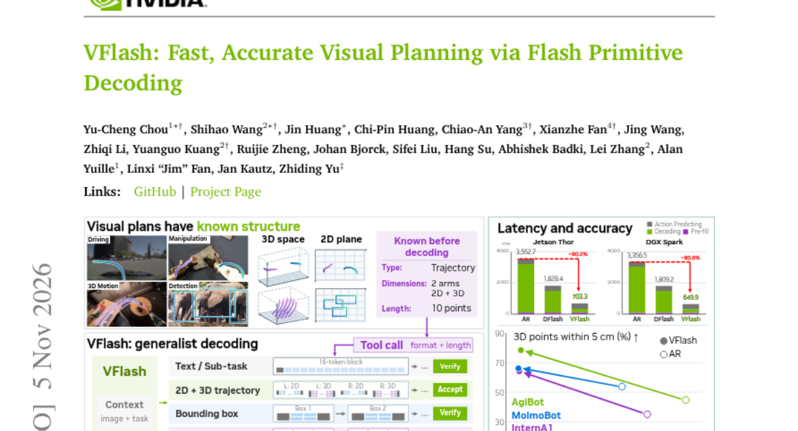

### 📌 한 줄 요약
자기회귀 방식의 비효율을 극복하기 위해 시각적 프리미티브 구조를 활용하여 생성 속도와 정확도를 동시에 높인 비주얼 플래닝 기법

### 🔑 핵심 포인트
- Flash Primitive Decoding: 구조적 특성을 활용해 한 번의 패스로 전체 프리미티브를 생성하는 경량 드래프터 도입
- 구조적 유효성 중심 학습: 토큰 순서 일치 대신 기하학적 구조를 유지하며 정확도를 확보하는 학습 방식
- 확장 가능한 레이아웃: 박스, 점, 가변 길이 궤적 등 다양한 차원과 길이를 지원하는 유연한 구조

### 🧑‍💻 개발자 관점
실시간성이 중요한 로봇 제어나 자율 주행 환경에서, 토큰 생성 지연 시간을 획기적으로 줄이면서도 정확한 공간 좌표를 얻을 수 있습니다.

### 🚀 실무 적용 아이디어
- 기존 자기회귀 모델과 VFlash의 생성 속도 및 좌표 오차(L1/L2) 비교 실험
- 다양한 차원(2D/3D) 및 가변 길이 궤적 데이터셋에 대한 구조적 안정성 테스트
- 로봇 제어 루프(Control Loop)에 통합 시 발생하는 지연 시간(Latency) 영향도 분석

### ⚠️ 리스크/한계
- 구조적 유효성에 의존하므로 매우 복잡하거나 비정형적인 시각적 형태에는 적용이 어려울 수 있음
- 학습 시 사용된 프리미티브 구조를 벗어나는 예측값에 대한 제어 가능성 검증 필요

### 📝 초록 기반 상세 설명
로봇 공학 및 자율 주행을 위한 물리적 AI는 점, 박스, 궤적과 같은 시각적 계획(Visual Plan)을 생성해야 합니다. 기존의 자기회귀(Autoregressive) 방식은 좌표를 하나씩 생성하므로 복잡한 예측 시 비용이 급격히 증가하는 문제가 있습니다. 이를 해결하기 위해 VFlash는 시각적 프리미티브의 구조적 특성을 활용하여 한 번의 포워드 패스로 전체를 예측하는 Flash Primitive Decoding 방식을 제안합니다. 이 방식은 타겟 토큰의 순서 일치 여부와 상관없이 구조적으로 유효한 예측을 직접 수용할 수 있습니다. 실험 결과, 3D 포인트 모션 예측에서 약 25배 빠른 생성 속도를 기록했으며, 로봇 작업 성공률 또한 기존 베이스라인 대비 향상되었습니다.

---

## 3. [SLA: Scaling Spatial-Language-Action Model via Continual Pre-training](https://huggingface.co/papers/2611.08373)
**Upvotes**: 92 | **도입 난이도**: 중 | **신뢰도**: 상
**arXiv**: https://arxiv.org/abs/2611.08373

**태그**: Robotics, VLA, 3D Vision, Pre-training, RAG, Vision, Inference, Safety

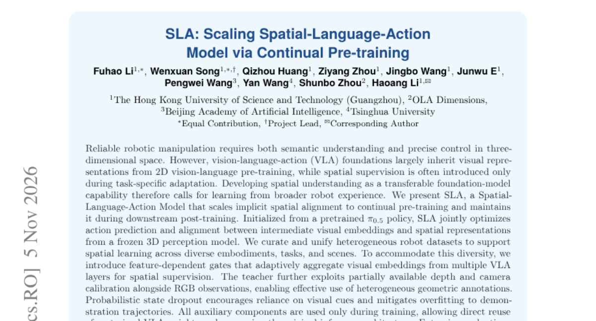

### 📌 한 줄 요약
3D 공간 이해력을 VLA 모델에 내재화하여 로봇의 정밀한 조작 능력을 강화하는 지속적 사전 학습 프레임워크

### 🔑 핵심 포인트
- 3D 인지 모델의 공간 표현을 VLA 중간 임베딩에 정렬하는 지속적 사전 학습 방식 도입
- 다양한 로봇 환경에 대응하기 위한 특징 의존형 게이트(Feature-dependent gates) 설계
- 추론 시 추가 연산 없이 학습 시의 보조 구성 요소만으로 성능을 높이는 구조

### 🧑‍💻 개발자 관점
기존 2D 기반 VLA 모델을 유지하면서도 3D 공간 정밀도를 높일 수 있는 효율적인 학습 방법론을 제시합니다.

### 🚀 실무 적용 아이디어
- 기존 VLA 모델에 3D 인지 모델(Depth/Point Cloud)을 결합한 손실 함수 적용 실험
- 다양한 로봇 하드웨어 데이터셋을 활용한 공간 정렬(Spatial Alignment) 효과 검증
- Probabilistic state dropout이 과적합 방지에 미치는 영향 분석

### ⚠️ 리스크/한계
- 학습 시 사용된 3D 인지 모델의 품질에 따라 공간 정렬 성능이 좌우될 수 있음
- 이질적인 로봇 데이터셋 통합 시 데이터 정제 및 정렬 과정의 복잡성 존재

### 📝 초록 기반 상세 설명
기존의 VLA 모델은 2D 시각 정보에 의존하여 3D 공간에 대한 정밀한 제어 능력이 부족한 문제가 있었습니다. 이를 해결하기 위해 공간적 이해를 전이 가능한 기초 모델 역량으로 만들기 위한 SLA 모델을 제안합니다. SLA는 기존 pi05 정책을 초기값으로 사용하여, 중간 시각 임베딩과 고정된 3D 인지 모델 간의 공간 정렬을 최적화합니다. 다양한 로봇 데이터셋을 통합하고, 여러 VLA 레이어의 임베딩을 적응적으로 결합하는 특징 의존형 게이트를 도입했습니다. 결과적으로 추론 아키텍처의 변경 없이도 정밀한 공간 제어 능력을 확보할 수 있습니다.

---

## 4. [Harness-S: Learning from Sibling Harnesses for Generalizable Agent Training](https://huggingface.co/papers/2611.04277)
**Upvotes**: 66 | **도입 난이도**: 상 | **신뢰도**: 상
**arXiv**: https://arxiv.org/abs/2611.04277

**태그**: Agent, Reinforcement Learning, LLM, Training Strategy, Inference

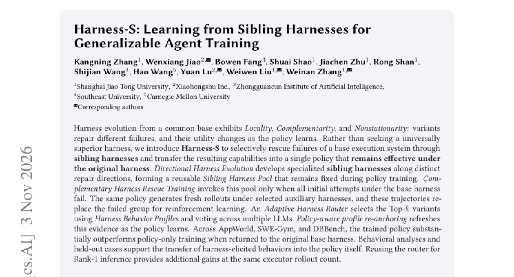

### 📌 한 줄 요약
특수 목적의 보조(Sibling) 환경을 활용해 에이전트의 실패를 복구하고, 이를 원본 환경에서도 작동하는 범용 능력으로 전이시키는 학습 프레임워크

### 🔑 핵심 포인트
- Directional Harness Evolution: 특정 실패 유형을 복구하는 데 특화된 다양한 보조 환경(Sibling Harnesses) 구축
- Complementary Harness Rescue Training: 원본 환경에서 실패할 경우에만 보조 환경을 호출하여 학습 데이터를 생성하는 전략
- Adaptive Harness Router: 에이전트의 행동 프로필과 LLM 투표를 통해 최적의 보조 환경을 선택하는 메커니즘

### 🧑‍💻 개발자 관점
에이전트 학습 시 특정 환경에 매몰되지 않고, 다양한 엣지 케이스(Edge Case)를 효과적으로 학습 데이터로 변환하여 범용 성능을 높이는 방법론을 제시합니다.

### 🚀 실무 적용 아이디어
- 에이전트 학습 시 실패 케이스를 변형한 다양한 '보조 환경' 세트 구축 실험
- 학습 중 실패 시에만 보조 환경 데이터를 주입하는 스케줄링 전략 테스트
- 학습된 모델이 원본 환경(Base Harness)에서 성능 저하 없이 전이되는지 검증

### ⚠️ 리스크/한계
- 보조 환경이 너무 특수할 경우 원본 환경으로의 능력 전이가 어려울 수 있음
- 다양한 환경을 관리하고 라우팅하는 데 따른 추가적인 연산 비용 발생

### 📝 초록 기반 상세 설명
에이전트 학습 시 환경(Harness)의 변화에 따라 에이전트의 성능과 실패 양상이 변하는 비정상성(Nonstationarity) 문제가 발생합니다. 기존에는 단일 우수 환경을 찾는 데 집중했으나, 이는 특정 환경에 과적합될 위험이 있습니다. 본 논문은 다양한 실패를 보완하는 '형제 환경(Sibling Harnesses)' 풀을 구축하고, 실패 시에만 이를 선택적으로 활용하는 Harness-S를 제안합니다. 학습 과정에서 에이전트가 실패할 때만 보조 환경에서 새로운 데이터를 생성하고, 이를 원본 환경에서도 유효한 능력으로 전이시키는 방식을 사용합니다. 실험 결과, 제안된 방식은 원본 환경에서의 성능을 크게 향상시키며 에이전트의 범용적인 문제 해결 능력을 강화함을 입증했습니다.

---

## 5. [Random Is Almost Enough? Stable and Low-Cost Benchmark Compression via BestRand](https://huggingface.co/papers/2611.00883)
**Upvotes**: 50 | **도입 난이도**: 하 | **신뢰도**: 상
**arXiv**: https://arxiv.org/abs/2611.00883

**태그**: Benchmark, Model Evaluation, Efficiency, Foundation Models, Agent, RAG, Multimodal, Evaluation, Optimization

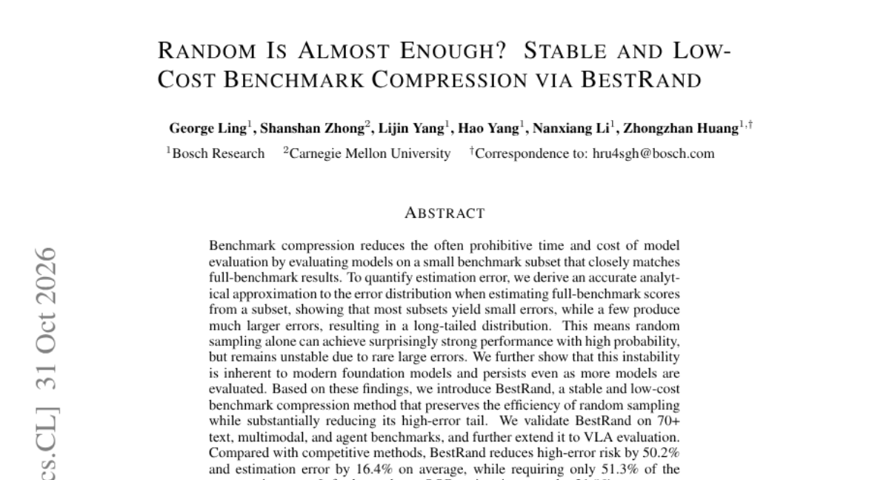

### 📌 한 줄 요약
랜덤 샘플링의 효율성을 유지하면서도 대형 모델 평가 시 발생하는 예측 오차의 불안정성을 해결한 벤치마크 압축 기법

### 🔑 핵심 포인트
- 랜덤 샘플링의 오차 분포가 롱테일(long-tailed) 형태를 띠며 불안정함을 이론적으로 규명
- 효율적인 랜덤 샘플링의 장점을 유지하면서 고위험 오차를 억제하는 BestRand 알고리즘 제안
- 70개 이상의 텍스트, 멀티모달, 에이전트 벤치마크를 통한 광범위한 검증

### 🧑‍💻 개발자 관점
모델 평가 비용이 막대한 상황에서, 적은 비용으로도 신뢰할 수 있는 평가 결과를 얻을 수 있는 실용적인 가이드를 제공합니다.

### 🚀 실무 적용 아이디어
- 기존의 무작위 샘플링 방식과 BestRand의 오차 분포 비교 실험
- 특정 도메인(예: 코딩, 수학) 벤치마크에 BestRand 적용 테스트
- 모델 패밀리가 바뀔 때(OOD)의 오차 변화량 측정

### ⚠️ 리스크/한계
- 샘플링된 데이터셋이 전체 데이터의 특성을 완전히 대변하지 못할 위험 존재
- 특정 도메인에 특화된 벤치마크에서는 일반적인 성능 향상이 보장되지 않을 수 있음

### 📝 초록 기반 상세 설명
모델 평가 비용을 줄이기 위해 전체 벤치마크의 일부만 사용하는 벤치마크 압축 기술이 주목받고 있습니다. 그러나 기존의 랜덤 샘플링 방식은 대부분의 경우 성능이 좋지만, 드물게 발생하는 거대한 오차로 인해 결과가 불안정하다는 문제가 있습니다. 연구진은 이러한 불안정성이 현대 파운데이션 모델의 특성에서 기인함을 이론적으로 증명했습니다. 이를 해결하기 위해 랜덤 샘플링의 효율성을 유지하면서도 오차의 꼬리(tail) 부분을 효과적으로 줄이는 BestRand 기법을 제안합니다. 실험 결과, BestRand는 기존 방식 대비 높은 오차 위험을 낮추고 정확도를 높이면서도 구축 비용을 절반 수준으로 유지했습니다.

---

## 6. [WeLM-Image: A Unified Image Generation Model towards Visual Intelligence](https://huggingface.co/papers/2611.07392)
**Upvotes**: 44 | **도입 난이도**: 상 | **신뢰도**: 상
**arXiv**: https://arxiv.org/abs/2611.07392

**태그**: Image-Generation, Multimodal, MoE, Efficiency, RAG, Vision, Evaluation, Distillation

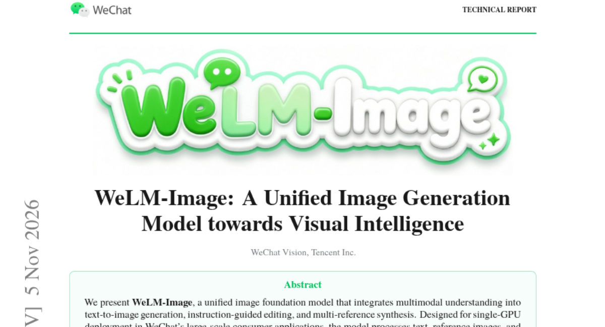

### 📌 한 줄 요약
이해와 생성을 통합하여 단일 GPU에서도 고해상도 이미지 생성 및 편집이 가능한 MoT 기반의 통합 이미지 파운데이션 모델입니다.

### 🔑 핵심 포인트
- 이해와 생성을 하나의 시퀀스로 처리하는 통합 멀티모달 아키텍처 설계
- MoT(Mixture-of-Transformers)와 MoE(Mixture-of-Experts)를 결합한 효율적 파라미터 관리
- 데이터 엔진과 보상 기반의 온폴리(on-policy) 증류를 통한 고해상도 및 편집 정밀도 확보

### 🧑‍💻 개발자 관점
단일 GPU 환경에서 대규모 서비스 배포가 가능할 정도의 효율적인 아키텍처 설계 방식을 제시하며, 생성과 편집이 통합된 워크플로우를 구축하는 데 중요한 영감을 줍니다.

### 🚀 실무 적용 아이디어
- MoT 구조가 이해와 생성 간의 간섭(interference)을 얼마나 효과적으로 억제하는지 분석
- 제시된 데이터 엔진의 클러스터링 및 어노테이션 전략을 소규모 데이터셋에 적용해보기
- Turbo 모델의 Few-step 증류 방식이 품질 저하 없이 속도를 얼마나 확보하는지 검증

### ⚠️ 리스크/한계
- 31.7B의 거대 파라미터로 인해 학습 단계에서의 막대한 컴퓨팅 자원 필요
- 특정 도메인에 특화된 데이터 엔진 의존성으로 인한 범용성 제약 가능성

### 📝 초록 기반 상세 설명
기존 이미지 생성 모델은 시각적 이해와 생성 작업 간의 간섭 문제와 대규모 서비스 배포 시의 효율성 문제를 겪어왔습니다. 이를 해결하기 위해 텍스트, 참조 이미지, 타겟 잠재 변수를 하나의 시퀀스로 처리하는 WeLM-Image를 제안합니다. Mixture-of-Transformers(MoT) 구조를 통해 이해와 생성 파라미터를 분리하면서도 공유 어텐션을 통해 상호작용하게 설계했습니다. 또한 MoE 모듈을 도입하여 31.7B의 거대 파라미터 중 생성 시에는 5.4B만 활성화되도록 효율성을 극대화했습니다. 결과적으로 고해상도 생성 및 편집 성능에서 오픈소스 모델 중 최상위 성능을 기록했으며, Turbo 모델을 통해 초고속 생성까지 구현했습니다.

---

## 7. [TailSteer: Trajectory-Tail Steering for Drift-Resistant Multi-turn Image Editing](https://huggingface.co/papers/2611.06741)
**Upvotes**: 40 | **도입 난이도**: 중 | **신뢰도**: 상
**arXiv**: https://arxiv.org/abs/2611.06741

**태그**: Image Editing, Diffusion Models, Fine-tuning, Multi-turn Interaction, Vision, Benchmark, Inference

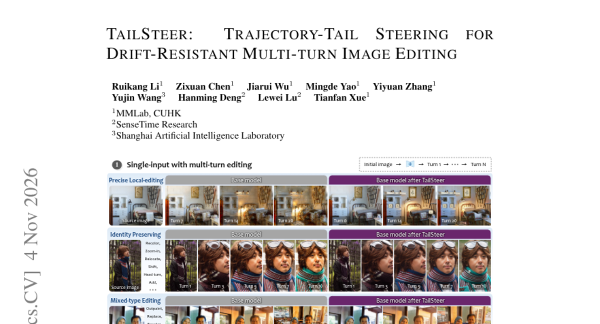

### 📌 한 줄 요약
사전 학습된 모델의 성능을 유지하면서도 다회차 이미지 편집 시 발생하는 누적 드리프트(Drift) 문제를 해결하는 최종 단계 미세조정 프레임워크

### 🔑 핵심 포인트
- 초기 생성 역학은 유지하고 궤적의 끝(Tail) 부분에만 보정 집중
- 정답 데이터셋 없이 모델 자체의 롤아웃을 활용한 자기 주도적 학습
- 기존 생성/편집 능력을 해치지 않으면서 다회차 편집의 안정성 확보

### 🧑‍💻 개발자 관점
사용자와의 지속적인 상호작용이 필요한 에이전트 기반 이미지 편집 서비스 개발 시, 모델 재학습 비용을 최소화하면서도 일관성을 유지하는 데 유용합니다.

### 🚀 실무 적용 아이디어
- FLUX 등 최신 모델에 TailSteer 로직을 적용하여 드리프트 억제 효과 검증
- 편집 횟수(Turn 수) 증가에 따른 원본 콘텐츠 보존율 변화 측정
- 단일 편집 성능(Single-turn)과 다회차 성능(Multi-turn) 간의 트레이드오프 분석

### ⚠️ 리스크/한계
- 초기 디노이징 단계를 건드리지 않으므로 매우 복잡한 구조적 변화에는 한계가 있을 수 있음
- 특정 모델 가문(FLUX, SenseNova 등)에 최적화된 방식이 다른 아키텍처에서도 동일하게 작동할지 확인 필요

### 📝 초록 기반 상세 설명
기존의 단일 회차 편집 성능이 우수하더라도, 편집된 결과물을 반복 재사용하는 다회차 편집 과정에서는 미세한 변화가 누적되어 원본에서 벗어나는 드리프트 현상이 발생합니다. 이를 해결하기 위해 기존에는 데이터셋을 재학습하거나 복잡한 추론 메커집을 도입했으나, 이는 모델의 기본 성능을 저하시키거나 확장성이 떨어지는 문제가 있었습니다. 본 논문은 초기 디노이징 역학은 유지하고 궤적의 끝부분(Tail)에서만 정밀한 보정을 수행하는 TailSteer 프레임워크를 제안합니다. TailSteer는 별도의 정답 쌍 없이 모델 자체의 온폴리시(on-policy) 롤아웃을 활용하여 소스 콘텐츠를 보존하도록 학습됩니다. 실험 결과, FLUX 등 최신 모델에서 15~20회 이상의 장기 편집 시에도 드리프트를 효과적으로 억제하면서 기본 생성 성능을 유지함을 입증했습니다.

---

## 8. [EvoMemState: Evolving Memory State for Personal Agents](https://huggingface.co/papers/2611.03743)
**Upvotes**: 33 | **도입 난이도**: 상 | **신뢰도**: 상
**arXiv**: https://arxiv.org/abs/2611.03743

**태그**: LLM-Agent, Memory-Management, RAG, Reinforcement-Learning, Agent, Reasoning, Benchmark, Evaluation

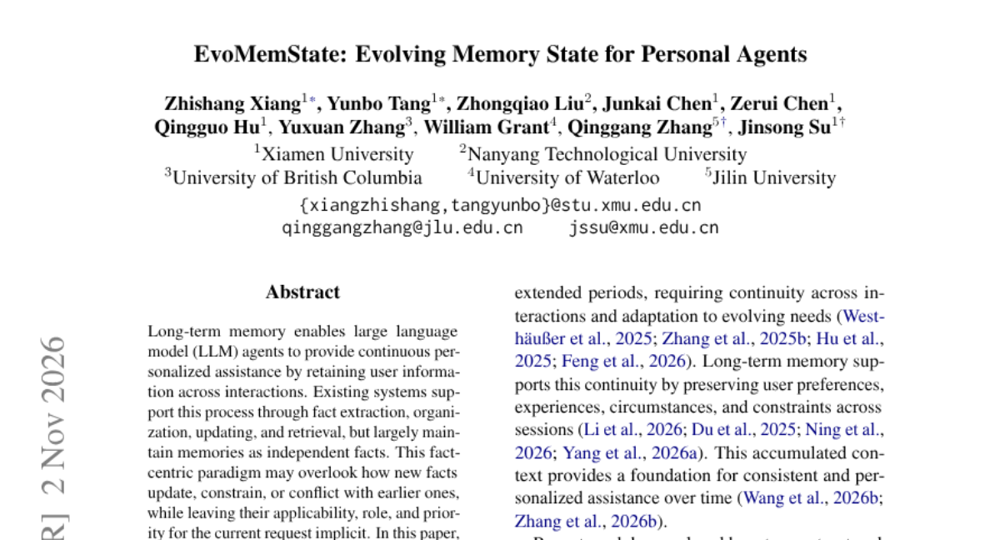

### 📌 한 줄 요약
단순 사실 저장을 넘어 관계와 추론 상태를 결합하여 개인화 에이전트의 기억 정밀도를 높인 프레임워크

### 🔑 핵심 포인트
- 팩트 중심에서 상태 중심(Relational & Reasoning States)으로의 메모리 패러다임 전환
- 온톨로지를 활용한 사실 간의 유효성 및 관계 유지
- 강화학습(RL)을 통해 사용자 요청에 최적화된 추론 상태를 생성하는 정책 학습

### 🧑‍💻 개발자 관점
단순 RAG를 넘어, 시간이 흐름에 따라 변하는 사용자 정보 간의 모순을 해결하고 맥락에 맞는 정교한 개인화 에이전트를 구축하는 데 중요한 영감을 제공합니다.

### 🚀 실무 적용 아이디어
- 기존 RAG 시스템에 온톨로지 기반의 관계형 스키마를 적용하여 정보 충돌 테스트
- RL을 활용한 메모리 활용 정책(Policy) 학습 파이프라인 설계 실험
- 사용자 프로필 업데이트 시 기존 데이터와의 정합성을 유지하는 로직 구현

### ⚠️ 리스크/한계
- 상태 관리 및 RL 학습 과정에서의 높은 컴퓨팅 자원 소모 가능성
- 온톨로지 설계 및 RL 정책 학습 시 복잡한 하이퍼파라미터 튜닝 필요

### 📝 초록 기반 상세 설명
기존의 LLM 에이전트 메모리 시스템은 개별 사실을 독립적으로 관리하는 팩트 중심(fact-centric) 방식에 의존하여, 정보 간의 충돌이나 우선순위 문제를 해결하는 데 한계가 있었습니다. 본 논문은 이를 해결하기 위해 사실(fact)에 관계적 상태(Relational State)와 추론 상태(Reasoning State)를 결합한 상태 중심(state-centric) 프레임워크인 EvoMemState를 제안합니다. 시스템은 온톨로지 기반의 상태 유도, RL 기반의 상태 진화, 그리고 상태 인지 추론의 세 가지 핵심 구성 요소로 이루어집니다. 실험 결과, 제안 방식은 기존 메모리 시스템 대비 검색 완전성과 응답 정확도 측면에서 우수한 성능을 보였습니다.

---

## 9. [Open-HumanScale: An Open Recipe for Scaling Human and Robot Experience for Embodied Foundation Models](https://huggingface.co/papers/2611.06817)
**Upvotes**: 32 | **도입 난이도**: 상 | **신뢰도**: 상
**arXiv**: https://arxiv.org/abs/2611.06817

**태그**: Embodied AI, Robot Learning, Foundation Models, Video Pretraining, RAG, Video, Benchmark, Evaluation, Inference

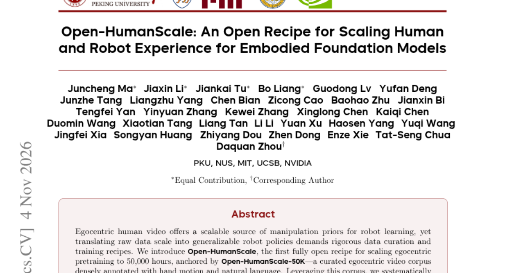

### 📌 한 줄 요약
5만 시간 규모의 대규모 1인칭 영상 데이터셋과 스케일링 법칙을 활용하여 로봇 제어 성능을 극대화하는 오픈 소스 학습 레시피 제안

### 🔑 핵심 포인트
- 5만 시간 규모의 정교한 1인칭 영상 데이터셋(Open-HumanScale-50K) 구축 및 공개
- 데이터 규모와 로봇 성공률 간의 로그 선형 스케일링 법칙(Scaling Law) 규명
- 인간 영상 기반 사전 학습과 로봇 데이터 결합을 통한 제로샷 일반화 및 인컨텍스트 학습 달성

### 🧑‍💻 개발자 관점
대규모 비디오 데이터를 로봇 제어 정책으로 변환하는 구체적인 데이터 큐레이션 및 학습 파이프라인을 제공하므로, Embodied AI 모델 개발 시 즉각적인 벤치마크로 활용 가능합니다.

### 🚀 실무 적용 아이디어
- 공개된 Open-HumanScale-50K 데이터셋을 활용한 데이터 정제 파이프라인 테스트
- HumanWAM 모델을 활용한 시뮬레이션 환경에서의 제로샷 성능 검증
- 제공된 스케일링 법칙을 바탕으로 데이터 규모에 따른 성능 변화 추이 분석

### ⚠️ 리스크/한계
- 대규모 비디오 데이터 처리를 위한 막대한 컴퓨팅 자원 필요
- 인간 영상 데이터와 실제 로봇 물리 환경 간의 도메인 간극(Sim-to-Real) 존재 가능성

### 📝 초록 기반 상세 설명
로봇 학습을 위해 1인칭 인간 영상은 유용한 소스이지만, 대규모 데이터를 일반화 가능한 로봇 정책으로 변환하는 정교한 방법론이 부족했습니다. 본 논문은 5만 시간 규모의 정교하게 주석 처리된 1인칭 영상 코퍼스인 Open-HumanScale-50K를 공개합니다. 연구진은 순수 인간 영상 사전 학습과 로봇 데이터의 결합이 성능에 미치는 영향을 체계적으로 조사하며, 데이터 규모와 성공률 사이의 로그 선형 스케일링 법칙을 발견했습니다. 이를 바탕으로 개발된 HumanWAM 모델은 시뮬레이션과 실물 로봇 환경에서 SOTA 수준의 성능을 달성했습니다. 최종적으로 데이터 큐레이션부터 사전 학습 파이프라인까지 모든 과정을 오픈 소스로 공개하여 재현 가능한 연구 환경을 제공합니다.

---

## 10. [VisSearch-Bench: Evaluating Long Horizon Visual Search in Multimodal Agents](https://huggingface.co/papers/2611.04894)
**Upvotes**: 22 | **도입 난이도**: 하 | **신뢰도**: 상
**arXiv**: https://arxiv.org/abs/2611.04894

**태그**: Agent, Multimodal, Visual Search, Benchmark, RAG, Vision, Evaluation

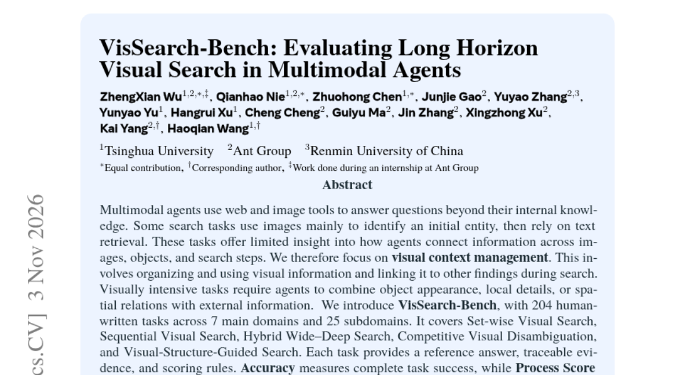

### 📌 한 줄 요약
멀티모달 에이전트의 복잡한 시각적 맥락 관리 및 장기 검색 능력을 평가하기 위한 벤치마크 제안

### 🔑 핵심 포인트
- 시각적 맥락 관리 능력을 평가하는 204개의 정교한 멀티모달 태스크 벤치마크 구축
- 단순 검색을 넘어 객체 외형, 공간 관계, 구조적 정보를 결합하는 복합적 시나리오 설계
- 정답 정확도(Accuracy)와 과정의 정밀도를 측정하는 프로세스 점수(Process Score) 도입

### 🧑‍💻 개발자 관점
에이전트가 단순히 이미지를 읽는 것을 넘어, 검색 결과와 시각적 단서를 결합해 추론하는 '복합 추론' 성능을 검증할 때 유용합니다.

### 🚀 실무 적용 아이디어
- 현재 개발 중인 멀티모달 에이전트에 VisSearch-Bench 태스크 적용 테스트
- 에이전트의 시각적 정보 유지(Memory)와 검색 결과 결합 로직 최적화
- 에이전트의 추론 과정(Process Score)을 정량화하는 평가 파이프라인 구축

### ⚠️ 리스크/한계
- 현재 모델들의 성능이 낮아 벤치마크의 난이도가 매우 높을 수 있음
- 시각적 정보와 텍스트 정보 간의 결합 방식에 따라 결과 편차가 클 수 있음

### 📝 초록 기반 상세 설명
멀티모달 에이전트는 외부 도구를 활용해 지식을 확장하지만, 기존 검색 작업은 시각 정보와 텍스트 정보 간의 유기적 연결 능력을 평가하기에 부족했습니다. 본 논문은 시각적 맥락 관리(Visual Context Management) 능력을 측정하기 위해 새로운 벤치마크인 VisSearch-Bench를 제안합니다. 이 벤치마크는 7개 도메인에 걸친 204개의 인간 작성 태스크를 포함하며, 시각적 세부 사항과 검색 결과를 결합하는 복합적인 능력을 요구합니다. 실험 결과, 16종의 최신 멀티모달 모델 중 가장 우수한 시스템도 전체 태스크의 26.47%만을 해결하는 데 그쳤습니다. 이는 시각적 증거와 검색 결과를 연결하여 완전한 답을 도출하는 것이 현재 에이전트 기술의 큰 과제임을 보여줍니다.

---

## 11. [Towards Foundation Decision Models: Drex](https://huggingface.co/papers/2611.07854)
**Upvotes**: 22 | **도입 난이도**: 중 | **신뢰도**: 상
**arXiv**: https://arxiv.org/abs/2611.07854

**태그**: Decision Model, LLM Optimization, Open Source, Efficiency, Agent, Reasoning, Vision, Inference

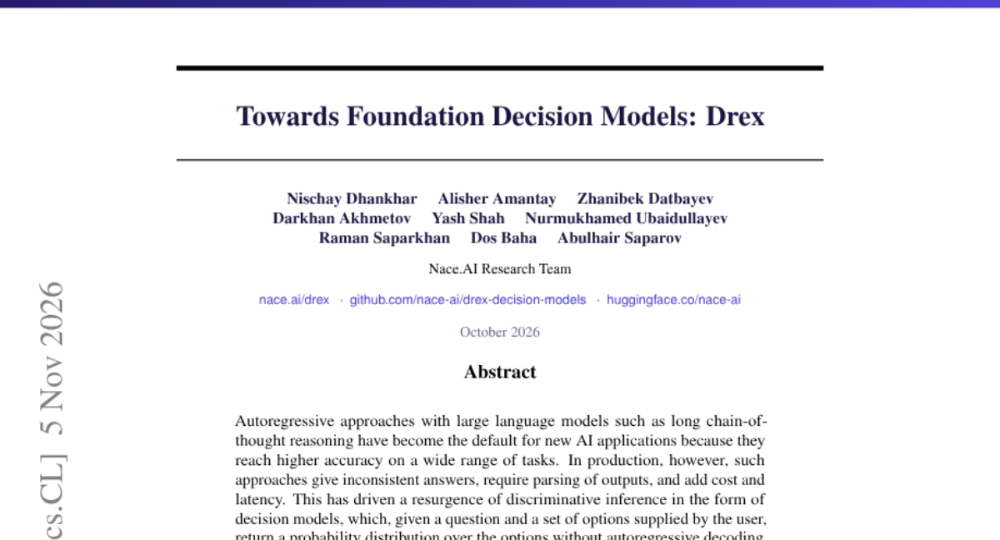

### 📌 한 줄 요약
생성형 모델의 지연 시간과 불안정성을 해결하기 위해 설계된 고성능 오픈소스 의사결정 전용 모델(Decision Model) 시리즈 발표

### 🔑 핵심 포인트
- Autoregressive 디코딩 없이 선택지 간 확률 분포를 직접 반환하여 지연 시간과 비용을 획기적으로 절감
- RLAF와 일관성 손실(Consistency Loss)을 통해 선택지 순서 변화에 강건하고 정확한 모델 학습
- 8B에서 35B 규모의 다양한 모델 라인업을 통해 다양한 컴퓨팅 자원 환경에 대응 가능

### 🧑‍💻 개발자 관점
LLM을 에이전트나 분류기로 사용할 때 발생하는 응답 파싱 문제와 느린 속도를 해결할 수 있는 실무적인 대안을 제시합니다.

### 🚀 실무 적용 아이디어
- 제공된 GitHub 저장소를 통해 모델 가중치를 다운로드하여 로컬 환경에서 벤치마크 테스트 수행
- 선택지 순서를 무작위로 섞었을 때 모델의 응답 일관성이 유지되는지 검증
- 기존 LLM 기반 분류 태스크를 Drex 모델로 교체했을 때의 Latency-Accuracy 트레이드오프 분석

### ⚠️ 리스크/한계
- 자유로운 텍스트 생성 능력이 필요한 작업에는 적합하지 않으며 특정 선택지 내 결정에 특화됨
- 모델 규모에 따라 복잡한 추론 능력에 차이가 있을 수 있음

### 📝 초록 기반 상세 설명
최근 LLM의 CoT 방식은 높은 정확도를 보이지만, 프로덕션 환경에서는 응답의 일관성 부족, 파싱 문제, 높은 비용 및 지연 시간이라는 문제를 야기합니다. 이를 해결하기 위해 질문과 선택지가 주어지면 디코딩 과정 없이 확률 분포를 직접 반환하는 의사결정 모델(Decision Model)이 필요합니다. 본 논문에서는 8B부터 35B 규모까지의 4가지 오픈소스 모델 제품군인 Drex를 제안합니다. 학습에는 SFT와 RLAF(Reinforcement Learning from Adjusted Feedback)를 결합하였으며, Max 모델은 비전 튜닝을 포함합니다. 실험 결과, Max 모델은 기존 모델 대비 높은 정확도와 압도적인 추론 속도를 기록하며 SOTA 성능을 달성했습니다.

---

## 12. [On the Opportunities and Challenges of Prefill-to-Autoregressive Cross-Model Transfer](https://huggingface.co/papers/2611.06976)
**Upvotes**: 15 | **도입 난이도**: 하 | **신뢰도**: 상
**arXiv**: https://arxiv.org/abs/2611.06976

**태그**: LLM-Inference, Model-Compression, Transfer-Learning, Efficiency, Benchmark, Evaluation, Inference

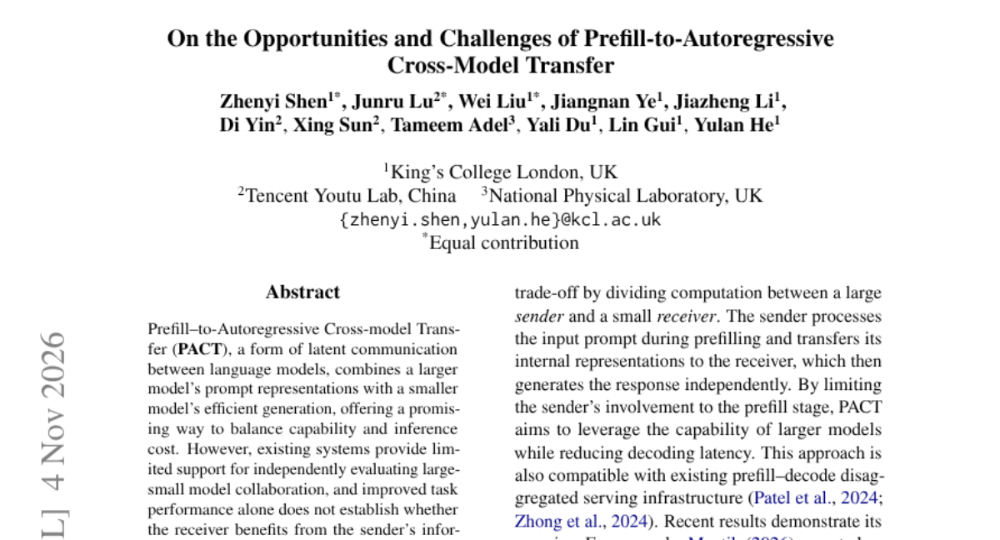

### 📌 한 줄 요약
대형 모델의 추론 능력을 소형 모델의 생성 효율성과 결합하는 PACT 프레임워크 및 검증 방법론 제안

### 🔑 핵심 포인트
- PLatour: 고정된 모델 간에 경량 선형 브릿지를 사용하여 연결하는 오픈소스 PACT 프레임워크 개발
- 성능 검증의 한계 발견: 일부 성능 향상이 송신자의 유용한 정보가 아닌 단순한 파라미터 적응 효과일 수 있음을 규명
- PACT-Check: 학습된 시스템의 성능 향분이 실제 통신(Communication)에서 온 것인지 정량화하는 방법론 제안

### 🧑‍💻 개발자 관점
모델 크기를 줄이면서도 성능을 유지하려는 추론 최적화 전략에서, 모델 간 정보 전달이 실제 효과가 있는지 검증하는 데 중요한 가이드라인을 제공합니다.

### 🚀 실무 적용 아이디어
- PLatour 프레임워크를 사용하여 기존 모델 간의 지식 전이 효율성 테스트
- 제안된 PACT-Check를 적용하여 현재 운영 중인 모델 협업 시스템의 정보 기여도 측정
- Zero-initialized linear bridge를 활용한 경량 어댑터 방식의 성능 변화 관찰

### ⚠️ 리스크/한계
- 성능 향상이 정보 전달이 아닌 단순한 수신 모델의 파라미터 업데이트 효과일 위험이 있음
- 송신자 모델의 크기가 작을 경우 정보 전달의 실질적 이득이 제한적일 수 있음

### 📝 초록 기반 상세 설명
대형 모델의 프롬프트 표현과 소형 모델의 효율적인 생성을 결합하는 PACT 방식은 성능과 비용 사이의 균형을 맞출 수 있는 유망한 기술입니다. 그러나 기존 시스템은 모델 간 협업을 독립적으로 평가하기 어렵고, 성능 향상이 실제 정보 전달 덕분인지 확인하기 어렵다는 문제가 있습니다. 이를 해결하기 위해 본 논문은 경량 선형 브릿지를 통해 고정된 모델들을 연결하는 오픈소스 프레임워크인 PLatour를 소개합니다. 실험 결과 PLatour는 기존 베이스라인 및 수학/코딩 벤치마크에서 우수한 성능을 보였으나, 일부 성능 향상이 정보 전달이 아닌 파라미터 효율적 적응(PEFT) 효과일 수 있음을 발견했습니다. 이에 따라 정보 전달의 기여도를 정량화하는 PACT-Check를 제안하며 PACT 시스템의 기회와 과제를 논의합니다.

---

## 13. [EDGAR: Efficient Diffusion-Driven Gaussian Avatar Refinement via Synthetic Failure](https://huggingface.co/papers/2611.07909)
**Upvotes**: 15 | **도입 난이도**: 중 | **신뢰도**: 상
**arXiv**: https://arxiv.org/abs/2611.07909

**태그**: Gaussian Splatting, Diffusion Model, Avatar Reconstruction, Computer Vision, Vision, Video, Evaluation

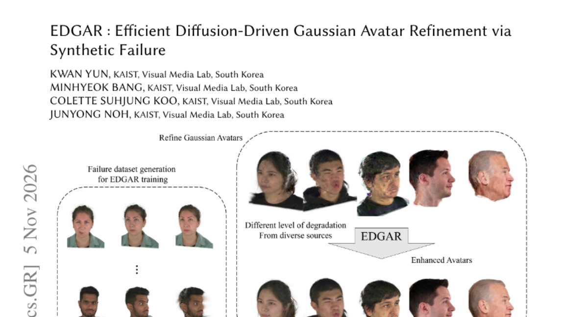

### 📌 한 줄 요약
디퓨전 모델과 MoE 구조를 활용하여 가우시안 스플래팅 기반 아바타의 기하학적/텍스처 오류를 효율적으로 복구하는 프레임워크

### 🔑 핵심 포인트
- 실제와 합성 데이터를 결합한 EDGAR-SET 데이터셋을 통한 현실적인 실패 사례 학습
- Sapiens 모델의 특징 주입과 MoE(Mixture-of-Experts) 구조를 통한 정교한 아티팩트 제거
- 생성된 렌더링을 이용한 가우시안 최적화 방식으로 추론 시 추가 연산 없이 고품질 결과 도출

### 🧑‍💻 개발자 관점
가우시안 스플래팅 기반 아바타 생성 시 발생하는 고질적인 품질 저하 문제를 디퓨전 기반의 사후 최적화 방식으로 해결하는 실용적인 워크플로우를 제시합니다.

### 🚀 실무 적용 아이디어
- 기존 가우시안 스플래팅 모델(3DGS 등)의 결과물을 EDGAR 파이프라인에 입력하여 품질 개선 효과 검증
- Sapiens 모델과 MoE 구조가 결합된 방식이 정체성 유지(Identity Fidelity)에 미치는 영향 분석
- 제안된 pseudo-target 최적화 방식의 수렴 속도 및 최종 아바타 품질 간의 상관관계 테스트

### ⚠️ 리스크/한계
- 디퓨전 기반 최적화 과정에서 발생할 수 있는 미세한 정체성 왜곡 가능성
- 학습 데이터셋(EDGAR-SET)의 분포에 따른 특정 환경에서의 일반화 성능 제약

### 📝 초록 기반 상세 설명
최근 가우시안 스플래팅을 이용한 헤드 아바타 재구성이 발전했으나, 단안 비디오 기반 방식은 기하학적 제약 부족으로 인해 블러링이나 늘어짐 같은 아티팩트가 발생합니다. 이를 해결하기 위해 본 논문은 아티팩트 제거와 정체성 유지를 동시에 수행하는 조건부 디퓨전 프레임워크인 EDGAR를 제안합니다. 학습을 위해 실제 데이터와 합성 데이터를 결합한 EDGAR-SET 데이터셋을 구축하였으며, Sapiens 모델의 특징과 MoE 구조를 결합하여 다양한 열화 유형에 대응합니다. 생성된 고품질 렌더링을 의사 타겟(pseudo-targets)으로 사용하여 원본 가우시안 아바타를 최적화함으로써 추론 시 효율성을 확보했습니다. 실험 결과, 기존 방식 대비 지각적 품질과 재구성 성능이 크게 향상되었으며 극한의 각도나 표정에서도 강건한 성능을 보였습니다.

---

## 14. [Muir: Linear Attention with Sensitivity-Allocated Gating and Matched-Filter Readout](https://huggingface.co/papers/2611.08376)
**Upvotes**: 12 | **도입 난이도**: 중 | **신뢰도**: 상
**arXiv**: https://arxiv.org/abs/2611.08376

**태그**: Linear Attention, Long-context, Efficient Training, State-space Models, RAG, Evaluation, Inference

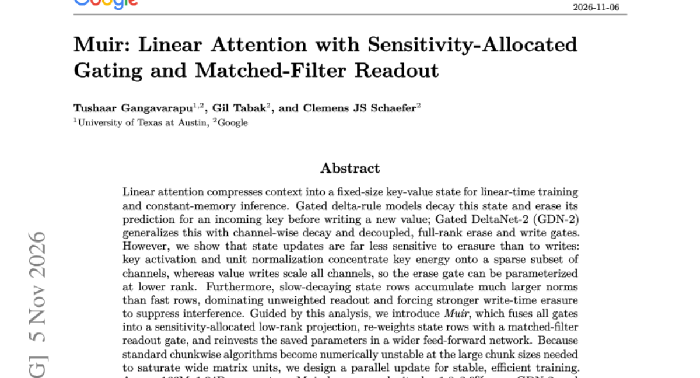

### 📌 한 줄 요약
선형 어텐션의 효율성을 극대화하여 초장거리 문맥에서도 성능 저하 없이 동작하는 고성능 상태 기반 모델(State-based Model) 제안

### 🔑 핵심 포인트
- 민감도 할당 저차원 투영(Sensitivity-allocated low-rank projection)을 통한 게이트 최적화
- 상태 행의 노름 불균형을 해결하는 매치드 필터(Matched-filter) 읽기 방식 도입
- 초장거리 문맥(10M 토큰)에서도 성능 저하 없는 안정적인 외삽 및 수치적 안정성 확보

### 🧑‍💻 개발자 관점
Transformer의 메모리 한계를 넘어 수백만 토큰 단위의 초장거리 문맥을 처리해야 하는 RAG나 긴 문서 분석 작업에서 매우 유망한 대안이 될 수 있습니다.

### 🚀 실무 적용 아이디어
- 기존 Gated DeltaNet 모델과 Muir의 추론 속도 및 메모리 사용량 벤치마크 비교
- 매우 긴 문맥(Long-context) 환경에서 Muir의 외삽 성능 검증 실험
- 제안된 병렬 업데이트 알고리즘을 활용한 대규모 데이터셋 학습 효율성 테스트

### ⚠️ 리스크/한계
- 초장거리 문맥 성능은 뛰어나지만, 특정 작업에서 기존 Transformer 대비 연산 효율성이 다를 수 있음
- 새로운 게이트 구조와 병렬 업데이트 방식에 대한 구현 복잡도 존재

### 📝 초록 기반 상세 설명
선형 어텐션은 고정된 크기의 상태를 사용하여 효율적인 추론을 가능하게 하지만, 기존 Gated DeltaNet 방식은 쓰기(write)와 지우기(erase) 게이트 간의 불균형한 민감도 문제를 안고 있었습니다. 특히 상태 행의 노름(norm) 차이로 인해 읽기 과정에서 간섭이 발생하고 수치적 불안정성이 나타나는 문제가 있었습니다. 이를 해결하기 위해 저자들은 민감도 기반의 저차원 투영과 매치드 필터(matched-filter) 읽기 방식을 결합한 Muir 모델을 제안했습니다. 또한 대규모 청크 학습 시 발생하는 수치적 불안정성을 해결하기 위한 병렬 업데이트 알고리즘을 설계했습니다. 실험 결과, Muir은 기존 Transformer 및 GDN-2 대비 낮은 퍼플렉시티와 높은 상식 추론 능력을 보였으며, 특히 수백만 토큰에 달하는 초장거리 문맥에서도 성능 저하 없이 안정적인 외삽(extrapolation) 성능을 입증했습니다.

---

## 15. [Terminal-style Mathematical Modeling Bench: The First Agentic and Verifiable Benchmark for Mathematical Modeling](https://huggingface.co/papers/2611.08237)
**Upvotes**: 11 | **도입 난이도**: 중 | **신뢰도**: 상
**arXiv**: https://arxiv.org/abs/2611.08237

**태그**: Agent, Mathematical Modeling, Formal Verification, Benchmark, RAG, Multimodal, Evaluation

### 📌 한 줄 요약
실제 수학적 모델링 문제를 에이전트가 해결하고 검증할 수 있도록 설계된 최초의 터미널 기반 벤치마크

### 🔑 핵심 포인트
- 실제 경진대회 문제를 활용한 에이전트 중심의 터미널 기반 벤치마크 구축
- 프로그래밍적 제약 조건과 Lean 4를 결합한 2단계 물리적 타당성 검증 체계
- 우수 논문(Outstanding-award)과의 비교를 통한 다중 참조 기반의 객관적 스코어링

### 🧑‍💻 개발자 관점
복잡한 실세계 문제를 해결하는 에이전트의 추론 능력과 물리적 제약 준수 여부를 정밀하게 측정할 수 있는 프레임워크를 제공합니다.

### 🚀 실무 적용 아이디어
- 제공된 GitHub 소스코드를 활용하여 에이전트의 수학적 추론 워크플로우 테스트
- Lean 4 기반의 정형 검증이 에이전트의 결과물 필터링에 미치는 영향 분석
- 멀티모달 에이전트의 수치적 정확도와 물리적 타당성 간의 상관관계 실험

### ⚠️ 리스크/한계
- 실제 우수 논문과의 수치 비교 방식이 특정 문제 도메인에 편향될 가능성
- Lean 4 등 고도의 정형 검증 도구 사용에 따른 계산 비용 및 복잡도 증가

### 📝 초록 기반 상세 설명
기존의 수학적 모델링 벤치마크는 문제 해결 과정의 파편화된 점수 산정이나 LLM 판사 기반의 검증 한계로 인해 신뢰성이 부족했습니다. 이를 해결하기 위해 실제 경진대회(CUMCM, MCM) 문제를 기반으로 한 TB-MathModel을 제안합니다. 이 벤치마크는 컨테이너화된 터미널 환경에서 에이전트가 최종 결과물을 JSON 형태로 제출하며, 프로그래밍적 제약 조건과 Lean 4를 활용한 2단계 검증을 통해 물리적 타당성을 확보합니다. 실험 결과, 제안된 방식은 기존 모델 대비 높은 재현 성능을 보였으며 모델링 역량을 측정하는 강력한 신호를 제공합니다.

### 🖼️ 추가 자료
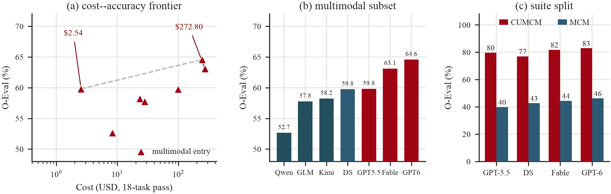
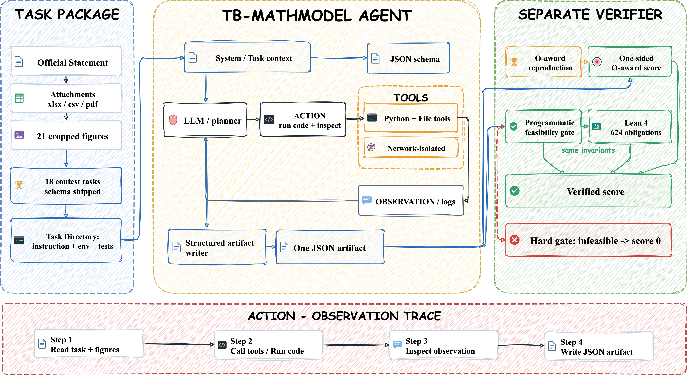

---

## 16. [SwarmEvolve: Latent Agent Swarms for Evolutionary Discovery and Optimization](https://huggingface.co/papers/2611.08483)
**Upvotes**: 9 | **도입 난이도**: 상 | **신뢰도**: 상
**arXiv**: https://arxiv.org/abs/2611.08483

**태그**: LLM-Agent, Evolutionary-Search, Optimization, Latent-Space, Agent, RAG, Reasoning

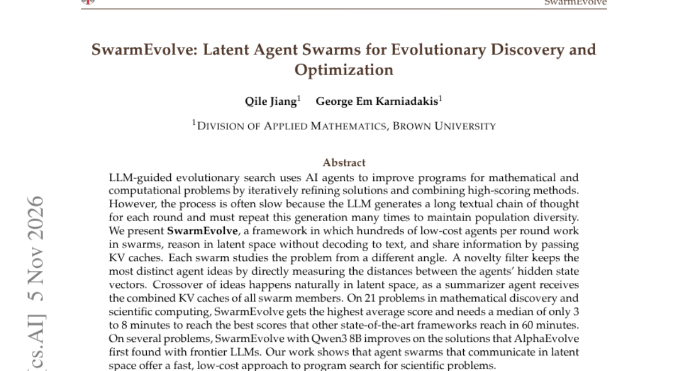

### 📌 한 줄 요약
KV 캐시 공유와 잠재 공간(Latent Space) 추론을 통해 LLM 에이전트의 탐색 속도와 효율성을 극대화한 진화적 최적화 프레임워크

### 🔑 핵심 포인트
- 텍스트 디코딩을 생략하고 KV 캐시를 직접 전달하는 잠재 공간 기반의 효율적 통신 방식 도입
- 벡터 거리 측정을 통한 Novelty Filter로 에이전트 간 아이디어 다양성 확보
- 수백 개의 저비용 에이전트 군집을 통한 초고속 진화적 최적화 및 교차(Crossover) 구현

### 🧑‍💻 개발자 관점
텍스트 생성 비용을 줄이면서도 에이전트 간의 지식 공유를 최적화하여, 복잡한 알고리즘 설계나 수학적 문제 해결 시 연산 효율을 극대화할 수 있습니다.

### 🚀 실무 적용 아이디어
- KV 캐시 공유 방식이 모델의 추론 성능에 미치는 영향 분석
- 소형 모델(SLM) 기반의 에이전트 군집 구성 시의 비용 대비 성능(ROI) 테스트
- 도메인 특화 문제(코드 생성, 수학)에 대한 SwarmEvolve 프레임워크 적용 실험

### ⚠️ 리스크/한계
- 잠재 공간에서의 정보 전달이 텍스트 기반 통신에 비해 해석 가능성(Interpretability)이 낮을 수 있음
- 모델 아키텍처에 종속적인 KV 캐시 공유 방식의 범용성 문제

### 📝 초록 기반 상세 설명
기존의 LLM 기반 진화적 탐색은 텍스트 생성 과정의 오버헤드와 다양성 유지 문제로 인해 속도가 느리다는 단점이 있었습니다. 본 논문은 수백 개의 저비용 에이전트가 군집(Swarm)을 이루어 작동하는 SwarmEvolve 프레임워크를 제안합니다. 이 방식은 텍스트 디코딩 없이 잠재 공간에서 추론하고 KV 캐시를 전달함으로써 정보를 공유하며, 벡터 거리 측정을 통해 아이디어의 다양성을 유지합니다. 실험 결과, SwarmEvolve는 수학 및 과학 계산 문제에서 기존 SOTA 대비 압도적으로 빠른 속도로 최고 점수를 달성했습니다. 특히 소형 모델(Qwen3 8B)만으로도 거대 모델이 찾은 솔루션을 능가하는 성과를 보였습니다.

---

## 17. [Future Representation Distillation for Imagination-free World Action Models](https://huggingface.co/papers/2611.04527)
**Upvotes**: 9 | **도입 난이도**: 상 | **신뢰도**: 상
**arXiv**: https://arxiv.org/abs/2611.04527

**태그**: Robot Control, Diffusion Model, Representation Learning, Embodied AI, Video, Distillation

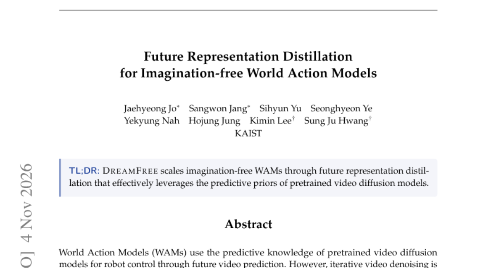

### 📌 한 줄 요약
비디오 생성 과정 없이 사전 학습된 비디오 확산 모델의 지식을 표현 학습으로 전이하여 실시간 로봇 제어를 구현한 기술

### 🔑 핵심 포인트
- 비디오 생성 과정을 생략하고 표현 증류(Representation Distillation)를 통해 미래 예측 지식을 현재 관측값에 압축
- 14B 규모의 대형 비디오 확산 모델을 활용하면서도 11Hz의 실시간 제어 성능 확보
- 추가적인 액션 주석 없이도 비디오 데모를 통해 새로운 로봇 태스크를 학습할 수 있는 능력 입증

### 🧑‍💻 개발자 관점
비디오 생성 모델의 강력한 사전 학습 지식을 유지하면서도, 추론 비용을 획기적으로 낮춰 실시간 로봇 제어에 적용할 수 있는 실용적인 프레임워크를 제시합니다.

### 🚀 실무 적용 아이디어
- 사전 학습된 비디오 확산 모델의 표현(Representation)을 추출하여 현재 프레임에 매핑하는 증류 실험 수행
- 다양한 로봇 하드웨어(Embodiment) 환경에서 제어 성능의 일반화 성능 테스트
- 액션 주석이 없는 비디오 데이터만으로 새로운 태스크를 학습시키는 Zero-shot/Few-shot 실험

### ⚠️ 리스크/한계
- 대규모 비디오 백본(14B) 사용에 따른 초기 학습 비용 및 메모리 요구량
- 표현 증류 과정에서 미래의 복잡한 시각적 변화가 현재의 표현에 충분히 담기지 못할 위험

### 📝 초록 기반 상세 설명
기존의 World Action Models(WAMs)는 미래 비디오를 생성하여 로봇 제어에 활용하지만, 반복적인 디노이징 과정으로 인해 비용이 높고 예측 오류가 발생할 위험이 있습니다. 이를 해결하기 위해 본 논문은 미래 비디오를 직접 생성하지 않고 현재 관측값만으로 미래의 표현을 예측하는 DreamFree를 제안합니다. DreamFree는 사전 학습된 비디오 확산 모델을 표현 증류(Representation Distillation)를 통해 시각 인코더로 재구성하여 미래 예측 지식을 현재 관찰에 담아냅니다. 이렇게 추출된 표현을 바탕으로 액션 모듈이 동작을 예측하며, 이를 통해 실시간 폐루프 제어가 가능해집니다. 실험 결과, DreamFree는 기존 VLA 및 WAM 대비 높은 성공률을 기록하며 14B 규모의 백본에서도 11Hz의 실시간 제어 성능을 보여주었습니다.

---

## 18. [SAE Interprets MoE: Sparse AutoEncoders Reveal That MoE Experts Exhibit Human-Interpretable Fine-Grained Specialization](https://huggingface.co/papers/2611.08089)
**Upvotes**: 8 | **도입 난이도**: 상 | **신뢰도**: 상
**arXiv**: https://arxiv.org/abs/2611.08089

**태그**: MoE, Interpretability, SAE, Deep Learning, Vision

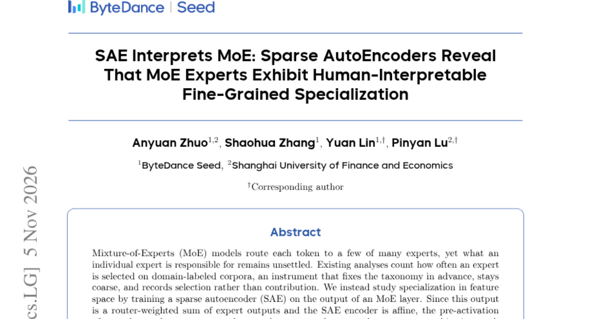

### 📌 한 줄 요약
SAE를 통해 MoE 전문가(Expert)들이 단순히 도메인별로 나뉘는 것이 아니라, 매우 세분화된 기능적 분업을 수행함을 입증함

### 🔑 핵심 포인트
- SAE를 활용하여 MoE 전문가의 기여도를 특징 공간(feature space) 수준에서 정밀하게 분해
- 전문가 간의 역할이 거친 도메인이 아닌, 매우 세분화된(fine-grained) 기능 단위로 분업됨을 발견
- 라우팅(gating) 메커니즘보다 실제 특징 기여도가 훨씬 더 특정 전문가에 집중되는 현상 확인

### 🧑‍💻 개발자 관점
MoE 모델의 블랙박스 특성을 이해하고, 특정 기능(예: 특정 언어 코딩)을 강화하거나 제어하기 위한 해석 가능성(Interpretability)의 기반을 제공합니다.

### 🚀 실무 적용 아이디어
- 제공된 코드를 활용하여 특정 MoE 모델의 전문가 기여도 시각화 실험 수행
- 특정 도메인 지식 주입 시 전문가 간의 중첩(overlap) 정도 분석
- SAE를 통한 특징 분해 결과가 실제 모델의 추론 성능과 어떻게 연결되는지 검증

### ⚠️ 리스크/한계
- SAE 학습 및 분석 과정이 복잡하여 대규모 모델에 직접 적용하기에는 높은 연산 비용 발생
- 특징 공간의 분해가 모델의 전체적인 추론 로직을 완벽히 대변하는지에 대한 추가 검증 필요

### 📝 초록 기반 상세 설명
MoE 모델은 토큰을 특정 전문가에게 라우팅하지만, 개별 전문가의 구체적인 역할은 여전히 불분명합니다. 기존 방식은 도메인 레이블에 의존하여 전문가의 기여도를 거칠게 측정하는 한계가 있었습니다. 본 연구는 MoE 레이어 출력에 Sparse Autoencoder(SAE)를 적용하여 특징 공간(feature space)에서의 전문화를 분석했습니다. 실험 결과, 전문가의 기여는 게이팅(gating)보다 훨씬 더 집중된 형태로 나타났으며, 전문가들은 프로그래밍 언어나 수학적 개념과 같이 매우 세분화된 영역에서 분업을 수행함을 확인했습니다. 이를 통해 MoE 모델 내부의 복잡한 지식 분배 메커니즘을 명확히 규명했습니다.

---

## 19. [HeLM: Hierarchical Explicit Language Memory for Non-Markovian Manipulation](https://huggingface.co/papers/2611.02660)
**Upvotes**: 7 | **도입 난이도**: 중 | **신뢰도**: 상
**arXiv**: https://arxiv.org/abs/2611.02660

**태그**: VLA, Robotics, Memory, Agent, Vision, Evaluation

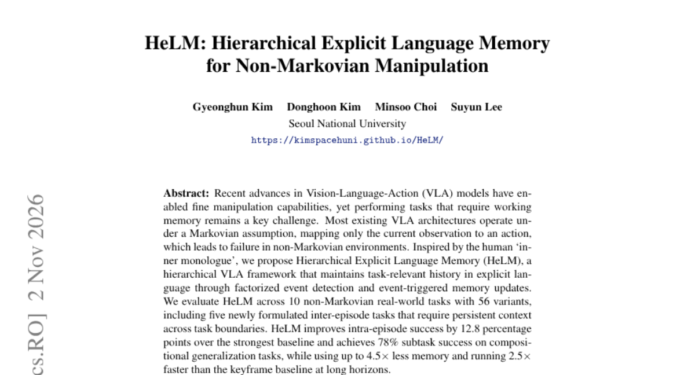

### 📌 한 줄 요약
명시적 언어 메모리를 활용하여 비마르코프(Non-Markovian) 환경에서의 로봇 조작 성공률을 높인 계층적 VLA 프레임워크

### 🔑 핵심 포인트
- 이벤트 감지와 메모리 업데이트를 분리한 계층적 구조 설계
- 명시적 언어 메모리를 통한 비마르코프 환경의 맥락 유지
- 기존 키프레임 방식 대비 메모리 효율성 및 추론 속도 대폭 개선

### 🧑‍💻 개발자 관점
에이전트가 과거의 상태를 기억해야 하는 복잡한 워크플로우를 설계할 때, 단순한 윈도우 기반 메모리보다 효율적인 '언어적 요약 메모리' 전략의 효용성을 보여줍니다.

### 🚀 실무 적용 아이디어
- LLM 기반의 요약된 메모리 구조를 VLA 모델에 결합하는 실험 수행
- 이벤트 트리거 조건(Event-triggered)에 따른 메모리 업데이트 주기 최적화 테스트
- 장기 작업(Long-horizon) 환경에서 언어 메모리의 압축 효율성 검증

### ⚠️ 리스크/한계
- 언어적 요약 과정에서 중요한 세부 정보가 손실될 위험 존재
- 이벤트 감지 실패 시 전체 작업 흐름이 왜곡될 가능성

### 📝 초록 기반 상세 설명
최근 VLA 모델은 정교한 조작 능력을 보여주었으나, 과거 정보를 기억해야 하는 비마르코프 환경에서의 작업 수행은 여전히 어려운 과제입니다. 기존 모델들은 주로 현재 관측값만 사용하여 동작을 결정하는 마르코프 가정을 따르기 때문에 과거 맥락이 필요한 상황에서 실패하곤 합니다. 본 논문은 인간의 '내적 독백'에서 영감을 얻어, 이벤트 감지와 메모리 업데이트를 분리한 계층적 VLA 프레임워크인 HeLM을 제안합니다. HeLM은 작업 관련 이력을 명시적인 언어로 유지하여 복잡한 맥락을 관리합니다. 실험 결과, HeLM은 기존 베이스라인 대비 높은 성공률을 기록했으며, 긴 작업 시나리오에서도 메모리 사용량을 4.5배 절감하고 속도를 2.5배 향상시켰습니다.

---

## 20. [Decode Before You Hear: Speculative Listening for Chunk-Interleaved Full-Duplex Speech Language Models](https://huggingface.co/papers/2611.06982)
**Upvotes**: 7 | **도입 난이도**: 하 | **신뢰도**: 상
**arXiv**: https://arxiv.org/abs/2611.06982

**태그**: Speech-to-Speech, Real-time AI, Speculative Decoding, Full-Duplex, RAG, Audio, Benchmark

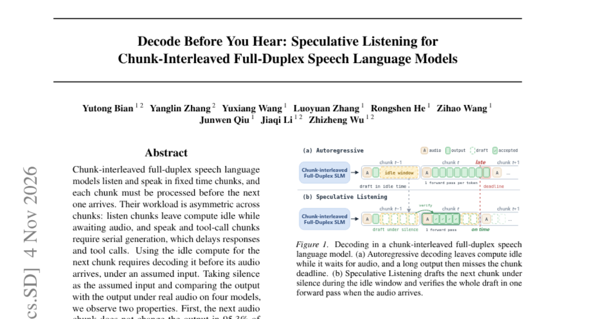

### 📌 한 줄 요약
Full-Duplex 음성 모델의 유휴 시간을 활용하여 다음 청크를 미리 디코딩함으로써 응답 지연 시간을 획기적으로 줄이는 Speculative Listening 프레임워크 제안

### 🔑 핵심 포인트
- 음성 입력 대기 중 발생하는 유휴 연산 자원을 활용하는 Speculative Listening 프레임워크 제안
- 다음 청크의 입력이 바뀌어도 출력이 유지되는 특성(95.3%)을 이용한 무손실 추론 기법
- 응답 지연 시간을 73% 감소시키고 툴 호출(tool-call) 속도를 최대 23.4배 향상

### 🧑‍💻 개발자 관점
실시간 대화형 AI 에이전트 개발 시, 하드웨어 자원을 효율적으로 쓰면서도 인간과 유사한 반응 속도를 확보하는 데 매우 중요한 기술입니다.

### 🚀 실무 적용 아이디어
- 무음 입력 시 모델의 출력 토큰이 실제 음성 입력 시와 얼마나 일치하는지 프로토타입 테스트
- 기존 Full-Duplex 모델의 유휴 시간(Idle time) 측정 및 연산 가용량 분석
- 제안된 가설 풀(Hypothesis pool) 방식의 검증 오버헤드 측정

### ⚠️ 리스크/한계
- 음성 입력의 변화가 큰 경우(예: 갑작스러운 발화 시작) 검증 단계에서 오버헤드가 발생할 수 있음
- 모델의 출력 특성에 의존하므로 모든 음성 모델에 동일한 효율이 보장되지 않을 수 있음

### 📝 초록 기반 상세 설명
Full-Duplex 음성 모델은 고정된 시간 청크 단위로 동작하며, 음성 입력 대기 시간과 생성 시간 사이의 비대칭적 워크로드 문제를 가집니다. 기존 방식은 음성 입력이 올 때까지 연산 자원이 유휴 상태로 남거나, 생성 작업이 지연되는 문제가 발생합니다. 연구진은 다음 청크의 입력이 바뀌더라도 출력 결과가 크게 변하지 않는 특성을 발견하고, 무음(silence)을 가정하여 미리 디코딩하는 Speculative Listening 기법을 제안합니다. 이 방식은 유휴 시간에 미리 초안을 생성하고 실제 오디오가 도착하면 검증하는 방식으로 동작합니다. 실험 결과, 응답 시작 전 지연 시간을 최대 74-241ms로 단축하여 인간의 대화 간격에 근접한 성능을 보였습니다.

### 🖼️ 추가 자료
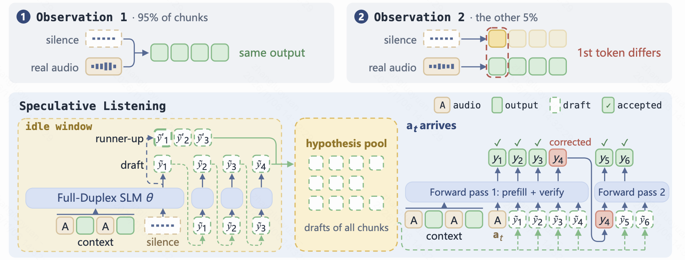

---

## 21. [Tools Need Not Speak in Text: Latent Context Compression for Agents](https://huggingface.co/papers/2611.06500)
**Upvotes**: 6 | **도입 난이도**: 상 | **신뢰도**: 상
**arXiv**: https://arxiv.org/abs/2611.06500

**태그**: LLM-Agent, Context-Compression, Efficient-Inference, Agent, Benchmark, Optimization

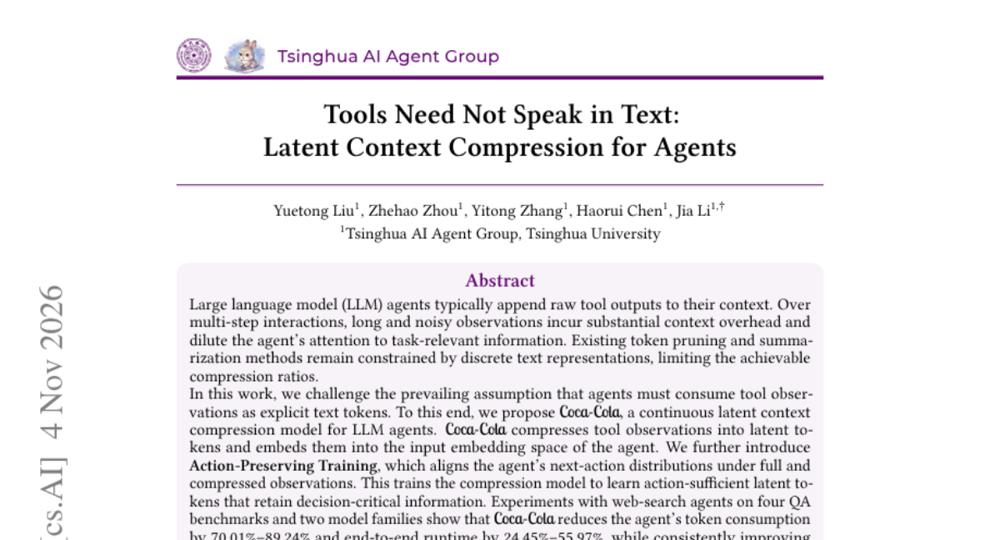

### 📌 한 줄 요약
텍스트 대신 잠재 벡터(Latent Tokens)를 사용하여 에이전트의 컨텍스트 오버헤드를 획기적으로 줄이는 압축 기술

### 🔑 핵심 포인트
- 텍스트 기반 요약을 넘어선 연속적 잠재 공간(Latent Space) 기반의 컨텍스트 압축
- 의사결정 정보 유지를 위한 Action-Preserving Training 기법 도입
- 토큰 소비량 감소와 작업 성능 향상을 동시에 달성하는 효율적 에이전트 프레임워크

### 🧑‍💻 개발자 관점
에이전트의 긴 작업 이력(History) 관리 시 발생하는 비용과 지연 시간을 줄이면서도 성능 저하 없이 컨텍스트를 관리할 수 있는 새로운 패러다임을 제시합니다.

### 🚀 실무 적용 아이디어
- 제시된 Action-Preserving Training 손실 함수를 기존 요약 모델에 적용해보기
- 도구 출력 데이터의 특성(HTML, JSON 등)에 따른 압축 효율 비교 실험
- 압축된 잠재 토큰이 에이전트의 추론 능력에 미치는 영향 분석

### ⚠️ 리스크/한계
- 잠재 공간 압축 시 정보 손실로 인한 예기치 못한 환각(Hallucination) 발생 가능성
- 특정 도구 출력 형식에 최적화될 경우 범용성 저하 우려

### 📝 초록 기반 상세 설명
LLM 에이전트는 일반적으로 도구의 실행 결과를 원문 텍스트로 컨텍스트에 추가하며, 이는 긴 대화 과정에서 토큰 비용을 높이고 중요한 정보에 대한 주의력을 분산시킵니다. 기존의 토큰 프루닝이나 요약 방식은 이산적인 텍스트 표현에 국한되어 압축 효율에 한계가 있었습니다. 본 논문은 에이전트가 도구 출력을 반드시 텍스트로 소비할 필요가 없다는 가설을 바탕으로, 연속적인 잠재 컨텍스트 압축 모델인 'Coca-Cola'를 제안합니다. 이 모델은 도구 관찰 결과를 잠재 토큰으로 압축하여 에이전트의 입력 임베딩 공간에 직접 삽입합니다. 또한, 전체 관찰값과 압축된 관찰값 사이의 다음 행동 분포를 일치시키는 'Action-Preserving Training'을 도입하여 의사결정에 필수적인 정보만 남기도록 학습합니다. 실험 결과, 토큰 소비량을 최대 89%까지 줄이면서도 작업 성능을 향상시키고 실행 시간을 대폭 단축했습니다.

---

## 22. [OpenFrontiers: A Collection of Open Research Problems and a Benchmark for Scientific Rediscovery](https://huggingface.co/papers/2610.37739)
**Upvotes**: 6 | **도입 난이도**: 하 | **신뢰도**: 상
**arXiv**: https://arxiv.org/abs/2610.37739

**태그**: LLM-Agent, Reasoning, Benchmark, Formal-Verification, Agent, RAG, Evaluation

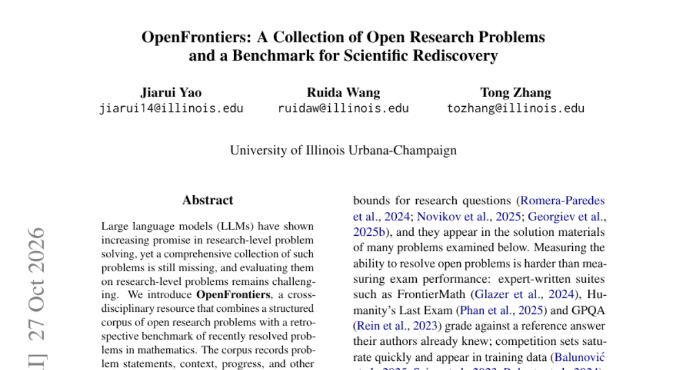

### 📌 한 줄 요약
연구 수준의 문제 해결 능력을 측정하기 위해 정형화된 문제 집합과 검증된 벤치마크를 제공하는 OpenFrontiers 프레임워크

### 🔑 핵심 포인트
- 12,151개의 연구 문제와 200개의 수학 문제로 구성된 다학제적 리소스 구축
- Lean 4를 활용한 정형화된 문제 및 자동화된 검증 프로토콜 도입
- 폐쇄형(Closed-book) vs 웹 검색(Live-web) 환경을 통한 LLM의 진정한 추론 능력 평가

### 🧑‍💻 개발자 관점
LLM 에이전트가 단순한 정보 검색을 넘어 실제 연구 수준의 추론과 문제 해결을 수행할 수 있는지 검증하는 표준 벤치마크로 활용 가능합니다.

### 🚀 실무 적용 아이디어
- 제공된 데이터셋을 활용하여 현재 사용 중인 LLN 에이전트의 추론 능력 테스트
- RAG 환경과 Closed-book 환경 간의 성능 차이 분석 실험
- Lean 4 기반의 정형 검증 환경 구축 및 에이전트 연동 테스트

### ⚠️ 리스크/한계
- 웹 검색 환경에서의 성능이 실제 추론이 아닌 단순 검색(Retrieval)에 의한 것일 위험
- 수학적 정형화 문제에 편중된 벤치마크 특성상 타 도메인 일반화 한계

### 📝 초록 기반 상세 설명
LLM의 연구 문제 해결 능력이 향상되고 있으나, 이를 평가할 체계적인 문제 집합과 벤치마크가 부족한 상황입니다. 본 논문은 12,151개의 연구 문제를 포함한 코퍼스와 수학 분야의 해결된 문제들을 활용한 회고적 벤치마크인 OpenFrontiers를 제안합니다. 벤치마크는 Lean 4를 통해 정형화된 문제와 검증된 솔루션을 포함하며, 폐쇄형(closed-book) 및 웹 검색(live-web) 환경에서 평가를 수행합니다. 실험 결과, 폐쇄형 환경에서의 문제 재발견은 매우 드물었으며 웹 검색 성공은 주로 기존 솔루션 검색에 의존함을 확인했습니다. 이 리소스는 향후 과학적 문제 해결을 위한 LLM 에이전트의 성능 측정 기반을 제공합니다.

---

## 23. [Reducing Representational Interference in Retrieval Embeddings with Trainable Prefix Tokens](https://huggingface.co/papers/2611.07298)
**Upvotes**: 6 | **도입 난이도**: 하 | **신뢰도**: 상
**arXiv**: https://arxiv.org/abs/2611.07298

**태그**: Embedding, RAG, NLP, Information Retrieval, Benchmark, Evaluation, Optimization

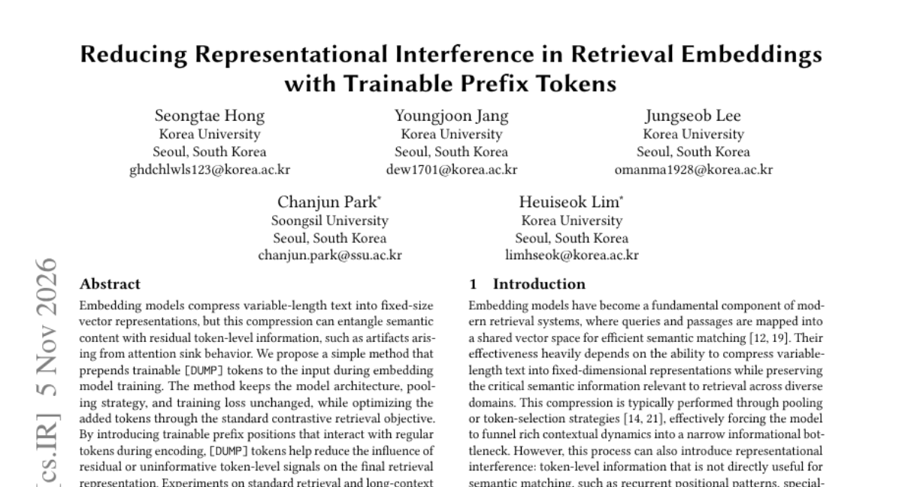

### 📌 한 줄 요약
학습 가능한 [DUMP] 토큰을 도입하여 검색 임베딩 시 불필요한 정보 간섭을 줄이는 경량 기법

### 🔑 핵심 포인트
- 학습 가능한 [DUMP] 토큰을 입력 앞에 추가하여 불필요한 토큰 정보를 흡수
- 모델 아키텍처나 손실 함수를 변경하지 않는 매우 가벼운(lightweight) 방식
- 어텐션 패턴 조절을 통해 저정보 토큰의 간섭을 줄이고 의미적 표현력을 강화

### 🧑‍💻 개발자 관점
기존 모델 구조를 건드리지 않고도 임베딩 품질을 높일 수 있어, RAG 시스템의 검색 성능 개선을 위한 효율적인 파인튜닝 전략이 될 수 있습니다.

### 🚀 실무 적용 아이디어
- 기존 임베딩 모델의 입력 앞에 학습 가능한 [DUMP] 토큰을 추가하여 파인튜닝 실험
- 특정 도메인 데이터셋에서 [DUMP] 토큰이 어텐션 맵을 어떻게 변화시키는지 시각화 분석
- 문장 길이가 길어질 때 [DUMP] 토큰의 개수가 성능에 미치는 영향 측정

### ⚠️ 리스크/한계
- 추가된 토큰이 특정 데이터셋에 과적합(overfitting)될 가능성
- 토큰 개수가 늘어남에 따라 발생하는 미세한 연산 비용 증가

### 📝 초록 기반 상세 설명
임베딩 모델은 가변 길이 텍스트를 고정 크기 벡터로 압축하지만, 이 과정에서 어텐션 싱크(attention sink)와 같은 잔여 토큰 정보가 의미적 내용과 얽히는 문제가 발생합니다. 이를 해결하기 위해 입력 앞에 학습 가능한 [D짜] 토큰을 추가하는 단순한 방법을 제안합니다. 모델 구조나 풀링 전략, 손실 함수를 변경하지 않고 오직 추가된 토큰만을 대조 학습(contrastive learning)을 통해 최적화합니다. [DUMP] 토큰은 인코딩 과정에서 일반 토큰과 상호작용하며 저정보 토큰의 영향을 효과적으로 흡수합니다. 실험 결과, 다양한 인코더 및 디코더 기반 임베딩 모델에서 검색 성능과 롱 컨텍스트 벤치마크 성능이 모두 향상되었습니다.

---

## 24. [Towards Real-Time Full-Waveform LiDAR Transformers via Intensity-Guided Token Reduction and Physics-Aware Augmentation](https://huggingface.co/papers/2611.07613)
**Upvotes**: 5 | **도입 난이도**: 중 | **신뢰도**: 상
**arXiv**: https://arxiv.org/abs/2611.07613

**태그**: LiDAR, Transformer, Real-Time, Data Augmentation, RAG, Benchmark, Evaluation

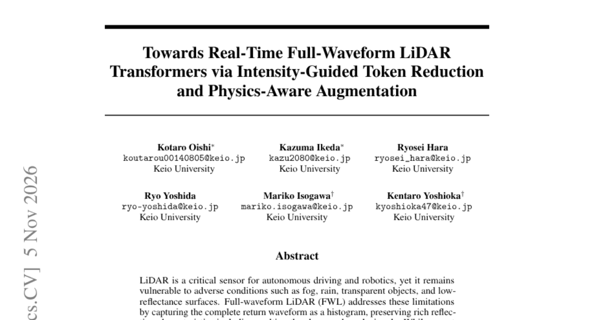

### 📌 한 줄 요약
강도 기반 토큰 최적화와 물리 법칙 기반 증강을 통해 실시간 성능과 정확도를 동시에 확보한 Full-Waveform LiDAR 트랜스포머 기술

### 🔑 핵심 포인트
- FWL-ToPM: 강도 분포를 활용한 토큰 가지치기 및 병합을 통한 연산 효율 극대화
- FWLAug: 파형 구조와 프러스텀 기하학을 보존하는 물리 기반 데이터 증강 프레임워크
- 실시간성 확보: 높은 정확도 유지와 동시에 8배 이상의 처리 속도 향상 달성

### 🧑‍💻 개발자 관점
고비용의 FWL 데이터를 효율적으로 처리하면서도 실시간 임베디드 환경에 적용 가능한 최적화 기법을 제시합니다.

### 🚀 실무 적용 아이디어
- 제공된 Ghost-FWL 벤치마크 데이터셋을 활용한 성능 재현 실험
- 다양한 조도 및 기상 조건(OOD)에서의 모델 강건성 테스트
- 엣지 디바이스 환경에서의 추론 속도 및 메모리 점유율 프로파일링

### ⚠️ 리스크/한계
- 강도 기반 토큰 제거 시 미세한 신호가 손실될 가능성 존재
- 특정 센서 하드웨어 특성에 의존적인 물리적 증강 방식의 범용성 검증 필요

### 📝 초록 기반 상세 설명
자율주행용 Full-Waveform LiDAR(FWL)는 풍부한 정보를 제공하지만, 기존 트랜스포머 방식은 연산 비용이 높고 데이터 부족으로 인한 일반화 성능 문제가 존재합니다. 본 논문은 FWL 데이터의 물리적 특성을 활용하여 두 가지 핵심 문제를 해결합니다. 첫째, 강도 분포를 활용해 불필요한 배경 토큰을 제거하는 FWL-ToPM 메커니즘을 제안합니다. 둘째, 파형 구조와 기하학적 구조를 보존하는 물리 기반 데이터 증강 방식인 FWLAug를 도입합니다. 실험 결과, 제안 방식은 기존 SOTA 대비 8배 이상의 속도 향상과 높은 F1 점수 향상을 달성하며 실시간성을 확보했습니다. 결과적으로 본 연구는 FWL 기반 인지 기술의 실무 배포 가능성을 크게 높였습니다.

---

## 25. [Decoupled Predictive Decision Making: A Shared Conditional Predictor for Agents](https://huggingface.co/papers/2611.02075)
**Upvotes**: 5 | **도입 난이도**: 중 | **신뢰도**: 상
**arXiv**: https://arxiv.org/abs/2611.02075

**태그**: Agent, In-context Learning, Decision Making, LLM, Reasoning, Benchmark, Evaluation, Inference

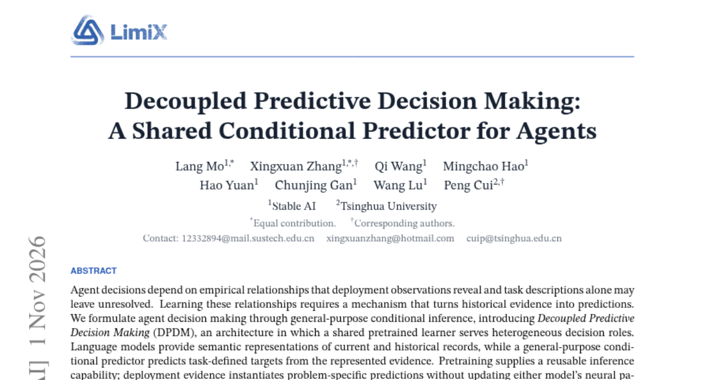

### 📌 한 줄 요약
언어 모델의 의미론적 지식과 구조화된 데이터의 경험적 추론을 결합하여, 모델 파라미터 업데이트 없이도 에이전트의 의사결정 정확도를 높이는 분리형 예측 아키텍처 제안

### 🔑 핵심 포인트
- 의미적 지식(LLM)과 경험적 추론(Predictor)을 분리하여 상호 보완하는 아키텍처 설계
- 모델 파라미터 업데이트 없이 과거 기록(History)을 통해 실시간으로 문제를 해결하는 In-context 학습 방식
- 단일 고정 모델(LimiX-2)로 다양한 에이전트 작업 카테고리를 수행하는 범용성 확보

### 🧑‍💻 개발자 관점
모델 재학습(Fine-tuning) 없이도 실시간 관찰 데이터를 통해 에이전트의 성능을 최적화할 수 있는 효율적인 프레임워크를 제공합니다.

### 🚀 실무 적용 아이디어
- LLM을 인코더로 사용하고 별도의 가벼운 예측 모델을 결합하는 하이브리드 구조 구현
- 과거 이력(History) 데이터의 크기와 품질이 예측 정확도에 미치는 영향 분석
- 도구 사용(Tool-use) 태스크에서 구조화된 데이터 기반 예측기의 성능 검증

### ⚠️ 리스크/한계
- 과거 이력(History)의 길이에 따라 성능이 변동될 수 있는 의존성 존재
- 데이터의 구조적 정합성이 깨질 경우 예측 정확도가 급격히 하락할 위험

### 📝 초록 기반 상세 설명
에이전트의 의사결정은 작업 설명만으로는 해결할 수 없는 실시간 관찰 데이터와 경험적 관계에 의존합니다. 기존 방식은 새로운 환경에 적응하기 위해 모델을 미세 조정해야 하는 번거로움이 있었습니다. 본 논문은 언어 모델(LLM)을 의미적 인코더로, 범용 조건부 예측기를 추론 엔진으로 사용하는 DPDM 아키텍처를 제안합니다. 이 구조는 모델의 파라미터를 수정하지 않고도 과거 기록과 작업 정의를 결합하여 정밀한 예측을 수행합니다. 실험 결과, DPDM은 기존 Few-shot 방식 대비 정확도를 크게 향상시켰으며, 특히 도구 사용 및 추론 작업에서 탁월한 성능 향상을 보였습니다.

---

## 26. [Signed but Steerable: Measuring and Closing the Text-Vector Integrity Gap in Offline Retrieval-Augmented Generation](https://huggingface.co/papers/2611.06498)
**Upvotes**: 4 | **도입 난이도**: 중 | **신뢰도**: 상
**arXiv**: https://arxiv.org/abs/2611.06498

**태그**: RAG, Security, Edge-AI, Vector-Database, Evaluation, Inference

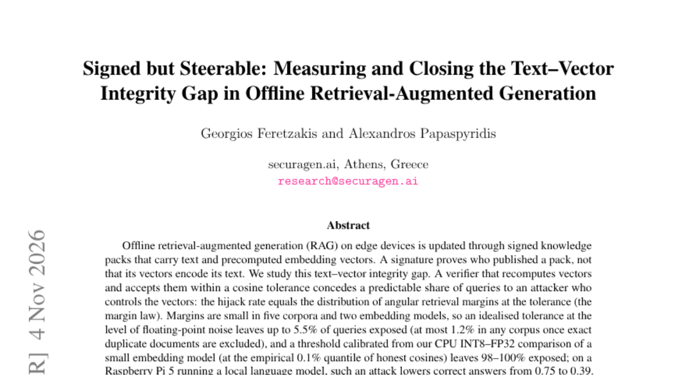

### 📌 한 줄 요약
오프라인 RAG 환경에서 서명된 데이터의 텍스트와 벡터 간 불일치를 이용한 보안 공격(Hijack) 위험을 규명하고 해결책을 제시함

### 🔑 핵심 포인트
- 서명된 데이터라도 텍스트와 벡터 간의 불일치를 이용한 검색 결과 탈취(Hijack)가 가능함을 증명
- 코사인 유사도 허용 오차(Tolerance)와 검색 마진 사이의 상관관계(Margin Law) 규명
- 양자화 코드 검증 및 정규화를 통한 무결성 확보 방법론 제시

### 🧑‍💻 개발자 관점
로컬/엣지 환경에서 RAG를 구축할 때, 단순히 데이터의 출처(서명)만 믿는 것이 아니라 벡터와 텍스트 간의 정합성을 어떻게 검증할지에 대한 보안 가이드라인을 제공합니다.

### 🚀 실무 적용 아이디어
- 로컬 RAG 시스템에서 벡터 조작 공격(Adversarial Vector Attack) 시뮬레이션 수행
- 사용 중인 임베딩 모델의 코사인 유사도 분포 및 마진(Margin) 분석
- 양자화(Quantization) 적용 시 무결성 검증 로직 도입 테스트

### ⚠️ 리스크/한계
- 하드웨어 아키텍처 및 부동 소수점 연산 방식에 따른 재현성 문제 존재
- 양자화 수준이 높을수록 무결성 검증과 검색 정확도 사이의 트레이드오프 발생 가능

### 📝 초록 기반 상세 설명
엣지 디바이스용 오프라인 RAG는 텍스트와 벡터가 포함된 지식 팩을 사용하지만, 서명이 텍스트와 벡터 사이의 정합성을 보장하지는 않습니다. 연구진은 벡터를 조작하여 검색 결과를 가로채는 '텍스트-벡터 무결성 격차(Integrity Gap)' 문제를 분석했습니다. 실험 결과, 미세한 코사인 유사도 허용 오차만으로도 상당수의 쿼리가 공격자에게 노출될 수 있음을 확인했습니다. 이를 해결하기 위해 양자화 코드를 검증하고 정규화를 수행하는 방식을 제안했습니다. 결과적으로 제안된 방식은 정직한 벡터를 유지하면서도 공격을 효과적으로 차단할 수 있음을 입증했습니다.

### 🖼️ 추가 자료
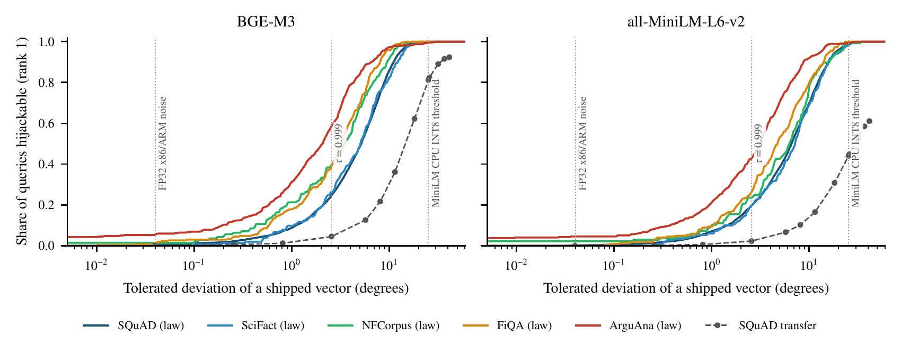

---

## 27. [StepX-OPD: Rethinking Multi-Teacher On-Policy Distillation in Diffusion Models](https://huggingface.co/papers/2611.04386)
**Upvotes**: 4 | **도입 난이도**: 중 | **신뢰도**: 상
**arXiv**: https://arxiv.org/abs/2611.04386

**태그**: Diffusion Models, Knowledge Distillation, Image Generation, Model Compression, RAG, Vision, Evaluation, Distillation

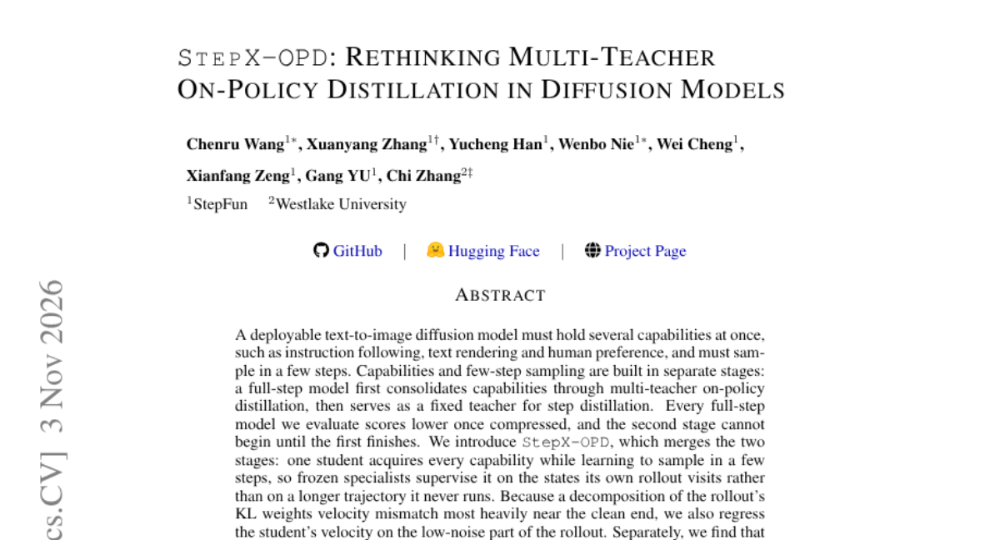

### 📌 한 줄 요약
멀티 티처 지식 증류와 적은 단계(few-step) 샘플링 과정을 하나로 통합하여 성능 저하 없이 효율적으로 모델을 압축하는 기술

### 🔑 핵심 포인트
- 기능 통합과 단계 축소 과정을 단일 단계로 통합하여 효율성 극대화
- 학생 모델의 실제 롤아웃 경로를 활용한 온폴리시(On-policy) 지식 증류 적용
- 저노이즈 구간의 속도 불일치 문제를 해결하기 위한 속도 회귀(velocity regression) 도입

### 🧑‍💻 개발자 관점
고성능 확산 모델을 실시간 서비스 수준의 적은 스텝으로 압축할 때 발생하는 성능 손실과 긴 학습 시간을 동시에 해결할 수 있는 실무적인 방법론입니다.

### 🚀 실무 적용 아이디어
- SD3.5나 FLUX.1 모델에 StepX-OPD 알고리즘을 적용하여 기존 순차적 방식과 성능 비교
- 학습 시 발생하는 텍스트 렌더링 오염(prompt words leakage) 현상 확인 및 변형 모델 적용 테스트
- 저노이즈 구간 속도 회귀가 최종 이미지 품질에 미치는 영향 분석

### ⚠️ 리스크/한계
- 멀티 티처 환경에서 각 기능(지시 이행, 텍등) 간의 균형을 맞추는 것이 복잡할 수 있음
- 특정 아키텍처(SD3.5, FLUX)에 최적화된 기법이 다른 모델 구조에서도 동일한 효율을 보일지 검증 필요

### 📝 초록 기반 상세 설명
기존의 텍스트-이미지 확산 모델은 기능 통합 단계와 단계 축소(step distillation) 단계를 순차적으로 진행하여, 압축 과정에서의 성능 저하와 긴 학습 시간이 문제였습니다. 본 논문은 두 단계를 하나로 통합한 StepX-OPD를 제안합니다. 학생 모델이 학습 중 실제로 방문하는 상태(rollout)에 대해 고정된 전문가 모델이 지도하도록 하여 효율성을 높였으며, 노이즈가 적은 구간에서의 속도 불일치 문제를 해결하기 위해 저노이즈 구간의 속도 회귀를 추가했습니다. 또한, 기능 통합 과정에서 발생하는 원치 않는 텍스트 렌더링 문제를 완화하는 변형 모델도 함께 제시했습니다. 실험 결과, SD3.5 및 FLUX.1 아키텍처에서 기존 방식보다 높은 성능을 기록했으며 학습 시간 또한 크게 단축되었습니다.

---

## 28. [Information Games: Strategic Crowding and Firm Repositioning in Language-Model Space](https://huggingface.co/papers/2609.37820)
**Upvotes**: 3 | **도입 난이도**: 상 | **신뢰도**: 중
**arXiv**: https://arxiv.org/abs/2609.37820

**태그**: LLM, Embedding, Multi-Agent, Game Theory, Economics, Agent

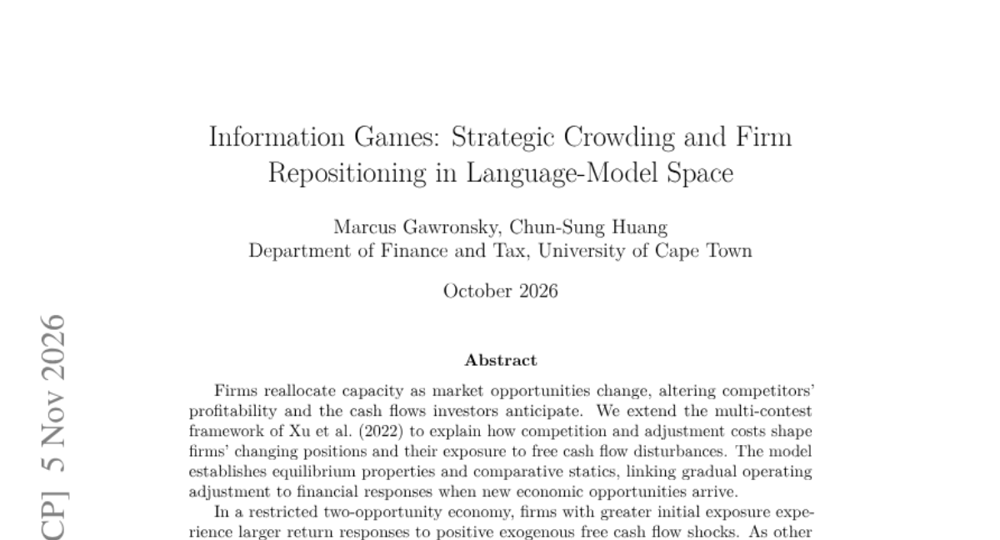

### 📌 한 줄 요약
LLM 임베딩 공간에서의 기업 전략적 위치 변화와 경쟁적 자원 배분 모델링 연구

### 🔑 핵심 포인트
- LLM 임베딩 공간을 활용한 기업 간 정보 기하학적 차별성 측정
- 비용이 발생하는 경쟁적 조정(Costly Competitive Adjustment) 모델 개발
- 멀티 에이전트 시뮬레이션과 실증 데이터(Nasdaq)를 통한 모델 검증

### 🧑‍💻 개발자 관점
LLM 기반의 벡터 검색/임베딩 공간이 단순한 의미 유사도를 넘어, 동적인 시장 경쟁과 전략적 위치 변화를 반영하는 지표로 활용될 수 있음을 보여줍니다.

### 🚀 실무 적용 아이디어
- 특정 산업군의 뉴스 데이터를 임베딩하여 시계열적 벡터 이동(Drift) 분석해보기
- 멀티 에이전트 시뮬레이션 환경에서 임베딩 공간 내 'Crowding' 현상 재현하기
- 임베딩 거리 변화를 기업의 전략적 변화 지표로 변환하는 알고리즘 테스트

### ⚠️ 리스크/한계
- LLM 임베딩 공간의 기하학적 특성이 실제 경제적 가치와 항상 일치하지 않을 수 있음
- 뉴스 데이터의 편향성이 임베딩 벡터에 반영되어 결과가 왜곡될 위험

### 📝 초록 기반 상세 설명
기업의 투자 결정은 시장 내 경쟁 구도와 미래 현금 흐름에 직접적인 영향을 미칩니다. 기존에는 뉴스나 보고서를 통해 기업의 변화를 파악했으나, 현대의 검색 엔진은 LLM을 활용해 문서 간 유사도를 측정하는 방식으로 진화했습니다. 본 연구는 LLM 임베딩 공간의 정보 기하학적 특성을 활용하여 기업 간의 차별성을 벡터 클라우드로 표현하는 모델을 제안합니다. 연구진은 비용이 발생하는 경쟁적 조정 모델을 구축하고, 멀티 에이전트 시뮬레이션과 샌드위치 추정법을 통해 이를 분석했습니다. 2018-2022년 Nasdaq 상장사 데이터를 통해 모델을 검증한 결과, 기업의 용량 조정과 현금 흐름 충격 사이의 관계를 입증했습니다.

### 🖼️ 추가 자료
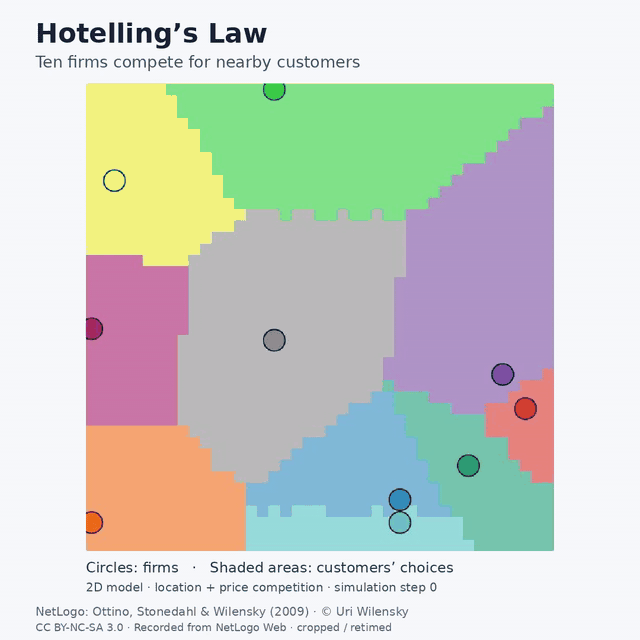

---

## 29. [Identically Trained Language Models Break on Different Jailbreaks](https://huggingface.co/papers/2610.34074)
**Upvotes**: 3 | **도입 난이도**: 하 | **신뢰도**: 상
**arXiv**: https://arxiv.org/abs/2610.34074

**태그**: LLM Security, Pretraining, Jailbreak, Model Robustness, RAG, Benchmark, Safety

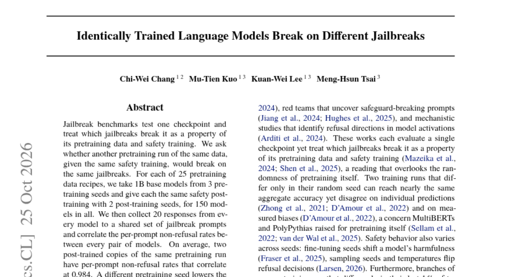

### 📌 한 줄 요약
LLM의 탈옥(Jailbreak) 취약성은 데이터 레시피보다 사전 학습(Pretraining) 시의 무작위성(Seed)에 더 크게 의존한다.

### 🔑 핵심 포인트
- 탈옥 취약성은 데이터 구성보다 사전 학습(Pretraining) 시드에 더 강력하게 의존함
- 동일한 사전 학습 시드를 가진 모델은 매우 유사한 탈옥 패턴을 보임 (상관관계 0.984)
- 사전 학습 과정은 모델의 탈옥 취약성에 대한 고유한 '지문(Fingerprint)'을 남김

### 🧑‍💻 개발자 관점
모델의 안전성 테스트 시 특정 체크포인트에 대한 방어 성공이 전체 모델의 안전성을 보장하지 않음을 인지해야 합니다.

### 🚀 실무 적용 아이디어
- 동일한 데이터셋으로 서로 다른 시드를 가진 모델들을 생성하여 탈옥 성공률 차이 비교
- 특정 모델에 최적화된 탈옥 공격이 다른 시드의 모델에서도 유효한지 검증
- 모델의 안전성 평가 시 시드 변화에 따른 취약성 전이성 테스트

### ⚠️ 리스크/한계
- 실험 규모가 150M~300M 파라미터 위주로 진행되어 거대 모델로의 일반화 필요
- 특정 데이터 레시피에 국한된 결과일 가능성 존재

### 📝 초록 기반 상세 설명
기존의 탈옥 벤치마크는 특정 체크포인트의 안전성을 데이터의 속성으로 간주하지만, 학습 과정의 무작위성이 미치는 영향은 간과되어 왔다. 연구진은 동일한 데이터와 안전 학습을 사용하더라도 사전 학습 시드가 다를 때 탈옥 성공률이 어떻게 변하는지 분석했다. 25개의 데이터 레시피와 다양한 시드를 조합하여 총 150개의 모델을 생성하고 탈옥 프롬프트에 대한 거부율을 상관 분석했다. 실험 결과, 동일한 사전 학습 시드를 가진 모델 간의 상관관계는 매우 높았으나, 시드가 바뀌면 탈옥 성공 패턴이 크게 달라졌다. 이는 탈옥 취약성이 데이터 자체보다 사전 학습 과정의 고유한 특성에 의해 결정됨을 시사한다.

---

## 30. [NPCBench: A Clinical Apprenticeship Benchmark for Multimodal Care-Pathway Reasoning in Nasopharyngeal Carcinoma](https://huggingface.co/papers/2611.08369)
**Upvotes**: 3 | **도입 난이도**: 중 | **신뢰도**: 상
**arXiv**: https://arxiv.org/abs/2611.08369

**태그**: Multimodal, Clinical-Reasoning, Benchmark, Oncology, Reasoning, Vision, Evaluation

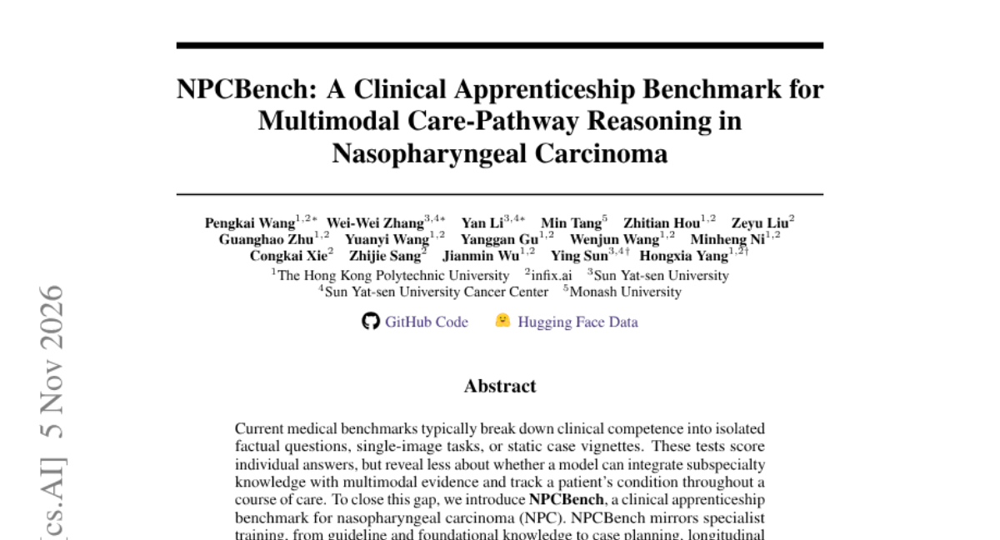

### 📌 한 줄 요약
단편적 질의응답을 넘어 임상 워크플로우와 시계열적 추론 능력을 검증하는 다중 모달 벤치마크 'NPCBench' 제안

### 🔑 핵심 포인트
- 단편적 지식 평가를 넘어 임상 워크플로우(Apprenticeship)를 모방한 다중 모달 벤치마크 설계
- 환자의 상태 변화를 추적하는 종단적(Longitudinal) 추론 및 CarePath 통합 능력 검증
- 개별 작업 성공률과 전체 케어 경로 성공률 간의 격차(Composition Gap) 확인

### 🧑‍💻 개발자 관점
의료 AI 모델 개발 시 단순 정답률이 아닌, 복합적인 임상 시나리오에서의 일관성과 시계열적 의사결정 능력을 검증하는 데 중요한 기준이 됩니다.

### 🚀 실무 적용 아이디어
- 멀티모달 모델의 시계열 데이터(종단적 데이터) 처리 능력 테스트
- 개별 태스크 성능과 전체 워크플로우 성공률 간의 상관관계 분석
- 에이전트 기반 의료 모델의 의사결정 일관성 검증 실험

### ⚠️ 리스크/한계
- 특정 질환(비인두암)에 특화된 데이터셋으로 타 질환 일반화 시 주의 필요
- 복잡한 워크플로우로 인해 평가 비용 및 모델의 연산 부하가 높을 수 있음

### 📝 초록 기반 상세 설명
기존 의료 벤치마크는 개별 지식이나 단일 이미지 기반의 정적인 문제 해결에 치중되어 있어, 실제 임상 현장의 복합적인 의사결정 과정을 평가하기 어렵습니다. 이를 해결하기 위해 비인두암(NPC) 전문의 수련 과정을 모방한 'NPCBench'를 도입했습니다. 이 벤치마크는 가이드라인 숙지부터 사례 계획, 종단적 검토, CarePath 통합 및 개방형 상담까지 포함하는 4,777개의 문항과 100명의 환자 코호트를 포함합니다. 실험 결과, 개별 작업 성능이 높더라도 환자별 통합적 진단 및 케어 경로를 맞추는 성공률은 매우 낮음을 확인했습니다. 결과적으로 NPCBench는 정적 QA를 넘어 임상 워크플로우 전반에 걸친 증거 기반 및 시계열적 추론 능력을 평가하는 새로운 기준을 제시합니다.

---

## 31. [Hard Sample-Conditioned Decorrelated Attention for Robust Face Recognition](https://huggingface.co/papers/2610.41789)
**Upvotes**: 2 | **도입 난이도**: 하 | **신뢰도**: 상
**arXiv**: https://arxiv.org/abs/2610.41789

**태그**: Vision, Face Recognition, Transformer, Optimization, RAG, Benchmark, Inference

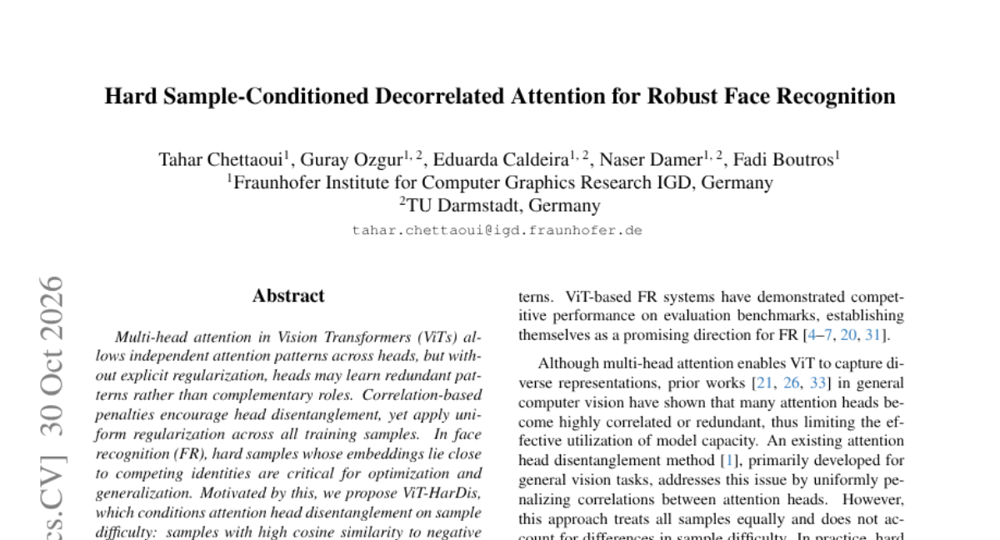

### 📌 한 줄 요약
학습 데이터의 난이도에 따라 어텐션 헤드 간 상관관계를 조절하여 얼굴 인식 성능을 높인 ViT 최적화 기법

### 🔑 핵심 포인트
- 샘플의 난이도(Hard Sample)에 따라 어텐션 헤드 간 상관관계 규제 강도를 동적으로 조절
- 식별이 어려운 샘플에 더 강한 헤드 분리를 적용하여 클래스 간 모호성 해결
- 아키텍처 수정이나 추론 비용 증가 없이 기존 ViT 모델의 성능을 극대화

### 🧑‍💻 개발자 관점
모델 구조를 바꾸지 않고 손실 함수(Loss)와 학습 전략만으로 성능을 높일 수 있어, 기존 모델의 성능 개선이 필요한 실무 환경에 매우 유용합니다.

### 🚀 실무 적용 아이디어
- 기존 ViT 기반 얼굴 인식 모델에 제안된 상관관계 규제 손실 함수 적용 테스트
- 전체 레이어가 아닌 마지막 몇 개 레이어에만 규제를 적용하는 실험 수행
- 학습 데이터셋의 난이도(Hardness)를 정의하는 지표와 규제 강도 간의 상관관계 분석

### ⚠️ 리스크/한계
- 학습 시 샘플 난이도를 계산하는 과정이 추가적인 연산 비용을 발생시킬 수 있음
- 특정 데이터셋(얼굴 인식)에 특화된 기법이므로 다른 도메인에서의 일반화 성능 확인 필요

### 📝 초록 기반 상세 설명
Vision Transformer(ViT)의 멀티 헤드 어텐션은 헤드 간 중복 패턴이 발생하기 쉬워 헤드 간 독립성을 확보하는 것이 중요합니다. 기존의 상관관계 기반 규제 방식은 모든 샘플에 동일한 강도를 적용하여 효율성이 떨어지는 문제가 있었습니다. 본 논문은 식별이 어려운 'Hard Sample'에 더 강한 헤드 분리(disentanglement)를 적용하는 ViT-HarDis를 제안합니다. 실험 결과, 난이도가 높은 샘플에 집중적인 규제를 가함으로써 클래스 간 모호성을 줄이고 성능을 개선했습니다. 최종적으로 아키텍처 변경 없이 SOTA 성능을 달성하며, 마지막 트랜스포머 레이어에만 규제를 적용하는 것이 가장 효과적임을 입증했습니다.

---

## 32. [SynthFaces: Balanced Large Scale Human Dataset](https://huggingface.co/papers/2610.40119)
**Upvotes**: 1 | **도입 난이도**: 중 | **신뢰도**: 상
**arXiv**: https://arxiv.org/abs/2610.40119

**태그**: Generative Models, Dataset, Computer Vision, AI Ethics, Vision

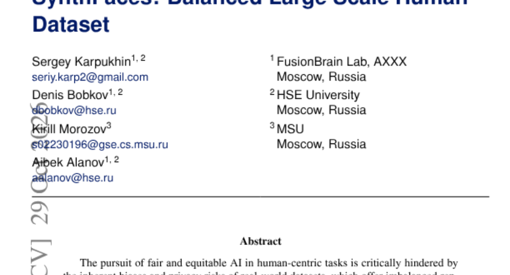

### 📌 한 줄 요약
개인정보 유출 위험 없이 데이터 불균형 문제를 해결할 수 있는 합성 인간 이미지 데이터셋 'SynthFaces' 제안

### 🔑 핵심 포인트
- Arc2Face와 Flow Matching을 결합한 제어 가능한 합성 데이터 생성 파이프라인 개발
- 정체성 불균형과 개인정보 문제를 동시에 해결하는 균형 잡힌 합성 데이터셋 'SynthFaces' 구축
- 실제 데이터에 의존하지 않으면서도 높은 생성 충실도와 라벨 다양성 확보

### 🧑‍💻 개발자 관점
개인정보 규제로 인해 실제 인물 데이터 확보가 어려운 상황에서, 편향성 없는 고품질 학습 데이터를 생성할 수 있는 새로운 방법론을 제시합니다.

### 🚀 실무 적용 아이디어
- 제안된 Flow Matching 기반 생성 파이프라인의 정체성 분리 성능 검증
- SynthFaces 데이터셋을 활용한 기존 개인화 생성 모델(Adapter-based)의 파인튜닝 실험
- 실제 데이터셋과 합성 데이터셋 간의 모델 성능 및 편향성 비교 테스트

### ⚠️ 리스크/한계
- 합성 데이터가 실제 세계의 복잡한 변동성을 완벽히 대체할 수 있는지에 대한 검증 필요
- 생성된 정체성 임베딩의 품질이 하위 태스크의 성능에 미치는 영향성 고려

### 📝 초록 기반 상세 설명
실제 인간 데이터셋은 인종 및 정체성 표현의 불균형과 개인정보 유출 위험이라는 고질적인 문제를 안고 있습니다. 이러한 편향된 데이터는 생성 모델의 공정성을 저해하고 특정 정체성 유지 성능을 떨어뜨립니다. 본 논문은 Arc2Face 확산 모델에 Flow Matching 모델을 결합하여 정체성 임베딩 공간 내에서 다양한 얼굴을 생성하는 파이프라인을 제안합니다. 이를 통해 생성 품질과 라벨 다양성을 동시에 확보한 합성 데이터셋인 SynthFaces를 구축했습니다. 결과적으로 합성 이미지를 통해 개인정보 의존도를 낮추면서도 균형 잡힌 학습이 가능한 환경을 제공합니다.

---

