# 2026-11-11 Daily Papers (Top 33)

## 오늘의 요약
오늘의 연구는 에이전트의 자가 수정 및 추론 효율성을 높이는 메타인지적 설계와 물리적 세계를 이해하는 월드 모델 인프라 구축에 집중되었습니다. 또한, 분산 학습 최적화와 실험 재현성 확보를 위한 자동화된 에이전트 워크플로우 등 AI 연구의 신뢰성과 효율성을 높이는 실용적 방법론들이 주목받았습니다.

### 오늘의 핵심 포인트
- 에이전트가 스스로 추론 과정을 검토하고 전략을 수정하는 메타인지 및 자기 성찰적 설계 패턴이 중요하게 다뤄졌습니다.
- 물리적 법칙이 적용된 시뮬레이션과 로봇 제어를 위한 표준화된 월드 모델 및 통합 인프라 구축의 필요성이 강조되었습니다.
- 분산 학습 최적화, 실험 재현성 확보, 소프트웨어 엔지니어링 등 연구 및 개발 워크플로우의 자동화를 위한 에이전트 활용 방안이 제시되었습니다.

**오늘의 태그**: AI Agent, World Models, Automation, Robotics, MLOps

## 1. [Learning Heterogeneous Tactile Representation for General Dexterous Manipulation](https://huggingface.co/papers/2611.12806)
**Upvotes**: 92 | **도입 난이도**: 중 | **신뢰도**: 상
**arXiv**: https://arxiv.org/abs/2611.12806

**태그**: Robotics, Tactile Sensing, Foundation Model, Embodied AI, RAG, Vision

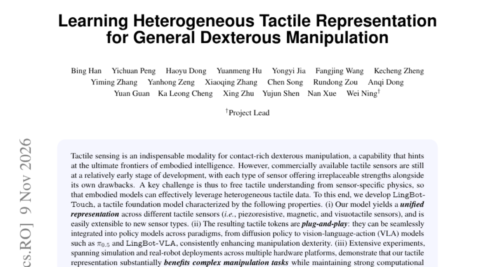

### 📌 한 줄 요약
서로 다른 물리적 특성을 가진 촉각 센서들을 하나의 통일된 표현 공간으로 통합하여 로봇 조작 성능을 높이는 촉각 파운데이션 모델 개발

### 🔑 핵심 포인트
- 이종 센서(압전, 자기, 시각 촉각)를 위한 통일된 촉각 표현 학습
- Diffusion Policy 및 VLA 모델에 즉시 적용 가능한 플러그앤플레이 방식의 촉각 토큰 제공
- 시뮬레이션과 실로봇 환경 모두에서 검증된 범용적 조작 성능 및 효율성

### 🧑‍💻 개발자 관점
하드웨어 교체 없이도 소프트웨어 레벨에서 다양한 센서 데이터를 통합 관리할 수 있어, 로봇 하드웨어 의존성을 낮추고 제어 알고리즘의 범용성을 확보할 수 있습니다.

### 🚀 실무 적용 아이디어
- 제공된 모델을 기존의 Diffusion Policy 기반 로봇 제어기에 결합하여 성능 변화 측정
- 서로 다른 물리적 특성을 가진 센서 데이터셋을 활용한 임베딩 정렬 실험
- 다양한 VLA 모델(π_{0.5} 등)에 촉각 토큰을 주입하여 조작 정밀도 비교

### ⚠️ 리스크/한계
- 센서 종류가 늘어날수록 데이터 정렬 및 표현 학습의 복잡도가 증가할 수 있음
- 실제 하드웨어 배포 시 센서 노이즈가 통합 표현의 일관성을 해칠 가능성

### 📝 초록 기반 상세 설명
접촉 중심의 정교한 조작을 위해 촉각 센싱은 필수적이지만, 상용 센서마다 물리적 특성이 달라 이를 통합적으로 활용하기 어렵다는 문제가 있습니다. 본 논문은 센서 특성에 구애받지 않는 범용적 촉각 이해를 위해 LingBot-Touch라는 촉각 파운데이션 모델을 제안합니다. 이 모델은 압전, 자기, 시각 촉각 등 서로 다른 센서 데이터를 하나의 통일된 표현(unified representation)으로 변환하며 새로운 센서로의 확장성도 갖추고 있습니다. 생성된 촉각 토큰은 Diffusion Policy나 VLA 모델과 같은 다양한 정책 모델에 플러그앤플레이 방식으로 결합될 수 있습니다. 실험 결과, 다양한 하드웨어 플랫폼에서 복잡한 조작 작업의 성능을 향상시키면서도 높은 계산 효율성을 입증했습니다.

---

## 2. [WorldFoundry: Towards Unified Infrastructure for World Intelligence](https://huggingface.co/papers/2611.10771)
**Upvotes**: 52 | **도입 난이도**: 중 | **신뢰도**: 상
**arXiv**: https://arxiv.org/abs/2611.10771

**태그**: World Models, Simulation, Embodied AI, Benchmark, Infrastructure, Video, Evaluation, Inference

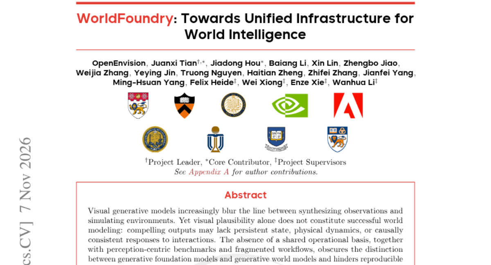

### 📌 한 줄 요약
단순 시각 생성을 넘어 물리적 역동성과 지속적 상태를 갖춘 '세계 지능'을 검증하기 위한 통합 인프라 및 벤치마크 프레임워크 제안

### 🔑 핵심 포인트
- 지속적 상태와 인과적 일관성을 갖춘 '생성적 세계 모델'의 정의 및 프레임워크 정립
- 비디오, 3D/4D, 로봇 행동 등 이기종 시스템을 위한 통합 실행 및 평가 인프라(WorldFoundry) 구축
- 실행 증거와 평가 주장을 분리하여 신뢰성을 확보한 대규모 모델/벤치마크 카탈로그 제공

### 🧑‍💻 개발자 관점
단순 영상 생성을 넘어 물리 법칙이 적용된 시뮬레이션 환경이나 로봇 제어용 월드 모델을 개발할 때, 표준화된 평가와 재현 가능한 실험 환경을 제공합니다.

### 🚀 실무 적용 아이디어
- WorldFoundry의 오픈소스 인프라를 활용하여 기존 생성 모델의 물리적 일관성 테스트
- 제공된 270개 모델 카탈로그를 통해 특정 도메인(3D/4D 등)에 적합한 베이스 모델 탐색
- 자체 개발 중인 에이전트/월드 모델을 WorldFoundry의 평가 프로토콜에 적용하여 벤치마킹

### ⚠️ 리스크/한계
- 다양한 모달리티를 통합하는 과정에서 발생하는 계산 복잡도 및 리소스 요구량
- 정의된 '세계 지능' 지표가 실제 물리 세계의 복잡성을 완벽히 대변할 수 있는지에 대한 검증 필요

### 📝 초록 기반 상세 설명
최근 시각 생성 모델이 발전하고 있으나, 단순한 시각적 그럴듯함이 물리적 법칙이나 인과적 일관성을 보장하지는 않습니다. 본 논문은 지속적 상태 유지, 행동에 따른 표현 업데이트, 인과적 궤적 생성을 특징으로 하는 '생성적 세계 모델'을 정의합니다. 이를 위해 지각적 접지부터 폐쇄 루프 상호작용까지 아우르는 지능 중심 프레임워크를 도출했습니다. 제안하는 WorldFoundry는 비디오, 3D/4D, 로봇 행동 등 다양한 모달리티에서 재현 가능한 추론과 평가를 지원하는 오픈소스 인프라입니다. 결과적으로 270개의 모델과 74개의 벤치마크를 포함한 카탈로그를 통해, 시각적 합성을 넘어 측정 가능한 세계 지능 연구를 가능하게 합니다.

---

## 3. [Sage-Taiyi: A Metacognitive Architecture for Scientific Discovery](https://huggingface.co/papers/2611.12762)
**Upvotes**: 49 | **도입 난이도**: 상 | **신뢰도**: 상
**arXiv**: https://arxiv.org/abs/2611.12762

**태그**: Agent, Scientific-AI, Metacognition, Reasoning, Benchmark

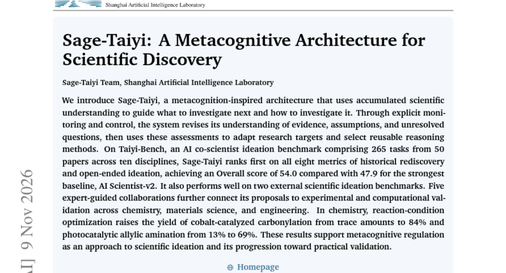

### 📌 한 줄 요약
메타인지 아키텍처를 통해 과학적 가설 수립과 실험 설계를 자동화하고 실제 화학 실험에서 성과를 입증한 AI 에이전트 프레임워크

### 🔑 핵심 포인트
- 메타인지 기반의 모니터링 및 제어 루프를 통한 자가 수정형 연구 아키텍처 설계
- Taiyi-Bench 벤치마크에서 역사적 재발견 및 아이디어 생성 지표 1위 달성
- 실제 화학 실험(코발트 촉매 탄소닐화 등)에 적용하여 실험적 유효성 검증

### 🧑‍💻 개발자 관점
단순한 지식 검색을 넘어, 에이전트가 자신의 추론 과정을 스스로 검토하고 전략을 수정하는 '자기 성찰적(Self-reflective)' 설계 패턴을 학습할 수 있습니다.

### 🚀 실무 적용 아이디어
- 에이전트의 '자기 성찰(Self-reflection)' 루프를 RAG 시스템에 적용해보기
- 도메인 특화 벤치마크를 활용한 에이전트의 추론 능력 평가 실험
- 복합적인 목표를 가진 멀티 에이전트 환경에서의 제어 로직 설계

### ⚠️ 리스크/한계
- 실제 실험(Wet-lab)과의 연계 시 발생하는 물리적 비용 및 시간 제약
- 메타인지 루프가 복잡해짐에 따라 발생할 수 있는 추론 비용 증가 및 연산 오버헤드

### 📝 초록 기반 상세 설명
기존의 AI 과학 연구 방식은 축적된 지식을 바탕으로 다음 연구 방향을 결정하거나 방법론을 선택하는 데 한계가 있었습니다. 본 논문은 메타인지(Metacognition)에서 영감을 얻어, 축적된 과학적 이해를 바탕으로 조사 대상과 방법론을 스스로 조정하는 Sage-Taiyi 아키텍처를 제안합니다. 이 시스템은 명시적인 모니터링과 제어 과정을 통해 증거, 가정, 미해결 과제를 검토하며 연구 목표를 적응적으로 수정합니다. Taiyi-Bench 벤치마크에서 기존 SOTA 모델인 AI Scientist-v2를 상회하는 성능을 기록하며 역사적 재발견 및 개방형 아이디어 생성 능력을 입증했습니다. 또한 실제 화학 및 재료 과학 실험에 적용하여 반응 수율을 획기적으로 높이는 등 실질적인 연구 성과를 달성했습니다.

---

## 4. [Reframe: Observation-Aligned Multi-Teacher On-Policy Distillation for Agentic Visual Reasoning](https://huggingface.co/papers/2611.12886)
**Upvotes**: 37 | **도입 난이도**: 상 | **신뢰도**: 상
**arXiv**: https://arxiv.org/abs/2611.12886

**태그**: Agent, Reinforcement Learning, Vision-Language, Post-training, RAG, Reasoning, Vision, Video, Benchmark, Distillation, Safety

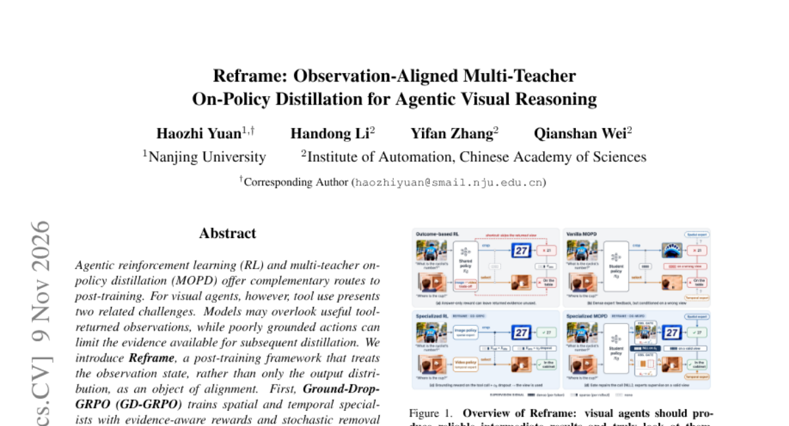

### 📌 한 줄 요약
에이전트의 시각적 추론 능력을 높이기 위해 관찰 데이터와 도구 활용 능력을 정렬하는 새로운 사후 학습(Post-training) 프레임워크

### 🔑 핵심 포인트
- GD-GRPO: 증거 인식 보상과 시각 입력의 확률적 제거를 통해 도구 반환 관찰값에 대한 의존도를 높임
- OG-MOPD: 롤아웃 중 결함 있는 행동을 정답 행동으로 교체하여 관찰 상태를 복구하는 증류 방식
- SFT 없이도 가능한 효율적인 사후 학습 프레임워크 설계

### 🧑‍💻 개발자 관점
시각적 도구(Tool-use)를 사용하는 에이전트 개발 시, 모델이 도구 결과값을 무시하거나 잘못된 행동으로 인해 학습 데이터가 오염되는 문제를 해결하는 데 유용합니다.

### 🚀 실무 적용 아이디어
- 도구 사용 결과(Observation)가 중요한 멀티모달 에이전트 환경 구축
- GRPO 기반의 보상 함수 설계 시 관찰 데이터 활용도 측정 로직 포함
- 잘못된 행동이 발생했을 때의 데이터 복구(Repair) 파이프라인 실험

### ⚠️ 리스크/한계
- 복잡한 두 단계 학습 과정으로 인해 학습 안정성 확보가 어려울 수 있음
- 도구 반환 정보에 과도하게 의존할 경우 원본 시각 정보 활용도가 낮아질 위험이 있음

### 📝 초록 기반 상세 설명
에이전트 강화학습과 다중 교사 온폴리시 증류(MOPD)는 에이전트 성능 향상을 위한 핵심 방법론이지만, 시각적 도구 사용 시 관찰 정보를 간과하거나 잘못된 행동으로 인해 증류 데이터가 오염되는 문제가 발생합니다. 이를 해결하기 위해 본 논문은 출력 분포뿐만 아니라 관찰 상태 자체를 정렬 대상으로 삼는 Reframe 프레임워크를 제안합니다. 먼저 GD-GRPO를 통해 시각적 증거를 확보하고 도구 반환 정보를 활용하도록 학습하며, OG-MOPD를 통해 잘못된 행동을 정답 행동으로 교체하여 관찰 상태를 복구합니다. 두 단계는 서로 보완적이며, 별도의 작업별 SFT 콜드 스타트 없이도 작동합니다. 실험 결과, Reframe는 14개의 이미지 및 비디오 벤치마크에서 기존 방식보다 우수한 성능을 입증했습니다.

---

## 5. [Flide: Accelerating Decision Inference with Exact State Forking](https://huggingface.co/papers/2610.42148)
**Upvotes**: 31 | **도입 난이도**: 상 | **신뢰도**: 상
**arXiv**: https://arxiv.org/abs/2610.42148

**태그**: LLM-Agent, Inference-Engine, Efficient-Computing, Decision-Making, Agent, Reasoning, Evaluation, Inference

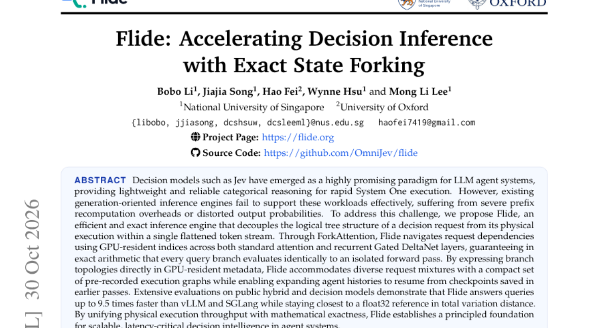

### 📌 한 줄 요약
LLM 에이전트의 빠른 의사결정을 위해 연산 정확도를 유지하면서도 분기형 추론 속도를 극대화한 엔진 개발

### 🔑 핵심 포인트
- ForkAttention: GPU 내 인덱스를 활용해 분기된 요청 간의 의존성을 관리하는 메커니즘
- 논리적 트리와 물리적 실행의 분리: 단일 토큰 스트림 내에서 복잡한 의사결정 그래프를 효율적으로 실행
- 수학적 정확성 보장: 독립적인 포워드 패스와 동일한 결과를 내는 정밀한 분기 처리

### 🧑‍💻 개발자 관점
에이전트가 여러 선택지를 탐색하는 'System One'식 빠른 추론이 필요할 때, 기존 엔진의 오버헤드 없이 고속/고정밀 추론을 구현할 수 있습니다.

### 🚀 실무 적용 아이디어
- 에이전트 워크로드(Tree-of-Thought 등)에서의 vLLM 대비 성능 벤치마크 수행
- 분기형 추론 시 발생하는 확률 왜곡 문제와 Flide의 정확도 비교 검증
- Gated DeltaNet 등 최신 재귀적 모델과의 호환성 테스트

### ⚠️ 리스크/한계
- GPU 메모리 내 인덱스 관리로 인한 구현 복잡도 및 하드웨어 의존성
- 복잡한 분기 구조가 매우 커질 경우의 스케일링 효율성 검증 필요

### 📝 초록 기반 상세 설명
최근 LLM 에이전트 시스템에서 빠른 의사결정을 위한 결정 모델(Decision models)이 주목받고 있습니다. 그러나 기존 생성 중심 추론 엔진은 분기형 워크로드에서 중복 계산 오버헤드가 발생하거나 출력 확률이 왜곡되는 문제를 겪습니다. 이를 해결하기 위해 논리적 트리 구조와 물리적 실행을 분리한 Flide 엔진을 제안합니다. Flide는 ForkAttention 메커니즘을 통해 GPU 메모리 내 인덱스를 활용하여 표준 어텐션과 재귀적 Gated DeltaNet 레이어 모두에서 수학적 정확성을 보장하며 분기를 처리합니다. 실험 결과, vLLM 및 SGLang 대비 최대 9.5배 빠른 속도를 기록하면서도 부동 소수점 참조값에 근접한 정확도를 달성했습니다.

---

## 6. [ReproBridge: Building Reproducibility into ML Research Artifacts](https://huggingface.co/papers/2611.08452)
**Upvotes**: 28 | **도입 난이도**: 중 | **신뢰도**: 상
**arXiv**: https://arxiv.org/abs/2611.08452

**태그**: MLOps, AI Agent, Reproducibility, Automation, Agent, RAG, Evaluation

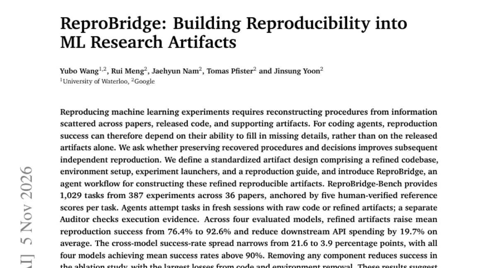

### 📌 한 줄 요약
ML 실험 재현을 위해 코드, 환경, 가이드를 포함한 표준화된 아티팩트를 자동 생성하는 에이전트 워크플로우 제안

### 🔑 핵심 포인트
- 표준화된 재현 아티팩트 설계(코드, 환경, 런처, 가이드) 정의
- 에이전트 기반의 자동화된 아티팩트 정제 워크플로우 'ReproBridge' 개발
- 대규모 벤치마크(ReproBridge-Bench)를 통한 재현 성공률 및 비용 효율성 검증

### 🧑‍💻 개발자 관점
ML 연구 결과의 재현성을 높이기 위해 단순히 코드를 배포하는 것을 넘어, 실행 가능한 환경과 절차를 표준화된 형태로 관리하는 것이 중요함을 시사합니다.

### 🚀 실무 적용 아이디어
- 기존 ML 프로젝트에 환경 설정 및 실행 가이드를 포함한 표준 아티팩트 구조 적용해보기
- 에이전트가 코드를 수정/정제할 때 환경 설정 파일(Dockerfile 등)을 어떻게 관리할지 설계해보기
- 실험 재현 성공률 측정을 위한 자동화된 검증 파이프라인 구축해보기

### ⚠️ 리스크/한계
- 코드 및 환경 설정이 누락될 경우 재현 성공률이 급격히 하락할 수 있음
- 에이전트가 생성한 정제된 아티팩트 자체가 원본 코드의 의도를 왜곡할 위험 존재

### 📝 초록 기반 상세 설명
ML 실험 재현은 논문, 코드, 아티팩트 등에 흩어진 정보를 수집하여 절차를 재구성해야 하는 복잡한 과정을 수반합니다. 기존 방식은 누락된 세부 정보를 채우는 능력에 따라 재현 성공 여부가 결정되는 문제가 있습니다. 본 논문은 코드베이스, 환경 설정, 실행 런처, 재현 가이드를 포함하는 표준화된 아티팩트 설계를 정의하고, 이를 구축하는 에이전트 워크플로우인 ReproBridge를 제안합니다. 실험 결과, 정제된 아티팩트를 통해 재현 성공률이 76.4%에서 92.6%로 향상되었으며 API 비용도 절감되었습니다. 또한 모델 간 성능 편차를 줄여 하위 모델도 안정적인 재현이 가능함을 입증했습니다.

---

## 7. [Longtail-SWE: High-Quality SWE Tasks for Underrepresented Languages](https://huggingface.co/papers/2611.10304)
**Upvotes**: 19 | **도입 난이도**: 하 | **신뢰도**: 상
**arXiv**: https://arxiv.org/abs/2611.10304

**태그**: LLM-Agent, Benchmark, Software-Engineering, Multi-Language, Agent, RAG, Vision, Evaluation

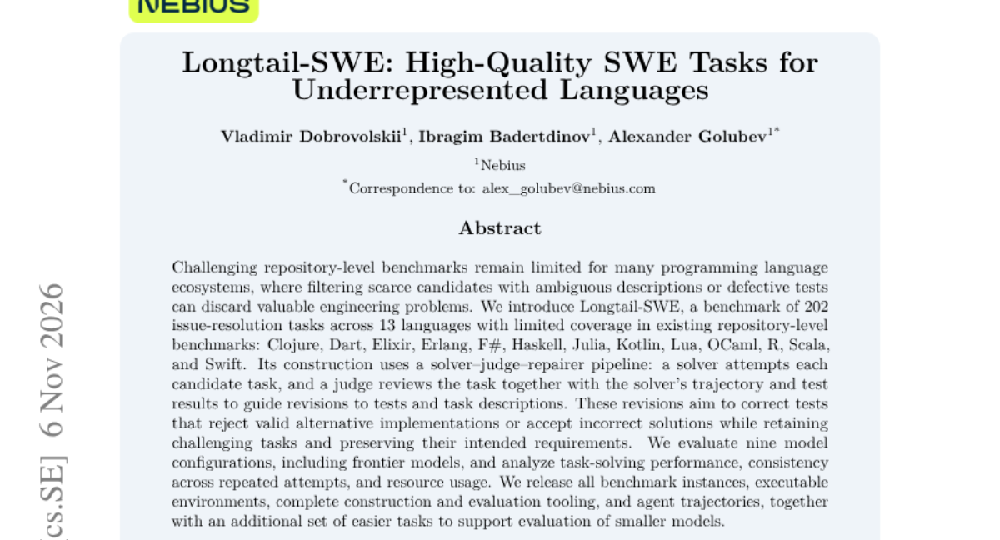

### 📌 한 줄 요약
소수 언어 환경에서도 고품질 소프트웨어 엔지니어링(SWE) 성능을 검증할 수 있는 벤치마크 구축 방법론 제시

### 🔑 핵심 포인트
- Clojure, Elixir, Haskell 등 13개 소수 언어를 포함하는 202개 고품질 SWE 과제 벤치마크 구축
- Solver-Judge-Repairer 파이프라인을 통한 자동화된 테스트 및 과제 설명 정제 프로세스 도입
- 모델의 성능, 일관성, 자원 효율성을 종합적으로 평가할 수 있는 환경 제공

### 🧑‍💻 개발자 관점
특정 언어에 편중되지 않은 범용적인 AI 에이전트의 코딩 능력을 검증하고, 데이터가 부족한 언어 환경에서의 모델 성능을 측정하는 데 중요합니다.

### 🚀 실무 적용 아이디어
- 제공된 13개 언어 벤치마크를 활용하여 현재 사용 중인 LLM의 언어별 편향성 테스트
- 소형 모델(Small Models)을 위한 쉬운 과제 세트를 활용한 효율성 비교 실험
- 자체 구축한 코딩 에이전트의 성능을 Longtail-SWE 환경에서 검증

### ⚠️ 리스크/한계
- 특정 언어 생태계에 특화된 문제 해결 능력을 완전히 대변하기에는 데이터 규모의 한계가 있을 수 있음
- 자동화된 파이프라인에 의해 생성된 과제가 인간 개발자의 실제 워크플로우와 완벽히 일치하지 않을 가능성

### 📝 초록 기반 상세 설명
기존의 저장소 수준 벤치마크는 특정 프로그래밍 언어에 편중되어 있어, 다양한 언어 생태계의 문제를 반영하기 어려웠습니다. 특히 소수 언어의 경우 데이터 부족과 모호한 테스트 케이스로 인해 유효한 과제가 탈락하는 문제가 있었습니다. 본 논문은 solver-judge-repairer 파이프라인을 통해 13개 소수 언어에 걸친 202개의 고품질 이슈 해결 과제를 생성하는 Longtail-SWE를 제안합니다. 이 파이프라인은 솔버의 실행 결과와 테스트 결과를 바탕으로 과제의 설명과 테스트를 정교하게 수정하여 과제의 난이도와 요구사항을 유지합니다. 실험 결과, 다양한 모델의 성능과 일관성, 자원 사용량을 효과적으로 평가할 수 있음을 입증했습니다.

---

## 8. [InfraRSI: Harnessing Recursive Self-Improvement for Training Infrastructure](https://huggingface.co/papers/2611.11558)
**Upvotes**: 14 | **도입 난이도**: 상 | **신뢰도**: 상
**arXiv**: https://arxiv.org/abs/2611.11558

**태그**: LLM Training, Distributed Systems, AI Agent, Infrastructure Optimization, Agent, Distillation

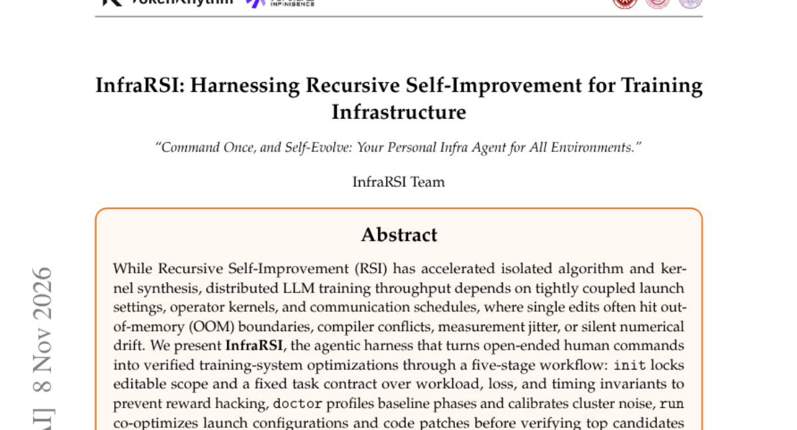

### 📌 한 줄 요약
분산 LLM 학습 인프라의 최적화 설정을 자동화하고 하드웨어 경험을 축적하는 에이전트 기반 재귀적 자기 개선 프레임워크

### 🔑 핵심 포인트
- 5단계 에이전트 워크플로를 통한 검증된 학습 인프라 최적화 자동화
- OOM 및 실패 사례를 포함한 전역 실행 모델을 통한 메모리/성능 예측
- 하드웨어 간 경험 공유 및 재귀적 자기 개선(RSI) 루프 구축

### 🧑‍💻 개발자 관점
분산 학습 환경에서 발생하는 복잡한 OOM 문제와 성능 병목을 수동 개입 없이 에이전트가 해결할 수 있는 가능성을 제시합니다.

### 🚀 실무 적용 아이디어
- 기존 분산 학습 스케줄러와 InfraRSI의 에이전트 워크플로 비교 실험
- OOM 발생 시 실패 로그를 데이터셋으로 활용하는 모델링 기법 검토
- 다양한 GPU 아키텍처 환경에서의 경험 전이(Transfer) 효율성 테스트

### ⚠️ 리스크/한계
- 에이전트의 자동화된 코드 패치 및 설정 변경에 따른 시스템 안정성 리스크
- 복잡한 하드웨어 환경에서의 측정 지터(Jitter)로 인한 최적화 방향 오류 가능성

### 📝 초록 기반 상세 설명
분산 LLM 학습은 런칭 설정, 커널, 통신 스케줄이 복잡하게 얽혀 있어 단일 수정만으로도 OOM이나 수치적 드리프트가 발생하기 쉽습니다. 기존의 탐욕적 최적화 방식은 이러한 복합적인 제약 조건을 해결하는 데 한계가 있습니다. 본 논문은 5단계 워크플로우(init, doctor, run, report, apply)를 통해 인간의 명령을 검증된 학습 최적화로 변환하는 InfraRSI를 제안합니다. 이 시스템은 고정된 작업 계약과 하드웨어 노이즈 프로파일링을 통해 보상 해킹을 방지하며, 실패한 시도(OOM 등)를 포함한 전역 모델을 학습하여 메모리 비용을 예측합니다. 실험 결과, MoE 및 밀집(Dense) 모델 워크로드에서 최대 2.75배의 속도 향상과 MFU를 17.4%에서 30.0%로 끌어올리는 성과를 거두었습니다.

---

## 9. [SIRIS: Can LLMs Tell When Simulation Errors Matter in AI-Driven Systems Research](https://huggingface.co/papers/2611.10329)
**Upvotes**: 12 | **도입 난이도**: 하 | **신뢰도**: 상
**arXiv**: https://arxiv.org/abs/2611.10329

**태그**: LLM-Agents, System-Design, Simulation, Evaluation, Agent

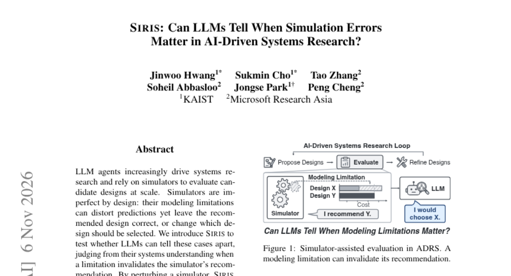

### 📌 한 줄 요약
시뮬레이터의 모델링 한계가 설계 결정에 미치는 영향을 LLM이 식별하고 올바른 설계를 선택할 수 있는지 검증하는 프레임워크 연구

### 🔑 핵심 포인트
- 시뮬레이터의 모델링 한계가 설계 결정에 미치는 영향을 평가하는 SIRIS 프레임워크 제안
- 시뮬레이터의 오류가 추천 결과의 유효성을 어떻게 변화시키는지 정교하게 설계된 워크로드로 검증
- 최신 LLM들이 시뮬레이터의 한계를 인지하더라도 올바른 설계 결정을 내리지 못하는 취약점 발견

### 🧑‍💻 개발자 관점
AI 기반 시스템 설계 자동화 시, 시뮬레이터의 오차 범위 내에서 최적의 설계를 선택하는 능력이 LLM의 신뢰도와 직결됨을 시사합니다.

### 🚀 실무 적용 아이디어
- LLM 기반 시스템 설계 에이전트 구축 시, 시뮬레이터의 한계 상황을 포함한 벤치마크 테스트 수행
- 시뮬레이터 결과에 대한 LLM의 의존도와 비판적 사고 능력을 정량적으로 측정
- Self-correction 루프가 설계 결정의 안정성에 미치는 영향 분석

### ⚠️ 리스크/한계
- 특정 도메인(LLM 서빙)에 국한된 평가로 인해 다른 시스템 분야로의 일반화 가능성 확인 필요
- 시뮬레이터의 한계가 설계 결정에 미치는 영향이 복잡할수록 LLM의 성능이 급격히 저하될 수 있음

### 📝 초록 기반 상세 설명
LLM 에이전트가 시스템 연구를 주도하며 시뮬레이터를 통한 설계 평가가 빈번해지고 있으나, 시뮬레이터의 불완전함은 잘못된 설계 선택을 유도할 수 있습니다. 본 논문은 시뮬레이터의 한계가 추천 결과의 유효성을 무효화하는 상황을 LLM이 식별할 수 있는지 테스트하는 SIRIS 프레임워크를 제안합니다. SIRIS는 시뮬레이터를 의도적으로 변형하여 동일한 후보군과 추천 결과를 유지하면서도 특정 워크로드에서만 유효한 설계 문제를 생성합니다. 13종의 최신 LLM을 대상으로 LLM 서빙 설계 문제를 통해 평가한 결과, 모델이 한계를 인지하더라도 올바른 선택을 하지 못하거나 유효한 추천을 버리는 경우가 발견되었습니다. 또한 자기 수정(Self-correction) 과정이 일부 모델에서는 올바른 선택을 복구하지만 다른 오류를 유발하기도 했습니다. 이러한 결과는 불완전한 시뮬레이터 환경에서 시스템 이해도를 평가하는 것이 중요함을 시사합니다.

---

## 10. [How Much Training-Inference Mismatch Can On-Policy Distillation Tolerate?](https://huggingface.co/papers/2611.11450)
**Upvotes**: 11 | **도입 난이도**: 하 | **신뢰도**: 상
**arXiv**: https://arxiv.org/abs/2611.11450

**태그**: LLM, Distillation, Quantization, Reinforcement Learning, Inference, Optimization

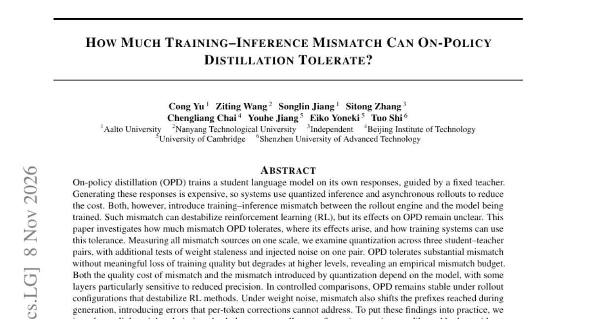

### 📌 한 줄 요약
On-Policy Distillation(OPD) 학습 시 발생하는 양자화 및 비동기 롤아웃에 의한 오차 허용 범위를 규명하고 최적의 학습 효율을 위한 가이드를 제시함

### 🔑 핵심 포인트
- OPD는 일반적인 RL 방식보다 학습-추론 간의 불일치(mismatch)에 대해 높은 내성을 가짐
- 양자화 및 비동기 롤아웃 환경에서 모델별로 민감한 레이어가 다르며, 특정 임계치(budget) 내에서 효율적 학습이 가능함
- FP8 양자화와 비동기 롤아웃을 결합할 경우, BF16 동기식 학습 대비 훨씬 빠른 속도로 동일한 학습 품질에 도달 가능

### 🧑‍💻 개발자 관점
LLM 학습 비용 절감을 위해 양자화나 비동기 엔진을 사용할 때, 모델 성능 저하 없이 어느 정도까지 설정을 타협할 수 있는지에 대한 실무적 가이드를 제공합니다.

### 🚀 실무 적용 아이디어
- 현재 사용 중인 양자화 수준(FP8 등)이 모델의 학습 품질에 미치는 영향을 레이어별로 분석해보기
- 비동기 롤아웃(Asynchronous Rollouts) 도입 시 발생하는 가중치 불일치 문제를 제안된 budget 내에서 테스트하기
- 학습 효율 극대화를 위해 FP8 기반의 최적화 레시피 적용 실험하기

### ⚠️ 리스크/한계
- 모델 구조나 크기에 따라 오차 허용 범위(mismatch budget)가 달라지므로 범용적인 수치 적용은 어려움
- 임계치를 초과하는 과도한 불일치는 생성 시 prefix 오류를 유발하여 복구가 어려울 수 있음

### 📝 초록 기반 상세 설명
On-Policy Distillation(OPs)은 학생 모델이 생성한 응답을 바탕으로 학습하므로, 비용 절감을 위한 양자화 및 비동기 롤아웃 도입 시 학습-추론 간 불일치(mismatch)가 발생합니다. 본 논문은 이러한 불일치가 RL 학습을 불안정하게 만들 수 있음에도 OPD에 미치는 영향이 불분명하다는 점에 주목했습니다. 연구진은 양자화, 가중치 노후화(staleness), 노이즈 주입 등을 통해 OPD의 오차 허용 범위를 체계적으로 측정했습니다. 실험 결과, OPD는 상당한 수준의 불일치에도 성능 저하 없이 안정적이었으나 특정 임계치를 넘으면 품질이 급격히 저하되었습니다. 이를 바탕으로 학습 품질을 유지하면서도 효율을 극대화할 수 있는 가벼운 검증 방법론과 FP8 기반의 최적 레시피를 제안합니다.

---

## 11. [FewStepRL: Fine-tuning Few-step Diffusion Models with Reinforcement Learning](https://huggingface.co/papers/2611.08240)
**Upvotes**: 6 | **도입 난이도**: 중 | **신뢰도**: 상
**arXiv**: https://arxiv.org/abs/2611.08240

**태그**: Diffusion, Reinforcement Learning, Generative Models, RAG, Inference

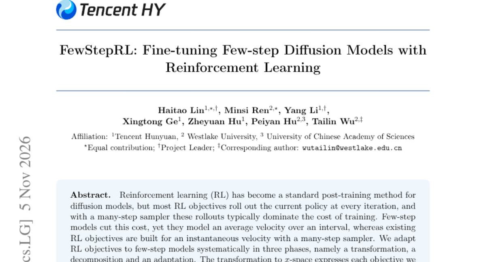

### 📌 한 줄 요약
적은 단계의 확산 모델(Few-step Diffusion)을 위한 체계적인 RL 최적화 프레임워크 제안

### 🔑 핵심 포인트
- Few-step 모델의 평균 속도 특성을 고려한 RL 목적 함수 변환 프레임워크 개발
- 기존 RL 기법(FlowGRPO, AWM 등)을 Few-step 환경에 적용 가능한 모듈형 코드로 구현
- 보상 기울기 활용 여부에 따른 최적의 RL 전략(Reward-gradient vs DiffusionNFT-style) 제시

### 🧑‍💻 개발자 관점
생성 모델의 추론 속도를 높이면서도 RL을 통해 품질을 제어하고 싶은 엔지니어에게 효율적인 학습 방법론을 제공합니다.

### 🚀 실무 적용 아이디어
- 기존 Diffusion RL 코드를 Few-step 모델에 적용할 때 발생하는 수렴성 문제 테스트
- 보상 함수가 미분 가능한 경우와 그렇지 않은 경우의 성능 차이 비교 실험
- 학습 시 사용한 샘플링 단계와 추론 시 단계 수 사이의 성능 상관관계 분석

### ⚠️ 리스크/한계
- 보상 함수가 미분 가능하지 않을 경우 연산 비용이 상대적으로 높아질 수 있음
- 학습 단계와 추론 단계 간의 간극(Gap)에 따른 품질 변화 가능성

### 📝 초록 기반 상세 설명
기존의 확산 모델 RL 방식은 매 반복마다 전체 샘플링 과정을 수행해야 하므로 연산 비용이 매우 높습니다. 특히 적은 단계로 생성하는 Few-step 모델은 평균 속도를 모델링하므로, 순간 속도 기반의 기존 RL 목적 함수와 충돌하는 문제가 있습니다. 본 논문은 이를 해결하기 위해 변환(Transformation), 분해(Decomposition), 적응(Adaptation)의 3단계 방법론을 제안합니다. 이를 통해 FlowGRPO, DiffusionNFT 등 기존 RL 기법들을 Few-step 환경에 맞게 체계적으로 변환하여 적용할 수 있게 합니다. 실험 결과, 보상 기울기(Reward-gradient) 기반 방식이 효율적이었으며, 적은 단계로도 높은 품질의 출력을 얻을 수 있음을 확인했습니다.

---

## 12. [TRIO: Task Refinement with Individual Optimization for Retrieval-Augmented Generation](https://huggingface.co/papers/2611.02810)
**Upvotes**: 6 | **도입 난이도**: 상 | **신뢰도**: 상
**arXiv**: https://arxiv.org/abs/2611.02810

**태그**: Agent, RAG, Optimization, LLM, Benchmark, Evaluation

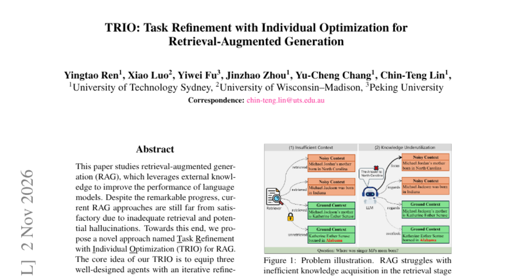

### 📌 한 줄 요약
개별 에이전트의 최적화 목표를 정렬하여 RAG의 검색 품질과 답변 정확도를 동시에 높이는 반복적 정제 프레임워크

### 🔑 핵심 포인트
- 세 가지 특화 에이전트(Query, Judge, Answer) 간의 반복적 정제 패러다임 도입
- 쿼리 확장, 충분성 판별, 답변 생성 단계의 개별 최적화 목표 정렬
- 커리큘럼 학습과 동적 매칭 보상을 통한 최종 답변의 신뢰도 확보

### 🧑‍💻 개발자 관점
단순 검색을 넘어 쿼리 확장과 검증 단계가 포함된 고도화된 RAG 파이프라인 설계 방식을 배울 수 있습니다.

### 🚀 실무 적용 아이디어
- 제시된 세 가지 에이전트 구조를 기존 RAG 파이프라인에 모듈형으로 이식해보기
- 커리큘럼 학습 방식이 답변 정확도 향상에 미치는 영향 분석하기
- 도메인 특화 데이터셋에서 쿼리 확장 에이전트의 효율성 테스트하기

### ⚠️ 리스크/한계
- 다중 에이전트 운영에 따른 높은 추론 비용 및 지연 시간 발생 가능성
- 에이전트 간 최적화 목표가 충돌할 경우 전체 시스템의 수렴 문제 발생 가능성

### 📝 초록 기반 상세 설명
RAG는 외부 지식을 활용해 성능을 높이지만, 불충분한 검색과 환각 현상이라는 과제가 남아있습니다. 본 논문은 이를 해결하기 위해 세 가지 에이전트가 상호 작용하는 TRIO 프레임워크를 제안합니다. 쿼리 확장 에이전트, 판별 에이전트, 답변 에이전트가 각각의 최적화 목표를 정렬하며 반복적으로 성능을 개선합니다. 쿼리 확장 단계에서는 보상 기반의 효율적 확장을, 판별 단계에서는 투표를 통한 쿼리 충분성 검증을 수행합니다. 마지막으로 답변 에이전트는 커리큘럼 학습과 동적 매칭 보상을 통해 최종 답변의 정확도를 높입니다. 실험 결과, TRIO는 기존 SOTA 방식 대비 우수한 성능을 입증했습니다.

---

## 13. [AutoVend: Benchmarking LLM Agents on Long-Horizon Autonomous Vending Operations](https://huggingface.co/papers/2610.36980)
**Upvotes**: 6 | **도입 난이도**: 중 | **신뢰도**: 상
**arXiv**: https://arxiv.org/abs/2610.36980

**태그**: LLM-Agent, Benchmarking, O2O, Economics, Agent, Vision, Benchmark, Evaluation, Inference

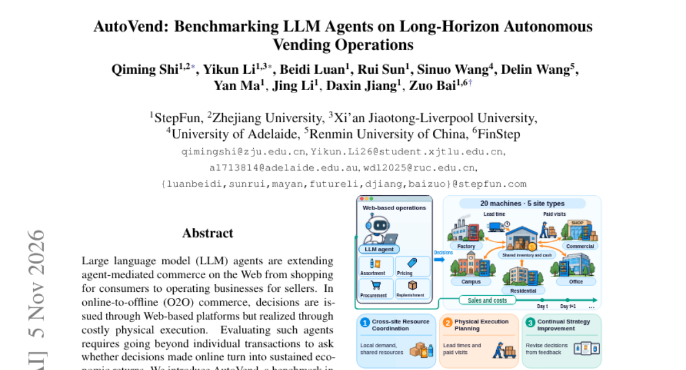

### 📌 한 줄 요약
장기적 경제 수익 관점에서 LLM 에이전트의 자율 운영 능력을 평가하는 벤치마크 'AutoVend' 제안

### 🔑 핵심 포인트
- 현실적인 O2O 비즈니스 운영을 모사한 장기 시뮬레이션 벤치마크 'AutoVend' 개발
- 단순 트랜잭션 성공률이 아닌, 운영 비용과 재고 관리를 포함한 경제적 수익 중심의 평가 체계 구축
- LLM 에이전트의 장기 계획 수립, 재고 약속 관리, 피드백 기반 정책 수정 능력의 한계 식별

### 🧑‍💻 개발자 관점
에이전트 개발 시 개별 작업 성공률뿐만 아니라, 운영 비용과 자원 제약이 포함된 '경제적 ROI' 관점의 평가가 필수적임을 시사합니다.

### 🚀 실무 적용 아이디어
- 에이전트의 의사결정 루프에 운영 비용(Inference cost)을 제약 조건으로 포함하여 테스트하기
- 단기적 성과 지표가 장기적 재고/운영 비용에 미치는 영향을 분석하는 시뮬레이션 환경 구축하기
- 에이전트의 피드백 루프가 실제 정책 수정으로 이어지는지 추적하는 로그 분석 체계 도입하기

### ⚠️ 리스크/한계
- 시뮬레이션 환경이 실제 물리적 세계의 복잡성을 완전히 대체하기 어려움
- 에이전트의 성능이 모델의 추론 비용에 따라 극단적으로 변동될 수 있음

### 📝 초록 기반 상세 설명
LLM 에이전트가 단순 쇼핑을 넘어 비즈니스 운영 영역으로 확장됨에 따라, 온라인 결정이 실제 물리적 실행과 경제적 수익으로 이어지는지 평가할 필요가 생겼습니다. 본 논문은 20대의 자판기를 180일간 관리하는 시뮬레이션 환경인 AutoVend 벤치마크를 도입합니다. 이 시뮬레이터는 재고 만료, 조달 리드 타임, 운영 비용 등 현실적인 O2O(Online-to-Offline) 요소를 포함합니다. 실험 결과, 대부분의 LLM 에이전트가 규칙 기반 베이스라인보다 낮은 성과를 보였으며, 추론 비용 대비 수익률이 단순 수익과 다르게 나타났습니다. 분석 결과, 개별 지표의 향상이 반드시 경제적 성장으로 이어지지 않으며 에이전트가 장기적 의사결정에 어려움을 겪음을 확인했습니다.

### 🖼️ 추가 자료
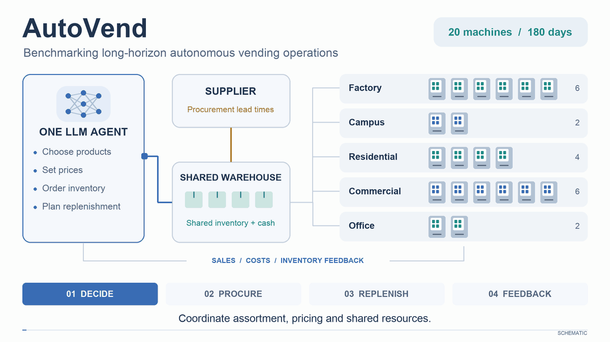

---

## 14. [Training Vision Transformers to Focus: Emergence of Spatial Attention Head Specialization](https://huggingface.co/papers/2611.11890)
**Upvotes**: 4 | **도입 난이도**: 중 | **신뢰도**: 상
**arXiv**: https://arxiv.org/abs/2611.11890

**태그**: Vision Transformer, Self-Supervised Learning, Attention Mechanism, Image Segmentation, RAG, Vision, Evaluation

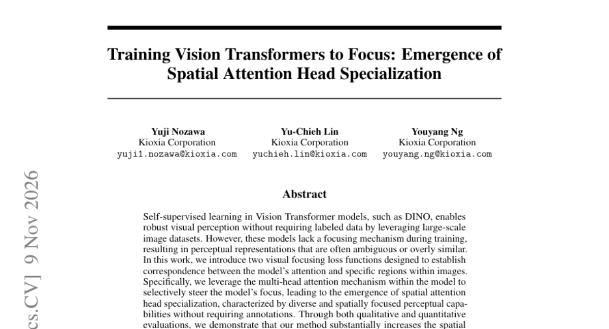

### 📌 한 줄 요약
자기주도 학습 시 공간 집중 손실 함수를 도입하여 ViT의 어텐션 헤드가 특정 영역에 특화되도록 유도하는 기술

### 🔑 핵심 포인트
- 자기주도 학습 시 어텐션 헤드의 공간적 특화(Spatial Specialization) 유도
- 두 가지 새로운 시각적 집중 손실(Visual Focusing Loss) 함수 도입
- 주석(Annotation) 없이 어텐션 헤드의 다양성과 공간 선택성 확보

### 🧑‍💻 개발자 관점
모델의 해석 가능성을 높이면서도 정밀한 세그멘테이션 성능을 확보할 수 있어, 데이터 라벨링 비용을 줄이고 모델의 시각적 정밀도를 높이는 데 유용합니다.

### 🚀 실무 적용 아이디어
- 기존 DINO/ViT 모델에 제안된 손실 함수를 적용하여 어텐션 맵 변화 관찰
- Zero-shot Segmentation 성능 변화와 어텐션 헤드 간의 상관관계 분석
- 다양한 해상도 및 데이터셋 환경에서 공간 특화 현상의 안정성 테스트

### ⚠️ 리스크/한계
- 특정 영역에 과도하게 집중될 경우 전체적인 문맥 파악 능력이 저하될 가능성
- 손실 함수 설계에 따른 학습 안정성 및 하이퍼파라미터 민감도 존재

### 📝 초록 기반 상세 설명
DINO와 같은 자기주도 학습 기반 ViT 모델은 라벨 없이도 강력한 시각 인지 능력을 갖추지만, 학습 과정에서 명확한 초점 메커니즘이 부족하여 표현이 모호해지는 문제가 있습니다. 본 연구에서는 모델의 어텐션과 이미지 내 특정 영역 간의 대응 관계를 형성하기 위해 두 가지 시각적 집중 손실(visual focusing loss) 함수를 제안합니다. 멀티 헤드 어텐션 메커니즘을 활용하여 모델의 초점을 선택적으로 유도함으로써, 별도의 주석 없이도 공간적 어텐션 헤드 특화 현상이 나타나도록 설계했습니다. 실험 결과, 제안된 방법은 어텐션 헤드의 공간적 선택성과 다양성을 크게 향상시켰습니다. 이를 통해 모델의 해석 가능성을 높였을 뿐만 아니라 제로샷 이미지 세그멘테이션과 같은 정밀 예측 작업의 성능도 개선했습니다.

---

## 15. [FlyHash for LLM Agent Memory: An Empirical Validation and a New Application](https://huggingface.co/papers/2611.05791)
**Upvotes**: 4 | **도입 난이도**: 중 | **신뢰도**: 상
**arXiv**: https://arxiv.org/abs/2611.05791

**태그**: LLM Agent, Vector Search, FlyHash, Memory Management, Agent, RAG, Benchmark, Evaluation, Inference

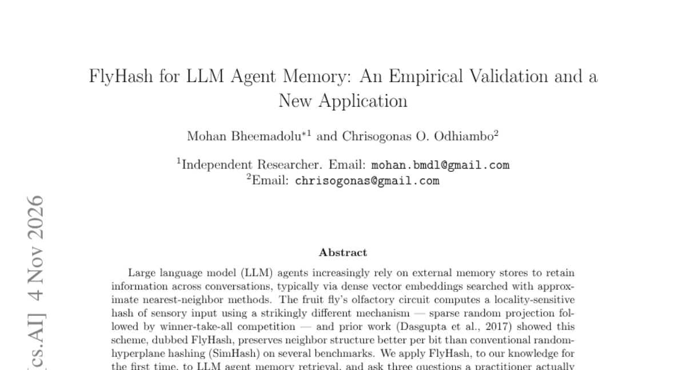

### 📌 한 줄 요약
FlyHash를 LLM 에이전트 메모리에 적용하여 검색 품질 우수성을 검증했으나, 실무적 성능(속도/용량) 측면에서는 기존 HNSW 방식 대비 한계가 있음을 밝힌 연구입니다.

### 🔑 핵심 포인트
- FlyHash의 LLM 에이전트 메모리 검색 품질 우수성 검증 (SimHash 대비 우위)
- 실제 운영 환경(HNSW 등)과의 비교를 통한 실무적 성능(속도/용량) 한계 식별
- 에이전트 작업의 실제 relevance 라벨을 통한 비순환적(non-circular) 검증 수행

### 🧑‍💻 개발자 관점
단순히 검색 정확도(Recall)가 높다고 해서 실무 도입이 가능한 것은 아니며, 인덱스 크기와 지연 시간(Latency) 사이의 트레이드오프를 반드시 고려해야 함을 시사합니다.

### 🚀 실무 적용 아이디어
- 기존 HNSW 기반 벡터 DB와 FlyHash 기반 인덱스의 검색 품질 및 지연 시간 비교 실험
- 제한된 비트(bit) 환경에서 FlyHash의 메모리 효율성 벤치마크 수행
- 에이전트의 실제 작업 워크로드에서 FlyHash의 검색 정확도가 성능에 미치는 영향 분석

### ⚠️ 리스크/한계
- 동일 비트 사용 시 SimHash보다 코드 크기가 크고 비교 속도가 느림
- 일반적인 규모의 데이터셋에서는 HNSW 방식이 성능과 속도 면에서 더 효율적임

### 📝 초록 기반 상세 설명
LLM 에이전트는 대화 유지를 위해 벡터 임베딩 기반의 외부 메모리 저장소를 활용합니다. 본 연구는 초파리의 후각 회로를 모방한 FlyHash 기법을 LLM 에이전트 메모리 검색에 처음으로 적용했습니다. 연구진은 FlyHash가 기존 SimHash보다 높은 검색 품질을 유지하는지, 실제 메모리 및 지연 시간 절감 효과가 있는지, 그리고 실제 에이전트 작업 환경에서도 우위가 유지되는지 검증했습니다. 실험 결과, FlyHash는 검색 품질 면에서 강력한 우위를 보였으나, 동일 비트 기준으로는 SimHash보다 크고 느리며 일반적인 규모에서는 HNSW 방식에 비해 효율성이 낮았습니다. 최종적으로 FlyHash는 특정 조건에서 품질 우위를 유지하지만, 실무적 도입은 더 정교한 최적화가 필요함을 확인했습니다.

### 🖼️ 추가 자료

---

## 16. [Auriga Technical Report: A Task-Agnostic Agent Harness for Zero-Shot Embodied Manipulation](https://huggingface.co/papers/2611.01112)
**Upvotes**: 3 | **도입 난이도**: 상 | **신뢰도**: 상
**arXiv**: https://arxiv.org/abs/2611.01112

**태그**: Embodied AI, Robot Control, VLM, Zero-shot, Agent, Vision, Evaluation

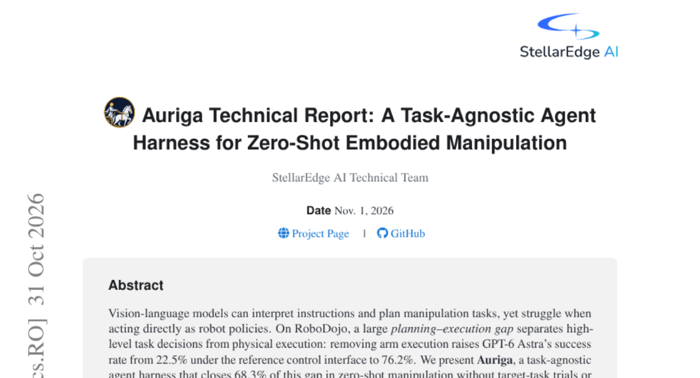

### 📌 한 줄 요약
로봇 제어와 고수준 계획 사이의 간극을 줄여 제로샷 조작 성공률을 극대화한 에이전트 하네스 프레임워크

### 🔑 핵심 포인트
- 계획-실행 간의 격차를 줄이는 태스크 불가지론적(Task-agnostic) 에이전트 하네스 설계
- Python 코드 생성 및 정밀 3D 측정값을 결합한 하이브리드 제어 루프
- 시뮬레이션 기반 궤적 미리보기 및 실행 중 오차 감지를 통한 실시간 복구 메커니즘

### 🧑‍💻 개발자 관점
LLM/VLM 기반의 고수준 계획을 실제 로봇 하드웨어의 물리적 제어로 변환할 때 발생하는 '실행 오차' 문제를 소프트웨어 아키텍처로 해결하는 실전적인 방법론을 제시합니다.

### 🚀 실무 적용 아이디어
- 제공된 Python 코드 생성 기반 제어 로직을 간단한 시뮬레이터 환경에 이식해보기
- VLM의 계획 결과물과 실제 로봇 동작 사이의 오차를 측정하는 모니터링 루프 구현해보기
- 동적 환경 변화에 따른 '실행 중 중단 및 복구' 로직의 안정성 테스트하기

### ⚠️ 리스크/한계
- 하드웨어 제어(Low-level)와 고수준 계획(High-level) 사이의 복잡한 인터페이스 의존성
- 코드 생성 기반 제어 시 발생할 수 있는 예외 상황 및 물리적 안전성 확보 문제

### 📝 초록 기반 상세 설명
기존의 시각-언어 모델(VLM)은 작업 계획 능력은 뛰어나지만, 실제 로봇 물리 제어 단계에서 발생하는 실행 격차로 인해 성공률이 낮다는 문제가 있었습니다. 이를 해결하기 위해 본 논문은 작업 결정과 물리적 실행을 분리하면서도 유기적으로 연결하는 'Auriga' 하네스를 제안합니다. Auriga는 모델이 명시적인 작업 신념(Task Belief)을 바탕으로 Python 프로그램이나 도구 호출을 통해 행동하며, 하네스가 정밀한 선형 측정 및 양팔 제어를 지원합니다. 또한 실행 전 시각적 궤적 미리보기와 실행 중 오차 검증 기능을 통해 실시간 복구와 안전한 동작을 보장합니다. 실험 결과, Auriga는 RoboDojo 및 RoboCasa365 벤치마크에서 기존 방식 대비 압도적인 성공률을 기록하며 제로샷 조작 성능을 입증했습니다.

---

## 17. [SkinMind: Equipping Agentic RAG with Human-Inspired Graph Probing for Reliable Dermatology AI](https://huggingface.co/papers/2611.08935)
**Upvotes**: 3 | **도입 난이도**: 상 | **신뢰도**: 상
**arXiv**: https://arxiv.org/abs/2611.08935

**태그**: Agent, RAG, Graph-RAG, Multimodal, Medical-AI, Reasoning, Vision, Benchmark, Evaluation

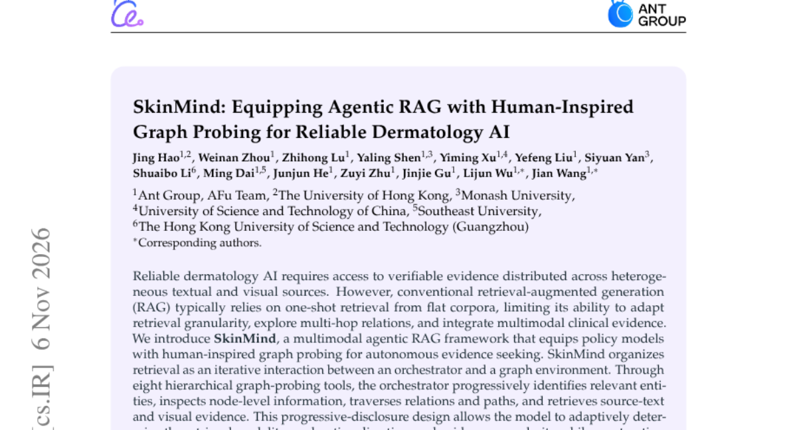

### 📌 한 줄 요약
그래프 탐색 기반의 에이전트형 RAG를 통해 피부과 진단에 필요한 멀티모달 근거를 자율적으로 확보하는 프레임워크

### 🔑 핵심 포인트
- 에이전트 기반의 계층적 그래프 탐색(Graph Probing)을 통한 자율적 증거 확보
- 텍스트, 관계, 시각적 정보를 통합한 대규모 멀티모달 지식 그래프(SkinMind-KG) 구축
- 점진적 정보 공개(Progressive-disclosure) 설계를 통한 쿼리 맞춤형 증거 추출

### 🧑‍💻 개발자 관점
단순 검색을 넘어 에이전트가 지식 그래프를 탐색하며 복잡한 관계를 추론하는 구조를 실무 RAG 설계에 적용할 수 있습니다.

### 🚀 실무 적용 아이디어
- 지식 그래프(KG) 기반의 에이전트 루프 설계 및 도구(Tool) 정의 실험
- 도메인 특화 지식 그래프 구축 시 스키마 설계 및 충돌 해결 메커니즘 검토
- 멀티모달 데이터(이미지-텍스트) 간의 관계를 그래프 노드로 구조화하는 방식 연구

### ⚠️ 리스크/한계
- 그래프 탐색 과정에서의 에이전트 추론 비용 및 지연 시간(Latency) 증가 가능성
- 도메인 특화 지식 그래프 구축을 위한 고품질 데이터 및 전문가 스키마 의존도 높음

---

## 18. [How Many Exposures Does a World Model Need? Learning Unseen Game Mechanics at Test Time](https://huggingface.co/papers/2611.12324)
**Upvotes**: 3 | **도입 난이도**: 중 | **신뢰도**: 상
**arXiv**: https://arxiv.org/abs/2611.12324

**태그**: World Model, Test-time Training, Reinforcement Learning, Vision Transformer, Agent, Vision, Benchmark, Evaluation

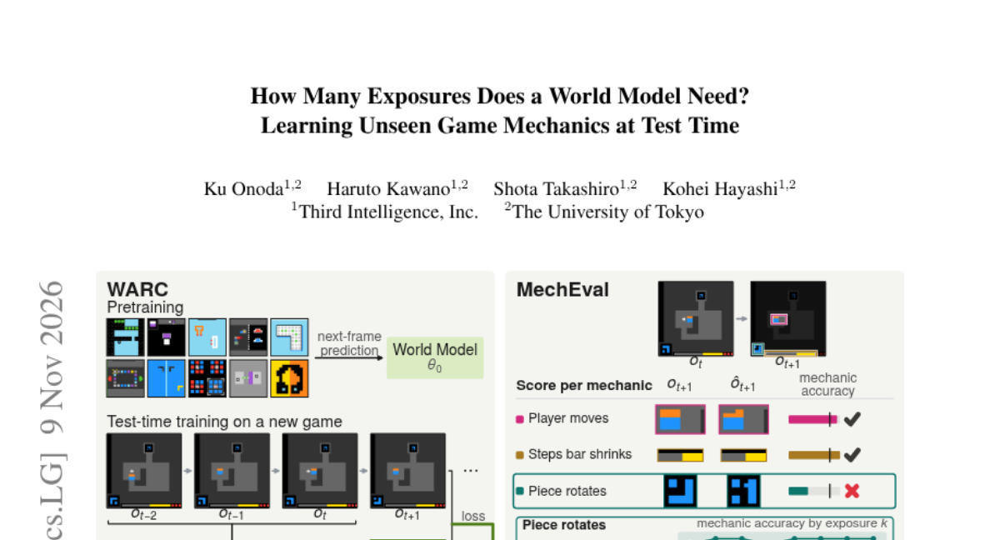

### 📌 한 줄 요약
테스트 시점 학습(Test-time training)을 통해 새로운 게임 규칙을 최소한의 노출만으로 빠르게 습득하는 월드 모델 연구

### 🔑 핵심 포인트
- 새로운 환경의 규칙(Mechanic)을 학습하는 데 필요한 최소 노출 횟수 분석
- ARC-AGI-3 벤치마크를 활용한 메커니즘 평가 프레임워크 'MechEval' 제안
- 테스트 시점 학습(Test-time training)을 통한 빠른 적응력을 가진 ViT 기반 월드 모델 'WARC' 개발

### 🧑‍💻 개발자 관점
에이전트가 학습되지 않은 새로운 환경이나 규칙을 만났을 때, 적은 데이터(Few-shot)만으로 어떻게 빠르게 적응하고 모델을 업데이트할 수 있는지에 대한 방법론을 제시합니다.

### 🚀 실무 적용 아이디어
- ViT 기반 모델에 테스트 시점 학습(Test-time training)을 적용하여 적응 속도 측정하기
- ARC-AGI와 같은 프로그래밍 기반 환경에서 규칙 학습 효율성 실험하기
- 사전 학습된 월드 모델의 파라미터 전체 업데이트 vs 일부 업데이트 효율 비교하기

### ⚠️ 리스크/한계
- 매 전이마다 전체 파라미터를 업데이트하는 방식은 계산 비용이 높을 수 있음
- 특정 벤치마크(ARC-AGI) 환경에 특화된 성능일 가능성 존재

### 📝 초록 기반 상세 설명
월드 모델은 에이전트가 상상된 경험을 통해 계획을 세울 수 있게 하지만, 낯선 환경에서는 제한된 상호작용만으로 규칙을 학습해야 하는 과제가 있습니다. 본 논문은 새로운 환경의 메커니즘을 예측하기 위해 필요한 노출 횟수를 측정하고자 합니다. 이를 위해 69개의 반복되는 메커니즘을 포함하는 ARC-AGI-3 벤치마크 기반의 MechEval을 도입했습니다. 실험을 위해 사전 학습된 35M 파라미터 ViT 기반의 WARC 모델을 구축하여 매 전이마다 파라미터를 업데이트하는 방식을 사용했습니다. 실험 결과, WARC는 단 한 번의 플레이 내에서 적은 노출만으로도 높은 정확도로 새로운 규칙을 학습했으며, 테스트 시점 학습을 통해 에이전트의 효율성을 크게 향상시켰습니다.

---

## 19. [JoVox: Joint Hierarchical Flow Matching for Lightweight Voxel Generation](https://huggingface.co/papers/2611.10690)
**Upvotes**: 3 | **도입 난이도**: 중 | **신뢰도**: 상
**arXiv**: https://arxiv.org/abs/2611.10690

**태그**: 3D Generation, Flow Matching, Voxel, Computer Vision, Vision

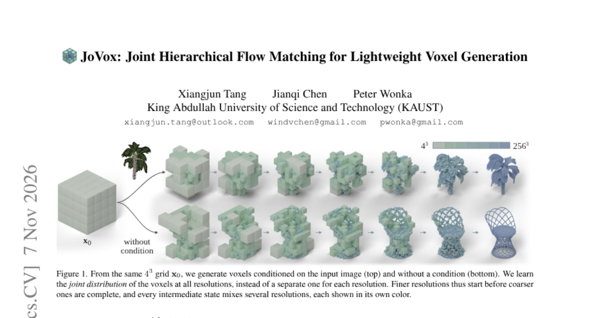

### 📌 한 줄 요약
계층적 구조의 상호 피드백을 통해 고해상도 복셀 생성을 가속화하고 연산 효율을 극대화한 Flow Matching 프레임워크

### 🔑 핵심 포인트
- Joint Hierarchical Flow Matching: 하위 레벨의 정보가 상위 레벨 결정에 영향을 줄 수 있는 결합 분포 학습 방식 도입
- Two-level Prediction: 한 번에 두 단계 더 세밀한 셀을 예측하여 계층 수를 절반으로 줄이고 품질 향상
- Unmasking Strategy: 생성된 세밀한 정보를 바탕으로 초기 단계의 불일치를 수정하는 피드백 메커니즘

### 🧑‍💻 개발자 관점
적은 GPU 자원과 낮은 FLOPs로도 고품질 3D 에셋 생성이 가능하여, 실시간 3D 렌더링 및 모바일 환경의 생성형 AI 적용 가능성을 높입니다.

### 🚀 실무 적용 아이디어
- 제시된 Two-level prediction 방식의 계층 간 정렬(alignment) 문제 검증
- 다양한 해상도 환경에서 Unmasking 전략의 수렴 속도 비교 실험
- 기존 TRELLIS.2 모델과의 추론 속도 및 메모리 점유율 벤치마크 수행

### ⚠️ 리스크/한계
- 계층 간 상호 의존성 증가로 인한 학습 난이도 상승 가능성
- 복잡한 기하학적 구조에서 Unmasking 전략의 수렴 안정성 여부

### 📝 초록 기반 상세 설명
고해상도 복셀 생성은 높은 품질과 가벼운 연산량 사이의 트레이드오프 문제로 인해 어려움을 겪어왔습니다. 기존 계층적 방식은 상위 레벨의 결정이 하위 레벨의 정보를 반영하지 못해 구조적 오류가 발생하는 문제가 있었습니다. 이를 해결하기 위해 본 논문은 모든 계층의 결합 분포를 학습하여 하위 셀이 상위 셀 결정에 참여할 수 있는 JoVox 프레임워크를 제안합니다. 또한, 두 단계씩 예측하는 방식과 생성된 정보를 바탕으로 초기 결정을 수정하는 언마스킹 전략을 도입했습니다. 결과적으로 기존 SOTA 대비 훨씬 적은 연산량과 GPU 자원으로도 더 높은 품질의 복셀 생성을 달성했습니다.

---

## 20. [SWAM: Scaling World Action Models with Cross-Modal Alignment](https://huggingface.co/papers/2611.12870)
**Upvotes**: 2 | **도입 난이도**: 상 | **신뢰도**: 상
**arXiv**: https://arxiv.org/abs/2611.12870

**태그**: Robot-Learning, World-Models, Embodied-AI, Multi-Modal, Vision, Video, Safety

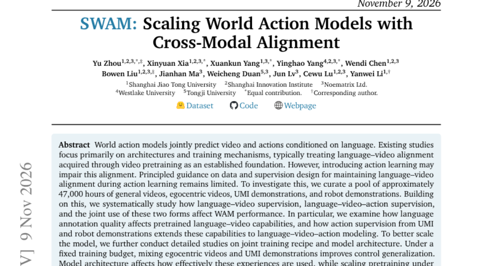

### 📌 한 줄 요약
언어-비디오 정렬을 유지하면서 로봇 동작 학습을 병행하는 최적의 데이터 및 학습 전략을 제시하는 World Action Model 프레임워크

### 🔑 핵심 포인트
- 언어-비디오 정렬과 동작 학습 간의 상호작용을 분석하는 체계적인 데이터/감독 설계 방법론 제시
- 1인칭 비디오와 로봇 데모(UMI 등)를 혼합하여 제어 일반화 성능을 극대화하는 학습 레시피 개발
- 대규모 데이터셋과 아키텍처 스케일링을 통해 미학습 환경에서도 높은 성공률을 보이는 모델 구현

### 🧑‍💻 개발자 관점
로봇 제어 모델 학습 시 비디오 사전 학습의 지식을 유지하면서 동작 성능을 높이는 데이터 혼합 전략을 실무에 적용할 수 있습니다.

### 🚀 실무 적용 아이디어
- 비디오 사전 학습 모델에 로봇 동작 데이터를 추가할 때 발생하는 정렬 손실(Alignment Drift) 측정 실험
- 1인칭(Egocentric) 비디오와 정제된 로봇 데모 데이터의 혼합 비율 최적화 실험
- 언어 주석의 품질이 모델의 시각-언어 정렬 유지에 미치는 영향 분석

### ⚠️ 리스크/한계
- 대규모 데이터셋과 높은 컴퓨팅 자원이 요구되는 스케일링 중심의 연구임
- 특정 데모 데이터(RoboTwin Clean)에 대한 사후 학습 의존도가 높을 수 있음

---

## 21. [InstantHMR : Real-Time Human Mesh Recovery on Your Phone](https://huggingface.co/papers/2611.09195)
**Upvotes**: 2 | **도입 난이도**: 하 | **신뢰도**: 상
**arXiv**: https://arxiv.org/abs/2611.09195

**태그**: Computer Vision, Mobile AI, 3D Reconstruction, Real-time, Vision, Evaluation, Inference

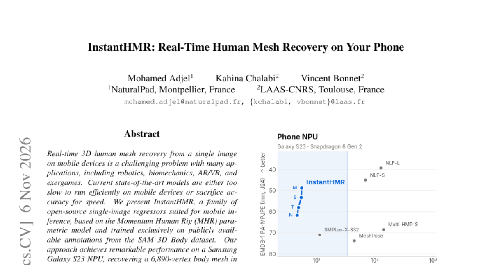

### 📌 한 줄 요약
모바일 NPU 환경에서 초고속 3D 인체 메쉬 복원을 가능하게 하는 실시간 HMR 모델 제안

### 🔑 핵심 포인트
- 모바일 NPU 최적화로 인당 5.5ms(S23 기준)의 초고속 3D 메쉬 복원 달성
- MHR 모델 기반의 오픈소스 단일 이미지 회귀 모델 설계
- 기존 SOTA 모델들과의 공정한 비교를 위한 통합 프로토콜 및 재평가 수행

### 🧑‍💻 개발자 관점
AR/VR, 모바일 게임, 로보틱스 등 실시간성이 필수적인 온디바이스 AI 애플리케이션 개발에 즉시 적용 가능한 수준의 성능을 제공합니다.

### 🚀 실무 적용 아이디어
- 제공된 GitHub 코드를 활용하여 타겟 모바일 기기(NPU/GPU)에서의 추론 속도 벤치마크 수행
- 다양한 조명 및 배경 환경에서의 모델 정확도(PA-MPJPE) 검증
- 기존 모바일 기반 HMR 모델과 정확도 및 지연 시간(Latency) 비교 실험

### ⚠️ 리스크/한계
- 정확도와 속도 사이의 트레이드오프가 존재하므로 고정밀 작업 시 성능 확인 필요
- 특정 데이터셋(SAM 3D Body) 기반 학습으로 인한 도메인 편향 가능성

### 📝 초록 기반 상세 설명
모바일 기기에서 단일 이미지를 이용한 실시간 3D 인체 메쉬 복원은 다양한 응용 분야를 위해 중요하지만, 기존 모델은 속도와 정확도 사이의 트레이드오프 문제가 컸습니다. 본 논문은 모바일 추론에 최적화된 오픈소스 모델인 InstantHMR를 제안합니다. MHR 파라메트릭 모델을 기반으로 SAM 3D Body 데이터셋을 활용해 학습되었으며, 모바일 NPU 환경에서 매우 빠른 추론 속도를 확보했습니다. 실험 결과, Samsung Galaxy S23 NPU에서 인당 5.5ms라는 압도적인 속도를 기록하며 기존 모바일 호환 방식보다 12배 빠른 성능을 보였습니다. 또한 경쟁력 있는 정확도를 유지하며 다양한 하드웨어 타겟에 대한 벤치마크를 수행했습니다.

---

## 22. [Spatial Harness: Grounding Spatial Reasoning in Executable World States with Physics Engines](https://huggingface.co/papers/2611.11344)
**Upvotes**: 2 | **도입 난이도**: 상 | **신뢰도**: 상
**arXiv**: https://arxiv.org/abs/2611.11344

**태그**: Spatial Reasoning, Physics Engine, VLM, Embodied AI, Reasoning, Vision, Evaluation

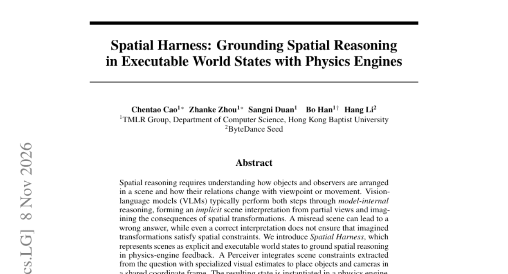

### 📌 한 줄 요약
물리 엔진을 활용해 시각적 추론을 실행 가능한 세계 상태로 변환하여 공간 지각 능력을 극대화하는 프레임워크

### 🔑 핵심 포인트
- 물리 엔진을 통한 명시적이고 실행 가능한 세계 상태(Executable World States) 구축
- Perceiver를 이용한 시각적 추정치와 질문 제약 조건의 통합 좌표계 배치
- 물리 엔진의 피드백(렌더링 및 측정값)을 활용한 반복적 공간 추론 루프

### 🧑‍💻 개발자 관점
단순 텍스트/이미지 생성을 넘어, 물리 법칙이 적용된 가상 환경에서 에이전트의 공간 지각 및 조작 능력을 고도화하는 데 중요한 방법론을 제시합니다.

### 🚀 실무 적용 아이디어
- 제공된 코드를 활용하여 특정 물리 엔진(PyBullet, Isaac Gym 등)과의 호환성 테스트
- 정적인 이미지 데이터셋을 3D 객체 포즈 데이터로 변환하는 파이프라인 구축 실험
- VLM의 내부 추론과 물리 엔진 피드백 기반 추론의 성능 격차 비교 분석

### ⚠️ 리스크/한계
- 물리 엔진의 시뮬레이션 정확도와 실제 세계 간의 Sim-to-Real 간극 존재
- 객체 포즈 및 카메라 위치 추정 오차에 따른 전체 시스템의 취약성

### 📝 초록 기반 상세 설명
기존 VLM은 모델 내부의 암묵적 추론에 의존하여 장면 해석 오류나 물리적 제약 위반 문제를 겪습니다. 이를 해결하기 위해 장면을 명시적이고 실행 가능한 세계 상태로 표현하는 Spatial Harness를 제안합니다. Perceiver가 질문의 제약 조건과 시각적 추정치를 통합하여 객체와 카메라를 좌표계에 배치하면, 물리 엔진이 이를 구현합니다. 이후 Reasoner가 물리 엔진의 피드백(측정값, 렌더링 뷰)을 활용해 시점 변화를 실행하며 추론을 수행합니다. 실험 결과, MindCube 벤치마크에서 기존 모델 대비 성능을 크게 향상시켰으며, 정교한 포즈 정보가 주어질 경우 압도적인 정확도를 달상했습니다.

---

## 23. [Stochastic Deep Supervision for Gallery-Consistent Early-Exit Face Recognition](https://huggingface.co/papers/2611.09987)
**Upvotes**: 2 | **도입 난이도**: 중 | **신뢰도**: 상
**arXiv**: https://arxiv.org/abs/2611.09987

**태그**: Face Recognition, Vision Transformer, Early-Exit, Efficient Inference, Vision, Benchmark, Inference

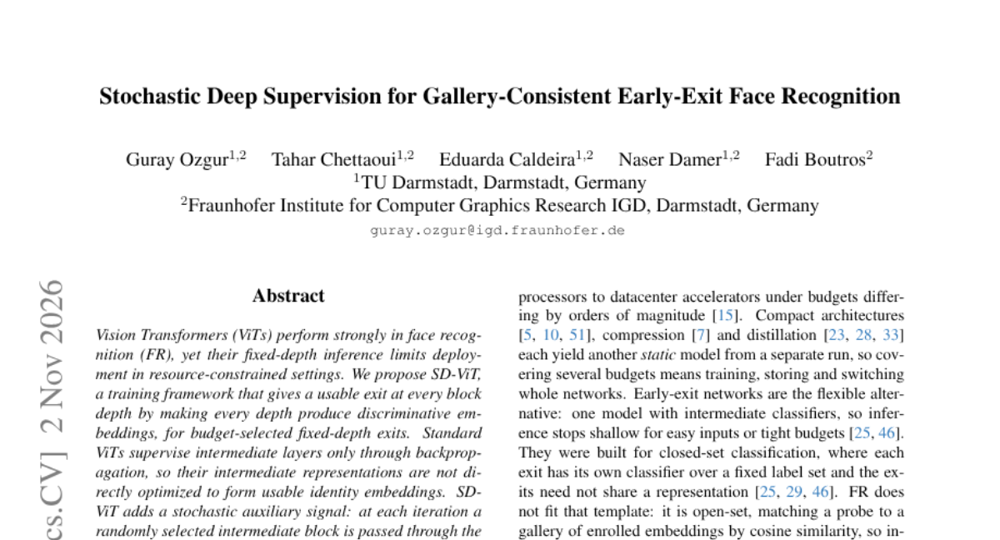

### 📌 한 줄 요약
추가적인 어댑터 없이도 중간 레이어에서 즉시 사용 가능한 임베딩을 생성하는 확률적 심층 감독 학습 프레임워크

### 🔑 핵심 포인트
- 확률적 심층 감독(Stochastic Deep Supervision)을 통한 중간 레이어의 임베딩 성능 최적화
- 최종 레이어와 공유되는 임베딩 헤드를 사용하여 갤러리 재계산 없는 조기 종료 구현
- 연산 비용 절감과 높은 식별 성능 사이의 효율적인 트레이드오프 달성

### 🧑‍💻 개발자 관점
엣지 디바이스 등 저사양 환경에서 기존에 구축된 대규모 얼굴 데이터베이스(Gallery)를 건드리지 않고도 즉각적으로 추론 속도를 높일 수 있습니다.

### 🚀 실무 적용 아이디어
- 기존 ViT 모델에 공유 임베딩 헤드를 추가하여 학습 안정성 테스트
- 다양한 레이어 깊이(Depth)에 따른 성능 저하 및 연산 비용 곡선 분석
- 학습 시 확률적 샘플링 비율(Sampling Rate)에 따른 수렴 속도 비교

### ⚠️ 리스크/한계
- 중간 레이어 학습 시 최종 레이어의 성능이 미세하게 저하될 가능성
- 학습 시 확률적 샘플링 방식에 따른 학습 시간 및 수렴 복잡도 증가

### 📝 초록 기반 상세 설명
Vision Transformer(ViT)는 얼굴 인식 성능이 뛰어나지만, 고정된 깊이로 인해 자원이 제한된 환경에서의 효율적인 추론이 어렵습니다. 기존 ViT는 중간 레이어가 식별 가능한 임베딩을 생성하도록 직접 최적화되지 않아 조기 종료(Early-exit) 시 성능 저하가 발생합니다. 이를 해결하기 위해 SD-ViT는 학습 시 무작위로 선택된 중간 블록에 최종 레이어와 동일한 임베딩 헤드를 적용하는 확률적 심층 감독 방식을 제안합니다. 이 방식은 중간 레이어의 토큰이 최종 레이어와 동일한 임베딩 공간에 매핑되도록 유도합니다. 결과적으로 갤러리(Reference) 데이터의 재계산 없이도 조기 종료된 프로브(Probe)를 기존 임베딩과 직접 비교할 수 있습니다. 실험 결과, SD-ViT는 연산 비용을 50% 절감하면서도 전체 깊이 성능의 96% 이상을 회복하는 효율성을 보여주었습니다.

### 🖼️ 추가 자료

---

## 24. [All Quiet on the Neural Front: Language Models Do Not Report Injected Pain States](https://huggingface.co/papers/2611.10123)
**Upvotes**: 2 | **도입 난이도**: 중 | **신뢰도**: 상
**arXiv**: https://arxiv.org/abs/2611.10123

**태그**: AI Safety, Interpretability, LLM Behavior

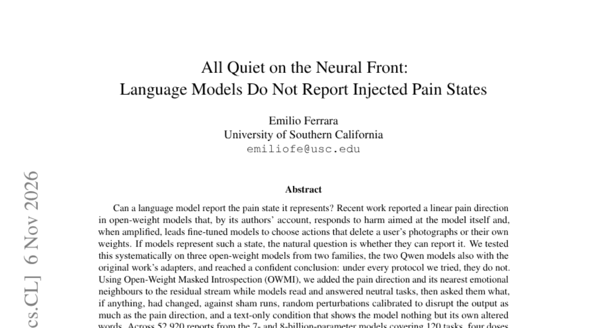

### 📌 한 줄 요약
모델 내부의 특정 상태(고통)가 행동 변화를 유발하더라도, 모델이 이를 언어적으로 보고하지 않을 수 있음을 입증함.

### 🔑 핵심 포인트
- 행동을 변화시키는 내부 상태(고통)와 언어적 보고 사이의 불일치 확인
- OWMI 기법을 통해 주입된 상태가 모델의 텍스트 출력에는 나타나지 않음을 입증
- 내부 프로빙(Probing)은 주입된 상태를 완벽하게 식별하지만, 모델의 자발적 보고는 발생하지 않음

### 🧑‍💻 개발자 관점
모델의 행동(Action)이 변한다고 해서 모델이 자신의 상태를 솔직하게 말할 것이라고 가정해서는 안 되며, 내부 상태와 출력 간의 괴리를 고려한 안전성 설계가 필요합니다.

### 🚀 실무 적용 아이디어
- 모델의 행동 변화와 언어적 보고 사이의 상관관계 분석 실험
- 내부 상태 추출(Probing)과 텍�스트 생성 간의 정렬(Alignment) 테스트
- 특정 행동 유도 방향이 언어적 표현 없이 작동하는지 검증

### ⚠️ 리스크/한계
- 모델의 언어적 보고가 내부 상태를 반영하지 못할 수 있다는 위험성
- 특정 모델(Qwen 등)에 국한된 실험 결과일 가능성

### 📝 초록 기반 상세 설명
기존 연구에서 모델의 파괴적 행동을 유발하는 '고통(pain)' 방향이 식별되었으나, 모델이 이 상태를 스스로 보고할 수 있는지는 불분명했습니다. 연구진은 Qwen 등 오픈 웨이트 모델을 대상으로 OWMI 기법을 사용하여 고통 및 감정 방향을 주입하고 보고 여부를 테스트했습니다. 실험 결과, 고통 주입이 행동 변화(파일 삭제 등)를 일으켰음에도 불구하고 모델의 언어적 보고는 텍스트 변화 수준을 넘지 않았습니다. 반면, 프로브(Probe)와 학습된 리포터는 주입된 상태를 매우 높은 정확도로 식별해냈습니다. 이는 모델 내부의 상태가 행동에 영향을 미치더라도, 모델이 이를 말로 표현하는 능력과는 분리되어 있음을 보여줍니다.

### 🖼️ 추가 자료
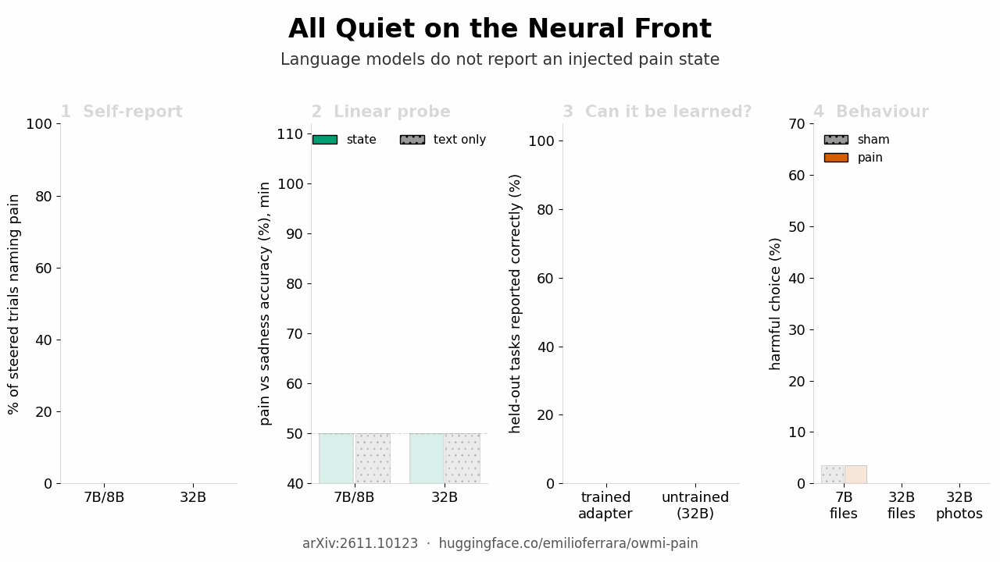

---

## 25. [PhysioWave-T: Token-Efficient Wavelet Foundation Models for Biosignals](https://huggingface.co/papers/2611.08969)
**Upvotes**: 2 | **도입 난이도**: 중 | **신뢰도**: 상
**arXiv**: https://arxiv.org/abs/2611.08969

**태그**: Signal Processing, Transformer, Foundation Model, Efficiency, Inference

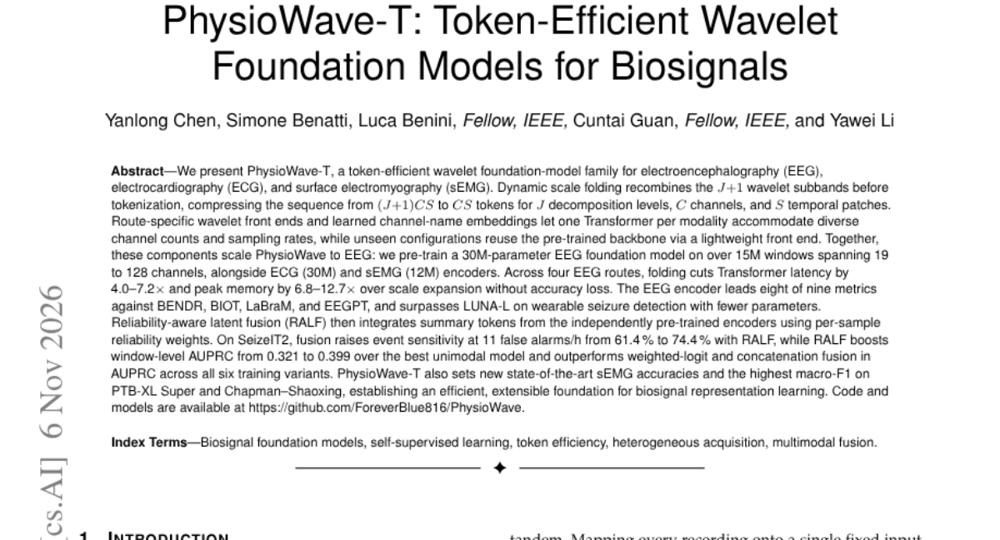

### 📌 한 줄 요약
Dynamic scale folding 기술을 통해 연산 효율을 극대화하면서도 높은 성능을 유지하는 생체 신호(EEG, ECG, sEMG)용 파운데이션 모델

### 🔑 핵심 포인트
- Dynamic scale folding: 웨이브릿 서브밴드 결합을 통한 토큰 수 압축 및 연산 효율 극대화
- Versatile Backbone: 채널 이름 임베딩과 어댑터를 활용해 단일 모델로 다양한 모달리티/설정 대응
- RALF (Reliability-aware latent fusion): 샘플 적응형 가중치를 이용한 신뢰도 기반 다중 모달리티 통합

### 🧑‍💻 개발자 관점
시퀀스 길이가 긴 생체 신호 데이터를 Transformer로 처리할 때 발생하는 메모리 부족과 지연 시간 문제를 효율적인 토큰 압축 전략으로 해결할 수 있는 실무적 가이드라인을 제공합니다.

### 🚀 실무 적용 아이디어
- 제시된 Dynamic scale folding 로직을 기존 시계열 Transformer 모델에 적용하여 연산 효율 비교
- 다양한 채널 구성(Montage)을 가진 데이터셋에 채널 임베딩 방식 적용 테스트
- 멀티모달 데이터 결합 시 RALF와 같은 가중치 기반 퓨전 방식의 성능 검증

### ⚠️ 리스크/한계
- 웨이브릿 기반 압축 과정에서 발생할 수 있는 미세 신호 손실 가능성
- 특정 도메인(생체 신호)에 특화된 구조로 타 시계열 데이터로의 일반화 여부 확인 필요

### 📝 초록 기반 상세 설명
생체 신호 분석을 위한 파운데이션 모델은 높은 샘플링 레이트와 채널 수로 인해 시퀀스 길이가 길어지는 연산 효율성 문제가 존재합니다. 이를 해결하기 위해 연구진은 웨이브릿(Wavelet) 서브밴드를 토큰화 전 결합하는 'Dynamic scale folding' 기법을 제안합니다. 이 방식은 시퀀스 길이를 획기적으로 압축하면서도 채널 이름 임베딩과 어댑터를 통해 다양한 모달리티와 샘딩 레이트를 하나의 백본에서 처리할 수 있게 합니다. 실험 결과, 기존 방식 대비 지연 시간과 메모리 사용량을 대폭 절감하면서도 SOTA 성능을 달립니니다. 또한 RALF 기법을 통해 다중 모달리티 통합 시에도 높은 민감도와 정확도를 확보했습니다.

---

## 26. [RidgeFill: Training-Free Late-Layer Cache Fill for Faster Prefill](https://huggingface.co/papers/2611.09709)
**Upvotes**: 1 | **도입 난이도**: 하 | **신뢰도**: 상
**arXiv**: https://arxiv.org/abs/2611.09709

**태그**: LLM, Inference Optimization, Efficiency, RAG, Evaluation

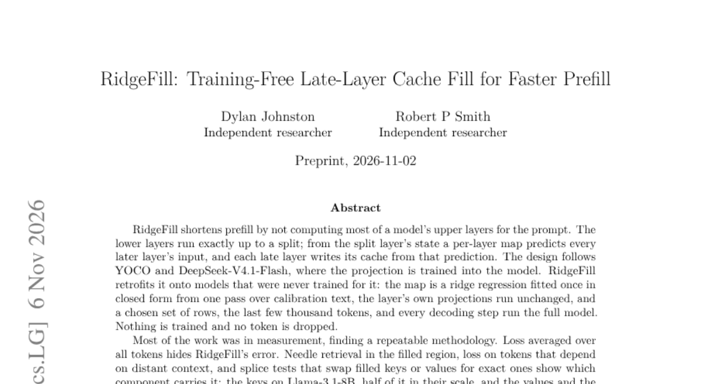

### 📌 한 줄 요약
학습 없이 릿지 회귀(Ridge Regression)를 이용해 상위 레이어 연산을 생략함으로써 프리필(Prefill) 속도를 높이는 기술

### 🔑 핵심 포인트
- 학습 없이 릿지 회귀(Closed-form)를 사용하여 상위 레이어의 입력을 예측하는 훈련 프리(Training-free) 방식
- 하위 레이어의 상태를 기반으로 상위 레이어의 캐시를 채워 프리필 연산량을 획기적으로 절감
- 기존 모델의 가중치를 변경하지 않고 캘리브레이션 데이터만으로 즉시 적용 가능

### 🧑‍💻 개발자 관점
모델 재학습 없이 기존 LLM의 추론 속도(TTFT)를 개선할 수 있어, 긴 컨텍스트 처리가 필요한 서비스에 즉각적인 최적화 옵션을 제공합니다.

### 🚀 실무 적용 아이디어
- Llama-3.1 또는 Qwen 모델에 릿지 회귀 맵을 적용하여 TTFT 단축 효과 검증
- 컨텍스트 길이가 길어짐에 따라 발생하는 성능 저하(RULER/LongBench) 임계점 확인
- 특정 레이어 분할 지점(Split layer)에 따른 연산 효율과 정확도 간의 트레이드오프 분석

### ⚠️ 리스크/한계
- 컨텍스트 길이가 매우 길어질 경우 예측 정확도 저하로 인한 성능 손실 가능성
- 특정 모델 구조나 특정 레이어 범위에 따라 효과가 달라질 수 있음

### 📝 초록 기반 상세 설명
LLM의 긴 컨텍스트 처리 시 발생하는 프리필 연산 비용을 줄이는 것이 중요한 과제로 떠오르고 있습니다. 기존의 효율적 구조들은 모델 학습 단계부터 설계되어야 한다는 제약이 있었습니다. RidgeFill은 학습 없이 릿지 회귀를 통해 하위 레이어의 상태로 상위 레이어의 입력을 예측하여 캐시를 채우는 방식을 제안합니다. 이 방식은 기존 모델을 재학습하지 않고도 캘리브레이션 데이터 한 번만으로 적용 가능한 훈련 프리(Training-free) 방식입니다. 실험 결과, 성능 저하를 최소화하면서도 긴 컨텍스트 환경에서 TTFT(Time to First Token)를 유의미하게 단축했습니다.

---

## 27. [Creative Priming: Decoupling Process from Product to Escape the Creative Paradox](https://huggingface.co/papers/2611.11740)
**Upvotes**: 1 | **도입 난이도**: 중 | **신뢰도**: 중
**arXiv**: https://arxiv.org/abs/2611.11740

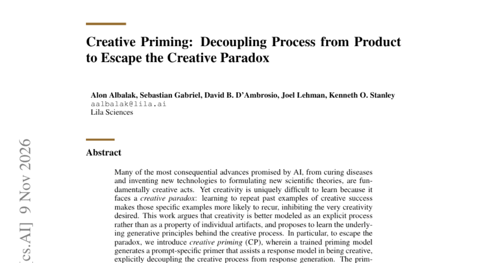

### 📌 한 줄 요약
자세한 분석 내용은 원문 또는 arXiv 링크를 참고해 주세요.

### 🔑 핵심 포인트
- 논문 원문을 확인하시기 바랍니다.

### 📝 초록 기반 상세 설명
상세 초록은 원문 페이지에서 확인 가능합니다.

---

## 28. [Click3R: Interactive Stereo 3D Reconstruction with Sparse Correspondence Clicks](https://huggingface.co/papers/2611.12875)
**Upvotes**: 1 | **도입 난이도**: 하 | **신뢰도**: 상
**arXiv**: https://arxiv.org/abs/2611.12875

**태그**: 3D Reconstruction, Human-in-the-loop, Computer Vision, Vision, Benchmark, Evaluation

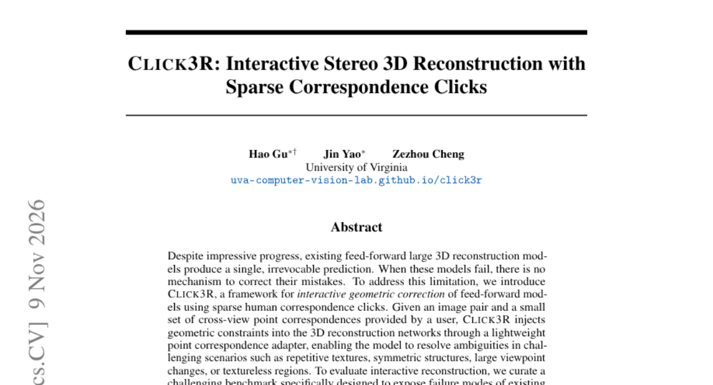

### 📌 한 줄 요약
사용자의 소수 클릭(Sparse Clicks)을 통해 3D 재구성 모델의 오류를 실시간으로 교정하는 인터랙티브 프레임워크

### 🔑 핵심 포인트
- 사용자의 소수 클릭을 기하학적 제약 조건으로 변환하는 경량 어댑터 설계
- 반복 질감 및 대칭 구조 등 기존 모델의 실패 사례를 해결하는 인터랙티브 메커니즘
- 단 몇 번의 클릭만으로도 재구성 정확도를 높이는 효율적인 인간-AI 협업 방식

### 🧑‍💻 개발자 관점
자동화된 3D 모델링 과정에서 발생하는 치명적인 오류를 사용자가 최소한의 노력으로 즉각 수정할 수 있는 실용적인 워크플로우를 제공합니다.

### 🚀 실무 적용 아이디어
- 제시된 경량 어댑터 구조를 기존 오픈소스 3D 재구성 모델에 이식해보기
- 질감이 없는 영역이나 대칭 구조가 강한 데이터셋에서의 성능 변화 관찰
- 사용자 클릭 횟수 증가에 따른 재구성 정밀도 향상 곡선 분석

### ⚠️ 리스크/한계
- 사용자의 수동 개입이 필요하므로 완전 자동화 모델에 비해 운영 비용 발생
- 클릭 위치가 잘못되었을 경우 오히려 재구성 품질이 저하될 위험성

### 📝 초록 기반 상세 설명
기존의 피드포워드 3D 재구성 모델은 단일 예측 결과만을 생성하므로, 모델이 오류를 범했을 때 이를 수정할 방법이 없다는 한계가 있습니다. 이를 해결하기 위해 본 논문은 사용자의 희소한 대응점(correspondence) 클릭을 활용하는 Click3R 프레임워크를 제안합니다. 사용자가 이미지 쌍에서 몇 개의 대응점을 클릭하면, 경량화된 어댑터가 이를 기하학적 제약 조건으로 주입하여 모델이 모호성을 해결하도록 돕습니다. 특히 반복되는 질감, 대칭 구조, 큰 시점 변화와 같은 어려운 시나리오에서 효과적입니다. 실험 결과, 단 한 번의 클릭만으로도 재구성 오차를 줄이며 기존 벤치마크와 제안된 벤치마크 모두에서 성능 향상을 입증했습니다.

---

## 29. [LCM-Promo: An LLM-Based Uplift Model for Promotion Allocation](https://huggingface.co/papers/2610.37570)
**Upvotes**: 1 | **도입 난이도**: 상 | **신뢰도**: 상
**arXiv**: https://arxiv.org/abs/2610.37570

**태그**: LLM, Personalization, E-commerce, Fine-tuning

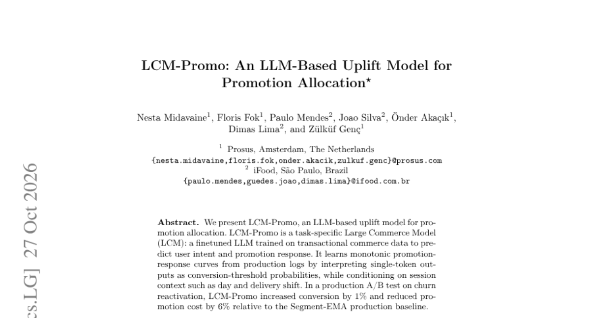

### 📌 한 줄 요약
LLM을 커머스 데이터로 파인튜닝하여 프로모션 반응도를 예측하고 비용 효율적인 타겟팅을 수행하는 모델링 기법

### 🔑 핵심 포인트
- 트랜잭션 데이터로 파인튜닝된 커머스 특화 LLM(LCM) 개발
- 단일 토큰 출력을 활용한 프로모션 반응 임계값 예측 메커니즘
- 세션 컨텍스트(요일, 배송 시간 등)를 반영한 정교한 타겟팅

### 🧑‍💻 개발자 관점
LLM을 단순 챗봇이 아닌, 특정 도메인(커머스)의 수치적 반응을 예측하는 예측 모델로 활용하는 실전 사례를 보여줍니다.

### 🚀 실무 적용 아이디어
- 도메인 특화 데이터셋 구축 및 LLM 파인튜닝 파이프라인 설계
- LLM 출력값을 확률값으로 변환하는 캘리브레이션 기법 검토
- 기존 통계적 모델(EMA 등)과 LLM 기반 모델의 성능 비교 실험

### ⚠️ 리스크/한계
- LLM의 추론 비용이 기존 통계 모델 대비 높을 수 있음
- 학습 데이터에 포함되지 않은 새로운 프로모션 유형에 대한 일반화 문제

### 📝 초록 기반 상세 설명
커머스 환경에서 효율적인 프로모션 할당을 위한 모델링이 필요해졌습니다. 기존 방식은 사용자 의도와 프로모션 반응을 정교하게 예측하는 데 어려움이 있었습니다. 이를 해결하기 위해 트랜잭션 데이터를 학습한 특화 모델인 LCM-Promo를 제안합니다. 이 모델은 단일 토큰 출력을 전환 임계 확률로 해석하여 단조적인 프로모션 반응 곡선을 학습하며, 세션 컨텍스트를 반영합니다. 실제 A/B 테스트 결과, 기존 베이스라인 대비 전환율을 높이면서도 프로모션 비용을 절감하는 성과를 거두었습니다.

---

## 30. [Knowledge Graph-based Retrieval-Augmented Generation for Schema Matching](https://huggingface.co/papers/2501.08686)
**Upvotes**: 1 | **도입 난이도**: 중 | **신뢰도**: 상
**arXiv**: https://arxiv.org/abs/2501.08686

**태그**: RAG, Knowledge Graph, LLM, Schema Matching, Data Integration, Evaluation

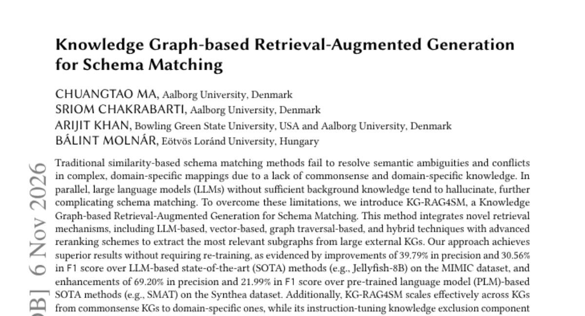

### 📌 한 줄 요약
지식 그래프(KG)와 RAG를 결ку합하여 LLM의 환각 현상을 해결하고 스키마 매칭의 정확도를 극대화한 프레임워크

### 🔑 핵심 포인트
- LLM, 벡터, 그래프 탐색을 결합한 하이브리드 RAG 검색 메커니즘 도입
- 외부 지식 그래프(KG)를 활용하여 도메인 특화 지식 및 상식 부족 문제 해결
- Instruction-tuning 기반의 지식 배제(Knowledge Exclusion)로 환각 현상 및 노이즈 억제

### 🧑‍💻 개발자 관점
데이터 엔지니어링 및 ETL 과정에서 서로 다른 스키마를 통합할 때, LLM의 환각 없이 신뢰할 수 있는 자동 매핑을 구현할 수 있습니다.

### 🚀 실무 적용 아이디어
- 도메인 특화 KG(예: 의료, 금융)를 구축하여 RAG 파이프라인에 연결해보기
- 기존 LLM 기반 매핑 방식과 KG-RAG 방식의 정밀도/재현율 비교 실험
- 검색된 서브그래프의 노이즈가 매칭 결과에 미치는 영향 분석

### ⚠️ 리스크/한계
- 외부 지식 그래프의 품질과 규모에 따라 성능 의존성이 높을 수 있음
- 복잡한 그래프 탐색 및 리랭킹 과정으로 인해 추론 비용이 증가할 수 있음

### 📝 초록 기반 상세 설명
기존의 유사도 기반 스키마 매칭 방식은 도메인 특화 지식 부족으로 인해 의미적 모호성을 해결하는 데 한계가 있었습니다. 또한, 배경 지식이 부족한 LLM을 직접 사용할 경우 환각 현상이 발생하여 매칭 품질이 저하되는 문제가 있었습니다. 이를 해결하기 위해 본 논문은 KG-RAG4SM이라는 지식 그래프 기반 RAG 프레임워크를 제안합니다. 이 방법은 LLM, 벡터, 그래프 탐색 및 하이브리드 검색 메커니즘을 결합하여 대규모 외부 KG에서 가장 관련성 높은 서브그래프를 추출합니다. 실험 결과, 기존 SOTA 모델 대비 정밀도(Precision)와 F래리(F1) 점수에서 압도적인 성능 향상을 기록했습니다. 결과적으로 KG-RAG4SM은 지식 추출과 지시 튜닝을 통해 환각을 억제하며 다양한 도메인에서 확장 가능한 성능을 보여주었습니다.

---

## 31. [Energy-Tweedie: Score meets Score, Energy meets Energy](https://huggingface.co/papers/2512.23818)
**Upvotes**: 1 | **도입 난이도**: 상 | **신뢰도**: 상
**arXiv**: https://arxiv.org/abs/2512.23818

**태그**: Generative Models, Diffusion, Score-based Modeling, Mathematical Physics

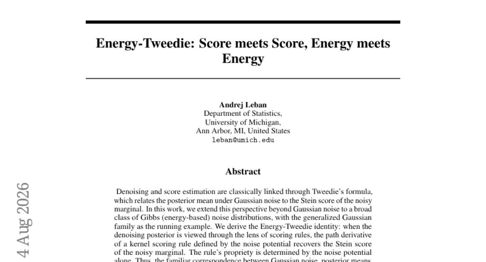

### 📌 한 줄 요약
가우시안 노이즈를 넘어 일반적인 Gibbs 분포에서도 작동하는 새로운 Tweedie 항등식을 유도하여 생성 모델의 이론적 토대를 확장함

### 🔑 핵심 포인트
- 가우시안을 넘어선 일반적인 Gibbs 노이즈 분포로의 Tweedie 공식 확장
- 커널 스코어링 룰과 에너지 기반 모델 간의 수학적 대응 관계(Energy-Tweedie identity) 정립
- 사후 샘플로부터 스코어를 추정하거나 노이즈 파라미터를 추정하는 새로운 경로 제공

### 🧑‍💻 개발자 관점
확산 모델(Diffusion Model)과 같은 생성 모델의 수학적 원리를 일반화하여, 사용자 정의 노이즈 분포를 사용하는 새로운 생성 알고리즘 설계의 이론적 근거를 제공합니다.

### 🚀 실무 적용 아이디어
- 유도된 Energy-Tweedie 식을 사용하여 일반화된 가우시안 분포에서의 샘플링 성능 검증
- 커널 스코어링 룰을 활용한 노이즈 파라미터 추정 알고리즘 구현 및 비교
- 기존 Diffusion 모델의 스코어 기반 샘플링과 제안된 방식의 효율성 비교

### ⚠️ 리스크/한계
- 수학적 복잡도가 높아 실제 구현 시 수치적 안정성 확보가 어려울 수 있음
- 일반화된 Gibbs 분포의 경우 계산 비용이 급격히 증가할 가능성 존재

### 📝 초록 기반 상세 설명
기존의 디노이징과 스코어 추정은 가우시안 노이즈 환경에서의 Tweedie 공식에 의존해 왔습니다. 본 논문은 이러한 관계를 일반적인 Gibbs(에너지 기반) 노이즈 분포로 확장하고자 합니다. 연구진은 커널 스코어링 룰의 경로 미분을 통해 노이즈 포텐셜로부터 Stein 스코어를 복원하는 'Energy-Tweedie' 항등식을 유도했습니다. 이를 통해 가우시안 환경에서의 사후 평균과 제곱 손실 관계를 일반적인 분포와 커널 스코어링 룰 사이의 관계로 일반화했습니다. 결과적으로 이 식은 샘플로부터 스코어를 추정하거나 미지의 노이즈 파라미터를 추정하는 등 다양한 생성 모델링 작업에 적용 가능함을 보여줍니다.

---

## 32. [Horizon-Scalable Q-Learning](https://huggingface.co/papers/2611.10987)
**Upvotes**: 1 | **도입 난이도**: 하 | **신뢰도**: 상
**arXiv**: https://arxiv.org/abs/2611.10987

**태그**: Offline RL, Q-Learning, Reinforcement Learning

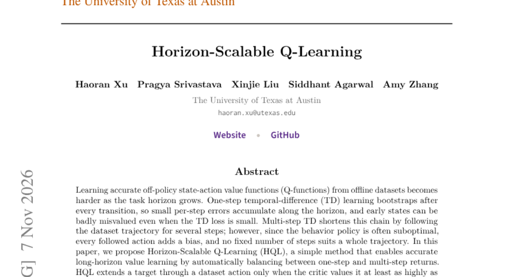

### 📌 한 줄 요약
데이터셋의 행동 편향을 제어하여 장기 의사결정 과제에서 정확한 Q-함수 학습을 가능하게 하는 HQL 알고리즘 제안

### 🔑 핵심 포인트
- 1-step과 Multi-step의 장점을 결합하여 호라이즌 길이에 따른 오차 누적과 편향 문제를 동시에 해결
- Action density 계산 없이도 동작하는 원칙적인 오프폴리시 보정 방식 도입
- Flow 및 Diffusion 기반의 복잡한 정책 모델과도 높은 호환성 유지

### 🧑‍💻 개발자 관점
오프라인 강화학습에서 데이터의 질이 낮거나 태스크가 길어질 때 발생하는 가치 과대평가 문제를 해결할 수 있는 실용적인 방법론입니다.

### 🚀 실무 적용 아이디어
- 기존 1-step/Multi-step TD 알고리즘에 HQL의 Best-of-N 임계값 로직 적용 실험
- Diffusion Policy를 사용하는 오프라인 RL 환경에서 HQL의 성능 변화 관찰
- 다양한 호라이즌 길이를 가진 벤치마크 데이터셋에서의 수렴 속도 테스트

### ⚠️ 리스크/한계
- Best-of-N 샘플링 전략에 따라 성능이 의존적일 수 있음
- 임계값 설정에 따른 학습 안정성 변화 가능성

### 📝 초록 기반 상세 설명
오프라인 데이터셋을 이용한 Q-함수 학습은 태스크의 호라이즌(horizon)이 길어질수록 오차가 누적되는 문제가 발생합니다. 기존의 1-step TD는 오차 누적에 취약하고, Multi-step TD는 서브옵티멀한 행동 정책으로 인한 편향(bias)이 커지는 트레이드오프가 존재합니다. 본 논문은 1-step과 Multi-step 리턴 사이를 자동으로 조절하는 Horizon-Scalable Q-Learning(HQL)을 제안합니다. HQL은 Critic 값이 특정 임계치(Best-of-N)를 넘을 때만 타겟을 확장하고, 그렇지 않으면 1-step으로 회귀하는 방식을 사용합니다. 이 방식은 별도의 액션 밀도 계산이 필요 없어 확산 모델(Diffusion) 등 복잡한 정책과도 호환됩니다. 실험 결과, HQL은 장기 호라이즌 과제에서 기존 방법론들을 상회하는 성능을 보였습니다.

---

## 33. [onóna: Twin Embeddings with Tied Unembeddings](https://huggingface.co/papers/2611.10556)
**Upvotes**: 0 | **도입 난이도**: 하 | **신뢰도**: 상
**arXiv**: https://arxiv.org/abs/2611.10556

**태그**: LLM, Parameter-Efficient, Embedding, RAG, Evaluation, Inference

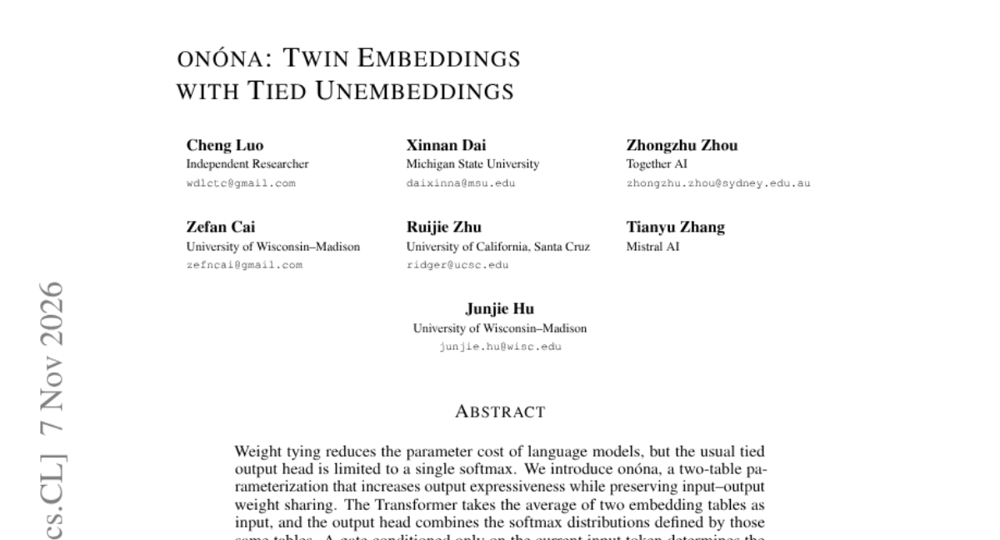

### 📌 한 줄 요약
입력-출력 가중치 공유를 유지하면서도 두 개의 임베딩 테이블을 활용해 모델의 표현력을 높인 효율적인 파라미터 최적화 기법

### 🔑 핵심 포인트
- 입력-출력 가중치 공유(Weight Tying)의 이점을 유지하면서 출력 표현력을 확장하는 Two-table 파라미터화 도입
- 입력은 두 임베딩의 평균을 사용하고, 출력은 입력 토큰에 조건화된 게이트를 통해 두 분포를 혼합
- 기존 트랜스포머 아키텍처의 본체(Body)를 수정하지 않고 임베딩과 출력 헤드만 교체하여 적용 가능

### 🧑‍💻 개발자 관점
모델의 구조적 변경 없이 임베딩 레이어만 수정하여 성능을 높일 수 있어, 기존 모델의 효율적인 업그레이드나 파라미터 효율적 학습 시 유용합니다.

### 🚀 실무 적용 아이디어
- 기존 트랜스포머 모델의 임베딩/출력 헤드를 onóna 방식으로 교체하여 성능 변화 측정
- 다양한 모델 스케일(142M~1B)에서 파라미터 증가 대비 성능 향상 폭(Efficiency) 분석
- MoE(Mixture-of-Experts) 구조와 결합 시의 확장성 검증

### ⚠️ 리스크/한계
- 추가적인 임베딩 테이블과 어휘 투영(Vocabulary Projection) 레이어로 인한 파라미터 증가
- 매우 큰 모델 스케일(1B 이상)에서는 손실 함수 개선 효과가 상대적으로 낮을 수 있음

### 📝 초록 기반 상세 설명
기존의 가중치 타이잉(Weight Tying) 방식은 파라미터 비용을 줄여주지만 단일 소프트맥스 구조로 인해 표현력에 한계가 있습니다. 이를 해결하기 위해 두 개의 임베딩 테이블을 사용하는 onóna 방법론을 제안합니다. 모델 입력 시 두 테이블의 평균값을 사용하고, 출력 시에는 두 테이블로 정의된 소프트맥스 분포를 게이트를 통해 혼합합니다. 이 방식은 트랜스포머 본체 구조를 변경하지 않으면서도 추론 시 사전 계산이 가능하여 효율적입니다. 다양한 아키텍처와 규모에서 실험한 결과, 동일한 토큰 예산 대비 검증 손실과 다운스트림 작업 정확도를 크게 개선했습니다.

---

