# 2026-11-14 Daily Papers (Top 29)

## 오늘의 요약
오늘의 연구는 비디오 생성 모델의 물리적 일관성 확보와 고해상도 이미지 생성을 위한 효율적인 압축 기법 등 생성 모델의 품질 및 효율성 향상에 집중되었습니다. 또한, 에이전트의 행동 능력과 평가 능력 사이의 관계를 규명하거나, 생성 모델을 시각 인지 도구로 활용하는 등 모델의 새로운 역할과 활용 가능성을 탐구하는 연구들이 주목받았습니다.

### 오늘의 핵심 포인트
- 비디오 및 이미지 생성 모델에서 물리적 법칙 준수와 연산 효율성을 동시에 달성하기 위한 프레임워크와 압축 기법들이 제안되었습니다.
- 모델의 단순 정확도와 실제 의사결정 신뢰도 사이의 괴리를 분석하고, 평가 능력이 학습 효율에 미치는 영향을 규명하는 연구가 진행되었습니다.
- 생성 모델을 단순한 콘텐츠 제작을 넘어 자율주행 시뮬레이션, 시각 인지, 실시간 상호작용 에이전트 등 다양한 도메인의 핵심 엔진으로 활용하는 방법론이 제시되었습니다.

**오늘의 태그**: Generative Models, Agentic AI, Video Generation, Model Efficiency, World Models

## 1. [SO-Arena: Benchmarking the Capability Spectrum and Reliability of System One Models](https://huggingface.co/papers/2611.15777)
**Upvotes**: 71 | **도입 난이도**: 하 | **신뢰도**: 상
**arXiv**: https://arxiv.org/abs/2611.15777

**태그**: LLM-Evaluation, Decision-Reliability, System-One-Models, Benchmarking, Reasoning, Benchmark, Evaluation

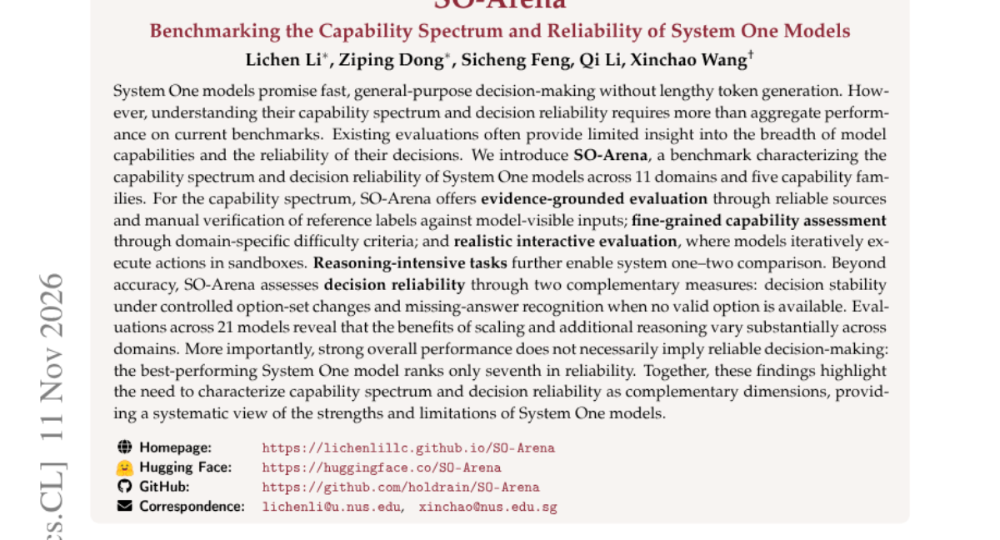

### 📌 한 줄 요약
System One 모델의 성능 지표와 의사결정 신뢰도 사이의 괴리를 규명하고 이를 체계적으로 평가하는 벤치마크 SO-Arena를 제안합니다.

### 🔑 핵심 포인트
- 11개 도메인 및 5개 역량군을 포괄하는 다각적 벤치마크 SO-Arena 제안
- 단순 정확도를 넘어 의사결정 안정성 및 정답 부재 시 인식 능력을 통한 신뢰도 측정
- 모델의 총체적 성능과 의사결정 신뢰도가 비례하지 않을 수 있음을 입증

### 🧑‍💻 개발자 관점
에이전트나 빠른 추론 모델을 도입할 때, 단순 정확도 점수만 믿고 배포했을 때 발생할 수 있는 의사결정 오류 리스크를 경고합니다.

### 🚀 실무 적용 아이디어
- 도입하려는 모델의 성능과 신뢰도(안정성) 간의 상관관계 분석
- 제한된 선택지나 정답이 없는 상황에서의 모델 반응 테스트
- 도메인별 난이도 변화에 따른 모델의 의사결정 일관성 검증

### ⚠️ 리스크/한계
- 높은 성능을 가진 모델이 특정 상황에서 신뢰도가 급격히 떨어질 위험
- 복잡한 도메인일수록 성능과 신뢰도 간의 괴리가 커질 가능성

### 📝 초록 기반 상세 설명
빠른 의사결정을 지향하는 System One 모델의 등장으로 성능 측정의 중요성이 커졌으나, 기존 벤치마크는 모델의 역량 범위와 결정 신뢰도를 충분히 반영하지 못합니다. 이를 해결하기 위해 11개 도메인과 5개 역량군을 아우르는 SO-Arena 벤치마크를 도입합니다. SO-Arena는 근거 기반 평가, 도메인별 난이도 기준, 샌드박스 내 상호작용을 통한 실질적 역량 측정을 제공하며, 선택지 변화에 따른 안정성과 정답 부재 시 인식 능력을 통해 신뢰도를 검증합니다. 21개 모델 평가 결과, 높은 성능이 반드시 높은 신뢰도로 이어지지 않음을 확인했습니다. 결과적으로 모델의 역량 스펙트럼과 신뢰도는 상호 보완적인 차원으로 다뤄져야 함을 시사합니다.

---

## 2. [BirdDreams: Joint Perspective and BEV Video Generation for a Plausible, Reactive Driving World Model](https://huggingface.co/papers/2611.14815)
**Upvotes**: 45 | **도입 난이도**: 상 | **신뢰도**: 상
**arXiv**: https://arxiv.org/abs/2611.14815

**태그**: Autonomous Driving, Video Generation, BEV, Diffusion Model, Vision, Video, Evaluation, Inference

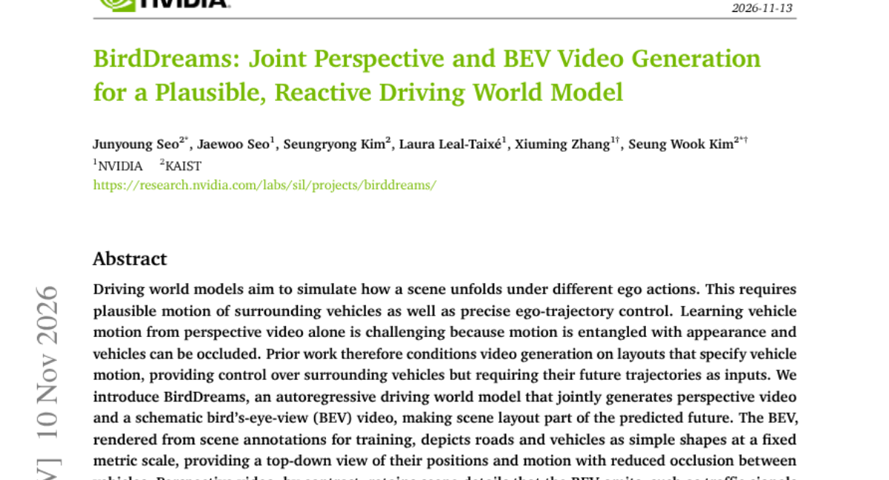

### 📌 한 줄 요약
BEV와 Perspective 뷰를 결합한 생성 모델을 통해 정교한 자차 제어와 주변 차량의 움직임을 동시에 시뮬레이션하는 드라이빙 월드 모델

### 🔑 핵심 포인트
- BEV와 Perspective 비디오를 결합한 Joint Generation 프레임워크 도입
- BEV를 기하학적 인터페이스로 활용하여 입력된 자차 궤적(Ego-trajectory)에 따른 정교한 제어 구현
- 두 비디오 스트림 간의 Joint Attention을 통한 시각적 디테일과 기하학적 일관성 유지

### 🧑‍💻 개발자 관점
자율주행 시뮬레이터 개발 시, 별도의 HD Map이나 복잡한 상태 입력 없이도 카메라 이미지 하나로 현실적인 주행 시나리오를 생성할 수 있는 기술적 토대를 제공합니다.

### 🚀 실무 적용 아이디어
- 제시된 BEV-Perspective Joint Attention 메커니즘의 연산 효율성 분석
- 다양한 자차 궤적(급커브, 급제동 등) 입력 시 BEV 변환의 안정성 테스트
- nuScenes 데이터셋을 활용한 오픈소스 구현체 재현 실험

### ⚠️ 리스크/한계
- BEV와 Perspective 간의 정렬(Alignment) 오류 발생 시 시각적 왜곡 가능성
- 고해상도 비디오 생성 시 발생하는 높은 연산 비용 및 추론 속도 문제

### 📝 초록 기반 상세 설명
자율주행 월드 모델은 자차의 움직임에 따른 주변 환경의 변화를 시뮬레이션해야 하지만, 기존 방식은 주변 차량의 미래 궤적을 입력값으로 요구하거나 가려짐 문제로 인해 움직임 학습이 어려웠습니다. 본 논문은 Perspective 비디오와 BEV(Bird's-eye-view) 비디오를 동시에 생성하는 BirdDreams 모델을 제안합니다. BEV는 기하학적 구조와 차량 움직임을 제공하고, Perspective 뷰는 세부적인 시각 정보를 담당하며, 두 스트림 간의 Joint Attention을 통해 상호 정보를 교환합니다. 특히 BEV를 기하학적 인터페이스로 활용하여 입력된 자차 궤적에 따라 BEV 프레임을 변환함으로써 정교한 자차 제어를 구현했습니다. 실험 결과, BirdDreams는 기존 모델보다 자차 궤적을 더 충실히 따르며 주변 차량의 움직임 또한 더욱 현실적으로 생성함을 입증했습니다.

---

## 3. [PhysLoop: Harnessing LLMs' Physics Awareness for Self-Improving Video Generation Models](https://huggingface.co/papers/2611.16748)
**Upvotes**: 41 | **도입 난이도**: 중 | **신뢰도**: 상
**arXiv**: https://arxiv.org/abs/2611.16748

**태그**: Video-Generation, LLM-Agent, Self-Improvement, Physics-Aware, Vision, Video, Benchmark, Evaluation, Inference, Distillation

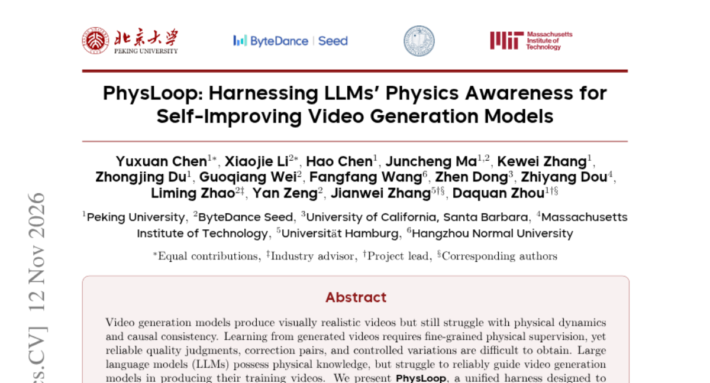

### 📌 한 줄 요약
LLM의 물리 지식을 활용하여 비디오 생성 모델의 물리적 일관성을 자가 개선하는 프레임워크

### 🔑 핵심 포인트
- LLM의 물리적 지식을 비디오 생성 및 수정 루프에 통합하는 통합 프레임워크 제안
- 데이터 생성부터 추론 시 국소적 수리(Repair)까지 지원하는 자가 개선 파이프라인 구축
- 물리적 일관성 확보를 위한 10만 개의 비디오 데이터셋 및 평가 벤치마크 공개

### 🧑‍💻 개발자 관점
인간의 수동 작업 없이 LLM을 에이전트로 활용해 고품질의 물리적 학습 데이터를 자동 생성하는 방법론을 제시합니다.

### 🚀 실무 적용 아이디어
- 제공된 100K 비디오 데이터셋을 활용한 비디오 생성 모델 파인튜닝 실험
- LLM 프롬프팅을 통한 비디오 오류 식별 및 수정(Repair) 성능 테스트
- 기존 비디오 생성 모델에 PhysLoop의 루프 구조를 적용한 비교 실험

### ⚠️ 리스크/한계
- LLM의 물리적 지식에 대한 의존도가 높아 LLM 자체의 한계가 전이될 수 있음
- 복잡한 물리 현상에 대한 완전한 시뮬레이션보다는 시각적 일관성에 치중될 위험

### 📝 초록 기반 상세 설명
현재 비디오 생성 모델은 시각적 사실감은 뛰어나지만 물리적 역학 및 인과 관계 유지에 어려움을 겪고 있습니다. 신뢰할 수 있는 물리적 감독 데이터와 수정 쌍을 확보하는 것은 매우 까다로운 작업입니다. 본 논문은 LLM의 물리적 지식을 비디오 생성, 선택, 수정 과정에 통합하는 PhysLoop 프레임워크를 제안합니다. 이 프레임워크는 데이터 구축과 추론 시 비디오 수정을 모두 지원하며, 인간의 개입을 최소화하면서 모델을 재귀적으로 개선합니다. 연구팀은 10만 개의 비디오 데이터셋과 두 가지 평가 데이터셋을 공개하여 물리적 일관성 향상을 입증했습니다.

---

## 4. [G-STAR: Group-Scaled Token Capacity for Deeply Compressed Autoregressive Generation](https://huggingface.co/papers/2611.13004)
**Upvotes**: 40 | **도입 난이도**: 중 | **신뢰도**: 상
**arXiv**: https://arxiv.org/abs/2611.13004

**태그**: Generative AI, Image Generation, Model Compression, Efficient Inference, Vision, Benchmark, Evaluation, Inference, Optimization

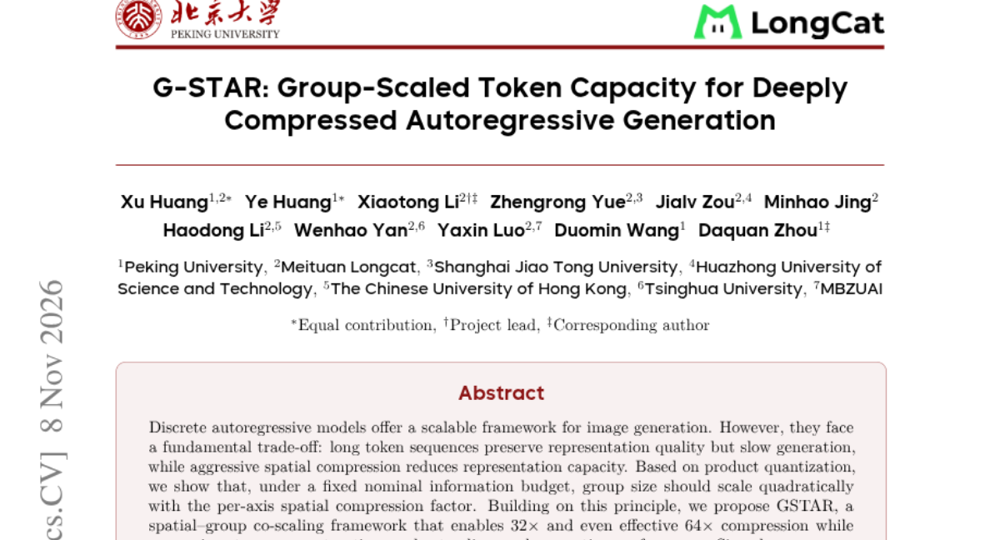

### 📌 한 줄 요약
공간 압축과 그룹 크기를 최적화하여 고해상도 이미지 생성 속도를 20배 향상시킨 초압축 자기회귀 모델 프레임워크

### 🔑 핵심 포인트
- 공간 압축 계수와 그룹 크기 간의 이차적 스케일링 법칙(quadratic scaling) 발견 및 적용
- 고압축 환경에서도 품질 저하를 막는 G-STAR 공간-그룹 공동 스케일링 프레임워크 제안
- 추론 지연 시간을 최소화하기 위한 병렬 연산 기반의 semi-autoregressive 디코더 설계

### 🧑‍💻 개발자 관점
고해상도 이미지 생성 시 발생하는 막대한 연산 비용과 긴 추론 시간을 획기적으로 줄이면서도 품질을 유지하는 실용적인 압축 기법을 제시합니다.

### 🚀 실무 적용 아이디어
- 제시된 quadratic scaling 법칙을 기존 VQ-VAE/VQGAN 구조에 적용하여 압축 효율 테스트
- 제안된 semi-autoregressive 디코더를 기존 autoregressive 모델의 추론 속도 개선에 적용
- 다양한 해상도 환경에서 공간 압축률 변화에 따른 재구성 품질 변화 측정

### ⚠️ 리스크/한계
- 매우 높은 압축률 적용 시 미세한 디테일 손실 가능성
- 그룹 크기 증가에 따른 모델 구조 복잡도 및 구현 난이도 상승

### 📝 초록 기반 상세 설명
이산 자기회귀 모델은 이미지 생성에 효과적이지만, 토큰 시퀀스 길이와 표현 용량 사이의 트레이드오프 문제에 직면해 있습니다. 본 논문은 고정된 정보 예산 하에서 그룹 크기가 공간 압축 계수의 제곱에 비례해야 한다는 원리를 제시합니다. 이를 바탕으로 공간과 그룹 크기를 동시에 조절하는 G-STAR 프레임워크를 제안하여 32x~64x의 고압축 환경에서도 강력한 성능을 유지합니다. 또한, 대규모 그룹 내 의존성 문제를 해결하기 위해 병렬 연산과 경량 인과 모델링을 결합한 semi-autoregressive 디코더를 도입했습니다. 결과적으로 기존 모델 대비 20배 빠른 속도로 고품질 이미지를 생성하며 주요 텍스트-이미지 벤치마크에서 경쟁력을 입증했습니다.

---

## 5. [Duo: A Reciprocal World Model for Full-Duplex Interaction](https://huggingface.co/papers/2611.15131)
**Upvotes**: 35 | **도입 난이도**: 상 | **신뢰도**: 상
**arXiv**: https://arxiv.org/abs/2611.15131

**태그**: World Model, Multimodal, Real-time, Agent, RAG, Reasoning, Video, Audio, Distillation

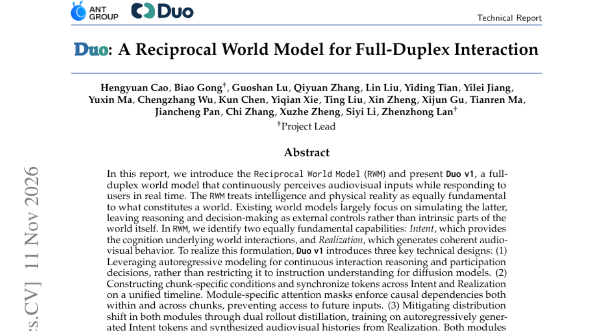

### 📌 한 줄 요약
실시간 오디오-비디오 인지 및 상호작용이 가능한 풀-듀플렉스(Full-Duplex) 월드 모델 Duo v1 제안

### 🔑 핵심 포인트
- 인지(Intent)와 실행(Realization)을 통합하여 추론과 행동을 세계 모델의 핵심 요소로 정의
- 자기회귀 모델링을 활용한 실시간 상호작용 의사결정 및 청크 기반 동기화 메커니즘 도입
- 이중 롤아웃 증류(Dual Rollout Distillation)를 통한 생성 모델의 분포 변화(Distribution Shift) 억제

### 🧑‍💻 개발자 관점
에이전트가 단순히 명령을 수행하는 것을 넘어, 인간과 실시간으로 대화하며 환경을 조작하는 '살아있는' 인터페이스 구현의 기술적 토대를 제공합니다.

### 🚀 실무 적용 아이디어
- 자기회귀 기반의 멀티모달 상호작용 모델 구조 분석
- 실시간 스트리밍 데이터 처리를 위한 청크 단위 동기화 로직 검토
- 생성 모델의 안정성을 위한 증류(Distillation) 기법 적용 사례 연구

### ⚠️ 리스크/한계
- 실시간성 확보를 위한 높은 컴퓨팅 자원 요구량
- 복잡한 멀티모달 데이터 간의 인과 관계 및 동기화 정밀도 문제

### 📝 초록 기반 상세 설명
기존의 월드 모델은 물리적 현실 시뮬레이션에 치중하여 추론과 의사결정을 외부 제어 요소로 취급하는 한계가 있었습니다. 이를 해결하기 위해 인지(Intent)와 실행(Realization)을 세계의 핵심 요소로 통합한 Reciprocal World Model(RWM) 프레임워크를 제안합니다. Duo v1은 자기회귀 모델링을 통해 실시간 상호작용 의사결정을 수행하며, 청크 단위의 조건부 생성과 동기화 토큰을 통해 인지와 실행 간의 일관성을 유지합니다. 또한 이중 롤아웃 증류(Dual Rollout Distillation) 기법을 통해 분포 변화 문제를 완화하며 실시간 오디오-비디오 입력을 지속적으로 처리합니다. 결과적으로 사용자의 개입이나 중단이 가능한 자연스러운 대화 및 가상 환경 제어 능력을 보여줍니다.

---

## 6. [Actor, Judge, or Teacher? Understanding Decision Models in Long-Horizon Agents](https://huggingface.co/papers/2611.17167)
**Upvotes**: 29 | **도입 난이도**: 중 | **신뢰도**: 상
**arXiv**: https://arxiv.org/abs/2611.17167

**태그**: Agent, Reinforcement Learning, LLM, Decision Model, Evaluation

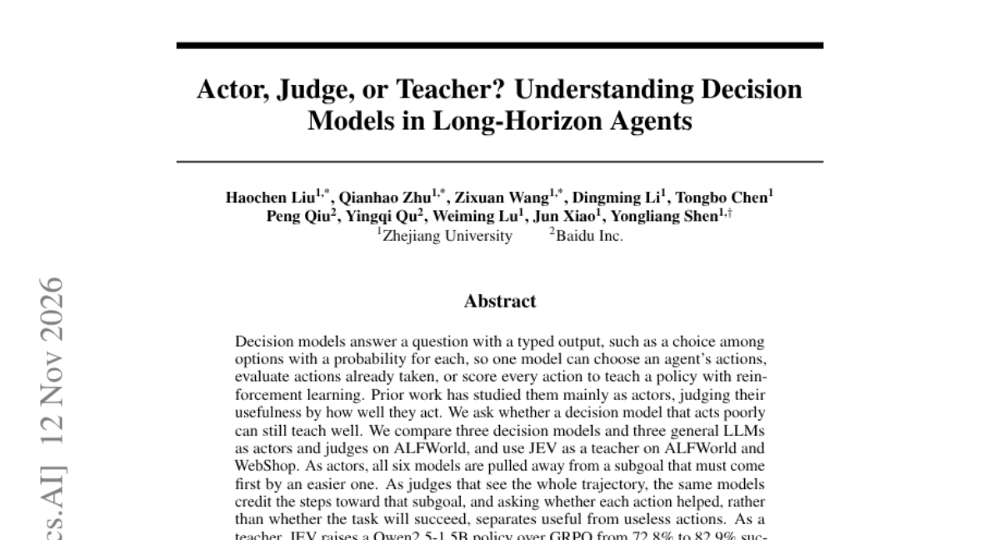

### 📌 한 줄 요약
행동 능력이 부족한 모델이라도 사후 평가 능력이 뛰어나다면 강화학습의 훌륭한 교사(Teacher)가 될 수 있음을 입증함

### 🔑 핵심 포인트
- Actor(행동자)와 Teacher(교사)로서의 모델 성능 간의 상관관계 분석
- 사후 평가(Judging) 능력이 행동(Acting) 능력보다 학습 효율에 더 결정적일 수 있음을 증명
- JEV 모델을 활용한 강화학습(GRPO) 시 성능 향상 효과 검증

### 🧑‍💻 개발자 관점
에이전트 개발 시 고성능 모델을 직접 행동 주체로 쓰기보다, 저사양 모델을 학습시키기 위한 고성능 평가/보상 모델로 활용하는 전략적 설계가 가능해집니다.

### 🚀 실무 적용 아이디어
- 현재 운영 중인 에이전트의 행동 로그를 기반으로 사후 보상 모델(Reward Model) 성능 테스트
- 작은 규모의 정책 모델(Policy)을 큰 규모의 평가 모델(Judge)로 학습시키는 파이프라인 구축
- 에피소드 종료 후 결과 중심이 아닌, 단계별 기여도 중심의 보상 설계 실험

### ⚠️ 리스크/한계
- 사후 평가(Offline)와 실시간 행동(Online) 간의 간극(Distribution Shift) 발생 가능성
- 특정 환경(ALFWorld, WebShop)에 특화된 평가 방식이 일반 도메인으로 전이되지 않을 위험

### 📝 초록 기반 상세 설명
기존의 의사결정 모델 연구는 주로 모델이 직접 행동하는 'Actor'로서의 성능에 집중해 왔습니다. 하지만 행동 능력이 낮은 모델이 정책 학습을 위한 'Teacher'로서도 유효한지에 대한 의문이 제기되었습니다. 본 연구는 ALFWorld와 WebShop 환경에서 세 가지 의사결정 모델과 일반 LLM을 Actor, Judge, Teacher 역할로 비교 분석했습니다. 실험 결과, 행동 성능이 낮은 모델이라도 에피소드 종료 후 행동의 가치를 판단하는 능력이 있다면 효과적인 교사 역할을 수행할 수 있었습니다. 특히 JEV 모델을 교사로 사용했을 때 Qwen2.5-1.5B 모델의 성공률이 크게 향상되었습니다. 이는 행동이 예측해야 하는 결과와 사후 평가가 일치할 때 학습 효율이 극대화됨을 시사합니다.

---

## 7. [On the Design of Hyper-Connections: Simplification, Stability, and Scalability](https://huggingface.co/papers/2611.05984)
**Upvotes**: 26 | **도입 난이도**: 중 | **신뢰도**: 상
**arXiv**: https://arxiv.org/abs/2611.05984

**태그**: LLM, Architecture, MoE, Efficiency, RAG

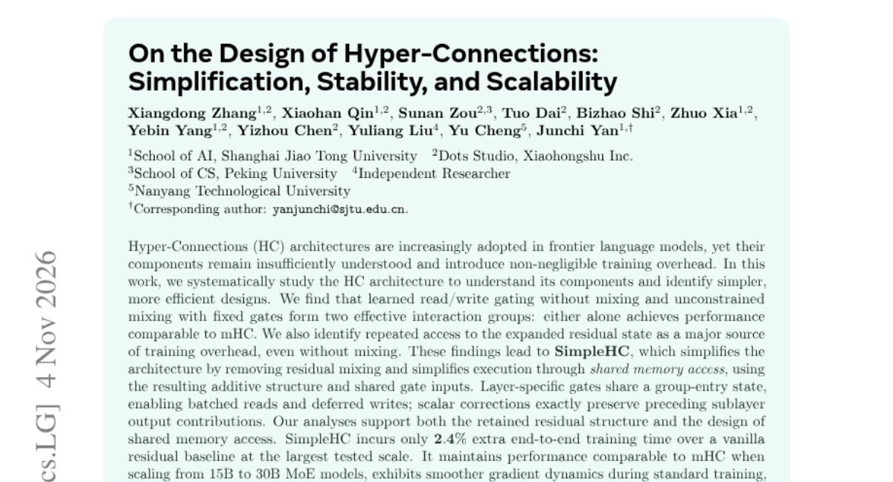

### 📌 한 줄 요약
Hyper-Connection 구조의 복잡성을 제거하여 학습 오버헤드를 최소화하면서도 성능과 안정성을 유지하는 SimpleHC 설계법 제안

### 🔑 핵심 포인트
- HC 구조의 구성 요소 분석을 통해 성능 저하 없이 단순화 가능한 지점 식별
- 잔차 혼합 제거 및 공유 메모리 접근 방식을 통한 학습 오버헤드 최적화
- 15B~30B MoE 모델 스케일링 시 성능 유지 및 더 매끄러운 그래디언트 역학 확보

### 🧑‍💻 개발자 관점
모델 아키텍처 설계 시 성능 향상과 계산 비용 사이의 트레이드오프를 해결하는 실용적인 가이드라인을 제공합니다.

### 🚀 실무 적용 아이디어
- 기존 MoE 모델의 잔차 구조에 SimpleHC의 스칼라 보정 방식 적용 실험
- 학습 오버헤드 감소를 위한 공유 메모리 접근 방식의 구현 가능성 검토
- 다양한 스케일에서 단순화된 게이트 구조의 수렴 안정성 테스트

### ⚠️ 리스크/한계
- 매우 거대한 스케일에서의 성능 유지 여부에 대한 추가 검증 필요
- 특정 하드웨어 가속기 환경에서의 공유 메모리 접근 효율성 차이 가능성

### 📝 초록 기반 상세 설명
최근 거대 언어 모델에서 Hyper-Connections(HC) 구조가 채택되고 있으나, 구성 요소에 대한 이해 부족과 높은 학습 오버헤드가 문제로 지적되었습니다. 본 연구는 HC 구조를 체계적으로 분석하여 성능을 유지하면서도 더 단순하고 효율적인 설계를 식별했습니다. 분석 결과, 잔차 혼합(residual mixing)을 제거하고 공유 메모리 접근 방식을 사용하는 SimpleHC를 제안합니다. SimpleHC는 레이어별 게이트가 그룹 진입 상태를 공유하게 하여 배치 읽기 및 지연 쓰기를 가능하게 하며, 스칼라 보정으로 이전 서브레이어의 기여도를 보존합니다. 실험 결과, SimpleHC는 대규모 MoE 모델 스케일링 시 mHC와 대등한 성능을 보이면서도 학습 시간 오버헤드를 획기적으로 줄이고 학습 안정성을 높였습니다.

---

## 8. [Open Vision Banana: A Fully Open Recipe for Generative Visual Perception](https://huggingface.co/papers/2611.15844)
**Upvotes**: 25 | **도입 난이도**: 중 | **신뢰도**: 상
**arXiv**: https://arxiv.org/abs/2611.15844

**태그**: Generative Models, Computer Vision, Zero-shot Learning, Image Editing, Reasoning, Vision, Evaluation

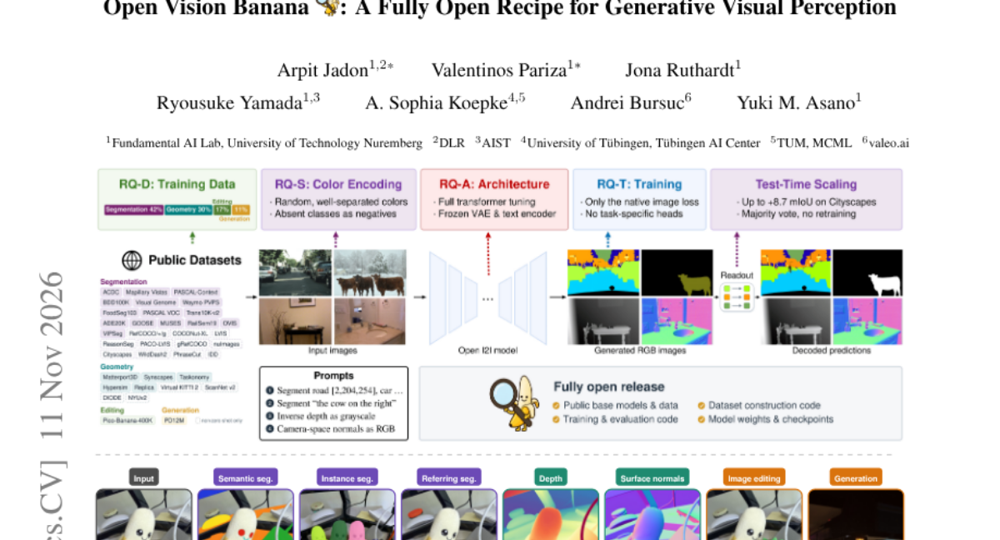

### 📌 한 줄 요약
사전 학습된 이미지 생성 모델을 활용하여 고성능 멀티태스크 시각 인지 시스템을 구축하는 완전 공개형 레시피 제안

### 🔑 핵심 포인트
- 생성 모델을 시각 인지 태스크로 변환하는 완전 공개형(Open-source) 파이프라인 구축
- 색상 인코딩, 프롬프트 설계, 파라미터 적응 및 태스크 균형 등 일반화에 핵심적인 설계 요소 규명
- 테스트 시점에 다수결 투표를 활용하여 색상-클래스 결합 불안정성을 해결하는 Legend Ensembling 기법 제안

### 🧑‍💻 개발자 관점
이미지 생성 모델의 잠재력을 활용해 별도의 거대 인지 모델 학습 없이도 강력한 시각 인지 기능을 확보할 수 있는 실용적인 방법론을 제공합니다.

### 🚀 실무 적용 아이디어
- 제공된 데이터셋 구축 및 처리 파이프라인을 활용한 커스텀 데이터 학습 실험
- Legend Ensembling 기법을 다양한 도메인 데이터셋에 적용하여 성능 변화 관찰
- 기존 오픈 웨이트 생성 모델(4B, 9B)에 OVB 레시피를 적용하여 베이스라인 성능 비교

### ⚠️ 리스크/한계
- 인스턴스 세그멘테이션(Instance Segmentation) 작업에서는 기존 방식 대비 성능이 다소 낮음
- 색상-클래스 바인딩의 불안정성으로 인해 테스트 시점의 앙상블 전략이 중요하게 작용함

### 📝 초록 기반 상세 설명
최근 연구는 사전 학습된 이미지 생성기가 단순 합성을 넘어 실세계 이해 능력을 갖추고 있음을 보여주었습니다. 기존의 Vision Banana 방식은 성능은 좋으나 데이터와 코드가 공개되지 않아 재현이 어렵다는 문제가 있었습니다. 본 논문은 이를 해결하기 위해 완전 공개형인 Open Vision Banana(OVTY)를 제안하며, 생성 모델을 멀티태스크 인지 시스템으로 변환하는 최적의 설계 요소를 분석합니다. 실험 결과, OVB는 기존 모델보다 높은 Cityscapes 성능을 기록하며 최첨단 깊이 추정 모델과 대등한 성능을 보였습니다. 또한, 테스트 단계에서 다수의 클래스-색상 조합을 결합하는 Legend Ensembling 기법을 통해 성능을 추가로 향상시켰습니다.

---

## 9. [Ropedia Xperience 2: A Gold Standard for Scaling Physical AI Environments and Behaviors](https://huggingface.co/papers/2611.17060)
**Upvotes**: 25 | **도입 난이도**: 상 | **신뢰도**: 상
**arXiv**: https://arxiv.org/abs/2611.17060

**태그**: Robotics, Simulation, Data Scaling, Embodied AI, Evaluation

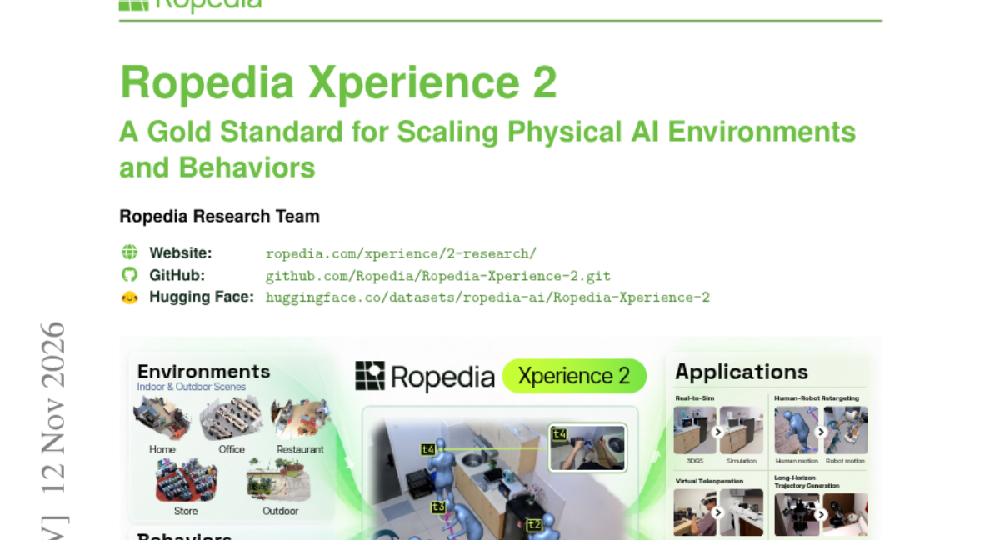

### 📌 한 줄 요약
물리적 AI의 스케일링 법칙을 위한 대규모 3D 스캔 및 인간 행동 데이터셋과 이를 로봇 학습용 시뮬레이션/궤적 데이터로 변환하는 프레임워크 제안

### 🔑 핵심 포인트
- 1,589개의 정밀 3D 스캔 및 4,230개의 1인칭 시점 행동 데이터셋 구축
- 수집된 환경 데이터를 물리적 상호작용이 가능한 시뮬레이션 환경으로 변환
- 인간의 움직임을 로봇 궤적으로 리타겟팅 및 자동화된 장기 궤적 생성 기술 적용

### 🧑‍💻 개발자 관점
현실 세계의 복잡한 환경을 시뮬레이션으로 옮기고, 인간의 행동을 로봇 제어 데이터로 변환하는 파이프라인을 구축하여 데이터 스케일링 문제를 해결할 수 있습니다.

### 🚀 실무 적용 아이디어
- 제공된 3D 스캔 데이터를 활용한 물리 엔진 기반 시뮬레이션 환경 구축 테스트
- 인간 행동 데이터를 로봇 제어 정책(Policy) 학습용 데이터로 변환하는 리타겟팅 실험
- 가상 원격 제어(Virtual Teleoperation)를 통한 데이터 증강 효과 검증

### ⚠️ 리스크/한계
- 실제 물리적 접촉과 시뮬레이션 간의 Sim-to-Real 간극 존재 가능성
- 대규모 데이터셋의 연산 비용 및 데이터 정제 복잡도

---

## 10. [TTB: Test-time Baking for Efficient Rendering of Decoder-only View Synthesis Models](https://huggingface.co/papers/2611.17331)
**Upvotes**: 19 | **도입 난이도**: 중 | **신뢰도**: 상
**arXiv**: https://arxiv.org/abs/2611.17331

**태그**: Computer Vision, Rendering, Efficient AI, LVSM, Vision, Benchmark, Safety

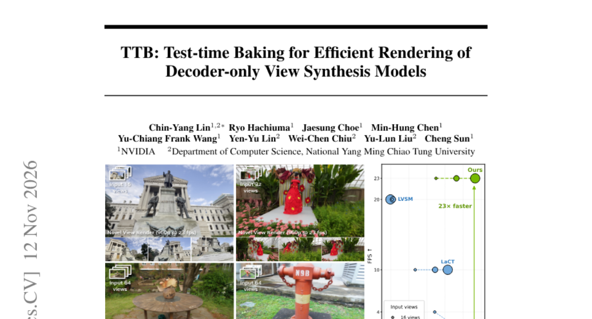

### 📌 한 줄 요약
KV-cache 기반 LVSM의 렌더링 속도를 23배 높이면서도 고화질을 유지하는 Test-Time Baking 기법

### 🔑 핵심 포인트
- TTT의 fast-weight MLP를 활용해 cross-view attention 매핑을 명시적으로 학습하는 전략 제안
- 컨텍스트 토큰을 카메라 정보와 이미지 콘텐츠로 분리하여 모달리티 불일치(modality misalignment) 해결
- 어텐션 연산을 경량 MLP로 대체하여 렌더링 속도를 획기적으로 개선

### 🧑‍💻 개발자 관점
실시간 렌더링이 필요한 시점 합성 모델에서 연산 비용을 낮추면서도 고화질을 유지할 수 있는 실용적인 최적화 기법입니다.

### 🚀 실무 적용 아이디어
- 제시된 TTB의 MLP 구조가 기존 TTT 방식과 비교해 어느 정도의 파라미터 효율성을 갖는지 분석
- 다양한 해상도 및 복잡한 장면 데이터셋에서 23배 속도 향상이 유지되는지 검증
- 분리된 컨텍스트 토큰(camera-only vs ground-truth)의 비율에 따른 품질 변화 실험

### ⚠️ 리스크/한계
- 학습된 MLP가 특정 장면(context)에 과적합되어 새로운 시점 생성 시 일반화 성능이 떨어질 위험
- 매우 복잡한 기하학적 구조를 가진 장면에서 MLP 기반 매핑의 한계 가능성

### 📝 초록 기반 상세 설명
최근 Decoder-only 구조의 대규모 시점 합성 모델(LVS즘)이 KV-cache를 활용해 높은 품질을 달성하고 있으나, 연산 효율과 품질 사이의 트레이드오프가 존재합니다. 기존의 Test-Time Training(TTT) 방식은 연산량은 줄이지만 품질 저하가 발생하는 문제가 있었습니다. 본 논문은 교차 시점 어텐션(cross-view attention) 정보를 경량 MLP에 학습시키는 'Test-Time Baking(TTB)' 전략을 제안합니다. TTB는 TTT의 fast-weight MLP를 재구성하여 어텐션 매핑을 명시적으로 학습함으로써 효율성과 품질을 동시에 잡았습니다. 또한, 컨텍스트 토큰을 카메라 정보와 이미지 콘텐츠로 분리하여 모달리티 불일치 문제를 해결했습니다. 결과적으로 SOTA 수준의 품질을 유지하면서 최대 23배의 렌더링 속도 향상을 달성했습니다.

---

## 11. [WorldDraft: If Code Builds the World, Can Video Models Just Render It?](https://huggingface.co/papers/2611.16217)
**Upvotes**: 14 | **도입 난이도**: 하 | **신뢰도**: 상
**arXiv**: https://arxiv.org/abs/2611.16217

**태그**: Video Generation, 4D Simulation, Multimodal Agent, Benchmark, Agent, RAG, Multimodal, Vision, Video, Evaluation, Safety

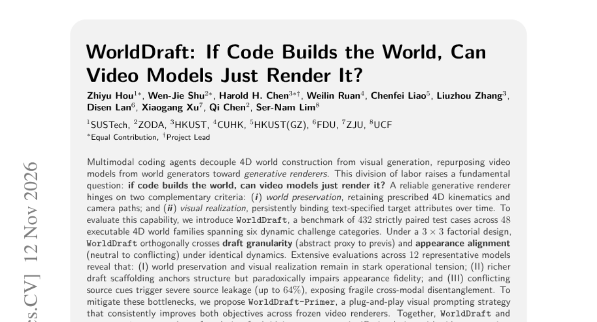

### 📌 한 줄 요약
코드 기반 4D 월드 구축과 비디오 렌더링을 분리하여, 물리적 구조 유지와 시각적 구현 사이의 상충 관계를 분석하고 해결하는 벤치마크 및 프롬프팅 전략 제안

### 🔑 핵심 포인트
- 코드 기반 4D 월드 구축과 비디오 렌더링의 분리(Division of Labor) 프레임워크 제안
- 구조 유지와 시각적 구현 사이의 상충 관계를 측정하는 432개 케이스의 WorldDraft 벤치마크 구축
- 구조적 안정성과 시각적 충실도를 동시에 개선하는 WorldDraft-Primer 프롬프팅 전략 제안

### 🧑‍💻 개발자 관점
물리 엔진(Code)과 비디오 생성 모델(Render)을 결합하여 정교한 4D 콘텐츠를 생성하려는 엔지니어에게 핵심적인 평가 지표와 최적화 전략을 제공합니다.

### 🚀 실무 적용 아이디어
- 제안된 WorldDraft-Primer를 기존 오픈소스 비디오 생성 모델에 적용하여 성능 변화 관찰
- 코드 기반 움직임(Draft)의 정밀도가 비디오 렌더링 품질에 미치는 임계점 테스트
- 물리적 제약 조건과 텍ist 속성이 충돌하는 시나리오에서 모델의 강건성 검증

### ⚠️ 리스크/한계
- 구조적 정밀도를 높일수록 시각적 디테일이 저하되는 트레이드오프 발생 가능성
- 소스 단서 간 충돌 시 발생하는 정보 누출(Source Leakage) 문제의 완전한 해결 필요

### 📝 초록 기반 상세 설명
멀티모달 코딩 에이전트가 4D 월드 구축과 시각적 생성을 분리함에 따라, 비디오 모델을 단순 렌더러로 활용할 수 있는지에 대한 의문이 제기되었습니다. 본 논문은 물리적 움직임 유지(world preservation)와 텍스트 속성 구현(visual realization)이라는 두 가지 핵심 기준을 평가하기 위해 새로운 벤치마크인 WorldDraft를 도입합니다. 실험 결과, 구조적 정밀도와 시각적 충실도 사이에는 상충 관계가 존재하며, 소스 단서 간 충돌 시 심각한 정보 누출이 발생함을 확인했습니다. 이를 해결하기 위해 플러그앤플레이 방식의 시각적 프롬프팅 전략인 WorldDraft-Primer를 제안합니다. 결과적으로 본 연구는 프로그래밍 가능한 4D 시뮬레이션과 비디오 생성 간의 가교 역할을 수행합니다.

---

## 12. [Factored One-sided Adam-Moment for Practical and Scalable SOAP](https://huggingface.co/papers/2611.16905)
**Upvotes**: 12 | **도입 난이도**: 중 | **신뢰도**: 상
**arXiv**: https://arxiv.org/abs/2611.16905

**태그**: Optimizer, LLM Training, Deep Learning Efficiency

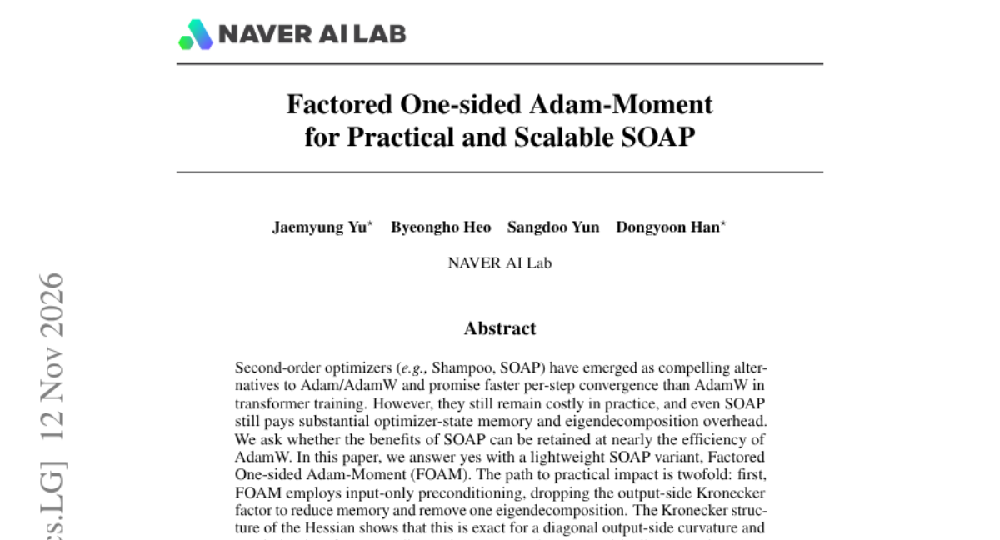

### 📌 한 줄 요약
SOAP의 성능을 유지하면서 메모리 사용량과 연산 비용을 획기적으로 줄인 경량화된 2차 최적화 알고리즘(FOAM) 제안

### 🔑 핵심 포인트
- 입력 측 프리컨디셔닝(Input-only preconditioning)을 통해 메모리 사용량과 연산 오버헤드 감소
- 행-열 통계 기반의 분해된 Adam-모멘트 추정기를 통한 효율적인 2차 모멘트 근사
- SOAP 수준의 성능을 유지하면서 메모리 점유율 50% 감소 및 빠른 실행 속도 달성

### 🧑‍💻 개발자 관점
LLM 학습 시 발생하는 막대한 옵티마이저 메모리 문제를 해결하면서도, 2차 최적화의 빠른 수렴 이점을 실무 환경에서 저비용으로 활용할 수 있게 합니다.

### 🚀 실무 적용 아이디어
- 기존 SOAP/AdamW 환경에서 FOAM의 메모리 절감 효과와 수렴 속도 비교 실험
- 다양한 모델 크기(124M~760M 이상)에서의 스케일링 법칙 검증
- 학습률(Learning Rate) 변화에 따른 FOAM의 강건성 테스트

### ⚠️ 리스크/한계
- 출력 측 곡률(output-side curvature)이 비대각(non-diagonal)인 경우 성능 저하 가능성
- K-FAC 가정이 깨지는 복잡한 구조의 모델에서의 일반화 성능 확인 필요

### 📝 초록 기반 상세 설명
최근 Transformer 학습에서 AdamW보다 빠른 수렴을 보이는 SOAP와 같은 2차 최적화 기법이 주목받고 있습니다. 그러나 이러한 기법들은 여전히 막대한 옵티마이저 상태 메모리와 고유값 분해(eigendecomposition) 비용 문제를 안고 있습니다. 본 논문은 SOAP의 이점을 유지하면서도 효율성을 높인 FOAM을 제안합니다. FOAM은 입력 측 프리컨디셔닝만 사용하고 출력 측 요소를 제거하여 메모리를 절감하며, 행-열 통계 기반의 분해된 Adam-모멘트 추정기를 도입합니다. 실험 결과, FOAM은 SOAP 대비 절반의 메모리만 사용하면서도 성능은 유지하고 실행 속도는 Muon 수준으로 끌어올렸습니다.

---

## 13. [UniSpark: Exploring Hybrid Attention for Multimodal Understanding and Generation](https://huggingface.co/papers/2611.16517)
**Upvotes**: 12 | **도입 난이도**: 상 | **신뢰도**: 상
**arXiv**: https://arxiv.org/abs/2611.16517

**태그**: Multimodal, MoE, Attention, Generative AI, Vision, Video, Evaluation

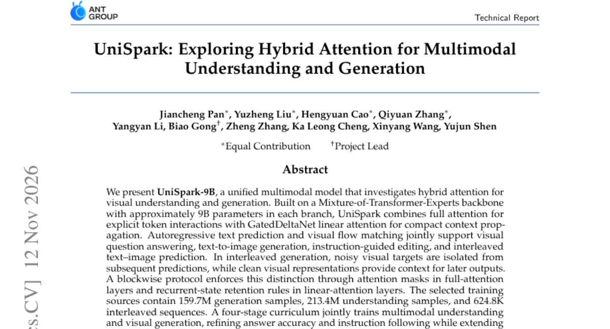

### 📌 한 줄 요약
Hybrid Attention 구조를 통해 시각적 이해와 생성 작업을 하나의 모델로 통합한 9B 규모의 멀티모달 모델 연구

### 🔑 핵심 포인트
- Full Attention과 GatedDeltaNet을 결합한 Hybrid Attention 구조 도입
- 이해(Understanding)와 생성(Generation)을 동시에 지원하는 MoE 기반 9B 모델 설계
- 인터리브 생성 시 노이즈 분리를 위한 블록 단위 프로토콜 및 커리큘럼 학습 적용

### 🧑‍💻 개발자 관점
이해와 생성이 결합된 복합적인 멀티모달 태스크를 단일 모델로 처리할 수 있는 효율적인 아키텍처 설계 방식을 제시합니다.

### 🚀 실무 적용 아이디어
- MoE와 Linear Attention 결합 시 연산 효율성 및 메모리 사용량 벤치마크
- Full Attention과 Linear Attention의 레이어 배치 비율에 따른 성능 변화 실험
- Interleaved 데이터셋 구성 시 노이즈 분리 프로토콜의 효과 검증

### ⚠️ 리스크/한계
- 이해와 생성 작업 간의 성능 트레이드오프 발생 가능성
- 하이브리드 구조로 인한 모델 학습 및 추론 복잡도 증가

### 📝 초록 기반 상세 설명
기존 멀티모달 모델은 시각적 이해와 생성 작업 사이의 균형을 맞추는 데 어려움이 있었습니다. 본 연구는 MoE(Mixture-of-Experts) 백본을 기반으로 Full Attention과 GatedDeltaNet(Linear Attention)을 결합한 Hybrid Attention 방식을 제안합니다. 이 구조는 명시적 토큰 상호작용과 효율적인 컨텍스트 전파를 동시에 지원하며, 텍스트-이미지 생성 및 인터리브(interleaved) 생성 작업에서 노이즈를 분리하는 블록 단위 프로토콜을 적용합니다. 4단계 커리큘럼 학습을 통해 이해와 생성 능력을 동시에 정교화하였으며, 그 결과 MME-S 및 GenEval에서 우수한 성능을 기록했습니다. 최종적으로 하이브리드 어텐션이 통합된 멀티모달 작업에 효과적인 백본이 될 수 있음을 입증했습니다.

---

## 14. [Learning the Task or Learning the Verifier? Rethinking Criteria Exposure in Embodied Self-Improvement](https://huggingface.co/papers/2611.08318)
**Upvotes**: 5 | **도입 난이도**: 하 | **신뢰도**: 상
**arXiv**: https://arxiv.org/abs/2611.08318

**태그**: Agent, Embodied AI, Evaluation, Overfitting, Benchmark

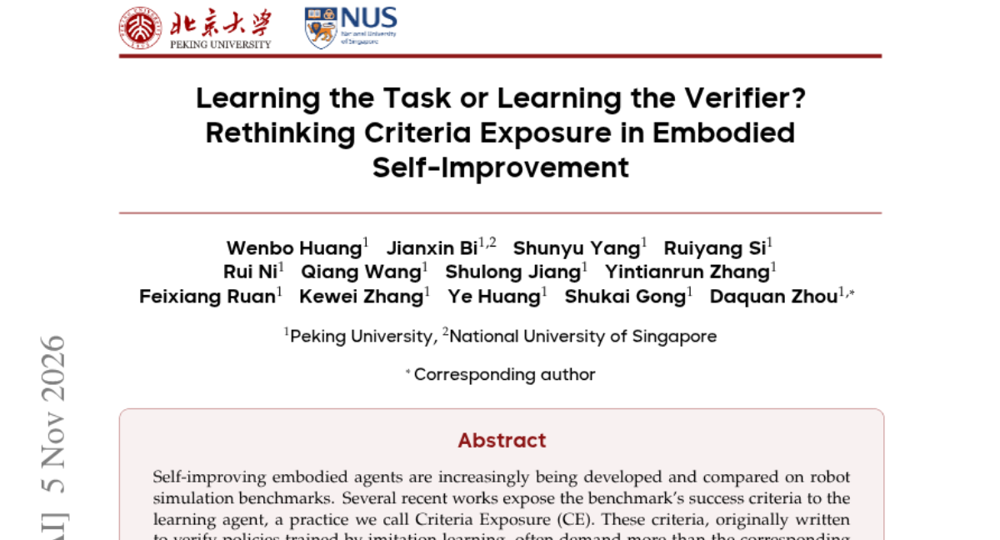

### 📌 한 줄 요약
에이전트가 평가 기준(Criteria)을 직접 학습할 경우, 작업 수행 능력이 아닌 평가 지표에만 과적합(Overfitting)되는 현상을 경고함

### 🔑 핵심 포인트
- Criteria Exposure(CE)가 에이전트의 지시 이행 능력이 아닌 평가 지표 과적합을 유도함을 규명
- CE 환경에서 학습된 에이전트는 기준 변경 및 작업 전이(Transfer) 시 성능이 급격히 저하됨
- 지시사항과 평가 기준 간의 괴리를 줄이는 'Instruction-faithful' 기준의 필요성 제시

### 🧑‍💻 개발자 관점
에이전트 성능 평가 시 벤치마크 점수만 높이는 것이 실제 문제 해결 능력 향상과 직결되지 않을 수 있음을 인지해야 합니다.

### 🚀 실무 적용 아이디어
- 에이전트 평가 시 지시문(Instruction)과 검증 로직(Verifier) 간의 일치성 검토
- 평가 기준을 미세하게 변경했을 때 에이전트의 성능 변화(Robustness) 테스트
- 점수 최적화가 아닌 작업 수행의 일반화 성능을 측정하는 지표 도입

### ⚠️ 리스크/한계
- 높은 벤치마크 점수가 실제 환경에서의 성능을 보장하지 못할 위험
- 평가 기준에 특화된 코드를 생성하는 'Reward Hacking' 현상 발생 가능성

### 📝 초록 기반 상세 설명
로봇 시뮬레이션 벤치마크에서 에이전트에게 성공 기준을 직접 노출하는 'Criteria Exposure(CE)' 관행이 확산되고 있습니다. 하지만 이러한 기준은 원래 모방 학습 검증용으로 작성되어, 실제 지시사항보다 더 많은 것을 요구하는 경우가 많습니다. 연구진은 CE가 에이전트의 실제 작업 수행 능력을 높이는지, 아니면 단순히 검증 로직에 과적합되는지를 실험을 통해 분석했습니다. 실험 결과, CE는 점수를 빠르게 높이지만 기준이 조금만 바뀌어도 성능이 급락하며 작업 간 전이 능력도 매우 낮았습니다. 이를 해결하기 위해 지시사항에 충실한 'Instruction-faithful' 기준을 제안하며, 이것이 에이전트 성능을 더 정확히 반영함을 입증했습니다.

---

## 15. [JustRUA: A Controlled Study of GPT-6 Robot-Use Agents](https://huggingface.co/papers/2611.16009)
**Upvotes**: 3 | **도입 난이도**: 하 | **신뢰도**: 상
**arXiv**: https://arxiv.org/abs/2611.16009

**태그**: Robot-Agent, Harness-Design, Embodied-AI, Benchmark, Agent

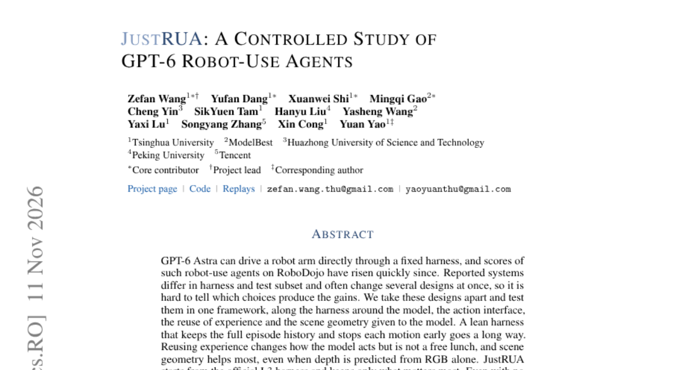

### 📌 한 줄 요약
로봇 제어 에이전트의 성능 향상을 위해 복잡한 학습 대신 하네스 설계와 데이터 활용 방식의 최적화가 핵심임을 입증함

### 🔑 핵심 포인트
- 설계 요소(하네스, 인터페이스, 경험 재사용, 기하 정보)의 개별 기여도 분석
- 에피소드 이력을 유지하는 간결한 하네스 설계의 중요성 입증
- 추가 학습 없이 하네스 최적화만으로 벤치마크 성능을 약 70% 향상

### 🧑‍💻 개발자 관점
모델 자체의 파라미터를 키우는 것보다, 에이전트가 상호작용하는 인터페이스와 데이터 피드백 루프를 설계하는 것이 실질적인 성능 향상에 더 효율적일 수 있음을 시사합니다.

### 🚀 실무 적용 아이디어
- 에이전트의 액션 인터페이스를 단순화하고 전체 히스토리를 포함하는 방식으로 변경해보기
- RGB 데이터에서 추출한 기하학적 정보를 프롬프트나 입력값에 포함시켜 성능 변화 관찰하기
- 경험 재사용(Experience Reuse) 시 발생하는 오버피팅이나 성능 저하 지점 파악하기

### ⚠️ 리스크/한계
- 특정 시뮬레이션 환경(RoboDojo)에 최적화된 결과일 수 있음
- 복잡한 물리적 환경에서의 일반화 성능은 추가 검증 필요

### 📝 초록 기반 상세 설명
최근 GPT-6 기반 로봇 에이전트의 성능이 급격히 향상되었으나, 기존 연구들은 설계 요소가 혼재되어 있어 어떤 요소가 성능 향상을 주도하는지 파악하기 어려웠습니다. 본 연구는 하네스 구조, 액션 인터페이스, 경험 재사용, 장면 기하 정보 등 핵심 설계 요소를 분리하여 체계적으로 테스트했습니다. 실험 결과, 전체 에피소드 기록을 유지하고 동작을 조기에 중단하는 간결한 하네스 설계가 성능에 크게 기여함을 확인했습니다. 또한 장면 기하 정보의 활용이 가장 효과적이었으며, 경험 재사용은 양날의 검과 같은 특성을 보였습니다. 별도의 학습이나 튜닝 없이도 단순한 하네스 최적화만으로 벤치마크 점수를 29.7에서 50.3으로 대폭 끌어올렸습니다.

---

## 16. [DeepStress: Stress-Testing Deep Search Agents](https://huggingface.co/papers/2607.13920)
**Upvotes**: 3 | **도입 난이도**: 중 | **신뢰도**: 상
**arXiv**: https://arxiv.org/abs/2607.13920

**태그**: Agent, RAG, Robustness, Evaluation, Benchmark

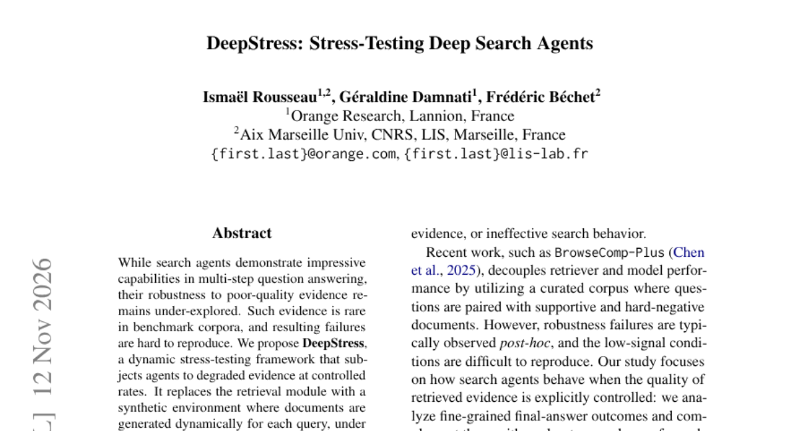

### 📌 한 줄 요약
검색 기반 에이전트의 신뢰성을 검증하기 위해 가짜 정보를 동적으로 생성하여 스트레스 테스트를 수행하는 프레임워크 제안

### 🔑 핵심 포인트
- 신뢰도/관련성/사실성을 제어하는 동적 합성 문서 생성 환경 구축
- 단순 정확도를 넘어 신중함과 비용을 고려한 새로운 신뢰성 지표(RAS, CoPRas) 제안
- 에이전트가 잘못된 근거에 노출되었을 때 발생하는 취약점 규명

### 🧑‍💻 개발자 관점
RAG 시스템 구축 시 단순히 정답률만 높이는 것이 아니라, 잘못된 정보가 유입되었을 때 에이전트가 얼마나 신중하게 반응하는지 검증하는 기준을 제공합니다.

### 🚀 실무 적용 아이디어
- 현재 개발 중인 RAG 에이전트에 의도적으로 오답/가짜 문서를 주입하여 반응 테스트하기
- 에이전트가 '모름'을 선택하는지 아니면 잘못된 근거를 바탕으로 확신하는지 분류 체계 적용하기
- 검색 결과와 모델 내부 지식이 충돌할 때의 우선순위 로직 점검하기

### ⚠️ 리스크/한계
- 합성 데이터 기반 테스트이므로 실제 웹 환경의 복잡성을 완벽히 반영하지 못할 수 있음
- 에이전트의 신중함(Cautious behavior)과 성능 사이의 트레이드오프 조절이 어려움

### 📝 초록 기반 상세 설명
최근 멀티스텝 질문 답변 능력을 갖춘 검색 에이전트가 발전하고 있으나, 저품질 정보에 대한 강건성은 충분히 검증되지 않았습니다. 기존 벤치마크는 정제된 데이터 위주라 실패 재현이 어렵다는 문제가 있습니다. 이를 해결하기 위해 신뢰도, 관련성, 사실성을 독립적으로 제어하여 동적으로 문서를 생성하는 DeepStress 프레임워크를 제안합니다. 연구팀은 단순 정확도를 넘어 신중한 답변에 가중치를 두는 RAS 및 CoPRAS와 같은 새로운 신뢰성 지표를 도입했습니다. 실험 결과, 많은 에이전트가 명백한 신뢰도 위반 상황에서도 확신에 찬 오답을 내놓거나, 검색 결과가 틀렸음에도 파라미터 지식에 의존하는 취약점을 보였습니다.

---

## 17. [HiVe-Mem: Interleaving Horizontal Memory Expansion and Vertical Evidence Composition for Multimodal Agents](https://huggingface.co/papers/2611.12872)
**Upvotes**: 3 | **도입 난이도**: 중 | **신뢰도**: 상
**arXiv**: https://arxiv.org/abs/2611.12872

**태그**: Agent, RAG, Multimodal, Memory, Vision, Benchmark, Evaluation

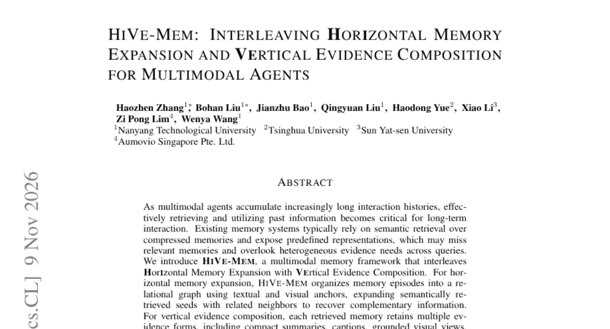

### 📌 한 줄 요약
그래프 기반 확장과 다중 증거 구성을 결합하여 토큰 소모를 90% 절감하면서도 정확한 정보를 제공하는 멀티모달 메모리 프레임워크

### 🔑 핵심 포인트
- 수평적 확장: 텍스트/시각적 앵커 기반의 관계형 그래프를 통해 검색된 메모리 주변의 보완적 정보를 확보
- 수직적 구성: 요약부터 원본 이미지까지 다양한 증거 형태를 쿼리 적응형으로 선택하여 활용
- 효율성: 고성능을 유지하면서도 토큰 사용량을 획기적으로 줄여 장기 상호작용에 최적화

### 🧑‍💻 개발자 관점
에이전트의 컨텍스트 윈도우 제한 문제를 해결하면서도, 비용 효율적인 방식으로 방대한 멀티모달 이력을 관리할 수 있는 실질적인 아키텍처를 제시합니다.

### 🚀 실무 적용 아이디어
- 그래프 기반 메모리 구조를 기존 RAG 파이프라인에 이식하여 검색 범위 확장 효과 검증
- 다양한 해상도/유형의 멀티모달 데이터를 활용한 Selector 모듈의 효율성 테스트
- 토큰 절감 수치와 모델 추론 속도 간의 트레이드오프 분석

### ⚠️ 리스크/한계
- 그래프 구조가 복잡해질수록 메모리 관리 및 인덱싱 오버헤드가 증가할 수 있음
- Selector 모듈의 학습 데이터에 따라 특정 유형의 증거에 편향될 가능성 존재

### 📝 초록 기반 상세 설명
멀티모달 에이전트가 긴 대화 이력을 쌓을수록 과거 정보를 효과적으로 검색하고 활용하는 것이 중요해지고 있습니다. 기존 메모리 시스템은 압축된 메모리에 대한 의미론적 검색에 의존하여 관련 정보를 놓치거나 쿼리별로 필요한 이질적 증거를 활용하는 데 한계가 있었습니다. 이를 해결하기 위해 본 논문은 수평적 메모리 확장(Horizontal Memory Expansion)과 수직적 증거 구성(Vertical Evidence Composition)을 교차하는 HiVe-Mem 프레임워크를 제안합니다. 수평적 확장은 관계형 그래프를 통해 검색된 시드 주변의 관련 정보를 확장하고, 수직적 구성은 요약, 캡션, 원본 이미지 등 다양한 형태의 증거 중 쿼리에 적합한 부분집합을 선택적으로 구성합니다. 실험 결과, HiVe-Mem은 기존 베이스 모델의 성능을 향상시키면서도 경쟁 모델 대비 토큰 소모량을 약 90% 절감하는 성과를 보였습니다.

---

## 18. [Agent-R^2: Scaling Agents for Realistic Productivity Work via Real-Source Data Synthesis](https://huggingface.co/papers/2611.08219)
**Upvotes**: 3 | **도입 난이도**: 상 | **신뢰도**: 상
**arXiv**: https://arxiv.org/abs/2611.08219

**태그**: Agent, Data Synthesis, Workflow Automation, Reinforcement Learning, Reasoning, Evaluation, Distillation

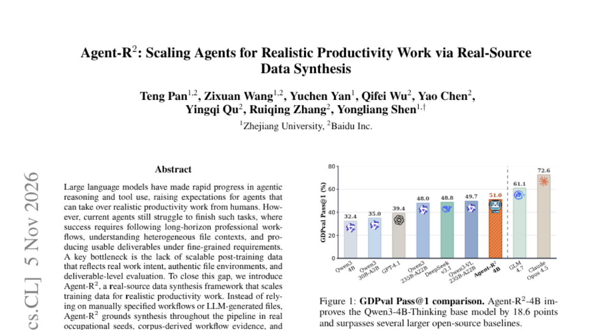

### 📌 한 줄 요약
실제 업무 데이터와 워크플로우를 기반으로 합성 데이터를 생성하여, 복잡한 실무 과업 수행 능력을 극대화한 에이전트 학습 프레임워크

### 🔑 핵심 포인트
- 실제 직업 데이터와 웹 소스 파일을 결합한 현실적인 데이터 합성 프레임워크 개발
- 정교한 루브릭(Rubric) 기반의 RL과 SFT를 통한 실무 중심의 에이전트 학습
- 적은 양의 고품질 데이터(4k)로 거대 모델을 능가하는 효율적인 성능 달성

### 🧑‍💻 개발자 관점
단순 질의응답을 넘어, 실제 파일과 복잡한 워크플로우를 다뤄야 하는 기업용 자동화 에이전트 구축 시 데이터 합성 전략의 이정표를 제시합니다.

### 🚀 실무 적용 아이디어
- 도메인 특화 데이터(PDF, Excel 등)를 활용한 합성 데이터 파이프라인 설계 실험
- 결과물 품질 검증을 위한 루브릭 기반 RL(RLHF/RLAIF) 적용 테스트
- 에이전트의 숏컷 행동(Superficial output) 방지를 위한 평가 지표 설계

### ⚠️ 리스크/한계
- 합성 데이터의 품질이 원천 데이터(Web-sourced)의 신뢰도에 의존할 위험
- 특정 도메인에 특화된 데이터로 인해 범용적 추론 능력이 저하될 가능성

### 📝 초록 기반 상세 설명
LLM의 에이전트 능력이 발전하고 있으나, 실제 업무의 복잡한 워크플로우와 다양한 파일 환경을 처리하는 데는 한계가 있습니다. 기존의 수동 워크플로우나 LLM 생성 파일 방식은 실제 업무의 의도와 환경을 반영하지 못하는 병목 현상을 야기합니다. 이를 해결하기 위해 실제 직업적 시드와 웹 코퍼스 기반의 워크플로우, 실제 파일을 결합한 데이터 합성 프레임워크인 Agent-R^2를 제안합니다. 10k개의 후보군에서 추출된 4k개의 정교한 태스크 인스턴스를 통해 모델을 학습시켰습니다. 그 결과, 소규모 모델인 Agent-R^2-4B가 훨씬 거대한 모델들을 능가하는 실무 성능을 보여주었습니다. 또한, 겉보기에만 그럴듯한 결과물을 만드는 숏컷(shortcut) 행동을 방지하고 지속적인 탐색 능력을 강화했습니다.

---

## 19. [Evidence-Guided Recovery for AI Agents with Ambiguous Tool Outcomes and Partial Execution](https://huggingface.co/papers/2610.41453)
**Upvotes**: 3 | **도입 난이도**: 상 | **신뢰도**: 상
**arXiv**: https://arxiv.org/abs/2610.41453

**태그**: AI Agent, Error Recovery, Distributed Systems, Workflow Automation, Agent, Evaluation

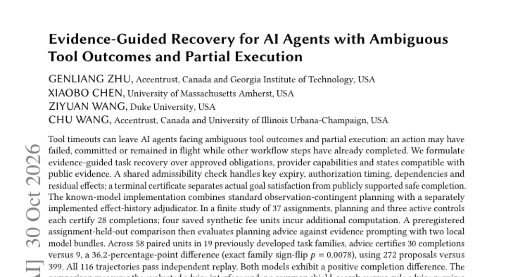

### 📌 한 줄 요약
도구 실행 중 타임아웃이나 부분적 실행이 발생했을 때, 증거 기반의 검증을 통해 에이전트의 작업을 안전하고 정확하게 복구하는 프레임워크를 제안합니다.

### 🔑 핵심 포인트
- 타임아웃 및 부분 실행 상황에서 증거 기반의 안전한 작업 복구 메커니즘 설계
- 권한, 의존성, 잔여 효과를 관리하는 허용성 검사 및 최종 목표 달성 여부를 구분하는 인증 체계 도입
- 관찰 기반 계획과 효과 이력 판정(effect-history adjudicator)을 결합한 모델 구현

### 🧑‍💻 개발자 관점
분산 시스템이나 외부 API 호출 시 발생하는 불확실한 상태(Partial Failure)에서 에이전트가 중복 실행이나 상태 불일치 없이 안전하게 작업을 재개할 수 있는 가이드라인을 제공합니다.

### 🚀 실무 적용 아이디어
- 타임아웃 발생 시 작업의 '멱등성'을 보장하기 위한 상태 기록(Effect-history) 로직 구현 실험
- 에이전트의 계획(Planning) 단계와 외부 증거(Evidence)를 결합한 하이브리드 워크플로우 테스트
- 실패한 작업의 잔여 효과를 처리하는 '허용성 검사(Admissibility check)' 로직의 프로토타입 개발

### ⚠️ 리스크/한계
- 상태 복구 과정에서 추가적인 계산 비용(Computation)이 발생할 수 있음
- 제공된 도구의 역량(Capabilities)에 따라 복구의 보장 범위가 제한될 수 있음

### 📝 초록 기반 상세 설명
AI 에이전트가 도구 실행 중 타임아웃을 겪으면 작업의 성공 여부나 잔여 효과가 불분명한 상태에 놓이게 됩니다. 본 논문은 승인된 의무 사항과 공개된 증거를 바탕으로 작업 복구를 수행하는 프레임워크를 제안합니다. 제안된 방식은 권한 만료, 의존성, 잔여 효과 등을 처리하는 공유 허용성 검사와 최종 목표 달성 여부를 구분하는 터미널 인증 체계를 포함합니다. 실험 결과, 제안된 계획 방식은 기존의 증거 프롬프팅 방식보다 훨씬 높은 작업 완료 성공률을 기록했습니다. 모든 트래졸로지는 독립적인 재현 테스트를 통과하여 신뢰성을 입증했습니다.

---

## 20. [Unbundling Multimodal Vision Encoding](https://huggingface.co/papers/2611.17334)
**Upvotes**: 2 | **도입 난이도**: 중 | **신뢰도**: 상
**arXiv**: https://arxiv.org/abs/2611.17334

**태그**: Multimodal, Vision-Language, Model Architecture, Vision, Benchmark

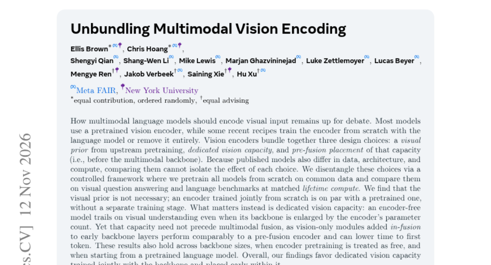

### 📌 한 줄 요약
멀티모달 모델 설계 시 사전 학습된 비전 인코더보다 전용 비전 용량 확보와 초기 레이어 결합이 성능에 더 결정적임을 입증함

### 🔑 핵심 포인트
- 비전 사전 학습(Visual Prior)은 성능 향상에 필수적이지 않으며, 처음부터 학습해도 충분한 성능을 낼 수 있음
- 모델의 성능은 사전 학습 여부보다 확보된 '전용 비전 용량(Dedicated Capacity)'에 의해 결정됨
- 비전 모듈을 백본 초기 레이어에 배치하는 방식이 기존 인코더 방식만큼 효과적이며 추론 효율성을 높임

### 🧑‍💻 개발자 관점
멀티모달 모델 설계 시 무거운 사전 학습 인코더를 붙이는 대신, 백본 모델 내부에 적절한 비전 용량을 확보하고 초기 레이어에 통합하는 것이 효율적임을 시사합니다.

### 🚀 실무 적용 아이디어
- 기존 사전 학습 인코더를 제거하고 백본과 함께 비전 모듈을 직접 학습시키는 실험 진행
- 비전 모듈의 파라미터를 백본 크기에 맞춰 조정하며 성능 변화 관찰
- 비전 모듈을 백본의 초기 레이어에 삽입하여 TTFT(Time to First Token) 변화 측정

### ⚠️ 리스크/한계
- 특정 백본 아키텍처에 따라 최적의 비전 용량 비율이 달라질 수 있음
- 매우 거대한 데이터셋 환경에서는 사전 학습의 이점이 다시 나타날 가능성을 배제할 수 없음

### 📝 초록 기반 상세 설명
기존 멀티모달 모델은 사전 학습된 비전 인코더를 사용하는 방식과 처음부터 학습하는 방식이 혼재되어 있어 설계 요소 간의 영향력을 분리하기 어려웠습니다. 본 연구는 비전 사전 학습(prior), 전용 비전 용량(capacity), 그리고 융합 위치(placement)라는 세 가지 설계 요소를 분리하여 비교하는 통제된 프레임워크를 제안합니다. 모든 모델을 동일한 데이터와 연산량 조건에서 처음부터 학습시켜 각 요소의 효과를 정밀하게 분석했습니다. 실험 결과, 강력한 비전 사전 학습보다는 모델 내에 확보된 전용 비전 용량이 성능에 가장 중요한 역할을 함을 발견했습니다. 또한, 비전 모듈을 백본 초기 레이어에 직접 결합하는 방식이 기존의 사전 융합 인코더 방식과 대등한 성능을 보이면서도 추론 속도(TTFT)를 개선할 수 있음을 확인했습니다.

---

## 21. [Structured Confidence Perturbation via Fisher Geometry for Adversarial Training](https://huggingface.co/papers/2611.14046)
**Upvotes**: 2 | **도입 난이도**: 중 | **신뢰도**: 상
**arXiv**: https://arxiv.org/abs/2611.14046

**태그**: Adversarial Training, Fisher Information, Robustness, Deep Learning, RAG

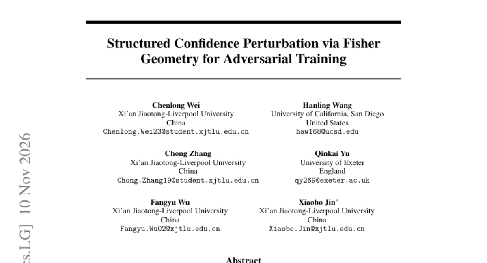

### 📌 한 줄 요약
모델의 예측 분포 구조를 파괴하는 Fisher 정보 기반의 기하학적 섭동을 통해 적대적 방어 성능을 극대화하는 방법론

### 🔑 핵심 포인트
- Cross-entropy와 KL divergence를 결합하여 예측 정확도와 분포 일관성을 동시에 타격하는 하이브리드 목적 함수 도입
- Fisher 정보 행렬의 주 고유벡터를 활용하여 신뢰도 매니폴드 상의 분포 거리를 최대화하는 기하학적 섭동 생성
- 고차원 행렬 연산 비용을 줄이는 효율적인 알고리즘 설계 및 실험적 검증

### 🧑‍💻 개발자 관점
단순히 손실 함수를 높이는 것을 넘어 모델의 확률 분포 자체를 견고하게 만드는 기법으로, 실무에서 모델의 신뢰도 왜곡 공격을 방어하는 데 유용합니다.

### 🚀 실무 적용 아이디어
- 제안된 하이브리드 목적 함수(CE + KL)를 기존 PGD 공격 프레임워크에 적용해보기
- Fisher 정보 기반의 섭동 방향이 실제 모델의 예측 분포 변화에 미치는 영향 분석하기
- 고신뢰도 영역(High-confidence regions)에서의 강건성 향상 여부 테스트하기

### ⚠️ 리스크/한계
- Fisher 정보 행렬 계산과 관련된 연산 복잡도가 모델 크기에 따라 증가할 수 있음
- 특정 데이터셋이나 아키텍처에 대한 일반화 성능에 대한 추가 검증 필요

### 📝 초록 기반 상세 설명
기존의 적대적 학습은 손실 값은 높이지만 모델의 신뢰도 구조(confidence structure)를 실질적으로 변화시키지 못하는 '가짜 공격(pseudo-attacks)' 문제에 직면해 있습니다. 이를 해결하기 위해 본 논문은 예측 정확도와 분포 일관성을 동시에 무너뜨리는 하이브리드 목적 함수를 제안합니다. 또한, 신뢰도 매니폴드 상에서 분포 거리를 최대화하는 기하학적 재구성을 통해 적대적 섭동을 생성합니다. 이론적 분석 결과, 최적의 섭동 방향은 Fisher 정보 행렬의 주 고유벡터와 일치함을 확인하였으며, 이를 위한 효율적인 알고리즘을 함께 제안합니다. 실험 결과, 제안 방법은 기존 방식보다 우수한 강건성과 전이 가능성을 보였으며 특히 고신뢰 영역의 구조적 섭동에 탁월한 성능을 보였습니다.

---

## 22. [Do Multimodal Models Decide Consistently on Equivalent Optical Spectra?](https://huggingface.co/papers/2611.00428)
**Upvotes**: 2 | **도입 난이도**: 중 | **신뢰도**: 상
**arXiv**: https://arxiv.org/abs/2611.00428

**태그**: Multimodal, Robustness, Scientific-AI, Evaluation, RAG

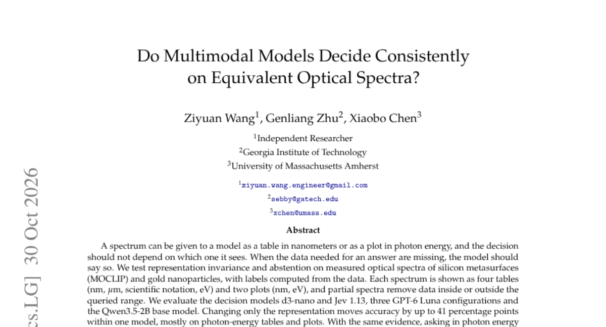

### 📌 한 줄 요약
멀티모달 모델이 동일한 데이터를 다른 형식(표 vs 그래프)으로 제공했을 때 발생하는 일관성 결여와 데이터 누락 시 판단 오류 문제를 분석함

### 🔑 핵심 포인트
- 동일한 물리적 데이터라도 표현 방식(단위, 표/그래프)에 따라 모델의 정확도가 크게 변하는 불변성 문제 확인
- 데이터가 불충분할 때 모델이 '판단 불가'를 선택하지 못하는 현상과 이를 해결하기 위한 LoRA 파인튜닝 효과 분석
- 과학적 의사결정용 멀티모달 모델 평가 시 표현 방식의 다양성과 증거 누락 시나리오 검증의 중요성 제시

### 🧑‍💻 개발자 관점
도메인 특화 AI 모델 개발 시, 데이터의 형식(Format) 변화가 모델의 추론 결과에 미치는 편향성을 반드시 검증해야 함을 시사함

### 🚀 실무 적용 아이디어
- 동일한 데이터셋을 다양한 시각적/텍스트 형식으로 변환하여 모델의 일관성(Consistency) 테스트 수행
- 데이터가 불완전한 상황(Truncated data)을 의도적으로 주입하여 모델의 기권(Abstention) 능력을 평가
- 단위 변환(예: nm ↔ eV)이 포함된 데이터 증강을 통해 모델의 물리적 의미 이해도 검증

### ⚠️ 리스크/한계
- 특정 데이터 형식에 최적화된 파인튜닝이 '지름길(Shortcut)' 학습으로 이어져 일반화 성능을 해칠 수 있음
- 모델이 데이터의 물리적 의미를 이해하는 것이 아니라 형식적 특징에만 의존할 위험이 있음

### 📝 초록 기반 상세 설명
과학적 의사결정을 위해 동일한 스펙트럼 데이터가 표나 그래프 등 다양한 표현 방식으로 제공될 때 모델의 판단이 일관되어야 한다. 본 연구는 실리콘 메타표면 및 금 나노입자 데이터를 활용하여 표현 불변성(representation invariance)과 기권(abstention) 능력을 테스트했다. 실험 결과, 동일한 데이터라도 표현 방식(nm vs eV)에 따라 정확도가 최대 41%p까지 차이 나는 현상이 관찰되었다. 또한 데이터가 부족한 상황에서 모델이 '판단 불가'를 선택하지 못하는 문제가 확인되었다. 연구진은 모델의 성능이 단순히 평균 정확도가 아닌, 표현 방식의 변화와 증거 누락 상황에서도 견고한지 검증해야 함을 강조한다.

---

## 23. [Humanized but Still True? Auditing Facts and Detection in AI-Text Humanizers](https://huggingface.co/papers/2611.00359)
**Upvotes**: 2 | **도입 난이도**: 중 | **신뢰도**: 상
**arXiv**: https://arxiv.org/abs/2611.00359

**태그**: LLM, NLP, Fact-Checking, AI-Detection, Optimization

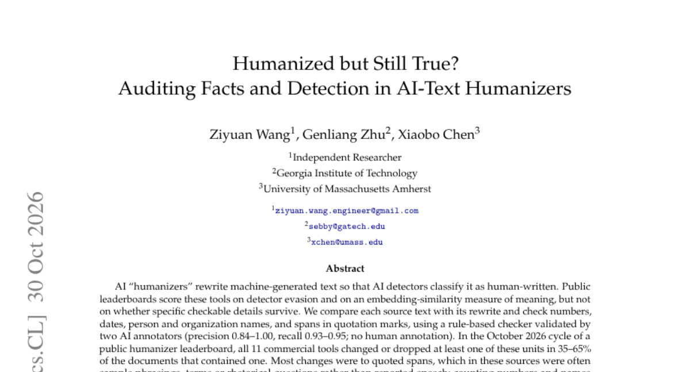

### 📌 한 줄 요약
AI 텍스트 휴머나이저(Humanizer)가 탐지 회피를 위해 사실 관계(숫자, 이름, 인용구 등)를 왜곡하는 현상과 그 위험성을 분석함

### 🔑 핵심 포인트
- 상용 휴머나이저 도구들은 탐지 회피를 위해 숫자, 이름, 인용구 등 핵심 사실 정보를 빈번하게 변경함
- 탐지 회피 성능과 정보 유지(Fact retention) 사이의 명확한 상관관계는 관찰되지 않음
- 기존의 퍼플렉시티(Perplexity) 기반 탐지기들은 고도화된 휴머나이저를 식별하는 데 성능이 매우 낮음

### 🧑‍💻 개발자 관점
LLM을 활용한 콘텐츠 생성 시, 텍스트를 자연스럽게 만드는 과정에서 의도치 않게 사실 관계가 왜곡될 수 있음을 인지하고 이를 검증하는 프로세스가 필요합니다.

### 🚀 실무 적용 아이디어
- LLM 재작성(Rewriting) 파이프라인에 사실 관계 검증(Fact-checking) 루프 통합
- 인용구 및 고유 명사 보존을 위한 프롬프트 엔지니어링 최적화
- 생성된 텍s의 신뢰도 측정을 위한 규칙 기반 검사기 도입

### ⚠️ 리스크/한계
- 탐지 회피를 위해 사실을 왜곡하는 '환각(Hallucination)' 위험 상존
- 인간의 개입 없이 자동화된 도구만 사용할 경우 정보의 정확성 보장이 어려움

### 📝 초록 기반 상세 설명
AI 생성 텍스트를 인간이 쓴 것처럼 바꾸는 '휴머나이저' 기술이 발전함에 따라, 탐지 회피 성능과 사실 관계 유지 사이의 상관관계를 조사했습니다. 연구진은 규칙 기반 검사기를 통해 숫자, 날짜, 인용구 등 핵심 정보가 재작성 과정에서 어떻게 변형되는지 측정했습니다. 실험 결과, 상용 도구들은 탐지 회피를 위해 상당수의 사실적 단위(특히 인용구)를 변경하거나 누락시키는 경향을 보였습니다. 또한, 탐지 회피 성능과 정보 유지 능력 사이에는 명확한 상관관계가 발견되지 않았으며, 기존 탐지기들은 휴머나이저를 식별하는 데 한계를 보였습니다. 최종적으로 연구진은 사실 관계를 유지하면서도 탐지를 피하는 기술적 트레이드오프와 새로운 탐지 모델(Jev)의 성능을 제시했습니다.

---

## 24. [From Large Language Models to Efficient System One Models via Adaptive Computation](https://huggingface.co/papers/2611.16321)
**Upvotes**: 2 | **도입 난이도**: 중 | **신뢰도**: 상
**arXiv**: https://arxiv.org/abs/2611.16321

**태그**: Efficiency, LLM, Model Compression, Adaptive Computation, Benchmark, Distillation

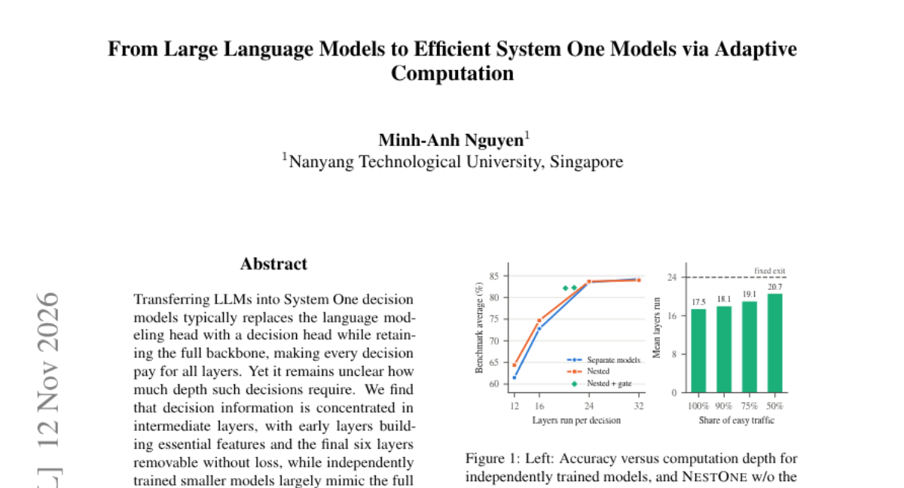

### 📌 한 줄 요약
의사결정 모델의 효율성을 위해 모델의 깊이를 적응적으로 조절하는 공유 레이어 기반의 증류 학습 기법 제안

### 🔑 핵심 포인트
- 의사결정 정보가 모델의 중간 레이어에 집중되어 있음을 발견
- 최종 레이어를 공유하며 서브 모델을 학습시키는 자기 증류(Self-distillation) 방식 도입
- 게이트 메커니즘을 통한 적응형 계산(Adaptive Computation)으로 효율성 극대화

### 🧑‍💻 개발자 관점
추론 비용 절감이 중요한 실무 환경에서, 모델의 전체 깊이를 사용하지 않고도 성능을 유지하며 연산량을 최적화할 수 있는 전략을 제공합니다.

### 🚀 실무 적용 아이디어
- 기존 LLM 백본에서 레이어별 중요도를 측정하는 프로빙(Probing) 실험 수행
- 제안된 방식처럼 레이어 공유 구조를 가진 멀티 뎁스 모델 설계 및 학습
- 게이트 메커니즘의 임계값(Threshold) 설정에 따른 정확도-속도 트레이드오프 분석

### ⚠️ 리스크/한계
- 학습 시 전체 모델과 서브 모델을 동시에 관리해야 하므로 학습 복잡도가 증가할 수 있음
- 특정 도메인에 특화된 의사결정 작업에서 범용 모델 대비 성능 편차가 발생할 가능성

### 📝 초록 기반 상세 설명
기존의 LLM 기반 의사결정 모델은 모든 레이어를 매번 연산해야 하므로 효율성이 떨어지는 문제가 있었습니다. 연구진은 의사결정 정보가 모델의 중간 레이어에 집중되어 있으며, 마지막 몇 개 레이어는 제거해도 성능 저하가 적다는 점을 발견했습니다. 이를 해결하기 위해 전체 모델과 레이어를 공유하는 접두사(prefix) 서브 모델들을 동시에 학습시키는 방식을 제안합니다. 제안된 방식은 게이트 메커니즘을 통해 필요한 시점에 연산을 멈추는 적응형 계산을 수행합니다. 실험 결과, 제안 모델은 독립적인 소형 모델들과 대등하거나 더 나은 성능을 보이면서도 뛰어난 효율성을 달성했습니다.

---

## 25. [The Value of Thinking: Learning When to Reason in Hybrid Decision Models](https://huggingface.co/papers/2611.16961)
**Upvotes**: 1 | **도입 난이도**: 중 | **신뢰도**: 상
**arXiv**: https://arxiv.org/abs/2611.16961

**태그**: LLM, Inference-Optimization, Reinforcement-Learning, Agent, Reasoning, Evaluation

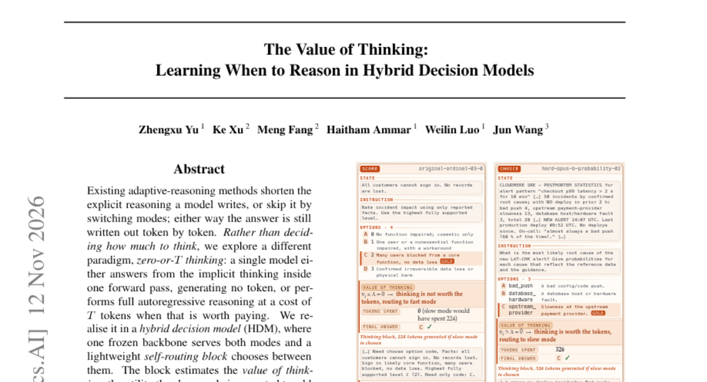

### 📌 한 줄 요약
추론 비용을 획기적으로 절감하기 위해 '생각할지 말지'를 결정하는 하이브리드 의사결정 모델(HDM) 제안

### 🔑 핵심 포인트
- Zero-or-T 패러다임: 불필요한 토큰 생성을 방지하고 필요할 때만 전체 추론 수행
- 하이브리드 의사결정 모델(HDM): 고정된 백본과 경량 라우팅 블록을 통한 효율적 모드 전환
- CDPO(Calibrated Decision Policy Optimisation): 에피소드 보상을 기반으로 추론 가치를 학습하는 RL 기법

### 🧑‍💻 개발자 관점
LLM 에이전트 운영 시 발생하는 막대한 추론 비용과 지연 시간(Latency) 문제를 구조적으로 해결할 수 있는 방법론을 제시합니다.

### 🚀 실무 적용 아이디어
- 특정 도메인(수학, 코딩 등)에서 라우팅 블록의 결정 임계값(λ) 변화에 따른 성능-비용 트레이드오프 분석
- 기존의 Chain-of-Thought(CoT) 방식과 HDM의 비용 대비 성능 효율성 비교 실험
- 에이전트 작업 환경에서 CDPO 알고리즘의 수렴 안정성 테스트

### ⚠️ 리스크/한계
- 라우팅 블록의 판단 오류 시, 쉬운 문제에 과도한 비용을 쓰거나 어려운 문제에서 추론을 건너뛸 위험 존재
- 학습 시 사용된 에피소드 보상 구조가 실제 서비스 환경의 복잡한 보상 체계와 일치하지 않을 가능성

### 📝 초록 기반 상세 설명
기존의 적응형 추론 방식은 토큰 생성량을 조절할 뿐, 여전히 모든 답변을 토큰 단위로 생성하는 비효율성이 존재했습니다. 본 논문은 추론 여부를 결정하는 'zero-or-T' 패러다임을 제안하며, 하나의 백본 모델과 경량 라우팅 블록을 결합한 하이브리드 의사결정 모델(HDM)을 개발했습니다. 라우팅 블록은 추론을 통해 얻을 기대 효용이 설정된 비용(λ)보다 클 때만 느린 모드(T 토큰 생성)를 실행합니다. 정답 라벨이 없는 에이전트 작업 환경을 위해 에피소드 단위 보상을 활용하는 CDPO 강화학습 기법을 도입했습니다. 실험 결과, JevBench와 MiniWoB 등 다양한 벤치마크에서 성능을 유지하거나 향상시키면서도 토큰 비용과 시간을 대폭 절감했습니다.

### 🖼️ 추가 자료
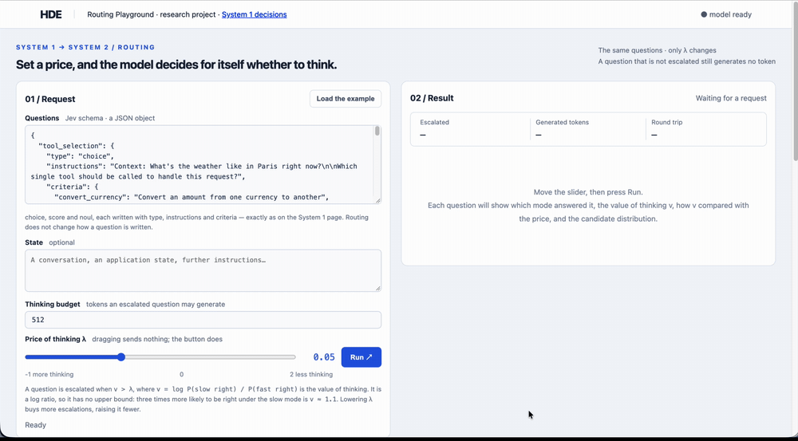

---

## 26. [Experience-Handoff Reinforcement Learning for Recursive Self-Improvement](https://huggingface.co/papers/2611.16409)
**Upvotes**: 1 | **도입 난이도**: 상 | **신뢰도**: 상
**arXiv**: https://arxiv.org/abs/2611.16409

**태그**: LLM-Agent, Reinforcement-Learning, Self-Improvement, Automated-Reasoning, Agent, Benchmark, Evaluation

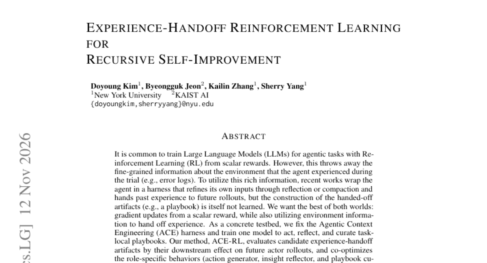

### 📌 한 줄 요약
에이전트가 수행 중 얻은 경험(로그 등)을 미래의 작업에 활용할 수 있는 '플레이북' 형태로 자동 생성하고 최적화하는 강화학습 방법론

### 🔑 핵심 포인트
- 스칼라 보상과 환경 정보를 결합한 하이브리드 강화학습 프레임워크 제안
- 행동 생성, 성찰, 플레이북 작성을 하나의 모델 내에서 공동 최적화(Co-optimization)
- 미래의 에이전트 성능에 미치는 영향을 기준으로 경험 전달 결과물의 가치를 평가

### 🧑‍💻 개발자 관점
에이전트가 단순히 현재의 정답을 맞히는 것을 넘어, 다음 작업에 도움이 되는 '지식(Playbook)'을 스스로 구조화하여 학습하는 법을 제시합니다.

### 🚀 실무 적용 아이디어
- 에이전트의 로그/에러 메시지를 구조화된 지식(JSON/Markdown)으로 변환하는 프롬프트 엔지니어링 실험
- 현재 작업의 성공 여부가 다음 작업의 성공에 미치는 영향을 측정하는 벤치마크 환경 구축
- RLHF/PPO 환경에서 보상 함수에 '지식 전달 효율성' 항을 추가하는 실험

### ⚠️ 리스크/한계
- 플레이북의 품질이 낮을 경우 잘못된 정보가 누적되는 '경험 오염' 리스크 존재
- 역할 분담(행동 vs 성찰 vs 기록) 사이의 균형을 맞추기 위한 복잡한 하이퍼파라미터 튜닝 필요

### 📝 초록 기반 상세 설명
기존 LLM 에이전트 학습은 스칼라 보상만을 사용하여 환경의 세부 정보를 버리는 경향이 있었습니다. 최근에는 에이전트가 스스로 성찰하거나 정보를 압축하는 방식이 제안되었으나, 생성된 결과물(플레이북 등)의 품질을 학습 과정에 직접 반영하기는 어려웠습니다. 본 논문은 스칼라 보상을 통한 그래디언트 업데이트와 환경 정보를 활용한 경험 전달을 동시에 수행하는 'Experience-Handoff RL'을 제안합니다. 연구진은 에이전트가 행동, 성찰, 플레이북 작성을 동시에 수행하는 환경에서 각 역할을 공동 최적화하는 실험을 진행했습니다. 실험 결과, 제안된 방식은 기존 베이스라인보다 높은 성능을 기록하며 미래의 작업에 유용한 경험을 생성하는 능력을 입증했습니다.

---

## 27. [A Cross-Scenario Survey and Analysis of Self-Evolving Multimodal Agents](https://huggingface.co/papers/2611.14256)
**Upvotes**: 1 | **도입 난이도**: 하 | **신뢰도**: 상
**arXiv**: https://arxiv.org/abs/2611.14256

**태그**: Agent, Multimodal, Self-Evolving, Transfer Learning, Reasoning, Evaluation

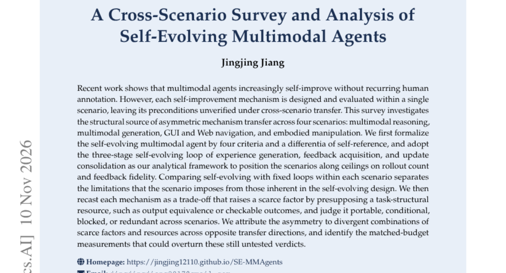

### 📌 한 줄 요약
시나리오 간 전이 성능 차이를 분석하여 멀티모달 에이전트의 자가 진화 메커니즘을 체계화한 서베이 연구

### 🔑 핵심 포인트
- 멀티모달 에이전트의 자가 진화 과정을 3단계 루프(경험 생성, 피드백 획득, 업데이트 통합)로 정형화
- 시나리오별(추론, 생성, 탐색, 조작) 자원 제약과 메커니즘 간의 상호작용 분석
- 특정 시나리오에서 성공적인 메커니즘이 다른 환경에서 실패하는 '비대칭적 전이' 원인 규명

### 🧑‍💻 개발자 관점
에이전트 설계 시 특정 도메인에서 작동하던 최적화 기법을 다른 도메인에 무작정 적용할 때 발생하는 성능 저하를 예측하고 방지할 수 있는 이론적 근거를 제공합니다.

### 🚀 실무 적용 아이디어
- 현재 개발 중인 에이전트의 피드백 루프를 3단계 프레임워크에 대입하여 구조적 결함 확인
- 특정 태스크(예: GUI)용 최적화 기법을 다른 태스크(예: 로봇 조작)로 이식할 때의 제약 조건 분석
- 피드백 충실도(Fidelity)와 롤아웃 횟수 간의 상관관계를 바탕으로 예산 최적화 실험 수행

### ⚠️ 리스크/한계
- 제시된 프레임워크가 이론적 분석에 치중되어 있어 구체적인 구현 코드를 제공하지 않음
- 시나리오 간 전이 성능의 차이가 환경적 변수 외에 모델 크기 등 다른 요인에 의해 좌우될 가능성 존재

### 📝 초록 기반 상세 설명
최근 멀티모달 에이전트는 인간의 개입 없이 스스로 성능을 개선하는 방향으로 발전하고 있습니다. 그러나 기존의 자가 진화 방식은 특정 시나리오 내에서만 검증되어, 다른 환경으로의 전이 시 발생하는 성능 차이의 원인이 불분명합니다. 본 논문은 추론, 생성, GUI/Web 탐색, 로봇 조작 등 네 가지 시나리오를 대상으로 자가 진화 메커니즘의 구조적 비대칭성을 조사합니다. 연구진은 경험 생성, 피드백 획득, 업데이트 통합이라는 3단계 루프를 분석 프레임워크로 제안합니다. 이를 통해 각 시나리오의 자원 제약과 메커니즘 간의 트레이드오프를 분석하여, 왜 특정 방식이 특정 시나리오에서만 유효한지를 규명합니다.

---

## 28. [The Narrative Gap: Can LLMs Help Us Navigate Diverse Narratives Across Languages?](https://huggingface.co/papers/2611.12750)
**Upvotes**: 0 | **도입 난이도**: 중 | **신뢰도**: 상
**arXiv**: https://arxiv.org/abs/2611.12750

**태그**: LLM, Multilingual, Evaluation, Information Retrieval, RAG, Benchmark

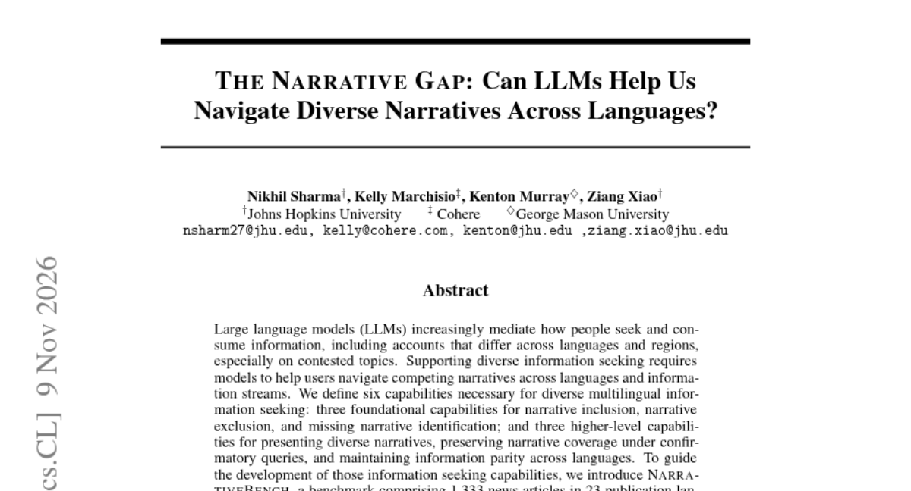

### 📌 한 줄 요약
다국어 환경에서 LLM이 편향된 정보 대신 다양한 관점을 제공할 수 있는지 검증하는 새로운 벤치마크와 프레임워크 제안

### 🔑 핵심 포인트
- 다국어 정보 탐색을 위한 6가지 핵심 역량(포함, 배제, 누락 식별, 제시, 커버리지 유지, 정보 균등성) 정의
- 23개 언어와 23개 논쟁적 주제를 아우르는 대규모 벤치마크 'NarrativeBench' 구축
- 현재 LLM이 언어적 필터 버블과 정보 불균형을 초래할 위험이 있음을 실증적 평가로 입증

### 🧑‍💻 개발자 관점
글로벌 서비스를 개발할 때 LLM이 특정 언어권의 관점에 매몰되지 않고 균형 잡힌 정보를 제공하도록 설계하는 가이드라인을 제공합니다.

### 🚀 실무 적용 아이디어
- 자사 서비스의 다국어 RAG 시스템에 NarrativeBench의 평가 프레임워크 적용
- 특정 언어에 편향된 정보가 제공되는지 확인하기 위한 쿼리 프레이밍 실험 수행
- 사용자에게 다양한 관점을 제안하는 에이전트 로직 설계 및 검증

### ⚠️ 리스크/한계
- 논쟁적 주제에 대한 객관적 정답을 정의하기 어렵다는 평가의 주관성 위험
- 특정 언어/문화권의 데이터 편향이 벤치마크 자체에 반영될 가능성

### 📝 초록 기반 상세 설명
LLM이 정보 검색의 중개자 역할을 수행함에 따라, 언어와 지역에 따른 다양한 내러티브를 사용자에게 제공하는 것이 중요해졌습니다. 기존 모델들은 서로 다른 관점을 탐색하거나 정보 격차를 해소하는 데 한계가 있습니다. 본 논문은 다국어 정보 탐색에 필요한 6가지 핵심 역량을 정의하고, 이를 평가하기 위한 벤치마크인 NarrativeBench를 도입합니다. 23개 언어와 23개 논쟁적 주제를 포함한 1,333개의 뉴스 기사를 바탕으로 14개 LLM을 평가했습니다. 실험 결과, 현재 모델들은 다양한 관점을 신뢰성 있게 제공하는 능력이 부족하며, 언어적 필터 버블과 정보 불균형 문제를 야기할 수 있음이 밝혀졌습니다.

### 🖼️ 추가 자료
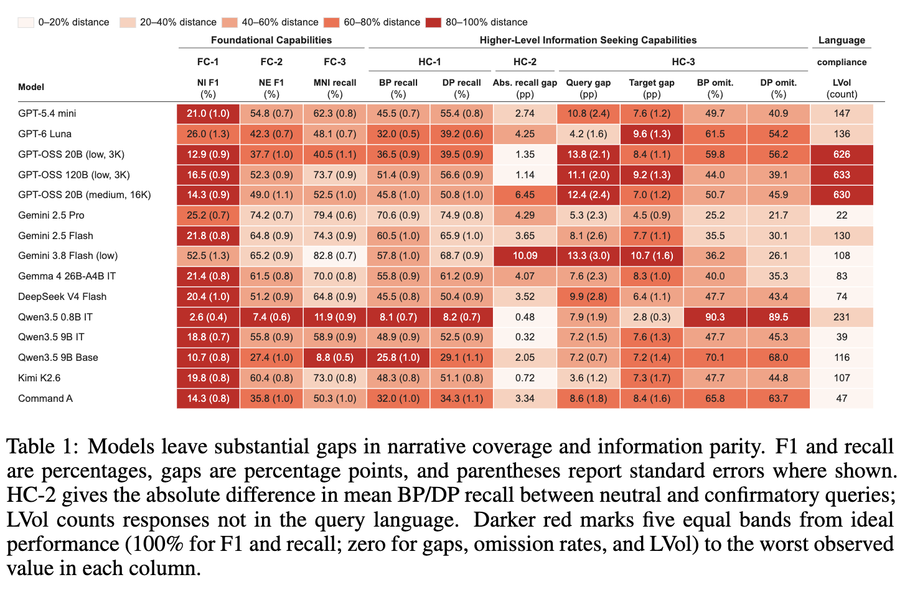

---

## 29. [A frontier machine intelligence for human neuroimaging](https://huggingface.co/papers/2611.15094)
**Upvotes**: 0 | **도입 난이도**: 상 | **신뢰도**: 상
**arXiv**: https://arxiv.org/abs/2611.15094

**태그**: VLM, Medical AI, Neuroimaging, Multimodal, Vision

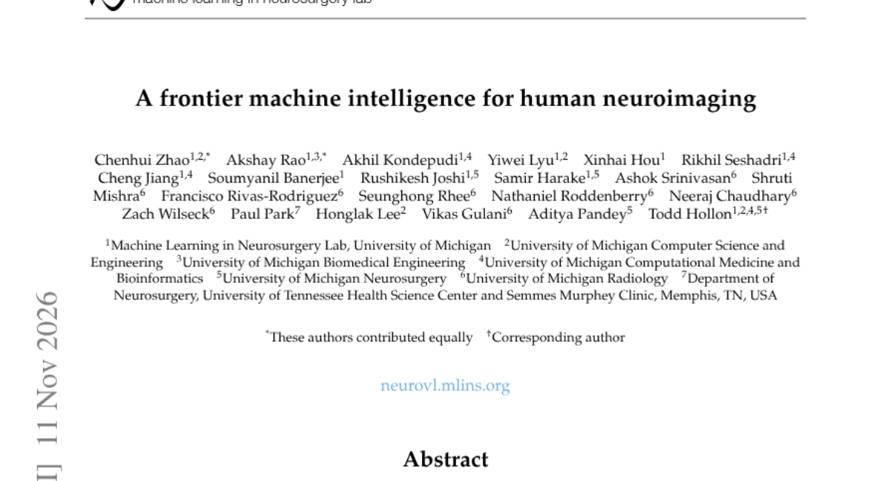

### 📌 한 줄 요약
100만 건의 임상 데이터를 학습하여 진단, 보고서 작성, 시계열 분석이 가능한 범용 신경 영상 특화 VLM 개발

### 🔑 핵심 포인트
- 100만 건 규모의 대규모 임상 신경 영상 데이터셋 기반 VLM 학습
- 진단, 병변 국소화, 보고서 생성 및 시계열 질병 진행도 분석 기능 통합
- 범용 모델 대비 높은 신뢰도와 임상적 추론 능력 확보

### 🧑‍💻 개발자 관점
대규모 의료 특화 데이터셋을 활용한 VLM이 범용 모델의 한계를 어떻게 극복하고 전문적인 임상 워크플로우를 자동화할 수 있는지 보여줍니다.

### 🚀 실무 적용 아이디어
- 의료 영상 데이터의 프라이버시 보호를 위한 연합 학습(Federated Learning) 구조 검토
- 멀티모달 모델의 시계열 데이터(Longitudinal data) 처리 아키텍처 분석
- VLM의 Hallucination 방지를 위한 임상 가이드라인 기반 검증 루프 설계

### ⚠️ 리스크/한계
- 특정 의료 기관의 데이터 편향이 모델의 일반화 성능에 미칠 영향
- 의료 현장 도입 시 모델의 판단 근거에 대한 설명 가능성(Explainability) 요구

### 📝 초록 기반 상세 설명
의료 영상은 질병 진단과 치료에 필수적이지만, 기존 AI 모델은 작업 범위가 제한적이거나 개인정보 문제로 전문 데이터 접근이 어렵다는 한계가 있습니다. 본 연구에서는 약 100만 건의 임상 신경 영상 데이터를 학습한 시각-언어 모델인 Neuro-VL을 제안합니다. Neuro-VL은 복잡한 영상 검사를 해석하고 자연어로 대화하며, 진단, 병변 국소화, 보고서 작성을 수행합니다. 실험 결과, Neuro-써는 기존의 범용 모델 및 전문 의료 모델보다 우수한 성능을 보였으며, 시계열 검사 비교를 통한 질병 진행도 평가에서도 탁월한 성능을 입증했습니다. 이는 개별 예측을 넘어 상호작용형 영상 해석과 종단적 모니터링이 가능한 차세대 의료 AI의 가능성을 보여줍니다.

---

