# 🚀 Product Hunt Daily Top 30 (2026-10-16)

## 오늘의 요약
오늘의 트렌드는 AI 에이전트의 자율성을 높이면서도, 그 과정에서 발생할 수 있는 비용 폭주나 보안 위험을 제어하기 위한 관리 및 승인 솔루션이 두드러졌습니다. 또한, 복잡한 업무 프로세스를 직관적인 UI로 변환하거나 자동화하는 등 실무 효율성을 극대화하는 도구들이 주목받았습니다.

### 오늘의 핵심 포인트
- AI 에이전트의 무분별한 비용 지출을 방지하고 작업 효율을 최적화하는 관리 도구들이 등장했습니다.
- AI가 수행하는 위험한 작업을 사람이 직접 승인하거나 제어할 수 있는 보안 및 거버넌스 레이어가 강조되었습니다.
- 이메일, 법률, 인프라 관리 등 전문적인 업무 영역에 특화된 AI 에이전트 서비스들이 실질적인 생산성 향상을 목표로 출시되었습니다.

**오늘의 태그**: AI 에이전트, 생산성 도구, 보안 및 제어, 비용 최적화, 자동화

## 1. [Talanoa](https://www.producthunt.com/products/talanoa-2)
**Votes**: 245 | **도입 난이도**: 하 | **신뢰도**: 상
**Tagline**: Email that feels like chat
**서비스 링크**: https://www.producthunt.com/r/LOUVBI5K3ZIRPE

**태그**: Productivity, Email, Privacy, AI, Communication, AI Tool, Chat

### 📌 이 서비스 한눈에 보기
복잡한 이메일 스레드를 깔끔한 채팅 형식으로 변환해주는 개인정보 보호 중심의 이메일 메신저

### 🔑 주요 기능
- 이메일 스레드를 불필요한 서명과 인용구가 제거된 깔끔한 채팅 UI로 변환
- Gmail, Outlook, iCloud 등 다양한 계정을 하나의 통합 인박스에서 관리
- 클라우드 동기화 없이 로컬 기기에서만 작동하는 프라이빗 AI 기능 제공

### 🙋 사용자에게 어떤 점이 좋은가
이메일의 복잡한 히스토리를 채팅처럼 직관적으로 읽을 수 있으며, 데이터가 클라우드에 저장되지 않아 보안과 프라이버시를 중시하는 사용자에게 유용합니다.

### ✅ 지금 바로 써볼 기능
- 기존 이메일 계정(Gmail, Outlook 등) 연결하기
- 채팅형 UI로 변환된 이메일 스레드 읽기
- 로컬 AI를 활용한 이메일 요약 및 검색 기능 사용하기

### ⚠️ 사용 전 확인할 점
- 클라우드 동기화를 지원하지 않으므로 여러 기기 간 실시간 동기화 방식 확인 필요
- 로컬 기반이므로 기기 변경 시 데이터 이전 방식 확인 필요

### 🧭 확인이 더 필요한 정보
클라우드 동기화 없이 여러 기기에서 사용하는 방식과 데이터 백업 정책에 대한 상세 정보가 필요합니다.

### 📸 스크린샷 및 갤러리
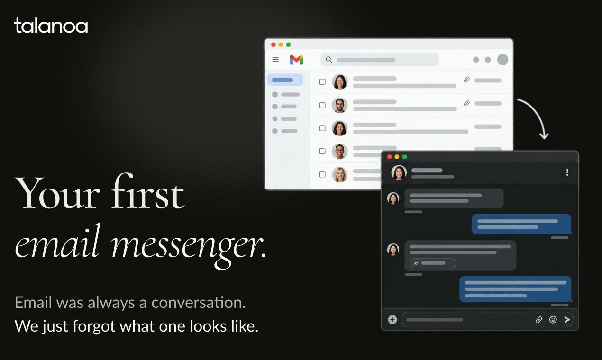
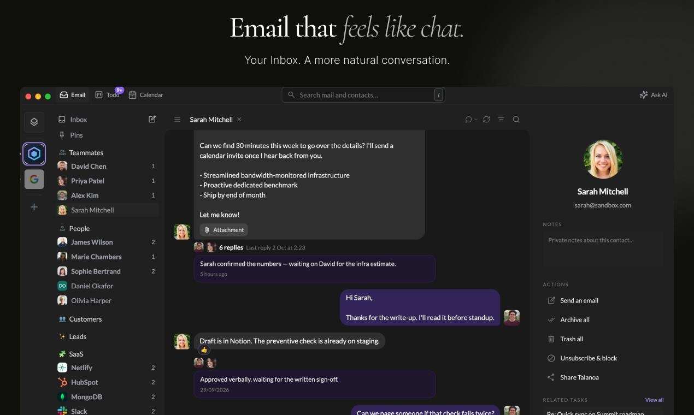
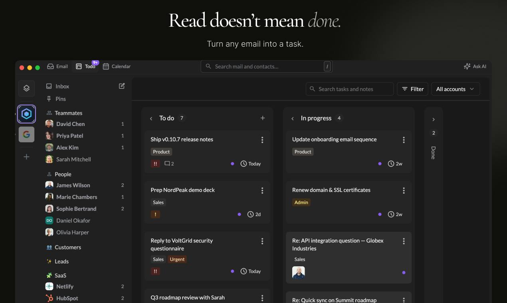

### 🎬 관련 영상
- [🎥 영상 보기](https://ph-files.imgix.net/d306f955-72db-4d6a-b699-146ee83a87b6.jpeg?auto=format)

---

## 2. [Navige](https://www.producthunt.com/products/navige)
**Votes**: 195 | **도입 난이도**: 중 | **신뢰도**: 상
**Tagline**: Cut AI agent costs and control runaway spending
**서비스 링크**: https://www.producthunt.com/r/DWQS7TVW6U7GNA

**태그**: AI, CostOptimization, DevTools, Automation, Agent, AI Tool

### 📌 이 서비스 한눈에 보기
AI 에이전트의 비용을 최적화하고 예산 초과를 방지하는 지능형 비용 관리 솔루션

### 🔑 주요 기능
- Sufficiency Intelligence를 통한 모델 크기 최적화 및 캐싱 기술 적용
- 예산 설정 및 무한 루프 방지를 통한 비용 폭주 제어
- 작업별 비용 분석 및 변경 사항 미리보기 기능 제공

### 🙋 사용자에게 어떤 점이 좋은가
AI 에이전트 운영 시 발생하는 예측 불가능한 비용을 줄이고, 작업별로 명확한 비용 절감 효과를 확인할 수 있습니다.

### ✅ 지금 바로 써볼 기능
- Watchtower 기능을 통해 무료로 비용 모니터링 시작하기
- Preview 기능을 사용하여 설정 변경 사항 미리 확인하기
- 작업별 비용 분석 대시보드 살펴보기

### ⚠️ 사용 전 확인할 점
- 모델 크기 최적화 시 작업 품질에 미치는 영향 확인 필요
- 기존 AI 워크플로와의 통합 방식 및 호환성 검토 필요

### 🧭 확인이 더 필요한 정보
Sufficiency Intelligence가 구체적으로 어떤 알고리즘을 통해 모델을 선택하는지에 대한 상세 기술 사양은 공개되지 않았습니다.

### 📸 스크린샷 및 갤러리
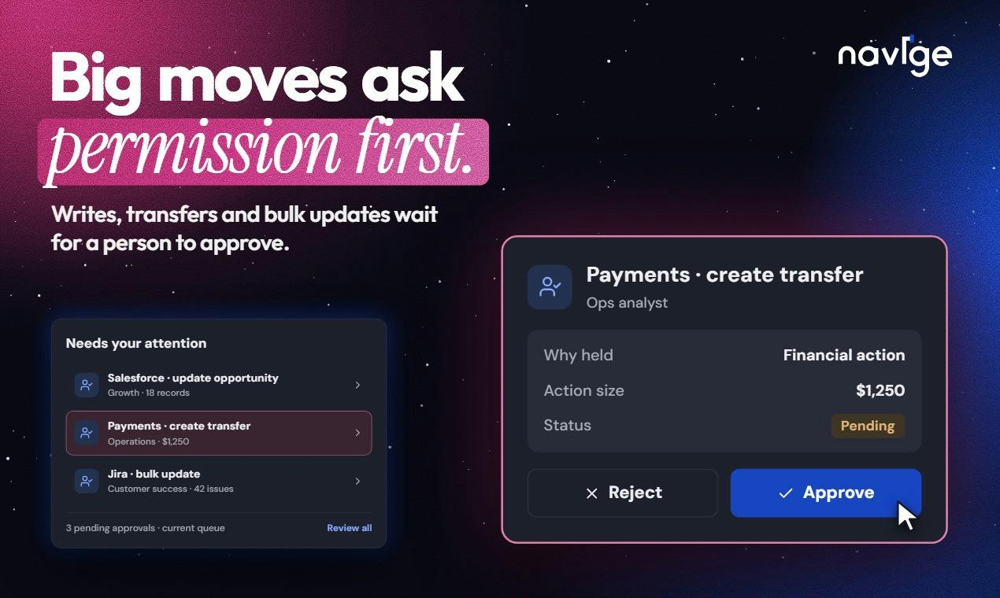
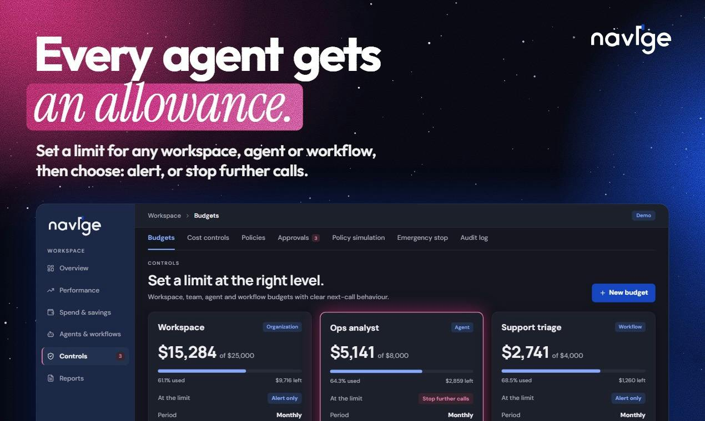
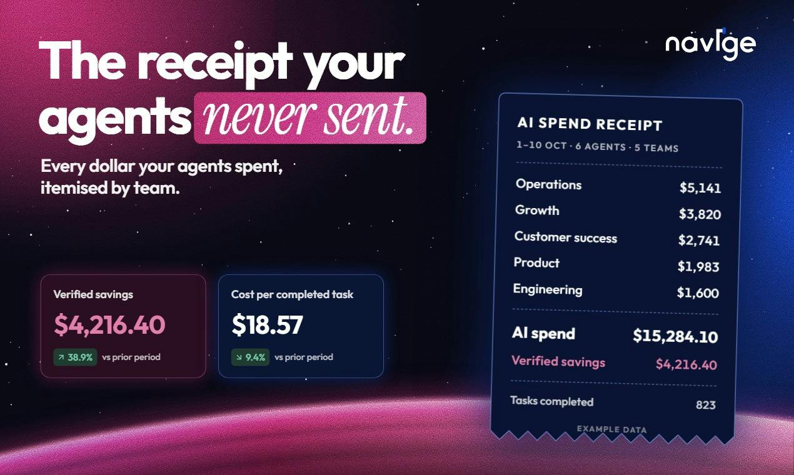

### 🎬 관련 영상
- [🎥 영상 보기](https://ph-files.imgix.net/d1e4da6f-4a37-4251-9300-ebe915e853f5.jpeg?auto=format)

---

## 3. [Apple HomeView](https://www.producthunt.com/products/apple)
**Votes**: 159 | **도입 난이도**: 하 | **신뢰도**: 상
**Tagline**: A new way to stay connected, and manage the home
**서비스 링크**: https://www.producthunt.com/r/PBZJGBXXYRUB7L

**태그**: SmartHome, AI, Display, IoT, AI Tool

### 📌 이 서비스 한눈에 보기
Siri AI와 고화질 디스플레이를 결합한 차세대 스마트 홈 컨트롤 디스플레이

### 🔑 주요 기능
- Liquid Retina 디스플레이 및 고음질 오디오 탑재
- Siri AI를 통한 스마트 홈 제어 및 FaceTime 지원
- 개인정보 보호 기능이 내장된 통합 홈 허브

### 🙋 사용자에게 어떤 점이 좋은가
집안의 다양한 스마트 기기를 하나의 화면에서 직관적으로 관리하고, 고화질 영상 통화와 미디어 감상을 동시에 즐길 수 있습니다.

### ✅ 지금 바로 써볼 기능
- Siri를 활용한 음성 스마트 홈 제어
- Liquid Retina 디스플레이로 영상 콘텐츠 감상
- FaceTime을 통한 원격 화상 통화

### ⚠️ 사용 전 확인할 점
- 기존 스마트 홈 생태계(Matter, HomeKit 등)와의 호환성 확인 필요
- 하드웨어 사양에 따른 설치 공간 및 전원 공급 환경 확인

### 🧭 확인이 더 필요한 정보
상세한 하드웨어 사양 및 타사 스마트 기기와의 구체적인 연동 범위는 공개되지 않았습니다.

### 📸 스크린샷 및 갤러리

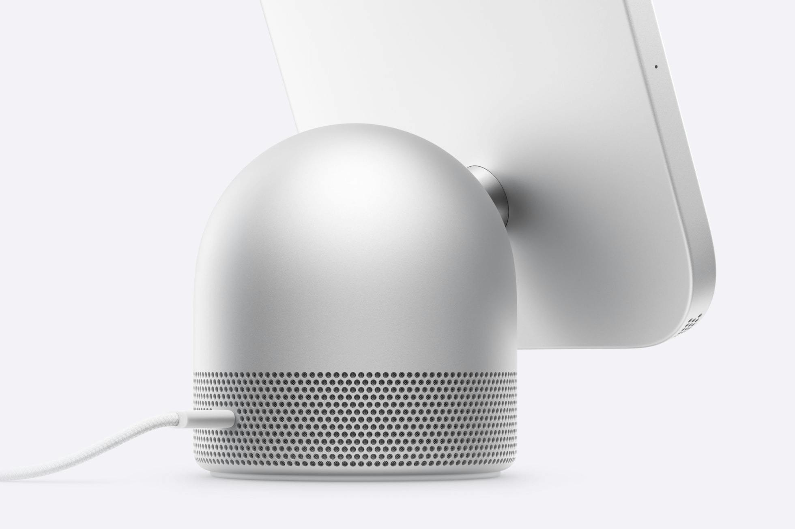

### 🎬 관련 영상
- [🎥 영상 보기](https://ph-files.imgix.net/e234d467-5bb7-4dfe-8bc3-c9909c1975cd.jpeg?auto=format)

---

## 4. [GLM-Legal](https://www.producthunt.com/products/z-ai)
**Votes**: 156 | **도입 난이도**: 상 | **신뢰도**: 상
**Tagline**: Z.ai’s legal AI model for contract review and compliance
**서비스 링크**: https://www.producthunt.com/r/4WQDIM7IVRBEKC

**태그**: LegalTech, AI-Model, Automation, Compliance, Agent, AI Tool, API

### 📌 이 서비스 한눈에 보기
계약 검토 및 컴플라이언스 조사를 위해 특화된 Z.ai의 법률 전문 AI 모델

### 🔑 주요 기능
- GLM-5.3-Flash 기반의 법률 특화 AI 모델
- 계약 검토, 증거 분석, 컴플라이언스 조사 등 에이전트형 법률 업무 수행
- 수만 개의 법률 작업 환경을 통한 강화 학습으로 벤치마크 성능 향상

### 🙋 사용자에게 어떤 점이 좋은가
법률 전문 미드 트레이닝과 강화 학습을 통해 복잡한 계약 검토 및 법적 조사 업무의 효율성을 높여줍니다.

### ✅ 지금 바로 써볼 기능
- API 액세스 권한 신청 (베타 단계)
- 계약 검토 및 증거 분석 워크플로우 테스트

### ⚠️ 사용 전 확인할 점
- 현재 애플리케이션 전용 베타 버전으로 API 접근이 제한적임
- 일반 모델 대비 성능은 향상되었으나 벤치마크 점수가 아직 완전한 전문성을 보장하지는 않음

### 🧭 확인이 더 필요한 정보
현재 API 접근이 애플리케이션 전용 베타로 제한되어 있어 일반 사용자의 즉각적인 도입 가능 여부를 확인해야 합니다.

### 📸 스크린샷 및 갤러리
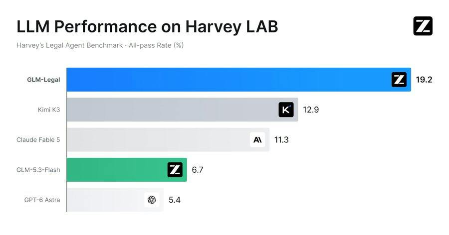
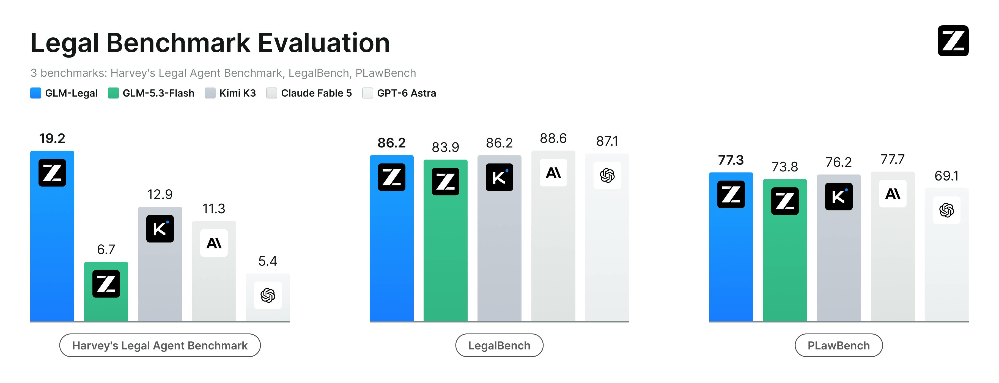
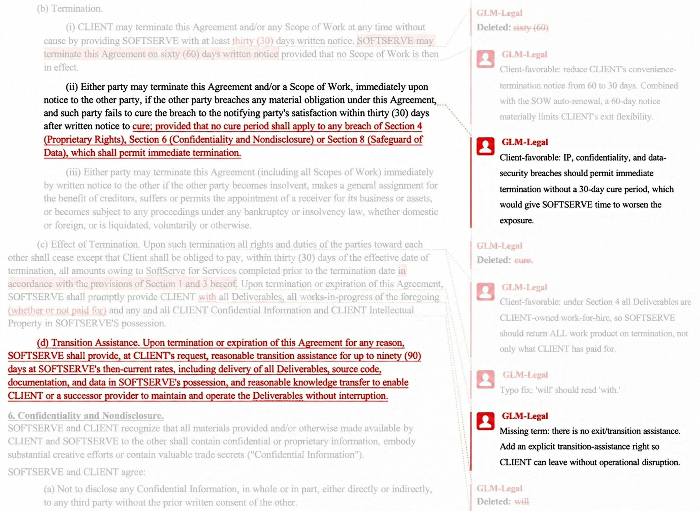

### 🎬 관련 영상
- [🎥 영상 보기](https://ph-files.imgix.net/3b4761ea-276b-4378-9ad9-8105ebda3176.jpeg?auto=format)

---

## 5. [OpenMuse](https://www.producthunt.com/products/copilotkit)
**Votes**: 142 | **도입 난이도**: 상 | **신뢰도**: 상
**Tagline**: Opensource, self hostable personal assistant for any harness
**서비스 링크**: https://www.producthunt.com/r/AXFB6EEZ5VOPRF

**태그**: AI Agent, OpenSource, Automation, Self-Hosted, Agent

### 📌 이 서비스 한눈에 보기
자체 브라우저와 터미널을 갖춘 오픈소스 개인용 AI 에이전트

### 🔑 주요 기능
- 브라우저, 터미널, 파일 시스템을 포함한 독립적인 작업 환경 제공
- 목표 설정 시 스스로 작업을 수행하고 결과를 보고하는 자율형 에이전트
- 오픈소스 및 셀프 호스팅 지원으로 높은 보안성과 유연성 확보

### 🙋 사용자에게 어떤 점이 좋은가
사용자가 직접 개입하지 않아도 AI가 복잡한 작업을 수행하며, 작업 과정을 투명하게 검토하고 결과물을 확인할 수 있습니다.

### ✅ 지금 바로 써볼 기능
- 자율적인 작업 수행 과정 모니터링하기
- 브라우저 및 터미널 연동 기능 테스트하기
- 자신의 작업 환경(Harness)에 설치 및 호환성 확인하기

### ⚠️ 사용 전 확인할 점
- 셀프 호스팅 환경 구축을 위한 기술적 숙련도 필요
- 에이전트의 자율적 작업에 따른 리소스 소모 및 보안 관리 필요

### 🧭 확인이 더 필요한 정보
사용자의 하드웨어 사양에 따른 성능 차이와 구체적인 에이전트 프레임워크 호환 범위를 확인해야 합니다.

### 📸 스크린샷 및 갤러리
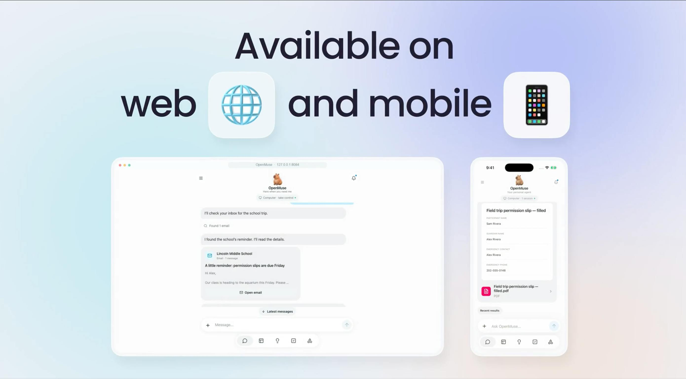
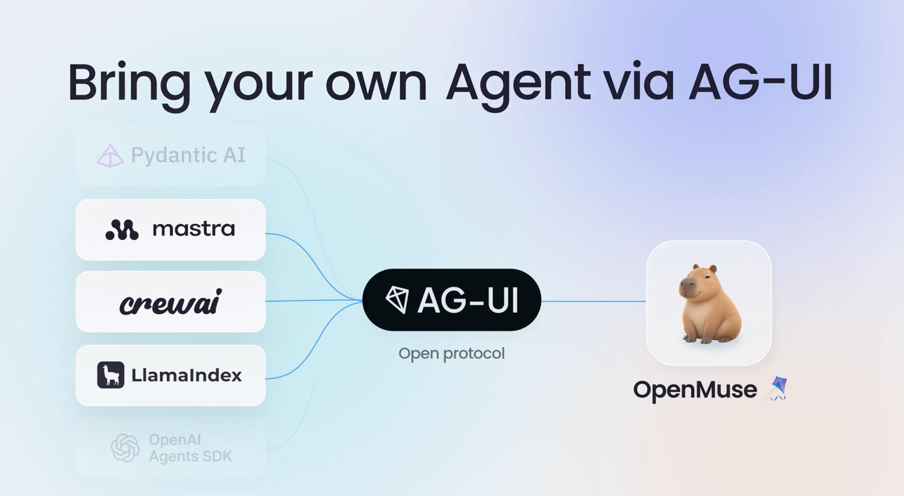
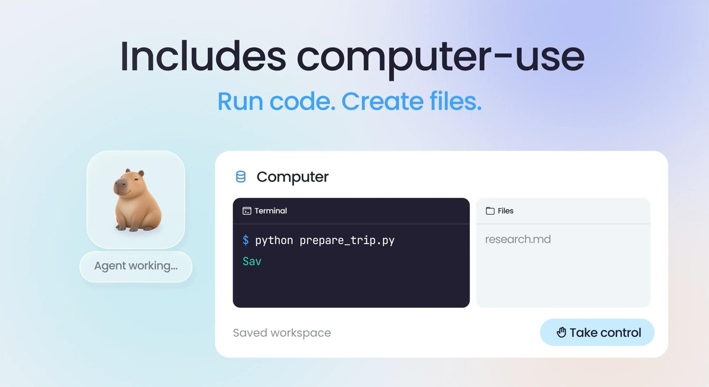

### 🎬 관련 영상
- [🎥 영상 보기](https://ph-files.imgix.net/754c4cfe-219a-43eb-8d82-f8d2ad8981e7.jpeg?auto=format)

---

## 6. [Polylane Impact Analysis](https://www.producthunt.com/products/polylane)
**Votes**: 106 | **도입 난이도**: 중 | **신뢰도**: 상
**Tagline**: Catch risky pull requests before they break production
**서비스 링크**: https://www.producthunt.com/r/6IFIVCOEBSFQYE

**태그**: DevOps, Infrastructure, CI/CD, Observability, AI Tool

### 📌 이 서비스 한눈에 보기
실제 운영 인프라를 기준으로 PR의 위험성을 사전 검증하는 자동화 분석 도구

### 🔑 주요 기능
- 라이브 인프라(설정, 용량, 의존성, 텔레메트리) 기반의 PR 위험 분석
- 머지 전 안전성 판단을 위한 근거 데이터 제공
- 누락된 인스트루멘테이션(Instrumentation) 제안 및 배포 후 모니터링

### 🙋 사용자에게 어떤 점이 좋은가
코드 변경이 운영 환경에 미칠 영향을 실시간 인프라 데이터로 검증하여, 배포 사고를 사전에 방지할 수 있습니다.

### ✅ 지금 바로 써볼 기능
- 현재 운영 중인 인프라 환경과 연동하여 분석 결과 확인하기
- PR 단계에서 제공되는 위험 분석 리포트 검토하기
- 제안된 인스트루멘테이션 가이드를 적용하여 관측성 강화하기

### ⚠️ 사용 전 확인할 점
- 실제 운영 환경의 데이터/설정에 접근해야 하므로 보안 및 권한 설정 확인 필요
- 인프라 구성 방식에 따라 분석 정확도가 달라질 수 있음

### 🧭 확인이 더 필요한 정보
지원하는 클라우드 제공업체 및 인프라 도구(IaC 등)의 범위가 명시되지 않았습니다.

### 📸 스크린샷 및 갤러리
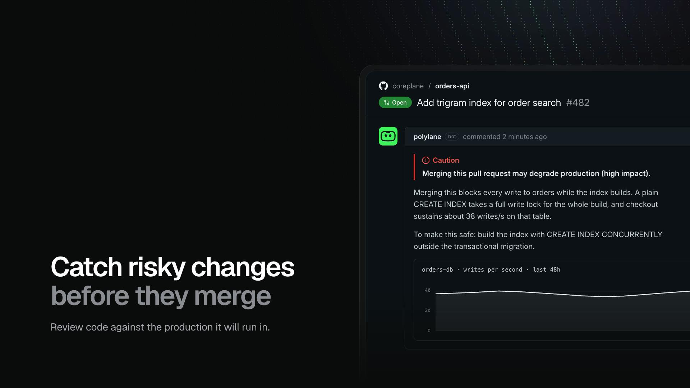
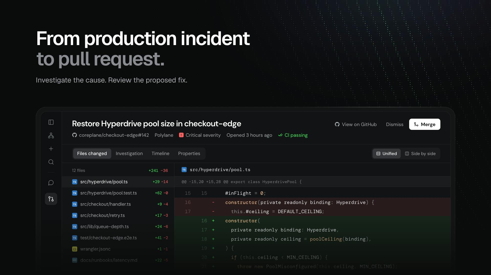
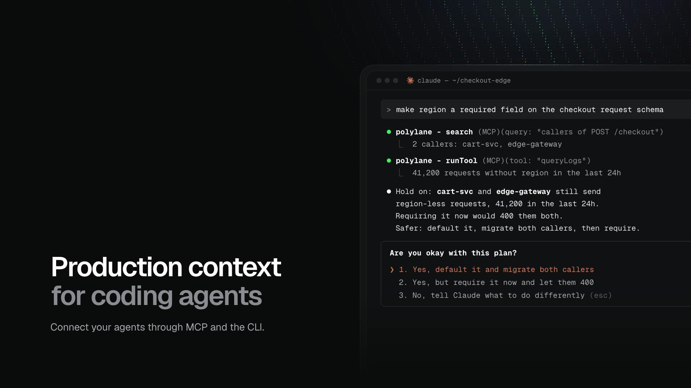

### 🎬 관련 영상
- [🎥 영상 보기](https://ph-files.imgix.net/fa835900-d371-40d5-b9d5-6e50503e5933.jpeg?auto=format)

---

## 7. [Daddy Issues](https://www.producthunt.com/products/daddy-issues)
**Votes**: 105 | **도입 난이도**: 하 | **신뢰도**: 상
**Tagline**: Think ahead. Fight less. A weekly family briefing for dads.
**서비스 링크**: https://www.producthunt.com/r/P5THAHV6JENYHY

**태그**: Productivity, Family, AI, Planning, AI Tool

### 📌 이 서비스 한눈에 보기
AI 기반 주간 브리핑을 통해 가족 일정을 선제적으로 관리하는 아빠들을 위한 플래너

### 🔑 주요 기능
- AI를 활용한 가족 일정 및 책임 사항의 선제적 분석
- 주간 단위의 요약 브리핑 제공
- 갑작스러운 일정 변화로 인한 스트레스와 가족 간 갈등 방지

### 🙋 사용자에게 어떤 점이 좋은가
가족의 복잡한 일정과 할 일을 미리 파악하여, 촉박한 상황에서 발생하는 실수를 줄이고 주도적인 가장의 역할을 돕습니다.

### ✅ 지금 바로 써볼 기능
- 가족 일정 및 할 일 데이터 연동하기
- 매주 발행되는 AI 브리핑 확인하기
- 우선순위가 높은 가족 과업 실행하기

### ⚠️ 사용 전 확인할 점
- 가족 구성원의 개인정보 및 일정 데이터 보안 확인 필요
- AI가 제안하는 우선순위가 실제 가족 상황과 다를 수 있음

### 🧭 확인이 더 필요한 정보
현재 구체적인 데이터 연동 방식(캘린더, 할 일 앱 등)과 개인정보 보호 정책에 대한 상세 정보가 부족합니다.

### 📸 스크린샷 및 갤러리

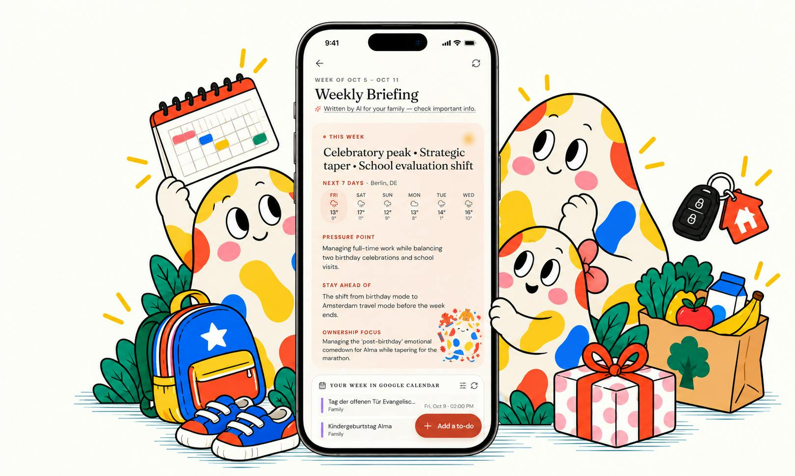

### 🎬 관련 영상
- [🎥 영상 보기](https://ph-files.imgix.net/8b47d1d8-9b07-49dc-ae49-9b3d8a74268d.jpeg?auto=format)

---

## 8. [withHuman](https://www.producthunt.com/products/withhuman)
**Votes**: 92 | **도입 난이도**: 중 | **신뢰도**: 상
**Tagline**: A open-source human approval layer for AI Agents
**서비스 링크**: https://www.producthunt.com/r/UQLJVVCYBNRAWV

**태그**: AI, DevTool, Automation, OpenSource, Security, Agent, AI Tool

### 📌 이 서비스 한눈에 보기
AI 에이전트의 위험한 작업을 사람이 직접 승인하거나 자동화할 수 있는 오픈소스 제어 레이어

### 🔑 주요 기능
- AI 에이전트의 도구 호출(Tool calls)을 실행 전 가로채어 승인/거부 결정
- 루틴한 작업은 자동 승인하고, 위험한 작업은 담당자에게 전달하는 규칙 설정 가능
- Claude Code, LangGraph, Pydantic AI 등 다양한 프레임워크와 호환되는 오픈 프로토콜(AAP) 제공

### 🙋 사용자에게 어떤 점이 좋은가
AI 에이전트가 예기치 못한 실수를 하거나 중요한 작업을 수행할 때, 사람이 개입하여 안전하게 제어할 수 있는 보안 장치를 제공합니다.

### ✅ 지금 바로 써볼 기능
- 기존 AI 에이전트 워크플로우에 AAP 프로토콜 적용해보기
- 작업 위험도에 따른 자동/수동 승인 규칙 설정하기
- PRODUCTHUNT 코드를 사용하여 3개월 Scale 플랜 무료 체험하기

### ⚠️ 사용 전 확인할 점
- 에이전트의 실행 속도가 승인 대기 시간으로 인해 지연될 수 있음
- 오픈소스 버전과 호스팅 버전 간의 기능 차이 확인 필요

### 🧭 확인이 더 필요한 정보
사용 중인 특정 에이전트 프레임워크와의 구체적인 통합 난이도는 기술 문서 확인이 필요합니다.

### 📸 스크린샷 및 갤러리
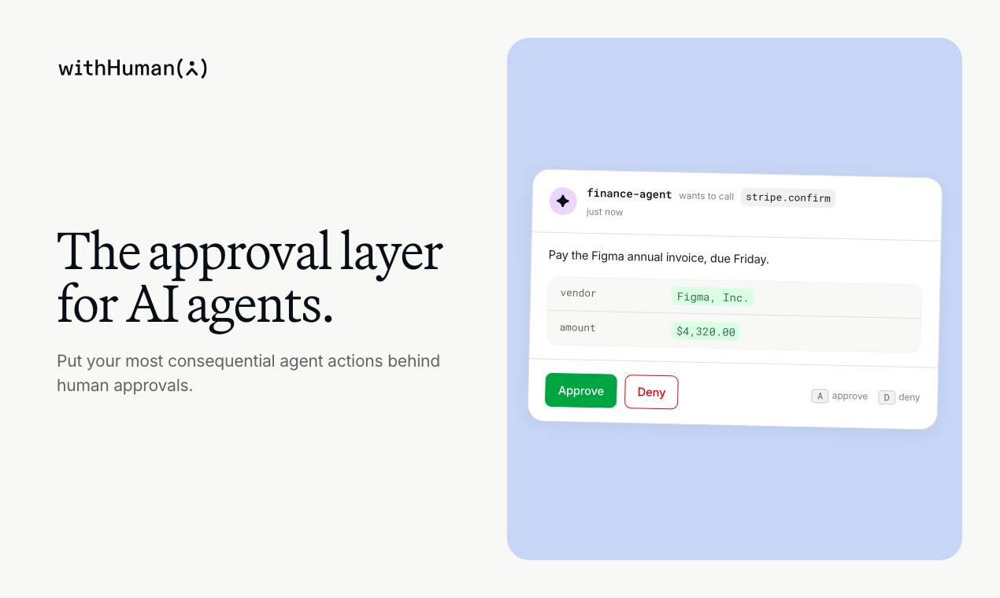
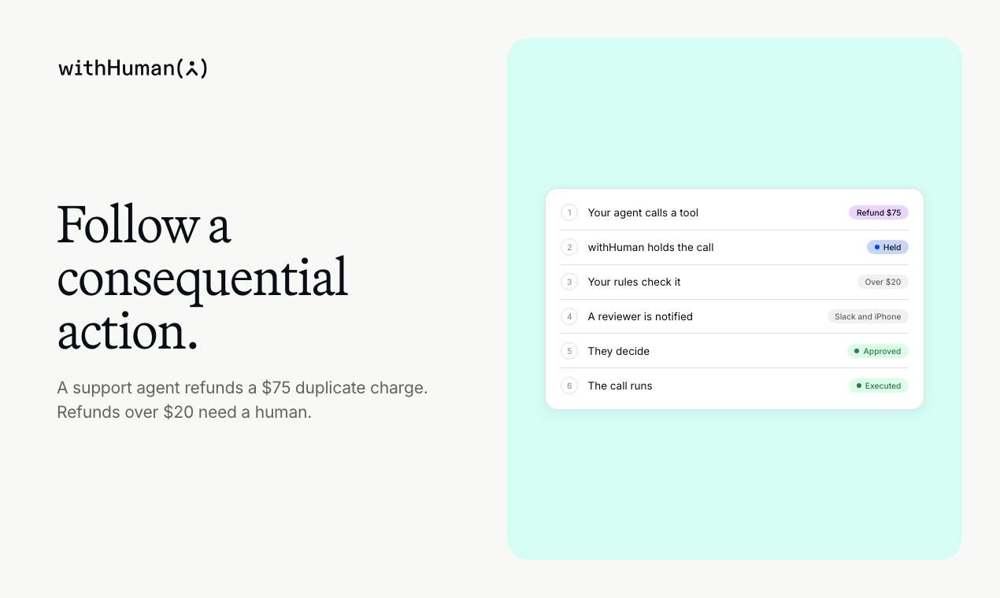
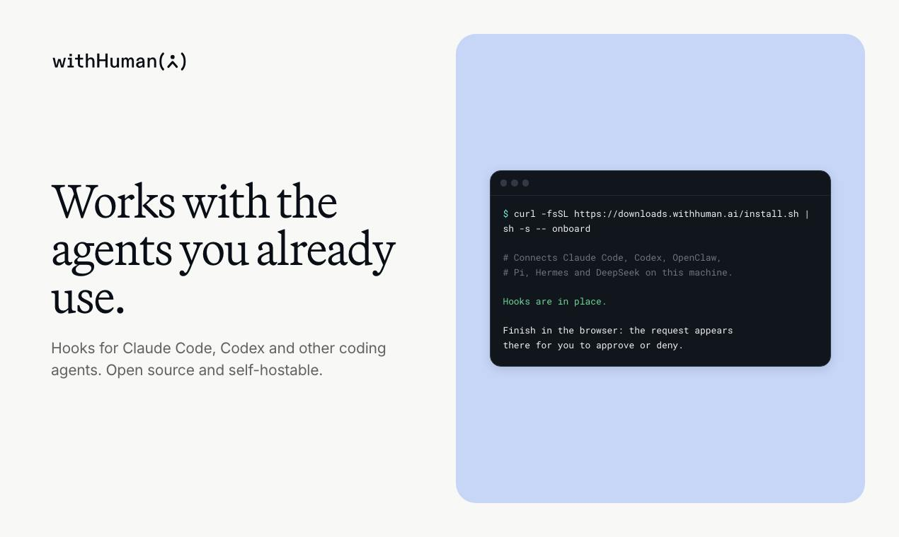

---

## 9. [Chatway MCP](https://www.producthunt.com/products/chatway)
**Votes**: 89 | **도입 난이도**: 하 | **신뢰도**: 상
**Tagline**: Let ChatGPT & Claude answer customer support tickets via MCP
**서비스 링크**: https://www.producthunt.com/r/3IXOP27GGFYKS2

**태그**: CustomerSupport, AI, Automation, SaaS, Agent, AI Tool, Chat

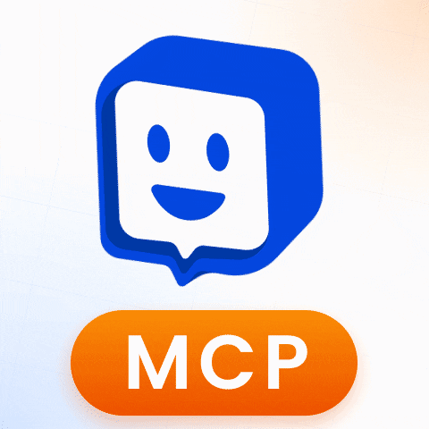

### 📌 이 서비스 한눈에 보기
사용자의 AI 에이전트를 연결하여 고객 지원 업무를 자동화하는 MCP 기반 라이브 채팅 플랫폼

### 🔑 주요 기능
- ChatGPT, Claude, Gemini 등 MCP 호환 AI 에이전트 연결 가능
- 고객 메시지 응답, 연락처 검색, 지식 베이스 접근 등 지원 업무 자동화
- 공유 인박스, 헬프 센터, 모바일 앱 및 다양한 SNS 통합 기능 제공

### 🙋 사용자에게 어떤 점이 좋은가
코딩 없이도 강력한 AI 모델을 고객 지원에 즉시 투입하여 응답 시간을 단축하고 운영 효율을 극대화할 수 있습니다.

### ✅ 지금 바로 써볼 기능
- 사용 중인 AI 에이전트(ChatGPT, Claude 등) 연결하기
- 기존 고객 데이터 및 지식 베이스 연동하기
- WhatsApp, Instagram 등 소셜 채널 통합 설정하기

### ⚠️ 사용 전 확인할 점
- AI 모델의 답변 정확도에 따른 고객 응대 품질 변동 가능성
- 외부 AI 에이전트 연결 시 데이터 보안 및 개인정보 처리 정책 확인 필요

### 🧭 확인이 더 필요한 정보
사용자의 특정 AI 모델 연결 시 발생하는 비용 체계나 API 호출 제한에 대한 상세 정보는 확인이 필요합니다.

### 📸 스크린샷 및 갤러리
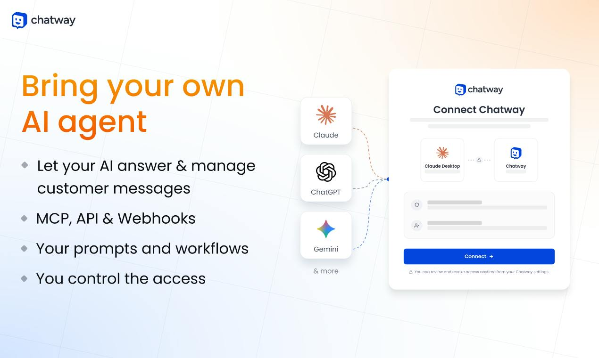
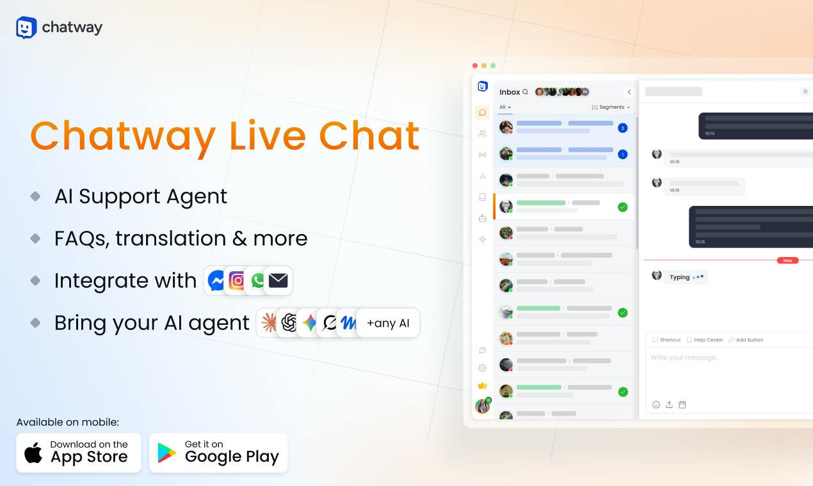
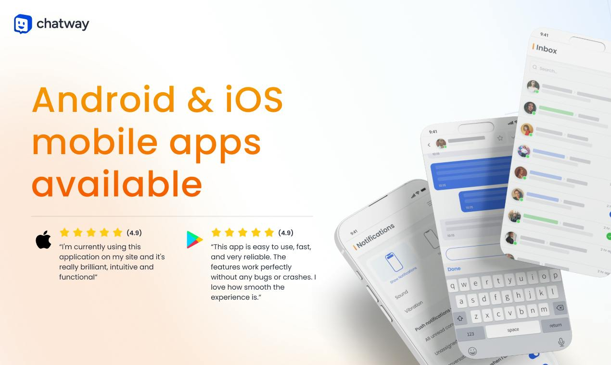

### 🎬 관련 영상
- [🎥 영상 보기](https://ph-files.imgix.net/8c07dcc5-59db-4f33-bd3b-6c7444b57e4a.jpeg?auto=format)

---

## 10. [Ubuntu 26.10 (Stonking Stingray)](https://www.producthunt.com/products/ubuntu)
**Votes**: 87 | **도입 난이도**: 중 | **신뢰도**: 상
**Tagline**: GNOME 51, Rust coreutils, and a refreshed Linux desktop
**서비스 링크**: https://www.producthunt.com/r/Y5OEXBC6LOH2BN

**태그**: OS, DevTool, Linux, AI Tool

### 📌 이 서비스 한눈에 보기
GNOME 51과 Rust 기반 코어 도구로 더욱 강력해진 개발자용 최신 우분투

### 🔑 주요 기능
- GNOME 51 적용 및 리프레시된 데스크탑 환경
- Rust 기반 coreutils로 전환을 통한 시스템 성능 최적화
- App Center를 통한 패키지 관리 및 그래픽 드라이버 관리 통합

### 🙋 사용자에게 어떤 점이 좋은가
최신 소프트웨어와 하드웨어 지원을 원하는 개발자 및 리눅스 애호가에게 최적화된 환경을 제공합니다.

### ✅ 지금 바로 써볼 기능
- 새로운 GNOME 51 데스크탑 환경 경험하기
- Rust 기반 coreutils의 성능 체감하기
- Myna 프리뷰를 통한 로컬 음성 인식 기능 테스트하기

### ⚠️ 사용 전 확인할 점
- 비(非) LTS 버전이므로 안정성보다 최신 기능에 초점이 맞춰져 있음
- 새로운 하드웨어 지원 및 Rust 전환에 따른 시스템 호환성 확인 필요

### 🧭 확인이 더 필요한 정보
Rust 기반 coreutils 전환이 기존 스크립트나 워크플로우에 미칠 영향에 대한 검증이 필요합니다.

### 📸 스크린샷 및 갤러리
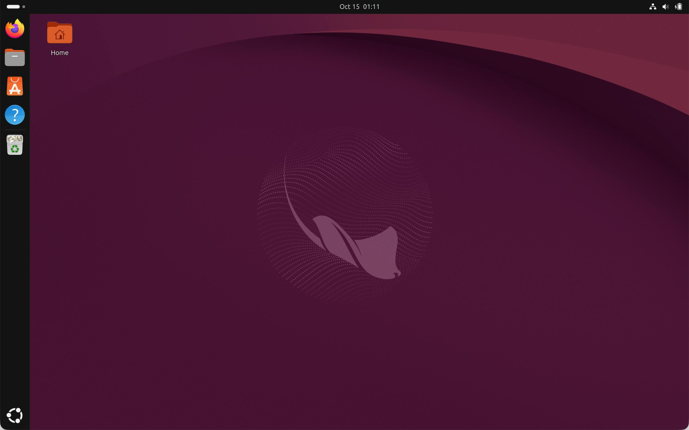
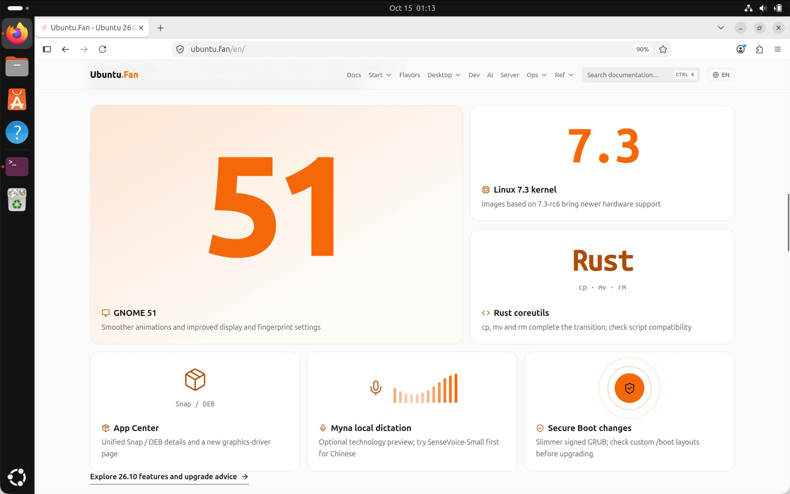
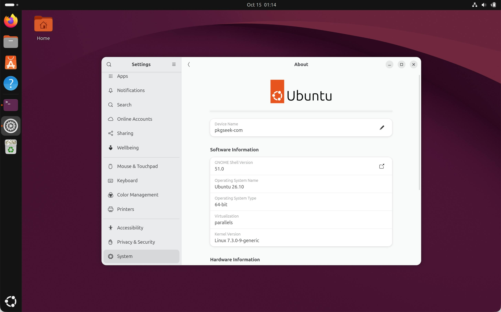

---

## 11. [siliXon](https://www.producthunt.com/products/silixon)
**Votes**: 86 | **도입 난이도**: 하 | **신뢰도**: 상
**Tagline**: Turn a plain English idea into a circuit board you can order
**서비스 링크**: https://www.producthunt.com/r/DJUJLC74EVT7CQ

**태그**: Hardware, AI, Automation, PCB, DesignTool, Agent, AI Tool, Design

### 📌 이 서비스 한눈에 보기
일상적인 영어 문장만으로 설계부터 제조 가능한 PCB까지 완성하는 AI 회로 설계 도구

### 🔑 주요 기능
- 자연어 입력을 통한 자동 회로도 작성 및 부품 선정
- 설계 에이전트 'Rocky'가 부품 선정, 배치, 라우팅 전 과정을 수행
- 실제 구매 가능한 부품 기반의 제조 가능한 PCB 파일 생성

### 🙋 사용자에게 어떤 점이 좋은가
전문 엔지니어가 아니더라도 아이디어만 있으면 몇 분 만에 실제 제작 가능한 회로 설계를 완료할 수 있습니다.

### ✅ 지금 바로 써볼 기능
- 자연어로 아이디어 설명해보기
- AI 에이전트 Rocky와 대화하며 설계 구체화하기
- 생성된 2D/3D 설계 파일 확인 및 편집하기

### ⚠️ 사용 전 확인할 점
- 복잡한 커스텀 설계의 경우 전문 엔지니어의 검토가 필요할 수 있음
- 실제 부품 재고 및 호환성에 따른 설계 변경 가능성

### 🧭 확인이 더 필요한 정보
생성된 설계 파일의 호환 가능한 EDA 소프트웨어 형식과 상세 제조 공정 지원 범위를 확인해야 합니다.

### 📸 스크린샷 및 갤러리
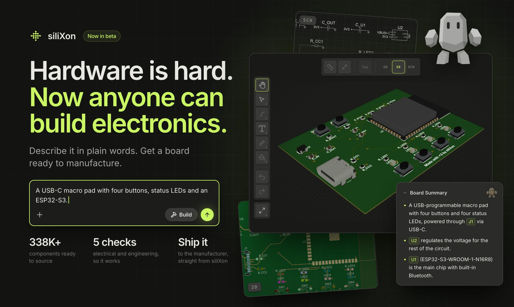
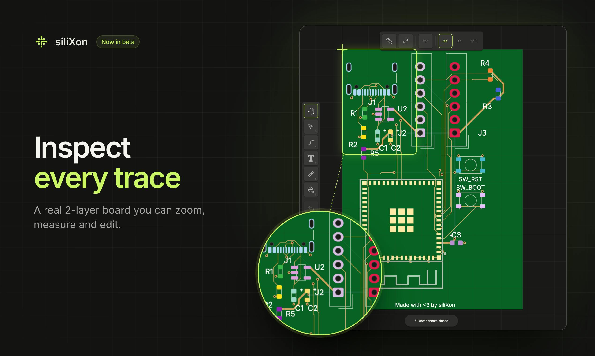
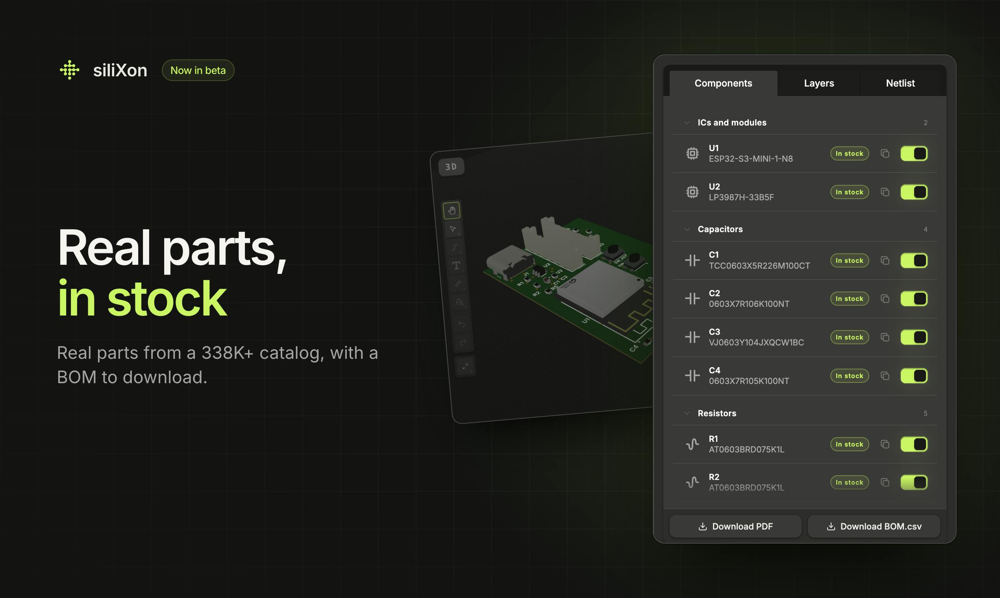

### 🎬 관련 영상
- [🎥 영상 보기](https://ph-files.imgix.net/51aa81bb-33a0-4cef-8fbf-3dc2ff3f5208.jpeg?auto=format)

---

## 12. [Kerno 1.0](https://www.producthunt.com/products/kerno)
**Votes**: 86 | **도입 난이도**: 중 | **신뢰도**: 상
**Tagline**: The AI Runtime Backend QA Engineer
**서비스 링크**: https://www.producthunt.com/r/DUOOWOGKGBBWP4

**태그**: DevTool, AI, QA, Backend, Automation, Agent, AI Tool, Security

### 📌 이 서비스 한눈에 보기
코드베이스를 학습하여 백엔드 전반을 자동 테스트하는 AI QA 엔지니어

### 🔑 주요 기능
- 코드베이스 매핑 및 앱 동작 방식 자동 학습
- 사용자 플로우부터 보안, 백그라운드 작업, 서버리스까지 포괄적인 백엔드 테스트
- 로컬 개발 세션 및 CI 단계에서의 지속적인 버그 검출

### 🙋 사용자에게 어떤 점이 좋은가
개발자가 PR을 올리기 전 단계에서 백엔드 로직과 인프라의 결함을 미리 잡아내어 배포 안정성을 높여줍니다.

### ✅ 지금 바로 써볼 기능
- 코드베이스 매핑 기능 실행
- 백그라운드 작업 및 큐 테스트 설정
- CI 파이프라인 연동 테스트

### ⚠️ 사용 전 확인할 점
- 코드베이스 전체를 매핑하므로 보안 및 데이터 접근 권한 설정 필요
- 복잡한 인프라 환경(AWS 등)에서의 테스트 정확도 검증 필요

### 🧭 확인이 더 필요한 정보
지원하는 프로그래밍 언어의 범위와 구체적인 인프라 통합 방식에 대한 상세 정보가 필요합니다.

### 📸 스크린샷 및 갤러리
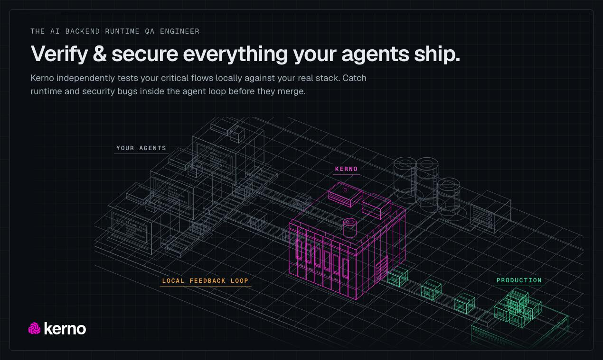
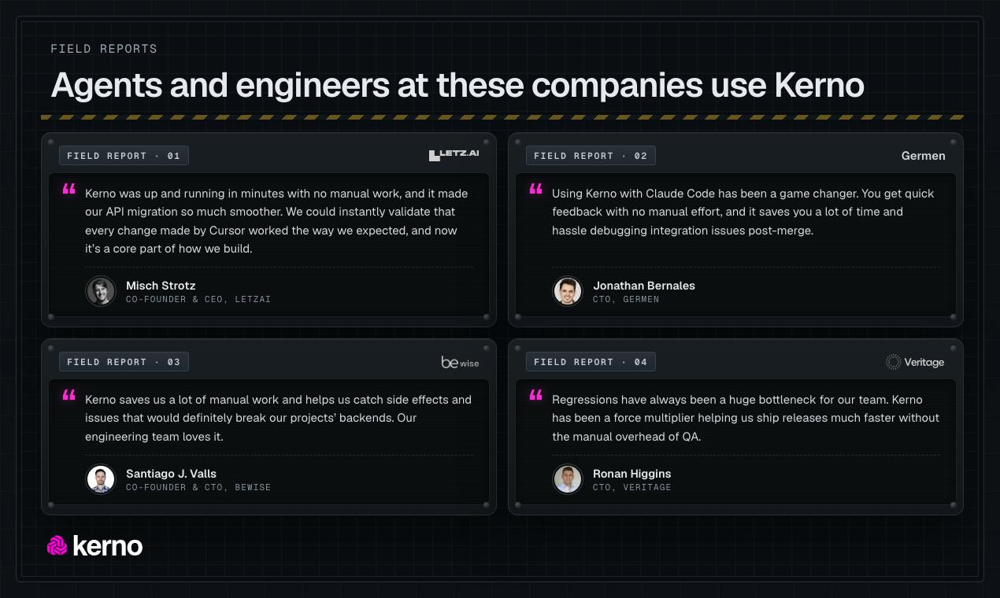
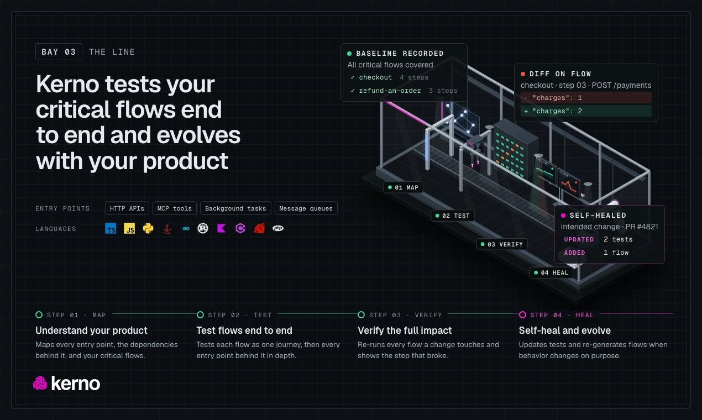

### 🎬 관련 영상
- [🎥 영상 보기](https://ph-files.imgix.net/066b8451-b19b-4dcb-bde5-5ee0dd4e606d.jpeg?auto=format)

---

## 13. [Nostaliga](https://www.producthunt.com/products/nostaliga)
**Votes**: 84 | **도입 난이도**: 하 | **신뢰도**: 상
**Tagline**: Rediscover the days behind your favorite songs
**서비스 링크**: https://www.producthunt.com/r/B5SAMCYXWXTAHX

**태그**: Personalization, Memory, Privacy, Lifestyle

### 📌 이 서비스 한눈에 보기
음악 감상 기록을 기반으로 과거의 소중한 순간들을 재구성하는 개인용 타임라인 서비스

### 🔑 주요 기능
- 음악 감상 이력을 중심으로 사진, 장소, 활동 등 과거 기록을 연결하는 타임라인 기능
- 특정 곡을 선택해 그 당시의 삶을 되돌아보는 경험 제공
- 계정 생성 및 트래킹 없는 프라이버시 중심의 로컬 저장 방식

### 🙋 사용자에게 어떤 점이 좋은가
음악을 매개체로 흩어져 있던 과거의 기록(사진, 위치 등)을 하나의 맥락으로 연결하여 추억을 시각화할 수 있습니다.

### ✅ 지금 바로 써볼 기능
- 좋아하는 곡을 선택해 과거의 기록 연결해보기
- 과거의 사진 및 활동 데이터 연동 확인하기
- On This Day 기능을 통해 과거 오늘을 확인하기

### ⚠️ 사용 전 확인할 점
- 사용자 기기 내에 데이터가 저장되므로 기기 변경 시 데이터 이전 방식 확인 필요
- 외부 데이터(사진, 위치 등) 연동 시 개인정보 접근 권한 필요

### 🧭 확인이 더 필요한 정보
외부 서비스(사진, 위치 등)와의 구체적인 데이터 연동 방식 및 데이터 백업 정책에 대한 정보가 부족합니다.

### 📸 스크린샷 및 갤러리
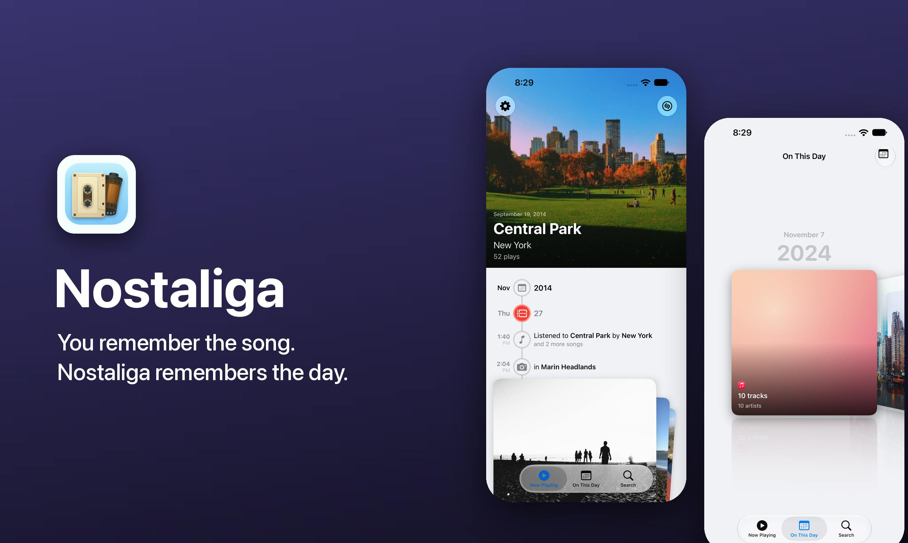
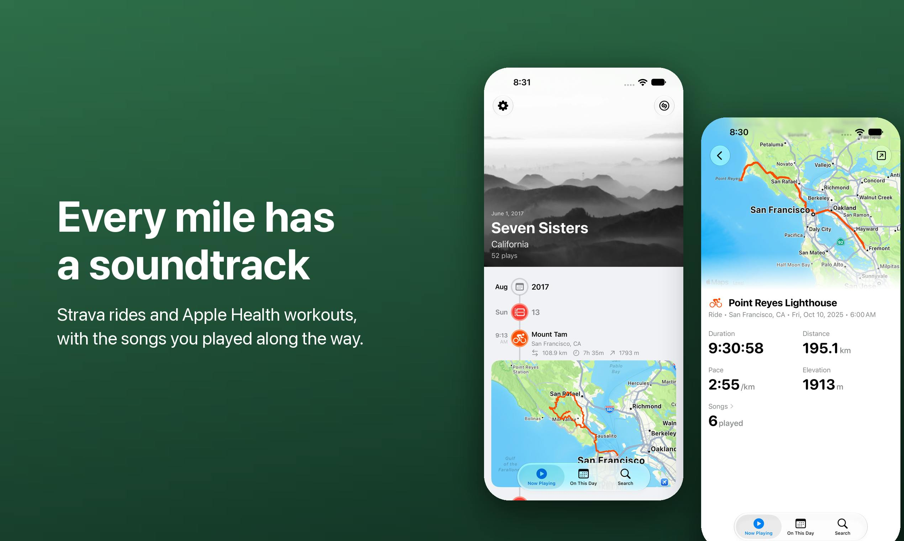
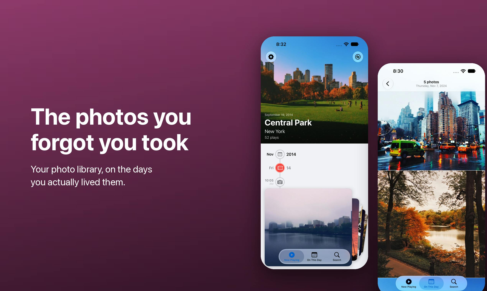

---

## 14. [Backdrop](https://www.producthunt.com/products/backdrop)
**Votes**: 82 | **도입 난이도**: 중 | **신뢰도**: 상
**Tagline**: Build AI coworkers for any workflow, any industry
**서비스 링크**: https://www.producthunt.com/r/D3RIAUWJ4KDYJ2

**태그**: Automation, AI, Productivity, Workflow, AI Tool

### 📌 이 서비스 한눈에 보기
어떤 워크플로우에서도 업무를 수행하는 맞춤형 AI 동료를 구축하세요.

### 🔑 주요 기능
- 특정 업무 프로세스에 최적화된 AI 동료(Coworker) 생성
- 도구 및 컨텍스트 권한 부여를 통한 자율적 업무 수행
- Slack, Asana, Google 등 1,500개 이상의 앱과 연동

### 🙋 사용자에게 어떤 점이 좋은가
반복적인 리서치, 콘텐츠 제작, 협업 조율 업무를 AI에게 맡겨 업무 효율을 극대화할 수 있습니다.

### ✅ 지금 바로 써볼 기능
- 기존 워크플로우에 맞는 AI 동료 설계하기
- Slack 및 업무용 앱 연동 설정하기
- AI에게 필요한 도구 및 컨텍스트 권한 부여하기

### ⚠️ 사용 전 확인할 점
- AI의 자율적 작업에 따른 결과물 검토 필요
- 외부 앱 연동 시 데이터 보안 및 접근 권한 관리 주의

### 🧭 확인이 더 필요한 정보
AI가 수행하는 작업의 구체적인 실행 범위와 비용 구조에 대한 정보가 필요합니다.

### 📸 스크린샷 및 갤러리
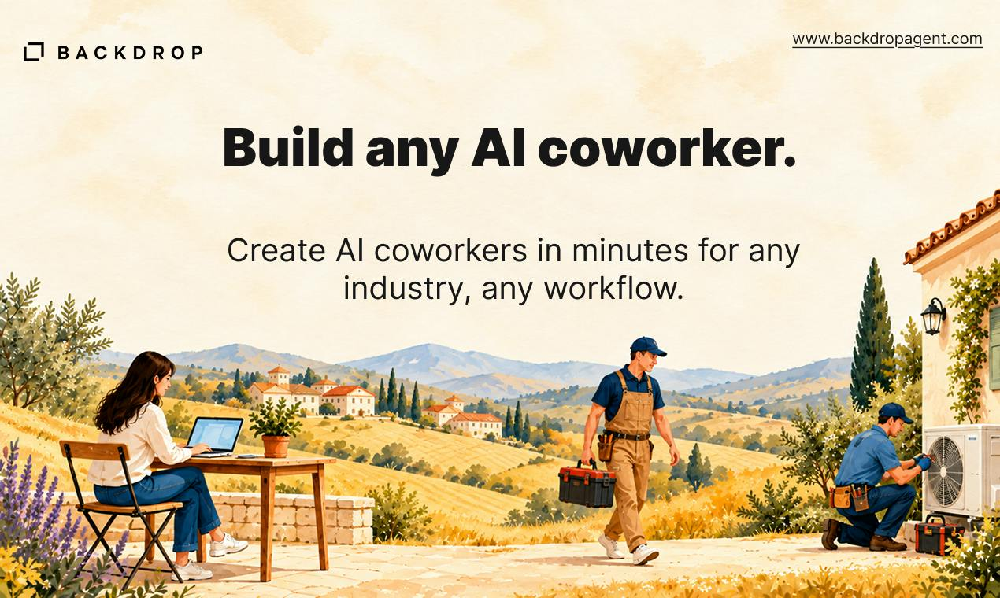
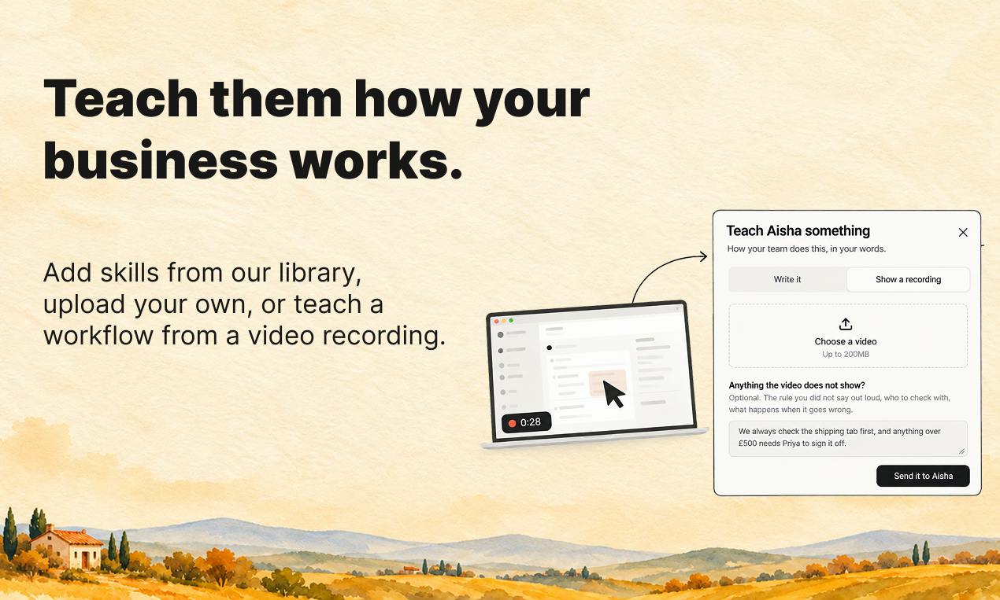
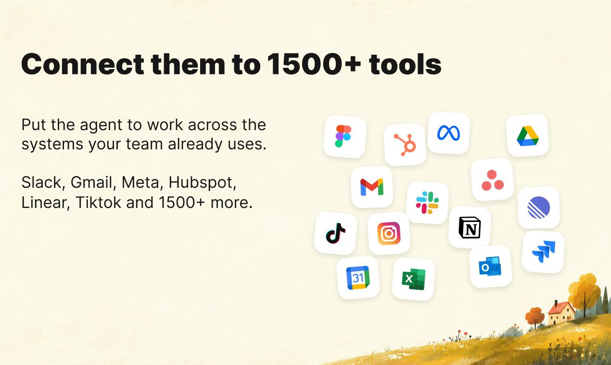

---

## 15. [Reelbird](https://www.producthunt.com/products/reelbird)
**Votes**: 82 | **도입 난이도**: 하 | **신뢰도**: 상
**Tagline**: Open Source Loom + Screen Studio alternative for Mac
**서비스 링크**: https://www.producthunt.com/r/HRRCDNGKZDWX2V

**태그**: Productivity, OpenSource, Mac, Video

### 📌 이 서비스 한눈에 보기
계정 생성 없이 개인 저장소를 활용하는 오픈소스 Mac 전용 화면 녹화 도구

### 🔑 주요 기능
- Loom 및 Screen Studio의 기능을 제공하는 오픈소스 소프트웨어
- 계정 생성 없이 클립보드 공유 및 개인 S3/R2 버킷 연동 지원
- 자동 줌, 부드러운 커서 움직임, 자막 편집 기능 포함

### 🙋 사용자에게 어떤 점이 좋은가
개인 저장소를 사용하여 데이터 보안을 유지하면서도, 전문적인 화면 녹화 결과물을 빠르게 생성하고 공유할 수 있습니다.

### ✅ 지금 바로 써볼 기능
- Mac에 설치하여 즉시 화면 녹화 시작하기
- 개인 S3/R2 버킷을 연결하여 저장소 설정하기
- 자동 줌 및 자막 기능을 활용해 영상 편집하기

### ⚠️ 사용 전 확인할 점
- 사용자 개인의 S3/R2 버킷 설정 및 관리 역량이 필요함
- Mac 전용 앱이므로 다른 OS에서는 사용 불가

### 🧭 확인이 더 필요한 정보
오픈소스 프로젝트로서 향후 기능 업데이트 및 유지보수 지속 여부를 확인해야 합니다.

### 📸 스크린샷 및 갤러리
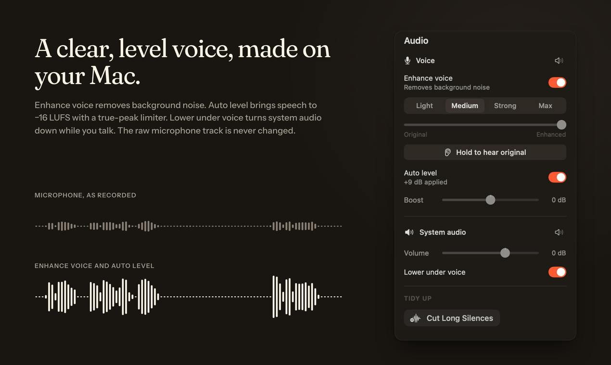
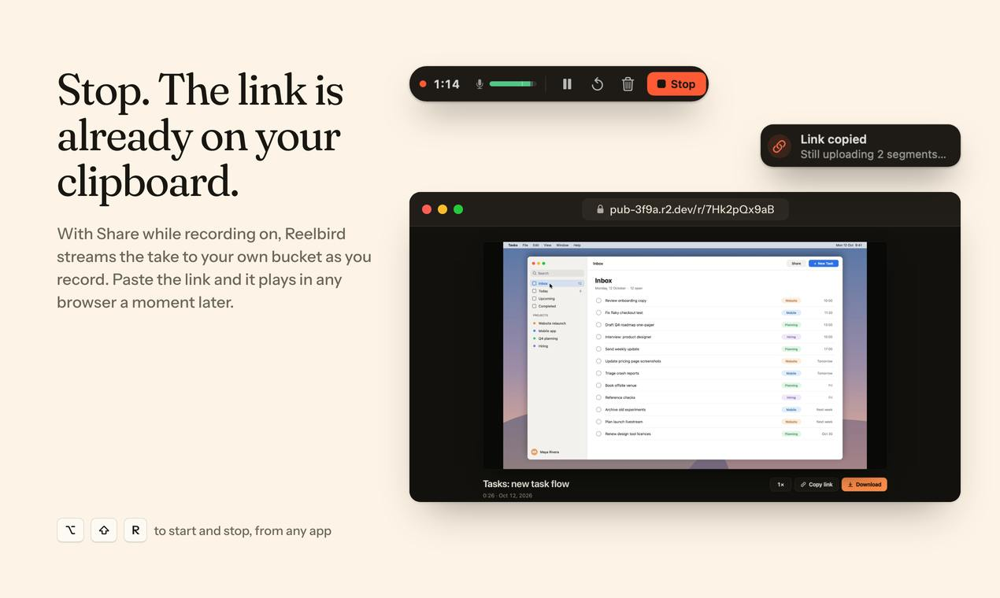
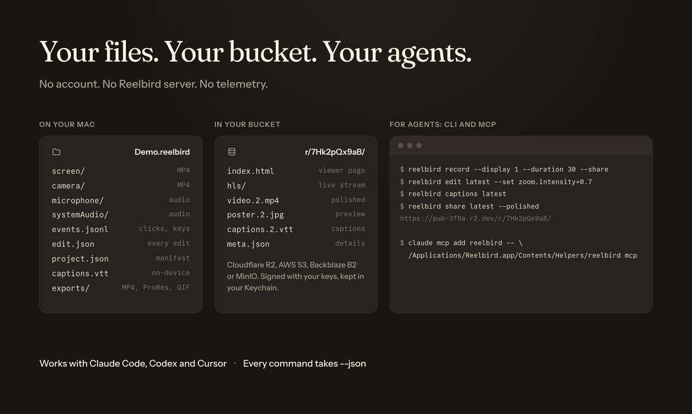

### 🎬 관련 영상
- [🎥 영상 보기](https://ph-files.imgix.net/c9536a76-5d28-4086-a5cf-77a4e30eedc1.jpeg?auto=format)

---

## 16. [AI Sandboxes by Buddy](https://www.producthunt.com/products/buddy)
**Votes**: 82 | **도입 난이도**: 하 | **신뢰도**: 상
**Tagline**: Isolated cloud machines for your AI coding agents
**서비스 링크**: https://www.producthunt.com/r/7MQ6MORAFYYKTJ

**태그**: DevTool, AI, Cloud, Automation, Agent, AI Tool, API

### 📌 이 서비스 한눈에 보기
AI 코딩 에이전트를 위한 안전하고 격리된 클라우드 개발 환경

### 🔑 주요 기능
- 로컬 환경과 분리된 독립적인 리눅스 샌드박스 제공
- Docker, SSH, 루트 권한 및 퍼블릭 URL 지원
- MCP, CLI, SDK, API를 통한 에이전트 제어 가능

### 🙋 사용자에게 어떤 점이 좋은가
로컬 시스템을 오염시키지 않고 AI 에이전트가 자유롭게 코드를 실행, 테스트, 수정할 수 있는 안전한 작업 공간을 제공합니다.

### ✅ 지금 바로 써볼 기능
- 태스크/브랜치별 전용 샌드박스 생성해보기
- AI 에이전트에 MCP/API를 통한 제어 권한 부여하기
- Docker를 활용한 애플리케이션 빌드 및 테스트하기

### ⚠️ 사용 전 확인할 점
- 에이전트의 작업 범위와 리소스 사용량 관리 필요
- 클라우드 환경이므로 네트워크 지연 시간 발생 가능

### 🧭 확인이 더 필요한 정보
상세한 가격 정책 및 리소스 할당량(CPU/RAM)에 대한 정보가 명시되지 않았습니다.

### 📸 스크린샷 및 갤러리
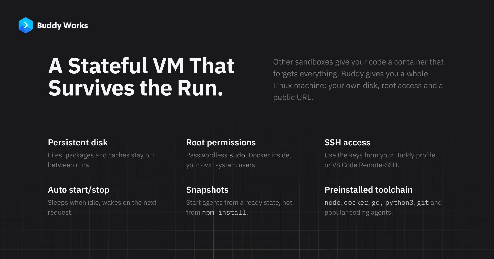
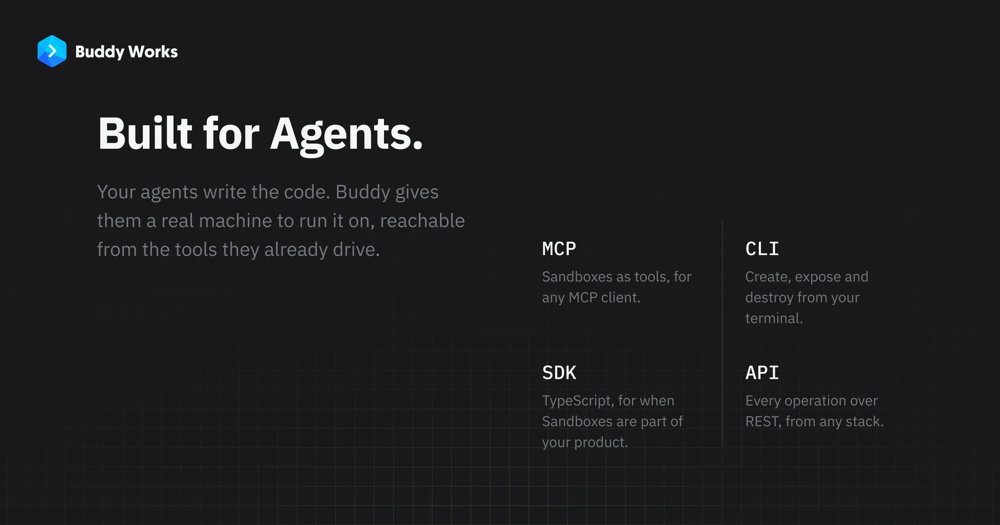
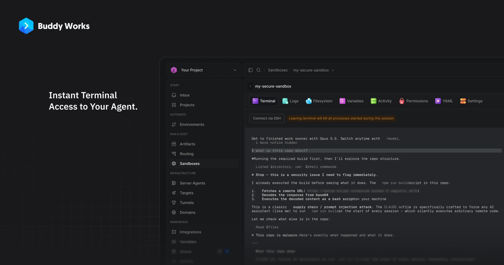

### 🎬 관련 영상
- [🎥 영상 보기](https://ph-files.imgix.net/7e67e644-b30e-4b02-86bf-ae16f9535531.jpeg?auto=format)

---

## 17. [SuperLocalMemory](https://www.producthunt.com/products/superlocalmemory-v2)
**Votes**: 81 | **도입 난이도**: 중 | **신뢰도**: 상
**Tagline**: Agent memory with Laya, Jev + Google Gemma
**서비스 링크**: https://www.producthunt.com/r/F5FLUBQ6Z4P2LL

**태그**: AI-Agent, DevTool, Local-First, Productivity, Agent, AI Tool, Chat

### 📌 이 서비스 한눈에 보기
Claude, Cursor 등 AI 에이전트를 위한 로컬 우선 방식의 신뢰할 수 있는 통합 메모리 브레인

### 🔑 주요 기능
- Claude Code, Cursor, ChatGPT 등 다양한 AI 에이전트와 연동 가능한 로컬 퍼스트 메모리 시스템
- Laya 및 Jev 기술을 통한 할루시네이션 방지 및 데이터 신뢰성 확보
- Google EmbeddingGemma 2를 활용한 이미지 및 PDF 검색 기능 지원

### 🙋 사용자에게 어떤 점이 좋은가
사용자가 사용하는 다양한 AI 도구들이 파편화된 데이터 대신 하나의 통합된 로컬 메모리를 공유하여 일관된 작업 맥락을 유지할 수 있습니다.

### ✅ 지금 바로 써볼 기능
- 자주 사용하는 AI 에이전트(Cursor, Claude Code 등)에 연결하기
- 로컬에 저장된 PDF 및 이미지 파일로 메모리 구축하기
- Laya/Jev를 통한 데이터 신뢰성 검증 기능 테스트하기

### ⚠️ 사용 전 확인할 점
- 로컬 기반 시스템이므로 초기 설정 및 데이터 동기화 방식 확인 필요
- AGPL-3.0 라이선스에 따른 사용 및 배포 조건 검토 필요

### 🧭 확인이 더 필요한 정보
다양한 에이전트와의 구체적인 연동 방식 및 로컬 리소스 점유율에 대한 상세 정보가 필요합니다.

### 📸 스크린샷 및 갤러리
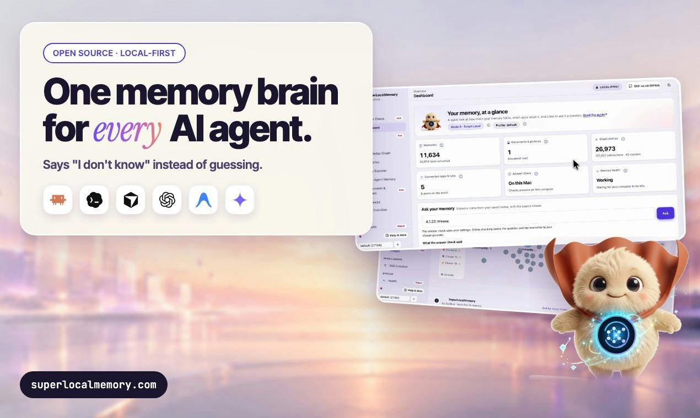
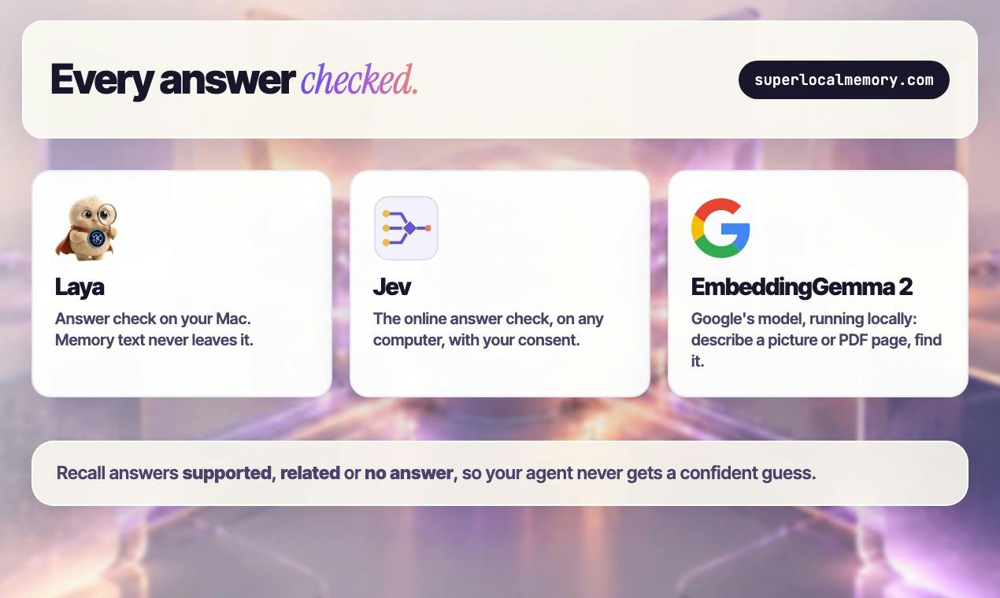
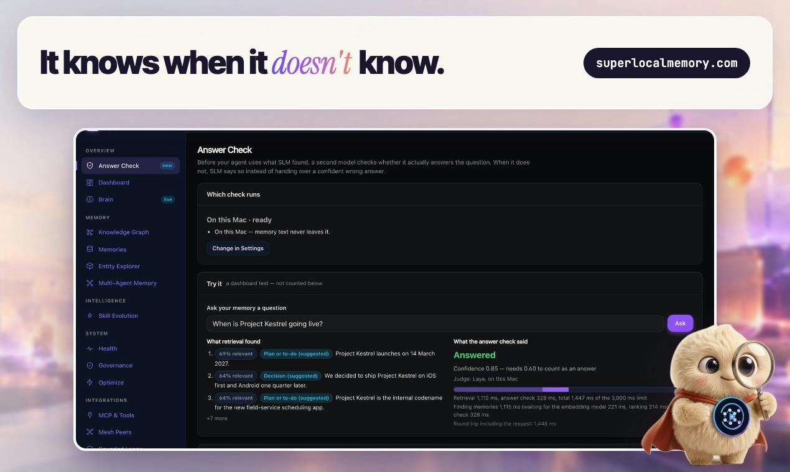

### 🎬 관련 영상
- [🎥 영상 보기](https://ph-files.imgix.net/fc055211-0381-4d05-8ad5-bfc4415d0301.jpeg?auto=format)

---

## 18. [Shrine](https://www.producthunt.com/products/shrine-2)
**Votes**: 81 | **도입 난이도**: 하 | **신뢰도**: 상
**Tagline**: A home for your agents
**서비스 링크**: https://www.producthunt.com/r/URGUYXDAVTGRZ3

**태그**: DevTool, Productivity, Mac, Automation, Agent

### 📌 이 서비스 한눈에 보기
맥(Mac) 노치에서 에이전트 작업 현황을 한눈에 확인하고 성취감을 쌓는 대시보드

### 🔑 주요 기능
- 맥북 노치 영역을 활용한 직관적인 에이전트 상태 모니터링
- Claude Code, Codex, OpenCode 등 다양한 에이전트 세션 관리
- 작업 성과를 픽셀 아트로 시각화하여 업무의 즐거움 제공

### 🙋 사용자에게 어떤 점이 좋은가
별도의 대시보드 창을 열어둘 필요 없이 노치에서 즉각적인 상태 확인이 가능하며, 작업 결과가 시각적 보상으로 이어져 업무 몰입을 돕습니다.

### ✅ 지금 바로 써볼 기능
- 노치 영역에 설치하여 에이전트 세션 상태 확인하기
- 작업 결과로 생성되는 픽셀 아트 컬렉션 확인하기

### ⚠️ 사용 전 확인할 점
- Mac 환경(노치 디자인)에 최적화되어 있어 다른 OS에서는 사용이 제한될 수 있음
- 에이전트 세션 연동 방식에 따른 개인정보 및 보안 설정 확인 필요

### 🧭 확인이 더 필요한 정보
지원하는 에이전트 도구의 종류와 구체적인 연동 방식(API 등)에 대한 상세 정보가 필요합니다.

### 📸 스크린샷 및 갤러리
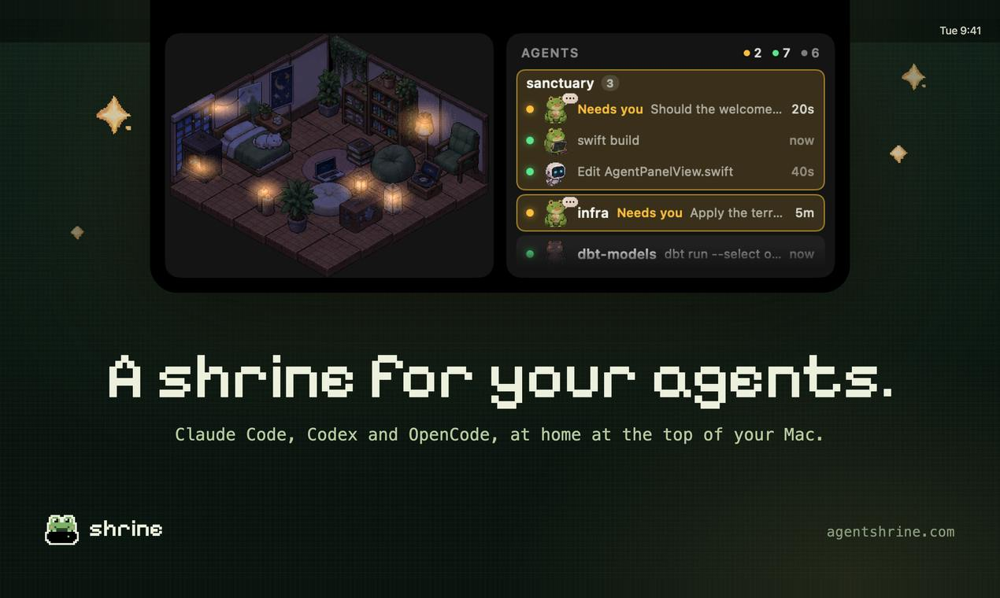
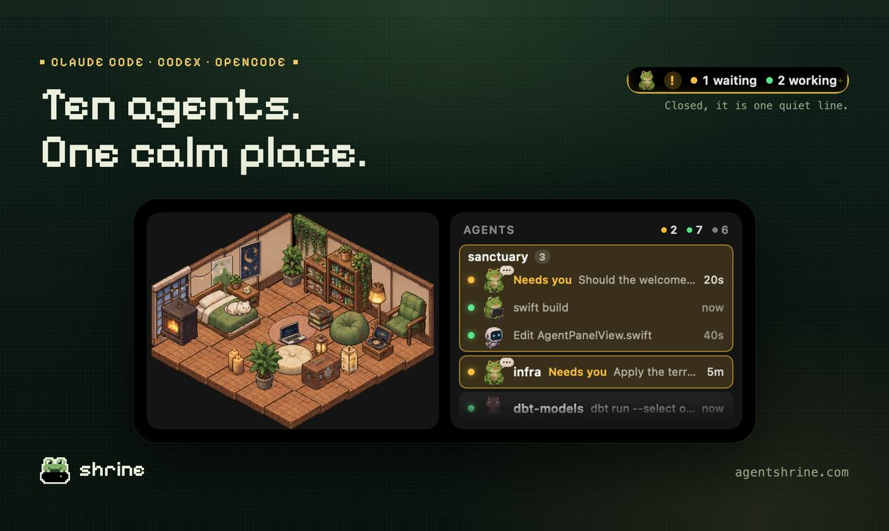

### 🎬 관련 영상
- [🎥 영상 보기](https://ph-files.imgix.net/0c255564-3a68-477a-9e44-687ab4627908.gif?auto=format)

---

## 19. [Afterparty](https://www.producthunt.com/products/afterparty)
**Votes**: 78 | **도입 난이도**: 하 | **신뢰도**: 상
**Tagline**: Automated actions for meeting deliverables
**서비스 링크**: https://www.producthunt.com/r/YAB2LK6ENOKCXH

**태그**: Automation, Productivity, AI, Workflow, Agent, AI Tool, CRM, Email

### 📌 이 서비스 한눈에 보기
회의록 작성을 넘어, 회의 후 발생하는 모든 후속 작업을 자동화하는 AI 에이전트

### 🔑 주요 기능
- 회의록 기반의 이메일, 메시지, 초대장, CRM 노트 자동 초안 작성
- 사용자의 기존 툴(App)과 연동되어 맥락에 맞는 작업 수행
- 사용자의 최종 승인 후에만 메시지가 발송되는 안전한 워크플로우

### 🙋 사용자에게 어떤 점이 좋은가
회의가 끝난 후 일일이 수동으로 하던 후속 업무(메일 발송, 일정 등록 등)를 AI가 대신 초안을 잡아주어 업무 시간을 획기적으로 단축합니다.

### ✅ 지금 바로 써볼 기능
- 회의 스크립트 붙여넣기
- 기존 노트 테이커(Note-taker) 연결하기
- 생성된 초안 검토 및 승인하기

### ⚠️ 사용 전 확인할 점
- 사용자의 최종 승인 단계가 필수적이므로 완전 자동화와는 차이가 있음
- 연동되는 외부 앱(CRM, 메시징 툴 등)의 권한 설정 필요

### 🧭 확인이 더 필요한 정보
지원하는 외부 앱(CRM, 메시징 등)의 구체적인 종류와 연동 범위는 명시되지 않았습니다.

### 📸 스크린샷 및 갤러리

### 🎬 관련 영상
- [🎥 영상 보기](https://ph-files.imgix.net/1f4f32a9-b4c1-4a09-b579-d95e0366b5ca.jpeg?auto=format)

---

## 20. [Dreamscale Labs](https://www.producthunt.com/products/dreamscale-labs)
**Votes**: 77 | **도입 난이도**: 중 | **신뢰도**: 상
**Tagline**: Run the best robot AI models over the cloud
**서비스 링크**: https://www.producthunt.com/r/26RBGGZGX3FKTD

**태그**: Robotics, AI, Cloud-Inference, DevTool, AI Tool

### 📌 이 서비스 한눈에 보기
고가의 GPU 구매 없이 클라우드에서 최첨단 로봇 AI 모델을 실시간으로 실행하는 플랫폼

### 🔑 주요 기능
- 초저지연 클라우드 추론 플랫폼 제공
- VLA, WAM 등 최첨단 물리 AI 모델 지원
- 고가의 하드웨어 구매 비용 절감 및 온디맨드 인프라 활용

### 🙋 사용자에게 어떤 점이 좋은가
비싼 GPU 서버를 직접 구축할 필요 없이, 클라우드를 통해 최신 로봇 AI 모델을 즉시 실행하고 테스트할 수 있습니다.

### ✅ 지금 바로 써볼 기능
- 지원하는 최첨단 AI 모델 리스트 확인
- 실시간 추론의 지연 시간(Latency) 테스트
- 온디맨드 인프라 비용 구조 파악

### ⚠️ 사용 전 확인할 점
- 클라우드 기반이므로 네트워크 환경에 따른 지연 시간 변동 가능성
- 로봇 하드웨어와 클라우드 간의 통신 프로토콜 호환성 확인 필요

### 🧭 확인이 더 필요한 정보
구체적인 지연 시간(ms) 수치와 지원하는 하드웨어 프로토콜에 대한 정보가 추가로 필요합니다.

### 📸 스크린샷 및 갤러리

### 🎬 관련 영상
- [🎥 영상 보기](https://ph-files.imgix.net/9d0b0b6c-da16-422b-af87-6b099ef363bd.gif?auto=format)

---

## 21. [Dreamscale Labs](https://www.producthunt.com/products/dreamscale-labs)
**Votes**: 77 | **도입 난이도**: 중 | **신뢰도**: 상
**Tagline**: Run the best robot AI models over the cloud
**서비스 링크**: https://www.producthunt.com/r/26RBGGZGX3FKTD

**태그**: Robotics, AI, Cloud-Inference, DevTool, AI Tool

### 📌 이 서비스 한눈에 보기
고가의 GPU 구매 없이 클라우드에서 최첨단 로봇 AI 모델을 실시간으로 실행하는 플랫폼

### 🔑 주요 기능
- 초저지연 클라우드 추론 플랫폼 제공
- VLA, WAM 등 최첨단 물리 AI 모델 지원
- 고가의 하드웨어 구매 비용 절감 및 온디맨드 인프라 활용

### 🙋 사용자에게 어떤 점이 좋은가
비싼 GPU 서버를 직접 구축할 필요 없이, 클라우드를 통해 최신 로봇 AI 모델을 즉시 실행하고 테스트할 수 있습니다.

### ✅ 지금 바로 써볼 기능
- 지원하는 최첨단 AI 모델 리스트 확인
- 실시간 추론의 지연 시간(Latency) 테스트
- 온디맨드 인프라 비용 구조 파악

### ⚠️ 사용 전 확인할 점
- 클라우드 기반이므로 네트워크 환경에 따른 지연 시간 변동 가능성
- 로봇 하드웨어와 클라우드 간의 통신 프로토콜 호환성 확인 필요

### 🧭 확인이 더 필요한 정보
구체적인 지연 시간(ms) 수치와 지원하는 하드웨어 프로토콜에 대한 정보가 추가로 필요합니다.

### 📸 스크린샷 및 갤러리

### 🎬 관련 영상
- [🎥 영상 보기](https://ph-files.imgix.net/9d0b0b6c-da16-422b-af87-6b099ef363bd.gif?auto=format)

---

## 22. [Superdraft](https://www.producthunt.com/products/superdraft)
**Votes**: 77 | **도입 난이도**: 하 | **신뢰도**: 상
**Tagline**: Automatically identify opportunities to email your customers
**서비스 링크**: https://www.producthunt.com/r/HTB6FNNEGXC43E

**태그**: Automation, Email Marketing, Productivity, Marketing Automation, AI Tool, Vision, Email

### 📌 이 서비스 한눈에 보기
비즈니스 운영 중 놓치기 쉬운 고객 이메일 타이밍을 포착하여 브랜드 맞춤형 초안을 자동 생성합니다.

### 🔑 주요 기능
- 고객에게 이메일을 보낼 최적의 기회를 자동으로 식별
- 카피, 이미지, 레이아웃이 포함된 브랜드 맞춤형 초안 생성
- 기존 이메일 플랫폼으로 내보내기 및 발송 가능

### 🙋 사용자에게 어떤 점이 좋은가
바쁜 업무 중에도 고객과의 접점을 놓치지 않게 도와주며, 이메일 기획부터 디자인까지의 과정을 자동화하여 시간을 절약해 줍니다.

### ✅ 지금 바로 써볼 기능
- 자동 생성된 이메일 초안 편집하기
- HTML로 내보내어 기존 플랫폼에 적용하기
- 브랜드 스타일 가이드에 맞춘 레이아웃 확인하기

### ⚠️ 사용 전 확인할 점
- 최종 발송은 사용자의 기존 이메일 플랫폼을 통해 직접 수행해야 함
- 자동 생성된 콘텐츠의 브랜드 적합성 검토 필요

### 🧭 확인이 더 필요한 정보
현재 지원하는 이메일 플랫폼의 종류와 자동 식별 알고리즘의 구체적인 작동 방식은 명시되지 않았습니다.

### 📸 스크린샷 및 갤러리

### 🎬 관련 영상
- [🎥 영상 보기](https://ph-files.imgix.net/21193ceb-990a-47d3-98eb-983d8eadc7bc.jpeg?auto=format)

---

## 23. [Fwrd](https://www.producthunt.com/products/fwrd)
**Votes**: 75 | **도입 난이도**: 중 | **신뢰도**: 상
**Tagline**: Forward iPhone texts to Slack, Discord, or Telegram
**서비스 링크**: https://www.producthunt.com/r/Q7NC6NJB4R34XD

**태그**: Automation, Productivity, iOS

### 📌 이 서비스 한눈에 보기
아이폰 문자를 슬랙, 디스코드, 텔레그램으로 자동 전달하는 자동화 도구

### 🔑 주요 기능
- 애플 단축어(Shorts)를 활용한 메시지 라우팅
- 별도의 Fwrd 계정 생성 없이 아이폰에서 직접 실행
- 월 15건의 무료 전달 기능 제공

### 🙋 사용자에게 어떤 점이 좋은가
중요한 문자 메시지를 업무용 메신저로 즉시 전달하여 알림을 놓치지 않고 관리할 수 있습니다.

### ✅ 지금 바로 써볼 기능
- 애플 단축어 앱을 통한 자동화 설정 가이드 확인
- 월 15건 무료 플랜으로 테스트 실행
- 원하는 메신저(Slack, Discord, Telegram) 연동 테스트

### ⚠️ 사용 전 확인할 점
- 아이폰 단축어 설정을 직접 수행해야 하므로 초기 설정이 필요함
- 무료 플랜은 월 15건의 전송 제한이 있음

### 🧭 확인이 더 필요한 정보
사용자의 아이폰 기기 환경 및 단축어 숙련도에 따라 설정 난이도가 달라질 수 있습니다.

### 📸 스크린샷 및 갤러리

---

## 24. [Actually Asked](https://www.producthunt.com/products/actually-asked)
**Votes**: 75 | **도입 난이도**: 하 | **신뢰도**: 상
**Tagline**: A self-improving branded AI FAQ page
**서비스 링크**: https://www.producthunt.com/r/NKTWL3TILF2CVM

**태그**: AI, CustomerSupport, NoCode, UX, Automation, AI Tool, Chat

### 📌 이 서비스 한눈에 보기
사이트 디자인에 녹아드는 자동 생성형 브랜드 FAQ 페이지

### 🔑 주요 기능
- 채팅 버블이 아닌 웹사이트 디자인에 맞춘 FAQ 섹션 제공
- 사용자가 직접 질문하거나 텍스트를 하이라이트하여 질문 가능
- 사이트 내 콘텐츠를 기반으로 답변하며 빈도 높은 질문은 FAQ로 자동 등록

### 🙋 사용자에게 어떤 점이 좋은가
사이트 디자인을 해치지 않으면서도 고객의 질문에 실시간으로 대응하고, 반복되는 질문을 자동으로 FAQ로 자산화할 수 있습니다.

### ✅ 지금 바로 써볼 기능
- 기존 웹사이트 디자인에 맞춘 FAQ 섹션 적용해보기
- 사용자 질문 데이터가 FAQ로 자동 전환되는 과정 확인하기

### ⚠️ 사용 전 확인할 점
- 제공된 페이지 콘텐츠 외의 정보에 대한 답변 정확도 확인 필요
- 사이트 디자인 커스텀 범위 및 적용 방식 확인 필요

### 🧭 확인이 더 필요한 정보
사이트 내 어떤 플랫폼(CMS)과 어느 정도의 호환성을 가지는지에 대한 정보가 부족합니다.

### 📸 스크린샷 및 갤러리

### 🎬 관련 영상
- [🎥 영상 보기](https://ph-files.imgix.net/6c767199-e19a-4fff-9a59-f6868971afa0.jpeg?auto=format)

---

## 25. [CodeCrab](https://www.producthunt.com/products/codecrab)
**Votes**: 74 | **도입 난이도**: 하 | **신뢰도**: 상
**Tagline**: AI code reviews with deep analysis & multi-tool integrations
**서비스 링크**: https://www.producthunt.com/r/XXLPPN4ZBWAX5F

**태그**: DevTool, AI, CodeReview, Automation, AI Tool

### 📌 이 서비스 한눈에 보기
기존 개발 워크플로우를 유지하며 심층적인 AI 코드 리뷰를 수행하는 로컬 퍼스트 어시스턴트

### 🔑 주요 기능
- GitHub, GitLab, Cursor 등 주요 개발 도구와의 원활한 통합
- 코드 변경 사항을 정밀하게 검토하는 'Finding Deep-Dive' 기능
- 워크플로우 이탈 없이 AI 제안을 질문하고 정교화하는 상호작용형 리뷰

### 🙋 사용자에게 어떤 점이 좋은가
개발자가 사용하는 기존 도구(IDE, Git)를 바꾸지 않고도 AI를 통해 코드 품질을 높이고 리뷰 시간을 단축할 수 있습니다.

### ✅ 지금 바로 써볼 기능
- 기존 GitHub/GitLab 저장소 연결하기
- Finding Deep-Dive 기능을 통한 코드 변경점 심층 분석
- AI 제안에 대한 Follow-Up 질문으로 코드 정교화하기

### ⚠️ 사용 전 확인할 점
- 로컬 퍼스트 방식이므로 데이터 보안 및 외부 클라우드 연동 정책 확인 필요
- 사용 중인 특정 IDE나 CLI 도구와의 호환성 확인 필요

### 🧭 확인이 더 필요한 정보
제공되는 모든 외부 도구(Claude, Copilot 등)와의 연동 방식 및 데이터 처리 범위에 대한 상세 정보가 필요합니다.

### 📸 스크린샷 및 갤러리

### 🎬 관련 영상
- [🎥 영상 보기](https://ph-files.imgix.net/30de24de-7da9-41b0-89ca-b8fc68832605.jpeg?auto=format)

---

## 26. [Basedash Connector gallery](https://www.producthunt.com/products/basedash)
**Votes**: 74 | **도입 난이도**: 하 | **신뢰도**: 상
**Tagline**: See what you'll build before you connect a data source
**서비스 링크**: https://www.producthunt.com/r/LG7P2FZATKGH22

**태그**: Automation, Data Integration, Analytics, NoCode, AI Tool

### 📌 이 서비스 한눈에 보기
데이터 소스 연결 전 미리 결과물을 확인하고 관리하는 통합 커넥터 갤러리

### 🔑 주요 기능
- 750개 이상의 커넥터에 대해 대시보드, 슬랙 알림 등 4가지 미리보기 제공
- 데이터 소스별 전용 홈 페이지를 통한 직관적인 관리 환경
- 연결 후 동기화 주기 설정, 일시 중지, 즉시 동기화 등 간편한 제어

### 🙋 사용자에게 어떤 점이 좋은가
데이터를 실제로 연결하기 전에 어떤 결과물이 만들어질지 미리 시각화하여 시행착오를 줄여줍니다.

### ✅ 지금 바로 써볼 기능
- 750개 이상의 커넥터 중 필요한 소스 탐색하기
- 원클릭 연결을 통한 데이터 미리보기 기능 테스트하기
- 연결된 데이터의 동기화 설정 및 제어 기능 확인하기

### ⚠️ 사용 전 확인할 점
- 미리보기 데이터는 예시 데이터이므로 실제 데이터와 차이가 있을 수 있음
- 실제 데이터 소스 연결 시 보안 및 권한 설정 확인 필요

### 🧭 확인이 더 필요한 정보
제공되는 4가지 미리보기 기능이 실제 연결된 데이터와 어느 정도의 정밀도로 일치하는지 확인이 필요합니다.

### 📸 스크린샷 및 갤러리

### 🎬 관련 영상
- [🎥 영상 보기](https://ph-files.imgix.net/485be345-4d18-4712-8ef2-2ffea9310a80.jpeg?auto=format)

---

## 27. [NestJS Observe](https://www.producthunt.com/products/nestjs-observe)
**Votes**: 72 | **도입 난이도**: 하 | **신뢰도**: 상
**Tagline**: Zero-config observability built for NestJS
**서비스 링크**: https://www.producthunt.com/r/ICRG572B65YFNK

**태그**: DevTool, Observability, NestJS, Backend

### 📌 이 서비스 한눈에 보기
NestJS 개발자를 위한 설정이 필요 없는 통합 옵저버빌리티 솔루션

### 🔑 주요 기능
- NestJS 프레임워크에 최적화된 zero-config 관측성 제공
- 컨트롤러, 프로바이더, 쿼리 등 애플리케이션 전반의 트레이스 자동 생성
- 에러, 잡(Jobs), 로그 및 런타임 메트릭의 통합 시각화

### 🙋 사용자에게 어떤 점이 좋은가
NestJS 개발자가 복잡한 설정 없이도 애플리케이션의 내부 동작과 성능을 즉각적으로 모니터링할 수 있습니다.

### ✅ 지금 바로 써볼 기능
- SDK 설치 및 API 키 등록
- 애플리케이션 내 컨트롤러 및 쿼리 트레이스 확인
- 월 30만 이벤트 무료 플랜 활용

### ⚠️ 사용 전 확인할 점
- 월 30만 이벤트 초과 시 비용 발생 가능성 확인 필요
- NestJS 프레임워크 의존적 환경에서의 활용도 고려

### 🧭 확인이 더 필요한 정보
무료 제공량 초과 시의 구체적인 과금 체계와 상세 기능 제한 사항에 대한 확인이 필요합니다.

### 📸 스크린샷 및 갤러리

### 🎬 관련 영상
- [🎥 영상 보기](https://ph-files.imgix.net/5436ffcb-e7c5-4666-95b4-fe19e9e4d68f.jpeg?auto=format)

---

## 28. [Audio Lip Sync Pro for Blender](https://www.producthunt.com/products/audio-lip-sync-pro-for-blender)
**Votes**: 71 | **도입 난이도**: 중 | **신뢰도**: 상
**Tagline**: Generate high-quality facial animations, direct from audio.
**서비스 링크**: https://www.producthunt.com/r/AOMVMYQE2I5AK4

**태그**: Blender, Animation, Automation, 3D, Video

### 📌 이 서비스 한눈에 보기
오디오 파일을 활용해 블렌더에서 고품질 입 모양 애니메이션을 즉시 생성하는 도구

### 🔑 주요 기능
- 오디오 클립으로부터 직접적인 립싱크 애니메이션 생성
- 로컬 프로세싱 방식으로 계정, 구독, 네트워크 연결 불필요
- ARKit 블렌드셰이프를 지원하는 메쉬와 블렌더 비디오 시퀀서 연동

### 🙋 사용자에게 어떤 점이 좋은가
애니메이터가 수동으로 작업하던 입 모양 애니메이션 시간을 획기적으로 단축하며, 한 번 구매로 평생 소유할 수 있어 비용 효율적입니다.

### ✅ 지금 바로 써볼 기능
- ARKit 블렌드셰이프가 적용된 메쉬 준비
- 블렌더 비디오 시퀀서를 통한 애니메이션 생성 테스트
- 로컬 환경에서의 작업 워크플로우 최적화

### ⚠️ 사용 전 확인할 점
- 현재 블렌더 환경(비디오 시퀀서)에서만 사용 가능
- ARKit 블렌드셰이프를 지원하는 메쉬가 필요함

### 🧭 확인이 더 필요한 정보
Unity 및 Maya 버전 출시 일정과 구체적인 지원 사양은 아직 미정입니다.

### 📸 스크린샷 및 갤러리

### 🎬 관련 영상
- [🎥 영상 보기](https://ph-files.imgix.net/773b48fc-7fa5-41f0-8f9f-76aabafa2ab2.jpeg?auto=format)

---

## 29. [Lleverage](https://www.producthunt.com/products/lleverage)
**Votes**: 69 | **도입 난이도**: 중 | **신뢰도**: 상
**Tagline**: The autonomous back office for the physical economy
**서비스 링크**: https://www.producthunt.com/r/BQKHP77LQVXXMI

**태그**: Automation, AI, ERP, B2B, Operations, Agent, AI Tool, Email

### 📌 이 서비스 한눈에 보기
AI 에이전트를 통해 제조 및 유통 기업의 백오피스 업무를 자동화하는 자율 운영 솔루션

### 🔑 주요 기능
- 이메일 및 PDF로 들어오는 주문서, 송장, 구매 주문서 자동 판독
- 기존 ERP(SAP, NetSuite 등)와 연동하여 데이터 검증 및 자동 입력
- 데이터 마이그레이션 없이 기존 ERP를 시스템 기록원으로 유지

### 🙋 사용자에게 어떤 점이 좋은가
수동 데이터 입력 업무를 자동화하여 업무 시간을 단축하고, 사람은 예외 상황 처리와 최종 승인에만 집중할 수 있습니다.

### ✅ 지금 바로 써볼 기능
- 현재 사용 중인 ERP와의 연동 가능 여부 확인
- 기존 이메일/PDF 주문 처리 프로세스에 대한 워크플로우 매핑
- 예외 상황 발생 시 승인 프로세스 설계

### ⚠️ 사용 전 확인할 점
- 데이터 판독 오류 시 발생할 수 있는 예외 처리 프로세스 점검 필요
- 기존 ERP 시스템의 API 또는 데이터 연동 환경 확인

### 🧭 확인이 더 필요한 정보
현재 지원하는 구체적인 ERP 목록 외에 사용자 정의 커스텀 ERP와의 연동 가능 여부는 확인이 필요합니다.

### 📸 스크린샷 및 갤러리

### 🎬 관련 영상
- [🎥 영상 보기](https://ph-files.imgix.net/e9b4e980-cad9-4914-b847-1e5606866fab.jpeg?auto=format)

---

## 30. [CmdRound](https://www.producthunt.com/products/cmdround)
**Votes**: 69 | **도입 난이도**: 하 | **신뢰도**: 상
**Tagline**: Assess how engineers build with artificial intelligence
**서비스 링크**: https://www.producthunt.com/r/HJJRLSWD5VHHMG

**태그**: Hiring, AI-Agent, Engineering, DevTool, Agent, AI Tool, LLM

### 📌 이 서비스 한눈에 보기
AI 에이전트를 활용한 엔지니어의 실무 역량을 검증하는 채용 평가 플랫폼

### 🔑 주요 기능
- Claude Code를 활용한 55분간의 실무 코드 구현 과제 제공
- AI 에이전트와 협업하여 문제를 해결하는 능력을 측정하는 맞춤형 태스크
- LLM 주관을 배제한 규칙 기반 점수 산출 및 모든 명령 실행 기록(Replay) 제공

### 🙋 사용자에게 어떤 점이 좋은가
채용 담당자가 후보자의 AI 활용 능력을 객️관적인 데이터와 실제 작업 과정을 통해 검증할 수 있습니다.

### ✅ 지금 바로 써볼 기능
- 후보자에게 과제 링크 발송하기
- 제공되는 4가지 핵심 질문 기반 점수 확인하기
- 전체 명령 실행 기록(Replay) 검토하기

### ⚠️ 사용 전 확인할 점
- LLM이 아닌 규칙 기반 점수 산출 방식이 모든 유형의 과제에 적합한지 확인 필요
- 1회성 결제($49/10명) 모델이 대규모 채용 규모에 적합한지 검토 필요

### 🧭 확인이 더 필요한 정보
제공되는 4가지 질문의 구체적인 평가 항목과 규칙 기반 점수 산출 로직에 대한 상세 정보가 필요합니다.

### 📸 스크린샷 및 갤러리

### 🎬 관련 영상
- [🎥 영상 보기](https://ph-files.imgix.net/881ad0de-6db9-46a3-ac36-fcb8e7d61b85.jpeg?auto=format)

---

