# 🚀 Product Hunt Daily Top 30 (2026-10-18)

## 오늘의 요약
오늘의 트렌드는 AI 에이전트가 사용자의 데이터와 워크플로를 더 깊이 이해하고, 이를 다양한 환경에서 효율적으로 실행할 수 있도록 돕는 도구들이 주를 이루었습니다. 특히 MCP(Model Context Protocol)를 활용한 개발 환경과 개인의 지식/데이터를 에이전트의 컨텍스트로 전환하는 기술적 시도들이 눈에 띄었습니다.

### 오늘의 핵심 포인트
- AI 에이전트가 사용자의 배경 지식을 즉시 이해하고 작업할 수 있도록 돕는 컨텍스트 통합 솔루션이 주목받았습니다.
- 개인용 메모나 로컬 데이터를 보안을 유지하며 공개적인 프로필이나 강력한 에이전트 도구로 변환하는 기술이 강조되었습니다.
- 클라우드 GPU 가격 비교나 공공 서비스 위치 찾기처럼 실생활과 개발 효율을 높이는 실용적인 도구들이 출시되었습니다.

**오늘의 태그**: AI 에이전트, MCP, 생산성 도구, 데이터 보안, 개발자 도구

## 1. [NitroStack](https://www.producthunt.com/products/nitrostack)
**Votes**: 222 | **도입 난이도**: 중 | **신뢰도**: 상
**Tagline**: Build, test, and deploy MCP servers in one place
**서비스 링크**: https://www.producthunt.com/r/NFV7LZ6PHSL5AT

**태그**: DevTool, AI, Automation, Cloud, MCP, Agent, AI Tool, Chat

### 📌 이 서비스 한눈에 보기
MCP 서버 개발부터 배포, 워크플로 관리까지 한 번에 해결하는 풀스택 AI 애플리케이션 플랫폼

### 🔑 주요 기능
- TypeScript 및 Python SDK를 지원하는 MCP 서버 개발 환경 제공
- NitroStack Studio를 통한 시각적 테스트 및 디버깅 기능
- 클라우드 배포, 에이전트 워크플로, 브랜디드 채팅 인터페이스 통합

### 🙋 사용자에게 어떤 점이 좋은가
개발자는 인프라 설정에 대한 고민 없이 MCP 서버와 AI 에이전트 워크플로를 빠르게 구축하고 배포할 수 있습니다.

### ✅ 지금 바로 써볼 기능
- SDK를 활용한 MCP 서버 개발 시작하기
- NitroStack Studio에서 서버 테스트 및 디버깅하기
- NitroStack Cloud를 통한 원클릭 배포 시도하기

### ⚠️ 사용 전 확인할 점
- 사용 중인 특정 AI 클라이언트(ChatGPT, Claude 등)와의 호환성 확인 필요
- 플랫폼 통합 환경에 따른 독자적인 워크플로 학습 필요

### 🧭 확인이 더 필요한 정보
상세한 요금 체계 및 클라우드 인프라의 확장성 한계에 대한 정보가 명시되지 않았습니다.

### 📸 스크린샷 및 갤러리
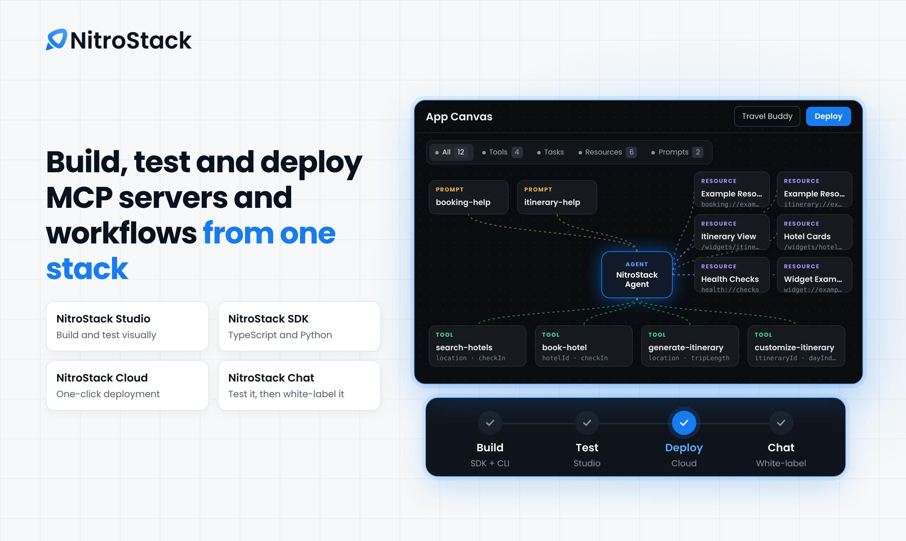
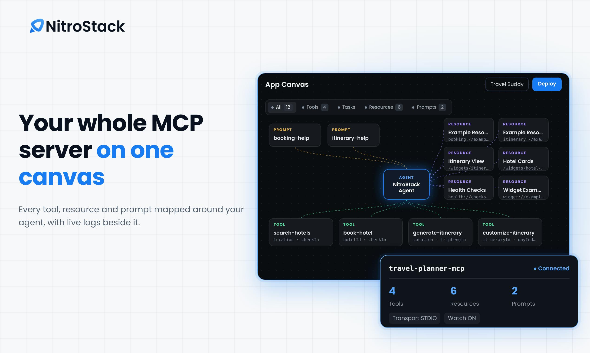
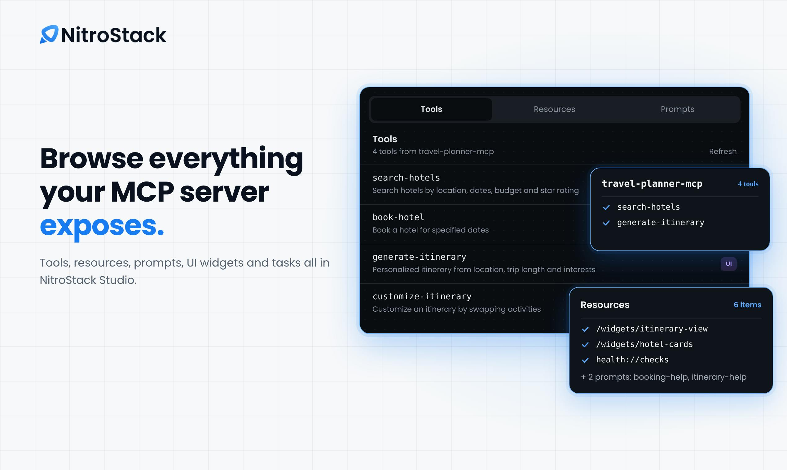

### 🎬 관련 영상
- [🎥 영상 보기](https://ph-files.imgix.net/7d0d12d7-09f8-4725-b288-779762526990.jpeg?auto=format)

---

## 2. [Caldera](https://www.producthunt.com/products/caldera)
**Votes**: 156 | **도입 난이도**: 중 | **신뢰도**: 상
**Tagline**: Your Obsidian vault as a living profile and linked garden
**서비스 링크**: https://www.producthunt.com/r/2JSRELYQXYA53W

**태그**: Productivity, KnowledgeManagement, OpenSource, Obsidian, AI Tool

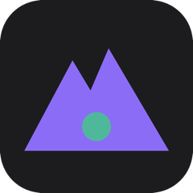

### 📌 이 서비스 한눈에 보기
개인용 옵시디언(Obsidian) 노트를 공개적인 디지털 가든과 살아있는 프로필로 변환해주는 도구

### 🔑 주요 기능
- 옵시디안 보관함을 자동으로 업데이트되는 공개 웹페이지로 변환
- 노트의 성장 단계(씨앗, 싹, 상록수)를 설정하여 디지털 가든 구축
- 개인정보 보호 중심 설계: 선택한 노트만 공개되며 연락처 등은 자동 제거

### 🙋 사용자에게 어떤 점이 좋은가
개인적인 메모를 체계적인 공개 포트폴리오나 지식 공유 공간으로 손쉽게 전환할 수 있습니다.

### ✅ 지금 바로 써볼 기능
- 옵시디안 보관함 내 특정 노트를 공개 페이지로 배포하기
- 노트 성장 단계(Seedling, Budding, Evergreen) 설정하기
- 친구의 가든과 노트를 연결하여 백링크 생태계 구축하기

### ⚠️ 사용 전 확인할 점
- 셀프 호스팅 시 서버 관리 및 보안 설정 필요
- 공개 설정 시 의도치 않은 정보 노출 주의

### 🧭 확인이 더 필요한 정보
셀프 호스팅 환경에서의 구체적인 설치 난이도와 보안 유지 방식에 대한 추가 확인이 필요합니다.

### 📸 스크린샷 및 갤러리
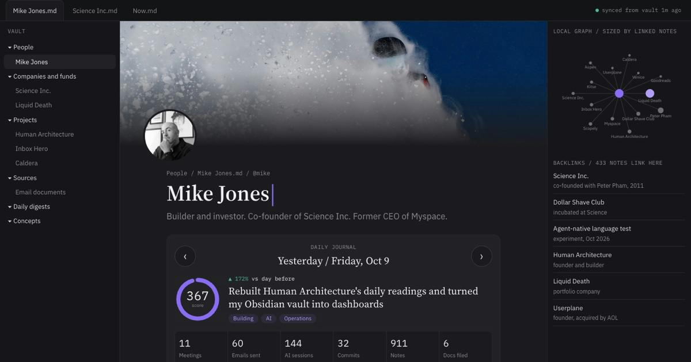
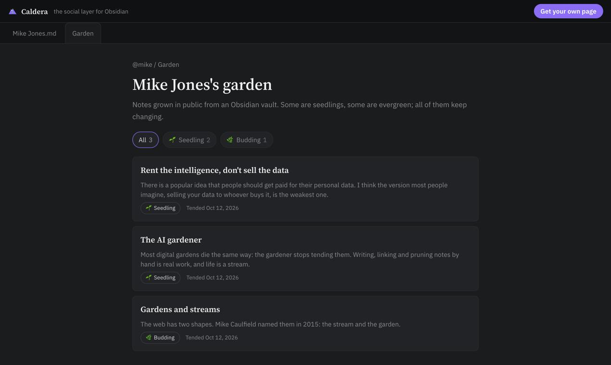
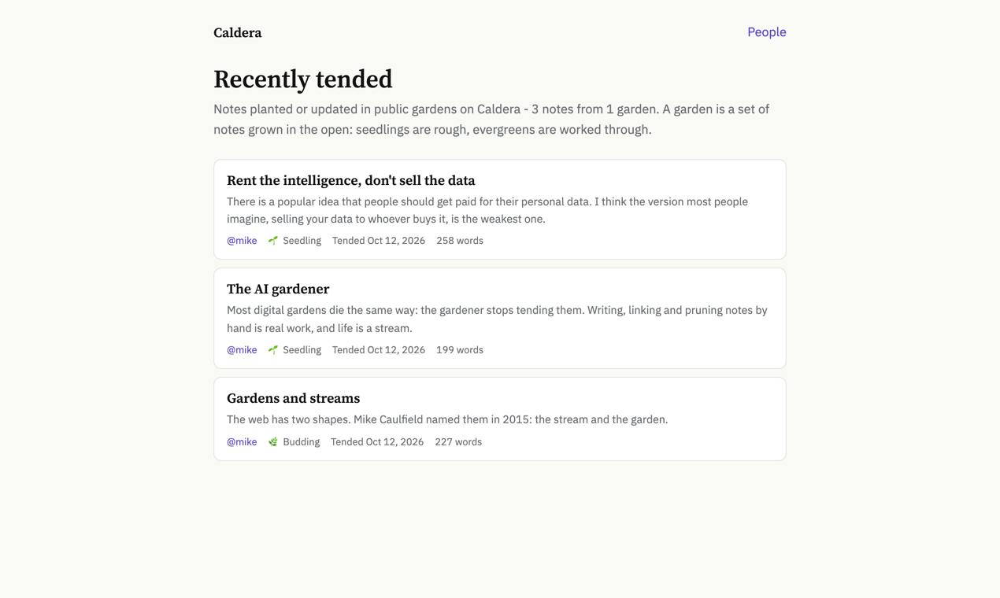

---

## 3. [Notion: Context for your agents](https://www.producthunt.com/products/notion)
**Votes**: 143 | **도입 난이도**: 중 | **신뢰도**: 상
**Tagline**: Switch AI agents without re-explaining your work
**서비스 링크**: https://www.producthunt.com/r/6JUMUPF3NCHFPT

**태그**: AI, Productivity, Automation, Workflow, Agent, AI Tool, Chat, API

### 📌 이 서비스 한눈에 보기
매번 설명할 필요 없이 모든 AI 에이전트가 내 워크스페이스를 즉시 이해하게 만드는 통합 컨텍스트 레이어

### 🔑 주요 기능
- 문서, 데이터베이스, Skills를 통합하여 AI 에이전트 간 공유 컨텍스트 제공
- Claude, ChatGPT 및 MCP(Model Context Protocol) 에이전트와 연동 가능
- 에이전트의 편집 내역을 추적하는 업그레이드된 버전 히스토리 및 데이터 동기화

### 🙋 사용자에게 어떤 점이 좋은가
AI 모델을 바꿀 때마다 배경 지식을 다시 설명할 필요가 없어 작업 흐름이 끊기지 않으며, 팀의 데이터가 모든 에이전트의 공통 지식 베이스가 됩니다.

### ✅ 지금 바로 써볼 기능
- 기존 Notion 데이터베이스를 MCP 에이전트에 연결하기
- 새로운 Skills API를 활용해 외부 툴과 워크플로우 동기화하기
- 에이전트 편집 내역 확인을 위한 버전 히스토리 기능 살펴보기

### ⚠️ 사용 전 확인할 점
- 에이전트가 데이터에 접근할 때 발생할 수 있는 보안 및 권한 관리 필요
- 외부 에이전트 연동 시 데이터 동기화 및 충돌 가능성 확인 필요

### 🧭 확인이 더 필요한 정보
사용 중인 외부 AI 에이전트와 Notion 간의 데이터 동기화 속도 및 세부 보안 정책에 대한 구체적 정보가 필요합니다.

### 📸 스크린샷 및 갤러리
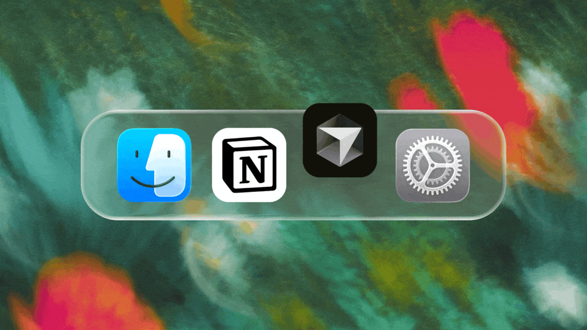
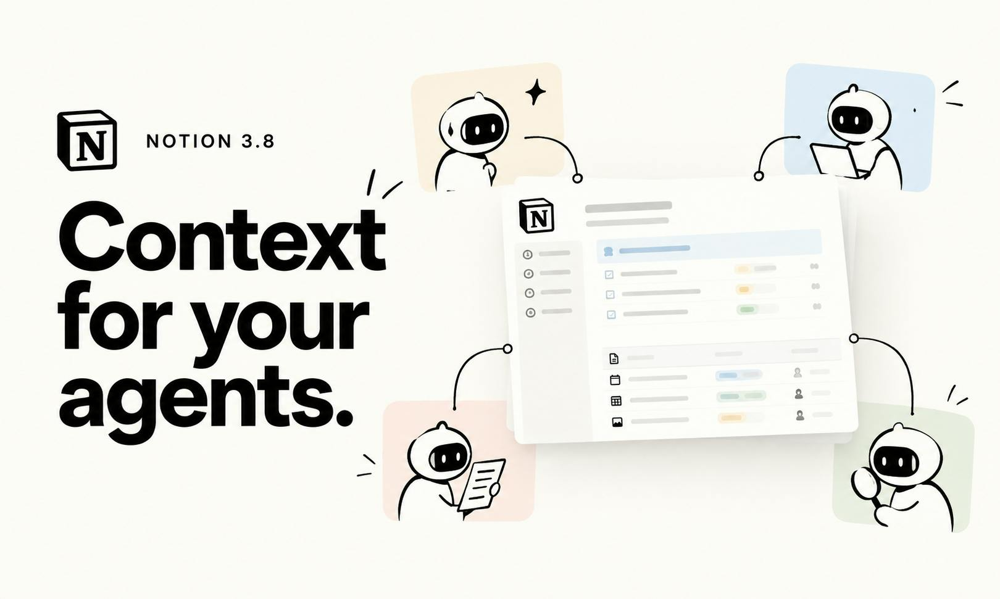
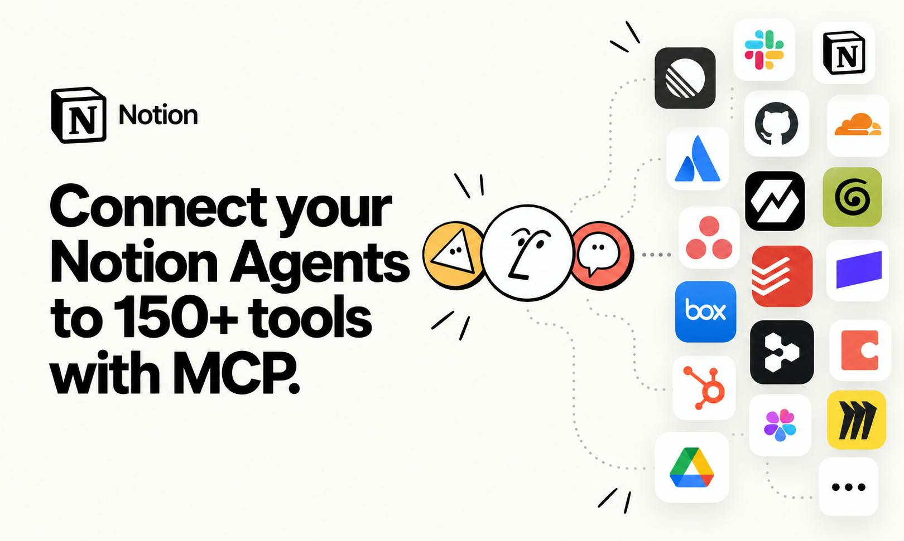

---

## 4. [Emochi](https://www.producthunt.com/products/emochi-2)
**Votes**: 137 | **도입 난이도**: 하 | **신뢰도**: 상
**Tagline**: Voice journal to understand yourself through art and science
**서비스 링크**: https://www.producthunt.com/r/YAJULXSMGNIKDO

**태그**: AI, MentalHealth, Journaling, GenerativeArt, AI Tool, Design

### 📌 이 서비스 한눈에 보기
음성 일기를 통해 감정 패턴을 시각화하고 나만의 캐릭터를 만드는 AI 감정 기록 서비스

### 🔑 주요 기능
- 음성 노트를 실시간 텍스트로 변환하여 감정 기록 및 패턴 분석
- 사용자의 감정 세계를 반영하는 생성형 캐릭터 'Mochi' 제공
- 의학, 디자인, AI 전문가들이 협업하여 만든 과학적이고 예술적인 자기 성찰 도구

### 🙋 사용자에게 어떤 점이 좋은가
일상의 감정을 말로 내뱉는 것만으로도 자신의 심리 상태를 시각적으로 확인하고 객관적으로 돌아볼 수 있습니다.

### ✅ 지금 바로 써볼 기능
- 오늘의 감정을 담은 첫 음성 노트 녹음하기
- 생성된 나만의 캐릭터 'Mochi' 살펴보기
- 축적된 기록을 통해 감정 패턴 변화 확인하기

### ⚠️ 사용 전 확인할 점
- 비임상적 도구이므로 전문적인 의학적 진단을 대체할 수 없음
- 개인적인 감정 데이터가 포함되므로 데이터 프라이버시 정책 확인 필요

### 🧭 확인이 더 필요한 정보
데이터 보안 및 개인정보 보호 수준에 대한 구체적인 기술적 명시가 필요합니다.

### 📸 스크린샷 및 갤러리
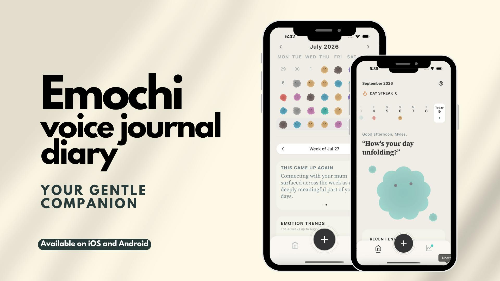
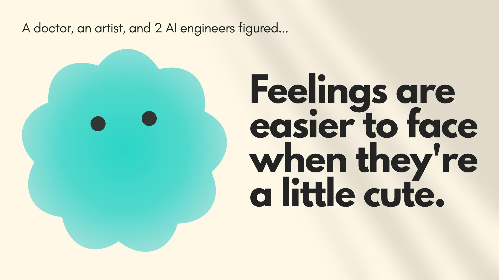
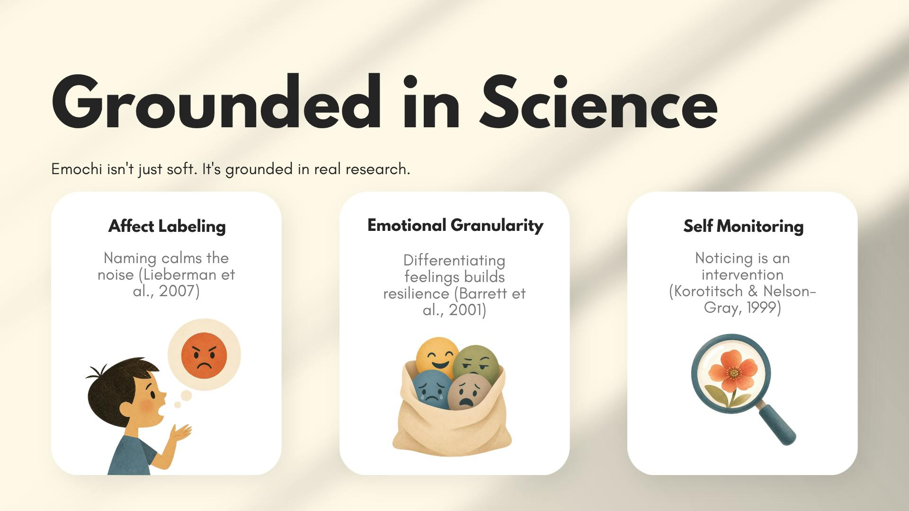

### 🎬 관련 영상
- [🎥 영상 보기](https://ph-files.imgix.net/0abd025c-97f1-46ff-ac87-b59498e3513d.jpeg?auto=format)

---

## 5. [Train with Pasta](https://www.producthunt.com/products/train-with-pasta)
**Votes**: 124 | **도입 난이도**: 하 | **신뢰도**: 상
**Tagline**: A personal trainer powered by Apple Intelligence
**서비스 링크**: https://www.producthunt.com/r/RCYFVIP3UANWOT

**태그**: AI, Fitness, Privacy, Mobile, AI Tool

### 📌 이 서비스 한눈에 보기
Apple Intelligence를 활용해 맞춤형 운동 루틴과 플랜을 생성하는 개인 트레이너 앱

### 🔑 주요 기능
- 자연어 명령을 통한 맞춤형 운동 루틴 생성
- 음성 가이드를 통한 운동 중 핸즈프리 경험 제공
- 사용자 일정에 맞춘 개인화된 훈련 플랜 설계

### 🙋 사용자에게 어떤 점이 좋은가
별도의 복잡한 설정 없이 말 한마디로 운동 계획을 세울 수 있으며, 개인 데이터가 기기에만 저장되어 보안 걱정 없이 운동에 집중할 수 있습니다.

### ✅ 지금 바로 써볼 기능
- "30분 상체 운동"과 같이 구체적인 운동 요청하기
- 목표하는 운동 목적을 말하여 맞춤형 플랜 생성하기
- 음성 가이드를 켜고 운동 중 핸즈프리로 트레이닝하기

### ⚠️ 사용 전 확인할 점
- iOS 27 및 Apple Intelligence가 탑재된 iPhone 필수
- 계정 기반이 아니므로 기기 변경 시 데이터 이전 여부 확인 필요

### 🧭 확인이 더 필요한 정보
iOS 27 버전 및 Apple Intelligence의 구체적인 하드웨어 요구 사양에 대한 확인이 필요합니다.

### 📸 스크린샷 및 갤러리

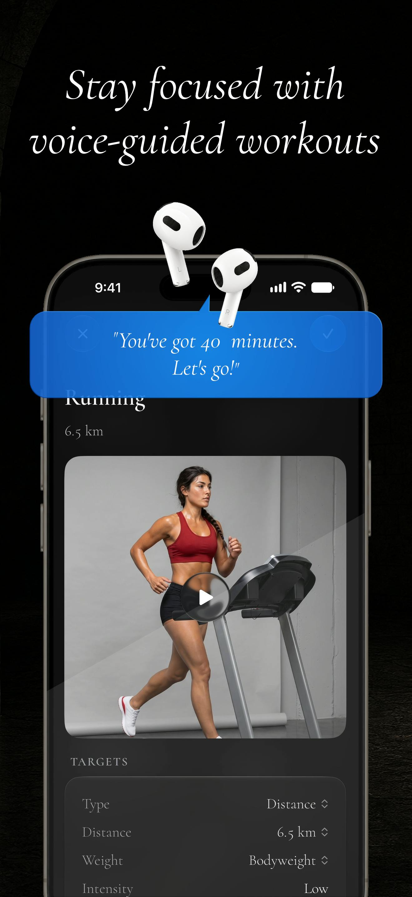
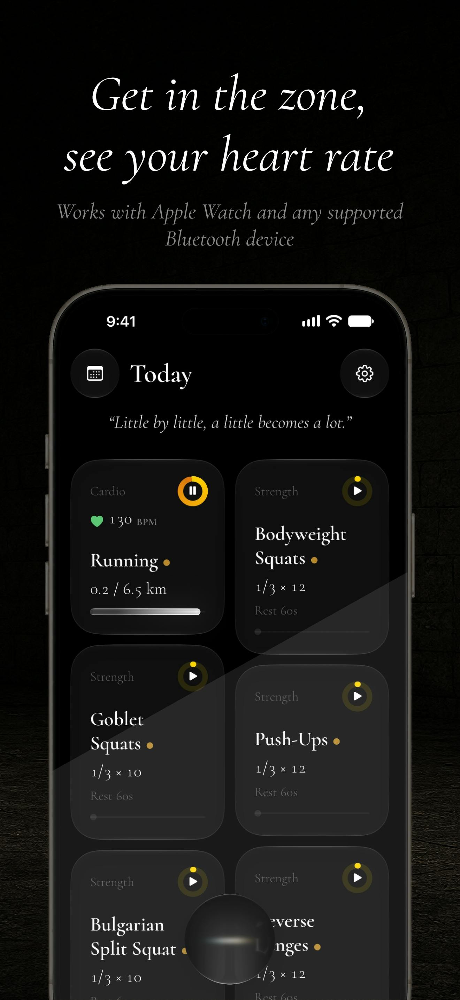

---

## 6. [Craft Agents](https://www.producthunt.com/products/craft-agents)
**Votes**: 102 | **도입 난이도**: 중 | **신뢰도**: 상
**Tagline**: The world's most powerful agents, with the UX they deserve
**서비스 링크**: https://www.producthunt.com/r/ERP56R5DH2SM47

**태그**: AI-Agent, OpenSource, Automation, DevTool, Productivity, Agent, AI Tool, API

### 📌 이 서비스 한눈에 보기
개인 데이터 보안을 유지하며 다양한 AI 모델과 도구를 연결하는 강력한 로컬 데스크톱 에이전트

### 🔑 주요 기능
- 오픈 소스 기반의 로컬 실행 방식으로 데이터 및 API 키 보안 강화
- Claude, GPT, Gemini 및 로컬 모델 등 다양한 AI 제공자 지원
- MCP, API, 로컬 파일 등 실제 도구와 연결되어 실질적인 작업 수행

### 🙋 사용자에게 어떤 점이 좋은가
사용자의 데이터를 외부로 유출하지 않으면서도 강력한 AI 에이전트 기능을 데스크톱 환경에서 직관적으로 사용할 수 있습니다.

### ✅ 지금 바로 써볼 기능
- 선호하는 AI 모델(Claude, GPT 등) 연결하기
- 로컬 파일 및 API를 통한 도구 연동 설정하기
- 반복 작업을 위한 Skill 및 Automation 설정하기

### ⚠️ 사용 전 확인할 점
- 로컬 실행 방식이므로 사용자의 하드웨어 사양에 따라 성능 차이가 발생할 수 있음
- 다양한 도구(MCP, API) 연동 시 사용자 직접 설정 필요

### 🧭 확인이 더 필요한 정보
로컬 실행 시 하드웨어 리소스 점유율과 구체적인 시스템 요구 사양에 대한 정보가 필요합니다.

### 📸 스크린샷 및 갤러리
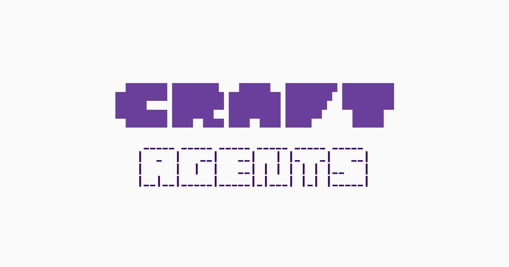
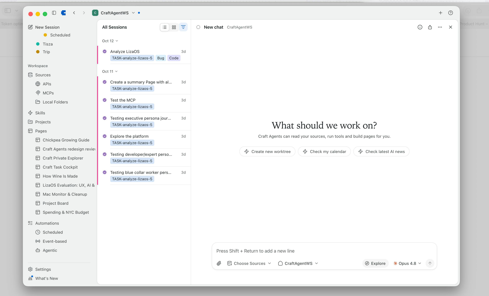
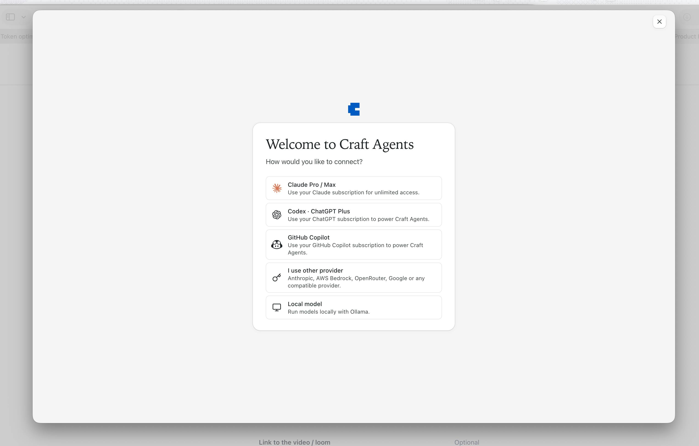

---

## 7. [LooGo](https://www.producthunt.com/products/loogo)
**Votes**: 98 | **도입 난이도**: 하 | **신뢰도**: 상
**Tagline**: Find public restrooms fast
**서비스 링크**: https://www.producthunt.com/r/6QTQ2YZVZFK4KE

**태그**: Utility, Android, WearOS, Maps, Travel, AI Tool, DevTool

### 📌 이 서비스 한눈에 보기
광고와 추적 없이 빠르게 주변 공공 화장실을 찾는 모바일 및 웨어 OS 앱

### 🔑 주요 기능
- OpenStreetMap 데이터를 활용한 빠르고 정확한 화장실 위치 정보 제공
- 출입 코드, 가격, 운영 시간, 접근성 등 상세 정보 포함
- 광고, 추적, 불필요한 기능이 없는 가볍고 빠른 사용자 경험

### 🙋 사용자에게 어떤 점이 좋은가
외출 중 급하게 화장실을 찾아야 할 때, 복잡한 절차 없이 가장 빠르고 직관적으로 위치를 파악할 수 있습니다.

### ✅ 지금 바로 써볼 기능
- 주변 화장실 위치 및 상세 정보 확인하기
- Wear OS 앱을 연동하여 손목에서 바로 검색하기
- 오프라인 지도 기능을 활용해 데이터 걱정 없이 사용하기

### ⚠️ 사용 전 확인할 점
- OpenStreetMap 기반이므로 데이터의 최신성이나 정확도는 사용자 기여도에 따라 다를 수 있음
- Android 및 Wear OS 환경에 최적화되어 있어 iOS 사용자는 사용이 제한적임

### 🧭 확인이 더 필요한 정보
사용자 참여형 데이터(OpenStreetMap)의 특성상 특정 지역의 정보 업데이트 빈도를 확인해야 합니다.

### 📸 스크린샷 및 갤러리
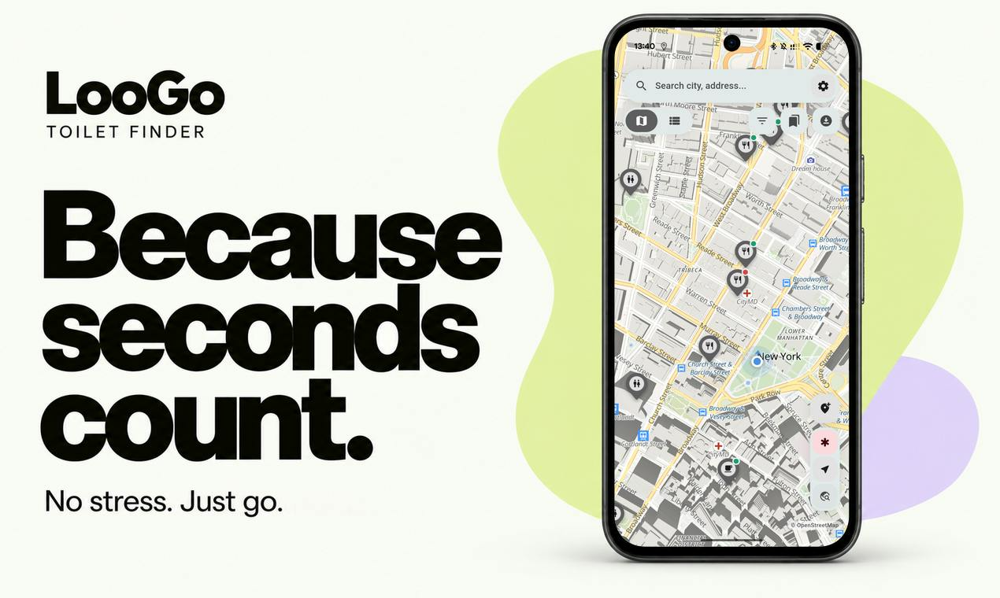
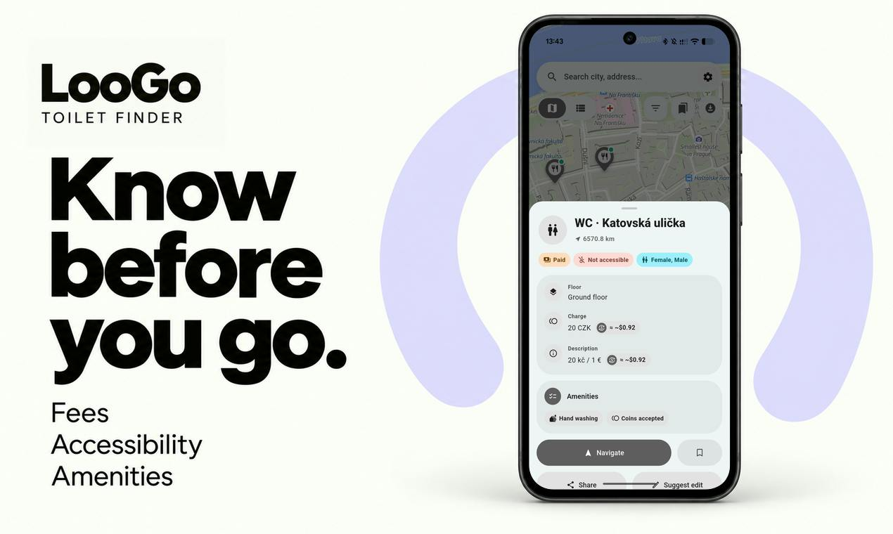
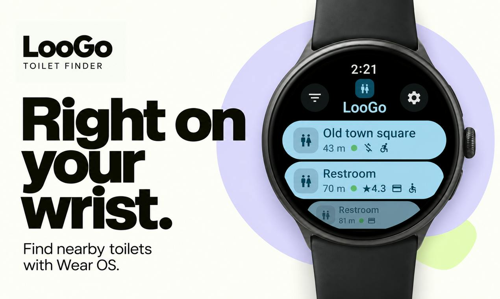

---

## 8. [GPU Terminal by Context.dev](https://www.producthunt.com/products/context-dev)
**Votes**: 91 | **도입 난이도**: 하 | **신뢰도**: 상
**Tagline**: Compare GPU rental prices across cloud providers
**서비스 링크**: https://www.producthunt.com/r/DF6JU33ZTEEQI3

**태그**: DevTool, Cloud, GPU, Analytics

### 📌 이 서비스 한눈에 보기
여러 클라우드 제공업체의 GPU 대여 가격을 한눈에 비교하는 대시보드

### 🔑 주요 기능
- 분산된 GPU 클라우드 가격 정보를 하나의 대시보드로 통합
- 원하는 GPU 선택 및 제공업체별 실시간 시간당 요금 비교
- 가격 히스토리 확인 및 원본 소스 검증 가능

### 🙋 사용자에게 어떤 점이 좋은가
여러 클라우드 서비스를 일일이 방문할 필요 없이 최적의 GPU 가성비를 즉시 찾을 수 있습니다.

### ✅ 지금 바로 써볼 기능
- 원하는 GPU 모델 검색하기
- 제공업체별 가격 비교하기
- 과거 가격 변동 추이 확인하기

### ⚠️ 사용 전 확인할 점
- 제공되는 가격이 실제 결제 시점의 프로모션이나 지역별 요금과 다를 수 있음
- 데이터 업데이트 주기에 따른 실시간성 차이 확인 필요

### 🧭 확인이 더 필요한 정보
각 클라우드 제공업체의 API 연동 방식 및 데이터 업데이트 빈도에 대한 상세 정보가 필요합니다.

### 📸 스크린샷 및 갤러리

---

## 9. [Ultracite v8](https://www.producthunt.com/products/ultracite)
**Votes**: 90 | **도입 난이도**: 하 | **신뢰도**: 상
**Tagline**: The linter and formatter for agentic development
**서비스 링크**: https://www.producthunt.com/r/E3YR3RCT4JCACA

**태그**: DevTool, AI-Agent, Linter, Automation, Agent, AI Tool

### 📌 이 서비스 한눈에 보기
AI 에이전트가 작성한 코드를 빠르고 엄격하게 검증하는 린터 및 포매터

### 🔑 주요 기능
- Oxlint, Biome, ESLint를 결합한 제로 설정(Zero-config) 프리셋 제공
- AI 에이전트가 생성한 코드의 일관성과 타입 안정성 확보
- 0.5초 미만의 초고속 검사로 에이전트의 편집 결과물을 즉각 검증

### 🙋 사용자에게 어떤 점이 좋은가
AI가 코드를 작성하는 시대에 에이전트가 만든 '코드 슬롭(slop)'을 방지하고, 리뷰 단계로 넘어가기 전 깨끗한 코드를 유지할 수 있습니다.

### ✅ 지금 바로 써볼 기능
- 기존 ESLint/Biome 환경에 Ultracite 프리셋 적용하기
- AI 에이전트 워크플로우에 Ultracite 검증 단계 통합하기

### ⚠️ 사용 전 확인할 점
- 기존 프로젝트의 린트 규칙과 충돌할 가능성 확인 필요
- 특정 언어나 프레임워크에 대한 지원 범위 확인 필요

### 🧭 확인이 더 필요한 정보
제공되는 수백 개의 엄격한 규칙이 기존 개발자의 코딩 스타일과 얼마나 일치할지 확인이 필요합니다.

### 📸 스크린샷 및 갤러리
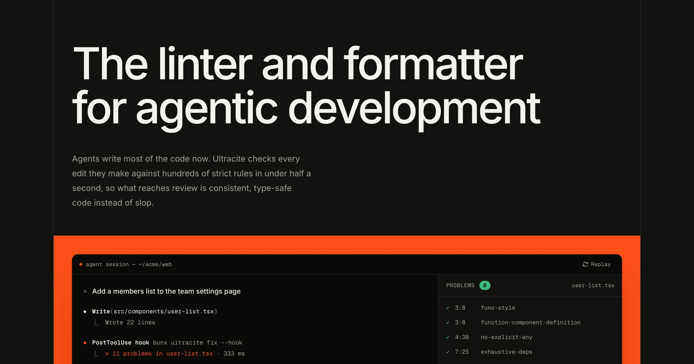
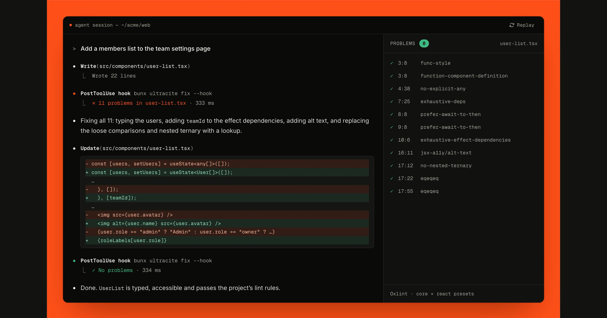
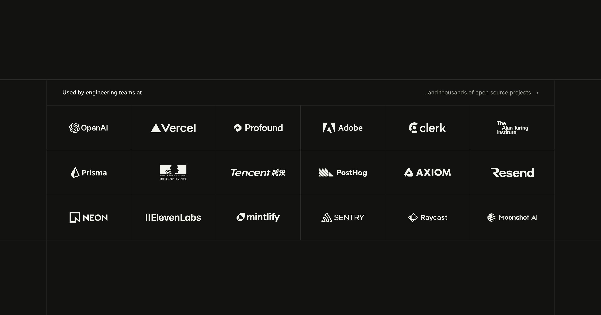

---

## 10. [Unfenced](https://www.producthunt.com/products/unfenced)
**Votes**: 88 | **도입 난이도**: 하 | **신뢰도**: 상
**Tagline**: Land for sale that actually borders public land
**서비스 링크**: https://www.producthunt.com/r/PXFKGSHHKBKW2P

**태그**: Real Estate, Land Search, Data Analysis, AI Tool

### 📌 이 서비스 한눈에 보기
공공 토지와 맞닿은 진정한 경계의 토지 매물을 찾아주는 검색 서비스

### 🔑 주요 기능
- 미국 내 약 70만 개의 매물을 매주 공공 토지 지도와 대조하여 분석
- 국립공원, BLM, 주 정부 토지와 실제 경계를 공유하는 매물만 선별
- 공유 경계 길이, 고도, 도로 접근성, 홍수 및 산불 위험도 등 상세 데이터 제공

### 🙋 사용자에게 어떤 점이 좋은가
공공 토지 인접 매물을 찾는 사용자에게 복잡한 지도 대조 작업 없이 검증된 매물 리스트를 즉시 제공합니다.

### ✅ 지금 바로 써볼 기능
- 관심 있는 ZIP 코드 또는 주(State)로 검색하기
- 매물별 공공 토지 공유 경계 길이 확인하기
- 지형 및 위험 요소(산불, 홍수) 데이터 검토하기

### ⚠️ 사용 전 확인할 점
- 제공되는 데이터는 매물 경계와 공공 토지 지도를 대조한 결과이므로 법적 경계 확인은 별도로 필요함
- 미국 내 특정 지역 매물에 국한됨

### 🧭 확인이 더 필요한 정보
실제 토지 소유권 및 법적 경계 문제는 현지 당국을 통해 별도로 확인해야 합니다.

### 📸 스크린샷 및 갤러리
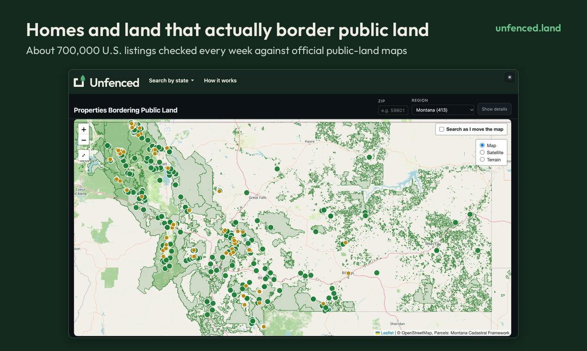
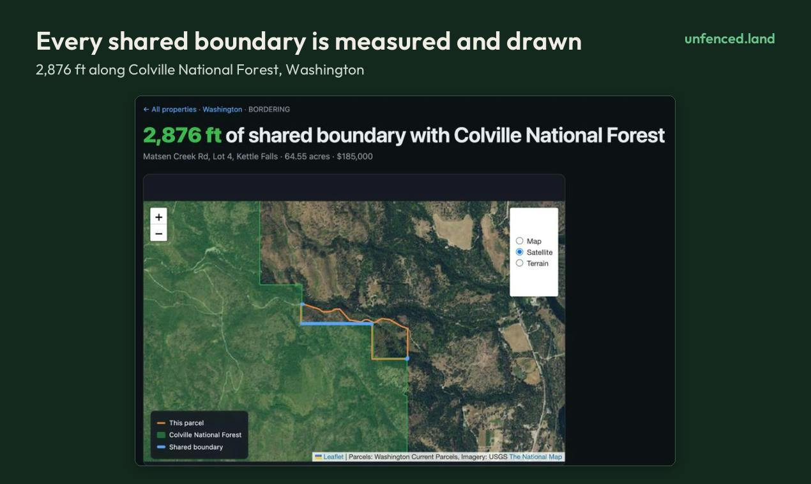
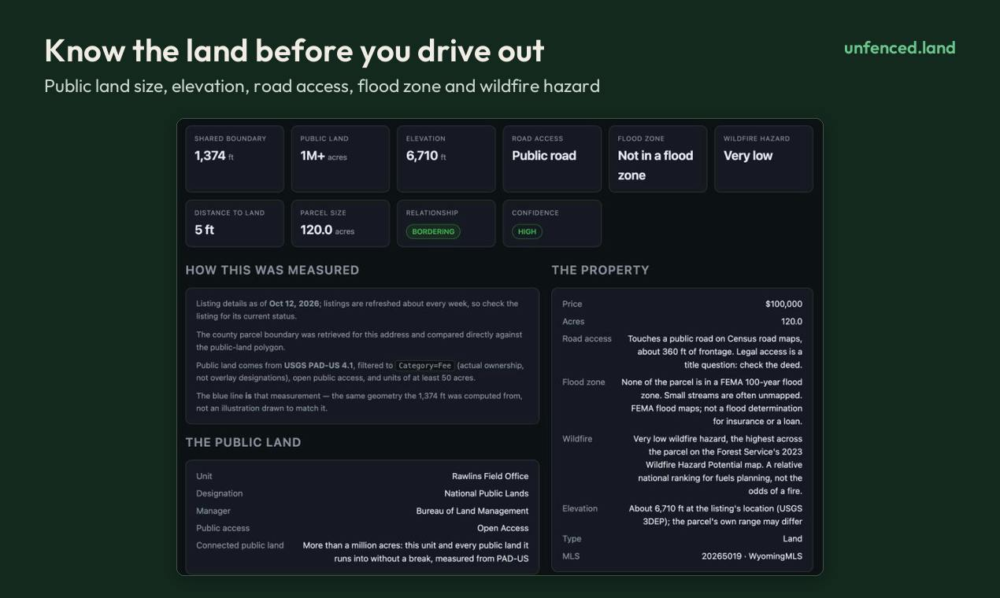

---

## 11. [Spiralens](https://www.producthunt.com/products/spiralens)
**Votes**: 83 | **도입 난이도**: 하 | **신뢰도**: 상
**Tagline**: Golden ratio camera that tells you where to move your phone
**서비스 링크**: https://www.producthunt.com/r/2O36K2KKQC6THL

**태그**: Photography, MobileApp, Android, CreativeTool, AI Tool

### 📌 이 서비스 한눈에 보기
황금비율 가이드를 통해 누구나 전문가처럼 사진을 찍을 수 있게 돕는 안드로이드 카메라 앱

### 🔑 주요 기능
- 황금비율, 삼분할 법칙 등 전문적인 구도 가이드 제공
- 피사체 위치와 수평을 직관적인 화살표와 색상으로 안내
- 강력한 편집 기능(황금비율 크롭, 수평 조절, 배경 흐림) 탑재

### 🙋 사용자에게 어떤 점이 좋은가
구도 잡기가 어려운 초보자도 앱의 가이드를 따라 움직이는 것만으로 완성도 높은 사진을 찍을 수 있습니다.

### ✅ 지금 바로 써볼 기능
- 피사체를 탭하여 황금비율 포인트 설정하기
- 화면의 화살표와 색상 변화를 따라 구도 맞추기
- 편집 모드에서 배경 흐림(Blur) 기능 적용해보기

### ⚠️ 사용 전 확인할 점
- 안드로이드 전용 앱이므로 iOS 사용자는 사용 불가
- 카메라 하드웨어 성능에 따라 배경 흐림 효과의 품질이 달라질 수 있음

### 🧭 확인이 더 필요한 정보
현재 안드로이드 기기에서의 구체적인 카메라 성능 최적화 수준은 명시되지 않았습니다.

### 📸 스크린샷 및 갤러리
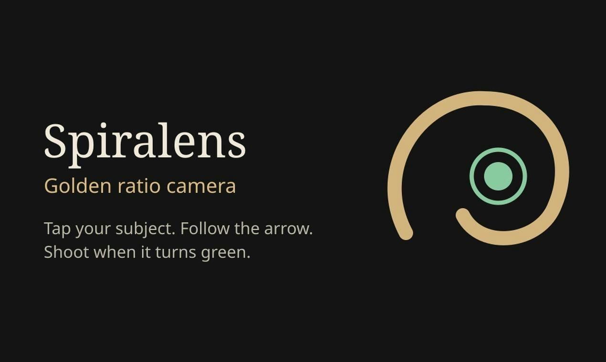
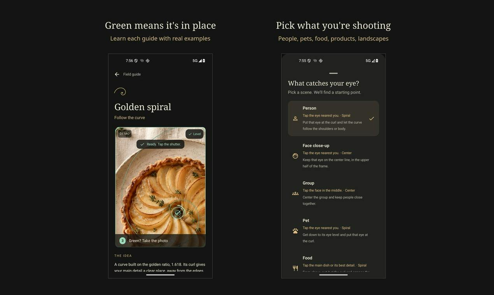

### 🎬 관련 영상
- [🎥 영상 보기](https://ph-files.imgix.net/7113ba9d-cd78-490a-8723-804b8116e6cb.jpeg?auto=format)

---

## 12. [Earnote](https://www.producthunt.com/products/earnote)
**Votes**: 79 | **도입 난이도**: 하 | **신뢰도**: 상
**Tagline**: Lecture & meeting notes, written on your device
**서비스 링크**: https://www.producthunt.com/r/L7MNFYD4ZHX6E6

**태그**: Productivity, AI, Note-taking, OpenSource, Education

### 📌 이 서비스 한눈에 보기
강의와 회의를 기록하면 AI가 구조화된 노트와 학습 자료를 자동으로 생성해주는 온디바이스 음성 기록 도구

### 🔑 주요 기능
- Whisper 모델 기반의 고정밀 음성 전사 및 구조화된 노트 생성
- 태스크, 플래시카드, PDF 학습 시트 자동 생성 기능
- 개인정보 보호를 위한 온디바이스(On-device) 처리 지원

### 🙋 사용자에게 어떤 점이 좋은가
강의나 회의 내용을 일일이 정리할 필요 없이, 녹음만으로 학습과 업무에 즉시 활용 가능한 구조화된 결과물을 얻을 수 있습니다.

### ✅ 지금 바로 써볼 기능
- 강의나 회의 녹음 및 자동 전사 기능 테스트
- 생성된 플래시카드를 활용한 학습 효율 확인
- PDF 학습 시트 출력 및 활용도 검토

### ⚠️ 사용 전 확인할 점
- iPhone 15 Pro 이상의 기기에서만 완전한 온디바이스 노트 작성이 가능할 수 있음
- 기기 성능에 따라 음성 처리 속도 차이가 발생할 수 있음

### 🧭 확인이 더 필요한 정보
기기 사양에 따른 온디바이스 처리 범위와 구형 기기에서의 성능 최적화 수준을 확인해야 합니다.

### 📸 스크린샷 및 갤러리
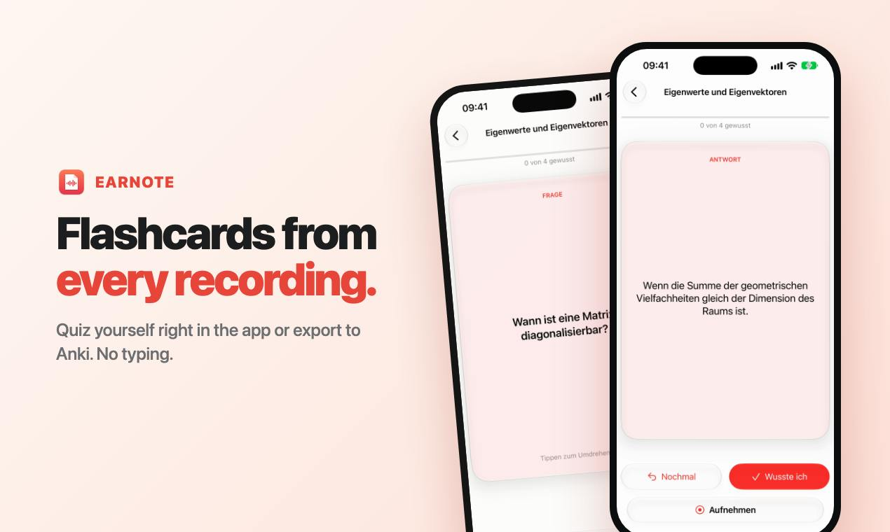
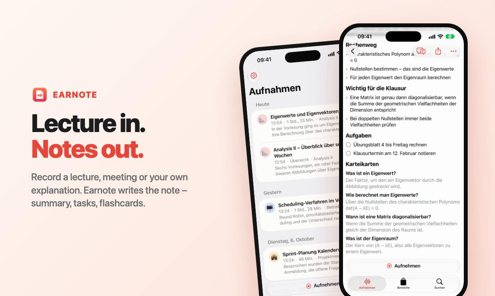
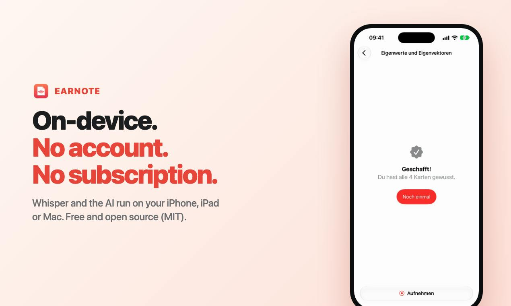

---

## 13. [Step 5 Preview](https://www.producthunt.com/products/step-3-5-flash)
**Votes**: 77 | **도입 난이도**: 상 | **신뢰도**: 상
**Tagline**: 600B open weights, trained for long-running agents
**서비스 링크**: https://www.producthunt.com/r/43SXMMGUSWZP6U

**태그**: AI, LLM, OpenSource, DeveloperTool, Automation, Agent, AI Tool

### 📌 이 서비스 한눈에 보기
코딩과 금융 연구, 장기 실행 에이전트에 최적화된 600B 규모의 오픈 웨이트 MoE 모델

### 🔑 주요 기능
- 총 600B 파라미터 규모의 MoE(Mixture-of-Experts) 모델로 토큰당 27B 활성 파라미터 사용
- 1M(100만) 토큰의 대규모 컨텍스트 윈도우 지원
- vLLM, SGLang, Transformers 등 주요 프레임워크를 통한 배포 지원

### 🙋 사용자에게 어떤 점이 좋은가
방대한 데이터를 처리해야 하는 금융 연구나 복잡한 코딩 작업, 그리고 긴 문맥 유지가 필요한 에이전트 개발에 매우 유리합니다.

### ✅ 지금 바로 써볼 기능
- 1M 컨텍스트를 활용한 대규모 문서 분석 테스트
- 코딩 및 금융 데이터 처리 성능 검증
- vLLM/SGLang 환경에서의 배포 및 추론 효율성 확인

### ⚠️ 사용 전 확인할 점
- 600B 모델 규모로 인해 고사양의 하드웨어 인프라 필요
- 오픈 웨이트 모델로서의 실제 추론 비용 및 최적화 수준 확인 필요

### 🧭 확인이 더 필요한 정보
실제 하드웨어 요구 사양과 특정 작업에서의 벤치마크 성능 수치가 명시되지 않았습니다.

### 📸 스크린샷 및 갤러리
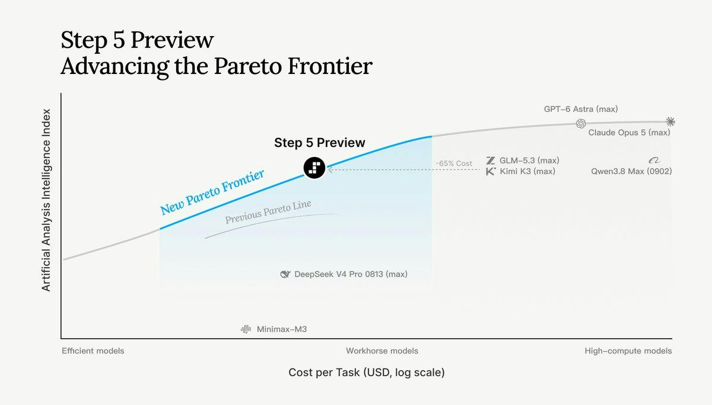
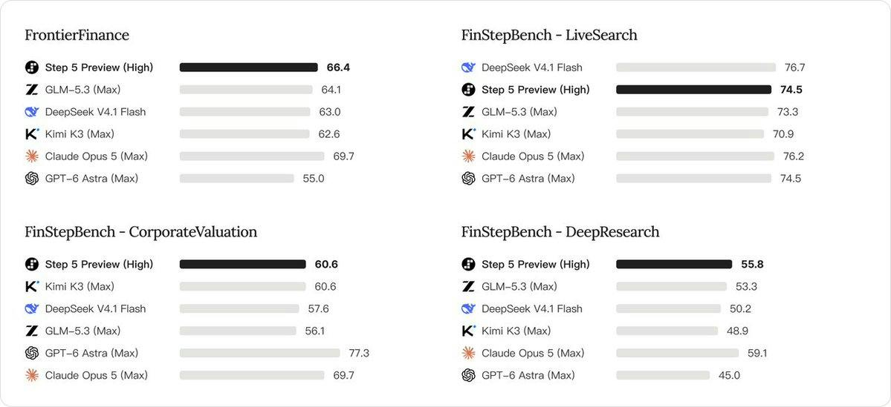
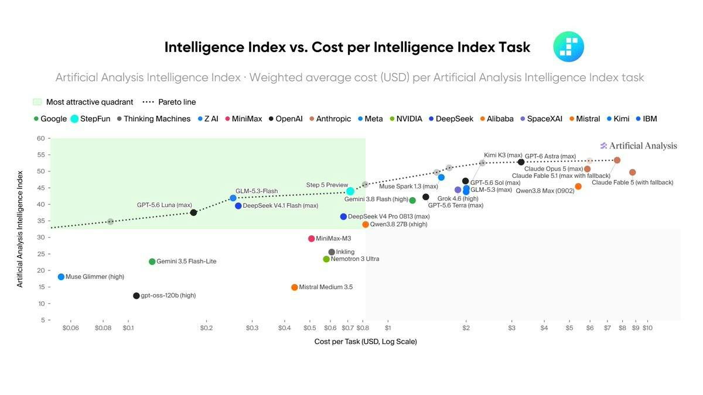

### 🎬 관련 영상
- [🎥 영상 보기](https://ph-files.imgix.net/146de979-1cb5-4468-94f3-ceeb37898718.jpeg?auto=format)

---

## 14. [Korinotch](https://www.producthunt.com/products/korinotch)
**Votes**: 77 | **도입 난이도**: 하 | **신뢰도**: 상
**Tagline**: Your MacBook notch, turned into a command center
**서비스 링크**: https://www.producthunt.com/r/YQDXLXVWKZMVKW

**태그**: Productivity, macOS, Utility

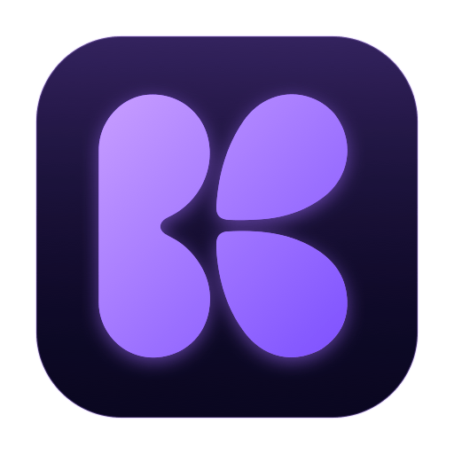

### 📌 이 서비스 한눈에 보기
맥북 노치 영역을 활용해 알림, 클립보드, 위젯 등을 관리하는 커맨드 센터형 생산성 도구

### 🔑 주요 기능
- 맥북 노치 영역을 활용한 미디어 HUD 및 알림 센터 기능
- 클립보드, 파일 트레이, 키보드 잠금 등 다양한 유틸리티 통합
- macOS 14 이상을 위한 네이티브 SwiftUI 기반 앱

### 🙋 사용자에게 어떤 점이 좋은가
노치 영역을 유휴 공간이 아닌 유용한 작업 공간으로 전환하여 데스크탑 환경의 효율성을 높여줍니다.

### ✅ 지금 바로 써볼 기능
- 노치 영역의 미디어 HUD 기능 사용해보기
- 클립보드 및 파일 트레이 기능 활용하기
- 14일 무료 체험 기간 동안 전체 기능 테스트하기

### ⚠️ 사용 전 확인할 점
- macOS 14 이상의 운영체제 버전이 필요함
- 14일 무료 체험 이후 $11.50의 평생 라이선스 비용 발생

### 🧭 확인이 더 필요한 정보
개별 유틸리티 앱과 통합 앱 간의 기능 차이 및 호환성에 대한 상세 정보가 필요합니다.

### 📸 스크린샷 및 갤러리
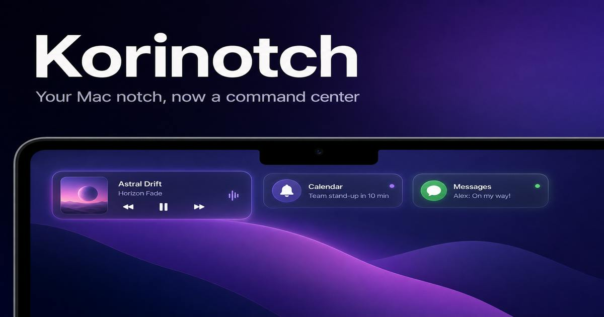
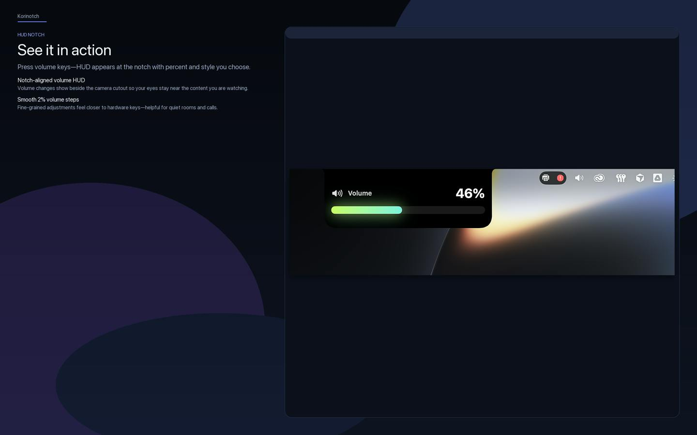
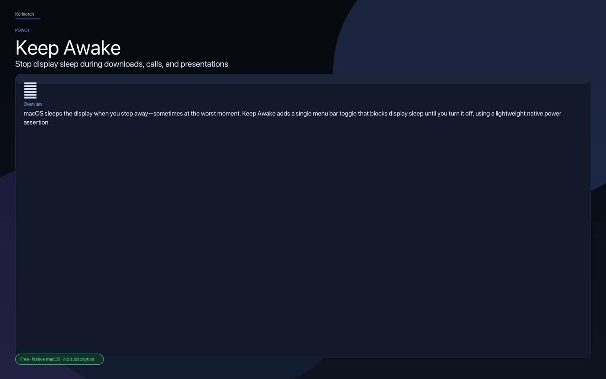

---

## 15. [Draper](https://www.producthunt.com/products/draper)
**Votes**: 77 | **도입 난이도**: 중 | **신뢰도**: 상
**Tagline**: Validate, plan, and launch a business, one step at a time.
**서비스 링크**: https://www.producthunt.com/r/SLX5LIXCHR32E2

**태그**: Startup, Business Planning, Product Launch, NoCode

### 📌 이 서비스 한눈에 보기
아이디어 검증부터 브랜드 구축, 제품 출시까지 비즈니스 전 과정을 단계별로 지원하는 올인원 런치패드

### 🔑 주요 기능
- 아이디어의 시장성 검증 및 비즈니스 모델 구체화
- 비즈니스 플랜, 브랜드, 제품 개발로 이어지는 단계별 워크플로우 제공
- 랜딩 페이지 제작 및 초기 고객 확보를 위한 통합 환경

### 🙋 사용자에게 어떤 점이 좋은가
창업 초기 단계에서 파편화된 도구들을 사용할 필요 없이, 하나의 플랫폼에서 사업의 기획부터 실행까지 체계적으로 진행할 수 있습니다.

### ✅ 지금 바로 써볼 기능
- 아이디어 검증 단계 진행하기
- 비즈니스 플랜 초안 작성하기
- 랜딩 페이지 제작 기능 살펴보기

### ⚠️ 사용 전 확인할 점
- 구체적인 단계별 가이드라인의 깊이 확인 필요
- 실제 제품 개발(코딩 등) 기능 포함 여부 확인 필요

### 🧭 확인이 더 필요한 정보
아이디어 검증 이후의 실제 제품 개발 단계가 자동화 도구인지 아니면 관리 도구인지에 대한 구체적 정보가 필요합니다.

### 📸 스크린샷 및 갤러리

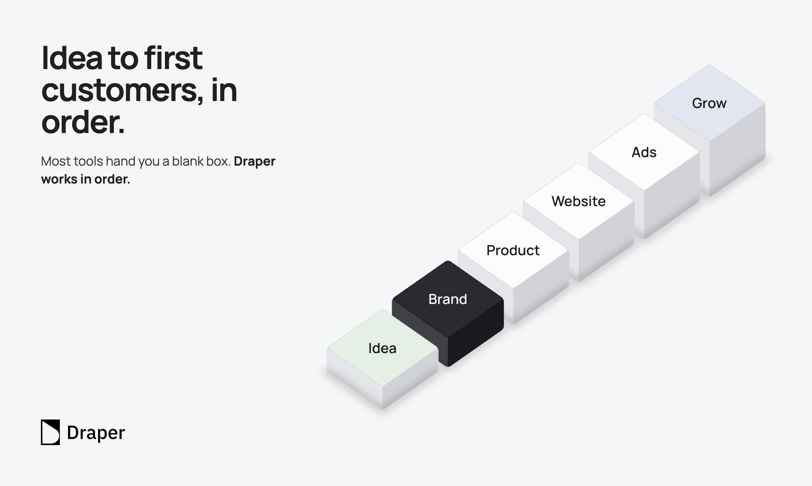

---

## 16. [Salience](https://www.producthunt.com/products/salience)
**Votes**: 77 | **도입 난이도**: 하 | **신뢰도**: 상
**Tagline**: See every request to your website and how it responds.
**서비스 링크**: https://www.producthunt.com/r/7LLDB2DFOQWGAZ

**태그**: DevTool, Analytics, Monitoring, Observability, AI Tool

### 📌 이 서비스 한눈에 보기
웹사이트로 유입되는 모든 요청과 응답을 실시간으로 시각화하는 모니터링 도구

### 🔑 주요 기능
- 서버 및 CDN 데이터를 활용한 실시간 요청/응답 가시성 제공
- 사용자, 검색 엔진, AI 봇의 모든 상호작용 추적
- 웹사이트 이슈 및 응답 상태에 대한 통합 뷰 제공

### 🙋 사용자에게 어떤 점이 좋은가
기존에 생성되는 서버 데이터를 활용해 웹사이트로 들어오는 모든 트래픽과 오류를 한눈에 파악할 수 있습니다.

### ✅ 지금 바로 써볼 기능
- 기존 서버/CDN 데이터 연동 확인
- 실시간 요청 대시보드 탐색
- AI 봇 및 검색 엔진 트래픽 분석

### ⚠️ 사용 전 확인할 점
- 기존 서버 및 CDN 인프라 환경에 따른 연동 가능 여부 확인 필요
- 데이터 양에 따른 성능 영향도 검토 필요

### 🧭 확인이 더 필요한 정보
기존 서버/CDN 데이터와 구체적으로 어떤 방식으로 연동되는지에 대한 기술적 상세 정보가 필요합니다.

### 📸 스크린샷 및 갤러리
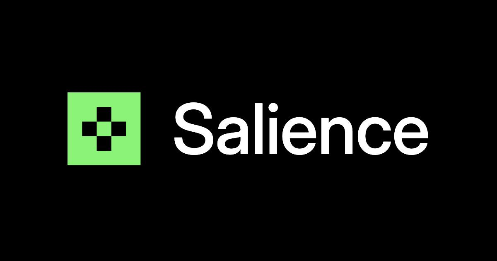
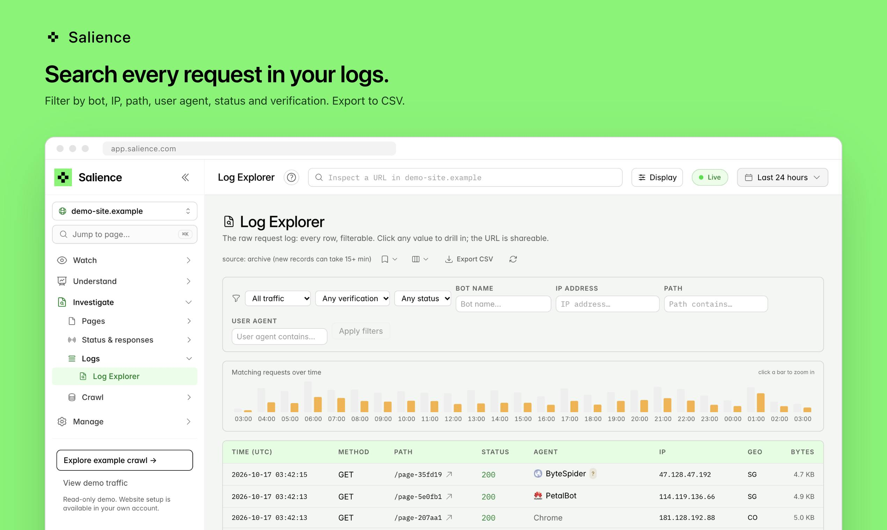
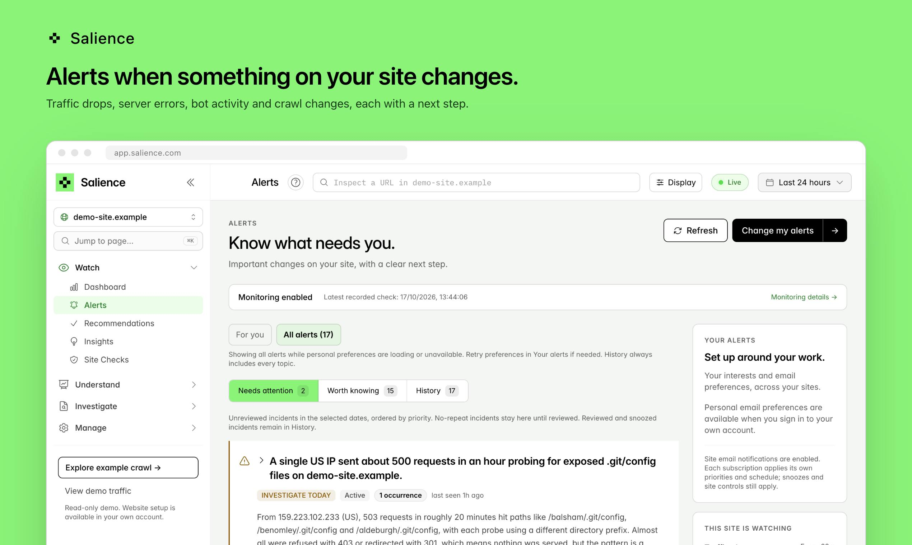

---

## 17. [Parrot](https://www.producthunt.com/products/parrot-10)
**Votes**: 73 | **도입 난이도**: 하 | **신뢰도**: 상
**Tagline**: Smart Meeting Assistant for Mac that helps during the call 
**서비스 링크**: https://www.producthunt.com/r/ZQX2QDSQ6XQ7QN

**태그**: Productivity, AI, OpenSource, Mac, Meeting, Chat

### 📌 이 서비스 한눈에 보기
회의 중 실시간 답변 지원과 사후 리포트를 제공하는 맥 전용 오픈소스 미팅 어시스턴트

### 🔑 주요 기능
- 봇 참여 없이 맥 시스템 오디오를 직접 녹음 및 온디바이스 트랜스크립션
- 질문 발생 시 관련 문서(가격표, FAQ 등) 기반 실시간 답변 가이드 제공
- 회의 후 약속 사항 및 미답변 질문 요약 리포트 생성

### 🙋 사용자에게 어떤 점이 좋은가
회의 중 자료를 찾는 번거로움을 줄여주고, 회의가 끝난 후 놓친 질문이나 약속을 즉각 파악하여 업무 연속성을 높여줍니다.

### ✅ 지금 바로 써볼 기능
- 로컬 모델(Ollama 등) 연결하여 개인정보 보호 환경 구축하기
- 자주 참조하는 FAQ나 가격표 파일을 연동하여 실시간 답변 기능 테스트하기
- 회의 종료 후 생성되는 약속/질문 리포트 확인하기

### ⚠️ 사용 전 확인할 점
- 로컬 모델 사용 시 하드웨어 사양에 따른 성능 차이 발생 가능
- 시스템 오디오 녹음 방식이므로 특정 보안 환경에서는 작동이 제한될 수 있음

### 🧭 확인이 더 필요한 정보
사용자의 하드웨어 사양에 따른 로컬 모델 구동 성능과 시스템 오디오 권한 설정의 복잡도를 확인해야 합니다.

### 📸 스크린샷 및 갤러리
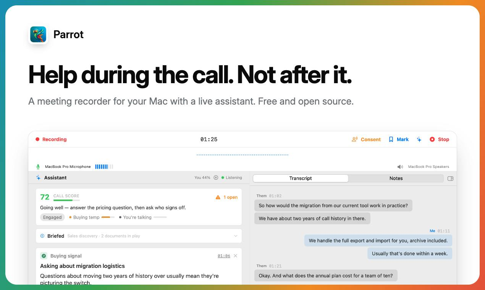
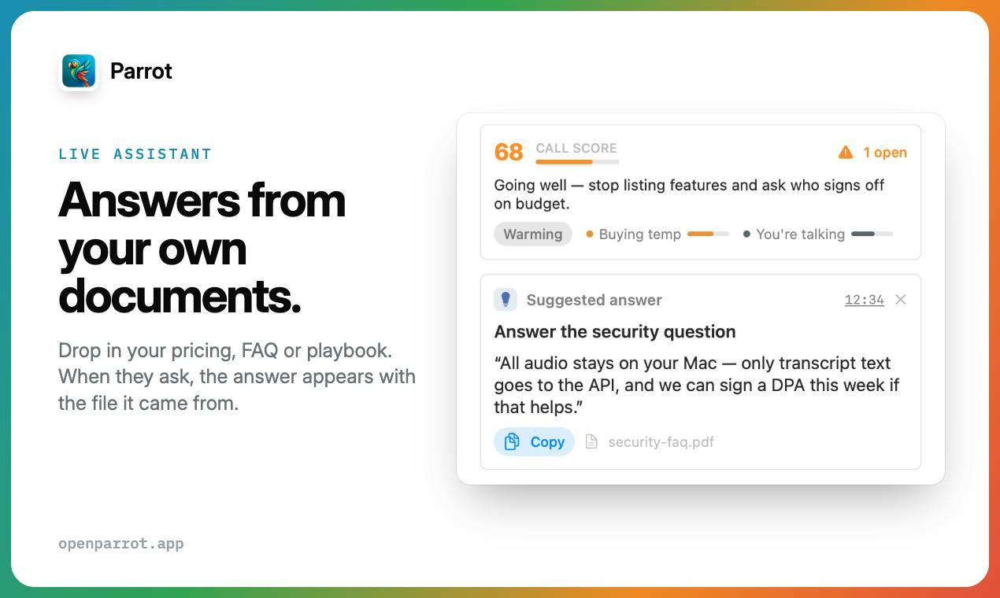
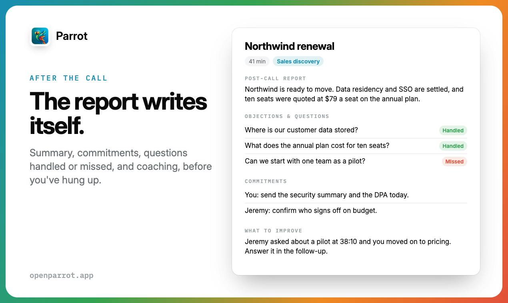

### 🎬 관련 영상
- [🎥 영상 보기](https://ph-files.imgix.net/f1a0e382-55b5-4a15-bf92-a807fc20f513.jpeg?auto=format)

---

## 18. [CrewTower Mod for Claude Code](https://www.producthunt.com/products/crew-tower)
**Votes**: 60 | **도입 난이도**: 중 | **신뢰도**: 상
**Tagline**: Talk to Claude Code right from your MacBook notch
**서비스 링크**: https://www.producthunt.com/r/NMSK3UAZW7HJX4

**태그**: DevTool, Productivity, MacApp, AI-Workflow, Prompting

### 📌 이 서비스 한눈에 보기
맥북 노치에서 Claude Code 세션을 실시간으로 관리하고 제어하는 모드

### 🔑 주요 기능
- 맥북 노치 영역을 활용한 직관적인 Claude Code 인터페이스 제공
- Claude 세션과 CrewTower를 연결하여 프롬프트 입력 및 컨텍스트 확인 가능
- 터미널 및 Claude Desktop 환경과 연동되는 컴팩트한 워크플로우

### 🙋 사용자에게 어떤 점이 좋은가
터미널을 벗어나지 않고도 맥북 상단에서 Claude의 다음 작업을 제어하고 컨텍스트를 시각적으로 확인할 수 있어 개발 흐름을 유지하기 좋습니다.

### ✅ 지금 바로 써볼 기능
- 노치 카드에 다음 프롬프트 입력해보기
- 컴팩트 모드로 전환하여 컨텍스트 확인하기
- 터미널과 데스크탑 앱 간의 연동 테스트하기

### ⚠️ 사용 전 확인할 점
- Claude Code 및 터미널 환경에 대한 사전 숙련도 필요
- 맥북 노치 영역을 사용하는 UI 특성상 화면 가림 현상 발생 가능

### 🧭 확인이 더 필요한 정보
상세한 설치 방법과 시스템 리소스 점유율에 대한 정보가 명시되지 않았습니다.

### 📸 스크린샷 및 갤러리
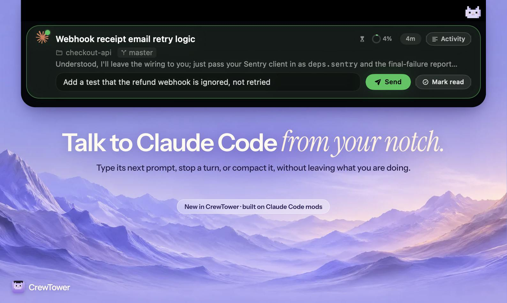
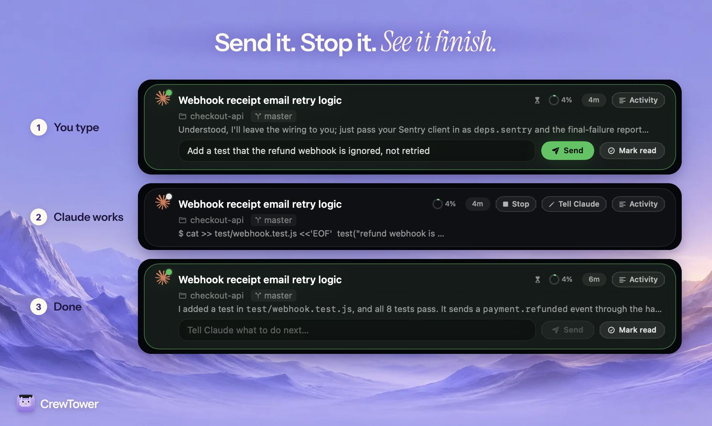
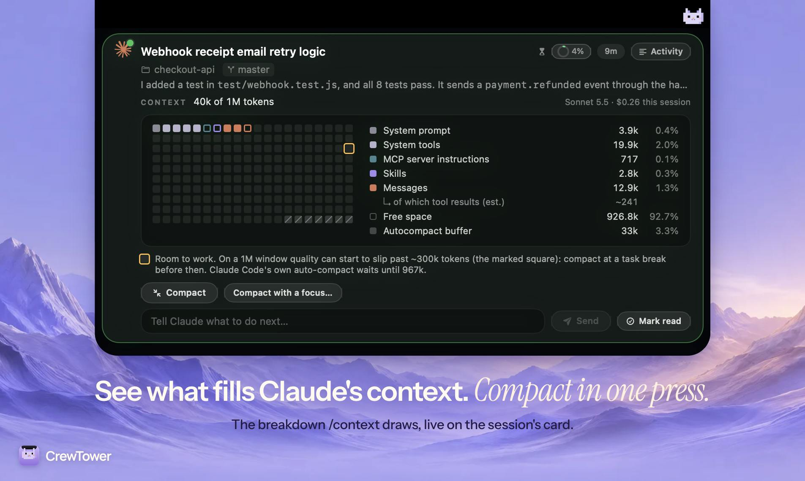

### 🎬 관련 영상
- [🎥 영상 보기](https://ph-files.imgix.net/f5fa694c-07b4-4a37-83a8-4f8b8ace7f20.jpeg?auto=format)

---

## 19. [Leepik](https://www.producthunt.com/products/leepik)
**Votes**: 18 | **도입 난이도**: 하 | **신뢰도**: 상
**Tagline**: Bank PDFs to Tally, with ledger mapping that learns
**서비스 링크**: https://www.producthunt.com/r/CBO6VMLHPHWZU3

**태그**: Accounting, Automation, FinTech, Productivity, AI Tool

### 📌 이 서비스 한눈에 보기
은행 PDF 명세서를 학습형 계정 과목 매핑을 통해 Tally용 회계 전표로 자동 변환해주는 서비스

### 🔑 주요 기능
- 은행 PDF를 Tally용 XML 또는 CSV 형식의 회계 전표로 자동 변환
- 사용자의 계정 과목 선택을 학습하여 반복적인 수동 작업을 감소
- 데이터 보안을 위해 외부 AI/OCR 서비스로 데이터를 전송하지 않고 자체 서버에서 처리

### 🙋 사용자에게 어떤 점이 좋은가
매달 반복되는 은행 명세서 입력 작업을 자동화하여 인도 회계 담당자의 업무 시간을 획기적으로 단축할 수 있습니다.

### ✅ 지금 바로 써볼 기능
- 은행 PDF 파일을 업로드하여 자동 매핑 기능 테스트하기
- 학습된 계정 과목 제안 및 잔액 검토 기능 확인하기
- 생성된 XML/CSV 파일을 Tally로 내보내기

### ⚠️ 사용 전 확인할 점
- 텍스트 기반 PDF만 지원하며, 스캔된 이미지 PDF는 처리할 수 없음
- 현재 오픈 베타 단계로 모든 기능이 무료로 제공됨

### 🧭 확인이 더 필요한 정보
스캔된 PDF 파일에 대한 향고적인 OCR 지원 계획이나 처리 가능 여부는 명시되지 않았습니다.

### 📸 스크린샷 및 갤러리
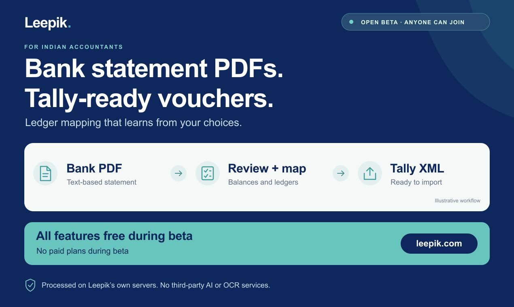

### 🎬 관련 영상
- [🎥 영상 보기](https://ph-files.imgix.net/59c04ace-9c21-4533-9cc6-4a211c581f9a.jpeg?auto=format)

---

## 20. [NEWCV.IO](https://www.producthunt.com/products/newcv)
**Votes**: 17 | **도입 난이도**: 하 | **신뢰도**: 상
**Tagline**: Stand out. Get interviews.
**서비스 링크**: https://www.producthunt.com/r/U3KKYF3ODKU6MB

**태그**: Career, AI, Productivity, Resume, AI Tool

### 📌 이 서비스 한눈에 보기
AI 기반 맞춤형 이력서 작성 및 ATS 최적화 솔루션

### 🔑 주요 기능
- 역할 기반 이력서 생성 및 특정 공고 맞춤형 최적화 기능
- ATS(채용 관리 시스템) 및 채용 담당자 관점의 프리미엄 감사 기능
- 전문 템플릿, 퍼스널 브랜딩 및 다국어 지원 도구 제공

### 🙋 사용자에게 어떤 점이 좋은가
지원하려는 직무와 공고에 맞춰 이력서를 즉각적으로 최적화하여 서류 통과율을 높일 수 있습니다.

### ✅ 지금 바로 써볼 기능
- 기존 이력서 임포트 및 데이터 정리
- Job Matcher 기능을 통한 특정 채용 공고 맞춤화
- Premium Resume Audit으로 ATS 최적화 상태 점검

### ⚠️ 사용 전 확인할 점
- 프리미엄 감사 기능 등 일부 고급 기능의 유료 결제 여부 확인 필요
- AI 생성 내용의 사실 관계 및 개인정보 검토 필요

### 🧭 확인이 더 필요한 정보
상세한 요금 체계와 프리미엄 기능의 구체적인 비용 범위가 명시되지 않았습니다.

### 📸 스크린샷 및 갤러리

---

## 21. [10X.ing](https://www.producthunt.com/products/10x-ing)
**Votes**: 15 | **도입 난이도**: 하 | **신뢰도**: 상
**Tagline**: Get new customers for your startup - on autopilot
**서비스 링크**: https://www.producthunt.com/r/FYJLV2HIWDBX3F

**태그**: Marketing, Automation, SEO, GrowthHacking, AI, AI Tool, LLM, Email

### 📌 이 서비스 한눈에 보기
웹사이트 주소만 입력하면 마케팅 기회를 자동으로 발굴해주는 스타트업용 자동화 솔루션

### 🔑 주요 기능
- 웹사이트 URL 입력만으로 자동 마케팅 기회 도출
- 콜드 이메일, 소셜 콘텐츠, SEO, 백링크 등 다각도 전략 제공
- AI/LLM SEO를 포함한 최신 검색 엔진 최적화 기회 탐색

### 🙋 사용자에게 어떤 점이 좋은가
마케팅 전문가가 없는 초기 스타트업이 최소한의 노력으로 잠재 고객을 확보하고 검색 엔진 노출을 최적화할 수 있습니다.

### ✅ 지금 바로 써볼 기능
- 자사 웹사이트 URL 입력하여 마케팅 기회 리포트 생성하기
- 제공되는 콜드 이메일 및 소셜 콘텐츠 전략 검토하기
- AI/LLM SEO 최적화 가이드 적용하기

### ⚠️ 사용 전 확인할 점
- 자동 생성된 기회의 실제 실행 가능성 및 품질은 사용자가 직접 검토 필요
- 자동화된 마케팅 활동이 브랜드 이미지에 미칠 영향 고려 필요

### 🧭 확인이 더 필요한 정보
자동화된 마케팅 실행(Execution) 단계까지 지원하는지, 아니면 전략 제안(Strategy)에 국한되는지 확인이 필요합니다.

### 📸 스크린샷 및 갤러리

---

## 22. [KuikCode](https://www.producthunt.com/products/kuikcode)
**Votes**: 13 | **도입 난이도**: 하 | **신뢰도**: 상
**Tagline**: Beautiful QR codes you'll never reprint
**서비스 링크**: https://www.producthunt.com/r/YMYPYHSJEPL3YS

**태그**: Marketing, Design, Automation, Analytics, DevTool

### 📌 이 서비스 한눈에 보기
브랜드 디자인을 입힌 동적 QR 코드로 인쇄 후에도 목적지를 자유롭게 변경하세요.

### 🔑 주요 기능
- 인쇄 후에도 연결 링크를 변경할 수 있는 동적 QR 코드 생성
- 브랜드 아이덴티티를 반영한 맞춤형 디자인 및 대량 생성(CSV) 지원
- 실시간 스캔 추적 및 모바일 랜딩 페이지 구축 기능

### 🙋 사용자에게 어떤 점이 좋은가
한 번 인쇄하면 수정이 불가능한 기존 QR 코드의 한계를 극복하여, 마케팅 캠페인이나 제품 패키지 운영 비용을 획기적으로 줄여줍니다.

### ✅ 지금 바로 써볼 기능
- CSV 파일을 활용한 대량 QR 코드 생성 테스트
- 브랜드 로고를 적용한 커스텀 디자인 적용
- 생성된 QR 코드를 통한 실시간 스캔 데이터 확인

### ⚠️ 사용 전 확인할 점
- 동적 QR 코드 특성상 서비스 운영 지속 여부에 따라 링크 유효성이 영향을 받을 수 있음
- 무제한 스캔 기능이 포함된 요금제 정책 상세 확인 필요

### 🧭 확인이 더 필요한 정보
CSV 대량 생성 시 개별 QR 코드의 디자인 커스텀이 일괄 적용되는지 여부를 확인해야 합니다.

### 📸 스크린샷 및 갤러리

### 🎬 관련 영상
- [🎥 영상 보기](https://ph-files.imgix.net/6841f21b-a73d-4103-89d3-21760565ae34.jpeg?auto=format)

---

## 23. [Laundro Cafe](https://www.producthunt.com/products/laundro-cafe)
**Votes**: 13 | **도입 난이도**: 하 | **신뢰도**: 상
**Tagline**: A cozy focus timer in a laundromat shared with strangers
**서비스 링크**: https://www.producthunt.com/r/J2BWJ7UMTNV3P6

**태그**: Productivity, Focus Timer, Lofi, Minimalism

### 📌 이 서비스 한눈에 보기
낯선 이들과 함께하는 가상 세탁소에서 즐기는 몰입형 집중 타이머

### 🔑 주요 기능
- 브라우저 기반의 가상 세탁소 환경 제공
- 세탁기/건조기 작동을 활용한 포모도로 방식의 집중 타이머
- 로파이(Lofi) 음악과 손편지 등 감성적인 상호작용 요소

### 🙋 사용자에게 어떤 점이 좋은가
혼자 공부하거나 작업할 때 느끼는 고립감을 해소하고, 타인의 존재감을 느끼며 자연스럽게 집중력을 유지할 수 있습니다.

### ✅ 지금 바로 써볼 기능
- 세탁기/건조기 타이머 시작하기
- 로파이 음악과 함께 작업 시작하기
- 방문자들을 위한 손편지 남겨보기

### ⚠️ 사용 전 확인할 점
- 별도의 가입이 없으므로 브라우저를 닫으면 데이터가 사라질 수 있음
- 실제 물리적 환경이 아닌 가상 환경이므로 개인의 집중 성향에 따라 효과가 다를 수 있음

### 🧭 확인이 더 필요한 정보
사용자 간의 상호작용 범위와 데이터 저장 방식에 대한 구체적인 정보가 부족합니다.

### 📸 스크린샷 및 갤러리

### 🎬 관련 영상
- [🎥 영상 보기](https://ph-files.imgix.net/9d8d1837-ee42-486b-82b1-28ae595d288c.jpeg?auto=format)

---

## 24. [Killer Krakens](https://www.producthunt.com/products/killer-krakens)
**Votes**: 10 | **도입 난이도**: 하 | **신뢰도**: 상
**Tagline**: One boat. Depth charges. The whole deep rising at you.
**서비스 링크**: https://www.producthunt.com/r/ZMFFLZFXVN7UVY

**태그**: IndieGame, Arcade, WebGame, NoInstall

### 📌 이 서비스 한눈에 보기
애니메이션 속 게임을 현실로 구현한 심플하고 몰입감 넘치는 브라우저 아케이드 게임

### 🔑 주요 기능
- 애니메이션 'The Night Crew'의 세계관을 반영한 공식 게임
- 설치나 가입 없이 브라우저에서 즉시 즐길 수 있는 간편함
- 조작이 직관적인 아케이드 스타일의 심해 전투 게임

### 🙋 사용자에게 어떤 점이 좋은가
별도의 다운로드나 회원가입 없이 웹 브라우저를 통해 즉시 게임을 즐길 수 있어 접근성이 매우 높습니다.

### ✅ 지금 바로 써볼 기능
- 브라우저에서 바로 게임 플레이하기
- iPhone 사용 시 TestFlight를 통한 모바일 베타 테스트하기
- 방향키와 스페이스바를 이용한 기본 조작 익히기

### ⚠️ 사용 전 확인할 점
- 브라우저 쿠키 삭제 시 저장된 점수가 사라질 수 있음
- 현재 오픈 베타 단계로 모바일 환경에서 일부 차이가 있을 수 있음

### 🧭 확인이 더 필요한 정보
브라우저 저장 방식이므로 기기 변경 시 점수 동기화 여부는 불분명합니다.

### 📸 스크린샷 및 갤러리

### 🎬 관련 영상
- [🎥 영상 보기](https://ph-files.imgix.net/a580622e-e91a-4d5b-960b-a064568ae2e5.jpeg?auto=format)

---

## 25. [RefurbMe Import Costs](https://www.producthunt.com/products/refurbme-import-costs)
**Votes**: 10 | **도입 난이도**: 하 | **신뢰도**: 상
**Tagline**: What a US purchase really costs delivered to 16 countries
**서비스 링크**: https://www.producthunt.com/r/IRLPRZAHMS2HTB

**태그**: Shopping, Logistics, Cost-Calculator

### 📌 이 서비스 한눈에 보기
미국 직구 시 배송비, 관세, 세금을 포함한 최종 도착 비용을 계산해주는 서비스

### 🔑 주요 기능
- 16개 국가 대상의 배송 및 세금 계산 기능 제공
- 6개 미국 배송 대행지(Forwarder)의 비용 비교 및 순위 제공
- 전자제품, 의류 등 다양한 품목의 최종 도착 비용 확인 가능

### 🙋 사용자에게 어떤 점이 좋은가
미국 직구 시 발생하는 숨은 비용(관세, 세금, 배송비)을 미리 계산하여 실제 지불 금액을 정확히 예측할 수 있습니다.

### ✅ 지금 바로 써볼 기능
- 구매하려는 물품의 최종 도착 비용 계산해보기
- 제공되는 6개 배송 대행지별 비용 비교하기
- 각 페이지의 출처 링크를 통해 계산 근거 확인하기

### ⚠️ 사용 전 확인할 점
- 실제 결제 시점의 환율이나 배송사 정책에 따라 비용이 변동될 수 있음
- 16개국 외 다른 국가에 대한 정보는 제공되지 않을 수 있음

### 🧭 확인이 더 필요한 정보
실시간 환율 및 배송사의 실시간 운임 정책이 즉각 반영되는지 확인이 필요합니다.

### 📸 스크린샷 및 갤러리

---

## 26. [OptimAI Studio](https://www.producthunt.com/products/optimai-studio)
**Votes**: 9 | **도입 난이도**: 중 | **신뢰도**: 상
**Tagline**: Your AI creative agent, from idea to final cut
**서비스 링크**: https://www.producthunt.com/r/227TIQMN47NXA2

**태그**: AI-Agent, Creative-Tools, No-Code, Content-Creation, Automation, Agent, AI Tool, Video, Vision

### 📌 이 서비스 한눈에 보기
아이디어 구상부터 영상 편집까지, AI 에이전트가 주도하는 올인원 크리에이티브 스튜디오

### 🔑 주요 기능
- AI 에이전트를 통한 영화 기획, 이미지, 영상, 음악 생성 프로세스 자동화
- 브라우저 기반 에디터를 통한 직관적인 결과물 정교화
- 스토리텔링, 웹사이트 제작, 게임 빌드까지 가능한 다목적 창작 환경

### 🙋 사용자에게 어떤 점이 좋은가
기획부터 최종 결과물 제작까지의 복잡한 과정을 AI 에이전트가 대신 수행하여 창작 시간을 획기적으로 단축할 수 있습니다.

### ✅ 지금 바로 써볼 기능
- AI 에이전트에게 영화 시나리오 기획 지시하기
- 생성된 멀티미디어 에셋을 브라우저 에디터에서 편집하기
- 아이디어를 바탕으로 웹사이트나 게임 프로토타입 빌드하기

### ⚠️ 사용 전 확인할 점
- AI 생성물의 저작권 및 상업적 이용 가능 여부 확인 필요
- 복잡한 프로젝트의 경우 브라우저 기반 편집 성능 제약 가능성

### 🧭 확인이 더 필요한 정보
생성된 결과물의 품질 수준과 구체적인 편집 기능의 범위는 직접 사용 전까지 확인이 필요합니다.

### 📸 스크린샷 및 갤러리

### 🎬 관련 영상
- [🎥 영상 보기](https://ph-files.imgix.net/35eb9dd2-0e89-4418-92b0-1c63cdb15258.jpeg?auto=format)
- [🎥 영상 보기](https://ph-files.imgix.net/729d141d-8dcd-46ab-9a9f-09239b02eadb.jpeg?auto=format)
- [🎥 영상 보기](https://ph-files.imgix.net/f41b1f57-3e0d-4661-b1d4-2e367dd14992.jpeg?auto=format)
- [🎥 영상 보기](https://ph-files.imgix.net/f441c414-9a21-496b-a64f-36c1dc02141b.jpeg?auto=format)

---

## 27. [WorkerDock](https://www.producthunt.com/products/workerdock)
**Votes**: 9 | **도입 난이도**: 하 | **신뢰도**: 상
**Tagline**: All your local Cloudflare Workers projects in one Mac app
**서비스 링크**: https://www.producthunt.com/r/DMZMHFFMHV6XML

**태그**: DevTool, Cloudflare, macOS, Productivity

### 📌 이 서비스 한눈에 보기
여러 개의 Cloudflare Workers 프로젝트를 메뉴 바에서 한눈에 관리하는 네이티브 Mac 앱

### 🔑 주요 기능
- Workers, Pages, Astro, EmDash 프로젝트 통합 관리
- 프로젝트 실행/중지 및 실시간 로그 스트리밍 지원
- D1, KV, R2 바인딩 정보 시각화

### 🙋 사용자에게 어떤 점이 좋은가
터미널을 일일이 열지 않고도 메뉴 바에서 여러 로컬 개발 환경을 간편하게 제어하고 로그를 확인할 수 있습니다.

### ✅ 지금 바로 써볼 기능
- 메뉴 바에서 프로젝트 실행 및 중지해보기
- 실시간 로그 스트리밍 기능 확인하기
- D1, KV, R2 바인딩 연결 상태 확인하기

### ⚠️ 사용 전 확인할 점
- macOS 전용 앱이므로 Windows나 Linux 환경에서는 사용 불가
- 로컬 개발 환경의 프로젝트를 자동으로 찾는 방식이므로 프로젝트 경로 설정 확인 필요

### 🧭 확인이 더 필요한 정보
사용자의 로컬 프로젝트 경로를 탐색하는 방식과 보안 정책에 대한 상세 정보가 필요합니다.

### 📸 스크린샷 및 갤러리

### 🎬 관련 영상
- [🎥 영상 보기](https://ph-files.imgix.net/37923907-a9a9-4813-9231-ff2fc540c2a4.jpeg?auto=format)

---

## 28. [Nemotron 3.5 Bolt](https://www.producthunt.com/products/nvidia)
**Votes**: 9 | **도입 난이도**: 중 | **신뢰도**: 상
**Tagline**: Run everyday agentic tasks locally on a 24GB GPU
**서비스 링크**: https://www.producthunt.com/r/ORX3BM2VKNWO4E

**태그**: AI, NVIDIA, LocalLLM, Automation, Agent

### 📌 이 서비스 한눈에 보기
24GB GPU 환경에서 일상적인 에이전트 작업을 수행할 수 있는 고성능 로컬 AI 모델

### 🔑 주요 기능
- 24GB 메모리 예산에 맞춰 최적화된 74B(활성 9B) 모델
- NVIDIA RTX 및 DGX Spark 하드웨어에 최적화된 성능
- 텍스트와 비전을 모두 지원하며 초당 84토큰의 빠른 속도 제공

### 🙋 사용자에게 어떤 점이 좋은가
고가의 서버 없이도 개인용 워크스테이션에서 강력한 에이전트 기능을 로컬로 실행할 수 있습니다.

### ✅ 지금 바로 써볼 기능
- Hugging Face에서 GGUF 파일 다운로드
- 로컬 GPU 환경에서 모델 구동 테스트
- 스펙큘레이티브 디코딩(Speculative-decoding) 활용

### ⚠️ 사용 전 확인할 점
- 24GB VRAM을 초과하는 작업 시 성능 저하 가능성
- 모델 압축 과정에서 원본(120B) 대비 성능 차이 발생 가능

### 🧭 확인이 더 필요한 정보
사용자의 특정 하드웨어 환경에서의 실제 추론 성능 및 안정성은 추가 검증이 필요합니다.

### 📸 스크린샷 및 갤러리

---

## 29. [HonestExpenses AI](https://www.producthunt.com/products/honestexpenses-ai)
**Votes**: 8 | **도입 난이도**: 하 | **신뢰도**: 상
**Tagline**: Say what you spent. AI helps. It's tracked. Any platform.
**서비스 링크**: https://www.producthunt.com/r/IJI5WMVUTYGZID

**태그**: Productivity, AI, Finance, Automation, AI Tool

### 📌 이 서비스 한눈에 보기
말하거나 찍기만 하면 AI가 자동으로 정리해주는 간편 지출 관리 도구

### 🔑 주요 기능
- 텍스트, 사진, 메시지 등 다양한 방식으로 간편하게 지출 기록
- AI가 초안을 작성하고 사용자가 최종 확인하는 방식의 데이터 정확성
- 은행 계좌 로그인이나 광고 없이 개인정보를 보호하는 보안 중심 설계

### 🙋 사용자에게 어떤 점이 좋은가
복잡한 가계부 입력 대신 일상적인 대화나 사진 한 장으로 지출 내역을 즉시 기록할 수 있어 관리가 매우 편리합니다.

### ✅ 지금 바로 써볼 기능
- 텍스트로 지출 내역 입력해보기
- 영수증 사진 찍어 데이터 추출 확인하기
- 메신저(Telegram) 연동하여 기록해보기

### ⚠️ 사용 전 확인할 점
- AI가 생성한 초안이므로 최종 데이터 검토가 필수적임
- 무료 사용 기간 이후 유료 전환 정책 확인 필요

### 🧭 확인이 더 필요한 정보
무료 사용 기간 이후의 구체적인 Pro 플랜 가격 체계가 명시되지 않았습니다.

### 📸 스크린샷 및 갤러리

### 🎬 관련 영상
- [🎥 영상 보기](https://ph-files.imgix.net/93d36722-13ed-4b6d-97c4-793d78bdf4d6.jpeg?auto=format)

---

## 30. [OKstays](https://www.producthunt.com/products/okstays-smart-ai-hotel-search)
**Votes**: 7 | **도입 난이도**: 하 | **신뢰도**: 상
**Tagline**: Hotels ranked by real comfort, not commission
**서비스 링크**: https://www.producthunt.com/r/TDDIKB6TBU66GR

**태그**: Travel, Recommendation, Search, AI Tool, Chat

### 📌 이 서비스 한눈에 보기
수수료 대신 실제 숙소의 안락함(Comfort Score)을 기준으로 호텔을 추천하는 서비스

### 🔑 주요 기능
- 67가지 안락함 신호(소음, 침대, 샤워, WiFi 등)를 기반으로 한 객관적 점수 산출
- 청결, 안전, 침대 상태 등 필수 요건 미달 시 랭킹에서 제외되는 엄격한 필터링
- 광고나 수수료가 아닌 실제 사용자 경험 중심의 랭킹 시스템

### 🙋 사용자에게 어떤 점이 좋은가
광고성 정보에 지친 여행객이 실패 없는 숙소 예약을 위해 신뢰할 수 있는 데이터 기반의 리스트를 즉시 얻을 수 있습니다.

### ✅ 지금 바로 써볼 기능
- 자신의 여행 스타일에 맞는 맞춤형 필터 설정하기
- 특정 안락함 요소(예: 조용한 방)를 중심으로 쇼트리스트 생성하기
- AI 챗봇(ChatGPT 등) 내에서 OKstays 기능 활용해보기

### ⚠️ 사용 전 확인할 점
- 실시간 예약 가능 여부나 가격 정보는 포함되지 않을 수 있음
- 데이터 소스 및 점수 산출 방식의 투명성 확인 필요

### 🧭 확인이 더 필요한 정보
30,000개 이상의 호텔 데이터가 실시간으로 업데이트되는지 여부를 확인해야 합니다.

### 📸 스크린샷 및 갤러리

---

