# 🚀 Product Hunt Daily Top 30 (2026-10-19)

## 오늘의 요약
오늘의 트렌드는 AI를 활용한 업무 자동화와 개인화된 생산성 도구의 강세로 요약됩니다. 특히 이메일 관리, 프레젠테이션, 시스템 장애 해결 등 특정 워크플로우를 혁신하는 AI 솔루션과 보안 및 프라이버시를 강조한 도구들이 주목받았습니다.

### 오늘의 핵심 포인트
- AI가 단순 보조를 넘어 실시간 프레젠테이션, 장애 원인 분석, 이메일 초안 작성 등 전문적인 업무를 직접 수행하는 방향으로 진화하고 있습니다.
- 코딩 에이전트의 데이터 유출 방지나 개인용 AI 메모리의 프라이버시 설계처럼 보안과 데이터 보호가 핵심 가치로 부상했습니다.
- 클라우드 기반의 복잡한 작업을 줄이기 위해 CLI, 메뉴바 앱, 웨어러블 등 사용자 환경에 밀착된 형태의 도구들이 출시되었습니다.

**오늘의 태그**: AI_Automation, Productivity, Developer_Tools, Privacy_Security

## 1. [Inbox Zero](https://www.producthunt.com/products/inbox-zero-2)
**Votes**: 247 | **도입 난이도**: 하 | **신뢰도**: 상
**Tagline**: Open-source Superhuman alternative
**서비스 링크**: https://www.producthunt.com/r/FK6F3KNVDZW35Y

**태그**: Productivity, Email, OpenSource, AI, Automation, AI Tool

### 📌 이 서비스 한눈에 보기
모든 계정을 하나로 통합하는 오픈소스 기반의 초고속 이메일 클라이언트

### 🔑 주요 기능
- Gmail 및 Outlook 계정을 하나의 통합 인박스로 관리
- 키보드 중심의 빠른 작업 환경과 멀티 플랫폼(Web, Mac, Windows, iPhone) 지원
- AI 기능을 통한 자동 분류 및 초안 작성 기능 제공

### 🙋 사용자에게 어떤 점이 좋은가
여러 이메일 계정을 사용하는 사용자가 복잡한 작업 없이 키보드만으로 빠르게 메일을 관리하고, AI를 통해 답장 시간을 획기적으로 단축할 수 있습니다.

### ✅ 지금 바로 써볼 기능
- 기존 Gmail/Outlook 계정 연결하기
- 키보드 단축키 익히기
- AI 기능(유료)을 통한 자동 답안 초안 확인하기

### ⚠️ 사용 전 확인할 점
- AI 기능 사용 시 월 $20의 추가 비용 발생
- 오픈소스 클라이언트로서의 보안 및 데이터 프라이버시 정책 확인 필요

### 🧭 확인이 더 필요한 정보
AI 기능의 구체적인 데이터 처리 방식과 외부 툴 연동 범위에 대한 상세 정보가 필요합니다.

### 📸 스크린샷 및 갤러리
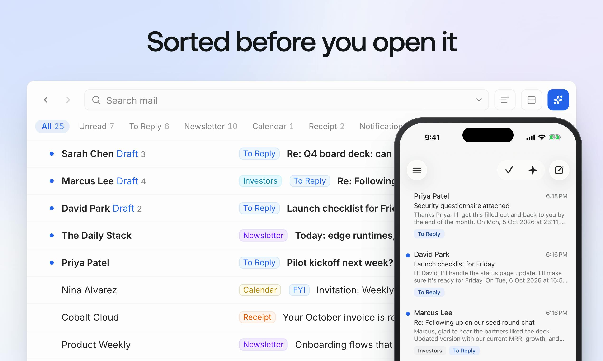
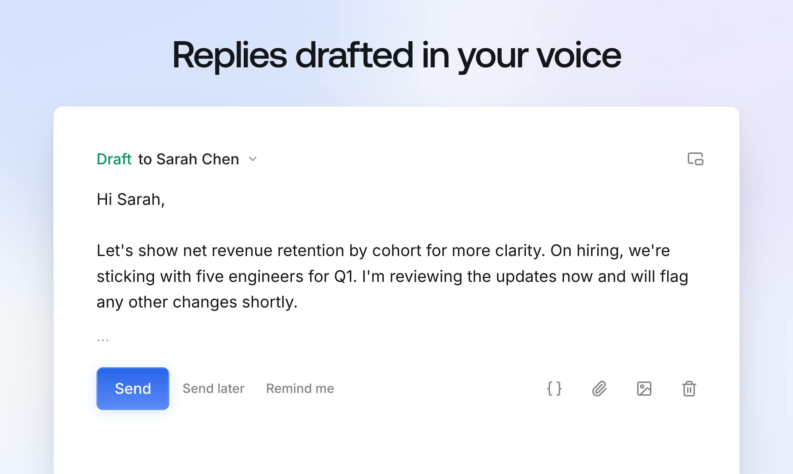
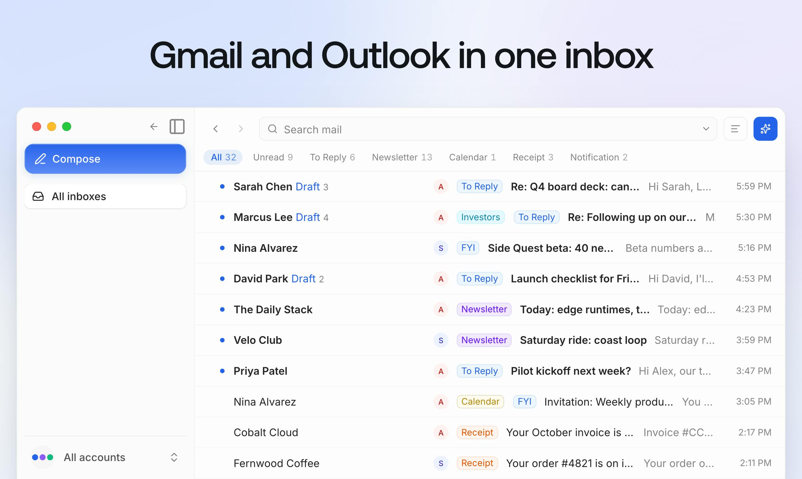

### 🎬 관련 영상
- [🎥 영상 보기](https://ph-files.imgix.net/2f067ad5-1e46-4ce9-9c74-5e4ff1d128bd.jpeg?auto=format)

---

## 2. [MyLens](https://www.producthunt.com/products/mylens-ai)
**Votes**: 160 | **도입 난이도**: 중 | **신뢰도**: 상
**Tagline**: 1-1 Live Presentations at Scale with AI.
**서비스 링크**: https://www.producthunt.com/r/RES6VMKW3LGAIK

**태그**: SalesTech, AI, Presentation, Personalization, Automation, AI Tool

### 📌 이 서비스 한눈에 보기
AI를 통해 수많은 고객에게 개인화된 1:1 라이브 프레젠테이션을 동시에 제공하는 솔루션

### 🔑 주요 기능
- 소스 자료를 기반으로 각 청중에게 맞춤형 실시간 프레젠테이션 생성
- 청중의 질문에 실시간 답변 및 실시간 슬라이드/레이어 생성 기능
- 세션 종료 후 개별 성과 분석 및 후속 조치 가이드 제공

### 🙋 사용자에게 어떤 점이 좋은가
영업이나 교육 시 일일이 대면하지 않아도, AI가 각 사용자의 상황에 맞춰 개인화된 발표를 진행하고 피드백을 관리해 줍니다.

### ✅ 지금 바로 써볼 기능
- 보유한 원천 자료(Raw sources) 업로드하기
- 개인화된 프레젠테이션 흐름 설정하기
- 실시간 질의응답 및 슬라이드 생성 기능 테스트하기

### ⚠️ 사용 전 확인할 점
- AI가 생성하는 콘텐츠의 정확성 및 원천 자료와의 일치 여부 확인 필요
- 실시간 상호작용 시 발생할 수 있는 기술적 지연 시간 확인 필요

### 🧭 확인이 더 필요한 정보
사용자 수에 따른 비용 체계와 실시간 영상/음성 스트리밍 품질에 대한 정보가 명시되지 않았습니다.

### 📸 스크린샷 및 갤러리
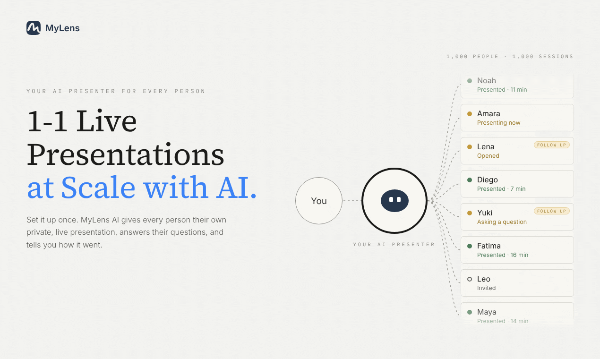
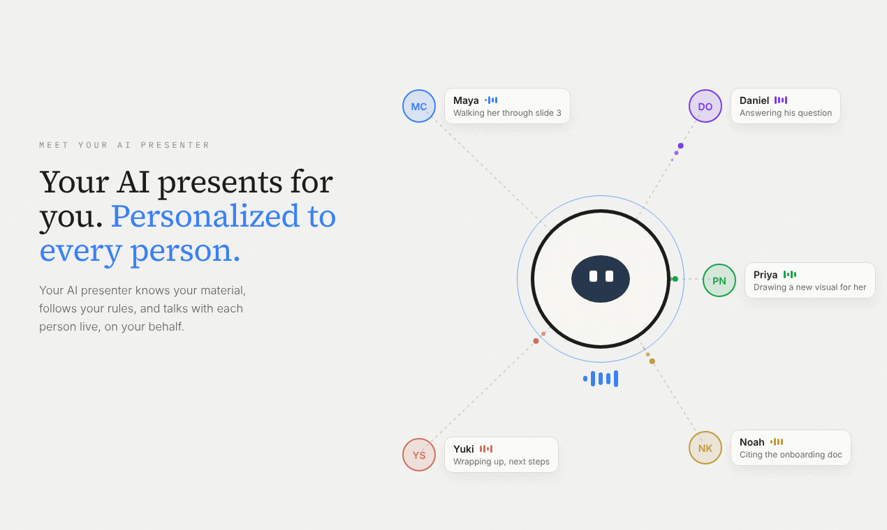
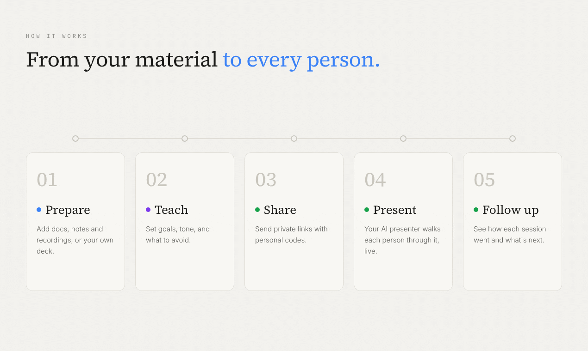

### 🎬 관련 영상
- [🎥 영상 보기](https://ph-files.imgix.net/552d436f-cf8f-443d-b96a-4f974503af58.jpeg?auto=format)

---

## 3. [shim-cli](https://www.producthunt.com/products/shim-cli)
**Votes**: 145 | **도입 난이도**: 중 | **신뢰도**: 상
**Tagline**: See what your coding agent sends. Mask what you can.
**서비스 링크**: https://www.producthunt.com/r/2E657WIGYUKWTP

**태그**: DevTool, Security, AI-Agent, CLI, Agent

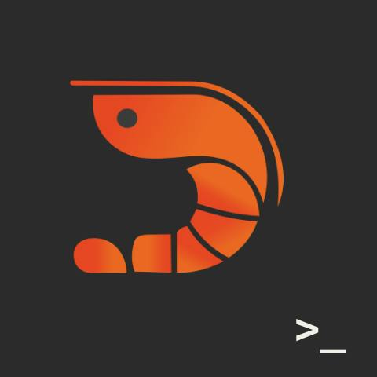

### 📌 이 서비스 한눈에 보기
코딩 에이전트의 데이터 유출을 방지하고 사용량을 모니터링하는 로컬 프록시 도구

### 🔑 주요 기능
- Claude Code, Copilot CLI 등 주요 코딩 에이전트용 오픈소스 훅/프록시 제공
- 모델로 전송되기 전 민감 정보 및 개인 데이터를 자동으로 마스킹
- 세션별 전송 데이터 내용과 비용을 실시간으로 확인 가능

### 🙋 사용자에게 어떤 점이 좋은가
AI 코딩 도구를 사용할 때 의도치 않게 비밀번호나 개인 정보가 모델로 전송되는 것을 방지하고, 사용량에 따른 비용을 투명하게 관리할 수 있습니다.

### ✅ 지금 바로 써볼 기능
- 로컬 프록시 설정을 통한 에이전트 연결
- 데이터 마스킹 규칙 설정
- shim watch를 통한 세션 및 비용 모니터링

### ⚠️ 사용 전 확인할 점
- 로컬 프록시 방식이므로 기존 CLI 도구와의 호환성 확인 필요
- 마스킹 규칙 설정이 미흡할 경우 데이터 유출 위험 잔존

### 🧭 확인이 더 필요한 정보
지원하는 모든 코딩 에이전트 및 IDE 환경에서의 완벽한 호환성 여부는 추가 확인이 필요합니다.

### 📸 스크린샷 및 갤러리
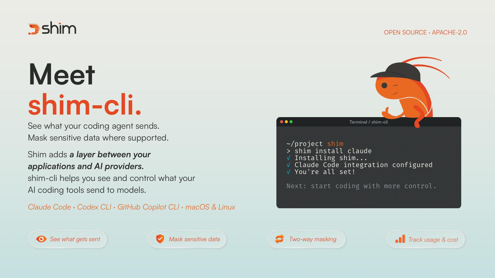
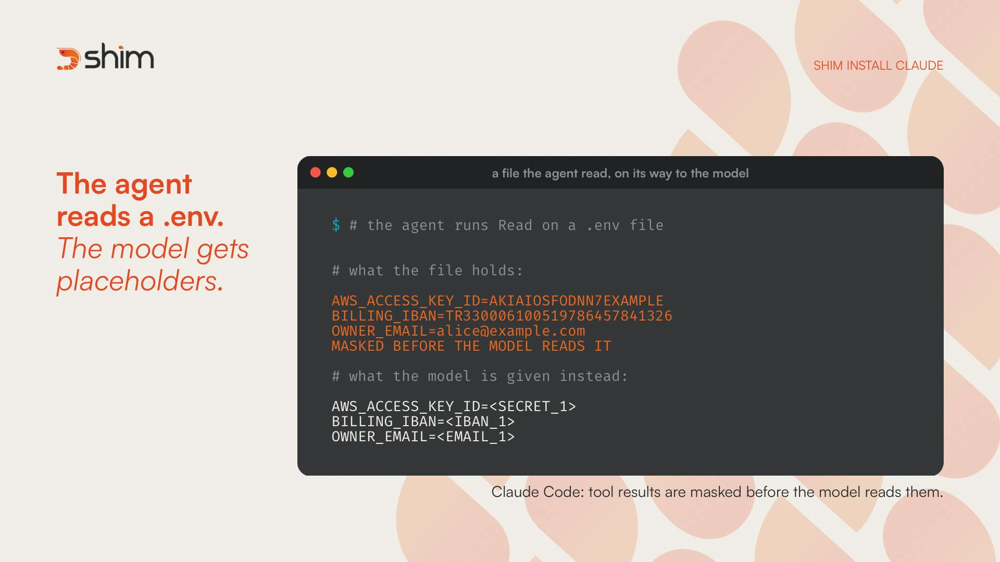
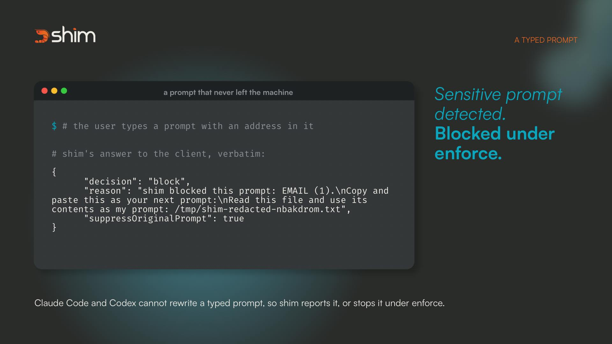

### 🎬 관련 영상
- [🎥 영상 보기](https://ph-files.imgix.net/5751d6a2-9457-490a-ba8c-5efdba1d8bbe.jpeg?auto=format)

---

## 4. [Tower 18 for Mac](https://www.producthunt.com/products/tower)
**Votes**: 123 | **도입 난이도**: 하 | **신뢰도**: 상
**Tagline**: The most powerful Git client with a better CLI experience
**서비스 링크**: https://www.producthunt.com/r/H54Y7ZW2KMIL66

**태그**: DevTool, Git, CLI, Productivity, AI Tool

### 📌 이 서비스 한눈에 보기
터미널 명령어로 Tower의 모든 뷰를 즉시 제어하는 강력한 Git 클라이언트 업데이트

### 🔑 주요 기능
- 강력한 CLI 도구 도입을 통한 터미널 경험 개선
- 단일 명령어로 History, Blame, Working Copy 등 주요 뷰로 즉시 이동
- GUI와 CLI 간의 심리스한 워크플로우 제공

### 🙋 사용자에게 어떤 점이 좋은가
터미널과 GUI를 오가는 번거로움을 줄여주어, 개발자가 작업 흐름을 끊지 않고도 Git 상태를 빠르게 확인할 수 있습니다.

### ✅ 지금 바로 써볼 기능
- Tower Command Line Tool 설치 및 설정
- 명령어를 통한 History 및 Blame 뷰 즉시 호출
- Branches Review 및 Working Copy로의 빠른 전환 테스트

### ⚠️ 사용 전 확인할 점
- Mac 전용 버전이므로 macOS 환경이 필요함
- 기존 GUI 중심 사용자에게는 CLI 설정 과정이 생소할 수 있음

### 🧭 확인이 더 필요한 정보
제공된 정보에는 CLI 명령의 구체적인 문법이나 기존 GUI 기능과의 완전한 동기화 여부는 명시되지 않았습니다.

### 📸 스크린샷 및 갤러리
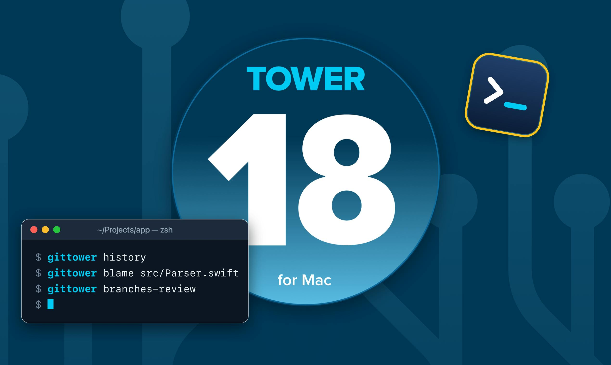
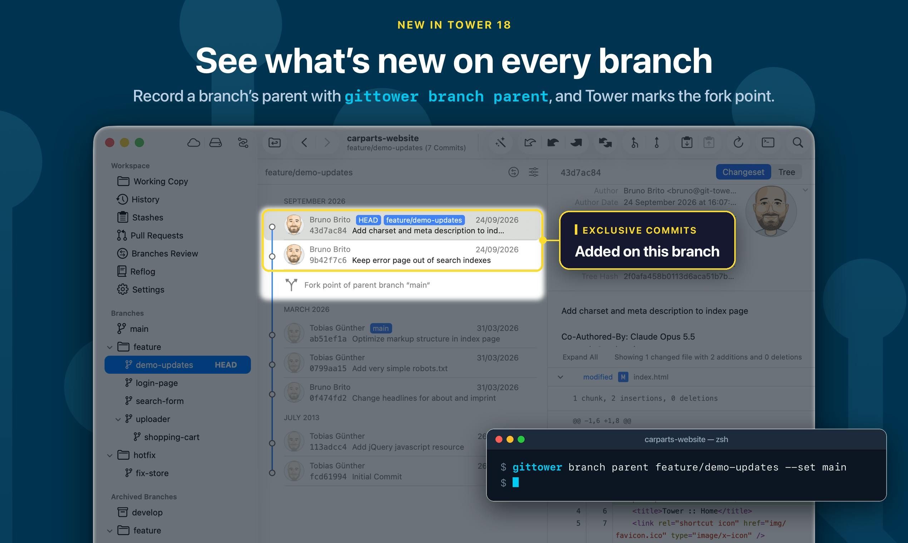
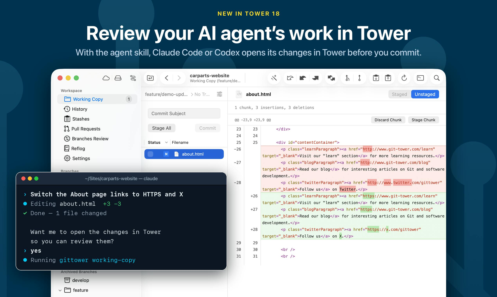

### 🎬 관련 영상
- [🎥 영상 보기](https://ph-files.imgix.net/1d58c683-09a7-41de-8943-015d435922ba.jpeg?auto=format)

---

## 5. [MeetPaw](https://www.producthunt.com/products/meetpaw)
**Votes**: 112 | **도입 난이도**: 하 | **신뢰도**: 상
**Tagline**: Instant meetings from your mac menu bar 
**서비스 링크**: https://www.producthunt.com/r/CLGB7TMIM44O62

**태그**: Productivity, macOS, Automation, Communication

### 📌 이 서비스 한눈에 보기
클릭 한 번으로 화상 회의 링크를 생성하고 바로 공유하는 macOS 메뉴바 앱

### 🔑 주요 기능
- macOS 메뉴바에 상주하는 가벼운 앱
- Google Meet, Zoom, Microsoft Teams 링크 즉시 생성
- 링크 생성과 동시에 클립보드에 자동 복사

### 🙋 사용자에게 어떤 점이 좋은가
회의를 위해 브라우저 탭을 열거나 사이트를 뒤지는 번거로움 없이, 작업 흐름을 끊지 않고 즉시 회의를 시작할 수 있습니다.

### ✅ 지금 바로 써볼 기능
- 메뉴바에서 선호하는 화상 회의 서비스 선택하기
- 클립보드에 복사된 링크를 상대방에게 바로 전달하기

### ⚠️ 사용 전 확인할 점
- macOS 전용 앱이므로 Windows나 Linux 환경에서는 사용 불가
- 각 화상 회의 서비스의 계정 로그인이 필요할 수 있음

### 🧭 확인이 더 필요한 정보
각 화상 회의 서비스(Zoom, Teams 등)와의 연동 방식 및 계정 로그인 필요 여부에 대한 상세 정보가 필요합니다.

### 📸 스크린샷 및 갤러리
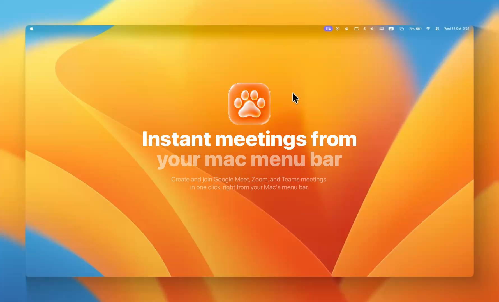
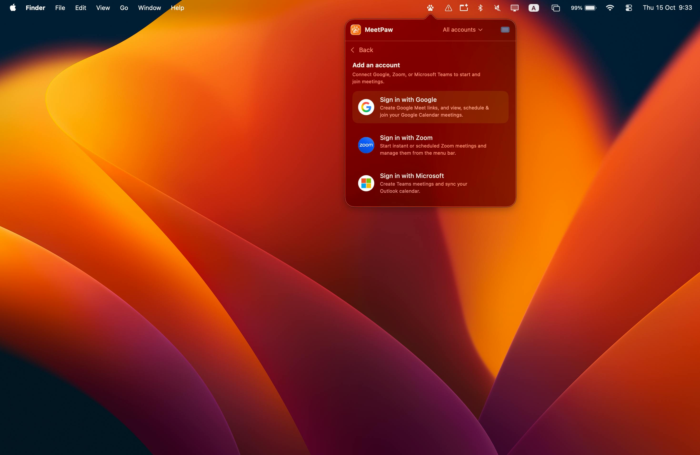
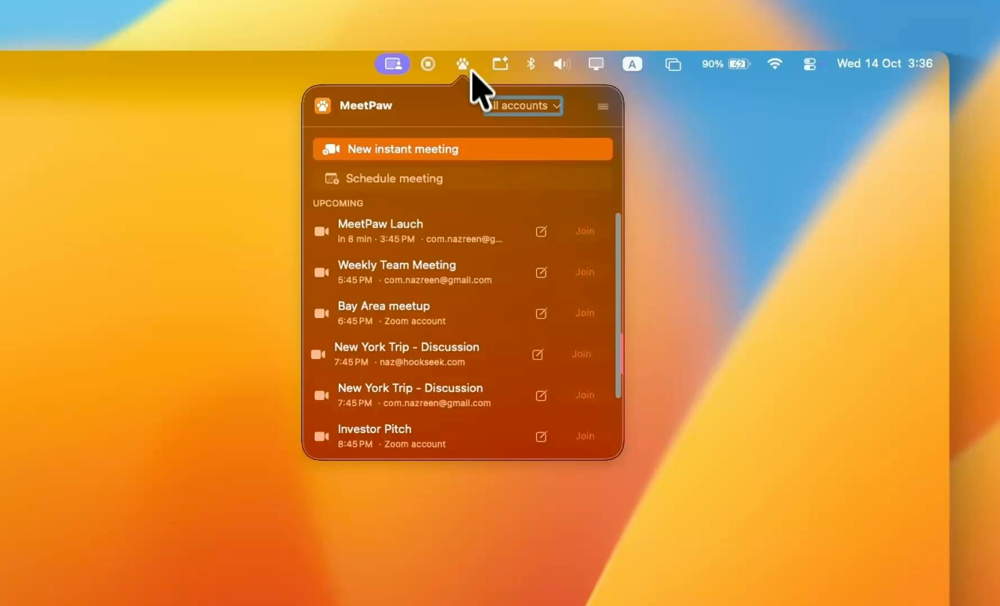

### 🎬 관련 영상
- [🎥 영상 보기](https://ph-files.imgix.net/39b1d756-bd6f-42b2-85ea-2c1449de7dac.jpeg?auto=format)

---

## 6. [XBOX Nano Controller](https://www.producthunt.com/products/microsoft-xbox-series-s)
**Votes**: 100 | **도입 난이도**: 하 | **신뢰도**: 상
**Tagline**: Pocket-sized wireless gamepad with all 18 inputs
**서비스 링크**: https://www.producthunt.com/r/EAREDKT5V2YY67

**태그**: Gaming, Hardware, Mobile

### 📌 이 서비스 한눈에 보기
언제 어디서나 즐길 수 있는 18개 입력 방식의 초소형 무선 게임패드

### 🔑 주요 기능
- 휴대성을 극대화한 포켓 사이즈 폼팩터
- 18개의 입력을 지원하는 풀 기능 컨트롤러
- 블루투스 연결을 통한 다양한 기기 간 호환성

### 🙋 사용자에게 어떤 점이 좋은가
작은 크기에도 불구하고 모든 입력 기능을 갖춰 이동 중에도 제약 없이 게임을 즐길 수 있습니다.

### ✅ 지금 바로 써볼 기능
- 블루투스 페어링 테스트
- 주요 모바일 게임과의 입력 호환성 확인
- 휴대용 케이스 및 그립감 확인

### ⚠️ 사용 전 확인할 점
- 크기가 작아 조작 편의성이나 그립감이 개인마다 다를 수 있음
- 배터리 수명 및 충전 방식 확인 필요

### 🧭 확인이 더 필요한 정보
상세한 배터리 지속 시간과 지원하는 구체적인 운영체제(OS) 목록이 명시되지 않았습니다.

### 📸 스크린샷 및 갤러리

### 🎬 관련 영상
- [🎥 영상 보기](https://ph-files.imgix.net/17820f30-5848-411a-9bac-c0ce513357f2.jpeg?auto=format)

---

## 7. [3AM Super Intelligence](https://www.producthunt.com/products/3am-super-intelligence)
**Votes**: 93 | **도입 난이도**: 중 | **신뢰도**: 상
**Tagline**: Production incidents: investigated, proven, fixed
**서비스 링크**: https://www.producthunt.com/r/PUH26LXS2WLDLX

**태그**: DevOps, AI, SRE, Automation, Incident-Response, AI Tool

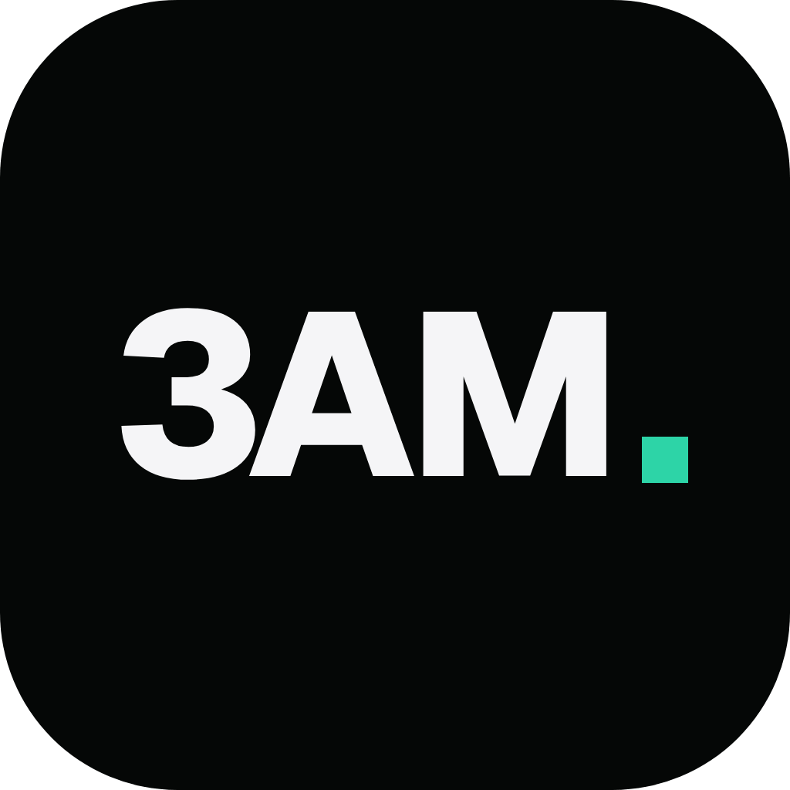

### 📌 이 서비스 한눈에 보기
복잡한 시스템의 장애 원인 분석부터 해결까지 자동화하는 AI 온콜 엔지니어

### 🔑 주요 기능
- 네트워크 내부에서 작동하는 보안 중심의 AI 솔루션
- 장애 원인 분석(Root Cause) 및 해결책 시뮬레이션 기능
- Slack을 통한 간편한 원클릭 장애 해결 프로세스

### 🙋 사용자에게 어떤 점이 좋은가
수정하기 어려운 레거시 시스템에서도 AI가 직접 원인을 찾고 해결책을 제안하여 운영 부담을 획기적으로 줄여줍니다.

### ✅ 지금 바로 써볼 기능
- Slack 연동을 통한 워크플로우 설정
- 네트워크 내부 설치 및 보안 환경 구성
- 장애 발생 시 AI 제안 해결책 검토

### ⚠️ 사용 전 확인할 점
- AI가 제안한 해결책이 시스템에 미칠 영향에 대한 최종 검토 필요
- 기존 인프라 환경과의 호환성 확인 필요

### 🧭 확인이 더 필요한 정보
네트워크 내부 설치 방식이 구체적으로 어떤 아키텍처를 따르는지 확인이 필요합니다.

### 📸 스크린샷 및 갤러리
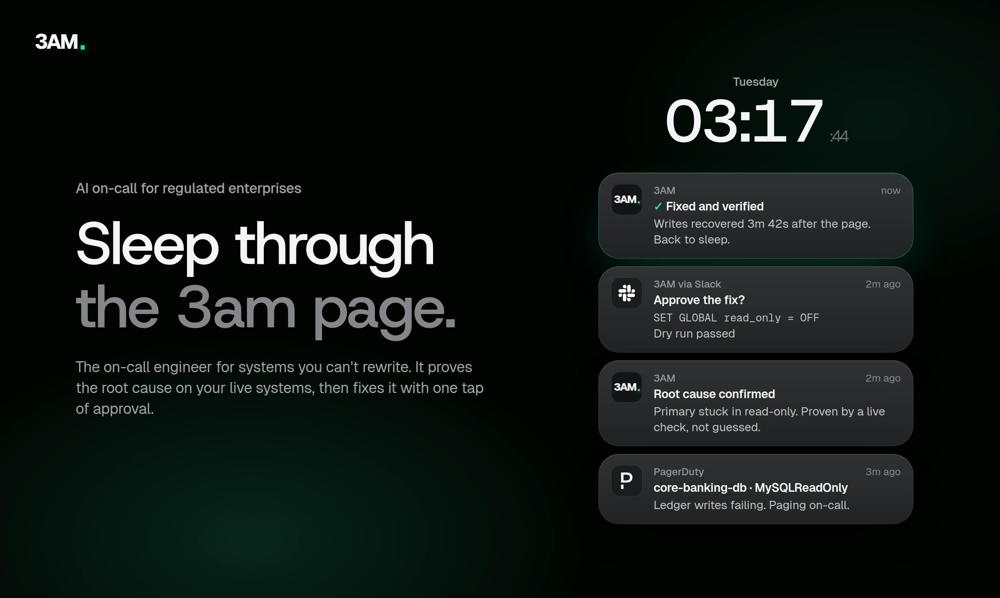
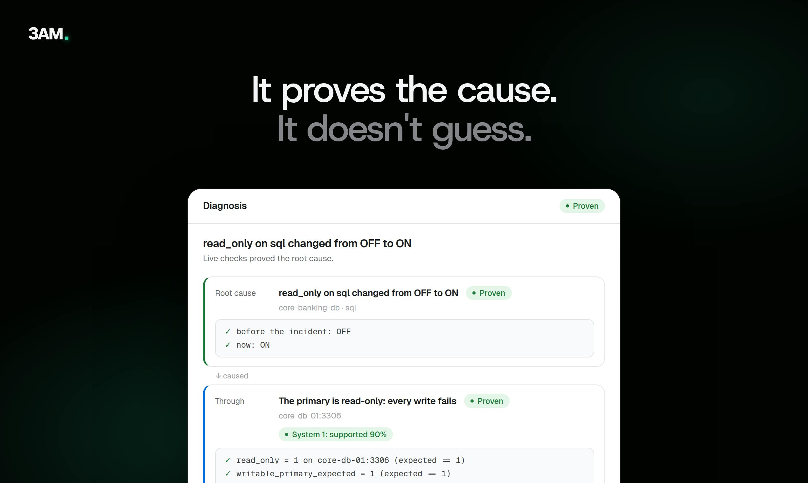
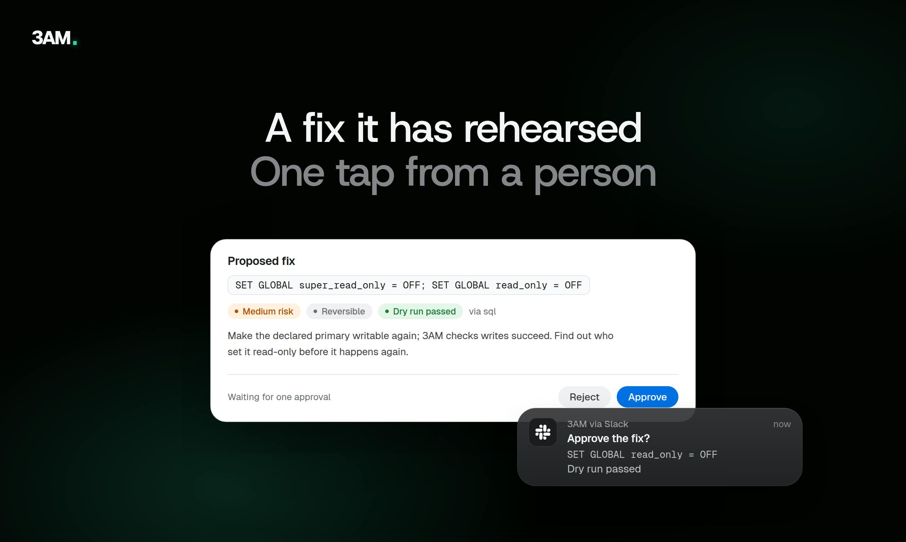

### 🎬 관련 영상
- [🎥 영상 보기](https://ph-files.imgix.net/8bfe5dd8-5721-4e51-a33f-08280b77c8f7.jpeg?auto=format)

---

## 8. [Bee Frontier and Bee Eclipse](https://www.producthunt.com/products/bee-frontier-and-bee-eclipse)
**Votes**: 85 | **도입 난이도**: 하 | **신뢰도**: 상
**Tagline**: Amazon's personal AI memory, now on your wrist or phone
**서비스 링크**: https://www.producthunt.com/r/WNZ6NFZTTN7MBD

**태그**: AI, Wearable, Productivity, Amazon, AI Tool

### 📌 이 서비스 한눈에 보기
대화 내용을 기억과 실행 가능한 정보로 바꿔주는 아마존의 개인용 AI 메모리 디바이스

### 🔑 주요 기능
- Frontier(웨어러블)와 Eclipse(폰 부착형) 두 가지 폼팩터 제공
- 대화를 요약, 리마인더, 후속 작업으로 자동 변환
- 오디오 녹음 파일을 저장하지 않는 프라이버시 중심 설계

### 🙋 사용자에게 어떤 점이 좋은가
중요한 대화 내용을 일일이 기록할 필요 없이, AI가 핵심 요약과 할 일을 자동으로 정리해 주어 생산성을 높여줍니다.

### ✅ 지금 바로 써볼 기능
- 대화 요약 및 핵심 내용 추출 기능 활용
- 중요 일정 및 할 일 자동 리마인더 설정
- Alexa+를 통한 과거 대화 내용 검색 및 회상

### ⚠️ 사용 전 확인할 점
- 음성 데이터 저장 방식에 따른 프라이버시 정책 상세 확인 필요
- 주변 소음 환경에서의 인식 정확도 확인 필요

### 🧭 확인이 더 필요한 정보
정확한 하드웨어 사양과 Alexa+ 서비스의 세부 통합 범위는 아직 공개되지 않았습니다.

### 📸 스크린샷 및 갤러리

---

## 9. [Tomo for ChatGPT](https://www.producthunt.com/products/tomo-for-chatgpt)
**Votes**: 83 | **도입 난이도**: 하 | **신뢰도**: 상
**Tagline**: Ask anything. Then play it, Duolingo-style.
**서비스 링크**: https://www.producthunt.com/r/B7PYM6TZUHFML4

**태그**: EdTech, AI, Gamification, ChatGPT, Chat

### 📌 이 서비스 한눈에 보기
ChatGPT 대화창에서 즉시 게임처럼 즐기는 맞춤형 학습 도구

### 🔑 주요 기능
- ChatGPT 내 플러그인 방식으로 간편하게 추가 가능
- 어떤 주제든 게임 형태의 학습 코스로 변환
- 교사 캐릭터(교수, 해적 등) 선택 가능

### 🙋 사용자에게 어떤 점이 좋은가
별도의 가입 없이 ChatGPT 안에서 학습과 놀이를 동시에 즐길 수 있어 학습 몰입도를 높여줍니다.

### ✅ 지금 바로 써볼 기능
- ChatGPT 플러그인에서 Tomo 추가하기
- 관심 있는 주제로 학습 게임 생성하기
- 원하는 스타일의 선생님 캐릭터 선택하기

### ⚠️ 사용 전 확인할 점
- ChatGPT 플러그인 환경에서만 작동함
- 학습 내용의 정확성은 ChatGPT 모델의 답변에 의존함

### 🧭 확인이 더 필요한 정보
사용자의 ChatGPT 계정 권한 및 플러그인 지원 여부에 따라 사용 가능 여부가 달라질 수 있습니다.

### 📸 스크린샷 및 갤러리

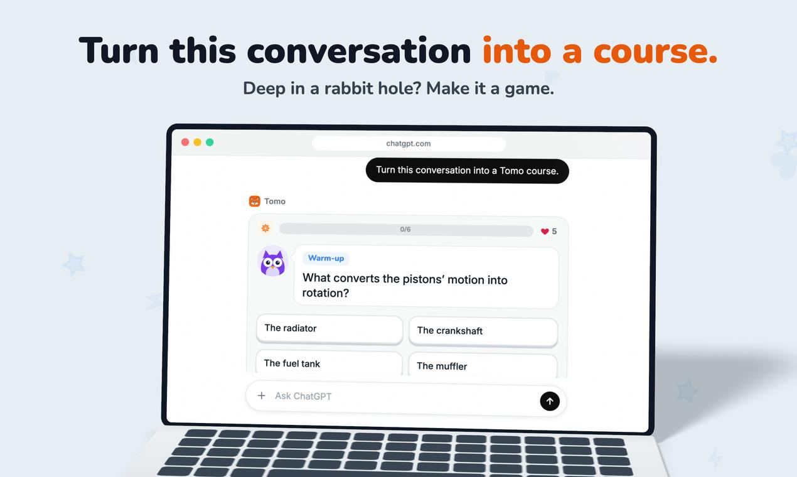
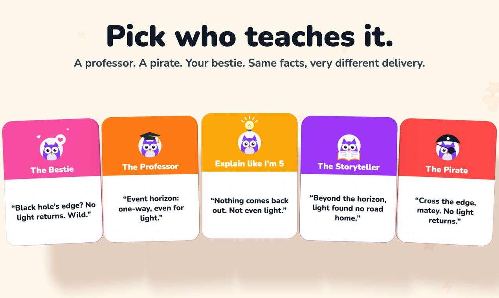

### 🎬 관련 영상
- [🎥 영상 보기](https://ph-files.imgix.net/9cd24046-5c53-4efa-88b7-f17282f5b019.jpeg?auto=format)

---

## 10. [Vampire Crawlers™](https://www.producthunt.com/products/vampire-crawlers)
**Votes**: 81 | **도입 난이도**: 하 | **신뢰도**: 상
**Tagline**: The Turbo Wildcard from Vampire Survivors
**서비스 링크**: https://www.producthunt.com/r/36WK326LVURZJV

**태그**: IndieGame, Roguelite, DeckBuilder, Strategy

### 📌 이 서비스 한눈에 보기
Vampire Survivors 제작진이 선보이는 턴제 카드 기반의 하이퍼 로그라이트 던전 탐험 게임

### 🔑 주요 기능
- Vampire Survivors 제작진의 새로운 장르적 시도
- 카드 덱 빌딩과 로그라이트 요소가 결합된 턴제 던전 탐험
- 전략적 플레이와 초고속 플레이를 모두 지원하는 하이퍼 시스템

### 🙋 사용자에게 어떤 점이 좋은가
기존 생존형 액션의 쾌감을 턴제 카드 게임의 전략적 재미로 재해석하여 새로운 방식의 몰입감을 제공합니다.

### ✅ 지금 바로 써볼 기능
- 강력한 콤보를 만드는 카드 덱 빌딩 경험하기
- 전략적 턴제 플레이와 빠른 속도감 사이의 플레이 스타일 결정하기

### ⚠️ 사용 전 확인할 점
- 액션 중심의 기존 팬들에게는 턴제 방식이 생소할 수 있음
- 게임의 구체적인 플랫폼 및 사양 정보 미비

### 🧭 확인이 더 필요한 정보
현재 제품 설명만으로는 구체적인 출시 플랫폼과 플레이 타임에 대한 정보를 알 수 없습니다.

### 📸 스크린샷 및 갤러리

### 🎬 관련 영상
- [🎥 영상 보기](https://ph-files.imgix.net/7bde2fed-1a09-405f-b701-977721a5a68a.jpeg?auto=format)

---

## 11. [PasteKit](https://www.producthunt.com/products/pastekit-2)
**Votes**: 81 | **도입 난이도**: 하 | **신뢰도**: 상
**Tagline**: Format JSON, YAML & SQL privately
**서비스 링크**: https://www.producthunt.com/r/ENGL3FNAAX653R

**태그**: DevTool, Productivity, Data, AI Tool

### 📌 이 서비스 한눈에 보기
데이터 유출 걱정 없이 브라우저 내에서 즉시 실행되는 강력한 코드 포맷터 및 변환 도구

### 🔑 주요 기능
- JSON, YAML, SQL 등 58가지 형식의 포맷팅 및 유효성 검사 지원
- 48가지 변환 기능 및 JSON diff, schema, repair 등 전문 도구 포함
- 모든 작업이 브라우저 내에서만 실행되어 데이터 보안 유지

### 🙋 사용자에게 어떤 점이 좋은가
민감한 코드를 외부 서버로 전송하지 않고도 안전하게 구조를 정리하거나 형식을 변환할 수 있어 개발 생산성이 높아집니다.

### ✅ 지금 바로 써볼 기능
- 복잡한 JSON 구조를 깔끔하게 정렬하기
- 서로 다른 데이터 형식을 변환하거나 스키마 검증하기
- 코드 간의 차이점(diff)을 빠르게 비교하기

### ⚠️ 사용 전 확인할 점
- 브라우저 기반이므로 매우 거대한 용량의 파일 처리 시 성능 저하 가능성 있음
- 오프라인 환경에서의 동작 여부는 브라우저 캐시 상태에 따라 다를 수 있음

### 🧭 확인이 더 필요한 정보
지원하는 58가지 포맷과 48가지 변환 기능의 구체적인 전체 목록은 직접 확인이 필요합니다.

### 📸 스크린샷 및 갤러리
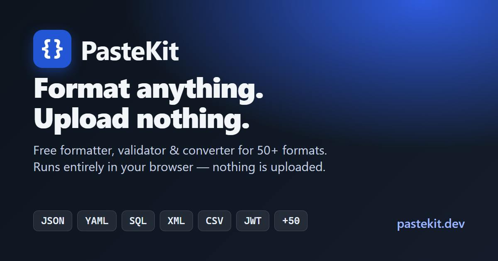
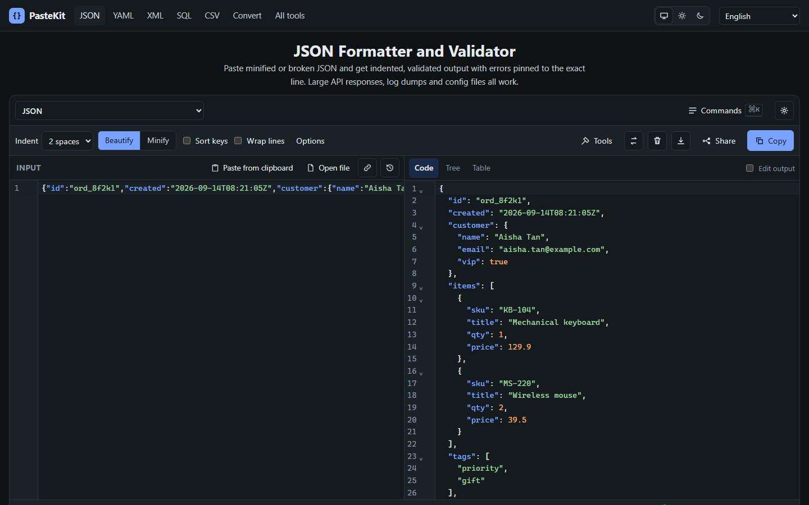

---

## 12. [Openbroca](https://www.producthunt.com/products/openbroca)
**Votes**: 80 | **도입 난이도**: 하 | **신뢰도**: 상
**Tagline**: Lightweight AI dictation for Mac that sounds like you
**서비스 링크**: https://www.producthunt.com/r/BLEYUJP5LFNQCX

**태그**: Productivity, AI, Mac, Dictation, AI Tool, Prompting

### 📌 이 서비스 한눈에 보기
사용자의 말투를 유지하며 불필요한 말만 제거해주는 초경량 Mac용 AI 받아쓰기 앱

### 🔑 주요 기능
- 6.5MB의 초경량 Swift 네이티브 앱으로 Mac 최적화
- 자연스러운 말투를 유지하면서 추임새와 반복을 제거하는 지능형 텍스트 변환
- 개인 사전 학습 기능 및 28개 언어 번역 지원

### 🙋 사용자에게 어떤 점이 좋은가
별도의 프롬프트 설정 없이 단축키만으로 자연스러운 텍스트를 얻을 수 있어, 문서 작성이나 메시지 전송 시 작업 흐름을 방해하지 않습니다.

### ✅ 지금 바로 써볼 기능
- 단축키를 설정하여 실시간 받아쓰기 테스트하기
- 개인 사전 기능을 활용해 전문 용어 학습시키기
- Typeless 사전 가져오기 기능으로 기존 데이터 연동하기

### ⚠️ 사용 전 확인할 점
- Mac 전용 앱이므로 다른 OS에서는 사용 불가
- AI 모델의 처리 방식에 따른 개인정보 및 보안 정책 확인 필요

### 🧭 확인이 더 필요한 정보
모든 기능이 무료 체험 기간 이후 유료로 전환되는지, 혹은 완전 무료인지에 대한 명확한 가격 정책 확인이 필요합니다.

### 📸 스크린샷 및 갤러리
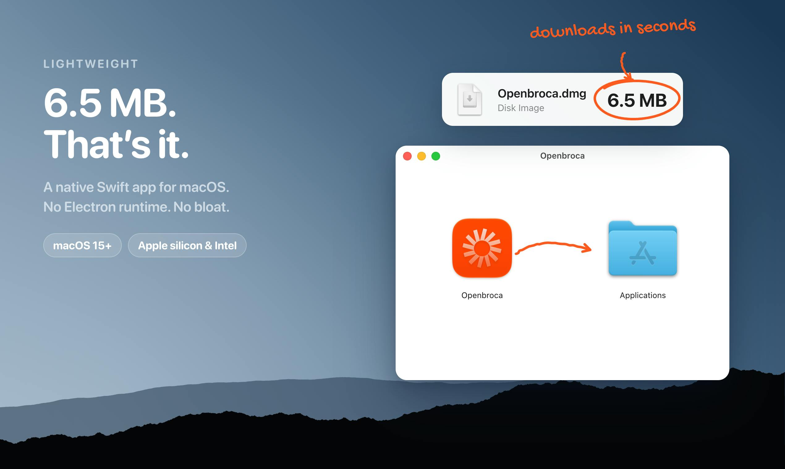
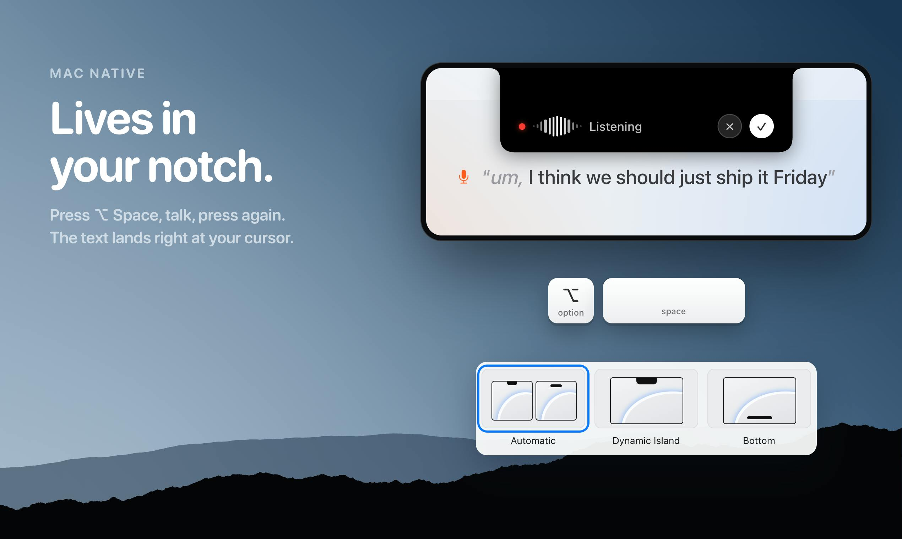
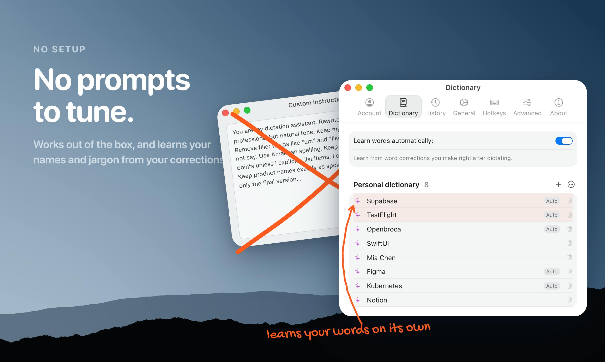

### 🎬 관련 영상
- [🎥 영상 보기](https://ph-files.imgix.net/46e1376a-116e-47f1-810f-8329e6dd8344.jpeg?auto=format)

---

## 13. [Gravity Notes](https://www.producthunt.com/products/gravity-notes-for-mac)
**Votes**: 79 | **도입 난이도**: 중 | **신뢰도**: 상
**Tagline**: One list of notes, for you and your AI agents
**서비스 링크**: https://www.producthunt.com/r/ZVCYFNVV6AD5TV

**태그**: Productivity, AI-Agent, Note-taking, Automation, DevTool, Agent, AI Tool

### 📌 이 서비스 한눈에 보기
AI 에이전트와 인간이 함께 사용하는, 시간 흐름에 따라 흐르는 단일 리스트 메모 앱

### 🔑 주요 기능
- 최신 노트가 상단에 위치하고 오래된 노트는 아래로 가라앉는 '중력' 방식의 리스트 구조
- Claude Code, Codex 등 AI 에이전트가 읽고 쓸 수 있는 전용 CLI 제공
- 한 번의 결제로 기기 간 동기화 및 로컬 저장이 가능한 프라이버시 중심 설계

### 🙋 사용자에게 어떤 점이 좋은가
단순한 기록을 넘어 AI 에이전트가 내 지식 베이스에 직접 접근하여 작업을 수행할 수 있는 환경을 제공합니다.

### ✅ 지금 바로 써볼 기능
- 라이브 마크다운 및 체크리스트 기능 활용하기
- Mac용 CLI를 통해 AI 에이전트와 연동하기
- 전체 내보내기 기능을 통한 데이터 백업 확인하기

### ⚠️ 사용 전 확인할 점
- AI 에이전트가 노트를 읽고 쓰는 과정에서의 보안 및 데이터 관리 필요
- 단일 리스트 구조이므로 복잡한 폴더 구조를 선호하는 사용자에게는 부적합할 수 있음

### 🧭 확인이 더 필요한 정보
구체적인 일회성 결제 금액과 상세한 기기 간 동기화 방식에 대한 정보가 명시되지 않았습니다.

### 📸 스크린샷 및 갤러리
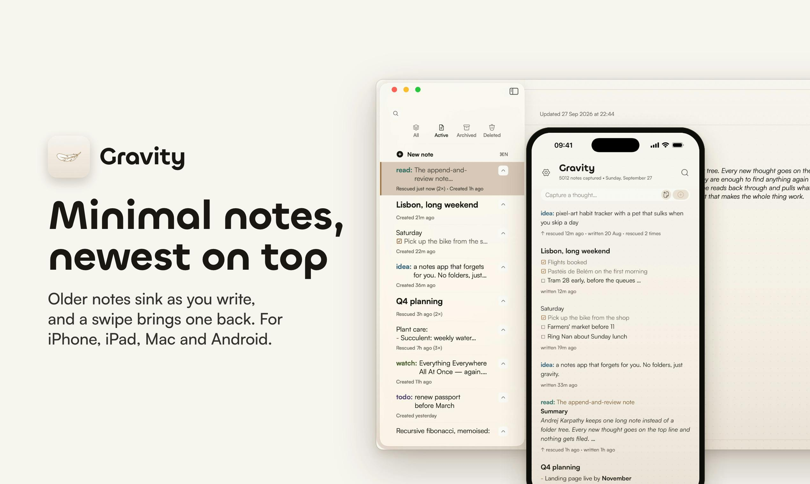
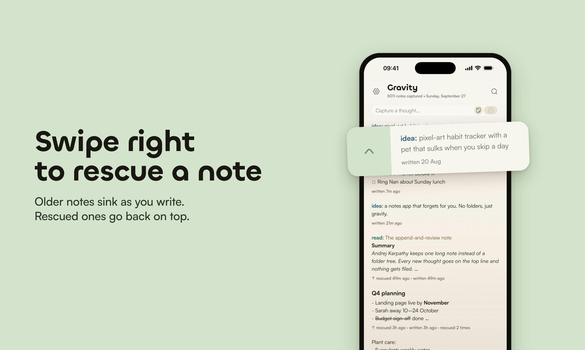
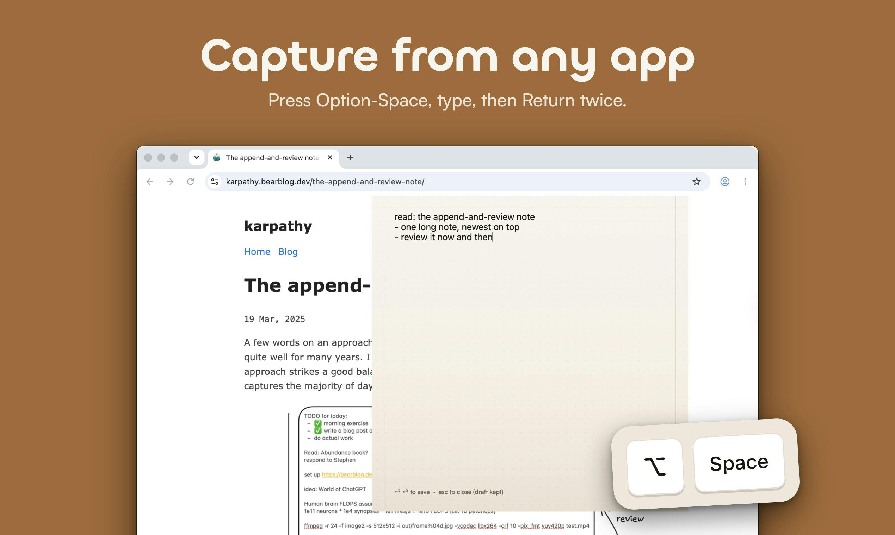

---

## 14. [SpeechFast](https://www.producthunt.com/products/speechfast)
**Votes**: 76 | **도입 난이도**: 하 | **신뢰도**: 상
**Tagline**: Local Whisper for Mac
**서비스 링크**: https://www.producthunt.com/r/42R5V77LP5GJPH

**태그**: Productivity, Mac, AI, Privacy, Automation, AI Tool, DevTool

### 📌 이 서비스 한눈에 보기
개인정보 유출 걱정 없이 맥에서 즉시 사용할 수 있는 로컬 음성 타이핑 도구

### 🔑 주요 기능
- 모든 데이터가 맥 로컬에서 처리되는 강력한 프라이버시 보호
- 어떤 앱에서도 커서 위치에 즉시 텍스트를 입력하는 편리함
- 불필요한 추임새를 제거하고 문맥을 정리하는 지능형 텍스트 정제

### 🙋 사용자에게 어떤 점이 좋은가
보안이 중요한 업무 환경이나 오프라인 상태에서도 안전하고 빠르게 음성으로 문서를 작성할 수 있습니다.

### ✅ 지금 바로 써볼 기능
- fn 키를 활용한 빠른 음성 입력 테스트
- Slack이나 Notion 등 작업 중인 앱에서의 입력 확인
- 로컬 저장된 최근 기록 기능 활용

### ⚠️ 사용 전 확인할 점
- 초기 모델 다운로드 시 저장 공간 및 리소스 확인 필요
- Apple Intelligence 기반 정제 기능의 세부 동작 방식 확인 필요

### 🧭 확인이 더 필요한 정보
사용 중인 Mac의 하드웨어 사양에 따른 모델 구동 성능 차이를 확인해야 합니다.

### 📸 스크린샷 및 갤러리
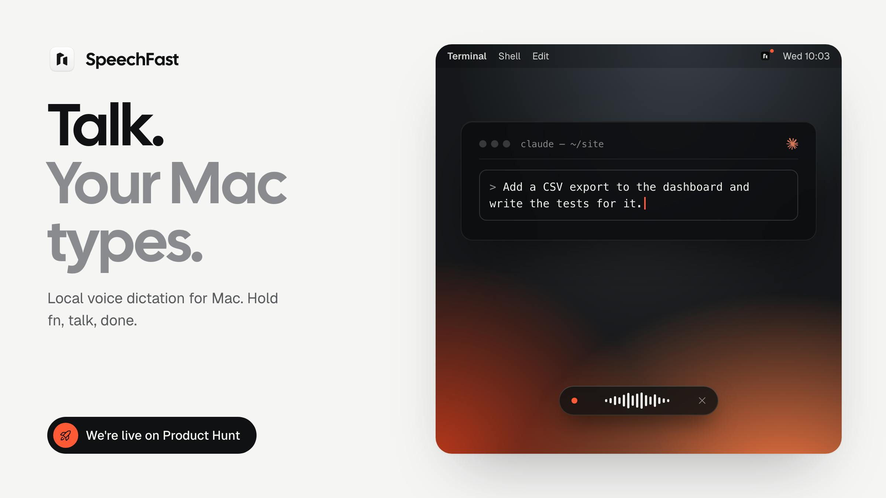
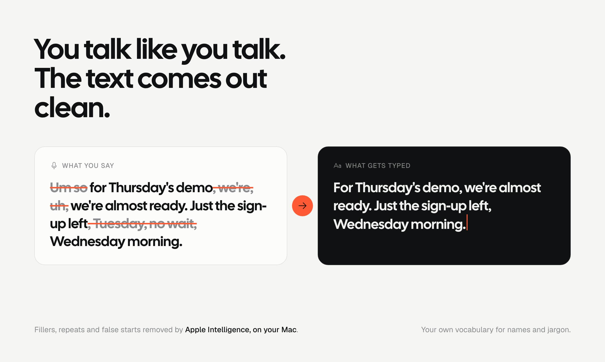
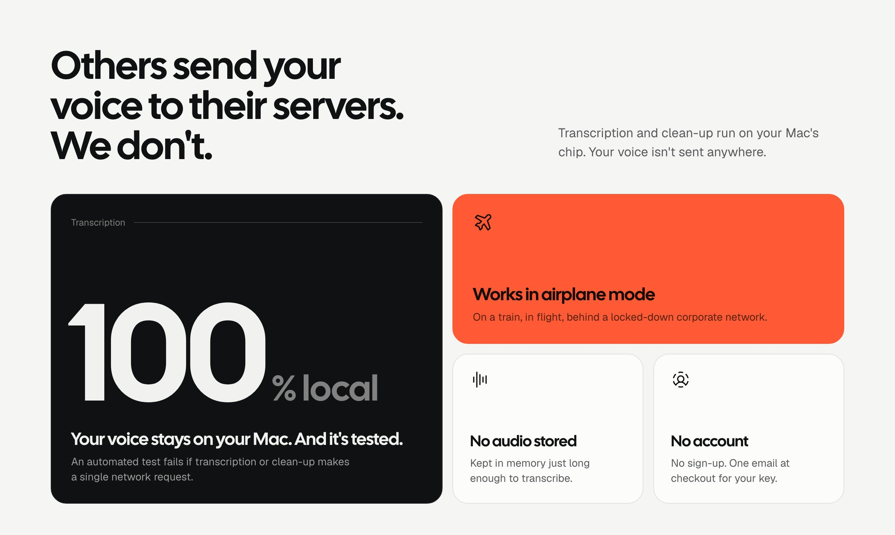

### 🎬 관련 영상
- [🎥 영상 보기](https://ph-files.imgix.net/ab865563-44ea-4c38-b00a-d65f58b9fef2.jpeg?auto=format)

---

## 15. [Latch](https://www.producthunt.com/products/latch-7)
**Votes**: 74 | **도입 난이도**: 하 | **신뢰도**: 상
**Tagline**: The app blocker you unlock by walking to your key
**서비스 링크**: https://www.producthunt.com/r/DYV54MEQP4QX2M

**태그**: Productivity, Focus, Mobile App, DevTool, Analytics

### 📌 이 서비스 한눈에 보기
물리적 이동을 통해 스마트폰 중독을 방지하는 강력한 앱 차단 도구

### 🔑 주요 기능
- 물리적 장소(NFC, QR 코드 등)에 가야만 잠금이 해제되는 방식
- 계정, 광고, 분석 기능이 없는 개인정보 중심 설계
- iPhone 및 Android 지원 및 일회성 유료 결제 모델

### 🙋 사용자에게 어떤 점이 좋은가
스마트폰을 손에 쥐고 있는 습관을 물리적 움직임을 강제함으로써 효과적으로 제어할 수 있습니다.

### ✅ 지금 바로 써볼 기능
- NFC 스티커나 QR 코드를 활용한 물리적 키 설정하기
- 집안의 특정 장소에 키를 배치하여 동선 설계하기
- Pro 버전을 통해 영구적인 기능 사용하기

### ⚠️ 사용 전 확인할 점
- 물리적 키(NFC/QR)를 분실하거나 접근하기 어려운 경우 사용이 불편할 수 있음
- 스마트폰을 물리적으로 멀리 두어야 하므로 긴급한 상황에서 제약이 생길 수 있음

### 🧭 확인이 더 필요한 정보
물리적 키(NFC/QR)를 설정하는 구체적인 프로세스와 기기 간 동기화 방식에 대한 상세 정보가 필요합니다.

### 📸 스크린샷 및 갤러리

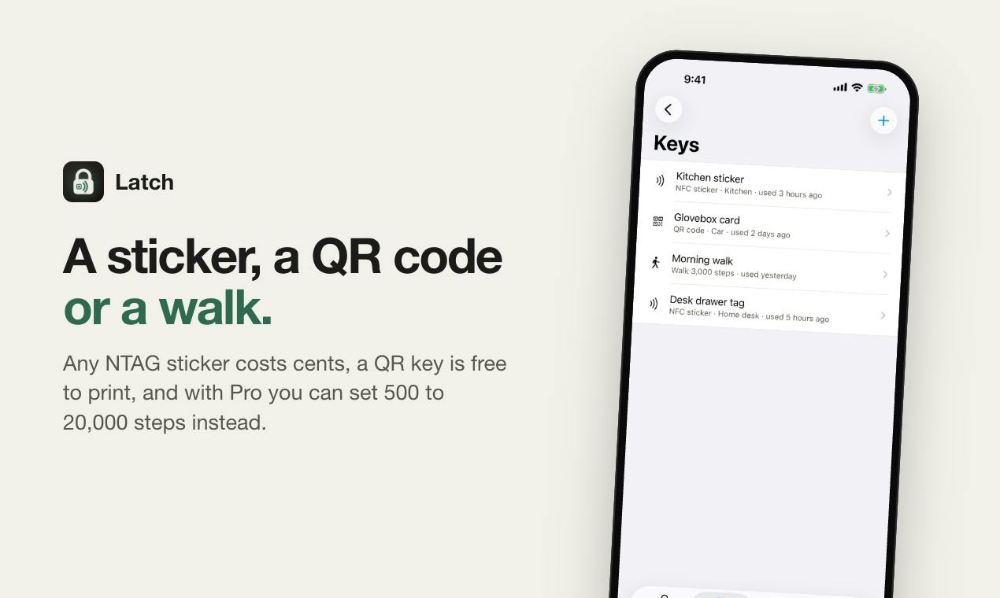
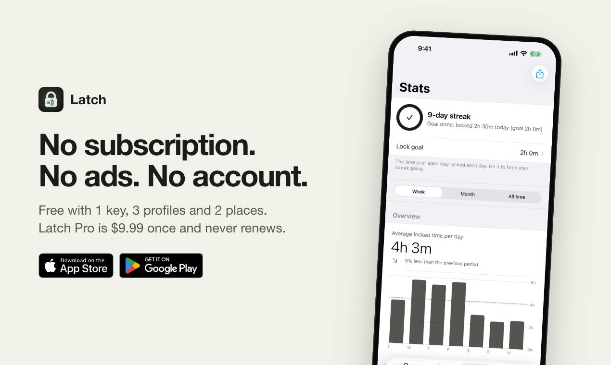

### 🎬 관련 영상
- [🎥 영상 보기](https://ph-files.imgix.net/77bc80bd-1687-4762-a64d-afb3b58a1efd.jpeg?auto=format)

---

## 16. [Popcraft](https://www.producthunt.com/products/popcraft)
**Votes**: 74 | **도입 난이도**: 하 | **신뢰도**: 상
**Tagline**: Generate video, images & audio from any AI agent
**서비스 링크**: https://www.producthunt.com/r/TC4CJ3NY3GZIBV

**태그**: AI-Agent, Content-Generation, Automation, Creative-Tools, Agent, AI Tool, Chat, Video, Vision, DevTool, API

### 📌 이 서비스 한눈에 보기
AI 에이전트(Claude, ChatGPT 등)에 URL 하나만 입력하여 영상, 이미지, 오디오를 즉시 생성하는 도구

### 🔑 주요 기능
- Claude, ChatGPT, Cursor 등 기존 AI 에이전트와 연동 가능한 워크플로우 제공
- Seedance, Veo, Kling 등 20개 이상의 최신 생성형 AI 모델 지원
- API 키 설정 없이 OAuth 로그인만으로 간편하게 사용 가능

### 🙋 사용자에게 어떤 점이 좋은가
별도의 복잡한 API 설정 없이도 사용 중인 AI 에이전트 내에서 멀티미디어 콘텐츠를 즉시 생성하고 비용을 미리 확인할 수 있습니다.

### ✅ 지금 바로 써볼 기능
- 100개의 무료 크레딧으로 다양한 모델 테스트하기
- Claude나 ChatGPT에 URL을 붙여넣어 생성 워크플로우 실행하기
- 생성 전 비용 미리보기 기능 활용하기

### ⚠️ 사용 전 확인할 점
- 무료 크레딧 소진 후 유료 플랜 전환 필요성 확인
- 지원되는 20개 이상의 모델별 생성 품질 및 특성 차이

### 🧭 확인이 더 필요한 정보
제공되는 20개 이상의 모델들의 구체적인 요금 체계와 크레딧 소진 방식에 대한 상세 정보가 필요합니다.

### 📸 스크린샷 및 갤러리
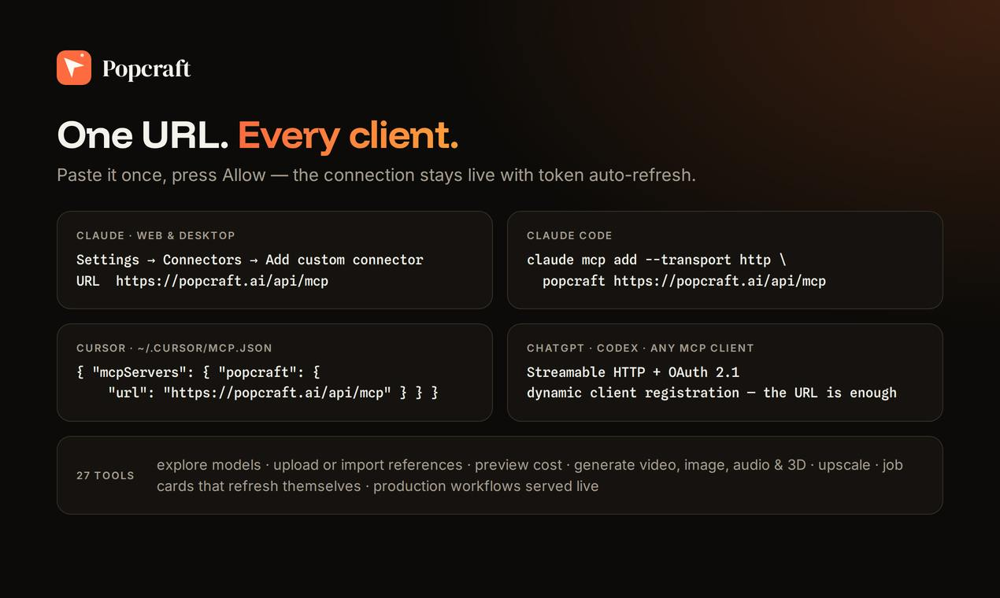
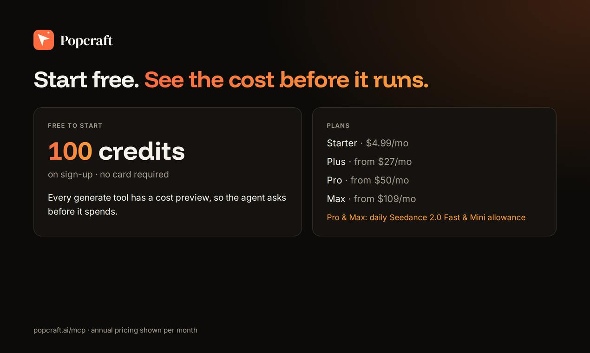
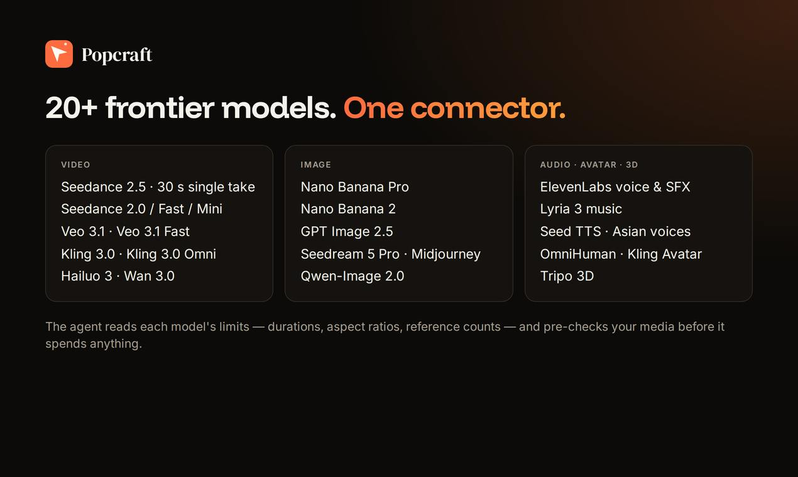

### 🎬 관련 영상
- [🎥 영상 보기](https://ph-files.imgix.net/ffd77ea8-f613-4f43-b8da-010c93355041.jpeg?auto=format)

---

## 17. [Krea 3](https://www.producthunt.com/products/krea)
**Votes**: 72 | **도입 난이도**: 하 | **신뢰도**: 상
**Tagline**: Krea's AI image model: 2K edits in under 8 seconds
**서비스 링크**: https://www.producthunt.com/r/OSPNBXUM3TCV22

**태그**: AI Image Editing, Creative Tools, High-Resolution, Productivity, AI Tool, Vision

### 📌 이 서비스 한눈에 보기
8초 이내에 2K 고해상도 이미지를 편집할 수 있는 초고속 AI 이미지 모델

### 🔑 주요 기능
- 8초 미만의 빠른 편집 속도와 네이티브 2K 고해상도 지원
- 배경, 사물, 재질, 조명 변경 시 기존 디테일 유지 기능
- 최대 6개의 참조 이미지를 활용한 일관된 스타일/캐릭터 유지

### 🙋 사용자에게 어떤 점이 좋은가
창작자와 프로덕션 팀이 적은 비용으로 고품질 이미지를 빠르게 수정하며, 일관된 브랜드 스타일을 유지할 수 있습니다.

### ✅ 지금 바로 써볼 기능
- 8초 이내의 빠른 편집 속도 테스트하기
- 6개의 참조 이미지를 활용한 스타일 일관성 확인하기
- 배경 및 조명 변경 기능 실험하기

### ⚠️ 사용 전 확인할 점
- 이미지당 $0.06의 비용 발생
- 복잡한 편집 시 의도치 않은 디테일 변화 가능성

### 🧭 확인이 더 필요한 정보
사용자의 작업 워크플로우에 따른 구체적인 편집 제어 정밀도는 직접 테스트가 필요합니다.

### 📸 스크린샷 및 갤러리
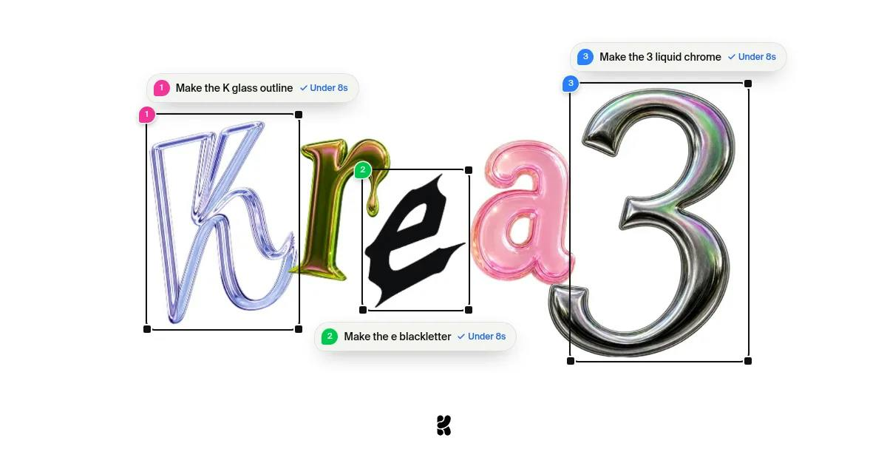
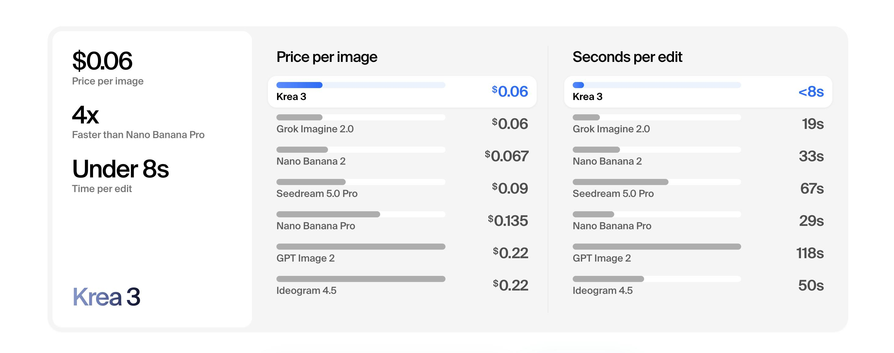

---

## 18. [Zalcro](https://www.producthunt.com/products/zalcro)
**Votes**: 31 | **도입 난이도**: 하 | **신뢰도**: 상
**Tagline**: The pre-build planning tool for vibe coders and AI builders
**서비스 링크**: https://www.producthunt.com/r/R75LTKUWI4ZWPE

**태그**: AI-Coding, DevTool, Planning, Workflow, AI Tool, Prompting

### 📌 이 서비스 한눈에 보기
AI 코딩의 맥락 상실 문제를 해결하는 사전 설계 및 빌드 플랜 생성 도구

### 🔑 주요 기능
- 코딩 전 아키텍처 맵핑을 통한 구조적 설계 지원
- AI가 맥락을 잃지 않도록 단계별 빌드 준비 플랜 생성
- Lovable, Replit, Cursor, Claude Code 등 주요 AI 도구와 호환

### 🙋 사용자에게 어떤 점이 좋은가
무작정 프롬프트를 입력하다 발생하는 코드 꼬임 현상을 방지하고, AI가 즉시 실행 가능한 정교한 가이드를 제공합니다.

### ✅ 지금 바로 써볼 기능
- 설계 단계에서 아키텍처 맵핑 기능 사용해보기
- 생성된 단계별 프롬프트를 Cursor나 Claude Code에 적용하기
- MCP(Model Context Protocol)를 통한 도구 연결 시도하기

### ⚠️ 사용 전 확인할 점
- 설계된 플랜이 실제 복잡한 비즈니스 로직을 완벽히 반영하는지 검토 필요
- 사용 중인 AI 코딩 도구와의 연동 방식에 따른 작업 흐름 차이 발생 가능

### 🧭 확인이 더 필요한 정보
사용자의 특정 개발 환경(IDE)이나 프레임워크에 따른 최적의 워크플로우는 직접 테스트가 필요합니다.

### 📸 스크린샷 및 갤러리
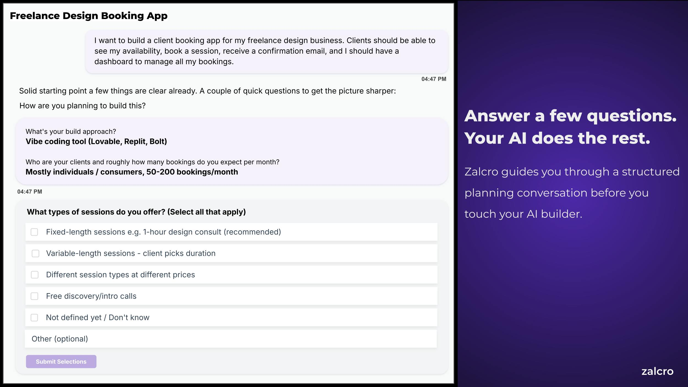
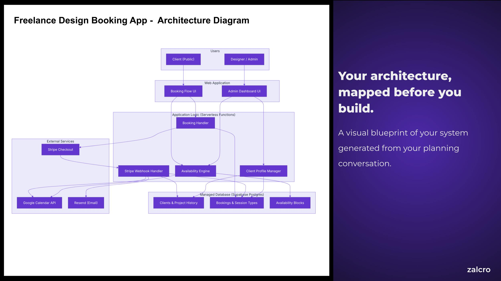
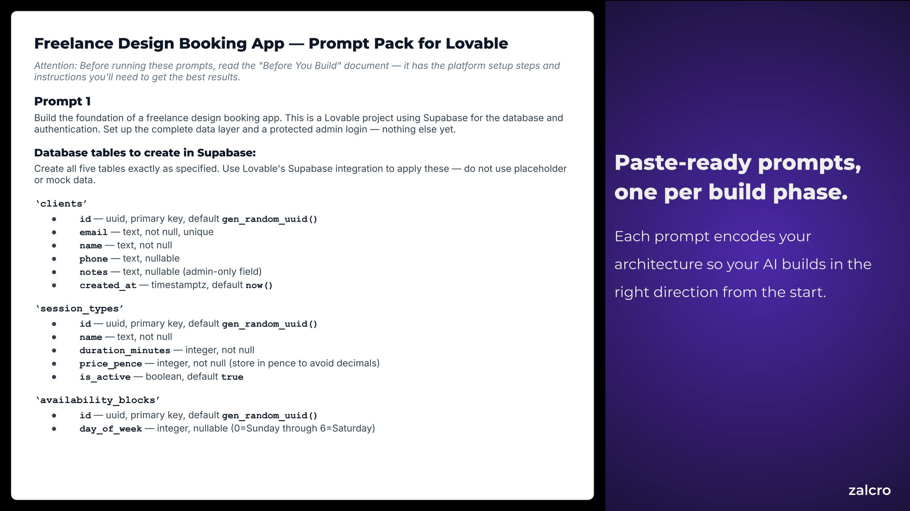

### 🎬 관련 영상
- [🎥 영상 보기](https://ph-files.imgix.net/e6a31872-8c17-491c-9d0f-4fd85c74e816.jpeg?auto=format)

---

## 19. [Startories](https://www.producthunt.com/products/startories-3)
**Votes**: 18 | **도입 난이도**: 중 | **신뢰도**: 상
**Tagline**: The AI engine that finds your next B2B customers
**서비스 링크**: https://www.producthunt.com/r/TJ354TXGCACWW4

**태그**: SalesTech, AI, LeadGeneration, Automation, AI Tool, Email

### 📌 이 서비스 한눈에 보기
웹상의 실시간 구매 신호를 포착하여 잠재 고객을 발굴하는 AI 영업 엔진

### 🔑 주요 기능
- Reddit, X, Product Hunt 등 웹 전반의 실시간 구매 신호 모니터링
- ICP(이상적 고객 프로필) 기반의 자동 기업 필터링 및 의사결정권자 식별
- 이메일 검증 및 개인화된 아웃리치 자동화

### 🙋 사용자에게 어떤 점이 좋은가
인바운드 리드를 기다리는 대신, 고객이 솔루션을 찾는 순간을 포착하여 능동적인 영업 기회를 확보할 수 있습니다.

### ✅ 지금 바로 써볼 기능
- 타겟 ICP 설정 및 필터링 규칙 구성
- 소셜 채널 및 디렉토리 모니터링 설정
- 자동화된 개인화 아웃리치 워크플로우 실행

### ⚠️ 사용 전 확인할 점
- AI가 식별한 구매 신호의 정확도 및 노이즈 필터링 확인 필요
- 자동화된 아웃리치가 스팸으로 분류될 위험성 관리 필요

### 🧭 확인이 더 필요한 정보
현재 제공되는 자동화된 아웃리치의 구체적인 채널 범위와 이메일 발송량 제한 정책이 명시되지 않았습니다.

### 📸 스크린샷 및 갤러리
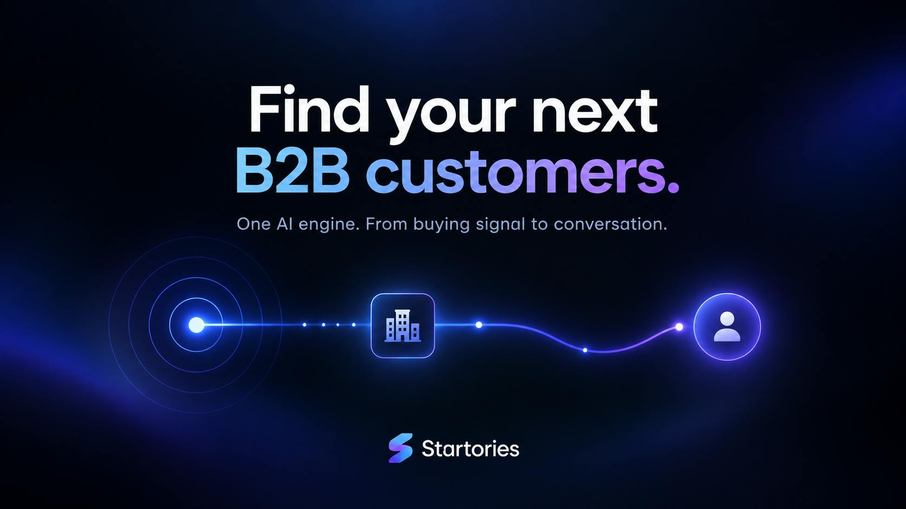
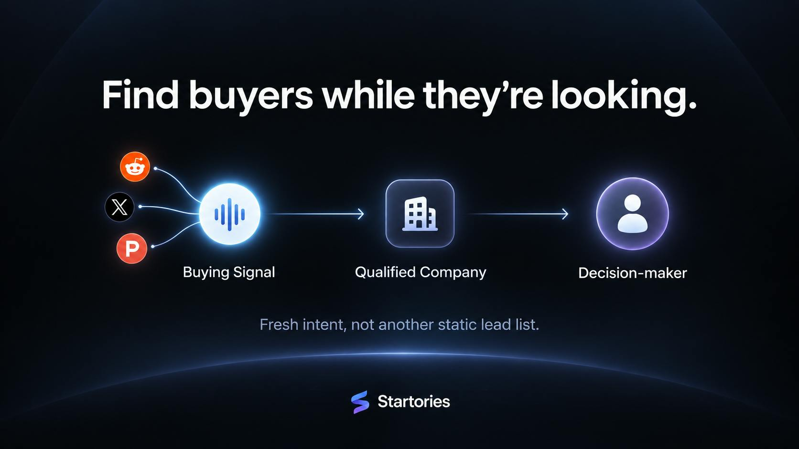
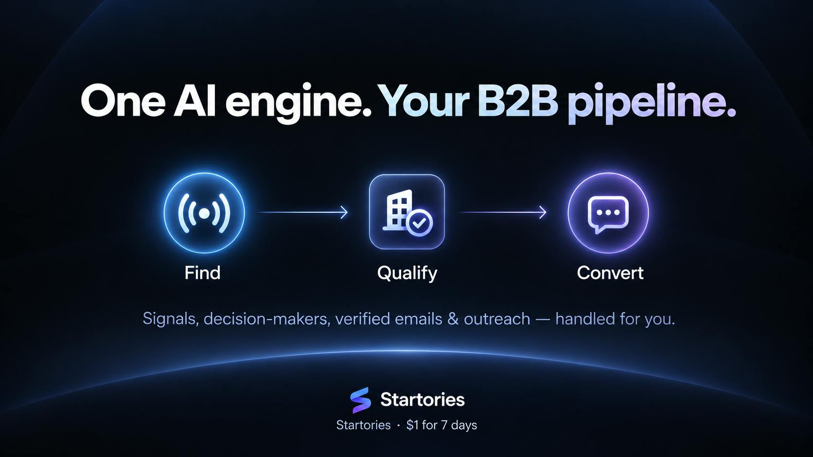

---

## 20. [Syllaby Mobile App](https://www.producthunt.com/products/syllaby-mobile-app-a35d592d-357d-4c46-96c9-5215b01817fa)
**Votes**: 11 | **도입 난이도**: 하 | **신뢰도**: 상
**Tagline**: Save Up to 70% Of Your Content-Creation Time on the Go
**서비스 링크**: https://www.producthunt.com/r/VHAMREZGBDWKON

**태그**: AI, VideoCreation, ContentMarketing, MobileApp, Automation, AI Tool, Video

### 📌 이 서비스 한눈에 보기
아이디어 구상부터 영상 제작까지, 이동 중에도 가능한 올인원 AI 영상 제작 스튜디오

### 🔑 주요 기능
- 아이디어를 즉시 바이럴 영상 콘텐츠로 변환
- 트렌드 주제 기반의 촬영용 스크립트 및 고품질 비주얼 제공
- 기획부터 게시까지 콘텐츠 제작 전 과정을 간소화

### 🙋 사용자에게 어떤 점이 좋은가
콘텐츠 제작 시간을 최대 70% 절감하여, 장소에 구애받지 않고 전문적인 영상을 꾸준히 제작할 수 있습니다.

### ✅ 지금 바로 써볼 기능
- 트렌드 주제를 활용한 스크립트 생성 기능 테스트
- 얼굴 노출 없는(Faceless) 영상 제작 기능 활용
- 모바일 앱을 통한 콘텐츠 기획 및 편집 워크플로우 확인

### ⚠️ 사용 전 확인할 점
- AI 생성 콘텐츠의 저작권 및 독창성 검토 필요
- 모바일 환경에서의 편집 디테일 제약 가능성

### 🧭 확인이 더 필요한 정보
구체적인 영상 편집 기능의 범위와 외부 플랫폼(YouTube, TikTok 등)과의 직접 연동 수준을 확인해야 합니다.

### 📸 스크린샷 및 갤러리

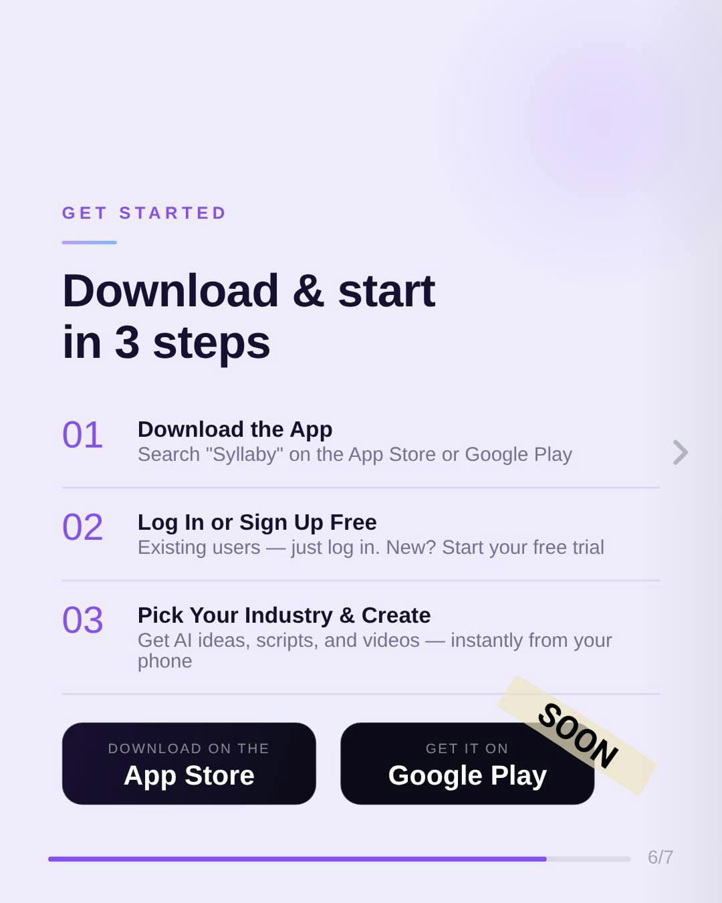

---

## 21. [TypeKey](https://www.producthunt.com/products/typekey)
**Votes**: 11 | **도입 난이도**: 하 | **신뢰도**: 상
**Tagline**: AI writing tools and a keyboard for your iPhone
**서비스 링크**: https://www.producthunt.com/r/AX6PO4TU4CWGPS

**태그**: AI, Productivity, Mobile, Writing, AI Tool, Email

### 📌 이 서비스 한눈에 보기
아이폰에서 별도 설정 없이 바로 사용하는 AI 글쓰기 및 키보드 도구

### 🔑 주요 기능
- 텍스트 복사-붙여넣기만으로 AI 글쓰기(요약, 문법 교정, 패러프레이징 등) 가능
- TypeKey 키보드를 활성화하여 다른 앱 내에서 즉시 답장, 번역, 철자 수정 가능
- 복잡한 키보드 설정 과정 없이 간편하게 사용 가능

### 🙋 사용자에게 어떤 점이 좋은가
모바일 환경에서 앱을 전환하는 번거로움 없이, 키보드 위에서 즉각적으로 글을 다듬거나 생성할 수 있어 생산성이 높아집니다.

### ✅ 지금 바로 써볼 기능
- 텍스트를 붙여넣어 AI 문체로 변환해보기
- 키보드 기능을 활성화하여 다른 앱에서 바로 답장 써보기
- 이메일이나 커버 레터 초안 작성해보기

### ⚠️ 사용 전 확인할 점
- 키보드 앱 사용 시 개인정보 및 입력 데이터 보안 정책 확인 필요
- 복잡한 문장이나 긴 글의 경우 모바일 환경에서의 편집 제약이 있을 수 있음

### 🧭 확인이 더 필요한 정보
무료 사용 범위와 유료 구독 모델(Pricing)에 대한 정보가 명시되지 않았습니다.

### 📸 스크린샷 및 갤러리
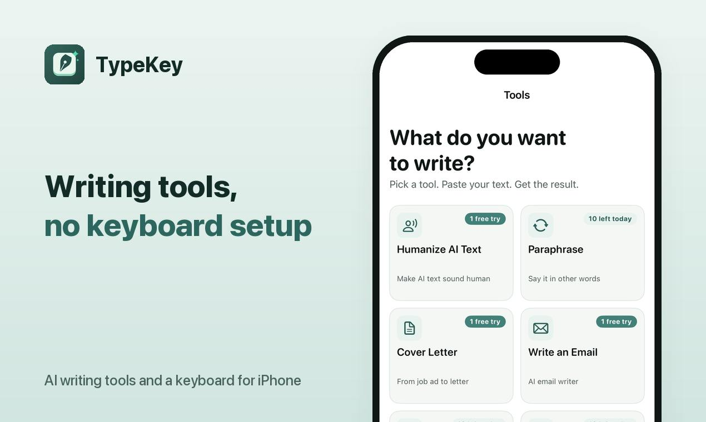
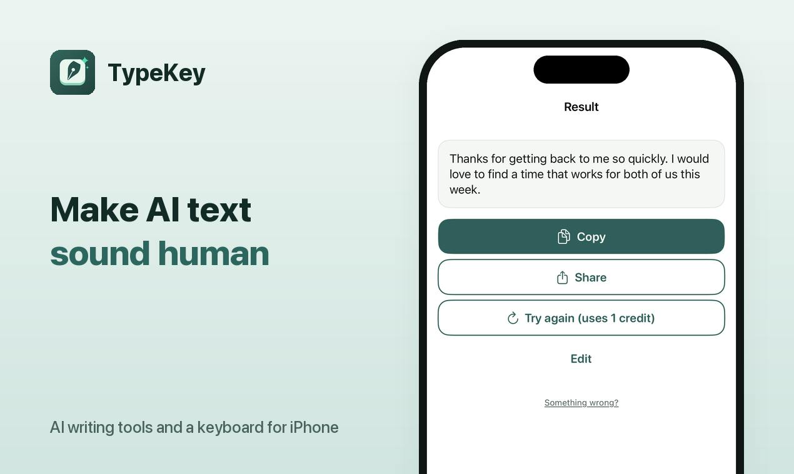
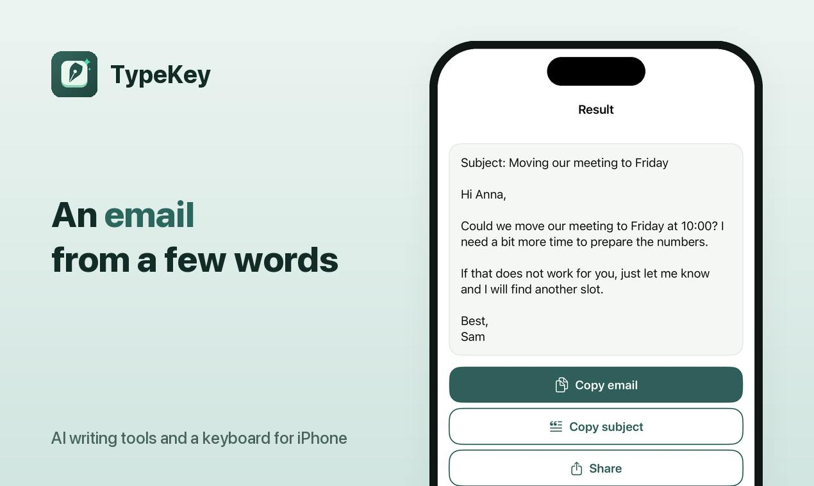

---

## 22. [Syllaby Mobile App](https://www.producthunt.com/products/syllaby-mobile-app-a35d592d-357d-4c46-96c9-5215b01817fa)
**Votes**: 11 | **도입 난이도**: 하 | **신뢰도**: 상
**Tagline**: Save Up to 70% Of Your Content-Creation Time on the Go
**서비스 링크**: https://www.producthunt.com/r/VHAMREZGBDWKON

**태그**: AI, VideoCreation, ContentMarketing, MobileApp, Automation, AI Tool, Video

### 📌 이 서비스 한눈에 보기
아이디어 구상부터 영상 제작까지, 이동 중에도 가능한 올인원 AI 영상 제작 스튜디오

### 🔑 주요 기능
- 아이디어를 즉시 바이럴 영상 콘텐츠로 변환
- 트렌드 주제 기반의 촬영용 스크립트 및 고품질 비주얼 제공
- 기획부터 게시까지 콘텐츠 제작 전 과정을 간소화

### 🙋 사용자에게 어떤 점이 좋은가
콘텐츠 제작 시간을 최대 70% 절감하여, 장소에 구애받지 않고 전문적인 영상을 꾸준히 제작할 수 있습니다.

### ✅ 지금 바로 써볼 기능
- 트렌드 주제를 활용한 스크립트 생성 기능 테스트
- 얼굴 노출 없는(Faceless) 영상 제작 기능 활용
- 모바일 앱을 통한 콘텐츠 기획 및 편집 워크플로우 확인

### ⚠️ 사용 전 확인할 점
- AI 생성 콘텐츠의 저작권 및 독창성 검토 필요
- 모바일 환경에서의 편집 디테일 제약 가능성

### 🧭 확인이 더 필요한 정보
구체적인 영상 편집 기능의 범위와 외부 플랫폼(YouTube, TikTok 등)과의 직접 연동 수준을 확인해야 합니다.

### 📸 스크린샷 및 갤러리

---

## 23. [Evane](https://www.producthunt.com/products/evane)
**Votes**: 11 | **도입 난이도**: 상 | **신뢰도**: 중
**Tagline**: Every Event Cognitively Convened
**서비스 링크**: https://www.producthunt.com/r/TU23AFS6QM2WPK

**태그**: AI Agent, Collaboration, Automation, Project Management, GovTech, Agent, AI Tool, Design

### 📌 이 서비스 한눈에 보기
정부 및 기업 간 복잡한 협업 프로젝트를 위한 AI 기반 통합 관리 에이전트

### 🔑 주요 기능
- 정부-기업 간 다자간 이해관계 조율 및 협업 최적화
- 파편화된 커뮤니케이션을 하나의 통합 데이터 기반으로 통합
- 반복 업무 자동화 및 실시간 병목 현상 조기 경보

### 🙋 사용자에게 어떤 점이 좋은가
복잡한 이해관계자가 얽힌 대규모 프로젝트에서 정보 누락을 방지하고, 실시간 추적을 통해 의사결정 속도를 높일 수 있습니다.

### ✅ 지금 바로 써볼 기능
- 프로젝트 데이터 통합 기능 테스트
- 워크플로우 자동화 설정
- 실시간 병목 알림 대시보드 확인

### ⚠️ 사용 전 확인할 점
- 정부 및 기업 보안 규정 준수 여부 확인 필요
- 기존 협업 도구와의 데이터 연동 방식 확인 필요

### 🧭 확인이 더 필요한 정보
구체적인 보안 프로토콜 및 기존 엔터프라이즈 시스템과의 통합 방식에 대한 정보가 부족합니다.

### 📸 스크린샷 및 갤러리

### 🎬 관련 영상
- [🎥 영상 보기](https://ph-files.imgix.net/b9ad8139-b355-40ed-b9d3-a651f7bf8eb0.jpeg?auto=format)

---

## 24. [Pairon](https://www.producthunt.com/products/pairon)
**Votes**: 10 | **도입 난이도**: 중 | **신뢰도**: 상
**Tagline**: Giving AI its multiplayer Moment
**서비스 링크**: https://www.producthunt.com/r/IYOY5V375CVGBJ

**태그**: DevTool, AI-Agent, Collaboration, Coding, Agent, AI Tool, Chat

### 📌 이 서비스 한눈에 보기
팀원과 로컬 AI 코딩 에이전트를 연결하여 협업할 수 있는 멀티플레이어 AI 개발 환경

### 🔑 주요 기능
- 로컬에서 실행되는 코딩 에이전트와 팀원 간의 실시간 공유 대화 기능
- 작업 중 제약 조건 추가, 병렬 작업 실행 및 컴퓨터 간 작업 인계 가능
- 프로젝트 메모리와 지속적인 브리프를 통한 의사결정 맥락 유지

### 🙋 사용자에게 어떤 점이 좋은가
개별적으로 움직이던 AI 에이전트 작업에 팀 협업 기능을 더해, 코드 리뷰와 작업 분담을 더 효율적으로 만들 수 있습니다.

### ✅ 지금 바로 써볼 기능
- 자신의 에이전트 계정(Claude Code, Codex 등) 연결하기
- 팀원과 공유 폴더 접근 권한 설정하기
- 병렬 작업 실행을 통한 작업 속도 테스트하기

### ⚠️ 사용 전 확인할 점
- 로컬 에이전트 기반이므로 사용자의 컴퓨터 환경 및 에이전트 설정에 의존함
- 폴더 접근 권한 관리를 통한 보안 유지가 필수적임

### 🧭 확인이 더 필요한 정보
사용자의 로컬 환경과 외부 에이전트 간의 보안 및 동기화 성능에 대한 구체적인 데이터가 필요합니다.

### 📸 스크린샷 및 갤러리

### 🎬 관련 영상
- [🎥 영상 보기](https://ph-files.imgix.net/b58a8c84-c289-49ea-a8f0-77bb64aa608c.jpeg?auto=format)
- [🎥 영상 보기](https://ph-files.imgix.net/36938b0d-fb0d-4b14-9de3-2c8f973d4956.jpeg?auto=format)

---

## 25. [KelpShot](https://www.producthunt.com/products/kelpshot)
**Votes**: 8 | **도입 난이도**: 하 | **신뢰도**: 상
**Tagline**: Screenshots that say what you mean.
**서비스 링크**: https://www.producthunt.com/r/735L3DT7E5D7CA

**태그**: Productivity, macOS, Screenshot, DesignTool

### 📌 이 서비스 한눈에 보기
구독료 부담 없이 빠르고 안전하게 스크린샷을 편집하고 공유하는 macOS 전용 도구

### 🔑 주요 기능
- macOS 전용의 빠르고 직관적인 스크린샷 캡처 및 편집 도구
- 텍스트 인식(OCR), 주석 추가, 개인정보 비식별화(Redact) 기능 제공
- 구독형 모델이 아닌 일회성 구매 방식의 경제적 모델

### 🙋 사용자에게 어떤 점이 좋은가
매번 스크린샷을 찍고 편집하는 번거로움을 줄여주며, 개인정보를 안전하게 가리면서 즉시 공유할 수 있어 업무 효율을 높여줍니다.

### ✅ 지금 바로 써볼 기능
- 텍스트 인식 기능을 활용한 빠른 정보 추출
- 민감한 정보가 포함된 스크린샷의 비식별화(Redact) 처리
- 주석 기능을 활용한 명확한 의사 전달

### ⚠️ 사용 전 확인할 점
- macOS 전용 도구이므로 Windows나 Linux 환경에서는 사용 불가
- 일회성 구매 방식의 구체적인 가격 정책 확인 필요

### 🧭 확인이 더 필요한 정보
정확한 일회성 구매 가격과 지원하는 macOS 버전 범위를 확인해야 합니다.

### 📸 스크린샷 및 갤러리

---

## 26. [Buildhorn: CI/CD Alerts](https://www.producthunt.com/products/buildhorn-ci-cd-alerts)
**Votes**: 7 | **도입 난이도**: 하 | **신뢰도**: 상
**Tagline**: Know the instant your build breaks
**서비스 링크**: https://www.producthunt.com/r/I7DNW4KMQIQLL4

**태그**: DevOps, CI/CD, Mobile, Automation, AI Tool

### 📌 이 서비스 한눈에 보기
CI/CD 빌드 실패를 애플 기기 푸시 알림으로 즉시 알려주는 모니터링 도구

### 🔑 주요 기능
- CI 파이프라인 실시간 모니터링 및 실패 즉시 알림
- 애플 기기 전용 푸시 알림 및 커스텀 사운드 지원
- 홈 화면을 빌드 상태 대시보드로 활용 가능

### 🙋 사용자에게 어떤 점이 좋은가
빌드 실패를 실시간으로 확인하여 개발 사이클의 지연을 방지하고, 모바일에서도 직관적으로 빌드 상태를 관리할 수 있습니다.

### ✅ 지금 바로 써볼 기능
- 애플 기기 푸시 알림 설정하기
- 실패 알림용 커스텀 사운드 지정하기
- 홈 화면 대시보드 구성하기

### ⚠️ 사용 전 확인할 점
- 애플 생태계(iOS/macOS 등) 기기 사용이 필수적임
- 지원하는 CI/CD 도구(GitHub Actions, Jenkins 등)와의 연동 여부 확인 필요

### 🧭 확인이 더 필요한 정보
지원하는 구체적인 CI/CD 플랫폼 목록과 연동 방식에 대한 정보가 필요합니다.

### 📸 스크린샷 및 갤러리

### 🎬 관련 영상
- [🎥 영상 보기](https://ph-files.imgix.net/d71b7c97-90b4-40b6-919d-cfd62dbe9c79.jpeg?auto=format)

---

## 27. [DOT Audio Recorder](https://www.producthunt.com/products/dot-audio-recorder)
**Votes**: 7 | **도입 난이도**: 하 | **신뢰도**: 상
**Tagline**: Record anything your Mac plays, with key, tempo and chords
**서비스 링크**: https://www.producthunt.com/r/ROPYVRXHOOOMBK

**태그**: MusicProduction, MacApp, Sampling, AudioTool, Video

### 📌 이 서비스 한눈에 보기
Mac에서 재생되는 모든 소리를 키, 템포, 코드와 함께 즉시 녹음하고 DAW로 가져오는 도구

### 🔑 주요 기능
- macOS 시스템 사운드를 직접 녹음하여 별도의 가상 오디오 드라이버 설정 불필요
- 녹음과 동시에 키(Key), 템포(Tempo), 코드(Chords) 자동 분석
- 분석된 코드를 MIDI로 내보내거나 클립을 DAW로 드래그 앤 드롭 가능

### 🙋 사용자에게 어떤 점이 좋은가
음악 작업 시 샘플링이나 영감을 얻기 위해 유튜브/애플 뮤직의 소리를 빠르게 추출하고, 분석된 코드를 즉시 작업 흐름에 반영할 수 있습니다.

### ✅ 지금 바로 써볼 기능
- Cmd-R 단축키로 유튜브/애플 뮤직 소리 녹음해보기
- 분석된 코드를 MIDI 파일로 내보내기
- 녹음된 클립을 DAW로 드래그하여 작업하기

### ⚠️ 사용 전 확인할 점
- 일회성 구매($49) 외에는 무료 체험 기간이 존재함
- macOS 환경에서만 작동함

### 🧭 확인이 더 필요한 정보
무료 체험 기간의 구체적인 범위와 기능 제한 사항에 대한 정보가 명시되지 않았습니다.

### 📸 스크린샷 및 갤러리

### 🎬 관련 영상
- [🎥 영상 보기](https://ph-files.imgix.net/c7cb9421-2647-4b77-8b14-1e72e247b102.jpeg?auto=format)

---

## 28. [File Converter](https://www.producthunt.com/products/file-converter-2)
**Votes**: 7 | **도입 난이도**: 하 | **신뢰도**: 상
**Tagline**: Free Online PDF & File Converter : Simple, Fast, Secure
**서비스 링크**: https://www.producthunt.com/r/XLR4ETHJ7XBRUG

**태그**: Productivity, PDF, FileManagement, AI, SaaS, Automation, AI Tool, Vision

### 📌 이 서비스 한눈에 보기
설치 없이 웹에서 바로 사용하는 올인원 PDF 및 파일 관리 툴킷

### 🔑 주요 기능
- PDF 병합, 변환, 보호 및 이미지 편집 기능을 갖춘 통합 도구
- AI 기반 기능을 통한 스마트한 문서 워크플로우 제공
- 별도의 데스크톱 소프트웨어 설치가 필요 없는 클라우드 기반 서비스

### 🙋 사용자에게 어떤 점이 좋은가
복잡한 파일 작업들을 하나의 웹 사이트에서 해결할 수 있어 작업 시간을 단축하고 업무 효율을 높여줍니다.

### ✅ 지금 바로 써볼 기능
- PDF 병합 및 변환 기능 테스트
- AI 기반 문서 워크플로우 활용
- 이미지 편집 도구 사용해보기

### ⚠️ 사용 전 확인할 점
- 웹 기반 서비스이므로 대용량 파일 처리 시 네트워크 환경에 영향을 받을 수 있음
- 민감한 개인정보가 포함된 문서를 업로드할 경우 보안 정책 확인 필요

### 🧭 확인이 더 필요한 정보
무료 버전의 파일 크기 제한이나 일일 사용 횟수 제한에 대한 구체적인 정보가 명시되지 않았습니다.

### 📸 스크린샷 및 갤러리

---

## 29. [NakkoBroker](https://www.producthunt.com/products/nakkobroker)
**Votes**: 6 | **도입 난이도**: 하 | **신뢰도**: 상
**Tagline**: Zero-brokerage rental discovery across Indian tech hubs
**서비스 링크**: https://www.producthunt.com/r/WHMZ6G5WCPIKKE

**태그**: Real Estate, Direct-to-Consumer, India, AI Tool, Chat

### 📌 이 서비스 한눈에 보기
인도 주요 IT 허브에서 중개 수수료 없이 집을 구할 수 있는 직거래 플랫폼

### 🔑 주요 기능
- 인도 주요 기술 거점(하이데라바드, 벵갈루루 등) 대상 중개 수수료 제로 서비스
- 인터랙티브 지도를 통한 직관적인 매물 탐색 및 방문 예약
- 검증된 집주인과의 채팅 및 신뢰도 기반의 'Good Renter' 배지 시스템

### 🙋 사용자에게 어떤 점이 좋은가
중개인 수수료 부담 없이 집주인과 직접 소통하며 매물을 찾을 수 있어 비용과 절차를 동시에 절감할 수 있습니다.

### ✅ 지금 바로 써볼 기능
- 인터랙티브 지도로 원하는 지역의 매물 위치 확인하기
- 집주인과 직접 채팅을 통해 매물 상세 정보 문의하기
- 신뢰도 높은 임차인 배지(Good Renter) 프로필 구축하기

### ⚠️ 사용 전 확인할 점
- 중개인이 없는 직거래 방식이므로 매물 상태 및 계약 조건의 직접 확인 필수
- 서비스 제공 지역(인도 주요 도시) 외에서는 사용 불가

### 🧭 확인이 더 필요한 정보
플랫폼을 통한 계약 과정에서의 법적 보호 범위와 검증된 집주인의 신뢰도 수준을 확인해야 합니다.

### 📸 스크린샷 및 갤러리

---

## 30. [The Soapbox Email](https://www.producthunt.com/products/the-soapbox-email)
**Votes**: 6 | **도입 난이도**: 하 | **신뢰도**: 상
**Tagline**: What will you say to 1 million people? 
**서비스 링크**: https://www.producthunt.com/r/BOUUUY7ILSLF5U

**태그**: Newsletter, Social, Communication, AI Tool, Email

### 📌 이 서비스 한눈에 보기
매일 무작위로 선정된 한 명의 작성자가 100만 명에게 메시지를 전달하는 독특한 이메일 플랫폼

### 🔑 주요 기능
- 매일 한 명의 구독자가 무작위로 선정되어 이메일 작성 권한을 가짐
- 선정된 작성자는 전체 구독자 리스트를 대상으로 메시지를 발송
- 누구에게나 거대한 목소리를 낼 수 있는 기회를 제공하는 실험적 플랫폼

### 🙋 사용자에게 어떤 점이 좋은가
예측 불가능한 방식으로 대중에게 자신의 생각을 전달할 수 있는 강력한 발언권을 경험할 수 있습니다.

### ✅ 지금 바로 써볼 기능
- 구독 신청하여 매일 아침 당첨 기회 기다리기
- 다른 작성자들이 보내는 메시지 읽어보기

### ⚠️ 사용 전 확인할 점
- 작성자로 선정될 확률이 매우 낮을 수 있음
- 콘텐츠의 질이나 방향성이 무작위로 결정됨

### 🧭 확인이 더 필요한 정보
구독자 규모와 선정 방식의 구체적인 알고리즘은 명시되지 않았습니다.

### 📸 스크린샷 및 갤러리

---

