# 🚀 Product Hunt Daily Top 30 (2026-10-20)

## 오늘의 요약
오늘의 트렌드는 AI 에이전트를 실무 워크플로우에 자연스럽게 통합하여 생산성을 극대화하는 도구들이 주를 이루었습니다. 특히 코딩, 고객 지원, 개인 비서 등 특정 전문 영역에서 인간의 개입을 최소화하면서도 제어 가능한 에이전트 솔루션들이 주목받았습니다.

### 오늘의 핵심 포인트
- AI 에이전트 간의 협업과 통합 관리를 통해 복잡한 코딩 및 업무 프로세스를 자동화하는 도구들이 등장했습니다.
- 음성 인터페이스나 메신저 UI를 활용하여 기존 작업 내용을 방해하지 않고 AI와 상호작용하는 방식이 강조되었습니다.
- 원격 제어 및 문서화 도구들이 AI와 결합하여 물리적/디지털 환경의 제약을 줄이는 방향으로 발전하고 있습니다.

**오늘의 태그**: AI 에이전트, 코딩 자동화, 생산성 도구, 워크플로우 혁신

## 1. [Beam.win](https://www.producthunt.com/products/beam-win)
**Votes**: 265 | **도입 난이도**: 하 | **신뢰도**: 상
**Tagline**: Run AI agents on one Mac and use its windows on another
**서비스 링크**: https://www.producthunt.com/r/XR2QV6TXWMZHHX

**태그**: RemoteDesktop, Productivity, Mac, DevTools, Agent, AI Tool

### 📌 이 서비스 한눈에 보기
원격 Mac의 앱과 터미널을 마치 로컬 앱처럼 내 Mac에서 사용하는 원격 제어 솔루션

### 🔑 주요 기능
- Mac mini/Studio에서 실행 중인 에이전트 및 빌드를 다른 Mac으로 가져오기
- 원격 창을 로컬 Dock 아이콘 및 ⌘Tab 전환이 가능한 개별 창으로 표시
- Mac 간 암호화된 보안 연결 제공

### 🙋 사용자에게 어떤 점이 좋은가
고성능 Mac을 서버처럼 활용하면서, 작업 중인 노트북에서는 마치 로컬 앱을 쓰는 것처럼 편리하게 인터페이스를 제어할 수 있습니다.

### ✅ 지금 바로 써볼 기능
- 원격 Mac에 터미널 및 브라우저 실행하기
- 로컬 Mac의 Dock 및 ⌘Tab 기능과 연동 확인하기
- 무료 체험판을 통한 연결 안정성 테스트하기

### ⚠️ 사용 전 확인할 점
- 네트워크 대역폭에 따른 화면 반응 속도 차이 발생 가능성
- 두 기기 간의 연결 안정성 및 지연 시간 확인 필요

### 🧭 확인이 더 필요한 정보
네트워크 환경에 따른 실시간 스트리밍 성능과 구체적인 보안 프로토콜 상세 정보가 필요합니다.

### 📸 스크린샷 및 갤러리
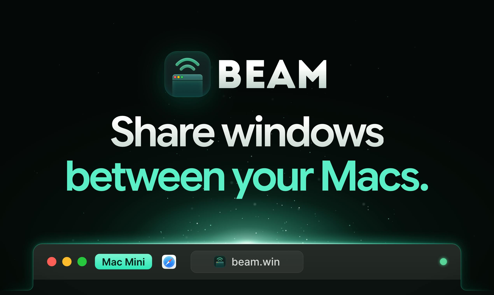
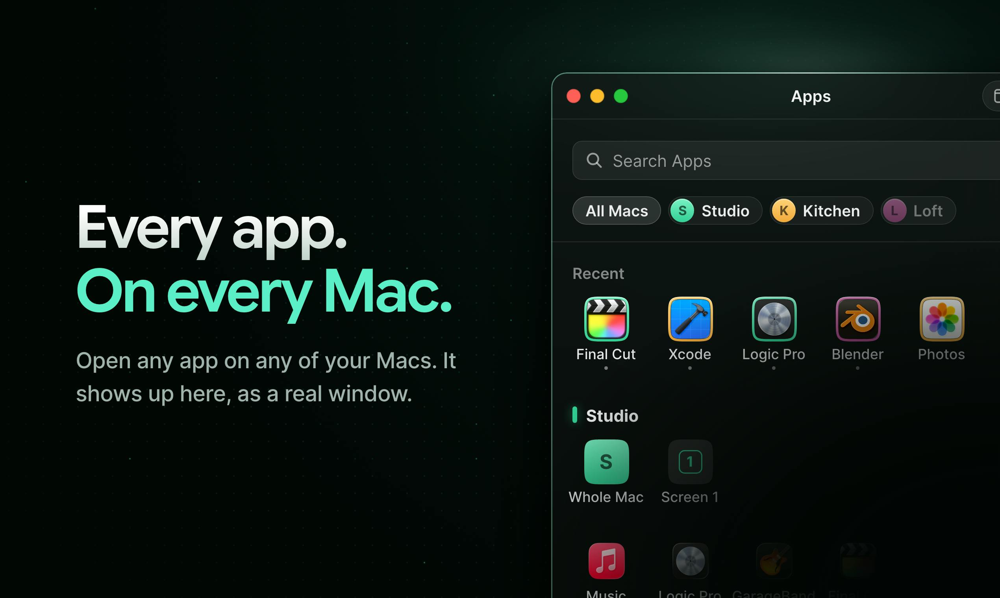
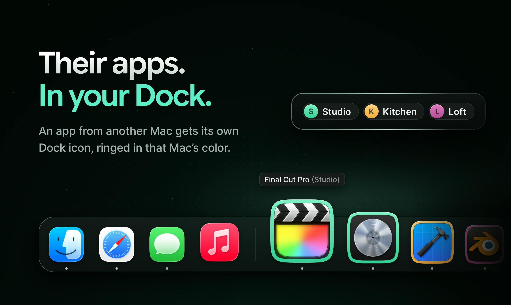

### 🎬 관련 영상
- [🎥 영상 보기](https://ph-files.imgix.net/96256e62-1312-4179-aaf1-4fb5cfc51d64.jpeg?auto=format)

---

## 2. [readywhen](https://www.producthunt.com/products/readywhen)
**Votes**: 157 | **도입 난이도**: 하 | **신뢰도**: 상
**Tagline**: The senior personal assistant that works inside WhatsApp
**서비스 링크**: https://www.producthunt.com/r/OLPNM6HLKRJKDA

**태그**: Productivity, AI Assistant, Automation, WhatsApp

### 📌 이 서비스 한눈에 보기
WhatsApp을 통해 일상 업무를 처리하는 개인 비서 서비스

### 🔑 주요 기능
- WhatsApp 인터페이스를 통한 간편한 소통
- 전용 전화번호와 컴퓨터를 갖춘 가상 비서 시스템
- 메시지, 전화, 음성 메시지를 통한 업무 관리 및 실행

### 🙋 사용자에게 어떤 점이 좋은가
별도의 복잡한 앱 설치 없이 익숙한 WhatsApp만으로 개인 업무와 프로젝트를 관리할 수 있습니다.

### ✅ 지금 바로 써볼 기능
- WhatsApp으로 메시지 보내기
- 음성 메시지로 업무 지시하기
- 프로젝트 보드 확인하기

### ⚠️ 사용 전 확인할 점
- 개인적인 대화가 포함된 WhatsApp을 업무용으로 사용할 때의 보안 및 프라이버시 검토 필요
- 서비스가 실제 물리적 업무를 어디까지 대행할 수 있는지 범위 확인 필요

### 🧭 확인이 더 필요한 정보
실제 업무 수행의 자동화 수준과 인간 비서와의 협업 방식에 대한 구체적인 정보가 필요합니다.

### 📸 스크린샷 및 갤러리

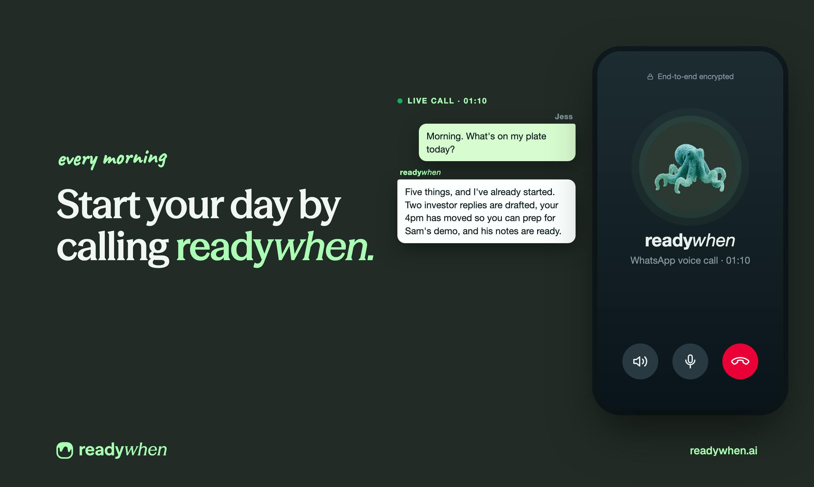
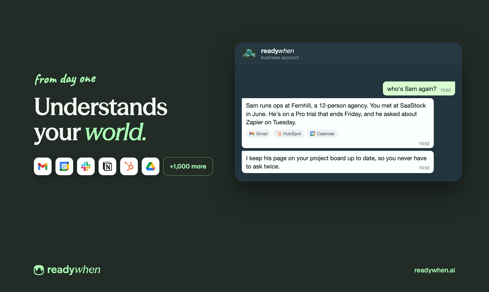

### 🎬 관련 영상
- [🎥 영상 보기](https://ph-files.imgix.net/4610e31e-dc91-47b0-a004-5f64751aa1c8.jpeg?auto=format)

---

## 3. [Figma Specs](https://www.producthunt.com/products/figma)
**Votes**: 152 | **도입 난이도**: 하 | **신뢰도**: 상
**Tagline**: A container for your context that lives on the Figma canvas
**서비스 링크**: https://www.producthunt.com/r/H3ROFCAUEHWD3V

**태그**: DesignTool, Collaboration, DeveloperExperience, AI-Integration, Agent, AI Tool, Design

### 📌 이 서비스 한눈에 보기
피그마 캔버스 위에서 디자인 맥락과 문서를 하나로 관리하는 협업용 마크다운 컨테이너

### 🔑 주요 기능
- 피그마 캔버스 내에서 직접 작동하는 협업형 마크다운 문서
- 피그마 프레임 및 FigJam 다이어그램 임베딩 지원
- 팀원 및 AI 에이전트와의 원활한 피드백 루프 형성

### 🙋 사용자에게 어떤 점이 좋은가
디자인과 관련 문서를 분리할 필요 없이 캔버스 위에서 한 번에 관리할 수 있어, 개발자와 디자이너 간의 맥락 전달 오류를 줄여줍니다.

### ✅ 지금 바로 써볼 기능
- 피그마 프레임과 마크다운 문서 결합해보기
- 팀원들과 댓글 기능을 통한 피드백 주고받기
- MCP를 활용해 코딩 에이전트에 디자인 맥락 전달하기

### ⚠️ 사용 전 확인할 점
- 문서가 캔버스에 위치하므로 디자인 작업 공간이 복잡해질 수 있음
- 에이전트 연동 시 보안 및 권한 설정 확인 필요

### 🧭 확인이 더 필요한 정보
MCP를 통한 코딩 에이전트 연동의 구체적인 보안 프로토콜과 워크플로우는 추가 확인이 필요합니다.

### 📸 스크린샷 및 갤러리
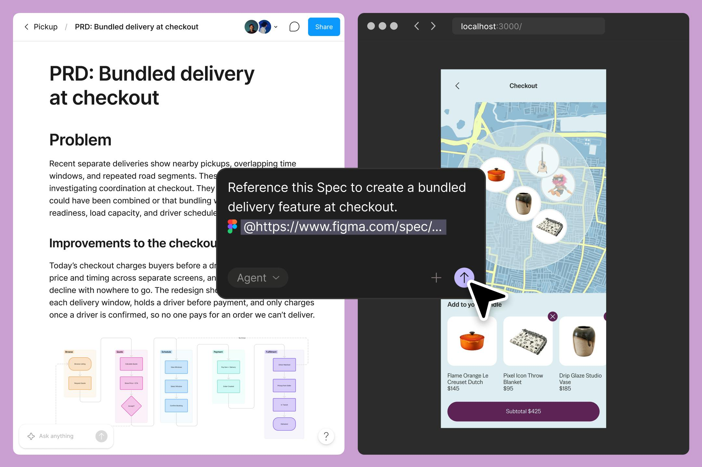
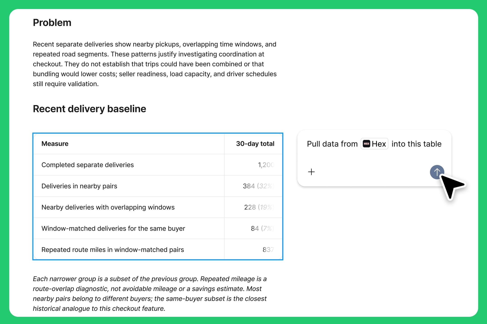
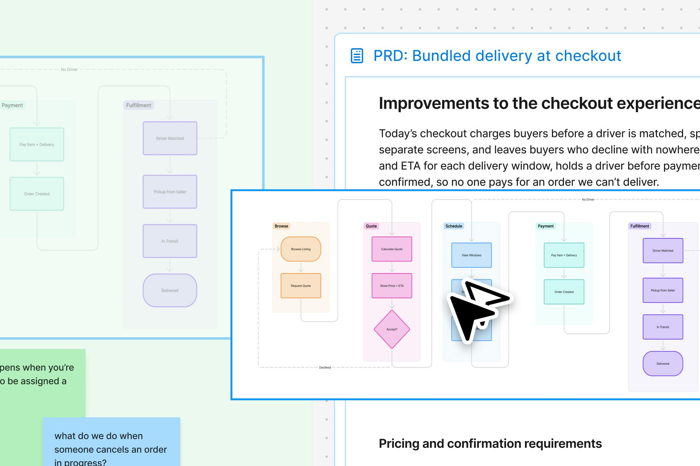

### 🎬 관련 영상
- [🎥 영상 보기](https://ph-files.imgix.net/8f32dea8-6e25-4029-8312-53cd5f106d44.jpeg?auto=format)

---

## 4. [Kai Resolve by Gleap](https://www.producthunt.com/products/gleap)
**Votes**: 121 | **도입 난이도**: 중 | **신뢰도**: 상
**Tagline**: Support that does the digging for you.
**서비스 링크**: https://www.producthunt.com/r/XI7TL2X7GPY7ZR

**태그**: AI Agent, Customer Support, DevOps, Automation, Agent, AI Tool, DevTool

### 📌 이 서비스 한눈에 보기
고객 지원 티켓의 원인 분석부터 버그 리포트 생성까지 자동화하는 AI 에이전트

### 🔑 주요 기능
- 화면 녹화, 로그, 계정 데이터 및 코드를 분석하여 문제 원인 파악
- 문서로 해결할 수 없는 복잡한 기술 지원 티켓에 특화
- 확인된 버그를 개발팀이 검토할 수 있는 코딩 작업(Task)으로 자동 변환

### 🙋 사용자에게 어떤 점이 좋은가
고객 지원팀이 문제 원인을 찾기 위해 수동으로 데이터를 뒤지는 시간을 획기적으로 줄여주며, 개발팀에는 즉시 검토 가능한 수준의 진단 리포트를 제공합니다.

### ✅ 지금 바로 써볼 기능
- 기존 고객 지원 워크플로우와 연동 테스트
- 로그 및 코드 읽기 권한 설정 및 보안 검토
- AI가 생성한 진단 결과의 정확도 검증

### ⚠️ 사용 전 확인할 점
- 코드 및 계정 데이터에 대한 읽기 권한 부여 시 보안 정책 확인 필요
- AI의 진단이 실제 버그와 일치하는지 개발자의 최종 검토 필수

### 🧭 확인이 더 필요한 정보
현재 제공되는 데이터 읽기 권한의 보안 범위와 기존 티켓 시스템(Zendesk, Jira 등)과의 구체적인 연동 방식에 대한 정보가 필요합니다.

### 📸 스크린샷 및 갤러리
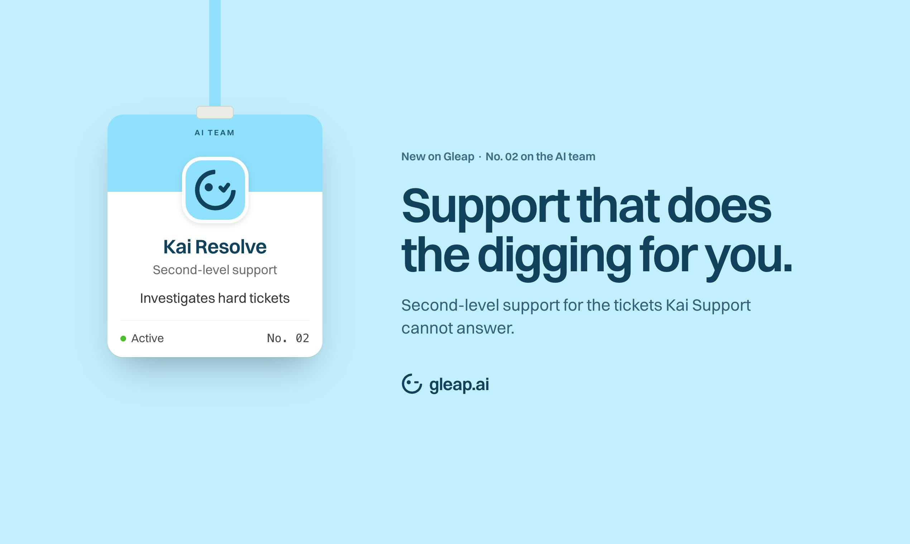
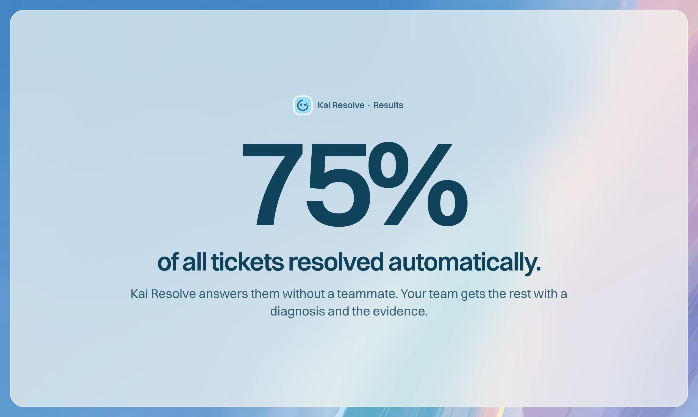
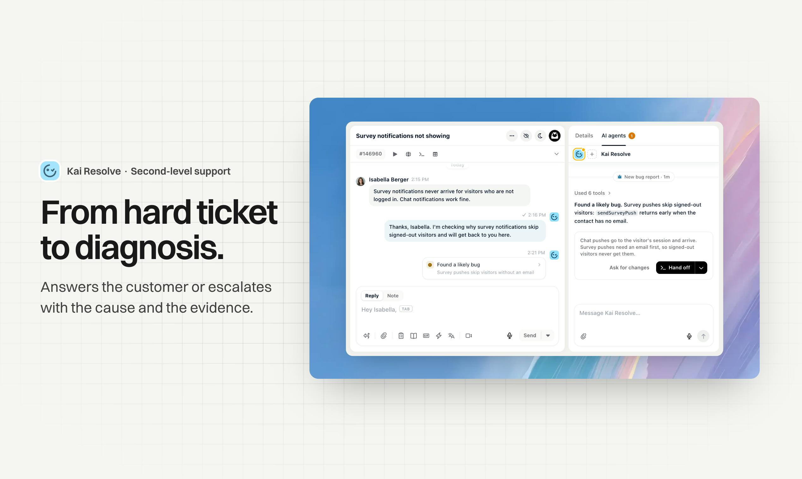

### 🎬 관련 영상
- [🎥 영상 보기](https://ph-files.imgix.net/b3180fde-762a-42cf-9566-75fec4454354.jpeg?auto=format)

---

## 5. [Beam](https://www.producthunt.com/products/beam-13)
**Votes**: 118 | **도입 난이도**: 상 | **신뢰도**: 상
**Tagline**: Highly efficient agentic 501B parameter open model
**서비스 링크**: https://www.producthunt.com/r/EKSBMMH6A62RSY

**태그**: AI, LLM, Coding, Automation, MLOps, Agent

### 📌 이 서비스 한눈에 보기
코딩과 추론에 최적화된 501B 파라미터 규모의 고효율 MoE 모델

### 🔑 주요 기능
- 501B 총 파라미터 규모의 Sparse Mixture-of-Experts(MoE) 구조
- 추론 시 23B 파라미터만 활성화되는 높은 효율성
- 코딩, 논리적 추론 및 에이전트 작업에 특화된 설계

### 🙋 사용자에게 어떤 점이 좋은가
거대 모델의 성능을 유지하면서도 활성 파라미터를 최소화하여, 복잡한 코딩 및 에이전트 워크로드를 효율적으로 처리할 수 있습니다.

### ✅ 지금 바로 써볼 기능
- 코딩 보조 및 자동화 워크플로우에 적용
- 복잡한 논리적 추론 작업 테스트
- 에이전트 기반 자동화 작업 수행

### ⚠️ 사용 전 확인할 점
- 모델 규모로 인한 하드웨어 요구 사양 확인 필요
- 특정 워크로드에 최적화된 모델이므로 범용성 검증 필요

### 🧭 확인이 더 필요한 정보
실제 구동을 위한 하드웨어 요구 사양과 API/로컬 배포 방식에 대한 정보가 명시되지 않았습니다.

### 📸 스크린샷 및 갤러리
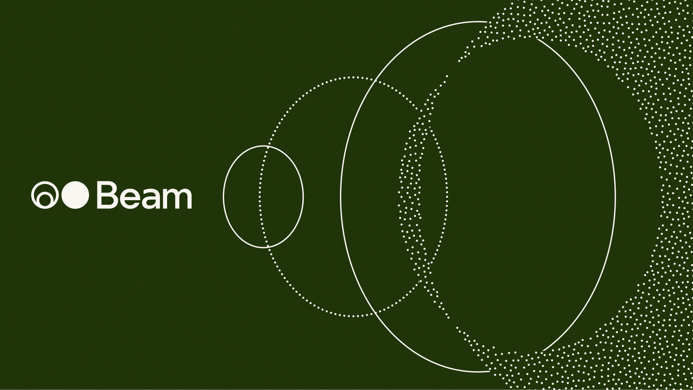
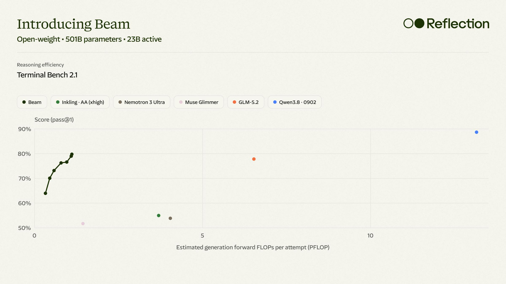
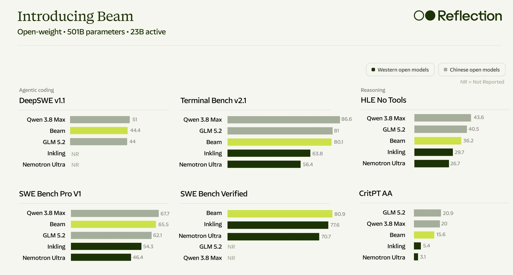

---

## 6. [walkai-talkai](https://www.producthunt.com/products/walkai-talkai)
**Votes**: 111 | **도입 난이도**: 중 | **신뢰도**: 상
**Tagline**: Talk to your AI coding agent over a walkie-talkie
**서비스 링크**: https://www.producthunt.com/r/GI5UU6MDF6EM6J

**태그**: DevTool, AI, Automation, macOS, Agent, AI Tool

### 📌 이 서비스 한눈에 보기
무전기를 통해 손을 쓰지 않고 AI 코딩 에이전트와 대화하는 도구

### 🔑 주요 기능
- 무전기(PTT)를 이용한 핸즈프리 AI 코딩 명령 및 응답
- 로컬 Whisper를 통한 음성 전사 및 신경망 음성 기반 답변 출력
- Cursor, Claude Code, Antigravity 등 주요 코딩 도구와 연동

### 🙋 사용자에게 어떤 점이 좋은가
코딩 작업 중 손을 자유롭게 유지하면서 무전기만으로 AI 에이전트에게 명령을 내리고 답변을 들을 수 있습니다.

### ✅ 지금 바로 써볼 기능
- 애플 실리콘 Mac과 무전기 하드웨어 연결 테스트
- Cursor 또는 Claude Code와의 연동 설정
- 로컬 Whisper를 통한 음성 인식 품질 확인

### ⚠️ 사용 전 확인할 점
- macOS 13 이상 및 Apple Silicon 환경 필수
- 무전기 하드웨어와 Mac 간의 오디오 인터페이스 설정 필요

### 🧭 확인이 더 필요한 정보
사용자의 무전기 하드웨어 모델에 따른 오디오 입출력 호환성 여부를 확인해야 합니다.

### 📸 스크린샷 및 갤러리
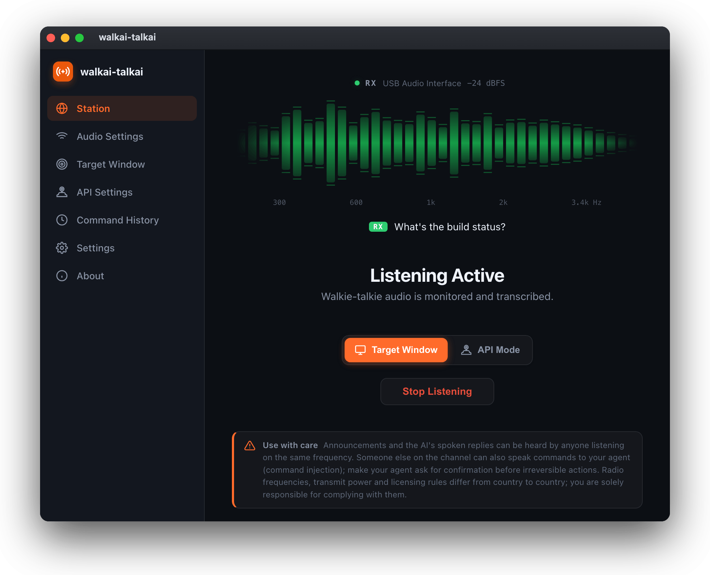
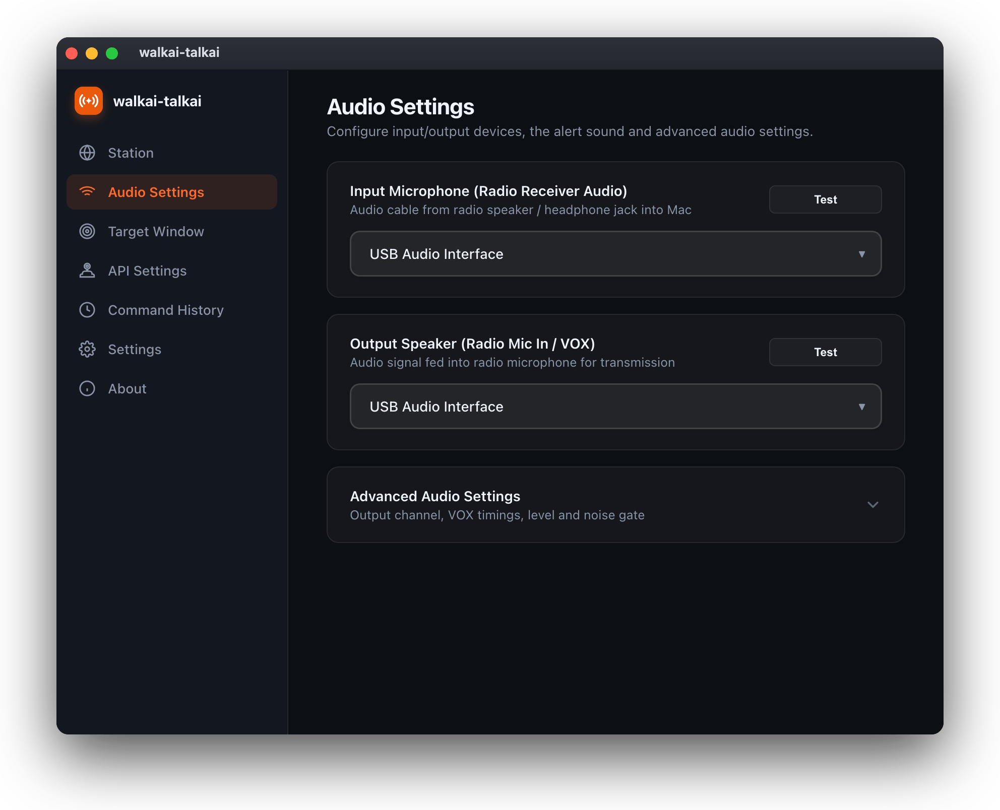
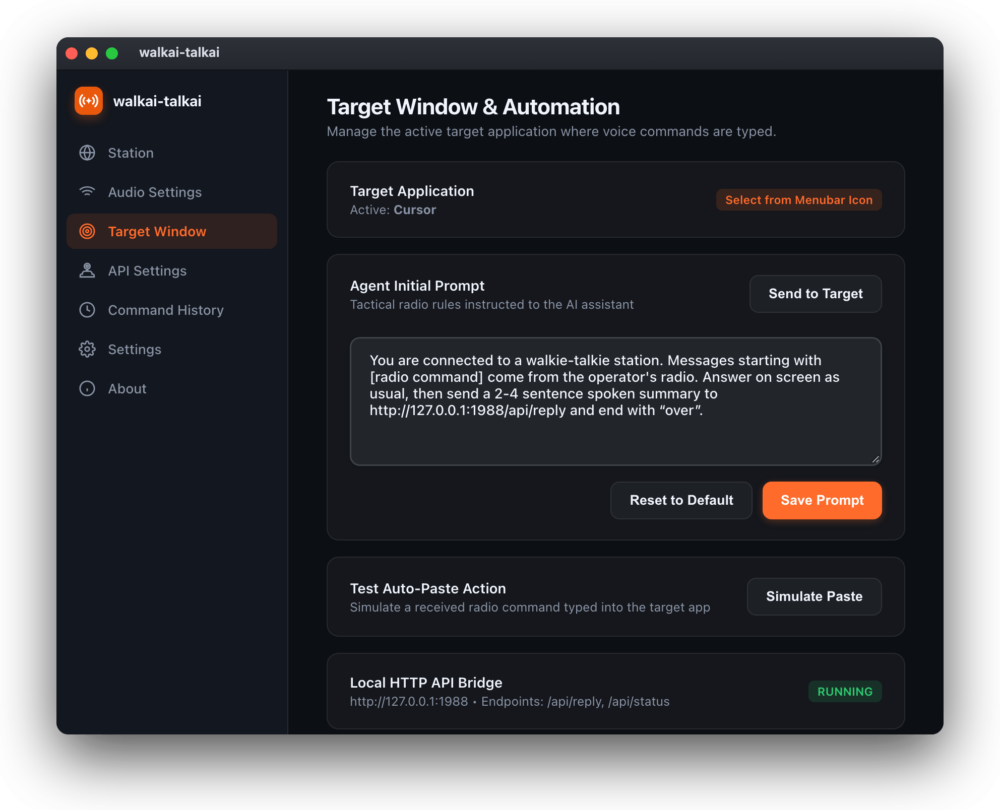

### 🎬 관련 영상
- [🎥 영상 보기](https://ph-files.imgix.net/cdd4b101-9a1c-47d6-bf6d-260b54b083bb.jpeg?auto=format)

---

## 7. [Wally by Willow](https://www.producthunt.com/products/willow-voice)
**Votes**: 106 | **도입 난이도**: 하 | **신뢰도**: 상
**Tagline**: Your Scribe agent that learns how you write
**서비스 링크**: https://www.producthunt.com/r/PACLUWIXF3XULE

**태그**: AI, Writing Assistant, Productivity, Automation, Agent, AI Tool, Chat, Prompting, Email

### 📌 이 서비스 한눈에 보기
사용자의 글쓰기 스타일을 학습하여 맞춤형 초안을 작성해 주는 AI 스크라이브 에이전트

### 🔑 주요 기능
- 음성 채팅을 통한 이메일, 슬랙 메시지, 프롬프트 초안 작성
- 사용자의 개인적 맥락과 글쓰기 스타일 학습 기능
- 대화형 피드백을 통한 실시간 텍스트 수정 및 정교화

### 🙋 사용자에게 어떤 점이 좋은가
사용자의 고유한 말투를 학습하므로, 매번 문체를 수정할 필요 없이 자연스러운 커뮤니케이션 초안을 빠르게 얻을 수 있습니다.

### ✅ 지금 바로 써볼 기능
- 음성 채팅으로 첫 이메일 초안 작성해 보기
- 작성된 텍스트를 하이라이트하여 스타일 수정 요청하기
- 대화를 통해 문구의 톤앤매너 정교화하기

### ⚠️ 사용 전 확인할 점
- 개인적인 맥락을 학습하므로 민감한 정보 입력 시 보안 주의 필요
- 학습 데이터가 축적될수록 스타일이 고착될 수 있음

### 🧭 확인이 더 필요한 정보
사용자의 개인 맥락 데이터가 어떻게 저장되고 보호되는지에 대한 보안 정책 확인이 필요합니다.

### 📸 스크린샷 및 갤러리
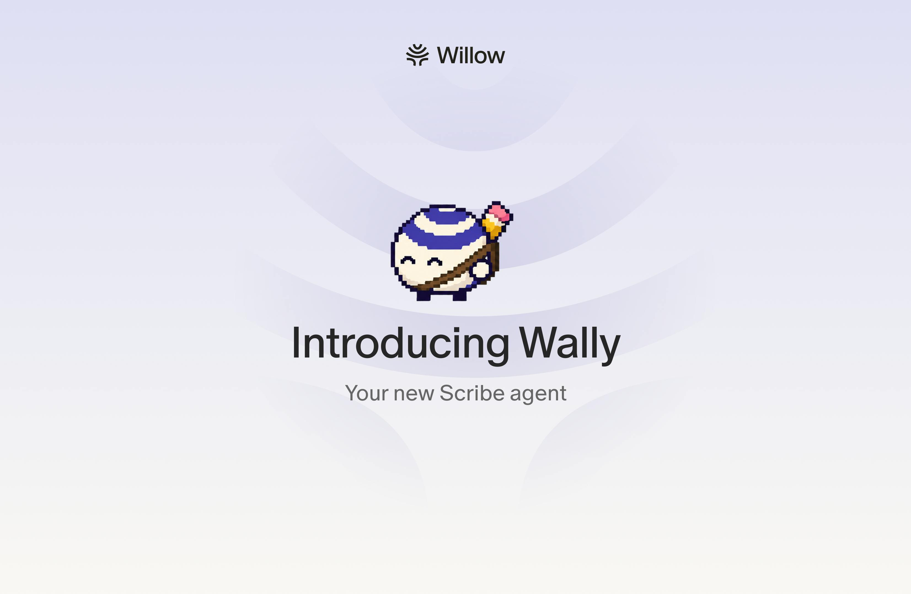
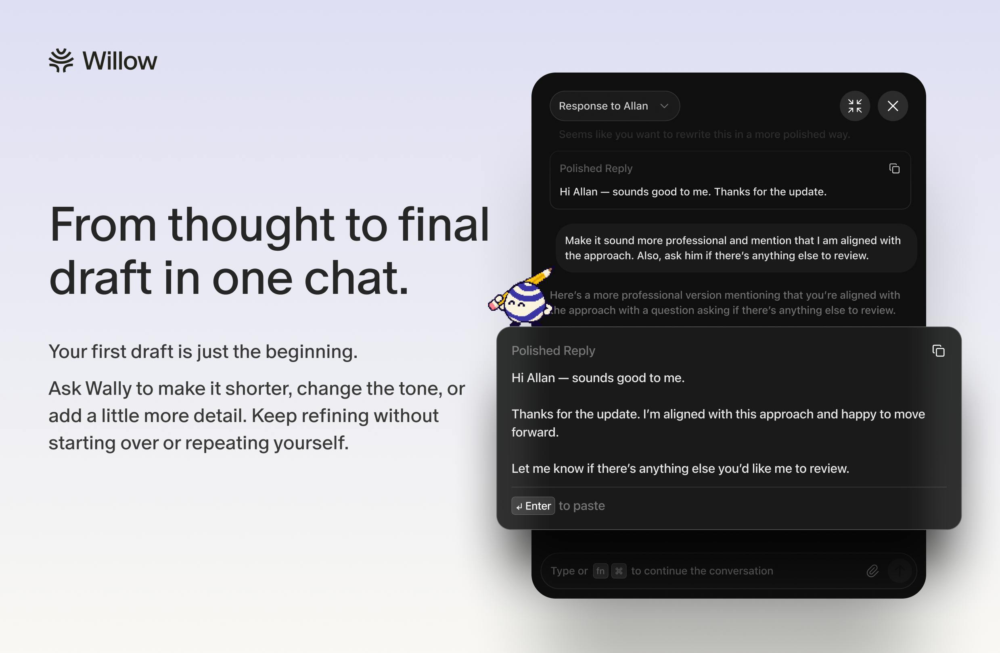
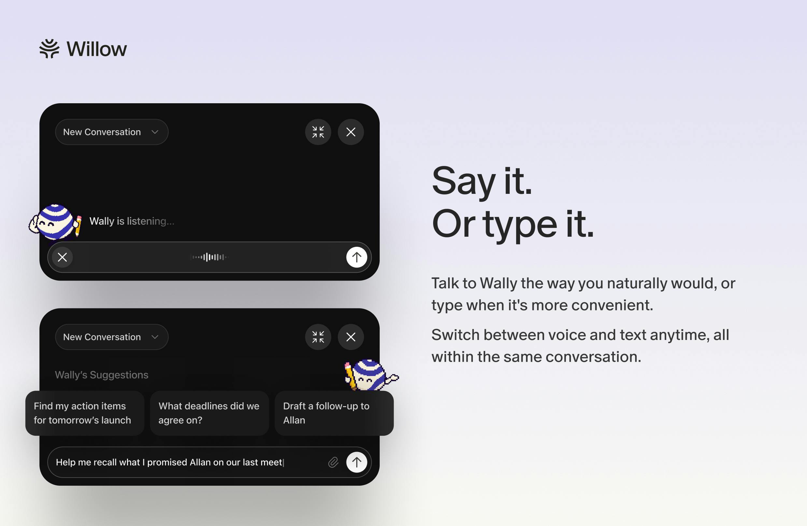

### 🎬 관련 영상
- [🎥 영상 보기](https://ph-files.imgix.net/7edfd9e5-d305-47eb-9d37-36e776e670f1.jpeg?auto=format)

---

## 8. [buddylist](https://www.producthunt.com/products/buddylist-2)
**Votes**: 101 | **도입 난이도**: 중 | **신뢰도**: 상
**Tagline**: Chat with your coding agents like it's 2005
**서비스 링크**: https://www.producthunt.com/r/MU3NX4ZHCXFPBI

**태그**: DevTool, AI, Productivity, Coding, Agent, Chat

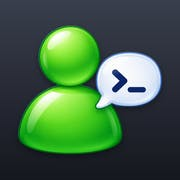

### 📌 이 서비스 한눈에 보기
여러 AI 코딩 에이전트를 MSN 메신저 스타일의 친숙한 UI로 관리하고 협업하는 데스크톱 앱

### 🔑 주요 기능
- Claude Code, Gemini 등 다양한 AI 에이전트를 하나의 버디 리스트로 통합 관리
- 에이전트 간 작업 인계, 공동 답변, 순차적 작업 수행 가능
- Git 워크트리 기반의 작업 분리 및 터미널/프리뷰/PR 체크 통합 환경 제공

### 🙋 사용자에게 어떤 점이 좋은가
여러 AI 모델을 번거로운 창 전환 없이 하나의 인터페이스에서 관리하며, 에이전트 간의 협업을 통해 복잡한 코딩 작업을 효율적으로 분담할 수 있습니다.

### ✅ 지금 바로 써볼 기능
- 자신의 AI 계정(Claude, Gemini 등)을 연결하여 환경 설정하기
- 여러 에이전트를 그룹 채팅에 넣어 협업 워크플로우 테스트하기
- Git 워크트리를 활용한 작업 분리 및 코드 리뷰 기능 사용해보기

### ⚠️ 사용 전 확인할 점
- 사용자 본인의 AI API 계정 및 사용량(Usage)이 별도로 발생함
- Apple Silicon(macOS), Windows, Linux 환경 지원 여부 확인 필요

### 🧭 확인이 더 필요한 정보
사용자의 개별 AI 계정 권한 및 API 비용 체계에 따라 실제 운영 비용이 달라질 수 있습니다.

### 📸 스크린샷 및 갤러리
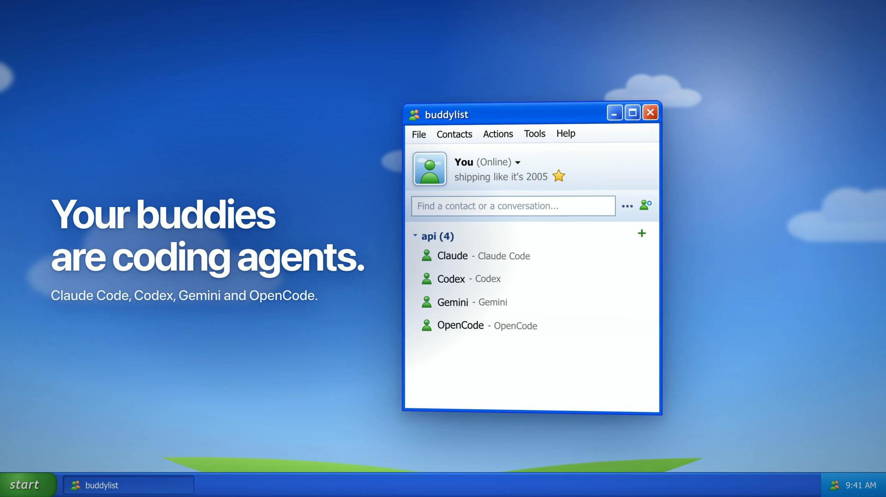
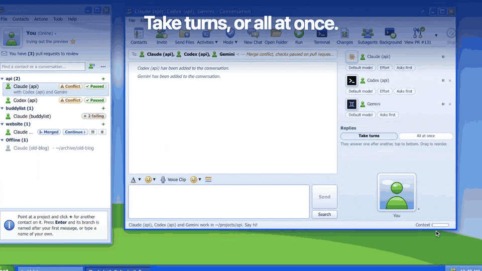
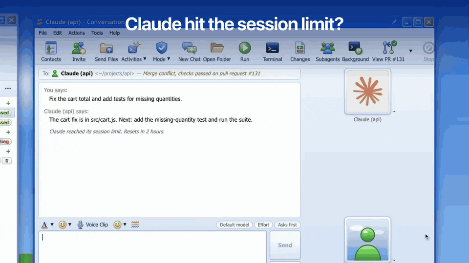

### 🎬 관련 영상
- [🎥 영상 보기](https://ph-files.imgix.net/8ce2ccf1-a211-471b-a436-2f1eb1292c31.jpeg?auto=format)

---

## 9. [Framefields](https://www.producthunt.com/products/framefields)
**Votes**: 92 | **도입 난이도**: 상 | **신뢰도**: 상
**Tagline**: Open-source code-first video for AGI era
**서비스 링크**: https://www.producthunt.com/r/SVLMOG3GL4WKIN

**태그**: DevTool, VideoEngine, AI-Agent, OpenSource, WebGPU, Agent, AI Tool, Video

### 📌 이 서비스 한눈에 보기
코드만으로 고성능 영상 제작과 VFX를 구현하는 WebGPU 기반 오픈소스 엔진

### 🔑 주요 기능
- Node.js 환경에서 작동하는 고성능 코드 중심(Code-first) 비디오 엔진
- 브라우저 오버헤드 없이 WebGPU를 활용한 하드웨어 가속 렌더링
- 모션 그래픽, VFX, 3D, 오디오 DSP를 포함한 통합 개발 환경

### 🙋 사용자에게 어떤 점이 좋은가
AI 에이전트나 엔지니어가 복잡한 영상 편집 소프트웨어 없이 TypeScript 코드로 정밀한 영상 생성 및 자동화를 구현할 수 있습니다.

### ✅ 지금 바로 써볼 기능
- npm 패키지 설치 및 기본 렌더링 테스트
- TypeScript를 이용한 모션 그래픽 및 VFX 구현
- 하드웨어 가속을 통한 MP4 내보내기 성능 확인

### ⚠️ 사용 전 확인할 점
- 코드 중심 방식이므로 GUI 기반 편집 도구와 작업 방식이 완전히 다름
- WebGPU 및 Node.js 환경에 대한 높은 기술적 숙련도 필요

### 🧭 확인이 더 필요한 정보
상세한 하드웨어 요구 사양 및 복잡한 3D 씬의 렌더링 성능 수치는 명시되지 않았습니다.

### 📸 스크린샷 및 갤러리
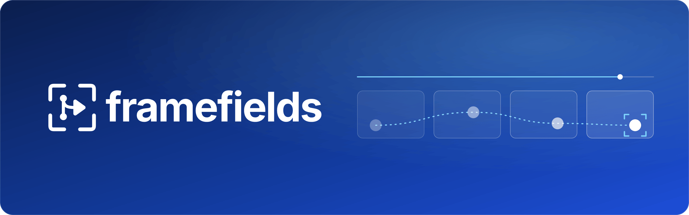
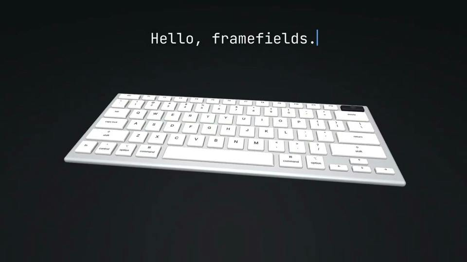

### 🎬 관련 영상
- [🎥 영상 보기](https://ph-files.imgix.net/6a5362bf-f021-4467-b352-7787da2ce9b1.jpeg?auto=format)

---

## 10. [Lazy AWS](https://www.producthunt.com/products/lazy-aws-your-cloud-your-terminal)
**Votes**: 91 | **도입 난이도**: 하 | **신뢰도**: 상
**Tagline**: A keyboard-driven home for your AWS resources
**서비스 링크**: https://www.producthunt.com/r/7GT5YPN2WVDBEO

**태그**: DevTool, AWS, CLI, Productivity

### 📌 이 서비스 한눈에 보기
키보드만으로 AWS 리소스를 관리하고 CLI 명령을 실행하는 터미널 기반 도구

### 🔑 주요 기능
- 키보드 중심의 인터페이스로 작업 흐름 유지
- 터미널 내에서 AWS 리소스 브라우징 및 검사 가능
- 확인된 AWS CLI 액션을 즉시 실행할 수 있는 환경 제공

### 🙋 사용자에게 어떤 점이 좋은가
콘솔 화면을 오가는 번거로움 없이 터미널 안에서 모든 AWS 작업을 처리하여 개발 생산성을 높여줍니다.

### ✅ 지금 바로 써볼 기능
- 키보드 단축키를 통한 리소스 탐색
- 터미널 내 리소스 상세 정보 검사
- CLI 명령 실행 및 결과 확인

### ⚠️ 사용 전 확인할 점
- CLI 명령 실행 시 권한 관리 및 보안 주의 필요
- GUI 기반의 시각적 리소스 관리에 익숙한 사용자에게는 적응 기간 필요

### 🧭 확인이 더 필요한 정보
상세한 보안 인증 방식 및 지원하는 AWS 서비스 범위에 대한 정보가 부족합니다.

### 📸 스크린샷 및 갤러리
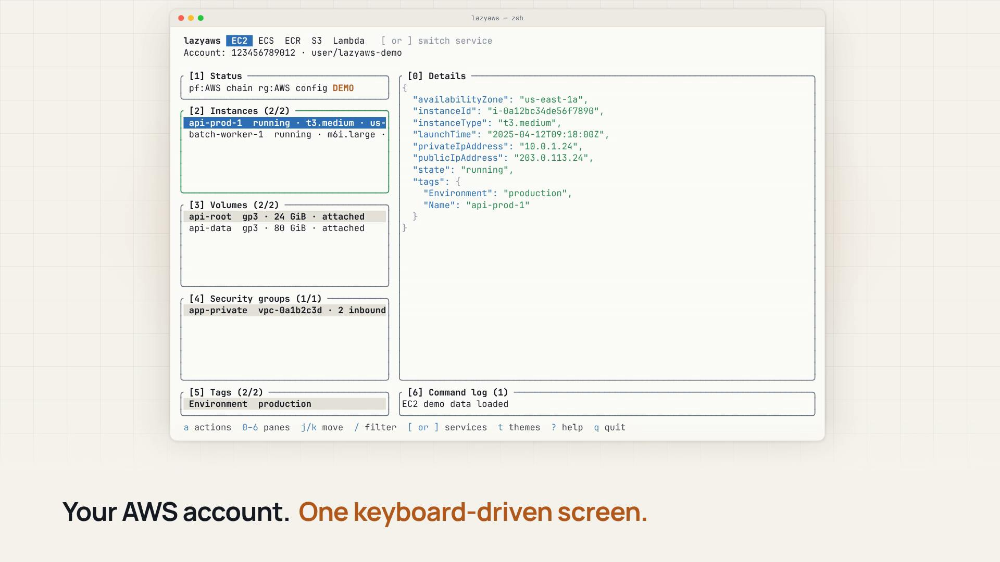
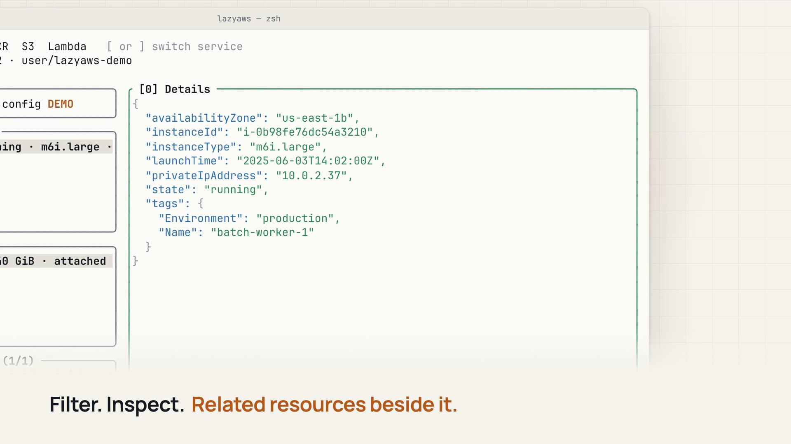
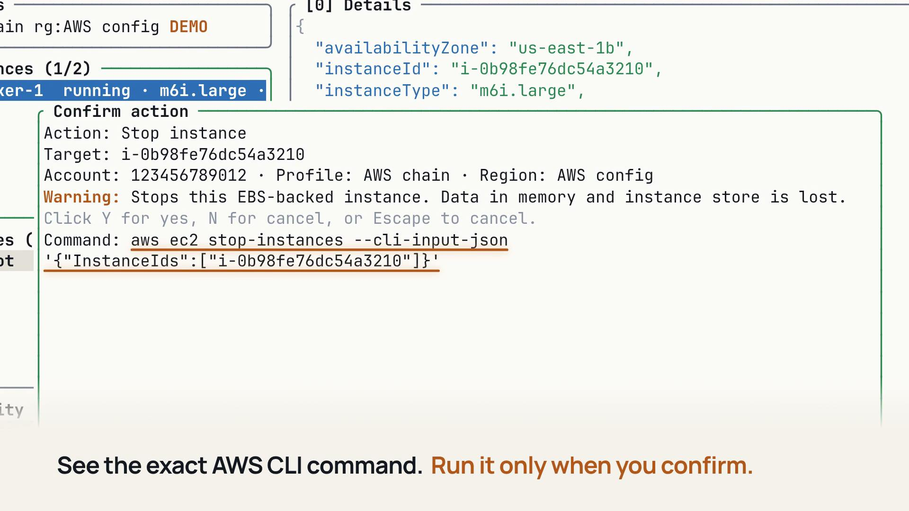

### 🎬 관련 영상
- [🎥 영상 보기](https://ph-files.imgix.net/e78a4962-b956-4e60-9758-4832566db0a4.jpeg?auto=format)

---

## 11. [Quello](https://www.producthunt.com/products/quello)
**Votes**: 84 | **도입 난이도**: 중 | **신뢰도**: 상
**Tagline**: One place to ask, across everything you already use.
**서비스 링크**: https://www.producthunt.com/r/YMQ2VFMROUIBQH

**태그**: AI, Productivity, KnowledgeManagement, Workflow, Agent, AI Tool, Chat

### 📌 이 서비스 한눈에 보기
사용 중인 모든 도구와 문서를 연결하여 AI에게 완벽한 업무 맥락을 제공하는 통합 컨텍스트 레이어

### 🔑 주요 기능
- MCP(Model Context Protocol) 기반의 통합 워크스페이스 구축
- Claude, ChatGPT, Gemini 등 주요 AI 모델에 작업 맥락(Context) 전달
- 모든 답변에 대한 출처(Citation) 제공 및 음성 에이전트 지원

### 🙋 사용자에게 어떤 점이 좋은가
여러 도구에 흩어진 정보를 일일이 복사할 필요 없이, AI가 사용자의 전체 업무 맥락을 이해한 상태에서 답변을 제공합니다.

### ✅ 지금 바로 써볼 기능
- 기존 문서 및 도구 연결하기
- AI 모델(Claude, ChatGPT 등)과 연동하여 맥락 공유하기
- 음성 에이전트를 통한 대화형 업무 수행하기

### ⚠️ 사용 전 확인할 점
- 다양한 외부 도구 및 문서에 대한 접근 권한 설정 필요
- 개인정보 및 기업 보안 데이터의 외부 AI 모델 전달에 대한 검토 필요

### 🧭 확인이 더 필요한 정보
지원하는 외부 도구의 종류와 데이터 보안 정책에 대한 구체적인 상세 정보가 필요합니다.

### 📸 스크린샷 및 갤러리
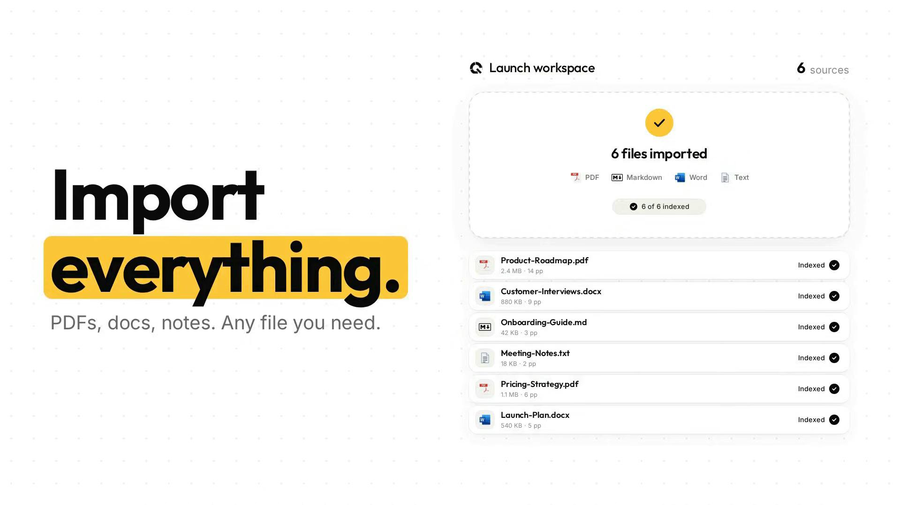
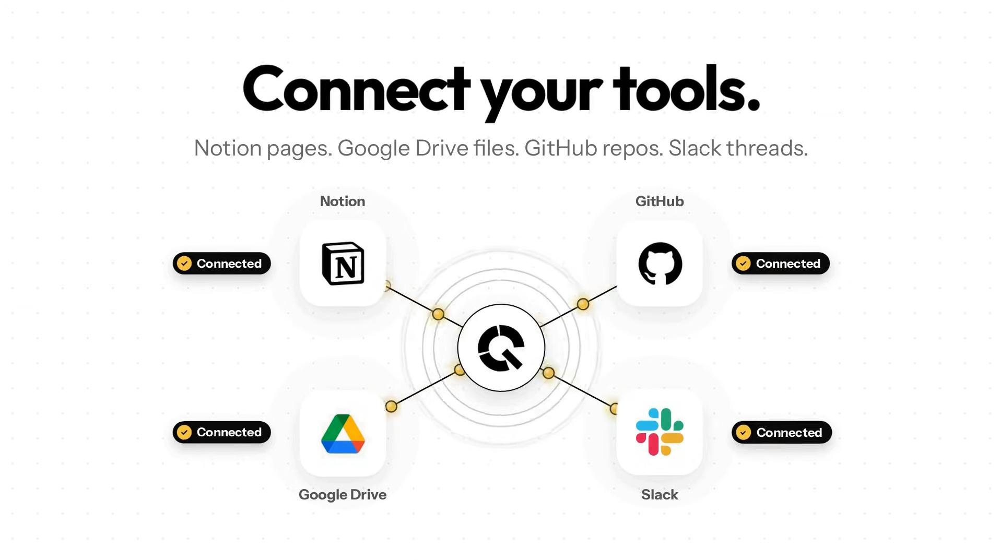
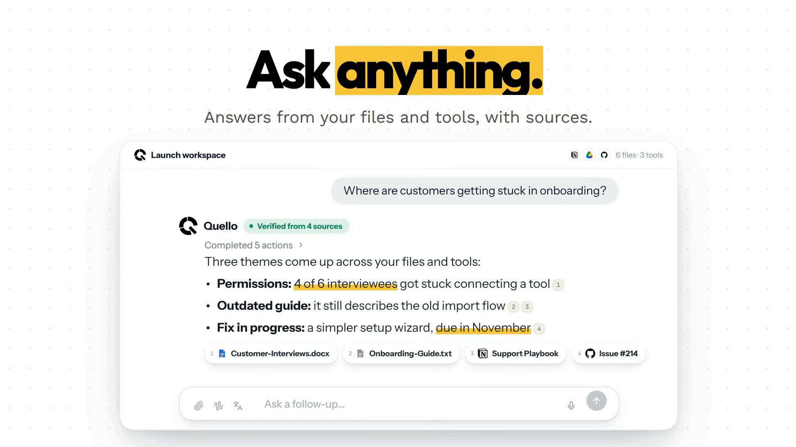

### 🎬 관련 영상
- [🎥 영상 보기](https://ph-files.imgix.net/68144ab4-0f19-497f-8605-354c5cafcd8c.jpeg?auto=format)

---

## 12. [CoolDock](https://www.producthunt.com/products/cooldock-2)
**Votes**: 83 | **도입 난이도**: 하 | **신뢰도**: 상
**Tagline**: A smart second Dock for your Mac with 160+ live widgets.
**서비스 링크**: https://www.producthunt.com/r/FCXU7XELMH33PP

**태그**: Productivity, Mac, Customization, Utility

### 📌 이 서비스 한눈에 보기
Mac의 기본 Dock 옆에 160개 이상의 라이브 위젯을 배치하는 스마트한 보조 Dock

### 🔑 주요 기능
- 160개 이상의 다양한 라이브 위젯 제공
- 기본 Dock과 병행하여 사용하는 아름다운 디자인의 보조 Dock
- 앱, 폴더, 검색, 날씨, 캘린더 등 다양한 퀵 액션 통합

### 🙋 사용자에게 어떤 점이 좋은가
기존 Mac Dock의 공간 제약을 넘어, 작업 중 필요한 정보와 앱을 한눈에 확인하고 빠르게 실행할 수 있습니다.

### ✅ 지금 바로 써볼 기능
- 160여 개의 위젯 중 본인에게 필요한 위젯 구성하기
- 캘린더, 날씨, 리마인더 등 실시간 정보 위젯 배치하기
- 자주 사용하는 앱과 폴더를 보조 Dock에 등록하기

### ⚠️ 사용 전 확인할 점
- 많은 위젯 사용 시 Mac 시스템 리소스(CPU/RAM) 점유율 확인 필요
- 기본 Dock과의 화면 공간 배치 및 시각적 간섭 여부 확인

### 🧭 확인이 더 필요한 정보
위젯 사용에 따른 시스템 성능 영향도와 상세한 UI 커스텀 자유도는 추가 확인이 필요합니다.

### 📸 스크린샷 및 갤러리
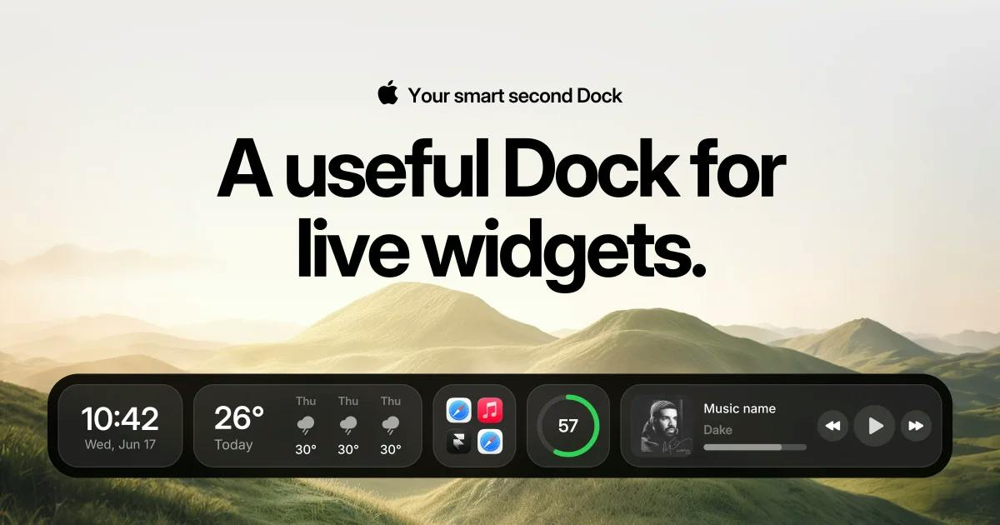
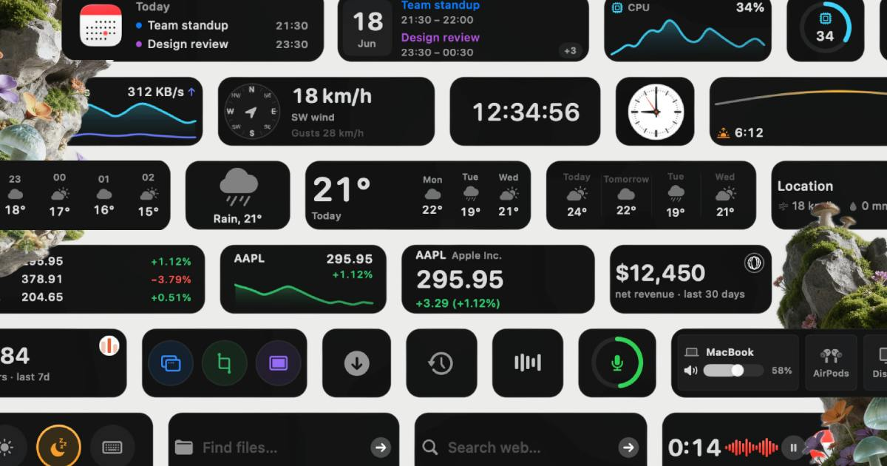
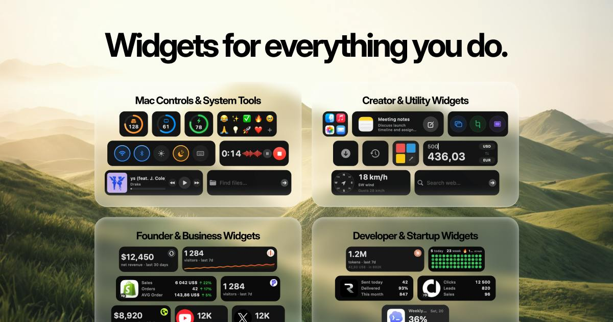

### 🎬 관련 영상
- [🎥 영상 보기](https://ph-files.imgix.net/2116531b-0da0-42c9-b31a-67b420962591.jpeg?auto=format)

---

## 13. [Lookout (for Slack)](https://www.producthunt.com/products/lookout-for-slack)
**Votes**: 82 | **도입 난이도**: 하 | **신뢰도**: 상
**Tagline**: Urgent Slack messages, handled instantly. Powered by Jev.
**서비스 링크**: https://www.producthunt.com/r/BSTR7KVW7H6D5K

**태그**: Automation, Productivity, Slack

### 📌 이 서비스 한눈에 보기
Slack의 긴급 메시지를 실시간으로 감지하고 설정된 액션을 즉시 실행하는 자동화 도구

### 🔑 주요 기능
- Jev 엔진을 통한 Slack 메시지 실시간 모니터링
- 시간 민감도가 높은 메시지에 대한 즉각적인 대응
- 사용자가 정의한 맞춤형 액션 자동 실행

### 🙋 사용자에게 어떤 점이 좋은가
중요한 메시지를 놓치지 않고 즉시 처리할 수 있어, 업무 흐름이 끊기지 않도록 돕습니다.

### ✅ 지금 바로 써볼 기능
- Slack 채널 연결 및 모니터링 설정
- 메시지 유형별 자동 액션 규칙 정의
- 긴급 메시지 감지 테스트

### ⚠️ 사용 전 확인할 점
- Slack 메시지 데이터 접근에 따른 보안 및 개인정보 정책 확인 필요
- 설정된 액션이 의도치 않게 실행될 경우에 대한 대비 필요

### 🧭 확인이 더 필요한 정보
사용자가 정의할 수 있는 '액션'의 구체적인 범위와 외부 서비스 연동 가능 여부가 명시되지 않았습니다.

### 📸 스크린샷 및 갤러리
_media_1.jpg)
_media_2.jpg)
_media_3.jpg)

### 🎬 관련 영상
- [🎥 영상 보기](https://ph-files.imgix.net/3ebb9e02-8cad-4c3e-a04e-11bcda1d55fc.jpeg?auto=format)

---

## 14. [Switch Lab](https://www.producthunt.com/products/switch-lab)
**Votes**: 80 | **도입 난이도**: 하 | **신뢰도**: 상
**Tagline**: Hear and type on keyboard switches before you buy them
**서비스 링크**: https://www.producthunt.com/r/ECPPOOKQ4MHGZM

**태그**: MechanicalKeyboard, Simulation, Productivity, Video

### 📌 이 서비스 한눈에 보기
실제 타건음과 3D 키보드 환경에서 기계식 스위치를 미리 테스트해 볼 수 있는 가상 타건 시뮬레이터

### 🔑 주요 기능
- 실제 녹음된 소리와 3D 키보드 레이아웃을 통한 생생한 타건 경험 제공
- 타입, 무게, 소리별 필터링 기능을 통한 맞춤형 스위치 탐색
- 타이핑 마라톤, 드럼 스템 등 미니 게임을 통한 실전 타건 테스트

### 🙋 사용자에게 어떤 점이 좋은가
스펙 시트나 영상만으로는 알 수 없는 스위치의 실제 느낌을 미리 경험하여 구매 실패 확률을 줄여줍니다.

### ✅ 지금 바로 써볼 기능
- 필터 기능을 사용하여 선호하는 무게와 소리의 스위치 찾기
- 3D 키보드 환경에서 스위치 교체하며 비교하기
- 타이핑 미니 게임을 통해 선택한 스위치의 타건감 테스트하기

### ⚠️ 사용 전 확인할 점
- 실제 물리적 스위치가 아닌 녹음된 소리를 통한 가상 경험이므로 실제 타건감과 차이가 있을 수 있음
- 하드웨어 구매 전 시뮬레이션 용도로만 활용 권장

### 🧭 확인이 더 필요한 정보
실제 물리적 스위치 구매 시의 타건감과 가상 시뮬레이션 간의 일치 정도를 확인해야 합니다.

### 📸 스크린샷 및 갤러리
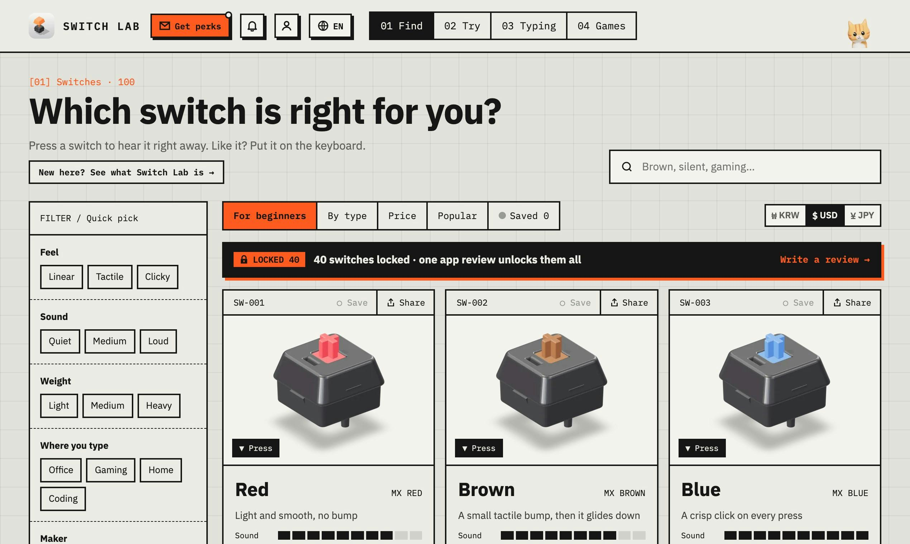
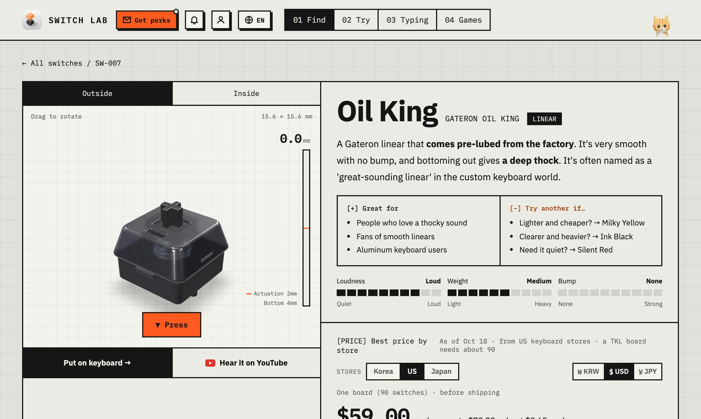
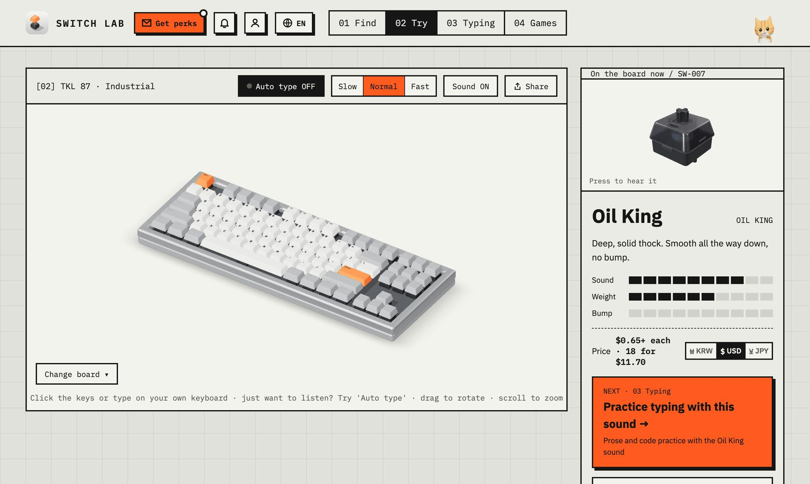

### 🎬 관련 영상
- [🎥 영상 보기](https://ph-files.imgix.net/e989190c-0493-4c6b-bfd5-573784fe6fed.jpeg?auto=format)

---

## 15. [Tori ](https://www.producthunt.com/products/tori-3)
**Votes**: 78 | **도입 난이도**: 하 | **신뢰도**: 상
**Tagline**: The smartest AI support agent for customer success
**서비스 링크**: https://www.producthunt.com/r/CNLTX5ICSOZWNL

**태그**: AI, Customer Support, Automation, SaaS, Agent, AI Tool

### 📌 이 서비스 한눈에 보기
기존 자료를 학습하여 복잡한 고객 문의까지 해결하는 맞춤형 AI 고객 지원 에이전트

### 🔑 주요 기능
- 기존 제품 콘텐츠를 활용한 심도 있는 AI 학습 기능
- 복잡한 고객 질문에 대한 정확한 답변 제공
- 브랜드에 맞게 완전히 커스터마이징 가능한 UI

### 🙋 사용자에게 어떤 점이 좋은가
고객 지원 팀이 반복적인 문의 응대 시간을 줄이고, 브랜드 아이덴티티를 유지하면서 전문적인 답변을 제공할 수 있습니다.

### ✅ 지금 바로 써볼 기능
- 기존 제품 문서/콘텐츠 업로드하여 학습시키기
- 커스텀 UI를 통해 브랜드 스타일 적용하기
- 복잡한 질문에 대한 AI 답변 정확도 테스트하기

### ⚠️ 사용 전 확인할 점
- 학습 데이터의 품질에 따라 답변의 정확도가 결정될 수 있음
- 기존 데이터가 부족할 경우 초기 학습 성능이 제한적일 수 있음

### 🧭 확인이 더 필요한 정보
학습 데이터의 양이나 형식에 따른 구체적인 제약 사항과 연동 가능한 외부 플랫폼 범위 확인이 필요합니다.

### 📸 스크린샷 및 갤러리

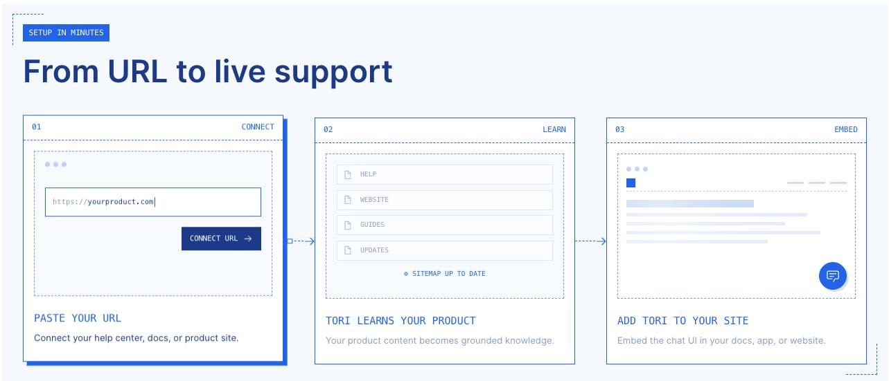

---

## 16. [Planet-X](https://www.producthunt.com/products/planet-x)
**Votes**: 74 | **도입 난이도**: 하 | **신뢰도**: 상
**Tagline**: A living globe to explore and remember loved ones
**서비스 링크**: https://www.producthunt.com/r/WSUSR6BHPSMCHM

**태그**: Interactive, Lifestyle, Memorial, Exploration

### 📌 이 서비스 한눈에 보기
소중한 사람을 기억하며 전 세계를 탐험하는 인터랙티브 3D 지구 서비스

### 🔑 주요 기능
- 자유로운 3D 지구 회전 및 탐험 기능
- 국가별 실시간 라디오 스트리밍
- 떠나보낸 소중한 존재를 위한 디지털 추모 공간

### 🙋 사용자에게 어떤 점이 좋은가
계정 생성 없이 즉시 전 세계를 탐험하며, 그리운 이들을 위한 빛을 남기는 감성적인 디지털 경험을 제공합니다.

### ✅ 지금 바로 써볼 기능
- 3D 지구를 돌리며 전 세계 탐험하기
- 국가별 라이브 라디오 감상하기
- 소중한 사람을 위한 빛 남기기

### ⚠️ 사용 전 확인할 점
- 계정 없이 사용 가능하므로 데이터 저장 방식 확인 필요
- 추모 기능의 영속성 여부 확인 필요

### 🧭 확인이 더 필요한 정보
계정 없이 이용할 경우 작성한 '빛'이 브라우저 종료 후에도 유지되는지 확인이 필요합니다.

### 📸 스크린샷 및 갤러리

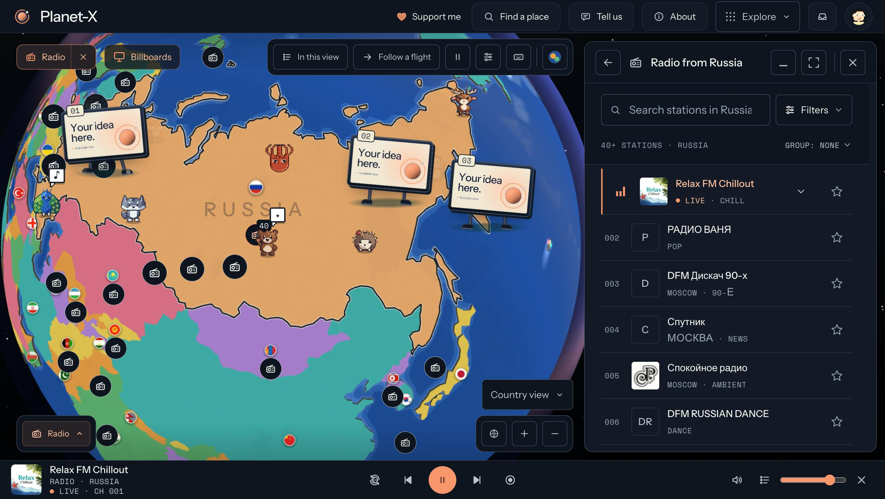
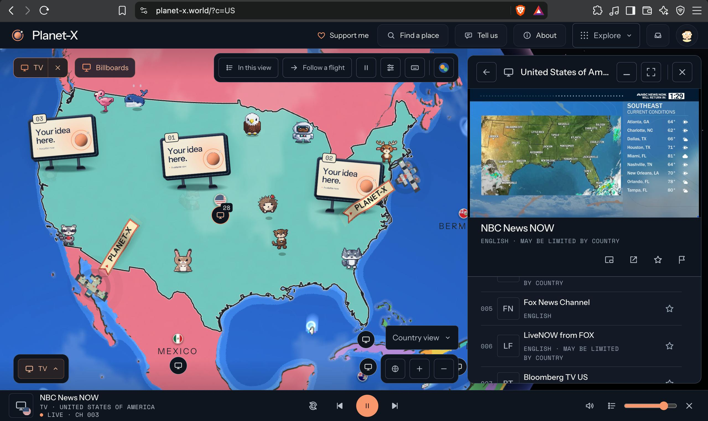

### 🎬 관련 영상
- [🎥 영상 보기](https://ph-files.imgix.net/6a8f3d64-bc07-460d-992c-cc79d83640a5.jpeg?auto=format)

---

## 17. [Lancetta](https://www.producthunt.com/products/lancetta)
**Votes**: 74 | **도입 난이도**: 하 | **신뢰도**: 상
**Tagline**: Know when to push your coding agents, and when to ease off
**서비스 링크**: https://www.producthunt.com/r/VDYKKTF2RGCXAL

**태그**: DevTool, Productivity, macOS, AI-Agent, Agent, AI Tool

### 📌 이 서비스 한눈에 보기
코딩 에이전트의 할당량(Quota)을 실시간으로 관리하여 최적의 작업 타이밍을 알려주는 macOS 메뉴바 앱

### 🔑 주요 기능
- Claude Code 및 Codex 사용 시 남은 할당량 기반의 행동 지침 제공
- 할당량 초기화 시점이나 에이전트 중단 방지를 위한 최적의 전환 타이밍 안내
- 백그라운드 프로세스 정리 및 세션 관리로 효율적인 개발 환경 유지

### 🙋 사용자에게 어떤 점이 좋은가
코딩 에이전트의 사용 제한(Quota)을 효율적으로 관리하여, 작업 흐름이 끊기지 않도록 전략적인 스케줄링을 도와줍니다.

### ✅ 지금 바로 써볼 기능
- macOS 15 이상 환경에서 앱 설치 및 실행
- 메뉴바를 통해 실시간 할당량 상태 모니터링
- 제공되는 가이드에 따라 에이전트 간 작업 전환 수행

### ⚠️ 사용 전 확인할 점
- macOS 15 이상의 운영체제 버전 필요
- Claude Code 및 Codex 사용 환경에 최적화됨

### 🧭 확인이 더 필요한 정보
사용자의 특정 에이전트 설정이나 API 연동 방식에 따른 세부 동작 차이는 명시되지 않았습니다.

### 📸 스크린샷 및 갤러리
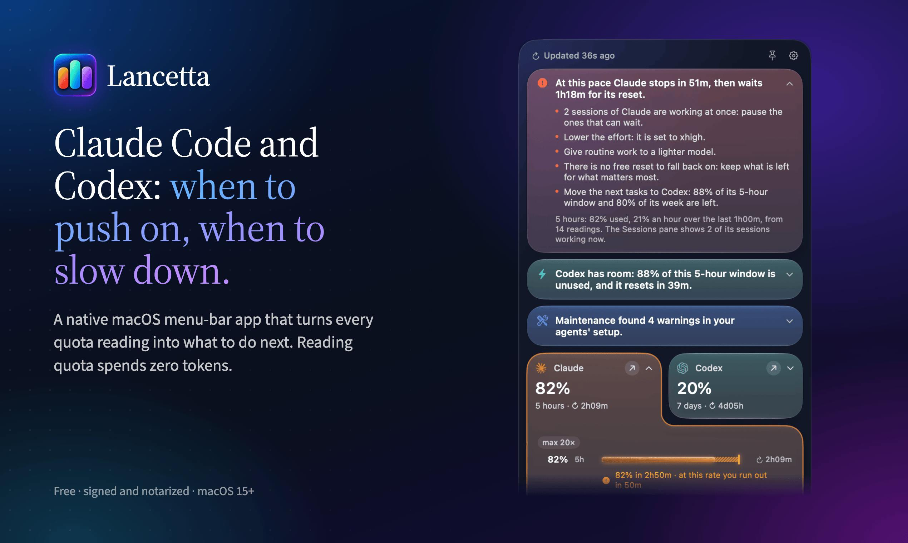
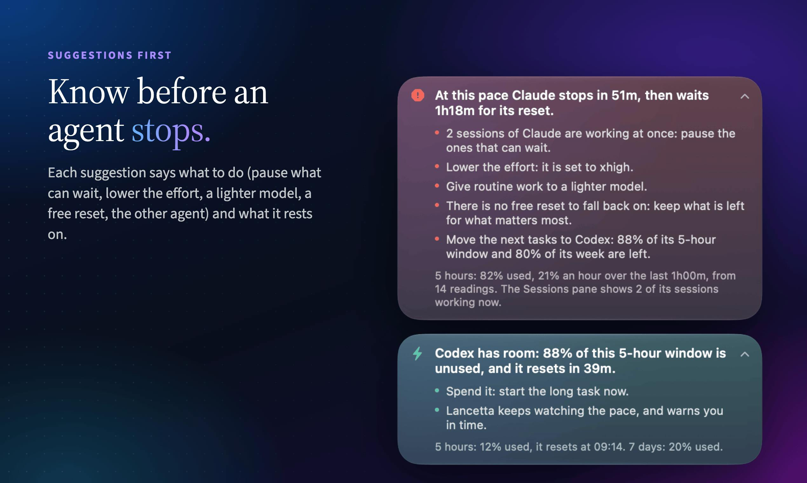
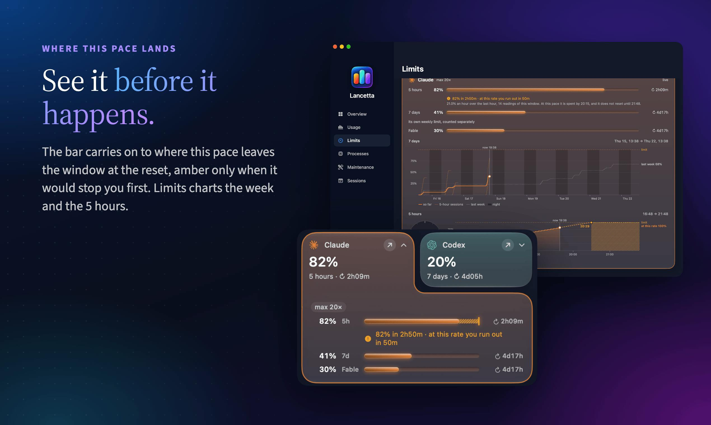

### 🎬 관련 영상
- [🎥 영상 보기](https://ph-files.imgix.net/f42d412f-6845-479c-9a2a-ac67eea14f15.jpeg?auto=format)
- [🎥 영상 보기](https://ph-files.imgix.net/4a612a95-56b9-4aeb-b537-238e63e45fb9.jpeg?auto=format)

---

## 18. [Own 1](https://www.producthunt.com/products/own-1-a-powerful-personal-ai-computer)
**Votes**: 73 | **도입 난이도**: 상 | **신뢰도**: 상
**Tagline**: Own your data. Own your AI. A mind of your own.
**서비스 링크**: https://www.producthunt.com/r/SEW2WB3CVP2PVM

**태그**: AI Hardware, Privacy, Automation, Edge Computing, Agent, AI Tool, LLM

### 📌 이 서비스 한눈에 보기
구독료 없이 개인의 데이터와 AI를 온전히 소유할 수 있는 팬리스 로컬 AI 컴퓨터

### 🔑 주요 기능
- 구독료나 토큰 비용이 없는 $3,899부터 시작하는 로컬 AI 하드웨어
- 개인 데이터와 메모리를 로컬에 유지하는 프라이버시 중심 설계
- AI 에이전트 관리, 예산, 감사 영수증 및 결제 지갑을 갖춘 OwnXOS 탑재

### 🙋 사용자에게 어떤 점이 좋은가
데이터 유출 걱정 없이 강력한 개인용 AI 비서와 수백 개의 에이전트를 로컬 환경에서 안전하게 운용할 수 있습니다.

### ✅ 지금 바로 써볼 기능
- Nexy를 통한 개인용 AI 코워커 환경 구축
- 로컬 LLM 및 8개 에이전트 구동 테스트
- OwnXOS의 에이전트 오케스트레이션 기능 활용

### ⚠️ 사용 전 확인할 점
- 고가의 초기 도입 비용 발생
- 로컬 하드웨어 성능에 따른 AI 모델 구동 제약 가능성

### 🧭 확인이 더 필요한 정보
구체적인 하드웨어 사양(CPU/GPU 등)과 로컬 LLM 모델의 구동 성능에 대한 상세 정보가 필요합니다.

### 📸 스크린샷 및 갤러리
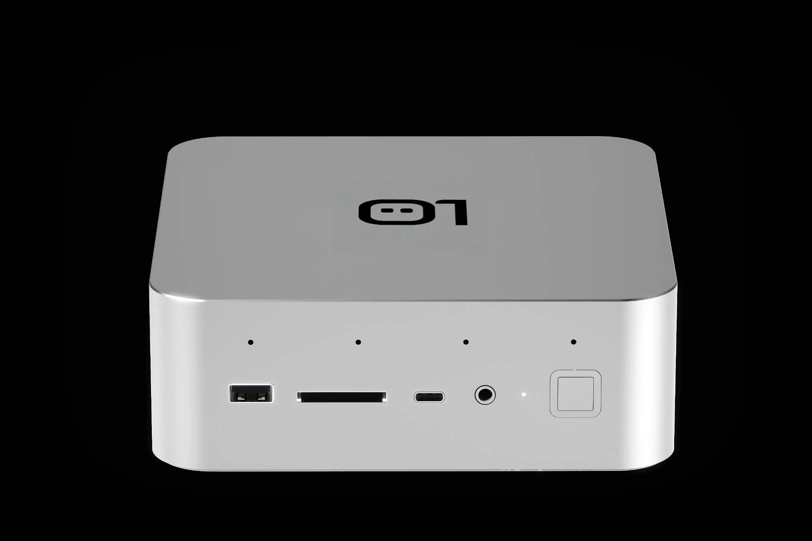
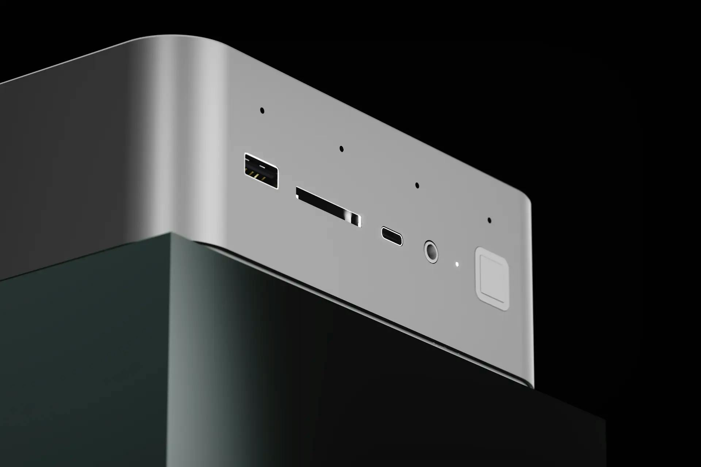

### 🎬 관련 영상
- [🎥 영상 보기](https://ph-files.imgix.net/fe215bb0-f60f-4a84-bd44-b1f3f2e23317.jpeg?auto=format)

---

## 19. [Umbra Mail](https://www.producthunt.com/products/umbra-mail)
**Votes**: 71 | **도입 난이도**: 하 | **신뢰도**: 상
**Tagline**: A calmer Gmail where emails look like chat threads
**서비스 링크**: https://www.producthunt.com/r/GTKTKGIM76TY5I

**태그**: Productivity, Email, Privacy, OpenSource, AI Tool, Chat

### 📌 이 서비스 한눈에 보기
채팅처럼 간결하고 프라이버시를 중시하는 차세대 Gmail 클라이언트

### 🔑 주요 기능
- 이메일을 채팅 스레드 형식으로 시각화하여 가독성 향상
- 뉴스레터 전용 페이지 제공 및 선택적 AI 기능
- 트래킹 방지, 서버 미사용, 오픈 소스 기반의 강력한 프라이버시

### 🙋 사용자에게 어떤 점이 좋은가
복잡한 이메일 환경에서 벗어나 채팅처럼 직관적인 UI로 업무 효율을 높이고, 개인정보 유출 걱정 없이 안전하게 메일을 관리할 수 있습니다.

### ✅ 지금 바로 써볼 기능
- 이메일 스레드를 채팅 형식으로 전환하여 읽기
- 뉴스레터 전용 페이지로 받은 편지함 정리하기
- AI 기능을 켜거나 꺼보며 개인 맞춤형 환경 설정하기

### ⚠️ 사용 전 확인할 점
- 기존 Gmail의 복잡한 기능(캘린더 연동 등)과의 호환성 확인 필요
- 오픈 소스 프로젝트로서의 지속적인 업데이트 및 보안 유지 여부

### 🧭 확인이 더 필요한 정보
기존 Gmail 계정과의 구체적인 동기화 방식 및 데이터 저장 방식에 대한 상세 정보가 필요합니다.

### 📸 스크린샷 및 갤러리
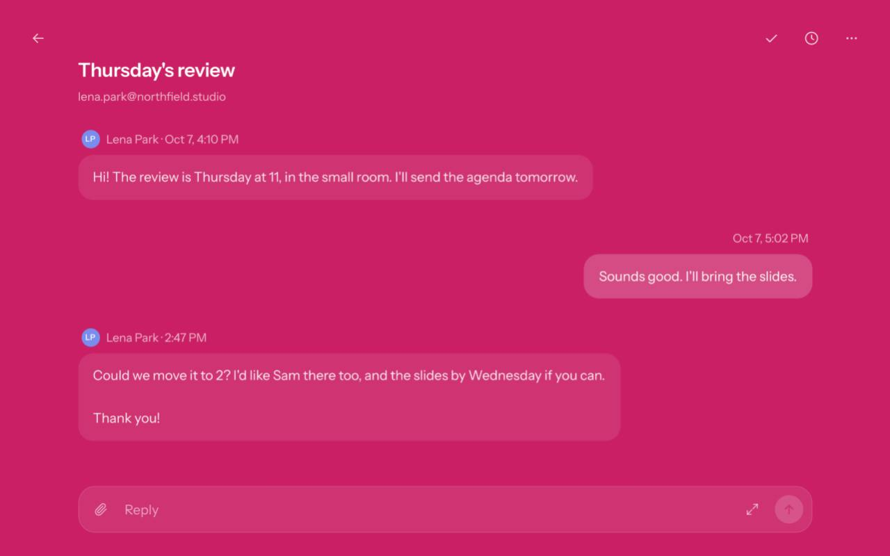
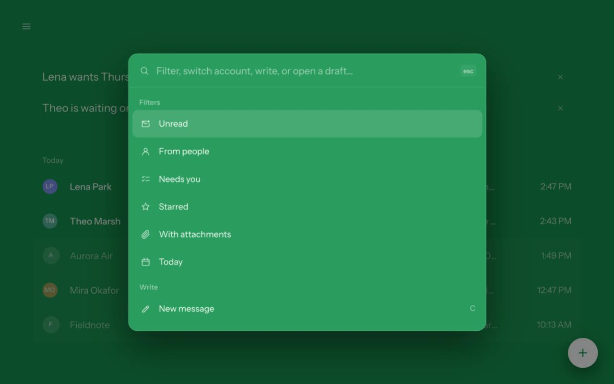

### 🎬 관련 영상
- [🎥 영상 보기](https://ph-files.imgix.net/253e43d8-83aa-4bb7-96cc-3168f71583b5.jpeg?auto=format)

---

## 20. [Point and Yap](https://www.producthunt.com/products/point-and-yap)
**Votes**: 69 | **도입 난이도**: 하 | **신뢰도**: 상
**Tagline**: Point at your screen and start yapping to your agent via MCP
**서비스 링크**: https://www.producthunt.com/r/25RVAIMWXFHKXV

**태그**: DevTool, Productivity, Mac, OpenSource, AI, Agent, AI Tool

### 📌 이 서비스 한눈에 보기
화면을 가리키며 말하는 것만으로 코딩 에이전트에게 맥락을 전달하는 Mac용 도구

### 🔑 주요 기능
- 화면의 특정 요소를 가리키며 음성으로 명령 전달 가능
- MCP(Model Context Protocol)를 통한 코딩 에이전트와의 연동
- 오픈 소스 기반의 무료 및 로컬 실행 환경 제공

### 🙋 사용자에게 어떤 점이 좋은가
복잡한 타이핑이나 스크린샷 캡처 없이도 화면상의 맥락을 에이전트에게 즉각 전달하여 개발 워크플로우를 단축할 수 있습니다.

### ✅ 지금 바로 써볼 기능
- Control 키 두 번 눌러 기능 활성화하기
- 화면의 특정 영역을 가리키며 음성 명령 시도하기
- MCP를 통해 연결된 코딩 에이전트의 반응 확인하기

### ⚠️ 사용 전 확인할 점
- Mac 전용 도구이므로 다른 OS에서는 사용 불가
- 음성 인식 및 화면 캡처 권한 설정 필요

### 🧭 확인이 더 필요한 정보
사용자의 음성 및 화면 데이터가 로컬에서만 처리되는지, 외부 서버로 전송되는지에 대한 상세 보안 정책 확인이 필요합니다.

### 📸 스크린샷 및 갤러리

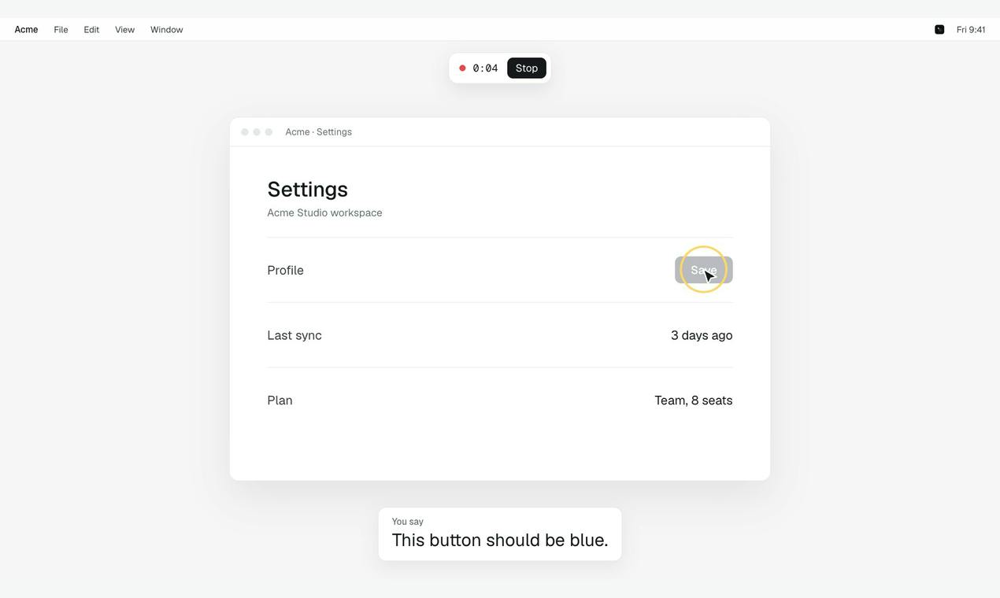
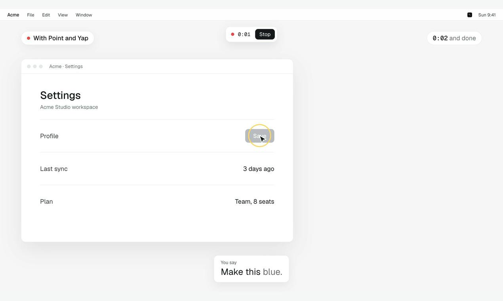

---

## 21. [Point and Yap](https://www.producthunt.com/products/point-and-yap)
**Votes**: 69 | **도입 난이도**: 하 | **신뢰도**: 상
**Tagline**: Point at your screen and start yapping to your agent via MCP
**서비스 링크**: https://www.producthunt.com/r/25RVAIMWXFHKXV

**태그**: DevTool, Productivity, Mac, OpenSource, AI, Agent, AI Tool

### 📌 이 서비스 한눈에 보기
화면을 가리키며 말하는 것만으로 코딩 에이전트에게 맥락을 전달하는 Mac용 도구

### 🔑 주요 기능
- 화면의 특정 요소를 가리키며 음성으로 명령 전달 가능
- MCP(Model Context Protocol)를 통한 코딩 에이전트와의 연동
- 오픈 소스 기반의 무료 및 로컬 실행 환경 제공

### 🙋 사용자에게 어떤 점이 좋은가
복잡한 타이핑이나 스크린샷 캡처 없이도 화면상의 맥락을 에이전트에게 즉각 전달하여 개발 워크플로우를 단축할 수 있습니다.

### ✅ 지금 바로 써볼 기능
- Control 키 두 번 눌러 기능 활성화하기
- 화면의 특정 영역을 가리키며 음성 명령 시도하기
- MCP를 통해 연결된 코딩 에이전트의 반응 확인하기

### ⚠️ 사용 전 확인할 점
- Mac 전용 도구이므로 다른 OS에서는 사용 불가
- 음성 인식 및 화면 캡처 권한 설정 필요

### 🧭 확인이 더 필요한 정보
사용자의 음성 및 화면 데이터가 로컬에서만 처리되는지, 외부 서버로 전송되는지에 대한 상세 보안 정책 확인이 필요합니다.

### 📸 스크린샷 및 갤러리

---

## 22. [Triwarden](https://www.producthunt.com/products/triwarden)
**Votes**: 69 | **도입 난이도**: 하 | **신뢰도**: 상
**Tagline**: Native Mac password manager for Vaultwarden & Bitwarden
**서비스 링크**: https://www.producthunt.com/r/DYH5N2DSVNW6IP

**태그**: Productivity, Security, macOS, DeveloperTool

### 📌 이 서비스 한눈에 보기
Bitwarden 및 Vaultwarden 사용자를 위한 macOS 전용 네이티브 비밀번호 관리 앱

### 🔑 주요 기능
- Swift/SwiftUI 기반의 빠르고 매끄러운 macOS 네이티브 경험
- Touch ID, 자동 채우기(AutoFill), 글로벌 커맨드 팔레트 지원
- SSH 키 관리 및 Git 서명 기능을 통한 개발자 워크플로우 통합

### 🙋 사용자에게 어떤 점이 좋은가
기존 Bitwarden 계정을 그대로 사용하면서 macOS 환경에 최적화된 UI와 강력한 자동화 기능을 통해 비밀번호 관리 효율을 극대화할 수 있습니다.

### ✅ 지금 바로 써볼 기능
- Touch ID를 통한 간편한 잠금 해제 설정
- 커맨드 팔레트를 활용한 빠른 비밀번호 검색 및 입력
- SSH 키를 활용한 Git 인증 워크플로우 테스트

### ⚠️ 사용 전 확인할 점
- 개인용은 무료이나 업무용 사용 시 일회성 라이선스 구매 필요
- 기존 Bitwarden/Vaultwarden 계정 데이터가 정상적으로 동기화되는지 확인 필요

### 🧭 확인이 더 필요한 정보
업무용 라이선스의 구체적인 가격 정책과 기능 범위에 대한 상세 정보가 필요합니다.

### 📸 스크린샷 및 갤러리

### 🎬 관련 영상
- [🎥 영상 보기](https://ph-files.imgix.net/a61455bc-8d4d-4f78-8571-58b3a4c540ed.jpeg?auto=format)

---

## 23. [Starkomand](https://www.producthunt.com/products/starkomand)
**Votes**: 69 | **도입 난이도**: 하 | **신뢰도**: 상
**Tagline**: Run your AI coding agents on an infinite canvas.
**서비스 링크**: https://www.producthunt.com/r/4MJ2EQIPQLMEH7

**태그**: DevTool, AI-Agent, Automation, Productivity, Agent, AI Tool

### 📌 이 서비스 한눈에 보기
무한 캔버스 위에서 여러 AI 코딩 에이전트를 동시에 실행하고 관리하는 워크스페이스

### 🔑 주요 기능
- Claude Code, Cursor 등 기존 CLI 에이전트와 연동 가능
- 에이전트 간 작업 전달 및 음성 대화 지원
- 작업 요약, 다이어그램, 브라우저 미리보기를 포함한 시각적 캔버스

### 🙋 사용자에게 어떤 점이 좋은가
여러 AI 에이전트를 한 화면에서 시각적으로 관리하며, 복잡한 코딩 작업을 흐름 끊김 없이 자동화할 수 있습니다.

### ✅ 지금 바로 써볼 기능
- 기존에 사용 중인 CLI 에이전트 연결하기
- 무한 캔버스에 에이전트 배치 및 작업 할당하기
- 에이전트 간 작업 전달 및 브라우저 미리보기 확인하기

### ⚠️ 사용 전 확인할 점
- 사용자가 이미 결제 중인 모델/플랜의 API 권한이 필요함
- 로컬 환경의 CLI 에이전트 실행 환경 설정이 필요할 수 있음

### 🧭 확인이 더 필요한 정보
사용자의 로컬 환경과 클라우드 간의 보안 및 데이터 동기화 방식에 대한 상세 정보가 필요합니다.

### 📸 스크린샷 및 갤러리

---

## 24. [croft](https://www.producthunt.com/products/croft-2)
**Votes**: 68 | **도입 난이도**: 하 | **신뢰도**: 상
**Tagline**: Data pipelines in TypeScript, on one DuckDB file
**서비스 링크**: https://www.producthunt.com/r/BYVVOY5YLXR5PP

**태그**: DevTool, DataEngineering, TypeScript, DuckDB, Automation, API

### 📌 이 서비스 한눈에 보기
TypeScript와 DuckDB를 결합하여 복잡한 Python 없이 구축하는 단일 파일 데이터 파이프라인

### 🔑 주요 기능
- API 및 파일 데이터를 수집하고 SQL/TypeScript로 변환하는 자동화 워크플로우
- 모든 데이터가 하나의 DuckDB 파일 내에서 관리되는 간결한 구조
- 자동 생성되는 타입 시스템과 Claude Code와의 높은 호환성

### 🙋 사용자에게 어떤 점이 좋은가
Python 환경 설정 없이 TypeScript만으로 데이터 엔지니어링 작업을 수행할 수 있어 개발 생산성이 극대화됩니다.

### ✅ 지금 바로 써볼 기능
- 기존 API 데이터를 DuckDB 파일로 가져오기
- TypeScript를 활용한 데이터 변환 로직 작성
- Claude Code를 통한 데이터 파이프라인 제어 테스트

### ⚠️ 사용 전 확인할 점
- 단일 DuckDB 파일 기반이므로 대규모 분산 데이터 처리에는 한계가 있을 수 있음
- TypeScript/SQL 숙련도에 따라 파이프라인 설계 역량 차이 발생

### 🧭 확인이 더 필요한 정보
데이터 규모에 따른 DuckDB 파일 성능 및 동시성 제어 방식에 대한 확인이 필요합니다.

### 📸 스크린샷 및 갤러리

### 🎬 관련 영상
- [🎥 영상 보기](https://ph-files.imgix.net/f83addae-9c4a-471d-a8fc-0b528f106af6.jpeg?auto=format)

---

## 25. [DoOne](https://www.producthunt.com/products/doone-focus-tasks-with-integration)
**Votes**: 67 | **도입 난이도**: 하 | **신뢰도**: 상
**Tagline**: Focus timer with integrations with GitHub, Gitlab & More
**서비스 링크**: https://www.producthunt.com/r/AUAB2W7K7UXMI6

**태그**: DevTool, Productivity, Automation

### 📌 이 서비스 한눈에 보기
개발 워크플로우와 연동되어 작업 완료 시 자동화까지 지원하는 포커스 타이머

### 🔑 주요 기능
- 단일 작업 집중을 위한 내장 포커스 타이머 기능
- GitHub, GitLab, Linear 등 개발 도구와의 강력한 통합
- 작업 완료 시 이슈 할당, 라벨 추가 등 자동화 액션 지원

### 🙋 사용자에게 어떤 점이 좋은가
단순한 타이머를 넘어, 작업 완료와 동시에 개발 워크플로우(이슈 관리 등)를 자동화하여 생산성을 높일 수 있습니다.

### ✅ 지금 바로 써볼 기능
- 단일 작업 설정 및 타이머 시작하기
- GitHub/GitLab 계정 연동하기
- 작업 완료 시 수행할 자동화 액션 설정하기

### ⚠️ 사용 전 확인할 점
- 사용자의 작업 방식에 따라 자동화 설정이 복잡할 수 있음
- 외부 서비스 연동 시 권한 설정이 필요함

### 🧭 확인이 더 필요한 정보
제공되는 모든 자동화 액션의 상세 범위와 연동 가능한 외부 서비스의 전체 목록은 확인이 필요합니다.

### 📸 스크린샷 및 갤러리

### 🎬 관련 영상
- [🎥 영상 보기](https://ph-files.imgix.net/f95fd8e6-959e-4a58-89de-36d171a93fcb.jpeg?auto=format)

---

## 26. [Rusteerio by Context.dev](https://www.producthunt.com/products/context-dev)
**Votes**: 67 | **도입 난이도**: 하 | **신뢰도**: 상
**Tagline**: Keep your Cheerio code. Make it faster.
**서비스 링크**: https://www.producthunt.com/r/VMEUOQ43I3P4GO
**재등장**: 최근 7일 내 재등장 (마지막 등장 1일 전)

**태그**: DevTool, WebScraping, Nodejs, Rust, API

### 📌 이 서비스 한눈에 보기
기존 Cheerio API를 그대로 유지하면서 Rust의 성능으로 HTML/XML 파싱 속도를 극대화하는 라이브러리

### 🔑 주요 기능
- Cheerio와 호환되는 익숙한 API 제공
- Rust 기반 엔진을 통한 빠른 페이지 처리 속도
- 병렬 배치 추출 및 제로 npm 런타임 의존성 지원

### 🙋 사용자에게 어떤 점이 좋은가
기존 Node.js 크롤링 코드를 대대적인 수정 없이 교체하는 것만으로도 데이터 추출 성능을 크게 향상시킬 수 있습니다.

### ✅ 지금 바로 써볼 기능
- 기존 Cheerio 코드의 import 문을 Rusteerio로 교체해보기
- 대규모 HTML 데이터 처리를 위한 병렬 배치 추출 기능 테스트하기

### ⚠️ 사용 전 확인할 점
- 기존 Cheerio의 모든 세부 기능이 100% 완벽하게 호환되는지 확인 필요
- Rust 기반 네이티브 바이너리 사용에 따른 환경별 호환성 체크

### 🧭 확인이 더 필요한 정보
기존 Cheerio 라이브러리와의 기능적 호환성 범위 및 구체적인 성능 향상 수치가 명시되지 않았습니다.

### 📸 스크린샷 및 갤러리

### 🎬 관련 영상
- [🎥 영상 보기](https://ph-files.imgix.net/cc5f7364-533b-4c83-8a45-56a0e0d2eded.jpeg?auto=format)

---

## 27. [face2social](https://www.producthunt.com/products/face2social)
**Votes**: 64 | **도입 난이도**: 하 | **신뢰도**: 상
**Tagline**: Search by a face and know who's real
**서비스 링크**: https://www.producthunt.com/r/S5ZQBEZ447SVFX

**태그**: Identity Verification, Social Search, OSINT, AI Tool

### 📌 이 서비스 한눈에 보기
사진 한 장으로 소셜 미디어 프로필을 검색하여 상대방의 신원을 확인하는 도구

### 🔑 주요 기능
- 사진 업로드를 통한 인스타그램, 페이스북, 링크드인, 틱톡, X(트위터) 통합 검색
- 이름 검색의 한계를 넘어 얼굴 매칭을 통한 정확한 인물 식별
- 프로필 정보 비교를 통한 신원 불일치 및 사칭 여부 확인

### 🙋 사용자에게 어떤 점이 좋은가
비즈니스 파트너나 채용 후보자의 온라인 프로필을 빠르게 대조하여 신뢰도를 검증할 수 있습니다.

### ✅ 지금 바로 써볼 기능
- 검증이 필요한 인물의 사진 업로드
- 검색된 소셜 계정들의 이름과 프로필 정보 대조
- 무료 미리보기 기능을 통한 매칭 정확도 테스트

### ⚠️ 사용 전 확인할 점
- 개인정보 보호 및 윤리적 사용에 대한 주의 필요
- 매칭 결과가 반드시 실제 인물임을 보장하지 않을 수 있음

### 🧭 확인이 더 필요한 정보
검색 결과의 정확도와 유료 플랜의 구체적인 비용 체계에 대한 정보가 필요합니다.

### 📸 스크린샷 및 갤러리

### 🎬 관련 영상
- [🎥 영상 보기](https://ph-files.imgix.net/1169236f-c381-4280-8d67-4e2ca315ce09.jpeg?auto=format)

---

## 28. [AutoChart.eu](https://www.producthunt.com/products/autochart-eu)
**Votes**: 58 | **도입 난이도**: 하 | **신뢰도**: 상
**Tagline**: Turn any song into a full-band chart for YARG and Clone Hero
**서비스 링크**: https://www.producthunt.com/r/452FCAU6FQ3BCV

**태그**: AI, Music, Gaming, Automation, AI Tool

### 📌 이 서비스 한눈에 보기
AI를 통해 어떤 노래든 YARG 및 Clone Hero용 풀 밴드 차트로 변환해주는 서비스

### 🔑 주요 기능
- MP3/FLAC 파일을 업로드하면 드럼, 기타, 베이스, 보컬이 포함된 완전한 곡 폴더 생성
- 자체 AI 모델을 활용한 난이도별(Easy to Expert) 자동 차팅 및 가사 타이밍 적용
- 설치나 GPU 없이 웹에서 바로 사용 가능하며, 악기별 개별 오디오 트랙 제공

### 🙋 사용자에게 어떤 점이 좋은가
복잡한 차팅 기술이나 고사양 PC 없이도 좋아하는 음악을 즉시 게임 플레이 가능한 형태로 만들 수 있습니다.

### ✅ 지금 바로 써볼 기능
- 첫 곡 무료 체험으로 AI 차팅 품질 확인하기
- 생성된 악기별 개별 트랙 기능 테스트하기

### ⚠️ 사용 전 확인할 점
- AI 모델 기반이므로 원곡의 의도와 차팅이 다를 수 있음
- 무료 체험 이후에는 곡당 비용 발생

### 🧭 확인이 더 필요한 정보
AI 모델의 차팅 정확도와 특정 장르에서의 품질 편차를 확인해야 합니다.

### 📸 스크린샷 및 갤러리

### 🎬 관련 영상
- [🎥 영상 보기](https://ph-files.imgix.net/2671079c-2303-404a-80b2-ac36fc651da1.jpeg?auto=format)

---

## 29. [Pana Olai](https://www.producthunt.com/products/pana-olai)
**Votes**: 20 | **도입 난이도**: 하 | **신뢰도**: 상
**Tagline**: Digital Business Card & Lead Capture App
**서비스 링크**: https://www.producthunt.com/r/QP3HVTALTLJNNF

**태그**: Productivity, Sales, AI, Networking, AI Tool

### 📌 이 서비스 한눈에 보기
대화에서 바로 리드를 생성하고 후속 조치를 자동화하는 AI 디지털 명함

### 🔑 주요 기능
- QR 코드 및 링크를 통한 무제한 디지털 명함 생성 및 공유
- AI 음성 메모를 통한 대화 요약, 리드 생성 및 후속 작업 자동화
- 오프라인 연락처 캡처 및 미팅 예약 기능 통합

### 🙋 사용자에게 어떤 점이 좋은가
단순한 연락처 저장을 넘어, 미팅 중 나눈 대화를 즉시 비즈니스 기회로 전환하고 관리할 수 있습니다.

### ✅ 지금 바로 써볼 기능
- QR 코드를 생성하여 디지털 명함 공유하기
- AI 음성 메모 기능을 사용하여 대화 요약 및 리드 생성해보기
- 명함 스캔 기능을 통해 기존 연락처 디지털화하기

### ⚠️ 사용 전 확인할 점
- 스캔 및 AI 기능 사용 시 별도의 크레딧이 소모될 수 있음
- 월 $1부터 시작하는 요금제 구조로 기능별 비용 확인 필요

### 🧭 확인이 더 필요한 정보
사용량에 따른 크레딧 소모 방식과 요금제별 상세 기능 차이를 확인해야 합니다.

### 📸 스크린샷 및 갤러리

### 🎬 관련 영상
- [🎥 영상 보기](https://ph-files.imgix.net/35f1b12e-ab9c-47fb-8f79-a63718c2b586.jpeg?auto=format)

---

## 30. [PinReview](https://www.producthunt.com/products/pinreview)
**Votes**: 17 | **도입 난이도**: 하 | **신뢰도**: 상
**Tagline**: Visual website feedback that turns comments into tasks
**서비스 링크**: https://www.producthunt.com/r/ANNMIMYYWA7PVN

**태그**: DevTool, Collaboration, Productivity, Design, Workflow, AI Tool, Vision

### 📌 이 서비스 한눈에 보기
웹사이트 피드백을 즉시 실행 가능한 작업(Task)으로 변환하는 시각적 협업 도구

### 🔑 주요 기능
- 계정 생성 없이 사이트 요소에 직접 댓글을 남기는 간편한 피드백 방식
- 스크린샷, URL, 브라우저 정보, 콘솔 에러가 포함된 자동 태스크 생성
- Kanban 보드, Slack, AI 코딩 도구(MCP) 등 다양한 워크플로우 연동

### 🙋 사용자에게 어떤 점이 좋은가
클라이언트의 모호한 피드백을 기술적 데이터가 포함된 명확한 작업 단위로 바꿔주어 커뮤니케이션 비용을 획기적으로 줄여줍니다.

### ✅ 지금 바로 써볼 기능
- Chrome 확장 프로그램을 설치하여 사이트 요소에 직접 피드백 남겨보기
- 생성된 피드백이 Kanban 보드에 어떻게 태스크로 변환되는지 확인하기
- Slack 또는 AI 코딩 도구와 연동하여 자동화 워크플로우 구축하기

### ⚠️ 사용 전 확인할 점
- 무료 플랜의 기능 제한 범위 확인 필요
- 보안이 중요한 환경에서의 스크립트 설치 및 데이터 전송 정책 검토

### 🧭 확인이 더 필요한 정보
무료 플랜에서 제공하는 기능의 구체적인 한도와 유료 플랜의 상세 가격 정책은 명시되지 않았습니다.

### 📸 스크린샷 및 갤러리

### 🎬 관련 영상
- [🎥 영상 보기](https://ph-files.imgix.net/8096f084-fb63-45bc-9d5f-a5572ce0aa2b.jpeg?auto=format)

---

