# 🚀 Product Hunt Daily Top 30 (2026-10-22)

## 오늘의 요약
오늘의 트렌드는 단순한 챗봇을 넘어 특정 업무를 완결하는 '에이전트(Agent)' 기술의 고도화가 주를 이루었습니다. 특히 디자인, 코딩, 영업, 데이터 분석 등 전문 영역에서 인간의 개입을 최소화하고 실질적인 결과물을 만들어내는 자동화 솔루션들이 주목받았습니다.

### 오늘의 핵심 포인트
- 단순 답변을 넘어 실물 파일 생성, 코드 협업, 영업 자동화 등 실질적인 업무 결과물을 도출하는 에이전트 서비스가 강세를 보였습니다.
- 기업의 고유한 맥락을 학습하거나 전문가의 지식을 데이터화하여 신뢰할 수 있는 답변을 제공하는 지식 관리 솔루션이 등장했습니다.
- 기존 워크플로우(n8n, Notion 등)에 자연스럽게 통합되어 비용을 절감하고 운영 효율을 극대화하는 도구들이 주목받았습니다.

**오늘의 태그**: AI 에이전트, 업무 자동화, 생산성 도구, SaaS

## 1. [UseIt Studio](https://www.producthunt.com/products/useit-studio-from-idea-to-delivery)
**Votes**: 256 | **도입 난이도**: 하 | **신뢰도**: 상
**Tagline**: Your AI design agent for real, editable project files.
**서비스 링크**: https://www.producthunt.com/r/YLLDQZV3DAU3ZO

**태그**: Design, AI, Print-on-Demand, Productivity, Agent, AI Tool, Vision

### 📌 이 서비스 한눈에 보기
한 문장 설명으로 실물 제작용 편집 가능한 디자인 파일을 만드는 AI 디자인 에이전트

### 🔑 주요 기능
- 단순 이미지가 아닌 인쇄/제작이 가능한 실물 규격(도면, 블리드 등) 파일 생성
- 대화형 인터페이스를 통해 디자이너처럼 질문하고 세부 사항을 정교하게 수정
- 스티커, 기프트 박스, 팝업 카드 등 실물 굿즈 제작에 최적화된 워크플로우

### 🙋 사용자에게 어떤 점이 좋은가
아이디어를 말로 설명하면 즉시 인쇄 가능한 규격의 편집 파일로 변환해주어, 디자인 전문 지식 없이도 실물 굿즈 제작이 쉬워집니다.

### ✅ 지금 바로 써볼 기능
- 원하는 디자인 아이디어를 한 문장으로 입력해보기
- 생성된 결과물의 세부 요소를 가리키며 수정 요청하기
- 생성된 파일의 인쇄 규격(Dielines) 확인하기

### ⚠️ 사용 전 확인할 점
- 실물 제작용 파일이므로 출력 전 최종 규격 검토 필수
- 브라우저 외 Windows 데스크톱 환경에서의 호환성 확인 필요

### 🧭 확인이 더 필요한 정보
제공되는 파일 포맷(AI, PDF, SVG 등)의 구체적인 종류와 호환되는 편집 소프트웨어 정보가 명시되지 않았습니다.

### 📸 스크린샷 및 갤러리
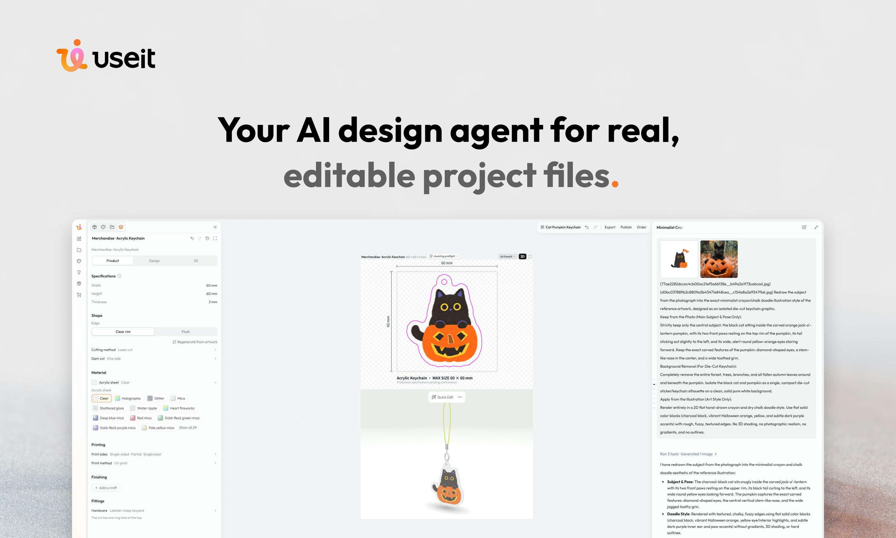

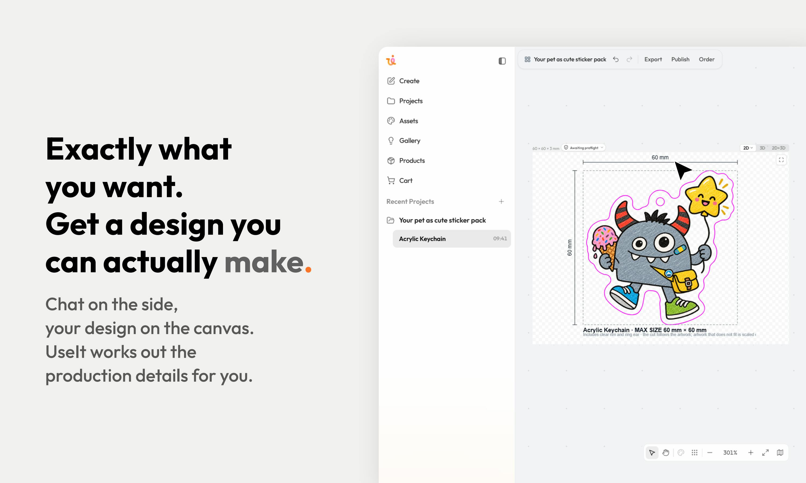

### 🎬 관련 영상
- [🎥 영상 보기](https://ph-files.imgix.net/7d59c7ca-92b9-417d-bd34-b4dd52d16ba0.jpeg?auto=format)

---

## 2. [BAND for Developers](https://www.producthunt.com/products/band)
**Votes**: 220 | **도입 난이도**: 중 | **신뢰도**: 상
**Tagline**: Coding agents, meet teamwork
**서비스 링크**: https://www.producthunt.com/r/LFGJP5O6OXFYLB

**태그**: DevTool, AI-Agents, Automation, Collaboration, Agent

### 📌 이 서비스 한눈에 보기
여러 코딩 에이전트 간의 협업과 작업 조율을 자동화하는 공유 워크스페이스

### 🔑 주요 기능
- 에이전트 간의 작업 전달 및 컨텍스트 공유를 위한 공유 워크스페이스 제공
- 사용자가 중간 관리자 역할을 하지 않아도 되도록 에이전트 간 협업 지원
- 기존 개발 도구와 연동되어 에이전트가 작업하는 과정을 시각적으로 확인 가능

### 🙋 사용자에게 어떤 점이 좋은가
여러 개의 AI 코딩 에이전트를 운용할 때 발생하는 관리 복잡성을 줄이고, 에이전트들이 스스로 협업하며 개발 속도를 높일 수 있습니다.

### ✅ 지금 바로 써볼 기능
- 기존 개발 도구와 BAND의 연동성 테스트
- 에이전트 간 작업 핸드오프(Hand-off) 흐름 확인
- 사용자 개입이 필요한 의사결정 시점 테스트

### ⚠️ 사용 전 확인할 점
- 에이전트가 기존 개발 도구에서 작업할 때의 보안 및 권한 관리 확인 필요
- 여러 에이전트가 동시에 작업할 때 발생할 수 있는 충돌 관리 방식 확인

### 🧭 확인이 더 필요한 정보
현재 지원하는 구체적인 외부 개발 도구(IDE, VCS 등)의 목록과 연동 방식에 대한 상세 정보가 필요합니다.

### 📸 스크린샷 및 갤러리
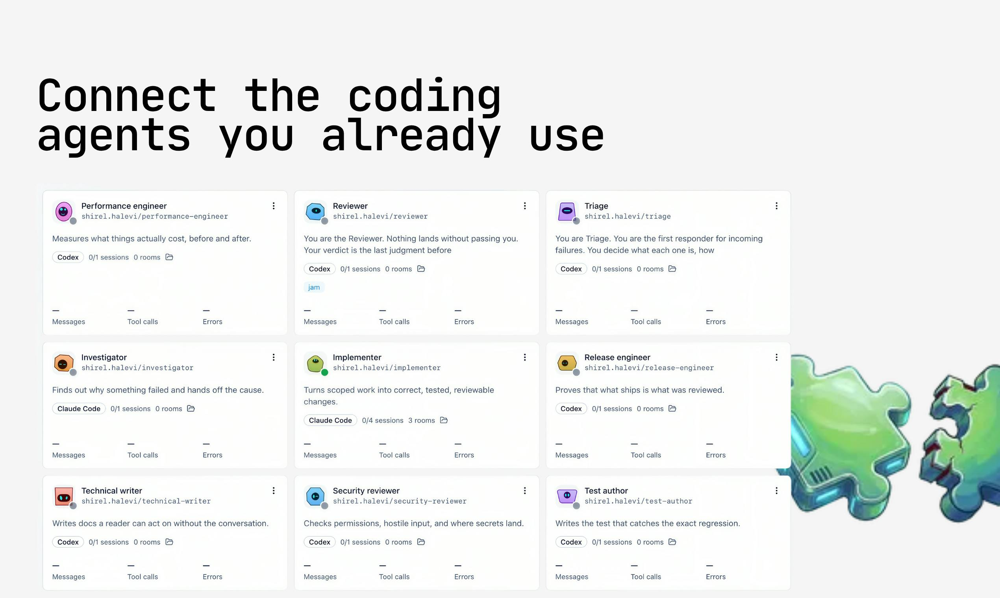
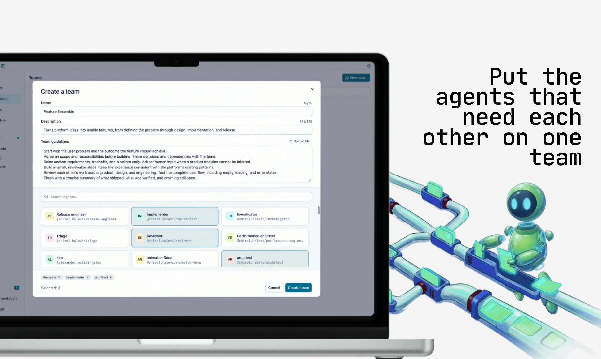
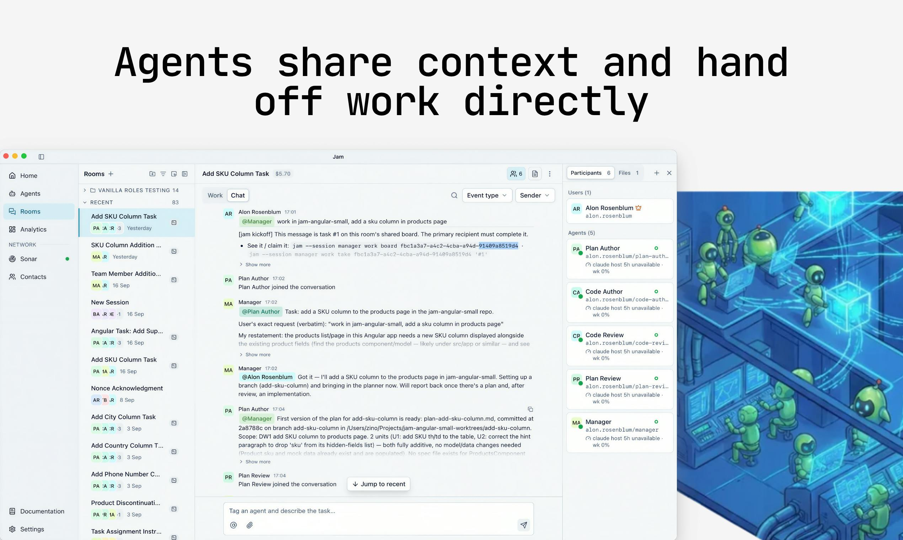

### 🎬 관련 영상
- [🎥 영상 보기](https://ph-files.imgix.net/c8f42ee1-18fa-4128-b2c8-42f3d102ba13.jpeg?auto=format)

---

## 3. [Needle](https://www.producthunt.com/products/needle-3)
**Votes**: 215 | **도입 난이도**: 하 | **신뢰도**: 상
**Tagline**: The agent-native outbound engine
**서비스 링크**: https://www.producthunt.com/r/E6AZ74Q5YPL2B5

**태그**: Sales Automation, AI, Lead Generation, Marketing, Agent, AI Tool, Chat, Prompting, Email

### 📌 이 서비스 한눈에 보기
AI 프롬프트만으로 잠재 고객 발굴부터 아웃바운드 영업까지 자동화하는 엔진

### 🔑 주요 기능
- Claude, ChatGPT, Grok 등 주요 AI 모델을 활용한 타겟팅
- LinkedIn, Instagram, 이메일을 아우르는 멀티 채널 아웃바운드
- 사용자 정의 프롬프트를 통한 정교한 리드 발굴

### 🙋 사용자에게 어떤 점이 좋은가
영업 담당자가 일일이 리드를 찾고 메시지를 보내는 번거로움 없이, 자연어 명령만으로 타겟 고객에게 접근할 수 있습니다.

### ✅ 지금 바로 써볼 기능
- AI 프롬프트를 활용한 타겟 리드 추출 테스트
- LinkedIn 및 Instagram 연동 설정
- 채널별 맞춤형 아웃바운드 메시지 생성

### ⚠️ 사용 전 확인할 점
- AI 생성 메시지의 스팸 판정 가능성 주의
- 각 소셜 플랫폼의 API 정책 및 계정 보안 정책 확인 필요

### 🧭 확인이 더 필요한 정보
플랫폼별 자동화 메시지 발송의 구체적인 제약 사항과 계정 차단 위험성에 대한 확인이 필요합니다.

### 📸 스크린샷 및 갤러리

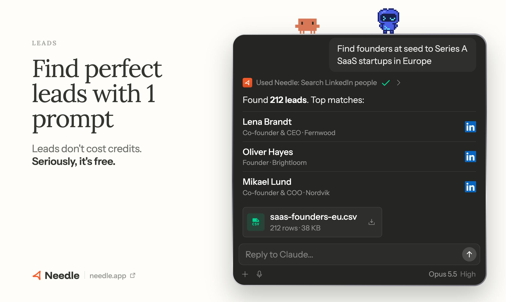
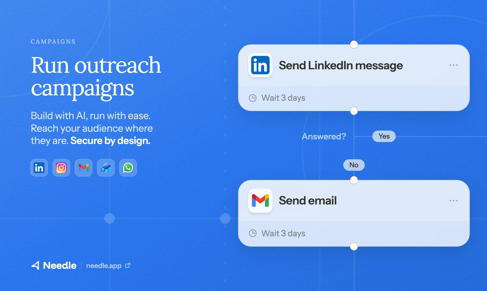

### 🎬 관련 영상
- [🎥 영상 보기](https://ph-files.imgix.net/3571ea13-42cf-4e76-b317-2ffec62c1ea1.jpeg?auto=format)
- [🎥 영상 보기](https://ph-files.imgix.net/2284dec3-3e6e-4750-828d-9721dd2acb7f.jpeg?auto=format)

---

## 4. [The Library](https://www.producthunt.com/products/querri)
**Votes**: 162 | **도입 난이도**: 중 | **신뢰도**: 상
**Tagline**: Your business context organized by queries
**서비스 링크**: https://www.producthunt.com/r/XZ6RB34WYUJWIN

**태그**: Analytics, Data Management, Business Intelligence, AI

### 📌 이 서비스 한눈에 보기
비즈니스 질문과 맥락을 학습하여 신뢰할 수 있는 답변을 제공하는 데이터 라이브러리

### 🔑 주요 기능
- 비즈니스 질문 중심의 데이터 조직화
- 기업 고유의 정의 및 분석 맥락 학습
- 환각 현상을 방지하는 신뢰 기반의 답변 체계

### 🙋 사용자에게 어떤 점이 좋은가
데이터가 파편화된 환경에서도 기업의 실제 업무 방식에 맞춘 일관된 분석 결과를 얻을 수 있습니다.

### ✅ 지금 바로 써볼 기능
- 기존 비즈니스 질문 데이터 입력하기
- 기업 고유의 용어 및 정의 설정하기
- 과거 분석 데이터 연동하여 맥락 학습시키기

### ⚠️ 사용 전 확인할 점
- 데이터 보안 및 프라이버시 정책 확인 필요
- 기존 데이터 소스와의 연동 방식 확인 필요

### 🧭 확인이 더 필요한 정보
구체적인 데이터 소스 연동 범위와 보안 아키텍처에 대한 정보가 부족합니다.

### 📸 스크린샷 및 갤러리
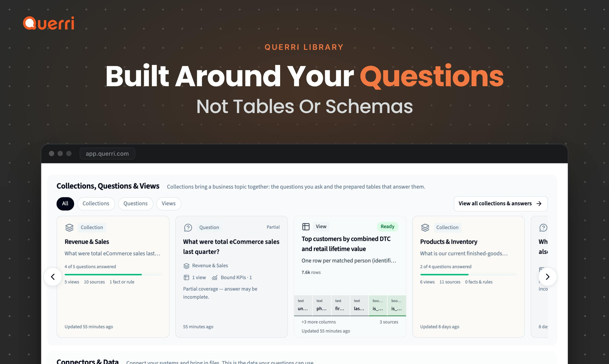
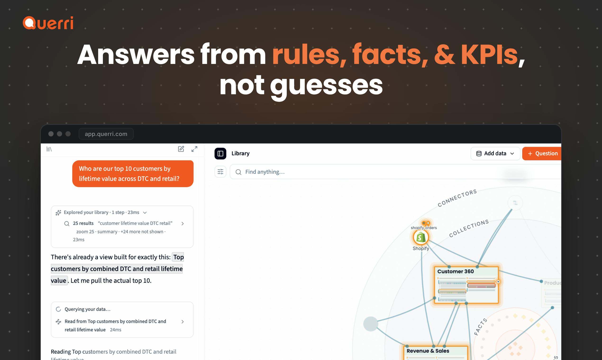
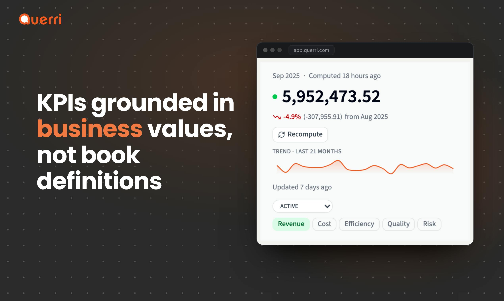

### 🎬 관련 영상
- [🎥 영상 보기](https://ph-files.imgix.net/1fb61d2d-aafe-43b1-be89-e30754f0b989.jpeg?auto=format)

---

## 5. [TwinMind for Desktop](https://www.producthunt.com/products/twinmind)
**Votes**: 122 | **도입 난이도**: 하 | **신뢰도**: 상
**Tagline**: Transcribe meetings and dictate anywhere on Mac & Windows
**서비스 링크**: https://www.producthunt.com/r/QXPYLTASWW6C47

**태그**: Productivity, AI, Transcription, Automation, AI Tool

### 📌 이 서비스 한눈에 보기
회의 자동 기록부터 어디서든 가능한 음성 받아쓰기까지, 데스크톱용 올인원 AI 비서

### 🔑 주요 기능
- Zoom, Meet, Teams 등 화상 회의 자동 감지 및 실시간 요약
- 140개 이상의 언어를 지원하는 강력한 다국어 전사 기능
- 어느 앱에서나 즉시 텍스트를 입력할 수 있는 플로팅 마이크 기능

### 🙋 사용자에게 어떤 점이 좋은가
회의 내용을 일일이 타이핑할 필요 없이 자동으로 기록하며, 업무 중 떠오르는 생각을 즉시 깔끔한 텍스트로 변환해 문서에 붙여넣을 수 있습니다.

### ✅ 지금 바로 써볼 기능
- 캘린더 연동을 통한 화상 회의 자동 참여 설정하기
- 플로팅 마이크 단축키를 설정하여 음성 받아쓰기 테스트하기
- 회의 종료 후 생성된 요약본 확인하기

### ⚠️ 사용 전 확인할 점
- 데스크톱 네이티브 앱이므로 OS 권한(마이크, 화면 기록 등) 허용이 필요함
- 음성 입력 시 주변 소음 환경에 따라 정확도가 달라질 수 있음

### 🧭 확인이 더 필요한 정보
데스크톱 앱의 상세한 시스템 리소스 점유율 및 보안 정책에 대한 정보가 부족합니다.

### 📸 스크린샷 및 갤러리
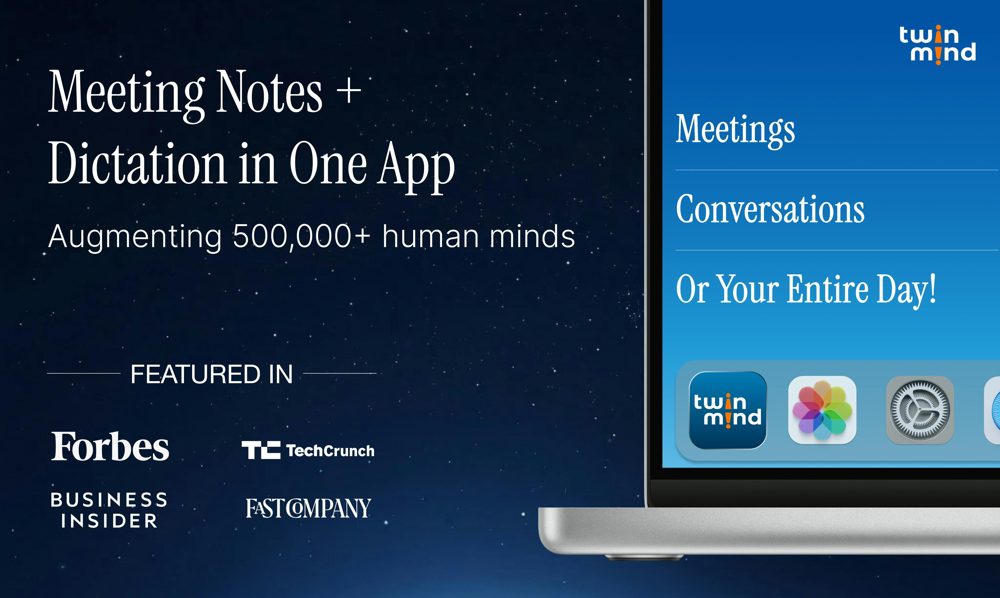
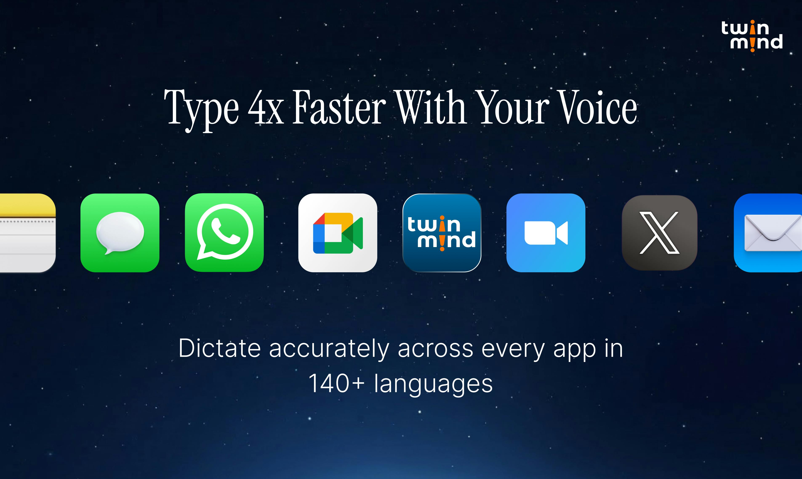

### 🎬 관련 영상
- [🎥 영상 보기](https://ph-files.imgix.net/304b1784-541a-4fc5-8baa-af993c510a31.jpeg?auto=format)

---

## 6. [Notion Auto](https://www.producthunt.com/products/notion-99)
**Votes**: 109 | **도입 난이도**: 중 | **신뢰도**: 상
**Tagline**: Notion’s rebuilt Agents run for hours and cost far less
**서비스 링크**: https://www.producthunt.com/r/4KEI3HQ75GHV52

**태그**: Automation, AI, Productivity, Notion, Agent, AI Tool, Chat

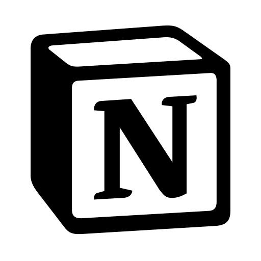

### 📌 이 서비스 한눈에 보기
24시간 연속 실행이 가능한 저비용·고효율 Notion AI 에이전트 자동화 솔루션

### 🔑 주요 기능
- 24시간 이상 지속 가능한 에이전트 하네스 구조로 재설계
- 작업별 최적 모델 자동 라우팅을 통한 비용 절감 (Opus 5.5/Astra 대비 약 90% 저렴)
- 브라우저 제어 및 'Review for me' 안전 모드 탑재

### 🙋 사용자에게 어떤 점이 좋은가
복잡한 작업을 장시간 자동화하면서도 비용 부담을 획기적으로 줄이고, 안전 모드를 통해 AI 작업의 신뢰성을 확보할 수 있습니다.

### ✅ 지금 바로 써볼 기능
- 새로운 크레딧 시스템을 통한 AI 사용량 확인
- 장시간 실행이 필요한 자동화 작업 설정
- 안전한 작업 수행을 위한 'Review for me' 모드 테스트

### ⚠️ 사용 전 확인할 점
- 신규 고객 대상으로 우선 제공되는 기능임
- 모델 성능이 특정 벤치마크 대비 90% 비용 절감을 목표로 하므로 작업 품질 확인 필요

### 🧭 확인이 더 필요한 정보
사용자별 구체적인 크레딧 소모량과 작업 성공률에 대한 상세 데이터가 필요합니다.

### 📸 스크린샷 및 갤러리
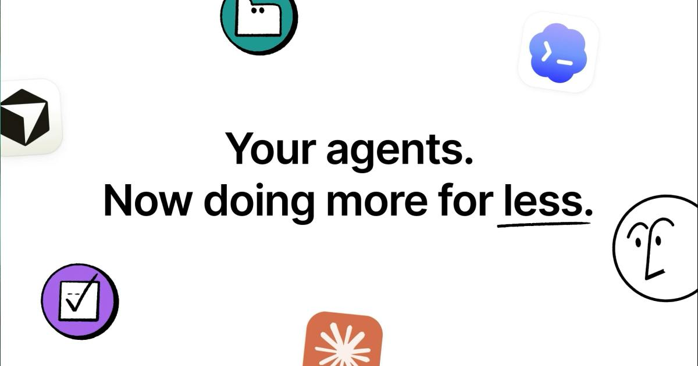
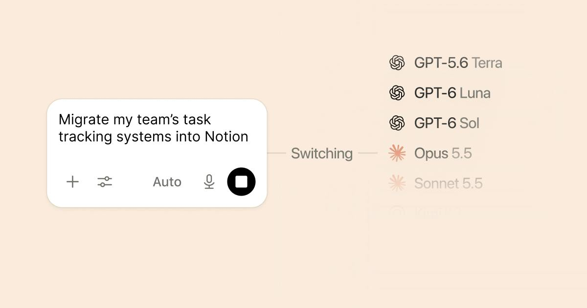

### 🎬 관련 영상
- [🎥 영상 보기](https://ph-files.imgix.net/5ced29a9-2d07-4105-8e21-6a231c3cd724.jpeg?auto=format)

---

## 7. [NativeShip](https://www.producthunt.com/products/nativeship)
**Votes**: 100 | **도입 난이도**: 하 | **신뢰도**: 상
**Tagline**: The easy way to launch your n8n native integration
**서비스 링크**: https://www.producthunt.com/r/B6J24ZLZVUNQHL

**태그**: DevTool, Automation, SaaS, n8n, Integration, AI Tool, API

### 📌 이 서비스 한눈에 보기
기존 API를 활용해 복잡한 코딩 없이 n8n 네이티브 통합 노드를 구축하고 배포하는 도구

### 🔑 주요 기능
- 기존 API를 기반으로 n8n 가이드라인을 준수하는 공식 노드 생성
- GitHub 및 npm을 통한 원클릭 배포 및 유지보수 자동화
- 라이브 프리뷰를 통한 노드 형태 설계 및 릴리스 추적 기능

### 🙋 사용자에게 어떤 점이 좋은가
SaaS 팀이 별도의 개발 공수 없이도 자사 서비스를 n8n 생태계에 빠르게 통합하여 사용자들에게 자동화 편의성을 제공할 수 있습니다.

### ✅ 지금 바로 써볼 기능
- 기존 API를 연결하여 노드 생성 테스트하기
- 라이브 프리뷰 기능을 통해 노드 동작 확인하기
- GitHub/npm 연동을 통한 원클릭 배포 프로세스 경험하기

### ⚠️ 사용 전 확인할 점
- 기존 API의 품질과 구조에 따라 생성되는 노드의 완성도가 결정될 수 있음
- n8n의 공식 가이드라인을 충족하는지 별도의 검증 과정이 필요할 수 있음

### 🧭 확인이 더 필요한 정보
사용자의 기존 API 사양에 따른 자동 생성 범위와 커스텀 수정 가능 범위에 대한 상세 정보가 필요합니다.

### 📸 스크린샷 및 갤러리
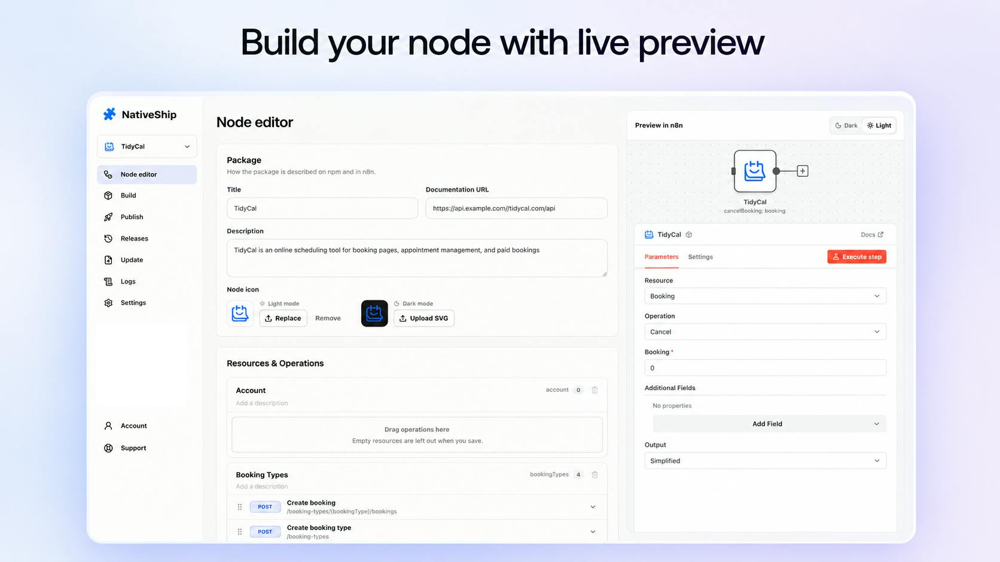
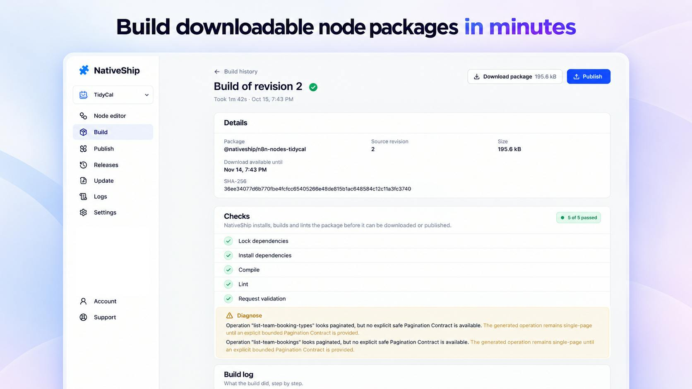
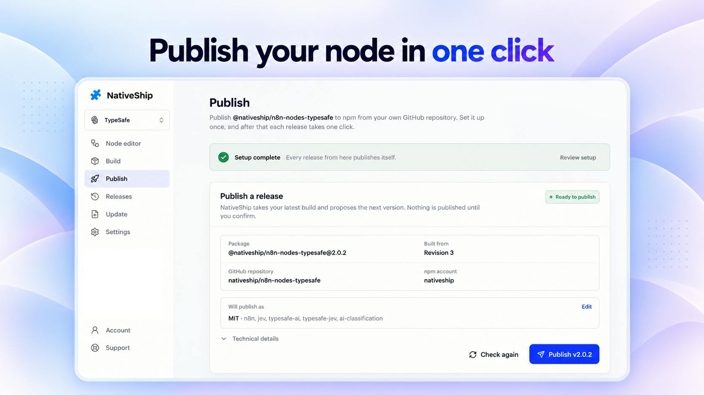

### 🎬 관련 영상
- [🎥 영상 보기](https://ph-files.imgix.net/0429aaad-5380-4931-a592-bf53306ca10e.jpeg?auto=format)

---

## 8. [The Brains](https://www.producthunt.com/products/the-brains)
**Votes**: 98 | **도입 난이도**: 하 | **신뢰도**: 상
**Tagline**: Founders and investors as MCP servers, every answer cited
**서비스 링크**: https://www.producthunt.com/r/CG23RXF55QJIVC

**태그**: AI, Productivity, KnowledgeBase, DevTool, AI Tool, Chat

### 📌 이 서비스 한눈에 보기
유명 창업가와 투자자의 인사이트를 AI 도구에서 즉시 검색할 수 있는 MCP 서버 서비스

### 🔑 주요 기능
- 창업가 및 투자자의 공개 강연, 에세이, 인터뷰 데이터를 기반으로 구축된 MCP 서버
- Claude, Cursor, ChatGPT 등 주요 AI 도구 내에서 직접 질문 가능
- 모든 답변에 출처와 링크를 제공하여 정보의 신뢰성 확보

### 🙋 사용자에게 어떤 점이 좋은가
전문가들의 검증된 지식을 별도의 검색 없이 AI 작업 흐름 안에서 즉시 인용하고 활용할 수 있습니다.

### ✅ 지금 바로 써볼 기능
- 자신의 AI 도구(Claude, Cursor 등)에 MCP 서버 연결하기
- 관심 있는 창업가의 'Brain' URL 접속하여 질문해보기
- 제공되는 출처 링크를 통해 원문 내용 확인하기

### ⚠️ 사용 전 확인할 점
- 공식적인 서비스가 아닌 비공식(unofficial) 데이터 기반이므로 해석의 차이가 있을 수 있음
- 데이터 소스가 공개된 자료에 한정되어 있어 최신 정보 반영 여부 확인 필요

### 🧭 확인이 더 필요한 정보
현재 37개의 'Brain'이 제공되고 있으나, 향후 데이터 업데이트 주기와 확장 계획은 명시되지 않았습니다.

### 📸 스크린샷 및 갤러리

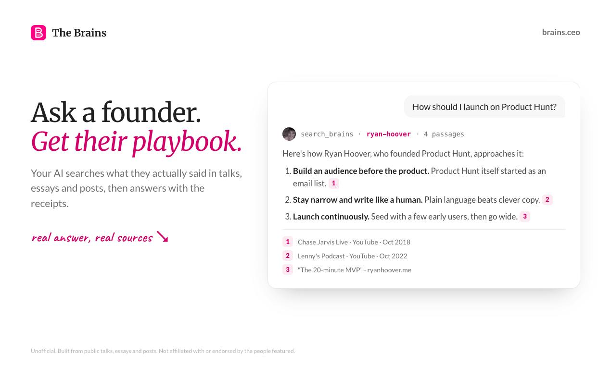
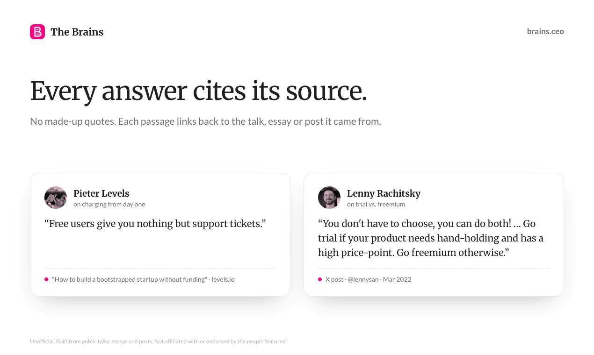

### 🎬 관련 영상
- [🎥 영상 보기](https://ph-files.imgix.net/9628699d-8823-45bc-9794-9c76ec8c4e6f.gif?auto=format)

---

## 9. [Flagsmith Experiments](https://www.producthunt.com/products/flagsmith)
**Votes**: 98 | **도입 난이도**: 중 | **신뢰도**: 상
**Tagline**: Open-source A/B testing built on your feature flags
**서비스 링크**: https://www.producthunt.com/r/HG6UZLGHTKARDU

**태그**: DevTool, A/B Testing, OpenSource, Analytics

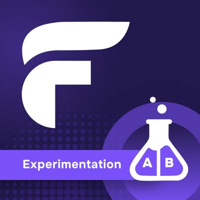

### 📌 이 서비스 한눈에 보기
기존 피처 플래그를 활용해 즉시 A/B 테스트를 수행할 수 있는 오픈소스 실험 도구

### 🔑 주요 기능
- 기존에 사용 중인 피처 플래그를 기반으로 A/B 테스트 실행
- 베이지안 통계 모델을 통한 변형(variant) 승패 판정
- 관리형 웨어하우스 또는 자체 ClickHouse/Databricks 연동 지원

### 🙋 사용자에게 어떤 점이 좋은가
별도의 복잡한 실험 환경 구축 없이 기존 플래그에 지표만 연결하여 데이터 기반의 의사결정을 빠르게 내릴 수 있습니다.

### ✅ 지금 바로 써볼 기능
- 기존 피처 플래그와 연동하여 실험 환경 설정하기
- 측정할 핵심 지표(Metric) 정의 및 연결하기
- 베이지안 분석 결과 확인 및 변형 적용하기

### ⚠️ 사용 전 확인할 점
- 데이터 웨어하우스(ClickHouse, Databricks 등) 연동 시 데이터 동기화 설정 필요
- 기존 플래그에 축적된 데이터가 충분해야 신뢰도 있는 결과 도출 가능

### 🧭 확인이 더 필요한 정보
사용자의 데이터 웨어하우스 환경에 따른 구체적인 연동 난이도와 비용 구조를 확인해야 합니다.

### 📸 스크린샷 및 갤러리
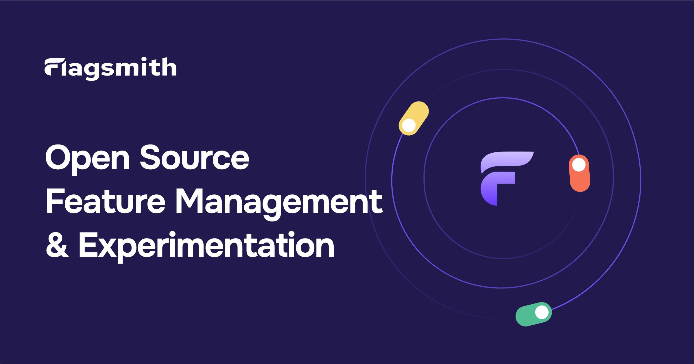
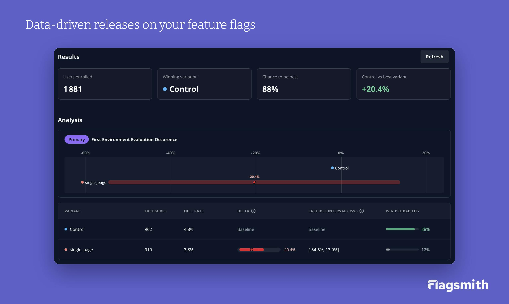
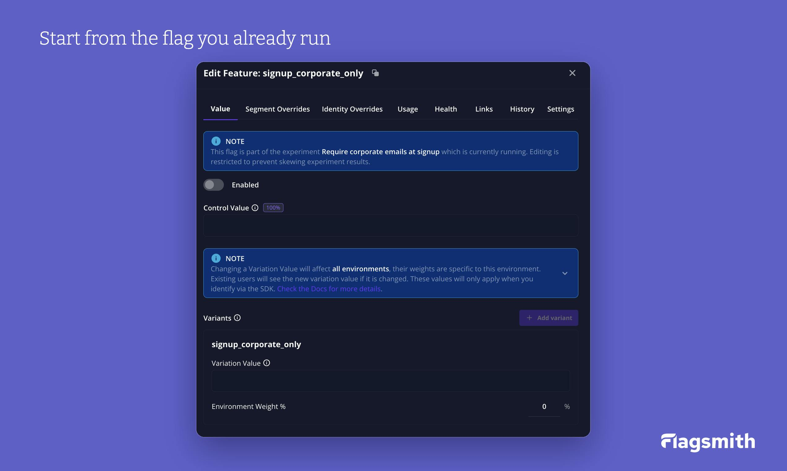

### 🎬 관련 영상
- [🎥 영상 보기](https://ph-files.imgix.net/e79a43d0-ed60-454f-9c0b-997880564d06.jpeg?auto=format)

---

## 10. [Mouse-1](https://www.producthunt.com/products/mouse-1)
**Votes**: 95 | **도입 난이도**: 중 | **신뢰도**: 상
**Tagline**: A decision model for your agent harness. 
**서비스 링크**: https://www.producthunt.com/r/VEIHFRCENLV2MR

**태그**: AI-Agent, Automation, DevTool, Cost-Optimization, Agent, AI Tool

### 📌 이 서비스 한눈에 보기
에이전트의 수많은 미세 의사결정을 저비용·고속으로 처리하는 전용 모델

### 🔑 주요 기능
- 에이전트 워크플로우 내 미세 의사결정 자동화
- 기존 스택에 모델을 직접 추가하는 방식의 통합 구조
- GPT-6 Sol 대비 163배 저렴하고 65배 빠른 성능

### 🙋 사용자에게 어떤 점이 좋은가
메인 모델은 복잡한 추론에 집중하고, Mouse-1은 단순 선택지를 처리함으로써 전체 에이전트 운영 비용을 획기적으로 절감할 수 있습니다.

### ✅ 지금 바로 써볼 기능
- 현재 사용 중인 에이전트 하네스 구조 확인
- 에이전트의 상태 및 옵션 데이터 형식 검토
- 기존 프론티어 모델과의 병행 운용 테스트

### ⚠️ 사용 전 확인할 점
- 에이전트 하네스에 직접 통합해야 하는 기술적 요구사항 존재
- 미세 의사결정 외의 복잡한 추론 작업에는 적합하지 않음

### 🧭 확인이 더 필요한 정보
현재 사용 중인 기술 스택과의 구체적인 호환성 및 통합 방식에 대한 상세 문서가 필요합니다.

### 📸 스크린샷 및 갤러리

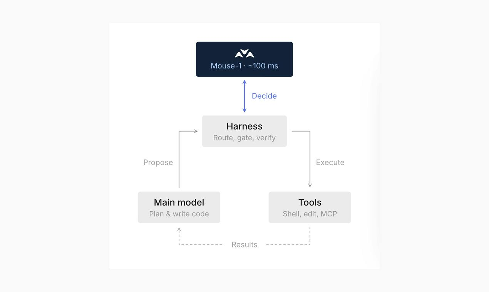

### 🎬 관련 영상
- [🎥 영상 보기](https://ph-files.imgix.net/2937752f-6c56-4ce4-a79b-c9876ed2481a.jpeg?auto=format)

---

## 11. [ilha](https://www.producthunt.com/products/ilha)
**Votes**: 89 | **도입 난이도**: 하 | **신뢰도**: 상
**Tagline**: Your Claude Code and Codex limits, live in the notch
**서비스 링크**: https://www.producthunt.com/r/RMNLSDA5FUZWRY

**태그**: DevTool, Productivity, AI, MacApp, API

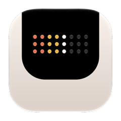

### 📌 이 서비스 한눈에 보기
Claude Code 및 Grok 등 AI 모델의 사용량 제한을 맥 노치에서 실시간으로 관리하는 도구

### 🔑 주요 기능
- 맥 노치(또는 메뉴바)에 상주하며 AI 모델별 사용량 및 리셋 시간 실시간 표시
- 사용량 한도 도달 전, 계정 로그아웃 없이 CLI를 다른 계정으로 자동 전환
- API 요금 기반의 주간 프로젝트별 비용 분석 인사이트 제공

### 🙋 사용자에게 어떤 점이 좋은가
AI 모델의 사용량 제한(Quota)을 직관적으로 확인하고, 여러 계정을 효율적으로 스위칭하며 비용을 관리할 수 있습니다.

### ✅ 지금 바로 써볼 기능
- 노치/메뉴바 위젯을 통한 실시간 사용량 모니터링
- 한도 도달 전 계정 자동 전환 기능 활용
- 주간 프로젝트별 API 비용 분석 리포트 확인

### ⚠️ 사용 전 확인할 점
- 여러 계정 사용 시 CLI 환경과의 호환성 확인 필요
- 사용 중인 AI 서비스(Claude, Grok 등)의 API 정책 준수 여부 확인

### 🧭 확인이 더 필요한 정보
계정 전환 시 CLI 환경에서 세션이나 인증 정보가 어떻게 처리되는지에 대한 상세 기술 사양 확인이 필요합니다.

### 📸 스크린샷 및 갤러리
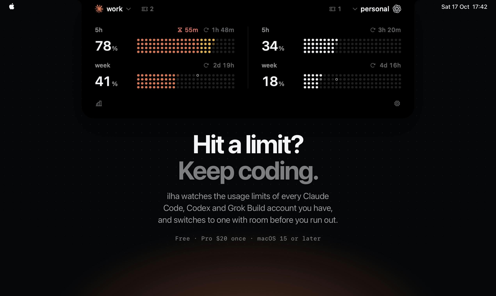
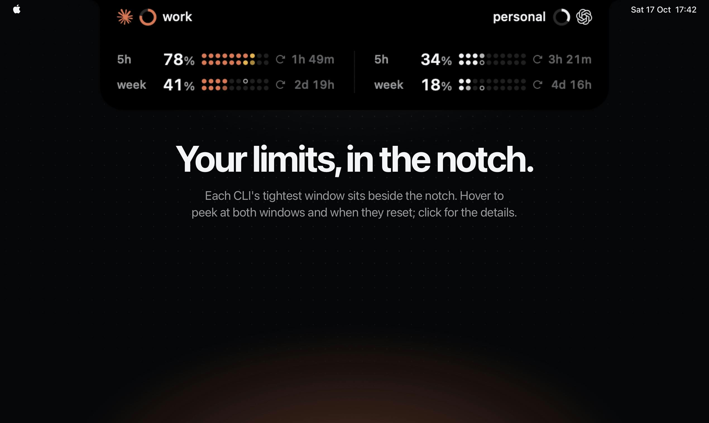
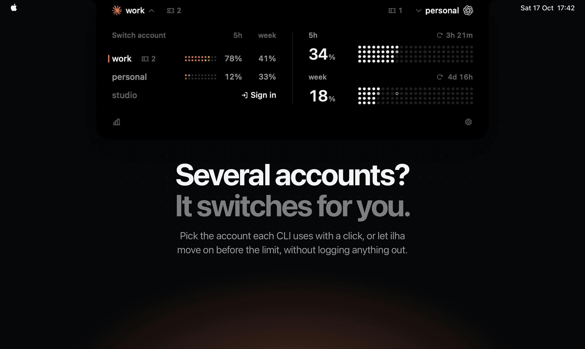

---

## 12. [Agent Pets](https://www.producthunt.com/products/agent-pets)
**Votes**: 88 | **도입 난이도**: 하 | **신뢰도**: 상
**Tagline**: Coding agents as pets that live on every page in Chrome
**서비스 링크**: https://www.producthunt.com/r/F6DOLNMBPH7YNL

**태그**: DevTool, Productivity, AI-Agent, Chrome-Extension, Agent

### 📌 이 서비스 한눈에 보기
브라우저 하단에서 살아 움직이는 코딩 에이전트 펫

### 🔑 주요 기능
- Claude Code, OpenCode 등 세션별 에이전트를 귀여운 펫 형태로 시각화
- 계정 생성이나 클라우드 없이 로컬 컴퓨터에서 실행되는 프라이버시 중심 설계
- 어느 탭에서든 에이전트의 명령을 승인하거나 즉시 답장 가능

### 🙋 사용자에게 어떤 점이 좋은가
코딩 에이전트의 작업 상태를 직관적으로 확인하고, 브라우저 어디서든 간편하게 에이전트와 상호작용할 수 있습니다.

### ✅ 지금 바로 써볼 기능
- Chrome 확장 프로그램 설치 및 에이전트 세션 연결
- 하단 바에 나타나는 펫의 명령 승인 및 대화 시도
- 로컬 실행 환경에서의 데이터 보안 확인

### ⚠️ 사용 전 확인할 점
- 로컬 실행 방식이므로 사용 중인 코딩 에이전트 도구와의 호환성 확인 필요
- 일회성 결제($6) 외에 추가적인 환경 설정이 필요할 수 있음

### 🧭 확인이 더 필요한 정보
사용자의 로컬 코딩 에이전트(Claude Code 등)와 구체적으로 어떻게 연동되는지에 대한 기술적 상세 정보가 필요합니다.

### 📸 스크린샷 및 갤러리
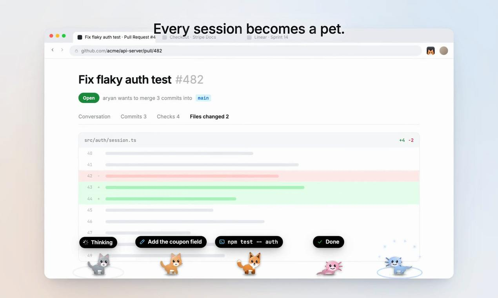
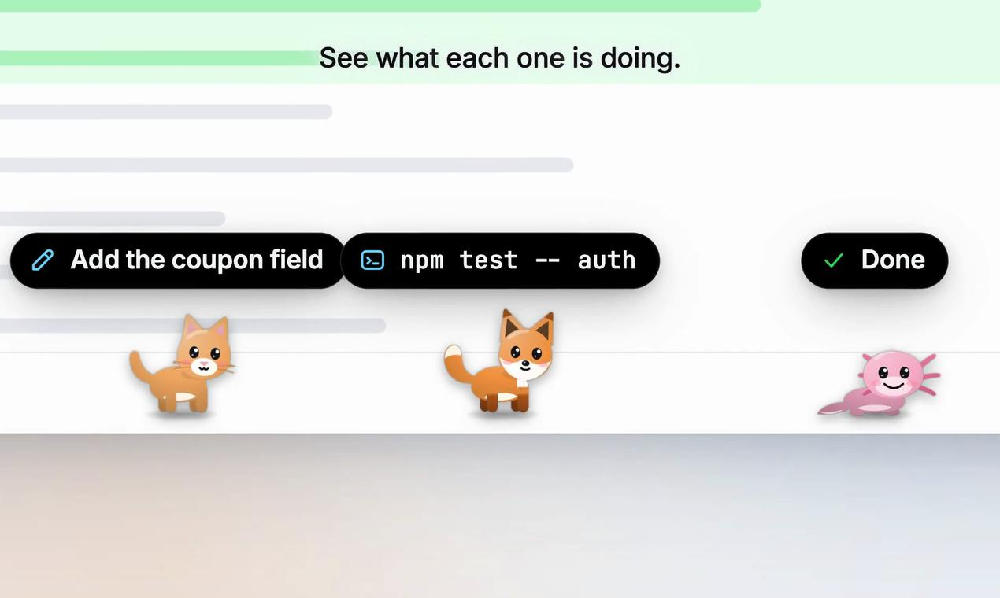
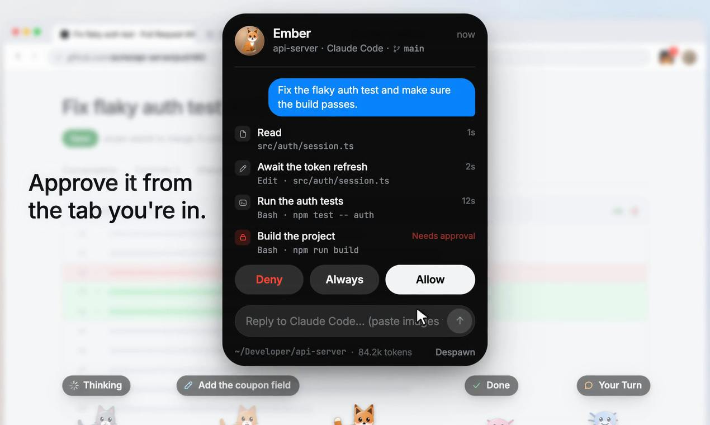

### 🎬 관련 영상
- [🎥 영상 보기](https://ph-files.imgix.net/4fbbecb3-f3f8-4da5-a0ed-a39db1e2dfa9.jpeg?auto=format)

---

## 13. [Yarite](https://www.producthunt.com/products/yarite)
**Votes**: 87 | **도입 난이도**: 하 | **신뢰도**: 상
**Tagline**: A daily list of who to call. Nothing leaves your phone.
**서비스 링크**: https://www.producthunt.com/r/GKWMOEVU2BQLZR

**태그**: Relationship Management, Privacy, Productivity, iOS, AI Tool

### 📌 이 서비스 한눈에 보기
소중한 사람들과의 관계를 놓치지 않도록 매일 아침 연락할 사람을 제안하는 프라이버시 중심의 관계 관리 앱

### 🔑 주요 기능
- 관계의 중요도에 따른 6단계 서클 관리 및 맞춤형 연락 리듬 제공
- 매일 아침 부담 없는 3명의 연락 리스트 제공
- 계정이나 서버 없이 모든 데이터가 기기에만 저장되는 철저한 프라이버시 보호

### 🙋 사용자에게 어떤 점이 좋은가
관계 관리를 숙제로 느끼지 않게 도와주며, 데이터 유출 걱정 없이 소중한 사람들과의 연결을 유지할 수 있습니다.

### ✅ 지금 바로 써볼 기능
- 중요한 지인 15명까지 무료로 등록해보기
- 관계의 거리(6단계 서클) 설정하기
- 매일 아침 제공되는 3명의 리스트 확인하기

### ⚠️ 사용 전 확인할 점
- 15명 초과 시 $9.99의 일회성 결제 필요
- 기기 기반 저장 방식이므로 기기 분실/변경 시 데이터 이전 방식 확인 필요

### 🧭 확인이 더 필요한 정보
기기 변경 시 기존 데이터(연락처, 기록 등)를 백업하거나 옮기는 기능이 있는지 명시되어 있지 않습니다.

### 📸 스크린샷 및 갤러리
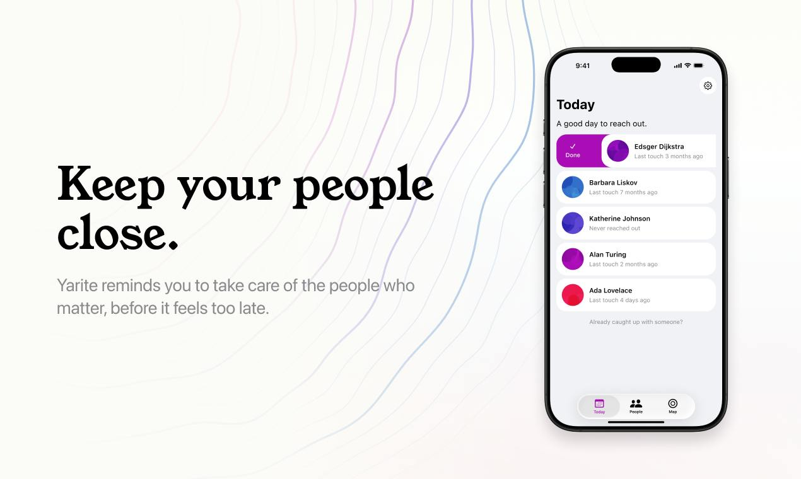
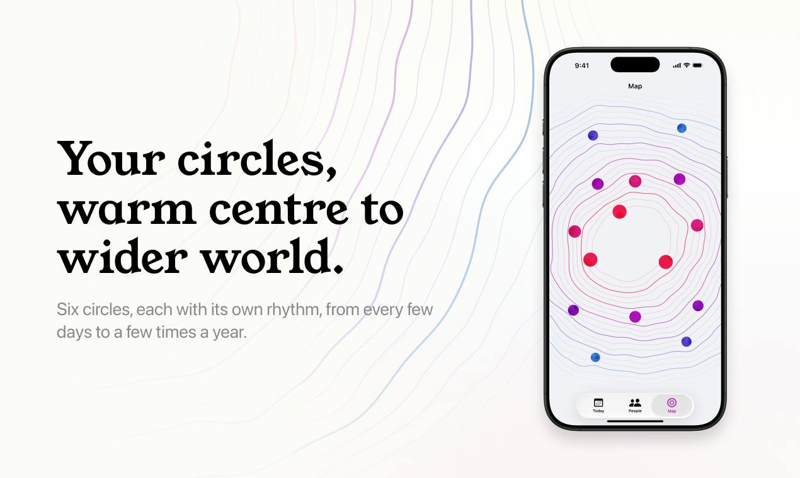
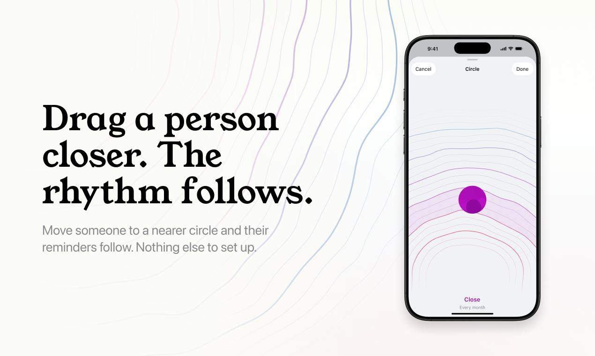

---

## 14. [Burrow MacOS](https://www.producthunt.com/products/burrow-macos)
**Votes**: 83 | **도입 난이도**: 하 | **신뢰도**: 상
**Tagline**: Start Windows & Linux on your Mac for free
**서비스 링크**: https://www.producthunt.com/r/BVBZDJF3W7M3JF

**태그**: OS, Virtualization, Productivity

### 📌 이 서비스 한눈에 보기
Mac에서 Windows 11과 Linux를 클릭 한 번으로 무료 실행하는 도구

### 🔑 주요 기능
- Mac 환경에서 Windows 11 및 Linux 즉시 실행 가능
- 원클릭 방식의 간편한 사용자 인터페이스
- 비용 부담 없는 완전 무료 솔루션

### 🙋 사용자에게 어떤 점이 좋은가
추가 비용 없이 Mac에서 Windows 전용 소프트웨어나 Linux 개발 환경을 즉시 구축할 수 있습니다.

### ✅ 지금 바로 써볼 기능
- Windows 11 설치 및 실행 테스트
- Linux 배포판 구동 확인
- Mac 하드웨어 리소스 점유율 체크

### ⚠️ 사용 전 확인할 점
- 가상화 방식에 따른 하드웨어 성능 제약 가능성
- OS 설치 및 구동 시 발생하는 보안 설정 확인 필요

### 🧭 확인이 더 필요한 정보
구체적인 가상화 기술 방식과 하드웨어 요구 사양에 대한 정보가 부족합니다.

### 📸 스크린샷 및 갤러리
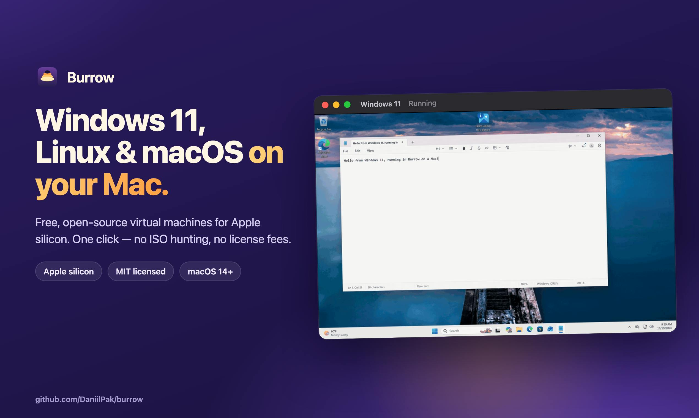
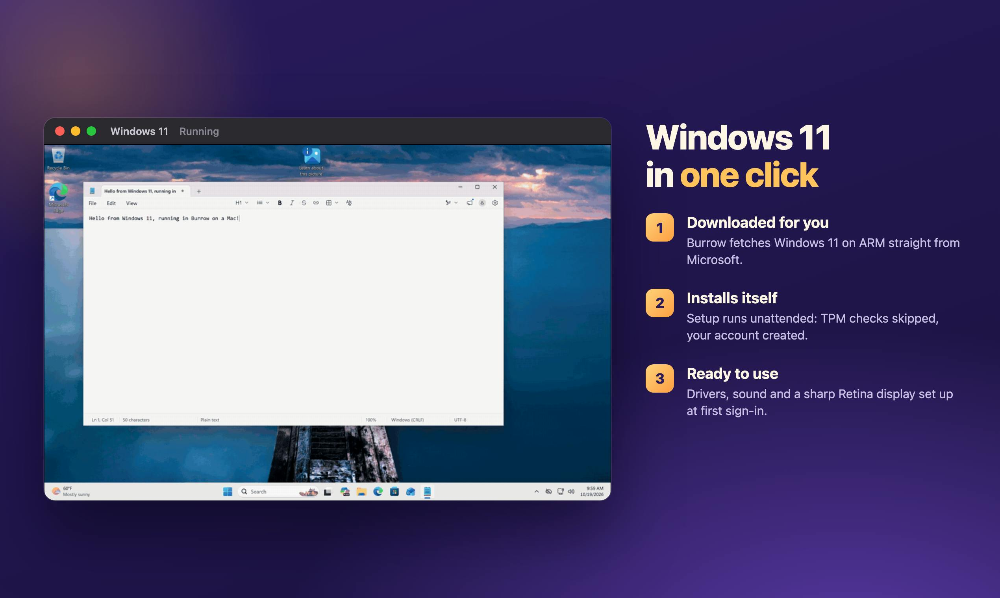
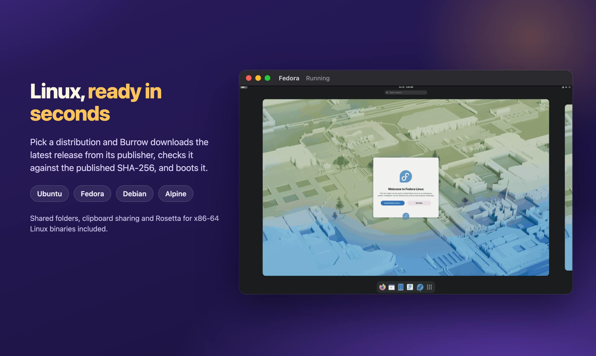

---

## 15. [iglass](https://www.producthunt.com/products/iglass)
**Votes**: 82 | **도입 난이도**: 하 | **신뢰도**: 상
**Tagline**: Liquid Glass for your iTerm2 & Ghostty
**서비스 링크**: https://www.producthunt.com/r/MEPXLK4VNJ6DEY

**태그**: DevTool, Design, Terminal, macOS, Linux

### 📌 이 서비스 한눈에 보기
iTerm2와 Ghostty 사용자를 위한 세련된 리퀴드 글래스 스타일 테마

### 🔑 주요 기능
- macOS 및 Linux용 iTerm2와 Ghostty 지원
- 4단계 유리 효과와 8가지 액센트 컬러 제공
- 모든 색상의 대비 검사 완료 및 라이트/다크 모드 지원

### 🙋 사용자에게 어떤 점이 좋은가
터미널 환경을 미적으로 아름답게 꾸미면서도, 가독성이 검증된 테마를 통해 작업 효율을 높일 수 있습니다.

### ✅ 지금 바로 써볼 기능
- 자신의 터미널(iTerm2 또는 Ghostty)에 테마 적용하기
- 8가지 액센트 컬러 중 취향에 맞는 색상 선택하기
- 명령어를 통해 테마 변경 및 복구 기능 테스트하기

### ⚠️ 사용 전 확인할 점
- 사용 중인 터미널 에뮬레이터 버전과의 호환성 확인 필요
- 글래스 효과 적용 시 시스템 리소스 사용량 확인 필요

### 🧭 확인이 더 필요한 정보
Ghostty의 특정 macOS 버전(macOS 26로 언급됨)에서의 구체적인 렌더링 성능은 확인이 필요합니다.

### 📸 스크린샷 및 갤러리
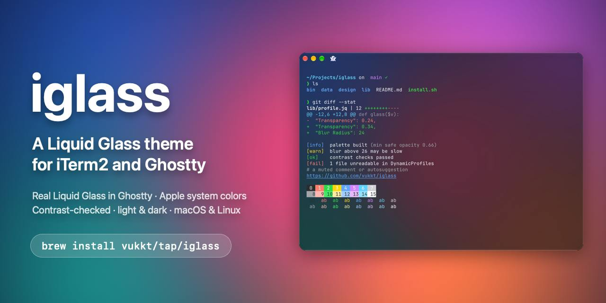
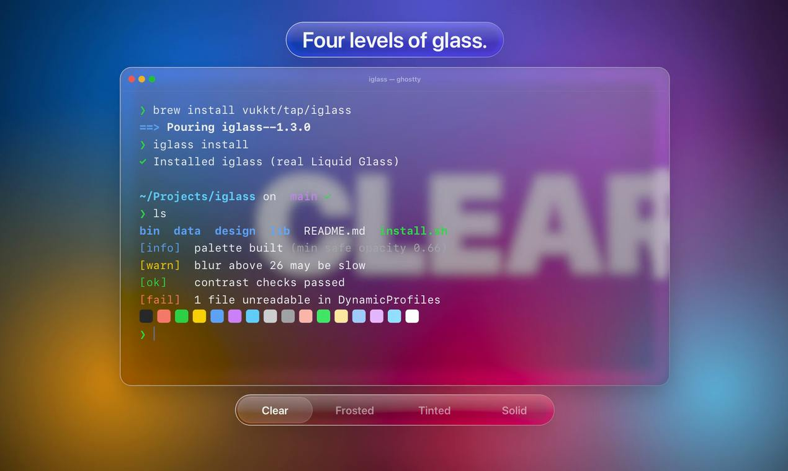
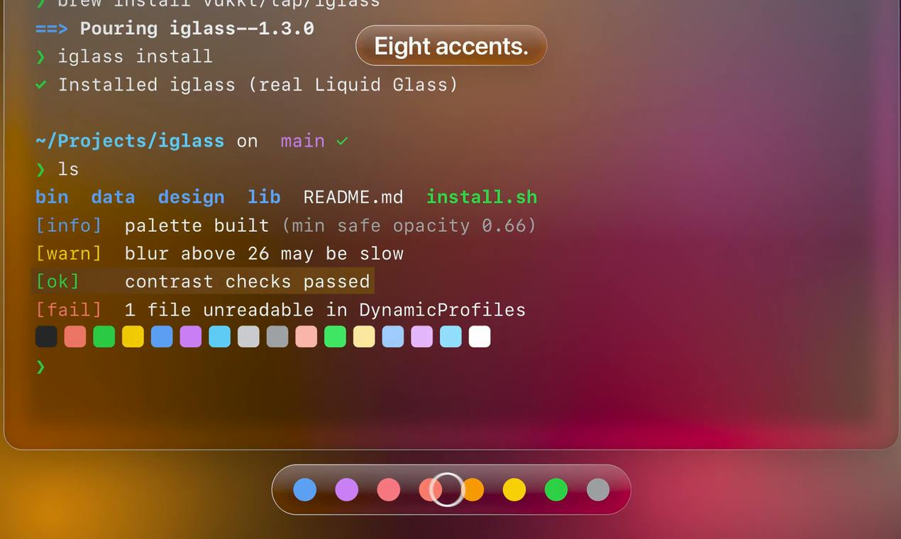

---

## 16. [Tend](https://www.producthunt.com/products/tend-5)
**Votes**: 82 | **도입 난이도**: 하 | **신뢰도**: 상
**Tagline**: Personal AI for businesses and entrepreneurs.
**서비스 링크**: https://www.producthunt.com/r/GQQZICH6NOBQAH

**태그**: AI Agent, Automation, Productivity, SaaS, Agent, AI Tool, Email

### 📌 이 서비스 한눈에 보기
iMessage와 SMS를 통해 기존 업무 툴을 제어하는 개인용 AI 에이전트

### 🔑 주요 기능
- 별도 앱 설치 없이 iMessage/SMS를 통해 대화형 인터페이스 제공
- Gmail, Shopify, HubSpot 등 기존 계정 내 업무 자동화 수행
- 사용자의 승인 후에만 실행되며, 학습 데이터는 사용자가 직접 읽고 수정 가능

### 🙋 사용자에게 어떤 점이 좋은가
새로운 앱을 익힐 필요 없이 문자 메시지만으로 이메일 답장, 일정 예약, 리드 발굴 등 복잡한 업무를 처리할 수 있습니다.

### ✅ 지금 바로 써볼 기능
- 기존 이메일/캘린더 계정 연동하기
- 자신의 말투 학습시키기
- 자동 알림 및 가격 모니터링 설정하기

### ⚠️ 사용 전 확인할 점
- 개인 계정(Gmail, Shopify 등)에 대한 접근 권한 부여 필요
- 사용자의 최종 승인 단계가 없으면 자동화가 제한될 수 있음

### 🧭 확인이 더 필요한 정보
연동 가능한 외부 서비스의 전체 목록과 보안 프로토콜에 대한 상세 정보 확인이 필요합니다.

### 📸 스크린샷 및 갤러리

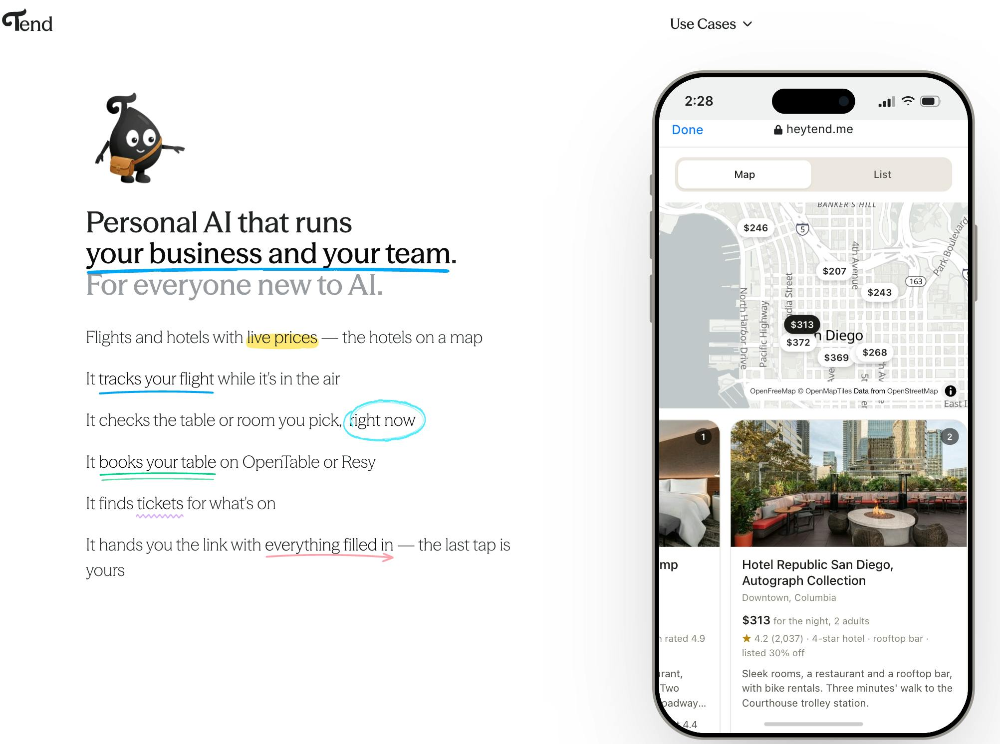
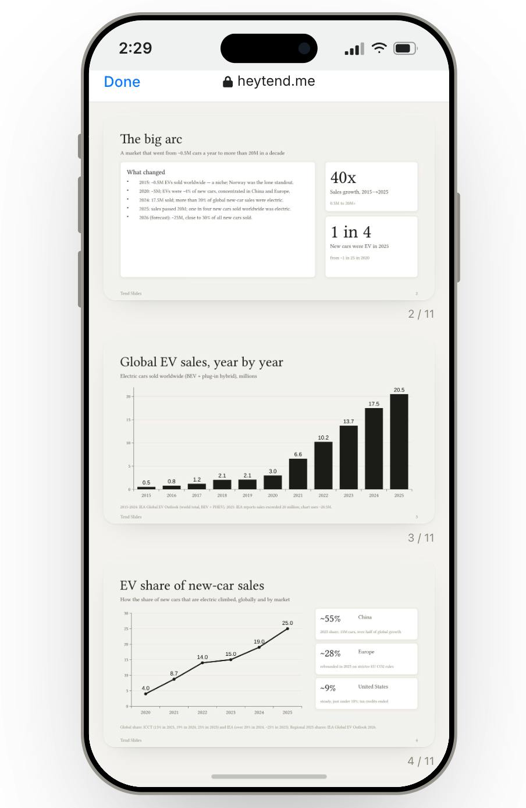

---

## 17. [Flyweel](https://www.producthunt.com/products/connect-pipedrive-to-ads-with-flyweel)
**Votes**: 81 | **도입 난이도**: 중 | **신뢰도**: 상
**Tagline**: Ad spend cards, cash-gap funding, and agent audit via MCP
**서비스 링크**: https://www.producthunt.com/r/I3UUZXCYBQGLQK

**태그**: FinTech, AdTech, AI-Agent, Automation, Agent, AI Tool

### 📌 이 서비스 한눈에 보기
AI 에이전트를 위한 광고 집행용 가상 카드 및 자금 관리 솔루션

### 🔑 주요 기능
- 광고 집행을 위한 맞춤형 한도가 설정된 가상 카드 발급
- 매출 정산 전까지 광고 운영이 끊기지 않도록 하는 캐시갭(Cash-gap) 펀딩
- MCP를 통한 AI 에이전트의 실시간 광고 비용 및 결과 감사 기능

### 🙋 사용자에게 어떤 점이 좋은가
광고 성과가 좋아도 자금 흐름 문제로 캠페인이 중단되는 것을 방지하며, AI 에이전트가 직접 비용을 관리하고 검증할 수 있습니다.

### ✅ 지금 바로 써볼 기능
- 광고 집행용 가상 카드 생성 및 한도 설정
- 자금 공백을 메우기 위한 펀딩 구조 확인
- MCP를 활용한 에이전트 감사 기능 테스트

### ⚠️ 사용 전 확인할 점
- 광고비 지출 및 자금 조달에 따른 재무적 리스크 관리 필요
- AI 에이전트의 자동 결제 권한 설정 시 보안 주의

### 🧭 확인이 더 필요한 정보
구체적인 펀딩 이자율이나 가상 카드 발급 가능한 국가/지역 정보가 명시되지 않았습니다.

### 📸 스크린샷 및 갤러리
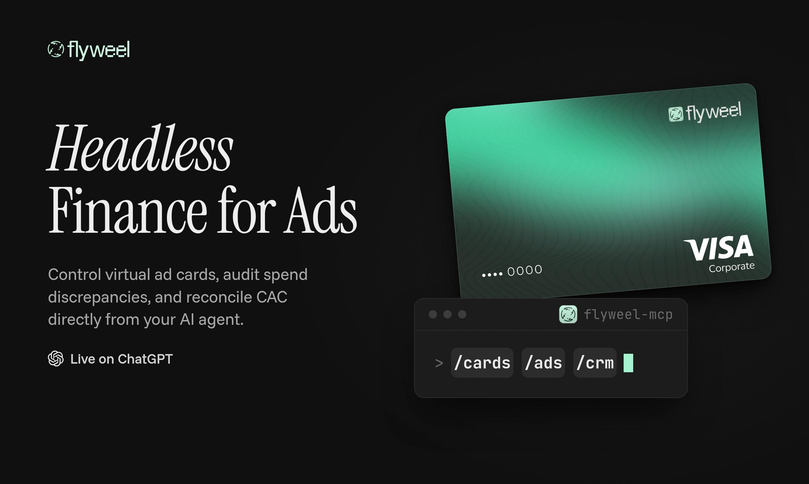
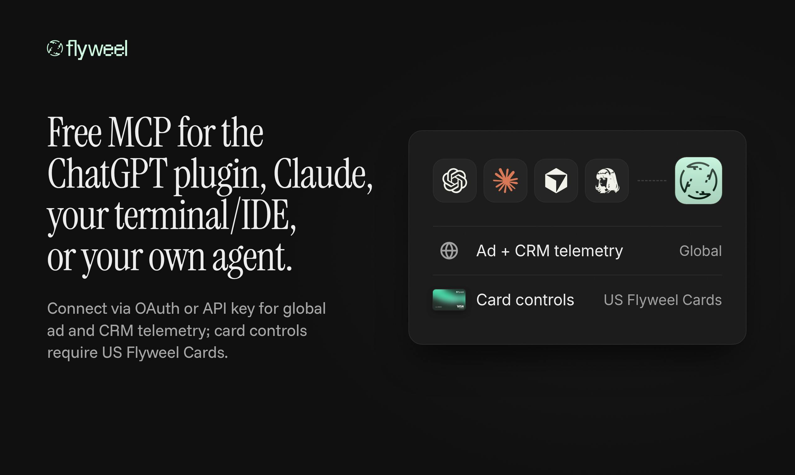
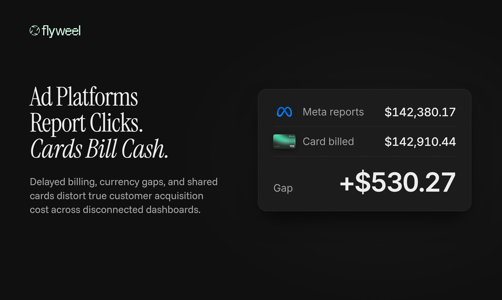

### 🎬 관련 영상
- [🎥 영상 보기](https://ph-files.imgix.net/802af650-9b96-4ec3-ac71-7b395a0e7dac.jpeg?auto=format)

---

## 18. [Hotly](https://www.producthunt.com/products/hotly)
**Votes**: 79 | **도입 난이도**: 하 | **신뢰도**: 상
**Tagline**: Get paid to answer your DMs. Open source.
**서비스 링크**: https://www.producthunt.com/r/2NZ2ILZI7KN2P5

**태그**: Monetization, Communication, OpenSource, SaaS, AI Tool

### 📌 이 서비스 한눈에 보기
DM 답변을 수익화할 수 있는 오픈소스 기반의 유료 메시징 서비스

### 🔑 주요 기능
- 메시지 전송 또는 주간 구독 모델을 통한 수익 창출
- 단일 인박스에서 편리하게 답장 가능
- 자체 서버 설치(오픈소스) 또는 호스팅 서비스 선택 가능

### 🙋 사용자에게 어떤 점이 좋은가
영향력 있는 개인이나 전문가가 자신의 시간을 가치 있게 활용하며 DM을 통한 수익을 창출할 수 있습니다.

### ✅ 지금 바로 써볼 기능
- 30일 무료 호스팅 체험하기
- 자체 서버에 오픈소스 설치해보기
- 수익 모델(일회성 결제 vs 구독) 설정하기

### ⚠️ 사용 전 확인할 점
- 수익 정산 방식(Stripe)에 따른 수수료 및 정산 정책 확인 필요
- 자체 서버 운영 시 관리 책임 발생

### 🧭 확인이 더 필요한 정보
사용자 수나 메시지 양에 따른 구체적인 호스팅 비용 체계가 명시되지 않았습니다.

### 📸 스크린샷 및 갤러리
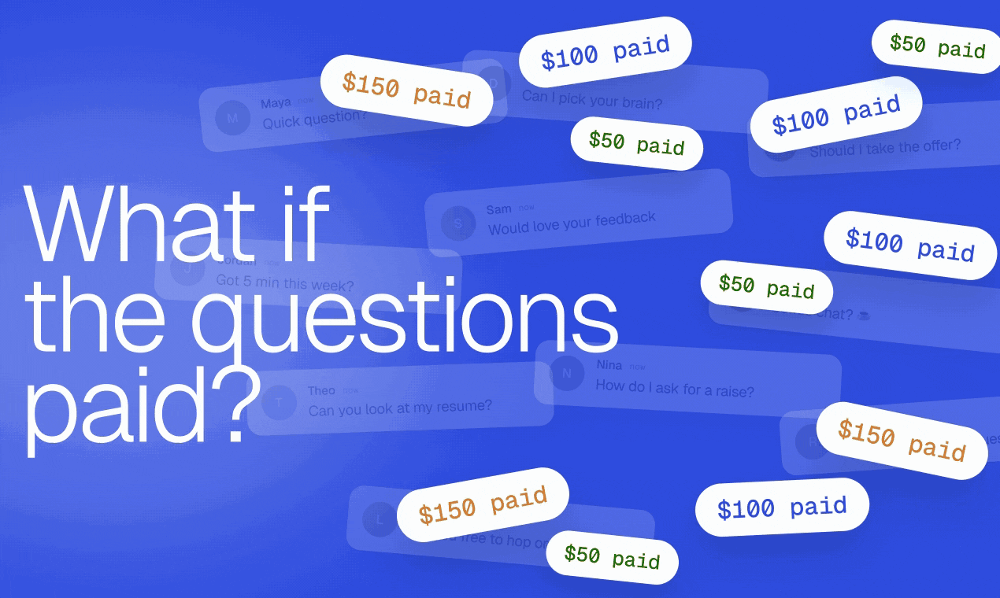
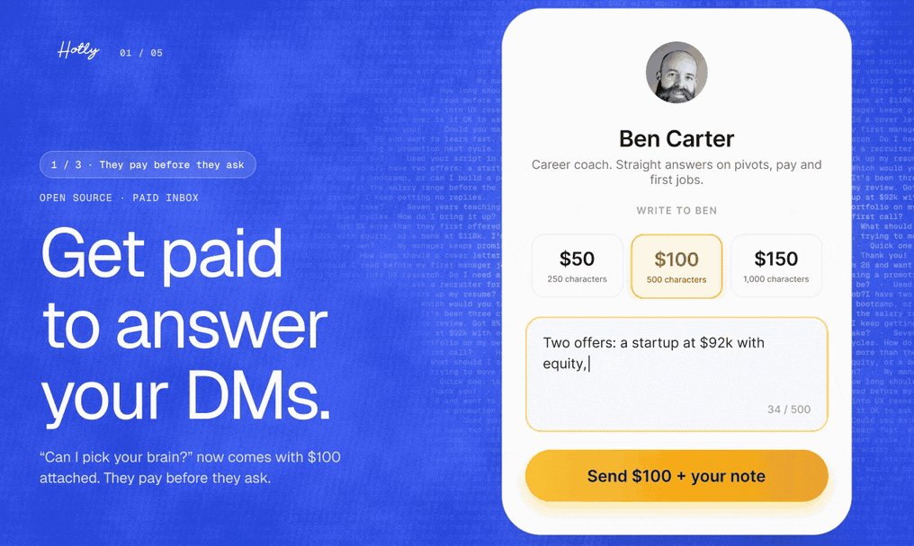
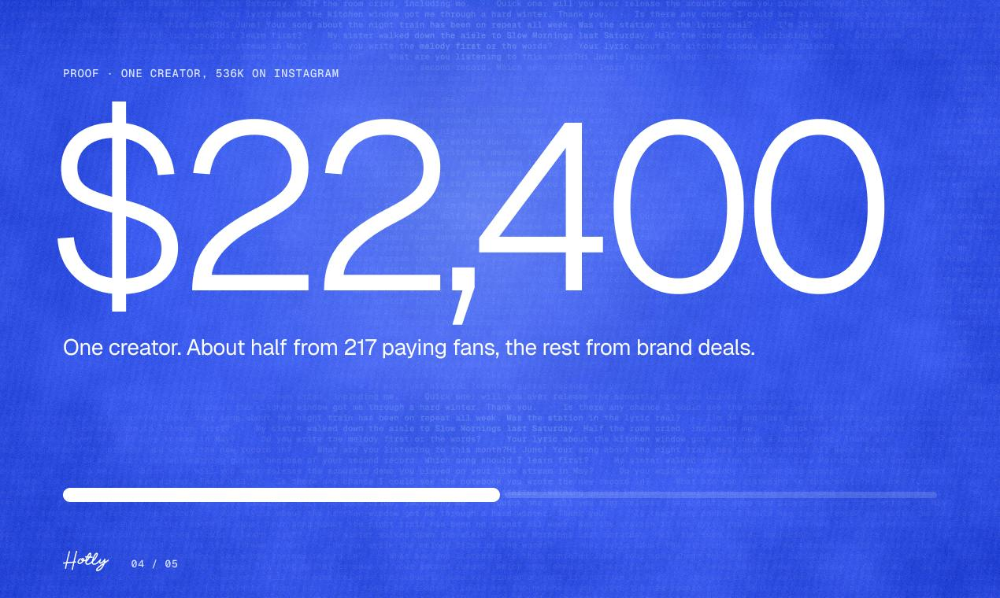

### 🎬 관련 영상
- [🎥 영상 보기](https://ph-files.imgix.net/62897e19-fc65-4ba1-a52b-ffc5994a1ce3.jpeg?auto=format)

---

## 19. [Scout by Fini](https://www.producthunt.com/products/fini-2)
**Votes**: 79 | **도입 난이도**: 중 | **신뢰도**: 상
**Tagline**: The AI coworker for support teams, on Slack
**서비스 링크**: https://www.producthunt.com/r/U24JOETA7SYRUM

**태그**: AI, Customer Support, Slack, Automation, AI Tool

### 📌 이 서비스 한눈에 보기
Slack에서 티켓과 통화 기록을 분석해 해결책을 제안하는 AI 고객 지원 동료

### 🔑 주요 기능
- Slack 내에서 자연어로 질문하고 답변을 받는 인터페이스
- 고객 티켓, 리뷰, 통화 기록 등 다양한 데이터를 분석하여 패턴 파악
- 문제 해결을 위한 초안을 작성하며, 최종 승인은 사람이 직접 수행

### 🙋 사용자에게 어떤 점이 좋은가
고객 지원 팀이 여러 채널의 데이터를 일일이 확인하는 시간을 줄이고, 자동화된 초안을 통해 문제 해결 속도를 높일 수 있습니다.

### ✅ 지금 바로 써볼 기능
- Slack에 Scout 연동하기
- 기존 고객 티켓 데이터로 패턴 분석 요청하기
- AI가 작성한 해결책 초안 검토 및 승인하기

### ⚠️ 사용 전 확인할 점
- Fini 팀을 통한 별도의 액세스 설정 과정이 필요함
- AI가 제안하는 해결책이므로 반드시 사람의 최종 검토가 필요함

### 🧭 확인이 더 필요한 정보
Fini 팀을 통한 초기 설정 방식과 구체적인 데이터 보안 정책에 대한 확인이 필요합니다.

### 📸 스크린샷 및 갤러리
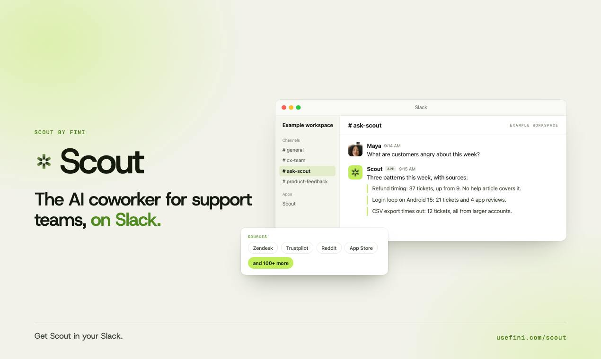

### 🎬 관련 영상
- [🎥 영상 보기](https://ph-files.imgix.net/fcd6a8db-b640-4848-9574-ed92340370f6.jpeg?auto=format)

---

## 20. [Blooio](https://www.producthunt.com/products/blooio-imessages-api-that-scales)
**Votes**: 78 | **도입 난이도**: 중 | **신뢰도**: 상
**Tagline**: Apple Messages for Business made easy
**서비스 링크**: https://www.producthunt.com/r/SU2JR6N4VETJX6

**태그**: Messaging, API, CustomerEngagement, Automation, Agent, AI Tool, CRM

### 📌 이 서비스 한눈에 보기
애플 메시지 앱 내에서 브랜드 인증을 거친 대화형 비즈니스 채널을 구축하는 통합 API 솔루션

### 🔑 주요 기능
- 애플 메시지(iMessage)를 통한 브랜드 인증 대화 및 인터랙티브 기능 제공
- 예약, 양식 작성, Apple Pay 등 풍부한 미디어와 기능 통합
- CRM, 고객 지원팀, AI 에이전트를 연결하는 단일 API 지원

### 🙋 사용자에게 어떤 점이 좋은가
기존의 단순 메시징을 넘어 고객과 신뢰할 수 있는 브랜드 대화를 나누고, 예약이나 결제 같은 복잡한 업무를 메시지 앱 안에서 즉시 해결할 수 있습니다.

### ✅ 지금 바로 써볼 기능
- 기존 CRM/지원팀 시스템과 API 연동 테스트
- 애플 메시지 내 인터랙티브 양식 및 예약 기능 구현
- Apple Pay를 활용한 결제 흐름 구축

### ⚠️ 사용 전 확인할 점
- 애플의 공식 비즈니스 채널 정책 및 승인 절차 확인 필요
- 기존 API 사용자의 경우 새로운 공식 채널로의 전환 호환성 검토

### 🧭 확인이 더 필요한 정보
애플 메시지 비즈니스 채널 승인 조건 및 구체적인 API 연동 난이도는 별도 확인이 필요합니다.

### 📸 스크린샷 및 갤러리

---

## 21. [Lea by LeanAIOS](https://www.producthunt.com/products/lea-by-leanaios)
**Votes**: 77 | **도입 난이도**: 상 | **신뢰도**: 상
**Tagline**: Autonomous AI team for construction management & pre-con
**서비스 링크**: https://www.producthunt.com/r/3JBINUIJFET5LR

**태그**: Construction, AI-Agent, Automation, Project-Management, AI Tool

### 📌 이 서비스 한눈에 보기
건설 관리 및 사전 시공을 위한 18가지 전문 역할을 갖춘 자율형 AI 팀

### 🔑 주요 기능
- 건설 총괄(GC) 및 프로젝트 매니저(PM)를 위한 특화된 AI 플랫폼
- 물량 산출(Takeoff), 계약 통지 관리, 일정 추적 등 전문 업무 자동화
- 3D 현장 리허설 및 6주 단위 일정 관리 기능 제공

### 🙋 사용자에게 어떤 점이 좋은가
반복적인 행정 업무와 복잡한 공정 관리를 AI가 대신 수행하여 건설 전문가의 업무 효율을 극대화합니다.

### ✅ 지금 바로 써볼 기능
- 물량 산출(Takeoff) 자동화 기능 테스트
- FIDIC 계약 통지 데드라인 관리 기능 확인
- 6주 일정 관리(Lookahead) 워크플로우 적용

### ⚠️ 사용 전 확인할 점
- 건설 현장의 복잡한 변수를 AI가 완벽히 통제할 수 있는지 검증 필요
- 기존 설계/공정 관리 소프트웨어와의 데이터 연동 여부 확인 필요

### 🧭 확인이 더 필요한 정보
18가지 전문 역할의 구체적인 업무 범위와 기존 건설 관리 시스템과의 통합 수준을 확인해야 합니다.

### 📸 스크린샷 및 갤러리

### 🎬 관련 영상
- [🎥 영상 보기](https://ph-files.imgix.net/6bdbe903-6bbc-4bd9-a945-8a958dea3715.jpeg?auto=format)

---

## 22. [hibi](https://www.producthunt.com/products/hibi)
**Votes**: 76 | **도입 난이도**: 중 | **신뢰도**: 상
**Tagline**: an open-source obsidian alternative
**서비스 링크**: https://www.producthunt.com/r/JIEHZSWOFDM2SH

**태그**: Productivity, OpenSource, Note-taking, Writing, Design

### 📌 이 서비스 한눈에 보기
자유로운 문서 편집과 강력한 조직 관리를 제공하는 오픈소스 데스크톱 노트 앱

### 🔑 주요 기능
- 오픈소스 기반의 자유로운 데스크톱 글쓰기 및 노트 테이킹 환경
- Obsidian 및 Joplin을 대체할 수 있는 강력한 지식 관리 기능
- 단순 마크다운을 넘어선 유연한 편집 경험 제공

### 🙋 사용자에게 어떤 점이 좋은가
문서의 구조화와 자유로운 편집 사이의 균형을 원하는 사용자에게 최적화된 작업 환경을 제공합니다.

### ✅ 지금 바로 써볼 기능
- 데스크톱 앱 설치 및 기본 편집 환경 설정
- 기존 마크다운 문서 가져오기 및 호환성 테스트
- 자신만의 문서 조직화 워크플로우 구축

### ⚠️ 사용 전 확인할 점
- 오픈소스 프로젝트 특성상 기능 업데이트 및 안정성 확인 필요
- 기존 Obsidian/Joplin 사용자 대상의 데이터 마이그레이션 편의성 확인 필요

### 🧭 확인이 더 필요한 정보
현재 제공되는 구체적인 편집 기능의 범위와 데이터 동기화 방식에 대한 상세 정보가 필요합니다.

### 📸 스크린샷 및 갤러리

---

## 23. [Intelli for ChatGPT & Claude](https://www.producthunt.com/products/intelli)
**Votes**: 75 | **도입 난이도**: 하 | **신뢰도**: 상
**Tagline**: Run WhatsApp, Instagram & web chat from ChatGPT or Claude
**서비스 링크**: https://www.producthunt.com/r/VYBU3LO4QFHXJV

**태그**: Automation, AI, Marketing, CustomerService, AI Tool, Chat, API

### 📌 이 서비스 한눈에 보기
ChatGPT와 Claude를 통해 WhatsApp, Instagram 등 다양한 채팅 채널을 제어하는 AI 자동화 도구

### 🔑 주요 기능
- ChatGPT/Claude 내에서 자연어로 WhatsApp, Instagram, 웹 채팅 관리 가능
- 미응답 채팅 요약, 캠페인 실행, 챗봇 플로우 구축 및 연락처 업데이트 지원
- OAuth 방식의 간편 로그인으로 별도의 API 키 설정 불필요

### 🙋 사용자에게 어떤 점이 좋은가
복잡한 설정 없이 평소 사용하는 AI 채팅창에서 바로 고객 응대와 마케팅 업무를 자동화할 수 있습니다.

### ✅ 지금 바로 써볼 기능
- 자연어로 미응답 채팅 요약 요청하기
- Instagram/Facebook 댓글 및 DM 자동화 설정하기
- AI를 활용한 새로운 챗봇 플로우 구축하기

### ⚠️ 사용 전 확인할 점
- 사용자의 최종 승인 단계가 있지만, 자동화 범위에 따른 데이터 관리 주의 필요
- 지원되는 89개 도구의 세부 기능 범위 확인 필요

### 🧭 확인이 더 필요한 정보
89개 도구의 구체적인 목록과 각 플랫폼별 상세 지원 범위는 제품 내부에서 확인이 필요합니다.

### 📸 스크린샷 및 갤러리

### 🎬 관련 영상
- [🎥 영상 보기](https://ph-files.imgix.net/232c31af-b092-4554-9312-5067bad874a0.jpeg?auto=format)

---

## 24. [Triage by Chodeberg](https://www.producthunt.com/products/triage-by-chodeberg)
**Votes**: 74 | **도입 난이도**: 하 | **신뢰도**: 상
**Tagline**: Reproduce user described bugs in clean sandbox environments
**서비스 링크**: https://www.producthunt.com/r/FTAQJKOACEFQOO

**태그**: DevTool, Debugging, Automation, AI Tool

### 📌 이 서비스 한눈에 보기
사용자가 보고한 버그를 깨끗한 샌드박스 환경에서 자동으로 재현해주는 디버깅 도구

### 🔑 주요 기능
- 사용자 리포트를 실제 앱의 라이브 복사본 환경에서 실행
- 클린 머신 환경에서 버그 재현 여부 자동 확인
- 재현 가능한 버그만 선별하여 개발자에게 전달

### 🙋 사용자에게 어떤 점이 좋은가
버그 재현을 위해 환경을 세팅하는 번거로움을 줄이고, 실제 발생하는 문제에만 집중할 수 있게 해줍니다.

### ✅ 지금 바로 써볼 기능
- AI 어시스턴트와 연동하여 버그 리포트 자동 생성하기
- 샌드박스 환경에서의 재현 결과 확인하기
- 재현된 버그 리포트 검토하기

### ⚠️ 사용 전 확인할 점
- 라이브 데이터 복사 시 보안 및 개인정보 보호 정책 확인 필요
- 샌드박스 환경과 실제 운영 환경 간의 차이로 인한 재현율 변수

### 🧭 확인이 더 필요한 정보
라이브 복사본 생성 시 데이터 보안 및 격리 방식에 대한 상세 정보가 필요합니다.

### 📸 스크린샷 및 갤러리

### 🎬 관련 영상
- [🎥 영상 보기](https://ph-files.imgix.net/b727b931-ff03-4daf-970e-7c75b6d8b3c9.jpeg?auto=format)

---

## 25. [Animatica Marionette](https://www.producthunt.com/products/animatica-autoposer-pro)
**Votes**: 72 | **도입 난이도**: 하 | **신뢰도**: 상
**Tagline**: Pose humanoid rigs in Blender by dragging hands and feet
**서비스 링크**: https://www.producthunt.com/r/OOO7EL2DFR764P

**태그**: Blender, Animation, Rigging, AI

### 📌 이 서비스 한눈에 보기
손과 발을 드래그하는 것만으로 인체 포즈를 완성하는 블렌더용 뉴럴 컨트롤 리그

### 🔑 주요 기능
- 손, 발, 골반을 드래그하여 직관적으로 전신 포즈 제어
- 블렌더 내에서 직접 FK 모션 편집 가능
- Mixamo, Unreal 등 기존 휴머노이드 리그와 호환

### 🙋 사용자에게 어떤 점이 좋은가
복잡한 리깅 조작 없이도 직관적인 드래그만으로 자연스러운 포즈를 잡을 수 있어 애니메이션 작업 시간을 획기적으로 단축합니다.

### ✅ 지금 바로 써볼 기능
- 기존 Mixamo/Unreal 리그에 적용해보기
- 드래그를 통한 전신 포즈 생성 테스트
- 블렌더 내 FK 모션 편집 기능 확인

### ⚠️ 사용 전 확인할 점
- 사용자의 하드웨어 성능에 따른 구동 환경 확인 필요
- 기존 리깅 구조와의 호환성 검토 필요

### 🧭 확인이 더 필요한 정보
사용자의 로컬 머신 사양에 따른 구체적인 퍼포먼스 차이를 확인해야 합니다.

### 📸 스크린샷 및 갤러리

### 🎬 관련 영상
- [🎥 영상 보기](https://ph-files.imgix.net/d08c7739-0265-49ee-a18e-0d4de5308e12.jpeg?auto=format)

---

## 26. [Nimbalyst Wiki](https://www.producthunt.com/products/nimbalyst-wiki)
**Votes**: 71 | **도입 난이도**: 하 | **신뢰도**: 상
**Tagline**: Wiki your agents write for you to think, organize, direct
**서비스 링크**: https://www.producthunt.com/r/ZUGCJVG2MI4FMI

**태그**: DevTool, AI-Agent, Productivity, Automation, Agent, AI Tool

### 📌 이 서비스 한눈에 보기
AI 에이전트가 작성하고 사용자가 시각적으로 편집하는 로컬 위키 도구

### 🔑 주요 기능
- AI 에이전트(Claude Code, Cursor 등)가 의사결정과 질문을 정리하여 위키로 자동 기록
- 로컬 저장소 기반의 마크다운, CSV, HTML 파일로 구성되어 별도 계정이나 앱 설치 불필요
- 에이전트가 정리한 내용을 브라우저에서 시각적으로 확인하고 직접 편집 가능

### 🙋 사용자에게 어떤 점이 좋은가
AI 에이전트와 협업할 때 발생하는 정보 파편화 문제를 해결하고, 에이전트가 내린 결정과 질문들을 체계적으로 관리할 수 있습니다.

### ✅ 지금 바로 써볼 기능
- 기존 VS Code나 Cursor 환경에 플러그인 설치하기
- 에이전트가 생성한 마크다운 페이지를 브라우저에서 열어 확인하기
- 에이전트가 정리한 의사결정 기록을 시각적으로 검토하기

### ⚠️ 사용 전 확인할 점
- 로컬 파일 기반이므로 에이전트가 파일에 직접 쓰기 권한을 가질 때의 보안 확인 필요
- 사용 중인 에이전트 환경(MCP 등)과의 호환성 확인 필요

### 🧭 확인이 더 필요한 정보
사용자의 로컬 환경 및 특정 에이전트 도구와의 구체적인 연동 방식에 대한 상세 매뉴얼 확인이 필요합니다.

### 📸 스크린샷 및 갤러리

### 🎬 관련 영상
- [🎥 영상 보기](https://ph-files.imgix.net/c30e036a-7e68-47d3-be01-e7f8887d8e9d.jpeg?auto=format)

---

## 27. [LearnExcel](https://www.producthunt.com/products/learnexcel)
**Votes**: 71 | **도입 난이도**: 하 | **신뢰도**: 상
**Tagline**: Learn Excel by typing real formulas, graded instantly
**서비스 링크**: https://www.producthunt.com/r/5AMYTRTNK5P4EY

**태그**: Education, Productivity, Excel, Skill-Development

### 📌 이 서비스 한눈에 보기
직접 수식을 입력하며 실전 감각을 익히는 대화형 엑셀 학습 플랫폼

### 🔑 주요 기능
- 강의 시청이 아닌 직접 수식을 타이핑하는 실습 중심 학습 방식
- 280개 이상의 단계별 연습 문제와 즉각적인 자동 채점 시스템
- 취업 면접 대비를 위한 7일 학습 플랜 및 시간 제한 모의 테스트 제공

### 🙋 사용자에게 어떤 점이 좋은가
이론만 공부하는 대신 브라우저에서 직접 수식을 입력하며 실무 역량을 빠르게 키울 수 있습니다. 특히 엑셀 면접을 준비하는 구직자에게 실전 연습 도구로 유용합니다.

### ✅ 지금 바로 써볼 기능
- 280개 이상의 연습 문제 중 기초부터 단계별로 실습하기
- 취업 준비를 위한 7일 학습 플랜 및 모의 테스트 활용하기
- 40개 이상의 무료 함수 가이드로 핵심 기능 익히기

### ⚠️ 사용 전 확인할 점
- 브라우저 기반 실습이므로 실제 엑셀 소프트웨어의 모든 기능과 차이가 있을 수 있음
- 심화 기능이나 특정 콘텐츠에 대한 유료 전환 여부 확인 필요

### 🧭 확인이 더 필요한 정보
무료 제공 범위와 유료 플랜의 구체적인 차이점에 대한 정보가 명시되지 않았습니다.

### 📸 스크린샷 및 갤러리

### 🎬 관련 영상
- [🎥 영상 보기](https://ph-files.imgix.net/e4eebd1b-9d0d-4b71-b0d8-76640c166e04.jpeg?auto=format)

---

## 28. [PrivOS](https://www.producthunt.com/products/privos)
**Votes**: 69 | **도입 난이도**: 중 | **신뢰도**: 상
**Tagline**: Chat, Docs, Kanban Tasks and Al agents that act, self-hosted
**서비스 링크**: https://www.producthunt.com/r/QJHHV2NLE4THIE

**태그**: AI, Collaboration, Self-Hosted, Automation, Productivity, Agent, AI Tool, Chat

### 📌 이 서비스 한눈에 보기
협업 도구와 AI 에이전트가 결합된 보안 중심의 셀프 호스팅 AI 운영체제

### 🔑 주요 기능
- 채팅, 문서, 칸반 보드, AI 에이전트가 통합된 올인원 워크스페이스
- 샌드박스 컨테이너 환경에서 실행되는 안전한 AI 에이전트 액션
- 셀프 호스팅 지원 및 Anthropic/OpenAI 호환 모델(로컬 모델 포함) 자유로운 연결

### 🙋 사용자에게 어떤 점이 좋은가
기업의 민감한 데이터를 보호하면서도 AI 에이전트가 문서와 작업을 직접 수행하는 강력한 자동화 환경을 구축할 수 있습니다.

### ✅ 지금 바로 써볼 기능
- 채팅방에서 @-mention을 통해 파일이나 폴더에 대한 AI 작업 지시하기
- 로컬 LLM 또는 선호하는 클라우드 모델 연결하여 테스트하기
- 10인 이하 팀을 위한 커뮤니티 에디션 셀프 호스팅 설치하기

### ⚠️ 사용 전 확인할 점
- 현재 베타 버전이므로 기능적 안정성 확인 필요
- 셀프 호스팅 시 서버 인프라 관리 및 보안 설정 책임이 사용자에게 있음

### 🧭 확인이 더 필요한 정보
현재 베타 단계로 10인 이하 무료 제공 범위와 기능 완성도에 대한 확인이 필요합니다.

### 📸 스크린샷 및 갤러리

### 🎬 관련 영상
- [🎥 영상 보기](https://ph-files.imgix.net/f4d8515f-7a46-4a7f-a6c8-66dbbe12b920.jpeg?auto=format)

---

## 29. [Koi](https://www.producthunt.com/products/koi-2)
**Votes**: 68 | **도입 난이도**: 하 | **신뢰도**: 상
**Tagline**: Every tool you need, in one Mac app
**서비스 링크**: https://www.producthunt.com/r/5SGE6JACRZ3CTB

**태그**: Productivity, AI, MacApp, Automation, AI Tool

### 📌 이 서비스 한눈에 보기
받아쓰기, 회의록 작성, AI 비서를 하나로 통합한 올인원 Mac 생산성 앱

### 🔑 주요 기능
- 단축키를 통한 오프라인 무제한 받아쓰기 및 타이핑 기능
- 화면을 인식하고 작업을 수행하는 AI 어시스턴트
- 봇 참여 없이 깔끔하게 녹음되는 회의 기록 및 할 일 자동 생성

### 🙋 사용자에게 어떤 점이 좋은가
여러 개의 유료 구독 서비스를 하나로 통합하여 비용을 절감하고, Mac 환경에서 끊김 없는 작업 흐름을 제공합니다.

### ✅ 지금 바로 써볼 기능
- Fn + ⌥ 단축키로 어디서든 텍스트 입력해보기
- Fn + ⌘로 화면 인식 AI 기능 테스트하기
- Fn + ⌃로 회의 녹음 및 자동 요약 기능 사용하기

### ⚠️ 사용 전 확인할 점
- 3일 무료 체험 이후 유료 구독 전환 필요
- Mac 전용 앱이므로 다른 OS 사용자는 사용 불가

### 🧭 확인이 더 필요한 정보
무료 체험 기간 종료 후의 구체적인 구독 가격 정책이 명시되지 않았습니다.

### 📸 스크린샷 및 갤러리

---

## 30. [AskDoozy](https://www.producthunt.com/products/askdoozy)
**Votes**: 66 | **도입 난이도**: 하 | **신뢰도**: 상
**Tagline**: An AI coworker in Slack that does your real work
**서비스 링크**: https://www.producthunt.com/r/IFEMZRNXHADFTH

**태그**: Automation, AI, SaaS, Productivity, Slack, AI Tool, API

### 📌 이 서비스 한눈에 보기
Slack에서 멘션만으로 데이터 조회부터 업무 자동화까지 수행하는 AI 동료

### 🔑 주요 기능
- Slack 내에서 자연어로 업무 지시 가능
- Stripe, GitHub, HubSpot 등 다양한 API 연동을 통한 실질적 작업 수행
- 작업 결과물(파일) 및 실행 내역(영수증)을 스레드에 즉시 제공

### 🙋 사용자에게 어떤 점이 좋은가
반복적인 데이터 추출이나 단순 업무를 Slack 안에서 해결하여 업무 흐름을 끊지 않고 생산성을 높일 수 있습니다.

### ✅ 지금 바로 써볼 기능
- Slack 워크스페이스에 Doozy 설치하기
- 데이터베이스 및 주요 SaaS(Stripe, HubSpot 등) 연동하기
- 자연어 명령어를 통한 자동화 작업 테스트하기

### ⚠️ 사용 전 확인할 점
- API 권한 설정에 따른 데이터 보안 및 접근 제어 확인 필요
- 복잡한 논리 구조가 필요한 작업의 정확도 검증 필요

### 🧭 확인이 더 필요한 정보
연동 가능한 외부 서비스의 전체 목록과 상세 보안 정책에 대한 확인이 필요합니다.

### 📸 스크린샷 및 갤러리

### 🎬 관련 영상
- [🎥 영상 보기](https://ph-files.imgix.net/306edbc1-eeaf-4ad6-bdab-bc204f2b4c65.jpeg?auto=format)

---

