# 🚀 Product Hunt Daily Top 30 (2026-10-23)

## 오늘의 요약
오늘의 트렌드는 단순한 보조 도구를 넘어, 사용자의 개입을 최소화하고 업무를 자율적으로 수행하는 'AI 에이전트'의 진화가 두드러졌습니다. 특히 영상 제작, 마케팅, 코드 검증 등 전문적인 영역에서 기획부터 실행까지 한 번에 해결하는 통합 워크스페이스 형태의 서비스들이 주목받았습니다.

### 오늘의 핵심 포인트
- 단순 명령 수행을 넘어 상황을 판단하고 업무를 완결하는 프로액티브(Proactive) AI 에이전트 기술이 강화되었습니다.
- 텍스트나 URL 입력만으로 영상, 광고, 문서 등 복합적인 결과물을 자동 생성하는 통합 자동화 솔루션이 대거 등장했습니다.
- 실시간 음성 처리 및 런타임 환경에서의 동적 버그 탐지와 같이 기술적 정교함이 가미된 전문 도구들이 출시되었습니다.

**오늘의 태그**: AI 에이전트, 업무 자동화, 생성형 AI, 생산성 도구

## 1. [DeepCell](https://www.producthunt.com/products/deepcell)
**Votes**: 264 | **도입 난이도**: 중 | **신뢰도**: 상
**Tagline**: Your deadline survival kit for office work
**서비스 링크**: https://www.producthunt.com/r/QQW4YFA2J3HRIM

**태그**: Productivity, Automation, BusinessTools, Workflow, Agent, AI Tool, Design, Sales

### 📌 이 서비스 한눈에 보기
문서, 스프레드시트, 슬라이드를 동시에 생성하고 연동하는 업무 자동화 툴킷

### 🔑 주요 기능
- 문서·스프레드시트·슬라이드 통합 생성 및 자동 업데이트 기능
- 모델링, 예산 예측, 월간 보고 등 복합 업무 최적화
- 데이터 소스와 치트 시트를 포함한 즉시 사용 가능한 결과물 제공

### 🙋 사용자에게 어떤 점이 좋은가
보고서 작성 시 수치 계산과 슬라이드 제작을 따로 할 필요 없이, 한 번의 작업으로 모든 결과물을 동기화하여 마감 시간을 단축할 수 있습니다.

### ✅ 지금 바로 써볼 기능
- 웹 앱을 통한 통합 문서 생성 테스트
- 에이전트 플러그인을 활용한 기존 업무 워크플로우 적용
- .deepcell 포맷의 데이터 연동 기능 확인

### ⚠️ 사용 전 확인할 점
- 독자적인 .deepcell 포맷 사용에 따른 기존 소프트웨어(Excel, PPT 등)와의 호환성 확인 필요
- 복합적인 업무를 다루므로 초기 설정 및 학습 곡선이 존재할 수 있음

### 🧭 확인이 더 필요한 정보
기존 범용 문서 포맷(PDF, docx 등)으로의 내보내기 및 호환성 수준이 명시되지 않았습니다.

### 📸 스크린샷 및 갤러리
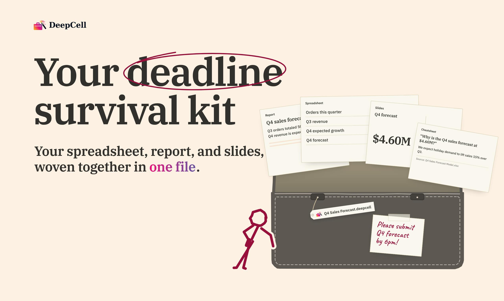
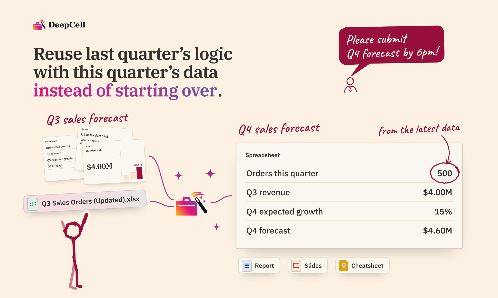
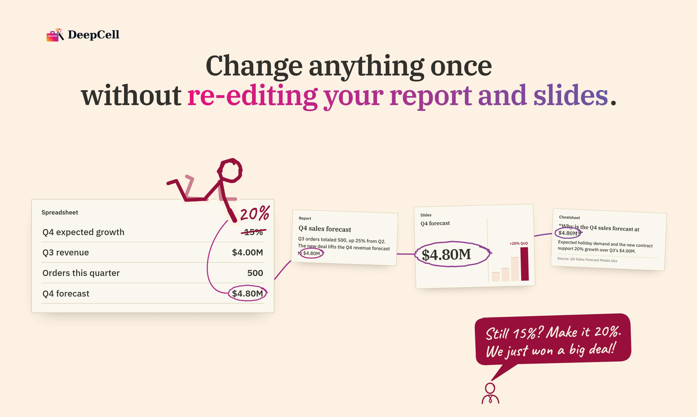

### 🎬 관련 영상
- [🎥 영상 보기](https://ph-files.imgix.net/4213bd09-4a21-4aa1-9b09-259b899ddfba.jpeg?auto=format)

---

## 2. [Doneas](https://www.producthunt.com/products/doneas)
**Votes**: 216 | **도입 난이도**: 하 | **신뢰도**: 상
**Tagline**: A daily accountability call with other entrepreneurs.
**서비스 링크**: https://www.producthunt.com/r/AIRL3T6NP757FV

**태그**: Productivity, Accountability, Solo-Entrepreneur, Focus, AI Tool

### 📌 이 서비스 한눈에 보기
다른 창업가들과 매일 15분간 소통하며 실행력을 높이는 데일리 어카운터빌리티 서비스

### 🔑 주요 기능
- 매주 월요일 주간 계획 수립
- 5명의 빌더와 함께하는 15분 데일리 체크인 콜
- 공개 프로그레스 페이지를 통한 작업물 트래킹

### 🙋 사용자에게 어떤 점이 좋은가
혼자 일하는 1인 창업가나 빌더가 계획에만 머물지 않고 매일 실질적인 결과물을 만들어낼 수 있도록 강제성을 부여합니다.

### ✅ 지금 바로 써볼 기능
- 월요일 주간 계획 세우기
- 데일리 15분 콜 참여하기
- 공개 프로그레스 페이지에 작업 내역 기록하기

### ⚠️ 사용 전 확인할 점
- 매일 정해진 시간에 콜에 참여해야 하는 시간적 제약
- 다른 참여자들과의 시간대(Timezone) 일치 여부 확인 필요

### 🧭 확인이 더 필요한 정보
사용자 간의 시간대 매칭 방식과 콜 진행 방식에 대한 구체적인 운영 규칙 확인이 필요합니다.

### 📸 스크린샷 및 갤러리
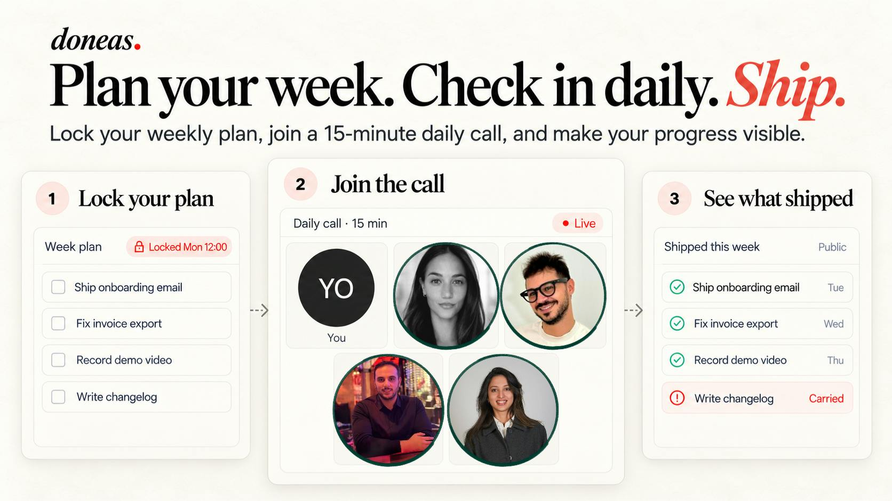
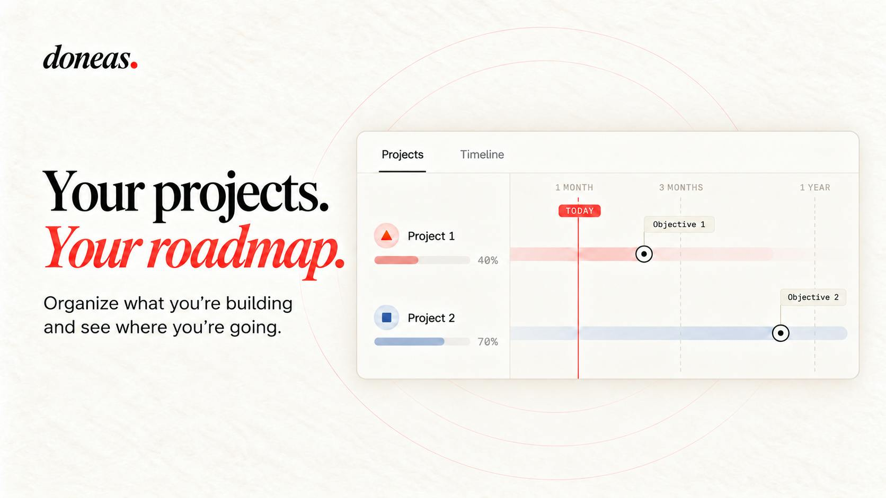
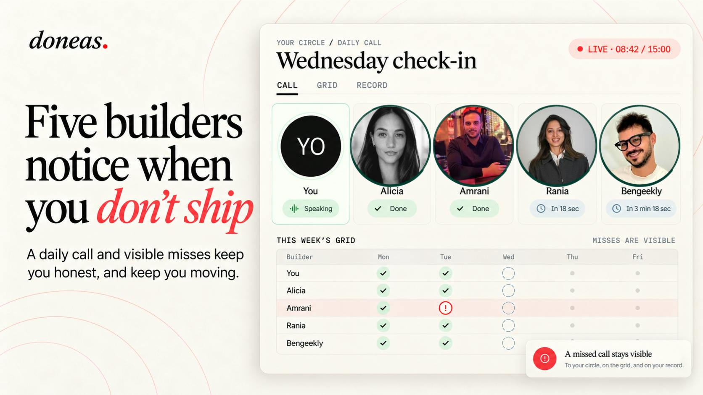

### 🎬 관련 영상
- [🎥 영상 보기](https://ph-files.imgix.net/bcb1de90-07a1-48ff-ad06-1bd0107f5b98.jpeg?auto=format)

---

## 3. [Claude Duet](https://www.producthunt.com/products/claude)
**Votes**: 215 | **도입 난이도**: 하 | **신뢰도**: 상
**Tagline**: Proactive agent that understands what needs your attention
**서비스 링크**: https://www.producthunt.com/r/E2X5OB7ZYY7LBL

**태그**: Automation, AI Agent, Productivity, Cloud, Agent, AI Tool

### 📌 이 서비스 한눈에 보기
메시지 하나로 클라우드 환경에서 업무를 자율적으로 수행하는 프로액티브 AI 에이전트

### 🔑 주요 기능
- 메시지를 통한 간편한 업무 위임 방식
- 클라우드 상의 독립된 컴퓨터 환경에서 앱 연동 및 작업 수행
- 상황에 따른 판단을 통해 적절한 시점에 사용자에게 알림

### 🙋 사용자에게 어떤 점이 좋은가
사용자가 일일이 명령을 내리지 않아도 AI가 알아서 작업을 수행하고, 결정이 필요한 순간에만 연락하므로 업무 흐름을 끊지 않고 효율을 높일 수 있습니다.

### ✅ 지금 바로 써볼 기능
- 메시지로 작업 지시해보기
- 연동 가능한 앱 연결 및 설정하기
- AI의 판단과 알림 주기 확인하기

### ⚠️ 사용 전 확인할 점
- 클라우드 환경에서의 앱 연동 범위 및 보안 정책 확인 필요
- AI의 자율적 판단이 사용자의 의도와 다를 가능성 고려

### 🧭 확인이 더 필요한 정보
지원하는 구체적인 앱 생태계와 클라우드 환경의 보안 수준에 대한 정보가 더 필요합니다.

### 📸 스크린샷 및 갤러리
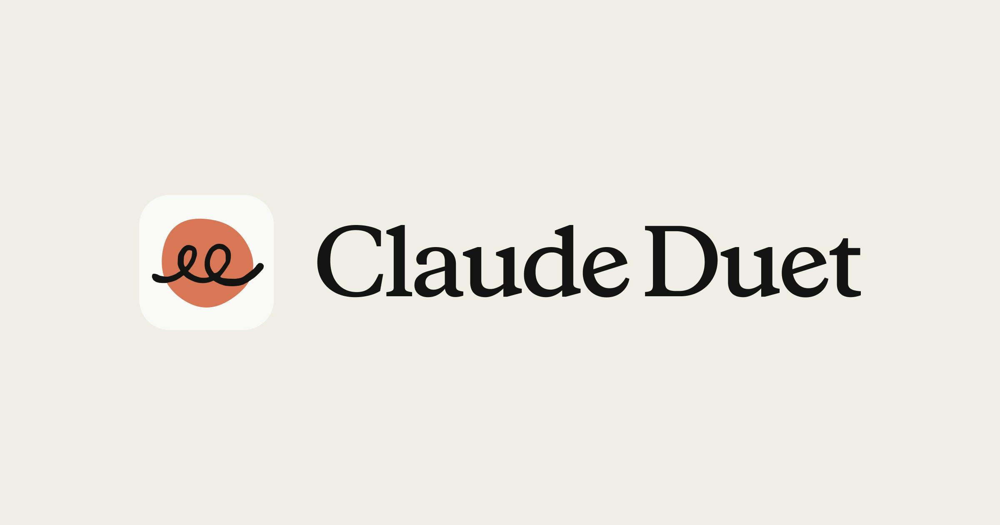

### 🎬 관련 영상
- [🎥 영상 보기](https://ph-files.imgix.net/6d3b0b35-8b8f-4795-b175-5e093770e0aa.jpeg?auto=format)

---

## 4. [heal.dev](https://www.producthunt.com/products/heal-dev)
**Votes**: 195 | **도입 난이도**: 중 | **신뢰도**: 상
**Tagline**: Find bugs and vulnerabilities code review misses
**서비스 링크**: https://www.producthunt.com/r/HQTQB26MJAPQTC

**태그**: DevTool, QA, Security, Automation, AI Tool

### 📌 이 서비스 한눈에 보기
코드 리뷰를 넘어 런타임 환경에서 실제 버그와 취약점을 찾아내는 자동화 도구

### 🔑 주요 기능
- 정적 분석이 아닌 실제 애플리케이션 실행 환경에서의 동적 버그 탐지
- 외부 서비스가 스터빙(stubbed)된 프로덕션급 샌드박스 환경 구축
- 단순 의심이 아닌 재현 가능한 실제 결함 및 성능 저하 보고

### 🙋 사용자에게 어떤 점이 좋은가
코드 변경 사항이 실제 실행 시 어떤 문제를 일으키는지 미리 확인하여, 배포 후 사용자에게 전달될 수 있는 치명적인 버그를 사전에 차단할 수 있습니다.

### ✅ 지금 바로 써볼 기능
- 애플리케이션 실행 및 샌드박스 구축 기능 테스트
- 발견된 버그의 재현 가능성 및 리포트 품질 확인
- 기존 CI/CD 워크플로우와의 통합 가능성 검토

### ⚠️ 사용 전 확인할 점
- 애플리케이션 실행 환경을 구축하는 과정에서의 초기 설정 복잡도
- 외부 서비스 스터빙 방식이 실제 운영 환경과 얼마나 일치하는지 여부

### 🧭 확인이 더 필요한 정보
지원하는 프로그래밍 언어 범위와 기존 CI/CD 파이프라인과의 구체적인 통합 방식에 대한 정보가 필요합니다.

### 📸 스크린샷 및 갤러리
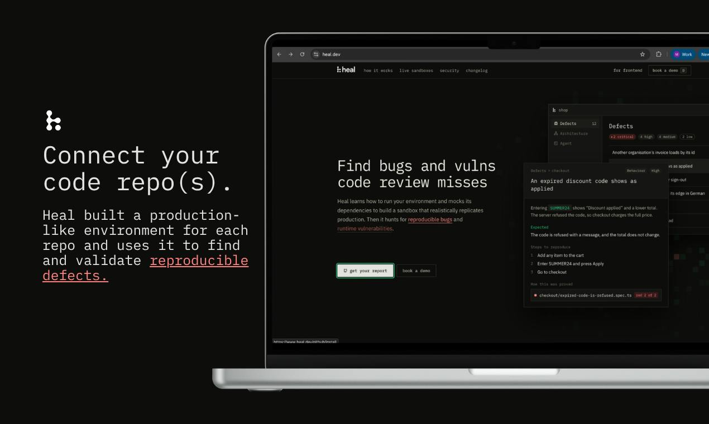
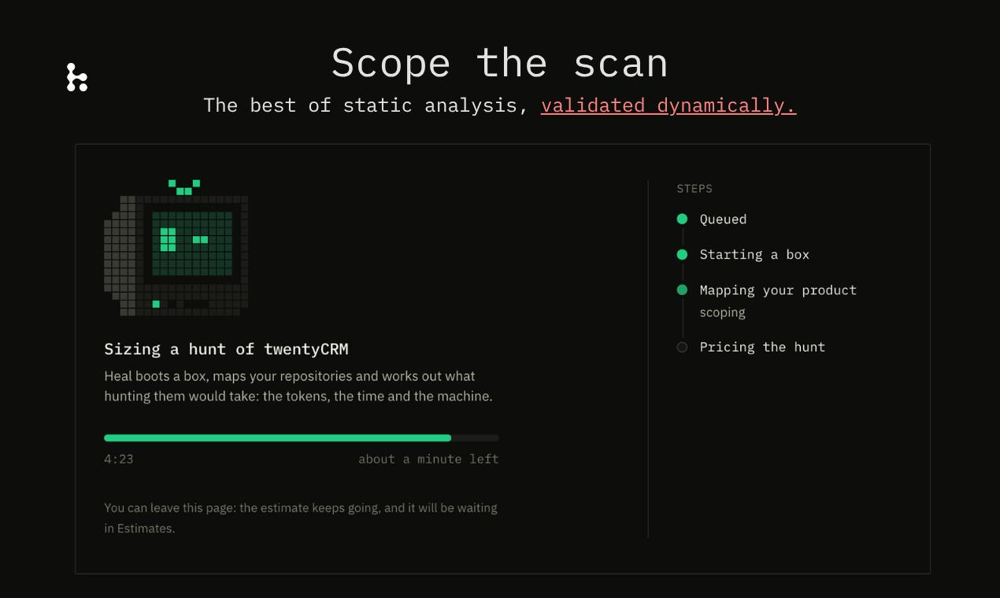
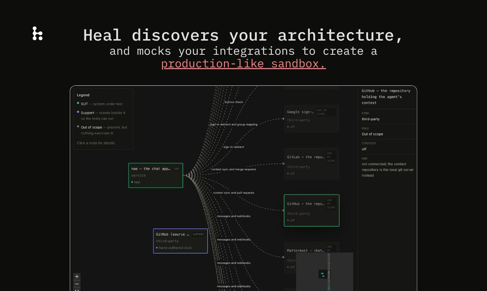

### 🎬 관련 영상
- [🎥 영상 보기](https://ph-files.imgix.net/1bd3b252-1d1c-418f-a608-428b42da14e7.gif?auto=format)

---

## 5. [Mistral Voxtral 3](https://www.producthunt.com/products/mistral-7b)
**Votes**: 182 | **도입 난이도**: 중 | **신뢰도**: 상
**Tagline**: Mistral’s speech models for transcription, TTS and agents
**서비스 링크**: https://www.producthunt.com/r/5EIBXLSLSKO5BV

**태그**: AI, Voice-to-Text, Text-to-Voice, DeveloperTool, Automation, Agent, AI Tool, API

### 📌 이 서비스 한눈에 보기
초저지연 음성 인식과 감정 표현이 가능한 Mistral의 차세대 음성 AI 모델 시리즈

### 🔑 주요 기능
- 50개 이상의 언어를 지원하는 초저지연(500ms 미만) 실시간 전사 기능
- 감정 및 페이싱 조절과 음성 복제가 가능한 고성능 TTS
- LiveKit 기반의 음성 에이전트 SDK 및 API 제공

### 🙋 사용자에게 어떤 점이 좋은가
개발자는 강력한 음성 에이전트를 빠르게 구축할 수 있으며, 기업은 저렴한 비용으로 고성능 자동 전사 및 음성 합성 솔루션을 도입할 수 있습니다.

### ✅ 지금 바로 써볼 기능
- 500ms 미만 실시간 전사 성능 테스트
- 30분 분량의 오디오를 활용한 음성 복제 기능 시도
- Mistral API를 통한 배치 전사 비용 효율성 검토

### ⚠️ 사용 전 확인할 점
- 음성 복제 시 원본 데이터의 저작권 및 윤리적 사용 주의
- 언어별 정확도 및 화자 분리(Diarization) 성능 차이 확인 필요

### 🧭 확인이 더 필요한 정보
특정 언어에서의 화자 분리 및 문맥 편향(Context Biasing)의 정확도는 실제 테스트가 필요합니다.

### 📸 스크린샷 및 갤러리

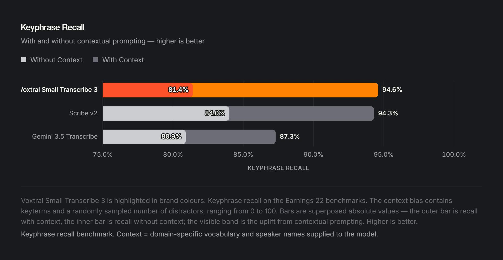
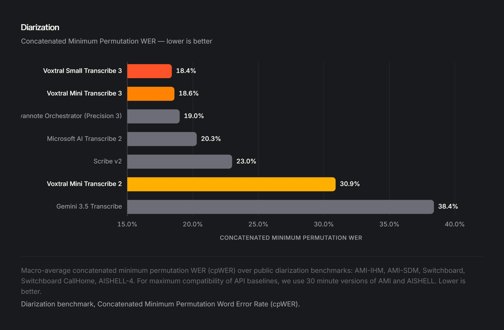

### 🎬 관련 영상
- [🎥 영상 보기](https://ph-files.imgix.net/6ac817af-2bf2-4be6-bbc2-073958b4ec76.jpeg?auto=format)

---

## 6. [Fastlane 2.0](https://www.producthunt.com/products/fastlane-3)
**Votes**: 160 | **도입 난이도**: 하 | **신뢰도**: 상
**Tagline**: Create, launch and scale winning ads with AI
**서비스 링크**: https://www.producthunt.com/r/F336CZV4PLEFYY

**태그**: MarketingAutomation, AI-Content, GrowthHacking, AdTech, AI Tool, Video, Vision, Marketing

### 📌 이 서비스 한눈에 보기
웹사이트 URL 입력만으로 광고 기획부터 제작, 집행, 최적화까지 자동 수행하는 AI 마케팅 에이전트

### 🔑 주요 기능
- 브랜드 학습 및 경쟁사 분석을 통한 맞춤형 광고 전략 수립
- AI 기반 고품질 비디오 및 이미지 광고 콘텐츠 자동 생성
- Meta, TikTok, Instagram, YouTube 등 주요 채널로의 캠페인 자동 배포

### 🙋 사용자에게 어떤 점이 좋은가
마케팅 인력이 부족한 팀이나 개인 사업자가 전문적인 광고 운영과 콘텐츠 제작 과정을 자동화하여 효율적으로 스케일업할 수 있습니다.

### ✅ 지금 바로 써볼 기능
- 자사 웹사이트 URL 입력하여 브랜드 학습시키기
- 생성된 AI 비디오/이미지 광고 에셋 검토하기
- 자동화된 소셜 미디어 캠페인 실행 및 성과 모니터링하기

### ⚠️ 사용 전 확인할 점
- AI가 생성한 광고 콘텐츠의 브랜드 일관성 및 품질 검수 필요
- 광고 집행 비용(Ad Spend) 관리에 대한 사용자 직접 통제 필요

### 🧭 확인이 더 필요한 정보
광고 집행 비용 및 플랫폼별 수수료 구조에 대한 구체적인 정보가 명시되지 않았습니다.

### 📸 스크린샷 및 갤러리

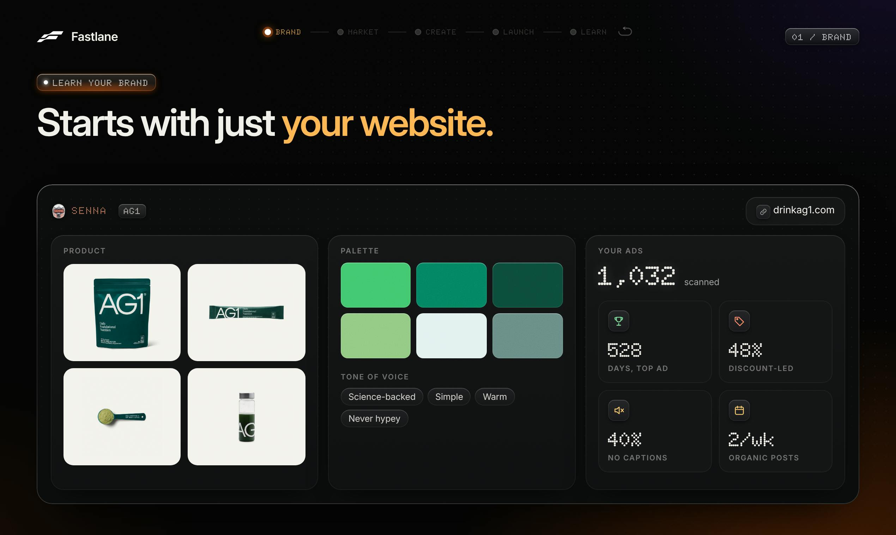
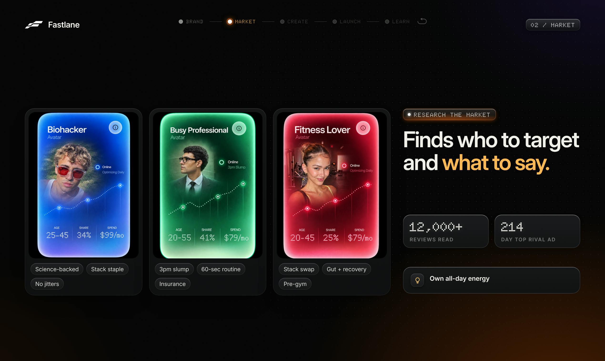

### 🎬 관련 영상
- [🎥 영상 보기](https://ph-files.imgix.net/3fdc19c2-2c35-4297-8a34-7170cadb2e5a.jpeg?auto=format)

---

## 7. [Dadan](https://www.producthunt.com/products/dadan)
**Votes**: 121 | **도입 난이도**: 하 | **신뢰도**: 상
**Tagline**: One AI video workspace for recordings, meetings and guides
**서비스 링크**: https://www.producthunt.com/r/LAK7P6T2QU7ORA

**태그**: Video, Productivity, Sales, Marketing, CustomerSuccess, AI Tool, DevTool

### 📌 이 서비스 한눈에 보기
영상 녹화, 회의 기록, 가이드를 하나로 통합하고 인터랙티브 요소를 더한 AI 비디오 워크스페이스

### 🔑 주요 기능
- 비동기 영상, 회의록, 가이드 문서를 하나의 플랫폼에서 통합 관리
- 설문, CTA, 리드 양식 등을 통해 영상을 인터랙티브하게 변환
- 영상을 통한 잠재 고객 확보(Lead Generation) 기능 제공

### 🙋 사용자에게 어떤 점이 좋은가
여러 도구를 번갈아 사용할 필요 없이 영상 제작부터 고객 전환까지 한 곳에서 해결할 수 있어 업무 효율이 높아집니다.

### ✅ 지금 바로 써볼 기능
- 비동기 영상 녹화 및 공유
- 영상 내 설문 및 CTA 설정
- 리드 양식을 통한 잠재 고객 확보

### ⚠️ 사용 전 확인할 점
- 사용 중인 기존 협업 툴과의 연동 범위 확인 필요
- PRO 플랜 무료 체험 기간 종료 후 유료 전환 정책 확인

### 🧭 확인이 더 필요한 정보
제공되는 AI 기능의 구체적인 자동화 범위와 상세 기능은 제품 내부를 확인해야 합니다.

### 📸 스크린샷 및 갤러리
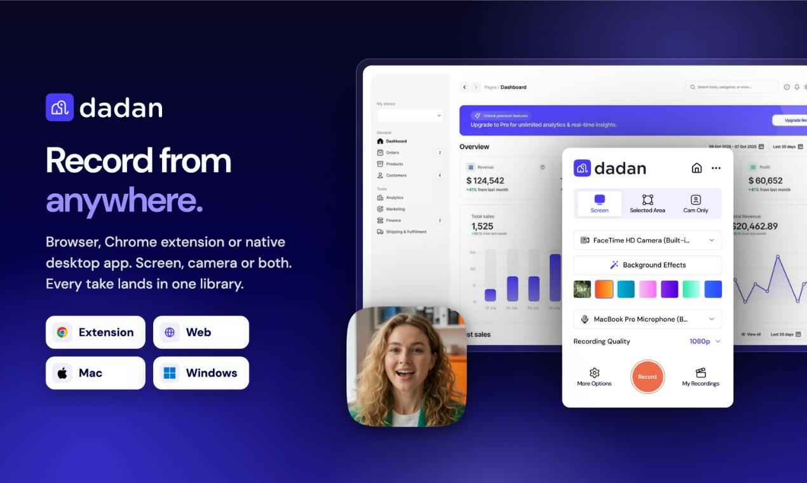
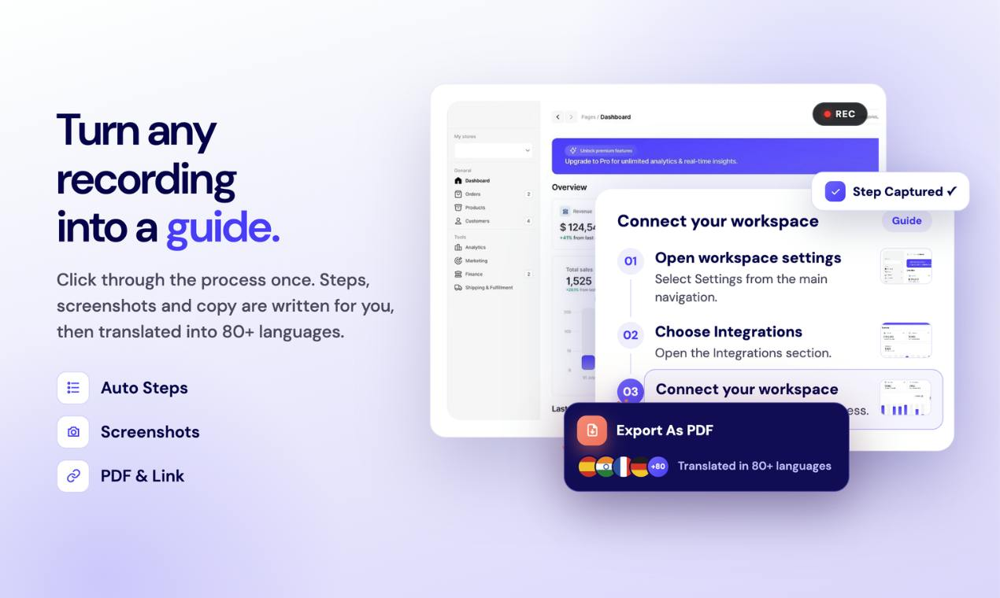
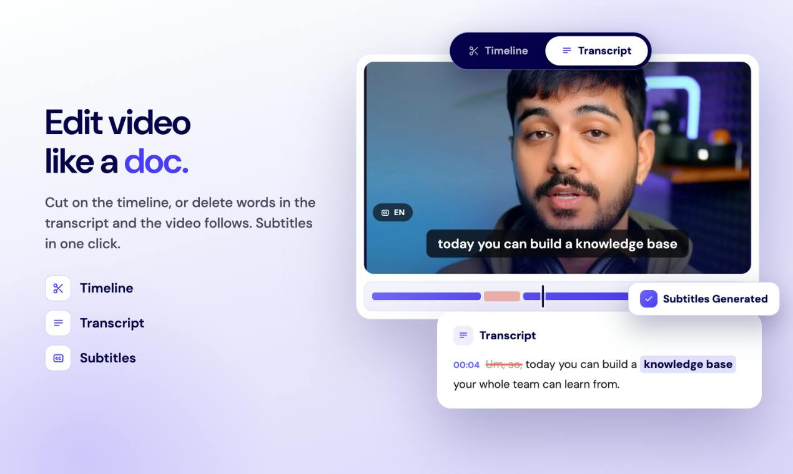

### 🎬 관련 영상
- [🎥 영상 보기](https://ph-files.imgix.net/fbe6fb71-545c-4481-afa7-6e1a650c1c01.jpeg?auto=format)

---

## 8. [CutBay](https://www.producthunt.com/products/cutbay)
**Votes**: 117 | **도입 난이도**: 하 | **신뢰도**: 상
**Tagline**: AI Video Agent: Turn Anything into Videos via Chat
**서비스 링크**: https://www.producthunt.com/r/NHJ3TS2JQSOSXM

**태그**: AI Video, Automation, Content Creation, Productivity, Agent, AI Tool, Chat, Prompting, Video

### 📌 이 서비스 한눈에 보기
채팅만으로 기획부터 편집까지 완료하는 AI 비디오 에이전트

### 🔑 주요 기능
- 대화형 인터페이스를 통한 자동 영상 제작 (기획, 스크립트, 편집 포함)
- URL, 문서(PDF/Docs), 스프레드시트 등 다양한 소스를 영상으로 변환
- 수동 타임라인 편집 없이 자연어 대화로 영상 디테일 수정 가능

### 🙋 사용자에게 어떤 점이 좋은가
복잡한 영상 편집 기술 없이도 텍스트나 문서만 있으면 전문가 수준의 영상을 빠르게 제작할 수 있습니다.

### ✅ 지금 바로 써볼 기능
- 문서나 URL을 입력하여 초안 영상 생성해보기
- 채팅을 통해 생성된 영상의 스타일 및 세부 요소 수정하기

### ⚠️ 사용 전 확인할 점
- AI 생성 콘텐츠 특성상 세밀한 수동 편집 제어 범위 확인 필요
- 입력 소스의 복잡도에 따른 결과물 품질 차이 가능성

### 🧭 확인이 더 필요한 정보
제공되는 영상의 최종 해상도 및 상업적 이용 권한에 대한 상세 정책 확인이 필요합니다.

### 📸 스크린샷 및 갤러리
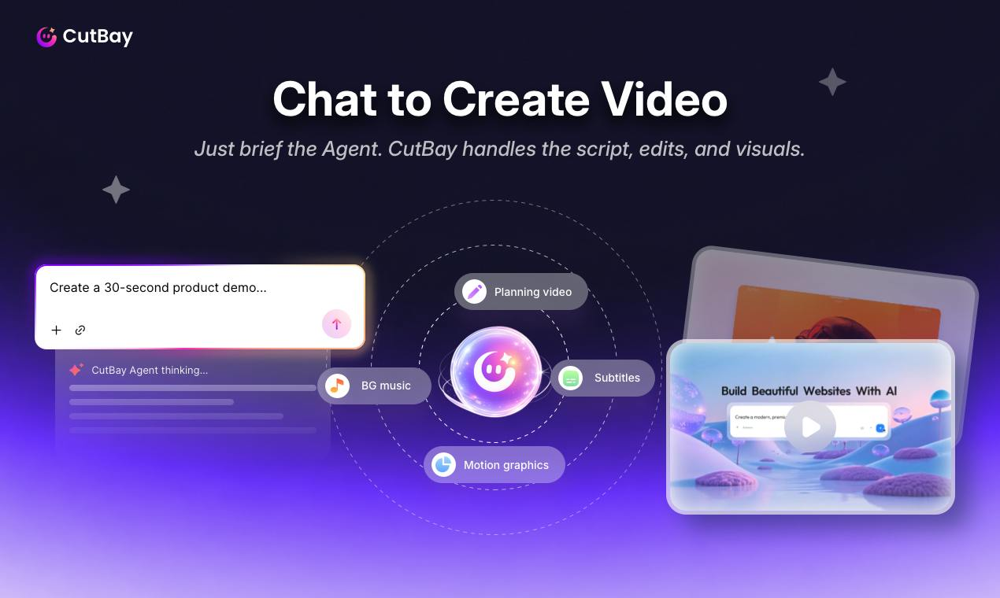
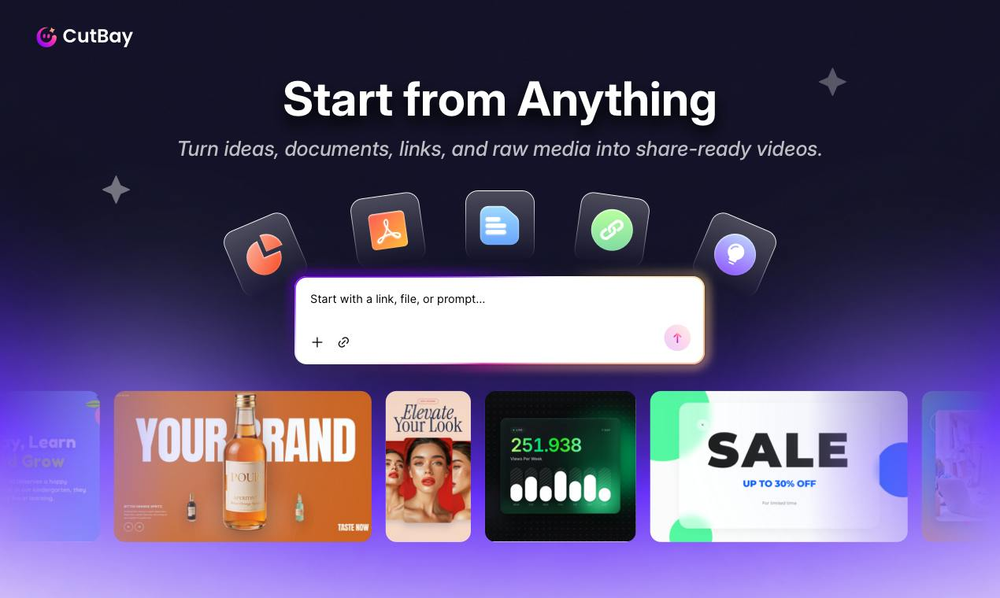
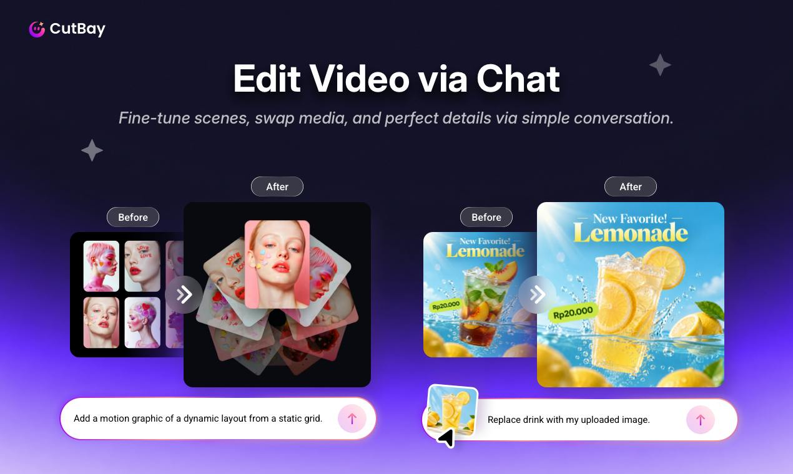

### 🎬 관련 영상
- [🎥 영상 보기](https://ph-files.imgix.net/dbd22bcf-e7ae-46d4-a2ae-38a42488fb28.jpeg?auto=format)

---

## 9. [Loom Record for agents](https://www.producthunt.com/products/loom)
**Votes**: 112 | **도입 난이도**: 하 | **신뢰도**: 상
**Tagline**: Hit record and hand off to AI, now in the new Loom app
**서비스 링크**: https://www.producthunt.com/r/CEC7O36EG5BZTB

**태그**: AI, Automation, Productivity, Video, Agent, AI Tool, Prompting

### 📌 이 서비스 한눈에 보기
화면 기록을 AI 에이전트용 프롬프트로 즉시 변환하는 Loom의 새로운 기록 기능

### 🔑 주요 기능
- 화면, 오디오, 동작을 캡처하여 AI 에이전트가 이해할 수 있는 데이터로 변환
- 텍스트 프롬프트를 일일이 타이핑하는 번거로움 없이 작업 설명 가능
- Mac용 신규 Loom 앱에 내장된 고화질(4K) 및 정밀 영역 녹화 기능

### 🙋 사용자에게 어떤 점이 좋은가
복잡한 작업 과정을 말과 화면으로 보여주기만 하면 AI가 즉시 실행 가능한 형태로 파악할 수 있어 업무 자동화가 쉬워집니다.

### ✅ 지금 바로 써볼 기능
- Mac용 신규 Loom 앱 설치 및 4K 녹화 테스트
- 화면 영역 지정 기능을 활용한 정밀한 작업 가이드 제작
- 녹화된 영상을 AI 에이전트 프롬프트로 활용해보기

### ⚠️ 사용 전 확인할 점
- AI 에이전트 도구와의 실제 연동 방식 및 호환성 확인 필요
- 개인정보나 민감한 화면 내용이 포함될 경우 보안 주의

### 🧭 확인이 더 필요한 정보
사용 중인 외부 AI 에이전트 도구들과의 구체적인 통합 방식 및 자동화 수준은 명시되지 않았습니다.

### 📸 스크린샷 및 갤러리
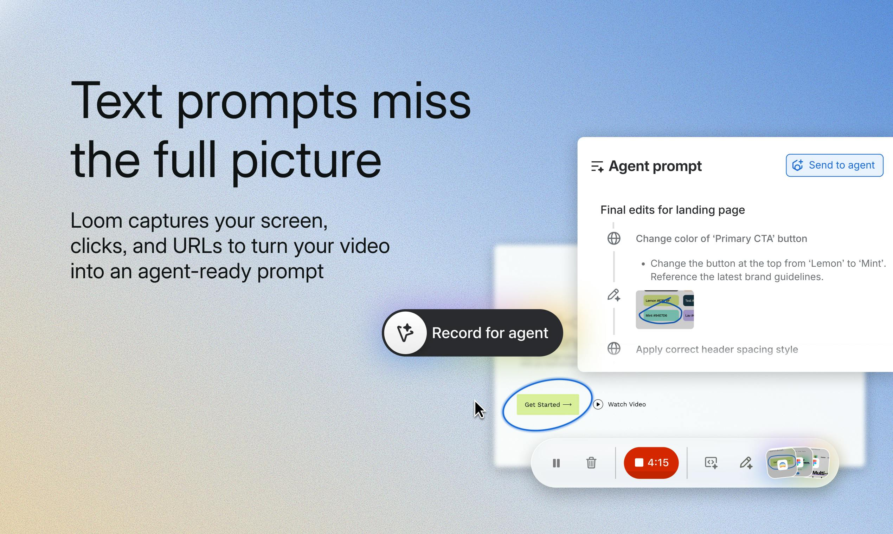
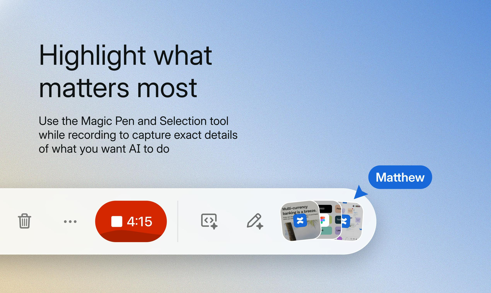
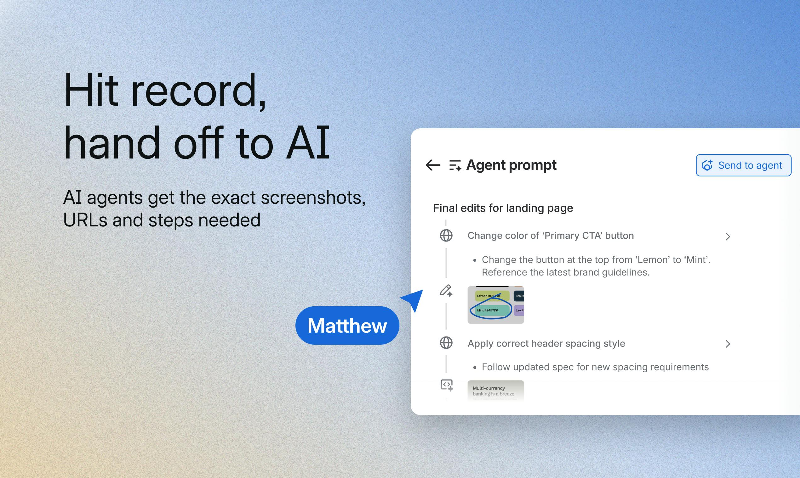

### 🎬 관련 영상
- [🎥 영상 보기](https://ph-files.imgix.net/05d150b0-9296-41a1-8cd5-48e10a63a752.jpeg?auto=format)
- [🎥 영상 보기](https://ph-files.imgix.net/243c3240-3a27-4597-8dbc-c29e09e1b560.jpeg?auto=format)

---

## 10. [Resend Inboxes](https://www.producthunt.com/products/resend)
**Votes**: 111 | **도입 난이도**: 중 | **신뢰도**: 상
**Tagline**: Create shared inboxes, connect your agents, build workflows
**서비스 링크**: https://www.producthunt.com/r/TY5AGUVHIXOZXC

**태그**: DevTool, Automation, Email, Workflow, Agent, AI Tool, Marketing

### 📌 이 서비스 한눈에 보기
스팸함을 피하고 팀과 에이전트가 협업할 수 있는 효율적인 이메일 워크플로우 구축 도구

### 🔑 주요 기능
- 공유 인박스 생성을 통한 팀 협업 지원
- AI 에이전트 연결 및 자동화 워크플로우 구축 가능
- 대규모 트랜잭션 및 마케팅 이메일의 안정적 전달

### 🙋 사용자에게 어떤 점이 좋은가
이메일이 스팸으로 분류되는 문제를 해결하면서, 팀원이나 자동화 에이전트가 효율적으로 이메일을 관리할 수 있는 환경을 제공합니다.

### ✅ 지금 바로 써볼 기능
- 공유 인박스 생성 및 팀원 초대
- 에이전트 연결을 통한 자동 응답 테스트
- 워크플로우 설정을 통한 이메일 자동화 구현

### ⚠️ 사용 전 확인할 점
- 에이전트 연결 시 자동화 로직에 따른 이메일 발송 제어 필요
- 대규모 발송 시 스팸 필터링 정책 준수 여부 확인 필요

### 🧭 확인이 더 필요한 정보
상세한 API 연동 방식과 에이전트 연결 방식에 대한 기술적 세부 사항은 공식 문서를 통한 확인이 필요합니다.

### 📸 스크린샷 및 갤러리
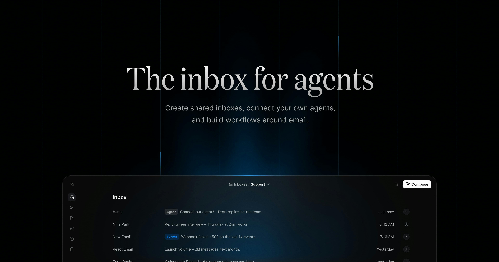
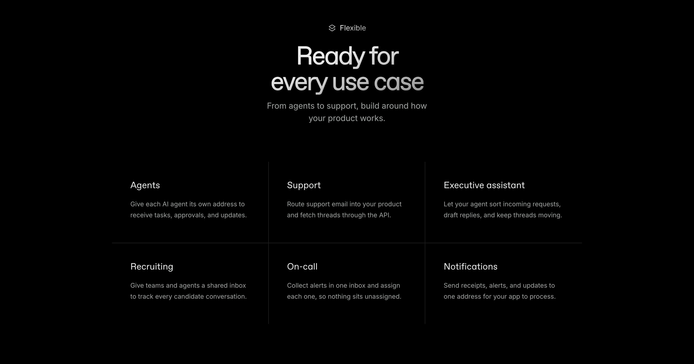
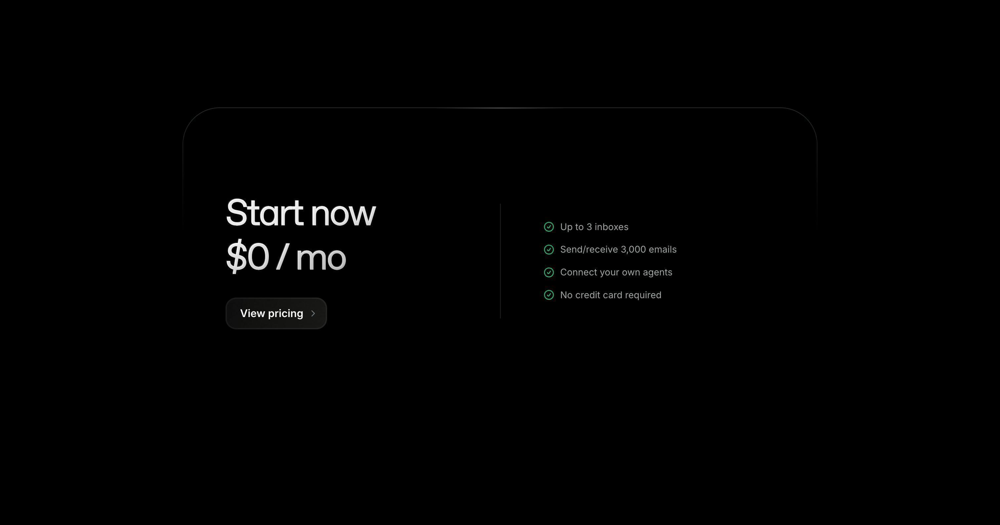

---

## 11. [Mercury 3](https://www.producthunt.com/products/mercury-412)
**Votes**: 103 | **도입 난이도**: 중 | **신뢰도**: 상
**Tagline**: The diffusion LLM that scaled 40x without slowing down
**서비스 링크**: https://www.producthunt.com/r/Q757FLG3Q3D7E4

**태그**: AI, LLM, Generative AI, High-Performance, AI Tool

### 📌 이 서비스 한눈에 보기
압도적인 속도와 성능을 동시에 잡은 차세대 디퓨전 LLM

### 🔑 주요 기능
- GPT-6 Luna 및 Claude Haiku 5.5를 능가하는 성능
- 초당 1,000개 이상의 토큰을 생성하는 압도적 속도
- 확장 시 성능 저하 없는 40배 규모의 디퓨전 모델

### 🙋 사용자에게 어떤 점이 좋은가
기존 모델보다 훨씬 빠른 속도로 고성능 결과물을 얻을 수 있어, 실시간 생성 작업이나 대규모 데이터 처리에 매우 유리합니다.

### ✅ 지금 바로 써볼 기능
- 초당 1,000 토큰 생성 속도 테스트
- 기존 모델 대비 성능 벤치마크 비교
- 대규모 워크로드 적용 가능성 검토

### ⚠️ 사용 전 확인할 점
- 모델의 구체적인 아키텍처 및 하드웨어 요구사항 미확인
- 실제 워크로드에서의 안정성 검증 필요

### 🧭 확인이 더 필요한 정보
제시된 벤치마크 수치가 실제 사용자 환경에서도 동일하게 유지되는지 확인이 필요합니다.

### 📸 스크린샷 및 갤러리
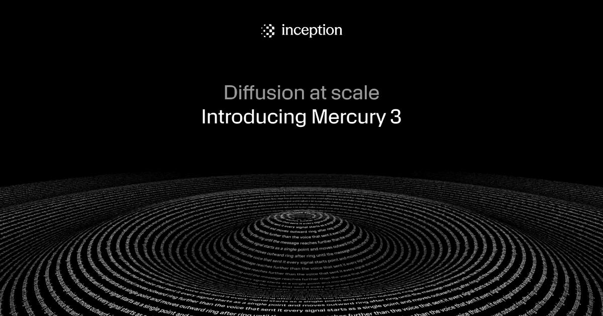
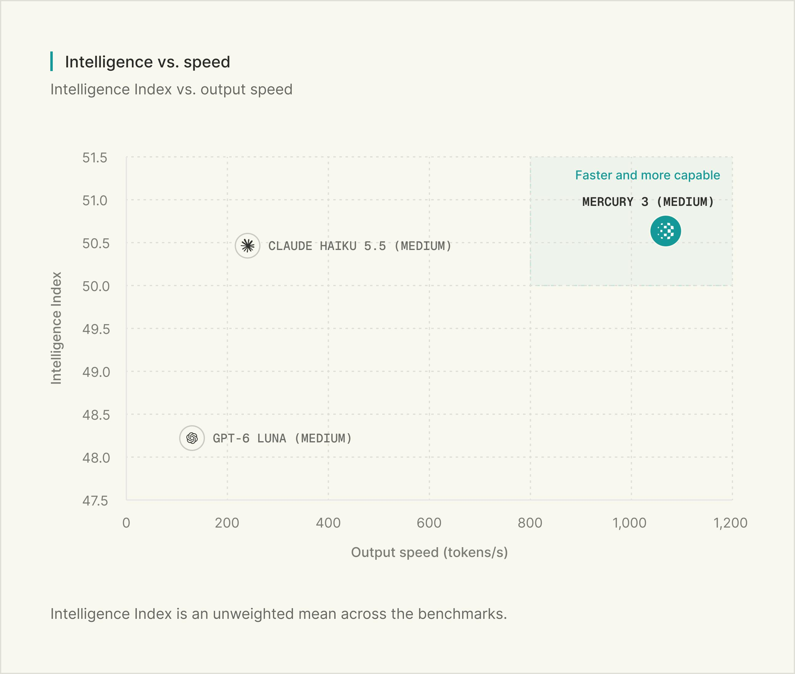
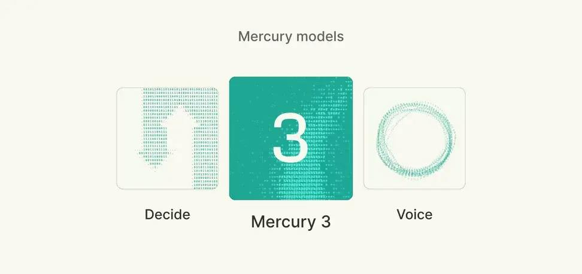

---

## 12. [Causo](https://www.producthunt.com/products/causo)
**Votes**: 99 | **도입 난이도**: 하 | **신뢰도**: 상
**Tagline**: Find leads beyond database filters with AI research & MCP
**서비스 링크**: https://www.producthunt.com/r/6A54JDPKURJAN6

**태그**: SalesTech, AI, LeadGeneration, GTM, Automation, AI Tool, Chat, Email

### 📌 이 서비스 한눈에 보기
자연어 검색과 AI 조사를 통해 필터 너머의 잠재 고객을 발굴하는 GTM 인텔리전스 도구

### 🔑 주요 기능
- 자연어 설명을 통한 정교한 잠재 고객 타겟팅
- 공개 소스 조사를 통한 근거 기반의 기업 매칭
- 의사결정권자 발굴 및 이메일 검증 기능

### 🙋 사용자에게 어떤 점이 좋은가
단순한 데이터 필터링을 넘어, 실제 비즈니스 맥락에 부합하는 잠재 고객을 AI가 직접 조사하여 발굴해 줍니다.

### ✅ 지금 바로 써볼 기능
- 자연어로 원하는 고객 페르소나 설명해보기
- AI가 제공하는 조사 근거 확인하기
- 발굴된 리스트에서 의사결정권자 정보 추출하기

### ⚠️ 사용 전 확인할 점
- 공개 소스 기반 조사이므로 데이터의 최신성 확인 필요
- AI 생성 결과물에 대한 최종 검토 필요

### 🧭 확인이 더 필요한 정보
제공되는 데이터 소스의 범위와 실시간 업데이트 주기에 대한 상세 정보가 필요합니다.

### 📸 스크린샷 및 갤러리
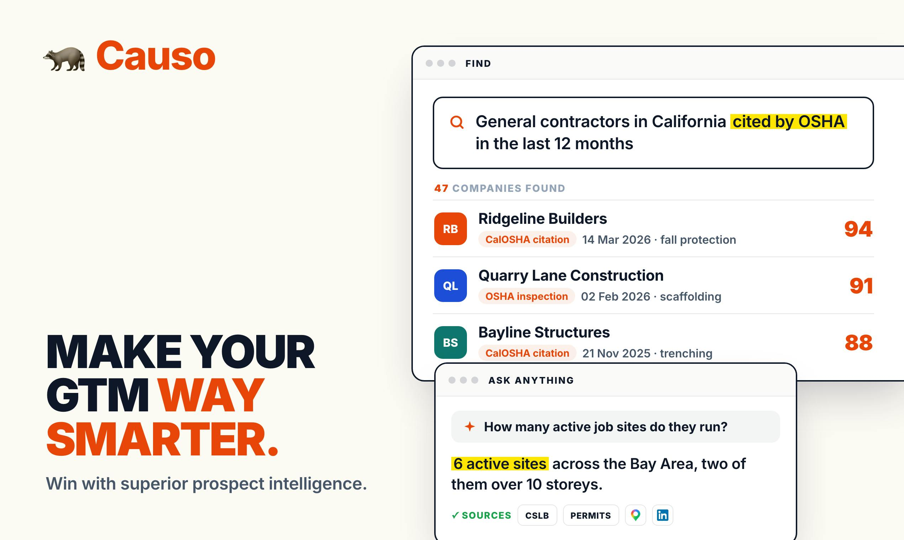
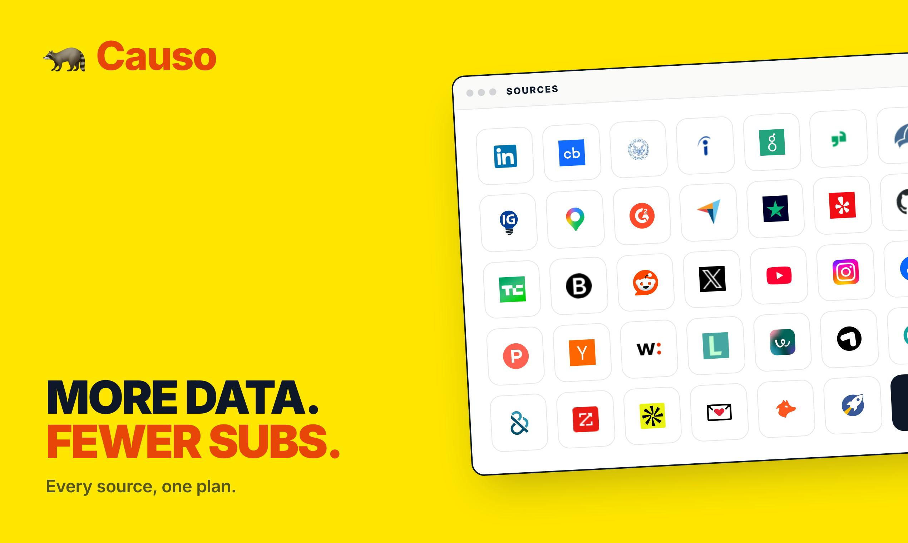
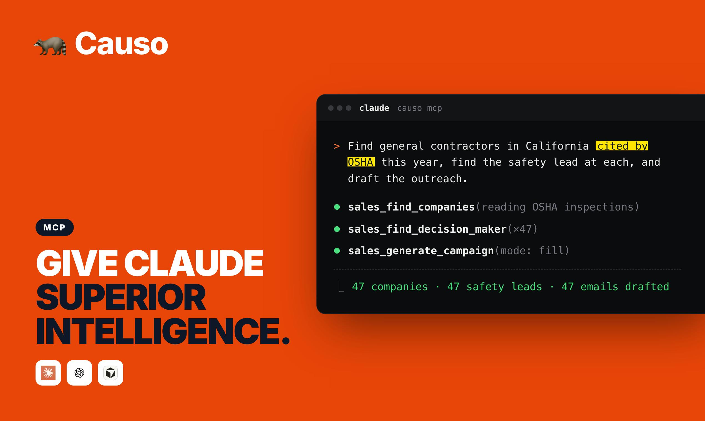

### 🎬 관련 영상
- [🎥 영상 보기](https://ph-files.imgix.net/09e1eb1b-7845-424c-8814-ec23777b133b.jpeg?auto=format)

---

## 13. [Voxelo 3.0](https://www.producthunt.com/products/voxelo-ai)
**Votes**: 93 | **도입 난이도**: 하 | **신뢰도**: 상
**Tagline**: Phone video to photoreal 3D & JSON-LD in an hour
**서비스 링크**: https://www.producthunt.com/r/BLKEVKF5WJPWNQ

**태그**: 3D, E-commerce, AR, AI-Ready, DigitalTwin, Agent, AI Tool, Video, Vision, API, Analytics

### 📌 이 서비스 한눈에 보기
스마트폰 영상만으로 고품질 3D 모델과 AI용 데이터를 생성하는 혁신적인 제품 디지털 트윈 솔루션

### 🔑 주요 기능
- 3분 분량의 스마트폰 영상으로 약 1시간 내에 실사급 3D 모델 생성
- 인간과 AI 에이전트 모두가 읽을 수 있는 인터랙티브 3D 및 JSON-LD 데이터 제공
- 설치가 필요 없는 AR 기능과 풍부한 제품 속성 데이터 포함

### 🙋 사용자에게 어떤 점이 좋은가
제품 사진 촬영만으로 고해상도 3D 모델과 AR 콘텐츠를 확보할 수 있어, 이커머스 운영 효율을 극대화하고 AI 쇼핑 환경에 선제적으로 대응할 수 있습니다.

### ✅ 지금 바로 써볼 기능
- 스마트폰으로 제품 영상 촬영하기
- 생성된 3D 모델의 AR 및 인터랙티브 기능 확인하기
- JSON-LD로 추출된 제품 속성 데이터 검토하기

### ⚠️ 사용 전 확인할 점
- 영상 품질에 따른 3D 모델의 정밀도 차이 가능성
- 생성된 데이터의 최종 결과물이 사용자의 특정 요구사항을 충족하는지 확인 필요

### 🧭 확인이 더 필요한 정보
영상 촬영 환경(조명, 배경 등)이 3D 모델 품질에 미치는 구체적인 영향 범위는 명시되지 않았습니다.

### 📸 스크린샷 및 갤러리
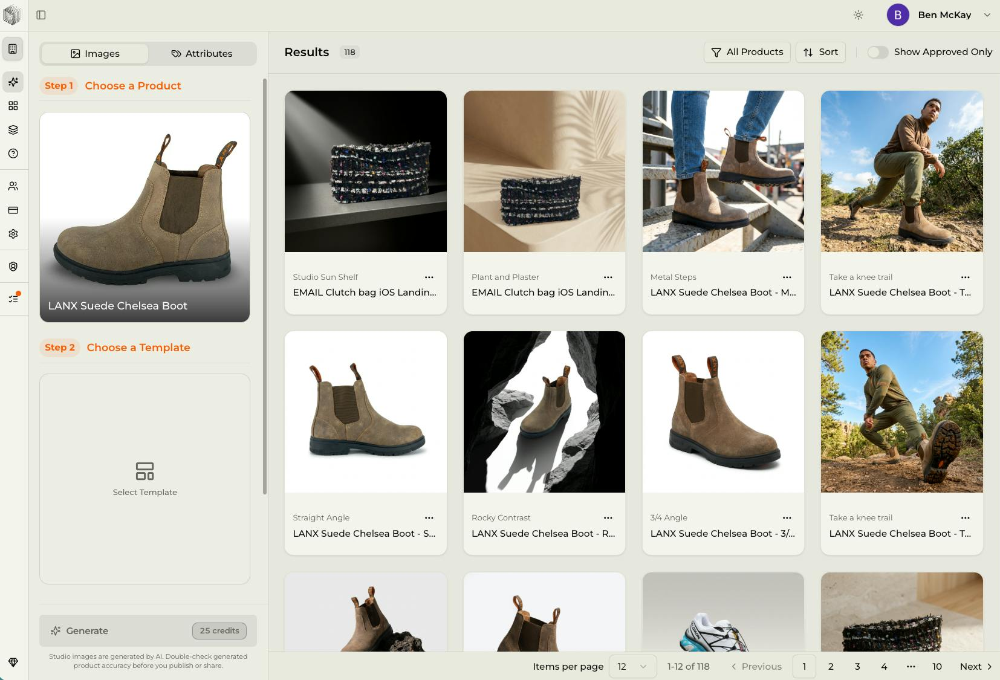
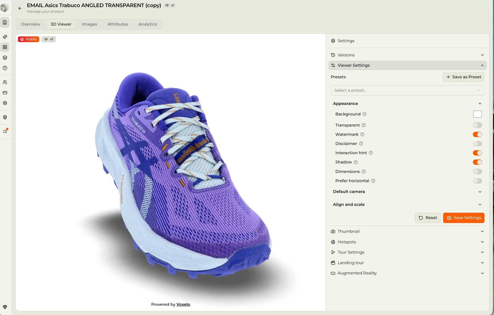
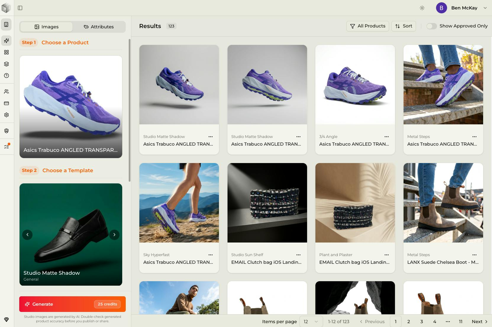

### 🎬 관련 영상
- [🎥 영상 보기](https://ph-files.imgix.net/7c93f1de-803b-478e-bbde-b0c962668870.jpeg?auto=format)

---

## 14. [ElevenLabs Realtime Translation](https://www.producthunt.com/products/elevenlabs-realtime-translation)
**Votes**: 91 | **도입 난이도**: 중 | **신뢰도**: 상
**Tagline**: Turn live speech into translated audio as people talk
**서비스 링크**: https://www.producthunt.com/r/XWOTY6RBZQ6VU3

**태그**: AI, Translation, Voice-AI, Realtime, B2B, LLM

### 📌 이 서비스 한눈에 보기
실시간 대화를 원어민 목소리로 즉시 번역해주는 스트리밍 음성 레이어

### 🔑 주요 기능
- 90개 이상의 언어를 지원하는 실시간 음성 번역 및 스트리밍
- 단일 WebSocket을 통한 저지연 음성 변환 및 캡션/전사 기능
- 사용자 고유의 목소리나 라이브러리 보이스를 유지하는 일관된 음성 품질

### 🙋 사용자에게 어떤 점이 좋은가
언어 장벽 없이 실시간 대화가 가능하며, 단순 자막을 넘어 화자의 목소리 톤을 유지한 자연스러운 통역 경험을 제공합니다.

### ✅ 지금 바로 써볼 기능
- WebSocket을 통한 실시간 스트리밍 지연 시간 테스트
- 사용자 목소리 클로닝을 통한 음성 일관성 확인
- 사용 사례별 속도와 정확도 설정 최적화

### ⚠️ 사용 전 확인할 점
- 실시간 통신 환경에 따른 네트워크 지연 발생 가능성
- 사용 사례에 따라 속도와 번역 정확도 간의 트레이드오프 발생

### 🧭 확인이 더 필요한 정보
통신사나 컨택센터 등 특정 B2B 환경에서의 구체적인 API 연동 규격과 비용 구조 확인이 필요합니다.

### 📸 스크린샷 및 갤러리

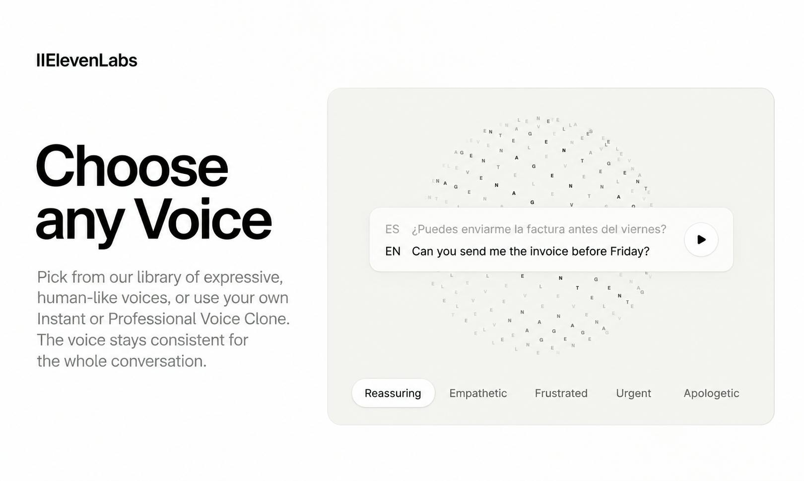
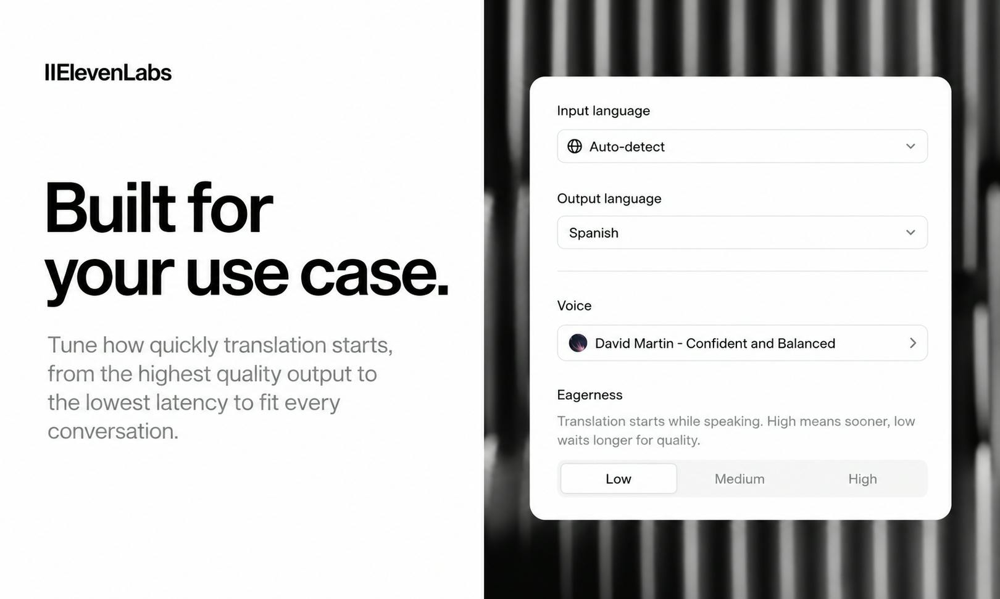

### 🎬 관련 영상
- [🎥 영상 보기](https://ph-files.imgix.net/2d393176-558f-4db1-a23a-beade06f6d8e.jpeg?auto=format)

---

## 15. [Whiteboard](https://www.producthunt.com/products/whiteboard-5)
**Votes**: 86 | **도입 난이도**: 중 | **신뢰도**: 상
**Tagline**: the open-source IDE for thoughtful software design 
**서비스 링크**: https://www.producthunt.com/r/GCF3W7XMFDCJSF

**태그**: DevTool, OpenSource, SoftwareDesign, Visualization, Agent, Design

### 📌 이 서비스 한눈에 보기
소프트웨어 설계와 개발 과정을 시각적으로 검토하고 개선할 수 있는 오픈소스 IDE

### 🔑 주요 기능
- 상호작용 가능한 시각화 도구 제공
- 코드 차이(diffs) 및 에이전트 작업 경로 분석
- 통합된 인터페이스를 통한 사고 중심의 소프트웨어 설계

### 🙋 사용자에게 어떤 점이 좋은가
개발 과정에서 발생하는 복잡한 시각적 데이터와 에이전트의 움직임을 한 곳에서 검토하여 설계 품질을 높일 수 있습니다.

### ✅ 지금 바로 써볼 기능
- 시각화 도구를 통한 설계 검토
- 코드 차이(diffs) 분석 기능 활용
- 에이전트 트래젝토리(trajectories) 확인

### ⚠️ 사용 전 확인할 점
- 오픈소스 프로젝트이므로 초기 안정성 및 문서화 수준 확인 필요
- 시각적 분석 중심이므로 순수 코딩 작업과의 워크플로우 결합도 확인 필요

### 🧭 확인이 더 필요한 정보
구체적인 기술 스택과 기존 IDE와의 연동 방식에 대한 정보가 부족합니다.

### 📸 스크린샷 및 갤러리
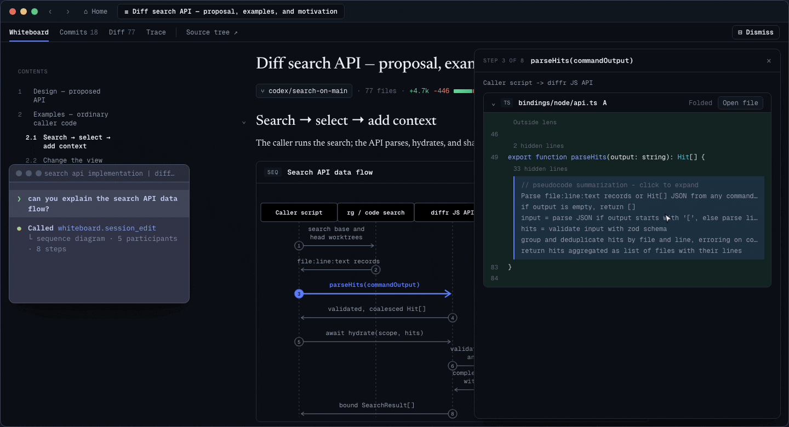
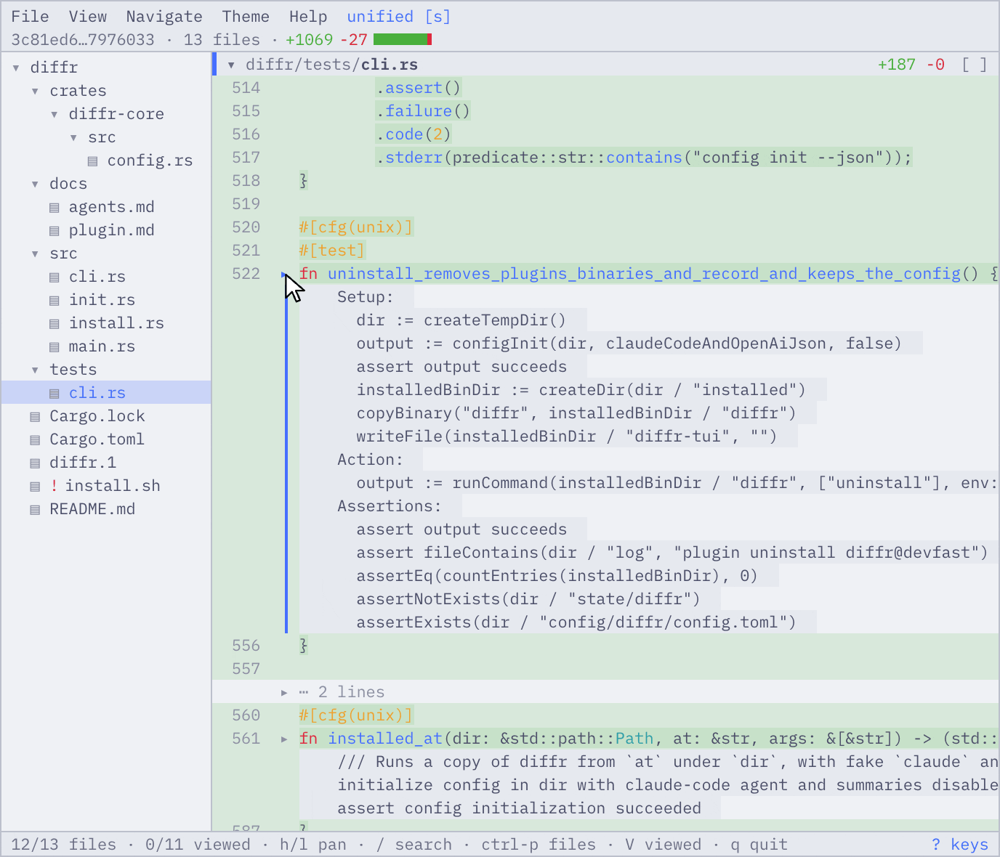
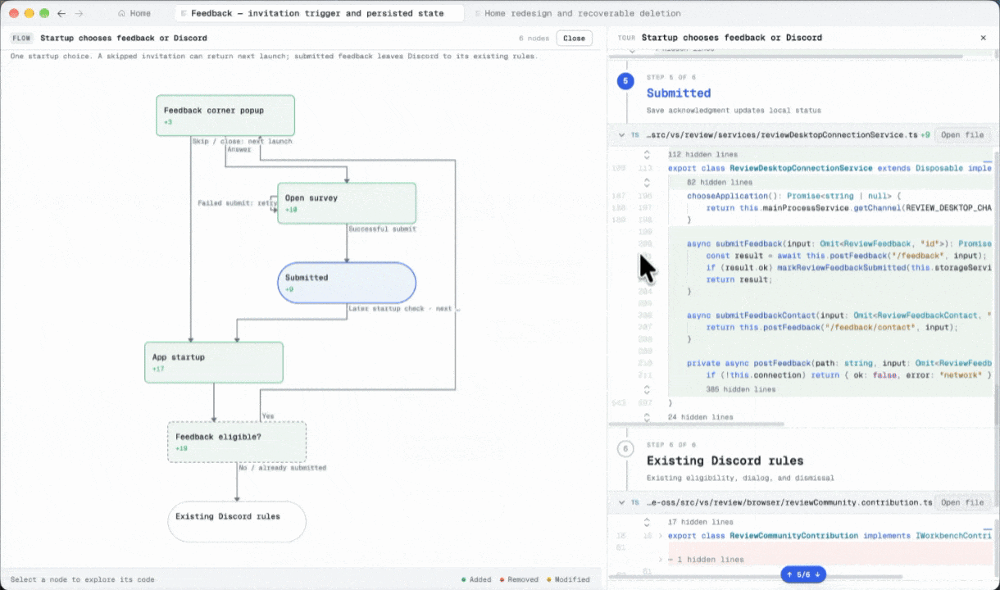

### 🎬 관련 영상
- [🎥 영상 보기](https://ph-files.imgix.net/290fa75c-e961-42fc-b91b-20d3d41d8d21.jpeg?auto=format)

---

## 16. [Radaric](https://www.producthunt.com/products/radaric)
**Votes**: 84 | **도입 난이도**: 하 | **신뢰도**: 상
**Tagline**: AI feed reader that learns your editorial taste
**서비스 링크**: https://www.producthunt.com/r/27XGEOZFFRRBYB

**태그**: AI, Productivity, RSS, ContentCuration, AI Tool

### 📌 이 서비스 한눈에 보기
사용자의 편집 취향을 학습하여 맞춤형 뉴스 피드를 제공하는 AI 뉴스 리더

### 🔑 주요 기능
- RSS, Telegram, X, YouTube 등 다양한 소스를 하나의 피드로 통합
- 승인, 거절, 피드백을 통해 사용자의 편집 취향을 학습하는 AI 엔진
- 중복되는 뉴스 이벤트를 하나의 스토리로 묶어주는 스마트 클러스터링

### 🙋 사용자에게 어떤 점이 좋은가
정보 과잉 시대에 흩어진 소스들을 한곳에 모으고, 개인의 취향에 맞게 정제된 뉴스만 효율적으로 소비할 수 있습니다.

### ✅ 지금 바로 써볼 기능
- 다양한 소스(RSS, X 등) 연동하기
- 피드백 기능을 통해 AI에게 취향 학습시키기
- 중복 이슈가 하나의 스토리로 정리되는 방식 확인하기

### ⚠️ 사용 전 확인할 점
- 사용자 피드백(승인/거절)을 지속적으로 제공해야 학습 효과가 나타남
- 월 $9부터 시작하는 유료 구독 모델 기반

### 🧭 확인이 더 필요한 정보
사용자 피드백 방식(설명 기능 등)의 구체적인 인터페이스와 학습 알고리즘의 상세 동작 방식은 확인이 필요합니다.

### 📸 스크린샷 및 갤러리
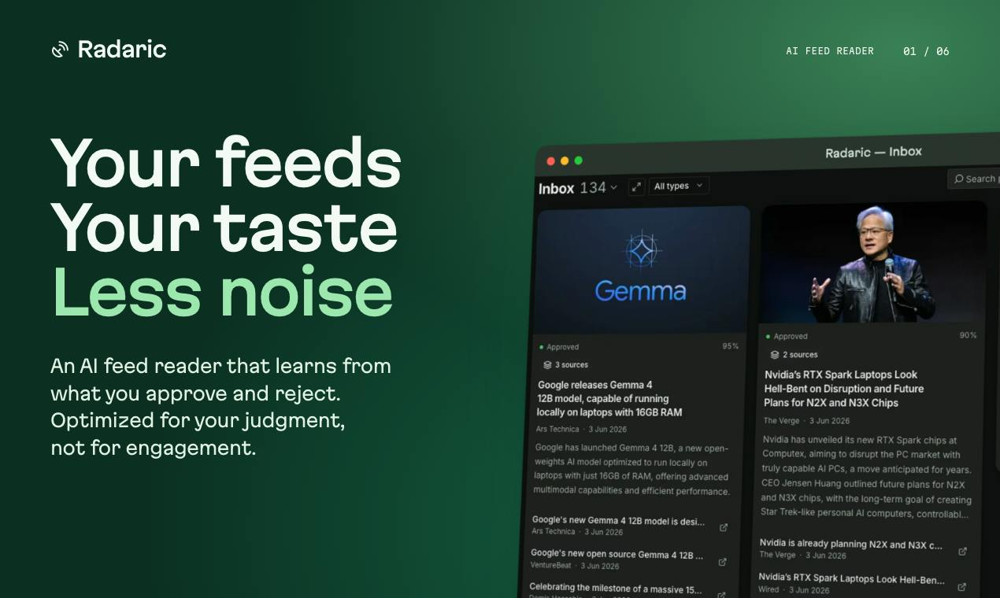
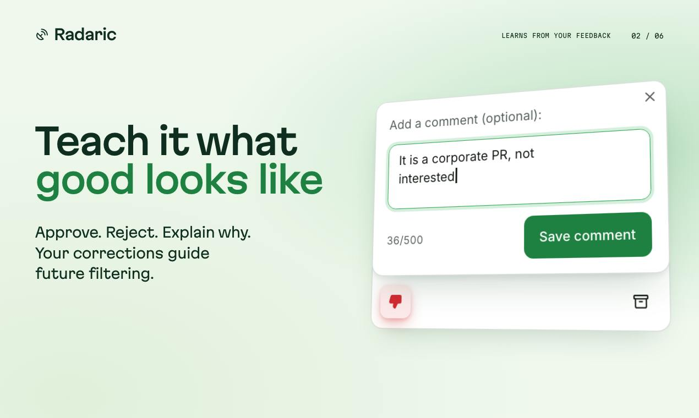
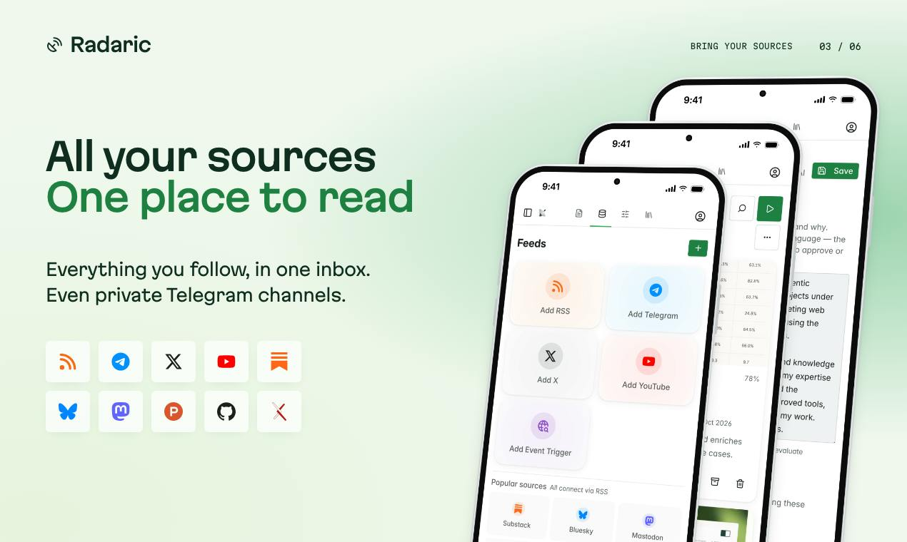

---

## 17. [Bits](https://www.producthunt.com/products/bits-4)
**Votes**: 82 | **도입 난이도**: 중 | **신뢰도**: 상
**Tagline**: An open-source personal agent that gets you things done
**서비스 링크**: https://www.producthunt.com/r/IEYWDNKFWJN7QM

**태그**: Automation, OpenSource, AI Agent, Productivity, Privacy, Agent, AI Tool

### 📌 이 서비스 한눈에 보기
로컬 환경에서 실행되며 사용자의 명령을 수행하는 오픈소스 개인용 AI 에이전트

### 🔑 주요 기능
- 백그라운드 데몬 방식으로 앱 종료 후에도 작업 지속 및 스케줄링 지원
- 모든 데이터(메모리)를 읽고 편집 가능한 마크다운 파일로 저장
- 로컬 모델을 포함한 다양한 AI 모델과 호환 및 보안 검토(Sentinel) 기능

### 🙋 사용자에게 어떤 점이 좋은가
개인용 컴퓨터에서 24시간 중단 없이 자동화 작업을 수행하며, 데이터가 로컬에 저장되어 프라이버시와 제어권을 확보할 수 있습니다.

### ✅ 지금 바로 써볼 기능
- ⌥Space 단축키를 통한 빠른 실행 테스트
- 마크다운 파일을 통한 메모리 편집 및 관리
- 로컬 모델 연결을 통한 프라이버시 중심 작업 수행

### ⚠️ 사용 전 확인할 점
- 로컬 리소스를 사용하는 데몬 방식이므로 시스템 성능에 영향을 줄 수 있음
- 사용자 직접 제어(Sentinel)가 필요하므로 초기 설정 및 보안 정책 이해가 필요함

### 🧭 확인이 더 필요한 정보
사용자의 하드웨어 사양에 따른 최적의 성능과 구체적인 로컬 모델 호환 범위 확인이 필요합니다.

### 📸 스크린샷 및 갤러리
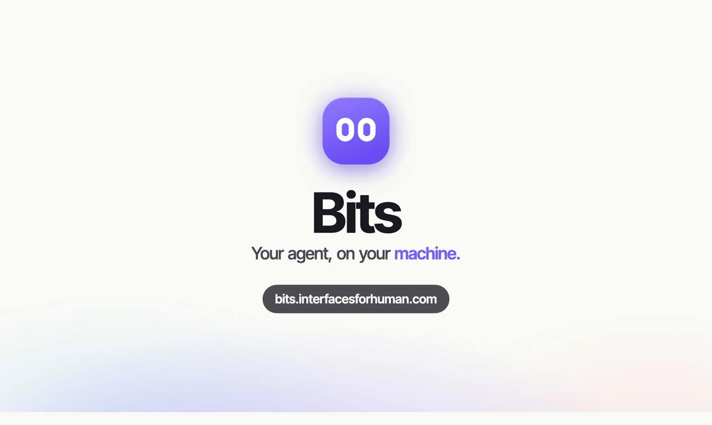
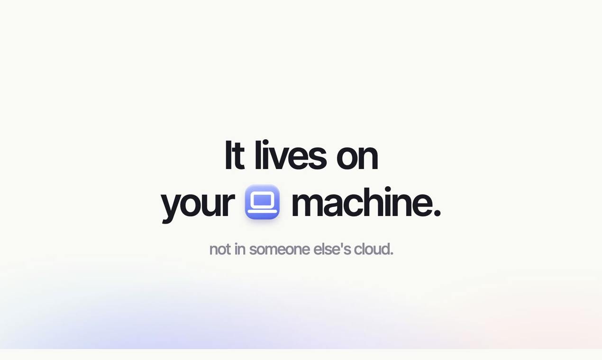
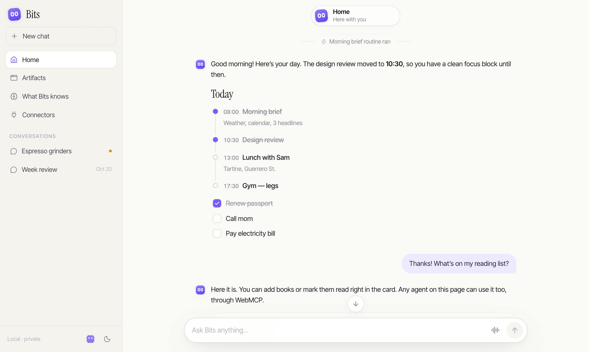

### 🎬 관련 영상
- [🎥 영상 보기](https://ph-files.imgix.net/5a389b9b-8be2-43d8-a855-f3529174e0e0.jpeg?auto=format)

---

## 18. [Kugel Ear](https://www.producthunt.com/products/kugelaudio)
**Votes**: 79 | **도입 난이도**: 하 | **신뢰도**: 상
**Tagline**: Speech-to-text that only asks when it's unsure
**서비스 링크**: https://www.producthunt.com/r/ZFYHTNMQCHEVUE

**태그**: AI, STT, Voice-Agent, Automation, Agent

### 📌 이 서비스 한눈에 보기
불확실한 단어만 골라 질문하여 대화의 흐름을 깨지 않는 지능형 STT 솔루션

### 🔑 주요 기능
- 불확실한 단어만 선별하여 사용자에게 질문하는 효율적인 STT 방식
- 여러 철자 후보를 제공하여 한 번의 질문으로 정확도를 높이는 기능
- 시간당 €0.48의 합리적인 비용 구조

### 🙋 사용자에게 어떤 점이 좋은가
음성 에이전트가 모든 단어를 일일이 확인하는 대신, 모르는 부분만 사람처럼 자연스럽게 물어볼 수 있어 사용자 경험을 극대화합니다.

### ✅ 지금 바로 써볼 기능
- 음성 에이전트 워크플로우에 API 연동 테스트
- 불확실한 단어 플래그 및 후보군 확인 기능 검토
- 시간당 비용 기반의 운영 예산 산출

### ⚠️ 사용 전 확인할 점
- 음성 에이전트의 대화 흐름에 미치는 영향도 확인 필요
- 정확도가 낮은 단어의 후보군 생성 로직 검토

### 🧭 확인이 더 필요한 정보
상세한 API 연동 방식과 지원되는 언어 범위에 대한 정보가 필요합니다.

### 📸 스크린샷 및 갤러리
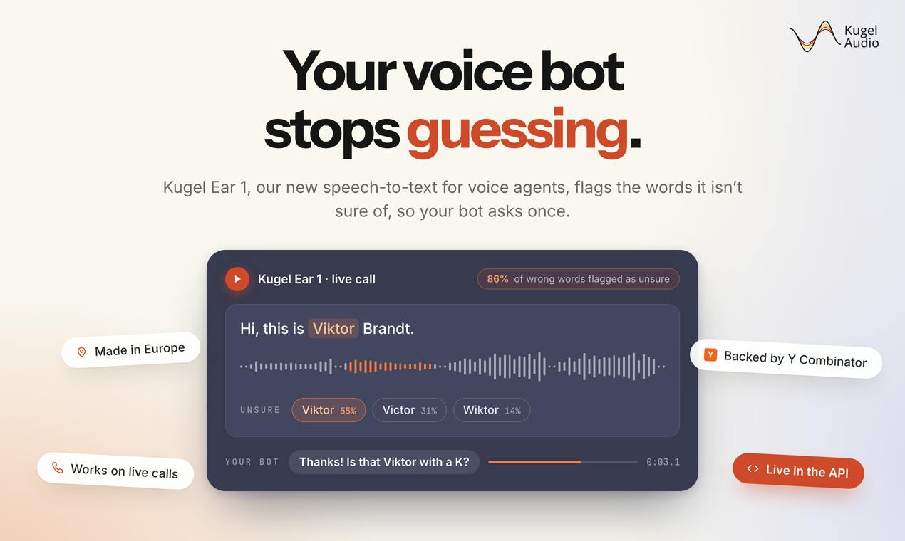
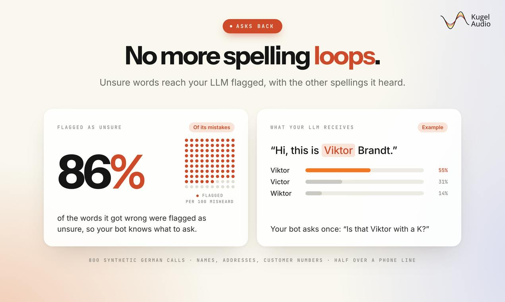
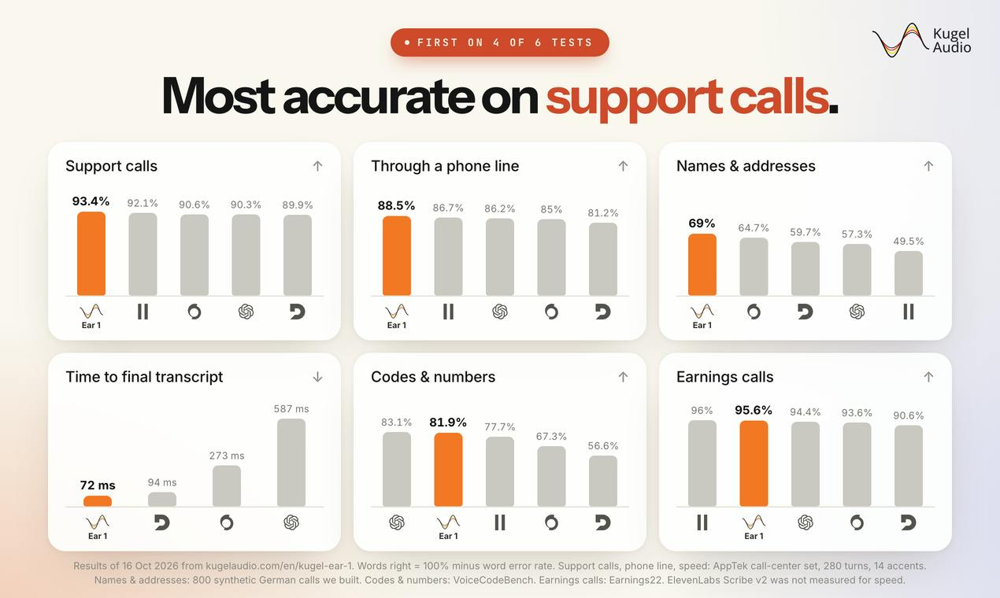

### 🎬 관련 영상
- [🎥 영상 보기](https://ph-files.imgix.net/8af84bd1-b76d-45a6-9e10-6ee28a65e8bc.jpeg?auto=format)

---

## 19. [Archivist](https://www.producthunt.com/products/archivist)
**Votes**: 76 | **도입 난이도**: 하 | **신뢰도**: 상
**Tagline**: From messy filenames to shareable collections
**서비스 링크**: https://www.producthunt.com/r/2A7LI353P7K3TD

**태그**: Productivity, FileManagement, Automation, Collaboration, AI Tool, Video, Vision

### 📌 이 서비스 한눈에 보기
복잡한 파일명을 자동 정리하고 깔끔한 공유 컬렉션을 만드는 파일 관리 도구

### 🔑 주요 기능
- 사용자 정의 규칙에 따른 이미지 및 비디오 파일명 자동 생성
- 클라이언트별 파일 관리 및 자동화된 컬렉션 생성 기능
- 정리된 파일들을 하나의 깔끔한 링크로 즉시 공유

### 🙋 사용자에게 어떤 점이 좋은가
파일 이름을 일일이 수정하는 번거로움을 줄이고, 클라이언트에게 전문적인 느낌의 파일 묶음을 링크 하나로 간편하게 전달할 수 있습니다.

### ✅ 지금 바로 써볼 기능
- 5개 파일 무료로 파일명 자동 생성 테스트하기
- 자신만의 파일 명명 규칙(Naming Convention) 설정해보기
- 클라이언트 공유용 컬렉션 링크 생성해보기

### ⚠️ 사용 전 확인할 점
- 현재 웹 기반이며 Mac 앱은 출시 예정임
- 무료 사용 시 파일 개수 제한(5개)이 있음

### 🧭 확인이 더 필요한 정보
Mac 앱 출시 일정과 상세한 유료 플랜 정책은 현재 명시되어 있지 않습니다.

### 📸 스크린샷 및 갤러리
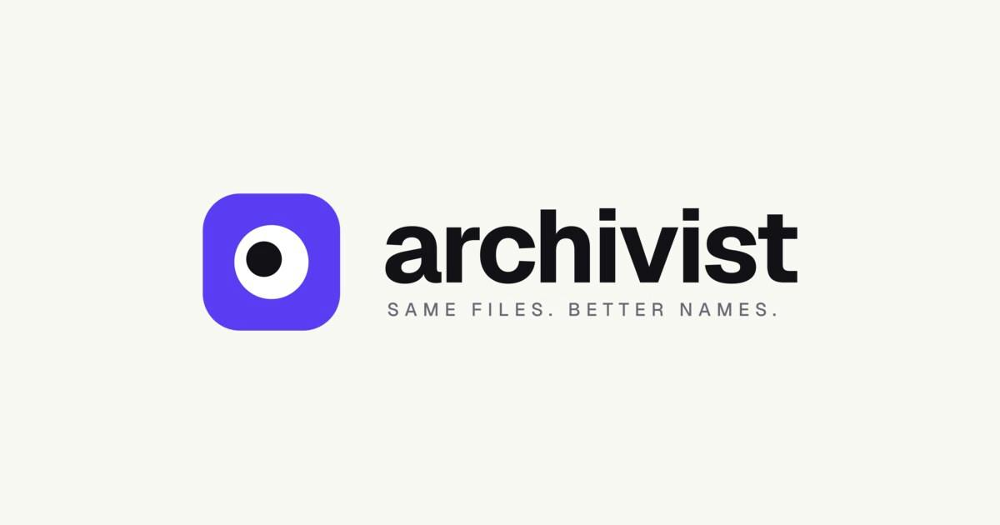

### 🎬 관련 영상
- [🎥 영상 보기](https://ph-files.imgix.net/71fc9ef1-46c4-4001-9923-75ae2a4bc438.jpeg?auto=format)

---

## 20. [Playad](https://www.producthunt.com/products/playad)
**Votes**: 76 | **도입 난이도**: 하 | **신뢰도**: 상
**Tagline**: Hire your AI Marketing Team
**서비스 링크**: https://www.producthunt.com/r/N4RZ7ZQP6QMGU7

**태그**: Marketing, Automation, AI, Advertising, AI Tool, Chat, Video, Vision

### 📌 이 서비스 한눈에 보기
브랜드 학습부터 광고 제작 및 집행까지 자동화하는 AI 마케팅 팀

### 🔑 주요 기능
- 채팅 한 번으로 경쟁사 조사, 광고 제작, 캠페인 실행까지 통합 관리
- 브랜드 정체성을 학습하여 이미지 및 영상 광고를 자동 생성
- 지속적인 실험과 성과 분석을 통한 자동 최적화 및 리포트 제공

### 🙋 사용자에게 어떤 점이 좋은가
광고 제작과 운영에 드는 반복적인 업무를 자동화하여, 사용자는 전략적 의사결정과 승인에만 집중할 수 있습니다.

### ✅ 지금 바로 써볼 기능
- 채팅 인터페이스를 통한 브랜드 프로필 설정
- 경쟁사 분석 및 타겟 리서치 기능 실행
- AI 생성 광고 소재 검토 및 승인 프로세스 테스트

### ⚠️ 사용 전 확인할 점
- AI가 생성한 광고 소재의 브랜드 적합성 최종 검토 필요
- 실제 광고 집행 비용 및 매체별 연동 범위 확인 필요

### 🧭 확인이 더 필요한 정보
지원하는 광고 매체(Meta, Google 등)의 종류와 실제 광고 집행 예산 관리 방식에 대한 구체적인 정보가 필요합니다.

### 📸 스크린샷 및 갤러리

### 🎬 관련 영상
- [🎥 영상 보기](https://ph-files.imgix.net/c01e9c6b-2cec-4b69-88a4-639edec91557.jpeg?auto=format)
- [🎥 영상 보기](https://ph-files.imgix.net/eab24cf3-2870-47e4-9659-3d11106be583.jpeg?auto=format)

---

## 21. [Claire Mail](https://www.producthunt.com/products/claire-mail)
**Votes**: 74 | **도입 난이도**: 하 | **신뢰도**: 상
**Tagline**: Email, calendar and reminders, in one fast app
**서비스 링크**: https://www.producthunt.com/r/P4ZU2MSZHBGS7I

**태그**: Productivity, AI, Automation, Workflow, AI Tool, Email

### 📌 이 서비스 한눈에 보기
이메일, 일정, 할 일을 하나로 통합하여 AI가 업무를 관리해 주는 올인원 생산성 앱

### 🔑 주요 기능
- Gmail, Google Calendar, Apple Reminders의 통합 관리
- AI를 통한 인박(Inbox) 분류 및 자동 정리
- 일일 브리핑 및 미팅 준비 자동화

### 🙋 사용자에게 어떤 점이 좋은가
여러 앱을 오가는 번거로움 없이 하나의 앱에서 일정과 업무를 관리할 수 있어 업무 흐름이 끊기지 않습니다.

### ✅ 지금 바로 써볼 기능
- Gmail 및 캘린더 계정 연동하기
- AI가 작성한 일일 브리핑 확인하기
- AI를 통한 미팅 준비 기능 테스트하기

### ⚠️ 사용 전 확인할 점
- Google 및 Apple 서비스 계정 접근 권한 필요
- AI가 개인적인 이메일 내용을 분석하므로 보안 및 프라이버시 정책 확인 필요

### 🧭 확인이 더 필요한 정보
AI의 데이터 처리 방식과 개인정보 보호 수준에 대한 상세 정책 확인이 필요합니다.

### 📸 스크린샷 및 갤러리

### 🎬 관련 영상
- [🎥 영상 보기](https://ph-files.imgix.net/42c48df6-c18d-435c-82b3-4bb0f2c71ea5.jpeg?auto=format)

---

## 22. [Teclo](https://www.producthunt.com/products/teclo)
**Votes**: 73 | **도입 난이도**: 하 | **신뢰도**: 상
**Tagline**: Mechanical keyboard sounds and a keycap pet for your Mac
**서비스 링크**: https://www.producthunt.com/r/6QKMSHXZ4AC4HH

**태그**: Productivity, Mac, Customization, Lifestyle

### 📌 이 서비스 한눈에 보기
어떤 앱에서도 기계식 키보드 타건음을 즐길 수 있는 Mac용 사운드 및 키캡 펫 앱

### 🔑 주요 기능
- 모든 앱에서 작동하는 기계식 키보드 타건음 재생
- 타이핑 속도에 반응하며 성장하는 키캡 펫 기능
- 10종의 다양한 사운드 팩 제공

### 🙋 사용자에게 어떤 점이 좋은가
물리적인 기계식 키보드 없이도 Mac에서 타건감을 시뮬레이션하여 타이핑의 즐거움을 더해줍니다.

### ✅ 지금 바로 써볼 기능
- 7일 무료 체험을 통해 타건음 품질 확인하기
- 다양한 10종의 사운드 팩 들어보기
- 타이핑 페이스에 따른 키캡 펫 반응 확인하기

### ⚠️ 사용 전 확인할 점
- 일회성 구매(USD 4.99) 모델이며 7일 무료 체험 후 유료 전환됨
- Mac 메뉴바에서 작동하는 앱이므로 macOS 환경에 국한됨

### 🧭 확인이 더 필요한 정보
사용자의 하드웨어 사양에 따른 사운드 지연 시간(Latency) 여부는 명시되지 않았습니다.

### 📸 스크린샷 및 갤러리

---

## 23. [Notif](https://www.producthunt.com/products/notif-2)
**Votes**: 72 | **도입 난이도**: 하 | **신뢰도**: 상
**Tagline**: AI for your Apple Reminders
**서비스 링크**: https://www.producthunt.com/r/O7SAXM7SLMPRP5

**태그**: Productivity, AI, Apple, Automation, AI Tool

### 📌 이 서비스 한눈에 보기
애플 리마인더를 지능형 실행 도구로 변환하는 AI 비서

### 🔑 주요 기능
- 메모를 분석하여 유용한 인사이트와 다음 단계 실행 버튼(지도, 예약 등) 자동 생성
- 애플 리마인더 기반으로 모든 기기 동기화, Siri 및 위젯 완벽 지원
- 계정 생성 없는 간편한 사용과 Face ID 기반의 강력한 보안

### 🙋 사용자에게 어떤 점이 좋은가
단순한 할 일 목록을 넘어, 메모 작성 즉시 다음 행동을 제안받아 생산성을 높일 수 있습니다.

### ✅ 지금 바로 써볼 기능
- 평소처럼 메모를 작성하여 AI 인사이트 확인하기
- 생성된 액션 버튼을 통해 다음 단계로 즉시 이동하기
- Face ID를 설정하여 개인적인 메모 보안 강화하기

### ⚠️ 사용 전 확인할 점
- 무제한 인사이트 기능을 사용하려면 Pro 버전 구독 필요
- 애플 생태계(iOS/macOS) 환경에 최적화되어 있음

### 🧭 확인이 더 필요한 정보
Pro 버전의 정확한 구독 가격과 결제 방식은 명시되어 있지 않습니다.

### 📸 스크린샷 및 갤러리

### 🎬 관련 영상
- [🎥 영상 보기](https://ph-files.imgix.net/683dc69b-15d5-40a3-8b53-ff307603a794.jpeg?auto=format)

---

## 24. [Sponkly](https://www.producthunt.com/products/sponkly)
**Votes**: 71 | **도입 난이도**: 하 | **신뢰도**: 상
**Tagline**: Live voice translation for chats, calls, meetings & YouTube
**서비스 링크**: https://www.producthunt.com/r/FISHCF3LEQRHIV

**태그**: Translation, Communication, Productivity, AI, Collaboration, Chat

### 📌 이 서비스 한눈에 보기
언어 장벽 없이 실시간 대화와 영상 시청을 가능하게 하는 AI 통번역 솔루션

### 🔑 주요 기능
- 32개 언어를 지원하는 실시간 자막 및 자연스러운 음성 번역
- 채팅, 통화, 화상 회의(Zoom, Meet, Teams) 및 YouTube 지원
- 종단간 암호화(E2EE)를 통한 보안 채팅 기능 제공

### 🙋 사용자에게 어떤 점이 좋은가
글로벌 협업이나 외국어 강의 시 실시간 자막과 음성 번역을 통해 언어 장벽 없이 즉각적인 소통이 가능합니다.

### ✅ 지금 바로 써볼 기능
- Chrome 확장 프로그램을 설치하여 YouTube 및 화상 회의에 적용하기
- 웹 또는 Android 앱에서 실시간 채팅 기능 테스트하기
- 다국어 환경에서의 음성 번역 품질 확인하기

### ⚠️ 사용 전 확인할 점
- iPhone용 앱은 아직 출시 전임
- 실시간 음성 번역의 지연 시간이나 번역 정확도 차이가 있을 수 있음

### 🧭 확인이 더 필요한 정보
사용자 수 증가에 따른 서버 안정성 및 상세 유료 플랜 정책을 확인해야 합니다.

### 📸 스크린샷 및 갤러리

### 🎬 관련 영상
- [🎥 영상 보기](https://ph-files.imgix.net/689c1f95-4a3e-41df-880c-7ffcae8749e7.jpeg?auto=format)

---

## 25. [Grigora](https://www.producthunt.com/products/grigora)
**Votes**: 69 | **도입 난이도**: 하 | **신뢰도**: 상
**Tagline**: AI website builder with built-in stores and newsletters
**서비스 링크**: https://www.producthunt.com/r/WXVXS47SKNSH6O

**태그**: NoCode, AI, E-commerce, Marketing, SaaS, AI Tool, Chat, Vision

### 📌 이 서비스 한눈에 보기
AI 대화로 웹사이트 구축부터 쇼핑몰, 뉴스레터까지 한 번에 해결하는 올인원 비즈니스 빌더

### 🔑 주요 기능
- AI 채팅과 스크린샷을 활용한 직관적인 웹사이트 생성 및 편집
- 호스팅, SSL, CDN이 포함된 원클릭 배포 환경 제공
- 제품 관리(재고/주문), SEO, 뉴스레터 발송 등 비즈니스 운영 기능 통합

### 🙋 사용자에게 어떤 점이 좋은가
아이디어만 있으면 복잡한 코딩 없이 웹사이트를 만들고, 동시에 판매와 고객 관리를 한 곳에서 처리할 수 있어 운영 효율이 극대화됩니다.

### ✅ 지금 바로 써볼 기능
- 아이디어 설명 및 스크린샷을 통한 AI 웹사이트 생성
- 자체 도메인 연결 및 배포 테스트
- 스토어 기능 및 뉴스레터 설정

### ⚠️ 사용 전 확인할 점
- 14일 무료 체험 기간 종료 후 유료 플랜 전환 필요
- 복잡한 커스텀 기능이나 대규모 엔터프라이즈급 요구사항 충족 여부 확인 필요

### 🧭 확인이 더 필요한 정보
상세한 유료 플랜의 가격 체계와 기능별 제한 사항에 대한 정보가 부족합니다.

### 📸 스크린샷 및 갤러리

### 🎬 관련 영상
- [🎥 영상 보기](https://ph-files.imgix.net/1caba26d-972e-4ef2-a1b3-616007ef3e14.jpeg?auto=format)

---

## 26. [Concierge by Juniors AI](https://www.producthunt.com/products/concierge-by-juniors-ai)
**Votes**: 69 | **도입 난이도**: 중 | **신뢰도**: 상
**Tagline**: Omni-channel AI-first customer support (6 months free)
**서비스 링크**: https://www.producthunt.com/r/J325FSUB3PGE7Y

**태그**: CustomerSupport, AI, Automation, SaaS, Omnichannel, Agent, AI Tool, Chat, Email

### 📌 이 서비스 한눈에 보기
여러 채널의 고객 문의를 하나로 통합하고 AI로 자동화하는 올인원 고객 지원 솔루션

### 🔑 주요 기능
- WhatsApp, Instagram, 이메일, 인앱 채팅을 하나의 워크스페이스로 통합
- 반복적인 요청 자동화 및 필요 시 상담원 수동 전환 기능 제공
- 자체 데이터 기반의 질의응답 및 AI/상담원 성과 추적 기능

### 🙋 사용자에게 어떤 점이 좋은가
여러 채널로 분산된 고객 문의를 한곳에서 관리하며, AI 자동화를 통해 단순 반복 업무를 줄이고 데이터 기반의 효율적인 지원이 가능합니다.

### ✅ 지금 바로 써볼 기능
- 통합 워크스페이스에 소셜/이메일 채널 연결하기
- 반복되는 문의에 대한 AI 자동 응답 설정하기
- 자체 데이터베이스를 연결하여 AI 지식 베이스 구축하기

### ⚠️ 사용 전 확인할 점
- BYOI(Bring Your Own Infrastructure) 모델로 데이터베이스, Redis, AI API 키를 직접 연결해야 함
- 사용자의 인프라 설정 역량에 따라 초기 구축 난이도가 달라질 수 있음

### 🧭 확인이 더 필요한 정보
사용자의 인프라를 직접 연결하는 방식이므로, 기존 시스템과의 호환성 및 보안 설정 과정을 사전에 확인해야 합니다.

### 📸 스크린샷 및 갤러리

### 🎬 관련 영상
- [🎥 영상 보기](https://ph-files.imgix.net/ee05295f-dc9b-410d-b99b-97f9c42d2130.jpeg?auto=format)

---

## 27. [Kalender Sync](https://www.producthunt.com/products/kalender-sync)
**Votes**: 68 | **도입 난이도**: 하 | **신뢰도**: 상
**Tagline**: Sync your calendars & connect them to ChatGPT, Claude & Co.
**서비스 링크**: https://www.producthunt.com/r/QICYHSJYGXE3GQ

**태그**: Productivity, Automation, AI, Calendar, Agent, AI Tool, Chat

### 📌 이 서비스 한눈에 보기
여러 개의 캘린더를 동기화하고 AI 에이전트와 연결하여 일정 관리를 자동화하는 도구

### 🔑 주요 기능
- Google, Outlook, iCloud 및 CalDAV 캘린더 간 단방향/양방향 동기화 지원
- 동기화 범위(바쁨 상태만, 제목/시간, 전체 상세 내용)를 세밀하게 선택 가능
- ChatGPT, Claude 등 AI 모델과 연결하여 일정 확인 및 생성 가능

### 🙋 사용자에게 어떤 점이 좋은가
업무용, 개인용, 클라이언트용 등 분산된 여러 일정을 하나로 통합 관리하면서, AI를 통해 대화만으로 일정을 관리할 수 있습니다.

### ✅ 지금 바로 써볼 기능
- 기존 사용 중인 캘린더(Google, Outlook 등) 연결하기
- 동기화 규칙(Busy only vs Full details) 설정하기
- ChatGPT/Claude에 연결하여 AI 일정 관리 테스트하기

### ⚠️ 사용 전 확인할 점
- 개인 정보 및 일정 상세 내용이 AI 모델로 전달되므로 보안 정책 확인 필요
- 동기화 설정 오류 시 일정 중복이나 누락이 발생할 수 있음

### 🧭 확인이 더 필요한 정보
지원되는 CalDAV 서비스의 전체 목록과 AI 연결 시의 데이터 보안 수준에 대한 상세 정보가 필요합니다.

### 📸 스크린샷 및 갤러리

### 🎬 관련 영상
- [🎥 영상 보기](https://ph-files.imgix.net/e7e43ac1-62ea-4e66-b822-eebf47defac3.jpeg?auto=format)

---

## 28. [Agentic CleanSlop](https://www.producthunt.com/products/cleanslop)
**Votes**: 60 | **도입 난이도**: 하 | **신뢰도**: 상
**Tagline**: Authenticate, scan and fix your app from your agent
**서비스 링크**: https://www.producthunt.com/r/OPS3V4FY43K5UA

**태그**: DevTool, AI-Agent, Automation, TypeScript, Node.js, Agent

### 📌 이 서비스 한눈에 보기
AI 에이전트 환경에서 앱의 오류를 스캔하고 즉시 수정하는 자동화 도구

### 🔑 주요 기능
- Claude Code, Cursor 등 주요 AI 코딩 에이전트와 연동되는 워크플로우
- Stripe Link를 통한 간편 인증으로 별도의 가입이나 비밀번호 없이 사용 가능
- TypeScript/Node.js 앱의 사용자 관점 오류를 스캔하고 자동 수정

### 🙋 사용자에게 어떤 점이 좋은가
개발자가 코딩 에이전트를 사용하는 도중에 별도의 브라우저 이동 없이 앱의 결함을 확인하고 즉각적인 수정 제안을 받을 수 있습니다.

### ✅ 지금 바로 써볼 기능
- 사용 중인 AI 에이전트(Cursor, Claude Code 등)에 한 줄 코드 붙여넣기
- Stripe Link를 통한 간편 인증 진행
- 에이전트가 제안하는 코드 수정 사항 검토 및 승인

### ⚠️ 사용 전 확인할 점
- TypeScript/Node.js 환경에 특화되어 있어 다른 언어에서는 제한적일 수 있음
- 에이전트가 코드를 직접 수정하므로 실행 전 변경 사항 검토 필수

### 🧭 확인이 더 필요한 정보
지원하는 프로그래밍 언어의 확장 범위와 보안 정책에 대한 상세 정보가 필요합니다.

### 📸 스크린샷 및 갤러리

### 🎬 관련 영상
- [🎥 영상 보기](https://ph-files.imgix.net/43d060bc-bb22-41d6-8c3b-1b9abbaf61ba.jpeg?auto=format)

---

## 29. [Tetriz Engg Intelligence + Connectors](https://www.producthunt.com/products/tetriz-engg-intelligence-connectors)
**Votes**: 57 | **도입 난이도**: 중 | **신뢰도**: 상
**Tagline**: Connect coding sessions to PRs, issues, quality, and ROI
**서비스 링크**: https://www.producthunt.com/r/LAYEOQVFSXKMIG

**태그**: DevTool, Engineering-Intelligence, Open-Source, Analytics, Productivity, AI Tool

### 📌 이 서비스 한눈에 보기
GitHub, Jira 등 다양한 도구를 연결하여 개발 작업의 복잡도와 ROI를 분석하는 엔지니어링 인텔리전스 도구

### 🔑 주요 기능
- GitHub, Jira 등 7개 이상의 도구와 연동되는 오픈소스 엔지니어링 인텔리전스
- 코딩 세션과 PR, 이슈, 품질 간의 관계를 연결하여 작업 복잡도 파악
- AI 지원 작업과 일반 작업의 성과 비교 및 품질을 고려한 ROI 측정

### 🙋 사용자에게 어떤 점이 좋은가
개발 프로세스 전반을 시각화하여 버그 발생 가능성을 예측하고, 코딩 작업이 실제 비즈니스 가치로 어떻게 이어지는지 정량적으로 확인할 수 있습니다.

### ✅ 지금 바로 써볼 기능
- GitHub 및 Jira 커넥터 연결하기
- 코딩 세션과 배포 결과물 간의 데이터 매핑 확인
- AI 기반 작업의 생산성 및 품질 지표 분석

### ⚠️ 사용 전 확인할 점
- 다양한 도구 연동 시 데이터 보안 및 권한 설정 확인 필요
- 측정된 ROI 지표가 실제 비즈니스 성과와 일치하는지 검증 필요

### 🧭 확인이 더 필요한 정보
지원되는 7개 이상의 도구 목록과 구체적인 데이터 보안 정책에 대한 확인이 필요합니다.

### 📸 스크린샷 및 갤러리

---

## 30. [Wishes MCP](https://www.producthunt.com/products/wishes-2)
**Votes**: 29 | **도입 난이도**: 하 | **신뢰도**: 상
**Tagline**: Tell your AI what you love, it goes on your wishlist
**서비스 링크**: https://www.producthunt.com/r/DRTHFZYT2TFPJR

**태그**: AI, Productivity, Lifestyle, Shopping, AI Tool, Chat

### 📌 이 서비스 한눈에 보기
AI 대화만으로 위시리스트를 만들고 공유하는 간편한 선물 관리 도구

### 🔑 주요 기능
- AI 클라이언트(ChatGPT, Claude 등)와 위시리스트를 URL 및 OAuth로 연결
- 대화 중 좋아하는 것을 말하면 자동으로 위시리스트에 저장 및 쇼핑 링크 생성
- 가족 및 지인과 리스트를 공유하여 중복 선물 방지

### 🙋 사용자에게 어떤 점이 좋은가
별도의 복잡한 입력 없이 AI와 대화하는 것만으로 위시리스트를 관리할 수 있어 선물 아이디어를 정리하기 매우 편리합니다.

### ✅ 지금 바로 써볼 기능
- OAuth를 통해 사용 중인 AI 클라이언트 연결하기
- AI에게 평소 좋아하는 물건들을 말해 위시리스트 채우기
- 생성된 리스트를 가족이나 친구에게 공유하기

### ⚠️ 사용 전 확인할 점
- AI 클라이언트의 MCP(Model Context Protocol) 지원 여부에 따라 사용 가능 여부가 달라질 수 있음
- 개인적인 취향 데이터가 외부 서비스에 저장됨

### 🧭 확인이 더 필요한 정보
사용자의 특정 AI 클라이언트 환경에서 MCP 프로토콜이 어떻게 작동하는지에 대한 기술적 세부 사항 확인이 필요합니다.

### 📸 스크린샷 및 갤러리

---

