# 🚀 Product Hunt Daily Top 30 (2026-10-24)

## 오늘의 요약
오늘의 트렌드는 AI 에이전트의 실시간 상호작용과 초고속 콘텐츠 생성 기술에 집중되었습니다. 특히 영상 제작과 프론트엔드 개발 등 전문적인 워크플로우를 자동화하고, 지연 시간을 최소화하여 인간과 유사한 반응 속도를 구현하는 솔루션들이 주목받았습니다.

### 오늘의 핵심 포인트
- 초저지연 음성 모델과 초고속 영상 생성 모델이 등장하며 AI와의 실시간 상호작용이 더욱 자연스러워졌습니다.
- 단순한 챗봇을 넘어 사용자의 맥락을 기억하거나 복잡한 워크플로우를 자동화하는 개인형 AI 에이전트가 강화되었습니다.
- 데이터 추출 및 코드 생성 등 특정 목적에 최적화된 효율적인 AI 모델들이 개발 생산성을 높이고 있습니다.

**오늘의 태그**: AI 에이전트, 생성형 AI, 자동화, 실시간 워크플로우

## 1. [Product Hunt Visual Launch Editor](https://www.producthunt.com/products/producthunt)
**Votes**: 314 | **도입 난이도**: 하 | **신뢰도**: 상
**Tagline**: See your launch as you build it
**서비스 링크**: https://www.producthunt.com/r/Y7DEMV6KEGC3FT

**태그**: Productivity, NoCode, Marketing, AI Tool

### 📌 이 서비스 한눈에 보기
실시간 미리보기를 통해 직관적으로 제품 출시를 준비하는 비주얼 에디터

### 🔑 주요 기능
- 실시간 미리보기: 편집과 동시에 최종 출시 모습을 즉시 확인 가능
- 인플레이스(In-place) 편집: 이름, 태그라인, 갤러리 등을 클릭하여 즉시 수정
- 통합 워크플로우: 초안, 예약, 라이브 출시가 모두 동일한 에디터에서 관리됨

### 🙋 사용자에게 어떤 점이 좋은가
복잡한 단계 없이 시각적으로 편집할 수 있어 출시 준비 시간을 단축하고, 실수 없이 완벽한 런칭 페이지를 만들 수 있습니다.

### ✅ 지금 바로 써볼 기능
- 체크리스트를 따라 필수 항목 채우기
- 인플레이스 편집 기능으로 텍� 및 이미지 수정하기
- 자동 저장 기능을 활용해 초안 작업하기

### ⚠️ 사용 전 확인할 점
- 기존의 텍스트 기반 편집 방식과 레이아웃 차이가 있을 수 있음

### 🧭 확인이 더 필요한 정보
사용자의 기존 드래프트 데이터가 새로운 에디터로 어떻게 마이그레이션되는지에 대한 상세 정보는 명시되지 않았습니다.

### 📸 스크린샷 및 갤러리
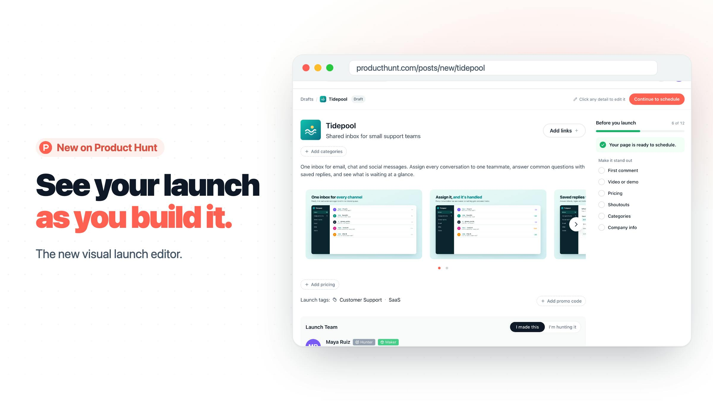
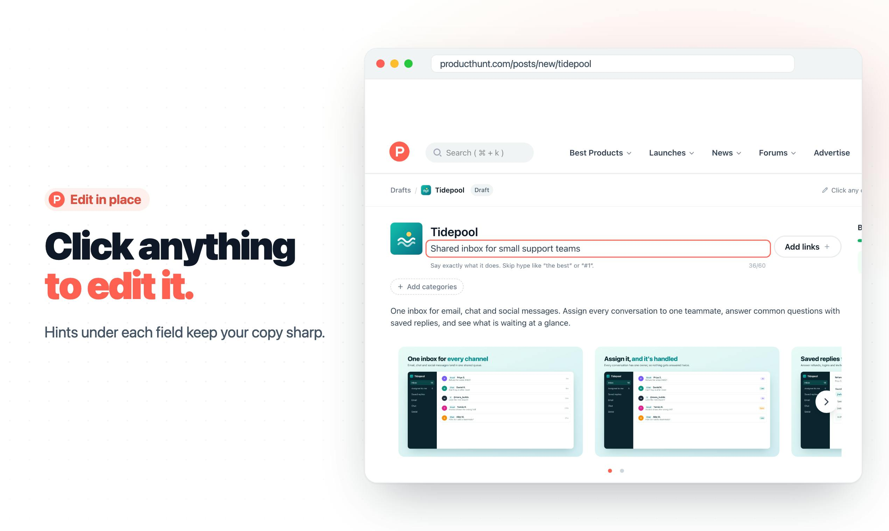
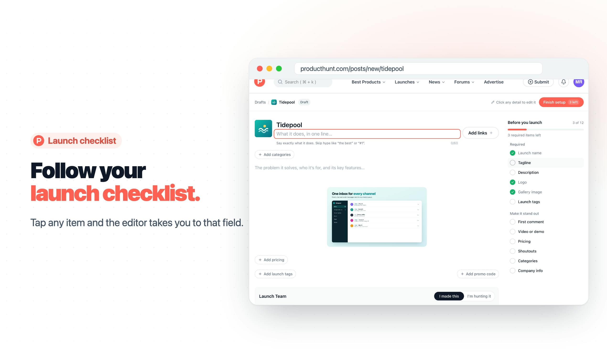

### 🎬 관련 영상
- [🎥 영상 보기](https://ph-files.imgix.net/63e7224f-3120-4869-b8c5-6aca2a63c623.jpeg?auto=format)
- [🎥 영상 보기](https://ph-files.imgix.net/1deb2bc7-c5ed-4376-8cfc-9a97a661df8f.jpeg?auto=format)

---

## 2. [MOVO AI](https://www.producthunt.com/products/movo-ai)
**Votes**: 269 | **도입 난이도**: 하 | **신뢰도**: 상
**Tagline**: The world's first long-form video agent for mobile
**서비스 링크**: https://www.producthunt.com/r/JXYZH5BXNMIBOM

**태그**: AI Video, Mobile-First, Automation, Content Creation, Agent, AI Tool, Chat, Prompting, Video

### 📌 이 서비스 한눈에 보기
모바일에서 복잡한 편집 없이 대화만으로 롱폼 영상을 제작하는 AI 영상 에이전트

### 🔑 주요 기능
- 모바일과 웹을 지원하는 세계 최초의 롱폼 영상 제작 AI 에이전트
- 기획부터 편집, 캐릭터 및 장면 일관성 유지까지 자동화된 워크플로우
- 복잡한 프롬프트나 수동 클립 편집 없이 채팅만으로 영상 완성

### 🙋 사용자에게 어떤 점이 좋은가
전문적인 영상 편집 기술이나 PC 환경 없이도 스마트폰만으로 고품질의 긴 영상을 손쉽게 제작할 수 있습니다.

### ✅ 지금 바로 써볼 기능
- 아이디어 또는 촬영 영상 업로드하기
- 채팅을 통해 영상 계획 및 스타일 요청하기
- 생성된 영상 검토 및 피드백 전달하기

### ⚠️ 사용 전 확인할 점
- 모바일 환경에서의 세부 편집 제약 가능성
- AI 생성 결과물의 창의적 의도 반영 정도

### 🧭 확인이 더 필요한 정보
현재 제공되는 영상의 최대 길이와 생성 가능한 해상도에 대한 구체적인 정보가 필요합니다.

### 📸 스크린샷 및 갤러리

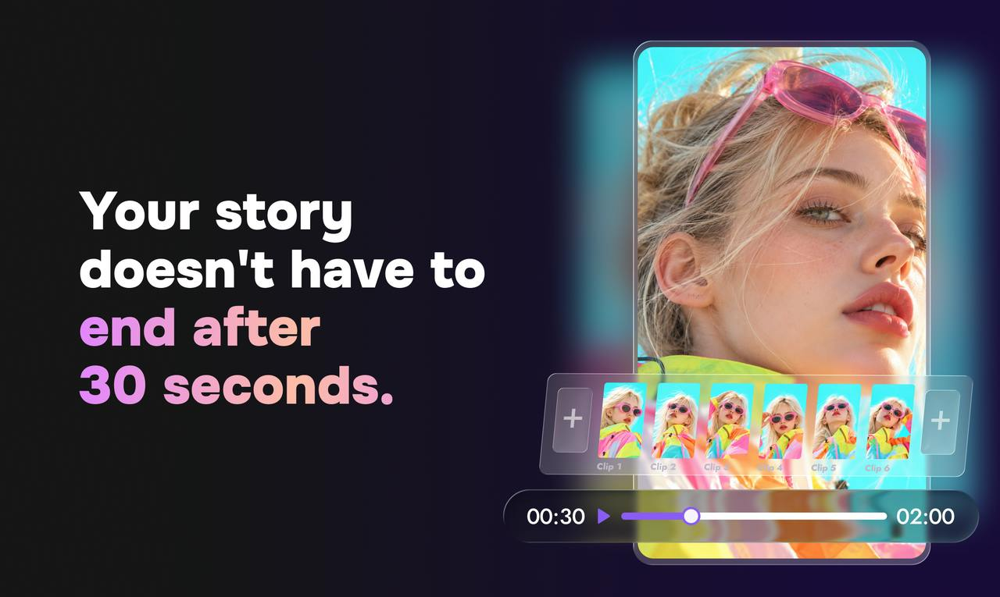
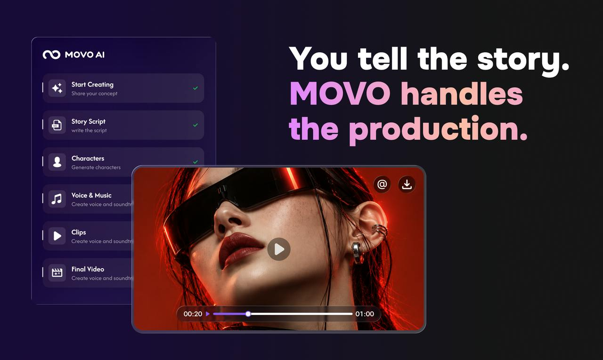

### 🎬 관련 영상
- [🎥 영상 보기](https://ph-files.imgix.net/c0db1ecf-ccf4-4006-accb-51767a6064fc.jpeg?auto=format)

---

## 3. [Agent Hunt](https://www.producthunt.com/products/monid)
**Votes**: 207 | **도입 난이도**: 하 | **신뢰도**: 상
**Tagline**: Live rankings of the tools AI agents use most
**서비스 링크**: https://www.producthunt.com/r/VX6RX4U6IBXRW6

**태그**: AI, Analytics, Leaderboard, Automation, Agent, AI Tool

### 📌 이 서비스 한눈에 보기
AI 에이전트가 실제로 가장 많이 사용하는 도구를 실시간으로 보여주는 순위 보드

### 🔑 주요 기능
- AI 에이전트의 실제 사용 데이터를 기반으로 한 실시간 리더보드
- Monid를 통해 발생하는 실제 호출(calls) 데이터를 바탕으로 순위 산정
- 이론적인 인기가 아닌 실제 워크플로우에서의 활용도를 확인 가능

### 🙋 사용자에게 어떤 점이 좋은가
어떤 AI 도구가 실제 에이전트 환경에서 가장 유용하고 신뢰받는지 객관적인 지표를 통해 파악할 수 있습니다.

### ✅ 지금 바로 써볼 기능
- 실시간 리더보드 순위 확인하기
- 에이전트들이 선호하는 도구 트렌드 분석하기

### ⚠️ 사용 전 확인할 점
- 데이터가 특정 플랫폼(Monid)의 호출에 국한될 수 있음
- 순위가 특정 시점의 일시적인 트렌드를 반영할 수 있음

### 🧭 확인이 더 필요한 정보
순위 산정의 구체적인 알고리즘과 데이터 수집 범위에 대한 상세 정보가 필요합니다.

### 📸 스크린샷 및 갤러리
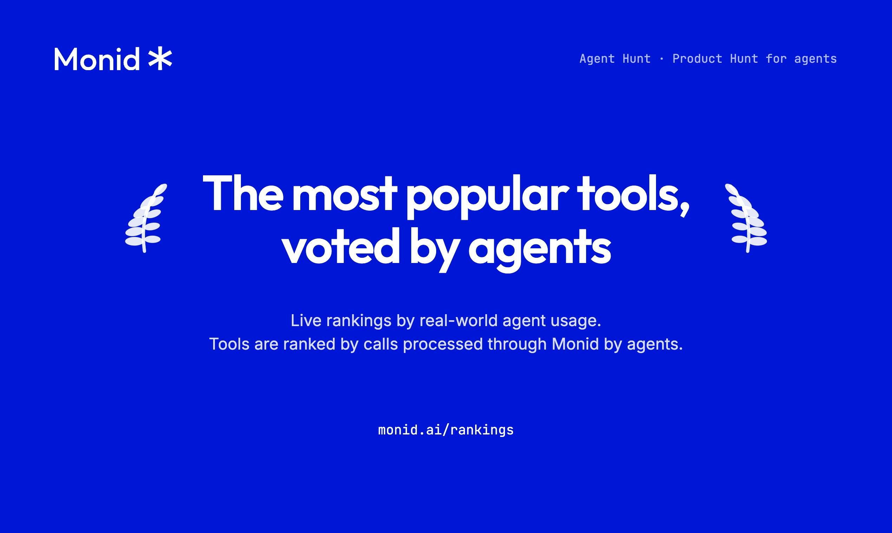
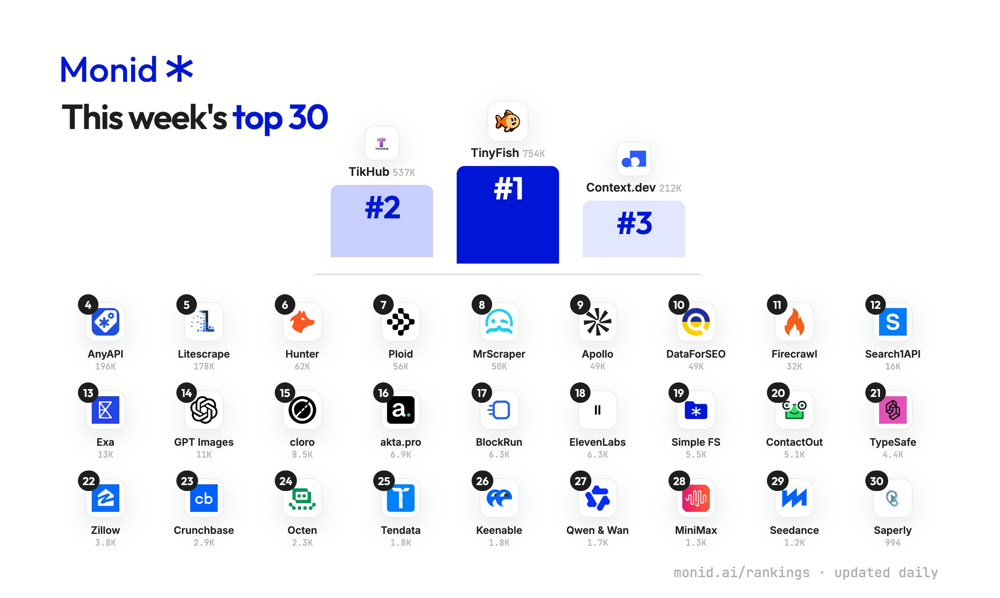
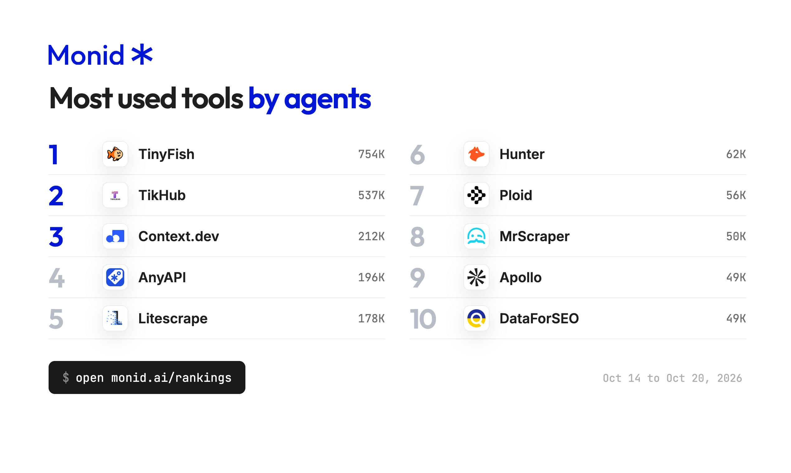

### 🎬 관련 영상
- [🎥 영상 보기](https://ph-files.imgix.net/7fb51944-90bc-4a7d-8f7e-aad102e79bfb.jpeg?auto=format)

---

## 4. [Ovren Live Preview](https://www.producthunt.com/products/ovren)
**Votes**: 176 | **도입 난이도**: 하 | **신뢰도**: 상
**Tagline**: See your product change live before it ships
**서비스 링크**: https://www.producthunt.com/r/GZYWZ6Z6BGE5RV

**태그**: DevTool, Frontend, Automation, Productivity, AI Tool

### 📌 이 서비스 한눈에 보기
자연어로 설명하면 코드를 자동 생성하고 실시간 미리보기를 제공하는 프론트엔드 개발 도구

### 🔑 주요 기능
- 자연어 설명을 통한 프론트엔드 코드 자동 생성
- 실제 프로젝트의 안전한 복사본에서 변경 사항 실시간 미리보기
- 직관적인 승인 절차를 통한 팀 협업 및 PR 병합 프로세스

### 🙋 사용자에게 어떤 점이 좋은가
코드를 직접 수정하기 전에 변경 사항을 실제 페이지에서 즉시 확인하고 검증할 수 있어 개발 생산성을 높여줍니다.

### ✅ 지금 바로 써볼 기능
- 자연어로 간단한 UI 변경 요청해보기
- 생성된 실시간 미리보기 환경에서 클릭 및 인터랙션 테스트하기
- 팀 내 워크플로우와 PR 병합 프로세스 정렬하기

### ⚠️ 사용 전 확인할 점
- 생성된 코드가 기존 프로젝트의 스타일 가이드나 복잡한 로직과 완벽히 호환되는지 확인 필요
- 안전한 복사본 환경이 실제 운영 환경의 데이터나 상태를 완벽히 재현하는지 검토 필요

### 🧭 확인이 더 필요한 정보
지원하는 프레임워크의 범위와 기존 코드베이스와의 통합 수준에 대한 상세 정보가 필요합니다.

### 📸 스크린샷 및 갤러리
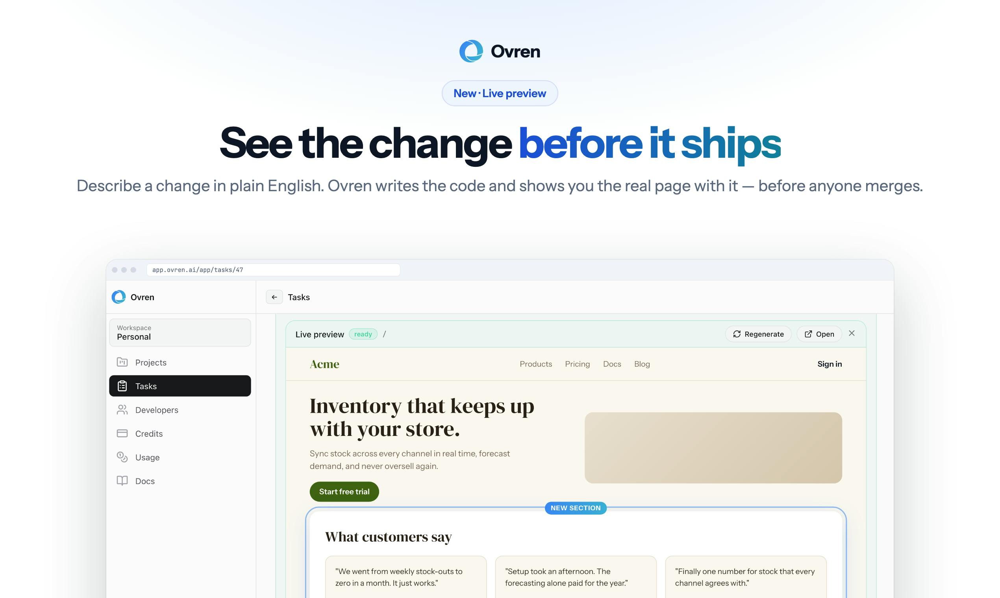
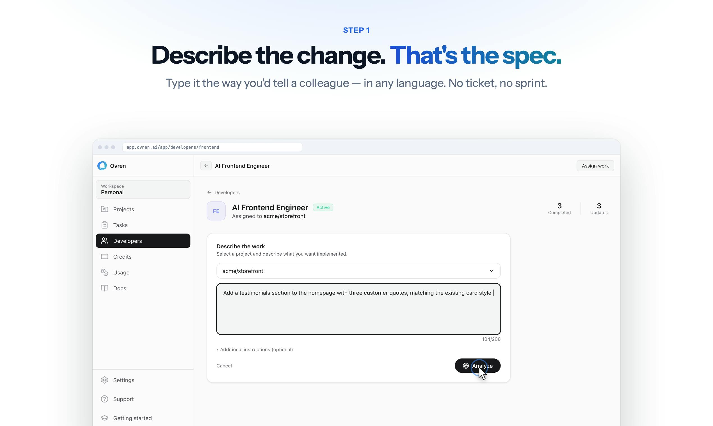
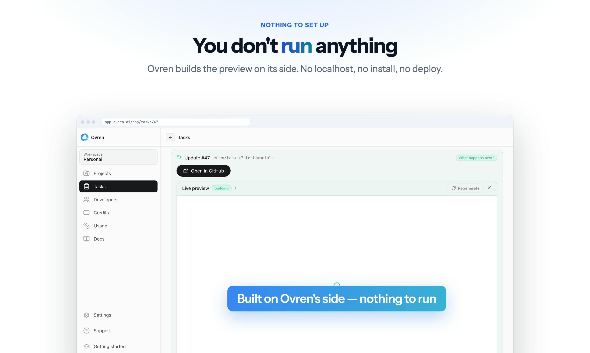

### 🎬 관련 영상
- [🎥 영상 보기](https://ph-files.imgix.net/4608a2ed-db7f-4c71-a72c-e630937fee3d.jpeg?auto=format)

---

## 5. [ElevenLabs Realtime](https://www.producthunt.com/products/realtime-max-mini)
**Votes**: 148 | **도입 난이도**: 하 | **신뢰도**: 상
**Tagline**: Realtime voice agent models with 570ms to first audio
**서비스 링크**: https://www.producthunt.com/r/J2VB5S23Y57R7F

**태그**: AI, Voice-AI, API, Realtime, Agent, AI Tool, LLM

### 📌 이 서비스 한눈에 보기
570ms의 초저지연 응답 속도를 구현한 실시간 음성 에이전트 모델

### 🔑 주요 기능
- 음성 인식부터 LLM, 음성 생성까지 엔드투엔드로 최적화된 speech-to-speech 모델
- 대화용(v1 Mini)과 복잡한 작업용(v1 Max) 두 가지 모델 제공
- 90개 이상의 언어 지원 및 OpenAI 호환 API를 통한 간편한 전환

### 🙋 사용자에게 어떤 점이 좋은가
기존보다 훨씬 빠른 응답 속도로 마치 실제 사람과 대화하는 듯한 자연스러운 음성 에이전트를 구축할 수 있습니다.

### ✅ 지금 바로 써볼 기능
- v1 Mini 모델로 자연스러운 대화 흐름 테스트하기
- v1 Max 모델로 복잡한 작업 수행 능력 검증하기
- OpenAI 호환 API를 사용하여 기존 엔드포인트 교체 테스트하기

### ⚠️ 사용 전 확인할 점
- 모델별(Mini vs Max)로 응답 속도와 작업 수행 능력 간의 트레이드오프 확인 필요
- 90개 이상의 언어 지원 범위와 각 언어별 품질 차이 확인 필요

### 🧭 확인이 더 필요한 정보
모델별 구체적인 비용 산정 방식과 동시 접속 처리 용량에 대한 정보가 명시되지 않았습니다.

### 📸 스크린샷 및 갤러리

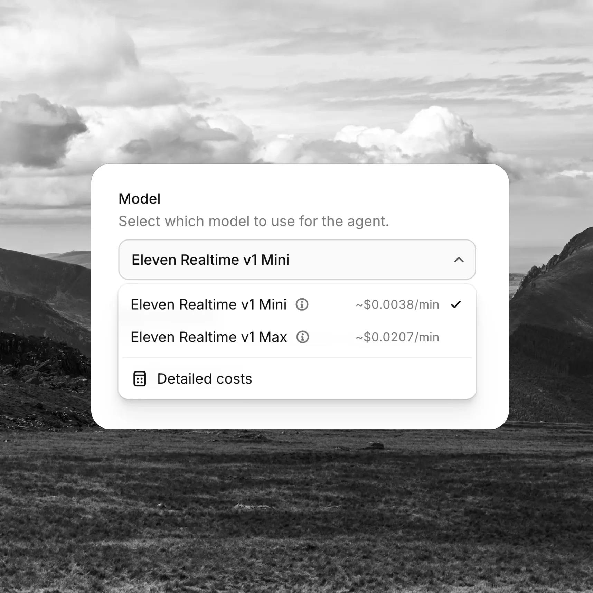
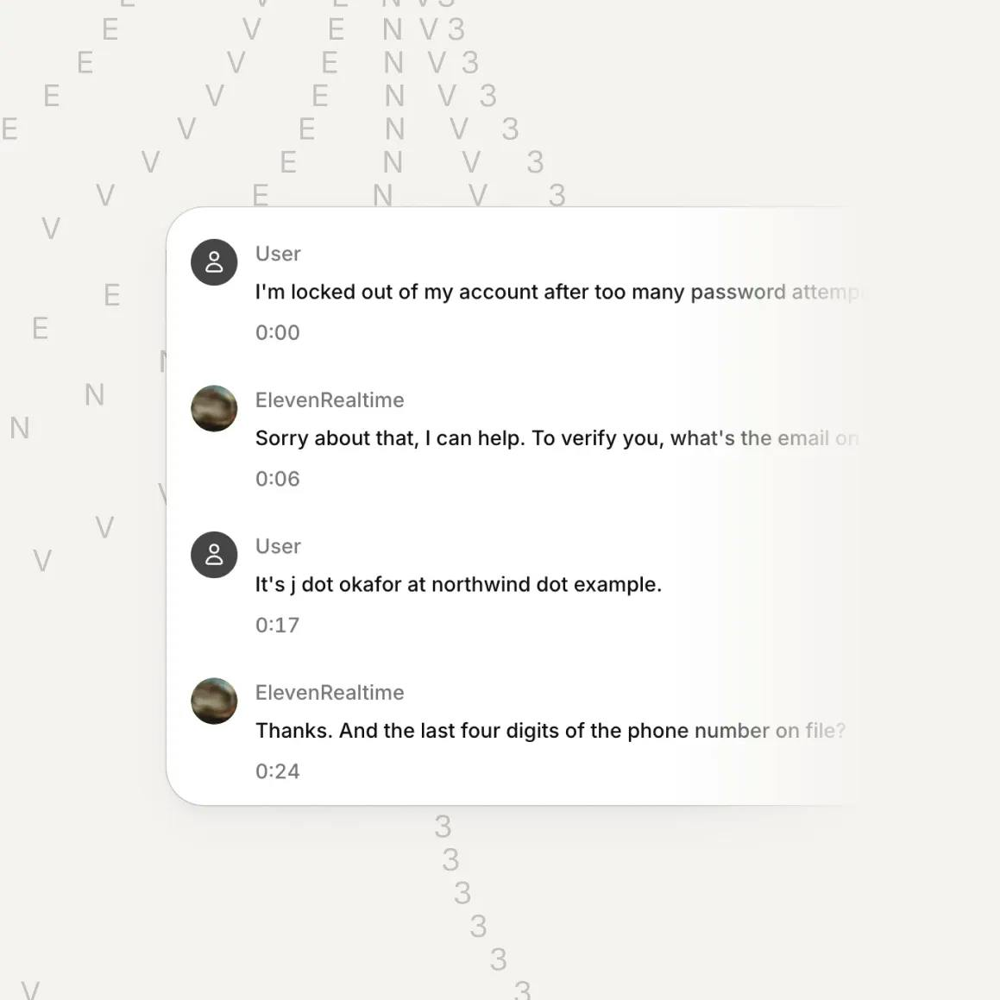

### 🎬 관련 영상
- [🎥 영상 보기](https://ph-files.imgix.net/7c4eebfe-b218-4b3f-9a07-d6933e1d9fef.jpeg?auto=format)

---

## 6. [ShogunAI](https://www.producthunt.com/products/shogunai)
**Votes**: 127 | **도입 난이도**: 하 | **신뢰도**: 상
**Tagline**: Your personal AGI on your pc
**서비스 링크**: https://www.producthunt.com/r/WGEUVK2HDK6FM6

**태그**: AI Assistant, Productivity, Mac, Automation, AI Tool

### 📌 이 서비스 한눈에 보기
사용자의 업무 맥락을 기억하고 회의 준비부터 후속 작업까지 돕는 개인용 AI 비서

### 🔑 주요 기능
- 사용자의 작업 내용을 기억하는 개인 맞춤형 AI 어시스턴트
- 회의 준비, 검색, 글쓰기, 후속 작업 자동화 지원
- Mac 환경에 최적화된 데스크톱 기반 AI 솔루션

### 🙋 사용자에게 어떤 점이 좋은가
업무 흐름을 기억하는 AI를 통해 반복적인 정보 검색과 문서 작성 시간을 단축하고 효율적인 업무 관리가 가능합니다.

### ✅ 지금 바로 써볼 기능
- 7일 무료 체험을 통한 Mac 데스크톱 환경 적응성 테스트
- 기존 작업 데이터와 AI의 맥락 기억 기능 비교
- 회의 준비 및 후속 작업 워크플로우 적용

### ⚠️ 사용 전 확인할 점
- 개인 작업 데이터를 학습/저장하는 방식에 따른 보안 및 프라이버시 검토 필요
- 현재 Mac 전용으로 제공되는 플랫폼 제한성

### 🧭 확인이 더 필요한 정보
사용자의 작업 데이터를 저장하고 활용하는 구체적인 보안 프로토콜과 데이터 관리 정책 확인이 필요합니다.

### 📸 스크린샷 및 갤러리

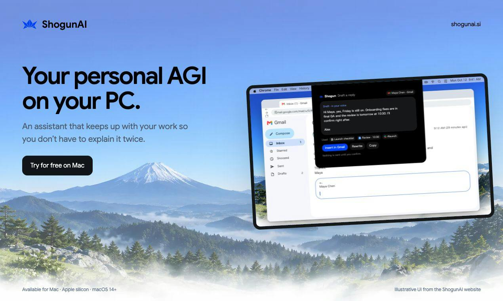
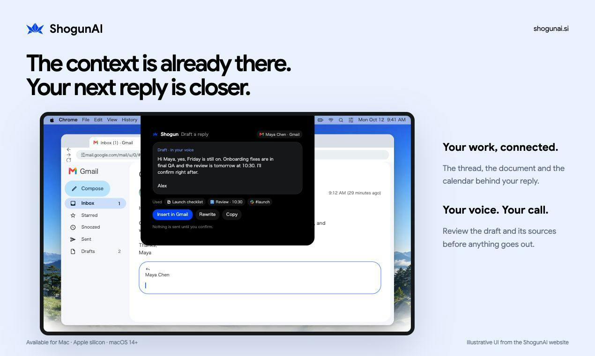

### 🎬 관련 영상
- [🎥 영상 보기](https://ph-files.imgix.net/3e47fa9a-cad9-472e-9e54-0112262675b3.jpeg?auto=format)

---

## 7. [FLUX 3 Max](https://www.producthunt.com/products/fal-ai)
**Votes**: 115 | **도입 난이도**: 하 | **신뢰도**: 상
**Tagline**: fal’s FLUX 3 Max: 10-second AI video in about 12 seconds
**서비스 링크**: https://www.producthunt.com/r/H7WZJVJO5LJCXF

**태그**: AI Video, Generative AI, Content Creation, API, AI Tool, Video, Vision

### 📌 이 서비스 한눈에 보기
12초 만에 10초 분량의 고화질 영상을 생성하는 초고속 AI 비디오 모델

### 🔑 주요 기능
- FLUX 3 베이스 모델을 활용한 고성능 텍스트/이미지 투 비디오 모델
- 기존 FLUX 3 대비 약 10배 빠른 생성 속도 제공
- 720p 해상도의 10초 영상을 약 12초 만에 생성 가능

### 🙋 사용자에게 어떤 점이 좋은가
압도적인 생성 속도 덕분에 아이디어를 즉각적으로 시각화할 수 있으며, 현재 제공되는 할인된 가격으로 비용 효율적인 영상 제작이 가능합니다.

### ✅ 지금 바로 써볼 기능
- Playground를 통한 실시간 영상 생성 테스트
- API를 활용한 워크플로우 자동화 적용
- 할인 기간 내 대량 영상 생성 작업 수행

### ⚠️ 사용 전 확인할 점
- 11월 7일 이후 가격이 $0.17로 인상될 예정이므로 비용 계획 확인 필요
- 초기 벤치마크 결과이므로 성능의 일관성 확인 필요

### 🧭 확인이 더 필요한 정보
할인 가격 적용 기간 이후의 실제 운영 비용과 모델의 장기적인 성능 유지 여부를 확인해야 합니다.

### 📸 스크린샷 및 갤러리
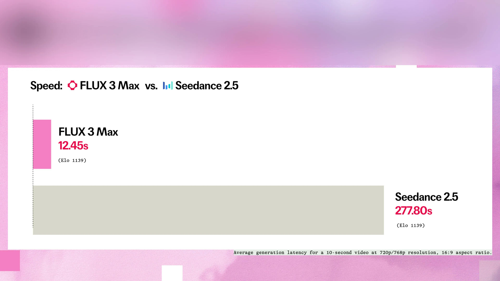
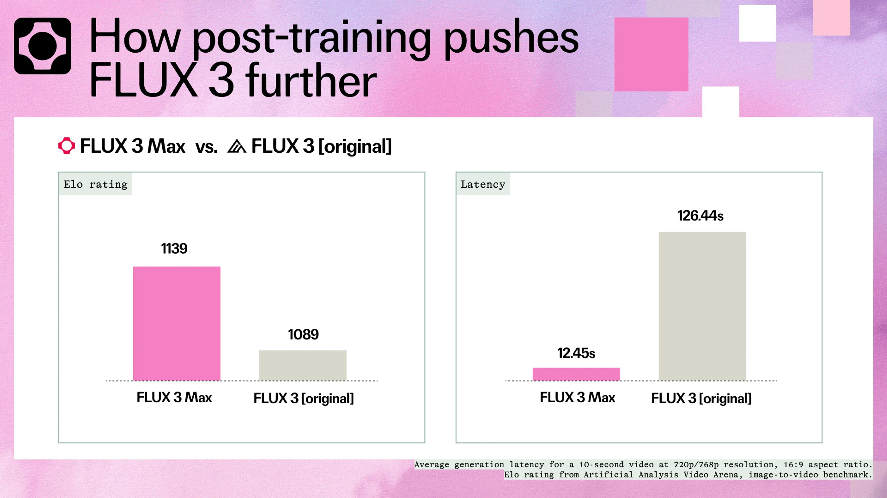
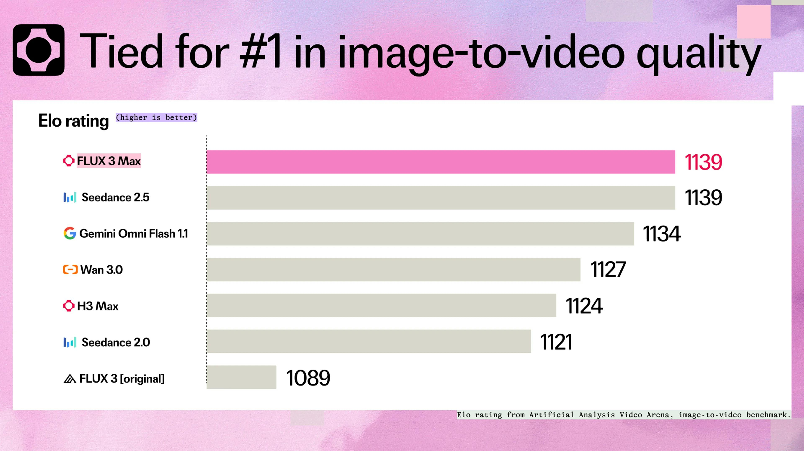

---

## 8. [Cloudflare Clairic](https://www.producthunt.com/products/cloudflare)
**Votes**: 111 | **도입 난이도**: 하 | **신뢰도**: 상
**Tagline**: Cloudflare's AI model for fast, cheap data extraction
**서비스 링크**: https://www.producthunt.com/r/A6H4RT6E667XWS

**태그**: AI, DataExtraction, DevTool, Cloudflare, AI Tool, LLM, Vision

### 📌 이 서비스 한눈에 보기
텍스트와 이미지에서 구조화된 데이터를 빠르고 저렴하게 추출하는 Cloudflare의 AI 모델

### 🔑 주요 기능
- 토큰 생성 없이 구조화된 정보(이름, 날짜, 금액 등)만 추출하는 특화 모델
- 비정형 텍스트나 이미지에서 정형 데이터로의 단일 패스 변환
- 기존 LLM 호출 대비 빠르고 경제적인 데이터 처리 비용

### 🙋 사용자에게 어떤 점이 좋은가
대규모 비정형 데이터를 정형 데이터로 변환해야 하는 개발자가 비용과 속도 문제를 해결할 수 있습니다.

### ✅ 지금 바로 써볼 기능
- Workers AI를 통한 프리뷰 기능 테스트
- 비정형 데이터 추출 워크플로우 적용
- 신뢰도 점수(Confidence scores)를 활용한 데이터 검증

### ⚠️ 사용 전 확인할 점
- 현재 Workers AI에서 제공되는 프리뷰 단계임
- 생성형 작업이 아닌 추출 작업에 특화되어 있음

### 🧭 확인이 더 필요한 정보
향에 공개될 오픈 웨이트(Open weights)의 상세 사양과 완전 출시 시점은 아직 미정입니다.

### 📸 스크린샷 및 갤러리

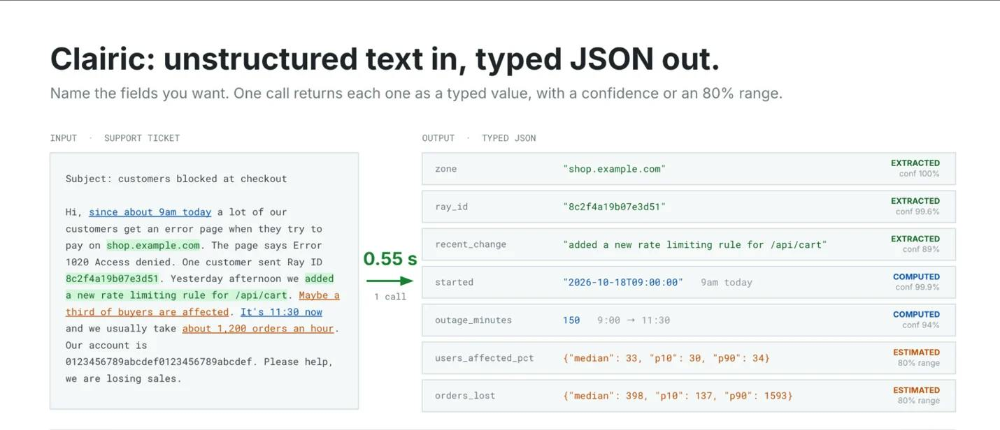
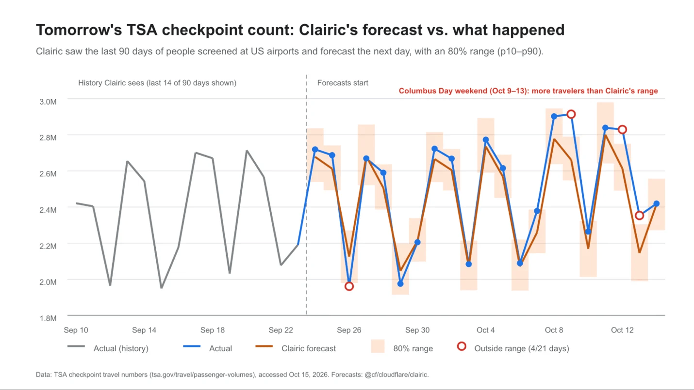

---

## 9. [Context Engine](https://www.producthunt.com/products/context-engine-2)
**Votes**: 97 | **도입 난이도**: 하 | **신뢰도**: 상
**Tagline**: One memory for your AI agents and human team members.
**서비스 링크**: https://www.producthunt.com/r/MJ2TTPRLW354IS

**태그**: AI, Collaboration, KnowledgeBase, DevTool, Agent, AI Tool, Chat

### 📌 이 서비스 한눈에 보기
AI 에이전트와 팀원이 실시간으로 공유하는 통합 지식 저장소

### 🔑 주요 기능
- AI 에이전트(Claude, ChatGPT, Cursor 등)와 팀원 간의 단일 메모리 제공
- AI 도구가 작업 중 생성한 컨텍스트를 자동으로 저장 및 동기화
- 팀 구성원이 직접 파일을 추가하거나 질문을 통해 정보를 탐색 가능

### 🙋 사용자에게 어떤 점이 좋은가
AI 도구와 팀원 사이의 정보 격차를 줄여, 작업 흐름을 끊지 않고도 최신 컨텍스트를 공유할 수 있습니다.

### ✅ 지금 바로 써볼 기능
- 사용 중인 AI 도구(Cursor, Claude 등)와 연동하기
- 팀 프로젝트 관련 파일 업로드하여 지식 베이스 구축하기
- AI가 저장한 정보를 바탕으로 팀원과 질문 주고받기

### ⚠️ 사용 전 확인할 점
- AI가 자동 저장하는 데이터의 보안 및 프라이버시 정책 확인 필요
- 데이터 양 증가에 따른 관리 방식 검토

### 🧭 확인이 더 필요한 정보
현재 제공되는 구체적인 요금제 체계와 데이터 보안 수준에 대한 상세 정보가 필요합니다.

### 📸 스크린샷 및 갤러리
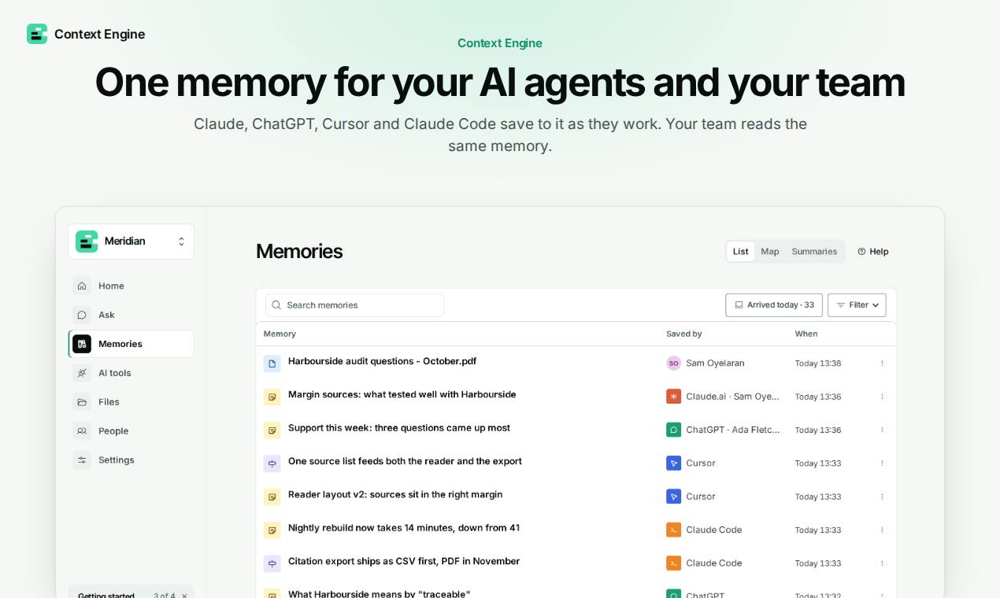
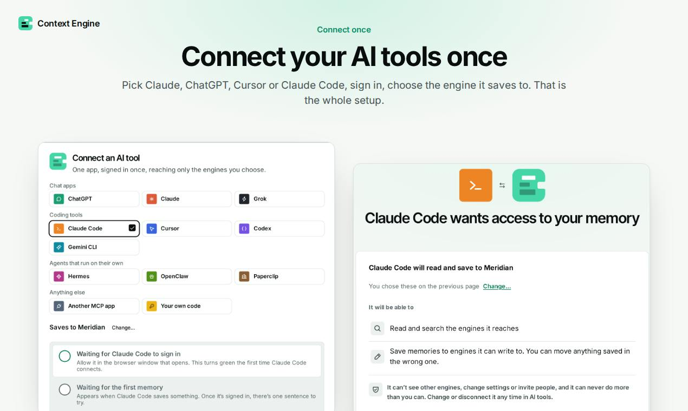
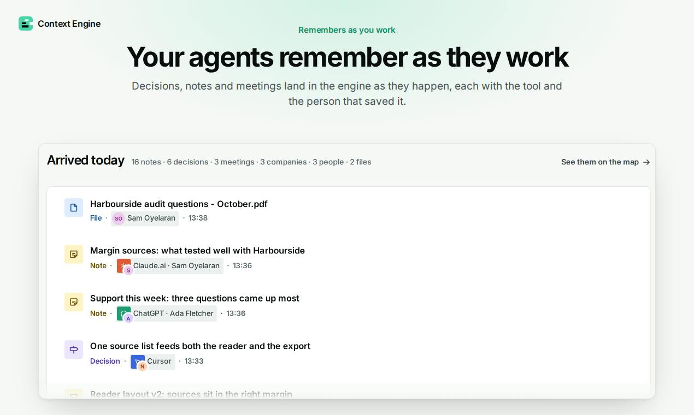

### 🎬 관련 영상
- [🎥 영상 보기](https://ph-files.imgix.net/f1de1ba3-9b87-4ca0-ac2b-e40955a5bffa.jpeg?auto=format)

---

## 10. [Dub Startup Program](https://www.producthunt.com/products/dub)
**Votes**: 93 | **도입 난이도**: 하 | **신뢰도**: 상
**Tagline**: Launch your partner-led growth program
**서비스 링크**: https://www.producthunt.com/r/4BOWHNSPRGHOFP

**태그**: Growth, Partnership, Referral, Marketing

### 📌 이 서비스 한눈에 보기
파트너 중심의 성장 프로그램을 구축하고 추천 성과를 추적하는 도구

### 🔑 주요 기능
- 파트너 기반 성장 프로그램(Partner-led growth) 구축 지원
- 모든 추천(Referral) 내역에 대한 정밀한 추적
- 성장에 기여한 파트너를 위한 보상 체계 관리

### 🙋 사용자에게 어떤 점이 좋은가
파트너를 통한 고객 유입을 체계적으로 관리하고, 기여도에 따른 보상을 자동화하여 성장 동력을 확보할 수 있습니다.

### ✅ 지금 바로 써볼 기능
- 파트너 프로그램 구조 설계하기
- 추천 링크 생성 및 배포하기
- 첫 해 50% 할인 혜택 적용하기

### ⚠️ 사용 전 확인할 점
- 첫 해 50% 할인 이후의 갱신 비용 확인 필요
- 기존 마케팅 툴과의 연동 범위 확인 필요

### 🧭 확인이 더 필요한 정보
구체적인 파트너 보상 방식(현금, 크레딧 등)과 상세 기능 범위는 제품 내부 설정을 확인해야 합니다.

### 📸 스크린샷 및 갤러리

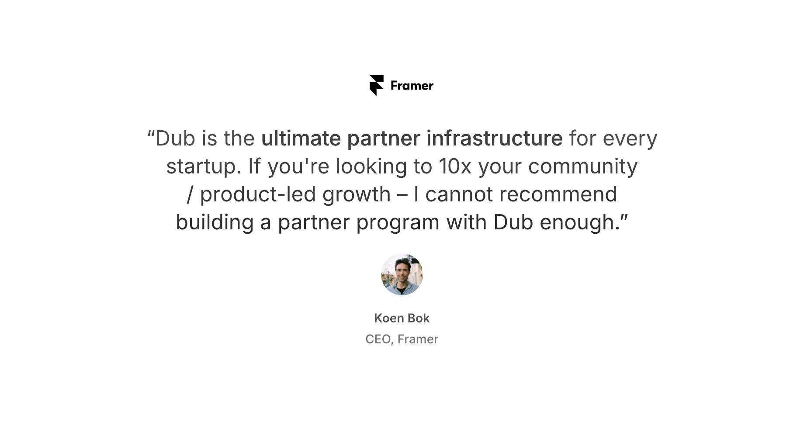

---

## 11. [Polylane for Cloudflare](https://www.producthunt.com/products/polylane)
**Votes**: 93 | **도입 난이도**: 하 | **신뢰도**: 상
**Tagline**: An AI on-call engineer for your Cloudflare apps
**서비스 링크**: https://www.producthunt.com/r/55GXPDJXGDR2A5
**재등장**: 최근 7일 내 재등장 (마지막 등장 7일 전)

**태그**: DevOps, Cloudflare, AI, Automation, SRE, AI Tool, DevTool

### 📌 이 서비스 한눈에 보기
Cloudflare 환경의 이슈를 스스로 탐지하고 코드 수정까지 제안하는 AI 온콜 엔지니어

### 🔑 주요 기능
- Cloudflare Workers, 데이터베이스, 큐, 스토리지 간의 연결 구조를 추적하여 문제 분석
- 코드, 로그, 최근 변경 사항을 종합하여 근본 원인(Root Cause) 조사
- 코드 수정이 필요한 경우 자동으로 Pull Request 생성

### 🙋 사용자에게 어떤 점이 좋은가
Cloudflare 기반 애플리케이션의 장애 대응 시간을 단축하고, 개발자가 수동으로 로그를 뒤지는 번거로움을 줄여줍니다.

### ✅ 지금 바로 써볼 기능
- 읽기 전용 Cloudflare 토큰 연결하기
- 애플리케이션 인프라 연결 및 모니터링 활성화
- AI가 생성한 자동 Pull Request 검토하기

### ⚠️ 사용 전 확인할 점
- 읽기 전용 토큰을 사용하지만, 코드 수정 권한(PR 생성)이 포함되므로 보안 정책 확인 필요
- 복잡한 인프라 구조에서 AI의 원인 분석 정확도 검증 필요

### 🧭 확인이 더 필요한 정보
제공되는 읽기 전용 토큰이 코드 수정(PR 생성) 권한까지 포함하는지에 대한 구체적인 보안 메커니즘 확인이 필요합니다.

### 📸 스크린샷 및 갤러리
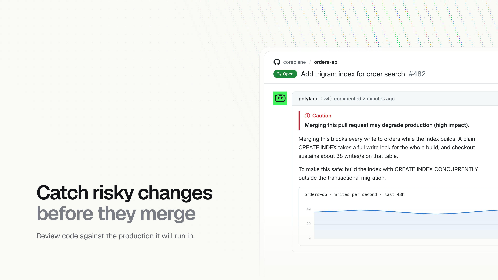
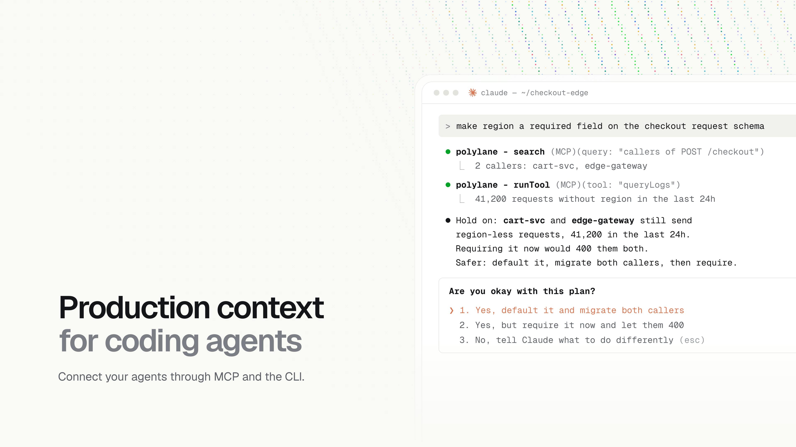
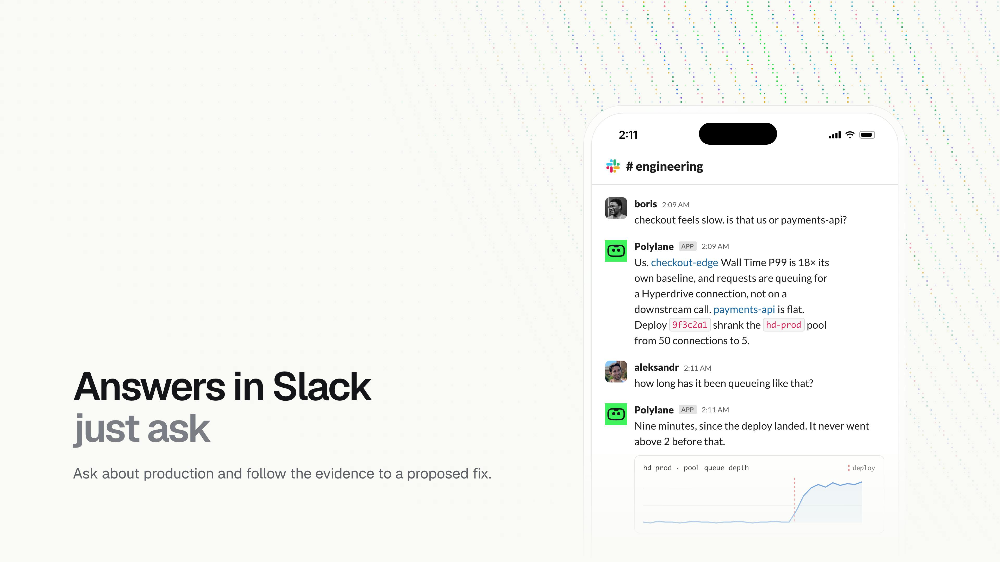

### 🎬 관련 영상
- [🎥 영상 보기](https://ph-files.imgix.net/3964d736-8f22-4896-b175-795f4169f053.jpeg?auto=format)

---

## 12. [Instant Search](https://www.producthunt.com/products/instant-search-2)
**Votes**: 88 | **도입 난이도**: 하 | **신뢰도**: 상
**Tagline**: The fastest, most precise local AI Search for your files.
**서비스 링크**: https://www.producthunt.com/r/N7B7JATPWOAJU3

**태그**: AI, Productivity, Search, Local-First, AI Tool

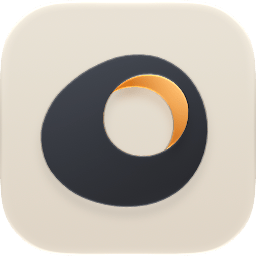

### 📌 이 서비스 한눈에 보기
최신 임베딩 모델을 활용해 파일 내 특정 페이지까지 찾아내는 초고속 로컬 AI 검색 도구

### 🔑 주요 기능
- 최신 임베딩 모델 기반의 정밀한 로컬 파일 검색
- 95%의 높은 적중률로 원하는 파일 및 페이지를 즉시 탐색
- 데이터 유출 걱정 없는 로컬 환경에서의 AI 검색

### 🙋 사용자에게 어떤 점이 좋은가
수많은 문서 속에서 원하는 정보를 찾는 시간을 획기적으로 단축하며, 파일 내부의 구체적인 위치까지 빠르게 파악할 수 있습니다.

### ✅ 지금 바로 써볼 기능
- 로컬 파일 색인(Indexing) 실행하기
- 자연어 질의를 통한 파일 검색 테스트하기
- 검색 결과의 페이지 정확도 확인하기

### ⚠️ 사용 전 확인할 점
- 로컬 리소스(CPU/GPU) 사용량 확인 필요
- 지원되는 파일 형식 및 용량 제한 확인 필요

### 🧭 확인이 더 필요한 정보
지원하는 파일 형식의 종류와 시스템 사양에 따른 성능 차이를 확인해야 합니다.

### 📸 스크린샷 및 갤러리
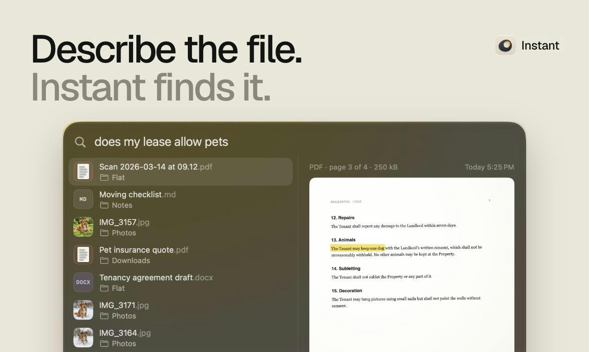
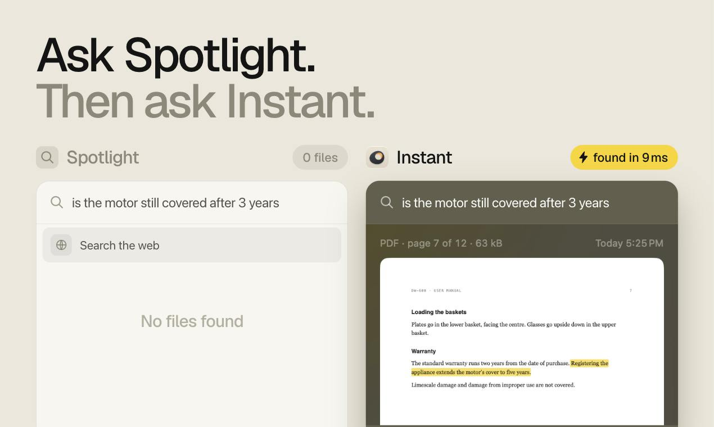
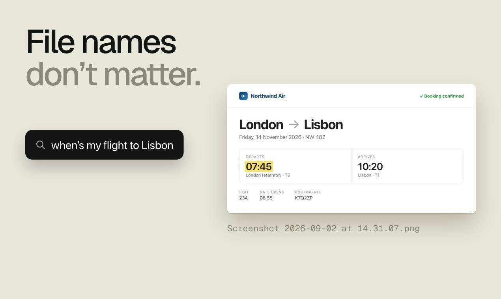

---

## 13. [Monish](https://www.producthunt.com/products/monish)
**Votes**: 87 | **도입 난이도**: 하 | **신뢰도**: 상
**Tagline**: Your AI agents, live on your iPhone lock screen
**서비스 링크**: https://www.producthunt.com/r/Y3ZJSBPKK5MEKQ

**태그**: DevTool, Automation, AI, Mobile, Agent, AI Tool

### 📌 이 서비스 한눈에 보기
AI 에이전트의 작업 진행 상황을 아이폰 잠금 화면에서 실시간으로 확인하고 제어하는 도구

### 🔑 주요 기능
- Claude Code, Cursor, n8n 등 다양한 개발 환경과 연동 가능한 한 줄 코드 제공
- 아이폰 잠금 화면을 통한 실시간 작업 진행 상태 모니터링
- 배포, 전송, 결제 전 알림을 통한 승인/거절(Approve/Deny) 기능

### 🙋 사용자에게 어떤 점이 좋은가
터미널이나 IDE를 계속 주시하지 않아도 모바일에서 AI 에이전트의 작업 상태를 확인하고 중요한 결정만 즉시 내릴 수 있습니다.

### ✅ 지금 바로 써볼 기능
- 사용 중인 IDE(Cursor, Claude Code 등)에 제공된 코드 한 줄 붙여넣기
- 아이폰 잠금 화면에 실시간 상태 업데이트 확인하기
- 중요한 작업 시 알림을 통한 승인/거절 프로세스 테스트하기

### ⚠️ 사용 전 확인할 점
- 외부 스크립트/코드 실행 시 보안 및 권한 설정 확인 필요
- 모바일 알림 수신을 위한 적절한 환경 설정 필요

### 🧭 확인이 더 필요한 정보
제공된 코드가 사용자의 로컬 환경이나 클라우드 스크립트와 어떻게 보안적으로 상호작용하는지에 대한 상세 정보가 필요합니다.

### 📸 스크린샷 및 갤러리
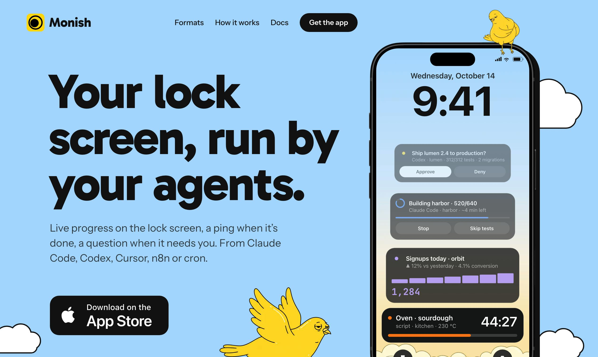
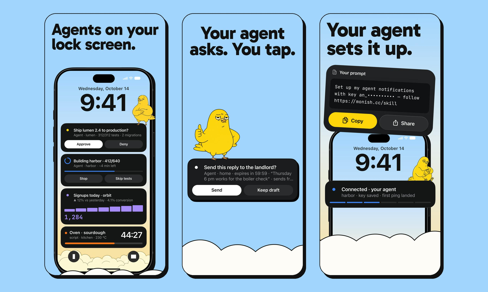
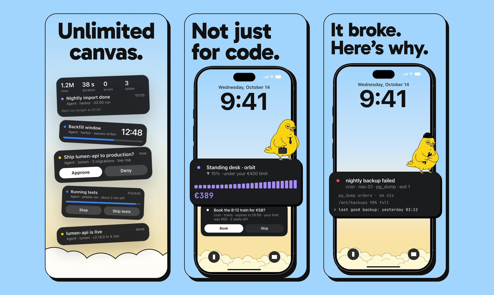

---

## 14. [Inyon](https://www.producthunt.com/products/inyon)
**Votes**: 84 | **도입 난이도**: 하 | **신뢰도**: 상
**Tagline**: Answer your coding agents from your phone
**서비스 링크**: https://www.producthunt.com/r/RKTHZATL6IEFMB

**태그**: DevTool, RemoteControl, Productivity, OpenSource, Agent, AI Tool, Chat

### 📌 이 서비스 한눈에 보기
터미널의 코딩 에이전트와 모바일로 실시간 소통하는 간편한 원격 제어 도구

### 🔑 주요 기능
- tmux에서 실행 중인 코딩 에이전트(Claude Code, Copilot CLI 등)를 모바일/브라우저 채팅 형태로 시각화
- 모바일에서 터치 한 번으로 에이전트의 질문에 답변 및 입력 가능
- 계정 생성이나 별도 호스팅 없이 QR 코드 페어링 및 E2EE 터널링을 통한 보안 연결

### 🙋 사용자에게 어떤 점이 좋은가
컴퓨터 앞을 떠나 있는 동안에도 모바일로 코딩 에이전트의 질문에 즉각 응답하여 작업 흐름을 유지할 수 있습니다.

### ✅ 지금 바로 써볼 기능
- Android 앱 설치 및 QR 코드로 기기 페어링하기
- tmux 환경에서 실행 중인 코딩 에이전트 연결 확인하기
- 모바일 환경에서 에이전트 질문에 답변해보기

### ⚠️ 사용 전 확인할 점
- 터미널(tmux) 환경에 대한 기본적인 이해가 필요함
- 모바일 환경에서의 입력 편의성은 키보드 환경보다 제한적일 수 있음

### 🧭 확인이 더 필요한 정보
iOS 지원 여부 및 브라우저 기반 인터페이스의 상세 기능은 명시되지 않았습니다.

### 📸 스크린샷 및 갤러리
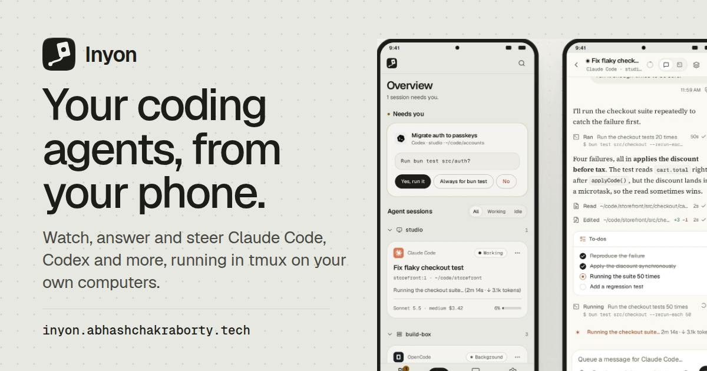
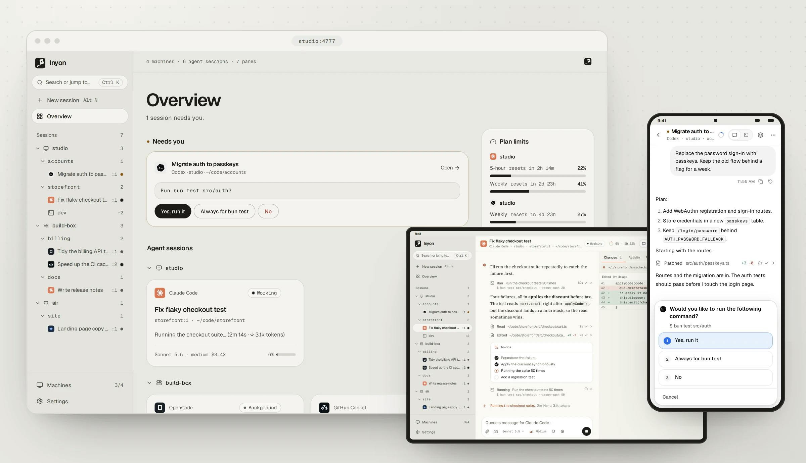
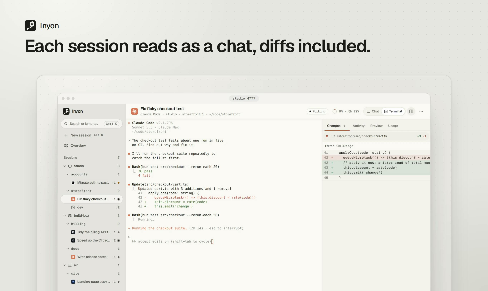

### 🎬 관련 영상
- [🎥 영상 보기](https://ph-files.imgix.net/c37c72da-3256-4573-996f-50d7a4dbf8c5.jpeg?auto=format)

---

## 15. [Plango](https://www.producthunt.com/products/plango)
**Votes**: 82 | **도입 난이도**: 하 | **신뢰도**: 상
**Tagline**: Use AI to defend against AI
**서비스 링크**: https://www.producthunt.com/r/SREPWF3UGCNR5V

**태그**: DevTool, Security, AI, Mac, Agent, AI Tool

### 📌 이 서비스 한눈에 보기
AI 코딩 에이전트로부터 Mac의 보안과 민감 데이터를 보호하는 온디바이스 AI 보안 솔루션

### 🔑 주요 기능
- AI 코딩 에이전트의 활동 모니터링 및 제어
- 민감한 파일, 비밀번호(Secrets), 의심스러운 네트워크 활동 차단
- 프로젝트 취약점 스캔 및 온디바이스 AI 기반의 프라이버시 보호

### 🙋 사용자에게 어떤 점이 좋은가
AI 코딩 도구를 사용할 때 발생할 수 있는 데이터 유출 및 보안 위협으로부터 개발 환경을 안전하게 보호할 수 있습니다.

### ✅ 지금 바로 써볼 기능
- AI 에이전트의 파일 접근 권한 설정하기
- 프로젝트 취약점 스캔 기능 실행하기
- 네트워크 활동 모니터링 활성화하기

### ⚠️ 사용 전 확인할 점
- 온디바이스 모델의 리소스 점유율 확인 필요
- 에이전트의 작업 흐름과 보안 차단 기능 간의 충돌 가능성

### 🧭 확인이 더 필요한 정보
온디바이스 AI 모델이 Mac의 시스템 리소스(CPU/RAM)에 미치는 영향에 대한 구체적인 정보가 부족합니다.

### 📸 스크린샷 및 갤러리

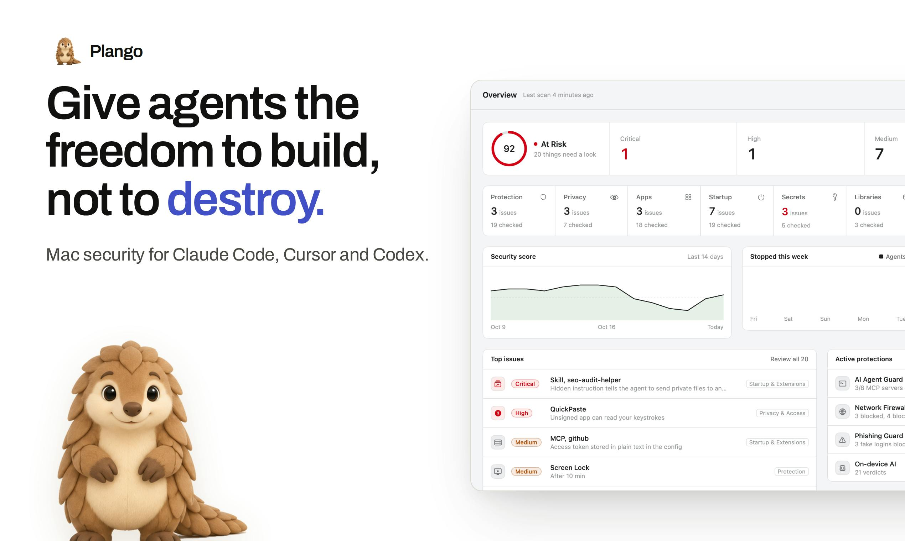
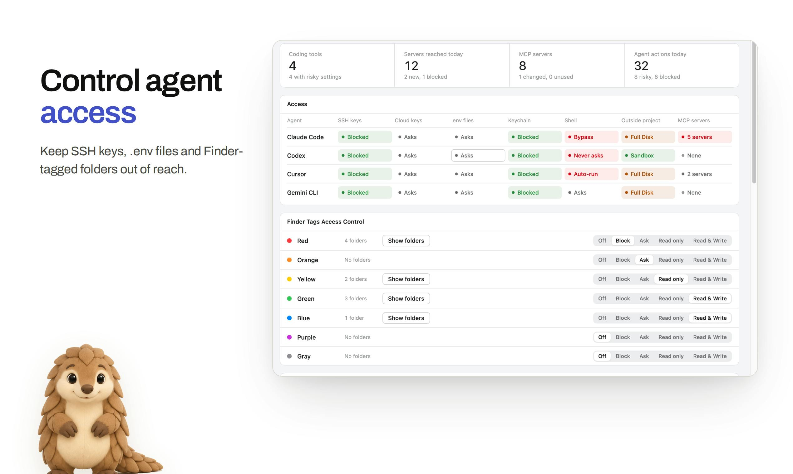

---

## 16. [Headroom](https://www.producthunt.com/products/headroom-5)
**Votes**: 79 | **도입 난이도**: 하 | **신뢰도**: 상
**Tagline**: Your Mac on iPhone Duo: fold it, and the keyboard appears
**서비스 링크**: https://www.producthunt.com/r/CKAW7UYA4NZGU2

**태그**: Remote Control, Productivity, iOS, macOS

### 📌 이 서비스 한눈에 보기
별도 설치 없이 아이폰을 맥의 보조 컨트롤러로 만드는 원격 제어 솔루션

### 🔑 주요 기능
- 맥에 별도 소프트웨어를 설치할 필요 없는 간편한 원격 접속
- 계정 생성이나 중간 서버를 거치지 않는 직관적인 방식
- 아이폰의 폼팩터를 활용한 키보드 및 컨트롤러 모드 지원

### 🙋 사용자에게 어떤 점이 좋은가
아이폰을 맥의 보조 화면이나 키보드로 활용하여 작업 효율을 높일 수 있으며, 복잡한 설정 없이 즉시 원격 제어가 가능합니다.

### ✅ 지금 바로 써볼 기능
- 아이폰과 맥을 연결하여 원격 제어 테스트하기
- 아이폰의 접히는 폼팩터를 활용한 키보드 모드 경험하기

### ⚠️ 사용 전 확인할 점
- 맥 측에 설치가 필요 없다고 명시되어 있으나, 초기 연결 방식에 대한 확인 필요
- 네트워크 환경에 따른 원격 제어 지연 시간(Latency) 발생 가능성

### 🧭 확인이 더 필요한 정보
맥에 설치할 것이 없다는 점이 구체적으로 어떤 프로토콜이나 방식을 사용하는지 확인이 필요합니다.

### 📸 스크린샷 및 갤러리
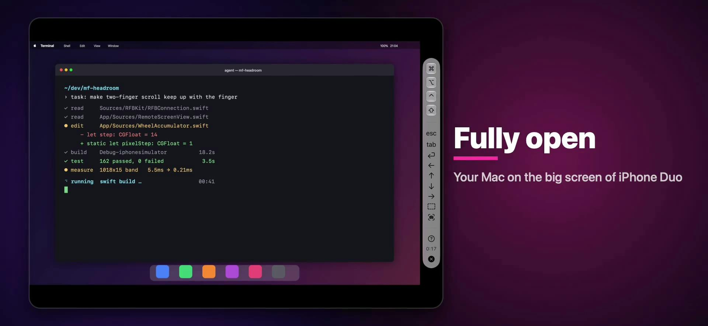
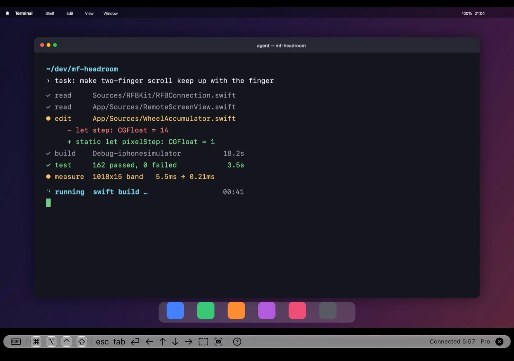
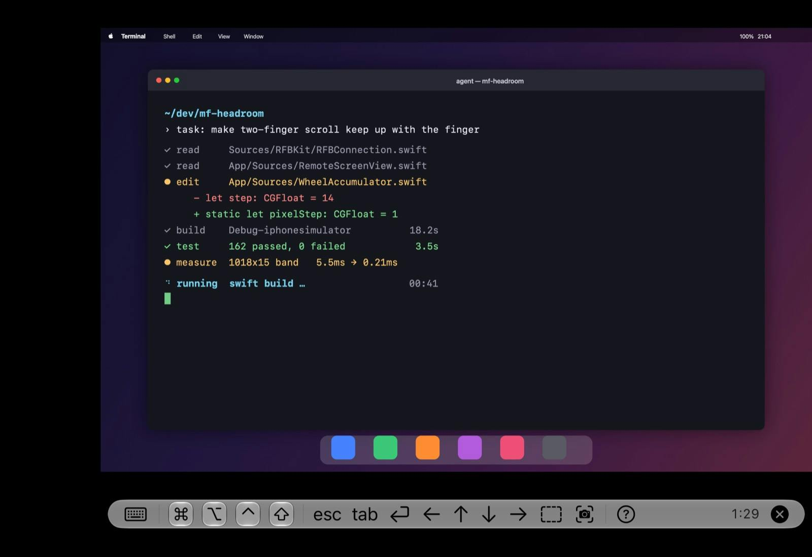

### 🎬 관련 영상
- [🎥 영상 보기](https://ph-files.imgix.net/3b073c08-e54d-4f77-b339-e4f64e9a3a8b.jpeg?auto=format)

---

## 17. [Dots](https://www.producthunt.com/products/dots-7)
**Votes**: 77 | **도입 난이도**: 하 | **신뢰도**: 상
**Tagline**: A customizable workspace built into your Mac's notch
**서비스 링크**: https://www.producthunt.com/r/EFSYRL6RVGLILX

**태그**: Productivity, Mac, Workflow, Automation, Video

### 📌 이 서비스 한눈에 보기
맥북 노치 영역을 활용하여 창 전환 없이 작업할 수 있는 맞춤형 워크스페이스

### 🔑 주요 기능
- 맥북 노치 영역을 활용한 직관적인 워크스페이스 제공
- 앱, 웹사이트, 단축키를 노치에서 즉시 실행 가능
- 영상 시청, 스크린샷, 음성 명령 등 다양한 작업 흐름 지원

### 🙋 사용자에게 어떤 점이 좋은가
창 전환의 번거로움을 줄여 작업 흐름을 유지하면서도 필요한 도구에 빠르게 접근할 수 있습니다.

### ✅ 지금 바로 써볼 기능
- 자주 사용하는 웹사이트를 노치에 등록하기
- 자주 쓰는 앱 및 단축키 설정하기
- 작업 중 영상 시청 기능 활용하기

### ⚠️ 사용 전 확인할 점
- 노치 영역을 사용하므로 화면 상단 가시 영역에 영향을 줄 수 있음
- 맥북 하드웨어(노치 탑재 모델) 환경에 최적화된 기능임

### 🧭 확인이 더 필요한 정보
구체적인 유료 플랜 정책 및 기능별 상세 제한 사항에 대한 정보가 부족합니다.

### 📸 스크린샷 및 갤러리
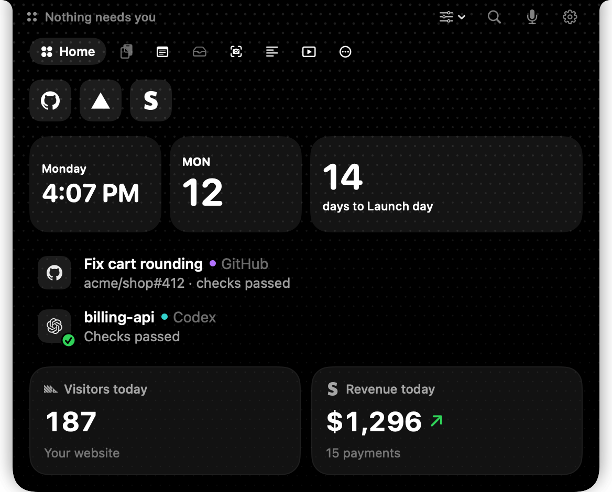
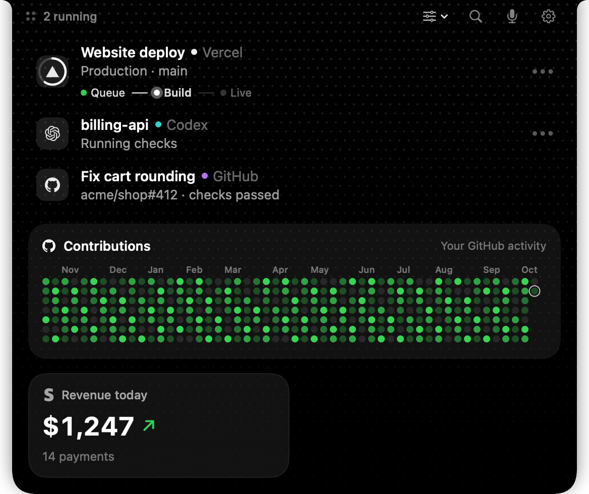
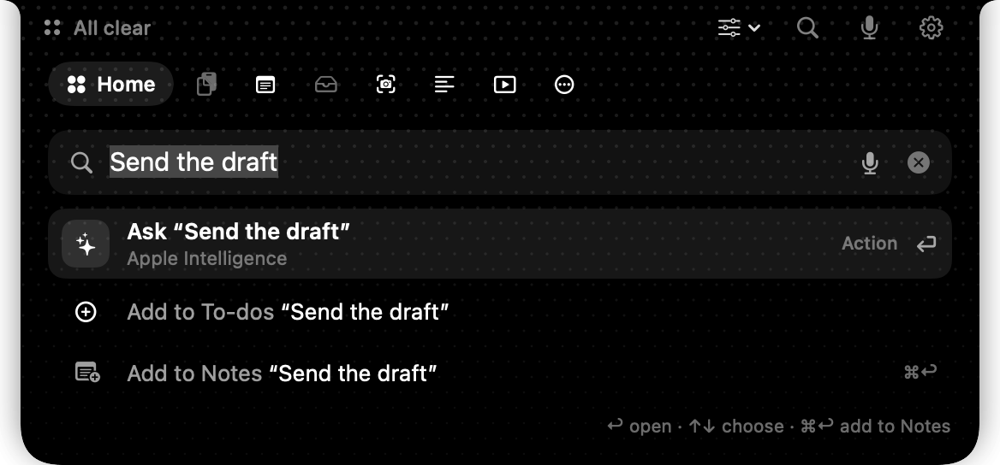

---

## 18. [Peras](https://www.producthunt.com/products/peras)
**Votes**: 76 | **도입 난이도**: 하 | **신뢰도**: 상
**Tagline**: Pause Claude Code and Codex before they burn your week
**서비스 링크**: https://www.producthunt.com/r/2XM5DL3PJTLVDZ

**태그**: DevTool, AI-Agent, Productivity, CLI, Agent, AI Tool

### 📌 이 서비스 한눈에 보기
AI 에이전트의 과도한 사용을 방지하여 주간 작업 시간을 보호하는 CLI 도구

### 🔑 주요 기능
- Claude Code 및 Codex 사용량에 대한 주간 한도 설정 기능
- 설정된 한도 초과 시 에이전트의 다음 도구 호출을 자동으로 차단
- 터미널 또는 메뉴 바를 통해 간편하게 일시 중지 및 재개 가능

### 🙋 사용자에게 어떤 점이 좋은가
AI 에이전트가 예기치 않게 많은 리소스를 소모하는 것을 방지하여, 사용자가 계획한 주간 업무 시간을 확보할 수 있게 해줍니다.

### ✅ 지금 바로 써볼 기능
- CLI를 통해 주간 사용량 한도 설정하기
- 에이전트에게 자신의 사용량을 알리는 옵션 적용하기
- Mac 메뉴 바 앱을 통해 시각적으로 관리하기

### ⚠️ 사용 전 확인할 점
- 에이전트의 작업 흐름이 갑자기 중단될 수 있음
- Mac 메뉴 바 앱은 별도의 유료 구매(€4.99)가 필요함

### 🧭 확인이 더 필요한 정보
사용 중인 특정 AI 에이전트 환경과의 호환성 및 세부 제어 방식에 대한 추가 확인이 필요합니다.

### 📸 스크린샷 및 갤러리

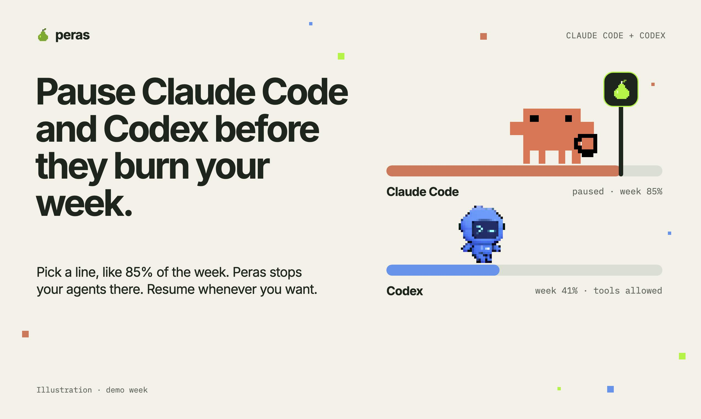
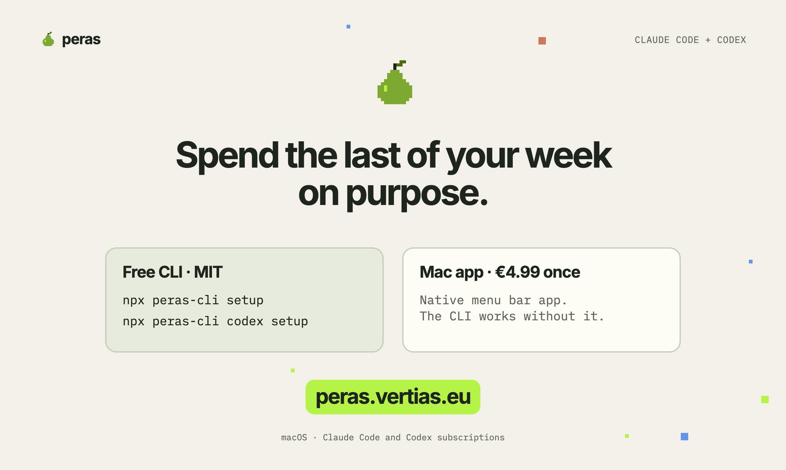

---

## 19. [Truffle](https://www.producthunt.com/products/truffle-music-tag-editor)
**Votes**: 76 | **도입 난이도**: 하 | **신뢰도**: 상
**Tagline**: Fix messy tags, covers and duplicates in your Mac library
**서비스 링크**: https://www.producthunt.com/r/K2JS22P3YAYMIT

**태그**: Music, Automation, Mac, DJ-Tools

### 📌 이 서비스 한눈에 보기
음악 라이브러리의 메타데이터와 커버 아트를 자동으로 정리해주는 Mac용 관리 도구

### 🔑 주요 기능
- 8개 소스를 활용한 곡 제목, 아티스트, 앨범, 장르 자동 식별
- 템포(BPM) 및 키(Key) 정보 자동 매칭
- Apple Music, rekordbox, Serato, Traktor 등 주요 DJ/음악 소프트웨어 호환

### 🙋 사용자에게 어떤 점이 좋은가
수동으로 정리하기 힘든 방대한 음악 라이브러리의 태그와 커버를 자동화하여 관리 시간을 획기적으로 줄여줍니다.

### ✅ 지금 바로 써볼 기능
- 기존 음악 라이브러리 스캔 및 중복/오류 확인
- 자동 제안된 메타데이터 검토 및 일괄 적용
- DJ 소프트웨어와의 연동 확인

### ⚠️ 사용 전 확인할 점
- 사용자 승인 전에는 데이터가 변경되지 않으므로 최종 확인 과정이 필수적임
- Mac 환경 전용 도구로 보임

### 🧭 확인이 더 필요한 정보
8개 소스의 구체적인 출처와 데이터 동기화 방식에 대한 상세 정보가 필요합니다.

### 📸 스크린샷 및 갤러리
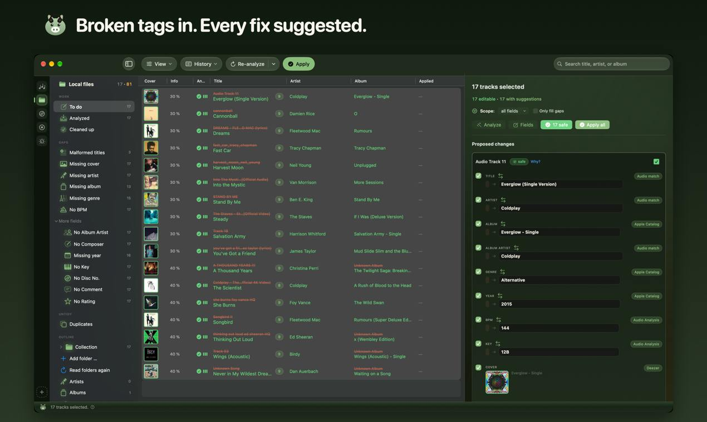
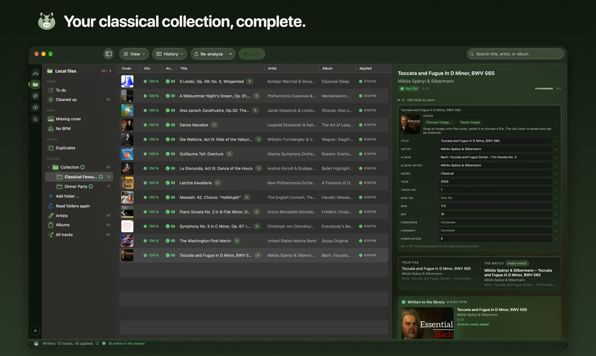
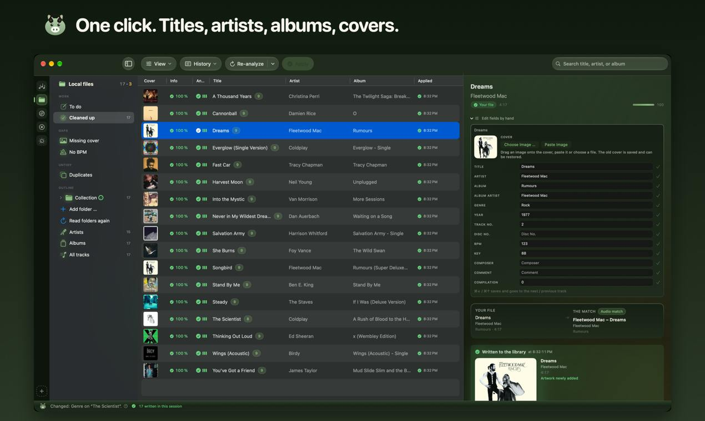

---

## 20. [Termi Protocol](https://www.producthunt.com/products/termi-protocol)
**Votes**: 74 | **도입 난이도**: 중 | **신뢰도**: 상
**Tagline**: Watch AI agents code in 3D and hand off the work
**서비스 링크**: https://www.producthunt.com/r/5GGHGYNVAIIHA6

**태그**: DevTool, AI-Agents, Automation, Visualization, Agent, AI Tool

### 📌 이 서비스 한눈에 보기
AI 에이전트의 코딩 과정을 3D 환경에서 실시간 시각화하고 작업 흐름을 자동 전환하는 협업 플랫폼

### 🔑 주요 기능
- 텍스트 로그 대신 3D 룸 환경에서 에이전트의 작업 과정을 직관적으로 모니터링
- 모델별 사용량/제한 발생 시 작업 상태를 유지하며 다른 모델로 자동 핸드오프
- 보스 에이전트가 하나의 목표를 여러 에이전트 팀에게 분배하는 워크플로우 지원

### 🙋 사용자에게 어떤 점이 좋은가
단순한 로그 확인을 넘어 에이전트의 작업 상태를 시각적으로 파악하고, 모델 제한 문제로 인한 작업 중단을 최소화할 수 있습니다.

### ✅ 지금 바로 써볼 기능
- 3D 환경에서 실시간 파일 읽기 및 편집 모니터링하기
- 모델 제한 발생 시 자동 핸드오프 기능 테스트하기
- 보스 에이전트를 통한 목표 분배 워크플로우 실행하기

### ⚠️ 사용 전 확인할 점
- 다양한 AI 모델(Claude, Gemini 등)과의 실제 연동 설정 방식 확인 필요
- 3D 시각화로 인한 로컬 리소스 소모량 확인 필요

### 🧭 확인이 더 필요한 정보
사용자의 로컬 파일 시스템 및 에이전트 권한과 어떻게 안전하게 상호작용하는지에 대한 상세 보안 정책 확인이 필요합니다.

### 📸 스크린샷 및 갤러리

---

## 21. [DotMD](https://www.producthunt.com/products/dotmd-3)
**Votes**: 72 | **도입 난이도**: 하 | **신뢰도**: 상
**Tagline**: Review your AI agent's Markdown specs like a pull request
**서비스 링크**: https://www.producthunt.com/r/PMW5VZDIEBPZJ3

**태그**: DevTool, AI, Productivity, Markdown, macOS, Agent, AI Tool

### 📌 이 서비스 한눈에 보기
AI 에이전트가 작성한 문서를 Pull Request 방식으로 검토하고 관리하는 Mac 전용 Markdown 앱

### 🔑 주요 기능
- AI 에이전트의 작업물을 코드 리뷰처럼 라인별로 검토 및 피드백 가능
- MCP(Model Context Protocol)를 통한 에이전트의 자동 수정 및 변경 사항 승인 워크플로우
- Mermaid, 수식, 코드 지원 및 로컬 저장 기반의 강력한 Markdown 편집 기능

### 🙋 사용자에게 어떤 점이 좋은가
AI가 생성한 문서의 품질을 사람이 직접 검증하면서도, 개발자에게 익숙한 PR 워크플로우를 통해 효율적인 문서 관리가 가능합니다.

### ✅ 지금 바로 써볼 기능
- AI 에이전트가 작성한 문서에 라인별 코멘트 달아보기
- MCP를 통한 에이전트의 자동 수정 기능 테스트하기
- Mermaid 차트 및 수식 렌더링 확인하기

### ⚠️ 사용 전 확인할 점
- Mac 전용 앱이므로 macOS 환경이 아닐 경우 사용 불가
- 에이전트와의 연동(MCP 등) 설정 방식에 따라 초기 세팅이 필요할 수 있음

### 🧭 확인이 더 필요한 정보
에이전트와의 연동을 위한 MCP 설정 및 외부 에이전트 지원 범위에 대한 상세 정보가 필요합니다.

### 📸 스크린샷 및 갤러리

### 🎬 관련 영상
- [🎥 영상 보기](https://ph-files.imgix.net/da8cee2a-40aa-4f3a-b442-5bf44337ddf0.jpeg?auto=format)

---

## 22. [Dots Phone](https://www.producthunt.com/products/dots-phone)
**Votes**: 72 | **도입 난이도**: 상 | **신뢰도**: 상
**Tagline**: A phone-calling plugin for OpenAI Dots
**서비스 링크**: https://www.producthunt.com/r/6XGTSXZFOY3UUH

**태그**: AI, Automation, SaaS, Communication, AI Tool, DevTool

### 📌 이 서비스 한눈에 보기
OpenAI와 Twilio를 연동하여 전화 업무를 자동화하는 AI 플러그인

### 🔑 주요 기능
- OpenAI Dots를 위한 독립형 전화 자동화 플러그인
- 전화 준비, 발신, 정보 확인 및 결과 보고까지의 워크플로우 자동화
- 사용자의 OpenAI 및 Twilio 계정을 활용한 셀프 호스팅 방식

### 🙋 사용자에게 어떤 점이 좋은가
반복적인 전화 업무를 AI가 대신 처리하여 사용자의 시간을 절약하고, 필요한 정보를 자동으로 수집 및 보고해 줍니다.

### ✅ 지금 바로 써볼 기능
- OpenAI 및 Twilio 계정 준비
- 플러그인 설치 및 환경 설정
- 전화 자동화 워크플로우 테스트

### ⚠️ 사용 전 확인할 점
- 사용자의 개인 OpenAI 및 Twilio 계정 설정 및 관리 필요
- 전화 통화 품질 및 AI의 대화 정확도에 따른 결과 차이 가능성

### 🧭 확인이 더 필요한 정보
사용자의 기술적 숙련도에 따른 설치 난이도와 구체적인 연동 가이드라인 확인이 필요합니다.

### 📸 스크린샷 및 갤러리

---

## 23. [Gerty](https://www.producthunt.com/products/gerty)
**Votes**: 71 | **도입 난이도**: 하 | **신뢰도**: 상
**Tagline**: Private ChatGPT alternative that sets itself up on your Mac
**서비스 링크**: https://www.producthunt.com/r/WJR2AYRRNK3TFS

**태그**: AI, Mac, Privacy, Productivity, AI Tool, Chat, DevTool

### 📌 이 서비스 한눈에 보기
복잡한 설정 없이 Mac에 설치하여 사용하는 프라이빗 AI 비서

### 🔑 주요 기능
- 로컬 실행 방식으로 데이터 유출 걱정 없는 프라이빗 AI 환경 제공
- 사용자 Mac 사양에 맞춰 최적의 오픈 소스 모델을 자동 설치 및 구성
- 문서, 메일, 캘린더 연동 및 오프라인 작업 지원

### 🙋 사용자에게 어떤 점이 좋은가
클라우드 계정 생성이나 복잡한 터미널 설정 없이, 개인 데이터 보안을 유지하며 강력한 AI 기능을 Mac에서 즉시 사용할 수 있습니다.

### ✅ 지금 바로 써볼 기능
- 7일 무료 체험을 통한 Mac 성능 대비 모델 구동 속도 확인
- 로컬 문서 및 캘린더 연동을 통한 개인 비서 기능 테스트
- 음성 명령을 통한 대화형 인터페이스 경험

### ⚠️ 사용 전 확인할 점
- 로컬 모델 구동을 위한 Mac의 하드웨어 사양(CPU/GPU/RAM) 영향이 큼
- 모델 다운로드 및 실행 시 상당한 디스크 공간이 필요할 수 있음

### 🧭 확인이 더 필요한 정보
사용자의 Mac 사양에 따라 모델 성능과 구동 속도가 크게 달라질 수 있습니다.

### 📸 스크린샷 및 갤러리

---

## 24. [Bloblings](https://www.producthunt.com/products/bloblings)
**Votes**: 71 | **도입 난이도**: 하 | **신뢰도**: 상
**Tagline**: A pet for every Claude Code session
**서비스 링크**: https://www.producthunt.com/r/4BH3EUFGAGVM3F

**태그**: DevTool, Productivity, AI-Agent, Mac

### 📌 이 서비스 한눈에 보기
Claude Code 세션을 시각적인 반려동물로 관리하는 데스크톱 생산성 도구

### 🔑 주요 기능
- Claude Code 및 Codex 스레드별 전용 반려동물 할당
- 작업 진행 상황 및 사용자 개입 필요 시점을 시각적으로 표시
- 원클릭 스레드 접속 및 스레드 간 협업/메모 기능

### 🙋 사용자에게 어떤 점이 좋은가
터미널 기반의 코딩 세션을 직관적인 UI로 시각화하여 작업 흐름을 한눈에 파악하고 관리할 수 있습니다.

### ✅ 지금 바로 써볼 기능
- Claude Code 세션에 반려동물 할당하기
- 원클릭 기능을 통해 스레드 간 빠른 전환 경험하기
- 반려동물의 상태 변화를 통해 작업 흐름 모니터링하기

### ⚠️ 사용 전 확인할 점
- Claude Code 및 Codex 환경에서의 원활한 작동 여부 확인 필요
- Mac 전용 네이티브 앱이므로 타 OS 사용 시 제약 있음

### 🧭 확인이 더 필요한 정보
Claude Code와의 구체적인 연동 방식 및 시스템 리소스 점유율에 대한 정보가 부족합니다.

### 📸 스크린샷 및 갤러리

### 🎬 관련 영상
- [🎥 영상 보기](https://ph-files.imgix.net/99753648-7fd5-4225-8901-d19280ea07b0.jpeg?auto=format)

---

## 25. [Otter Hire](https://www.producthunt.com/products/otter-hire)
**Votes**: 12 | **도입 난이도**: 하 | **신뢰도**: 상
**Tagline**: Modern AI ATS to Recruit & Hire - Unlimited Everything
**서비스 링크**: https://www.producthunt.com/r/C4VL7PVDORQYM2

**태그**: HRTech, AI, Automation, SaaS, AI Tool, API, Email

### 📌 이 서비스 한눈에 보기
무제한 사용자 및 후보자 관리가 가능한 AI 기반 올인원 채용 관리 시스템(ATS)

### 🔑 주요 기능
- AI 기반 이력서 파싱 및 후보자 프로필 자동 생성
- 채용 공고, 지원자, 인터뷰, 스코어카드를 한 곳에서 관리
- 사용자 및 후보자 수 제한 없는 단일 고정 가격 정책

### 🙋 사용자에게 어떤 점이 좋은가
인원 제한 없는 합리적인 비용으로 채용 프로세스 전반을 자동화하고 효율적으로 관리할 수 있습니다.

### ✅ 지금 바로 써볼 기능
- AI 이력서 파싱 기능으로 후보자 프로필 생성해보기
- 커스텀 채용 페이지 구축 및 파이프라인 설정하기
- 14일 무료 체험을 통한 워크플로우 적합성 테스트하기

### ⚠️ 사용 전 확인할 점
- 무제한 정책에 따른 데이터 관리 및 보안 정책 확인 필요
- 기존 워크플로우와의 API 연동 호환성 검토 필요

### 🧭 확인이 더 필요한 정보
구체적인 단일 고정 가격(Flat price)이 얼마인지 명시되어 있지 않습니다.

### 📸 스크린샷 및 갤러리

### 🎬 관련 영상
- [🎥 영상 보기](https://ph-files.imgix.net/570c0203-e38f-47c5-8d81-bee0b101d1bb.jpeg?auto=format)

---

## 26. [Vassant: Investment Strategy](https://www.producthunt.com/products/vassant-for-long-term-investors)
**Votes**: 11 | **도입 난이도**: 하 | **신뢰도**: 상
**Tagline**: Research, Organize & Allocate
**서비스 링크**: https://www.producthunt.com/r/LSLQHSVYPF5Y7Q

**태그**: Investment, Portfolio Management, Decision Support, Finance, API

### 📌 이 서비스 한눈에 보기
개인 투자자를 위한 체계적인 포트폴리오 관리 및 자산 배분 의사결정 허브

### 🔑 주요 기능
- 통합 포트폴리오 관리: 여러 계좌의 자산 관리, 투자 계획 및 투자 근거 기록
- 자본 모델링: 가용 현금 최적화 및 계좌 간 자금 배분 전략 수립
- 투자 인사이트 제공: 투자 개념 학습 및 심도 있는 분석 아티클 제공

### 🙋 사용자에게 어떤 점이 좋은가
직접 매매를 수행하지 않으므로 감정에 휘둘리지 않고, 데이터에 기반한 장기적인 자산 배분 전략을 세우는 데 유용합니다.

### ✅ 지금 바로 써볼 기능
- 현재 보유 중인 모든 포트폴리오를 하나의 대시보드에 정리하기
- 자산 배분 전략에 따른 자본 모델링 기능 테스트하기
- 제공되는 투자 아티클를 통해 투자 전략 고도화하기

### ⚠️ 사용 전 확인할 점
- 직접적인 거래 기능이 없으므로 별도의 증권사 계좌를 통한 수동 관리가 필요함
- 자산 데이터의 실시간 연동 여부는 명시되지 않았으므로 수동 입력 필요성 확인 필요

### 🧭 확인이 더 필요한 정보
계좌 간 실시간 데이터 동기화 여부와 데이터 보안 정책에 대한 확인이 필요합니다.

### 📸 스크린샷 및 갤러리

---

## 27. [IconOven](https://www.producthunt.com/products/iconoven)
**Votes**: 9 | **도입 난이도**: 하 | **신뢰도**: 상
**Tagline**: Every icon your app needs: app icons and 85,000+ UI icons
**서비스 링크**: https://www.producthunt.com/r/BYEOBG5YYTRLEG

**태그**: DesignTool, DevTool, UI/UX, AI Tool

### 📌 이 서비스 한눈에 보기
앱 아이콘 키트와 85,000개 이상의 UI 아이콘을 제공하는 올인원 아이콘 스튜디오

### 🔑 주요 기능
- Xcode, Android, Web 환경에 최적화된 앱 아이콘 키트 제공
- 13가지 스타일의 85,000개 이상 UI 아이콘 라이브러리 보유
- npm, Swift, Flutter, Android, VS Code, Figma 등 다양한 개발 환경 지원

### 🙋 사용자에게 어떤 점이 좋은가
다양한 플랫폼용 앱 아이콘과 UI 요소를 일관된 스타일로 즉시 적용할 수 있어 디자인 및 개발 시간을 대폭 단축할 수 있습니다.

### ✅ 지금 바로 써볼 기능
- 무료로 제공되는 Stroke 스타일 아이콘 사용해보기
- App Icon Exporter 및 App Icon Score 무료 도구 활용하기
- 사용 중인 개발 환경(Figma, VS Code 등)에 플러그인 설치하기

### ⚠️ 사용 전 확인할 점
- 라이선스 플랜(Standard, Exclusive, Pro, Max)에 따라 사용 범위와 스타일 제한이 다름
- UI 아이콘의 경우 Pro/Max 플랜 결제 시에만 모든 스타일 사용 가능

### 🧭 확인이 더 필요한 정보
사용자의 특정 개발 환경이나 라이선스 정책에 따른 세부 권한 범위를 확인해야 합니다.

### 📸 스크린샷 및 갤러리

---

## 28. [GifBook Studio](https://www.producthunt.com/products/gifbook-studio)
**Votes**: 7 | **도입 난이도**: 중 | **신뢰도**: 중
**Tagline**: Draw it. Flip it. Print it.
**서비스 링크**: https://www.producthunt.com/r/WBXTFJGUNTDXEX

**태그**: AI Tool

### 📌 이 서비스 한눈에 보기
제품의 상세 기능과 관련 소식은 원문 링크를 통해 확인해 주세요.

### 🔑 주요 기능
- 제품 페이지를 참고해 주세요.

### 🧭 확인이 더 필요한 정보
Product Hunt 설명(태그라인/디스크립션) 기반 정리이므로 실제 기능/가격/정책은 제품 페이지 확인이 필요합니다.

### 📸 스크린샷 및 갤러리

### 🎬 관련 영상
- [🎥 영상 보기](https://ph-files.imgix.net/9942d44b-2370-40e6-bebe-3998716b65d4.jpeg?auto=format)

---

## 29. [Avatar SDK Move | Lifelike AI Motion](https://www.producthunt.com/products/avatar-sdk)
**Votes**: 7 | **도입 난이도**: 하 | **신뢰도**: 상
**Tagline**: Turn text into hyper-realistic motion for human avatars
**서비스 링크**: https://www.producthunt.com/r/JSOKU2EOC4H6XH

**태그**: AI, Animation, GameDev, Avatar, Unity, AI Tool

### 📌 이 서비스 한눈에 보기
텍스트 입력만으로 정교하고 자연스러운 인간형 아바타 애니메이션을 생성하는 AI 도구

### 🔑 주요 기능
- 텍스트 설명을 통한 하이퍼 리얼리스틱 모션 생성
- 모션 캡처 장비 없이 자연스럽고 표현력 있는 움직임 구현
- MetaPerson 스켈레톤 및 Unity Humanoid 리그 형식 지원

### 🙋 사용자에게 어떤 점이 좋은가
고가의 모션 캡처 장비 없이도 텍스트만으로 생동감 넘치는 캐릭터 애니메이션을 제작할 수 있어 콘텐츠 제작 비용과 시간을 획기적으로 줄여줍니다.

### ✅ 지금 바로 써볼 기능
- 텍스트로 원하는 동작 설명해보기
- 생성된 애니메이션을 Unity로 내보내기
- MetaPerson 스켈레톤 형식 호환성 테스트하기

### ⚠️ 사용 전 확인할 점
- 현재 제공되는 내보내기 옵션 외 추가 옵션은 개발 예정임
- 복잡한 상호작용 동작의 정밀도는 텍스트 입력 품질에 따라 달라질 수 있음

### 🧭 확인이 더 필요한 정보
향후 추가될 내보내기 옵션의 종류와 지원 범위에 대한 정보가 필요합니다.

### 📸 스크린샷 및 갤러리

### 🎬 관련 영상
- [🎥 영상 보기](https://ph-files.imgix.net/b5dbc2bb-5c87-4239-945a-c13886df010a.jpeg?auto=format)

---

## 30. [AniDachi](https://www.producthunt.com/products/anidachi)
**Votes**: 7 | **도입 난이도**: 하 | **신뢰도**: 상
**Tagline**: Crunchyroll, YouTube & Netflix watch parties with friends
**서비스 링크**: https://www.producthunt.com/r/7QM3HJWSPDZUPE

**태그**: Social, Streaming, ChromeExtension, Entertainment, Chat, Video

### 📌 이 서비스 한눈에 보기
화면 공유 없이 크러치롤, 유튜브, 넷플릭스를 친구들과 실시간 동기화로 즐기는 크롬 확장 프로그램

### 🔑 주요 기능
- 크러치롤, 유튜브, 넷플릭스 등 주요 스트리밍 서비스 지원
- 화면 공유 방식이 아닌 플레이백 동기화 방식으로 고화질 유지
- 채팅, 리액션, 음성/영상 통화 등 통합 소셜 기능 제공

### 🙋 사용자에게 어떤 점이 좋은가
별도의 복잡한 화면 공유 없이도 친구들과 마치 옆에 있는 것처럼 끊김 없는 영상 시청과 대화가 가능합니다.

### ✅ 지금 바로 써볼 기능
- 크롬 확장 프로그램 설치하기
- 친구 초대하여 파티 개설하기
- 실시간 채팅 및 음성/영상 통화 기능 테스트하기

### ⚠️ 사용 전 확인할 점
- 크롬 브라우저 환경에서만 작동함
- 각 스트리밍 서비스의 계정 권한 및 정책에 따라 사용이 제한될 수 있음

### 🧭 확인이 더 필요한 정보
각 스트리밍 서비스의 DRM(저작권 보호 기술) 정책에 따른 화면 출력 여부를 확인해야 합니다.

### 📸 스크린샷 및 갤러리

### 🎬 관련 영상
- [🎥 영상 보기](https://ph-files.imgix.net/e2ee08b4-d531-4b46-a531-a108bee68590.jpeg?auto=format)

---

