# 🚀 Product Hunt Daily Top 30 (2026-10-25)

## 오늘의 요약
오늘의 트렌드는 AI 에이전트의 보안과 모니터링, 그리고 생성형 AI를 실무 디자인 및 설계에 즉시 적용할 수 있는 도구들이 주를 이루었습니다. 단순한 콘텐츠 생성을 넘어, 결과물이 편집 가능한 데이터(CAD, 레이어)로 변환되거나 자동화된 워크플로우에 통합되는 실용적인 솔루션들이 주목받았습니다.

### 오늘의 핵심 포인트
- AI 에이전트가 사용자 비밀번호를 직접 노출하지 않으면서도 안전하게 작업을 수행할 수 있는 보안 솔루션이 등장했습니다.
- 단순한 이미지 생성을 넘어 편집 가능한 레이어나 정밀한 파라메트릭 CAD 모델을 생성하는 실무 중심의 AI 도구들이 주목받았습니다.
- 사용자의 작업 내용을 방해하지 않도록 맥(Mac) 환경의 UI를 활용하거나 윈도우 배치를 자동 복구하는 생산성 도구들이 인기를 끌었습니다.

**오늘의 태그**: AI 에이전트, 생산성 도구, 디자인 자동화, 보안, 워크플로우

## 1. [zCAD AI](https://www.producthunt.com/products/zcad-ai)
**Votes**: 229 | **도입 난이도**: 하 | **신뢰도**: 상
**Tagline**: AI 3D that creates real parts, not just shapes
**서비스 링크**: https://www.producthunt.com/r/VPIBBXXNICLFJA

**태그**: AI, 3D Modeling, CAD, Engineering, Design, AI Tool, Prompting

### 📌 이 서비스 한눈에 보기
자연어 명령으로 편집 가능한 정밀 파라메트릭 3D 모델을 생성하는 AI 설계 플랫폼

### 🔑 주요 기능
- 단순한 메쉬가 아닌 수정 가능한 치수 기반(Parametric) CAD 모델 생성
- 자연어 설명을 통한 부품 및 조립품(Assembly) 생성 및 관계 설정
- 브라우저 기반 편집기 제공 및 STEP 파일 내보내기 지원

### 🙋 사용자에게 어떤 점이 좋은가
설계자가 복잡한 모델링 과정을 거치지 않고도 아이디어를 즉시 정밀한 3D 데이터로 변환하여 설계 시간을 단축할 수 있습니다.

### ✅ 지금 바로 써볼 기능
- 자연어로 복잡한 부품 형상 생성해보기
- 생성된 모델의 치수를 브라우저 편집기에서 수정하기
- 생성된 파일을 STEP 형식으로 내보내 전문 CAD 소프트웨어에서 열기

### ⚠️ 사용 전 확인할 점
- 생성된 모델의 정밀도가 실제 제조 공차를 충족하는지 검토 필요
- 매우 복잡한 기계적 메커니즘 구현 시 수동 수정이 필요할 수 있음

### 🧭 확인이 더 필요한 정보
생성된 모델의 복잡도에 따른 처리 속도와 전문 CAD 소프트웨어와의 완벽한 호환성 여부를 확인해야 합니다.

### 📸 스크린샷 및 갤러리
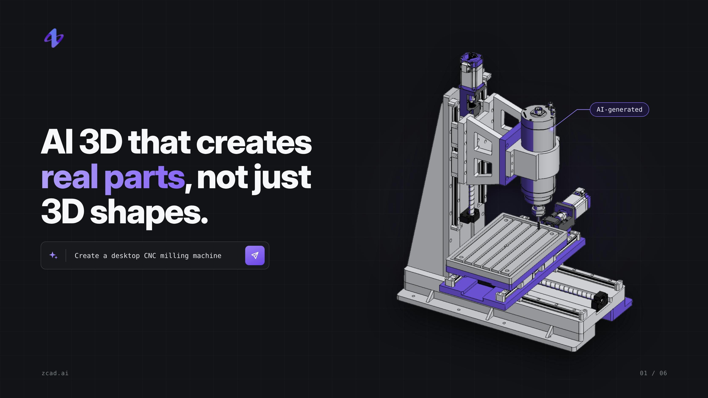
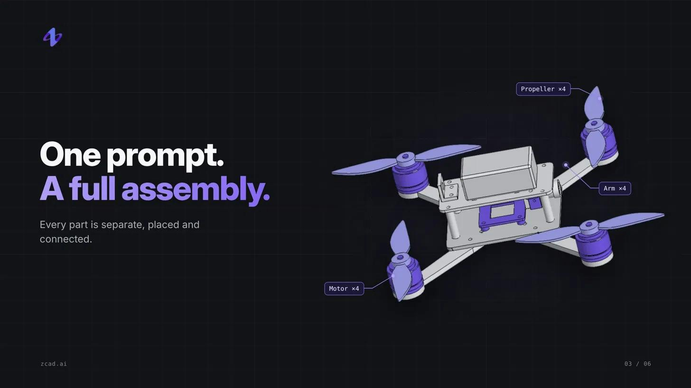
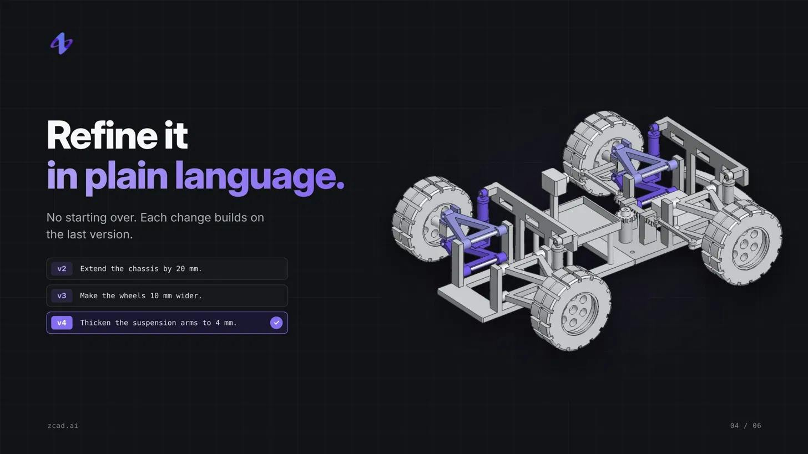

---

## 2. [myPip](https://www.producthunt.com/products/mypip-2)
**Votes**: 199 | **도입 난이도**: 하 | **신뢰도**: 상
**Tagline**: Vibe code, publish, and monetize games with AI
**서비스 링크**: https://www.producthunt.com/r/EHF3WCHUMHPPQ4

**태그**: NoCode, GameDev, AI, Monetization, AI Tool, DevTool

### 📌 이 서비스 한눈에 보기
AI를 통해 코딩 없이 게임 아이디어를 즉시 제작하고 수익화까지 연결하는 플랫폼

### 🔑 주요 기능
- 자연어 설명을 통한 브라우저 기반 게임 생성
- 멀티플레이어 경험 및 인앱 결제/광고 기능 지원
- 아이디어 구상부터 배포 및 수익화까지의 엔드투엔드 워크플로우

### 🙋 사용자에게 어떤 점이 좋은가
개발 지식이 없어도 아이디어만으로 플레이 가능한 게임을 만들고, 이를 바로 배포하여 수익을 창출할 수 있습니다.

### ✅ 지금 바로 써볼 기능
- 만들고 싶은 게임 아이디어를 텍el로 입력해보기
- 생성된 게임의 멀티플레이어 기능 테스트하기
- 수익화를 위한 광고 및 인앱 결제 설정 살펴보기

### ⚠️ 사용 전 확인할 점
- 복잡한 로직이나 고사양 그래픽 구현의 한계 가능성
- 플랫폼 의존적인 배포 및 수익화 구조

### 🧭 확인이 더 필요한 정보
AI가 생성하는 게임의 세부적인 커스텀 자유도와 복잡한 게임 로직 구현 가능 여부를 확인해야 합니다.

### 📸 스크린샷 및 갤러리

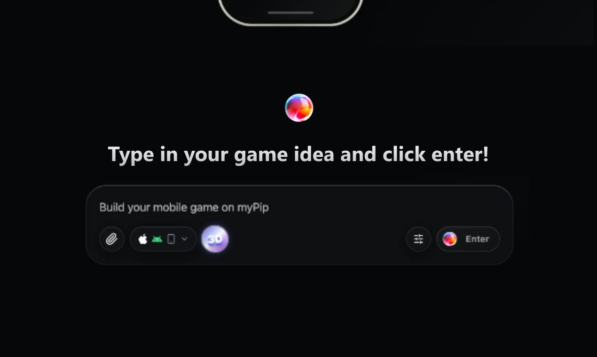
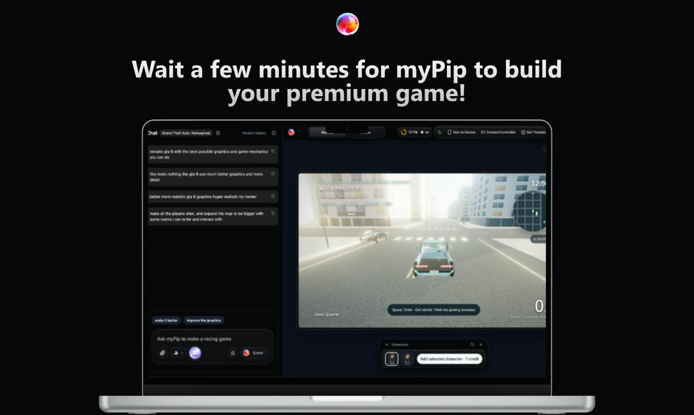

### 🎬 관련 영상
- [🎥 영상 보기](https://ph-files.imgix.net/f794edd4-be36-4425-b7fd-86aba8427b67.gif?auto=format)

---

## 3. [1Password for Agents](https://www.producthunt.com/products/1password)
**Votes**: 189 | **도입 난이도**: 하 | **신뢰도**: 상
**Tagline**: Let AI agents sign in for you without seeing your passwords
**서비스 링크**: https://www.producthunt.com/r/QPQLVSCTPHCQGE

**태그**: Security, AI, Automation, Productivity, Agent, AI Tool, DevTool

### 📌 이 서비스 한눈에 보기
비밀번호 노출 없이 AI 에이전트가 안전하게 로그인할 수 있게 돕는 보안 솔루션

### 🔑 주요 기능
- AI 에이전트가 사용자의 비밀번호를 직접 볼 수 없는 구조로 설계됨
- 로그인 요청 시 사용자의 개인 기기에서 승인/거절을 직접 결정
- 에이전트 연결 시 전체 금고가 아닌 필요한 정보만 제공하여 보안 유지

### 🙋 사용자에게 어떤 점이 좋은가
AI 에이전트에게 계정 접근 권한을 주면서도 비밀번호 유출 걱정 없이 자동화 작업을 수행할 수 있습니다.

### ✅ 지금 바로 써볼 기능
- 개인 또는 가족 플랜 가입 여부 확인
- 지원되는 AI 에이전트(Meta Muse, Grok Bot 등) 호환성 체크
- 대기 명단(Waitlist) 등록

### ⚠️ 사용 전 확인할 점
- 현재 Meta Muse와 Grok Bot 위주로 출시 중이며 지원 범위가 제한적일 수 있음
- 사용자의 수동 승인 과정이 필요함

### 🧭 확인이 더 필요한 정보
지원되는 AI 에이전트의 종류와 전체 플랜에 대한 확장 범위가 지속적으로 업데이트될 예정입니다.

### 📸 스크린샷 및 갤러리
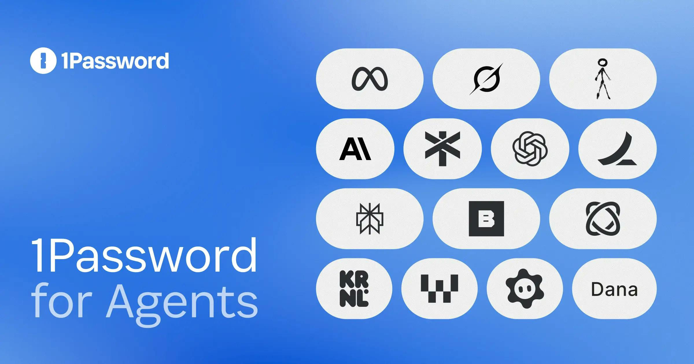

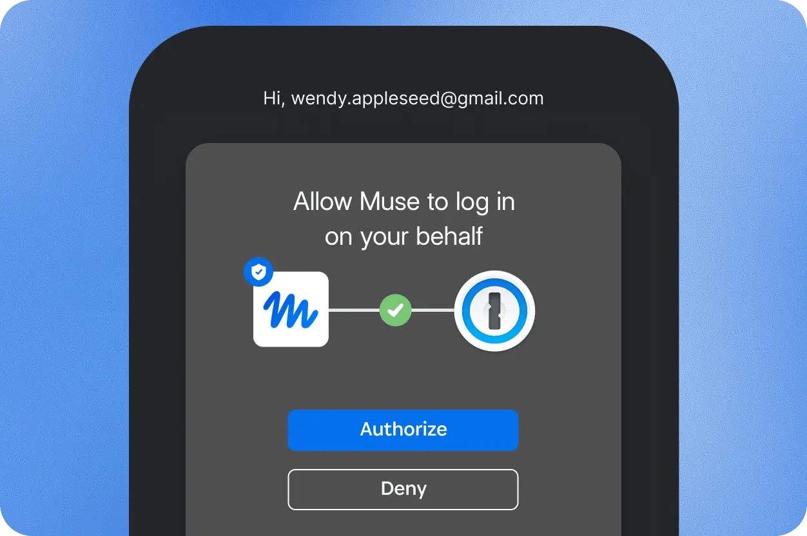

### 🎬 관련 영상
- [🎥 영상 보기](https://ph-files.imgix.net/7540cf4d-a42d-4e0c-936e-844b1ae92459.jpeg?auto=format)

---

## 4. [AgentValley](https://www.producthunt.com/products/agentvalley)
**Votes**: 133 | **도입 난이도**: 하 | **신뢰도**: 상
**Tagline**: Every Claude Code agent, at a glance, in your Mac's notch
**서비스 링크**: https://www.producthunt.com/r/FXTTULYREWAUGP

**태그**: DevTool, Productivity, Mac, ClaudeCode, OpenSource, Agent, AI Tool

### 📌 이 서비스 한눈에 보기
MacBook 노치에서 Claude Code 에이전트의 작업 현황을 실시간으로 모니터링하는 도구

### 🔑 주요 기능
- MacBook 노치 영역을 활용한 직관적인 UI 제공
- Claude Code 세션 및 하위 에이전트별 상태 시각화
- 사용 중인 모델과 대기 상태를 한눈에 파악 가능

### 🙋 사용자에게 어떤 점이 좋은가
터미널을 매번 확인하지 않고도 노치를 통해 에이전트의 작업 진행 상황을 즉각적으로 확인할 수 있어 개발 흐름을 유지하기 좋습니다.

### ✅ 지금 바로 써볼 기능
- MacBook 노치 영역에 설치하여 시각적 레이아웃 확인하기
- Claude Code 세션과 연동하여 에이전트별 카드/행 생성 확인하기
- 오픈 소스 코드를 검토하여 보안성 확인하기

### ⚠️ 사용 전 확인할 점
- MacBook 노치 디자인에 최적화되어 있어 다른 디스플레이 환경에서는 사용이 제한될 수 있음
- Claude Code 환경과의 연동 설정이 필요할 수 있음

### 🧭 확인이 더 필요한 정보
Claude Code와의 구체적인 연동 방식 및 설치 과정에 대한 상세 가이드가 필요합니다.

### 📸 스크린샷 및 갤러리
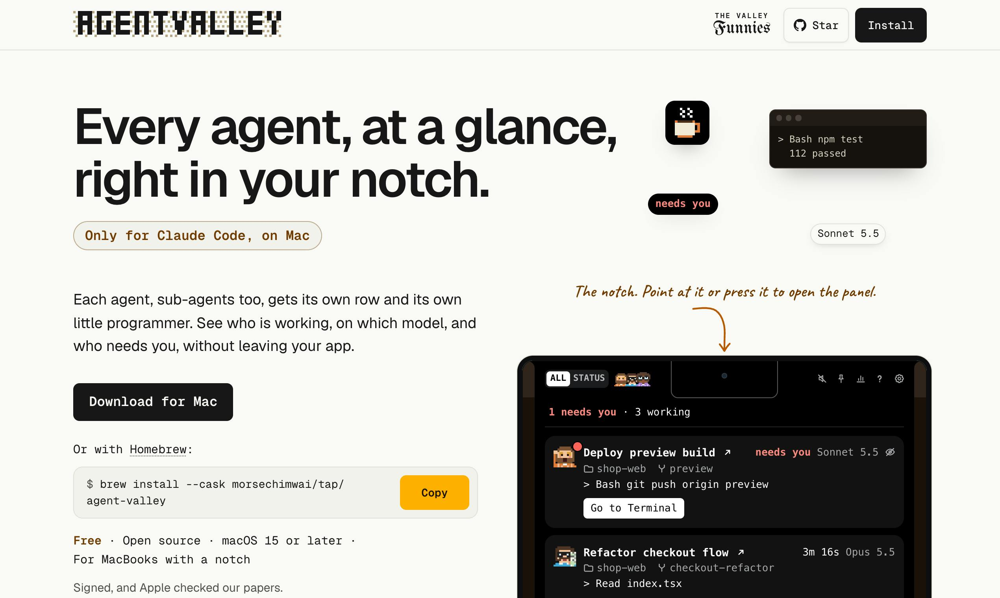
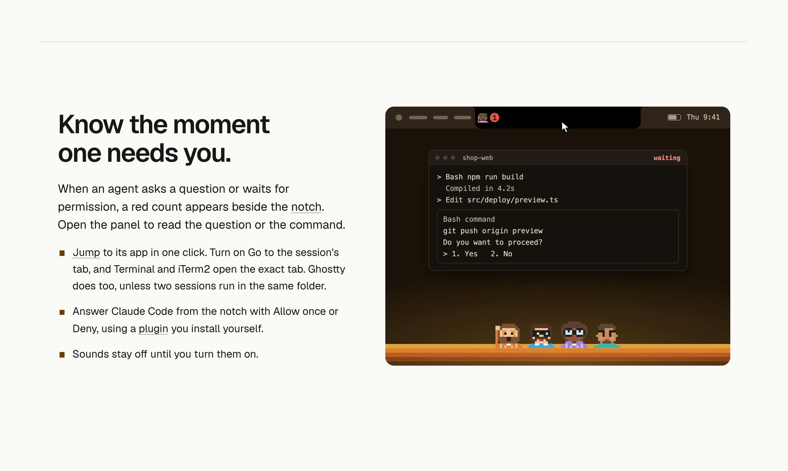
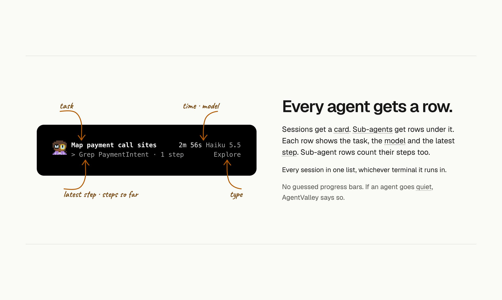

### 🎬 관련 영상
- [🎥 영상 보기](https://ph-files.imgix.net/538cf649-befa-4006-a144-2a45a51b4056.jpeg?auto=format)

---

## 5. [LinkIntel](https://www.producthunt.com/products/linkintel)
**Votes**: 112 | **도입 난이도**: 하 | **신뢰도**: 상
**Tagline**: Post insights delivered direct to your AI
**서비스 링크**: https://www.producthunt.com/r/BRLPMVHM6UBNJP

**태그**: AI, SocialMedia, Analytics, Automation, Agent, AI Tool, Chat

### 📌 이 서비스 한눈에 보기
X(트위터) 성과 데이터를 AI에게 직접 전달하여 최적의 포스트 초안을 만드는 분석 도구

### 🔑 주요 기능
- X 포스트 성과 데이터 자동 기록 및 수집
- X 알고리즘의 오픈소스 랭킹 가중치 변화 추적
- 수집된 데이터를 LLM(Claude, ChatGPT 등)에 전달하여 성과 기반 초안 작성 지원

### 🙋 사용자에게 어떤 점이 좋은가
AI가 작성한 글이 실제 성과로 이어지지 않는 문제를 해결하며, 데이터 기반의 검증된 콘텐츠 제작을 가능하게 합니다.

### ✅ 지금 바로 써볼 기능
- X 계정 연결하여 과거 포스트 성과 데이터 동기화하기
- 수집된 데이터를 Claude나 ChatGPT에 입력하여 다음 포스트 초안 요청하기

### ⚠️ 사용 전 확인할 점
- X 계정 권한 부여에 따른 보안 및 개인정보 정책 확인 필요
- LLM에 데이터를 전달하는 방식(URL 입력 등)에 따른 데이터 활용 범위 확인

### 🧭 확인이 더 필요한 정보
X API 사용량에 따른 비용 발생 여부와 데이터 업데이트 주기에 대한 상세 정보가 명시되지 않았습니다.

### 📸 스크린샷 및 갤러리
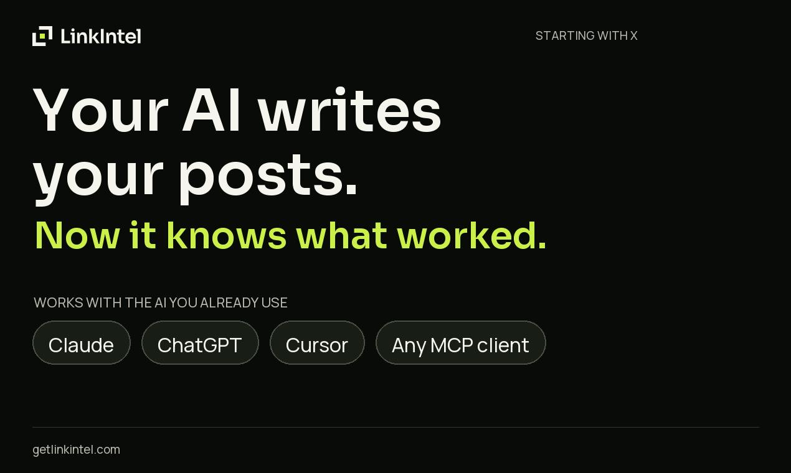
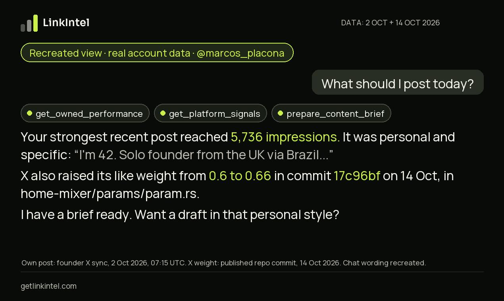
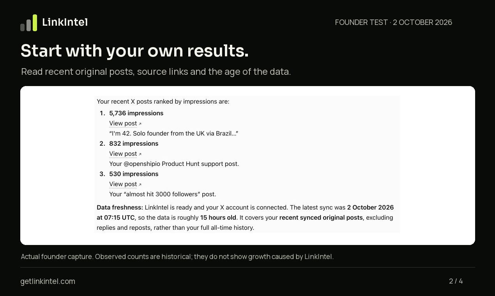

### 🎬 관련 영상
- [🎥 영상 보기](https://ph-files.imgix.net/ba800789-5c02-4297-a25d-48455f656f91.jpeg?auto=format)

---

## 6. [Canva Craft](https://www.producthunt.com/products/canva)
**Votes**: 101 | **도입 난이도**: 하 | **신뢰도**: 상
**Tagline**: Turn prompts into design-ready images you can edit
**서비스 링크**: https://www.producthunt.com/r/WZ53YD2FURN4TB

**태그**: Design, AI-Image, Canva, Productivity, AI Tool, Prompting, Vision, API

### 📌 이 서비스 한눈에 보기
단순한 이미지를 넘어 편집 가능한 레이어와 레이아웃이 설계된 디자인 맞춤형 AI 모델

### 🔑 주요 기능
- 수백만 개의 템플릿 학습을 통한 디자인 중심의 구도 설계
- 55개 언어의 가독성 높은 텍스트 및 30개 이상의 다양한 종횡비 지원
- 생성된 결과물을 편집 가능한 레이어로 분리할 수 있는 기능

### 🙋 사용자에게 어떤 점이 좋은가
단순한 사진 생성을 넘어, 디자인 작업에 즉시 투입할 수 있는 레이아웃과 편집 가능한 요소를 제공하여 작업 시간을 단축해 줍니다.

### ✅ 지금 바로 써볼 기능
- 프롬프트를 입력하여 디자인 레이아웃 생성해보기
- 생성된 이미지의 레이어를 분리하여 세부 요소 수정하기
- 다양한 종횡비를 활용해 소셜 미디어용 디자인 제작하기

### ⚠️ 사용 전 확인할 점
- 생성된 레이어의 분리 수준이 사용자의 편집 의도와 일치하는지 확인 필요
- 복잡한 구도에서 텍y 가독성 및 배치 정확도 검토 필요

### 🧭 확인이 더 필요한 정보
API 제공 범위와 상세한 레이어 분리 기술의 세부 사항에 대한 추가 확인이 필요합니다.

### 📸 스크린샷 및 갤러리

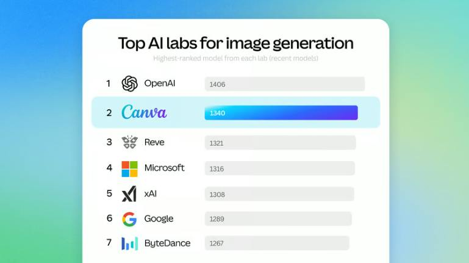

---

## 7. [Many Displays](https://www.producthunt.com/products/many-displays)
**Votes**: 99 | **도입 난이도**: 하 | **신뢰도**: 상
**Tagline**: Zero clicks: windows back after sleep, unlock or replugging
**서비스 링크**: https://www.producthunt.com/r/GSPZTCB4QSTTSI

**태그**: Productivity, macOS, Automation, Workflow

### 📌 이 서비스 한눈에 보기
맥(Mac)의 디스플레이 연결 해제 및 절전 모드 시 윈도우 배치를 자동으로 복구하는 자동화 도구

### 🔑 주요 기능
- 잠자기, 잠금 해제, 모니터 재연결 시 윈도우 위치/크기 자동 복구
- 클라우드나 계정 없이 로컬에서 작동하는 프라이버시 중심 설계
- 포트 기반 식별로 동일한 모니터 환경에서도 정확한 레이아웃 유지

### 🙋 사용자에게 어떤 점이 좋은가
모니터를 껐다 켜거나 맥북을 외부 디스플레이에 연결할 때마다 창 위치가 흐트러지는 번거로움을 완벽히 해결해 줍니다.

### ✅ 지금 바로 써볼 기능
- 14일 무료 체험판 설치하여 자동 복구 성능 테스트
- 시스템 설정에서 '손쉬운 사용(Accessibility)' 권한 부여
- 외부 모니터 연결 환경에서 레이아웃 일치 여부 확인

### ⚠️ 사용 전 확인할 점
- 초기 설정 시 시스템 접근 권한(Accessibility) 허용 필요
- 동일한 모델의 모니터를 사용하는 환경에 최적화됨

### 🧭 확인이 더 필요한 정보
사용자의 특정 macOS 버전에서의 안정성 및 호환성 여부는 직접 테스트가 필요합니다.

### 📸 스크린샷 및 갤러리

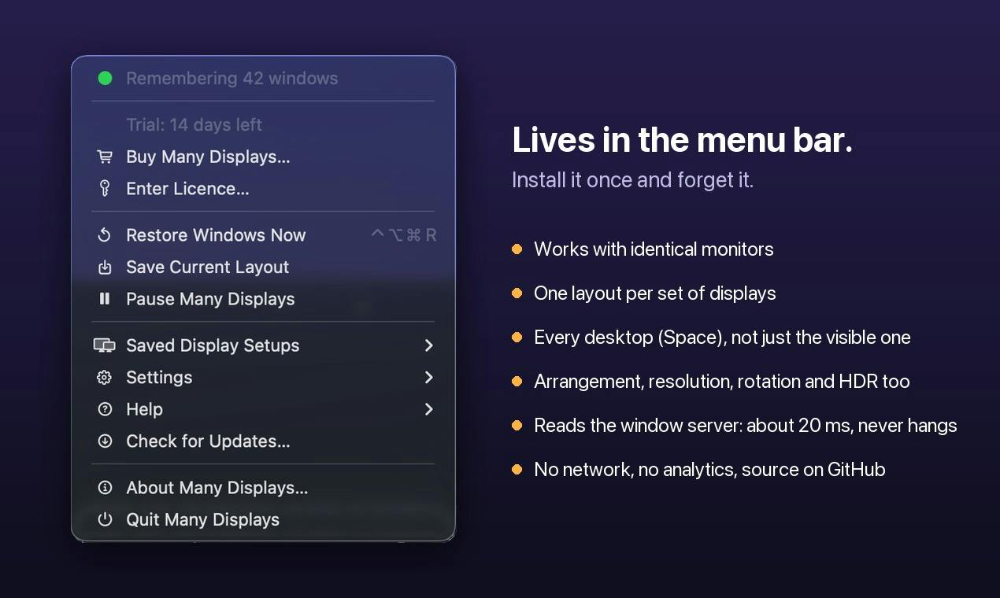
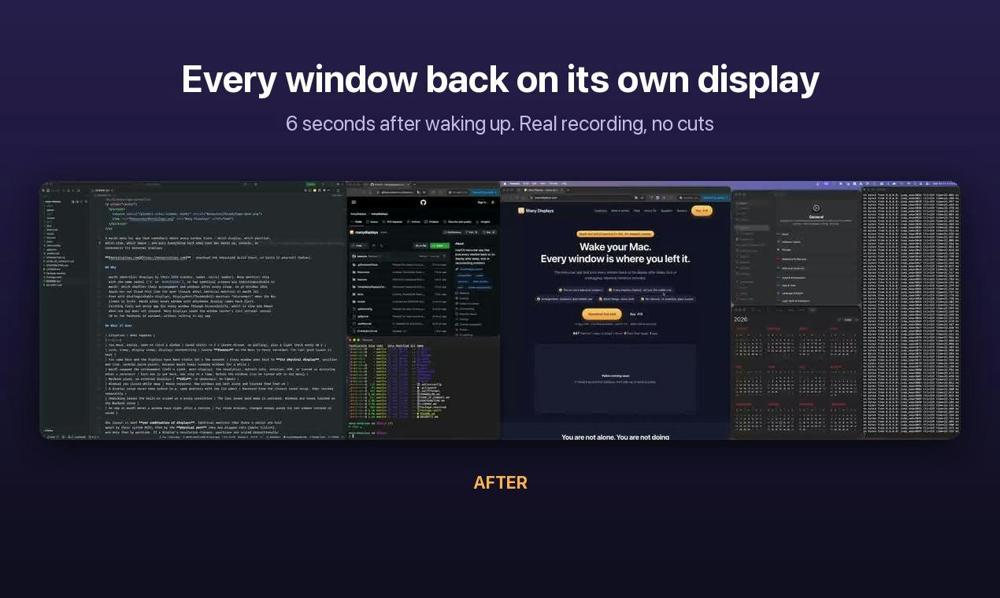

---

## 8. [Penta](https://www.producthunt.com/products/penta-cd-player-changer)
**Votes**: 92 | **도입 난이도**: 하 | **신뢰도**: 상
**Tagline**: A ’90s 5-disc CD changer on iPhone Duo 
**서비스 링크**: https://www.producthunt.com/r/OSUIR3XGHPGCRN

**태그**: Music, Retro, iOS, UX

### 📌 이 서비스 한눈에 보기
90년대 CD 체인저의 감성을 iPhone에서 재현하는 레트로 음악 플레이어

### 🔑 주요 기능
- 실제 90년대 5-디스크 CD 체인저의 클릭, 모터 소리, 구동음을 완벽 재현
- iPhone Duo 기기 특성을 활용한 물리적 인터랙션(케이스 열기, 디스크 투입 등)
- Apple Music 라이브러리를 활용한 디지털 음원과 아날로그 감성의 결합

### 🙋 사용자에게 어떤 점이 좋은가
Apple Music 사용자가 디지털 음원을 들으며 90년대 물리 매체의 손맛과 청각적 향수를 느낄 수 있습니다.

### ✅ 지금 바로 써볼 기능
- Apple Music 라이브러리 연동하기
- 기기 물리 동작을 통한 CD 트레이 구동 경험하기
- Pro 버전으로 실물 CD 아트워크 적용해보기

### ⚠️ 사용 전 확인할 점
- Apple Music 구독 서비스가 필요함
- Pro 기능(실물 CD 아트워크)은 유료 결제가 필요함

### 🧭 확인이 더 필요한 정보
iPhone Duo 외 일반 iPhone/iPad 모델에서의 물리적 인터랙션 구현 방식은 기기마다 다를 수 있습니다.

### 📸 스크린샷 및 갤러리

---

## 9. [Byter](https://www.producthunt.com/products/byter)
**Votes**: 87 | **도입 난이도**: 하 | **신뢰도**: 상
**Tagline**: Know exactly how much data you use, on every network
**서비스 링크**: https://www.producthunt.com/r/P5AUEEE3ERUV7M

**태그**: Analytics, Network, Productivity, Privacy, AI Tool

### 📌 이 서비스 한눈에 보기
모든 네트워크별 데이터 사용량을 정밀하게 추적하고 관리하는 개인용 데이터 모니터링 도구

### 🔑 주요 기능
- Wi-Fi, 핫스팟, 유선 연결별로 분리된 상세 데이터 사용량 추적
- 실시간 속도 측정 및 일간/연간 데이터 사용량 차트 제공
- 계정 생성이나 광고 없이 기기 내에서만 작동하는 프라이버시 중심 설계

### 🙋 사용자에게 어떤 점이 좋은가
데이터 사용량이 많은 환경에서 어떤 네트워크가 데이터를 얼마나 소비하는지 명확히 파악하여 요금제 관리와 네트워크 효율을 높일 수 있습니다.

### ✅ 지금 바로 써볼 기능
- 현재 사용 중인 네트워크별 데이터 소비량 확인하기
- 데이터 사용량 급증 시 알림 설정하기
- 실시간 인터넷 속도 테스트 실행하기

### ⚠️ 사용 전 확인할 점
- 현재 Mac 전용이며 Windows 버전은 출시 예정임
- 네트워크 환경에 따라 데이터 추적 정확도가 달라질 수 있음

### 🧭 확인이 더 필요한 정보
Windows 버전의 정확한 출시 일정과 상세 기능 지원 여부는 아직 확인되지 않았습니다.

### 📸 스크린샷 및 갤러리
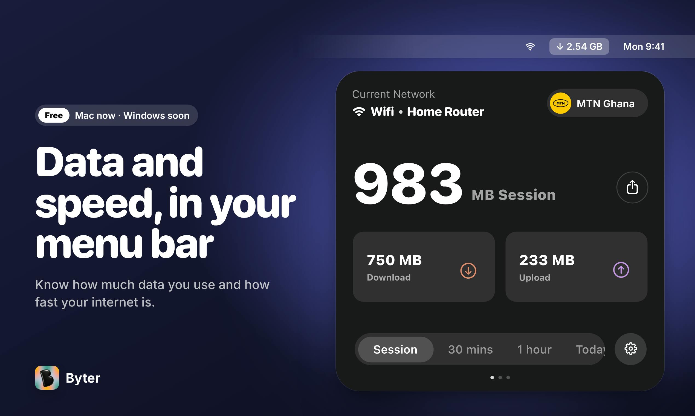
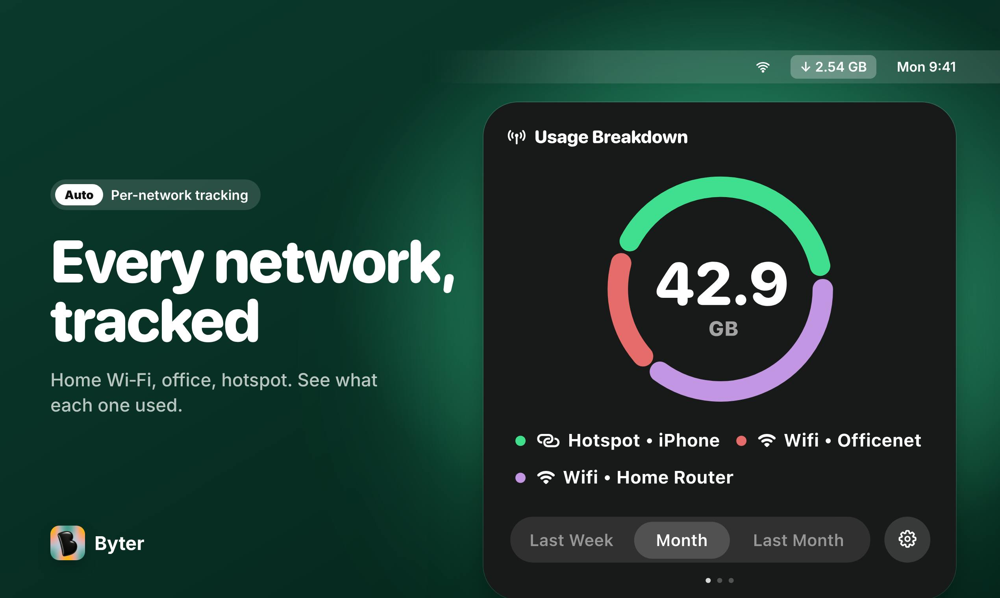
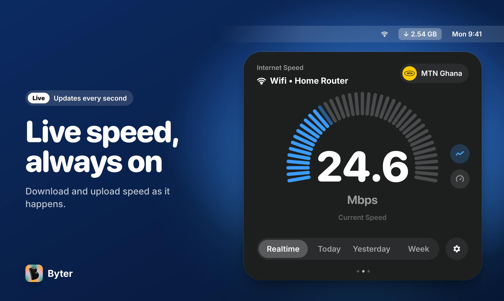

---

## 10. [Basedash Scheduled CSV Exports](https://www.producthunt.com/products/basedash)
**Votes**: 81 | **도입 난이도**: 하 | **신뢰도**: 상
**Tagline**: Ask once. Get a fresh CSV in Slack or email every week.
**서비스 링크**: https://www.producthunt.com/r/6NB5PZDF42D2BW

**태그**: Automation, DataExport, Productivity, AI Tool, Email

### 📌 이 서비스 한눈에 보기
자연어로 명령하면 매주 자동으로 최신 데이터를 CSV로 추출해 전달하는 자동화 도구

### 🔑 주요 기능
- 자연어 지시를 통한 간편한 CSV 추출 자동화 설정
- Slack 스레드 첨부 또는 이메일 링크를 통한 정기적 데이터 전달
- Basedash 권한 기반의 안전한 데이터 다운로드 환경 제공

### 🙋 사용자에게 어떤 점이 좋은가
매주 반복되는 데이터 추출 및 보고 업무를 자동화하여, 한 번의 설정만으로 최신 데이터를 정기적으로 받아볼 수 있습니다.

### ✅ 지금 바로 써볼 기능
- 자연어로 데이터 추출 규칙 작성해보기
- Slack 또는 이메일 수신 채널 설정하기
- 주간/일간 스케줄링 적용하기

### ⚠️ 사용 전 확인할 점
- 수신자가 파일을 열기 위해서는 Basedash 자동화 접근 권한이 필요함
- 데이터 소스에 대한 적절한 권한 설정이 선행되어야 함

### 🧭 확인이 더 필요한 정보
데이터 소스의 종류와 외부 서비스와의 연동 범위에 대한 상세 정보는 명시되지 않았습니다.

### 📸 스크린샷 및 갤러리

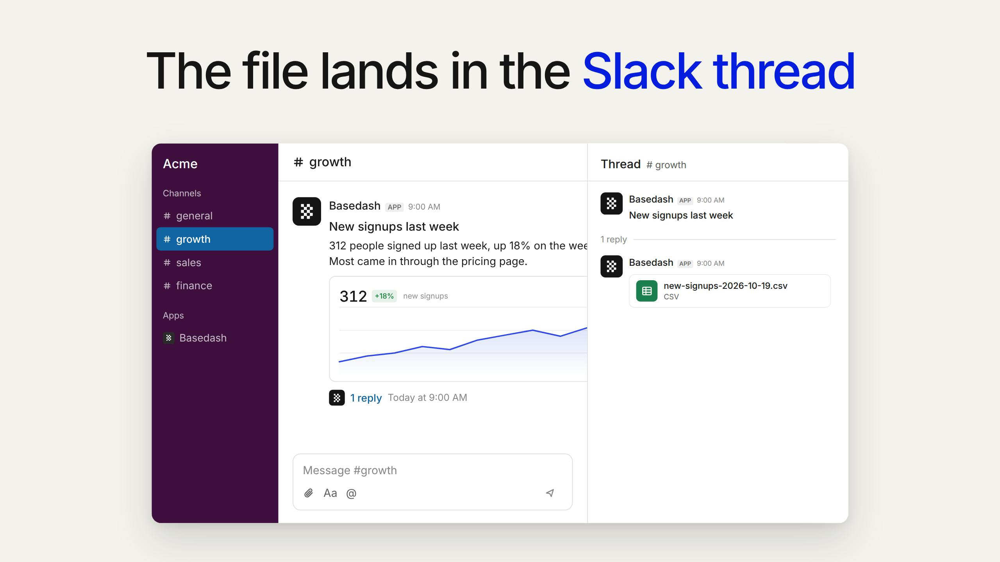
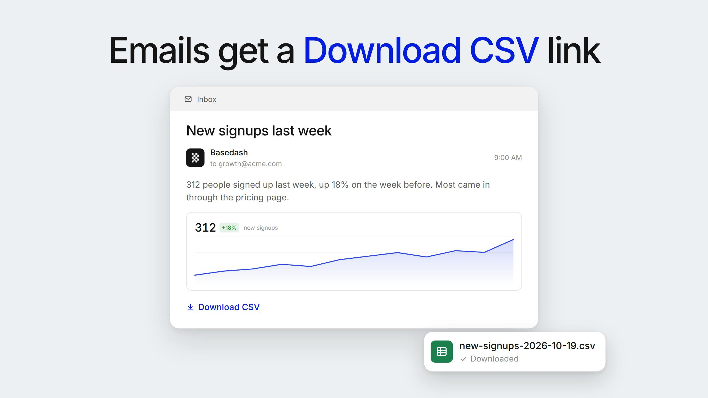

### 🎬 관련 영상
- [🎥 영상 보기](https://ph-files.imgix.net/c51f2b3e-783e-4818-af8c-dce187288b69.jpeg?auto=format)

---

## 11. [sideOS.ai](https://www.producthunt.com/products/sideos-ai)
**Votes**: 80 | **도입 난이도**: 중 | **신뢰도**: 상
**Tagline**: Local AI for dictation, meetings, background tasks and more
**서비스 링크**: https://www.producthunt.com/r/D5JNR5M5ITCQOX

**태그**: Automation, AI, Productivity, Mac, AI Tool

### 📌 이 서비스 한눈에 보기
맥북 노치에서 실행되는 강력한 로컬 AI 자동화 비서

### 🔑 주요 기능
- 화면 읽기, 앱 실행, 클릭 및 타이핑 등 데스크톱 작업 자동화
- 로컬 모델 사용으로 보안이 강화된 오프라인 작업 지원
- 사용자 개인 API 키(Claude, OpenAI 등) 연동 가능

### 🙋 사용자에게 어떤 점이 좋은가
복잡한 반복 작업을 음성 명령만으로 자동화하여 업무 흐름을 끊지 않고 생산성을 높일 수 있습니다.

### ✅ 지금 바로 써볼 기능
- 단축키를 활용한 음성 명령 테스트
- 로컬 모델을 이용한 개인 데이터 처리
- 자신의 API 키를 연결하여 고성능 모델 활용

### ⚠️ 사용 전 확인할 점
- 화면 제어 권한 부여에 따른 보안 및 개인정보 검토 필요
- 로컬 모델 구동 시 Mac의 하드웨어 리소스 점유율 확인 필요

### 🧭 확인이 더 필요한 정보
사용자의 Mac 사양에 따른 로컬 모델 구동 성능과 자동화 정밀도 차이가 있을 수 있습니다.

### 📸 스크린샷 및 갤러리
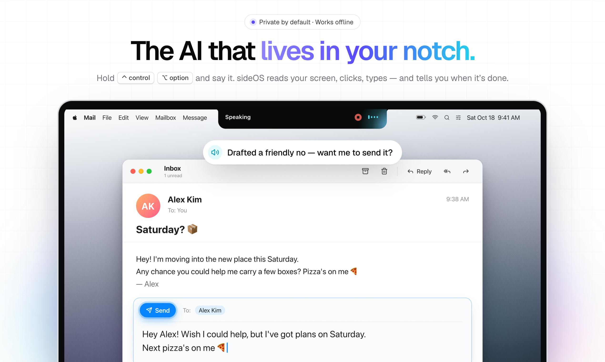
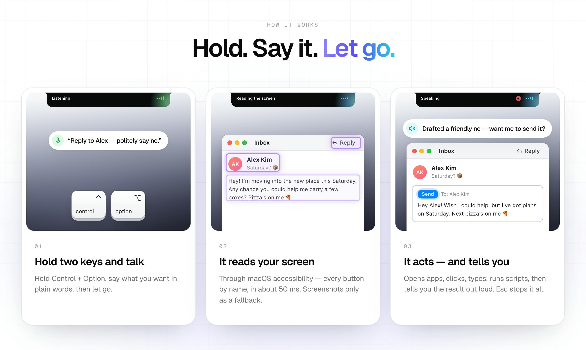
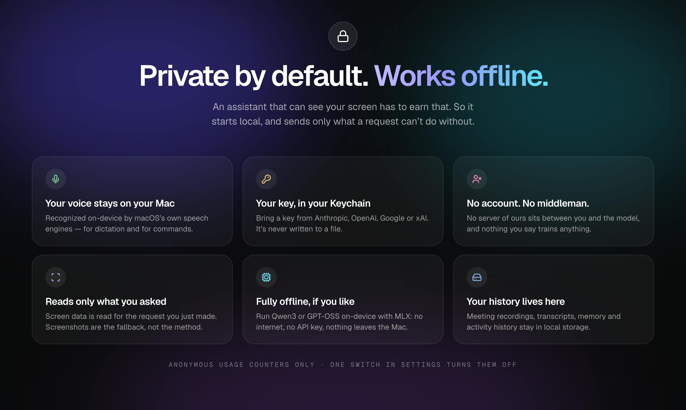

### 🎬 관련 영상
- [🎥 영상 보기](https://ph-files.imgix.net/4687caf8-d0bc-43f3-9b09-c3fec4608618.jpeg?auto=format)

---

## 12. [How It Went](https://www.producthunt.com/products/how-it-went)
**Votes**: 78 | **도입 난이도**: 하 | **신뢰도**: 상
**Tagline**: Your route, photos and clips as a short film
**서비스 링크**: https://www.producthunt.com/r/HHBJPDPSK62X4D

**태그**: VideoEditing, Travel, GPS, Cycling, Automation, DevTool

### 📌 이 서비스 한눈에 보기
GPS 경로와 사진/영상을 결합해 여행의 기록을 한 편의 단편 영화로 만들어주는 서비스

### 🔑 주요 기능
- GPS 트랙, 사진, 영상 클립을 결합한 자동 영상 제작
- Strava 연동 및 Garmin FIT/GPX 파일 지원
- 모바일(iOS/Android) 및 Mac 환경 지원

### 🙋 사용자에게 어떤 점이 좋은가
별도의 복잡한 편집 없이도 자신의 라이딩이나 여행 경로를 시각적으로 아름다운 영상 콘텐츠로 변환할 수 있습니다.

### ✅ 지금 바로 써볼 기능
- Strava 계정 연동하여 기존 라이딩 데이터 가져오기
- GPS 파일(FIT/GPX) 업로드하여 경로 시각화하기
- 9:16 또는 16:9 비율로 원하는 포맷의 MP4 내보내기

### ⚠️ 사용 전 확인할 점
- 카메라 시간 설정이 잘못된 경우 위치 매칭이 어긋날 수 있음
- 사용 중인 기기(iPhone, Android, Mac)의 사양에 따른 인코딩 속도 차이

### 🧭 확인이 더 필요한 정보
사용자의 기기 사양에 따른 구체적인 인코딩 성능 및 클라우드/로컬 처리 방식에 대한 정보가 부족합니다.

### 📸 스크린샷 및 갤러리

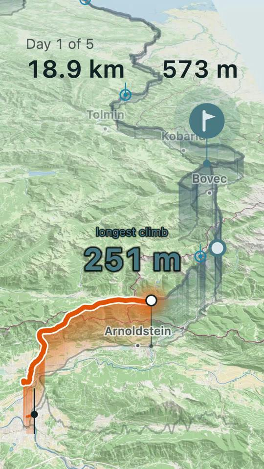

### 🎬 관련 영상
- [🎥 영상 보기](https://ph-files.imgix.net/0f34fe1e-7b6b-48e1-8ecf-93cb26146195.jpeg?auto=format)

---

## 13. [Shedi](https://www.producthunt.com/products/shedi)
**Votes**: 77 | **도입 난이도**: 하 | **신뢰도**: 상
**Tagline**: Get back the space Xcode, Docker and node_modules ate
**서비스 링크**: https://www.producthunt.com/r/HSREWDNNKNHUO5

**태그**: DevTool, Mac, Utility, Storage

### 📌 이 서비스 한눈에 보기
개발 도구와 패키지 매니저가 남긴 찌꺼기 파일을 안전하게 정리해주는 Mac 전용 클리너

### 🔑 주요 기능
- Xcode, Docker, node_modules 등 개발 환경에서 발생하는 대용량 잔여 파일 탐색
- 각 항목의 정체와 삭제 시 영향도를 명확히 안내
- 사용자가 직접 선택한 항목만 삭제하며, 모든 파일은 휴지통으로 이동하여 안전성 확보

### 🙋 사용자에게 어떤 점이 좋은가
개발 환경 구축으로 인해 부족해진 Mac 저장 공간을 확보하고, 불필요한 파일로 인한 용량 낭비를 효율적으로 해결할 수 있습니다.

### ✅ 지금 바로 써볼 기능
- 개발 도구 사용 후 남은 용량 확인하기
- 제안된 파일들의 정체와 삭제 영향도 검토하기
- 선택한 파일을 휴지통으로 이동시켜 안전하게 정리하기

### ⚠️ 사용 전 확인할 점
- 삭제 전 각 항목이 시스템에 미치는 영향을 반드시 숙지해야 함
- 사용자가 직접 선택하는 방식이므로 수동 작업이 필요함

### 🧭 확인이 더 필요한 정보
특정 개발 도구의 핵심 설정 파일이 삭제 대상에 포함될 수 있으므로 주의가 필요합니다.

### 📸 스크린샷 및 갤러리
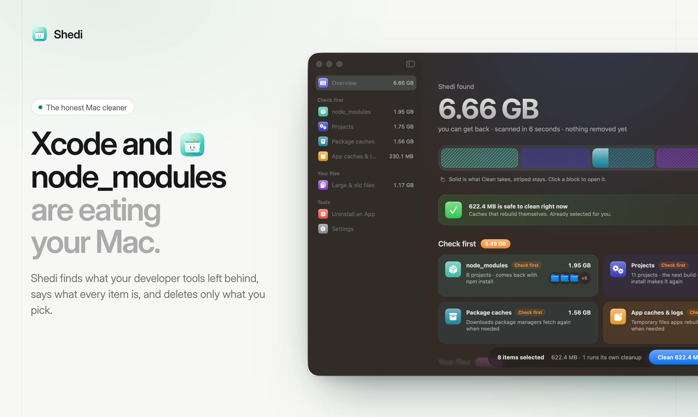
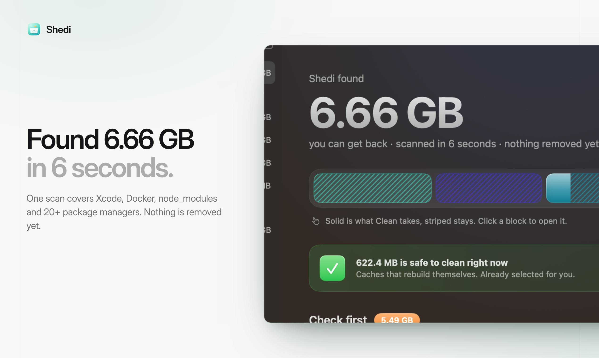
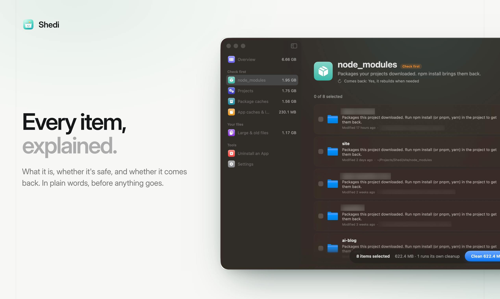

### 🎬 관련 영상
- [🎥 영상 보기](https://ph-files.imgix.net/a44b9afe-5c2a-49b5-bd91-ac0493055dd7.jpeg?auto=format)

---

## 14. [River Writer](https://www.producthunt.com/products/river-writer)
**Votes**: 76 | **도입 난이도**: 하 | **신뢰도**: 상
**Tagline**: A quiet Mac app for screenplays, stage plays and novels
**서비스 링크**: https://www.producthunt.com/r/7J2E7P5IMD45KW

**태그**: Writing, MacApp, OpenSource, Productivity, AI Tool

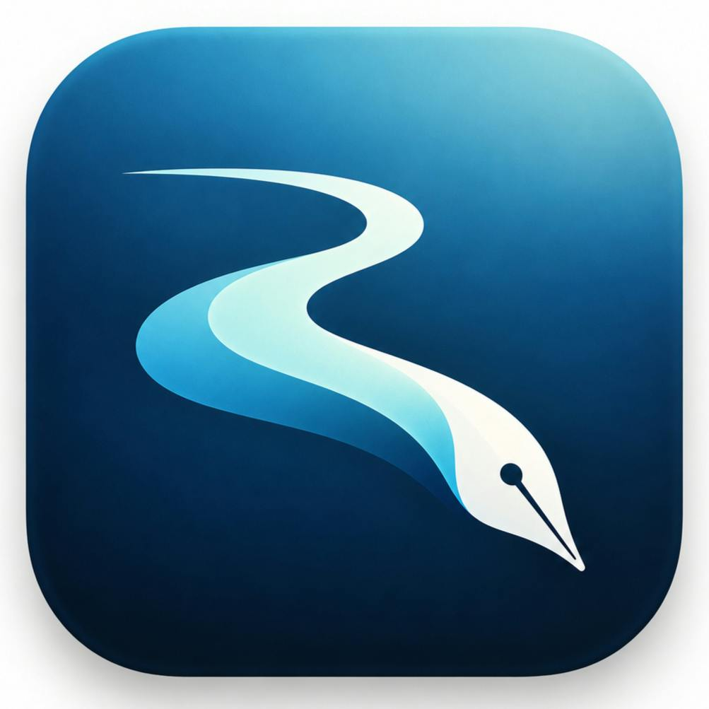

### 📌 이 서비스 한눈에 보기
개인정보 보호와 버전 관리에 특화된 Mac용 오픈소스 시나리오/소설 집필 앱

### 🔑 주요 기능
- Plain Text 기반의 Fountain/ormd 포맷 지원 및 실시간 프리뷰 기능
- Git 버전 관리 내장으로 초안 커밋 및 브랜치를 통한 다양한 결말 실험 가능
- 계정, 클라우드, AI, 텔레메트리가 없는 완전한 오프라인/로컬 중심 환경

### 🙋 사용자에게 어떤 점이 좋은가
네트워크 연결 없이 오직 글쓰기에만 집중할 수 있는 환경을 제공하며, Git을 통해 작가의 창작물을 안전하게 관리할 수 있습니다.

### ✅ 지금 바로 써볼 기능
- Plain Text로 초안 작성 후 실시간 프리뷰로 레이아웃 확인하기
- Git 기능을 활용해 새로운 플롯이나 결말을 브랜치로 실험해보기
- 프로젝트 내의 아웃라인과 스크래치패드 활용하기

### ⚠️ 사용 전 확인할 점
- Mac 전용 앱이므로 macOS 환경이 필수적임
- 클라우드 동기화 기능이 없으므로 파일 관리는 사용자가 직접 해야 함

### 🧭 확인이 더 필요한 정보
사용자의 수동 파일 관리 방식에 따른 데이터 백업 책임이 사용자에게 있음을 인지해야 합니다.

### 📸 스크린샷 및 갤러리
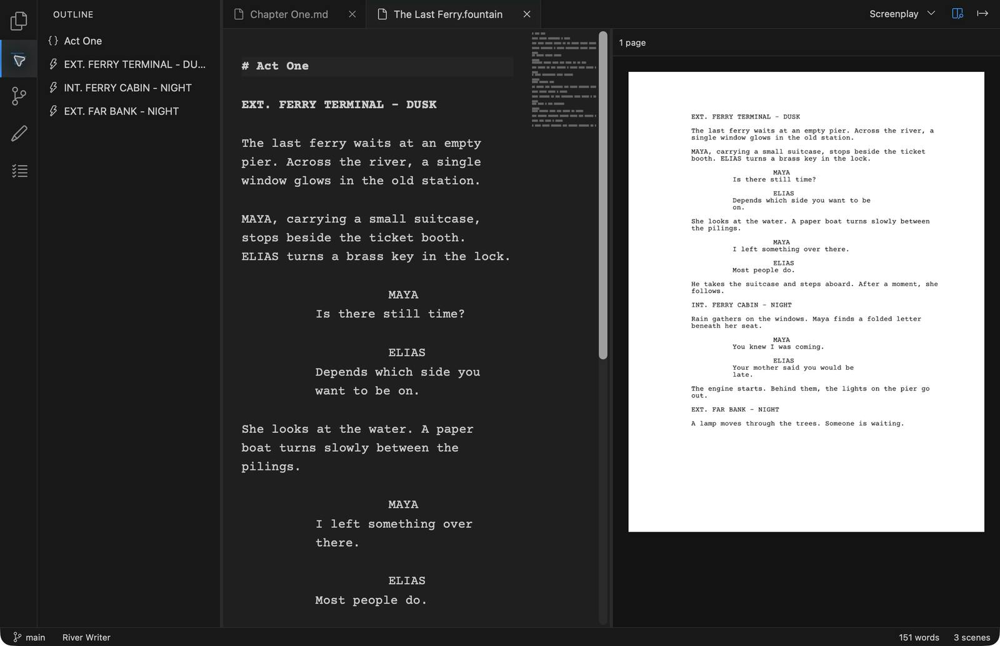
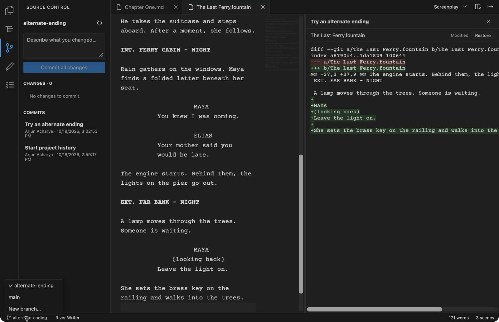
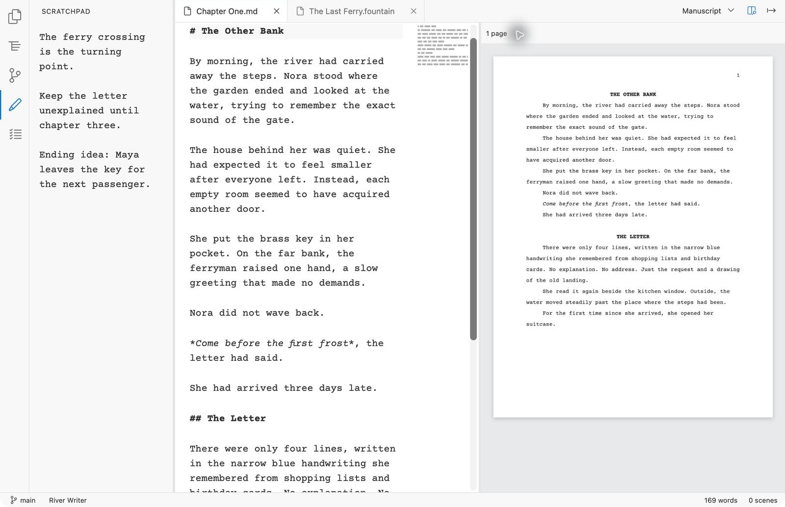

### 🎬 관련 영상
- [🎥 영상 보기](https://ph-files.imgix.net/b5e1a15a-38af-4876-874c-9fca61e18853.jpeg?auto=format)

---

## 15. [Laylight](https://www.producthunt.com/products/laylight)
**Votes**: 17 | **도입 난이도**: 중 | **신뢰도**: 상
**Tagline**: Get the full picture
**서비스 링크**: https://www.producthunt.com/r/GNL46WJZQMZQ4J

**태그**: Automation, Workflow, Business Intelligence, Productivity

### 📌 이 서비스 한눈에 보기
분산된 업무 도구를 하나로 연결하여 비즈니스 현황을 한눈에 파악하는 통합 워크플로우 솔루션

### 🔑 주요 기능
- 기존 업무 도구 간의 데이터 및 워크플로우 연결
- 반복적인 업무 자동화를 통한 팀 시간 절약
- 경영진을 위한 전사적 가시성 확보

### 🙋 사용자에게 어떤 점이 좋은가
여러 도구에 흩어진 정보를 일일이 확인할 필요 없이, 하나의 화면에서 업무 진행 상황을 파악하고 자동화된 프로세스로 운영 효율을 높일 수 있습니다.

### ✅ 지금 바로 써볼 기능
- 기존에 사용 중인 업무 도구와 Laylight의 연동 가능 여부 확인
- 반복적인 수동 작업 프로세스 식별 및 자동화 규칙 설정
- 관리자 대시보드를 통한 실시간 업무 가시성 테스트

### ⚠️ 사용 전 확인할 점
- 기존 도구들과의 호환성 및 데이터 동기화 방식 확인 필요
- 자동화 설정 시 발생할 수 있는 워크플로우 충돌 주의

### 🧭 확인이 더 필요한 정보
현재 설명에는 구체적인 지원 소프트웨어 목록과 데이터 보안 정책이 명시되어 있지 않습니다.

### 📸 스크린샷 및 갤러리
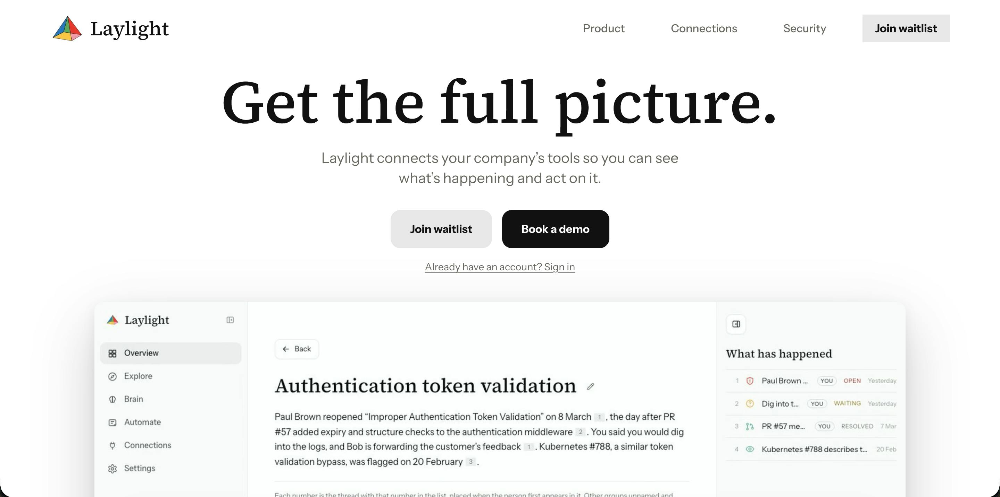
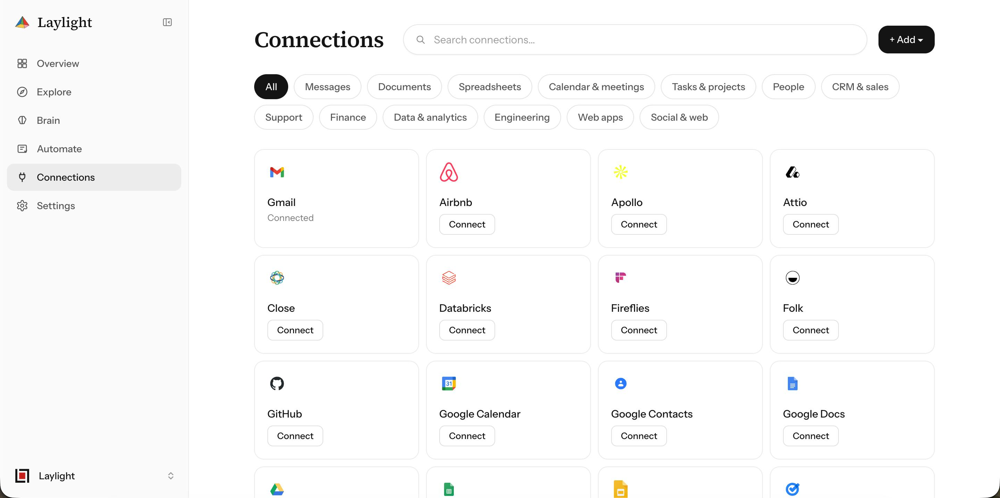

---

## 16. [Fluxix](https://www.producthunt.com/products/fluxix)
**Votes**: 15 | **도입 난이도**: 하 | **신뢰도**: 상
**Tagline**: Control what your AI agents can access, run, and spend
**서비스 링크**: https://www.producthunt.com/r/MZA46EDASUR7JO

**태그**: AI-Security, Automation, DevTool, Governance, Agent, AI Tool, API

### 📌 이 서비스 한눈에 보기
AI 에이전트의 권한과 비용을 안전하게 제어하는 보안 레이어

### 🔑 주요 기능
- 자연어 기반의 직관적인 보안 규칙 설정
- 위험한 작업 차단 및 인간 승인 워크플로우 제공
- 모든 에이전트 활동에 대한 상세 로그 기록

### 🙋 사용자에게 어떤 점이 좋은가
AI 에이전트가 시스템이나 자산에 직접 접근할 때 발생할 수 있는 예기치 못한 사고를 방지하고 통제권을 유지할 수 있습니다.

### ✅ 지금 바로 써볼 기능
- 자연어로 보안 규칙 설정해보기
- 위험 작업 차단 규칙 적용하기
- 승인이 필요한 민감 작업 설정하기

### ⚠️ 사용 전 확인할 점
- 에이전트의 작업 속도에 미칠 수 있는 지연 시간 확인 필요
- 연동하려는 기존 시스템과의 호환성 검토

### 🧭 확인이 더 필요한 정보
지원하는 구체적인 API 및 데이터베이스 통합 범위에 대한 정보가 부족합니다.

### 📸 스크린샷 및 갤러리
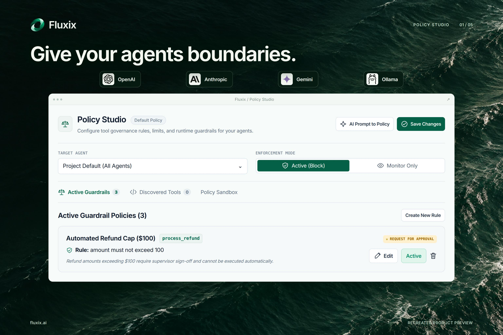
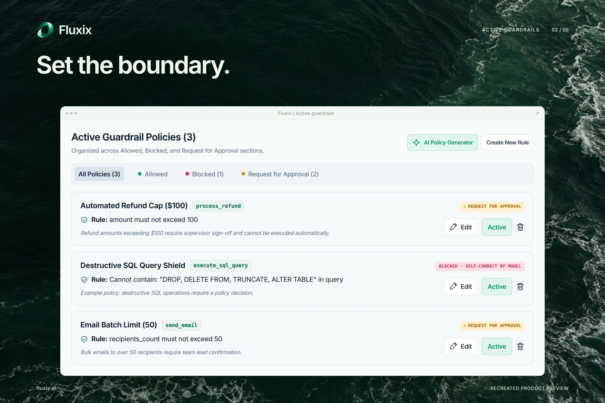
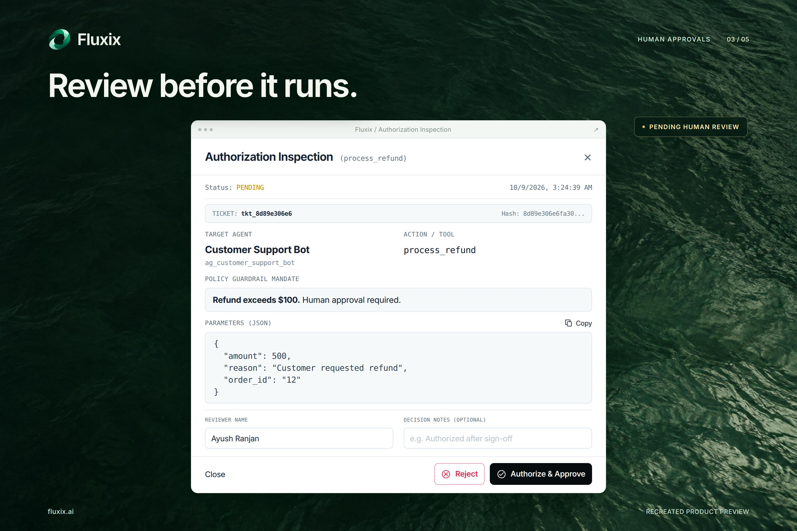

### 🎬 관련 영상
- [🎥 영상 보기](https://ph-files.imgix.net/7c338eff-e8b9-4799-b25d-bfb525213c5c.jpeg?auto=format)

---

## 17. [Surveys in Claude and ChatGPT](https://www.producthunt.com/products/blocksurvey)
**Votes**: 12 | **도입 난이도**: 하 | **신뢰도**: 상
**Tagline**: Build surveys in Claude and ChatGPT, keep answers private
**서비스 링크**: https://www.producthunt.com/r/ZL2LWMOBBF4IUI

**태그**: AI, Survey, Privacy, Productivity, AI Tool, Chat, DevTool

### 📌 이 서비스 한눈에 보기
AI 채팅창 안에서 설문을 생성하고, 데이터 프라이버시는 완벽하게 보호받는 도구

### 🔑 주요 기능
- Claude 및 ChatGPT와 직접 연결하여 대화형으로 설문 생성
- 자연어로 설문 내용을 수정하고 즉시 라이브 링크 생성
- 종단간 암호화(E2EE)를 통해 AI 모델이 응답 내용을 볼 수 없도록 설계

### 🙋 사용자에게 어떤 점이 좋은가
별도의 웹사이트 이동 없이 AI 채팅창 내에서 즉시 설문을 만들 수 있으며, 민감한 응답 데이터가 AI 학습에 사용되지 않아 보안 걱정 없이 설문을 운영할 수 있습니다.

### ✅ 지금 바로 써볼 기능
- AI 채팅창에 원하는 설문 주제 설명하기
- 생성된 라이브 링크로 설문 배포하기
- 대화로 질문 수정 및 최적화하기

### ⚠️ 사용 전 확인할 점
- AI 모델이 응답 내용을 보지 못하므로, AI를 통한 자동 데이터 분석 기능은 제한될 수 있음
- BlockSurvey 서비스와의 연동 설정 필요

### 🧭 확인이 더 필요한 정보
사용 중인 AI 모델(Claude/ChatGPT)의 특정 버전이나 환경에 따른 연동 방식의 차이를 확인해야 합니다.

### 📸 스크린샷 및 갤러리
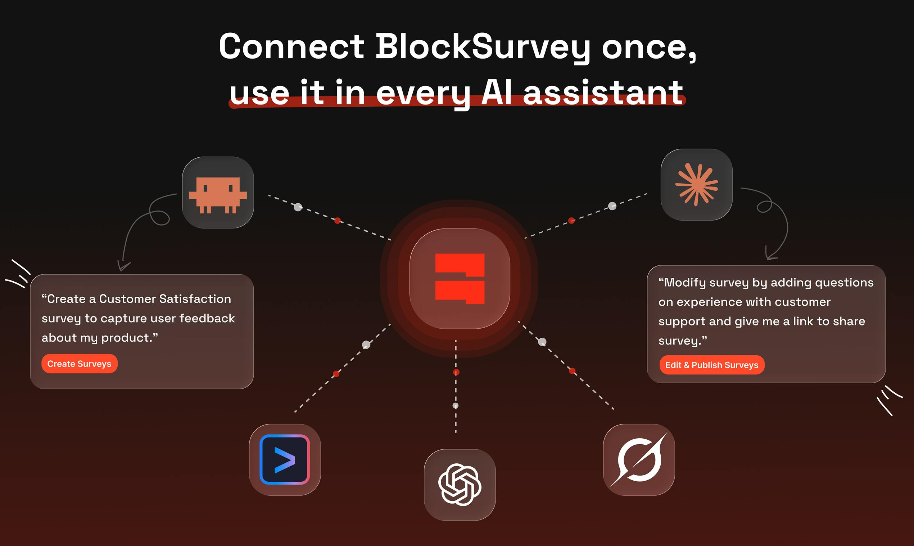
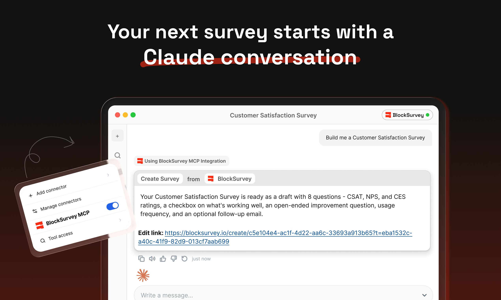
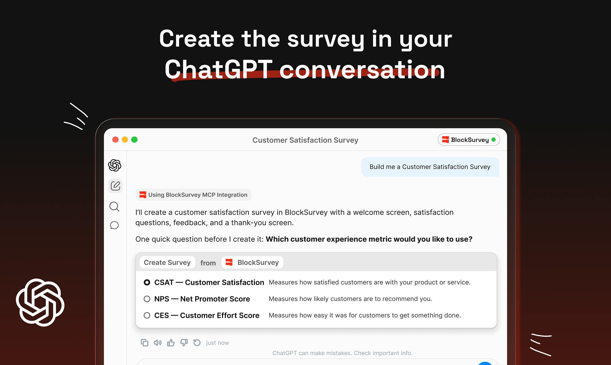

### 🎬 관련 영상
- [🎥 영상 보기](https://ph-files.imgix.net/4655750c-058a-4820-9c1c-f32e7489c627.jpeg?auto=format)

---

## 18. [Kept](https://www.producthunt.com/products/kept-7)
**Votes**: 11 | **도입 난이도**: 하 | **신뢰도**: 상
**Tagline**: Turn ideas into action. AI planner: tasks, notes, calendar
**서비스 링크**: https://www.producthunt.com/r/ZBVLHU7CC4IYD6

**태그**: Productivity, AI, Planning, AppleEcosystem, AI Tool

### 📌 이 서비스 한눈에 보기
목표 달성에 집중할 수 있도록 설계된 AI 기반 통합 플래너

### 🔑 주요 기능
- 단순 정리를 넘어 목표 달성을 중심으로 설계된 워크플로우
- Apple Intelligence를 활용한 온디바이스 자동 작업 분류
- 캘린더, 할 일, 메모가 통합된 심리스한 동기화 환경

### 🙋 사용자에게 어떤 점이 좋은가
단순히 할 일을 기록하는 것을 넘어, AI가 작업을 자동으로 분류해주어 정리 시간을 줄이고 실제 목표 달성에 집중할 수 있게 돕습니다.

### ✅ 지금 바로 써볼 기능
- 애플 기기 간 동기화 설정하기
- 개인별 영역(Areas) 정의 및 AI 자동 분류 테스트
- 목표 설정 및 할 일 연결하기

### ⚠️ 사용 전 확인할 점
- 애플 생태계(iPhone, Mac) 중심의 서비스로 타 OS 사용 시 제약 가능성
- Apple Intelligence 기반 기능의 기기 호환성 확인 필요

### 🧭 확인이 더 필요한 정보
애플 기기 외의 운영체제 지원 여부와 Apple Intelligence 기능의 구체적인 작동 범위 확인이 필요합니다.

### 📸 스크린샷 및 갤러리
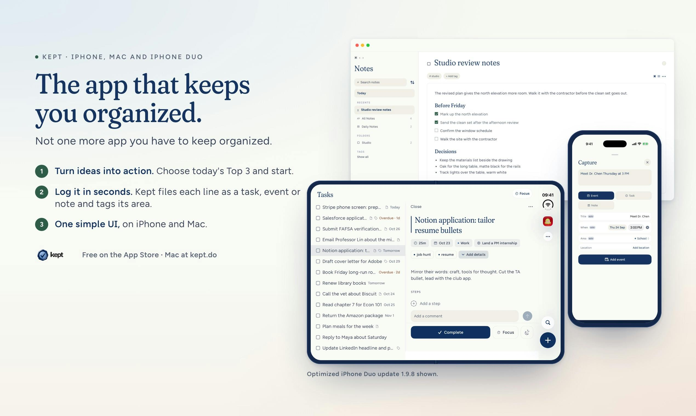
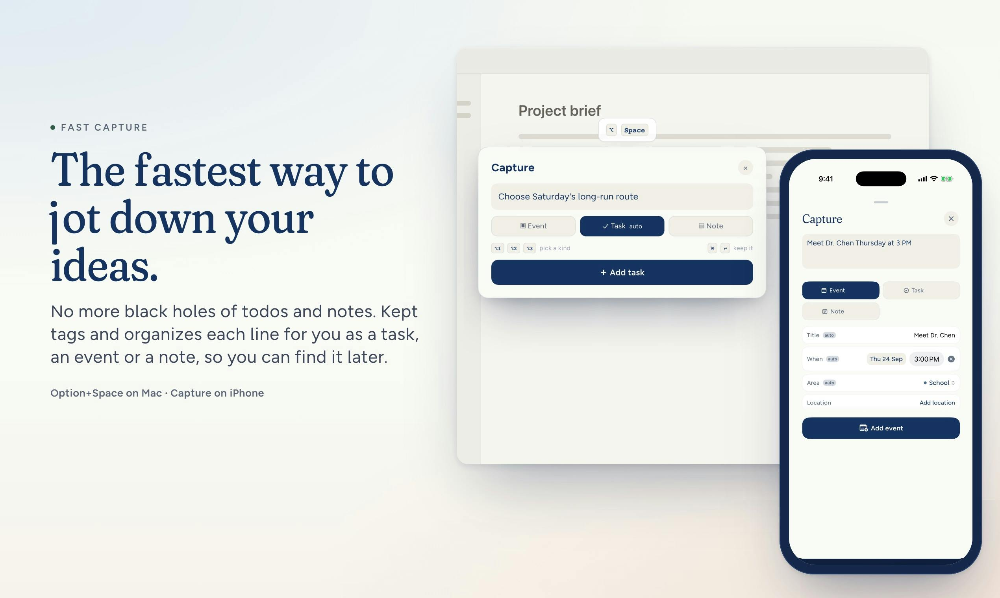
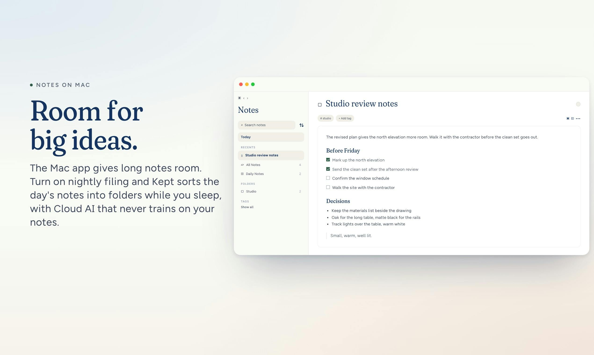

---

## 19. [CombienVautMonLogement](https://www.producthunt.com/products/combienvautmonlogement-fr)
**Votes**: 11 | **도입 난이도**: 하 | **신뢰도**: 상
**Tagline**: Free AI home valuations. No signup. No spam.
**서비스 링크**: https://www.producthunt.com/r/SDYYAXSCFYO3ZS

**태그**: RealEstate, AI, DataVisualization, Privacy, AI Tool

### 📌 이 서비스 한눈에 보기
개인정보 입력 없이 AI로 즉시 확인하는 프랑스 부동산 시세 조회 서비스

### 🔑 주요 기능
- AI와 실거래 데이터를 결합한 프랑스 주택 가치 추정
- 가입이나 개인정보 입력이 필요 없는 프라이버시 중심 설계
- 지역별 부동산 가격 및 시장 트렌드 시각화 제공

### 🙋 사용자에게 어떤 점이 좋은가
로그인이나 스팸 전화 걱정 없이 자신의 집이나 관심 지역의 예상 시세를 빠르고 안전하게 확인할 수 있습니다.

### ✅ 지금 바로 써볼 기능
- AI 기반 주택 가치 추정 기능 사용해보기
- 인터랙티브 지도를 통한 지역별 시세 탐색
- 시장 트렌드 및 데이터 분석 도구 활용

### ⚠️ 사용 전 확인할 점
- AI 추정치이므로 실제 감정가와 차이가 있을 수 있음
- 프랑스 부동산 데이터에 특화되어 있어 타 국가 적용 불가

### 🧭 확인이 더 필요한 정보
제공되는 데이터의 업데이트 주기와 실제 거래 데이터와의 일치 여부를 확인해야 합니다.

### 📸 스크린샷 및 갤러리

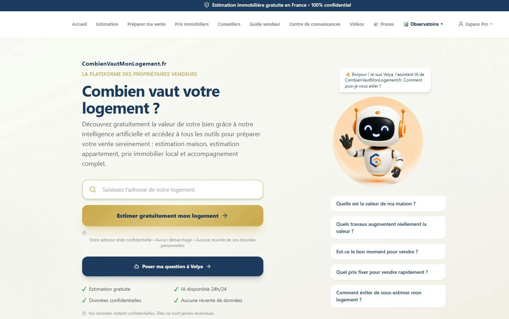

---

## 20. [gethome](https://www.producthunt.com/products/gethome)
**Votes**: 11 | **도입 난이도**: 상 | **신뢰도**: 상
**Tagline**: Smart home on a hub you own, with AI that writes the rules
**서비스 링크**: https://www.producthunt.com/r/2ZPLZINWMNGITU

**태그**: SmartHome, AI, Automation, IoT, Privacy, Agent, AI Tool

### 📌 이 서비스 한눈에 보기
개인용 허브와 AI를 결합하여 자연어로 스마트 홈 규칙을 만드는 혁신적인 자동화 솔루션

### 🔑 주요 기능
- 라즈베리 파이 등 개인 소유 허브를 통한 로컬 Wi-Fi 기반 제어
- Zigbee 및 Matter 표준 기기 호환
- 사용자의 AI 키(Anthropic, OpenAI)를 활용한 지능형 자동화 규칙 생성

### 🙋 사용자에게 어떤 점이 좋은가
복잡한 코딩 없이 AI에게 말하듯 규칙을 설정하여 스마트 홈을 자동화할 수 있으며, 데이터가 외부 클라우드가 아닌 개인 허브를 통해 관리됩니다.

### ✅ 지금 바로 써볼 기능
- 라즈베리 파이 등 하드웨어 준비하기
- Zigbee/Matter 기기 연결 테스트하기
- AI 에이전트를 활용한 자동화 규칙 작성해보기

### ⚠️ 사용 전 확인할 점
- 하드웨어(라즈베리 파이 등)를 직접 구축하고 관리해야 하는 기술적 숙련도 필요
- 개인 AI API 키를 사용하므로 API 사용량에 따른 비용 발생 가능성

### 🧭 확인이 더 필요한 정보
사용자의 하드웨어 사양에 따른 시스템 안정성과 보안 수준에 대한 구체적인 정보가 필요합니다.

### 📸 스크린샷 및 갤러리
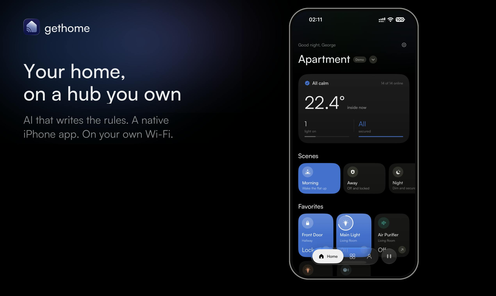
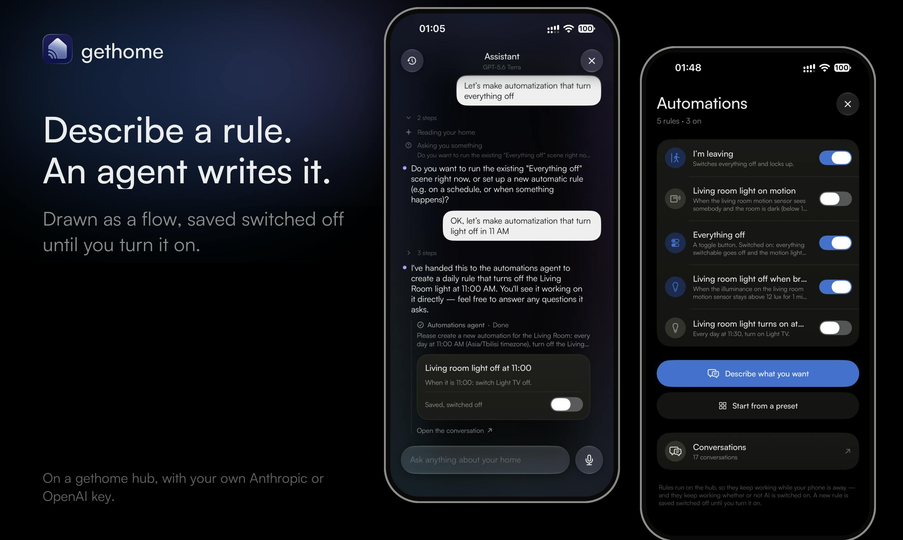
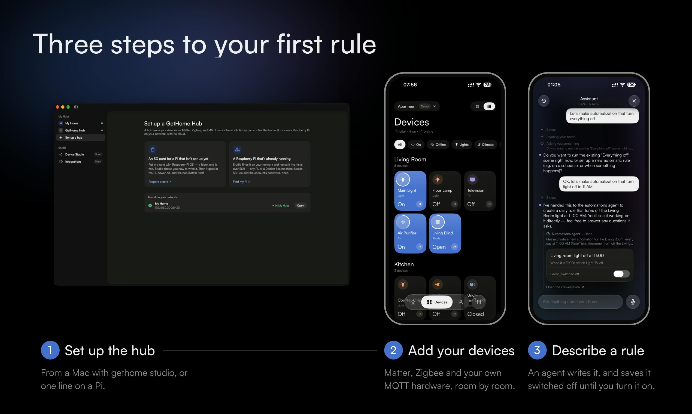

---

## 21. [CombienVautMonLogement](https://www.producthunt.com/products/combienvautmonlogement-fr)
**Votes**: 11 | **도입 난이도**: 하 | **신뢰도**: 상
**Tagline**: Free AI home valuations. No signup. No spam.
**서비스 링크**: https://www.producthunt.com/r/SDYYAXSCFYO3ZS

**태그**: RealEstate, AI, DataVisualization, Privacy, AI Tool

### 📌 이 서비스 한눈에 보기
개인정보 입력 없이 AI로 즉시 확인하는 프랑스 부동산 시세 조회 서비스

### 🔑 주요 기능
- AI와 실거래 데이터를 결합한 프랑스 주택 가치 추정
- 가입이나 개인정보 입력이 필요 없는 프라이버시 중심 설계
- 지역별 부동산 가격 및 시장 트렌드 시각화 제공

### 🙋 사용자에게 어떤 점이 좋은가
로그인이나 스팸 전화 걱정 없이 자신의 집이나 관심 지역의 예상 시세를 빠르고 안전하게 확인할 수 있습니다.

### ✅ 지금 바로 써볼 기능
- AI 기반 주택 가치 추정 기능 사용해보기
- 인터랙티브 지도를 통한 지역별 시세 탐색
- 시장 트렌드 및 데이터 분석 도구 활용

### ⚠️ 사용 전 확인할 점
- AI 추정치이므로 실제 감정가와 차이가 있을 수 있음
- 프랑스 부동산 데이터에 특화되어 있어 타 국가 적용 불가

### 🧭 확인이 더 필요한 정보
제공되는 데이터의 업데이트 주기와 실제 거래 데이터와의 일치 여부를 확인해야 합니다.

### 📸 스크린샷 및 갤러리

---

## 22. [Daily Simmer](https://www.producthunt.com/products/daily-simmer)
**Votes**: 10 | **도입 난이도**: 하 | **신뢰도**: 상
**Tagline**: Save any recipe, make it yours, then plan, shop and cook
**서비스 링크**: https://www.producthunt.com/r/FZAUON6JGMPTFC

**태그**: Productivity, AI, Food & Drink, Lifestyle, AI Tool

### 📌 이 서비스 한눈에 보기
SNS 링크만으로 레시피를 자동 정리하고 식단 계획부터 쇼핑까지 돕는 AI 요리 비서

### 🔑 주요 기능
- SNS(인스타그램, 틱톡 등) 링크를 붙여넣으면 깔끔한 레시피로 자동 변환
- AI 수셰프를 통한 재료 변경 및 개인 맞춤형 레시피 수정
- 기존 레시피 앱(Paprika, CookBook 등) 데이터 가져오기 지원

### 🙋 사용자에게 어떤 점이 좋은가
여기저기 흩어진 레시피를 한곳에 모으고, AI를 통해 개인 취향에 맞게 손쉽게 변형하여 체계적인 식단 관리가 가능합니다.

### ✅ 지금 바로 써볼 기능
- SNS 레시피 링크를 붙여넣어 자동 변환 기능 테스트하기
- 기존에 사용하던 레시피 앱 데이터 가져오기 시도하기
- AI 수셰프에게 재료 교체 제안해보기

### ⚠️ 사용 전 확인할 점
- 외부 플랫폼(SNS)의 링크 형식이 복잡할 경우 추출 정확도가 달라질 수 있음
- 무료 버전의 기능 제한 범위 확인 필요

### 🧭 확인이 더 필요한 정보
무료 버전에서 제공하는 기능의 범위와 유료 플랜의 구체적인 가격 정책이 명시되지 않았습니다.

### 📸 스크린샷 및 갤러리

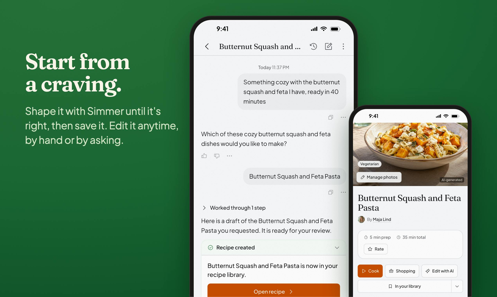
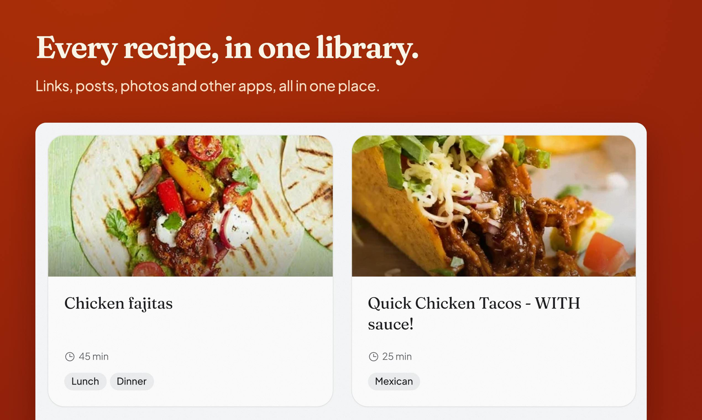

### 🎬 관련 영상
- [🎥 영상 보기](https://ph-files.imgix.net/bdb02045-3d7d-4bf8-bfbd-802ef3b6ca92.jpeg?auto=format)

---

## 23. [Prompt Deck](https://www.producthunt.com/products/prompt-deck)
**Votes**: 9 | **도입 난이도**: 하 | **신뢰도**: 상
**Tagline**: Your coding agents' prompts, memory files and chat history
**서비스 링크**: https://www.producthunt.com/r/43BSHP2WRYNDJC

**태그**: DevTool, Productivity, AI-Agent, Agent, Chat, Prompting

### 📌 이 서비스 한눈에 보기
여러 코딩 에이전트의 프롬프트, 메모리 파일, 채팅 기록을 한곳에서 관리하는 통합 관리 도구

### 🔑 주요 기능
- 다양한 코딩 에이전트의 메모리 파일(CLAUDE.md 등) 통합 관리
- 슬래시 명령어로 변환 가능한 프롬프트 및 검색 가능한 세션 관리
- 계정 생성이나 데이터 가져오기 없이 로컬 파일을 바로 탐색하는 방식

### 🙋 사용자에게 어떤 점이 좋은가
여러 코딩 에이전트를 번갈아 사용하는 개발자가 흩어진 프롬프트와 작업 기록을 일일이 찾을 필요 없이 한 화면에서 효율적으로 관리할 수 있습니다.

### ✅ 지금 바로 써볼 기능
- 로컬 디스크의 에이전트 파일 자동 탐색 기능 확인
- 슬래시 명령어로 사용할 프롬프트 정리
- 과거 채팅 세션 검색 기능 활용

### ⚠️ 사용 전 확인할 점
- 로컬 파일 시스템 접근 권한 필요
- Pro 버전의 Dreams 및 Insights 기능은 별도 유료 여부 확인 필요

### 🧭 확인이 더 필요한 정보
Pro 버전의 구체적인 가격 정책과 기능 범위에 대한 상세 정보가 명시되지 않았습니다.

### 📸 스크린샷 및 갤러리
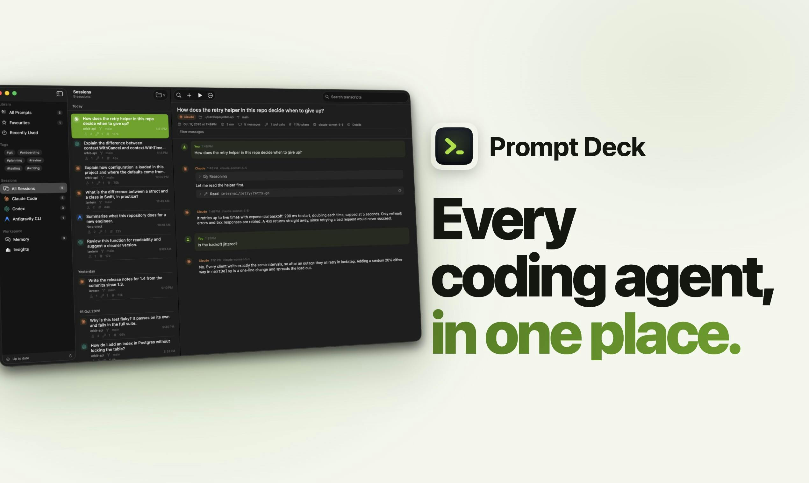

### 🎬 관련 영상
- [🎥 영상 보기](https://ph-files.imgix.net/dd3ebbe1-fdb5-4e59-9e01-1eec80006d47.jpeg?auto=format)

---

## 24. [Looper](https://www.producthunt.com/products/looper-3)
**Votes**: 8 | **도입 난이도**: 중 | **신뢰도**: 상
**Tagline**: If Grok Bot drove business metrics up and was Open Source
**서비스 링크**: https://www.producthunt.com/r/UA3CSQFSDMWYN5

**태그**: AI-Agent, Automation, OpenSource, Productivity, AI Tool, Chat

### 📌 이 서비스 한눈에 보기
특정 비즈니스 지표 향상을 위해 매일 업무를 수행하는 오픈소스 AI 에이전트

### 🔑 주요 기능
- Gmail, GitHub, Search Console 등 주요 플랫폼에서 실무 수행
- 팀의 승인을 거쳐 실행되는 안전한 자동화 워크플로
- 기존 ChatGPT 또는 Grok 유료 플랜을 활용한 비용 효율적 운영

### 🙋 사용자에게 어떤 점이 좋은가
사용자가 설정한 핵심 지표를 높이기 위해 AI가 직접 업무를 수행하며, 기존에 결제 중인 AI 플랜을 활용하므로 추가 비용 부담 없이 자동화 인력을 고용하는 효과를 얻을 수 있습니다.

### ✅ 지금 바로 써볼 기능
- 목표로 하는 핵심 비즈니스 지표 설정하기
- Gmail 및 GitHub 등 업무 도구 연동하기
- AI의 작업 방식에 대한 팀 승인 프로세스 구축하기

### ⚠️ 사용 전 확인할 점
- 사용자의 승인 없이 독자적으로 판단하여 실행할 위험성 확인 필요
- 기존 AI 플랜(ChatGPT/Grok)의 API 또는 사용 환경에 따른 제약 사항 확인

### 🧭 확인이 더 필요한 정보
사용자가 이미 보유한 AI 플랜 내에서 구체적으로 어떤 방식으로 구동되는지에 대한 기술적 상세 구현 방식 확인이 필요합니다.

### 📸 스크린샷 및 갤러리

### 🎬 관련 영상
- [🎥 영상 보기](https://ph-files.imgix.net/efd48aca-2bd2-435d-99d4-f6b96f6b0876.jpeg?auto=format)

---

## 25. [Proof](https://www.producthunt.com/products/proof-14)
**Votes**: 6 | **도입 난이도**: 하 | **신뢰도**: 상
**Tagline**: Design pro websites from what 400+ real sites do best
**서비스 링크**: https://www.producthunt.com/r/34JCV54P3HTWHG

**태그**: AI, Design, WebBuilder, NoCode, AI Tool

### 📌 이 서비스 한눈에 보기
400개 이상의 검증된 사이트 데이터를 학습하여 최적의 웹사이트 구조를 설계하는 AI 디자인 도구

### 🔑 주요 기능
- 400개 이상의 실제 성공적인 제품 페이지 데이터 학습
- 짧은 브리프만으로 최적의 섹션 구성 및 순서 자동 생성
- 브랜드 가이드 준수 및 사실 관계 왜곡 방지 기능

### 🙋 사용자에게 어떤 점이 좋은가
디자인 감각이 부족하더라도 검증된 레이아웃을 바탕으로 전문적인 제품 웹사이트를 빠르게 구축할 수 있습니다.

### ✅ 지금 바로 써볼 기능
- 짧은 제품 브리프 입력해보기
- 생성된 섹션 구성 확인하기
- 브랜드 스타일 적용해보기

### ⚠️ 사용 전 확인할 점
- 학습된 데이터 기반의 정형화된 레이아웃이 생성될 수 있음
- 사용자 브랜드의 독창적인 디자인 요구사항과의 일치 여부 확인 필요

### 🧭 확인이 더 필요한 정보
사용자 정의 브랜드 자산(로고, 폰트 등)의 세부 커스텀 범위와 외부 플랫폼 수출 기능에 대한 정보가 부족합니다.

### 📸 스크린샷 및 갤러리

### 🎬 관련 영상
- [🎥 영상 보기](https://ph-files.imgix.net/ff282504-3261-4d98-be64-9fe648440749.jpeg?auto=format)

---

## 26. [Korture Now: Focus App Blocker](https://www.producthunt.com/products/korture-now-focus-app-blocker)
**Votes**: 6 | **도입 난이도**: 하 | **신뢰도**: 상
**Tagline**: Stop scrolling, do the one thing you want
**서비스 링크**: https://www.producthunt.com/r/R63BIETIIJGP64

**태그**: Productivity, Focus, Minimalism, Mobile App

### 📌 이 서비스 한눈에 보기
불필요한 앱 차단을 통해 오직 단 하나의 목표에만 집중하게 돕는 미니멀리즘 포커스 앱

### 🔑 주요 기능
- 단 두 개의 화면으로 구성된 극도로 단순한 UI/UX
- 목표 설정(Now)과 나머지 작업(Drift)의 명확한 분리
- 계정 생성이나 구독 없이 한 번의 결제로 이용 가능한 방식

### 🙋 사용자에게 어떤 점이 좋은가
스마트폰의 유혹을 물리치고 지금 당장 해야 할 일에만 몰입하고 싶은 사용자에게 최적화되어 있습니다.

### ✅ 지금 바로 써볼 기능
- 지금 할 일 하나만 적고 'Start' 버튼 누르기
- 집중 시간 동안 다른 앱의 유혹을 차단해보기
- 계정 생성 없이 바로 시작하기

### ⚠️ 사용 전 확인할 점
- 7일 무료 체험 후 유료 전환이 필요함
- 복잡한 일정 관리나 게임화 요소(스트릭 등)를 선호하는 사용자에게는 너무 단순할 수 있음

### 🧭 확인이 더 필요한 정보
유료 결제 방식(Pay once)의 구체적인 금액과 플랫폼별 지원 여부는 명시되지 않았습니다.

### 📸 스크린샷 및 갤러리

---

## 27. [Calendar Assistant](https://www.producthunt.com/products/calendar-assistant)
**Votes**: 6 | **도입 난이도**: 하 | **신뢰도**: 상
**Tagline**: Your calendar, just ask: plan by chat, voice or photo
**서비스 링크**: https://www.producthunt.com/r/5P6BSYS4WEUAAA

**태그**: Productivity, AI, Automation, Calendar, Chat

### 📌 이 서비스 한눈에 보기
채팅, 음성, 사진 촬영만으로 복잡한 일정 입력을 대신하는 AI 캘린더 비서

### 🔑 주요 기능
- 자연어(채팅/음성)를 통한 간편한 일정 등록 및 관리
- 초대장이나 티켓 사진 촬영 시 자동으로 일정 자동 생성
- 다양한 언어(아랍어/다리자 포함) 및 다중 구글/아웃룩 계정 지원

### 🙋 사용자에게 어떤 점이 좋은가
일정 관리를 위해 일일이 양식을 채울 필요 없이, 말하거나 찍기만 하면 되어 일정 등록 시간을 획기적으로 줄여줍니다.

### ✅ 지금 바로 써볼 기능
- 자연어로 일정 등록해보기
- 종이 초대장 사진 찍어 일정 자동 생성해보기
- 여러 개의 구글/아웃룩 계정 연동하기

### ⚠️ 사용 전 확인할 점
- 사용자의 발화 의도를 정확히 파악하는지 확인 필요
- 사진 속 텍스트 인식 정확도에 따른 일정 오류 가능성

### 🧭 확인이 더 필요한 정보
제공되는 서비스의 구체적인 요금 체계와 데이터 보안 정책에 대한 정보가 명시되지 않았습니다.

### 📸 스크린샷 및 갤러리

### 🎬 관련 영상
- [🎥 영상 보기](https://ph-files.imgix.net/d1e90c98-78c0-478d-8496-dab1a7a59183.jpeg?auto=format)

---

## 28. [Spilr](https://www.producthunt.com/products/spilr)
**Votes**: 6 | **도입 난이도**: 하 | **신뢰도**: 상
**Tagline**: Start by hearing yourself: an AI journal that asks back
**서비스 링크**: https://www.producthunt.com/r/PXLDKKBVJXS2JD

**태그**: AI, Journaling, Self-Improvement, Productivity, AI Tool

### 📌 이 서비스 한눈에 보기
나의 기록을 분석해 자기 객관화를 돕는 AI 저널링 서비스

### 🔑 주요 기능
- 하루 2분 내외의 짧은 글쓰기 또는 음성 기록 방식
- 3회 이상의 기록을 바탕으로 사용자의 패턴과 성향 분석
- 반복되는 루프, 감정 트리거, 간과한 강점 등 통찰 제공

### 🙋 사용자에게 어떤 점이 좋은가
매일의 기록을 통해 나도 몰랐던 나의 행동 패턴과 감정 변화를 객관적으로 파악할 수 있습니다.

### ✅ 지금 바로 써볼 기능
- 하루 2분간의 짧은 일기 쓰기 또는 음성 녹음하기
- 3회 이상의 기록을 쌓아 AI 분석 결과 확인하기
- 제시된 인사이트를 검토하고 원문과 대조해보기

### ⚠️ 사용 전 확인할 점
- 충분한 데이터(최소 3회 이상)가 쌓이기 전에는 분석 기능을 사용할 수 없음
- 개인적인 기록이 담기므로 데이터 보안 및 프라이버시 정책 확인 필요

### 🧭 확인이 더 필요한 정보
데이터 축적량에 따른 분석 정교함과 개인정보 보호 수준에 대한 구체적인 정보가 필요합니다.

### 📸 스크린샷 및 갤러리

### 🎬 관련 영상
- [🎥 영상 보기](https://ph-files.imgix.net/9228147b-42de-4884-a557-8707fc9c7c2a.jpeg?auto=format)

---

## 29. [Insta360 Mic](https://www.producthunt.com/products/insta-360)
**Votes**: 5 | **도입 난이도**: 하 | **신뢰도**: 상
**Tagline**: A wireless mic with customizable E-Ink and pro audio
**서비스 링크**: https://www.producthunt.com/r/PQSUY65ERFB2QE

**태그**: Audio, ContentCreation, Hardware, Wireless, AI Tool, Design

### 📌 이 서비스 한눈에 보기
커스텀 E-Ink 디자인과 전문가급 32비트 플로트 오디오를 결합한 무선 마이크

### 🔑 주요 기능
- 로고나 아트워크로 커스텀 가능한 E-Ink 디스플레이 탑재
- 32비트 플로트 오디오 녹음 및 AI 노이즈 캔슬링 지원
- 최대 4개의 송신기 지원 및 최대 34시간 배터리 수명

### 🙋 사용자에게 어떤 점이 좋은가
개성 있는 디자인의 마이크를 사용하면서 동시에 전문가 수준의 고음질 오디오와 편리한 무선 환경을 동시에 누릴 수 있습니다.

### ✅ 지금 바로 써볼 기능
- E-Ink 디스플레이에 나만의 로고 적용하기
- 32비트 플로트 녹음 기능을 통한 고음질 오디오 확보
- AI 노이즈 캔슬링을 활용한 깨끗한 음성 캡처

### ⚠️ 사용 전 확인할 점
- 사용 중인 카메라 모델과의 직접 연결 호환성 확인 필요
- microSD 카드를 통한 오디오 저장 방식 숙지 필요

### 🧭 확인이 더 필요한 정보
사용 중인 카메라 모델에 따른 직접 연결 가능 여부를 확인해야 합니다.

### 📸 스크린샷 및 갤러리

### 🎬 관련 영상
- [🎥 영상 보기](https://ph-files.imgix.net/ef28db5f-5d09-492b-a5f5-33e82c77d630.jpeg?auto=format)

---

## 30. [MindChess](https://www.producthunt.com/products/mindchess)
**Votes**: 5 | **도입 난이도**: 하 | **신뢰도**: 상
**Tagline**: Your daily chess gym and study companion
**서비스 링크**: https://www.producthunt.com/r/OVHPNODASRIL4X

**태그**: Chess, Education, Productivity, MobileApp, AI Tool

### 📌 이 서비스 한눈에 보기
매일 짧은 훈련으로 체스 실력을 키우는 개인 맞춤형 체스 트레이닝 도구

### 🔑 주요 기능
- 60초 단위의 짧고 강렬한 보드 시야 및 계산 훈련
- 간격 반복 학습(Spaced Repetition) 기반의 레퍼토리 트레이너
- 다이아그램 스캐너 및 Stockfish 19 오프라인 엔진 탑재

### 🙋 사용자에게 어떤 점이 좋은가
바쁜 일상 속에서 짧은 시간을 활용해 체스 전술과 기억력을 효율적으로 향상시킬 수 있습니다.

### ✅ 지금 바로 써볼 기능
- 60초 드릴로 감각 익히기
- 레퍼토리 트레이너로 오프닝 암기하기
- 다이아그램 스캐너로 문제 풀이하기

### ⚠️ 사용 전 확인할 점
- Stockfish 19 및 일부 고급 기능은 Pro 버전 유료 결제가 필요할 수 있음
- 모바일 및 데스크톱 환경에 최적화된 기능 위주임

### 🧭 확인이 더 필요한 정보
Pro 버전의 정확한 구독 가격 및 결제 방식에 대한 정보가 명시되지 않았습니다.

### 📸 스크린샷 및 갤러리

---

