# 🚀 Product Hunt Daily Top 30 (2026-10-27)

## 오늘의 요약
오늘의 트렌드는 단순한 생성형 AI를 넘어, 특정 워크플로우를 자율적으로 수행하는 'AI 에이전트'의 실용적 활용에 집중되었습니다. 특히 개발 환경, 클라우드 비용 관리, 브라우저 자동화 등 전문적인 업무 영역에서 생산성을 극대화하는 도구들이 주목받았습니다.

### 오늘의 핵심 포인트
- 반복적인 행정 업무와 복잡한 코딩 작업을 자동화하는 고성능 AI 에이전트 솔루션들이 대거 등장했습니다.
- AI 모델의 속도 향상과 비용 절감, 그리고 하드웨어 발열 관리와 같은 실질적인 운영 효율성 문제가 주요 화두였습니다.
- 사용자 맞춤형 UI/UX 제공과 기존 워크플로우(n8n, IDE 등)와의 원활한 통합이 제품의 핵심 경쟁력으로 나타났습니다.

**오늘의 태그**: AI 에이전트, 생산성 자동화, 개발자 도구, 클라우드 최적화

## 1. [Strawberry 1.0](https://www.producthunt.com/products/strawberry)
**Votes**: 246 | **도입 난이도**: 중 | **신뢰도**: 상
**Tagline**: AI Browser that saves your team >100h/week
**서비스 링크**: https://www.producthunt.com/r/VLEJBVBONXC6FH

**태그**: AI, Automation, Productivity, Browser, Teamwork, Agent, AI Tool

### 📌 이 서비스 한눈에 보기
반복적인 업무를 자동화하여 팀의 생산성을 극대화하는 AI 에이전트 브라우저

### 🔑 주요 기능
- 수백 명의 리드 조사, 회의록 작성, 후속 조치 등 반복 업무 자동화
- 사용자 맞춤형 AI 에이전트 'Companions' 생성 및 팀 공유 기능
- 수많은 업무 시간을 절약할 수 있는 병렬 처리 능력

### 🙋 사용자에게 어떤 점이 좋은가
팀원들이 미루거나 반복적으로 수행하던 행정 업무를 AI 에이전트에게 맡겨 핵심 업무에 집중할 수 있습니다.

### ✅ 지금 바로 써볼 기능
- 팀의 반복 업무를 위한 맞춤형 Companion 생성하기
- 기존 업무 프로세스를 학습시켜 선호도 설정하기
- 생성된 Companion을 팀원들과 공유하여 협업하기

### ⚠️ 사용 전 확인할 점
- 에이전트가 자동 수행하는 작업의 정확도 검토 필요
- 팀 내 업무 프로세스에 따른 초기 설정 및 학습 시간 필요

### 🧭 확인이 더 필요한 정보
에이전트가 수행하는 작업의 보안 수준과 외부 서비스와의 연동 범위에 대한 상세 정보가 필요합니다.

### 📸 스크린샷 및 갤러리
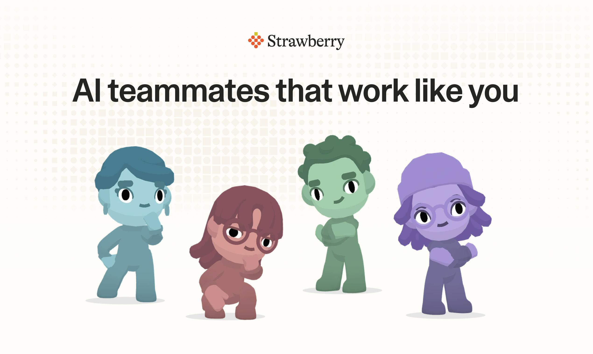
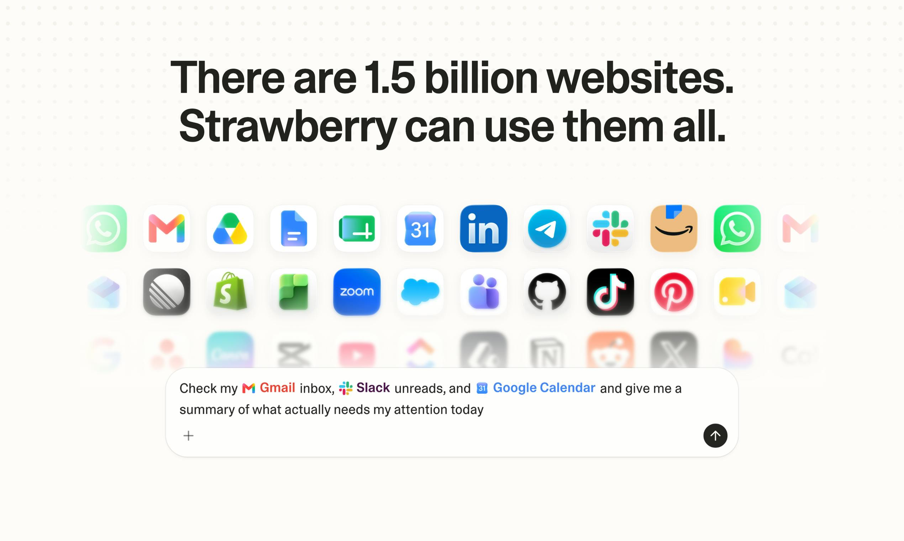

### 🎬 관련 영상
- [🎥 영상 보기](https://ph-files.imgix.net/fd5faaa7-4000-4a54-9034-86983beaeda3.jpeg?auto=format)

---

## 2. [SurgePix](https://www.producthunt.com/products/surgepix)
**Votes**: 205 | **도입 난이도**: 중 | **신뢰도**: 상
**Tagline**: AI visuals. Edit every layer. Agent-callable. 
**서비스 링크**: https://www.producthunt.com/r/CS2V53OCZ2KXEH

**태그**: AI-Visuals, Design-Automation, Developer-Tools, Creative-AI, Agent, AI Tool, Vision, DevTool

### 📌 이 서비스 한눈에 보기
레이어별 편집과 AI 에이전트 연동을 지원하는 차세대 AI 비주얼 제작 도구

### 🔑 주요 기능
- 레이어 단위의 정밀한 편집 및 텍ext 교체 기능
- 브랜드 키트를 활용한 일관된 브랜드 스타일 유지
- Claude Code 및 Cursor와 연동되는 오픈소스 에이전트 스킬 제공

### 🙋 사용자에게 어떤 점이 좋은가
단순 생성을 넘어 세밀한 수정이 가능하며, 개발자나 디자이너가 코딩 환경(IDE) 내에서 직접 시각적 요소를 제어할 수 있습니다.

### ✅ 지금 바로 써볼 기능
- 레이어별 편집 기능 테스트
- 브랜드 키트 설정 및 적용
- AI 에이전트(Claude/Cursor) 연동 시도

### ⚠️ 사용 전 확인할 점
- 에이전트 연동 시 개발 환경 설정 필요성
- 브랜드 키트 적용 시 기존 자산과의 호환성 확인 필요

### 🧭 확인이 더 필요한 정보
에이전트 스킬의 구체적인 오픈소스 라이선스 및 연동 방식에 대한 상세 정보가 필요합니다.

### 📸 스크린샷 및 갤러리

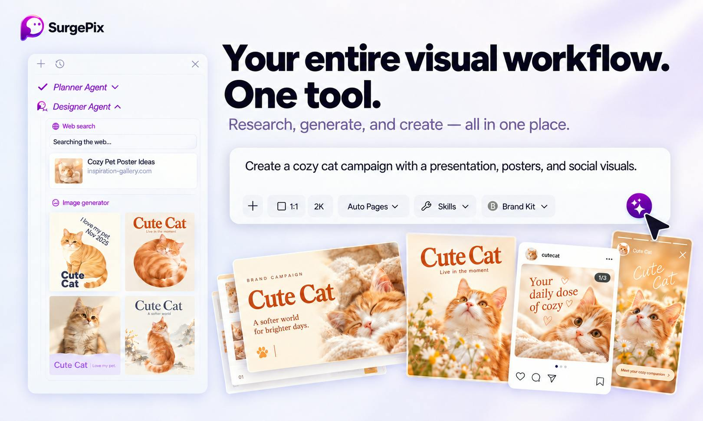

### 🎬 관련 영상
- [🎥 영상 보기](https://ph-files.imgix.net/24cb16a1-5e3e-43c4-b5e1-91c136ff4182.jpeg?auto=format)

---

## 3. [MiniMax M3.1 Flash](https://www.producthunt.com/products/minimax-4)
**Votes**: 156 | **도입 난이도**: 하 | **신뢰도**: 상
**Tagline**: MiniMax’s Flash model, 3x faster and 70% cheaper for agents
**서비스 링크**: https://www.producthunt.com/r/YRN2XABOMOIRQO

**태그**: AI-Agent, Coding, Automation, API, Agent, DevTool, Security

### 📌 이 서비스 한눈에 보기
에이전트 작업과 코딩에 최적화된 초고속·저비용 플래시 모델

### 🔑 주요 기능
- 이전 모델 대비 3배 빠른 속도와 70% 저렴한 비용 제공
- 초당 200개 이상의 토큰을 생성하는 압도적인 출력 속도
- 에이전트 작업, 코딩, 컴퓨터 사용 및 사이버 보안에 특화

### 🙋 사용자에게 어떤 점이 좋은가
비용 효율적인 에이전트 시스템을 구축하거나 실시간 응답이 중요한 코딩/자동화 작업에 매우 유리합니다.

### ✅ 지금 바로 써볼 기능
- MiniMax API를 통한 성능 테스트
- M Plan 및 MiniMax Code 환경에서의 워크플로우 적용
- 에이전트 기반 자동화 작업에 모델 교체 테스트

### ⚠️ 사용 전 확인할 점
- 모델 가중치(weights) 공개 여부가 아직 미정임
- 특정 작업(에이전트/코딩) 외 범용 성능에 대한 검증 필요

### 🧭 확인이 더 필요한 정보
모델 가중치(weights) 공개 일정과 구체적인 성능 벤치마크 결과 확인이 필요합니다.

### 📸 스크린샷 및 갤러리

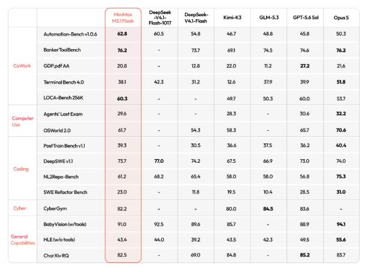
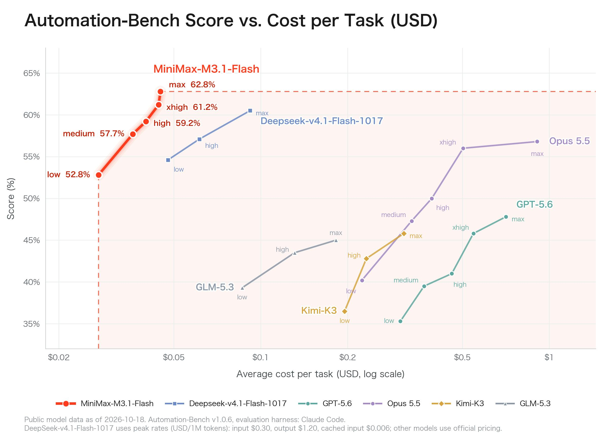

---

## 4. [N8N Chat UI](https://www.producthunt.com/products/n8n-chat-ui-2)
**Votes**: 146 | **도입 난이도**: 하 | **신뢰도**: 상
**Tagline**: Beautiful, no-code, on-brand AI chat widgets for n8n
**서비스 링크**: https://www.producthunt.com/r/EMEWBY4KEFUXFH

**태그**: NoCode, AI, n8n, Chatbot, Automation, AI Tool, Chat, Design, DevTool, API

### 📌 이 서비스 한눈에 보기
n8n 워크플로우를 브랜드 맞춤형 AI 채팅 위젯으로 변환해주는 노코드 빌더

### 🔑 주요 기능
- n8n 워크플로우와 즉시 연결 가능한 브랜드 맞춤형 채팅 UI 제공
- 실시간 미리보기, 모바일 최적화, 스트리밍 및 파일 업로드 지원
- JavaScript API를 통한 고급 통합 및 유연한 레이아웃 설계 가능

### 🙋 사용자에게 어떤 점이 좋은가
기존 n8n 기본 채팅의 디자인 한계를 넘어, 기업 브랜드에 맞는 세련된 AI 채팅창을 제작하고 웹사이트 어디든 쉽게 임베드할 수 있습니다.

### ✅ 지금 바로 써볼 기능
- 라이브 프리뷰로 브랜드 맞춤형 디자인 설정하기
- n8n 워크플로우 연결하여 AI 챗봇 활성화하기
- JavaScript API를 활용한 고급 기능 통합 시도하기

### ⚠️ 사용 전 확인할 점
- n8n 워크플로우가 이미 구축되어 있어야 원활한 사용 가능
- 고급 커스텀을 위해서는 기본적인 JavaScript 지식이 필요할 수 있음

### 🧭 확인이 더 필요한 정보
상세한 가격 정책 및 호스팅 방식에 대한 정보가 명시되지 않았습니다.

### 📸 스크린샷 및 갤러리
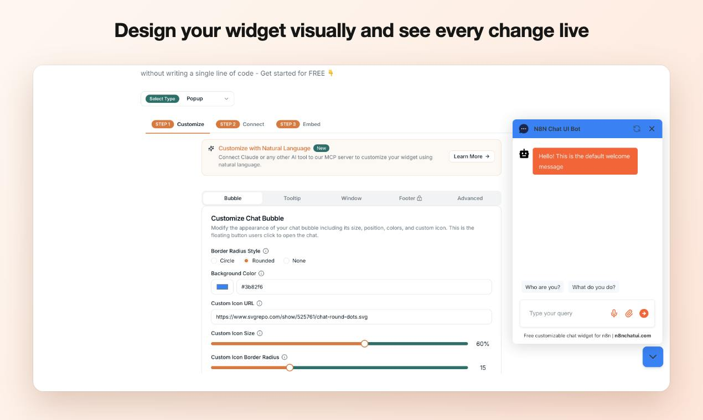
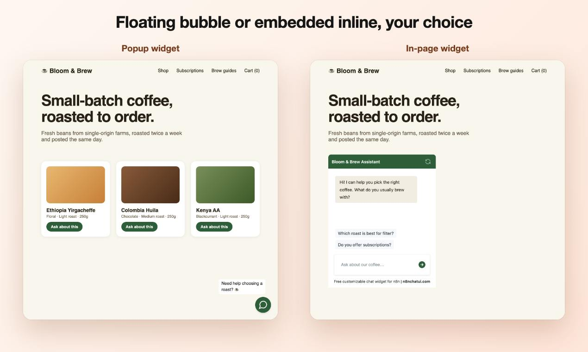
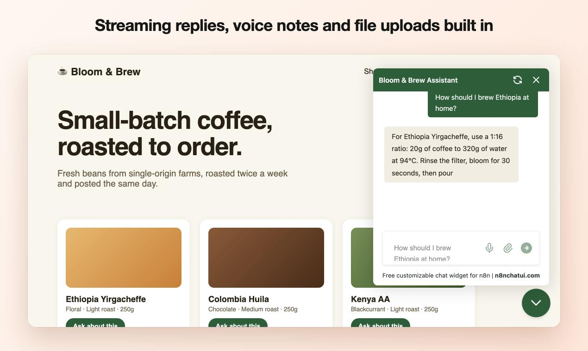

### 🎬 관련 영상
- [🎥 영상 보기](https://ph-files.imgix.net/64201c63-3a36-43a4-8dca-5ce5773717c8.jpeg?auto=format)

---

## 5. [2G](https://www.producthunt.com/products/2g)
**Votes**: 128 | **도입 난이도**: 하 | **신뢰도**: 상
**Tagline**: Sampler to create early 2000 Neural Synthesis
**서비스 링크**: https://www.producthunt.com/r/RHMGUFOK7JLHXZ

**태그**: MusicProduction, AI, Retro, Plugin, SoundDesign

### 📌 이 서비스 한눈에 보기
2000년대 초반 감성의 뉴럴 신디사이저 사운드를 생성하는 샘플러

### 🔑 주요 기능
- 텍스트 설명만으로 사운드를 생성하는 뉴럴 신디사이저 기술 적용
- 2000년대 초반 휴대용 기기 스타일의 레트로한 UI 및 사운드 디자인
- 플러그인 및 스탠드얼론 앱 지원 (Windows, macOS)

### 🙋 사용자에게 어떤 점이 좋은가
텍스트로 원하는 소리를 즉시 생성하고 편집할 수 있어, 독특한 레트로 사운드를 찾는 음악 제작자에게 유용합니다.

### ✅ 지금 바로 써볼 기능
- 텍스트로 원하는 사운드 묘사하여 생성해보기
- 생성된 사운드 편집 및 키보드 연주 시도하기
- 무료 크레딧 20개를 활용해 기능 테스트하기

### ⚠️ 사용 전 확인할 점
- 무료 버전은 월간 생성 크레딧 제한이 있음
- 고급 기능을 위해서는 유료 구독(Studio 플랜)이 필요함

### 🧭 확인이 더 필요한 정보
제공된 정보에는 생성된 사운드의 품질이나 특정 DAW와의 호환성 세부 사항은 명시되지 않았습니다.

### 📸 스크린샷 및 갤러리

### 🎬 관련 영상
- [🎥 영상 보기](https://ph-files.imgix.net/2488bdba-22cc-47a9-9b07-49f05a5d62dd.jpeg?auto=format)

---

## 6. [PDF Accessibility Checker by WebYes](https://www.producthunt.com/products/pdf-accessibility-checker)
**Votes**: 113 | **도입 난이도**: 하 | **신뢰도**: 상
**Tagline**: Find PDF accessibility issues for free, with fix guidance
**서비스 링크**: https://www.producthunt.com/r/RRKSSHY7IXRK4N

**태그**: Accessibility, Productivity, PDF, FreeTool, AI Tool, Vision, Email

### 📌 이 서비스 한눈에 보기
가입 없이 즉시 PDF의 접근성 문제를 진단하고 해결 방법을 안내받는 무료 도구

### 🔑 주요 기능
- WCAG 2.1 AA 및 PDF/UA 표준 기반의 접근성 검사
- 이미지 설명 누락, 헤딩 문제 등 시각적 하이라이트 및 심각도별 이슈 제공
- 로그인이나 이메일 등록 없이 50MB 이하 PDF 또는 공개 링크로 즉시 사용 가능

### 🙋 사용자에게 어떤 점이 좋은가
장애가 있는 사용자를 위한 PDF 접근성 준수 여부를 쉽고 빠르게 확인할 수 있으며, 구체적인 수정 가이드를 제공하여 작업 시간을 단축해 줍니다.

### ✅ 지금 바로 써볼 기능
- 50MB 이하의 PDF 파일 업로드하여 문제점 확인하기
- 심각도별로 분류된 이슈 리스트 검토하기
- 제공되는 가이드를 따라 PDF 수정 작업 진행하기

### ⚠️ 사용 전 확인할 점
- 50MB를 초과하는 대용량 파일은 업로드 불가
- 자동 검사 외에 사람이 직접 검토해야 하는 항목이 존재함

### 🧭 확인이 더 필요한 정보
파일이 서버에 저장되지 않는다고 명시되어 있으나, 보안이 매우 중요한 문서는 사용 전 정책을 재확인할 필요가 있습니다.

### 📸 스크린샷 및 갤러리
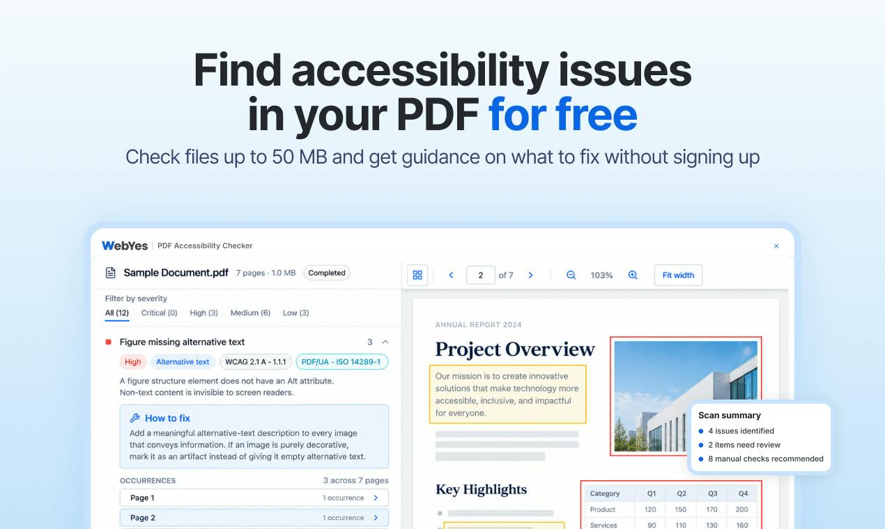
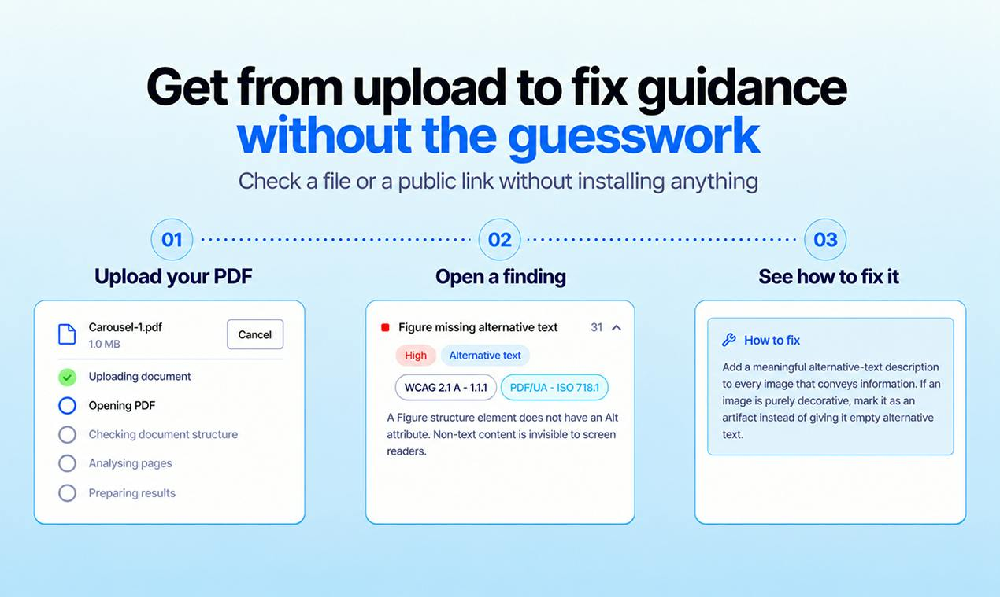
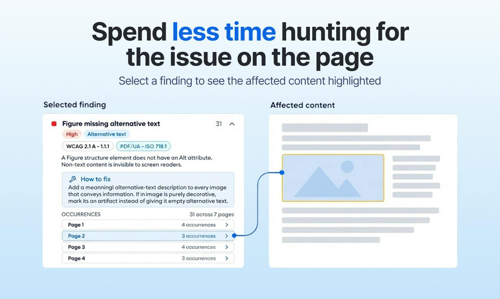

### 🎬 관련 영상
- [🎥 영상 보기](https://ph-files.imgix.net/6a9fb7a5-cb7c-47a4-997f-11f04b4863d1.jpeg?auto=format)

---

## 7. [WhoIsCooking](https://www.producthunt.com/products/whoiscooking)
**Votes**: 102 | **도입 난이도**: 하 | **신뢰도**: 상
**Tagline**: See which AI agent is heating your Mac and cool it down.
**서비스 링크**: https://www.producthunt.com/r/6NKDSDYTNP22PA

**태그**: Mac, AI, Utility, DevTool, Agent, AI Tool

### 📌 이 서비스 한눈에 보기
Mac의 칩 온도와 AI 에이전트 점유율을 확인하고 원클릭으로 발열을 관리하는 도구

### 🔑 주요 기능
- Apple Silicon Mac의 칩 온도 실시간 모니터링
- Claude Code, Cursor 등 어떤 AI 에이전트가 발열을 일으키는지 식별
- 원클릭으로 작업 부하를 효율 코어(Efficiency cores)로 이동시켜 발열 제어

### 🙋 사용자에게 어떤 점이 좋은가
AI 도구 사용 시 발생하는 Mac의 발열 원인을 즉각 파악하고, 성능 저하 없이 쾌적한 작업 환경을 유지할 수 있습니다.

### ✅ 지금 바로 써볼 기능
- 현재 실행 중인 AI 에이전트의 발열 기여도 확인하기
- 원클릭 기능을 통해 작업 부하를 효율 코어로 분산시켜 보기

### ⚠️ 사용 전 확인할 점
- Apple Silicon 기반 Mac 전용 앱임

### 🧭 확인이 더 필요한 정보
효율 코어로 작업 이동 시 전체적인 작업 처리 속도(성능)가 얼마나 저하될지는 명시되지 않았습니다.

### 📸 스크린샷 및 갤러리
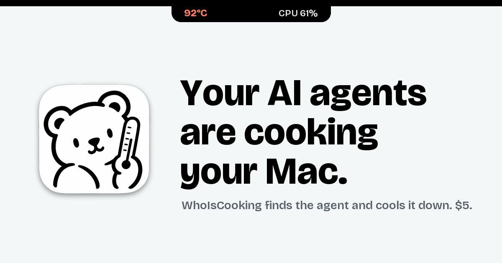
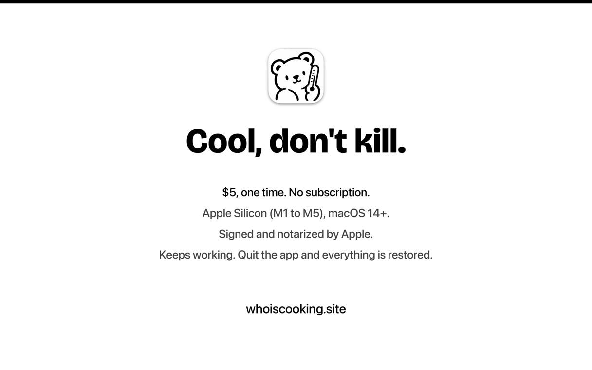
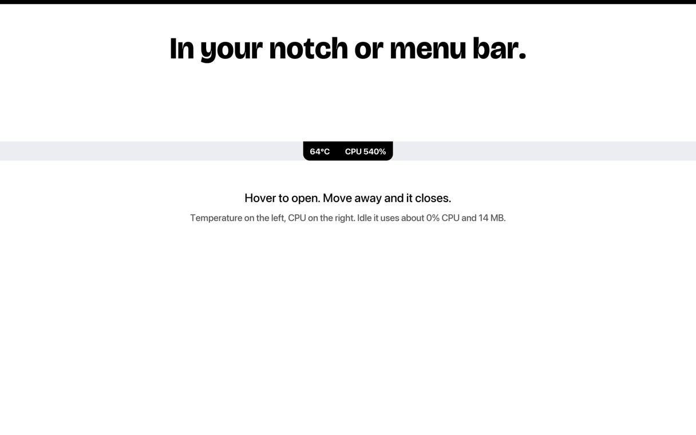

---

## 8. [CloudKnife](https://www.producthunt.com/products/cloudknife)
**Votes**: 102 | **도입 난이도**: 중 | **신뢰도**: 상
**Tagline**: Cut your cloud bill, not your performance
**서비스 링크**: https://www.producthunt.com/r/CEFQU25AT777XQ

**태그**: CloudCost, AI, Automation, DevOps, Azure, Agent, AI Tool

### 📌 이 서비스 한눈에 보기
AI 에이전트가 클라우드 비용 절감을 위한 분석부터 실행까지 전 과정을 자동화합니다.

### 🔑 주요 기능
- AI 에이전트 기반의 엔드 투 엔드(A to Z) 클라우드 비용 최적화
- 리소스 사용 패턴 학습 및 결정론적 규칙 기반의 안전한 권장 사항 제공
- 사용자 승인 후 즉각적인 실행을 통한 운영 공수 절감

### 🙋 사용자에게 어떤 점이 좋은가
단순히 비용 절감 가이드를 주는 것을 넘어, 승인된 작업의 자동 실행을 통해 팀이 혁신적인 업무에 집중할 수 있게 돕습니다.

### ✅ 지금 바로 써볼 기능
- AI 에이전트의 리소스 분석 기능 테스트
- 규칙 기반(Deterministic core)의 안전성 검증
- 승인 후 자동 실행 워크플로우 설정

### ⚠️ 사용 전 확인할 점
- 자동 실행 기능 사용 시 기존 인프라에 미칠 영향 사전 검토 필요
- 특정 워크로드(예: SAP)에 대한 규칙 설정 및 호환성 확인 필요

### 🧭 확인이 더 필요한 정보
실제 실행 단계에서 발생할 수 있는 인프라 변경에 대한 롤백(Rollback) 지원 여부를 확인해야 합니다.

### 📸 스크린샷 및 갤러리

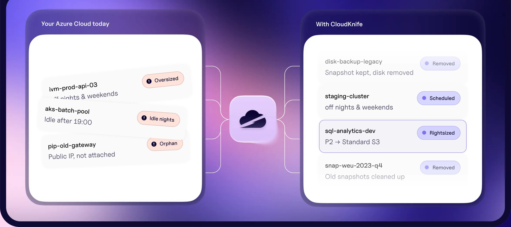

---

## 9. [Kiwi](https://www.producthunt.com/products/kiwi-7)
**Votes**: 97 | **도입 난이도**: 하 | **신뢰도**: 상
**Tagline**: A proactive AI assistant that texts you before you ask
**서비스 링크**: https://www.producthunt.com/r/OUMTTWMMRX6ZMC

**태그**: AI Assistant, Automation, Productivity, Personal Assistant, AI Tool

### 📌 이 서비스 한눈에 보기
사용자가 요청하기 전에 먼저 필요한 일을 제안하고 실행하는 선제적 AI 비서

### 🔑 주요 기능
- 일정, 여행, 결제 등 개인 일정을 추적하여 적절한 시점에 메시지 발송
- iMessage나 WhatsApp을 통해 대화형으로 업무 수행
- 사용자의 승인 시 웹이나 앱에서 직접 작업 실행

### 🙋 사용자에게 어떤 점이 좋은가
일일이 앱을 열어 확인하지 않아도 AI가 상황에 맞춰 필요한 조치를 제안하므로, 일상적인 의사결정과 번거로운 예약/변경 업무를 줄여줍니다.

### ✅ 지금 바로 써볼 기능
- iMessage/WhatsApp 연동을 통한 대화형 비서 설정
- 여행 및 일정 데이터 동기화
- 자동화 작업 승인 프로세스 테스트

### ⚠️ 사용 전 확인할 점
- 개인적인 일정과 결제 정보에 대한 접근 권한 필요
- 외부 앱/웹사이트에서의 작업 실행 시 보안 및 개인정보 보호 확인 필요

### 🧭 확인이 더 필요한 정보
현재 파일럿 단계로, 향후 유료화 모델 및 데이터 보안 정책의 구체적인 변화를 확인해야 합니다.

### 📸 스크린샷 및 갤러리

---

## 10. [Flipcorder](https://www.producthunt.com/products/flipcorder)
**Votes**: 96 | **도입 난이도**: 하 | **신뢰도**: 상
**Tagline**: A 1991 camcorder for your iPhone, one tape a day
**서비스 링크**: https://www.producthunt.com/r/5D3YQB6LWNMKJJ

**태그**: Video, Retro, Lifestyle, iOS, AI Tool

### 📌 이 서비스 한눈에 보기
90년대 캠코더 감성을 담아 하루 한 번 짧은 영상을 기록하는 레트로 비디오 앱

### 🔑 주요 기능
- 1991년 스타일의 VHS/DV 감성 영상 촬영
- 편집 없이 촬영 후 바로 즐기는 20초 분량의 짧은 영상(Flip)
- 광고, 구독, 워터마크, 계정 생성 없는 깔끔한 유료 앱

### 🙋 사용자에게 어떤 점이 좋은가
완벽한 편집에 대한 압박에서 벗어나, 일상의 순간을 아날로그 감성으로 간편하게 기록하고 싶을 때 유용합니다.

### ✅ 지금 바로 써볼 기능
- 20초 분량의 짧은 영상 촬영해보기
- 90년대 레트로 필터 효과 적용하기
- 하루 한 번 기록하는 루틴 만들기

### ⚠️ 사용 전 확인할 점
- 편집 기능이 없으므로 정해진 스타일로만 촬영 가능
- 한 번의 결제로 모든 기능을 사용하는 유료 앱(4.99달러)

### 🧭 확인이 더 필요한 정보
iPhone Duo 기기 외의 모든 iPhone 모델에서의 호환성 세부 사항은 확인이 필요합니다.

### 📸 스크린샷 및 갤러리

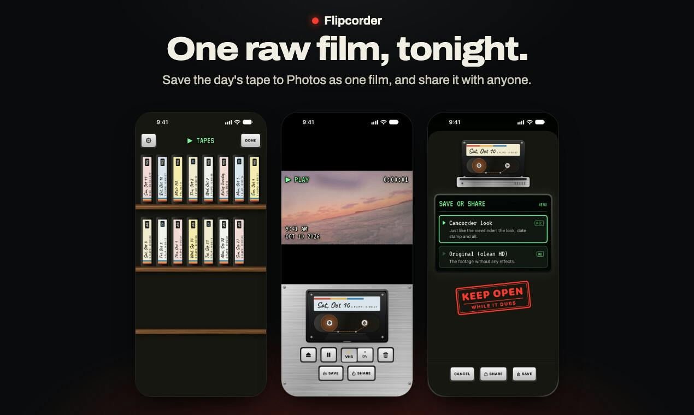

### 🎬 관련 영상
- [🎥 영상 보기](https://ph-files.imgix.net/499f458d-fbd9-4a6f-bf3b-def1917ae77a.jpeg?auto=format)

---

## 11. [desigma](https://www.producthunt.com/products/desigma)
**Votes**: 94 | **도입 난이도**: 중 | **신뢰도**: 중
**Tagline**: Free Figma alternative made on Rust
**서비스 링크**: https://www.producthunt.com/r/RTRI67SJCKTCAH

**태그**: Design, OpenSource, Rust, Productivity, AI Tool

### 📌 이 서비스 한눈에 보기
Rust 언어로 구축된 무료 피그마(Figma) 대체 디자인 도구

### 🔑 주요 기능
- Rust 기반의 고성능 설계
- 무료로 제공되는 피그마 대안
- GitHub를 통한 오픈소스 기여 가능

### 🙋 사용자에게 어떤 점이 좋은가
비용 부담 없이 디자인 작업을 시작할 수 있으며, Rust 기반의 성능을 경험할 수 있습니다.

### ✅ 지금 바로 써볼 기능
- GitHub 저장소 방문하여 프로젝트 구조 확인하기
- 설치 및 기본 UI 인터페이스 테스트하기
- 오픈소스 기여 방법 확인하기

### ⚠️ 사용 전 확인할 점
- 피그마와 비교했을 때 기능적 완성도 미비 가능성
- 초기 단계 프로젝트로 인한 안정성 문제

### 🧭 확인이 더 필요한 정보
현재 제품의 구체적인 기능 범위와 웹/데스크톱 지원 여부가 명시되지 않았습니다.

### 📸 스크린샷 및 갤러리
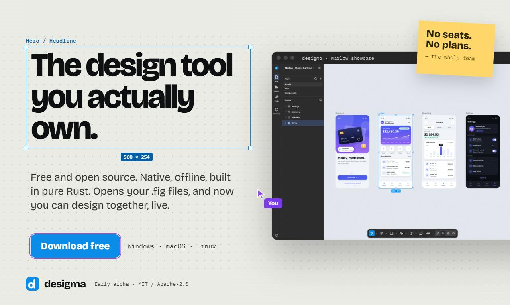
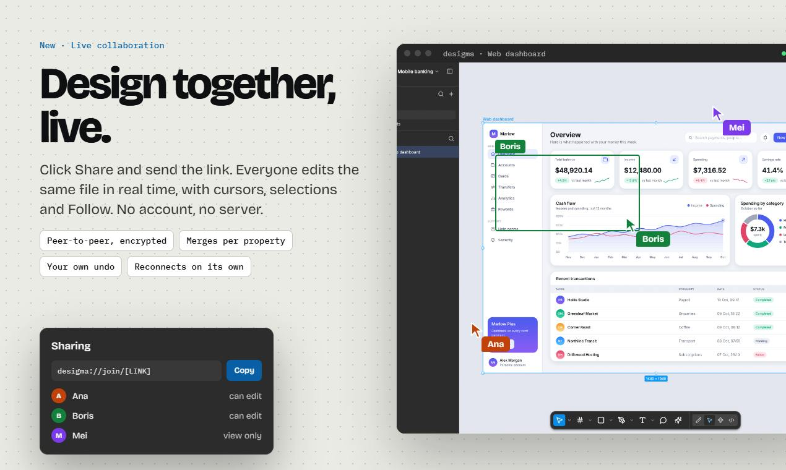
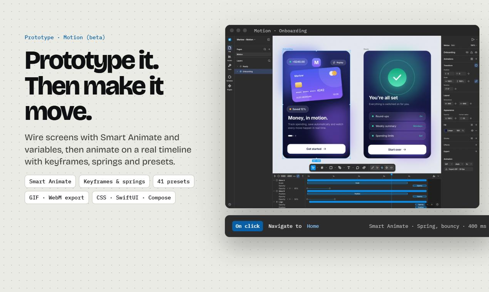

### 🎬 관련 영상
- [🎥 영상 보기](https://ph-files.imgix.net/36e2d0ca-efd9-4805-b4e1-3f2e1f2f0e01.jpeg?auto=format)

---

## 12. [tabsh](https://www.producthunt.com/products/tabsh)
**Votes**: 91 | **도입 난이도**: 중 | **신뢰도**: 상
**Tagline**: Work with agents with an IDE in your browser tab
**서비스 링크**: https://www.producthunt.com/r/YBVO34MMRXMPK5

**태그**: DevTool, AI-Agent, Productivity, Rust, OpenSource, Agent, Chat

### 📌 이 서비스 한눈에 보기
브라우저 탭 내에서 AI 에이전트와 코딩 세션을 관리하는 칸반 기반 개발 도구

### 🔑 주요 기능
- 브라우저 환경으로 코딩 세션을 가져오는 역발상 접근 방식
- Rust 기반 데몬을 통한 가볍고 빠른 세션 관리
- 다양한 AI 에이전트(Claude Code, Cursor CLI 등)와 터미널/채팅 연동

### 🙋 사용자에게 어떤 점이 좋은가
별도의 IDE를 켜지 않고도 브라우저를 떠나지 않은 채로 AI 에이전트와 협업하며 작업 흐름을 유지할 수 있습니다.

### ✅ 지금 바로 써볼 기능
- Rust 데몬 설치 및 환경 설정
- 기존 AI CLI 도구(Claude Code, Cursor 등)와 연동
- 칸반 보드를 통한 프로젝트별 작업 상태 관리

### ⚠️ 사용 전 확인할 점
- macOS 및 Linux 환경에서만 지원됨
- 터미널 기반 작업에 익숙하지 않은 사용자에게는 진입 장벽이 있을 수 있음

### 🧭 확인이 더 필요한 정보
사용자의 로컬 환경과 브라우저 간의 보안 및 권한 설정 방식에 대한 상세 정보가 필요합니다.

### 📸 스크린샷 및 갤러리
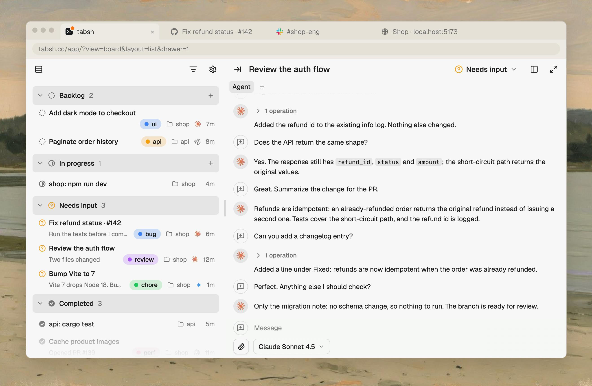
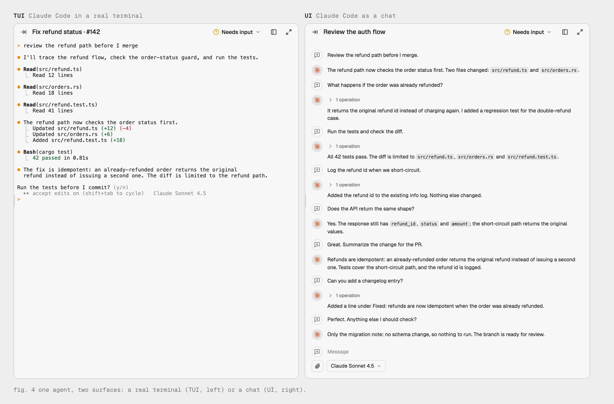
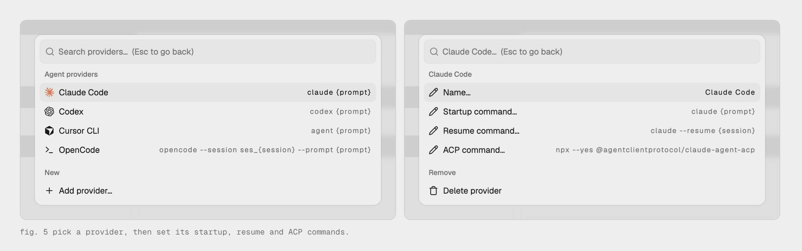

### 🎬 관련 영상
- [🎥 영상 보기](https://ph-files.imgix.net/a96e8cff-452a-44c6-b55f-34c1ee5267ba.jpeg?auto=format)

---

## 13. [ManyAgents](https://www.producthunt.com/products/manyagents)
**Votes**: 89 | **도입 난이도**: 중 | **신뢰도**: 상
**Tagline**: Run a team of AI coding agents from one Mac window
**서비스 링크**: https://www.producthunt.com/r/SG6CLOEI2YFANH

**태그**: DevTool, AI, Automation, Mac, Agent, AI Tool

### 📌 이 서비스 한눈에 보기
Mac 환경에서 여러 AI 코딩 에이전트를 동시에 운영할 수 있는 통합 워크플로우 도구

### 🔑 주요 기능
- Claude Code 및 Codex 에이전트를 개별 git worktree로 분리하여 작업 관리
- 리뷰어 에이전트와 내장 브라우저를 통한 자동 테스트 및 검증 기능
- 기존에 보유한 AI 플랜을 그대로 활용하는 오케스트레이터

### 🙋 사용자에게 어떤 점이 좋은가
복잡한 코딩 작업을 여러 에이전트에게 분산시키고, 하나의 창에서 결과물을 검토 및 테스트할 수 있어 개발 생산성을 극대화합니다.

### ✅ 지금 바로 써볼 기능
- 기존 AI 플랜 연결 및 워크트리 설정
- 에이전트 간 작업 분배 및 리뷰 프로세스 테스트
- 내장 브라우저를 활용한 자동화 테스트 실행

### ⚠️ 사용 전 확인할 점
- 사용 중인 AI 모델 플랜의 API 비용이나 사용량 제한 확인 필요
- Mac 환경에 최적화된 도구이므로 OS 호환성 확인 필요

### 🧭 확인이 더 필요한 정보
사용자가 이미 보유한 플랜을 어떻게 연동하는지에 대한 구체적인 기술적 요구사항 확인이 필요합니다.

### 📸 스크린샷 및 갤러리
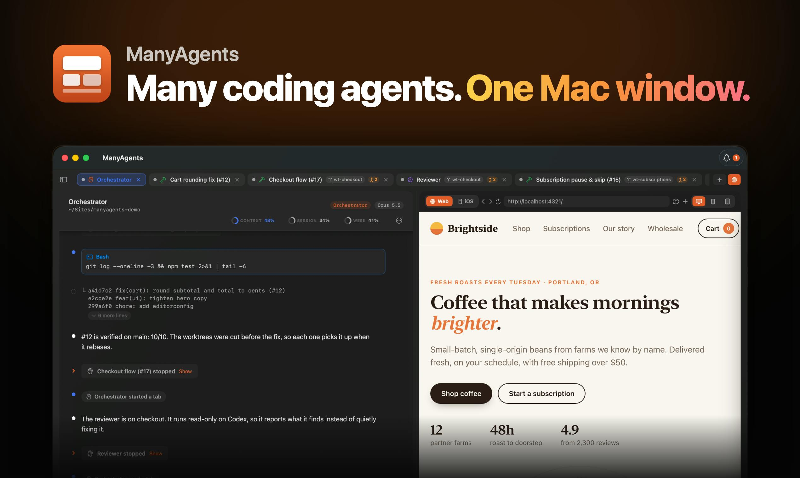
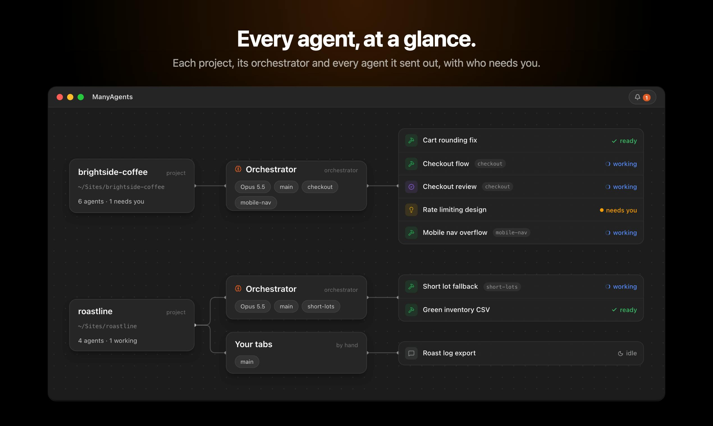
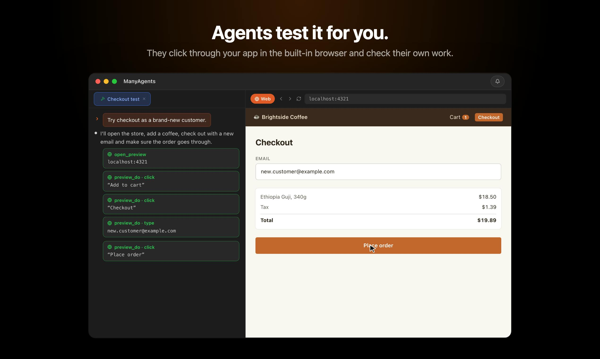

### 🎬 관련 영상
- [🎥 영상 보기](https://ph-files.imgix.net/928e07b5-660c-4281-b5d0-59b0761301ad.jpeg?auto=format)

---

## 14. [Mozy](https://www.producthunt.com/products/mozy-walk-to-unlock-apps)
**Votes**: 82 | **도입 난이도**: 하 | **신뢰도**: 상
**Tagline**: App Blocker for Android & iPhone
**서비스 링크**: https://www.producthunt.com/r/G67FUD2RY5IE72

**태그**: Productivity, Health, Digital Wellbeing

### 📌 이 서비스 한눈에 보기
걷기를 통해 얻은 시간으로 앱 사용 시간을 관리하는 건강한 앱 차단 도구

### 🔑 주요 기능
- 걷기 활동을 통한 스크린 타임 확보
- 선택한 앱에 대한 시간 제한 및 자동 잠금
- 신체 활동과 디지털 디톡스의 결합

### 🙋 사용자에게 어떤 점이 좋은가
운동을 통해 얻은 보상으로만 앱을 사용할 수 있어, 건강한 생활 습관과 절제된 스마트폰 사용을 동시에 유도합니다.

### ✅ 지금 바로 써볼 기능
- 사용할 앱 리스트 설정하기
- 걷기 목표량 확인하기
- 앱 잠금 메커니즘 테스트하기

### ⚠️ 사용 전 확인할 점
- 걸음 수 측정 방식에 따른 보상 산정 방식 확인 필요
- 필수 앱이 잠길 경우를 대비한 예외 설정 확인

### 🧭 확인이 더 필요한 정보
걸음 수와 스크린 타임 전환 비율(교환율)에 대한 구체적인 정책이 명시되지 않았습니다.

### 📸 스크린샷 및 갤러리
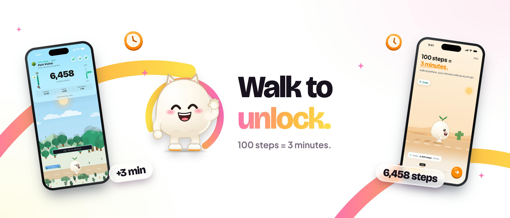

### 🎬 관련 영상
- [🎥 영상 보기](https://ph-files.imgix.net/5bab31dd-5653-4280-8c72-e71994260966.jpeg?auto=format)

---

## 15. [omerta](https://www.producthunt.com/products/omerta)
**Votes**: 81 | **도입 난이도**: 하 | **신뢰도**: 상
**Tagline**: Catch .env secrets leaking into git
**서비스 링크**: https://www.producthunt.com/r/YZPZ3SIPXR7Q5W

**태그**: DevTool, Security, Git, Automation, AI Tool, API

### 📌 이 서비스 한눈에 보기
Git 히스토리에 API 키나 .env 값이 유출되는 것을 방지하는 보안 프리커밋 훅 및 CLI 도구

### 🔑 주요 기능
- 패턴 매칭이 아닌 실제 환경 변수 값을 감지하여 유출 방지
- Git 스테이징 또는 히스토리에 민감한 정보가 포함될 경우 커밋 실패 처리
- Pre-commit hook 및 CLI 형태로 제공되어 개발 워크플로우에 통합 가능

### 🙋 사용자에게 어떤 점이 좋은가
실수로 API 키를 Git에 푸시하여 발생하는 보안 사고를 사전에 차단하고, 패턴 기반 검사보다 정확하게 실제 값을 보호할 수 있습니다.

### ✅ 지금 바로 써볼 기능
- 로컬 개발 환경에 pre-commit hook 설정하기
- 기존 프로젝트의 .env 파일과 Git 히스토리 검사하기
- CLI를 통한 보안 워크플로우 통합 테스트하기

### ⚠️ 사용 전 확인할 점
- 이미 유출되어 히스토리에 남은 키에 대한 사후 처리 방식 확인 필요
- 로컬 환경 설정에 따른 오탐지 가능성 검토

### 🧭 확인이 더 필요한 정보
기존에 이미 커밋된 과거 히스토리를 스캔하는 기능의 상세 범위와 성능에 대한 정보가 부족합니다.

### 📸 스크린샷 및 갤러리
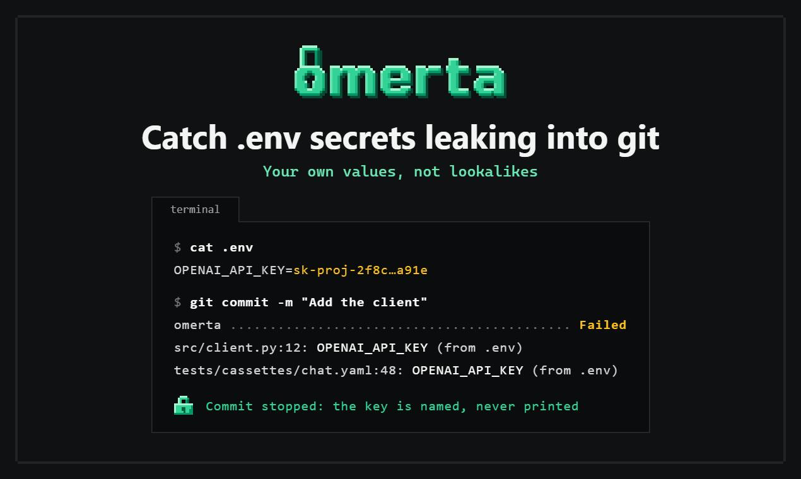
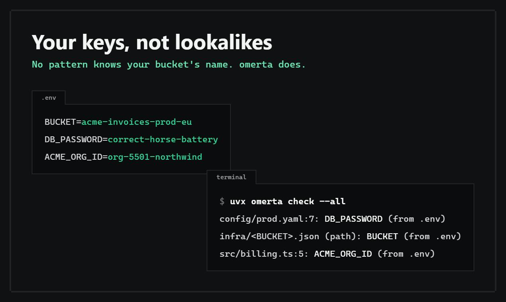
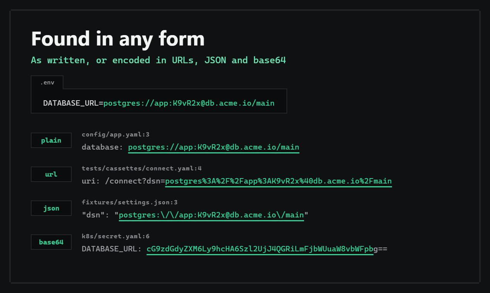

### 🎬 관련 영상
- [🎥 영상 보기](https://ph-files.imgix.net/55df71ae-94ac-4eff-8e6b-546a289f6758.jpeg?auto=format)

---

## 16. [AI Bridge](https://www.producthunt.com/products/ai-bridge)
**Votes**: 81 | **도입 난이도**: 중 | **신뢰도**: 상
**Tagline**: Every AI coding agent on your Mac, in its place
**서비스 링크**: https://www.producthunt.com/r/ZKSGYSJZDTQLGG

**태그**: DevTool, AI, CLI, Productivity, Agent, AI Tool, Chat

### 📌 이 서비스 한눈에 보기
여러 AI 코딩 에이전트를 하나의 터미널 환경에서 팀처럼 관리하고 협업하는 도구

### 🔑 주요 기능
- Claude Code, Grok 등 다양한 AI 에이전트를 실제 CLI 환경에서 동시에 실행
- 에이전트들을 부서나 역할별로 그룹화하여 관리하는 기능
- 쿠버네티스 클러스터 및 데이터베이스와 자연어로 상호작용 가능한 통합 환경

### 🙋 사용자에게 어떤 점이 좋은가
여러 AI 도구를 개별 창으로 띄울 필요 없이 하나의 그리드 환경에서 관리하여 개발 워크플로우를 최적화할 수 있습니다.

### ✅ 지금 바로 써볼 기능
- 다양한 AI 에이전트들을 'The Grid' 레이아웃에 배치해보기
- 에이전트들을 팀/부서별로 그룹화하여 관리하기
- Slack 연동을 통해 승인 기반의 자동 응답 설정하기

### ⚠️ 사용 전 확인할 점
- 사용자 개인의 개별 구독(Subscription) 기반으로 운영됨
- 터미널 및 CLI 환경에 익숙한 사용자에게 최적화된 도구임

### 🧭 확인이 더 필요한 정보
각 AI 에이전트의 API 비용 및 리소스 점유율에 따른 시스템 부하 정도를 확인해야 합니다.

### 📸 스크린샷 및 갤러리
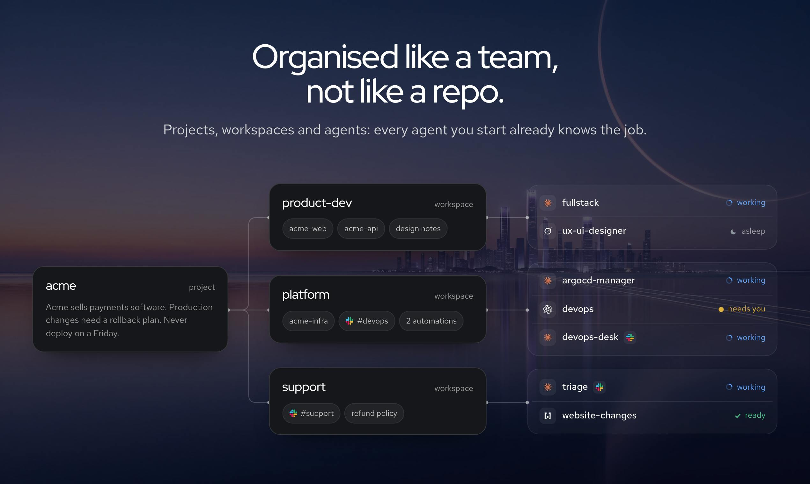
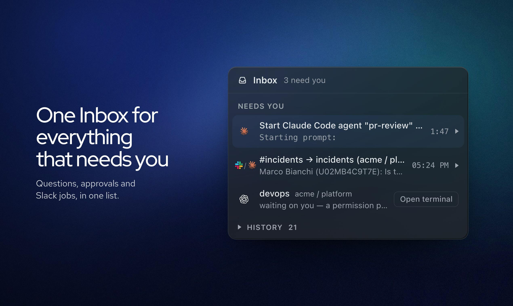
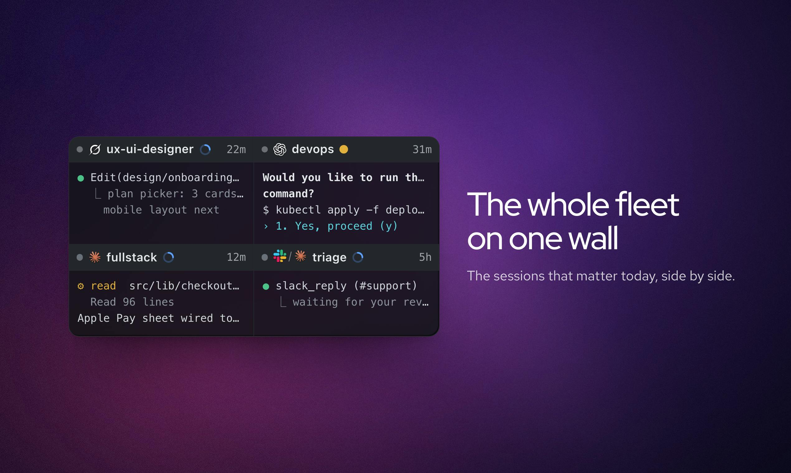

### 🎬 관련 영상
- [🎥 영상 보기](https://ph-files.imgix.net/40ac7c8f-204a-462c-9159-99765da2ca52.jpeg?auto=format)

---

## 17. [VibeiDE](https://www.producthunt.com/products/vibeide)
**Votes**: 79 | **도입 난이도**: 하 | **신뢰도**: 상
**Tagline**: Queue agent tasks in parallel and review each result
**서비스 링크**: https://www.producthunt.com/r/VOVJZS2TPHVIJN

**태그**: DevTool, AI-Agent, Productivity, Automation, Agent

### 📌 이 서비스 한눈에 보기
여러 프로젝트의 AI 코딩 작업을 병렬로 실행하고 결과를 한눈에 검토하는 개발자용 워크플로우 도구

### 🔑 주요 기능
- Codex 및 Claude Code 작업의 효율적인 큐잉(Queueing)
- 여러 프로젝트에 걸친 작업의 병렬 실행 지원
- 각 작업 결과에 대한 개별 검토 프로세스 제공

### 🙋 사용자에게 어떤 점이 좋은가
개발자와 1인 창업자가 여러 AI 에이전트 작업을 동시에 돌리면서도, 결과물을 하나씩 안전하게 검토할 수 있어 생산성을 높여줍니다.

### ✅ 지금 바로 써볼 기능
- Codex/Claude Code 작업 큐 등록하기
- 병렬 실행된 작업 결과물 검토하기
- 프로젝트별 작업 관리하기

### ⚠️ 사용 전 확인할 점
- AI 에이전트의 작업 결과에 대한 최종 검토 책임은 사용자에게 있음
- 병렬 작업 실행 시 발생할 수 있는 리소스 관리 필요

### 🧭 확인이 더 필요한 정보
지원하는 구체적인 AI 에이전트 종류와 프로젝트 연동 방식에 대한 상세 정보가 필요합니다.

### 📸 스크린샷 및 갤러리
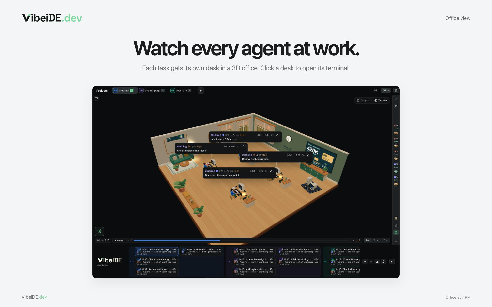
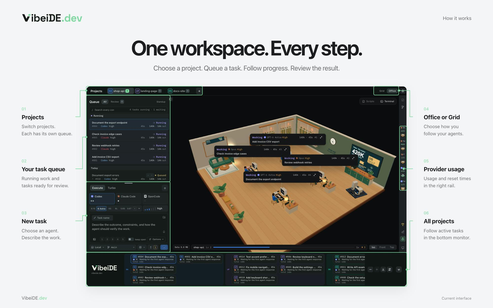
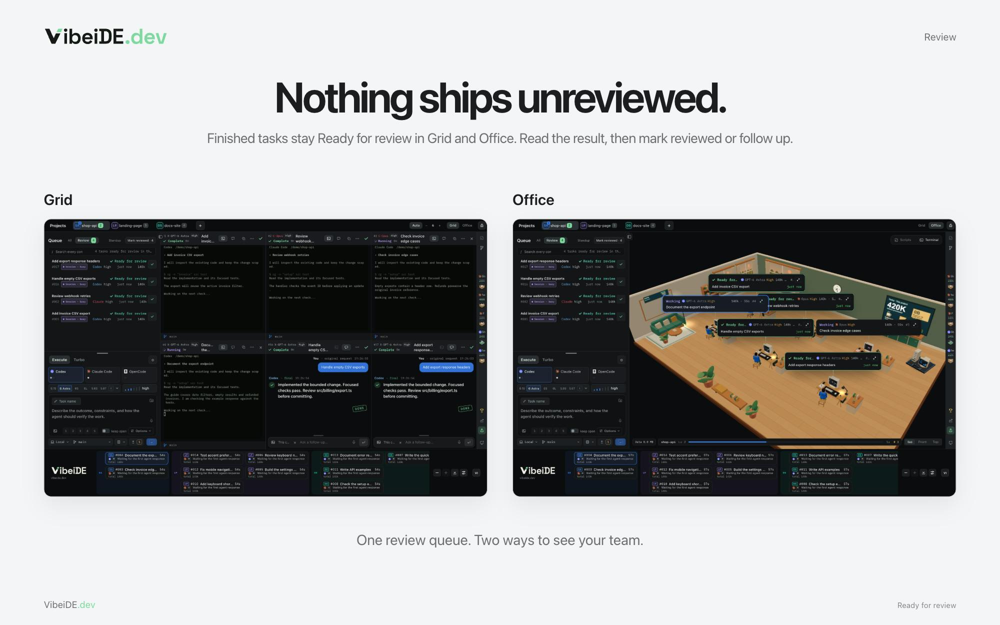

### 🎬 관련 영상
- [🎥 영상 보기](https://ph-files.imgix.net/502bb069-acfe-42a9-a424-b4c014ae234a.jpeg?auto=format)

---

## 18. [Helio](https://www.producthunt.com/products/helio-7)
**Votes**: 76 | **도입 난이도**: 중 | **신뢰도**: 상
**Tagline**: Know exactly what your rooftop solar made today
**서비스 링크**: https://www.producthunt.com/r/S22MORCIUJNDUQ

**태그**: Solar, Dashboard, Privacy, OpenSource, AI Tool

### 📌 이 서비스 한눈에 보기
복잡한 과정 없이 오늘 생성된 태양광 발전량을 즉시 확인할 수 있는 초경량 대시보드

### 🔑 주요 기능
- 인버터 카운터를 직접 읽어 오늘 생산된 발전량을 즉시 표시
- 5분 단위 곡선, 30일, 연간 및 누적 발전량 히스토리 제공
- 사용자 통화 및 요금제를 적용한 실질적인 절약 금액 계산

### 🙋 사용자에게 어떤 점이 좋은가
태양광 앱의 복잡한 메뉴를 거치지 않고 핵심 지표인 '오늘의 발전량'을 즉시 확인할 수 있으며, 개인용 서버에 직접 배포하여 데이터 보안을 확보할 수 있습니다.

### ✅ 지금 바로 써볼 기능
- ShineMonitor 또는 SmartClient를 통한 인버터 연동
- Vercel을 이용한 개인용 복제본 배포
- 사용자 맞춤형 통화 및 요금제 설정

### ⚠️ 사용 전 확인할 점
- ShineMonitor 또는 SmartClient 연동이 필요함
- 사용자의 인버터 하드웨어 호환성 확인 필요

### 🧭 확인이 더 필요한 정보
사용자의 특정 인버터 모델이 ShineMonitor/SmartClient와 호환되는지 확인이 필요합니다.

### 📸 스크린샷 및 갤러리

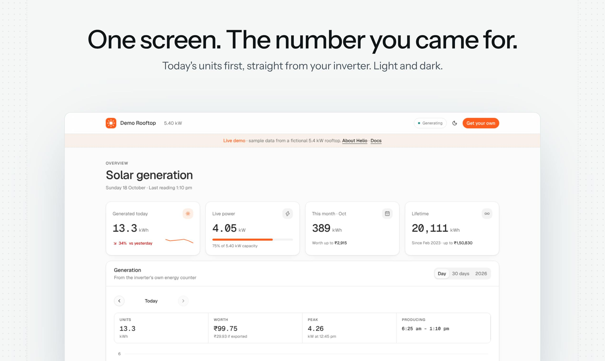
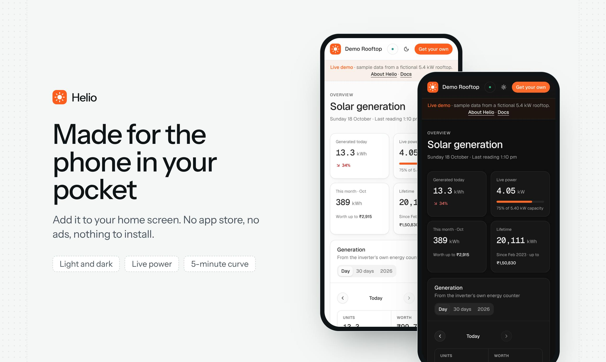

### 🎬 관련 영상
- [🎥 영상 보기](https://ph-files.imgix.net/0a3fd31e-5f25-4443-b70e-d9efac58f072.jpeg?auto=format)

---

## 19. [Loqui](https://www.producthunt.com/products/loqui-2)
**Votes**: 75 | **도입 난이도**: 하 | **신뢰도**: 상
**Tagline**: Turns your voice into ready-to-send text in any Mac app
**서비스 링크**: https://www.producthunt.com/r/4F2XA7SPVJ2SNE

**태그**: Productivity, AI, Mac, Automation, Transcription

### 📌 이 서비스 한눈에 보기
어떤 Mac 앱에서도 음성을 즉시 정제된 텍스트로 변환해주는 AI 타이핑 도구

### 🔑 주요 기능
- 단축키를 이용해 커서 위치에 즉시 텍스트 입력
- 사용자가 선택한 톤에 맞춰 정제된 텍스트 생성
- 회의 녹취 및 회의록 작성 기능 지원

### 🙋 사용자에게 어떤 점이 좋은가
별도의 복사-붙여넣기 과정 없이 말만 하면 원하는 톤의 텍스트가 입력되어 타이핑 시간을 획기적으로 줄여줍니다.

### ✅ 지금 바로 써볼 기능
- 단축키를 설정하여 앱 간 이동 없이 바로 말해보기
- 회의 녹음 기능을 통해 회의록 자동 생성 테스트하기
- 원하는 말투(Tone) 설정하여 텍스트 품질 확인하기

### ⚠️ 사용 전 확인할 점
- Mac 전용 앱이므로 macOS 환경에서만 사용 가능
- 무료 플랜의 상세 사용량 제한 확인 필요

### 🧭 확인이 더 필요한 정보
무료 플랜의 구체적인 글자 수 제한이나 기능 제한 범위는 명시되어 있지 않습니다.

### 📸 스크린샷 및 갤러리
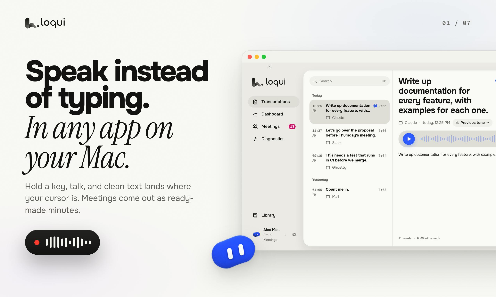

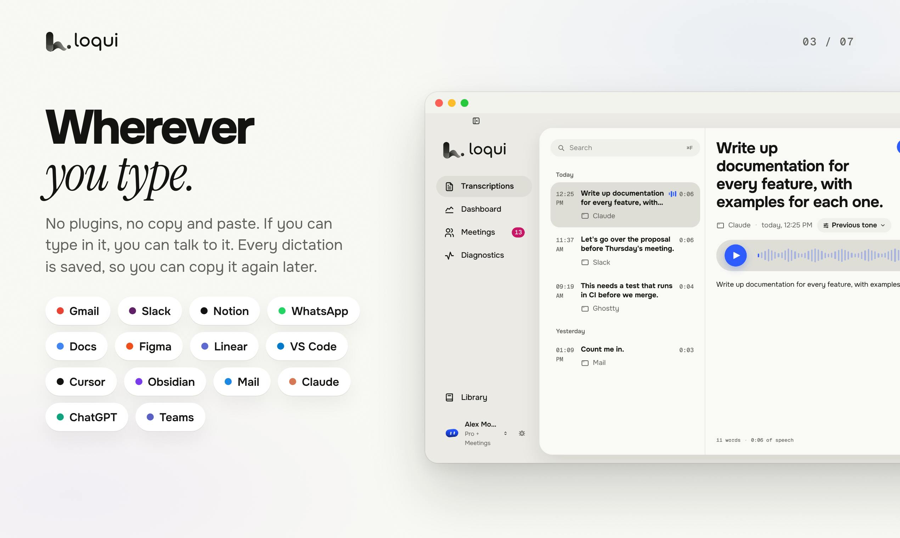

---

## 20. [AVP](https://www.producthunt.com/products/avp)
**Votes**: 74 | **도입 난이도**: 중 | **신뢰도**: 상
**Tagline**: Open source alternative to Git for AI coding agents
**서비스 링크**: https://www.producthunt.com/r/BEY3K553HTXHKU

**태그**: DevTool, AI, OpenSource, Git, Automation, Agent, AI Tool

### 📌 이 서비스 한눈에 보기
AI 코딩 에이전트를 위한 안전하고 격리된 오픈소스 버전 관리 도구

### 🔑 주요 기능
- AI 코딩 에이전트를 위한 Git 대안 제공
- Worktree를 활용한 에이전트 간 작업 격리
- 메인 브랜치 병합 전 변경 사항 검증 프로세스 통합

### 🙋 사용자에게 어떤 점이 좋은가
AI 에이전트가 코드를 수정할 때 발생할 수 있는 충돌이나 오류를 격리된 환경에서 관리하여 메인 코드의 안정성을 보장합니다.

### ✅ 지금 바로 써볼 기능
- Worktree를 통한 에이전트 작업 격리 환경 설정
- 메인 브랜치 반영 전 검증 워크플로우 테스트
- 기존 Git 워크플로우와의 호환성 확인

### ⚠️ 사용 전 확인할 점
- 기존 Git 워크플로우와의 전환 비용 발생 가능성
- 에이전트 자동화 과정에서의 검증 로직 신뢰도 확인 필요

### 🧭 확인이 더 필요한 정보
기존 Git과의 구체적인 호환성 및 워크플로우 전환 방식에 대한 상세 정보가 부족합니다.

### 📸 스크린샷 및 갤러리
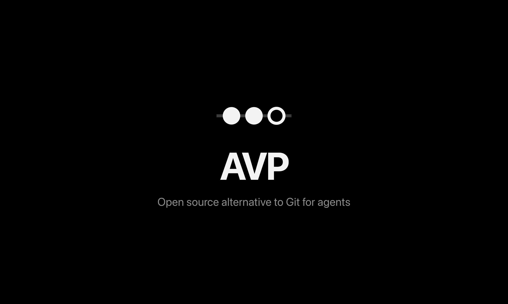
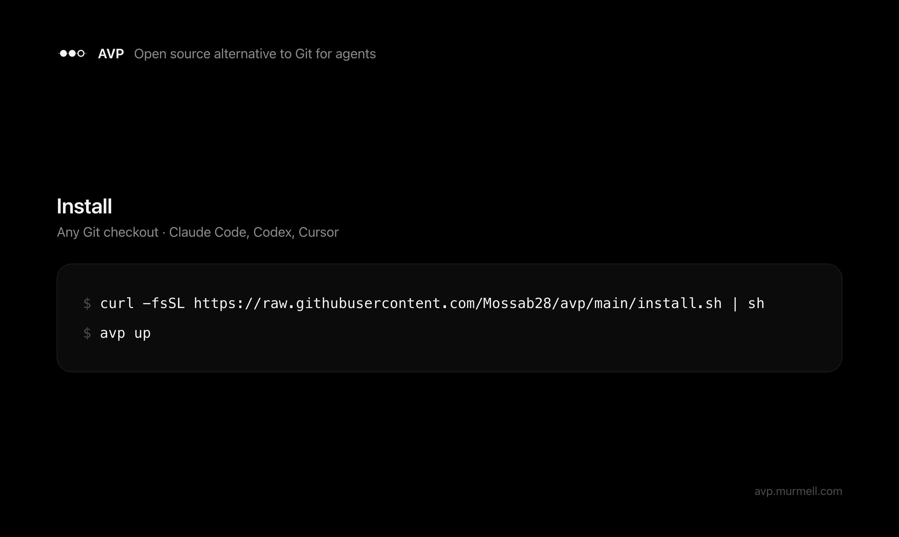
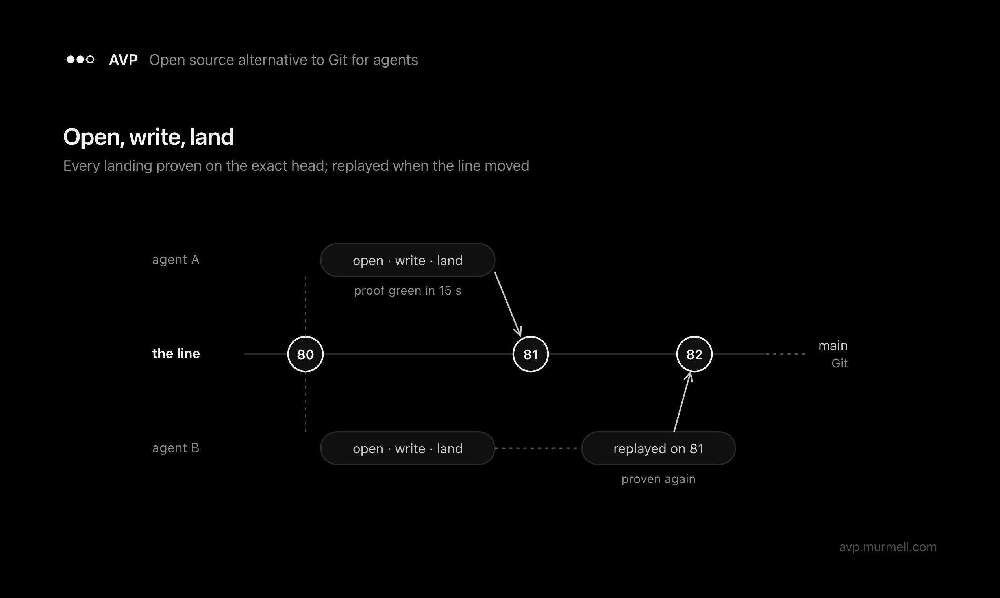

---

## 21. [Knock](https://www.producthunt.com/products/knock-7)
**Votes**: 72 | **도입 난이도**: 하 | **신뢰도**: 상
**Tagline**: Create shortcuts by hitting your mac
**서비스 링크**: https://www.producthunt.com/r/4OB6YBVHYKWF7L

**태그**: Productivity, Mac, Automation, Shortcut

### 📌 이 서비스 한눈에 보기
맥북을 가볍게 두드리는 것만으로 원하는 단축키를 실행하는 혁신적인 제스처 앱

### 🔑 주요 기능
- 맥북 내장 가속도계를 활용한 물리적 노크 감지
- 별도의 하드웨어 없이 노트북 측면 터치로 동작
- 스크린샷, 앱 실행, 음소거 등 사용자 정의 단축키 실행

### 🙋 사용자에게 어떤 점이 좋은가
마우스나 키보드에 손을 대지 않고도 물리적인 동작만으로 작업 흐름을 제어할 수 있어 직관적인 작업 환경을 제공합니다.

### ✅ 지금 바로 써볼 기능
- 자주 사용하는 앱 실행 단축키 설정하기
- 스크린샷 및 미디어 제어 단축키 연결하기
- 노트북 하드웨어에 무리가 가지 않는 적절한 타격감 찾기

### ⚠️ 사용 전 확인할 점
- 물리적 충격이 맥북 하드웨어에 미칠 수 있는 영향 고려 필요
- 가속도계 감도 설정에 따른 오작동 가능성

### 🧭 확인이 더 필요한 정보
물리적 진동을 이용하므로 기기 내구성 및 센서 정밀도에 따른 동작 안정성 확인이 필요합니다.

### 📸 스크린샷 및 갤러리
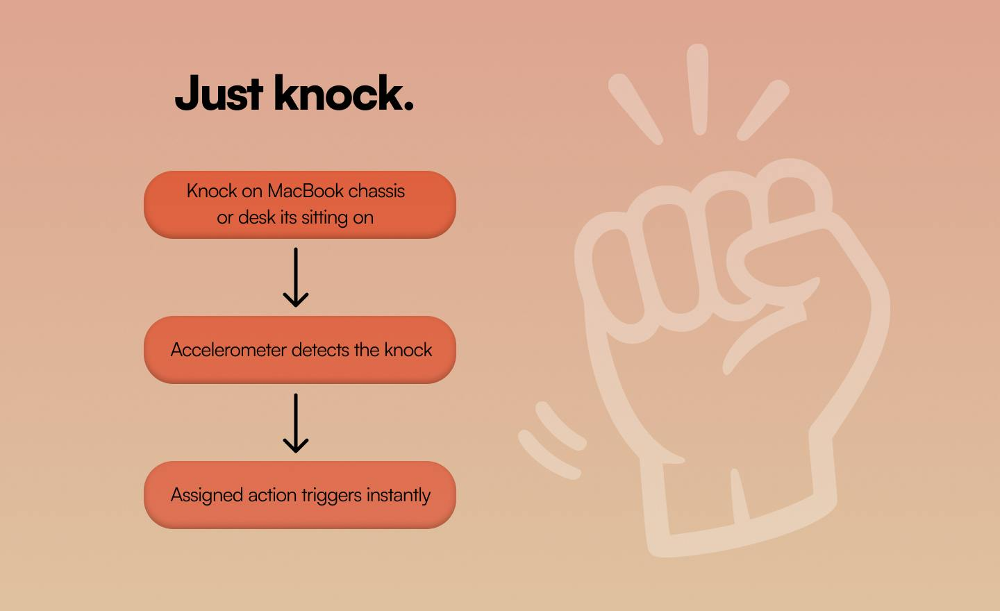
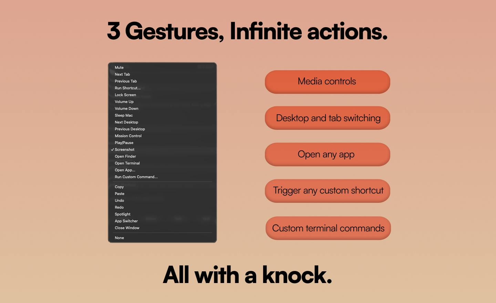

### 🎬 관련 영상
- [🎥 영상 보기](https://ph-files.imgix.net/f00810b0-f009-4524-bd0f-adcfc425dc50.jpeg?auto=format)
- [🎥 영상 보기](https://ph-files.imgix.net/e1e1ae70-fe6c-4ae0-ae1b-2ba7b88176f9.jpeg?auto=format)

---

## 22. [Jobmate AI](https://www.producthunt.com/products/jobmate-ai-3)
**Votes**: 72 | **도입 난이도**: 하 | **신뢰도**: 상
**Tagline**: The humanized AI Copilot for your entire Job search
**서비스 링크**: https://www.producthunt.com/r/6FOZ23XKDFMO7L

**태그**: AI, Automation, JobSearch, Productivity, Agent, AI Tool

### 📌 이 서비스 한눈에 보기
구직 과정의 번거로운 반복 작업을 자동화하여 면접에만 집중하게 해주는 AI 코파일럿

### 🔑 주요 기능
- AI 에이전트를 통한 자동 지원 및 지원서 양식 자동 채우기
- 웹 전역에서 새로운 채용 공고 탐색 및 맞춤형 이력서/자기소개서 작성
- 채용 담당자 연락 및 지원 현황 통합 관리

### 🙋 사용자에게 어떤 점이 좋은가
구직에 드는 물리적인 시간을 획기적으로 줄여주며, 지원서 작성의 번거로움을 자동화하여 더 많은 기회를 확보할 수 있습니다.

### ✅ 지금 바로 써볼 기능
- Chrome 또는 Firefox 확장 프로그램 설치하기
- 프로필 정보를 입력하여 자동 채우기 기능 테스트하기
- AI를 활용한 맞춤형 이력서 생성 기능 실행하기

### ⚠️ 사용 전 확인할 점
- 자동 지원 기능 사용 시 개인정보 및 지원 내용의 정확성 검토 필요
- AI가 작성한 답변이 기업의 의도와 일치하는지 최종 확인 필요

### 🧭 확인이 더 필요한 정보
무료 플랜의 상세 범위와 유료 전환 시의 기능 차이에 대한 정보가 명시되지 않았습니다.

### 📸 스크린샷 및 갤러리
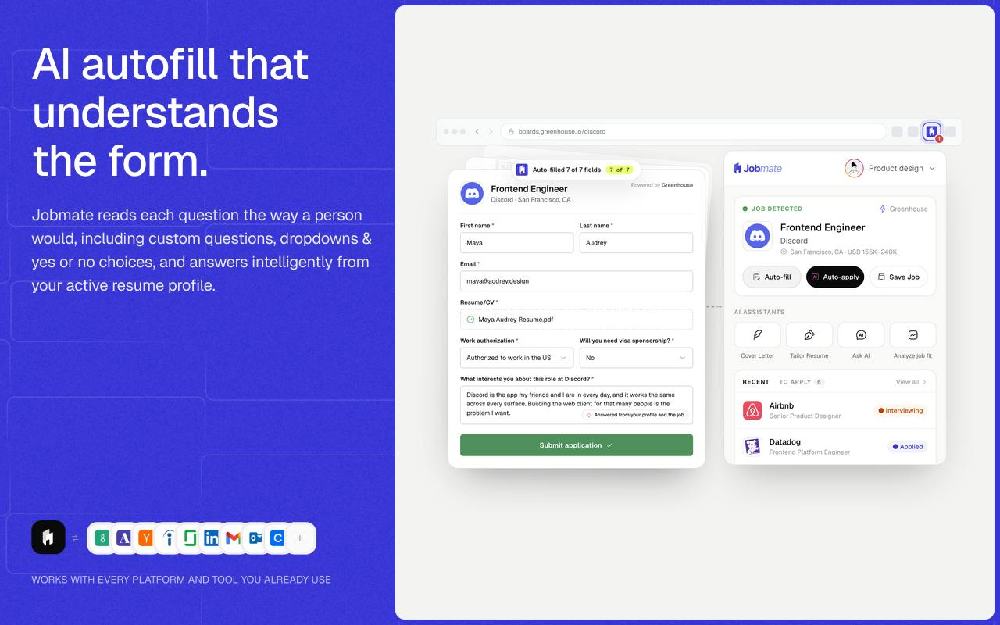
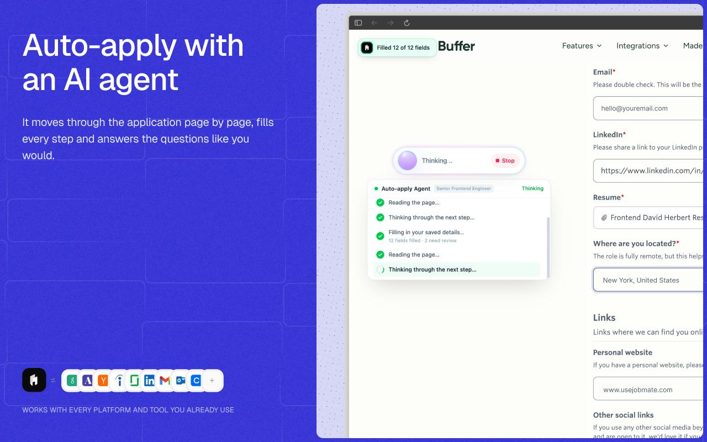

### 🎬 관련 영상
- [🎥 영상 보기](https://ph-files.imgix.net/30a6c98a-8cb4-4151-aece-abc7db4c30ef.jpeg?auto=format)

---

## 23. [AllModels](https://www.producthunt.com/products/allmodels-io)
**Votes**: 70 | **도입 난이도**: 하 | **신뢰도**: 상
**Tagline**: Explore every abliterated model
**서비스 링크**: https://www.producthunt.com/r/N54YXDRC7UAMEG

**태그**: AI, DevTool, Automation, LLM, AI Tool

### 📌 이 서비스 한눈에 보기
다양한 언어 모델의 가용성과 가격을 비교하고 자동 폴백 기능을 통해 효율적으로 라우팅하는 도구

### 🔑 주요 기능
- 여러 제공업체에 걸친 모델 라우팅 및 자동 폴백 기능
- 모달리티를 고려한 지능형 모델 선택 기능
- 모델별 가용성 및 토큰 가격 통합 비교

### 🙋 사용자에게 어떤 점이 좋은가
여러 AI 모델을 사용하는 개발자가 서비스 중단 없이 최적의 비용으로 모델을 운용할 수 있도록 돕습니다.

### ✅ 지금 바로 써볼 기능
- 제공되는 모델들의 가격 및 가용성 비교하기
- 자동 폴백(Fallback) 설정 테스트하기
- 사용 중인 워크플로우에 모달리티 기반 라우팅 적용하기

### ⚠️ 사용 전 확인할 점
- 라우팅 과정에서 발생할 수 있는 지연 시간(Latency) 확인 필요
- 제공업체 간의 데이터 보안 및 프라이버시 정책 검토 필요

### 🧭 확인이 더 필요한 정보
구체적인 지원 모델 목록과 API 연동 방식에 대한 상세 정보가 필요합니다.

### 📸 스크린샷 및 갤러리
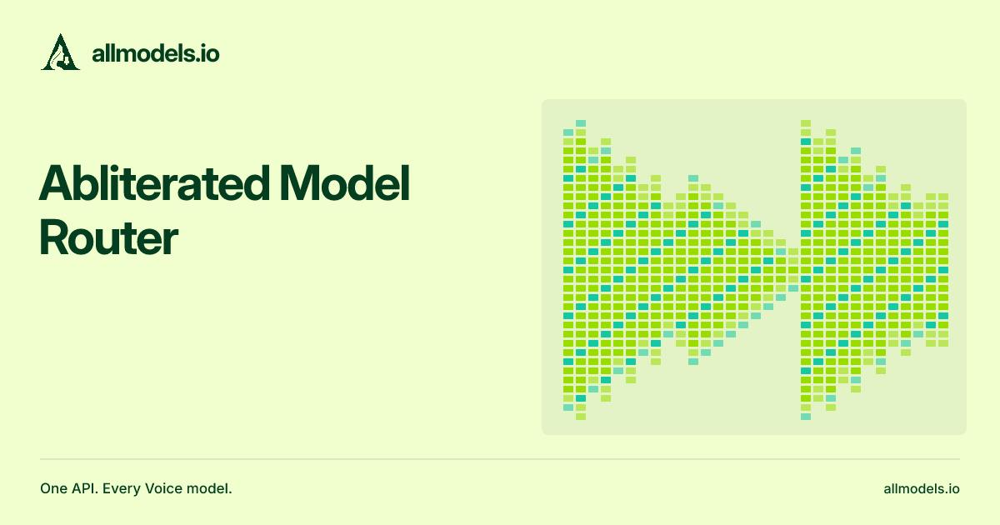

---

## 24. [Standfast](https://www.producthunt.com/products/standfast)
**Votes**: 69 | **도입 난이도**: 하 | **신뢰도**: 상
**Tagline**: Know if your Mac's GitHub Actions runners will get work
**서비스 링크**: https://www.producthunt.com/r/SLV4NWBM6AP27T

**태그**: DevTool, macOS, GitHub Actions, Automation

### 📌 이 서비스 한눈에 보기
자체 호스팅하는 Mac GitHub Actions 러너의 상태를 실시간으로 확인하는 메뉴 바 앱

### 🔑 주요 기능
- macOS 메뉴 바에서 러너 상태를 직관적으로 확인 가능
- 로컬 프로세스(launchd)와 GitHub 서버 상태를 동시에 검증
- 러너의 생존 여부와 GitHub의 등록 상태 간의 불일치 방지

### 🙋 사용자에게 어떤 점이 좋은가
자체 호스팅 러너를 사용하는 개발자가 Mac의 프로세스 문제나 GitHub 서버 상태를 즉각 파악하여 워크플로우 중단을 방지할 수 있습니다.

### ✅ 지금 바로 써볼 기능
- 메뉴 바에 앱 설치 및 실행
- 자체 호스팅 러너와 연동 설정
- 실시간 상태 모니터링 시작

### ⚠️ 사용 전 확인할 점
- macOS 환경에서만 작동하는 전용 앱임
- 자체 호스팅 러너를 사용하는 환경이 필요함

### 🧭 확인이 더 필요한 정보
상세한 설정 방법 및 보안 정책에 대한 구체적인 정보는 제공되지 않았습니다.

### 📸 스크린샷 및 갤러리
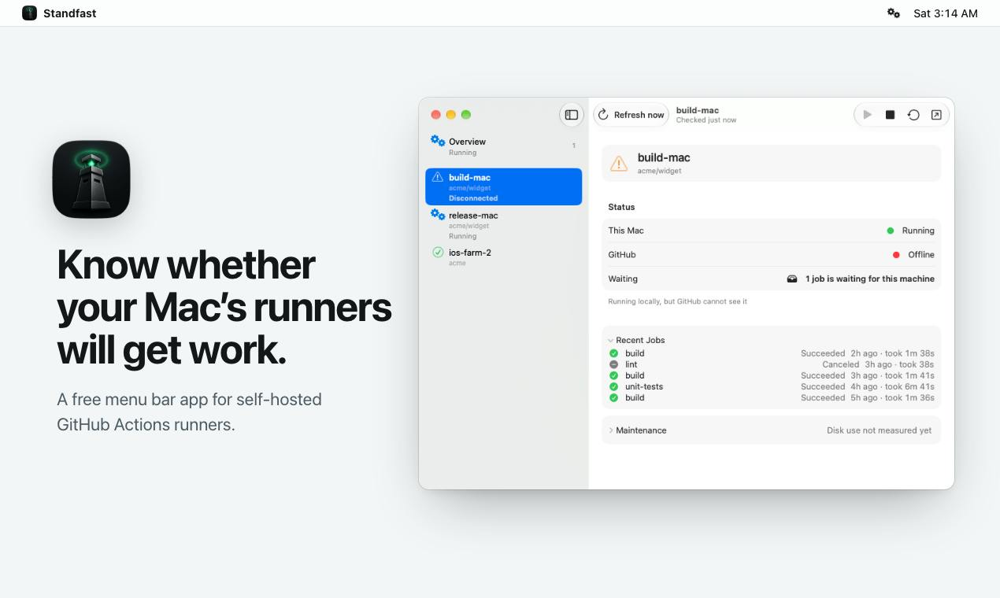
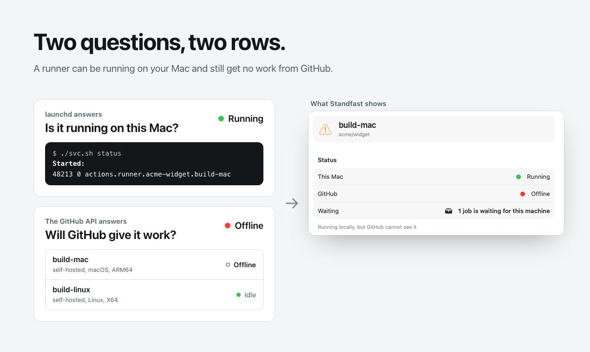
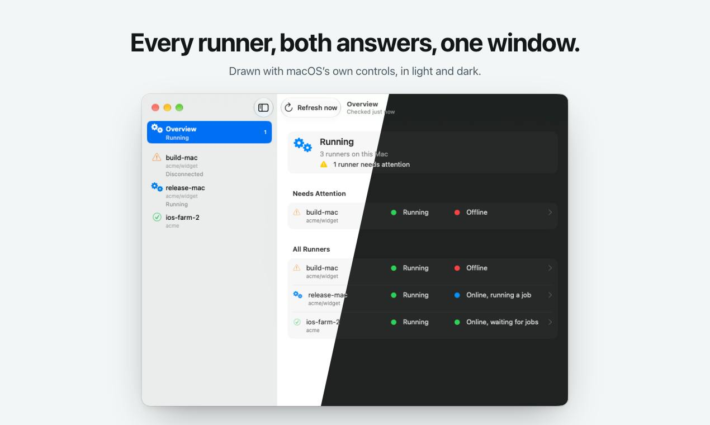

---

## 25. [SwarmPane](https://www.producthunt.com/products/swarmpane)
**Votes**: 26 | **도입 난이도**: 중 | **신뢰도**: 상
**Tagline**: 22 updates in 17 days: usage limits per account & more
**서비스 링크**: https://www.producthunt.com/r/XLNIYK2ZFVVENQ

**태그**: AI-Coding, DevTools, Productivity, Multi-Agent, Agent, AI Tool, DevTool

### 📌 이 서비스 한눈에 보기
여러 AI 코딩 에이전트를 하나의 환경에서 동시에 실행하고 관리하는 통합 워크스페이스

### 🔑 주요 기능
- Claude Code, Cursor, Gemini 등 10개 이상의 AI 코딩 에이전트 병렬 실행 지원
- 기존에 결제 중인 플랜을 그대로 활용하여 에이전트 구동
- 계정별 사용량 제한 확인, 개별 워크트리, 세션 유지 기능 제공

### 🙋 사용자에게 어떤 점이 좋은가
여러 AI 코딩 도구를 번거로운 전환 없이 한 곳에서 관리할 수 있어 개발 생산성을 극대화할 수 있습니다.

### ✅ 지금 바로 써볼 기능
- 기존에 사용 중인 AI 에이전트들을 SwarmPane에 연결하기
- 계정별 사용량 제한(Usage limits) 대시보드 확인하기
- 에이전트별 독립된 워크트리 환경 설정하기

### ⚠️ 사용 전 확인할 점
- 사용자가 이미 결제한 플랜의 API/서비스 권한을 기반으로 작동함
- 다양한 에이전트를 동시에 실행할 경우 로컬 리소스 소모가 클 수 있음

### 🧭 확인이 더 필요한 정보
각 에이전트 간의 충돌 방지 및 리소스 최적화 방식에 대한 상세 정보가 필요합니다.

### 📸 스크린샷 및 갤러리

### 🎬 관련 영상
- [🎥 영상 보기](https://ph-files.imgix.net/8c0e48c2-cea6-431c-8ee6-02637c7e4f93.jpeg?auto=format)

---

## 26. [Figcel](https://www.producthunt.com/products/figcel)
**Votes**: 12 | **도입 난이도**: 하 | **신뢰도**: 상
**Tagline**: Turn your store and rivals' ads into Meta ads and carousels.
**서비스 링크**: https://www.producthunt.com/r/YA6I5NJTLWFOFC

**태그**: E-commerce, Marketing Automation, Ad Creative

### 📌 이 서비스 한눈에 보기
경쟁사 광고 데이터를 활용해 즉시 사용 가능한 메타/인스타그램 카루셀 광고를 제작하는 툴

### 🔑 주요 기능
- 경쟁사의 메타 광고 라이브러리 데이터를 분석하여 광고 소재로 변환
- 스토어 링크 입력만으로 제품 맞춤형 카루셀 광고 자동 생성
- D2C 및 이커머스 브랜드, 광고 대행사를 위한 효율적인 소재 제작 워크플로우 제공

### 🙋 사용자에게 어떤 점이 좋은가
경쟁사의 검증된 광고 전략을 자사 제품에 맞춰 빠르게 재가공함으로써 광고 제작 시간과 비용을 절감할 수 있습니다.

### ✅ 지금 바로 써볼 기능
- 자사 스토어 링크를 입력하여 자동 생성 기능 테스트하기
- 경쟁사 광고 라이브러리 데이터가 어떻게 반영되는지 확인하기

### 🧭 확인이 더 필요한 정보
사용자의 스토어 링크를 입력했을 때 생성되는 최종 디자인의 커스텀 자유도와 퀄리티 수준을 확인해야 합니다.

### 📸 스크린샷 및 갤러리

---

## 27. [ScratchBoard](https://www.producthunt.com/products/scratchboard)
**Votes**: 10 | **도입 난이도**: 하 | **신뢰도**: 상
**Tagline**: Build complex business apps in minutes using Ai 
**서비스 링크**: https://www.producthunt.com/r/3ZCUMVJEMOZQD5

**태그**: NoCode, AI, BusinessApp, Automation, AI Tool

### 📌 이 서비스 한눈에 보기
AI를 통해 복잡한 비즈니스 애플리케이션을 몇 분 만에 구축하는 도구

### 🔑 주요 기능
- 자연어 설명을 통한 비즈니스 앱 자동 생성
- 엔티티, 워크플로우, 포털, 대시보드 통합 구축
- 복잡한 비즈니스 로직의 신속한 프로토타이핑 및 구현

### 🙋 사용자에게 어떤 점이 좋은가
아이디어만 설명하면 앱의 핵심 구조를 자동으로 만들어주므로, 개발 시간을 획기적으로 단축하고 비즈니스 운영 효율을 높일 수 있습니다.

### ✅ 지금 바로 써볼 기능
- 필요한 비즈니스 요구사항 설명해보기
- 생성된 엔티티 및 워크플로우 구조 검토하기
- 자동 생성된 대시보드 및 포털 확인하기

### ⚠️ 사용 전 확인할 점
- AI 생성 결과물의 비즈니스 로직 정확성 검증 필요
- 복잡한 커스텀 기능 구현 시 제약 사항 확인 필요

### 🧭 확인이 더 필요한 정보
생성된 앱의 외부 서비스 연동 범위와 데이터 보안 정책에 대한 상세 정보가 필요합니다.

### 📸 스크린샷 및 갤러리

### 🎬 관련 영상
- [🎥 영상 보기](https://ph-files.imgix.net/625352d9-d02a-4ffe-b7ec-7f521dd500a5.jpeg?auto=format)

---

## 28. [Tortoise](https://www.producthunt.com/products/tortoise)
**Votes**: 9 | **도입 난이도**: 하 | **신뢰도**: 상
**Tagline**: Fractal torus and sacred geometry. Free and open source.
**서비스 링크**: https://www.producthunt.com/r/2TVM3QIQKMUCTU

**태그**: Generative Art, Open Source, Design Tool, 3D Printing, AI Tool, Video, Vision

### 📌 이 서비스 한눈에 보기
브라우저에서 프랙탈 토러스를 생성하고 예술적 영감을 시각화하는 오픈소스 도구

### 🔑 주요 기능
- 브라우저 기반의 프랙탈 토러스 및 신성 기하학 생성
- 명상적 시각화, 플라즈마 라이트 필드, AI 렌더링 등 다양한 예술적 활용
- 16K 포스터, 플로터 라인, 3D 프린팅 및 비디오 루프 수출 지원

### 🙋 사용자에게 어떤 점이 좋은가
복잡한 기하학적 구조를 손쉽게 생성하여 디지털 아트워크, 3D 프린팅 모델, 고해상도 영상 소스를 제작할 수 있습니다.

### ✅ 지금 바로 써볼 기능
- 브라우저에서 다양한 프랙탈 변형 생성해보기
- 생성된 구조를 기반으로 AI 렌더링 이미지 만들기
- 고해상도 포스터나 3D 프린트용 파일로 내보내기

### ⚠️ 사용 전 확인할 점
- 데스크톱 환경에서 가장 원활하게 작동함
- 고해상도 출력 시 하드웨어 성능이 필요할 수 있음

### 🧭 확인이 더 필요한 정보
사용자의 하드웨어 사양에 따른 브라우저 내 렌더링 성능 차이를 확인해야 합니다.

### 📸 스크린샷 및 갤러리

### 🎬 관련 영상
- [🎥 영상 보기](https://ph-files.imgix.net/dfa45149-33da-4bb3-b4bb-ab98b893aaf3.jpeg?auto=format)

---

## 29. [Open_SwarmForce](https://www.producthunt.com/products/open_swarmforce-2)
**Votes**: 9 | **도입 난이도**: 중 | **신뢰도**: 상
**Tagline**: A swarm of agents for making your coding easy
**서비스 링크**: https://www.producthunt.com/r/2IX3QCJR7QSLKG

**태그**: DevTool, AI-Agent, CICD, Automation, Agent, AI Tool

### 📌 이 서비스 한눈에 보기
코드 변경 사항을 자동으로 검토하고 수정하여 안전하게 PR을 생성하는 에이전트 기반 CI/CD 게이트

### 🔑 주요 기능
- 코드 변경 사항(diff) 자동 리뷰 및 샌드박스 환경에서의 자동 수정 기능
- OpenAI, Claude, Ollama 등 다양한 LLM 모델을 지원하는 유연한 모델 라우팅
- 결정론적 저장소 체크를 통한 안전한 Pull Request 발행 프로세스

### 🙋 사용자에게 어떤 점이 좋은가
개발자가 수동으로 수행하던 코드 리뷰와 버그 수정을 자동화하여, 검증된 코드만 안전하게 PR로 제출할 수 있게 돕습니다.

### ✅ 지금 바로 써볼 기능
- 로컬 모델(Ollama, LM Studio)을 활용한 비용 효율적인 테스트
- 샌드박스 환경에서의 자동 수정 및 재검토 워크플로우 실행
- L0–L6 벤치마크를 통한 모델별 성능 및 비용 최적화 확인

### ⚠️ 사용 전 확인할 점
- 에이전트가 코드를 직접 수정하므로 생성된 결과물에 대한 최종 검토 필요
- 사용하는 LLM 모델 및 라우팅 설정에 따라 비용과 품질이 달라질 수 있음

### 🧭 확인이 더 필요한 정보
제공되는 L0–L6 벤치마크의 구체적인 기준과 비용 산정 방식에 대한 상세 정보가 필요합니다.

### 📸 스크린샷 및 갤러리

---

## 30. [Vesalius](https://www.producthunt.com/products/vesalius)
**Votes**: 8 | **도입 난이도**: 하 | **신뢰도**: 상
**Tagline**: 51% fewer tokens for Claude Code
**서비스 링크**: https://www.producthunt.com/r/OLGRRFB2DZ4IQI

**태그**: DevTool, AI, Productivity, ClaudeCode, AI Tool

### 📌 이 서비스 한눈에 보기
로컬 코드베이스 분석을 통해 Claude Code의 토큰 사용량을 절반으로 줄여주는 개발 도구

### 🔑 주요 기능
- 로컬 저장소의 파일 간 관계 및 의존성 자동 분석
- Claude Code와 연동하여 정확한 파일 및 라인 참조 제공
- 코드 유출 걱정 없는 로컬 기반의 보안 중심 설계

### 🙋 사용자에게 어떤 점이 좋은가
코드 구조를 미리 파악하여 Claude Code의 불필요한 검색 과정을 줄이고, 토큰 비용 절감과 답변 정확도를 동시에 확보할 수 있습니다.

### ✅ 지금 바로 써볼 기능
- 로컬 저장소 인덱싱 실행
- Claude Code와 연동하여 질문 던지기
- 토큰 절감 및 답변 품질 벤치마크 확인

### ⚠️ 사용 전 확인할 점
- 로컬 리소스(CPU/RAM) 사용량 확인 필요
- 매우 거대한 저장소에서의 인덱싱 성능 확인 필요

### 🧭 확인이 더 필요한 정보
로컬 환경에서의 인덱싱 작업이 시스템 성능에 미치는 구체적인 영향은 명시되지 않았습니다.

### 📸 스크린샷 및 갤러리

---

