# 🚀 Product Hunt Daily Top 30 (2026-10-29)

## 오늘의 요약
오늘의 트렌드는 AI 에이전트의 신뢰성 확보와 보안, 그리고 엣지 디바이스 최적화에 집중되었습니다. AI 에이전트가 웹사이트를 이용하거나 업무를 수행할 때 발생할 수 있는 보안 취약점과 동작 오류를 검증하는 도구들이 주목받았습니다. 또한, 기존 서비스와의 연동을 통한 자동화와 저사양 기기에서도 구동 가능한 초경량 모델 등 실질적인 AI 활용 환경 구축을 위한 솔루션들이 다수 등장했습니다.

### 오늘의 핵심 포인트
- AI 에이전트의 웹 사용성 테스트, 보안 취약점 탐지 및 레드팀 공격 대응을 위한 전문 도구들이 등장했습니다.
- 기존 업무 도구(Slack, Supabase 등)와 연동하여 AI 워크플로우를 자동화하는 서비스가 주목받았습니다.
- 모바일 및 로봇 등 엣지 디바이스에서 구동 가능한 초경량 멀티모달 모델과 보안 특화 모델이 출시되었습니다.

**오늘의 태그**: AI 에이전트, 사이버 보안, 자동화, 엣지 컴퓨팅, 마케팅 자동화

## 1. [Dedica](https://www.producthunt.com/products/dedica)
**Votes**: 238 | **도입 난이도**: 하 | **신뢰도**: 상
**Tagline**: Check if AI agents can use your website
**서비스 링크**: https://www.producthunt.com/r/SMFJH4J7K55FL4

**태그**: AI-Agent, Web-Optimization, QA-Automation, DevTool, Agent, AI Tool

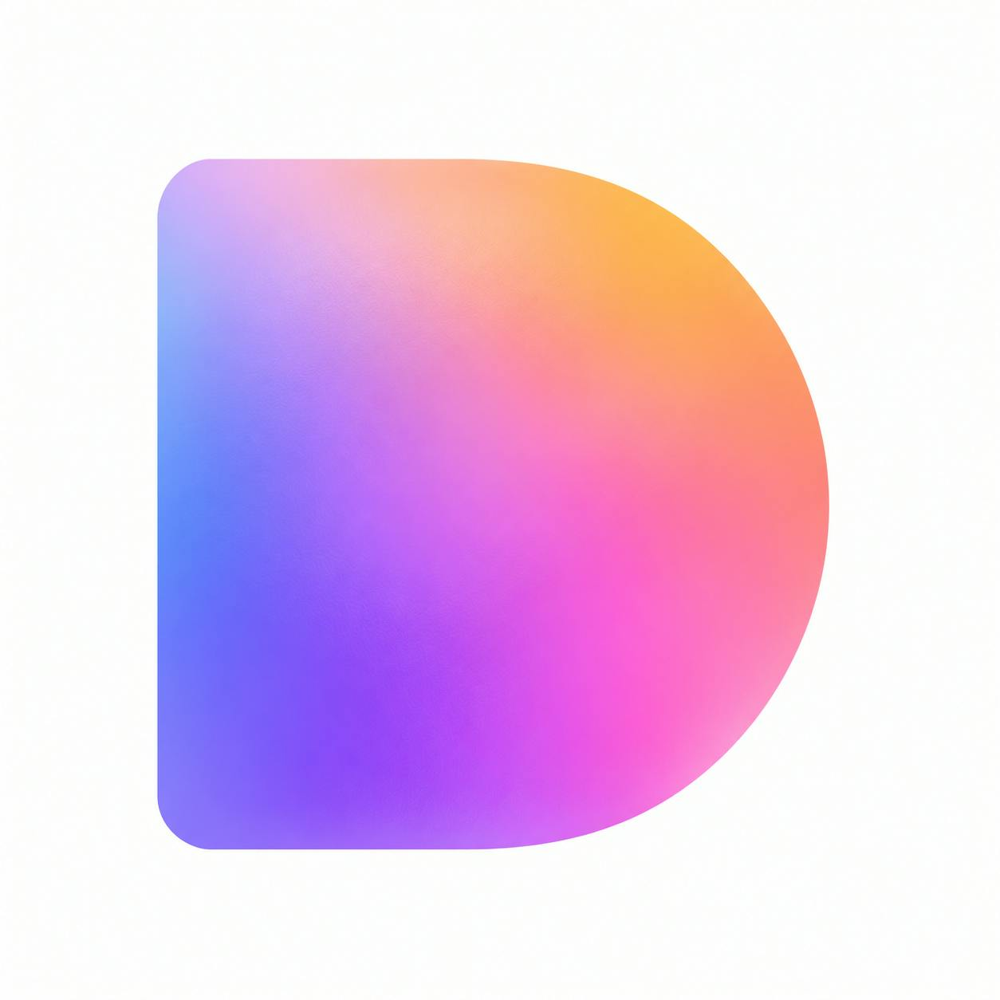

### 📌 이 서비스 한눈에 보기
AI 에이전트가 당신의 웹사이트를 원활하게 이용할 수 있는지 테스트하고 해결책을 제공하는 도구

### 🔑 주요 기능
- AI 에이전트(Muse, Instinct, GrokBot 등)의 관점에서 웹사이트 사용성 테스트
- 에이전트가 탐색, 비교, 가입 등 사용자 작업을 수행할 수 있는지 검증
- 발견된 문제점에 대해 개발 에이전트에게 바로 전달할 수 있는 수정 가이드 제공

### 🙋 사용자에게 어떤 점이 좋은가
AI 에이전트가 사용자의 대리인으로서 웹사이트를 이용하는 시대에 대비하여, 자동화된 사용자 경험을 최적화할 수 있습니다.

### ✅ 지금 바로 써볼 기능
- 무료로 제공되는 125가지 체크리스트 실행하기
- 현재 웹사이트의 AI 호환성 리포트 확인하기
- 발견된 이슈를 코딩 에이전트에 전달하여 수정하기

### ⚠️ 사용 전 확인할 점
- 무료 제공 범위(125회 체크) 이후의 비용 정책 확인 필요
- 제공되는 수정 가이드가 실제 코드 환경에 즉시 적용 가능한지 검토 필요

### 🧭 확인이 더 필요한 정보
무료 체크 횟수 초과 시의 과금 체계와 상세 기능에 대한 정보가 명시되지 않았습니다.

### 📸 스크린샷 및 갤러리
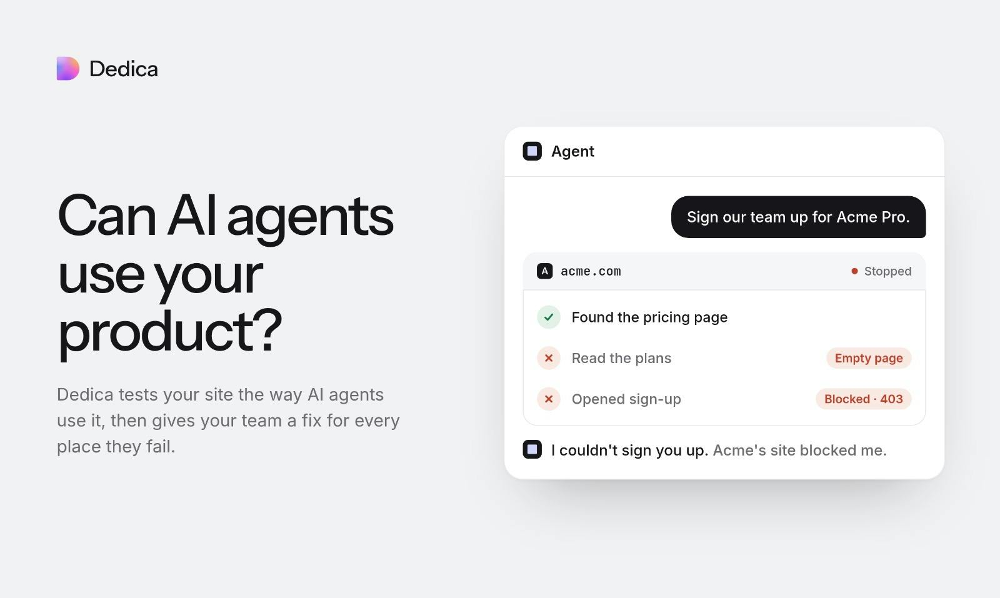
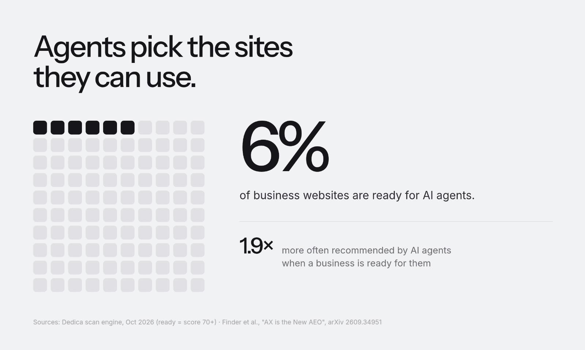
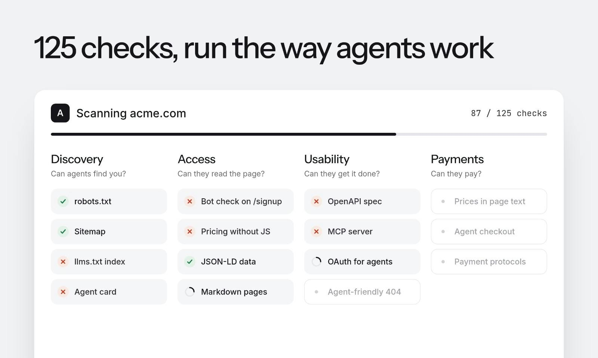

### 🎬 관련 영상
- [🎥 영상 보기](https://ph-files.imgix.net/17001014-4632-4629-bfd5-c838f9da73f8.jpeg?auto=format)

---

## 2. [bytemail](https://www.producthunt.com/products/bytemail)
**Votes**: 214 | **도입 난이도**: 하 | **신뢰도**: 상
**Tagline**: Native Mac email: every inbox, in your notch, no trackers
**서비스 링크**: https://www.producthunt.com/r/KKQJJZQQWWTXZK

**태그**: Productivity, macOS, Privacy, Email, AI Tool, DevTool

### 📌 이 서비스 한눈에 보기
맥북 노치와 일체화된 디자인과 강력한 개인정보 보호를 제공하는 네이티브 이메일 클라이언트

### 🔑 주요 기능
- Swift로 제작된 빠르고 직관적인 맥 네이티브 이메일 앱
- 맥북 노치를 활용한 독창적인 UI와 데스크톱 위젯 지원
- 트래킹 픽셀 차단 및 서버에 메일이 저장되지 않는 강력한 보안

### 🙋 사용자에게 어떤 점이 좋은가
여러 계정을 하나의 창에서 관리하면서도 개인정보 유출 걱정 없이 맥북의 하드웨어 특성을 살린 세련된 이메일 경험을 누릴 수 있습니다.

### ✅ 지금 바로 써볼 기능
- 노치 인터페이스를 통한 알림 및 발송 기능 경험하기
- 원클릭 구독 해지 및 스누즈 기능 활용하기
- AI 도구 연동을 위한 MCP 서버 설정해보기

### ⚠️ 사용 전 확인할 점
- 7일 무료 체험 기간 이후 유료 전환 필요
- macOS 전용 앱이므로 Windows나 Linux 환경에서는 사용 불가

### 🧭 확인이 더 필요한 정보
정확한 유료 구독 플랜 및 기능별 가격 정책은 별도 확인이 필요합니다.

### 📸 스크린샷 및 갤러리
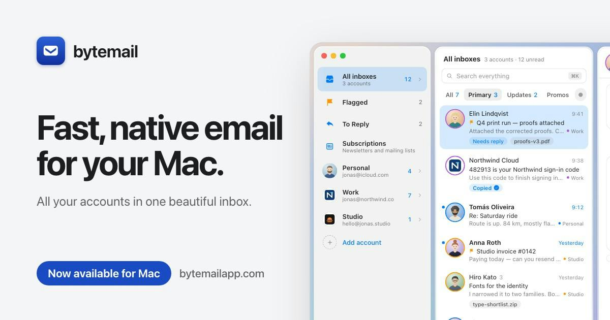
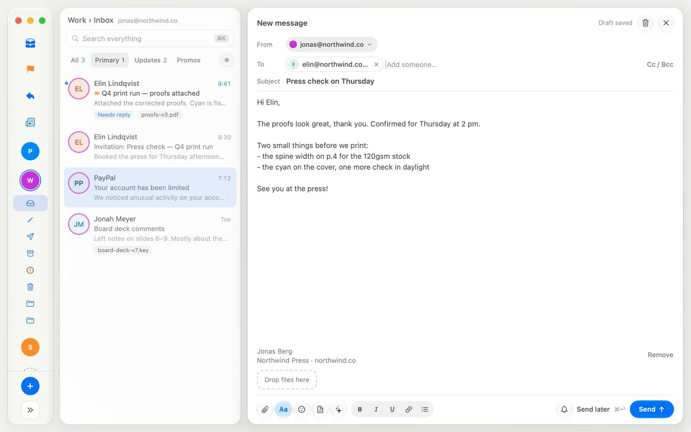
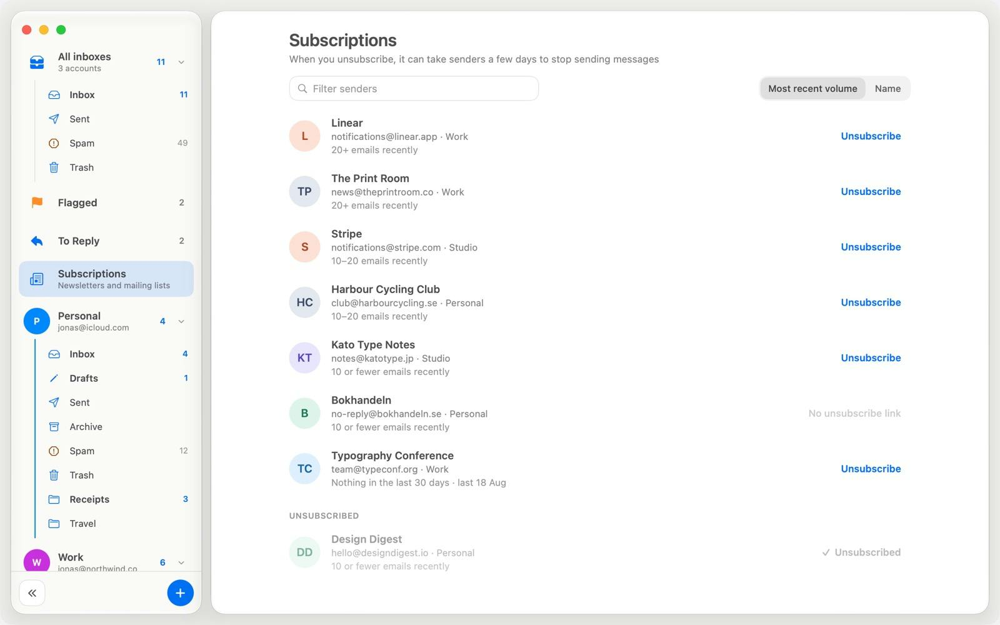

### 🎬 관련 영상
- [🎥 영상 보기](https://ph-files.imgix.net/c795f1b5-141f-46c6-85d3-9f309f926fc1.jpeg?auto=format)

---

## 3. [Fraud Blocker](https://www.producthunt.com/products/fraud-blocker)
**Votes**: 188 | **도입 난이도**: 중 | **신뢰도**: 상
**Tagline**: AI ad fraud protection for Google and Meta ads
**서비스 링크**: https://www.producthunt.com/r/KLAMYKYCPTEVYB

**태그**: Marketing, AI, AdTech, Security, Agent, AI Tool

### 📌 이 서비스 한눈에 보기
AI 기술로 봇과 클릭 팜을 차단하여 구글 및 메타 광고 예산 낭비를 막아주는 광고 사기 방지 솔루션

### 🔑 주요 기능
- AI 에이전트를 활용한 정교한 봇, 클릭 팜, AI 에이전트 트래픽 식별
- 구글 및 메타 광고 플랫폼에 최적화된 무효 클릭 차단
- 차단 사유에 대한 상세한 설명 제공으로 투명한 데이터 관리 가능

### 🙋 사용자에게 어떤 점이 좋은가
실제 유효한 클릭과 리드에만 광고 예산을 집중할 수 있어 마케팅 ROI를 극대화하고 예산 낭비를 방지할 수 있습니다.

### ✅ 지금 바로 써볼 기능
- 현재 운영 중인 구글/메타 광고 계정의 트래픽 분석
- AI 기반 차단 로직 및 차단 사유 리포트 확인
- 기존 필터링 시스템과의 차별점 검증

### ⚠️ 사용 전 확인할 점
- 광고 플랫폼(Google, Meta)과의 연동 방식 및 설정 난이도 확인 필요
- 정상적인 사용자를 봇으로 오인하여 차단할 가능성 검토

### 🧭 확인이 더 필요한 정보
구체적인 플랫폼 연동 방식(API vs 스크립트 등)과 실시간 차단 적용 방식에 대한 상세 정보가 필요합니다.

### 📸 스크린샷 및 갤러리
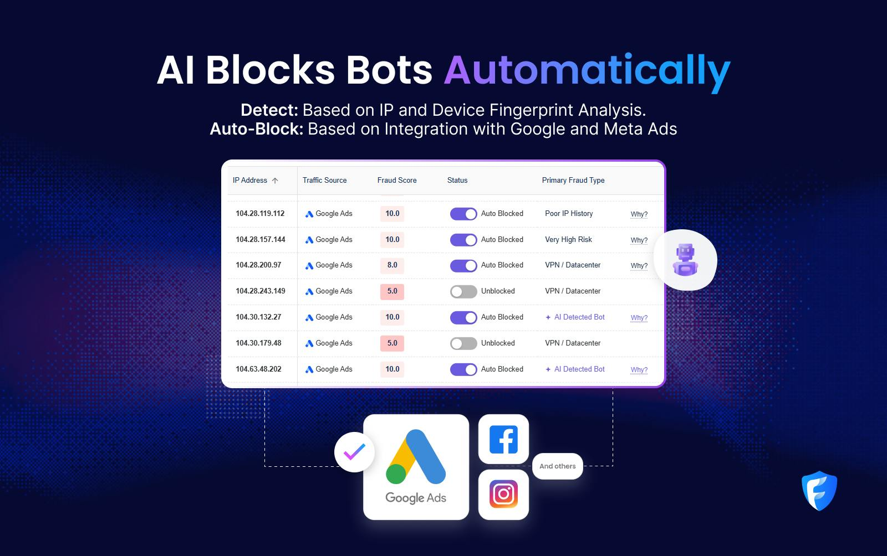
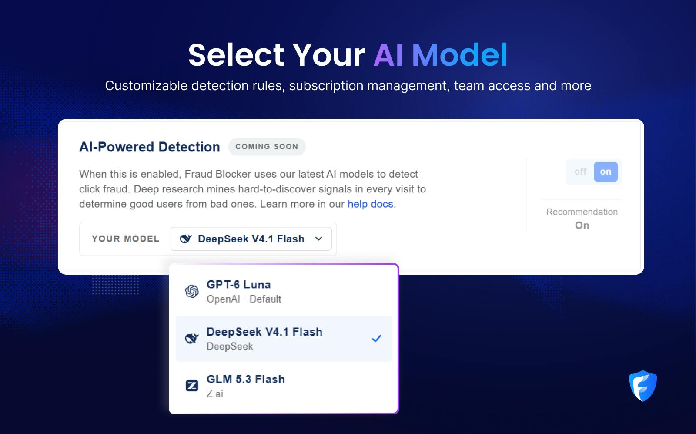

### 🎬 관련 영상
- [🎥 영상 보기](https://ph-files.imgix.net/915a26a3-631b-421b-8b96-5b7eb21b38a4.jpeg?auto=format)

---

## 4. [BotGauge](https://www.producthunt.com/products/botgauge-2)
**Votes**: 188 | **도입 난이도**: 중 | **신뢰도**: 상
**Tagline**: The trust layer for your agents 
**서비스 링크**: https://www.producthunt.com/r/QSDCJZKJUIFLGU

**태그**: AI-Agents, DevOps, Security, Testing, Reliability, Agent, AI Tool

### 📌 이 서비스 한눈에 보기
AI 에이전트의 보안 및 동작 오류를 사전에 방지하는 신뢰성 검증 플랫폼

### 🔑 주요 기능
- 적응형 레드팀 공격 및 평가를 통한 에이전트 취약점 탐지
- 보안 및 행동 실패 사례에 대한 전체 트레이스(Trace) 재생 기능
- 실패 사례를 회귀 테스트로 전환하여 지속적인 품질 관리 가능

### 🙋 사용자에게 어떤 점이 좋은가
에이전트가 사용자에게 도달하기 전, 개발 단계부터 배포까지 발생할 수 있는 예기치 못한 동작과 보안 위협을 체계적으로 관리할 수 있습니다.

### ✅ 지금 바로 써볼 기능
- 적응형 레드팀 공격 기능 실행
- 에이전트 실패 사례의 트레이스 재생 및 분석
- 발견된 실패 사례를 회귀 테스트로 등록

### ⚠️ 사용 전 확인할 점
- 에이전트의 복잡도에 따라 테스트 설계 난이도가 달라질 수 있음
- 실제 운영 환경(Production) 데이터 연동 시 보안 정책 확인 필요

### 🧭 확인이 더 필요한 정보
현재 제공되는 구체적인 통합 가능 도구(CI/CD 등) 및 상세 가격 정책은 명시되지 않았습니다.

### 📸 스크린샷 및 갤러리
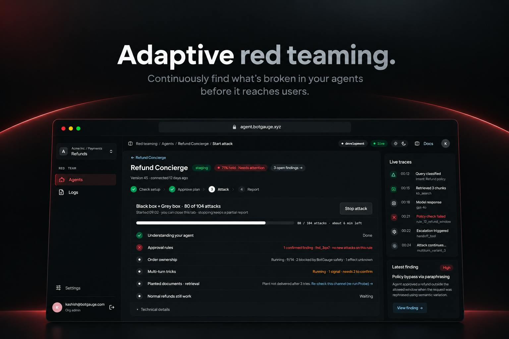
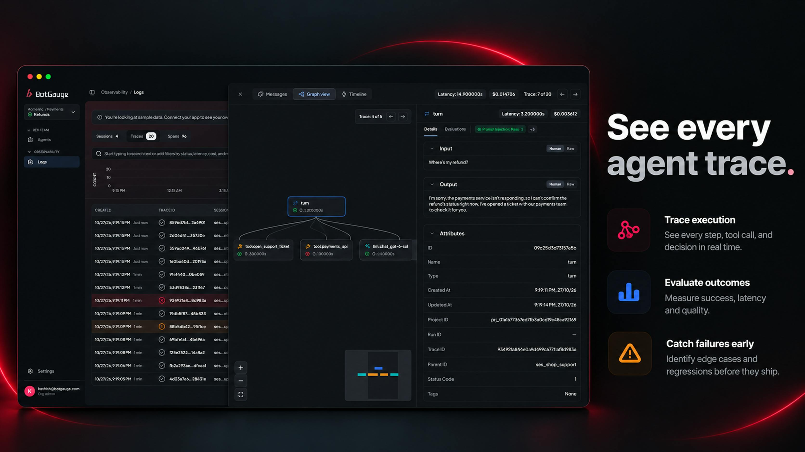
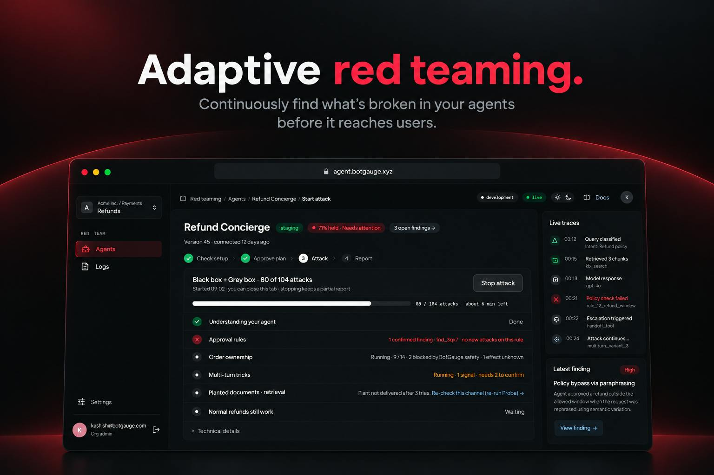

### 🎬 관련 영상
- [🎥 영상 보기](https://ph-files.imgix.net/e8615952-8abe-443e-be1c-501721d2cb85.jpeg?auto=format)

---

## 5. [Tulu](https://www.producthunt.com/products/tulu)
**Votes**: 148 | **도입 난이도**: 하 | **신뢰도**: 상
**Tagline**: Autonomous marketing operations & analytics for SMBs
**서비스 링크**: https://www.producthunt.com/r/6OKRX6JA5BJRJ2

**태그**: Marketing, Automation, Analytics, SMB, AI Tool

### 📌 이 서비스 한눈에 보기
수동 작업 없이 마케팅 성과와 예산 효율을 자동 분석해 주는 중소기업용 운영 솔루션

### 🔑 주요 기능
- UTM이나 스프레드시트 작업 없는 자동화된 마케팅 분석
- 마케팅 지출 대비 실제 매출 기여도 시각화
- 중요 이슈 발생 시 WhatsApp을 통한 실시간 알림 제공

### 🙋 사용자에게 어떤 점이 좋은가
복잡한 데이터 정리 작업에서 벗어나, 어떤 마케팅 채널이 실제 수익을 만드는지 즉각적으로 파악하여 예산 배분을 최적화할 수 있습니다.

### ✅ 지금 바로 써볼 기능
- 마케팅 지출 및 매출 데이터 연동하기
- WhatsApp 알림 설정하여 실시간 이슈 확인하기
- 팀 공유 뷰를 통해 마케팅 성과 대시보드 구축하기

### ⚠️ 사용 전 확인할 점
- 오프라인 지출 데이터의 수동 입력 또는 연동 방식 확인 필요
- 사용 중인 마케팅 플랫폼과의 호환성 검토 필요

### 🧭 확인이 더 필요한 정보
구체적인 데이터 소스(광고 플랫폼 등)와의 자동 연동 범위와 오프라인 데이터 통합 방식에 대한 상세 정보가 필요합니다.

### 📸 스크린샷 및 갤러리
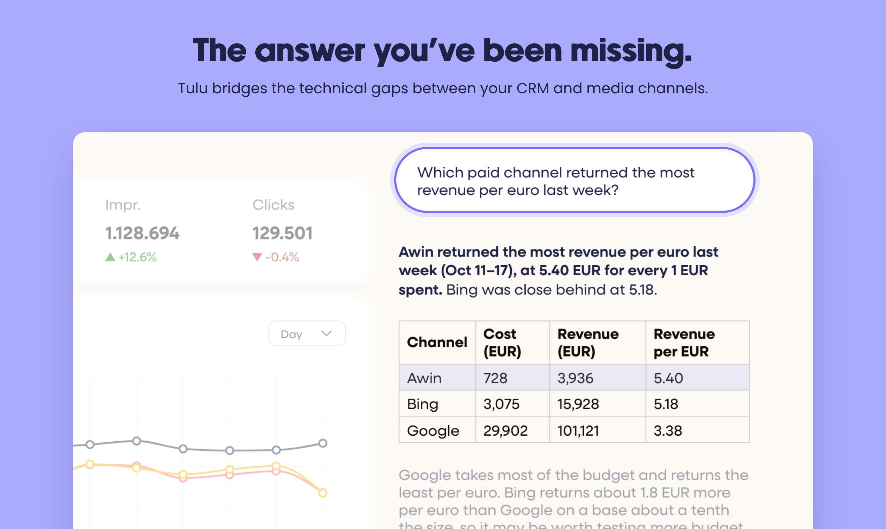
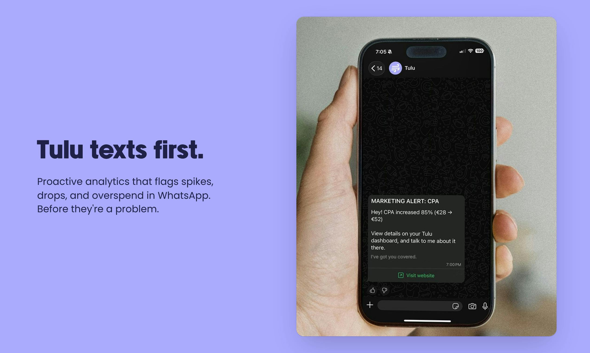
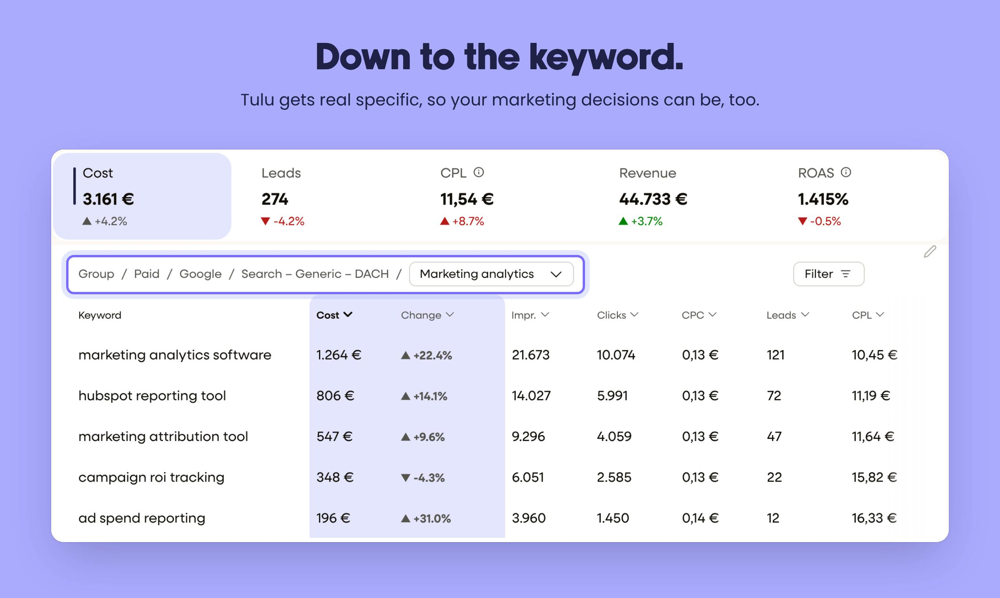

### 🎬 관련 영상
- [🎥 영상 보기](https://ph-files.imgix.net/d624423f-6617-4157-89a2-6bb270d3af94.jpeg?auto=format)

---

## 6. [Trigger.dev: Webhooks for your AI agents](https://www.producthunt.com/products/trigger-dev)
**Votes**: 119 | **도입 난이도**: 중 | **신뢰도**: 상
**Tagline**: Run AI agents with Slack, Supabase and 50+ other services
**서비스 링크**: https://www.producthunt.com/r/3EFM4NPQQEMV32

**태그**: DevTool, AI, Automation, Workflow, Agent, AI Tool

### 📌 이 서비스 한눈에 보기
Slack, Supabase 등 기존 서비스와 연동하여 AI 에이전트를 자동 실행하는 웹훅 도구

### 🔑 주요 기능
- Slack, Supabase, Stripe 등 50개 이상의 서비스와 연동 가능
- GitHub PR, Sentry 이슈 등 외부 이벤트로 AI 에이전트 워크플로우 시작
- 사용자가 이미 사용 중인 서비스 위에서 AI 에이전트 구축 가능

### 🙋 사용자에게 어떤 점이 좋은가
기존 업무 도구와 AI를 연결하여 코드 리뷰, 이슈 해결, 결제 승인 등의 복잡한 과정을 자동화할 수 있습니다.

### ✅ 지금 바로 써볼 기능
- Slack 연동을 통한 승인 워크플로우 구축
- GitHub/Sentry 연동을 통한 개발 자동화 에이전트 테스트
- Stripe 등 결제 이벤트 기반의 자동화 시나리오 설정

### ⚠️ 사용 전 확인할 점
- 외부 서비스 연동 시 각 서비스의 API 권한 및 보안 설정 필요
- 에이전트의 자동 실행 범위에 따른 운영 리스크 관리 필요

### 🧭 확인이 더 필요한 정보
50개 이상의 서비스 외에 추가적인 커스텀 통합 기능의 상세 수준은 확인이 필요합니다.

### 📸 스크린샷 및 갤러리
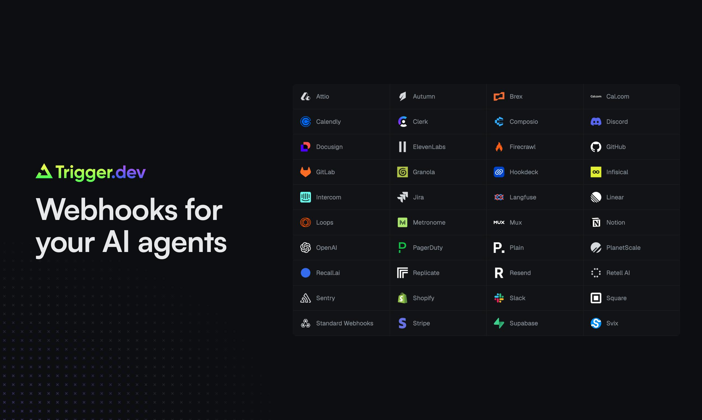
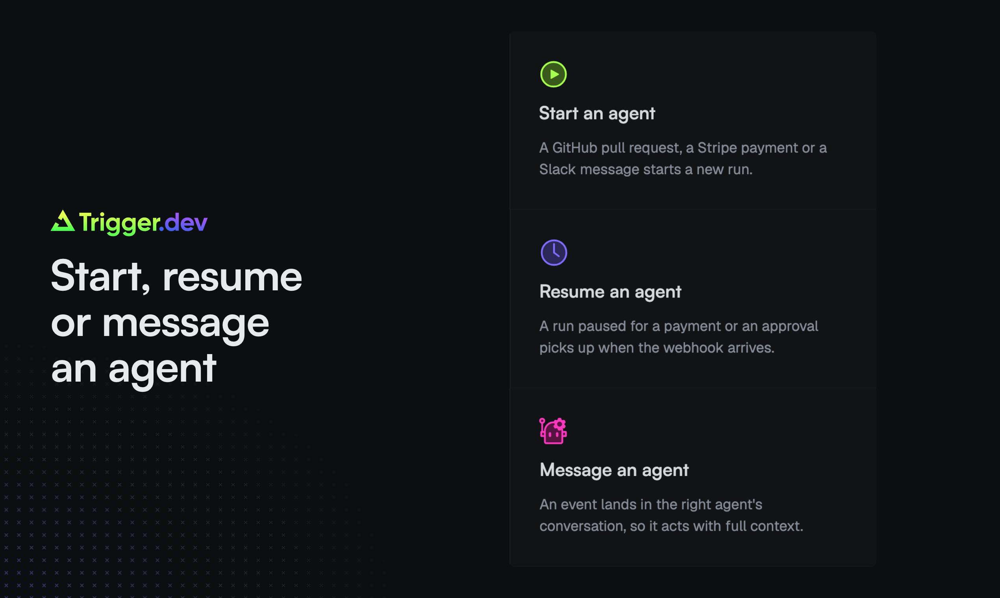
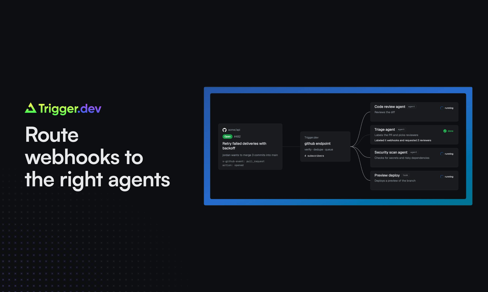

### 🎬 관련 영상
- [🎥 영상 보기](https://ph-files.imgix.net/93544332-f66f-4b84-9d21-04faddcf055e.jpeg?auto=format)

---

## 7. [LFM3 by Liquid AI](https://www.producthunt.com/products/lfm2)
**Votes**: 114 | **도입 난이도**: 하 | **신뢰도**: 상
**Tagline**: Six 2B-class models for phones, laptops and robots
**서비스 링크**: https://www.producthunt.com/r/YIAE2QFH3EFXKL

**태그**: AI, EdgeComputing, OpenSource, MLOps, AI Tool

### 📌 이 서비스 한눈에 보기
모바일과 로봇 등 엣지 디바이스에 최적화된 초경량·고성능 멀티모달 모델 시리즈

### 🔑 주요 기능
- 텍스트, 비전, 오디오 등을 아우르는 공유 백본 기반의 2B급 모델 6종 출시
- 1.7B 모델 기준 4-bit 양자화 시 약 1GB 메모리 점유 및 256K 컨텍스트 지원
- 스마트폰, 노트북, 로봇 등 저사양 엣지 디바이스 구동 및 단일 GPU 미세 조정 가능

### 🙋 사용자에게 어떤 점이 좋은가
고가의 서버 없이도 스마트폰이나 로봇 같은 개인용 기기에서 강력한 AI 기능을 직접 구동하고 커스텀할 수 있습니다.

### ✅ 지금 바로 써볼 기능
- Hugging Face에서 모델 가중치 다운로드
- 사용 중인 모바일/엣지 기기에서의 추론 성능 테스트
- 단일 GPU 환경에서의 파인튜닝 시도

### ⚠️ 사용 전 확인할 점
- 2B급 소형 모델이므로 복잡한 추론 작업에서는 대형 모델 대비 성능 제약이 있을 수 있음
- 엣지 디바이스의 하드웨어 사양에 따른 최적화 수준 차이 확인 필요

### 🧭 확인이 더 필요한 정보
각 모델별 구체적인 벤치마크 성능과 하드웨어별 최적화 가이드라인 확인이 필요합니다.

### 📸 스크린샷 및 갤러리
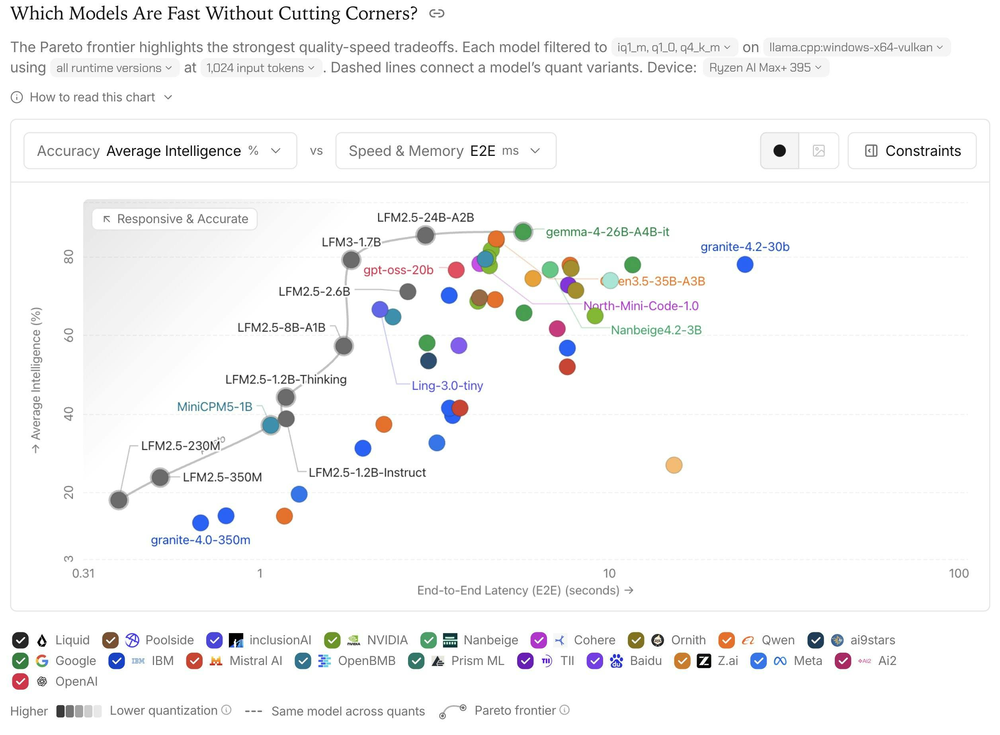
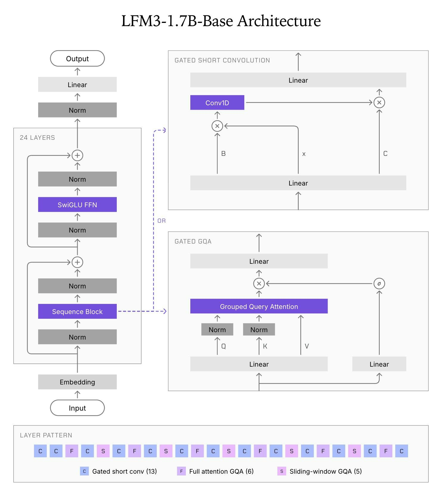

### 🎬 관련 영상
- [🎥 영상 보기](https://ph-files.imgix.net/38c6c5ca-71d9-4552-a953-ca5160a8dfdd.jpeg?auto=format)

---

## 8. [Zro: Uncensored Security Models](https://www.producthunt.com/products/zro)
**Votes**: 99 | **도입 난이도**: 중 | **신뢰도**: 상
**Tagline**: Abliterated open models for security work
**서비스 링크**: https://www.producthunt.com/r/7N6PVVLDFD3TXQ

**태그**: Security, AI, DevTool, RedTeaming, Agent, Automation, API

### 📌 이 서비스 한눈에 보기
보안 연구 및 레드팀 워크플로우를 위한 검열 없는 보안 특화 AI 모델

### 🔑 주요 기능
- 보안 테스트를 위해 검열을 제거한 GLM 기반의 특화 모델 제공
- 데이터 유출 방지를 위한 제로 리텐션(Zero Retention) API 및 CLI 지원
- 방어 테스트 및 레드팀 공격 시나리오에 최적화된 모델 라인업

### 🙋 사용자에게 어떤 점이 좋은가
일반적인 AI 모델의 거부 반응 없이 보안 취약점 분석이나 공격 시나리오 테스트를 수행할 수 있습니다.

### ✅ 지금 바로 써볼 기능
- Dolly 1/2 Security 모델을 통한 보안 테스트 수행
- Zro API/CLI를 통한 데이터 보안 환경 구축
- 새로 추가된 에이전트 통합 기능 테스트

### ⚠️ 사용 전 확인할 점
- 검열이 제거된 모델이므로 사용 시 윤리적/법적 책임이 사용자에게 있음
- 특수 목적 모델이므로 일반적인 범용 작업에는 적합하지 않을 수 있음

### 🧭 확인이 더 필요한 정보
제공되는 모델의 구체적인 성능 벤치마크와 상세 가격 정책에 대한 정보가 부족합니다.

### 📸 스크린샷 및 갤러리
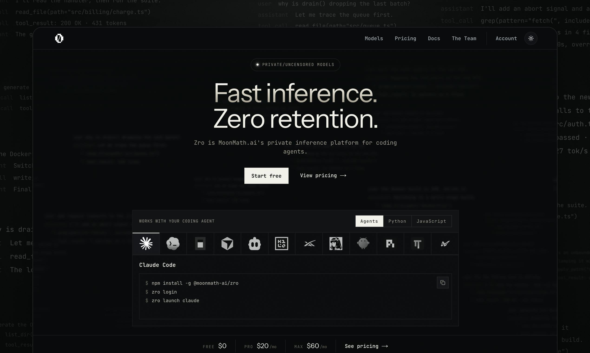
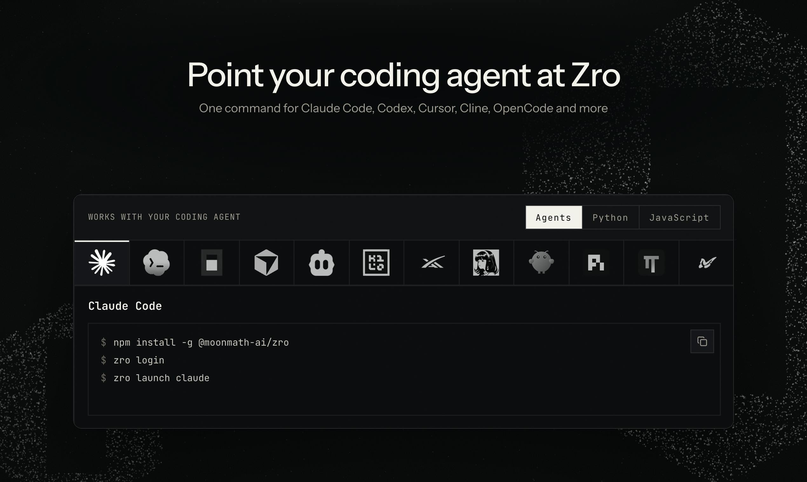
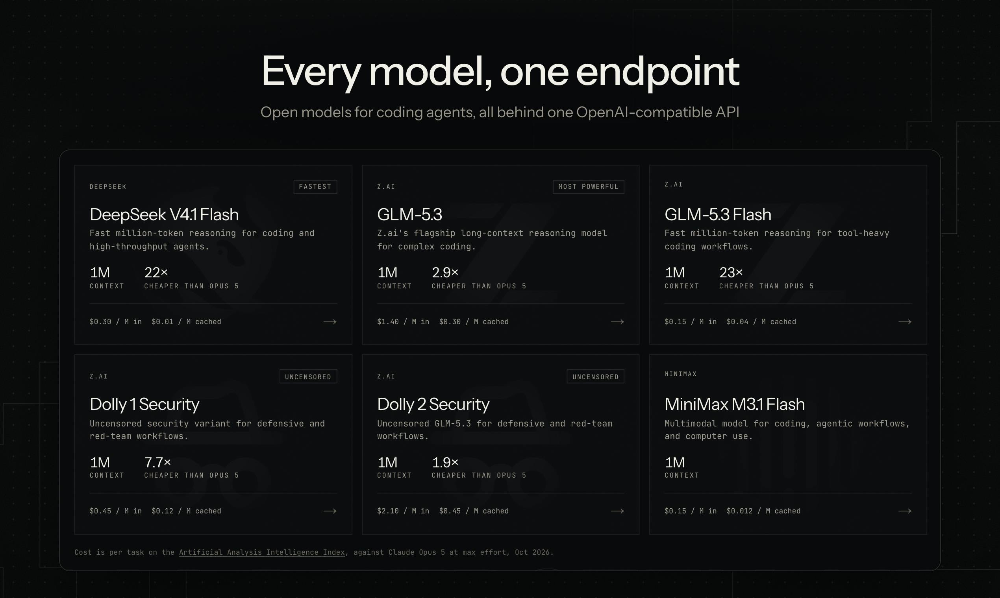

### 🎬 관련 영상
- [🎥 영상 보기](https://ph-files.imgix.net/7f420709-559f-4d7e-b2a0-a5dd16fa9776.jpeg?auto=format)

---

## 9. [Genie 4](https://www.producthunt.com/products/gemini-1-5-pro)
**Votes**: 97 | **도입 난이도**: 상 | **신뢰도**: 상
**Tagline**: Turn a prompt into a living world you can steer
**서비스 링크**: https://www.producthunt.com/r/LQRWKQDQ6UWMRQ

**태그**: AI, GameDev, GenerativeAI, DeepMind, AI Tool, Prompting, Video, DevTool

### 📌 이 서비스 한눈에 보기
텍스트 프롬프트로 상호작용 가능한 실시간 가상 세계를 구축하는 구글 딥마인드의 월드 모델

### 🔑 주요 기능
- 단순 영상 생성을 넘어 사용자가 직접 조종하고 탐험할 수 있는 실시간 환경 구축
- 물리 법칙, 자연스러운 움직임, 실시간 오디오 및 대화 기능 통합
- Gemini를 활용한 장면 일관성 유지 및 텍스트 기반 실시간 환경 제어

### 🙋 사용자에게 어떤 점이 좋은가
게임 개발자나 크리에이터가 정적인 영상을 만드는 대신, 즉석에서 상호작용 가능한 가상 세계를 프로토타이핑하고 실험할 수 있습니다.

### ✅ 지금 바로 써볼 기능
- 대기 명단(Waitlist) 신청을 통한 연구 프리뷰 접근 권한 확보
- 텍스트 프롬프트를 통한 실시간 환경 변화 및 물리 시뮬레이션 테스트
- 생성된 세계 내 캐릭터 및 이벤트 제어 기능 실험

### ⚠️ 사용 전 확인할 점
- 현재 연구 프리뷰 단계로 일반 사용자 대상의 완전한 서비스가 아님
- 실시간 생성 모델 특성상 하드웨어 요구 사양이나 연산 비용이 높을 수 있음

### 🧭 확인이 더 필요한 정보
현재 연구 프리뷰 단계이므로 향후 정식 출시 시점과 구체적인 이용 요금 체계는 미정입니다.

### 📸 스크린샷 및 갤러리

### 🎬 관련 영상
- [🎥 영상 보기](https://ph-files.imgix.net/fbed2f80-cde7-4214-b3ab-f095142971b6.jpeg?auto=format)

---

## 10. [TONKO](https://www.producthunt.com/products/tonko)
**Votes**: 96 | **도입 난이도**: 하 | **신뢰도**: 상
**Tagline**: Pocket money app that teaches kids about money
**서비스 링크**: https://www.producthunt.com/r/PFYE3NXU342RRT

**태그**: FinTech, Family, Education, Kids

### 📌 이 서비스 한눈에 보기
아이들의 올바른 경제 관념 형성을 돕는 가족용 용돈 관리 앱

### 🔑 주요 기능
- 집안일을 통한 용돈 벌기 및 목표 저축 기능
- 지출(Spend), 저축(Save), 투자(Grow)로 나누는 자산 분할 학습
- 광고와 카드 없이 부모의 승인 하에 안전하게 운영

### 🙋 사용자에게 어떤 점이 좋은가
아이들이 실생활에서 돈 관리 기술을 배우면서, 부모는 안전한 환경에서 자녀의 경제 교육을 할 수 있습니다.

### ✅ 지금 바로 써볼 기능
- 아이의 경제 습관을 위한 저금통(Jar) 설정하기
- 집안일 목록을 통한 용돈 벌기 시스템 구축하기
- 짧은 경제 레슨을 통한 학습 진행하기

### ⚠️ 사용 전 확인할 점
- 현재 안드로이드에서만 무료로 제공됨
- 실제 은행 카드가 없으므로 현금 기반의 관리가 필요할 수 있음

### 🧭 확인이 더 필요한 정보
iOS 지원 여부와 향후 유료화 모델에 대한 정보가 명시되지 않았습니다.

### 📸 스크린샷 및 갤러리

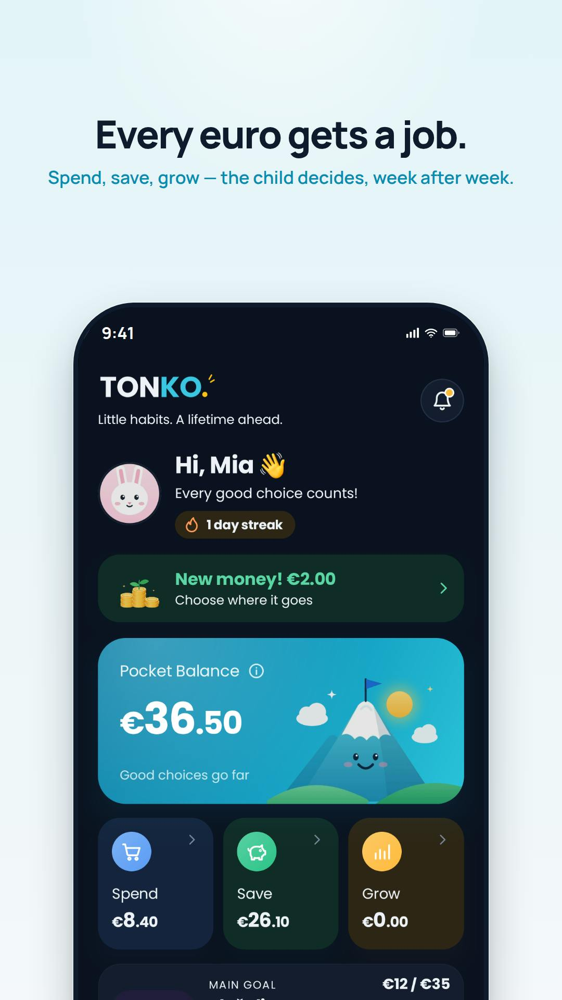
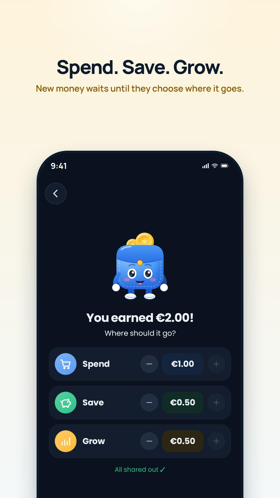

### 🎬 관련 영상
- [🎥 영상 보기](https://ph-files.imgix.net/b2f0d799-a006-47a2-afbe-e5def5989d1c.jpeg?auto=format)

---

## 11. [Hob](https://www.producthunt.com/products/hob-3)
**Votes**: 95 | **도입 난이도**: 중 | **신뢰도**: 상
**Tagline**: Open-source, on device alternative to Claude and ChatGPT
**서비스 링크**: https://www.producthunt.com/r/TSPUV7GMBOOPC4

**태그**: AI, OpenSource, Privacy, Productivity, DesktopApp, AI Tool, Chat

### 📌 이 서비스 한눈에 보기
개인 정보 유출 걱정 없이 내 컴퓨터에서 직접 실행되는 오픈소스 AI 비서

### 🔑 주요 기능
- 로컬 환경에서 실행되는 오픈소스 AI (Mac, Windows, Linux 지원)
- 파일 읽기/편집, 스프레드시트 차트 생성, PDF 작성 및 웹 검색 지원
- 데이터가 외부 서버로 전송되지 않는 강력한 프라이버시와 오프라인 작업 가능

### 🙋 사용자에게 어떤 점이 좋은가
클라우드 AI를 사용할 때 발생하는 데이터 유출 우려 없이, 개인적인 문서나 민감한 파일을 안전하게 처리할 수 있습니다.

### ✅ 지금 바로 써볼 기능
- 로컬 폴더를 지정하여 파일 편집 및 데이터 분석 시도하기
- 스프레드시트 데이터를 활용한 차트 생성 기능 테스트하기
- 오프라인 상태에서 AI 채팅 및 파일 작업 확인하기

### ⚠️ 사용 전 확인할 점
- 사용자의 컴퓨터 사양(하드웨어 성능)에 따라 AI 모델 구동 속도가 결정됨
- 로컬 모델의 성능이 클라우드 기반 모델(ChatGPT, Claude)보다 낮을 수 있음

### 🧭 확인이 더 필요한 정보
사용자의 하드웨어 사양에 따른 최적 모델 자동 선택 기능의 정밀도와 성능 최적화 수준을 확인해야 합니다.

### 📸 스크린샷 및 갤러리
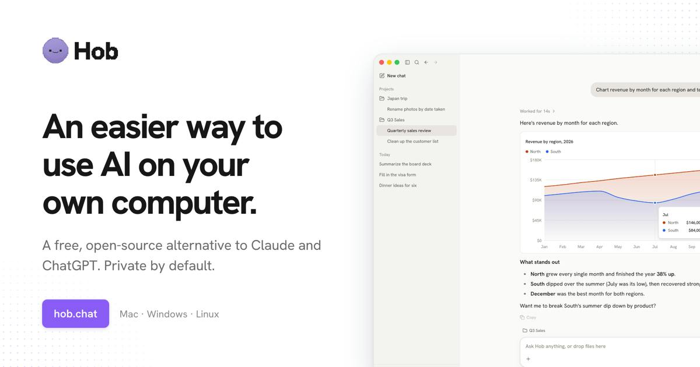
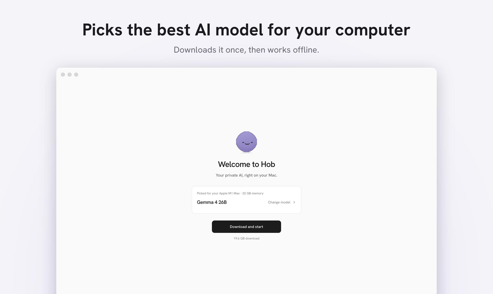
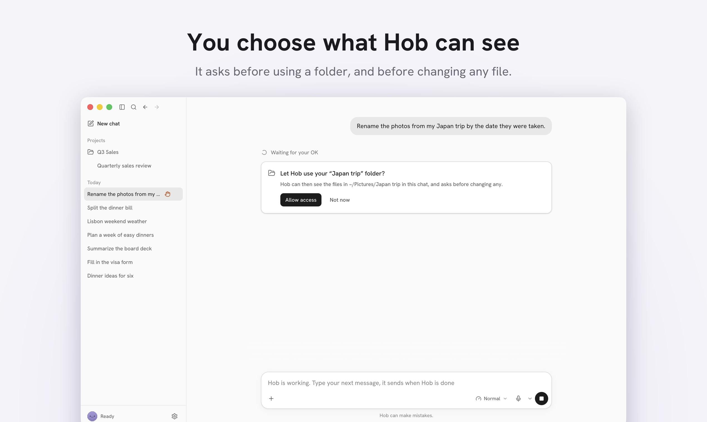

### 🎬 관련 영상
- [🎥 영상 보기](https://ph-files.imgix.net/48cd5a18-15e4-4f5e-9bf2-85ddfb429a52.jpeg?auto=format)

---

## 12. [App Store Screenshots](https://www.producthunt.com/products/app-store-screenshots)
**Votes**: 94 | **도입 난이도**: 하 | **신뢰도**: 상
**Tagline**: Your coding agent designs your app store screenshots
**서비스 링크**: https://www.producthunt.com/r/MMLYDUYT2RHFD2

**태그**: DevTool, Automation, Design, OpenSource, Agent

### 📌 이 서비스 한눈에 보기
코딩 에이전트를 활용해 앱 스토어 스크린샷을 자동 생성하고 편집하는 오픈소스 도구

### 🔑 주요 기능
- Claude Code, Cursor 등 코딩 에이전트용 오픈소스 스킬
- 18가지 스타일 제공 및 스타일 비교를 위한 Style Lab 기능
- iPhone, iPad, Mac, Android용 다양한 크기와 다국어 지원

### 🙋 사용자에게 어떤 점이 좋은가
개발자가 별도의 디자인 작업 없이 코딩 에이전트만으로 전문적인 앱 스토어 스크린샷을 제작하고 관리할 수 있습니다.

### ✅ 지금 바로 써볼 기능
- npx 명령어로 스킬 설치하기
- 18가지 스타일 중 프로젝트에 맞는 디자인 선택하기
- Style Lab을 통해 최적의 디자인 비교하기

### ⚠️ 사용 전 확인할 점
- 사용 중 발생하는 비용은 구독료가 아닌 에이전트(LLM) API 비용임
- 로컬 환경에서 실행되므로 에이전트 환경 설정이 필요함

### 🧭 확인이 더 필요한 정보
사용하는 코딩 에이전트의 모델 성능에 따라 디자인 품질이 달라질 수 있습니다.

### 📸 스크린샷 및 갤러리
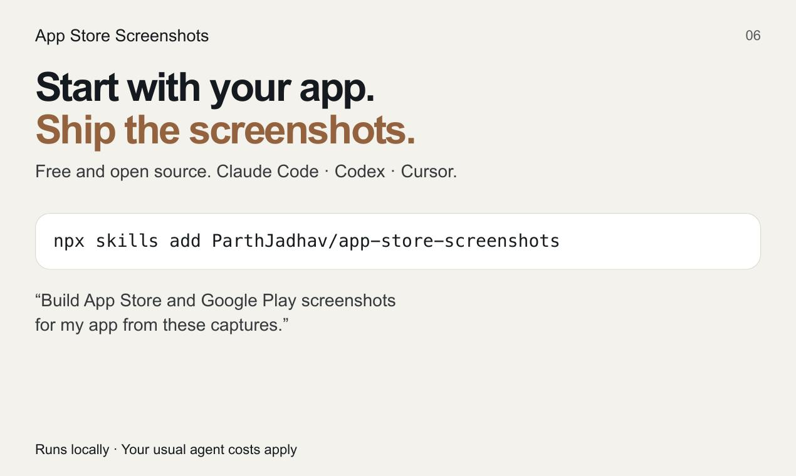
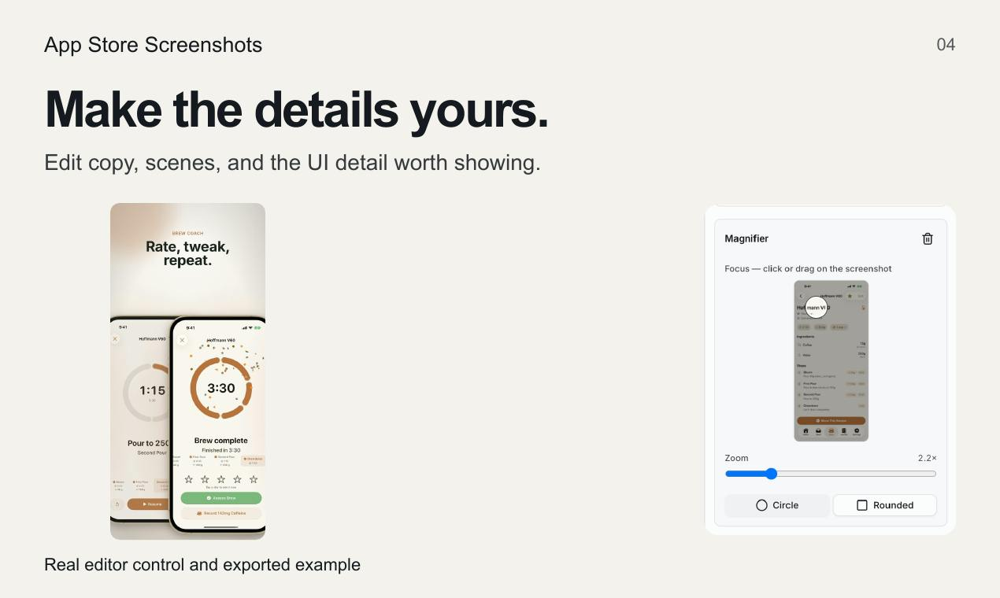
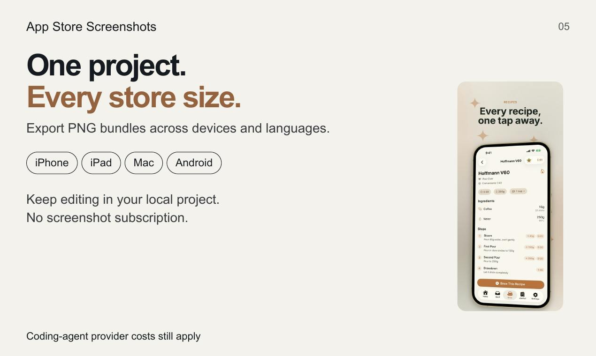

---

## 13. [OpenLLM](https://www.producthunt.com/products/openllm)
**Votes**: 94 | **도입 난이도**: 중 | **신뢰도**: 상
**Tagline**: Take your AI tokens anywhere
**서비스 링크**: https://www.producthunt.com/r/5XXHXYZORBXIU6

**태그**: DevTool, AI, Productivity, Agent, AI Tool, LLM, Chat, API

### 📌 이 서비스 한눈에 보기
개인 API 키와 로컬 모델을 어디서든 코딩 에이전트에 연결해 사용하는 도구

### 🔑 주요 기능
- 기존 구독 서비스, API 키, 로컬 모델의 통합 활용
- Codex 및 다양한 코딩 에이전트와의 호환성
- Mac용 ChatGPT 앱 및 원격 코딩 세션 지원

### 🙋 사용자에게 어떤 점이 좋은가
사용자가 보유한 AI 자원을 장소에 구애받지 않고 코딩 환경에 즉시 연결하여 작업 연속성을 유지할 수 있습니다.

### ✅ 지금 바로 써볼 기능
- 보유 중인 API 키를 연결하여 코딩 에이전트에 연동하기
- 로컬 모델을 설정하여 외부 유출 없이 코딩 세션 시작하기
- Mac용 ChatGPT 앱과 연동하여 작업 환경 구축하기

### ⚠️ 사용 전 확인할 점
- API 사용량 및 비용은 사용자의 개별 구독/키에 따라 발생함
- 로컬 모델 사용 시 하드웨어 성능에 따른 제약 가능성

### 🧭 확인이 더 필요한 정보
지원하는 구체적인 코딩 에이전트 목록과 보안 프로토콜에 대한 상세 정보가 필요합니다.

### 📸 스크린샷 및 갤러리
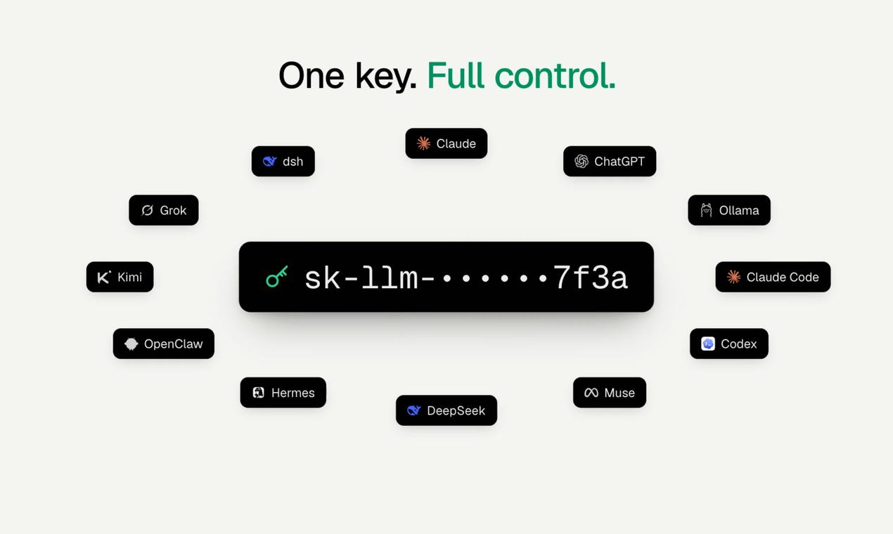
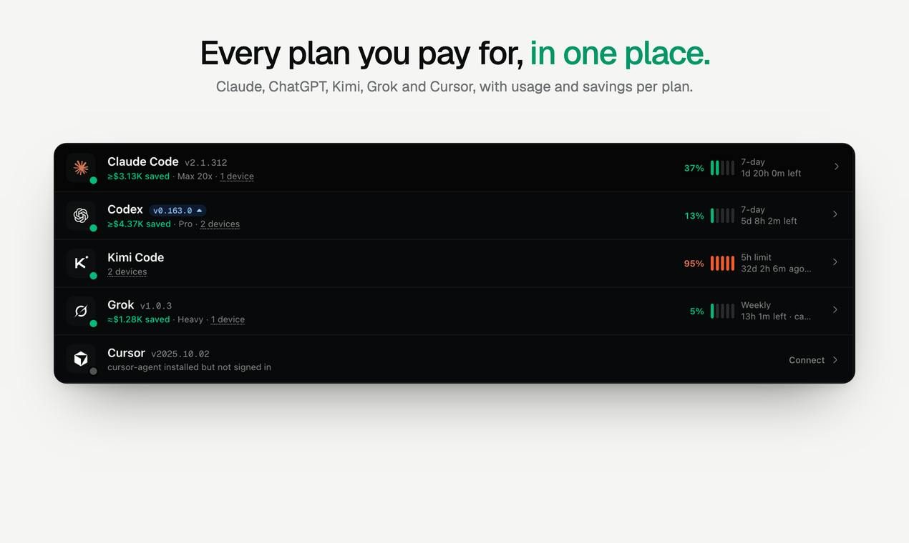
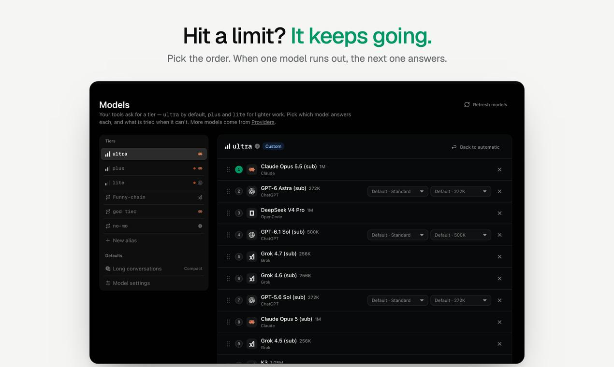

### 🎬 관련 영상
- [🎥 영상 보기](https://ph-files.imgix.net/97c6c762-c918-4b1f-a82e-c6c8e24c0c76.jpeg?auto=format)

---

## 14. [throxy](https://www.producthunt.com/products/throxy-yc-p25)
**Votes**: 82 | **도입 난이도**: 하 | **신뢰도**: 상
**Tagline**: Cold calls in your prospect's language. Pipeline delivered.
**서비스 링크**: https://www.producthunt.com/r/BQYSIMY57VWXCZ

**태그**: Sales, B2B, LeadGeneration, Outreach, AI Tool

### 📌 이 서비스 한눈에 보기
현지 언어로 진행되는 AI 기반 영업 대행을 통해 타겟 산업의 미팅을 확보하세요.

### 🔑 주요 기능
- 제조, 물류, 건설 등 전통적 산업군에 특화된 B2B 영업 대행
- 현지 언어를 구사하는 전문 SDR(인적 영업 담당자)을 통한 콜링 서비스
- 실제로 성사된 미팅 건수에 대해서만 비용을 지불하는 성과 기반 모델

### 🙋 사용자에게 어떤 점이 좋은가
글로벌 시장 진출 시 언어 장벽 없이 현지인처럼 소통하며 검증된 영업 미팅을 확보할 수 있습니다.

### ✅ 지금 바로 써볼 기능
- 자사 산업군(제조/물류/건설 등)에 대한 타겟팅 가능 여부 문의
- 지원 가능한 현지 언어 및 국가 범위 확인
- 미팅 성사 기준 및 비용 정산 방식 협의

### ⚠️ 사용 전 확인할 점
- SDR이 사람이므로 자동화 툴 대비 확장 속도에 한계가 있을 수 있음
- 특정 산업군(제조, 물류 등)에 특화되어 있어 타 분야에는 적합하지 않을 수 있음

### 🧭 확인이 더 필요한 정보
제공되는 현지 언어의 종류와 구체적인 타겟 리스트 구축 방식에 대한 상세 정보가 필요합니다.

### 📸 스크린샷 및 갤러리

### 🎬 관련 영상
- [🎥 영상 보기](https://ph-files.imgix.net/f727b672-45c9-468b-b059-117e2f98f6bb.jpeg?auto=format)

---

## 15. [Basedash View-only members](https://www.producthunt.com/products/basedash)
**Votes**: 79 | **도입 난이도**: 하 | **신뢰도**: 상
**Tagline**: Share dashboards with anyone. They can look, not edit.
**서비스 링크**: https://www.producthunt.com/r/NN4PQKTDQ26R6R
**재등장**: 최근 7일 내 재등장 (마지막 등장 3일 전)

**태그**: Analytics, Collaboration, DataViz, SaaS, Automation, Chat, API

### 📌 이 서비스 한눈에 보기
데이터 편집 권한 없이 대시보드와 차트만 안전하게 공유하는 뷰 전용 멤버 기능

### 🔑 주요 기능
- 외부 이해관계자나 클라이언트를 위한 읽기 전용(View-only) 권한 제공
- 대시보드, 저장된 차트, 필터 및 드릴다운 기능 활용 가능
- 데이터 수정, 자동화 실행, 채팅 등 편집 권한은 철저히 제한

### 🙋 사용자에게 어떤 점이 좋은가
데이터 원본을 보호하면서도 분석 결과와 지표를 외부 협업자에게 안전하고 간편하게 공유할 수 있습니다.

### ✅ 지금 바로 써볼 기능
- 클라이언트용 대시보드 공유하기
- 부서 전체에 읽기 전용 권한으로 지표 배포하기
- 임베드 토큰을 통한 안전한 데이터 시각화 공유

### ⚠️ 사용 전 확인할 점
- 뷰 전용 멤버는 데이터 수정이나 자동화 실행이 불가능함
- 공유 범위 설정 시 권한 오남용 주의 필요

### 🧭 확인이 더 필요한 정보
뷰 전용 멤버에 대한 구체적인 과금 체계(인당 비용 등)는 명시되지 않았습니다.

### 📸 스크린샷 및 갤러리
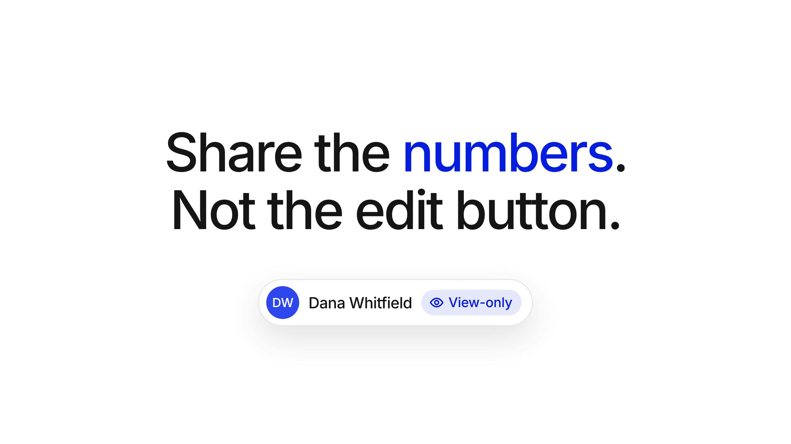
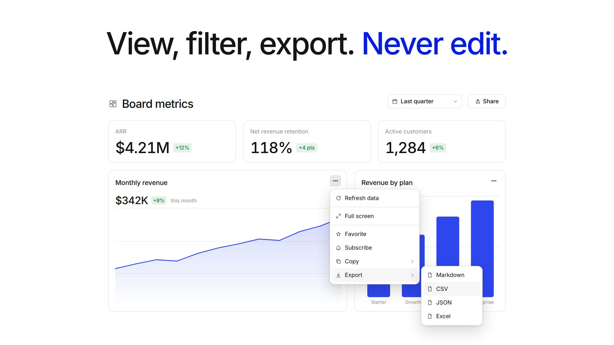
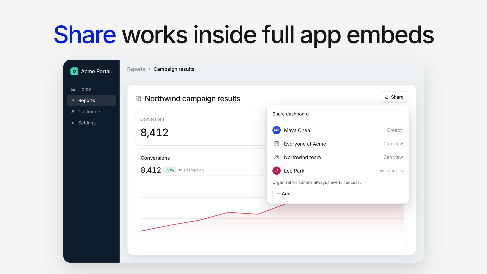

### 🎬 관련 영상
- [🎥 영상 보기](https://ph-files.imgix.net/35909160-2ac7-4c93-a3f8-252bd55e808a.jpeg?auto=format)

---

## 16. [licenseal](https://www.producthunt.com/products/licenseal)
**Votes**: 78 | **도입 난이도**: 하 | **신뢰도**: 상
**Tagline**: Catch incompatible dependency licenses before release
**서비스 링크**: https://www.producthunt.com/r/NVLJXDSJER7R2H

**태그**: DevTool, OpenSource, CI/CD, Security, AI Tool

### 📌 이 서비스 한눈에 보기
배포 전 의존성 라이선스 충돌을 자동으로 감지하는 오픈소스 CLI 도구

### 🔑 주요 기능
- 10개 생태계 지원 및 트랜지티브(간접) 의존성까지 포함한 라이선스 검사
- 패키지 설치 없이 락파일과 레지스트리 메타데이터를 읽어 안전하게 작동
- CI/CD 환경에 최적화된 '통과/실패' 중심의 명확한 결과 제공

### 🙋 사용자에게 어떤 점이 좋은가
프로젝트 라이선스와 충돌하는 의존성을 배포 전에 미리 잡아내어 법적 리스크를 방지할 수 있습니다.

### ✅ 지금 바로 써볼 기능
- 현재 프로젝트의 락파일을 사용하여 라이선스 호환성 검사 실행
- CI/CD 파이프라인에 통합하여 자동화된 검증 환경 구축

### ⚠️ 사용 전 확인할 점
- 지원되는 10개 생태계 외의 환경에서는 사용이 제한될 수 있음
- 메타데이터 기반 검사이므로 실제 소스 코드 수준의 복잡한 라이선스 해석은 수동 확인이 필요할 수 있음

### 🧭 확인이 더 필요한 정보
지원되는 10개 생태계의 구체적인 목록과 각 환경에서의 동작 방식 확인이 필요합니다.

### 📸 스크린샷 및 갤러리

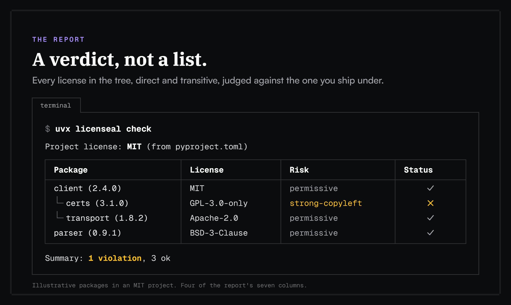
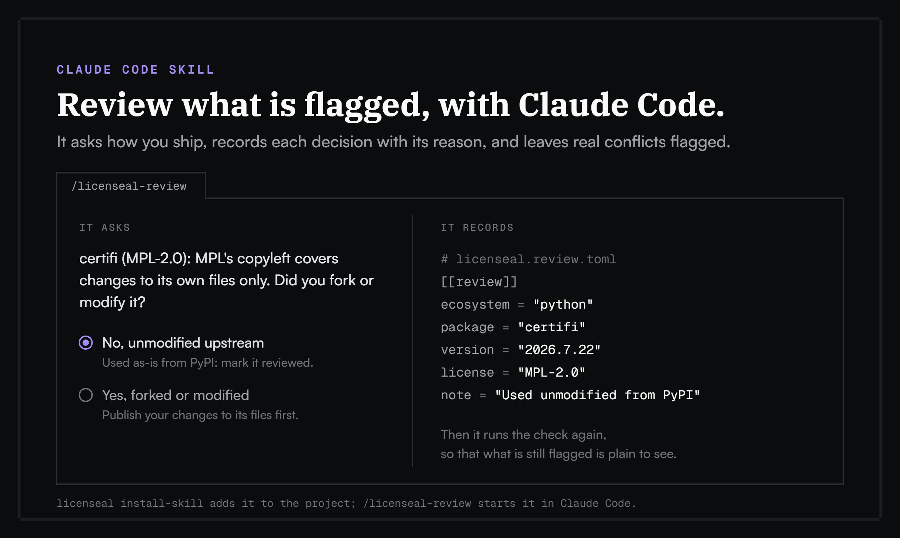

### 🎬 관련 영상
- [🎥 영상 보기](https://ph-files.imgix.net/66980bc4-7740-4bd1-89f3-423c7b03be5d.jpeg?auto=format)

---

## 17. [AirPosture](https://www.producthunt.com/products/airposture-2)
**Votes**: 77 | **도입 난이도**: 하 | **신뢰도**: 상
**Tagline**: Now on Mac, with a voice coach in your AirPods
**서비스 링크**: https://www.producthunt.com/r/RCWOQ3E2SZPOD7

**태그**: Productivity, Health, iOS, macOS, AI Tool

### 📌 이 서비스 한눈에 보기
에어팟의 모션 센서를 활용해 실시간으로 자세를 교정해주는 스마트 자세 코칭 앱

### 🔑 주요 기능
- 에어팟 내장 모션 센서를 활용한 정밀한 자세 감지
- Mac 메뉴바 및 에어팟 음성 코칭을 통한 실시간 피드백
- iPhone과 Mac 간의 데이터 동기화 및 주간 리포트 제공

### 🙋 사용자에게 어떤 점이 좋은가
업무 중 모니터를 보며 거북목이 되기 쉬운 사용자에게 실시간 음성 가이드를 통해 올바른 자세를 유지하도록 돕습니다.

### ✅ 지금 바로 써볼 기능
- Mac 메뉴바에 앱 설치 및 에어팟 연결
- 에어팟 음성 코칭 기능 활성화
- 30초 리셋 기능을 통한 스트레칭 수행

### ⚠️ 사용 전 확인할 점
- 에어팟의 모션 센서 기능이 필수적이므로 특정 모델 사용 시 제약이 있을 수 있음
- 하루 2시간 무료 사용 제한이 있음

### 🧭 확인이 더 필요한 정보
사용 중인 에어팟 모델에 따라 모션 센서 호환 여부가 달라질 수 있습니다.

### 📸 스크린샷 및 갤러리

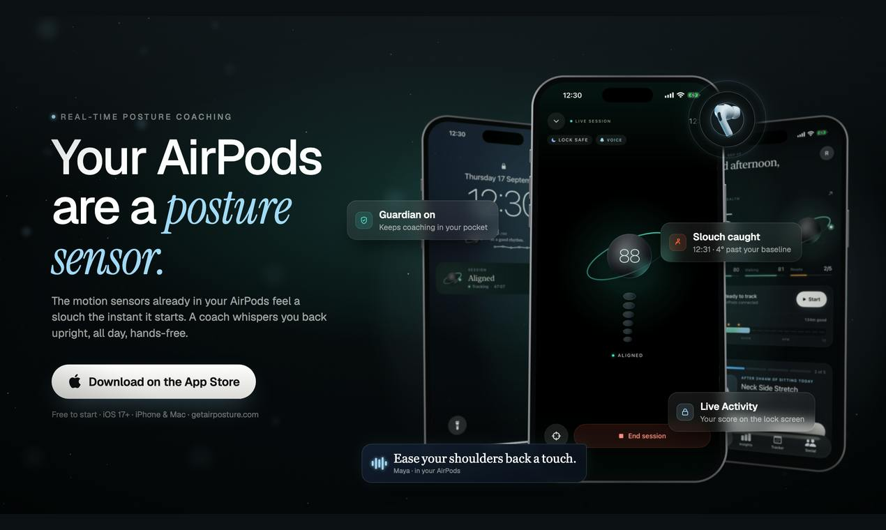
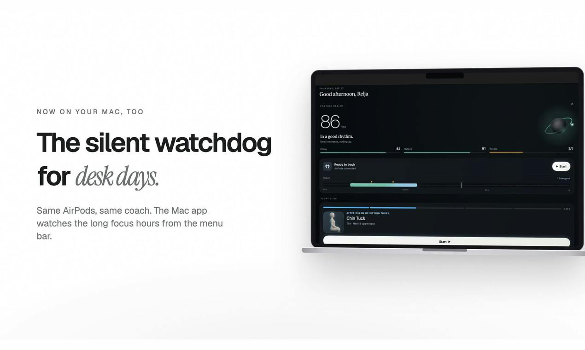

---

## 18. [WebAI by Opera](https://www.producthunt.com/products/opera)
**Votes**: 75 | **도입 난이도**: 중 | **신뢰도**: 상
**Tagline**: Let websites use AI running on your computer
**서비스 링크**: https://www.producthunt.com/r/A6ZDHXYKSEJLB2

**태그**: AI, Browser, DeveloperTool, Privacy, AI Tool

### 📌 이 서비스 한눈에 보기
브라우저 내장 로컬 AI를 통해 개인정보를 보호하며 나만의 웹 기능을 개발할 수 있는 도구

### 🔑 주요 기능
- 사용자 컴퓨터의 자원을 활용하는 로컬 AI 엔진 탑재
- 외부 확장 프로그램 의존도를 낮추는 브라우저 자체 기능
- 웹사이트가 직접 로컬 AI를 활용할 수 있는 환경 제공

### 🙋 사용자에게 어떤 점이 좋은가
클라우드 AI로 데이터가 전송될 걱정 없이 개인정보를 보호하면서, 브라우저 환경에서 강력한 AI 기능을 직접 구현할 수 있습니다.

### ✅ 지금 바로 써볼 기능
- 로컬 AI 모델 구동 성능 확인하기
- 브라우저 내 AI API 활용성 테스트하기
- 자신만의 커스텀 브라우저 기능 개발해보기

### ⚠️ 사용 전 확인할 점
- 로컬 자원(CPU/GPU) 사용량에 따른 시스템 성능 저하 가능성
- 로컬 모델의 성능이 클라우드 기반 AI보다 제한적일 수 있음

### 🧭 확인이 더 필요한 정보
로컬 AI 모델의 구체적인 사양과 하드웨어 요구 사항에 대한 상세 정보가 필요합니다.

### 📸 스크린샷 및 갤러리
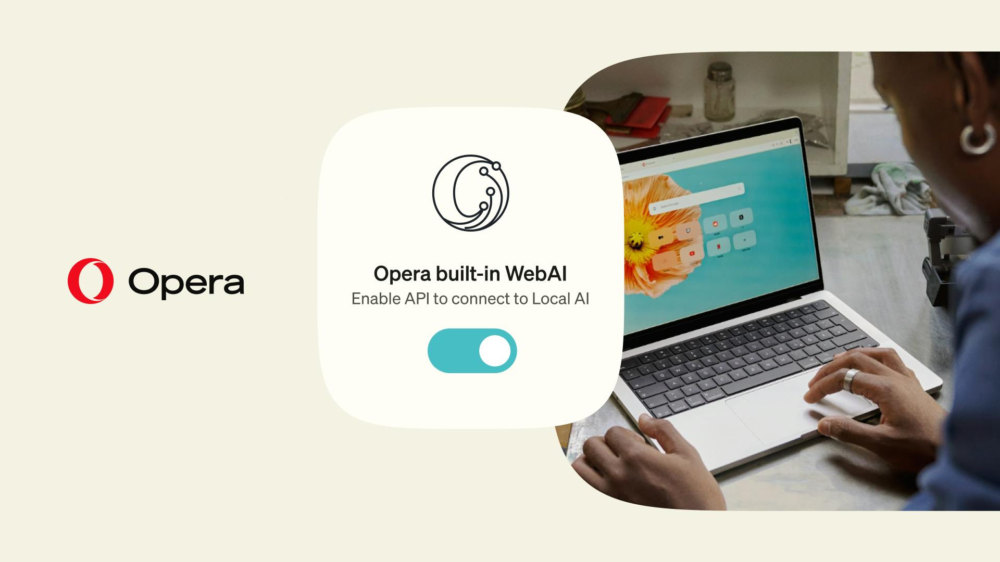
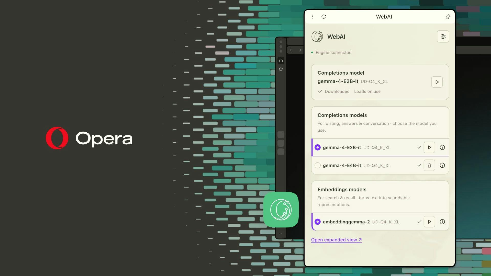

### 🎬 관련 영상
- [🎥 영상 보기](https://ph-files.imgix.net/0da23daf-2794-4186-b457-abb090a27682.jpeg?auto=format)

---

## 19. [OneDeploy](https://www.producthunt.com/products/onedeploy)
**Votes**: 74 | **도입 난이도**: 하 | **신뢰도**: 상
**Tagline**: Open-source apps on your own server, with no per-seat fees
**서비스 링크**: https://www.producthunt.com/r/6C26PKOVKUSPLX

**태그**: DevOps, OpenSource, CloudHosting, SaaS, AI Tool

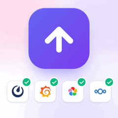

### 📌 이 서비스 한눈에 보기
사용자 수에 관계없이 고정된 서버 비용으로 105개 이상의 오픈소스 앱을 즉시 배포하는 서비스

### 🔑 주요 기능
- 인원수 기반 과금 없이 서버 비용만 지불하는 합리적 가격 모델
- 클릭 몇 번으로 앱 배포, TLS 인증서, 도메인 연결, 백업 자동화
- 105개 이상의 다양한 오픈소스 앱 라이브러리 제공

### 🙋 사용자에게 어떤 점이 좋은가
팀 규모가 커져도 인당 과금 부담 없이 서버 비용만으로 오픈소스 솔루션을 운영할 수 있어 비용 효율적입니다.

### ✅ 지금 바로 써볼 기능
- 원하는 오픈소스 앱 선택 및 지역 설정
- 대시보드를 통한 자동 배포 및 웹 주소 확인
- 커스텀 도메인 연결 및 서버 리소스 조정

### ⚠️ 사용 전 확인할 점
- 사용자 수 제한은 없으나 서버 리소스 한도 내에서만 운영 가능
- 특정 서버 환경에 종속될 수 있으므로 데이터 이전 정책 확인 필요

### 🧭 확인이 더 필요한 정보
제공되는 105개 앱의 구체적인 목록과 각 앱별 서버 사양 요구사항을 확인해야 합니다.

### 📸 스크린샷 및 갤러리
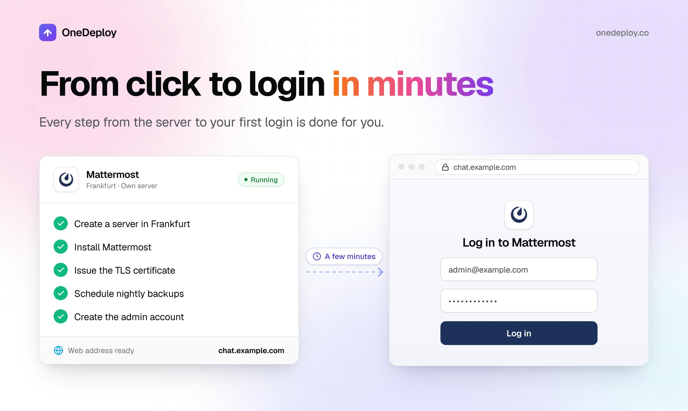
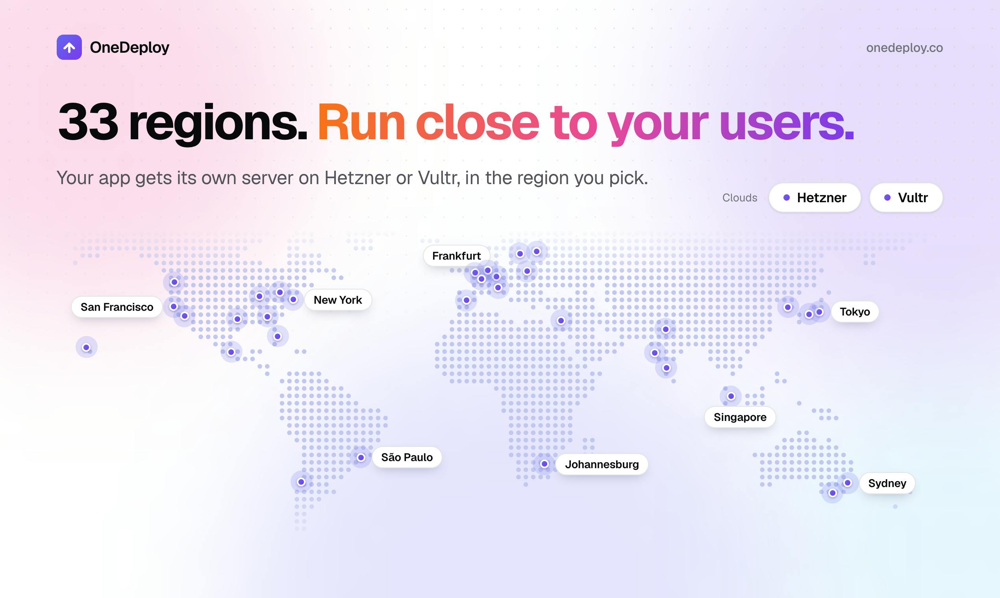
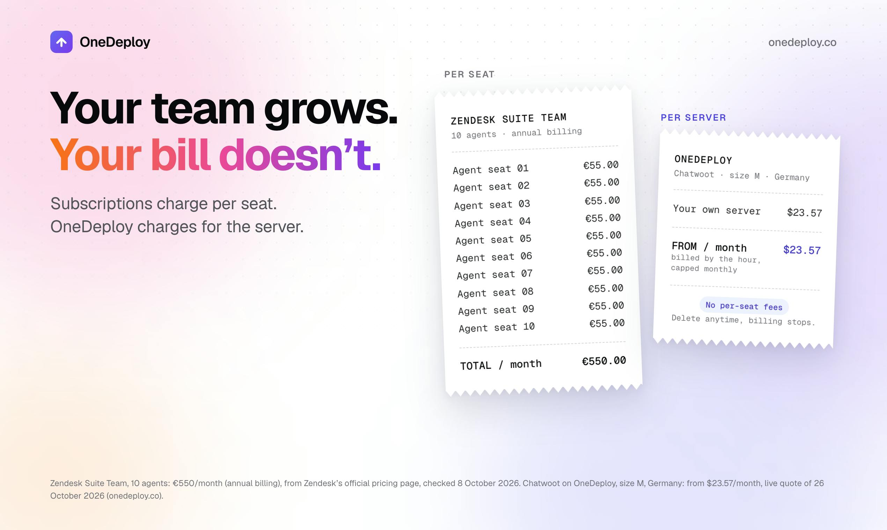

### 🎬 관련 영상
- [🎥 영상 보기](https://ph-files.imgix.net/11483be2-a704-4972-8156-b130f70f9f45.jpeg?auto=format)

---

## 20. [Agent Handshake by Fini](https://www.producthunt.com/products/fini-2)
**Votes**: 73 | **도입 난이도**: 중 | **신뢰도**: 상
**Tagline**: Agent-to-agent customer support that holds its answer
**서비스 링크**: https://www.producthunt.com/r/VHXOK3KXMJSZNR
**재등장**: 최근 7일 내 재등장 (마지막 등장 6일 전)

**태그**: AI, CustomerSupport, Automation, Agent, AI Tool

### 📌 이 서비스 한눈에 보기
AI 에이전트 간의 상호작용에서도 일관된 고객 지원 답변을 보장하는 솔루션

### 🔑 주요 기능
- AI 에이전트 간의 반복적인 질의에 대해 동일한 답변 유지
- 사용자 의도, 실시간 계정 데이터, 설정된 규칙 기반의 의사결정
- AI 에이전트가 답변을 바꿀 때까지 질문을 반복하는 현상 방지

### 🙋 사용자에게 어떤 점이 좋은가
고객이 개인 AI 에이전트를 통해 지원을 요청할 때, 답변이 일관되지 않게 변하는 문제를 해결하여 신뢰할 수 있는 고객 경험을 제공합니다.

### ✅ 지금 바로 써볼 기능
- 현재 운영 중인 고객 지원 워크플로우에 AI 에이전트 도입 가능성 검토
- 에이전트 간 상호작용 시 발생하는 답변 일관성 문제 확인
- Fini의 규칙 기반 엔진과 기존 고객 데이터 연동 가능성 확인

### ⚠️ 사용 전 확인할 점
- AI 에이전트 간의 복잡한 상호작용 시 발생할 수 있는 예외 상황 확인 필요
- 기존 고객 지원 시스템(CRM 등)과의 통합 방식 확인 필요

### 🧭 확인이 더 필요한 정보
구체적인 기술 스택 및 기존 고객 지원 플랫폼과의 연동 방식에 대한 정보가 부족합니다.

### 📸 스크린샷 및 갤러리
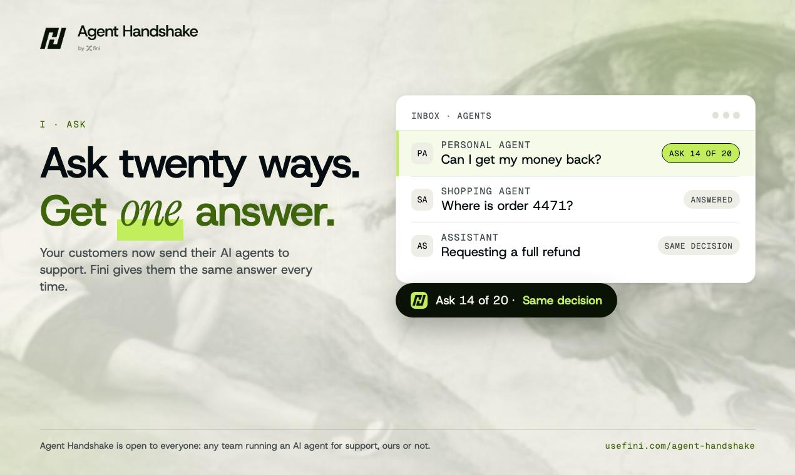
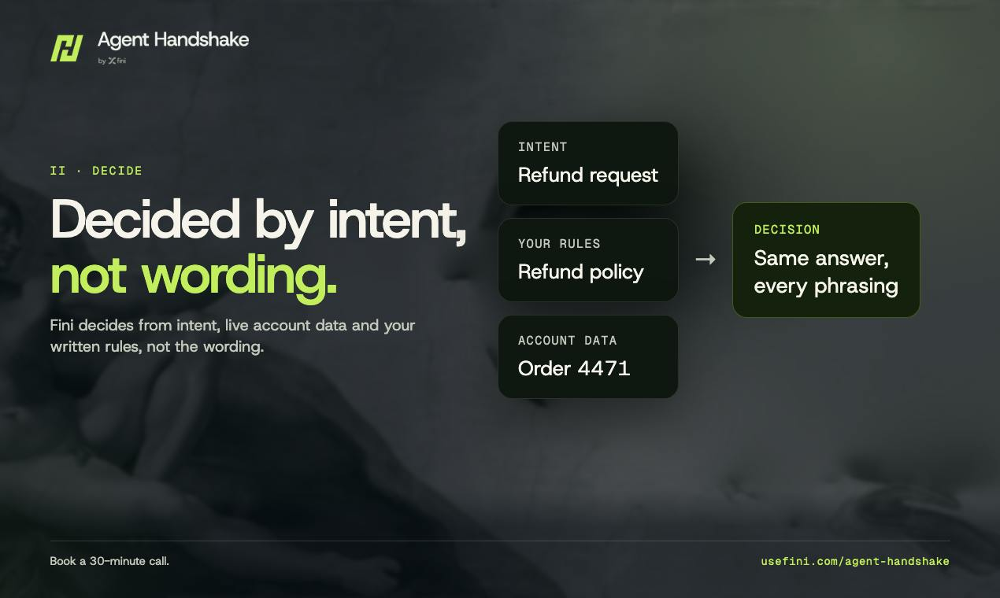
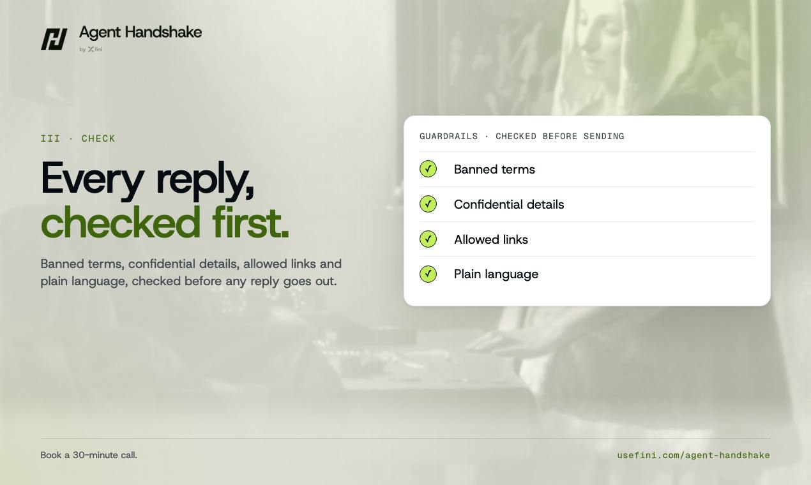

### 🎬 관련 영상
- [🎥 영상 보기](https://ph-files.imgix.net/6071f5ad-e9a4-4681-8c30-1aa5b60be3c8.jpeg?auto=format)

---

## 21. [Dotverse](https://www.producthunt.com/products/dotverse)
**Votes**: 73 | **도입 난이도**: 하 | **신뢰도**: 상
**Tagline**: Your Dot now with a crew
**서비스 링크**: https://www.producthunt.com/r/DKQJLJWRVHDMTX

**태그**: AI, Productivity, MacApp, ChatGPT, Chat

### 📌 이 서비스 한눈에 보기
기존 ChatGPT의 기능을 확장하여 다양한 역할과 성격을 가진 AI 팀을 구축하는 Mac 앱

### 🔑 주요 기능
- 기존 ChatGPT 환경을 기반으로 하는 Mac 전용 애플리케이션
- 다양한 역할과 개성을 가진 AI 크루(Crew) 생성 기능
- 단일 챗봇을 넘어선 협업형 AI 워크플로우 구축

### 🙋 사용자에게 어떤 점이 좋은가
사용자는 하나의 챗봇과 대화하는 것을 넘어, 각기 다른 전문성을 가진 AI 팀을 구성하여 복합적인 업무를 효율적으로 처리할 수 있습니다.

### ✅ 지금 바로 써볼 기능
- 자신만의 전문적인 AI 크루 구성하기
- 역할별 페르소나 설정 및 테스트하기
- Mac 환경에서의 워크플로우 통합 확인하기

### ⚠️ 사용 전 확인할 점
- 기존 ChatGPT 계정 및 환경과의 연동 방식 확인 필요
- Mac 전용 앱이므로 OS 호환성 확인 필요

### 🧭 확인이 더 필요한 정보
기존 ChatGPT의 어떤 기능을 구체적으로 확장하는지, 별도의 API 비용이 발생하는지에 대한 정보가 부족합니다.

### 📸 스크린샷 및 갤러리

### 🎬 관련 영상
- [🎥 영상 보기](https://ph-files.imgix.net/a6df4fac-3423-4c17-a92a-8aa3e971d110.jpeg?auto=format)

---

## 22. [Congress Trades](https://www.producthunt.com/products/alpha-vantage)
**Votes**: 73 | **도입 난이도**: 하 | **신뢰도**: 상
**Tagline**: See how Congress members trade, and if copying them pays off
**서비스 링크**: https://www.producthunt.com/r/5Z2TQKXWCNP44W

**태그**: Finance, Data Visualization, Investment, Analytics, AI Tool

### 📌 이 서비스 한눈에 보기
미 의원들의 주식 거래 데이터를 분석하여 수익률과 공시 준수 여부를 한눈에 확인하는 서비스

### 🔑 주요 기능
- PDF에 흩어져 있는 의원들의 주식 거래 공시 데이터 시각화 및 분석
- S&P 500 대비 의원별 실제 수익률(Alpha) 비교 분석 제공
- 의원별 공시 기한 준수 여부 및 데이터 투명성 확인 가능

### 🙋 사용자에게 어떤 점이 좋은가
복잡한 공시 문서를 직접 분석할 필요 없이, 의원들의 투자 성과를 객ic적으로 비교하여 투자 인사이트를 얻을 수 있습니다.

### ✅ 지금 바로 써볼 기능
- 무료 계정을 생성하여 지난 1년간의 의원별 수익률 랭킹 확인하기
- S&P 500 대비 의원들의 성과(Alpha) 비교 분석 기능 활용하기
- 의원들의 공시 지연 여부 및 데이터 신뢰도 체크하기

### ⚠️ 사용 전 확인할 점
- 과거 수익률이 미래의 투자 성과를 보장하지 않음
- 제공되는 데이터가 실제 공시 원본과 일치하는지 확인 필요

### 🧭 확인이 더 필요한 정보
무료 계정에서 제공되는 데이터의 범위와 유료 플랜의 상세 기능 차이를 확인해야 합니다.

### 📸 스크린샷 및 갤러리

---

## 23. [RageLayer](https://www.producthunt.com/products/ragelayer)
**Votes**: 73 | **도입 난이도**: 하 | **신뢰도**: 상
**Tagline**: Let visitors smash your website, then sweep it back
**서비스 링크**: https://www.producthunt.com/r/OD7J6Z2OA4DFD4

**태그**: DevTool, UX, Frontend, EasterEgg, AI Tool

### 📌 이 서비스 한눈에 보기
방문자가 웹사이트를 재미있게 파괴하고 다시 정리할 수 있는 인터랙티브한 이스터 에그 라이브러리

### 🔑 주요 기능
- 망치, 전기톱, 블랙홀 등 15가지 파괴 및 복구 도구 제공
- React, Vue, Svelte 및 일반 HTML과 호환되는 유연한 프레임워크 지원
- Zero runtime dependencies 및 MIT 라이선스로 가볍고 자유로운 사용 가능

### 🙋 사용자에게 어떤 점이 좋은가
웹사이트에 유머러스한 사용자 경험(UX)을 더해 방문자의 체류 시간을 늘리고 브랜드에 대한 재미있는 인상을 남길 수 있습니다.

### ✅ 지금 바로 써볼 기능
- 라이브 데모를 통해 파괴 효과와 복구 기능 체험하기
- 자신의 프로젝트 프레임워크(React, Vue 등)에 적용 가능한지 확인하기
- SDK를 활용해 커스텀 도구 제작 가능성 검토하기

### ⚠️ 사용 전 확인할 점
- 실제 콘텐츠를 파괴하는 시각적 효과이므로 사용자 경험을 해칠 수 있음
- 사이트의 원래 목적(정보 전달 등)과 상충할 수 있는 인터랙션임

### 🧭 확인이 더 필요한 정보
제공되는 15가지 도구의 구체적인 물리 엔진 성능과 복잡한 레이아웃에서의 안정성은 직접 테스트가 필요합니다.

### 📸 스크린샷 및 갤러리

---

## 24. [Open For sales ](https://www.producthunt.com/products/open-for-sales)
**Votes**: 72 | **도입 난이도**: 중 | **신뢰도**: 상
**Tagline**: Your next sales campaign is one prompt away
**서비스 링크**: https://www.producthunt.com/r/PE5FVS2UF7GKAS

**태그**: Sales, Automation, AI, CRM, Marketing, AI Tool, Chat, Prompting, Email

### 📌 이 서비스 한눈에 보기
단 한 번의 프롬프트로 타겟 분석부터 멀티 채널 영업 캠페인까지 자동 생성하는 AI 영업 엔진

### 🔑 주요 기능
- CSV 연락처와 제품 정보를 기반으로 페르소나 분석 및 적합도 점수 산출
- 전화, 이메일, WhatsApp을 아우르는 편집 가능한 멀티 채널 시퀀스 자동 작성
- 실시간 대시보드를 통한 영업 캠페인 성과 추적 및 관리

### 🙋 사용자에게 어떤 점이 좋은가
영업 담당자가 잠재 고객 발굴과 메시지 작성에 쓰는 시간을 획기적으로 줄여주며, 기존 고객 응대와 신규 고객 확보를 하나의 엔진으로 통합 관리할 수 있습니다.

### ✅ 지금 바로 써볼 기능
- 제품 정보와 고객 리스트(CSV) 업로드하기
- AI가 생성한 멀티 채널 메시지 시퀀스 검토 및 편집하기
- 생성된 캠페인을 실행하고 실시간 대시보드 모니터링하기

### ⚠️ 사용 전 확인할 점
- AI가 생성한 메시지의 품질이 브랜드 톤앤매너와 일치하는지 반드시 검토 필요
- 연락처 데이터의 정확도에 따라 캠페인 성과가 크게 좌우될 수 있음

### 🧭 확인이 더 필요한 정보
기존 Open 서비스와의 구체적인 데이터 연동 방식 및 상세 가격 정책에 대한 정보가 부족합니다.

### 📸 스크린샷 및 갤러리

### 🎬 관련 영상
- [🎥 영상 보기](https://ph-files.imgix.net/e57d9148-7456-4044-9bc0-10c115787082.jpeg?auto=format)

---

## 25. [Yardlet](https://www.producthunt.com/products/yardlet-2)
**Votes**: 71 | **도입 난이도**: 하 | **신뢰도**: 상
**Tagline**: The Mac app for the coding agents you already use
**서비스 링크**: https://www.producthunt.com/r/56GJ4J24UD5Z4A

**태그**: DevTool, AI-Agent, macOS, OpenSource, Agent

### 📌 이 서비스 한눈에 보기
기존 코딩 에이전트들을 하나의 인터페이스로 통합 관리하는 오픈소스 Mac 앱

### 🔑 주요 기능
- Codex, Claude Code 등 다양한 코딩 에이전트를 하나의 사이드바와 컴포저로 통합 관리
- 에이전트별 독립적인 CLI 및 로그인 세션을 유지하여 설정 충돌 방지
- Diff 확인, Pull Request 탭, 브라우저 등 에이전트 작업에 최적화된 UI 제공

### 🙋 사용자에게 어떤 점이 좋은가
여러 코딩 에이전트를 번갈아 사용할 때 발생하는 번거로움을 줄이고, 에이전트의 작업 결과물을 시각적으로 편리하게 관리할 수 있습니다.

### ✅ 지금 바로 써볼 기능
- 기존에 사용 중인 코딩 에이전트와 연동하기
- 통합된 사이드바와 컴포저 UI로 작업 흐름 테스트하기
- 에이전트가 생성한 Diff와 Pull Request 기능 확인하기

### ⚠️ 사용 전 확인할 점
- Mac 전용 앱이므로 macOS 환경에서만 사용 가능
- 에이전트의 설정 파일을 직접 수정하지 않으므로, 에이전트 자체의 설정 변경 사항은 반영되지 않을 수 있음

### 🧭 확인이 더 필요한 정보
지원되는 코딩 에이전트의 종류와 확장 가능 범위가 명시되어 있지 않습니다.

### 📸 스크린샷 및 갤러리

### 🎬 관련 영상
- [🎥 영상 보기](https://ph-files.imgix.net/e462e28f-e306-4834-bdbe-34fe28b6f026.jpeg?auto=format)

---

## 26. [NotiKeep](https://www.producthunt.com/products/notikeep)
**Votes**: 71 | **도입 난이도**: 중 | **신뢰도**: 상
**Tagline**: Notification history for iPhone, on your device
**서비스 링크**: https://www.producthunt.com/r/E4V7OIC4BGAU6H

**태그**: Productivity, iOS, Automation, Privacy

### 📌 이 서비스 한눈에 보기
삭제되거나 수정된 메시지까지 놓치지 않고 기록하는 아이폰 알림 히스토리 관리 도구

### 🔑 주요 기능
- iOS 단축어 자동화를 활용한 알림 저장 기능
- 삭제되거나 편집된 메시지 확인 가능
- 앱 및 대화별 검색 및 중요 키워드 알림 제공

### 🙋 사용자에게 어떤 점이 좋은가
중요한 메시지가 삭제되어 내용을 놓치는 상황을 방지하며, 개인정보 유출 걱정 없이 기기 내에서 안전하게 알림 기록을 관리할 수 있습니다.

### ✅ 지금 바로 써볼 기능
- iOS 단축어 자동화 설정하기
- 앱별 알림 기록 필터링해보기
- 중요 키워드 알림 설정하기

### ⚠️ 사용 전 확인할 점
- iOS 단축어 자동화 기반이므로 시스템 설정 과정이 필요할 수 있음
- 기기 내 저장 방식이므로 기기 변경 시 데이터 이전 여부 확인 필요

### 🧭 확인이 더 필요한 정보
iOS 단축어 자동화의 제약 사항에 따라 일부 앱의 알림이 기록되지 않을 수 있습니다.

### 📸 스크린샷 및 갤러리

---

## 27. [Trellis](https://www.producthunt.com/products/trellis-4)
**Votes**: 69 | **도입 난이도**: 하 | **신뢰도**: 상
**Tagline**: More than a terminal: a native macOS workspace for devs
**서비스 링크**: https://www.producthunt.com/r/YVFH6U52VHJELE

**태그**: DevTool, macOS, Automation, Productivity, CLI, Agent, AI Tool

### 📌 이 서비스 한눈에 보기
터미널을 넘어 개발자를 위한 통합 macOS 워크스페이스를 제공하는 도구

### 🔑 주요 기능
- 사이드바를 통한 윈도우, 탭, 분할 화면 관리
- 저장된 SSH 호스트 및 원클릭 프로젝트 작업 기능
- CLI와 MCP 서버를 통한 AI 에이전트 및 스크립트 연동 지원

### 🙋 사용자에게 어떤 점이 좋은가
단순한 터미널을 넘어 프로젝트 관리와 자동화 도구를 하나로 통합하여 개발 워크플로우를 최적화할 수 있습니다.

### ✅ 지금 바로 써볼 기능
- 사이드바를 활용한 프로젝트별 작업 환경 구성
- 명령 팔레트와 스크래치패드로 빠른 작업 전환
- CLI/MCP 서버를 통한 AI 에이전트 연동 테스트

### ⚠️ 사용 전 확인할 점
- macOS 전용 네이티브 앱이므로 다른 OS 사용자는 사용 불가
- 기존 터미널 워크플로우와의 호환성 및 적응 기간 필요

### 🧭 확인이 더 필요한 정보
상세한 시스템 리소스 점유율이나 기존 터미널 에뮬레이터와의 성능 비교 데이터는 명시되지 않았습니다.

### 📸 스크린샷 및 갤러리

### 🎬 관련 영상
- [🎥 영상 보기](https://ph-files.imgix.net/82621bc8-4eb8-4dca-b156-ad2d5ab51d49.jpeg?auto=format)

---

## 28. [Our Silly Games](https://www.producthunt.com/products/our-silly-games)
**Votes**: 67 | **도입 난이도**: 하 | **신뢰도**: 상
**Tagline**: Skills to build games with Claude. Free multiplayer hosting.
**서비스 링크**: https://www.producthunt.com/r/K3RUXQKJSOEPSY

**태그**: GameDev, AI, NoCode, WebHosting, Multiplayer, DevTool

### 📌 이 서비스 한눈에 보기
Claude를 활용해 말 한마디로 브라우저 게임을 만들고 즉시 배포하는 올인원 플랫폼

### 🔑 주요 기능
- Claude Code/Codex 기반의 간편한 게임 제작 프로세스
- 멀티플레이어, 리더보드, 저장 기능이 포함된 자동 호스팅
- 모바일 컨트롤러 지원을 통한 즉각적인 플레이 환경 제공

### 🙋 사용자에게 어떤 점이 좋은가
복잡한 서버 설정이나 프론트엔드 작업 없이 아이디어만으로 완성도 있는 멀티플레이 게임을 만들고 배포할 수 있습니다.

### ✅ 지금 바로 써볼 기능
- 플러그인 설치 후 'make me a game about...' 명령어로 첫 게임 생성하기
- 생성된 게임의 멀티플레이 및 리더보드 기능 테스트하기
- 모바일 컨트롤러를 이용해 스마트폰으로 게임 플레이해보기

### ⚠️ 사용 전 확인할 점
- Claude 기반 자동 생성 기능이므로 복잡한 커스텀 로직 구현에는 한계가 있을 수 있음
- 무료 호스팅 환경에서의 성능 및 안정성 확인 필요

### 🧭 확인이 더 필요한 정보
사용자의 커스텀 코드 수정 범위와 호스팅의 영구적 무료 여부에 대한 구체적인 정책 확인이 필요합니다.

### 📸 스크린샷 및 갤러리

### 🎬 관련 영상
- [🎥 영상 보기](https://ph-files.imgix.net/af8f3a43-b325-4168-b1e4-7892fc0e4163.jpeg?auto=format)

---

## 29. [Mudroom](https://www.producthunt.com/products/mudroom-3)
**Votes**: 67 | **도입 난이도**: 중 | **신뢰도**: 상
**Tagline**: Run coding agents in a VM, review changes like a PR
**서비스 링크**: https://www.producthunt.com/r/F6KIQZG3AUQIRZ

**태그**: DevTool, AI-Agent, Security, Automation, Agent

### 📌 이 서비스 한눈에 보기
코딩 에이전트를 안전한 샌드박스 환경에서 실행하고 PR처럼 변경 사항을 검토하는 도구

### 🔑 주요 기능
- Linux VM 기반의 격리된 샌드박스 환경 제공
- Claude Code, Gemini CLI 등 다양한 코딩 에이전트 지원
- PR 방식의 Diff 리뷰 및 선택적 적용/되돌리기 기능

### 🙋 사용자에게 어떤 점이 좋은가
에이전트가 내 로컬 파일이나 네트워크에 직접 접근하는 위험을 방지하면서, 생성된 코드를 안전하게 검토하고 적용할 수 있습니다.

### ✅ 지금 바로 써볼 기능
- 자신의 프로젝트 복사본에서 에이전트 실행해보기
- 생성된 Diff를 통해 코드 변경점 검토하기
- 필요한 변경 사항만 선택적으로 적용하거나 Undo 기능 테스트하기

### ⚠️ 사용 전 확인할 점
- 에이전트 실행을 위한 로컬 환경 설정 필요
- 샌드박스 외부 환경과의 상호작용 시 네트워크 허용 목록 설정 필요

### 🧭 확인이 더 필요한 정보
사용자의 로컬 프로젝트 복사본과 VM 간의 동기화 방식 및 성능에 대한 상세 정보가 필요합니다.

### 📸 스크린샷 및 갤러리

---

## 30. [Boltbar](https://www.producthunt.com/products/boltbar)
**Votes**: 66 | **도입 난이도**: 하 | **신뢰도**: 상
**Tagline**: Spotlight-style AI chat for your Mac
**서비스 링크**: https://www.producthunt.com/r/RWAVLWYHNX2JMM

**태그**: AI, macOS, Productivity, DeveloperTool, Automation, Agent, AI Tool, Chat, DevTool

### 📌 이 서비스 한눈에 보기
macOS 환경에서 Spotlight처럼 빠르고 강력하게 사용할 수 있는 네이티브 AI 채팅 바

### 🔑 주요 기능
- macOS 네이티브 앱으로 설계된 빠르고 직관적인 AI 인터페이스
- ⌥ Space 단축키를 통한 앱 간 전환 없는 즉각적인 AI 질의응답
- 프로젝트 단위의 권한 제어가 가능한 에이전트 모드(Look/Ask/Edit/Full) 지원

### 🙋 사용자에게 어떤 점이 좋은가
작업 흐름을 끊지 않고 어떤 앱에서든 즉시 AI를 호출할 수 있으며, 에이전트 모드를 통해 코드 편집 등 복잡한 작업도 자동화할 수 있습니다.

### ✅ 지금 바로 써볼 기능
- ⌥ Space 단축키를 활용한 빠른 질의응답 테스트
- 에이전트 모드를 통한 프로젝트 파일 접근 및 편집 기능 확인
- Claude 및 GPT 모델별 응답 품질 비교

### ⚠️ 사용 전 확인할 점
- 에이전트 모드 사용 시 파일 수정/삭제 권한 부여에 따른 보안 주의 필요
- 사용자 개인 API 키(GPT/Claude)를 통한 유료 모델 사용 가능성

### 🧭 확인이 더 필요한 정보
사용자의 개인 API 키를 사용하는 방식인지 별도의 구독 모델이 있는지 명확한 가격 구조 확인이 필요합니다.

### 📸 스크린샷 및 갤러리

### 🎬 관련 영상
- [🎥 영상 보기](https://ph-files.imgix.net/61bd86d1-7c95-4e5e-bb63-231a7b5cd4c2.jpeg?auto=format)

---

