# 🚀 Product Hunt Daily Top 30 (2026-10-31)

## 오늘의 요약
오늘의 트렌드는 자연스러운 음성 명령을 실제 업무 실행으로 연결하거나, 복잡한 웹/디자인 작업을 자동화하는 '에이전트형 AI'의 진화가 두드러졌습니다. 특히 사용자의 의도를 이해하고 도구와 지식 베이스를 연결하여 인간의 개입을 최소화하는 방향으로 기술이 집중되었습니다.

### 오늘의 핵심 포인트
- 음성 인터페이스를 통해 복잡한 코딩 없이도 전문적인 업무 프로세스를 구축할 수 있는 노코드/로우코드 솔루션이 주목받았습니다.
- 웹 브라우징, 디자인 편집, 데이터베이스 관리 등 기존의 수동 작업을 스스로 판단하고 수행하는 자율형 에이전트 기술이 강화되었습니다.
- 기업의 내부 지식과 외부 AI를 안전하게 연결하거나 모바일 환경에서도 업무 시스템을 구축하는 등 실무 중심의 연결성이 강조되었습니다.

**오늘의 태그**: AI 에이전트, 업무 자동화, 음성 AI, 노코드, 생산성 도구

## 1. [Vaani Developer Platform](https://www.producthunt.com/products/vaani-developer-platfrom)
**Votes**: 248 | **도입 난이도**: 하 | **신뢰도**: 상
**Tagline**: The only voice AI harness that you'll ever need
**서비스 링크**: https://www.producthunt.com/r/PLG3DPJZGCJSAB

**태그**: VoiceAI, NoCode, Automation, CustomerService, Agent, AI Tool, Design, DevTool

### 📌 이 서비스 한눈에 보기
코딩 없이 인간처럼 대화하는 AI 음성 에이전트를 구축하는 플랫폼

### 🔑 주요 기능
- 노코드 방식의 직관적인 음성 에이전트 설계
- 통화 흐름 설계 및 예외 상황(objections/edge cases) 처리 기능
- 실제 전화번호 연결 및 지식 베이스/도구 연동 지원

### 🙋 사용자에게 어떤 점이 좋은가
복잡한 프로그래밍 없이도 전문적인 음성 상담원을 즉시 배포하여 비즈니스 자동화를 구현할 수 있습니다.

### ✅ 지금 바로 써볼 기능
- 통화 흐름(Call Flow) 설계해보기
- 지식 베이스 연결하여 답변 학습시키기
- 실제 전화번호 연결 및 라이브 테스트하기

### ⚠️ 사용 전 확인할 점
- 노코드 방식이므로 매우 복잡한 커스텀 로직 구현에는 한계가 있을 수 있음
- 실제 전화망 연결 시 발생할 수 있는 통신 품질 및 비용 확인 필요

### 🧭 확인이 더 필요한 정보
제공되는 데이터의 상세 구조와 외부 툴과의 구체적인 연동 방식(API 등)에 대한 정보가 더 필요합니다.

### 📸 스크린샷 및 갤러리
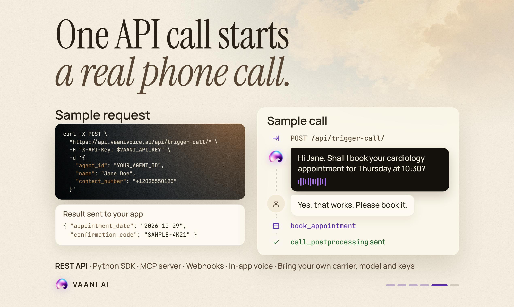

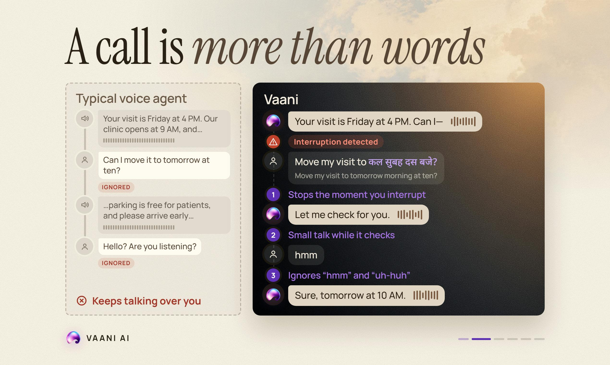

### 🎬 관련 영상
- [🎥 영상 보기](https://ph-files.imgix.net/68533eef-f593-4ca8-8c88-cda88a0b2896.jpeg?auto=format)

---

## 2. [Knocket AI](https://www.producthunt.com/products/knocket-ai)
**Votes**: 231 | **도입 난이도**: 하 | **신뢰도**: 상
**Tagline**: Chat with visitors from your website or link
**서비스 링크**: https://www.producthunt.com/r/PZ4KKDP7MANWFR

**태그**: Customer Engagement, NoCode, Communication, Small Business, AI Tool, Chat

### 📌 이 서비스 한눈에 보기
웹사이트 방문자와 간편하게 소통할 수 있는 가벼운 라이브 채팅 솔루션

### 🔑 주요 기능
- 웹사이트나 프로필 링크에 즉시 적용 가능한 라이브 채팅 기능
- 방문자가 별도의 회원가입 없이 바로 대화를 시작할 수 있는 편의성
- 창업자, 크리에이터, 소규모 팀에 최적화된 심플한 구조

### 🙋 사용자에게 어떤 점이 좋은가
복잡한 고객 관리 시스템 없이도 방문자와 즉각적인 소통 창구를 만들 수 있어, 초기 고객 확보와 피드백 수집에 유용합니다.

### ✅ 지금 바로 써볼 기능
- 자신의 웹사이트에 채팅 위젯 설치하기
- 바이오 링크(Bio link)를 개인 연락 페이지로 전환하기
- 방문자 대화 흐름 테스트하기

### ⚠️ 사용 전 확인할 점
- 로그인 없는 대화 방식이므로 방문자 식별이나 데이터 축적에 제한이 있을 수 있음
- 대규모 고객 지원을 위한 고급 기능(CRM 연동 등) 포함 여부 확인 필요

### 🧭 확인이 더 필요한 정보
상세한 기능 범위와 유료 플랜의 차이점에 대한 정보가 명시되지 않았습니다.

### 📸 스크린샷 및 갤러리
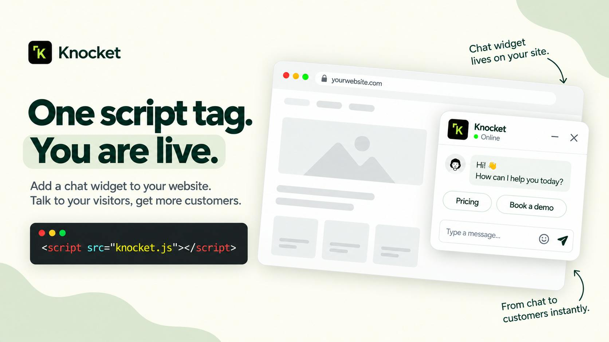
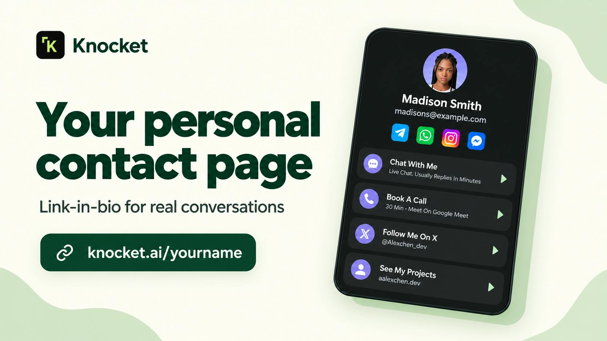
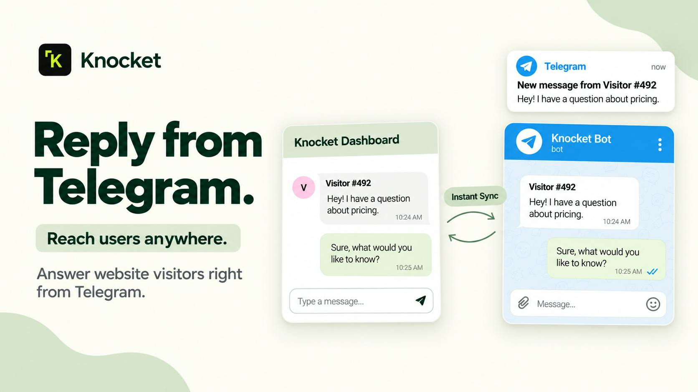

### 🎬 관련 영상
- [🎥 영상 보기](https://ph-files.imgix.net/71e6d8f6-dd53-4375-bd3e-55f76acff3c2.jpeg?auto=format)

---

## 3. [SpeakON Agent](https://www.producthunt.com/products/speakon)
**Votes**: 224 | **도입 난이도**: 하 | **신뢰도**: 상
**Tagline**: Turn natural speech into real work for an agent to complete
**서비스 링크**: https://www.producthunt.com/r/GUQI7NTMSNKCWZ

**태그**: Automation, AI Agent, Productivity, Voice-to-Action, Agent

### 📌 이 서비스 한눈에 보기
일상적인 음성 명령을 실제 업무 실행으로 연결하는 AI 에이전트

### 🔑 주요 기능
- 자연스러운 음성 입력을 통한 업무 자동화
- 메모 이해 및 도구 간 연결 기능
- 사용자 검토 및 승인을 거치는 안전한 액션 준비

### 🙋 사용자에게 어떤 점이 좋은가
복잡한 도구 조작 없이 말 한마디로 업무 프로세스를 시작할 수 있어 업무 흐름이 끊기지 않습니다.

### ✅ 지금 바로 써볼 기능
- 음성으로 메모 전달하기
- 연동된 도구와 연결 설정하기
- 제안된 액션 검토 및 실행하기

### ⚠️ 사용 전 확인할 점
- 음성 인식 정확도에 따른 작업 결과 차이 가능성
- 연동된 외부 도구의 권한 설정 필요성

### 🧭 확인이 더 필요한 정보
지원하는 외부 도구의 종류와 구체적인 연동 범위에 대한 정보가 필요합니다.

### 📸 스크린샷 및 갤러리

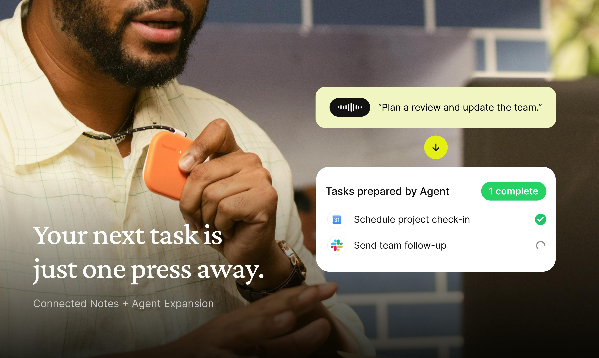
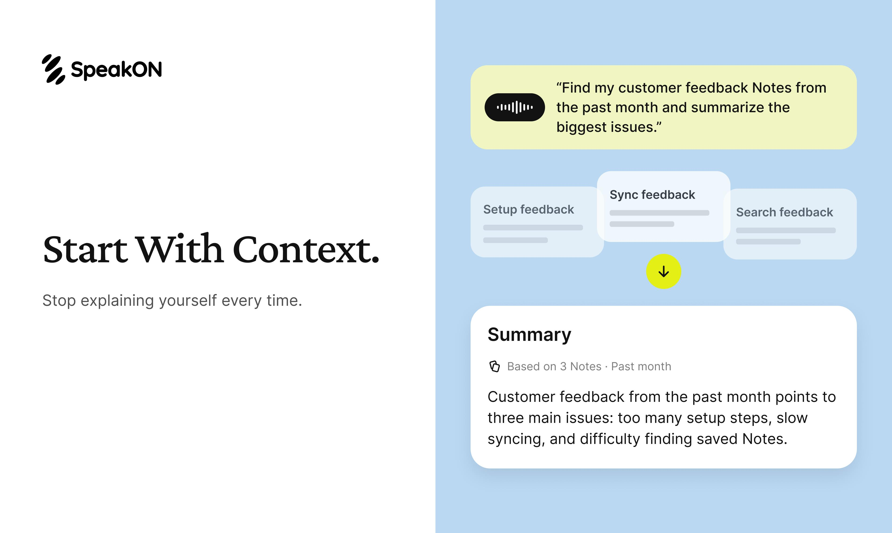

### 🎬 관련 영상
- [🎥 영상 보기](https://ph-files.imgix.net/13aa9ec1-903a-40d8-ab9f-911cdc02e813.jpeg?auto=format)

---

## 4. [MCP Server by XWiki](https://www.producthunt.com/products/xwiki)
**Votes**: 146 | **도입 난이도**: 중 | **신뢰도**: 상
**Tagline**: Give your AI your wiki's knowledge while keeping the control
**서비스 링크**: https://www.producthunt.com/r/HCKMTX4XJFTNMW

**태그**: AI, KnowledgeBase, OpenSource, Automation, DevTool, Agent, AI Tool

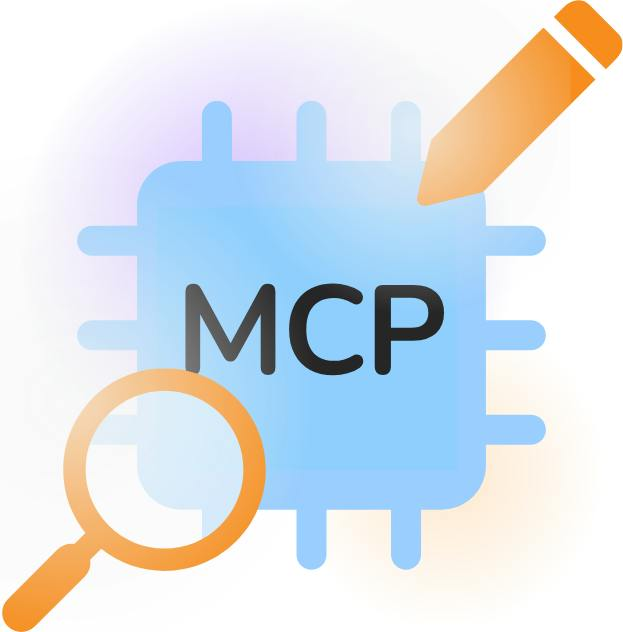

### 📌 이 서비스 한눈에 보기
XWiki의 지식 베이스를 다양한 AI 에이전트와 안전하게 연결하는 오픈소스 MCP 서버

### 🔑 주요 기능
- XWiki 데이터를 Claude Code, GitHub Copilot 등 외부 AI 에이전트와 연동
- 오픈소스 및 셀프 호스팅 방식으로 데이터 제어권 유지
- AI를 통한 지식 베이스 질의, 페이지 생성 및 편집 기능 제공

### 🙋 사용자에게 어떤 점이 좋은가
기업 내부의 소중한 지식 자산을 AI가 직접 읽고 쓸 수 있게 하여, 정보 검색과 문서 작업의 자동화를 실현합니다.

### ✅ 지금 바로 써볼 기능
- AI 에이전트를 통한 XWiki 지식 베이스 질의하기
- AI를 활용한 새로운 위키 페이지 생성 및 편집하기
- 구조화된 데이터와 AI 에이전트 간의 상호작용 테스트하기

### ⚠️ 사용 전 확인할 점
- 사용 중인 AI 에이전트와의 호환성 확인 필요
- 셀프 호스팅 환경에서의 보안 및 네트워크 설정 필요

### 🧭 확인이 더 필요한 정보
지원되는 AI 에이전트 외의 추가적인 통합 가능 여부와 상세 보안 설정 방식에 대한 정보가 더 필요합니다.

### 📸 스크린샷 및 갤러리
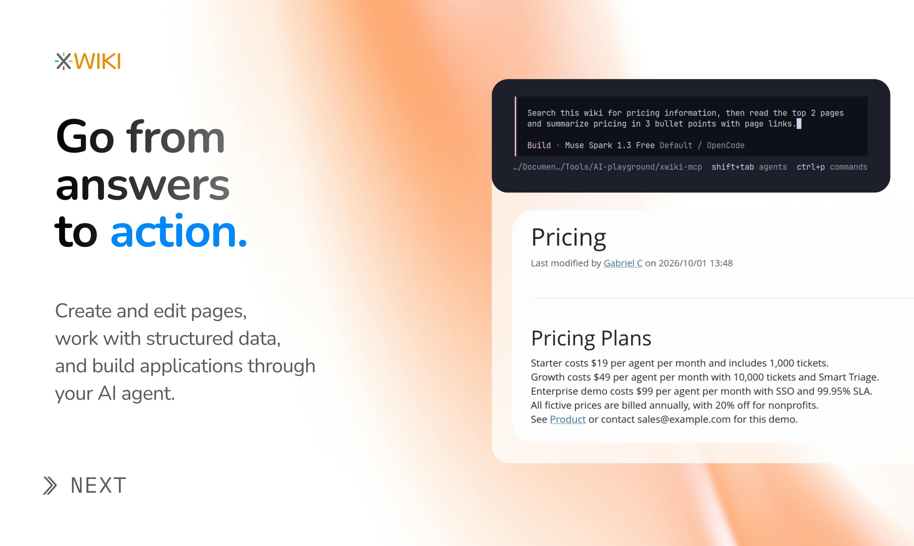
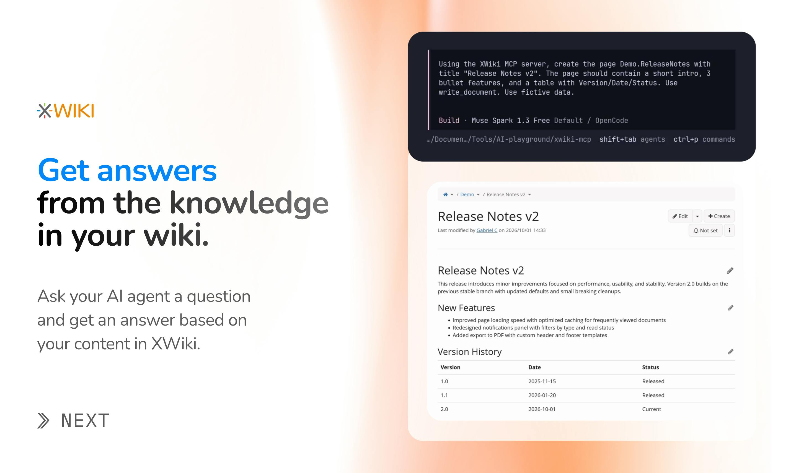
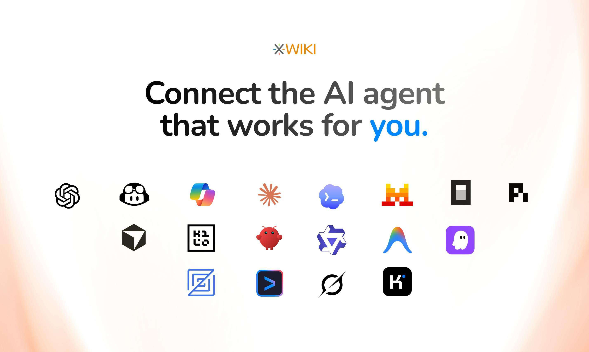

### 🎬 관련 영상
- [🎥 영상 보기](https://ph-files.imgix.net/e7e1f84c-9388-44d5-9d73-1706b10bf495.jpeg?auto=format)

---

## 5. [Canva Brush](https://www.producthunt.com/products/canva)
**Votes**: 136 | **도입 난이도**: 하 | **신뢰도**: 상
**Tagline**: A vision-language model that edits your designs
**서비스 링크**: https://www.producthunt.com/r/CC5KZ2CNTCOFOY
**재등장**: 최근 7일 내 재등장 (마지막 등장 5일 전)

**태그**: Design, AI, Automation, Productivity, Agent, AI Tool

### 📌 이 서비스 한눈에 보기
디자인 구조를 이해하고 자연어로 편집을 수행하는 AI 디자인 에이전트

### 🔑 주요 기능
- 디자인의 레이아웃과 구조를 이해하는 시각-언어 모델(VLM) 기반
- 텍스트 수정부터 슬라이드 전체 변경까지 자연어 명령으로 수행
- 수정 후에도 모든 요소가 편집 가능한 상태로 유지

### 🙋 사용자에게 어떤 점이 좋은가
디자인의 세부 요소를 일일이 수동으로 수정할 필요 없이, 말 한마디로 복잡한 디자인 작업을 빠르게 완료할 수 있습니다.

### ✅ 지금 바로 써볼 기능
- 자연어 명령을 통한 디자인 요소 수정 테스트
- 문구 변경 및 전체 슬라이드 스타일 일괄 적용
- 편집 가능한 레이어 유지 여부 확인

### ⚠️ 사용 전 확인할 점
- 현재 Canva Pro 구독자에게만 제공되는 기능임
- 복잡한 디자인 구조에서 의도와 다른 편집 결과가 나올 가능성

### 🧭 확인이 더 필요한 정보
Canva Pro 구독자 외의 일반 사용자나 기업용 플랜에 대한 구체적인 배포 일정은 명시되지 않았습니다.

### 📸 스크린샷 및 갤러리
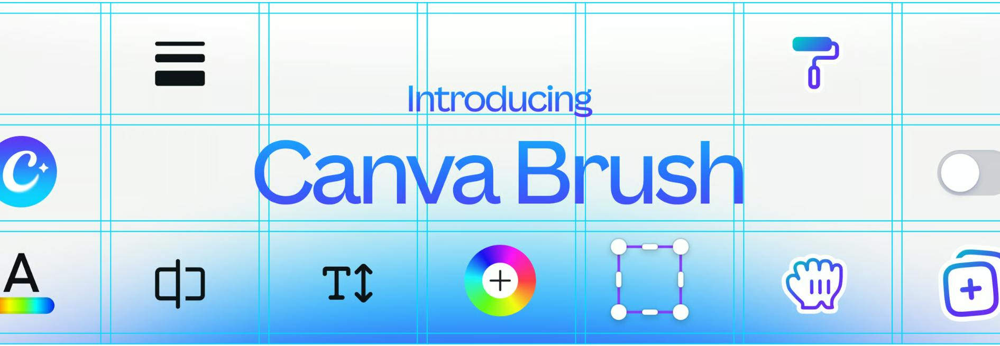
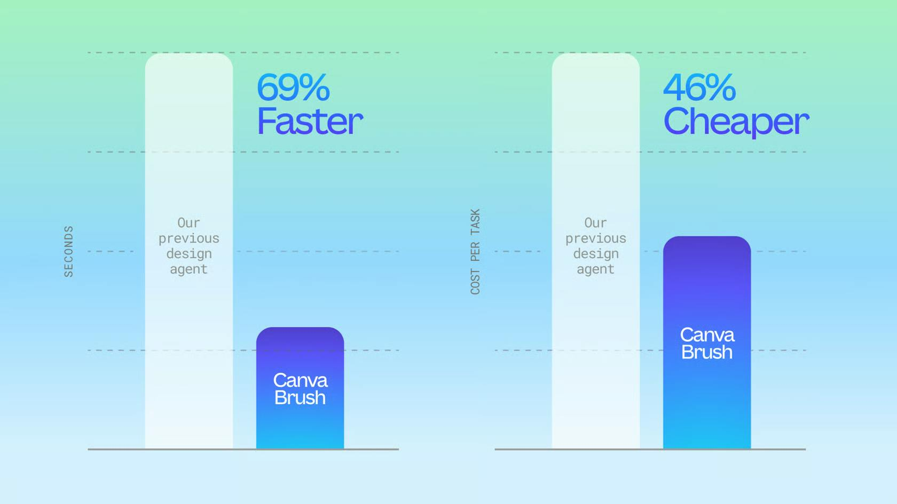
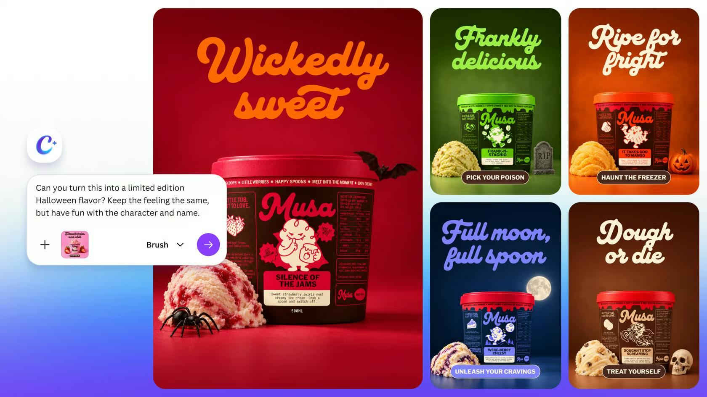

### 🎬 관련 영상
- [🎥 영상 보기](https://ph-files.imgix.net/f89552ca-71a7-46bc-bf25-eb9134151f2a.gif?auto=format)

---

## 6. [Chopstick](https://www.producthunt.com/products/chopstick)
**Votes**: 112 | **도입 난이도**: 중 | **신뢰도**: 상
**Tagline**: Mac activity and action widgets that write themselves
**서비스 링크**: https://www.producthunt.com/r/IYFTKXHBVVHP2G

**태그**: Automation, Productivity, Mac, DevTool, Agent

### 📌 이 서비스 한눈에 보기
사용자의 반복 작업을 감지하여 자동으로 맥 위젯을 생성하는 자동화 도구

### 🔑 주요 기능
- 사용자의 반복적인 맥 활동을 감지하여 맞춤형 위젯 생성
- 기존 코딩 에이전트를 활용한 자동화 워크플로우
- 로컬 환경에 저장되는 프라이버시 중심의 활동 로그

### 🙋 사용자에게 어떤 점이 좋은가
반복적인 작업을 수동으로 설정할 필요 없이, 사용자의 패턴을 바탕으로 필요한 위젯이 자동으로 생성되어 작업 효율을 높여줍니다.

### ✅ 지금 바로 써볼 기능
- 맥에서의 반복적인 작업 패턴 확인하기
- 생성된 노치 위젯의 유용성 테스트하기
- 로컬 로그 저장 방식 및 보안 설정 확인하기

### ⚠️ 사용 전 확인할 점
- 사용자의 활동 데이터를 수집하므로 개인정보 보호 설정 확인 필요
- 기존 코딩 에이전트와의 호환성 및 설정 복잡도 확인 필요

### 🧭 확인이 더 필요한 정보
사용자의 활동을 감지하는 방식과 코딩 에이전트와의 구체적인 연동 방식에 대한 상세 정보가 필요합니다.

### 📸 스크린샷 및 갤러리
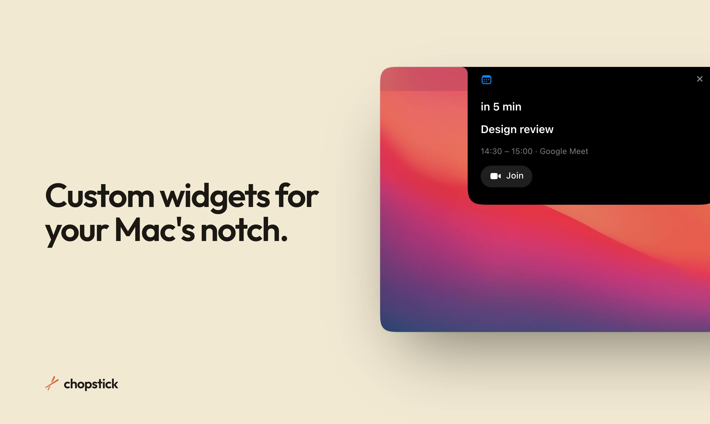
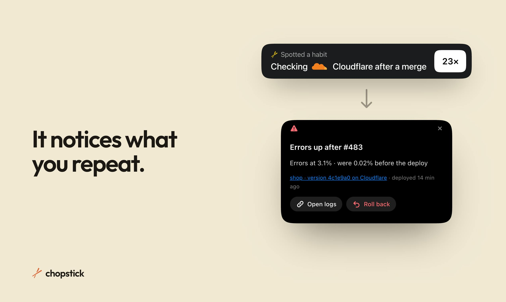
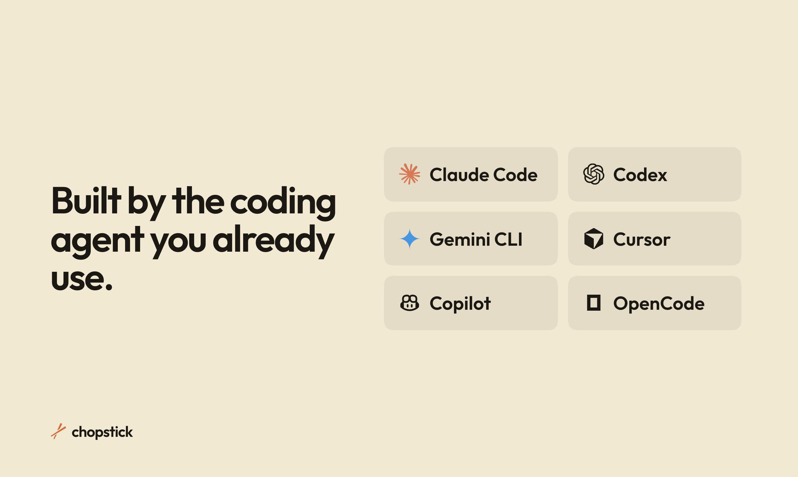

### 🎬 관련 영상
- [🎥 영상 보기](https://ph-files.imgix.net/609b4f3e-3ce9-464e-8696-0d7dd59cdadb.jpeg?auto=format)

---

## 7. [fastbrowse](https://www.producthunt.com/products/fastbrowse)
**Votes**: 109 | **도입 난이도**: 중 | **신뢰도**: 상
**Tagline**: Fastest open source browser agent
**서비스 링크**: https://www.producthunt.com/r/6XWF3PRT2W3QVO

**태그**: Automation, Browser-Agent, OpenSource, AI, Agent

### 📌 이 서비스 한눈에 보기
모든 웹 요소를 분석하여 다음 단계를 스스로 결정하는 초고속 오픈소스 브라우저 에이전트

### 🔑 주요 기능
- 페이지 내 모든 버튼, 링크, 필드를 식별하는 정밀한 브라우징 능력
- 효율적인 의사결정을 위한 계층형 모델 구조 (System One 모델 우선 적용)
- 모든 답변에 근거를 제공하는 인용(Citation) 기능 탑재

### 🙋 사용자에게 어떤 점이 좋은가
복잡한 웹 작업을 자동화하면서도, 작업의 근거를 명확히 확인할 수 있어 신뢰도 높은 자동화 업무가 가능합니다.

### ✅ 지금 바로 써볼 기능
- 웹 페이지 요소 인식 정확도 테스트
- 모델 전환(System One ↔ Standard) 시의 작업 연속성 확인
- 제공되는 인용 기능을 통한 작업 결과 검증

### ⚠️ 사용 전 확인할 점
- 오픈소스 모델의 성능에 따라 작업 정확도가 달라질 수 있음
- 복잡한 웹 인터랙션 시 모델 간 전환 과정에서의 지연 가능성

### 🧭 확인이 더 필요한 정보
사용되는 'System One' 모델의 구체적인 사양과 비용 구조에 대한 상세 정보가 필요합니다.

### 📸 스크린샷 및 갤러리

### 🎬 관련 영상
- [🎥 영상 보기](https://ph-files.imgix.net/002d0451-e0a4-4825-8fe6-c74287f9d622.jpeg?auto=format)

---

## 8. [Teable Mobile](https://www.producthunt.com/products/teable-4)
**Votes**: 99 | **도입 난이도**: 중 | **신뢰도**: 상
**Tagline**: Build the systems your team runs on, now from your phone
**서비스 링크**: https://www.producthunt.com/r/63BC4PYRAMP73C

**태그**: NoCode, Automation, Mobile, Productivity, Database, AI Tool

### 📌 이 서비스 한눈에 보기
모바일에서도 팀의 업무 시스템과 자동화를 구축할 수 있는 데이터베이스 솔루션

### 🔑 주요 기능
- 데이터베이스, 앱, 자동화를 통합하여 업무 프로세스 구축
- 모바일 환경에 최적화된 인터페이스 제공
- 음성 입력(Hold to talk) 및 팀 공유 기능 지원

### 🙋 사용자에게 어떤 점이 좋은가
복잡한 업무 시스템을 PC 앞이 아닌 이동 중에도 모바일로 관리하고 팀원들과 즉각적으로 협업할 수 있습니다.

### ✅ 지금 바로 써볼 기능
- 음성 입력 기능을 통한 데이터 입력 테스트
- 모바일 환경에서의 워크플로우 구축 시도
- 팀원 대상 자동화 알림 설정

### ⚠️ 사용 전 확인할 점
- 모바일 환경에서의 복잡한 데이터베이스 설계 제약 가능성
- 데스크톱 버전과의 기능 동기화 및 편집 편의성 차이

### 🧭 확인이 더 필요한 정보
모바일 환경에서 복잡한 자동화 로직을 구축하는 데 어느 정도의 제약이 있는지 확인이 필요합니다.

### 📸 스크린샷 및 갤러리
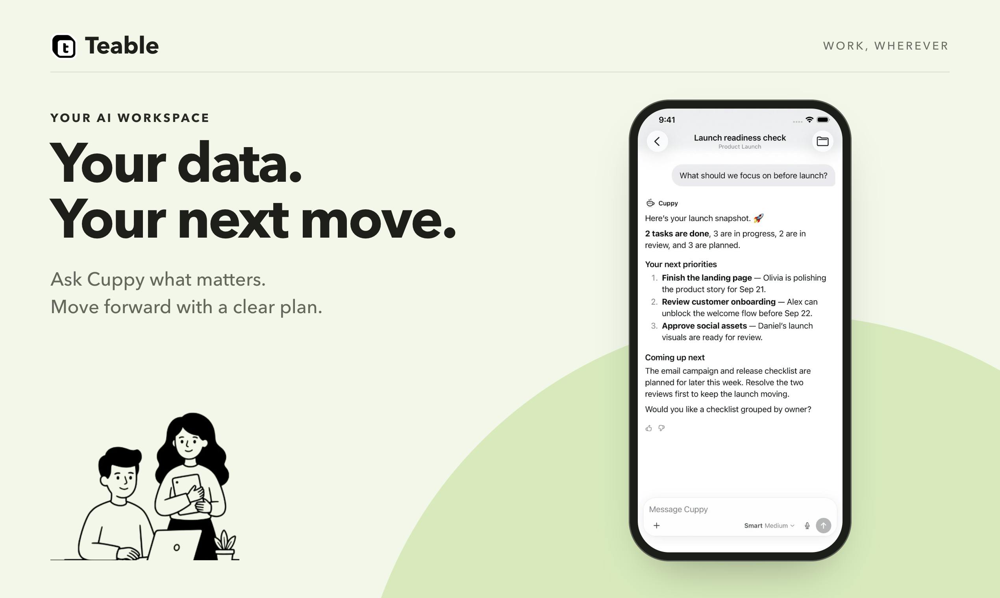
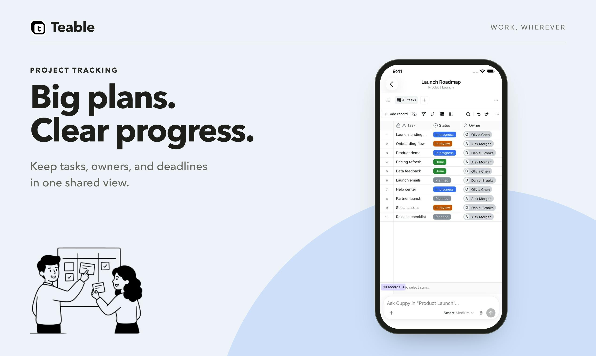
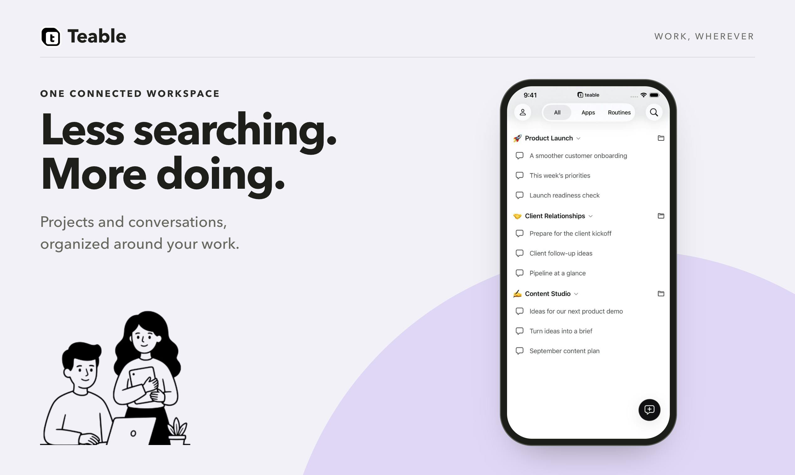

### 🎬 관련 영상
- [🎥 영상 보기](https://ph-files.imgix.net/6599f092-d35e-4b19-928d-6ecc0df7df24.jpeg?auto=format)

---

## 9. [iSurge](https://www.producthunt.com/products/isurge)
**Votes**: 95 | **도입 난이도**: 하 | **신뢰도**: 상
**Tagline**: Activity monitor, per-app volume, disk cleanup at your notch
**서비스 링크**: https://www.producthunt.com/r/VFQNYFOWMDE4HU

**태그**: Productivity, DevTool, Mac, System-Utility

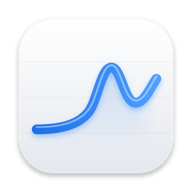

### 📌 이 서비스 한눈에 보기
맥(Mac) 사용자를 위한 올인원 시스템 모니터링 및 관리 도구

### 🔑 주요 기능
- 노치 영역을 활용한 실시간 시스템 상태 모니터링
- 앱별 볼륨 및 마이크 제어, 디스크 정리, 언인스톨러 기능 제공
- 개발자를 위한 포트 관리, 프로젝트, Homebrew 관리 도구 포함

### 🙋 사용자에게 어떤 점이 좋은가
시스템 관리, 개발 도구, 생산성 타이머를 하나의 앱으로 통합하여 맥 작업 환경을 효율적으로 관리할 수 있습니다.

### ✅ 지금 바로 써볼 기능
- 노치 영역의 실시간 스탯 확인하기
- 앱별 볼륨 및 마이크 설정 최적화하기
- 디스크 정리 및 언인스톨러로 저장 공간 확보하기

### ⚠️ 사용 전 확인할 점
- 일회성 구매 방식이므로 기능 업데이트 정책 확인 필요
- 노치 디자인을 활용하므로 해당 하드웨어를 가진 맥 사용자에게 최적화됨

### 🧭 확인이 더 필요한 정보
제공되는 개발자 도구의 상세 기능과 시스템 리소스 점유율에 대한 구체적인 정보는 확인이 필요합니다.

### 📸 스크린샷 및 갤러리
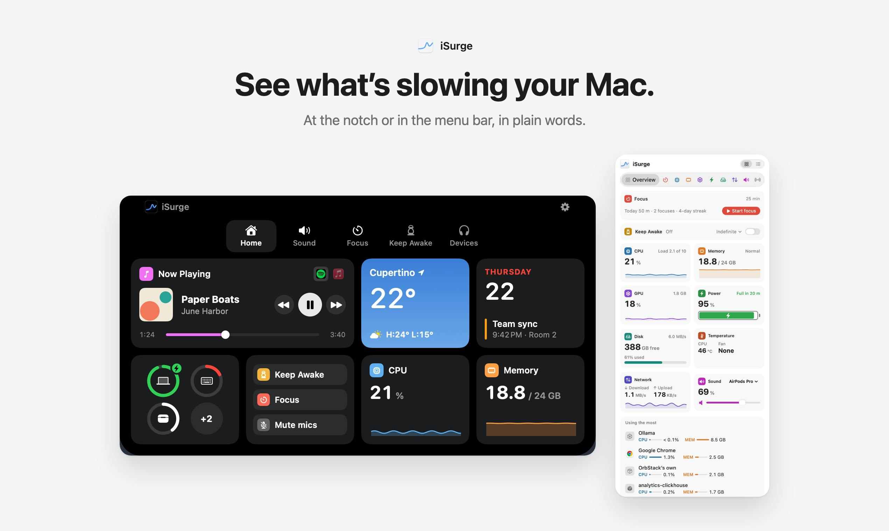
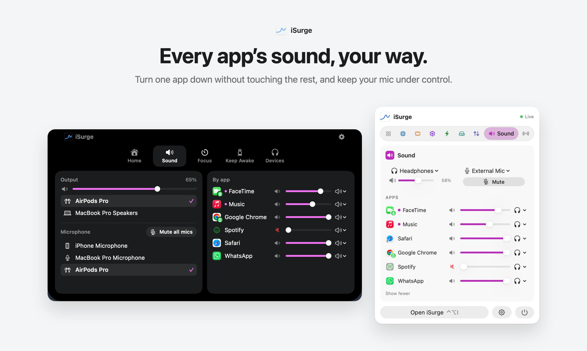
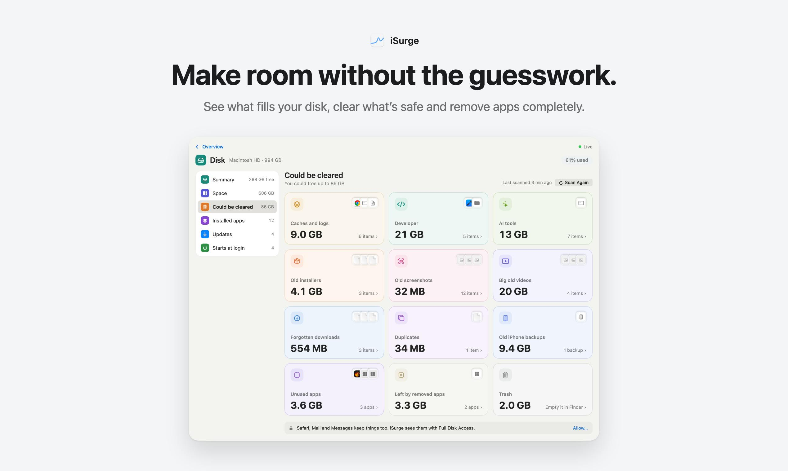

### 🎬 관련 영상
- [🎥 영상 보기](https://ph-files.imgix.net/1cc5f71a-fda5-4332-a434-1c3f488f794a.jpeg?auto=format)

---

## 10. [Nocto](https://www.producthunt.com/products/nocto)
**Votes**: 91 | **도입 난이도**: 하 | **신뢰도**: 상
**Tagline**: Your MacBook notch, finally useful
**서비스 링크**: https://www.producthunt.com/r/MXA6PAIVJHADWD

**태그**: Productivity, macOS, Utility, AI Tool

### 📌 이 서비스 한눈에 보기
맥북 노치 영역을 활용해 미디어 제어, 화상 회의 참여, 클립보드 관리를 한 번에 해결하는 생산성 도구

### 🔑 주요 기능
- 노치 영역을 활용한 미디어 컨트롤 및 화상 회의(Zoom, Meet 등) 원클릭 접속
- 클립보드 히스토리 관리 및 파일 임시 보관(Shelf) 기능 제공
- macOS 네이티브 앱으로 가볍고 직관적인 사용자 경험 제공

### 🙋 사용자에게 어떤 점이 좋은가
맥북의 데드 스페이스인 노치를 유용한 컨트롤 센터로 변모시켜 작업 흐름을 끊지 않고 핵심 기능을 빠르게 실행할 수 있습니다.

### ✅ 지금 바로 써볼 기능
- 노치에 마우스를 올려 음악 재생 상태 확인 및 곡 넘기기
- 화상 회의 시작 전 노치에 나타나는 Join 버튼으로 즉시 접속하기
- 클립보드 히스토리를 통해 이전에 복사한 내용 빠르게 찾기

### ⚠️ 사용 전 확인할 점
- macOS 14 이상의 운영체제 버전이 필요함
- 7일간의 무료 체험 기간 이후에는 유료 결제가 필요함

### 🧭 확인이 더 필요한 정보
사용자의 하드웨어 사양에 따른 배터리 소모량이나 시스템 리소스 점유율은 명시되지 않았습니다.

### 📸 스크린샷 및 갤러리
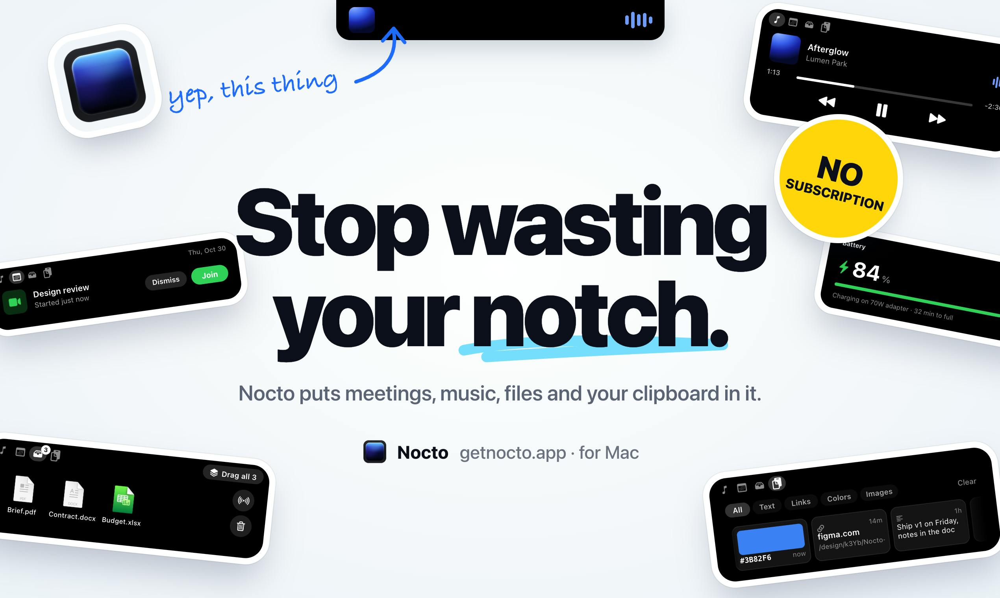
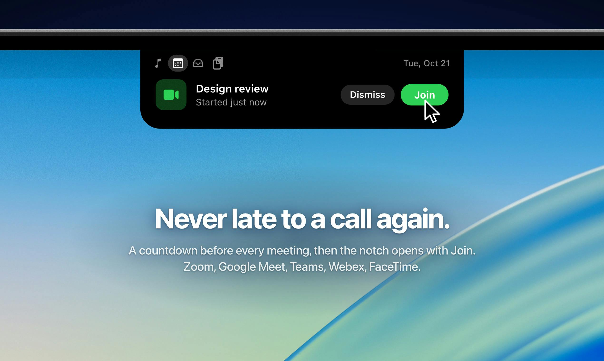
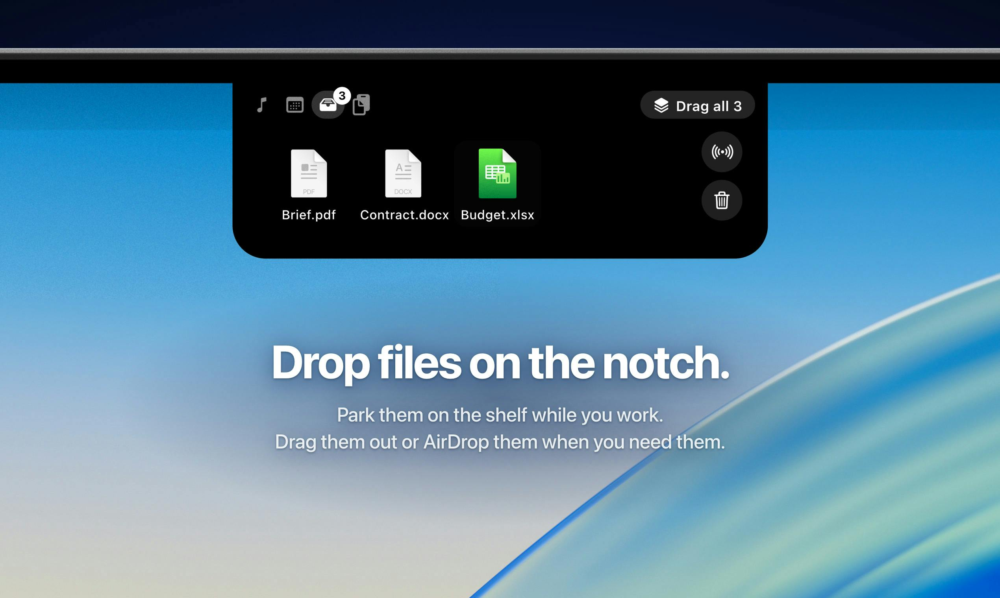

### 🎬 관련 영상
- [🎥 영상 보기](https://ph-files.imgix.net/84d7d073-6a7f-40ff-a55a-3173ccd2970f.jpeg?auto=format)

---

## 11. [Faylee](https://www.producthunt.com/products/faylee)
**Votes**: 91 | **도입 난이도**: 하 | **신뢰도**: 상
**Tagline**: Bug reports your coding agent can fix from one link
**서비스 링크**: https://www.producthunt.com/r/2NNSBIYKNI3BKE

**태그**: DevTool, AI-Agent, Debugging, Productivity, Agent, AI Tool

### 📌 이 서비스 한눈에 보기
버그 리포트를 단 하나의 링크로 생성하여 AI 코딩 에이전트가 즉시 수정할 수 있게 돕는 도구

### 🔑 주요 기능
- 화면 녹화, 콘솔 로그, 네트워크 요청을 하나의 타임라인에 통합 기록
- Claude Code, Cursor 등 AI 에이전트를 위한 MCP 서버 지원
- 버그 발생 직후 마지막 몇 분을 저장하는 인스턴트 리플레이 기능

### 🙋 사용자에게 어떤 점이 좋은가
버그 재현 과정을 일일이 설명할 필요 없이 링크 하나로 팀원과 AI에게 상황을 완벽히 전달하여 디버깅 시간을 획기적으로 단축합니다.

### ✅ 지금 바로 써볼 기능
- 버그 발생 시 링크 생성하여 팀원과 공유하기
- 생성된 링크를 Cursor나 Claude Code에 붙여넣어 자동 수정 시도하기
- 3인 이하 팀에서 무료 플랜으로 기능 테스트하기

### ⚠️ 사용 전 확인할 점
- 3인 초과 시 유료 플랜 전환 필요
- 민감한 데이터(네트워크 요청 등)가 포함된 리포트 공유 시 보안 주의

### 🧭 확인이 더 필요한 정보
상세한 유료 플랜의 가격 체계와 보안/데이터 저장 정책에 대한 정보가 명시되지 않았습니다.

### 📸 스크린샷 및 갤러리
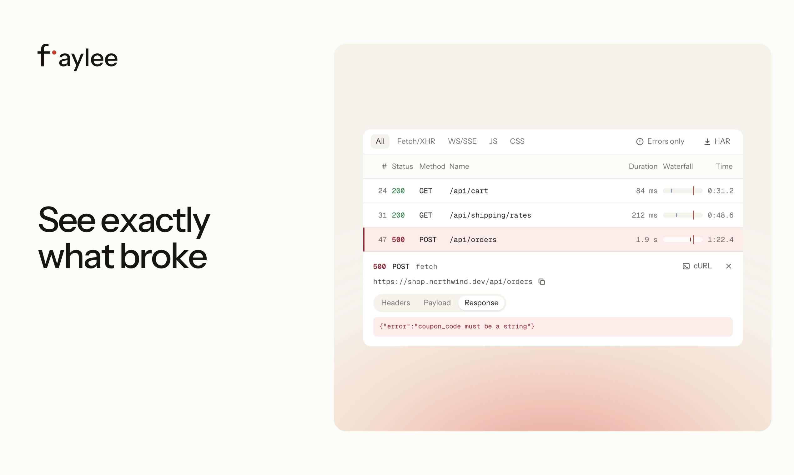
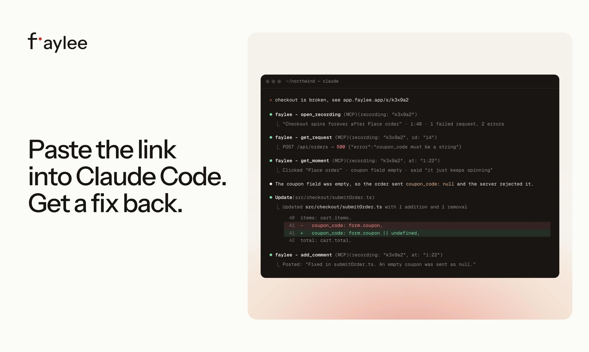
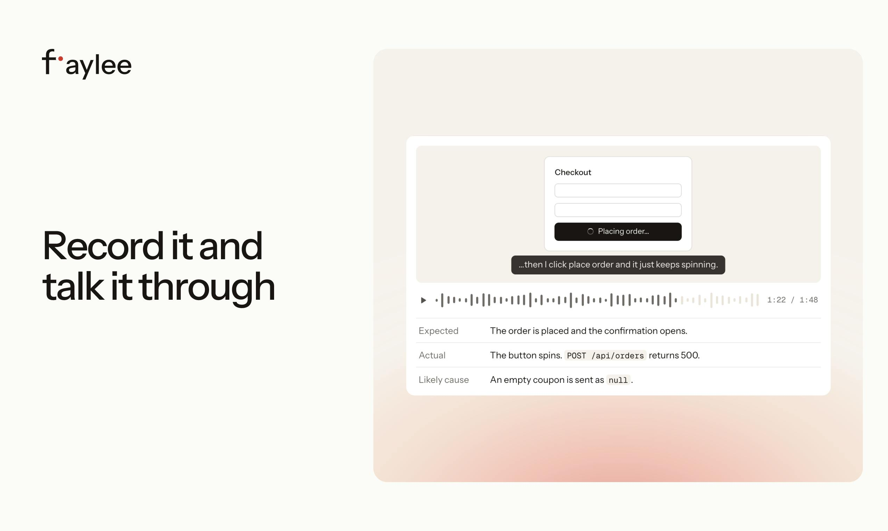

### 🎬 관련 영상
- [🎥 영상 보기](https://ph-files.imgix.net/f80dd324-b0a3-480c-81be-4dfd673c35dc.jpeg?auto=format)

---

## 12. [SparkBots AI (Powered by Jev)](https://www.producthunt.com/products/sparkbots-ai-analyze-pages-and-pdfs)
**Votes**: 87 | **도입 난이도**: 하 | **신뢰도**: 상
**Tagline**: Instantly extract key details and analyze any webpage or PDF
**서비스 링크**: https://www.producthunt.com/r/MSH46K62Z5PPIN

**태그**: Automation, Data Extraction, AI, Productivity, AI Tool, LLM, Chat

### 📌 이 서비스 한눈에 보기
웹페이지와 PDF에서 핵심 정보를 즉시 추출하고 분석하는 초고속 AI 자동화 도구

### 🔑 주요 기능
- 웹페이지 및 PDF 데이터의 심층 분석 및 자동 추출 기능
- 한 번 학습된 봇을 유사한 페이지에 즉시 적용하여 1초 미만의 빠른 응답 제공
- LLM의 환각 현상 없이 오직 문서 내 콘텐츠에 기반한 정확한 답변 제공

### 🙋 사용자에게 어떤 점이 좋은가
리드 발굴, 비즈니스 분석, 이력서 검토 등 반복적인 데이터 추출 업무를 자동화하여 작업 시간을 획기적으로 단축할 수 있습니다.

### ✅ 지금 바로 써볼 기능
- 분석이 필요한 웹페이지나 PDF 파일 업로드하기
- 특정 데이터 추출을 위한 SparkBot 학습시키기
- 학습된 봇을 사용하여 유사한 문서들 일괄 처리하기

### ⚠️ 사용 전 확인할 점
- 문서 내에 없는 정보는 답변하지 않으므로 추론이 필요한 작업에는 부적합할 수 있음
- 학습된 데이터 범위를 벗어나는 복잡한 질의에는 한계가 있을 수 있음

### 🧭 확인이 더 필요한 정보
학습된 봇의 대량 실행 시 발생하는 비용 구조나 API 연동 범위에 대한 정보가 명시되지 않았습니다.

### 📸 스크린샷 및 갤러리
_media_1.jpg)
_media_2.jpg)
_media_3.jpg)

### 🎬 관련 영상
- [🎥 영상 보기](https://ph-files.imgix.net/f908d0e7-fb42-42ad-94a7-363e7d95ac03.jpeg?auto=format)

---

## 13. [ilse](https://www.producthunt.com/products/ilse)
**Votes**: 86 | **도입 난이도**: 하 | **신뢰도**: 상
**Tagline**: Point at your app and your AI agent changes the code
**서비스 링크**: https://www.producthunt.com/r/JSFHGOGXTNVTBO

**태그**: DevTool, React, AI-Agent, UI/UX, Agent, AI Tool

### 📌 이 서비스 한눈에 보기
실행 중인 React 앱의 UI를 클릭만으로 즉시 수정하고 AI 에이전트와 연동하는 개발 도구

### 🔑 주요 기능
- 실행 중인 React 앱 위에 툴바를 얹어 시각적인 UI 수정 가능
- 단순한 스타일 수정은 즉시 반영되며, 복잡한 로직은 기존 AI 에이전트(Cursor, Claude 등)로 전달
- Pro 버전에서는 사용자 여정을 자동으로 수행하며 테스트하는 기능 제공

### 🙋 사용자에게 어떤 점이 좋은가
코드 파일을 일일이 찾을 필요 없이 브라우저 상에서 직관적으로 UI를 수정하고, AI 에이전트와 협업하여 개발 생산성을 극대화할 수 있습니다.

### ✅ 지금 바로 써볼 기능
- 기존 React 프로젝트에 툴바 설치하기
- UI 요소를 클릭하여 스타일 및 레이아웃 변경해보기
- 수정 사항을 Claude Code나 Cursor 같은 AI 에이전트로 전달하기

### ⚠️ 사용 전 확인할 점
- React 환경에 특화되어 있어 다른 프레임워크에서는 사용이 제한될 수 있음
- 복잡한 로직 수정 시 AI 에이전트와의 연동 과정이 필요함

### 🧭 확인이 더 필요한 정보
지원하는 프레임워크의 확장 범위와 AI 에이전트와의 구체적인 연동 방식에 대한 상세 정보가 필요합니다.

### 📸 스크린샷 및 갤러리
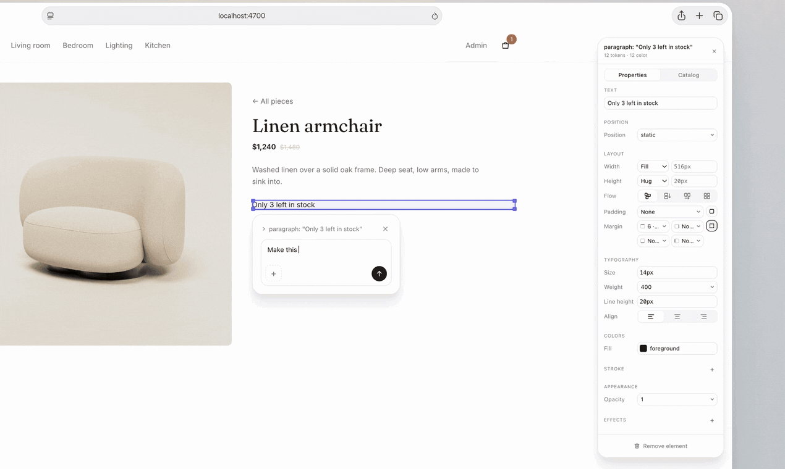

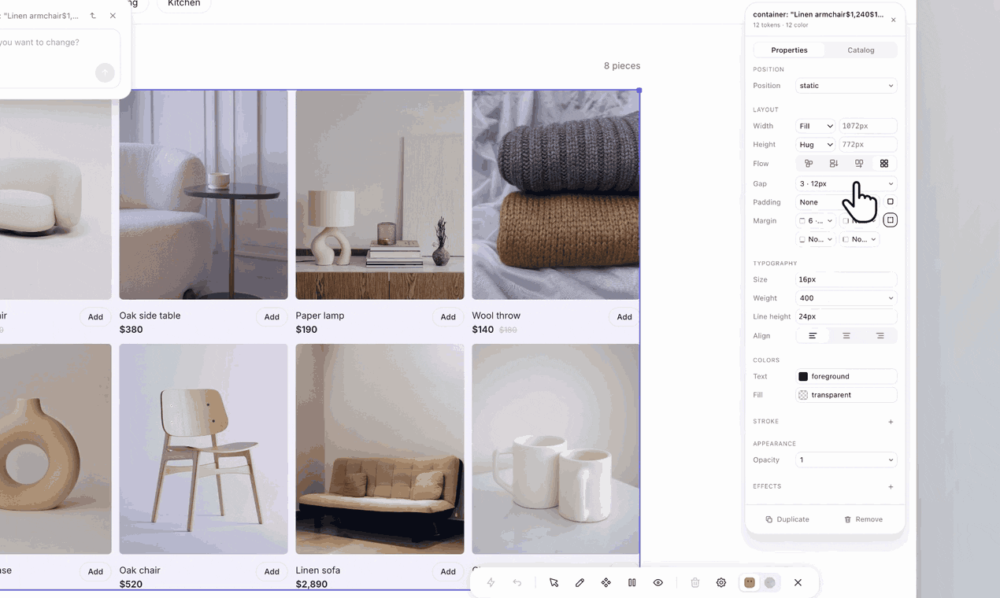

### 🎬 관련 영상
- [🎥 영상 보기](https://ph-files.imgix.net/4e108523-69fa-44d7-93ab-0205f23890ba.jpeg?auto=format)

---

## 14. [Cluinn](https://www.producthunt.com/products/cluinn)
**Votes**: 85 | **도입 난이도**: 하 | **신뢰도**: 상
**Tagline**: Answers your questions during the call, not after. For Mac.
**서비스 링크**: https://www.producthunt.com/r/U5LBV5MLEE36GZ

**태그**: Productivity, AI, Mac, Automation, AI Tool

### 📌 이 서비스 한눈에 보기
회의 중 실시간 답변과 자동 기록을 제공하는 Mac 전용 AI 비서

### 🔑 주요 기능
- 회의 중 실시간 질문 답변 및 미답변 질문 플래그 기능
- 회의 종료 후 자동 액션 아이템 정리 및 목표 달성도 분석
- Mac 앱 어디서든 사용 가능한 AI 받아쓰기 및 텍스트 정제

### 🙋 사용자에게 어떤 점이 좋은가
별도의 봇 참여 없이 Mac에서 실행되어 회의 흐름을 방해하지 않으면서도, 즉각적인 답변과 사후 정리를 도와 업무 효율을 높여줍니다.

### ✅ 지금 바로 써볼 기능
- 실시간 질문 답변 기능 테스트
- 회의 종료 후 생성되는 액션 아이템 확인
- AI 받아쓰기 기능을 통한 텍스트 정제 기능 활용

### ⚠️ 사용 전 확인할 점
- Apple Silicon Mac 환경에서만 작동함
- 14일 무료 체험 후 유료 전환 필요 (LAUNCH30 코드로 12개월간 30% 할인 가능)

### 🧭 확인이 더 필요한 정보
Apple Silicon Mac 외의 환경에서의 호환성 및 구체적인 보안 정책에 대한 정보가 필요합니다.

### 📸 스크린샷 및 갤러리
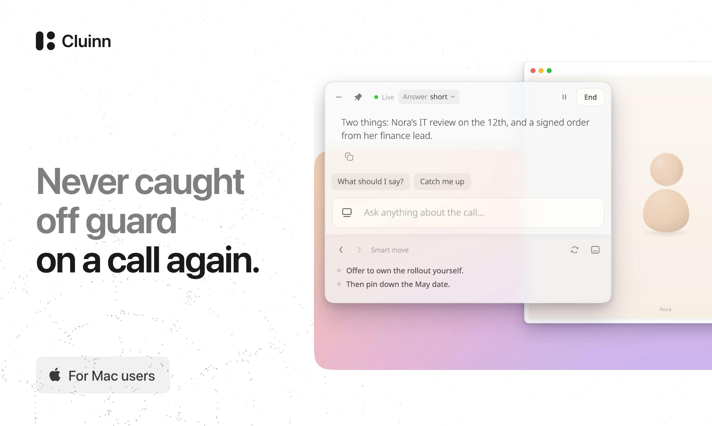
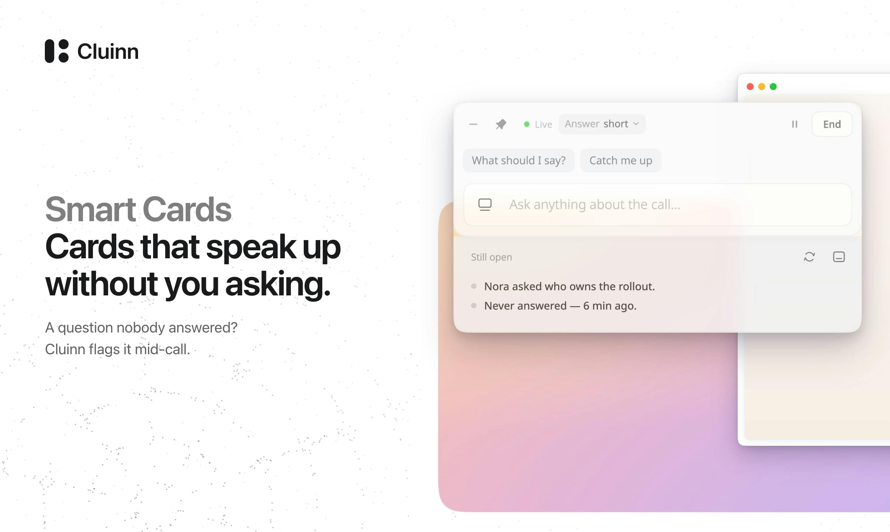
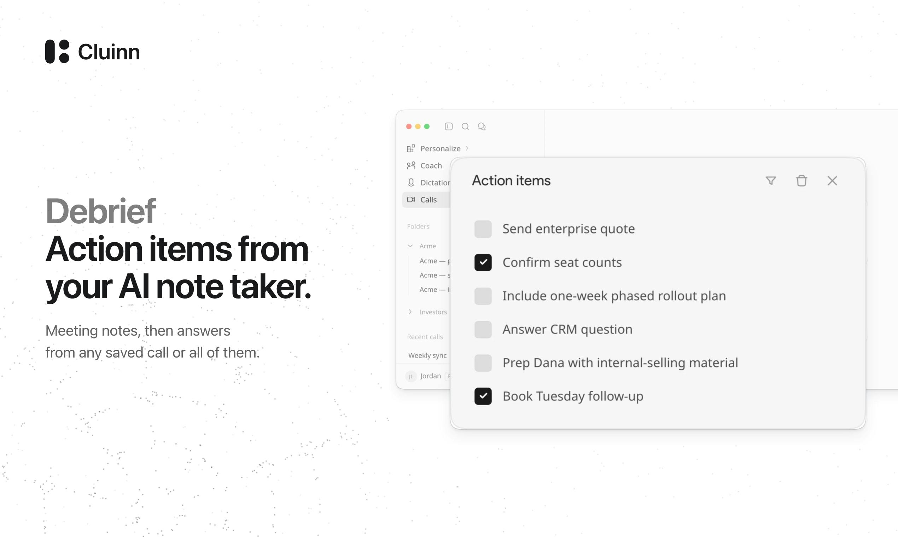

### 🎬 관련 영상
- [🎥 영상 보기](https://ph-files.imgix.net/0467d02e-6309-48a2-af70-d67ea664e362.jpeg?auto=format)

---

## 15. [Norah Studio](https://www.producthunt.com/products/norah-studio)
**Votes**: 79 | **도입 난이도**: 중 | **신뢰도**: 상
**Tagline**: A new space to explore your music
**서비스 링크**: https://www.producthunt.com/r/SI2R7YCO6UUDBB

**태그**: Music Production, Creative Tool, Apple Ecosystem, Audio Editing

### 📌 이 서비스 한눈에 보기
Mac, iPad, iPhone에서 음악을 탐구하고 재창조하는 올인원 크리에이티브 스튜디오

### 🔑 주요 기능
- 트랙 분리, 루프 생성, 템포 및 키 조절 등 강력한 음악 편집 기능
- 멜로디를 악기로 변환하거나 화음을 쌓는 창의적 워크플로우 제공
- 모든 작업이 기기 내에서 실행되는 온디바이스(On-device) 환경

### 🙋 사용자에게 어떤 점이 좋은가
애플 생태계 기기 간의 완벽한 동기화를 통해 언제 어디서나 전문적인 음악 작업과 아이디어 구현이 가능합니다.

### ✅ 지금 바로 써볼 기능
- 트랙 분리 및 루프 기능을 통한 샘플링 작업
- 멜로디를 악기로 변환하여 새로운 사운드 만들기
- 구독 또는 단판 구매를 통한 기기 간 Pro 기능 동기화 확인

### ⚠️ 사용 전 확인할 점
- 기기 성능에 따라 복잡한 프로젝트 작업 시 리소스 제한 가능성
- 애플 기기(Mac, iPad, iPhone) 환경에서만 사용 가능

### 🧭 확인이 더 필요한 정보
구독 모델과 일회성 구매 모델 간의 구체적인 기능 차이 및 상세 가격 정책 확인이 필요합니다.

### 📸 스크린샷 및 갤러리
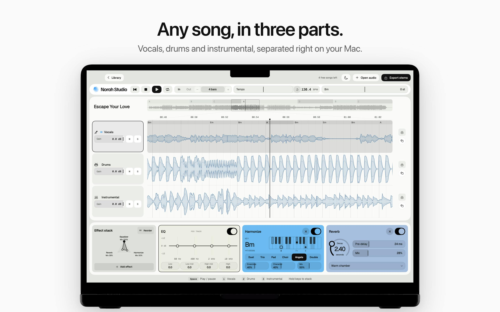
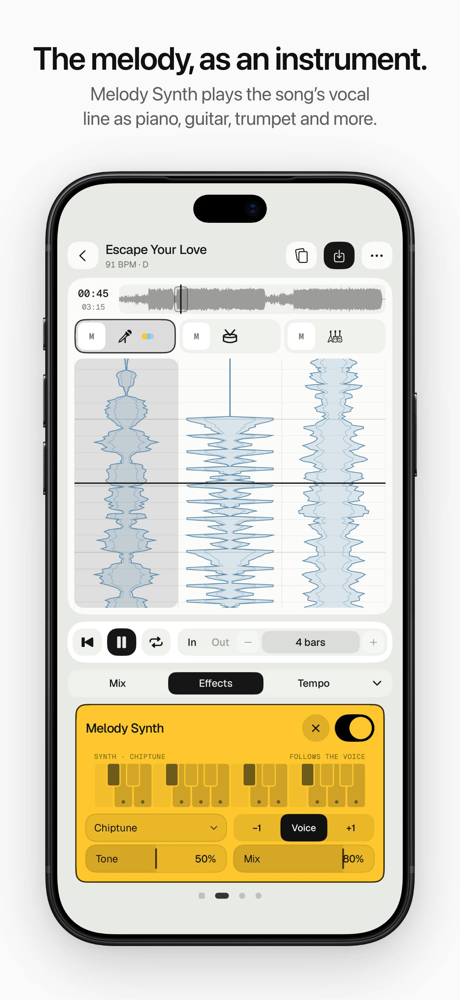
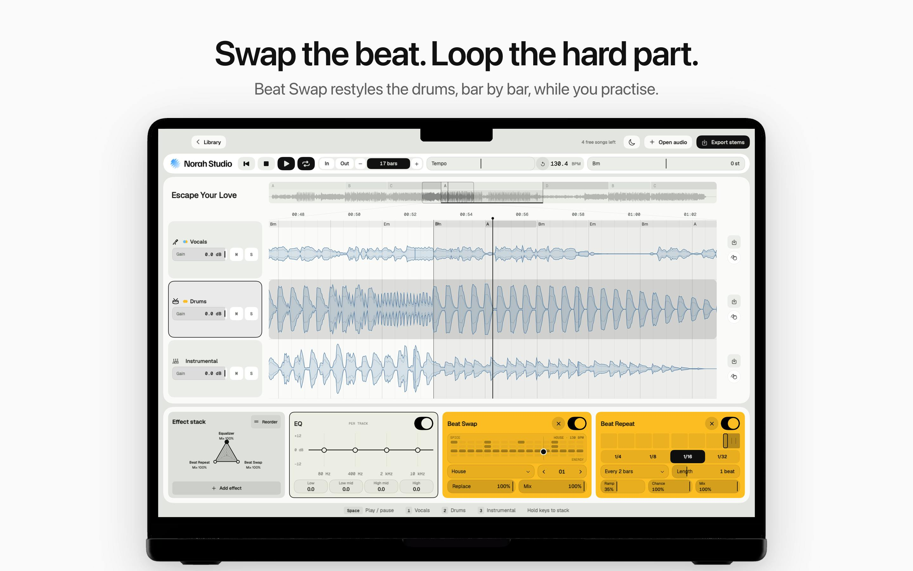

---

## 16. [Axonnic](https://www.producthunt.com/products/axonnic)
**Votes**: 75 | **도입 난이도**: 상 | **신뢰도**: 상
**Tagline**: Muscle-sensing sleeves for robot training
**서비스 링크**: https://www.producthunt.com/r/EI2FGOEUDNCIWB

**태그**: Robotics, AI Training, Hardware, Automation, AI Tool, Video

### 📌 이 서비스 한눈에 보기
로봇의 정밀한 손동작 학습을 위한 근육 신호 기반 웨어러블 슬리브

### 🔑 주요 기능
- 전완부 슬리브를 통한 실시간 근육 신호(EMG) 기록
- 손가락 움직임 추적 및 손가락 끝 힘(force) 추정 기능
- EMG, 비디오, 핸드 포즈를 결합한 고정밀 로봇 학습 데이터셋 제공

### 🙋 사용자에게 어떤 점이 좋은가
바느질이나 정밀 조립과 같이 섬세한 손기술이 필요한 로봇 작업의 학습 데이터를 효율적으로 생성할 수 있습니다.

### ✅ 지금 바로 써볼 기능
- 수집된 데이터셋의 정밀도 확인
- 특정 로봇 하드웨어와의 호환성 검토
- 정밀 조립 작업 시나리오 적용 테스트

### ⚠️ 사용 전 확인할 점
- 사용자 체형에 따른 슬리브 착용감 및 데이터 일관성 차이 가능성
- 복잡한 손동작 데이터의 실시간 처리 부하

### 🧭 확인이 더 필요한 정보
제공되는 데이터셋의 구체적인 포맷과 로봇 제어 프레임워크와의 통합 방식에 대한 정보가 필요합니다.

### 📸 스크린샷 및 갤러리
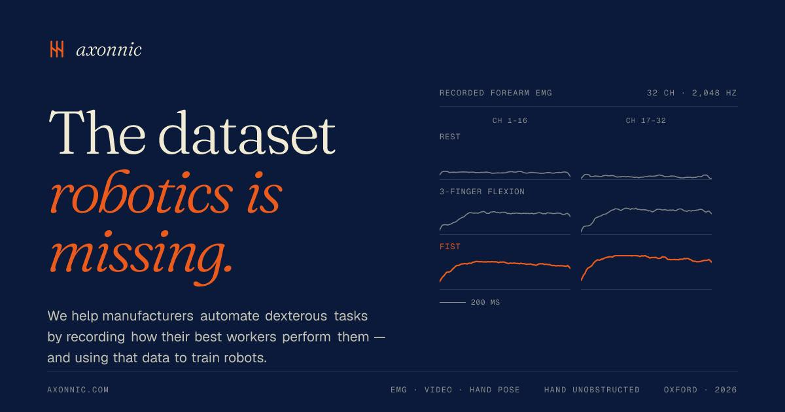

### 🎬 관련 영상
- [🎥 영상 보기](https://ph-files.imgix.net/7a93f7ce-2e49-4bd9-a608-7e6faca916d7.jpeg?auto=format)

---

## 17. [StepGrab](https://www.producthunt.com/products/stepgrab)
**Votes**: 73 | **도입 난이도**: 하 | **신뢰도**: 상
**Tagline**: Now on Windows, with redaction and a real editor
**서비스 링크**: https://www.producthunt.com/r/VW7EAC6CPQQEJ6

**태그**: Productivity, Documentation, Windows, Screenshot, AI Tool, Email

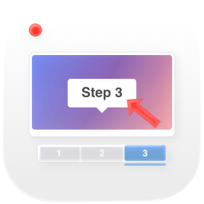

### 📌 이 서비스 한눈에 보기
클릭 한 번으로 가이드 제작부터 편집까지 끝내는 윈도우 지원 스크린샷 자동화 도구

### 🔑 주요 기능
- 클릭 시 자동으로 스크린샷, 화살표, 설명이 생성되는 자동 가이드 제작
- 개인정보 보호를 위한 강력한 블랙아웃(Redaction) 및 편집 기능
- 계정 생성이나 클라우드 업로드 없는 로컬 중심의 보안 설계

### 🙋 사용자에게 어떤 점이 좋은가
매뉴얼 제작 시 일일이 캡처하고 편집하는 번거로움을 줄여주며, 민감한 정보가 포함된 화면을 안전하게 가공하여 공유할 수 있습니다.

### ✅ 지금 바로 써볼 기능
- 클릭 동작이 자동으로 스크린샷과 텍스트로 변환되는 과정 확인
- 편집기에서 화살표, 박스 추가 및 단계 재배치 기능 테스트
- 개인정보 보호를 위한 블랙아웃(Redaction) 기능 적용해보기

### ⚠️ 사용 전 확인할 점
- 로컬 저장 방식이므로 기기 변경 시 데이터 이전 방식 확인 필요
- 무료 라이선스 수량이 제한적일 수 있음

### 🧭 확인이 더 필요한 정보
현재 제공되는 5개의 무료 평생 라이선스 배포 방식과 상세 운영 정책에 대한 확인이 필요합니다.

### 📸 스크린샷 및 갤러리
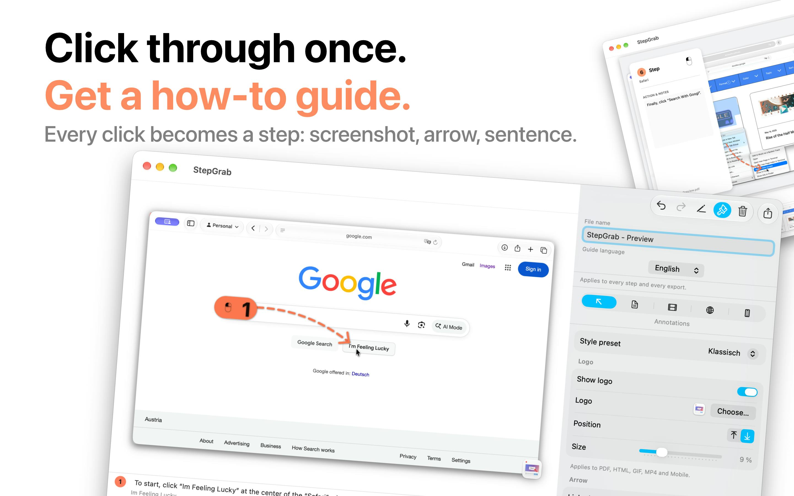
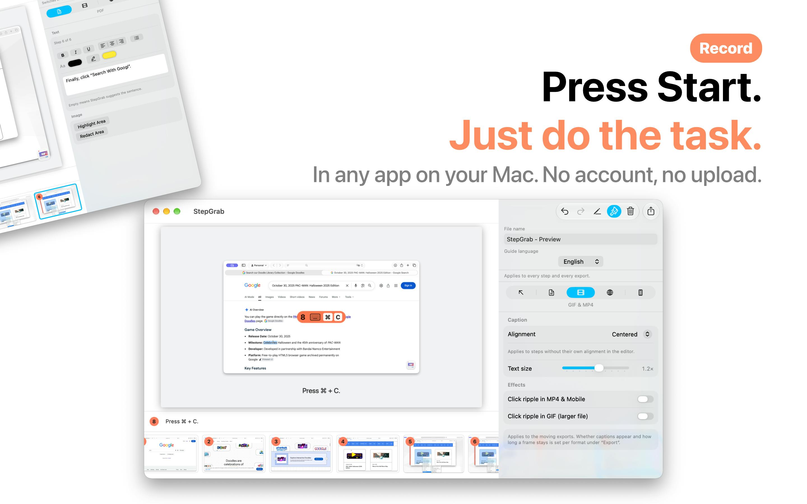
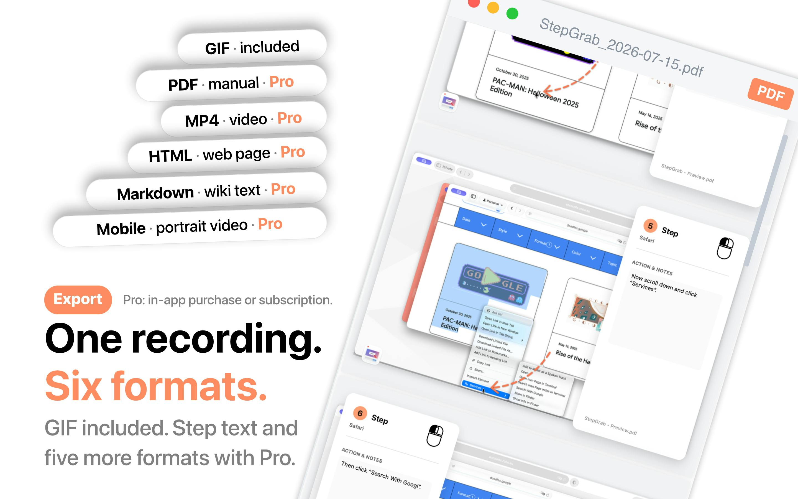

### 🎬 관련 영상
- [🎥 영상 보기](https://ph-files.imgix.net/13903d2b-7211-44dd-bccd-55170b863e08.jpeg?auto=format)

---

## 18. [Kestrix](https://www.producthunt.com/products/kestrix)
**Votes**: 73 | **도입 난이도**: 중 | **신뢰도**: 상
**Tagline**: Repo-agnostic CI control plane with DAG-based triggers.
**서비스 링크**: https://www.producthunt.com/r/KVS33SFEI3SAEO

**태그**: DevOps, CI/CD, Automation, HCL

### 📌 이 서비스 한눈에 보기
HCL 기반의 DAG 구조로 복잡한 CI/CD 파이프라인을 효율적으로 관리하는 리포지토리 불문 CI 컨트롤 플레인

### 🔑 주요 기능
- HCL을 통한 선언적 CI/CD 파이프라인 정의 및 DAG 기반 트리거 해결
- 코드 변경 사항에 따라 필요한 태스크만 실행되는 효율적인 워크플로우
- React Flow UI를 통한 실시간 태스크 로그 시각화 및 보안 중심의 아웃바운드 HTTPS 원격 러너

### 🙋 사용자에게 어떤 점이 좋은가
코드 변경 시 연관된 작업만 실행되어 리소스를 절약하며, 시각적인 UI를 통해 복잡한 파이프라인 흐름을 직관적으로 파악할 수 있습니다.

### ✅ 지금 바로 써볼 기능
- HCL을 이용한 파이프라인 정의 방식 검토
- React Flow UI를 통한 워크플로우 시각화 확인
- 보안 정책에 따른 원격 러너(Remote Runner) 설정 테스트

### ⚠️ 사용 전 확인할 점
- HCL 숙련도에 따른 초기 설정 난이도 존재
- 기존 CI/CD 도구와의 마이그레이션 복잡성

### 🧭 확인이 더 필요한 정보
지원하는 특정 클라우드 환경이나 기존 CI 도구(GitHub Actions, GitLab 등)와의 구체적인 통합 방식에 대한 상세 정보가 필요합니다.

### 📸 스크린샷 및 갤러리
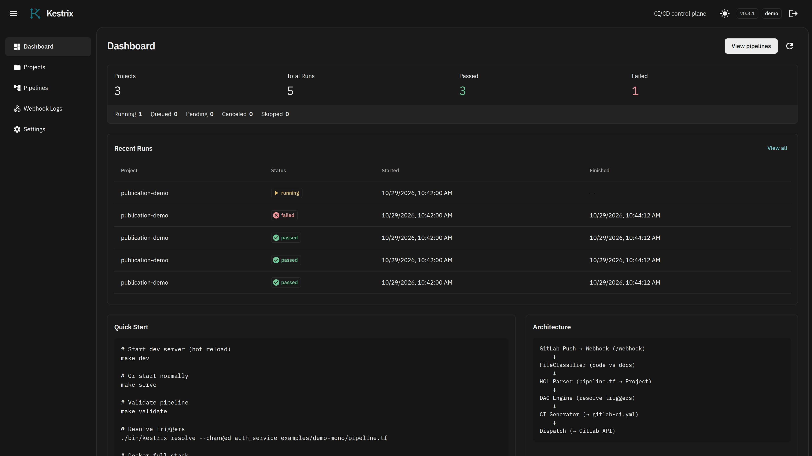
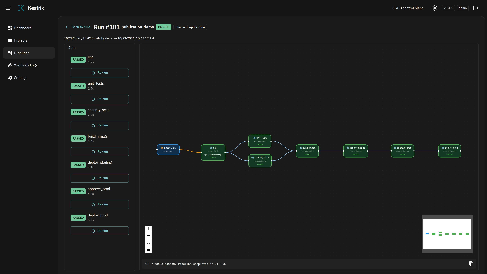
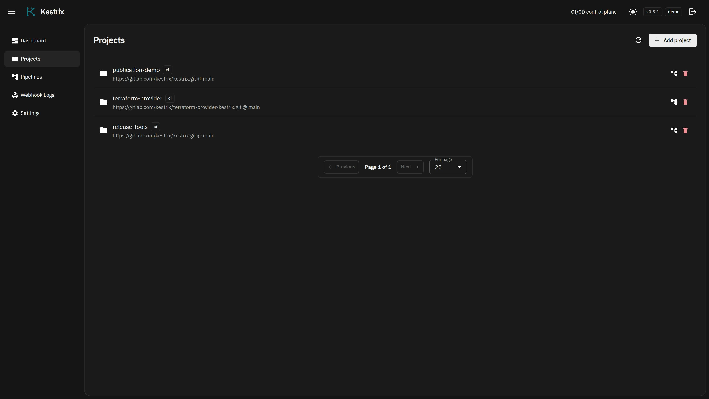

---

## 19. [StereoLift Live](https://www.producthunt.com/products/stereolift-live)
**Votes**: 71 | **도입 난이도**: 중 | **신뢰도**: 상
**Tagline**: your desktop in real 3D, live on your Quest
**서비스 링크**: https://www.producthunt.com/r/75DH3YDZXJY4EK

**태그**: VR, 3D, RemoteDesktop, NVIDIA, MetaQuest

### 📌 이 서비스 한눈에 보기
PC 데스크톱 화면을 메타 퀘스트에서 실감 나는 3D로 감상하는 솔루션

### 🔑 주요 기능
- Windows/Linux PC 화면을 스테레오스코픽 3D로 변환
- 로컬 네트워크를 통해 메타 퀘스트로 실시간 스트리밍
- NVIDIA GPU를 활용한 고성능 렌더링 지원

### 🙋 사용자에게 어떤 점이 좋은가
PC의 작업 화면이나 콘텐츠를 VR 헤드셋의 입체적인 공간에서 마치 실제 눈으로 보는 듯한 몰입감으로 확인할 수 있습니다.

### ✅ 지금 바로 써볼 기능
- NVIDIA GPU 기반 PC 환경 구축
- 로컬 네트워크 환경에서 메타 퀘스트 연결
- 3D 데스크톱 화면 스트리밍 테스트

### ⚠️ 사용 전 확인할 점
- NVIDIA GPU가 탑재된 PC가 필수적임
- 로컬 네트워크 대역폭에 따라 스트리밍 품질이 달라질 수 있음

### 🧭 확인이 더 필요한 정보
사용 중인 네트워크 환경에 따른 지연 시간(Latency) 및 화질 저하 여부를 확인해야 합니다.

### 📸 스크린샷 및 갤러리

### 🎬 관련 영상
- [🎥 영상 보기](https://ph-files.imgix.net/ef077b41-97ba-47e3-aeeb-16dc23759256.jpeg?auto=format)

---

## 20. [sitesolide](https://www.producthunt.com/products/sitesolide)
**Votes**: 69 | **도입 난이도**: 하 | **신뢰도**: 상
**Tagline**: Deploy your vibe-coded apps on your own server
**서비스 링크**: https://www.producthunt.com/r/NDIY2ZMUG2ZD7C

**태그**: DevTool, Deployment, OpenSource, AI-Native, AI Tool

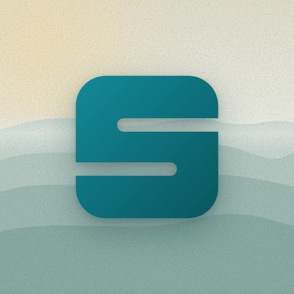

### 📌 이 서비스 한눈에 보기
AI로 만든 앱을 개인 서버에 즉시 배포할 수 있는 간편한 오픈소스 도구

### 🔑 주요 기능
- 터미널 명령 한 번으로 앱 배포 및 HTTPS 설정 완료
- 각 앱 간의 독립적인 격리 환경 제공
- 사용자 정의 접근 권한 설정 가능

### 🙋 사용자에게 어떤 점이 좋은가
Cursor나 Claude Code로 개발한 결과물을 복잡한 서버 설정 없이 즉시 온라인에 공개할 수 있습니다.

### ✅ 지금 바로 써볼 기능
- 로컬 프로젝트 폴더에서 'sitesolide deploy' 실행하기
- 개인 서버 환경에 설치 및 설정하기
- 배포된 앱의 접근 권한 설정 확인하기

### ⚠️ 사용 전 확인할 점
- 서버 비용과 도메인 비용은 사용자 본인 부담
- 자체 서버 운영에 따른 보안 및 관리 책임이 사용자에게 있음

### 🧭 확인이 더 필요한 정보
지원하는 프로그래밍 언어나 프레임워크의 종류에 대한 구체적인 명시는 없습니다.

### 📸 스크린샷 및 갤러리
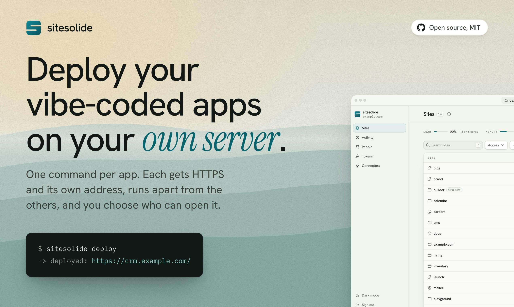
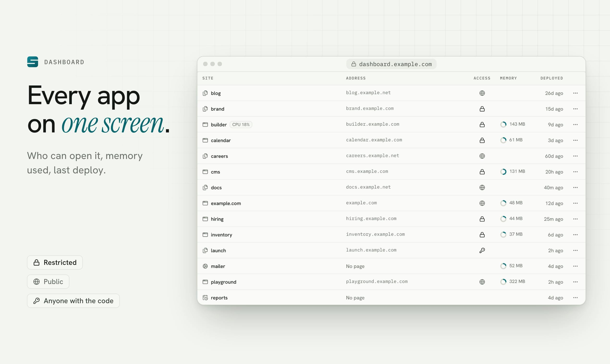
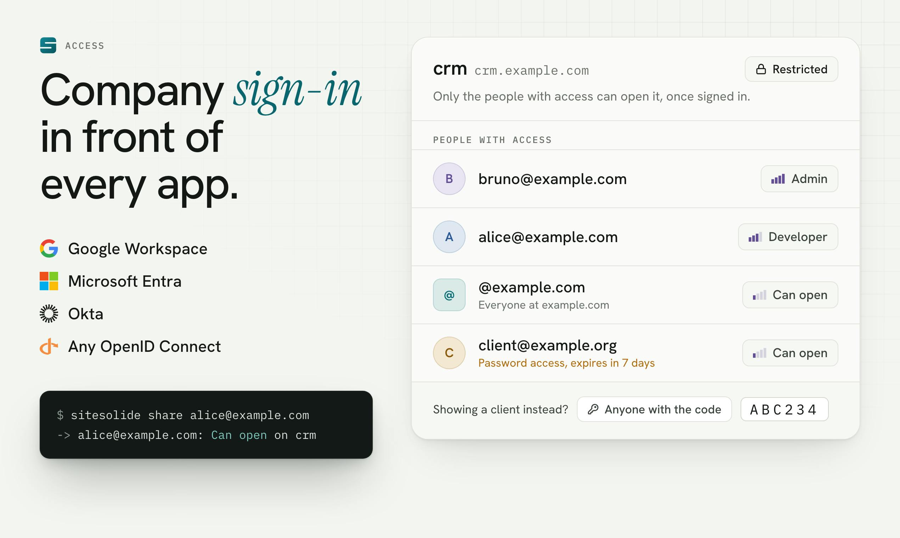

### 🎬 관련 영상
- [🎥 영상 보기](https://ph-files.imgix.net/96580334-4908-455d-909b-b51ef6e5c98d.jpeg?auto=format)

---

## 21. [Blooper.ai](https://www.producthunt.com/products/blooper)
**Votes**: 45 | **도입 난이도**: 하 | **신뢰도**: 상
**Tagline**: AI video workspace that learns from your team
**서비스 링크**: https://www.producthunt.com/r/LDZBDYOYXSSP54

**태그**: VideoAI, Collaboration, Productivity, CreativeTool, AI Tool, Video

### 📌 이 서비스 한눈에 보기
팀의 창의적 의사결정을 학습하여 효율적인 영상 제작을 돕는 AI 워크스페이스

### 🔑 주요 기능
- 팀의 스타일과 결정 사항을 기억하는 AI 학습 기능
- 반복 작업을 줄여 토큰 소모를 최적화하는 워크플로우
- 영상 제작의 모든 과정을 한 곳에서 처리하는 통합 환경

### 🙋 사용자에게 어떤 점이 좋은가
팀원들의 피드백과 스타일이 반영되어 반복적인 수정 작업을 줄이고 제작 비용을 절감할 수 있습니다.

### ✅ 지금 바로 써볼 기능
- 팀의 스타일 가이드 입력하기
- 기존 영상 소스 업로드 및 학습시키기
- 반복적인 편집 작업 자동화 테스트하기

### ⚠️ 사용 전 확인할 점
- 학습 데이터 양에 따른 결과물 품질 차이 가능성
- 팀 규모에 따른 토큰 소모 및 비용 구조 확인 필요

### 🧭 확인이 더 필요한 정보
팀의 의사결정을 학습하는 구체적인 방식과 데이터 보안 정책에 대한 확인이 필요합니다.

### 📸 스크린샷 및 갤러리

---

## 22. [Prosyo](https://www.producthunt.com/products/prosyo)
**Votes**: 30 | **도입 난이도**: 하 | **신뢰도**: 상
**Tagline**: AI SDR that books meetings - run it from ChatGPT or Claude
**서비스 링크**: https://www.producthunt.com/r/VVZFGQP35P6DJL

**태그**: Sales Automation, AI, B2B, Lead Generation, AI Tool, Chat, Email

### 📌 이 서비스 한눈에 보기
ChatGPT나 Claude를 통해 타겟을 지정하면 미팅 예약까지 자동으로 수행하는 AI 영업 담당자(SDR)

### 🔑 주요 기능
- LLM(ChatGPT, Claude) 기반의 직관적인 타겟팅 및 메시지 작성
- ICP에 맞는 잠재 고객 발굴, 이메일/전화번호 검증 및 자동화된 아웃바운드 실행
- LinkedIn과 이메일을 통합 관리하며, 모든 답장(음성/첨부파일 포함)을 하나의 인박스에서 확인

### 🙋 사용자에게 어떤 점이 좋은가
별도의 복잡한 설정 없이 대화형 AI로 영업 프로세스를 자동화하여, 리드 발굴부터 미팅 예약까지의 시간을 획기적으로 단축할 수 있습니다.

### ✅ 지금 바로 써볼 기능
- ChatGPT/Claude를 연동하여 타겟 고객 리스트 생성하기
- 검증된 연락처를 바탕으로 개인화된 아웃바운드 시퀀스 실행하기
- 통합 인박스에서 AI가 작성한 답안 초안 검토 및 발송하기

### ⚠️ 사용 전 확인할 점
- 사용자 본인의 계정으로 실행되므로 계정 보안 및 스팸 정책 준수 필요
- 검증된 연락처에 대해서만 비용이 발생하므로 데이터 품질 확인 필요

### 🧭 확인이 더 필요한 정보
사용자 계정 연동 시 발생할 수 있는 보안 정책 및 플랫폼(LinkedIn 등)의 제재 가능성을 확인해야 합니다.

### 📸 스크린샷 및 갤러리

### 🎬 관련 영상
- [🎥 영상 보기](https://ph-files.imgix.net/2ac01478-17a5-43f6-83c4-07331a8926c9.jpeg?auto=format)

---

## 23. [coffeechat.me](https://www.producthunt.com/products/coffeechat-me)
**Votes**: 12 | **도입 난이도**: 하 | **신뢰도**: 상
**Tagline**: Warm scheduling for real conversations
**서비스 링크**: https://www.producthunt.com/r/JBIFTQ5YYSV3NF

**태그**: Productivity, Networking, Scheduling, Chat

### 📌 이 서비스 한눈에 보기
단순한 미팅 예약을 넘어, 대화의 목적을 확인하고 만남을 선택하는 따뜻한 스케줄링 도구

### 🔑 주요 기능
- 단순 업무 미팅이 아닌 개인적인 커피챗을 위한 전용 링크 제공
- 상대방이 대화 목적을 미리 공유할 수 있는 기능
- 사용자가 대화 상대와 내용을 확인한 후 만남 여부를 직접 결정

### 🙋 사용자에게 어떤 점이 좋은가
무분별한 미팅 요청으로부터 시간을 보호하면서도, 의미 있는 네트워킹 기회를 선별하여 관리할 수 있습니다.

### ✅ 지금 바로 써볼 기능
- 개인용 커피챗 링크 생성하기
- 상대방의 대화 요청 메시지 확인하기
- 만남 수락 또는 거절하기

### ⚠️ 사용 전 확인할 점
- 업무 중심의 정형화된 미팅 관리에는 적합하지 않을 수 있음
- 상대방의 제안 내용에 따라 만남의 질이 결정됨

### 🧭 확인이 더 필요한 정보
현재 제공되는 기능 외에 구체적인 가격 정책이나 외부 캘린더 연동 범위는 명시되지 않았습니다.

### 📸 스크린샷 및 갤러리

---

## 24. [Relic AI](https://www.producthunt.com/products/relic-ai)
**Votes**: 12 | **도입 난이도**: 하 | **신뢰도**: 상
**Tagline**: Save links, PDFs and videos in one click, then ask them.
**서비스 링크**: https://www.producthunt.com/r/OWADOINEJWQGDH

**태그**: Productivity, AI, KnowledgeManagement, ChromeExtension, AI Tool, Video

### 📌 이 서비스 한눈에 보기
저장한 모든 자료를 한곳에 모으고, AI로 즉시 질문하여 답을 얻는 개인 지식 저장소

### 🔑 주요 기능
- 링크, PDF, 유튜브, 노션, 구글 드라이브 등 다양한 소스 통합 저장
- 저장된 자료를 기반으로 답변하며 출처를 번호로 명시하는 신뢰성 있는 AI
- 자동 요약 및 태깅 기능과 읽을거리를 제안하는 주간 다이제스트 제공

### 🙋 사용자에게 어떤 점이 좋은가
흩어져 있는 정보들을 일일이 찾을 필요 없이, 저장만 하면 AI가 맥락을 파악해 필요한 정보를 즉각 찾아줍니다.

### ✅ 지금 바로 써볼 기능
- 크롬 확장 프로그램을 설치하여 한 번의 클릭으로 자료 저장하기
- 기존 노션이나 구글 드라이브 데이터 임포트하기
- 저장된 라이브러리에 질문하여 필요한 정보 추출하기

### ⚠️ 사용 전 확인할 점
- 현재 베타 버전이므로 기능이 변경되거나 서비스 정책이 바뀔 수 있음
- 외부 서비스(Notion, Google Drive) 연동 시 데이터 접근 권한 설정 필요

### 🧭 확인이 더 필요한 정보
베타 기간 종료 후의 유료화 플랜 및 상세 가격 정책은 아직 공개되지 않았습니다.

### 📸 스크린샷 및 갤러리

### 🎬 관련 영상
- [🎥 영상 보기](https://ph-files.imgix.net/55604e35-4338-4033-b069-d00d2c78f0e8.jpeg?auto=format)

---

## 25. [Minted](https://www.producthunt.com/products/minted-2)
**Votes**: 11 | **도입 난이도**: 하 | **신뢰도**: 상
**Tagline**: Turn SVG into a physically-lit 3D gold medallion for SwiftUI
**서비스 링크**: https://www.producthunt.com/r/3IK3BXBUZWOD7Z

**태그**: SwiftUI, DesignTool, iOS, 3D, DevTool

### 📌 이 서비스 한눈에 보기
SVG 파일을 실감 나는 3D 골드 메달리온 디자인으로 변환해주는 SwiftUI 전용 라이브러리

### 🔑 주요 기능
- 2D SVG 경로를 기반으로 물리적 조명 효과가 적용된 3D 금속 질감 생성
- 별도의 3D 모델 파일 없이 코드만으로 정교한 핀/코인 디자인 구현
- 에나멜 질감, 각인, 오렌지 껍질 패턴 등 디테일한 렌더링 지원

### 🙋 사용자에게 어떤 점이 좋은가
추가적인 3D 에셋 관리 없이도 SwiftUI 앱 내에서 고품질의 물리적 질감을 가진 UI 요소를 즉시 구현할 수 있습니다.

### ✅ 지금 바로 써볼 기능
- 제공되는 6가지 샘플 핀 디자인 적용해보기
- 보유 중인 SVG 파일을 사용하여 커스텀 메달리온 생성하기
- Swift Package Manager를 통한 프로젝트 통합 테스트

### ⚠️ 사용 전 확인할 점
- iOS 17+ 및 Swift 5.9+ 환경 필수
- 2D SVG 경로의 복잡도에 따라 생성되는 3D 결과물의 디테일이 달라질 수 있음

### 🧭 확인이 더 필요한 정보
사용자의 SVG 파일 복잡도에 따른 렌더링 성능 및 최적화 수준에 대한 구체적인 정보는 명시되지 않았습니다.

### 📸 스크린샷 및 갤러리

---

## 26. [CaptureHop](https://www.producthunt.com/products/capturehop)
**Votes**: 10 | **도입 난이도**: 하 | **신뢰도**: 상
**Tagline**: Download your Meta Quest captures over home Wi-Fi
**서비스 링크**: https://www.producthunt.com/r/QHSBYU3UHTOBTC

**태그**: VR, Utility, FileTransfer, MetaQuest, AI Tool, Video

### 📌 이 서비스 한눈에 보기
Meta Quest의 스크린샷과 영상을 홈 Wi-Fi를 통해 PC나 스마트폰으로 간편하게 전송하는 도구

### 🔑 주요 기능
- Meta Quest 3 및 s 모델의 캡처 파일 다운로드 지원
- 별도의 계정 생성이나 전용 수신기 앱 설치 불필요
- 브라우저 기반 페어링 및 게임별 분류 기능 제공

### 🙋 사용자에게 어떤 점이 좋은가
복잡한 케이블 연결 없이도 VR 기기에서 찍은 고화질 영상과 사진을 무선으로 빠르게 옮길 수 있습니다.

### ✅ 지금 바로 써볼 기능
- 제공되는 APK 파일을 설치하여 브라우저 페어링 시도하기
- 게임별로 분류된 캡처 파일 확인 및 원본 파일 다운로드하기

### ⚠️ 사용 전 확인할 점
- 현재 무료 퍼블릭 베타 단계이므로 안정성이 완벽하지 않을 수 있음
- 동일한 홈 Wi-Fi 네트워크 환경 내에서만 작동함

### 🧭 확인이 더 필요한 정보
베타 버전이므로 향후 정식 출시 시 유료화 여부나 추가 기능 지원 여부가 불투명합니다.

### 📸 스크린샷 및 갤러리

---

## 27. [opencommerce](https://www.producthunt.com/products/opencommerce)
**Votes**: 9 | **도입 난이도**: 중 | **신뢰도**: 상
**Tagline**: OpenRouter for commerce: one endpoint, every online store
**서비스 링크**: https://www.producthunt.com/r/NH2E6PJCGL4SML

**태그**: AI, Automation, DevTool, E-commerce, Agent, AI Tool

### 📌 이 서비스 한눈에 보기
단일 엔드포인트로 모든 온라인 쇼핑몰의 검색부터 결제까지 처리하는 AI 에이전트용 커머스 SDK

### 🔑 주요 기능
- 단일 엔드포인트를 통한 통합 커머스 인터페이스 제공
- 카탈로그 검색, 결제, 주문 추적 기능을 하나의 SDK로 통합
- 20초 이내에 상품 검색부터 구매까지 완료하는 초고속 프로세스

### 🙋 사용자에게 어떤 점이 좋은가
AI 에이전트 개발자가 복잡한 쇼핑몰별 API 연동 없이도 에이전트가 직접 물건을 구매할 수 있는 환경을 구축할 수 있습니다.

### ✅ 지금 바로 써볼 기능
- SDK를 활용한 카탈로그 검색 기능 테스트
- 엔드포인트를 통한 결제 프로세스 워크플로우 검증
- 에이전트 자동화 시나리오에 통합 테스트

### ⚠️ 사용 전 확인할 점
- 지원되는 온라인 스토어의 범위 및 호환성 확인 필요
- 결제 보안 및 에이전트 권한 관리 체계 검토 필요

### 🧭 확인이 더 필요한 정보
지원 가능한 온라인 스토어 목록과 결제 수단 연동 방식에 대한 상세 정보가 필요합니다.

### 📸 스크린샷 및 갤러리

---

## 28. [AI-Atlas](https://www.producthunt.com/products/ai-atlas)
**Votes**: 9 | **도입 난이도**: 하 | **신뢰도**: 상
**Tagline**: Your GitHub’s AI projects, scored from the actual code
**서비스 링크**: https://www.producthunt.com/r/K34LV3OHAGXS3X

**태그**: DevTool, AI, GitHub, Analytics, Agent, AI Tool, LLM

### 📌 이 서비스 한눈에 보기
코드 실력을 기반으로 GitHub AI 프로젝트의 가치를 검증하고 점수화하는 분석 도구

### 🔑 주요 기능
- 단순 스타 수나 팔로워가 아닌 실제 코드를 분석하여 프로젝트 가치 평가
- ML, CV, NLP, AI Agents 등 6개 분야에 걸친 7단계 루브릭 기반 점수 제공
- GitHub 프로필 매핑을 통해 파일 수준의 근거와 개선 로드맵 제공

### 🙋 사용자에게 어떤 점이 좋은가
자신의 AI 프로젝트 역량을 객관적인 데이터로 증명하고, 코드 기반의 개선 방향을 설정하는 데 유용합니다.

### ✅ 지금 바로 써볼 기능
- 자신의 GitHub 프로필 무료 매핑하기
- 파일 수준의 상세 분석 결과 확인하기
- README에 실시간 점수 배지 추가하기

### ⚠️ 사용 전 확인할 점
- 공개된 GitHub 코드만을 대상으로 하므로 비공개 저장소 분석 불가
- 자동화된 점수 산출 방식이므로 코드의 질적 측면과 완벽히 일치하지 않을 수 있음

### 🧭 확인이 더 필요한 정보
점수 산출 알고리즘의 세부 로직과 데이터 업데이트 주기에 대한 상세 정보가 필요합니다.

### 📸 스크린샷 및 갤러리

### 🎬 관련 영상
- [🎥 영상 보기](https://ph-files.imgix.net/51413234-6311-456c-9725-d37077780a96.jpeg?auto=format)

---

## 29. [Tadado](https://www.producthunt.com/products/tadado-ai-word-guessing-game)
**Votes**: 9 | **도입 난이도**: 하 | **신뢰도**: 상
**Tagline**: Halloween edition: New Imposter mode and free spooky deck
**서비스 링크**: https://www.producthunt.com/r/T5QELTHDO67VAR

**태그**: PartyGame, Social, AI, Halloween, AI Tool, Design

### 📌 이 서비스 한눈에 보기
할로윈 테마로 새롭게 단장한 파티 게임, 새로운 '임포스터 모드'와 무료 스푸키 덱 출시

### 🔑 주요 기능
- 새로운 '임포스터 모드': 한 명의 플레이어를 제외하고 모두가 비밀 단어를 공유하며 벌이는 심리전
- 할로윈 에디션: 전면적인 디자인 리뉴얼 및 14개 언어(아랍어 포함) 지원
- AI 기반 덱 생성: 어떤 주제든 몇 초 만에 플레이 가능한 게임 덱으로 변환

### 🙋 사용자에게 어떤 점이 좋은가
친구들과 모인 자리에서 새로운 게임 모드와 AI 생성 기능을 통해 즉석에서 즐거운 파티 분위기를 만들 수 있습니다.

### ✅ 지금 바로 써볼 기능
- 새로운 임포스터 모드로 심리전 즐기기
- 무료로 제공되는 할로윈 스푸키 덱 사용하기
- AI 기능을 활용해 원하는 주제로 게임 덱 만들기

### ⚠️ 사용 전 확인할 점
- 할로윈 한정 에디션의 경우 이벤트 종료 후 디자인이나 무료 혜택이 변경될 수 있음

### 🧭 확인이 더 필요한 정보
할로윈 무료 덱의 제공 기간과 향후 유료 전환 여부에 대한 구체적인 일정은 명시되지 않았습니다.

### 📸 스크린샷 및 갤러리

### 🎬 관련 영상
- [🎥 영상 보기](https://ph-files.imgix.net/3e283d87-7329-4388-9115-7daae763823b.jpeg?auto=format)

---

## 30. [Bento](https://www.producthunt.com/products/bento-10)
**Votes**: 8 | **도입 난이도**: 하 | **신뢰도**: 상
**Tagline**: Tidy your Mac desktop in one click, and keep it that way
**서비스 링크**: https://www.producthunt.com/r/U7WKNKNCNBXMO6

**태그**: Productivity, macOS, Desktop Management, Automation

### 📌 이 서비스 한눈에 보기
클릭 한 번으로 맥 데스크탑을 깔끔한 폴더 구조로 정리해주는 데스크탑 관리 도구

### 🔑 주요 기능
- 데스크탑 파일을 실제 폴더로 자동 분류하여 깔끔한 박스 형태로 시각화
- 삭제 없이 정리하며, 실수 시 되돌리기(Undo) 기능 지원
- 스크린샷 자동 분류 및 텍스트 검색 기능 제공

### 🙋 사용자에게 어떤 점이 좋은가
지저분한 데스크탑 파일을 수동 정리하는 번거로움을 없애고, 파일 유실 걱정 없이 체계적인 작업 환경을 구축할 수 있습니다.

### ✅ 지금 바로 써볼 기능
- 데스크탑 파일들을 Bento의 자동 분류 기능으로 정리해보기
- 스크린샷 내 텍스트 검색 기능 테스트하기
- 가격 인상 전(11월 6일 이전) $5로 영구 소장하기

### ⚠️ 사용 전 확인할 점
- macOS 14 이상의 운영체제 필요
- 11월 6일 이후에는 가격이 $12로 인상됨

### 🧭 확인이 더 필요한 정보
파일 정리 방식이 사용자의 기존 폴더 구조와 어떻게 상호작용하는지에 대한 상세 규칙은 명시되지 않았습니다.

### 📸 스크린샷 및 갤러리

### 🎬 관련 영상
- [🎥 영상 보기](https://ph-files.imgix.net/ede5f358-4188-450c-bcb8-31ee5e43bbd5.jpeg?auto=format)

---

