# 🚀 Product Hunt Daily Top 30 (2026-11-06)

## 오늘의 요약
오늘의 트렌드는 AI 에이전트가 단순한 채팅을 넘어 실제 하드웨어, 클라우드 환경, 그리고 인간의 승인 절차와 유기적으로 결합되는 '에이전틱 워크플로우(Agentic Workflow)'의 구체화로 나타났습니다. 에이전트에게 독립적인 컴퓨팅 자원을 제공하거나, 인간과 에이전트 간의 협업 및 의사결정 과정을 최적화하는 인프라 성격의 서비스들이 주목받았습니다.

### 오늘의 핵심 포인트
- AI 에이전트가 실제 기기(iPhone, Mac)나 클라우드 환경에서 독립적으로 동작할 수 있는 실행 인프라가 강화되었습니다.
- 에이전트와 인간 사이의 승인, 메모리 공유, 화상 회의 참여 등 협업 및 제어를 위한 인터페이스 기술이 발전하고 있습니다.
- AI 서비스의 수익화를 위한 실시간 과금 체계와 브랜드 일관성을 유지하기 위한 컨텍스트 레이어 등 운영 효율화 도구들이 등장했습니다.

**오늘의 태그**: AI 에이전트, 자동화 워크플로우, 에이전틱 AI, AI 인프라, 협업 도구

## 1. [Glasshand](https://www.producthunt.com/products/glasshand)
**Votes**: 275 | **도입 난이도**: 중 | **신뢰도**: 상
**Tagline**: Give your agent a real iPhone and Mac
**서비스 링크**: https://www.producthunt.com/r/4HPTGSLZ23MFLT

**태그**: AI, Automation, DevTools, Hardware, Agent, AI Tool, Prompting, DevTool

### 📌 이 서비스 한눈에 보기
AI 에이전트가 실제 iPhone과 Mac을 직접 조작할 수 있게 해주는 하드웨어 렌탈 서비스

### 🔑 주요 기능
- 데이터 센터에 위치한 실제 iPhone 및 Mac 하드웨어 제공
- Claude Code, Codex 등 AI 에이전트와 연동하여 실기기 제어 가능
- SNS 포스팅, 앱 빌드/테스트, 서비스 예약 등 실제 사용자처럼 동작 가능

### 🙋 사용자에게 어떤 점이 좋은가
에뮬레이터가 아닌 실제 기기 환경이 필요한 AI 에이전트 개발자나 자동화 작업자에게 실질적인 테스트 및 운영 환경을 제공합니다.

### ✅ 지금 바로 써볼 기능
- 에이전트와 기기 간 연결 테스트
- 실제 iOS 앱 빌드 및 배포 워크플로우 검증
- SNS 자동화 작업 수행

### ⚠️ 사용 전 확인할 점
- 물리적 하드웨어 기반이므로 소프트웨어 에뮬레이터 대비 비용 및 지연 시간 발생 가능성
- 에이전트의 기기 제어 권한 설정 및 보안 정책 확인 필요

### 🧭 확인이 더 필요한 정보
구체적인 기기 사양(모델명, OS 버전) 및 상세 가격 정책에 대한 정보가 명시되지 않았습니다.

### 📸 스크린샷 및 갤러리

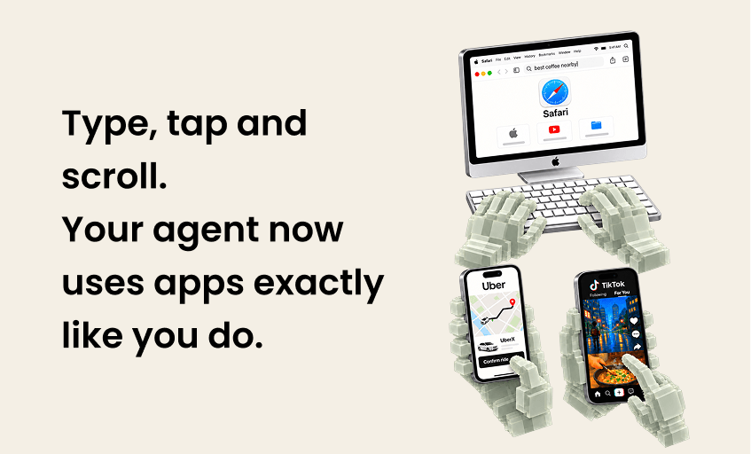

### 🎬 관련 영상
- [🎥 영상 보기](https://ph-files.imgix.net/86e4cd3b-d8be-4b99-84f5-4224223f6083.jpeg?auto=format)

---

## 2. [Rerun](https://www.producthunt.com/products/rerun-2)
**Votes**: 181 | **도입 난이도**: 중 | **신뢰도**: 상
**Tagline**: Turn your AI subscriptions into a team of coworkers
**서비스 링크**: https://www.producthunt.com/r/RMMH5HQHCIQO64

**태그**: AI, Automation, OpenSource, Productivity, AI Tool, Chat

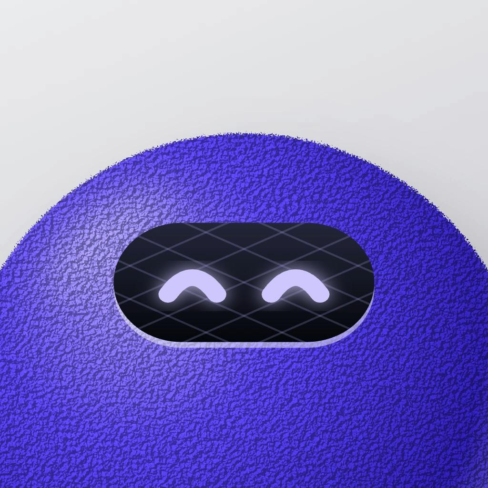

### 📌 이 서비스 한눈에 보기
개인용 AI 구독을 팀 단위의 자동화 워크플로우로 변환하는 오픈소스 도구

### 🔑 주요 기능
- ChatGPT/Claude 구독을 활용한 AI 에이전트 팀 구축
- 도구 사용, 컴퓨터 제어, 공유 워크스페이스 기능 제공
- 스케줄링 또는 트리거 기반의 자동 실행 지원

### 🙋 사용자에게 어떤 점이 좋은가
단순 채팅을 넘어 AI가 스스로 도구를 사용하며 업무를 수행하게 함으로써, 반복적인 업무를 자동화된 팀 단위로 위임할 수 있습니다.

### ✅ 지금 바로 써볼 기능
- 기존 AI 구독 계정 연결하기
- 에이전트별 도구 및 권한 설정하기
- 자동화 스케줄 또는 트리거 설정하기

### ⚠️ 사용 전 확인할 점
- AI의 위험한 작업 수행 전 승인 절차 확인 필요
- 셀프 호스팅 시 서버 관리 및 보안 책임 발생

### 🧭 확인이 더 필요한 정보
사용자의 기존 AI 구독 플랜에 따른 API 사용량 및 기능 제한 여부를 확인해야 합니다.

### 📸 스크린샷 및 갤러리
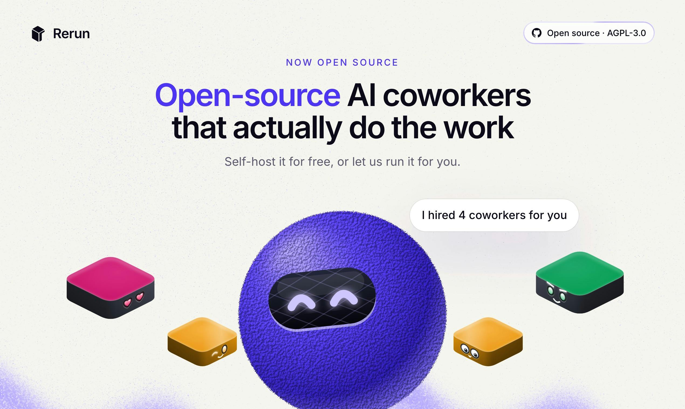
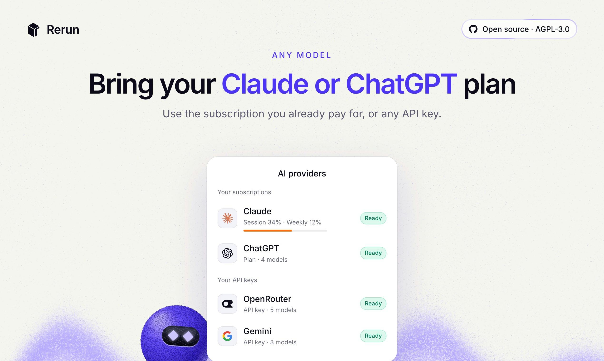
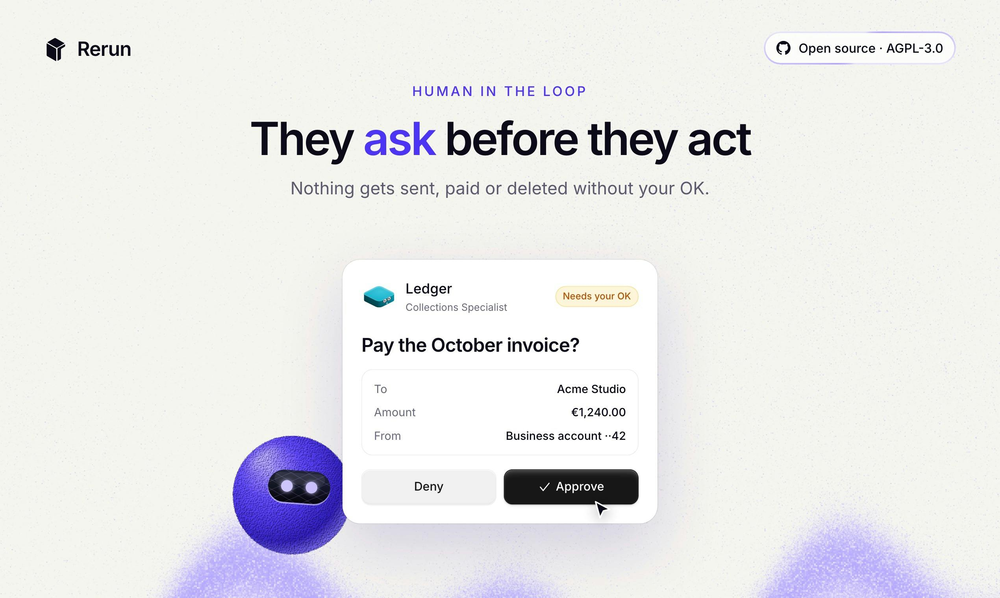

### 🎬 관련 영상
- [🎥 영상 보기](https://ph-files.imgix.net/ab27f923-cef4-47b0-9b4c-bdc943dd0e6a.jpeg?auto=format)

---

## 3. [Living Brain](https://www.producthunt.com/products/chatandbuild)
**Votes**: 167 | **도입 난이도**: 중 | **신뢰도**: 상
**Tagline**: Interoperable, efficient memory layer for agentic AI
**서비스 링크**: https://www.producthunt.com/r/FLQZ3AXUUI5C2T

**태그**: AI, Productivity, DeveloperTool, KnowledgeManagement, Agent, AI Tool, Chat, DevTool, API

### 📌 이 서비스 한눈에 보기
여러 AI 모델과 앱 사이에서 지식을 공유하고 축적하는 범용 AI 메모리 레이어

### 🔑 주요 기능
- 파편화된 AI 대화 속 지식을 통합하여 지속 가능한 메모리로 변환
- API, SDK, MCP를 통해 다양한 AI 모델(ChatGPT, Claude 등) 및 에이전트와 상호 운용
- 새로운 대화마다 처음부터 시작할 필요 없이 이전 맥락을 유지하는 지능형 메모리 제공

### 🙋 사용자에게 어떤 점이 좋은가
사용자가 사용하는 다양한 AI 도구 간에 지식을 동기화하여, 어떤 모델을 쓰더라도 나만의 맞춤형 지식 베이스를 활용할 수 있습니다.

### ✅ 지금 바로 써볼 기능
- API/SDK를 활용한 기존 워크플로우 연결
- MCP를 통한 AI 에이전트와의 연동 테스트
- 주요 AI 모델(ChatGPT, Claude 등)에 메모리 레이어 적용

### ⚠️ 사용 전 확인할 점
- 개인적인 대화 데이터와 지식이 외부 서버에 저장될 경우의 보안 및 프라이버시 검토 필요
- 다양한 플랫폼 간의 데이터 동기화 시 발생할 수 있는 지연 시간 확인

### 🧭 확인이 더 필요한 정보
사용자의 데이터가 어떻게 암호화되고 관리되는지에 대한 구체적인 보안 정책 확인이 필요합니다.

### 📸 스크린샷 및 갤러리
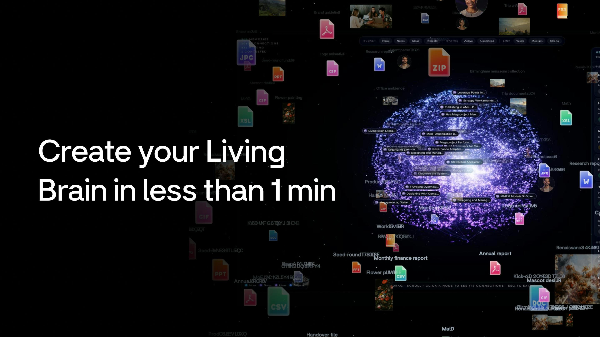
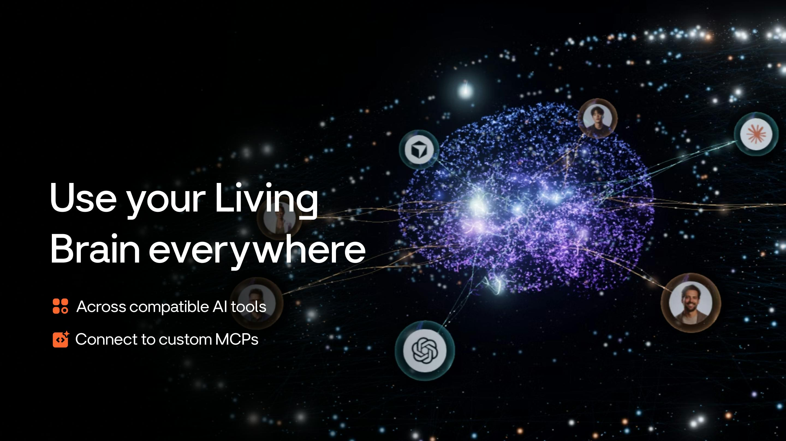
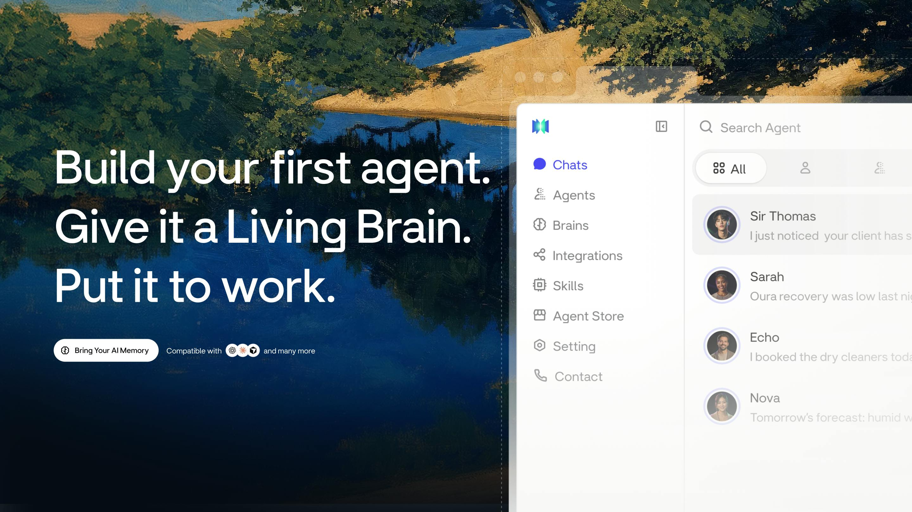

### 🎬 관련 영상
- [🎥 영상 보기](https://ph-files.imgix.net/48326282-bec2-4913-9c39-1fc063ba5b90.jpeg?auto=format)

---

## 4. [Pushary for Teams](https://www.producthunt.com/products/pushary)
**Votes**: 156 | **도입 난이도**: 하 | **신뢰도**: 상
**Tagline**: See who said yes to your team’s AI agents
**서비스 링크**: https://www.producthunt.com/r/FKYLG6Q6UE7GI2

**태그**: DevTool, AI-Agent, Productivity, Automation, Agent, AI Tool

### 📌 이 서비스 한눈에 보기
AI 에이전트의 승인 요청을 맥 노치나 모바일로 즉시 전달하여 팀의 의사결정을 돕는 도구

### 🔑 주요 기능
- AI 에이전트의 권한 요청을 맥(Notch) 및 모바일로 실시간 푸시 전송
- 누가 어떤 요청에 승인했는지 기록하여 책임 소재 및 히스토리 관리
- Claude Code, Cursor, Codex 등 주요 AI 개발 도구와 연동 가능

### 🙋 사용자에게 어떤 점이 좋은가
AI 에이전트가 작업 중 멈춰있을 때, 담당자가 어디서든 즉시 승인하여 워크플로우가 끊기지 않게 합니다.

### ✅ 지금 바로 써볼 기능
- 맥 노치/모바일 알림 설정하기
- 사용 중인 AI 에이전트(Cursor, Claude Code 등)와 연동하기
- 승인 기록 대시보드 확인하기

### ⚠️ 사용 전 확인할 점
- 승인 기록이 남으므로 보안 및 책임 소재가 명확해지지만, 관리 오버헤드가 발생할 수 있음
- 연동되는 AI 에이전트 도구에 따라 설정 방식이 다를 수 있음

### 🧭 확인이 더 필요한 정보
각 AI 에이전트 도구별 구체적인 연동 방식과 보안 프로토콜에 대한 상세 정보가 필요합니다.

### 📸 스크린샷 및 갤러리
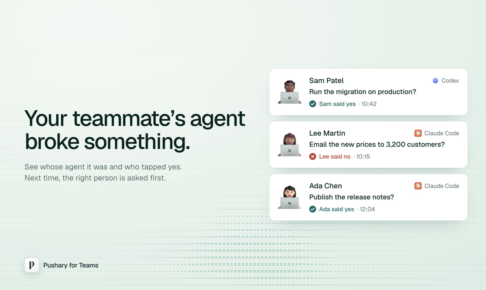
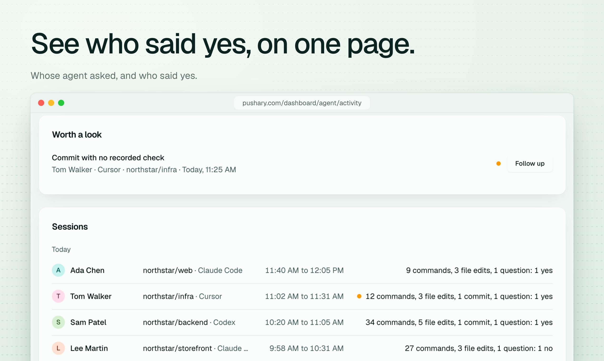
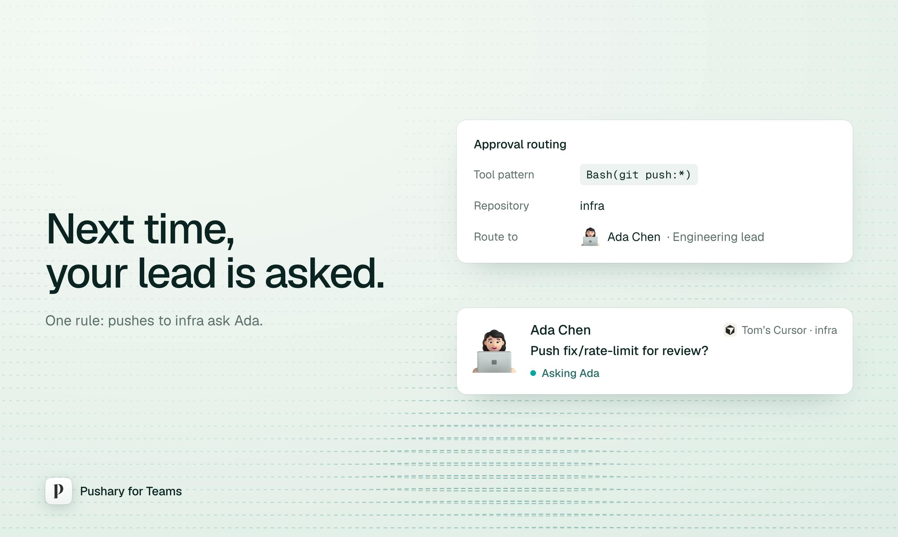

### 🎬 관련 영상
- [🎥 영상 보기](https://ph-files.imgix.net/1cd76568-850f-4fe9-883d-b6fd2757b8a6.jpeg?auto=format)

---

## 5. [Maritime](https://www.producthunt.com/products/maritime)
**Votes**: 143 | **도입 난이도**: 중 | **신뢰도**: 상
**Tagline**: Cloud computers for any AI agent, customized your way
**서비스 링크**: https://www.producthunt.com/r/LXZBKU4W5VMFPL

**태그**: AI, Automation, Cloud, DevOps, Agent, AI Tool, DevTool, API

### 📌 이 서비스 한눈에 보기
AI 에이전트를 위한 맞춤형 클라우드 컴퓨터 및 작업 환경 제공

### 🔑 주요 기능
- 지속적인 워크스페이스와 일회용 샌드박스 환경 제공
- Linux, Windows 데스크톱 및 Android 환경 지원
- API 없이도 브라우저 사용 및 앱 조작이 가능한 환경 구축

### 🙋 사용자에게 어떤 점이 좋은가
AI 에이전트에게 독립적인 컴퓨팅 자원을 할당하여, 복잡한 코드 실행이나 브라우저 기반 작업을 자동화할 수 있습니다.

### ✅ 지금 바로 써볼 기능
- 에이전트용 가상 데스크톱 환경 설정하기
- 코드 실행 및 브라우징 자동화 테스트하기
- 샌드박스 환경에서 안전한 작업 수행하기

### ⚠️ 사용 전 확인할 점
- 에이전트의 작업에 따른 클라우드 리소스 비용 발생 가능성
- 인간의 개입 없이 자동화될 경우 발생할 수 있는 예외 상황 관리

### 🧭 확인이 더 필요한 정보
구체적인 리소스 비용 체계와 동시 실행 가능한 에이전트 수에 대한 정보가 필요합니다.

### 📸 스크린샷 및 갤러리
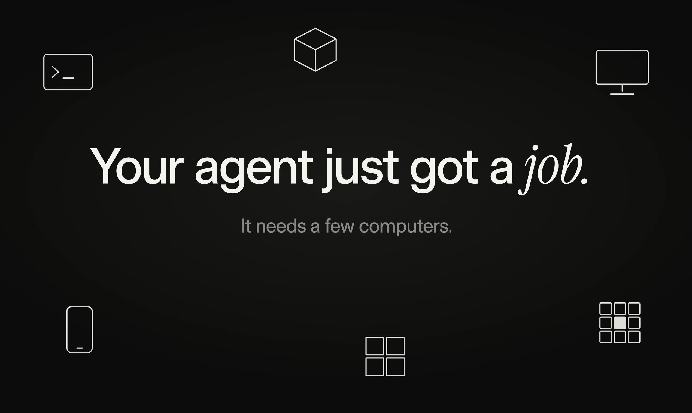
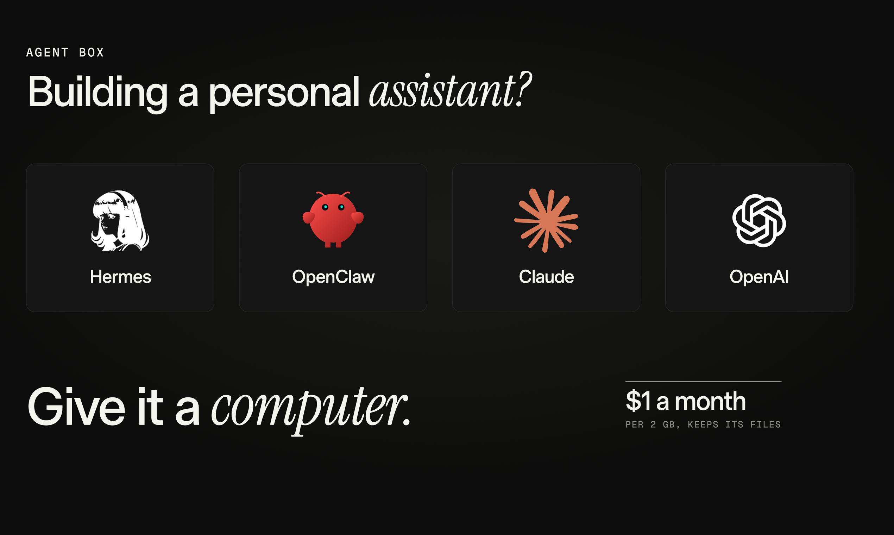
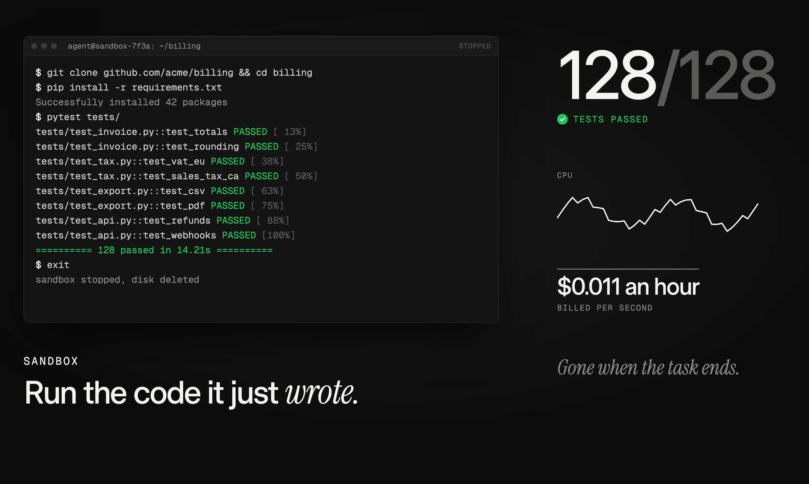

### 🎬 관련 영상
- [🎥 영상 보기](https://ph-files.imgix.net/c910d7b3-ee44-48f8-b6d1-37d07a7fcde0.jpeg?auto=format)
- [🎥 영상 보기](https://ph-files.imgix.net/ed9762b0-593e-4a09-9b33-e95afdb623be.jpeg?auto=format)

---

## 6. [Clocknext](https://www.producthunt.com/products/clocknext)
**Votes**: 130 | **도입 난이도**: 중 | **신뢰도**: 상
**Tagline**: Pricing and Billing Infrastructure for AI Agents
**서비스 링크**: https://www.producthunt.com/r/7IUKMVZUC4C7ZY

**태그**: AI, Billing, SaaS, FinTech, DevTool, Agent, AI Tool

### 📌 이 서비스 한눈에 보기
AI 에이전트 및 앱을 위한 실시간 사용량 추적 및 과금 인프라

### 🔑 주요 기능
- AI 네이티브 앱에 최적화된 빌링 및 수익화 플랫폼
- 실시간 AI 사용량 추적 및 유연한 요금제 설계 기능
- 비용, 마진, 수익성을 실시간으로 모니터링하는 대시보드

### 🙋 사용자에게 어떤 점이 좋은가
AI 서비스 운영 시 발생하는 복잡한 사용량 기반 과금 체계를 자동화하고, 실시간 수익성을 관리할 수 있습니다.

### ✅ 지금 바로 써볼 기능
- 사용량 기반 과금 플랜 설정하기
- 실시간 비용 및 마진 모니터링 대시보드 확인
- AI 에이전트 사용량 추적 연동

### ⚠️ 사용 전 확인할 점
- AI 모델 API 비용과 연동되는 구체적인 정산 방식 확인 필요
- 기존 결제 게이트웨이(Stripe 등)와의 연동 범위 확인 필요

### 🧭 확인이 더 필요한 정보
현재 제공되는 구체적인 기술 스택 및 외부 결제 솔루션과의 통합 방식에 대한 정보가 부족합니다.

### 📸 스크린샷 및 갤러리
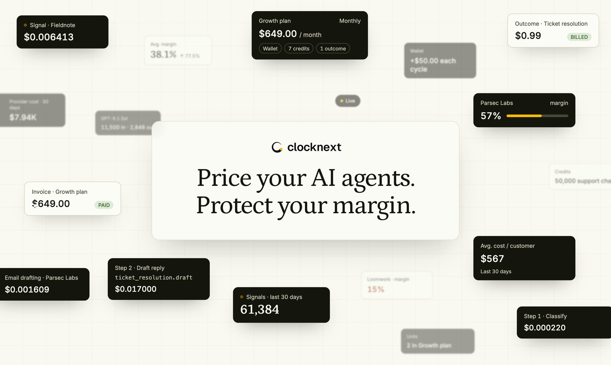
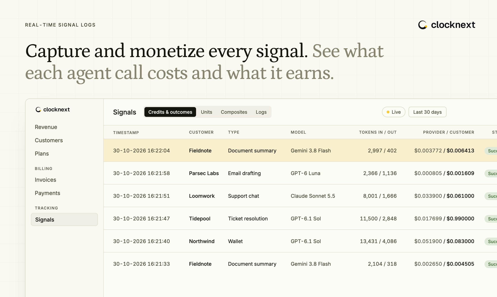
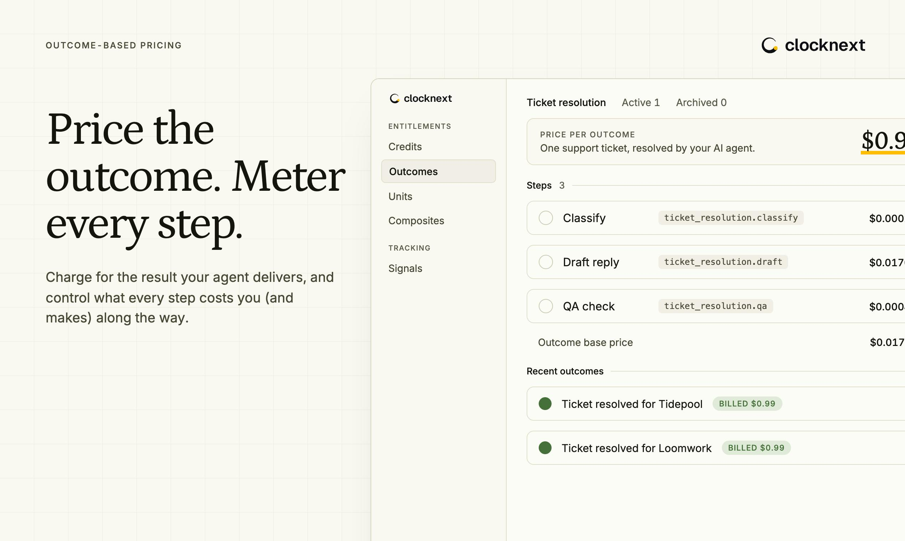

### 🎬 관련 영상
- [🎥 영상 보기](https://ph-files.imgix.net/bb0e01c4-3997-46c2-88f7-e129460801c1.jpeg?auto=format)

---

## 7. [Bridge](https://www.producthunt.com/products/meetonbridge)
**Votes**: 109 | **도입 난이도**: 중 | **신뢰도**: 상
**Tagline**: Video conferencing for the agentic era
**서비스 링크**: https://www.producthunt.com/r/PBNZKRHUASBSC5

**태그**: AI, Video Conferencing, Automation, Productivity, Agent, AI Tool, Video

### 📌 이 서비스 한눈에 보기
AI 에이전트와 사람이 함께 협업하는 차세대 통합 화상 회의 플랫폼

### 🔑 주요 기능
- 스케줄링부터 회의, 노트 작성, 워크플로우까지 하나로 통합된 올인원 미팅 스택
- AI 에이전트가 직접 회의에 참여하고 활동할 수 있는 특화된 화상 회의 환경
- 실시간 지능형 분석 및 구조화된 메모 기능을 통한 회의 데이터 자산화

### 🙋 사용자에게 어떤 점이 좋은가
파편화된 회의 도구들을 하나로 통합하고, AI 에이전트를 회의에 참여시켜 업무 자동화와 효율성을 극대화할 수 있습니다.

### ✅ 지금 바로 써볼 기능
- AI 에이전트 참여 기능 테스트
- 자동화된 회의 준비 및 노트 작성 기능 활용
- 통합 스케줄링 페이지 설정

### ⚠️ 사용 전 확인할 점
- AI 에이전트의 회의 참여 시 보안 및 개인정보 보호 정책 확인 필요
- 기존에 사용하던 화상 회의 도구(Zoom, Meet 등)와의 데이터 호환성 확인

### 🧭 확인이 더 필요한 정보
AI 에이전트가 실제 업무 워크플로우와 어떻게 연동되는지에 대한 구체적인 기술 사양 확인이 필요합니다.

### 📸 스크린샷 및 갤러리

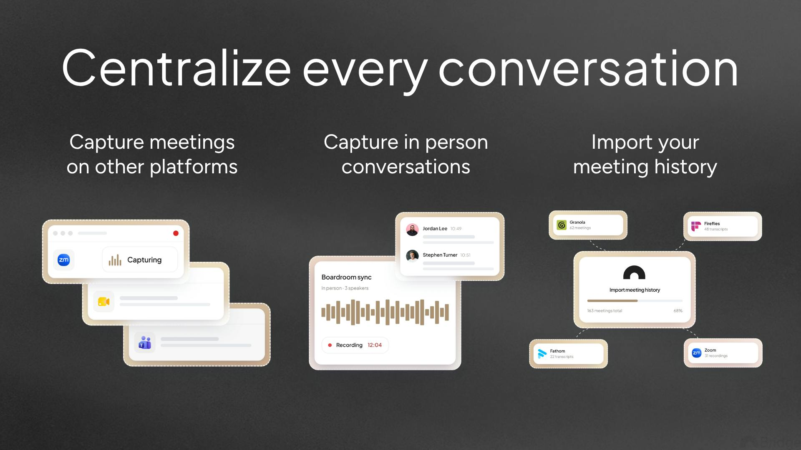

### 🎬 관련 영상
- [🎥 영상 보기](https://ph-files.imgix.net/043ae0b6-1859-435e-a4ff-d751143e4085.jpeg?auto=format)

---

## 8. [Rainbrand](https://www.producthunt.com/products/rainbrand)
**Votes**: 100 | **도입 난이도**: 하 | **신뢰도**: 상
**Tagline**: The brand layer for agents
**서비스 링크**: https://www.producthunt.com/r/FVQGXUQXBCJO2O

**태그**: AI, Brand Management, Automation, Developer Tools, Agent, AI Tool, Chat, Video, DevTool, API, Marketing, Email

### 📌 이 서비스 한눈에 보기
브랜드 가이드와 자산을 AI 에이전트가 즉시 활용할 수 있는 공유 컨텍스트 레이어

### 🔑 주요 기능
- 웹사이트, 가이드, 파일로부터 브랜드 컨텍스트 자동 구축 및 유지
- 마케팅 캠페인, 슬라이드, 이메일 등 다양한 작업에 필요한 자산 제공
- Claude, ChatGPT, Cursor 등 AI 도구 및 API를 통한 제품 통합 지원

### 🙋 사용자에게 어떤 점이 좋은가
브랜드 일관성을 유지하면서 AI 에이전트나 팀원들이 최신 브랜드 가이드에 맞춘 결과물을 즉시 생성할 수 있게 돕습니다.

### ✅ 지금 바로 써볼 기능
- 기존 브랜드 가이드 및 파일 업로드하기
- AI 도구(ChatGPT, Claude 등)와 연동하여 결과물 테스트하기
- API를 통한 제품 내 브랜드 컨텍스트 통합 검토하기

### ⚠️ 사용 전 확인할 점
- 브랜드 자산의 보안 및 접근 권한 관리 방식 확인 필요
- AI 모델별 컨텍스트 반영 정확도 차이 확인 필요

### 🧭 확인이 더 필요한 정보
제공되는 API의 상세 기능과 데이터 동기화 주기에 대한 정보가 추가로 필요합니다.

### 📸 스크린샷 및 갤러리
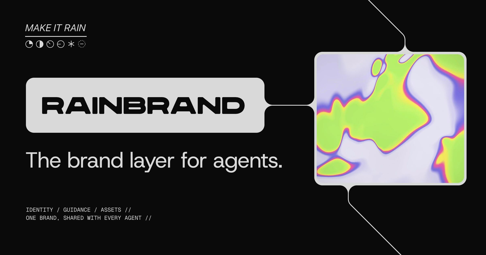
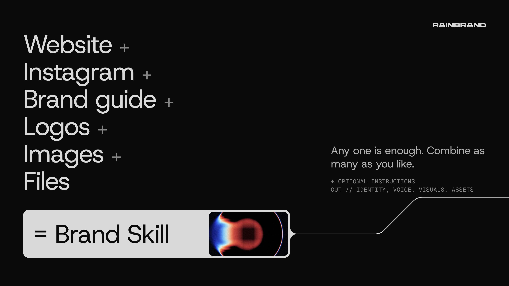
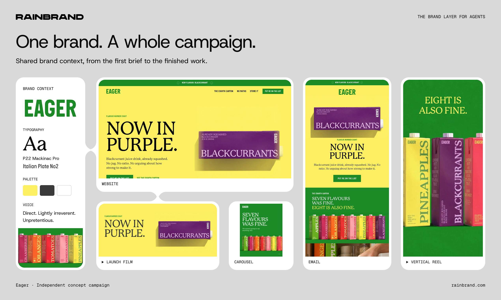

---

## 9. [Tao Browser](https://www.producthunt.com/products/tao-browser)
**Votes**: 95 | **도입 난이도**: 하 | **신뢰도**: 상
**Tagline**: Private browser with a separate login for every company
**서비스 링크**: https://www.producthunt.com/r/67S6CGG52F2357

**태그**: Privacy, Productivity, Browser

### 📌 이 서비스 한눈에 보기
회사나 프로젝트별로 독립된 로그인 환경을 제공하는 프라이버시 중심 브라우저

### 🔑 주요 기능
- 회사/클라이언트/프로젝트별 독립된 쿠키 및 로그인 환경 제공
- Face ID/Touch ID를 통한 탭 잠금 기능
- 광고 및 트래커 차단 및 Arc 브라우저 데이터 가져오기 지원

### 🙋 사용자에게 어떤 점이 좋은가
여러 계정을 사용하는 프리랜서나 직장인이 업무별로 브라우저 환경을 완벽히 분리하여 보안과 편의성을 동시에 확보할 수 있습니다.

### ✅ 지금 바로 써볼 기능
- 기존 Arc 브라우저 데이터 가져오기
- 프로젝트별 독립된 공간 생성 및 로그인
- 생체 인증(Face ID/Touch ID)을 통한 탭 잠금 설정

### ⚠️ 사용 전 확인할 점
- 현재 macOS, iOS, iPadOS 대상 베타 버전임
- 베타 단계이므로 기능적 안정성 확인 필요

### 🧭 확인이 더 필요한 정보
현재 베타 버전이므로 향후 정식 출시 시 기능 확장 및 플랫폼 지원 범위가 변경될 수 있습니다.

### 📸 스크린샷 및 갤러리
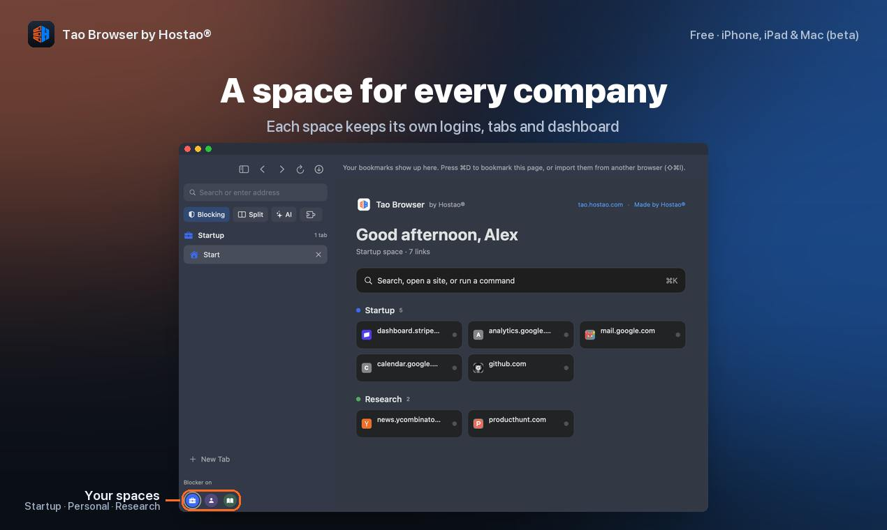
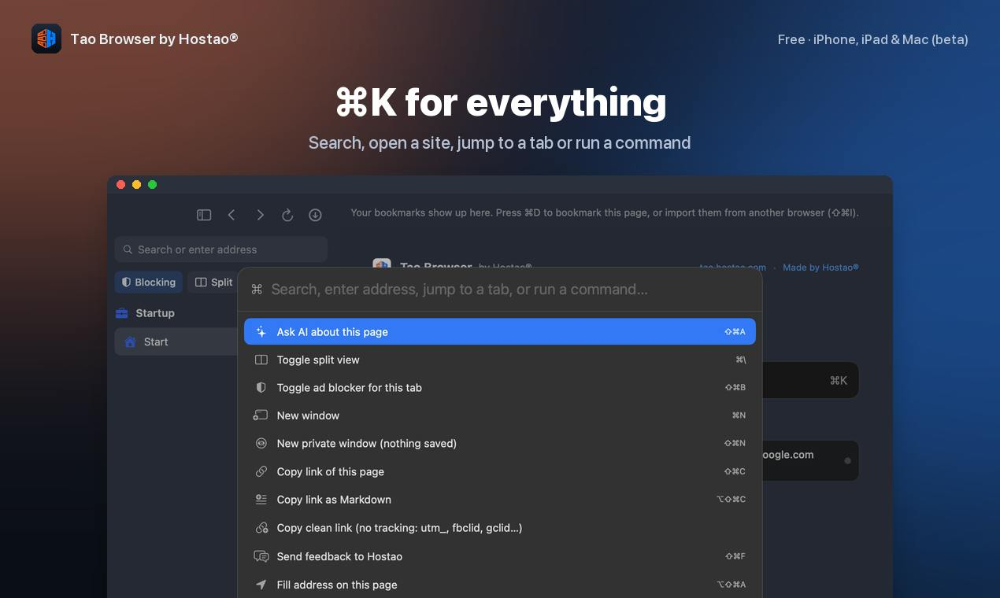
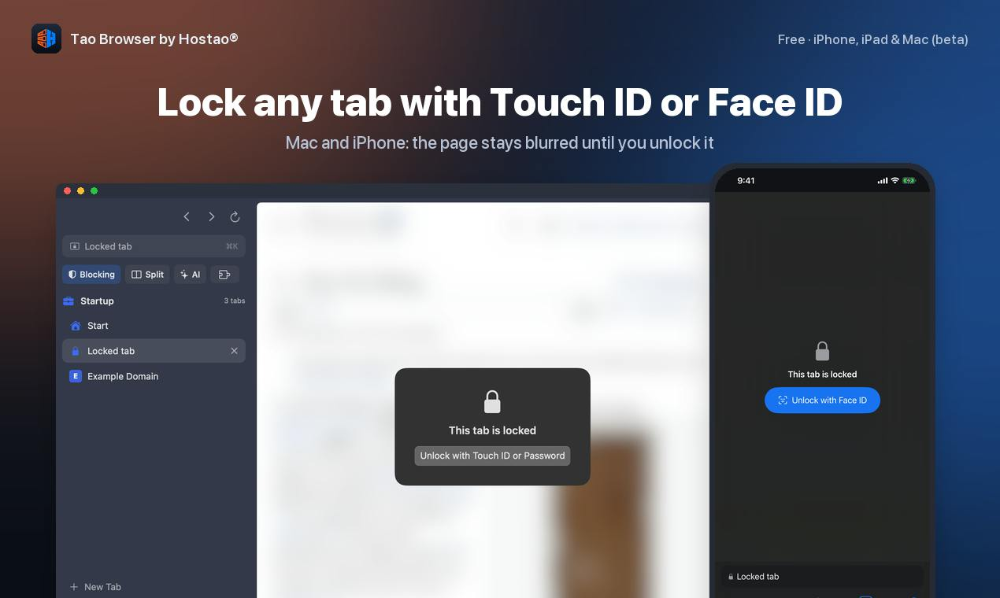

### 🎬 관련 영상
- [🎥 영상 보기](https://ph-files.imgix.net/78804381-2e2e-4b55-9e62-8e66e96cabe3.jpeg?auto=format)

---

## 10. [Polylane for Google Cloud](https://www.producthunt.com/products/polylane)
**Votes**: 89 | **도입 난이도**: 하 | **신뢰도**: 상
**Tagline**: An AI on-call engineer for your Google Cloud apps
**서비스 링크**: https://www.producthunt.com/r/KQUCUSDESBKSUO

**태그**: DevOps, AI, GoogleCloud, Automation, AI Tool

### 📌 이 서비스 한눈에 보기
Google Cloud 앱의 장애를 분석하고 해결책까지 제안하는 AI 온콜 엔지니어

### 🔑 주요 기능
- Google Cloud 환경 내 애플리케이션 이슈 자동 조사
- 장애 원인 및 영향 범위 시각화
- 검토 가능한 수준의 코드 수정안(Fix) 자동 생성

### 🙋 사용자에게 어떤 점이 좋은가
로그와 대시보드를 일일이 뒤지는 시간 없이, AI가 요약해 주는 문제 원인과 해결책을 통해 개발 시간을 확보할 수 있습니다.

### ✅ 지금 바로 써볼 기능
- Google Cloud 환경 연결 및 모니터링 설정
- 발생한 이슈에 대한 AI 분석 리포트 확인
- 제안된 코드 수정안 검토 및 적용

### ⚠️ 사용 전 확인할 점
- AI가 생성한 수정안에 대한 최종 검토 필수
- Google Cloud 환경에 대한 접근 권한 설정 필요

### 🧭 확인이 더 필요한 정보
지원하는 프로그래밍 언어 및 프레임워크의 범위와 보안 정책에 대한 상세 정보가 필요합니다.

### 📸 스크린샷 및 갤러리
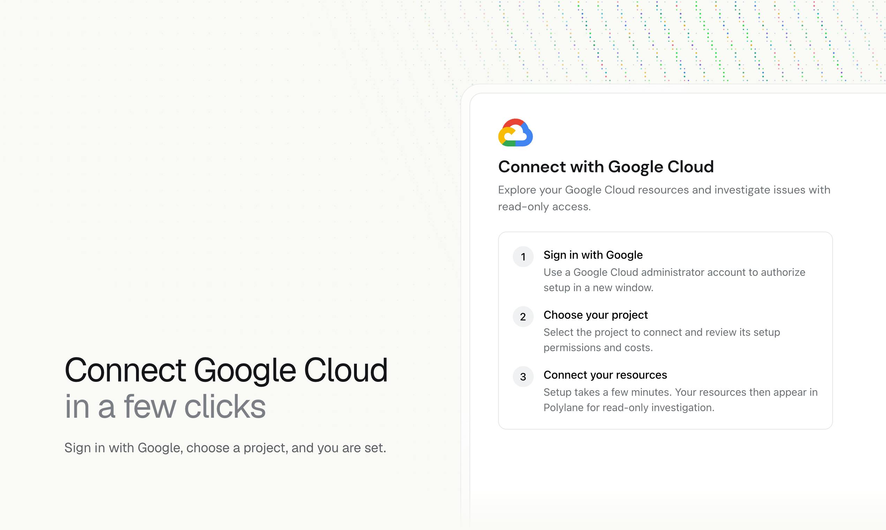
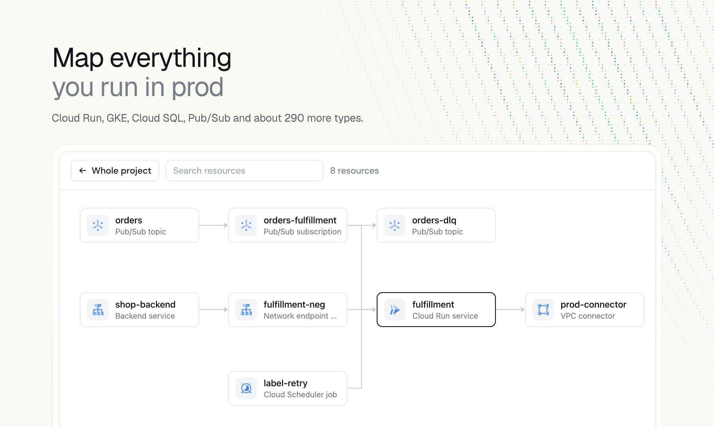
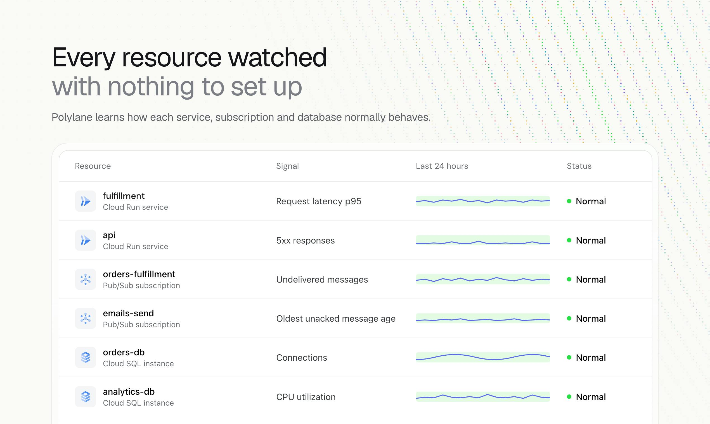

### 🎬 관련 영상
- [🎥 영상 보기](https://ph-files.imgix.net/b6b110a9-91f5-455a-b43b-8c0c8cf5b019.jpeg?auto=format)

---

## 11. [Stitch.ai](https://www.producthunt.com/products/stitch-ai)
**Votes**: 87 | **도입 난이도**: 중 | **신뢰도**: 상
**Tagline**: Your AI workspace for mail, calendar, notes, tasks and more
**서비스 링크**: https://www.producthunt.com/r/RH3SUY5Z3KCC6L

**태그**: Productivity, AI, Workspace, All-in-one, AI Tool, Email

### 📌 이 서비스 한눈에 보기
메일, 일정, 문서 등 모든 업무 도구를 하나로 통합한 AI 기반 올인원 워크스페이스

### 🔑 주요 기능
- 메일, 캘린더, 노트, 태스크, 파일 등을 하나의 연결된 공간에서 관리
- AI 어시스턴트 'Stitchy'를 통한 업무 자동화 및 협업 지원
- 별도의 외부 연동 없이 모든 기능이 내장된 통합 환경 제공

### 🙋 사용자에게 어떤 점이 좋은가
여러 앱을 오가는 번거로움 없이 한 곳에서 모든 업무를 처리할 수 있어 맥락 유지와 생산성 향상에 유리합니다.

### ✅ 지금 바로 써볼 기능
- 듀얼 패널 기능을 활용한 드래그 앤 드롭 작업 시도
- AI 어시스턴트 'Stitchy'에게 업무 요청해보기
- Knots와 Tags 기능을 통한 데이터 정리 체계 구축

### ⚠️ 사용 전 확인할 점
- 모든 기능이 내장된 형태이므로 기존에 사용하던 외부 서비스와의 데이터 이전 편의성 확인 필요
- 통합 워크스페이스 특성상 초기 학습 곡선이 존재할 수 있음

### 🧭 확인이 더 필요한 정보
기존 외부 서비스(Google, Microsoft 등)와의 데이터 마이그레이션 방식 및 보안 정책에 대한 상세 정보가 필요합니다.

### 📸 스크린샷 및 갤러리
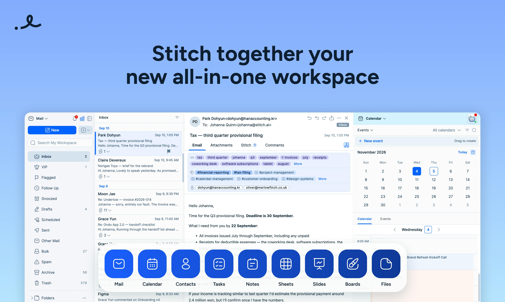
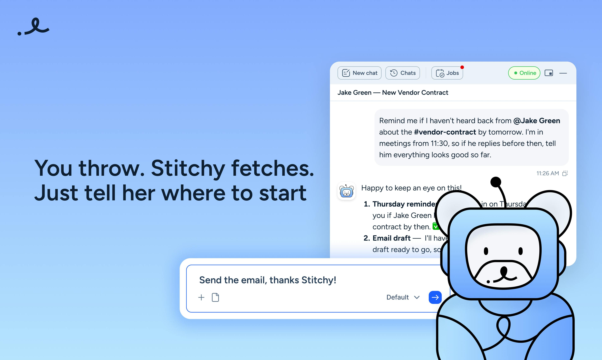
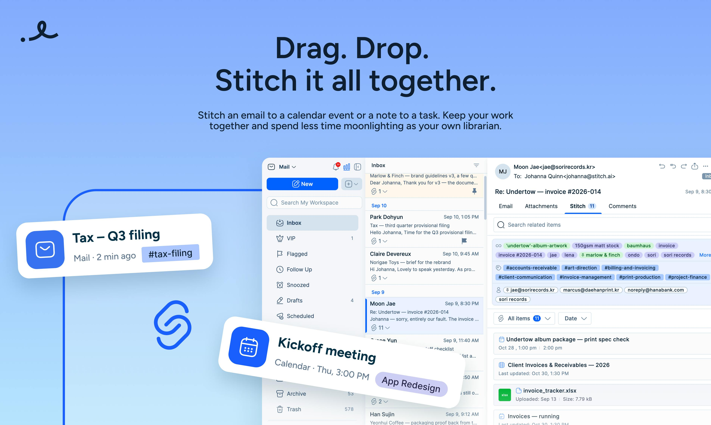

### 🎬 관련 영상
- [🎥 영상 보기](https://ph-files.imgix.net/b3325733-1d27-45a5-a98b-f02891cb75ad.jpeg?auto=format)

---

## 12. [Wingmen](https://www.producthunt.com/products/wingmen)
**Votes**: 84 | **도입 난이도**: 하 | **신뢰도**: 상
**Tagline**: Agentic outreach with real intent data
**서비스 링크**: https://www.producthunt.com/r/AK6GQ4EPT7KYYX

**태그**: Sales Automation, Lead Generation, AI Agent, B2B, Agent, AI Tool

### 📌 이 서비스 한눈에 보기
실제 구매 의도가 포착된 잠재 고객을 찾아 자동화된 맞춤형 아웃리치를 수행하는 에이전트 솔루션

### 🔑 주요 기능
- 문제 글 게시, 신규 채용 등 실시간 의도 데이터를 기반으로 한 잠재 고객 발굴
- 상대방의 맥락을 반영한 개인화된 메시지 작성 및 자동 후속 작업
- 웹 앱 및 Claude MCP를 통한 유연한 작업 환경 제공

### 🙋 사용자에게 어떤 점이 좋은가
단순 스팸이 아닌 실제 니즈가 있는 고객을 타겟팅하여 영업 성공률을 높이고, 반복적인 아웃리치 업무를 자동화하여 시간을 절약할 수 있습니다.

### ✅ 지금 바로 써볼 기능
- 웹 앱에서 타겟 고객 스코어링 기능 확인하기
- Claude MCP를 연결하여 대화형으로 아웃리치 실행하기
- 자동화된 후속 작업(Follow-up) 워크플로우 설정하기

### ⚠️ 사용 전 확인할 점
- 자동화된 메시지가 지나치게 기계적으로 느껴지지 않도록 검토 필요
- 데이터 소스 및 스코어링 알고리즘의 정확도 확인 필요

### 🧭 확인이 더 필요한 정보
정확한 타겟팅 데이터 소스의 범위와 메시지 자동화의 세부 커스텀 가능 범위를 확인해야 합니다.

### 📸 스크린샷 및 갤러리

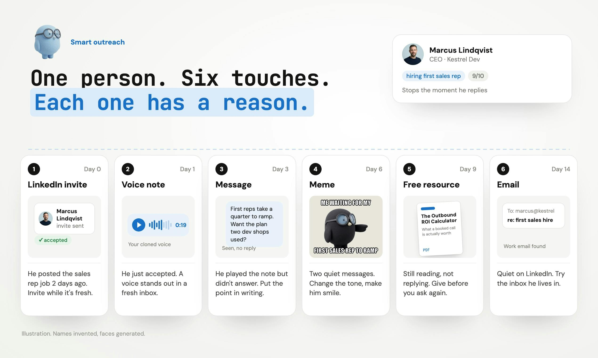
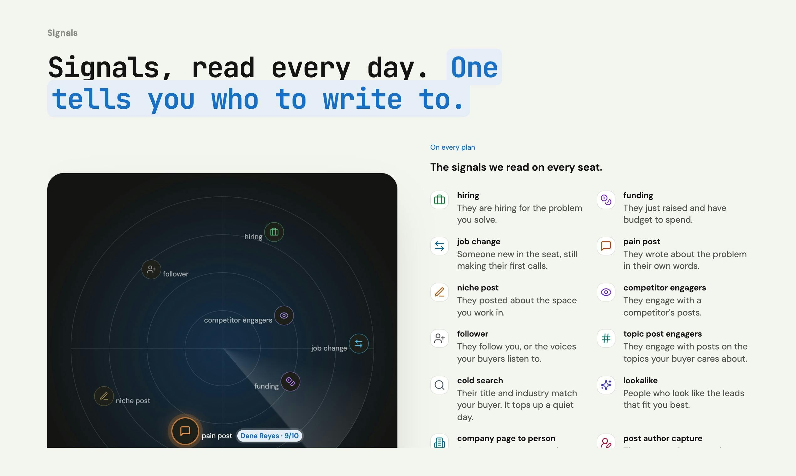

### 🎬 관련 영상
- [🎥 영상 보기](https://ph-files.imgix.net/9ef44290-efe1-4215-8059-c4dc8860f7bc.jpeg?auto=format)

---

## 13. [Okapi](https://www.producthunt.com/products/okapi-2)
**Votes**: 78 | **도입 난이도**: 하 | **신뢰도**: 상
**Tagline**: AI agents that fix API breaking changes in your repos
**서비스 링크**: https://www.producthunt.com/r/WIKSDNR4TMVRYX

**태그**: DevTool, AI, Automation, API, Agent, AI Tool

### 📌 이 서비스 한눈에 보기
외부 API 변경으로 인한 코드 오류를 자동으로 해결하는 AI 에이전트

### 🔑 주요 기능
- 서드파티 API의 Breaking Change를 감지하고 코드를 자동 수정
- API 변경 시 발생하는 서비스 중단 및 수동 작업 방지
- 모든 종류의 API와 호환 가능하며 100% 무료 제공

### 🙋 사용자에게 어떤 점이 좋은가
API 업데이트로 인해 앱이 중단되는 문제를 방지하고, 개발자가 변경 로그를 일일이 확인하며 코드를 수정하는 시간을 획기적으로 줄여줍니다.

### ✅ 지금 바로 써볼 기능
- 현재 사용 중인 주요 외부 API 연동 코드에 적용해보기
- 자동 수정된 코드가 기존 로직과 충돌하지 않는지 검토하기

### ⚠️ 사용 전 확인할 점
- AI가 생성한 코드 수정 사항이 의도와 다를 수 있으므로 코드 리뷰 필수
- 코드 저장소에 대한 접근 권한 부여 시 보안 정책 확인 필요

### 🧭 확인이 더 필요한 정보
코드 수정 방식이 Pull Request 형태인지 혹은 직접 커밋 방식인지에 대한 상세 프로세스 확인이 필요합니다.

### 📸 스크린샷 및 갤러리
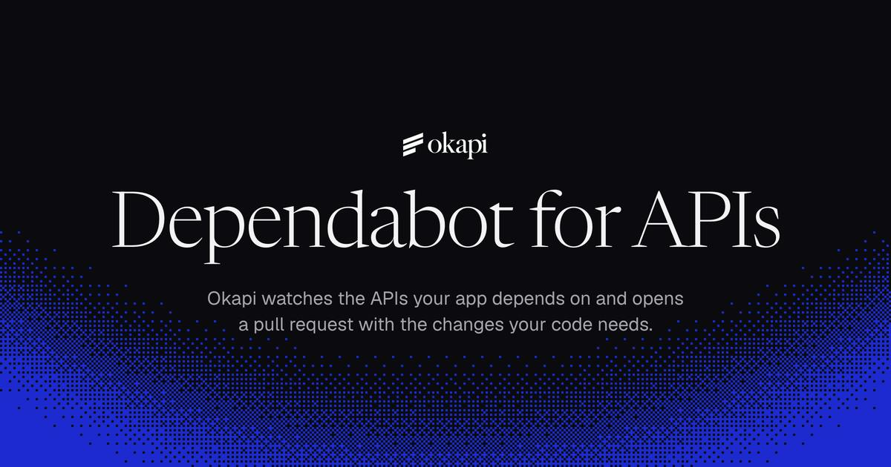
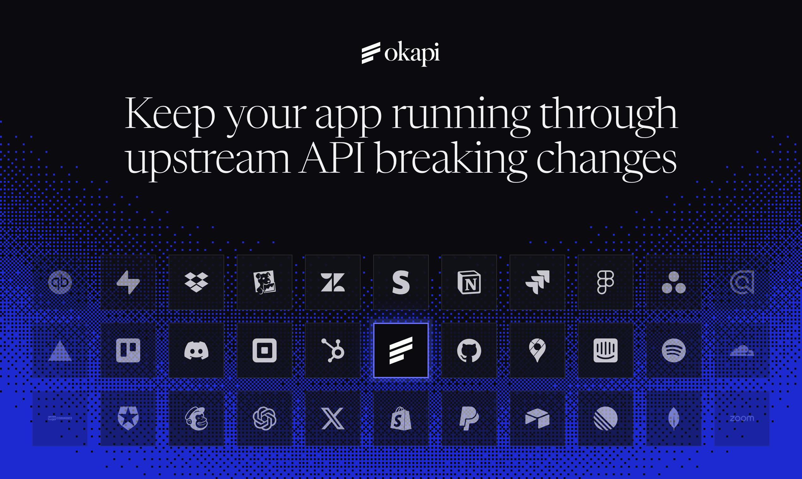
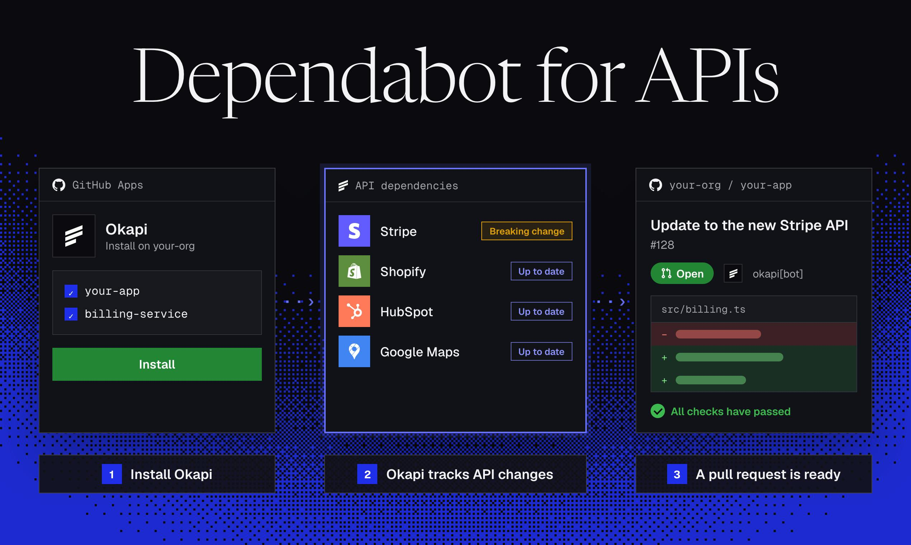

### 🎬 관련 영상
- [🎥 영상 보기](https://ph-files.imgix.net/3bcd6e1b-97f6-4e2c-89fe-994f3f6da653.jpeg?auto=format)

---

## 14. [Nemotron 3.5 Transcribe](https://www.producthunt.com/products/nvidia)
**Votes**: 78 | **도입 난이도**: 중 | **신뢰도**: 상
**Tagline**: Intelligent Transcription with a Speech LLM
**서비스 링크**: https://www.producthunt.com/r/QLRQFOGDK7HDXO

**태그**: AI, Speech-to-Text, OpenSource, Productivity, LLM

### 📌 이 서비스 한눈에 보기
자연어 명령으로 정교한 받아쓰기와 화자 구분이 가능한 오픈 소스 음성 LLM

### 🔑 주요 기능
- 40개 언어를 지원하는 강력한 다국어 음성 인식 성능
- 단순 전사를 넘어 문맥 반영, 화자 식별, 타임스탬프 기능을 포함한 지능형 전사
- 자연어 지시를 통해 원하는 형식으로 결과물을 조정 가능한 오픈 웨이트 모델

### 🙋 사용자에게 어떤 점이 좋은가
단순한 텍스트 변환을 넘어 사용자가 원하는 문체나 형식으로 회의록 등을 자동 정리할 수 있어 업무 효율을 극대화합니다.

### ✅ 지금 바로 써볼 기능
- 다국어 음성 파일로 전사 정확도 테스트하기
- 자연어 명령을 통한 문맥 기반 요약 기능 활용하기
- 화자 구분 및 타임스탬프 기능 검증하기

### ⚠️ 사용 전 확인할 점
- 오픈 웨이트 모델이므로 직접 배포/운영 시 하드웨어 자원 필요
- 모델의 크기나 구동 환경에 따른 처리 속도 차이 확인 필요

### 🧭 확인이 더 필요한 정보
사용자의 하드웨어 환경에 따른 최적의 추론 속도와 구체적인 배포 방식에 대한 정보가 필요합니다.

### 📸 스크린샷 및 갤러리
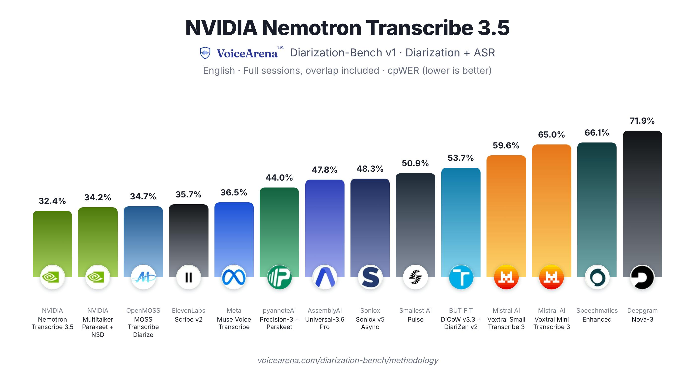
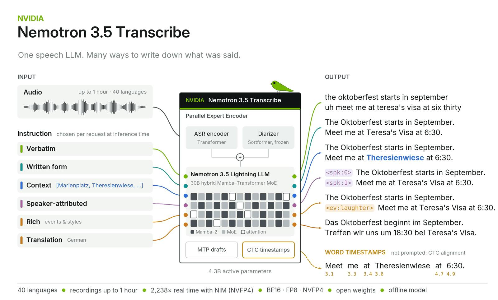
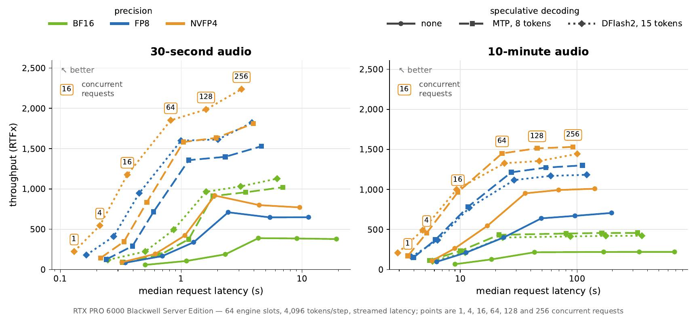

### 🎬 관련 영상
- [🎥 영상 보기](https://ph-files.imgix.net/7eeb6966-11de-4a39-a779-edd64e0d2a3e.jpeg?auto=format)

---

## 15. [Tencent Hy4](https://www.producthunt.com/products/hunyuan-a13b)
**Votes**: 78 | **도입 난이도**: 중 | **신뢰도**: 상
**Tagline**: Tencent’s flagship model learns to see and use a computer
**서비스 링크**: https://www.producthunt.com/r/OC5QOQYA4W4WDU

**태그**: Automation, AI-Agent, Data-Analysis, DevTool, AI Tool, Vision

### 📌 이 서비스 한눈에 보기
시각적 이해와 컴퓨터 제어 능력을 갖춘 텐센트의 차세대 플래그십 AI 모델

### 🔑 주요 기능
- 차트 및 이미지 분석을 포함한 강력한 시각적 이해 능력
- 명령줄(CLI) 및 그래픽 인터페이스(GUI)를 통한 컴퓨터 직접 제어
- Blender 및 CAD 학습을 통한 전문 작업 지원 및 환각율 감소(12.95% → 7.2%)

### 🙋 사용자에게 어떤 점이 좋은가
사무 업무, 금융 분석, 게임 개발 등 복잡한 시각 자료와 소프트웨어 조작이 필요한 작업의 자동화가 가능해집니다.

### ✅ 지금 바로 써볼 기능
- Tencent Cloud TokenHub 또는 OpenRouter를 통한 모델 테스트
- 차트 및 이미지 분석 기능 활용
- 명령줄 및 GUI 제어 기능 실험

### ⚠️ 사용 전 확인할 점
- 현재 모델 가중치(Weights)가 아직 공개되지 않음
- 특정 전문 소프트웨어(Blender, CAD) 작업 시 숙련도 차이 발생 가능성

### 🧭 확인이 더 필요한 정보
모델 가중치 공개 일정과 구체적인 API 비용 정책이 아직 확정되지 않았습니다.

### 📸 스크린샷 및 갤러리
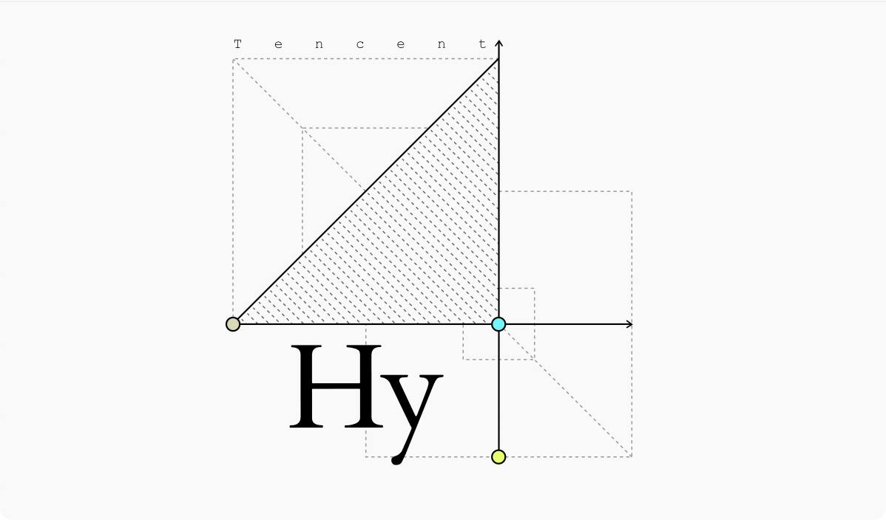
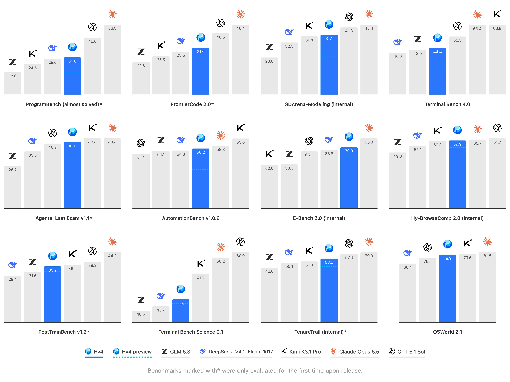
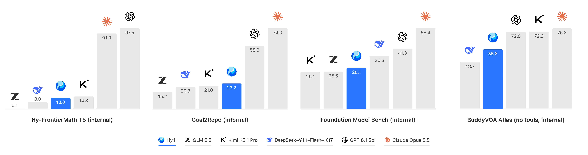

---

## 16. [FounderMail](https://www.producthunt.com/products/foundermail-2)
**Votes**: 77 | **도입 난이도**: 중 | **신뢰도**: 상
**Tagline**: Mail for you and your agents, on your Cloudflare domain
**서비스 링크**: https://www.producthunt.com/r/RXB6F437RCU5I5

**태그**: Cloudflare, Email, AI-Agents, Productivity, Automation, Agent, AI Tool

### 📌 이 서비스 한눈에 보기
Cloudflare 도메인을 활용해 사용자 및 AI 에이전트와 함께 사용하는 통합 이메일 솔루션

### 🔑 주요 기능
- Cloudflare 도메인 기반의 실질적인 이메일 서비스 제공
- 사용자뿐만 아니라 AI 에이전트도 동일한 인박스에서 작업 가능
- 계정당 비용(per seat) 방식이나 Gmail 포워딩 방식의 번거로움 탈피

### 🙋 사용자에게 어떤 점이 좋은가
개인과 팀, 그리고 AI 에이전트가 하나의 이메일 환경을 공유하며 보안을 유지하면서도 효율적으로 협업할 수 있습니다.

### ✅ 지금 바로 써볼 기능
- Cloudflare 도메인 연결 및 이메일 설정
- 팀원 및 AI 에이전트용 액세스 권한 부여
- 통합 인박스 환경 테스트

### ⚠️ 사용 전 확인할 점
- Cloudflare 도메인 사용이 필수적임
- 에이전트에게 권한을 부여할 때의 보안 정책 확인 필요

### 🧭 확인이 더 필요한 정보
Cloudflare 외의 다른 도메인 서비스와의 호환성 및 상세 보안 프로토콜에 대한 정보가 부족합니다.

### 📸 스크린샷 및 갤러리
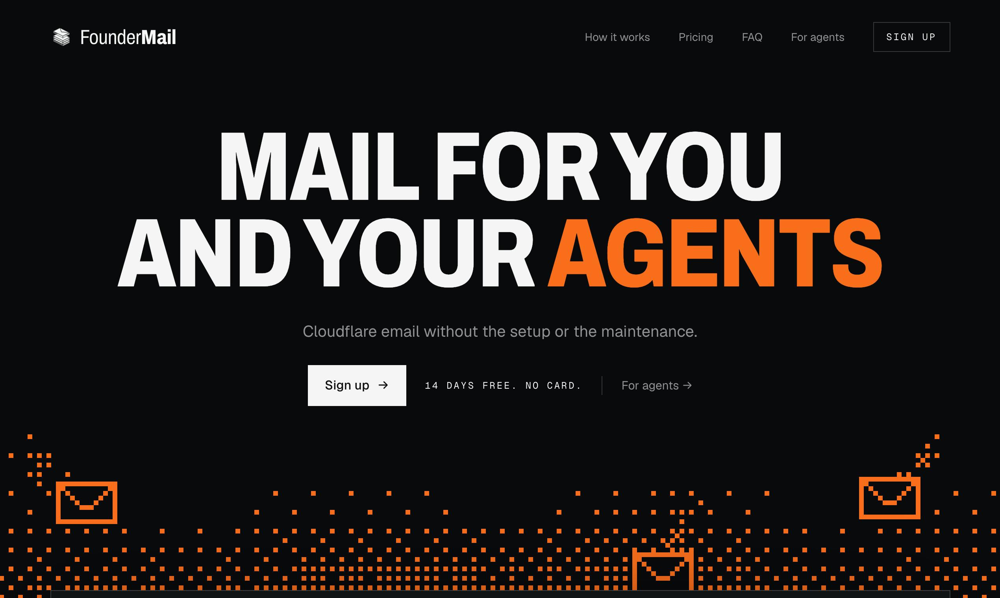
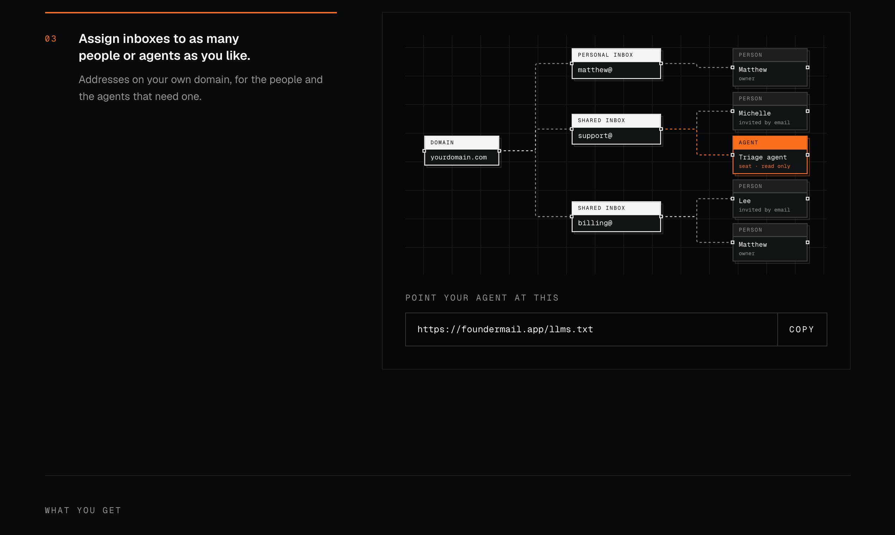
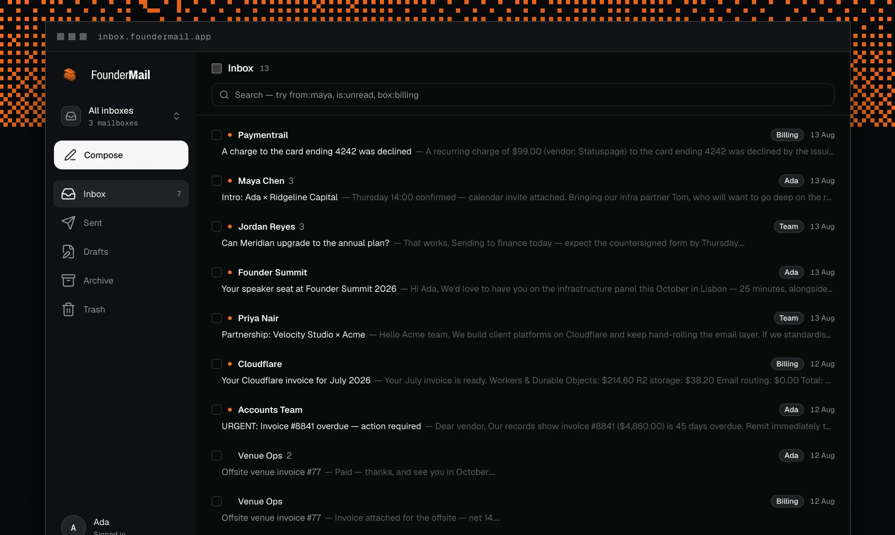

---

## 17. [Zerg Client](https://www.producthunt.com/products/zerg)
**Votes**: 73 | **도입 난이도**: 중 | **신뢰도**: 상
**Tagline**: The coding agent harness that drives its own terminal panes
**서비스 링크**: https://www.producthunt.com/r/XCM6CBWITPYUV7

**태그**: DevTool, AI-Agent, Terminal, Automation, Agent, AI Tool

### 📌 이 서비스 한눈에 보기
터미널 환경을 스스로 제어하며 멀티 에이전트를 구동하는 코딩 에이전트 하네스

### 🔑 주요 기능
- 사용자 요청에 따라 터미널 창(Vim, htop 등)을 직접 생성하고 관리하는 기능
- 각 패널에 서로 다른 모델을 탑재한 멀티 에이전트 환경 제공
- Apple Silicon(Mac) 환경에 최적화된 베타 버전

### 🙋 사용자에게 어떤 점이 좋은가
개발자가 직접 터미널을 조작하는 대신, 에이전트가 스스로 도구를 열고 작업을 수행하는 자동화된 코딩 환경을 경험할 수 있습니다.

### ✅ 지금 바로 써볼 기능
- 터미널 명령어를 통한 에이전트 자동 실행 테스트
- 멀티 패널 환경에서 서로 다른 모델 간의 협업 확인
- Apple Silicon Mac 환경에서의 성능 및 호환성 검증

### ⚠️ 사용 전 확인할 점
- 현재 평가용 베타 버전이므로 안정성이 보장되지 않음
- 사용 가능한 모델은 로그인 방식 및 제공자 권한에 따라 제한됨

### 🧭 확인이 더 필요한 정보
사용 가능한 구체적인 AI 모델 목록과 제공 방식은 로그인 후에 확인 가능합니다.

### 📸 스크린샷 및 갤러리
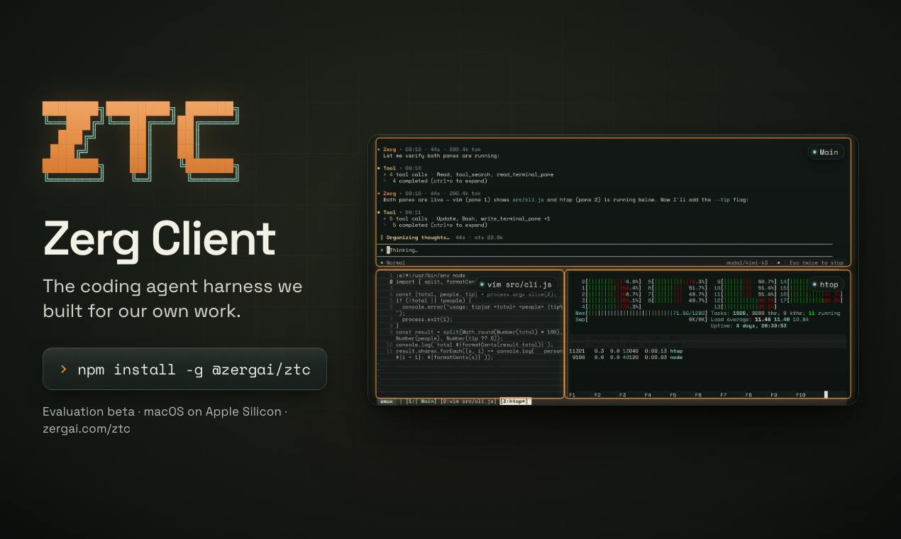
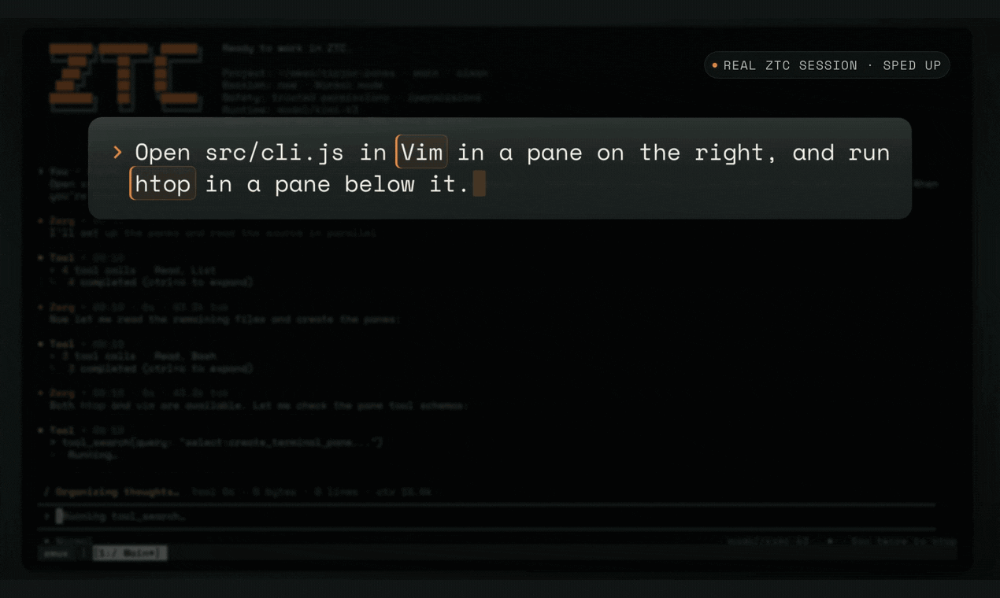
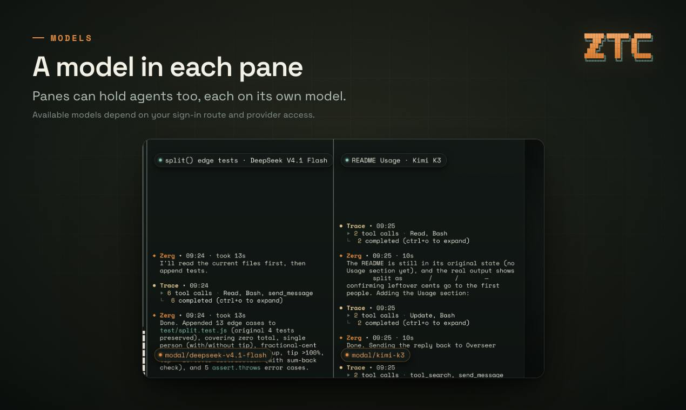

### 🎬 관련 영상
- [🎥 영상 보기](https://ph-files.imgix.net/c07b693d-cf58-4b1b-8a98-6fc20d83a1f6.jpeg?auto=format)

---

## 18. [Cosyra](https://www.producthunt.com/products/cosyra)
**Votes**: 73 | **도입 난이도**: 하 | **신뢰도**: 상
**Tagline**: Launch and steer agents on your machines from your phone
**서비스 링크**: https://www.producthunt.com/r/UUP5OZIW2YXAWS

**태그**: DevTool, Mobile, Automation, Cloud, Agent

### 📌 이 서비스 한눈에 보기
모바일에서 클라우드 터미널을 통해 AI 에이전트를 실행하고 제어하는 코딩 도구

### 🔑 주요 기능
- iPhone 및 Android 지원 모바일 코딩 환경
- 직접 VPS를 관리할 필요 없는 클라우드 Ubuntu 터미널 제공
- 모바일 기기에서 AI 에이전트 실행 및 제어 가능

### 🙋 사용자에게 어떤 점이 좋은가
장소에 구애받지 않고 스마트폰만으로 클라우드 환경의 에이전트를 구동하여 코딩 작업을 관리할 수 있습니다.

### ✅ 지금 바로 써볼 기능
- 모바일 환경에서의 터미널 반응 속도 테스트
- 클라우드 Ubuntu 환경과 에이전트 연동 확인
- 모바일 UI를 통한 에이전트 제어 편의성 확인

### ⚠️ 사용 전 확인할 점
- 모바일 화면에서의 복잡한 코딩 작업 효율성 제약
- 클라우드 기반 서비스이므로 네트워크 연결 의존성 존재

### 🧭 확인이 더 필요한 정보
제공되는 클라우드 Ubuntu 환경의 사양 및 에이전트 실행 비용 정책에 대한 정보가 필요합니다.

### 📸 스크린샷 및 갤러리
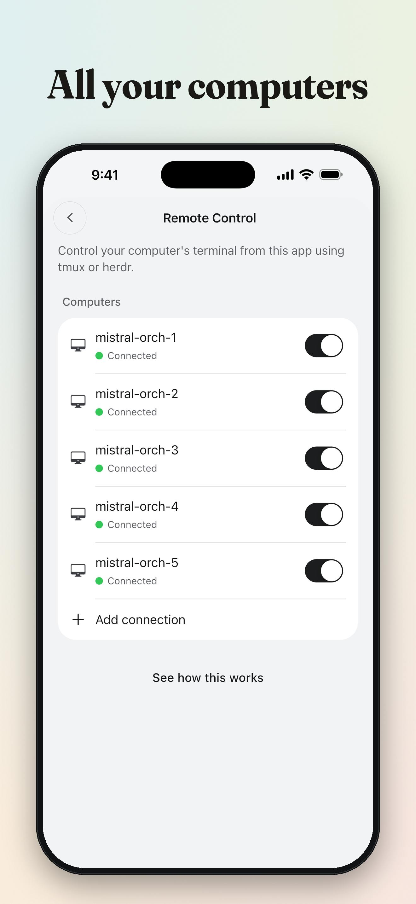
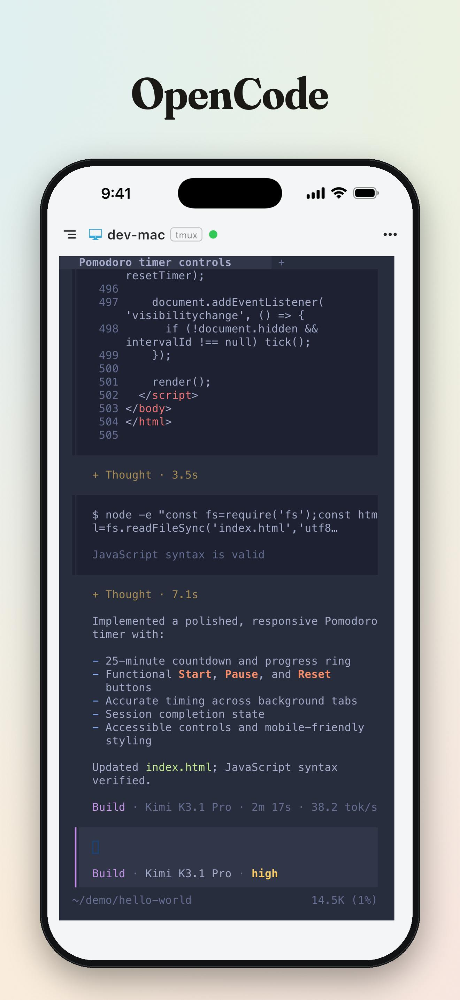
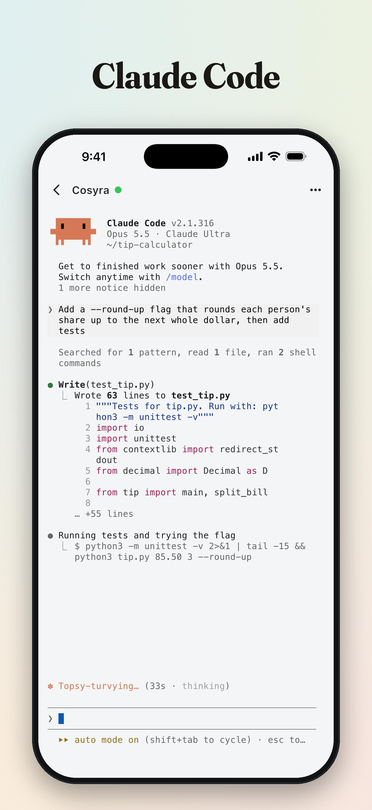

### 🎬 관련 영상
- [🎥 영상 보기](https://ph-files.imgix.net/81032fa3-0f33-4c0b-8565-ae859de1a36e.jpeg?auto=format)

---

## 19. [TextKit](https://www.producthunt.com/products/textkit-2)
**Votes**: 73 | **도입 난이도**: 하 | **신뢰도**: 상
**Tagline**: Send + receive texts in the US and Canada with a simple API
**서비스 링크**: https://www.producthunt.com/r/PTSCDZ5BRVUQLA

**태그**: DevTool, Automation, SaaS, Communication, AI Tool, Chat, API

### 📌 이 서비스 한눈에 보기
미국 및 캐나다 지역을 위한 저렴하고 간편한 SMS API 서비스

### 🔑 주요 기능
- 미국 및 캐나다 지역 특화 SMS 송수신 API
- Claude, ChatGPT 등 100개 이상의 서비스와 연동 가능
- Twilio 대비 50% 저렴한 가격 정책 및 AI 기반 캠페인 등록 지원

### 🙋 사용자에게 어떤 점이 좋은가
기존 Twilio 사용자의 비용을 절감하면서, AI 서비스와 연동된 자동화된 메시징 환경을 구축할 수 있습니다.

### ✅ 지금 바로 써볼 기능
- API 연동을 통한 메시징 자동화 테스트
- AI 서비스(ChatGPT 등)와의 통합 워크플로우 구축
- 기존 서비스 대비 비용 절감 효과 검토

### ⚠️ 사용 전 확인할 점
- 미국 및 캐나다 외 지역에서의 서비스 가용성 확인 필요
- 기존 서비스에서 전환 시 데이터 마이그레이션 및 안정성 검증 필요

### 🧭 확인이 더 필요한 정보
제공되는 50% 저렴한 가격이 모든 요금제나 사용량에 동일하게 적용되는지 확인이 필요합니다.

### 📸 스크린샷 및 갤러리

---

## 20. [AI Employees by Easy-Peasy.AI](https://www.producthunt.com/products/easy-peasy-ai)
**Votes**: 72 | **도입 난이도**: 중 | **신뢰도**: 상
**Tagline**: Hire an AI team that splits the work and asks before sending
**서비스 링크**: https://www.producthunt.com/r/S34A5WFMMA7OCQ

**태그**: Automation, AI Agents, Productivity, Workflow, AI Tool, Chat, Design, Email

### 📌 이 서비스 한눈에 보기
역할별 AI 팀을 구축하여 업무 분담부터 최종 승인까지 자동화하는 AI 에이전트 협업 플랫폼

### 🔑 주요 기능
- Chief of Staff, 디자이너 등 특정 역할을 가진 AI 직원 고용 가능
- 리더 AI가 업무를 배분하고 팀원들이 스레드로 협업하는 워크플로우
- 이메일, 캘린더, 앱 액션 실행 전 사용자의 최종 승인 대기 기능

### 🙋 사용자에게 어떤 점이 좋은가
단순 챗봇을 넘어 업무 프로세스 전체를 위임할 수 있어, 반복적인 운영 업무를 자동화하고 의사결정만 남길 수 있습니다.

### ✅ 지금 바로 써볼 기능
- 자신의 웹사이트를 입력하여 AI 팀에게 컨텍스트 학습시키기
- 첫 번째 무료 직원을 생성하여 기본 워크플로우 테스트하기
- 이메일/캘린더 연동을 통한 자동화 루틴 설정하기

### ⚠️ 사용 전 확인할 점
- AI가 생성한 결과물이 실제 외부 액션(이메일 발송 등)으로 이어지므로 승인 절차 확인 필수
- 복잡한 업무 분담 시 AI 간의 역할 충돌이나 작업 중복 가능성

### 🧭 확인이 더 필요한 정보
제공되는 15개 이상의 역할 외에 사용자 정의 역할의 자유도와 외부 앱 연동 범위에 대한 상세 정보가 필요합니다.

### 📸 스크린샷 및 갤러리

### 🎬 관련 영상
- [🎥 영상 보기](https://ph-files.imgix.net/698fa8b1-e2cb-4d5c-936f-6ad7cb5feac6.jpeg?auto=format)

---

## 21. [Pinku](https://www.producthunt.com/products/pinku)
**Votes**: 69 | **도입 난이도**: 하 | **신뢰도**: 상
**Tagline**: Private AI chat that runs offline on your iPhone and Mac
**서비스 링크**: https://www.producthunt.com/r/QFA5HNCSX5ADCD

**태그**: AI, Privacy, Mobile, Mac, Offline, AI Tool, Chat

### 📌 이 서비스 한눈에 보기
개인정보 유출 걱정 없이 오프라인에서 즐기는 나만의 프라이빗 AI 채팅

### 🔑 주요 기능
- Llama, Qwen, Gemma 등 오픈 모델 지원
- Apple MLX 프레임워크를 통한 iPhone, iPad, Mac 최적화
- 계정 생성 및 서버 전송 없는 완전한 로컬 실행

### 🙋 사용자에게 어떤 점이 좋은가
인터넷 연결이 없는 환경에서도 보안 걱정 없이 자유롭게 AI와 대화할 수 있습니다.

### ✅ 지금 바로 써볼 기능
- 원하는 오픈 소스 모델 다운로드하기
- 비행기 모드에서 오프라인 채팅 테스트하기
- 애플 기기 간 모델 공유 및 사용해보기

### ⚠️ 사용 전 확인할 점
- 모델 다운로드 시 기기 저장 공간 확보 필요
- 로컬 실행 특성상 기기 사양에 따른 성능 차이 발생 가능

### 🧭 확인이 더 필요한 정보
기기 사양별 최적의 모델 크기와 구체적인 유료 전환 정책은 명시되지 않았습니다.

### 📸 스크린샷 및 갤러리

---

## 22. [Stenograf](https://www.producthunt.com/products/stenograf)
**Votes**: 67 | **도입 난이도**: 하 | **신뢰도**: 상
**Tagline**: Private AI meeting notes that run on your computer
**서비스 링크**: https://www.producthunt.com/r/L7IHQY7QVH6SVV

**태그**: Productivity, AI, Privacy, Transcription, Automation, AI Tool

### 📌 이 서비스 한눈에 보기
개인정보 유출 걱정 없이 내 컴퓨터에서 직접 구동되는 프라이빗 AI 회의 기록 도구

### 🔑 주요 기능
- 회의 봇 참여 없이 로컬 환경에서 직접 녹음 및 기록
- 로컬 컴퓨터 내에서 이루어지는 텍스트 변환, 요약 및 검색
- Mac 및 Windows 지원 및 데이터 보안 중심 설계

### 🙋 사용자에게 어떤 점이 좋은가
회의 내용이 외부 서버로 전송되지 않아 보안이 중요한 기업이나 개인에게 최적이며, 과거 회의 내용을 쉽고 빠르게 검색할 수 있습니다.

### ✅ 지금 바로 써볼 기능
- 로컬 녹음 및 트랜스크립트 생성 기능 테스트
- AI 요약 및 회의 간 교차 질문 기능 활용
- 인용된 트랜스크립트 원문 대조 기능 확인

### ⚠️ 사용 전 확인할 점
- 로컬 리소스를 사용하므로 컴퓨터 사양에 따른 성능 영향 가능성
- 클라우드 기반 서비스 대비 모바일 연동이나 협업 기능 제한 가능성

### 🧭 확인이 더 필요한 정보
로컬 구동 시 하드웨어 사양 요구치와 구체적인 시스템 리소스 점유율 확인이 필요합니다.

### 📸 스크린샷 및 갤러리

### 🎬 관련 영상
- [🎥 영상 보기](https://ph-files.imgix.net/30748cab-d9f4-4962-a711-71d4e6144cd6.jpeg?auto=format)

---

## 23. [Keel](https://www.producthunt.com/products/keel-7)
**Votes**: 66 | **도입 난이도**: 하 | **신뢰도**: 상
**Tagline**: A native macOS client for Redis, Valkey and Dragonfly
**서비스 링크**: https://www.producthunt.com/r/XYLB2W2S745FTL

**태그**: DevTool, Database, macOS

### 📌 이 서비스 한눈에 보기
Redis, Valkey, Dragonfly를 위한 안전하고 직관적인 macOS 전용 GUI 클라이언트

### 🔑 주요 기능
- SCAN 명령어를 통한 대규모 키 탐색 지원
- redis-cli 스타일의 콘솔 및 모든 핵심 데이터 타입 편집 기능
- 읽기 전용 연결 및 타입 확인 기능을 통한 운영 환경 안전성 확보

### 🙋 사용자에게 어떤 점이 좋은가
macOS 환경에서 터미널 없이도 시각적으로 편리하게 키를 관리할 수 있으며, 운영 서버 접속 시 발생할 수 있는 실수로부터 데이터를 보호합니다.

### ✅ 지금 바로 써볼 기능
- SCAN 기능을 활용한 대량의 키 브라우징
- 콘솔 모드를 통한 CLI 스타일의 명령 실행
- 읽기 전용 모드로 운영 서버 데이터 안전하게 조회

### ⚠️ 사용 전 확인할 점
- macOS 전용 클라이언트이므로 다른 OS에서는 사용 불가
- 운영 환경 적용 시 반드시 읽기 전용 연결 설정 확인 필요

### 🧭 확인이 더 필요한 정보
지원하는 데이터 타입의 상세 범위와 대규모 데이터셋에서의 성능 최적화 수준은 추가 확인이 필요합니다.

### 📸 스크린샷 및 갤러리

---

## 24. [Paws](https://www.producthunt.com/products/paws)
**Votes**: 66 | **도입 난이도**: 하 | **신뢰도**: 상
**Tagline**: Meet strangers through their cats, behind frosted glass
**서비스 링크**: https://www.producthunt.com/r/I75K2YZUR3FIG4

**태그**: Social, Minimalism, Pets, MentalHealth

### 📌 이 서비스 한눈에 보기
낯선 이의 고양이와 교감하며 정서적 안정을 얻는 미니멀 소셜 공간

### 🔑 주요 기능
- 익명성이 보장된 낯선 이들과의 간접적인 만남
- 고양이 이미지를 매개로 한 비대면 상호작용
- 경쟁이나 보상 없이 머무는 것 자체에 집중하는 미니멀리즘 설계

### 🙋 사용자에게 어떤 점이 좋은가
복잡한 SNS 피로도에서 벗어나, 고양이와 같은 따뜻한 매개체를 통해 정서적 휴식과 느슨한 연결감을 얻을 수 있습니다.

### ✅ 지금 바로 써볼 기능
- 가상 공간에서 고양이 발바닥 터치해보기
- 조용한 분위기 속에서 머물며 다른 이들의 고양이 구경하기

### ⚠️ 사용 전 확인할 점
- 기능적 목적이나 보상이 없는 서비스이므로 단순 휴식용으로 적합함
- 익명 기반 서비스 특성상 사용자 간의 상호작용 범위가 제한적일 수 있음

### 🧭 확인이 더 필요한 정보
서비스의 구체적인 인터페이스와 상호작용 방식(애니메이션 등)이 실제 어떻게 구현되어 있는지 확인이 필요합니다.

### 📸 스크린샷 및 갤러리

### 🎬 관련 영상
- [🎥 영상 보기](https://ph-files.imgix.net/b7070ebc-0768-451a-90bf-89b2a621c40a.jpeg?auto=format)

---

## 25. [ChatNest](https://www.producthunt.com/products/chatnest-2)
**Votes**: 64 | **도입 난이도**: 하 | **신뢰도**: 상
**Tagline**: Folders and a prompt library for your AI chats
**서비스 링크**: https://www.producthunt.com/r/CQ7453OXR3KQIV

**태그**: Productivity, AI, Workflow, BrowserExtension, AI Tool, Chat, Prompting

### 📌 이 서비스 한눈에 보기
다양한 AI 채팅을 폴더로 정리하고 프롬프트 템플릿을 관리하는 생산성 도구

### 🔑 주요 기능
- AI 채팅을 제목 및 요약과 함께 폴더별로 저장 및 실시간 검색
- 변수를 포함한 프롬프트 템플릿 재사용 기능 제공
- ChatGPT, Claude, Gemini, Grok 등 주요 AI 서비스와 호환

### 🙋 사용자에게 어떤 점이 좋은가
여러 AI 모델을 사용하는 사용자가 흩어진 대화 기록을 체계적으로 관리하고, 반복적인 프롬프트 입력을 자동화하여 작업 흐름을 개선할 수 있습니다.

### ✅ 지금 바로 써볼 기능
- Ctrl+K 또는 // 단축키를 활용한 프롬프트 템플릿 실행
- 중요한 AI 대화 내용을 폴더로 분류하여 저장하기
- 로컬 우선(Local-first) 방식으로 데이터 보안 확인하기

### ⚠️ 사용 전 확인할 점
- 브라우저 확장 프로그램 형태일 경우 각 AI 서비스의 UI 업데이트에 따른 호환성 변화 가능성
- 로컬 저장 방식이므로 기기 변경 시 데이터 이전 방식 확인 필요

### 🧭 확인이 더 필요한 정보
사용자의 브라우저 환경이나 특정 AI 서비스의 보안 정책에 따른 작동 여부를 확인해야 합니다.

### 📸 스크린샷 및 갤러리

### 🎬 관련 영상
- [🎥 영상 보기](https://ph-files.imgix.net/9605bffc-7c75-4b68-8ced-104296e3f2fe.jpeg?auto=format)

---

## 26. [MCPCore](https://www.producthunt.com/products/mcpcore)
**Votes**: 64 | **도입 난이도**: 하 | **신뢰도**: 상
**Tagline**: Build and host MCP servers with no-code workflows
**서비스 링크**: https://www.producthunt.com/r/7ZK63UHOWNTEHM

**태그**: DevTool, NoCode, AI, Automation, API

### 📌 이 서비스 한눈에 보기
코딩 없이 드래그 앤 드롭으로 나만의 MCP 서버를 구축하고 배포하는 노코드 워크플로우 도구

### 🔑 주요 기능
- 캔버스 기반의 노코드 방식으로 MCP 서버 구축 가능
- 루프, 에러 분기 등 복잡한 로직을 시각적으로 설계
- Claude, Cursor, Codex 등 다양한 MCP 클라이언트에 즉시 배포

### 🙋 사용자에게 어떤 점이 좋은가
개발 지식이 부족해도 복잡한 AI 에이전트용 도구(MCP)를 직접 만들고 관리할 수 있어 생산성이 극대화됩니다.

### ✅ 지금 바로 써볼 기능
- 캔버스에서 기본 워크플로우 단계 구성해보기
- 기존 OpenAPI 사양을 임포트하여 서버 생성하기
- 플레이그라운드에서 실시간 테스트 및 배포하기

### ⚠️ 사용 전 확인할 점
- 복잡한 커스텀 로직 구현 시 노코드 환경의 제약이 있을 수 있음
- 보안 엔드포인트 설정 및 데이터 권한 관리 확인 필요

### 🧭 확인이 더 필요한 정보
제공되는 엔드포인트의 보안 수준과 외부 클라이언트와의 호환성 세부 사항을 확인해야 합니다.

### 📸 스크린샷 및 갤러리

### 🎬 관련 영상
- [🎥 영상 보기](https://ph-files.imgix.net/703cb2f0-6032-451d-8c4f-02913900c4cc.jpeg?auto=format)
- [🎥 영상 보기](https://ph-files.imgix.net/e91d4c74-6c2d-4da7-ad21-995336247f65.jpeg?auto=format)

---

## 27. [Bambu Lab H3C](https://www.producthunt.com/products/bambu-lab-h3c)
**Votes**: 64 | **도입 난이도**: 중 | **신뢰도**: 상
**Tagline**: Print multi-material projects faster and easier
**서비스 링크**: https://www.producthunt.com/r/43RQD623DT4OP5

**태그**: 3D Printing, Hardware, Multi-Material

### 📌 이 서비스 한눈에 보기
6초 만에 재료를 교체하는 9개 툴 시스템으로 복합 소재 출력을 더 쉽고 빠르게

### 🔑 주요 기능
- 6초 내 재료 교체가 가능한 9-tool Swaptek 시스템 탑재
- 색상, 강성, 유연성 등 다양한 소재와 노즐 크기 혼합 출력 지원
- 자동 보정, 필라멘트 저장 및 건조 기능 통합

### 🙋 사용자에게 어떤 점이 좋은가
재료 교체 시간과 필라멘트 낭비를 최소화하여 복잡한 멀티 소재 프로젝트를 관리 부담 없이 완성할 수 있습니다.

### ✅ 지금 바로 써볼 기능
- 다양한 색상과 질감을 조합한 멀티 소재 프로젝트 시도
- TPU와 같은 유연한 소재를 활용한 복합 출력 테스트
- 자동 보정 기능을 통한 출력 품질 최적화

### ⚠️ 사용 전 확인할 점
- 9개 툴 시스템 사용 시 하드웨어 유지보수 필요성 확인
- 다양한 노즐 크기 혼합 사용 시의 호환성 검토

### 🧭 확인이 더 필요한 정보
9개 툴 시스템의 구체적인 물리적 크기와 설치 공간 요구사항에 대한 정보가 필요합니다.

### 📸 스크린샷 및 갤러리

### 🎬 관련 영상
- [🎥 영상 보기](https://ph-files.imgix.net/e0aa384f-f90d-4753-b851-85efdd32c42e.jpeg?auto=format)

---

## 28. [Nock](https://www.producthunt.com/products/nock-2)
**Votes**: 63 | **도입 난이도**: 하 | **신뢰도**: 상
**Tagline**: A notch for Windows, in 1 MB of Rust
**서비스 링크**: https://www.producthunt.com/r/JJZM4UYZS7RWEF

**태그**: Utility, Windows, OpenSource, Productivity

### 📌 이 서비스 한눈에 보기
윈도우 데스크탑에 생동감을 더하는 초경량 네이티브 노치 및 상단 바

### 🔑 주요 기능
- Rust 언어로 제작된 1MB 수준의 초경량 네이티브 애플리케이션
- 미디어 제어, Wi-Fi/Bluetooth, 전원 관리 및 애니메이션 기능 제공
- Electron을 사용하지 않아 CPU 점유율이 거의 없는 최적화된 성능

### 🙋 사용자에게 어떤 점이 좋은가
시스템 자원을 거의 차지하지 않으면서도 화면 상단에서 직관적인 제어와 시각적 즐거움을 동시에 얻을 수 있습니다.

### ✅ 지금 바로 써볼 기능
- 상단 바의 미디어 및 시스템 제어 기능 테스트
- 애니메이션 장면 및 시각적 디자인 확인
- 저사양 환경에서의 리소스 점유율 확인

### ⚠️ 사용 전 확인할 점
- Windows 전용이며 Linux는 현재 프리뷰 단계임
- 상단 바 형태가 기존 Windows UI와 충돌할 가능성 있음

### 🧭 확인이 더 필요한 정보
사용자의 화면 해상도나 작업 표시줄 설정에 따른 UI 호환성을 확인해야 합니다.

### 📸 스크린샷 및 갤러리

### 🎬 관련 영상
- [🎥 영상 보기](https://ph-files.imgix.net/b521557b-5e02-48a3-a940-fe8de2acc71f.jpeg?auto=format)
- [🎥 영상 보기](https://ph-files.imgix.net/681f32a7-a54d-454a-a3ab-5596cf628c40.jpeg?auto=format)

---

## 29. [Vibeconferencing](https://www.producthunt.com/products/vibeconferencing)
**Votes**: 63 | **도입 난이도**: 중 | **신뢰도**: 상
**Tagline**: Your Claude Code session, in your Meet, Zoom or Teams call
**서비스 링크**: https://www.producthunt.com/r/K6HEVKEN5HVZEY

**태그**: DevTool, AI-Agent, Collaboration, OpenSource, Agent

### 📌 이 서비스 한눈에 보기
코딩 에이전트를 화상 회의 참여자로 변신시켜 실시간 협업을 가능하게 하는 도구

### 🔑 주요 기능
- Claude Code, Grok 등 코딩 에이전트를 화상 회의 참여자로 투입
- 음성과 얼굴을 가진 가상 참여자로서 회의 내용을 듣고 대화에 참여
- 공유 화이트보드를 활용한 실시간 코드 빌드 및 협업 지원

### 🙋 사용자에게 어떤 점이 좋은가
개발자가 코딩 에이전트를 회의에 직접 참여시켜, 말로 지시하거나 화이트보드를 통해 실시간으로 코드를 작성하는 협업 경험을 제공합니다.

### ✅ 지금 바로 써볼 기능
- 자주 사용하는 화상 회의 플랫폼(Zoom/Meet 등)에 연결하기
- 사용 중인 코딩 에이전트(Claude Code 등) 연동하기
- 공유 화이트보드 기능을 활용한 실시간 코딩 세션 진행하기

### ⚠️ 사용 전 확인할 점
- 에이전트의 음성/영상 참여로 인한 회의 흐름 방해 가능성
- 로컬 모델 또는 외부 API 사용 시 발생할 수 있는 보안 및 개인정보 이슈

### 🧭 확인이 더 필요한 정보
사용자의 로컬 환경이나 특정 에이전트 모델에 따른 구체적인 설치 및 설정 방법이 명시되지 않았습니다.

### 📸 스크린샷 및 갤러리

### 🎬 관련 영상
- [🎥 영상 보기](https://ph-files.imgix.net/96ec2ea0-59fc-4ebd-b45d-257f66265bab.jpeg?auto=format)

---

## 30. [CC Auto Review](https://www.producthunt.com/products/cc-auto-review)
**Votes**: 63 | **도입 난이도**: 하 | **신뢰도**: 상
**Tagline**: macOS app that reviews GitHub PRs w/ your local Claude Code
**서비스 링크**: https://www.producthunt.com/r/HOVK5E3PVCG5Q2

**태그**: DevTool, AI, macOS, GitHub, Automation, AI Tool, API

### 📌 이 서비스 한눈에 보기
로컬 Claude Code를 활용해 GitHub PR을 자동 리뷰하고 위험도를 관리하는 macOS 앱

### 🔑 주요 기능
- 로컬 Claude Code를 사용하여 보안과 편의성을 동시에 확보한 PR 리뷰
- 코드 변경점 옆에서 AI 제안을 즉시 수락, 거절 또는 편집 가능
- PR별 0–100 위험 점수 제공 및 루틴한 리뷰를 처리하는 오토파일럿 모드

### 🙋 사용자에게 어떤 점이 좋은가
별도의 API 키 설정이나 클론 없이 기존 gh 및 claude 환경을 그대로 사용하여 즉시 워크플로우에 통합할 수 있습니다.

### ✅ 지금 바로 써볼 기능
- 기존 gh 및 claude 환경 연결하기
- PR 위험 점수(Risk Score) 확인하기
- 오토파일럿 모드로 루틴한 리뷰 자동화하기

### ⚠️ 사용 전 확인할 점
- macOS 전용 앱이므로 다른 OS 사용자는 사용이 제한됨
- 로컬 Claude Code 환경이 사전에 설정되어 있어야 함

### 🧭 확인이 더 필요한 정보
로컬 환경의 Claude Code와 gh CLI 설정 상태에 따라 초기 구동 환경이 달라질 수 있습니다.

### 📸 스크린샷 및 갤러리

### 🎬 관련 영상
- [🎥 영상 보기](https://ph-files.imgix.net/25afee0a-9c4d-4d5a-a17a-fc271171694e.jpeg?auto=format)

---

