# 🚀 Product Hunt Daily Top 30 (2026-11-07)

## 오늘의 요약
오늘의 트렌드는 웹사이트를 AI 에이전트로 변환하거나 AI 에이전트가 정보를 읽기 최적화된 환경을 구축하는 등, AI와 인간/에이전트 간의 상호작용을 자동화하는 도구들이 주를 이루었습니다. 또한 기존의 복잡한 업무 프로세스를 텍스트 기반의 직관적인 인터페이스로 전환하여 효율성을 극대화하는 솔루션들이 주목받았습니다.

### 오늘의 핵심 포인트
- AI 에이전트가 직접 판매, 예약, 코드 리뷰 등을 수행하며 업무 워크플로우를 자동화하는 도구들이 등장했습니다.
- 전통적인 SEO를 넘어 AI 답변 엔진(GEO)에 최적화되거나 AI 모델 간의 전환을 지원하는 등 AI 시대에 맞춘 새로운 운영 체제들이 주목받았습니다.
- 복잡한 대시보드 대신 텍스트 입력만으로 비즈니스 전반을 관리하거나 트랙패드 제어와 같은 직관적인 사용자 경험을 제공하는 유틸리티들이 발표되었습니다.

**오늘의 태그**: AI Agent, Automation, Productivity, SEO/GEO, UX/UI

## 1. [Tobira Site Agent](https://www.producthunt.com/products/tobira-ai)
**Votes**: 291 | **도입 난이도**: 하 | **신뢰도**: 상
**Tagline**: Turn your website into an AI agent that sells to AI agents
**서비스 링크**: https://www.producthunt.com/r/LMNUHW4VUH6RGV

**태그**: AI, Sales, Automation, Marketing, Agent, AI Tool, Chat, Email

### 📌 이 서비스 한눈에 보기
웹사이트를 AI 에이전트로 변환하여 AI 채팅 환경 내에서 직접 판매와 예약을 수행하는 도구

### 🔑 주요 기능
- URL 입력만으로 10분 만에 웹사이트를 AI 에이전트로 전환
- ChatGPT, Claude, Grok 등 AI 채팅창 내에서 고객 응대, 협상, 예약, 주문 수행
- AI 에이전트가 웹사이트 정보를 더 빠르게 읽고 액션을 취할 수 있도록 최적화

### 🙋 사용자에게 어떤 점이 좋은가
사용자가 웹사이트를 직접 방문하지 않고 AI 채팅창을 이용할 때도, AI가 대신 영업과 예약을 진행하여 리드 전환율을 높여줍니다.

### ✅ 지금 바로 써볼 기능
- 자사 웹사이트 URL을 입력하여 에이전트 생성하기
- 생성된 에이전트가 고객 응대 및 예약 기능을 제대로 수행하는지 테스트하기
- 개인 AI API 키를 연결하여 서비스 활성화하기

### ⚠️ 사용 전 확인할 점
- 개인 AI API 키를 직접 사용해야 하므로 API 사용량에 따른 비용 발생 가능성 있음
- AI의 협상 및 주문 기능이 비즈니스 로직과 일치하는지 검증 필요

### 🧭 확인이 더 필요한 정보
사용자의 개인 AI 키를 사용할 때 발생하는 비용 구조와 보안 정책에 대한 상세 확인이 필요합니다.

### 📸 스크린샷 및 갤러리

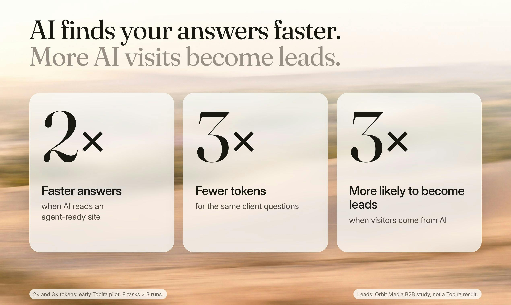

### 🎬 관련 영상
- [🎥 영상 보기](https://ph-files.imgix.net/59debe7f-d14c-40a1-82f0-50694beaebf0.jpeg?auto=format)

---

## 2. [Turnstone](https://www.producthunt.com/products/turnstone)
**Votes**: 192 | **도입 난이도**: 중 | **신뢰도**: 상
**Tagline**: Grok Bot alternative that runs on your AI, completely free
**서비스 링크**: https://www.producthunt.com/r/ELRJVLJUXTAYTL

**태그**: AI, Productivity, Automation, Cross-Platform, Agent, AI Tool, API

### 📌 이 서비스 한눈에 보기
보유 중인 다양한 AI 모델을 하나로 연결하여 사용량 제한 없이 활용하는 통합 AI 에이전트

### 🔑 주요 기능
- 개인용 AI 구독, API 키, 셀프 호스팅 모델을 모두 연결 가능
- 특정 모델의 사용량 제한 도달 시 다른 모델로 자동 전환되어 작업 지속
- Mac 및 iPhone 환경 지원

### 🙋 사용자에게 어떤 점이 좋은가
여러 AI 서비스를 개별적으로 관리할 필요 없이, 이미 가진 자원을 활용해 끊김 없는 AI 작업 환경을 구축할 수 있습니다.

### ✅ 지금 바로 써볼 기능
- 보유 중인 API 키 또는 구독 서비스 연결하기
- Mac/iPhone 기기 간 동기화 확인하기
- 모델 간 자동 전환 기능 테스트하기

### ⚠️ 사용 전 확인할 점
- 사용자가 직접 보유한 API 비용이나 구독료는 별도로 발생함
- 연결된 모델의 성능에 따라 에이전트의 답변 품질이 달라질 수 있음

### 🧭 확인이 더 필요한 정보
사용자가 직접 연결하는 모델들의 보안 및 데이터 프라이버시 처리 방식에 대한 상세 정보가 필요합니다.

### 📸 스크린샷 및 갤러리
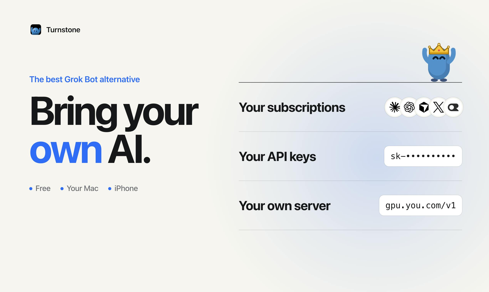
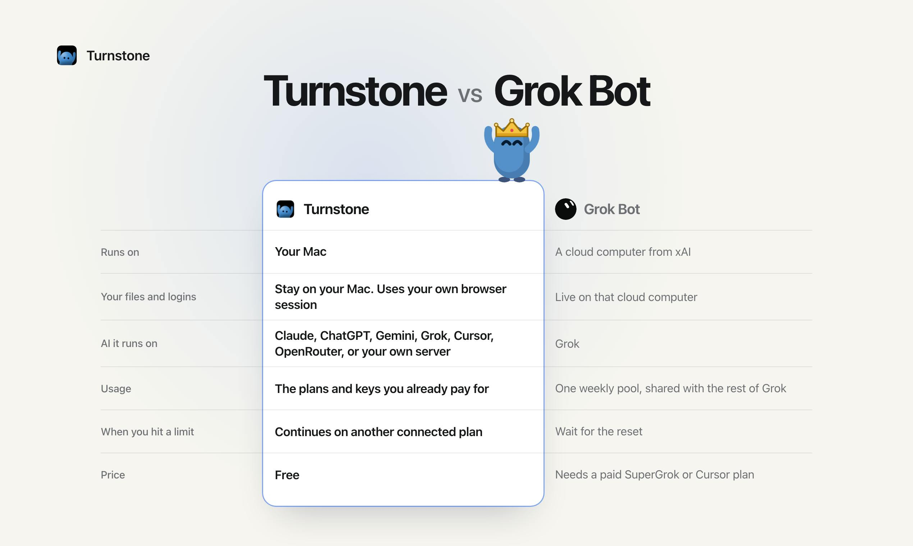
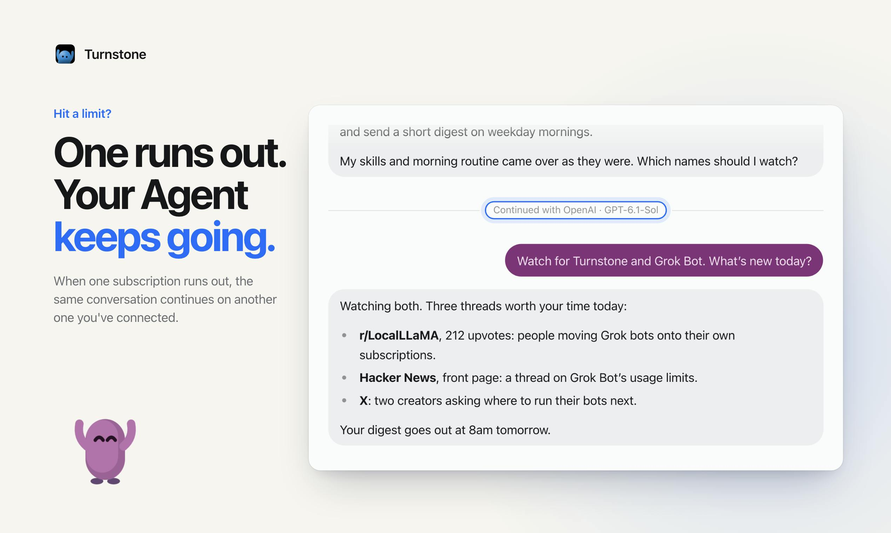

### 🎬 관련 영상
- [🎥 영상 보기](https://ph-files.imgix.net/edaa1eef-4c2a-40c7-a724-cbccbf4b6cdc.jpeg?auto=format)

---

## 3. [Wonder Dev View](https://www.producthunt.com/products/wonder-dev-view)
**Votes**: 134 | **도입 난이도**: 중 | **신뢰도**: 상
**Tagline**: Run many Claude Code and Codex agents in parallel
**서비스 링크**: https://www.producthunt.com/r/RJGZPEQMUG2EJU

**태그**: DevTool, AI-Agent, Automation, Coding, Agent, Design

### 📌 이 서비스 한눈에 보기
Claude Code와 Codex 에이전트를 병렬로 실행하여 코드 리뷰와 디자인 검토를 자동화하는 개발 도구

### 🔑 주요 기능
- Claude Code 및 Codex 에이전트의 병렬 워크트리 실행 지원
- 에이전트 간 상호 코드 리뷰 기능 제공
- 프리뷰 모드에서 요소를 선택하여 즉각적인 코드 수정 요청 가능

### 🙋 사용자에게 어떤 점이 좋은가
여러 AI 에이전트를 동시에 가동하여 코드 작성부터 리뷰, 디자인 검증까지 개발 워크플로우를 자동화할 수 있습니다.

### ✅ 지금 바로 써볼 기능
- 병렬 워크트리 환경 설정하기
- 에이전트 간 코드 리뷰 작업 할당하기
- 프리뷰 모드에서 UI 요소 변경 테스트하기

### ⚠️ 사용 전 확인할 점
- 사용 중인 Claude/Codex 구독 권한 및 API 비용 발생 여부 확인 필요
- 병렬 실행 시 발생할 수 있는 리소스 관리 및 충돌 주의

### 🧭 확인이 더 필요한 정보
사용자의 기존 구독 플랜이 에이전트 실행에 어떻게 적용되는지 구체적인 연동 방식 확인이 필요합니다.

### 📸 스크린샷 및 갤러리

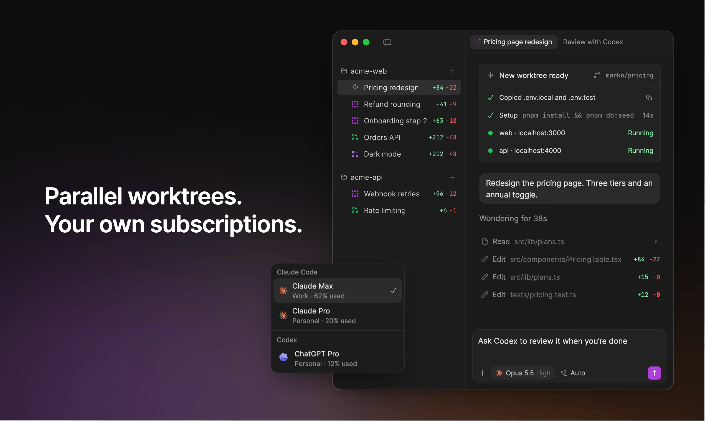
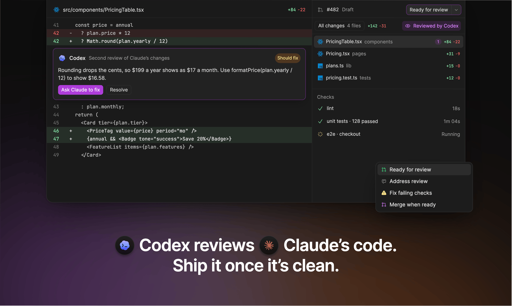

---

## 4. [Rankfender v3.0](https://www.producthunt.com/products/rankfender)
**Votes**: 124 | **도입 난이도**: 중 | **신뢰도**: 상
**Tagline**: The SEO/GEO operating system, built for people and AI agents
**서비스 링크**: https://www.producthunt.com/r/XXAKEEHHHA4XOR

**태그**: SEO, AI-Agent, Marketing-Automation, Analytics, Agent, AI Tool, Chat

### 📌 이 서비스 한눈에 보기
SEO와 AI 에이전트 최적화를 하나로 통합한 차세대 마케팅 운영 체제

### 🔑 주요 기능
- 키워드 리서치, 순위 추적, 백링크 분석 등 전통적 SEO 기능을 하나의 플랫폼으로 통합
- ChatGPT, Claude, Perplexity 등 주요 AI 에이전트가 브랜드를 어떻게 언급하는지 분석하는 차별화된 기능
- 사용자가 직접 작업하거나 AI 에이전트(Claude, ChatGPT)를 연결하여 자동화된 전략 실행 가능

### 🙋 사용자에게 어떤 점이 좋은가
여러 SEO 도구를 번갈아 사용할 필요 없이, AI 시대에 맞춰 검색 엔진과 AI 답변 엔진 모두에서 브랜드 노출을 최적화할 수 있습니다.

### ✅ 지금 바로 써볼 기능
- AI Overviews(SGE)를 포함한 키워드 순위 추적 기능 테스트
- 주요 AI 어시스턴트들의 브랜드 언급 현황 분석
- Claude 또는 ChatGPT를 연결하여 AI 에이전트 워크플로우 설정

### ⚠️ 사용 전 확인할 점
- AI 에이전트 연동 시 외부 API 사용에 따른 데이터 보안 및 권한 설정 확인 필요
- 기존 전문 SEO 도구 대비 특정 심층 분석 기능의 차이점 검토 필요

### 🧭 확인이 더 필요한 정보
AI 에이전트 연동 시 발생하는 구체적인 비용 체계나 데이터 동기화 방식에 대한 상세 정보가 필요합니다.

### 📸 스크린샷 및 갤러리
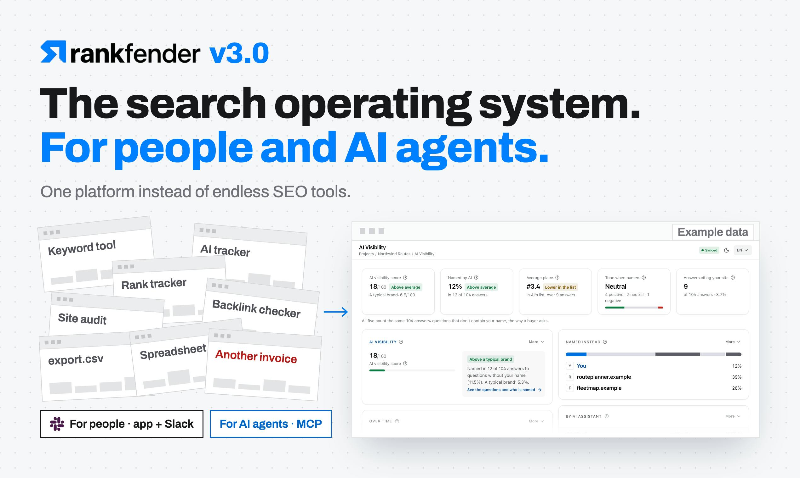
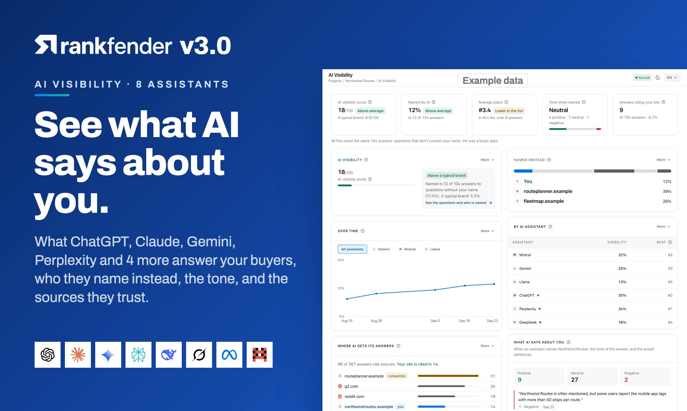
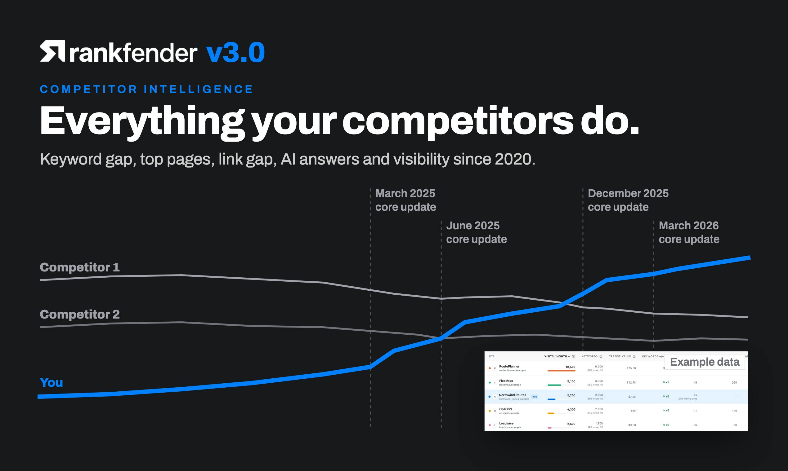

### 🎬 관련 영상
- [🎥 영상 보기](https://ph-files.imgix.net/d97eeb47-fb22-4d58-96c8-b595a79bb18e.jpeg?auto=format)

---

## 5. [Mechvibes 3](https://www.producthunt.com/products/mechvibes)
**Votes**: 111 | **도입 난이도**: 하 | **신뢰도**: 상
**Tagline**: Give your keyboard and mouse any sound you like
**서비스 링크**: https://www.producthunt.com/r/5WQ7ID2VTZR7X5

**태그**: Productivity, Customization, OpenSource, Audio

### 📌 이 서비스 한눈에 보기
사용자 정의 사운드로 키보드와 마우스 타이핑 경험을 새롭게 바꾸는 오픈소스 소프트웨어

### 🔑 주요 기능
- 키보드 입력 및 마우스 클릭 시 커스텀 사운드 재생
- 기계식 스위치부터 타자기까지 다양한 커뮤니티 라이브러리 제공
- Windows, Linux, Mac을 지원하는 무료 오픈소스 소프트웨어

### 🙋 사용자에게 어떤 점이 좋은가
타이핑이나 클릭 시 들리는 소리를 통해 물리적인 키보드를 사용하는 듯한 청각적 피드백과 즐거움을 얻을 수 있습니다.

### ✅ 지금 바로 써볼 기능
- 커뮤니티 라이브러리에서 취향에 맞는 사운드 팩 적용하기
- 브라우저를 통해 나만의 커스텀 사운드 제작하기
- 다양한 OS 환경에서 설치 및 호환성 테스트하기

### ⚠️ 사용 전 확인할 점
- 모든 앱에서 작동하므로 작업 중 의도치 않은 소음이 발생할 수 있음
- 사운드 재생 방식에 따라 시스템 리소스 사용량이 발생할 수 있음

### 🧭 확인이 더 필요한 정보
사용자의 하드웨어 사양에 따른 사운드 지연 시간(Latency) 여부는 명시되지 않았습니다.

### 📸 스크린샷 및 갤러리
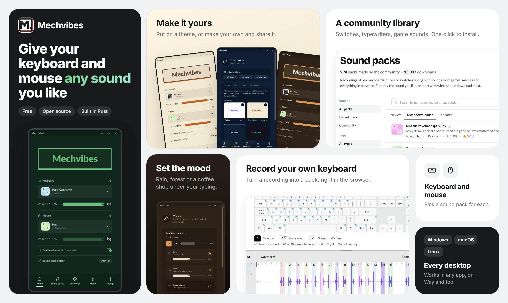
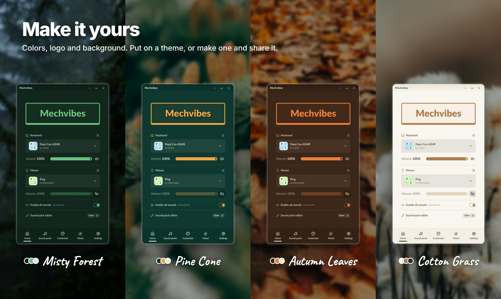
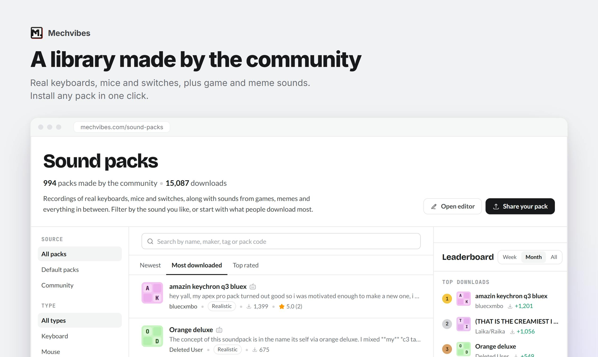

---

## 6. [EdgeBar](https://www.producthunt.com/products/edgebar)
**Votes**: 93 | **도입 난이도**: 하 | **신뢰도**: 상
**Tagline**: Control your Mac’s volume and brightness from the trackpad
**서비스 링크**: https://www.producthunt.com/r/U6F4QOW3RM6SV4

**태그**: Mac, Productivity, Utility

### 📌 이 서비스 한눈에 보기
맥북 트랙패드 가장자리를 활용해 직관적으로 볼륨과 밝기를 조절하는 유틸리티

### 🔑 주요 기능
- 트랙패드 가장자리 슬라이드로 볼륨 및 밝기 조절
- 햅틱 피드백과 키보드와 동일한 온스크린 디스플레이 지원
- 메뉴 바 상주형이며 CPU 점유율이 매우 낮음

### 🙋 사용자에게 어떤 점이 좋은가
키보드에 손을 뻗지 않고도 트랙패드만으로 미디어와 화면 설정을 즉각 제어할 수 있어 작업 흐름이 끊기지 않습니다.

### ✅ 지금 바로 써볼 기능
- 오른쪽 가장자리 슬라이드로 볼륨 조절해보기
- 왼쪽 가장자리 슬라이드로 밝기 조절해보기
- 우측 상단 더블 탭으로 음소거 기능 테스트하기

### ⚠️ 사용 전 확인할 점
- 트랙패드 가장자리를 사용하므로 의도치 않은 입력이 발생할 수 있음
- 일회성 구매($9) 모델로 초기 비용 발생

### 🧭 확인이 더 필요한 정보
트랙패드 모델이나 OS 버전에 따른 햅틱 피드백의 정밀도 차이가 있을 수 있습니다.

### 📸 스크린샷 및 갤러리

### 🎬 관련 영상
- [🎥 영상 보기](https://ph-files.imgix.net/107ba604-867d-46c9-b593-3da670c6d1c8.jpeg?auto=format)

---

## 7. [Meadow](https://www.producthunt.com/products/meadow-3)
**Votes**: 89 | **도입 난이도**: 하 | **신뢰도**: 상
**Tagline**: Hidden songs on your walk, chosen by people, not algorithms
**서비스 링크**: https://www.producthunt.com/r/KD2FP5YECF3KLS

**태그**: Music, Location-based, Social, iOS

### 📌 이 서비스 한눈에 보기
특정 장소에 사람들이 남긴 음악을 발견하고 심는 위치 기반 음악 공유 서비스

### 🔑 주요 기능
- 알고리즘 대신 사람이 직접 선택한 음악을 특정 장소에 심고 듣는 방식
- Live Activities를 통해 주머니 속에서도 간편하게 음악 수집 가능
- 수집한 곡을 Garden에 보관하거나 Apple Music 플레이리스트로 변환

### 🙋 사용자에게 어떤 점이 좋은가
새로운 장소를 방문할 때마다 그곳에 담긴 사람들의 감성을 음악으로 경험할 수 있으며, 나만의 음악 정원을 가꾸는 재미를 제공합니다.

### ✅ 지금 바로 써볼 기능
- TestFlight를 통해 iPhone에 앱 설치하기
- 산책하며 주변에 심어진 음악 수집하기
- 나만의 음악을 특정 장소에 심어보기

### ⚠️ 사용 전 확인할 점
- 현재 TestFlight를 통한 iPhone 사용자 대상 베타 서비스임
- 위치 기반 서비스이므로 GPS 활성화가 필요함

### 🧭 확인이 더 필요한 정보
현재 TestFlight를 통한 무료 테스트 단계이므로 향후 정식 출시 시 가격 정책이나 서비스 범위가 변경될 수 있습니다.

### 📸 스크린샷 및 갤러리

---

## 8. [DALI AI by SupplyzPro](https://www.producthunt.com/products/supplyzpro-the-conversational-erp)
**Votes**: 83 | **도입 난이도**: 하 | **신뢰도**: 중
**Tagline**: The ERP you never need to open
**서비스 링크**: https://www.producthunt.com/r/Z4NJ6O6UCMBXQL

**태그**: AI, ERP, BusinessAutomation, SaaS, AI Tool, Sales

### 📌 이 서비스 한눈에 보기
텍스트 입력만으로 영업, 재고, 결제를 관리하는 AI 기반 올인원 ERP

### 🔑 주요 기능
- 판매, 구매, 재고, 송장, 공급업체 관리를 하나로 통합
- 복잡한 대시보드 대신 텍스트 기반의 간편한 인터페이스 제공
- AI를 활용한 비즈니스 워크스페이스 구축

### 🙋 사용자에게 어떤 점이 좋은가
별도의 복잡한 ERP 시스템을 열지 않고도 텍스트를 통해 비즈니스 운영 전반을 직관적으로 관리할 수 있습니다.

### ✅ 지금 바로 써볼 기능
- WhatsApp 링크를 통한 서비스 접속 및 초기 설정
- 텍스트 명령어를 통한 재고 및 판매 데이터 입력 테스트
- 기존 비즈니스 프로세스와의 정합성 확인

### ⚠️ 사용 전 확인할 점
- 텍스트 기반 인터페이스의 데이터 시각화 및 상세 관리 기능 제한 가능성
- 비즈니스 규모 확장에 따른 기능 확장성 확인 필요

### 🧭 확인이 더 필요한 정보
제공된 정보가 메신저 기반의 인터페이스에 집중되어 있어, 상세한 관리 기능과 데이터 보안 수준을 확인해야 합니다.

### 📸 스크린샷 및 갤러리

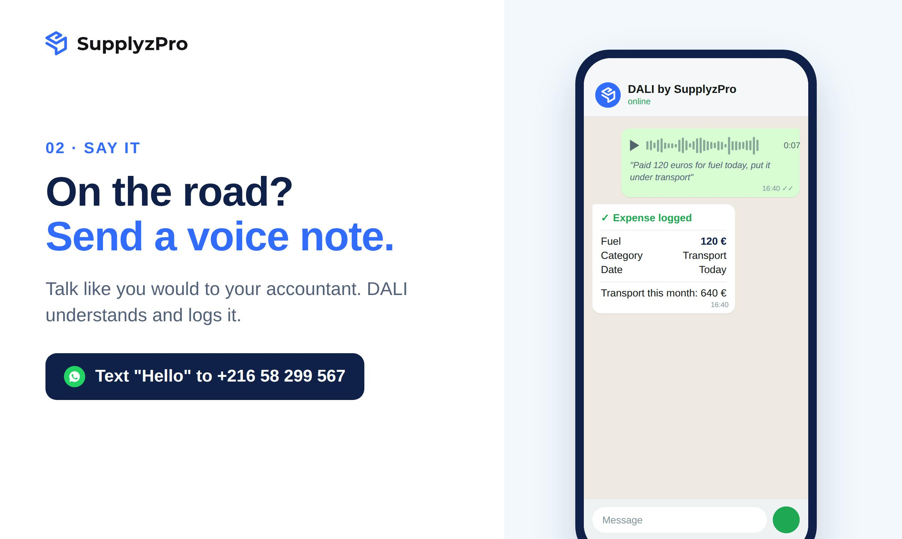
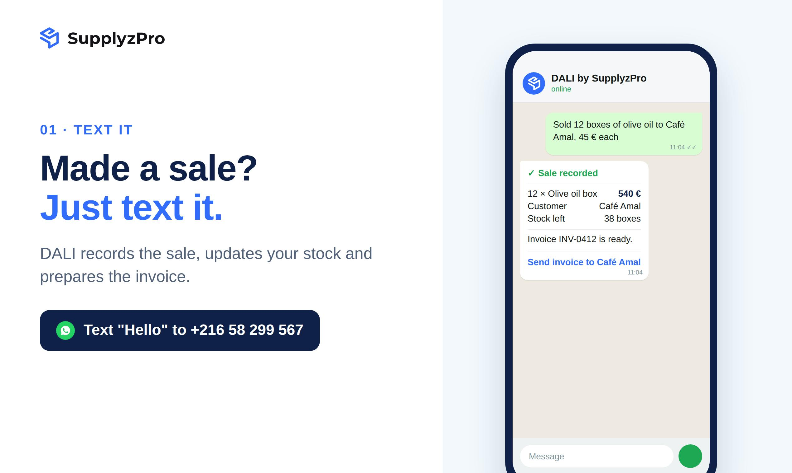

### 🎬 관련 영상
- [🎥 영상 보기](https://ph-files.imgix.net/7b338ae2-cf57-417b-9cd2-4a44acf03325.jpeg?auto=format)

---

## 9. [Enhanced for Todoist](https://www.producthunt.com/products/enhanced-for-todoist)
**Votes**: 82 | **도입 난이도**: 하 | **신뢰도**: 상
**Tagline**: More ways to organise, plan and focus with Todoist
**서비스 링크**: https://www.producthunt.com/r/TFK2ZLO6FNZRQ6

**태그**: Productivity, Task Management, Open Source, Workflow

### 📌 이 서비스 한눈에 보기
Todoist 사용자를 위한 강력한 기능이 추가된 새로운 프론트엔드 대시보드

### 🔑 주요 기능
- 편집 가능한 테이블 및 저장 가능한 프로젝트 뷰 제공
- 업무량 추정 및 유연한 타임프레임 관리 기능
- 가이드형 리뷰 및 작업 연동 뽀모도로 타이머 탑재

### 🙋 사용자에게 어떤 점이 좋은가
기존 Todoist의 기능을 확장하여 더 체계적인 계획 수립과 집중력 있는 업무 관리를 가능하게 합니다.

### ✅ 지금 바로 써볼 기능
- 데모 버전을 통해 로그인 없이 인터페이스 경험하기
- 편집 가능한 테이블로 프로젝트 구조 시각화하기
- 뽀모도로 타이머로 작업 집중도 테스트하기

### ⚠️ 사용 전 확인할 점
- 기존 Todoist 계정과의 동기화 방식 및 데이터 보안 확인 필요
- 기능의 완전한 활용을 위해 Todoist 계정 연동이 필수적일 수 있음

### 🧭 확인이 더 필요한 정보
기존 Todoist 계정의 모든 데이터가 실시간으로 완벽하게 동기화되는지 확인이 필요합니다.

### 📸 스크린샷 및 갤러리
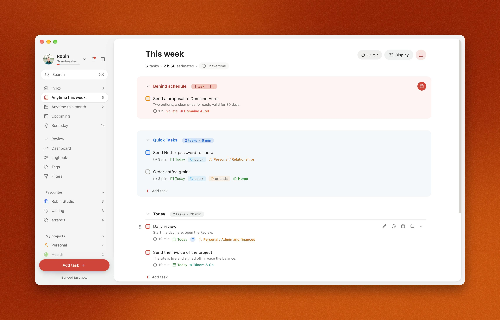
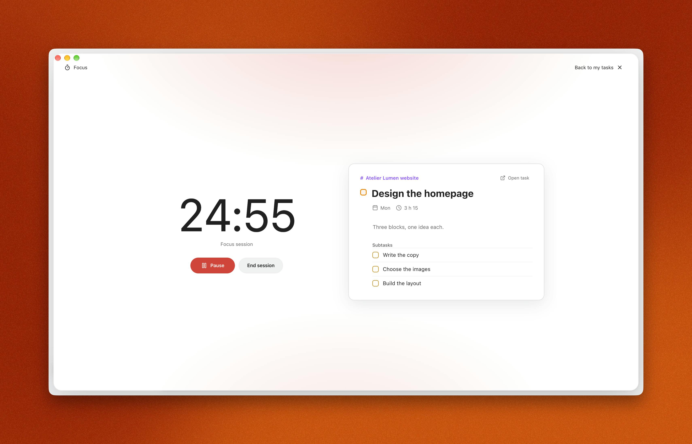
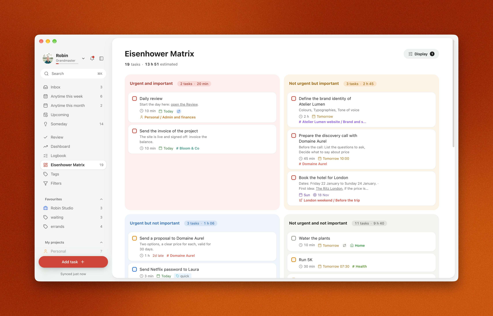

---

## 10. [chalk](https://www.producthunt.com/products/chalk-546d9cf8-cdc3-4b80-9b88-f441167c8f6e)
**Votes**: 81 | **도입 난이도**: 하 | **신뢰도**: 상
**Tagline**: learn anything, anywhere
**서비스 링크**: https://www.producthunt.com/r/RPZOYOCZ477VJD

**태그**: EdTech, Productivity, Learning, MacApp, AI Tool

### 📌 이 서비스 한눈에 보기
화면 위에서 직접 가르쳐주는 대화형 학습 및 프로젝트 가이드 도구

### 🔑 주요 기능
- 화면 캡처 및 인터랙티브 가이드: Mac 화면의 요소를 직접 가리키며 단계별 학습 제공
- 맞춤형 커리큘럼 생성: 학습 목표에 따른 보드 생성 및 실습 중심의 코스 설계
- 멀티 플랫폼 지원: 브라우저 기반의 보드 및 코스 기능 제공

### 🙋 사용자에게 어떤 점이 좋은가
단순한 읽기 중심 학습에서 벗어나, 실제 화면 위에서 실습하며 문제를 해결하는 직관적인 학습 경험을 제공합니다.

### ✅ 지금 바로 써볼 기능
- ⌘⌥ 단축키를 사용하여 화면 속 요소에 대해 질문하기
- 학습하고 싶은 주제를 말하여 맞춤형 코스 생성하기
- 브라우저에서 생성된 보드와 코스 활용하기

### ⚠️ 사용 전 확인할 점
- Mac 전용 단축키 기능이 포함되어 있어 운영체제 호환성 확인 필요
- 무료 시작 모델이므로 고급 기능 사용 시 유료 전환 가능성 있음

### 🧭 확인이 더 필요한 정보
상세한 유료 플랜 정책과 타 소프트웨어와의 연동 범위는 명시되지 않았습니다.

### 📸 스크린샷 및 갤러리
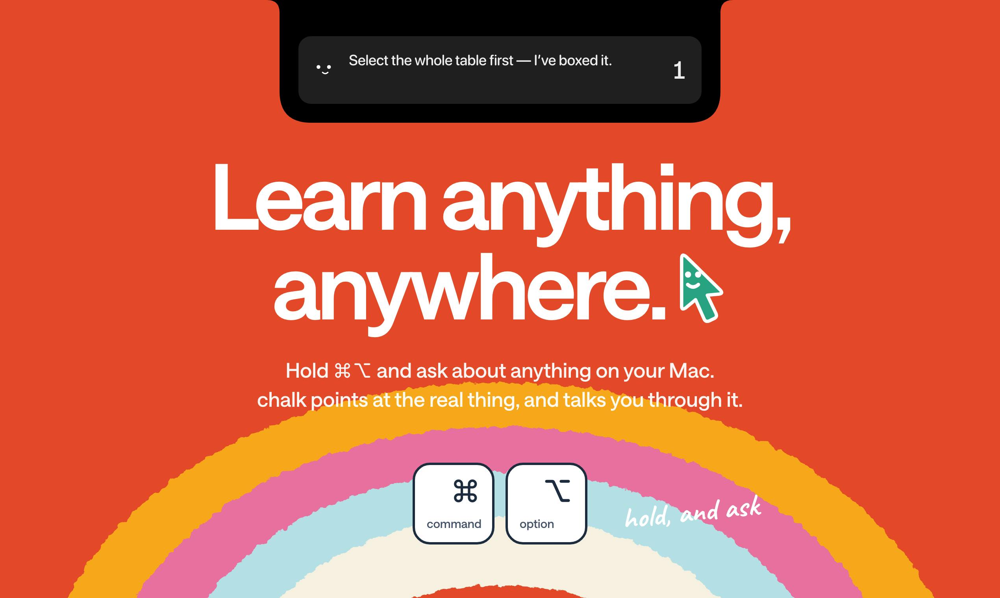
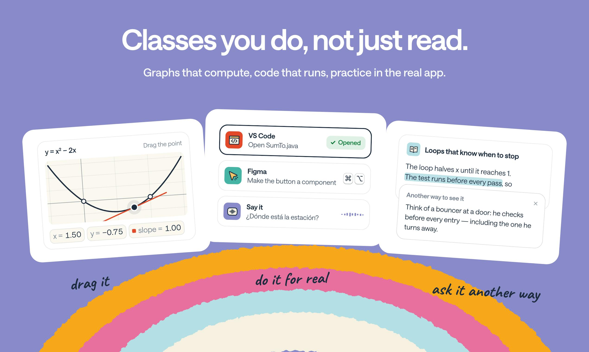
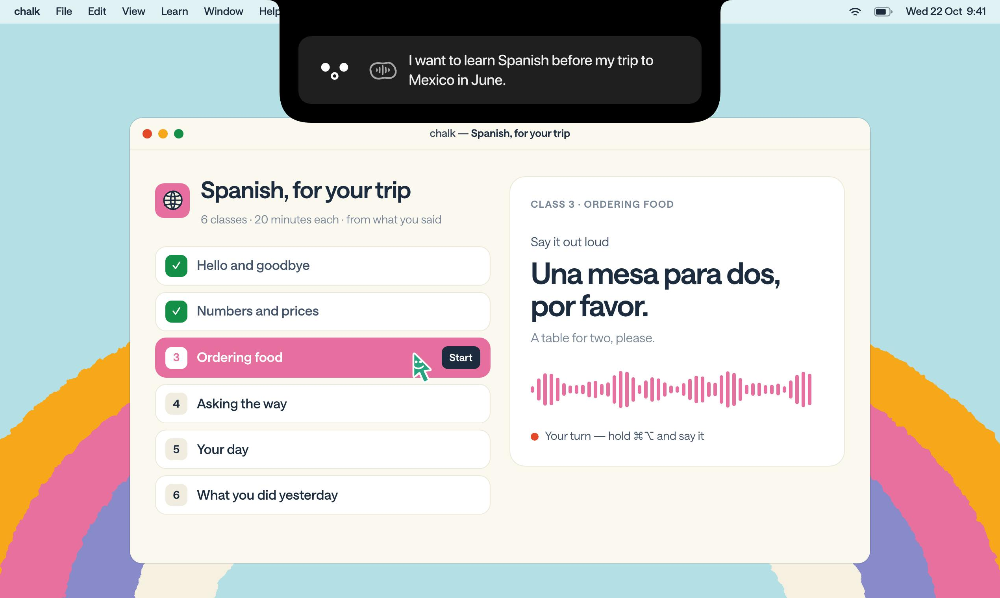

### 🎬 관련 영상
- [🎥 영상 보기](https://ph-files.imgix.net/42cff875-4f62-4679-b1b5-b71d5e68b973.jpeg?auto=format)
- [🎥 영상 보기](https://ph-files.imgix.net/fe5d8c63-3fd8-445d-9697-e341fdb56d14.jpeg?auto=format)

---

## 11. [Pauta](https://www.producthunt.com/products/pauta)
**Votes**: 76 | **도입 난이도**: 하 | **신뢰도**: 상
**Tagline**: Your private memory for every conversation
**서비스 링크**: https://www.producthunt.com/r/GSNLNLDJL3ZT4U

**태그**: Productivity, AI, Privacy, Transcription, Automation, AI Tool

### 📌 이 서비스 한눈에 보기
개인정보 유출 걱정 없이 대화를 기록하고 요약하는 오프라인 AI 메모 도구

### 🔑 주요 기능
- 회의, 인터뷰, 음성 메모의 자동 기록 및 전사 기능
- 데이터를 기기에 저장하는 완전 오프라인 작업 방식
- 대화 내용을 요약 및 실행 가능한 액션 아이템으로 변환

### 🙋 사용자에게 어떤 점이 좋은가
민감한 대화 내용을 외부 서버에 저장하지 않고도 AI의 요약 기능을 활용할 수 있어 보안이 중요한 전문가에게 유용합니다.

### ✅ 지금 바로 써볼 기능
- 중요한 미팅 녹음 및 전사 테스트
- 생성된 요약본과 액션 아이템 검토
- 오프라인 환경에서의 데이터 보안성 확인

### ⚠️ 사용 전 확인할 점
- 외부 AI 연결 시 데이터 노출 범위 확인 필요
- 기기 성능에 따른 로컬 처리 속도 차이 가능성

### 🧭 확인이 더 필요한 정보
로컬 환경에서의 AI 모델 구동 방식과 외부 AI 연결 시의 데이터 처리 정책에 대한 상세 정보가 필요합니다.

### 📸 스크린샷 및 갤러리
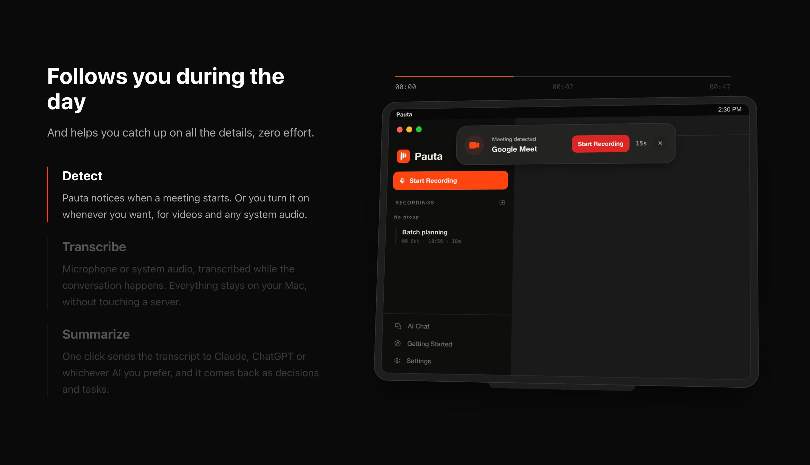
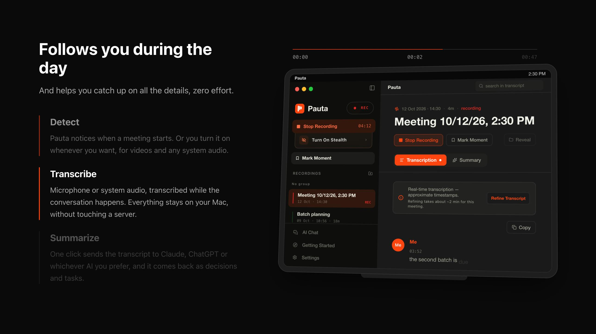
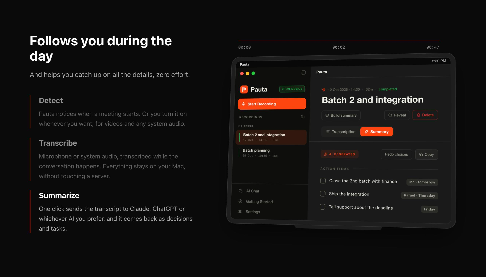

### 🎬 관련 영상
- [🎥 영상 보기](https://ph-files.imgix.net/9871b257-3103-4615-b1cf-415e55f150d3.jpeg?auto=format)

---

## 12. [axel.md](https://www.producthunt.com/products/axel-3)
**Votes**: 74 | **도입 난이도**: 상 | **신뢰도**: 중
**Tagline**: Agent orchestration in the terminal, designed for Rex
**서비스 링크**: https://www.producthunt.com/r/7QBNO4SPNFWPBT

**태그**: DevTool, AI-Agent, Terminal, Automation, Agent, AI Tool, Design

### 📌 이 서비스 한눈에 보기
터미널 환경에서 Claude Code와 Codex 등 다양한 AI 에이전트를 효율적으로 관리하고 실행하는 오케스트레이션 도구

### 🔑 주요 기능
- 터미널 기반의 스레드 및 이름 지정 에이전트 관리 기능
- Rex 환경에서의 Claude Code, Codex, OpenCode 에이전트 오케스트레이션
- Tailscale을 통한 원격 머신 연결 및 지속 가능한 세션 지원

### 🙋 사용자에게 어떤 점이 좋은가
터미널 환경을 벗어나지 않고도 여러 AI 에이전트를 체계적으로 제어할 수 있어 개발 워크플로우의 연속성을 유지할 수 있습니다.

### ✅ 지금 바로 써볼 기능
- Rex 환경 설정 및 Tailscale 연결 확인
- 터미널 내 에이전트 스레드 생성 및 테스트
- Claude Code 등 외부 에이전트와의 연동 확인

### ⚠️ 사용 전 확인할 점
- Rex 및 Tailscale 등 특정 인프라 환경에 대한 의존도가 높음
- 터미널 숙련도에 따라 초기 설정 및 사용 난이도가 높을 수 있음

### 🧭 확인이 더 필요한 정보
Rex 환경에 대한 구체적인 요구 사양과 에이전트 간의 상호작용 방식에 대한 상세 정보가 필요합니다.

### 📸 스크린샷 및 갤러리
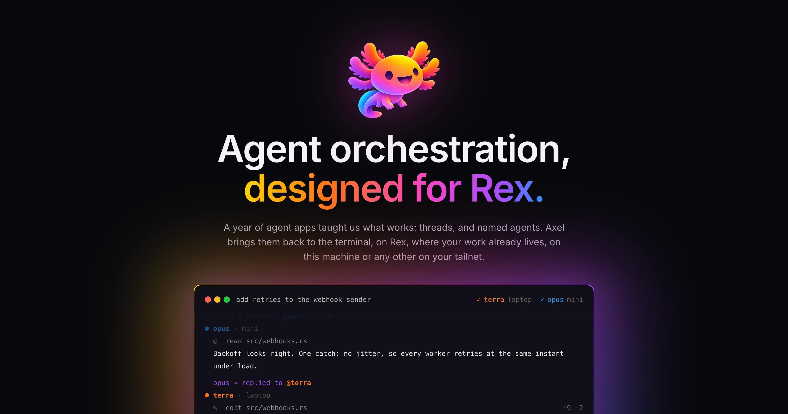
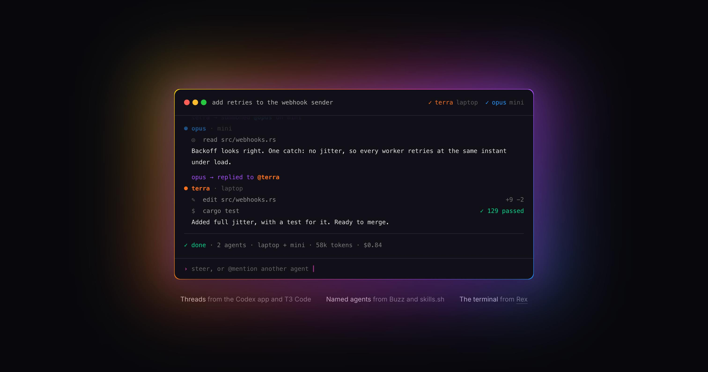
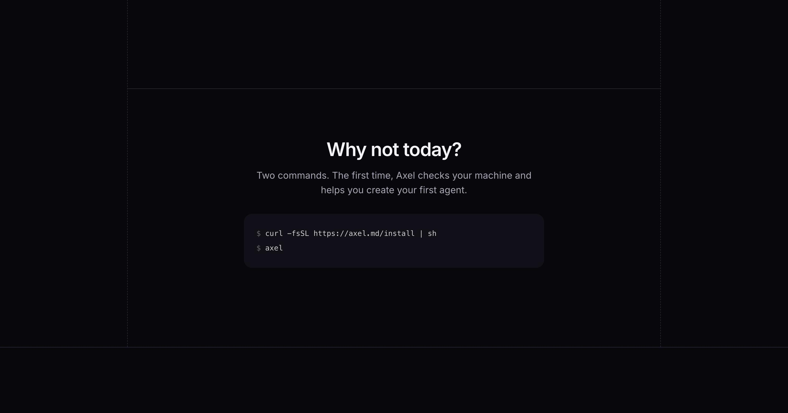

---

## 13. [Datastripes Data Stories](https://www.producthunt.com/products/datastripes)
**Votes**: 74 | **도입 난이도**: 하 | **신뢰도**: 상
**Tagline**: Turn any spreadsheet into a data story in seconds
**서비스 링크**: https://www.producthunt.com/r/B2BRINIF6PPVVP

**태그**: DataAnalysis, Automation, NoCode, Visualization, AI Tool, Design

### 📌 이 서비스 한눈에 보기
엑셀 파일을 업로드하면 데이터 분석부터 시각화, 스토리텔링까지 자동으로 완성해주는 도구

### 🔑 주요 기능
- CSV/Excel 파일을 활용한 자동 데이터 분석 및 인사이트 도출
- 헤드라인, 차트, 자연어 기반의 분석 결과 자동 생성
- 브랜드 컬러 적용 및 8가지 포맷으로 간편한 결과물 발행

### 🙋 사용자에게 어떤 점이 좋은가
데이터 분석가, 디자이너, 작가의 역할 없이도 혼자서 전문적인 데이터 리포트를 빠르게 제작할 수 있습니다.

### ✅ 지금 바로 써볼 기능
- 보유 중인 CSV/Excel 파일 업로드하기
- 생성된 데이터 스토리의 결론이 데이터와 일치하는지 검토하기
- 원하는 브랜드 컬러를 적용하여 결과물 발행하기

### ⚠️ 사용 전 확인할 점
- 데이터의 복잡도에 따라 자동 생성된 분석 내용의 정확성 검증 필요
- 데이터 보안 및 개인정보 포함 파일 업로드 시 주의 필요

### 🧭 확인이 더 필요한 정보
데이터 보안 정책 및 대용량 파일 처리 용량에 대한 구체적인 정보가 명시되지 않았습니다.

### 📸 스크린샷 및 갤러리
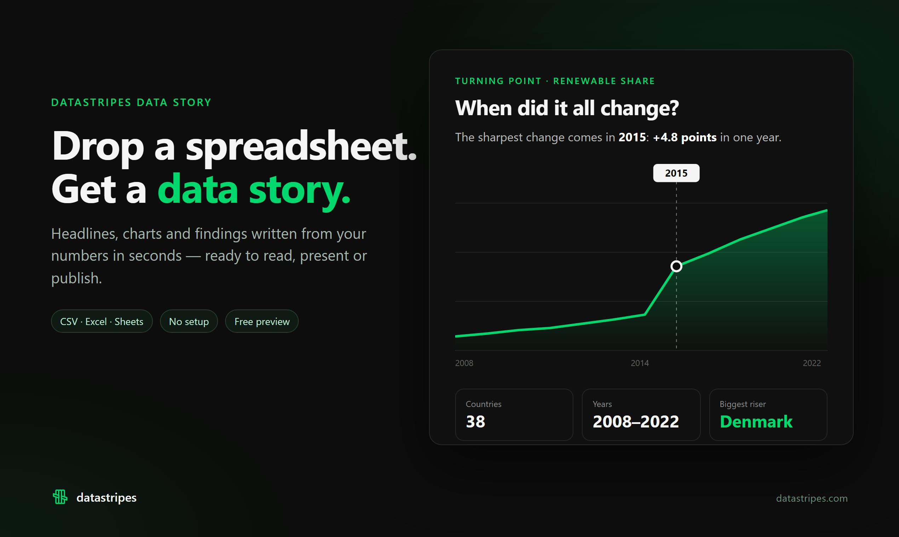
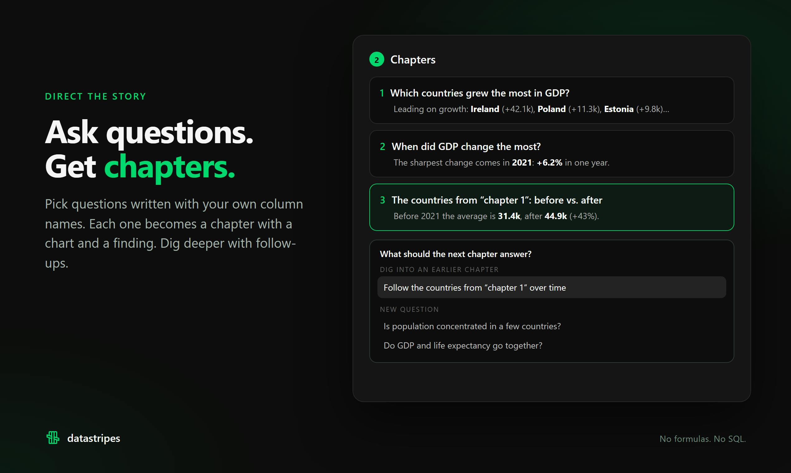
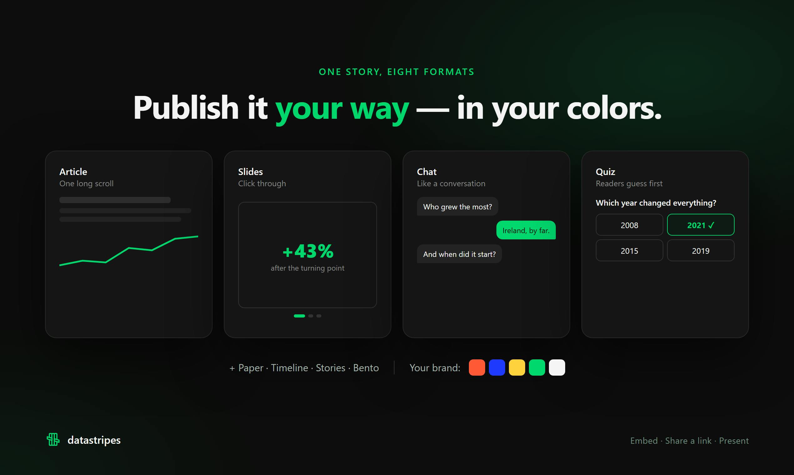

### 🎬 관련 영상
- [🎥 영상 보기](https://ph-files.imgix.net/64ff9106-eadb-4ba5-9cd3-ce556cf0d975.jpeg?auto=format)

---

## 14. [refern.](https://www.producthunt.com/products/refern)
**Votes**: 73 | **도입 난이도**: 하 | **신뢰도**: 상
**Tagline**: Every visual reference you work from, in one place.
**서비스 링크**: https://www.producthunt.com/r/TIZLGEEHIU5EVJ

**태그**: DesignTool, Productivity, CreativeWorkflow, Video, Vision

### 📌 이 서비스 한눈에 보기
모든 시각적 레퍼런스를 한곳에 모아 작업 효율을 높이는 통합 라이브러리

### 🔑 주요 기능
- 이미지, 영상, 작업 파일, 웹 페이지를 하나의 라이브러리로 통합 관리
- 태그 및 색상 기반의 직관적인 검색 기능 제공
- 드로잉 앱 위에 파일을 고정(Pin)하여 작업 중 즉시 참조 가능

### 🙋 사용자에게 어떤 점이 좋은가
여러 곳에 흩어진 작업 소스를 한곳에서 관리하고, 작업 화면 위에 바로 띄워 작업 흐름을 끊지 않고 참조할 수 있습니다.

### ✅ 지금 바로 써볼 기능
- 자주 사용하는 레퍼런스 파일을 라이브러리에 업로드하기
- 색상 및 태그를 활용해 나만의 분류 체계 만들기
- 드로잉 앱 위에서 핀(Pin) 기능을 활용해 실시간 참조하기

### ⚠️ 사용 전 확인할 점
- 파일은 사용자 개인 폴더에 저장되므로 저장소 용량 관리가 필요함
- OS별(Windows, macOS, Linux) 기능 차이가 있는지 확인 필요

### 🧭 확인이 더 필요한 정보
파일 저장 방식과 클라우드 동기화 지원 여부에 대한 상세 정보가 필요합니다.

### 📸 스크린샷 및 갤러리

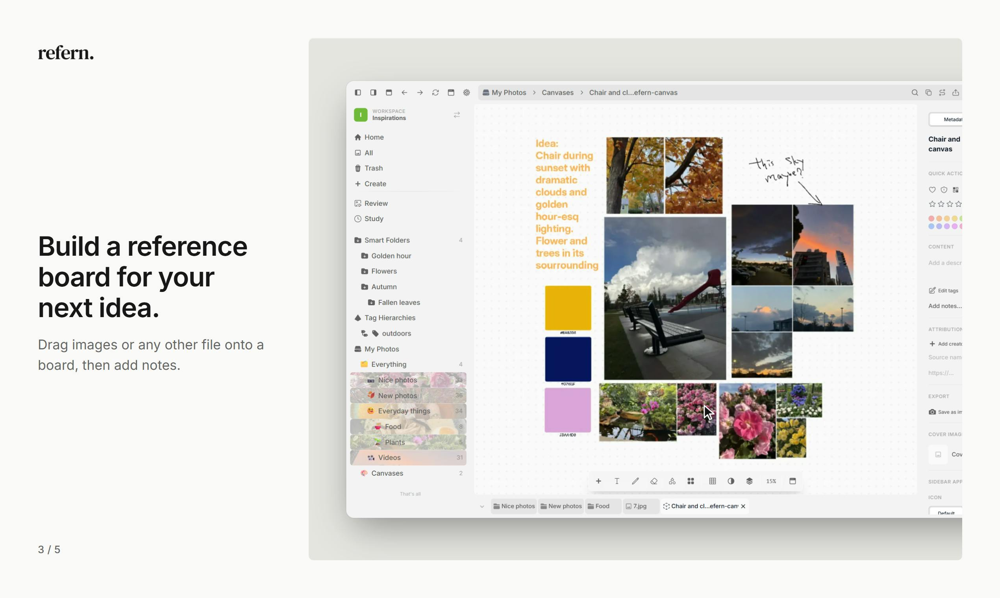
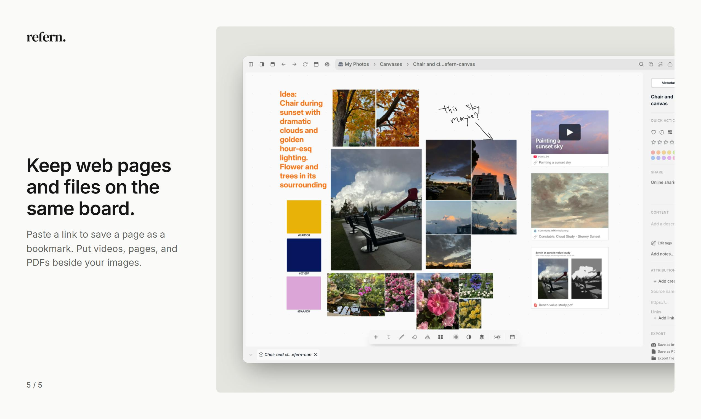

### 🎬 관련 영상
- [🎥 영상 보기](https://ph-files.imgix.net/93c4c19f-44e9-4d55-936a-7e900153a2ee.jpeg?auto=format)

---

## 15. [Thunderduck Inc.](https://www.producthunt.com/products/thunderduck-inc)
**Votes**: 72 | **도입 난이도**: 중 | **신뢰도**: 상
**Tagline**: Modular Data Warehouse for Agentic Data Teams
**서비스 링크**: https://www.producthunt.com/r/SCNLOLZ34ZR2N3

**태그**: DataWarehouse, AI-Agents, DuckDB, DataEngineering, Analytics, Agent, AI Tool

### 📌 이 서비스 한눈에 보기
AI 에이전트를 위한 격리된 엔진 기반의 모듈형 데이터 웨어하우스

### 🔑 주요 기능
- DuckDB 기반의 AI 에이전트 최적화 데이터 웨어하우스
- ETL 없이 Postgres, BigQuery, Iceberg, S3 데이터를 단일 SQL로 통합 조회
- 에이전트별 독립된 엔진 제공 및 실행 전 쿼리 비용 예측 기능

### 🙋 사용자에게 어떤 점이 좋은가
데이터 엔지니어링(ETL) 과정 없이 다양한 소스의 데이터를 즉시 쿼리할 수 있어, AI 에이전트 기반의 데이터 팀이 데이터 준비 시간을 획기적으로 줄일 수 있습니다.

### ✅ 지금 바로 써볼 기능
- 다양한 데이터 소스(S3, BigQuery 등) 연결 테스트
- 에이전트별 격리된 엔진 성능 확인
- 실행 전 쿼리 비용 예측 기능 검증

### ⚠️ 사용 전 확인할 점
- DuckDB 기반 엔진의 대규모 데이터 처리 성능 및 확장성 확인 필요
- 다양한 소스 통합 시 데이터 일관성 및 네트워크 지연 시간 고려

### 🧭 확인이 더 필요한 정보
데이터 소스 간의 실시간 동기화 방식과 대규모 데이터셋에서의 쿼리 성능 수치가 명시되지 않았습니다.

### 📸 스크린샷 및 갤러리
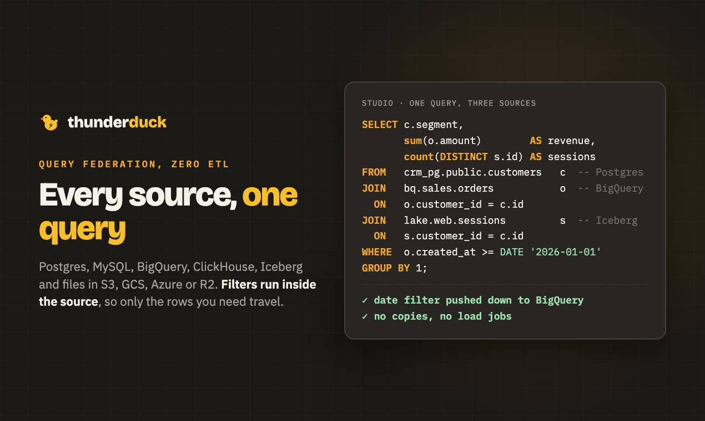
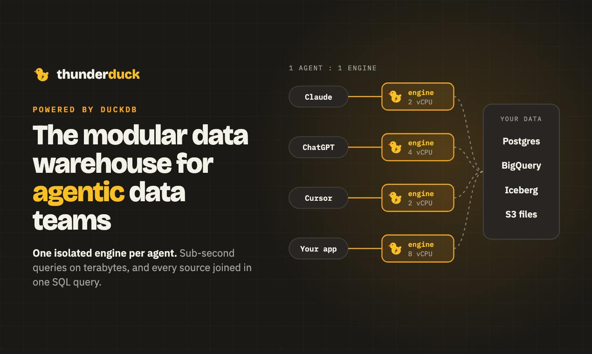
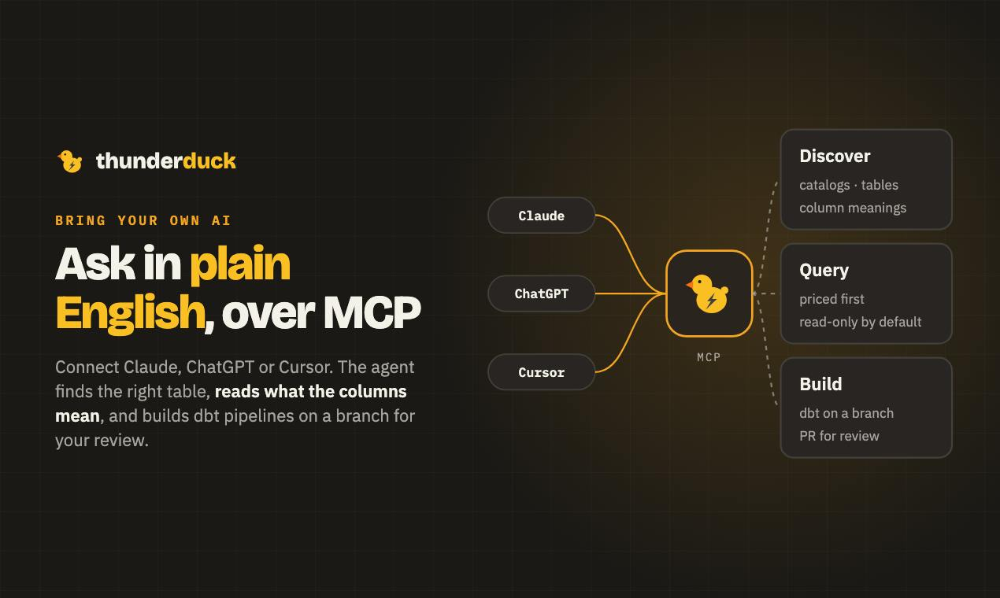

### 🎬 관련 영상
- [🎥 영상 보기](https://ph-files.imgix.net/ad998dd8-04b0-40f5-8c42-3a61f8cdb99e.jpeg?auto=format)

---

## 16. [Cursor Craft](https://www.producthunt.com/products/cursor-craft)
**Votes**: 71 | **도입 난이도**: 하 | **신뢰도**: 상
**Tagline**: Custom cursors for Mac
**서비스 링크**: https://www.producthunt.com/r/BCO35XHIOIH5EM

**태그**: Customization, macOS, Design, Productivity

### 📌 이 서비스 한눈에 보기
클릭 한 번으로 맥의 커서를 취향대로 바꾸는 커스텀 커서 관리 앱

### 🔑 주요 기능
- 다양한 테마(미니멀, 네이처, 네온, 고양이, 애니메이션 등)의 커서 팩 제공
- 브라우징부터 설치, 전환까지 한 번에 가능한 원클릭 인터페이스
- 무료 및 프리미엄 커서 팩 선택 가능

### 🙋 사용자에게 어떤 점이 좋은가
복잡한 설정 과정 없이 사용자의 개성을 반영한 커스텀 커서를 손쉽게 적용하여 데스크탑 환경을 꾸밀 수 있습니다.

### ✅ 지금 바로 써볼 기능
- 원하는 스타일의 커서 팩 탐색하기
- 원클릭 설치 기능 테스트하기
- 무료 팩을 활용한 커서 전환 경험하기

### ⚠️ 사용 전 확인할 점
- 프리미엄 팩 이용 시 별도의 비용 발생 가능성
- macOS 시스템 설정과의 호환성 확인 필요

### 🧭 확인이 더 필요한 정보
프리미엄 팩의 구체적인 가격 정책과 모든 macOS 버전에서의 안정적인 동작 여부는 확인이 필요합니다.

### 📸 스크린샷 및 갤러리
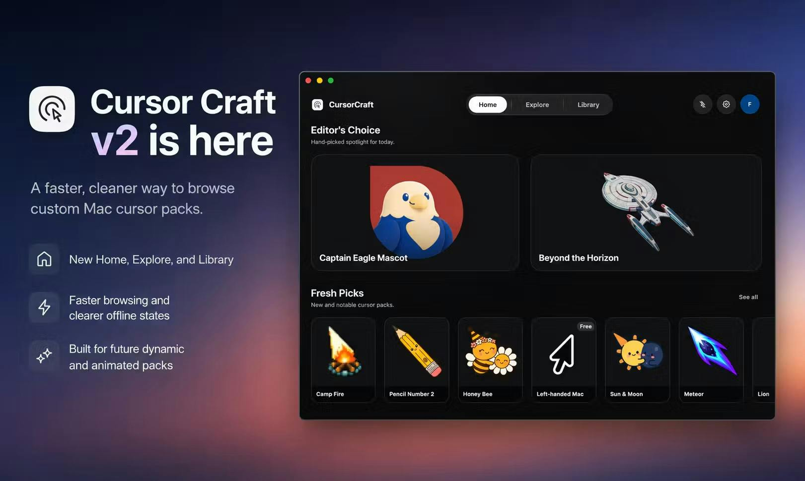
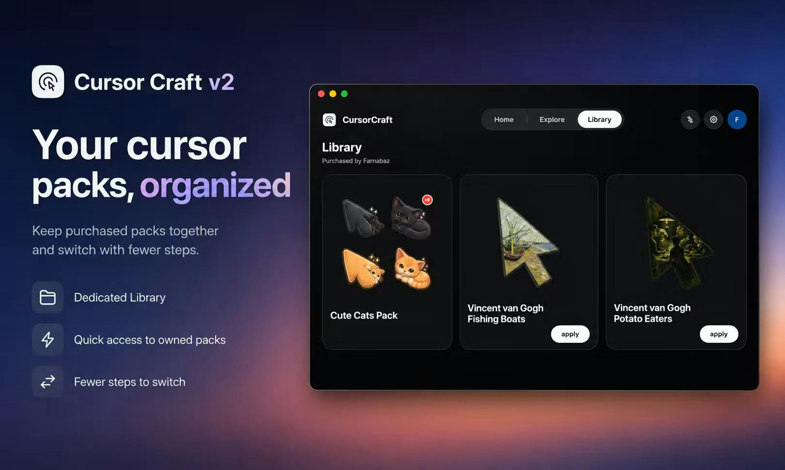
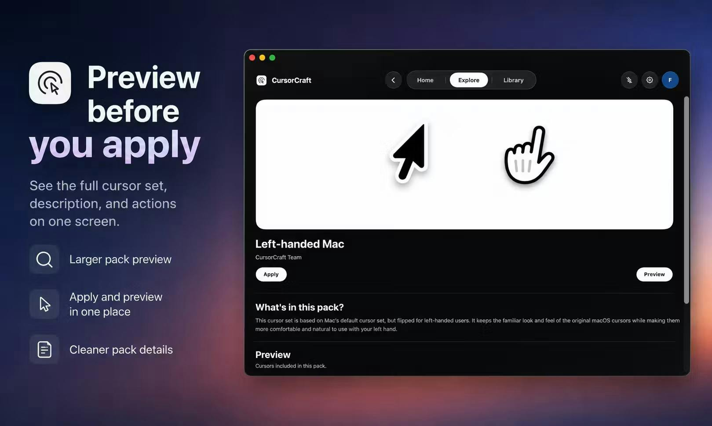

---

## 17. [Codiclens](https://www.producthunt.com/products/codiclens-local-ai-powerd-mac-launcher)
**Votes**: 70 | **도입 난이도**: 하 | **신뢰도**: 상
**Tagline**: Local AI powerd Mac launcher and file finder
**서비스 링크**: https://www.producthunt.com/r/RA6YMLIN5K2L5Z

**태그**: Productivity, AI, macOS, OpenSource, Search, AI Tool

### 📌 이 서비스 한눈에 보기
파일 이름이 아닌 내용으로 검색하고 실행하는 로컬 기반 AI 맥 런처

### 🔑 주요 기능
- 파일 이름이 아닌 파일 내부 콘텐츠를 기반으로 한 지능형 검색
- 100% 로컬 실행으로 개인정보 보호 및 보안 강화
- 오픈 소스 기반의 무료 맥 전용 런처

### 🙋 사용자에게 어떤 점이 좋은가
파일 이름을 기억하지 못해도 내용만으로 원하는 앱이나 파일을 즉시 찾을 수 있어 작업 흐름이 빨라집니다.

### ✅ 지금 바로 써볼 기능
- 자주 사용하는 파일과 앱을 대상으로 검색 성능 테스트하기
- 로컬 환경에서의 검색 속도 및 반응성 확인하기

### ⚠️ 사용 전 확인할 점
- 로컬 리소스(CPU/RAM) 사용량에 따른 시스템 성능 영향 확인 필요
- 맥(macOS) 전용 도구이므로 타 OS 사용 불가

### 🧭 확인이 더 필요한 정보
로컬 인덱싱 과정에서 발생하는 시스템 부하 정도와 지원하는 파일 형식의 범위를 확인해야 합니다.

### 📸 스크린샷 및 갤러리

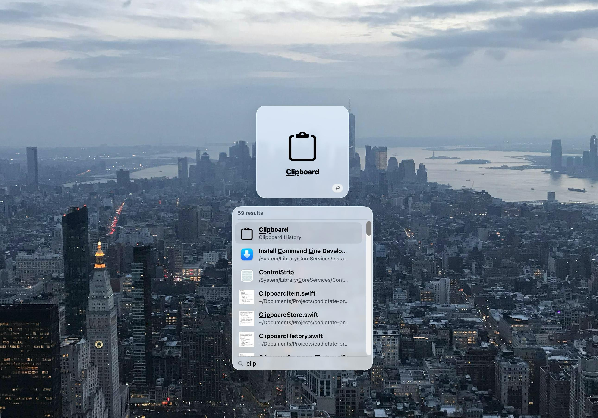

### 🎬 관련 영상
- [🎥 영상 보기](https://ph-files.imgix.net/cdbaa553-b104-4a58-bcd5-949c8eca52a2.jpeg?auto=format)

---

## 18. [pwned.coffee](https://www.producthunt.com/products/pwned-coffee)
**Votes**: 69 | **도입 난이도**: 하 | **신뢰도**: 상
**Tagline**: A live board of security flaws
**서비스 링크**: https://www.producthunt.com/r/L5JM67PP76ZJW6

**태그**: Security, Dashboard, Monitoring, AI Tool

### 📌 이 서비스 한눈에 보기
최신 보안 취약점과 사고를 실시간으로 요약하여 제공하는 보안 대시보드

### 🔑 주요 기능
- 매시간 업데이트되는 실시간 보안 취약점 및 사고 보드
- 복잡한 설명 대신 무엇을 해야 하는지 명확한 한 줄 가이드 제공
- 보안 위협 상황을 직관적으로 파악할 수 있는 간결한 인터페이스

### 🙋 사용자에게 어떤 점이 좋은가
보안 전문가나 개발자가 복잡한 보안 리포트를 일일이 읽지 않고도, 현재 발생한 위협과 즉각적인 대응 방안을 빠르게 파악할 수 있습니다.

### ✅ 지금 바로 써볼 기능
- 실시간 보드를 통해 현재 가장 시급한 보안 이슈 확인하기
- 제공되는 '한 줄 가이드'를 바탕으로 즉각적인 대응 조치 검토하기

### ⚠️ 사용 전 확인할 점
- 정보가 매우 간결하므로 상세한 기술적 분석이 필요한 경우 추가 조사가 필요할 수 있음
- 제공되는 가이드가 사용자의 특정 환경에 완벽히 부합하는지 검증해야 함

### 🧭 확인이 더 필요한 정보
제공되는 정보의 출처와 가이드의 신뢰도 수준을 확인해야 합니다.

### 📸 스크린샷 및 갤러리
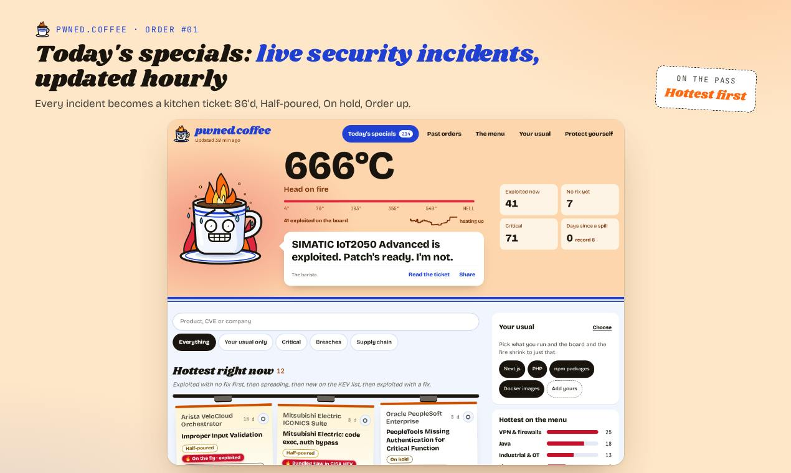

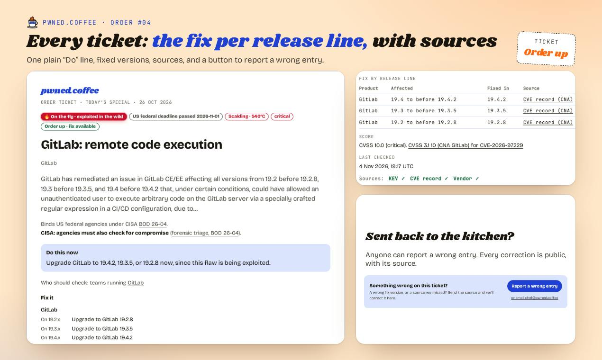

---

## 19. [Kodivo](https://www.producthunt.com/products/kodivo)
**Votes**: 67 | **도입 난이도**: 하 | **신뢰도**: 상
**Tagline**: Learn coding with AI and PHP through swipeable cards
**서비스 링크**: https://www.producthunt.com/r/NLJJ3AO3REQEOK

**태그**: EdTech, Coding, AI, PHP, DevTool, Agent, AI Tool

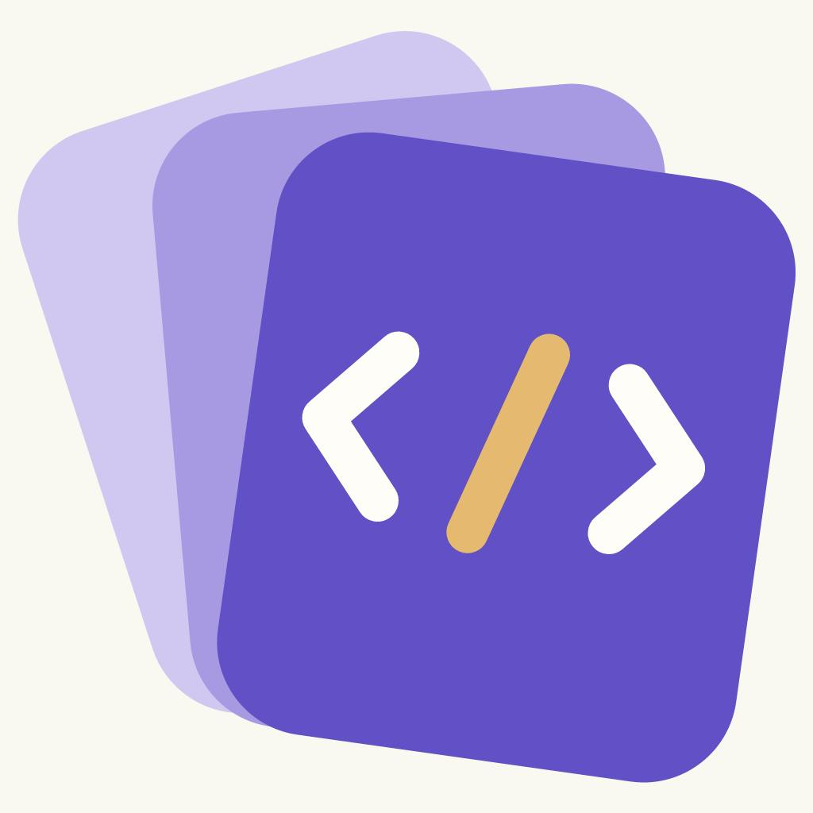

### 📌 이 서비스 한눈에 보기
스와이프 방식의 카드 학습을 통해 AI와 PHP 코딩을 쉽고 재미있게 배우는 도구

### 🔑 주요 기능
- 스와이프형 카드를 활용한 짧고 직관적인 코딩 레슨
- AI 에이전트 작동 원리 및 PHP 코드 예제 학습
- 연습 문제와 상세한 해설을 통한 자기 주도 학습

### 🙋 사용자에게 어떤 점이 좋은가
짧은 시간 동안 카드 스와이프 방식으로 코딩 지식을 습득할 수 있어 학습 효율이 높으며, 기존 AI 도구와 연동하여 학습 흐름을 이어갈 수 있습니다.

### ✅ 지금 바로 써볼 기능
- 스와이프 카드로 기초 레슨 시작하기
- 연습 문제를 통한 코드 이해도 테스트하기
- MCP를 설정하여 Claude Code와 학습 데이터 연동하기

### ⚠️ 사용 전 확인할 점
- 카드 방식의 특성상 심도 있는 프로젝트 실습에는 한계가 있을 수 있음
- 외부 AI 도구(Codex, Claude Code) 연동 시 추가 설정이 필요할 수 있음

### 🧭 확인이 더 필요한 정보
사용자의 학습 진척도가 외부 AI 도구와 실시간으로 어떻게 동기화되는지에 대한 상세 메커니즘 확인이 필요합니다.

### 📸 스크린샷 및 갤러리
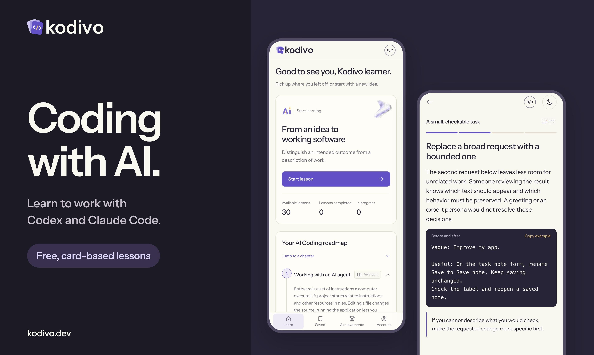
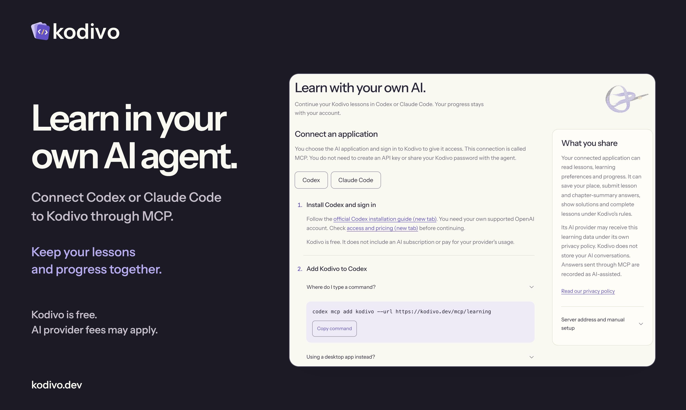
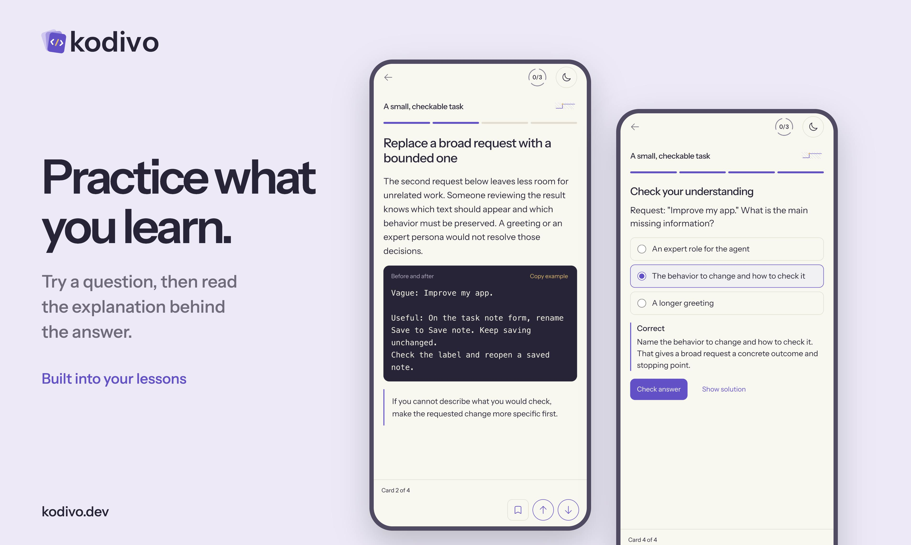

### 🎬 관련 영상
- [🎥 영상 보기](https://ph-files.imgix.net/c052fccf-7792-488e-a556-1999274f4a4d.jpeg?auto=format)

---

## 20. [Make0 Brain OSS](https://www.producthunt.com/products/make0-brain)
**Votes**: 67 | **도입 난이도**: 중 | **신뢰도**: 상
**Tagline**: Sync context across all your agents
**서비스 링크**: https://www.producthunt.com/r/TAHHMDHVABTS2O

**태그**: AI, OpenSource, Automation, Productivity, Agent, AI Tool

### 📌 이 서비스 한눈에 보기
여러 AI 에이전트 간의 맥락을 동기화하는 오픈소스 공용 메모리 저장소

### 🔑 주요 기능
- 에이전트 간 맥락(Context) 불일치 문제 해결
- 모든 에이전트가 읽고 쓸 수 있는 공용 메모리 저장소 제공
- 사용자 주권 중심의 메모리 관리 및 오픈소스(MIT 라이선스) 제공

### 🙋 사용자에게 어떤 점이 좋은가
여러 AI 에이전트를 동시에 사용할 때 발생하는 반복적인 설명 과정을 줄여 작업 효율을 극대화할 수 있습니다.

### ✅ 지금 바로 써볼 기능
- 오픈소스 코드 저장소 확인 및 클론
- 기존 에이전트 워크플로우에 메모리 스토어 연동 테스트
- 멀티 에이전트 환경에서의 데이터 동기화 성능 검증

### ⚠️ 사용 전 확인할 점
- 여러 에이전트가 동시에 접근할 때의 데이터 충돌 및 정합성 관리 필요
- 개인 메모리 데이터의 보안 및 관리 책임

### 🧭 확인이 더 필요한 정보
구체적인 기술 스택과 기존 에이전트 프레임워크와의 연동 방식에 대한 상세 문서가 필요합니다.

### 📸 스크린샷 및 갤러리
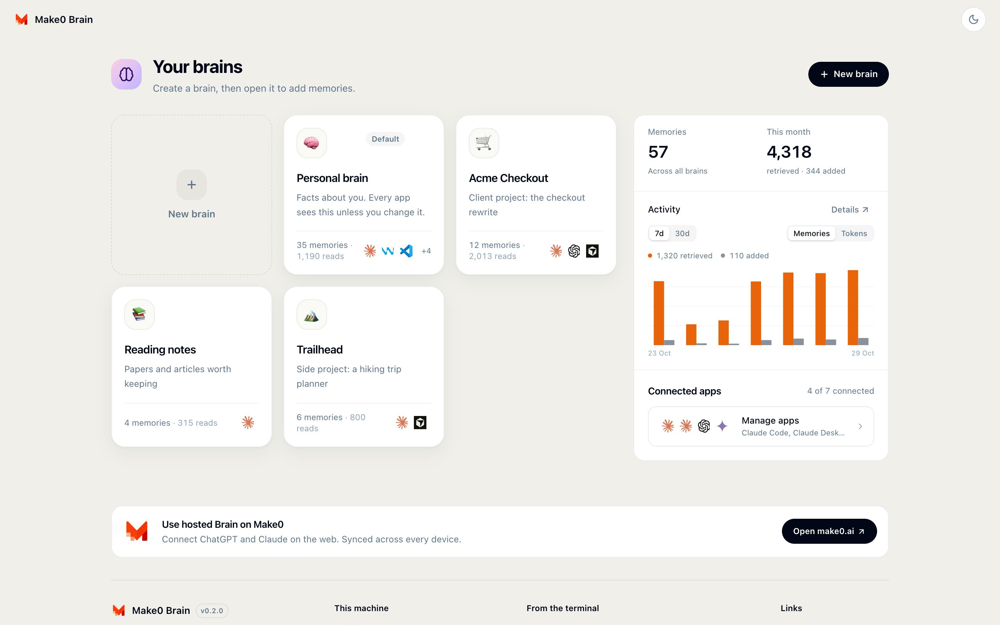
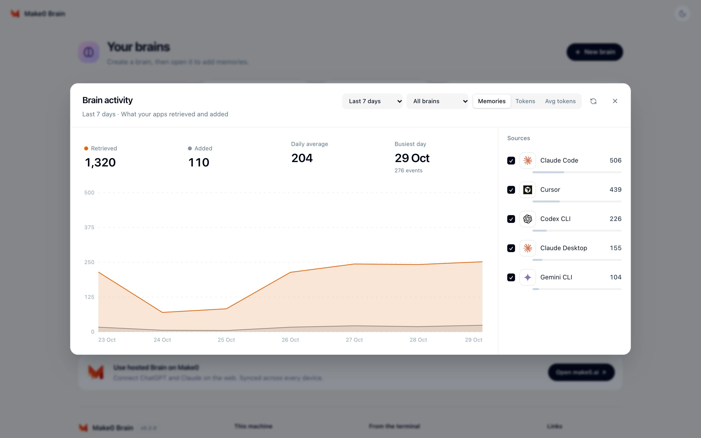
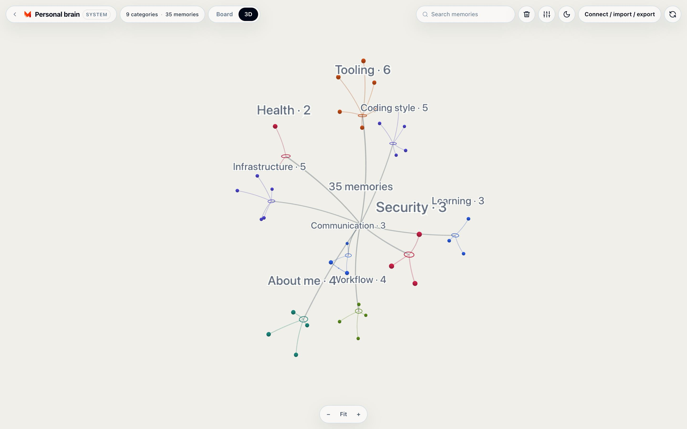

### 🎬 관련 영상
- [🎥 영상 보기](https://ph-files.imgix.net/752a050c-3974-497b-a2e1-dcf00a892680.jpeg?auto=format)
- [🎥 영상 보기](https://ph-files.imgix.net/dc3f115e-9d21-43ef-915d-c1d02a5615f3.jpeg?auto=format)

---

## 21. [Plainmail](https://www.producthunt.com/products/plainmail)
**Votes**: 66 | **도입 난이도**: 하 | **신뢰도**: 상
**Tagline**: Real email on every domain you own, for $5 a month flat
**서비스 링크**: https://www.producthunt.com/r/UN2PGCCE5R7LTQ

**태그**: Email, SaaS, DevTool, Productivity, AI Tool, API

### 📌 이 서비스 한눈에 보기
월 5달러로 최대 50개 도메인과 100개 메일함을 운영할 수 있는 간편한 이메일 호스팅 서비스

### 🔑 주요 기능
- 월 $5 고정 가격으로 최대 50개 도메인 및 100개 메일함 제공
- Cloudflare, Vercel, Porkbun의 DNS 레코드(MX, SPF, DKIM, DMARC) 자동 설정
- 표준 IMAP/SMTP 지원으로 Apple Mail, Gmail, Outlook 등 기존 앱과 호환

### 🙋 사용자에게 어떤 점이 좋은가
여러 도메인을 소유한 개인이나 개발자가 복잡한 설정 없이 저렴한 비용으로 전문적인 이메일 환경을 구축할 수 있습니다.

### ✅ 지금 바로 써볼 기능
- 보유 중인 도메인(Cloudflare, Vercel, Porkbun) 연결 테스트
- 기존 메일 앱(Outlook, Apple Mail 등)에 계정 등록
- CLI 또는 API를 통한 메일 관리 자동화 시도

### ⚠️ 사용 전 확인할 점
- 대량 메일 발송(Bulk mail) 용도가 아닌 개인 간 소통용으로 설계됨
- 제공되는 25GB 용량 내에서 모든 도메인/메일함이 공유됨

### 🧭 확인이 더 필요한 정보
사용 중인 도메인 등록처가 Cloudflare, Vercel, Porkbun이 아닐 경우 자동 설정 지원 여부를 확인해야 합니다.

### 📸 스크린샷 및 갤러리
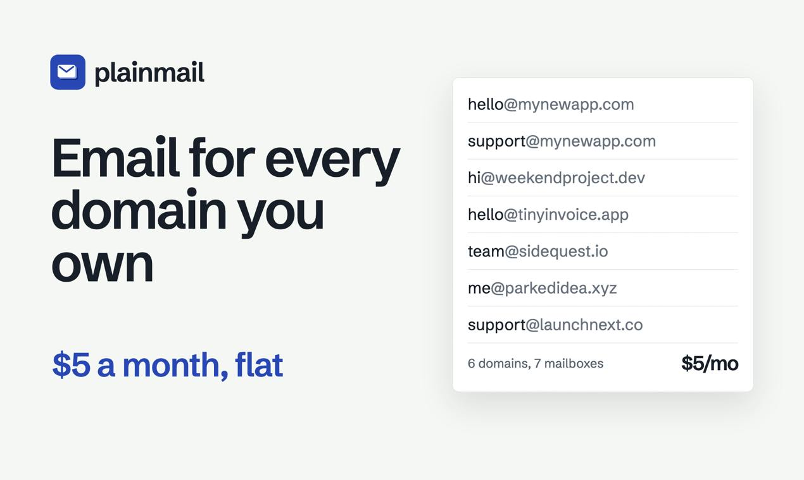
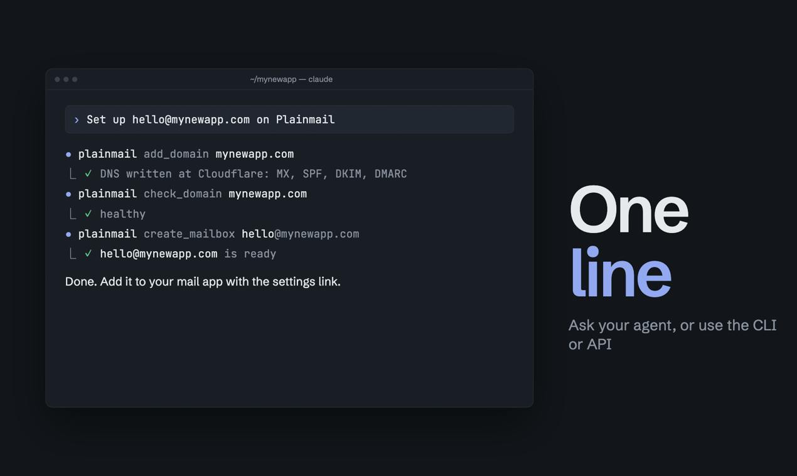
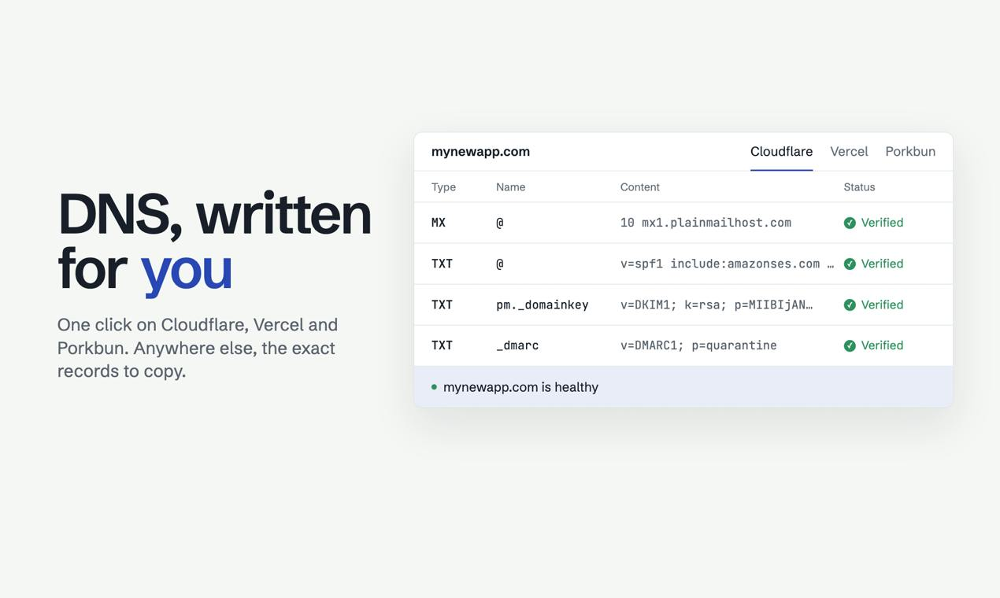

### 🎬 관련 영상
- [🎥 영상 보기](https://ph-files.imgix.net/f0222d1f-d563-4ebc-814e-7f09dc2909fa.jpeg?auto=format)

---

## 22. [Winq](https://www.producthunt.com/products/winq)
**Votes**: 66 | **도입 난이도**: 하 | **신뢰도**: 상
**Tagline**: Focus on a window or display you're looking at
**서비스 링크**: https://www.producthunt.com/r/IGLHTOHLAXOHCS

**태그**: Productivity, macOS, Eye-Tracking, Workflow, AI Tool, DevTool

### 📌 이 서비스 한눈에 보기
시선 추적 기술을 통해 바라보는 창을 자동으로 포커스하는 macOS 생산성 도구

### 🔑 주요 기능
- Mac 카메라를 활용한 시선 및 머리 움직임 기반의 윈도우 포커싱
- 사용자가 바라보는 위치로 포인터를 이동시켜 작업 흐름 유지
- 온디바이스 처리 방식으로 개인정보 보호 및 보안 강화

### 🙋 사용자에게 어떤 점이 좋은가
멀티 모니터를 사용하거나 키보드 작업에 집중해야 하는 개발자 및 전문가들이 마우스 이동 시간을 줄이고 작업 흐름을 끊김 없이 유지할 수 있습니다.

### ✅ 지금 바로 써볼 기능
- 카메라 권한 허용 후 시선 추적 정확도 테스트하기
- 멀티 모니터 환경에서 윈도우 전환 흐름 확인하기
- 타이핑 및 마우스 사용 시 포커스 유지 기능 검증하기

### ⚠️ 사용 전 확인할 점
- 카메라를 상시 사용하므로 배터리 소모 및 발열 발생 가능성
- 사용자의 시선 움직임에 따른 의도치 않은 포커스 변경 가능성

### 🧭 확인이 더 필요한 정보
하드웨어 사양에 따른 시선 추적 정밀도와 배터리 효율에 대한 구체적인 데이터가 필요합니다.

### 📸 스크린샷 및 갤러리

---

## 23. [Mmory](https://www.producthunt.com/products/mmory)
**Votes**: 66 | **도입 난이도**: 하 | **신뢰도**: 상
**Tagline**: Mmory is a private voice memory app for iPhone
**서비스 링크**: https://www.producthunt.com/r/7ITWCWAU7UHVER

**태그**: Productivity, AI, Privacy, iOS

### 📌 이 서비스 한눈에 보기
아이폰 내에서 모든 기록과 답변이 이루어지는 프라이빗 음성 메모 앱

### 🔑 주요 기능
- 음성 또는 타이핑을 통한 간편한 생각 기록
- 기기 내(On-device) 전사 및 답변 처리로 강력한 개인정보 보호
- 기록된 내용을 나중에 질문하고 답변받는 대화형 메모 기능

### 🙋 사용자에게 어떤 점이 좋은가
개인적인 생각을 안전하게 기록하고, 나중에 AI에게 질문하여 필요한 정보를 빠르게 다시 찾을 수 있습니다.

### ✅ 지금 바로 써볼 기능
- 음성으로 생각 기록해보기
- 기록된 내용에 대해 질문해보기
- 기기 내 처리 방식 확인하기

### ⚠️ 사용 전 확인할 점
- 아이폰 전용 앱이므로 타 플랫폼과의 동기화 여부 확인 필요
- 기기 성능에 따른 처리 속도 차이 가능성

### 🧭 확인이 더 필요한 정보
기기 내 처리 방식이 모든 데이터(음성 파일 포함)에 완벽히 적용되는지 확인이 필요합니다.

### 📸 스크린샷 및 갤러리

### 🎬 관련 영상
- [🎥 영상 보기](https://ph-files.imgix.net/03c7f42a-fc31-4128-b165-c5a6111d7c28.jpeg?auto=format)

---

## 24. [Openroster](https://www.producthunt.com/products/openroster)
**Votes**: 65 | **도입 난이도**: 하 | **신뢰도**: 상
**Tagline**: Which "Open" companies are actually open source
**서비스 링크**: https://www.producthunt.com/r/WJVOKB2CCZDDU2

**태그**: DevTool, OpenSource, Directory, AI Tool

### 📌 이 서비스 한눈에 보기
이름만 'Open'인 기업과 진짜 오픈소스 기업을 구분해주는 디렉토리 서비스

### 🔑 주요 기능
- 이름에 'Open'이 포함된 기업 및 오픈 빌드 기업 디렉토리 제공
- 라이선스, 저장소, GitHub, OpenSSF, 패키지 통계를 통한 오픈소스 여부 검증
- 스타 성장률 기반의 주간 오픈 프로젝트 랭킹 제공

### 🙋 사용자에게 어떤 점이 좋은가
기업의 이름이 아닌 실제 오픈소스 기여도와 투명성을 데이터로 확인할 수 있어, 신뢰할 수 있는 오픈소스 생태계 파악에 유용합니다.

### ✅ 지금 바로 써볼 기능
- 관심 있는 기업의 실제 오픈소스 여부 확인하기
- 주간 랭킹을 통해 급성장하는 오픈 프로젝트 탐색하기

### ⚠️ 사용 전 확인할 점
- 데이터가 실시간 라이선스 변경 사항을 즉각 반영하는지 확인 필요
- 기업의 이름만으로 필터링되므로 모든 관련 기업이 포함되지 않을 수 있음

### 🧭 확인이 더 필요한 정보
제공되는 통계 데이터의 업데이트 주기와 데이터 소스의 정확성을 확인해야 합니다.

### 📸 스크린샷 및 갤러리

---

## 25. [PostMyPace](https://www.producthunt.com/products/postmypace)
**Votes**: 64 | **도입 난이도**: 하 | **신뢰도**: 상
**Tagline**: Turn your run into a ready-to-post Instagram Story or Reel
**서비스 링크**: https://www.producthunt.com/r/ATHUSO6VSZSN5R

**태그**: Fitness, SocialMedia, MobileApp, Design

### 📌 이 서비스 한눈에 보기
러닝 기록을 감각적인 인스타그램 스토리나 릴스로 즉시 변환해주는 앱

### 🔑 주요 기능
- 80개 이상의 러너 전용 디자인 템플릿 제공
- Apple Health 및 Health Connect를 통한 운동 데이터 자동 연동
- 거리, 시간, 페이스 등 핵심 기록과 사진을 결합한 쉬운 공유

### 🙋 사용자에게 어떤 점이 좋은가
운동 기록을 일일이 편집할 필요 없이, 전문적인 디자인의 콘텐츠로 만들어 SNS에 바로 공유할 수 있습니다.

### ✅ 지금 바로 써볼 기능
- 80여 종의 템플릿 중 취향에 맞는 디자인 선택하기
- Apple Health 또는 Health Connect 연동하여 데이터 불러오기
- 러닝 사진을 추가하여 나만의 스토리 완성하기

### ⚠️ 사용 전 확인할 점
- 데이터 수동 입력 기능이 있으나 자동 연동 여부에 따라 작업 흐름이 달라질 수 있음
- iOS 및 Android 기기에서 사용 가능

### 🧭 확인이 더 필요한 정보
무료 버전의 기능 제한이나 유료 구독 모델의 상세 내용은 명시되지 않았습니다.

### 📸 스크린샷 및 갤러리

---

## 26. [MacDupl](https://www.producthunt.com/products/macdupl-run-every-acc-in-its-own-app)
**Votes**: 64 | **도입 난이도**: 하 | **신뢰도**: 상
**Tagline**: Run every account in its own app
**서비스 링크**: https://www.producthunt.com/r/N4IOOLNNRBSEOT

**태그**: Productivity, Mac, Multi-Account

### 📌 이 서비스 한눈에 보기
로그아웃 없이 여러 계정을 독립된 앱처럼 동시에 사용할 수 있는 Mac용 멀티 계정 관리 도구

### 🔑 주요 기능
- 기존 Mac 앱을 별도의 복사본으로 실행하여 계정별 독립 데이터 유지
- 업무용과 개인용 계정을 로그아웃 없이 사이드 바이 사이드로 사용 가능
- 0.2.0 업데이트: 개별 창 관리, 로그인 유지 업데이트, 메뉴 바 패널 제공

### 🙋 사용자에게 어떤 점이 좋은가
여러 계정을 전환하며 작업해야 하는 사용자에게 로그아웃의 번거로움 없이 즉각적인 계정 전환 환경을 제공합니다.

### ✅ 지금 바로 써볼 기능
- 기존 앱을 복제하여 계정별 독립 환경 구축하기
- 메뉴 바 패널을 통한 빠른 접근 시도하기
- 업데이트 기능을 통해 로그인 상태 유지 확인하기

### ⚠️ 사용 전 확인할 점
- 앱 복제 방식이 시스템 리소스(RAM/CPU)에 미치는 영향 확인 필요
- 지원되지 않는 특정 앱에서의 동작 여부 확인 필요

### 🧭 확인이 더 필요한 정보
모든 Mac용 앱이 이 복제 방식에서 완벽하게 호환되는지는 명시되어 있지 않습니다.

### 📸 스크린샷 및 갤러리

---

## 27. [Pressure](https://www.producthunt.com/products/pressure)
**Votes**: 63 | **도입 난이도**: 하 | **신뢰도**: 상
**Tagline**: Need a second opinion? Have two agents debate your topic
**서비스 링크**: https://www.producthunt.com/r/S5IPBWQSKLJCNA

**태그**: AI, DecisionSupport, Productivity, DevTool, Agent, AI Tool

### 📌 이 서비스 한눈에 보기
서로 다른 AI 모델 간의 토론을 통해 최적의 결론을 도출하는 의사결정 지원 도구

### 🔑 주요 기능
- 서로 다른 연구소의 두 AI 에이전트가 특정 주제에 대해 논쟁
- 논쟁 결과로 입장, 양보 사항, 결론, 미결 과제를 포함한 요약 제공
- 웹, Claude 커넥터, CLI(Claude Code/Codex) 등 다양한 환경 지원

### 🙋 사용자에게 어떤 점이 좋은가
중요한 결정이나 아이디어 검증 시, 단일 모델의 편향을 피하고 다각적인 관점에서 문제를 검토할 수 있습니다.

### ✅ 지금 바로 써볼 기능
- 웹에서 가입 없이 즉시 토론 시작하기
- Claude 커넥터로 워크플로우에 연결하기
- CLI를 설치하여 개발 환경(Claude Code/Codex)에 통합하기

### ⚠️ 사용 전 확인할 점
- AI 모델 간의 논쟁이 항상 논리적 완결성을 보장하지는 않음
- 제공되는 요약본을 바탕으로 최종 판단은 사용자가 직접 내려야 함

### 🧭 확인이 더 필요한 정보
사용되는 구체적인 AI 모델 종류와 상세한 API 연동 방식에 대한 정보가 필요합니다.

### 📸 스크린샷 및 갤러리

---

## 28. [Moatly](https://www.producthunt.com/products/moatly-2)
**Votes**: 63 | **도입 난이도**: 하 | **신뢰도**: 상
**Tagline**: Measures your product's moat and the threats testing it
**서비스 링크**: https://www.producthunt.com/r/SP3XNTZRTSK22W

**태그**: Product Strategy, Competitive Intelligence, AI, Analytics, Agent, AI Tool

### 📌 이 서비스 한눈에 보기
제품의 방어력(Moat)과 잠재적 위협을 실시간 데이터로 분석하는 전략 도구

### 🔑 주요 기능
- GitHub, AI 에이전트 레지스트리, 플랫폼 릴리스 노트 등 공개 데이터를 기반으로 분석
- 제품의 방어력(Moat) 강도와 외부 위협 압력을 시각화
- 클론 제품이나 AI 에이전트의 등장에 대비한 전략적 움직임 제안

### 🙋 사용자에게 어떤 점이 좋은가
제품이 시장에서 얼마나 독보적인지 객관적으로 파악하고, 경쟁자나 플랫폼의 기능 업데이트에 따른 위협을 미리 대비할 수 있습니다.

### ✅ 지금 바로 써볼 기능
- 현재 제품의 Moat 점수 확인하기
- 잠재적 위협 요소(Threat Pressure) 분석하기
- 다음 전략적 움직임(Next Moves) 가이드 검토하기

### ⚠️ 사용 전 확인할 점
- 공개된 데이터(Public Evidence)를 기반으로 하므로 비공개 내부 지표는 반영되지 않음
- 분석 결과가 실제 시장 경쟁력을 100% 보장하지는 않음

### 🧭 확인이 더 필요한 정보
분석에 사용되는 데이터 소스의 업데이트 주기와 구체적인 알고리즘 산출 방식에 대한 확인이 필요합니다.

### 📸 스크린샷 및 갤러리

---

## 29. [Any Video to Text](https://www.producthunt.com/products/any-video-to-text)
**Votes**: 62 | **도입 난이도**: 하 | **신뢰도**: 상
**Tagline**: Paste a video link, get the transcript in seconds
**서비스 링크**: https://www.producthunt.com/r/HR5O75MMTH7BFU

**태그**: Productivity, AI, Video-to-Text, Automation, AI Tool, Video

### 📌 이 서비스 한눈에 보기
SNS 영상 링크만 붙여넣으면 즉시 텍스트로 변환해주는 초간편 트랜스크립트 도구

### 🔑 주요 기능
- TikTok, YouTube, Instagram 등 SNS 링크 및 파일 업로드 지원
- AI 음성 인식 및 자막 추출을 통한 텍스트 변환
- 인터뷰/팟캐스트용 화자 구분 및 요약/레시피 카드 기능 제공

### 🙋 사용자에게 어떤 점이 좋은가
영상 내용을 일일이 타이핑할 필요 없이 링크 복사만으로 빠르게 텍스트화하여 업무나 학습 효율을 높일 수 있습니다.

### ✅ 지금 바로 써볼 기능
- SNS 영상 링크를 붙여넣어 텍스트 추출해보기
- 파일 업로드로 화자 구분 기능 테스트하기
- 추출된 내용을 요약하거나 SRT/VTT 파일로 다운로드하기

### ⚠️ 사용 전 확인할 점
- 무료 사용 시 하루 5회 제한 및 가입 없이 사용 가능
- 2시간 이상의 긴 영상이나 대량 작업은 크레딧 결제 필요

### 🧭 확인이 더 필요한 정보
무료 버전에서 제공되는 화자 구분 기능의 정확도와 상세 기능 포함 여부를 확인해야 합니다.

### 📸 스크린샷 및 갤러리

### 🎬 관련 영상
- [🎥 영상 보기](https://ph-files.imgix.net/810097b0-aff5-4215-860c-6d84730498aa.jpeg?auto=format)

---

## 30. [LiveShortly](https://www.producthunt.com/products/liveshortly)
**Votes**: 62 | **도입 난이도**: 중 | **신뢰도**: 상
**Tagline**: Watch, steer, share and approve your coding agent, live
**서비스 링크**: https://www.producthunt.com/r/ZGSK4JRZ3IHZ57

**태그**: DevTool, AI-Agent, OpenSource, Collaboration, Agent, Prompting

### 📌 이 서비스 한눈에 보기
코딩 에이전트의 작업 과정을 실시간으로 모니터링하고 제어하는 오픈소스 협업 도구

### 🔑 주요 기능
- 에이전트의 프롬프트, 도구 호출, 코드 변경 사항(diff) 실시간 시각화
- 모바일로 위험한 명령 승인 및 실시간 코멘트 가능
- 세션 기록 재생 및 다른 에이전트로의 포크(Fork) 지원

### 🙋 사용자에게 어떤 점이 좋은가
에이전트가 코드를 작성하는 과정을 투명하게 관찰하며, 원격에서도 안전하게 승인하거나 협업할 수 있습니다.

### ✅ 지금 바로 써볼 기능
- 생성된 공유 링크를 통해 에이전트 작업 과정 관찰하기
- 모바일 환경에서 위험한 명령 승인/거절 테스트하기
- 완료된 세션을 포크하여 다른 에이전트 환경에 적용하기

### ⚠️ 사용 전 확인할 점
- 셀프 호스팅 방식이므로 초기 환경 설정이 필요할 수 있음
- 에이전트의 작업 권한 설정에 따른 보안 리스크 관리 필요

### 🧭 확인이 더 필요한 정보
상세한 설치 방법과 지원하는 에이전트 프레임워크의 종류를 확인해야 합니다.

### 📸 스크린샷 및 갤러리

### 🎬 관련 영상
- [🎥 영상 보기](https://ph-files.imgix.net/58c52d0d-47a3-40b3-b18e-aaec04e32950.jpeg?auto=format)

---

