# 🚀 Product Hunt Daily Top 30 (2026-11-10)

## 오늘의 요약
오늘의 트렌드는 AI 에이전트와 코딩 워크플로우의 효율성을 극대화하는 도구들이 주도했습니다. 특히 AI 에이전트의 보안, 데이터 분석, 코드베이스 탐색을 지원하는 MCP(Model Context Protocol) 관련 솔루션들이 주목받았습니다. 또한, 영상 편집과 마케팅 최적화 등 특정 목적에 특화된 AI 서비스들도 강세를 보였습니다.

### 오늘의 핵심 포인트
- AI 에이전트의 보안 위협을 방어하고 효율적인 관리를 돕는 보안 및 게이트웨이 솔루션이 등장했습니다.
- 코드베이스 의존성 시각화 및 터미널 기반 분석 도구를 통해 개발자의 탐색 시간과 토큰 비용을 절감하는 기술이 강조되었습니다.
- AI 검색 엔진(AEO) 최적화 및 레이어 기반 비디오 편집과 같이 실무 생산성을 높이는 전문화된 AI 도구들이 주목받았습니다.

**오늘의 태그**: AI Agent, MCP, Developer Tools, AI Security, Automation

## 1. [Product Hunt MCP](https://www.producthunt.com/products/producthunt)
**Votes**: 276 | **도입 난이도**: 하 | **신뢰도**: 상
**Tagline**: The community you trust in the assistant you use
**서비스 링크**: https://www.producthunt.com/r/ERQDTXX2HLG67G

**태그**: AI, Product Hunt, Product Launch, Discovery, AI Tool, Vision, API

### 📌 이 서비스 한눈에 보기
AI 어시스턴트 내에서 Product Hunt의 커뮤니티 인사이트를 즉시 활용하는 도구

### 🔑 주요 기능
- AI 어시스턴트를 통한 새로운 제품 탐색 및 비교
- Product Hunt 커뮤니티의 리뷰와 피드백 활용
- README 및 웹사이트를 기반으로 한 제품 런칭 초안 작성 지원

### 🙋 사용자에게 어떤 점이 좋은가
별도의 API 키 설정 없이 AI 어시스턴트 환경에서 바로 제품을 탐색하거나 런칭 준비를 할 수 있어 효율적입니다.

### ✅ 지금 바로 써볼 기능
- AI 어시스턴트에게 새로운 제품 추천 요청하기
- 기존 제품의 대안 비교 분석하기
- 자신의 프로젝트를 런칭용 초안으로 변환하기

### ⚠️ 사용 전 확인할 점
- Product Hunt 계정 로그인이 필요함
- AI 어시스턴트 환경(MCP 지원 환경)에서만 작동함

### 🧭 확인이 더 필요한 정보
사용 중인 AI 어시스턴트 모델과의 호환성 및 데이터 동기화 범위에 대한 구체적인 정보가 필요합니다.

### 📸 스크린샷 및 갤러리
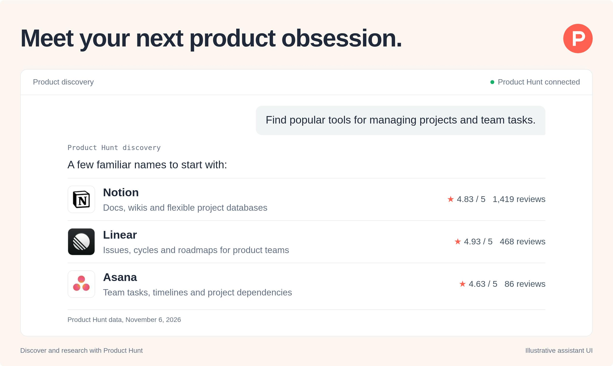
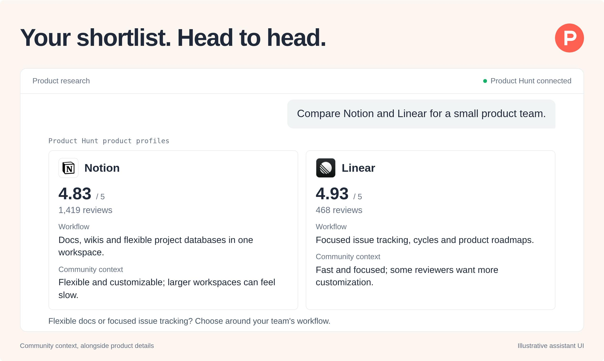
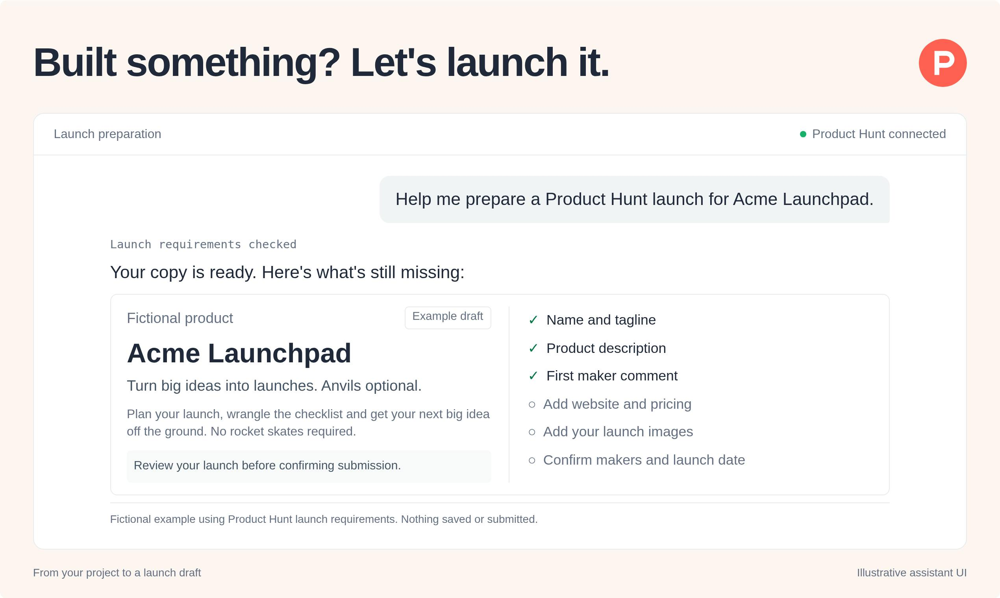

---

## 2. [Dageno AI 2.0](https://www.producthunt.com/products/agent-powered-geo-by-dageno)
**Votes**: 276 | **도입 난이도**: 하 | **신뢰도**: 상
**Tagline**: See why AI recommends your competitors instead of you
**서비스 링크**: https://www.producthunt.com/r/ZUTLEQZYV5KE47

**태그**: Marketing, AI, Analytics, SEO, AI Tool, Chat, Prompting

### 📌 이 서비스 한눈에 보기
AI 검색 엔진(AEO/GEO)에서 우리 브랜드가 어떻게 추천되는지 분석하는 마케팅 최적화 플랫폼

### 🔑 주요 기능
- ChatGPT, Gemini, Perplexity 등 주요 AI 모델의 브랜드 추천 현황 모니터링
- 12,000개 이상의 니치 시장과 300만 개 이상의 브랜드 데이터 제공
- AI 답변의 근거가 되는 출처(Sources) 및 소비자 질문 분석

### 🙋 사용자에게 어떤 점이 좋은가
AI가 고객에게 브랜드를 추천하는 방식(AEO)을 파악하여, 검색 결과에서 경쟁사 대신 우리 브랜드가 노출되도록 전략을 세울 수 있습니다.

### ✅ 지금 바로 써볼 기능
- 무료 기능을 통해 특정 시장 내 브랜드 노출 현황 확인하기
- 우리 브랜드가 어떤 출처를 통해 AI에게 인용되는지 분석하기
- 경쟁사 대비 브랜드 인지도 및 질문 노출도 비교하기

### ⚠️ 사용 전 확인할 점
- 자신의 브랜드 프롬프트를 직접 추적하려면 유료 업그레이드가 필요함
- AI 모델의 답변 알고리즘 변화에 따라 분석 결과가 변동될 수 있음

### 🧭 확인이 더 필요한 정보
유료 플랜의 구체적인 기능 범위와 가격 정책에 대한 상세 정보가 필요합니다.

### 📸 스크린샷 및 갤러리
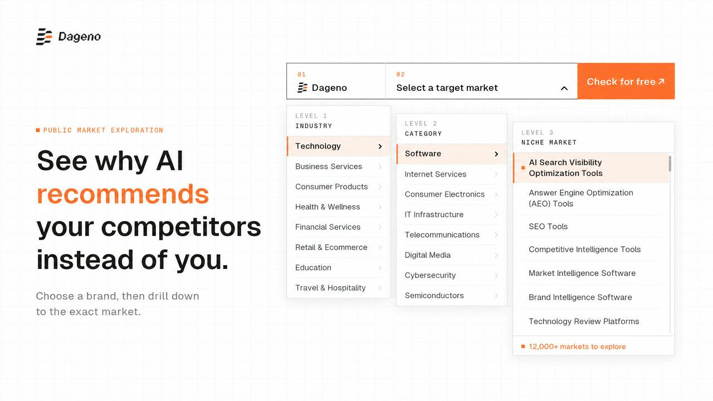
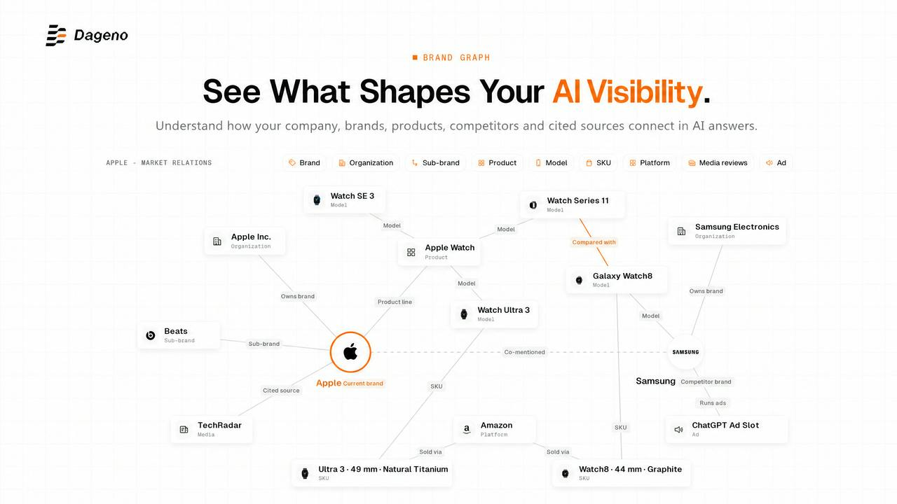
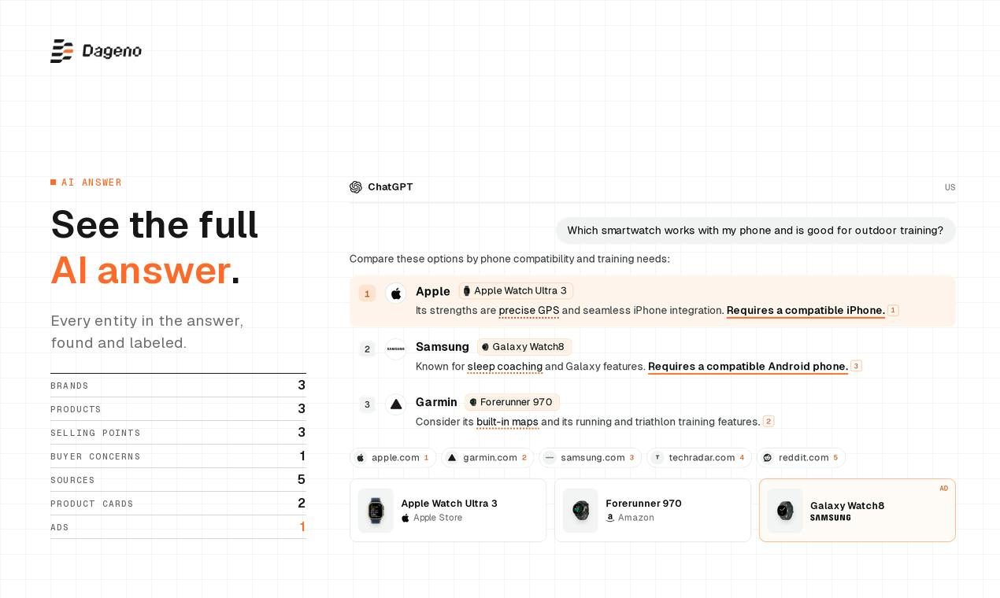

### 🎬 관련 영상
- [🎥 영상 보기](https://ph-files.imgix.net/3625a76d-bd76-4490-925c-b1cdf8752273.jpeg?auto=format)

---

## 3. [Databox CLI](https://www.producthunt.com/products/databox)
**Votes**: 254 | **도입 난이도**: 중 | **신뢰도**: 상
**Tagline**: Your agentic analytics platform in the terminal
**서비스 링크**: https://www.producthunt.com/r/BTKDEK3DQ7EK3M

**태그**: DevTool, Automation, Analytics, CLI, AI-Agent, Agent, AI Tool

### 📌 이 서비스 한눈에 보기
터미널에서 데이터 소스 구축부터 워크플로우 자동화까지 수행하는 에이전트형 분석 플랫폼

### 🔑 주요 기능
- 터미널 환경에서 데이터 소스 생성, 데이터 로드, 메트릭 구축 가능
- 90개 이상의 명령어를 통한 직접 제어 및 자동화 워크플로우 지원
- Claude Code, Cursor 등 AI 코딩 에이전트를 위한 10가지 전용 스킬 제공

### 🙋 사용자에게 어떤 점이 좋은가
개발자나 데이터 엔지니어가 GUI로 전환할 필요 없이 터미널 내에서 데이터 파이프라인과 분석 작업을 즉시 수행할 수 있습니다. 특히 AI 코딩 에이전트와 결합하여 데이터 작업을 자동화하는 데 매우 유용합니다.

### ✅ 지금 바로 써볼 기능
- 90여 개의 CLI 명령어를 통한 데이터 소스 생성 테스트
- AI 코딩 에이전트(Cursor, Claude Code 등)에 10가지 스킬 연결하기
- 터미널 기반의 데이터 로드 및 메트릭 빌드 워크플로우 구축

### ⚠️ 사용 전 확인할 점
- 터미널 환경에 익숙하지 않은 사용자에게는 초기 학습 곡선이 존재할 수 있음
- AI 에이전트 활용 시 자동화된 작업에 대한 모니터링 필요

### 🧭 확인이 더 필요한 정보
지원하는 데이터 소스의 종류와 외부 서비스와의 구체적인 통합 범위는 명시되지 않았습니다.

### 📸 스크린샷 및 갤러리
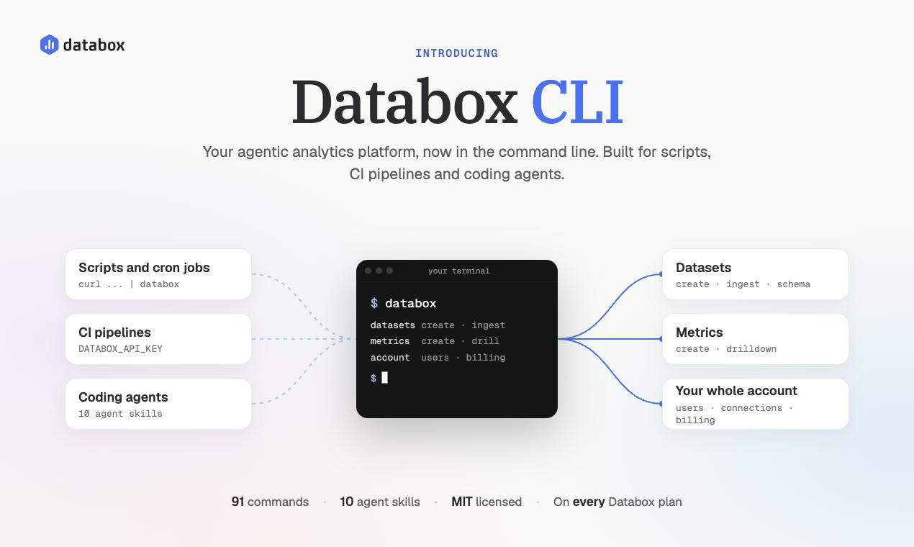
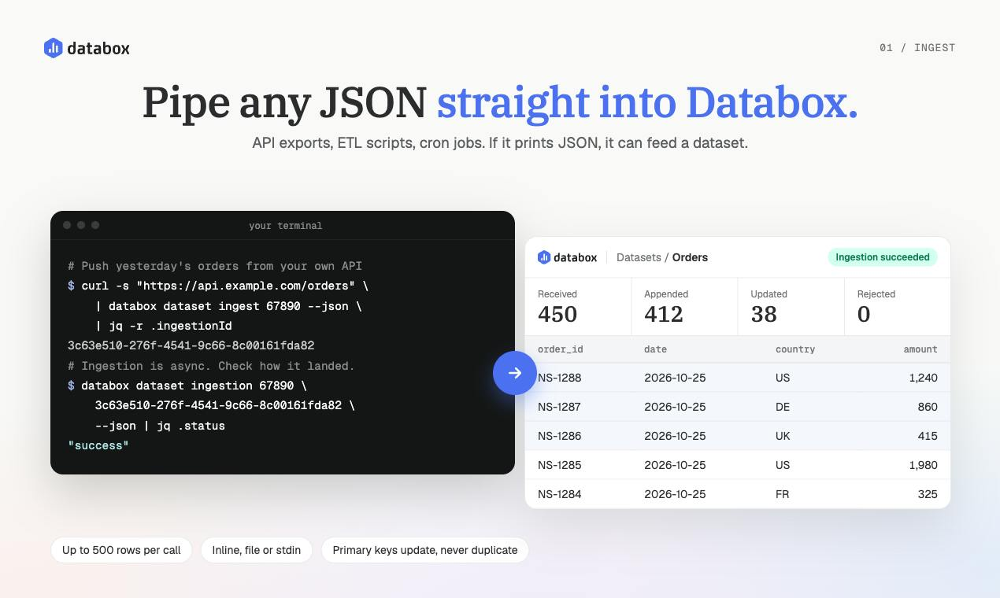
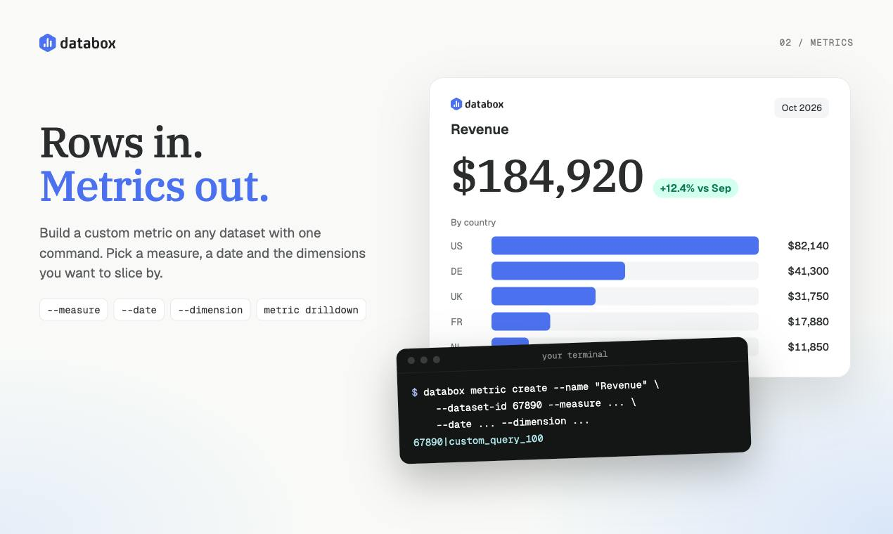

### 🎬 관련 영상
- [🎥 영상 보기](https://ph-files.imgix.net/c50d30d8-8c7a-4d11-b1a4-b31b9af4060a.jpeg?auto=format)

---

## 4. [Arcjet AI security models](https://www.producthunt.com/products/arcjet)
**Votes**: 196 | **도입 난이도**: 중 | **신뢰도**: 상
**Tagline**: A family of custom-trained security models for coding agents
**서비스 링크**: https://www.producthunt.com/r/VT6JRMB2LSBNQT

**태그**: AI-Security, DevTool, LLM-Ops, Agent, AI Tool, Prompting, Design, Security

### 📌 이 서비스 한눈에 보기
코딩 및 보안 에이전트의 취약점을 방어하기 위한 맞춤형 AI 보안 모델 제품군

### 🔑 주요 기능
- AI 에이전트 활동 분석에 특화된 맞춤형 보안 모델 제공
- 범용 프롬프트 인젝션 탐지 모델(Himalia 1) 출시
- 코딩 에이전트(Thebe 1) 및 자율 보안 에이전트(Carme 1)를 위한 전문 모델 라인업

### 🙋 사용자에게 어떤 점이 좋은가
AI 에이전트를 활용한 서비스를 개발할 때, 프롬프트 인젝션과 같은 보안 위협으로부터 애플리케이션을 보호할 수 있습니다.

### ✅ 지금 바로 써볼 기능
- Arcjet Himalia 1을 통한 프롬프트 인젝션 탐지 적용
- 코딩 에이전트 환경에 Arcjet Thebe 1 도입 검토
- 자율 보안 에이전트 구축 시 Arcjet Carme 1 활용

### ⚠️ 사용 전 확인할 점
- 특정 에이전트 유형에 최적화된 모델이므로 사용 중인 워크플로우와의 적합성 확인 필요
- 모델의 탐지 정확도 및 오탐율에 대한 실무 검증 필요

### 🧭 확인이 더 필요한 정보
각 모델의 구체적인 API 연동 방식과 상세 성능 지표는 공식 문서를 통해 확인이 필요합니다.

### 📸 스크린샷 및 갤러리

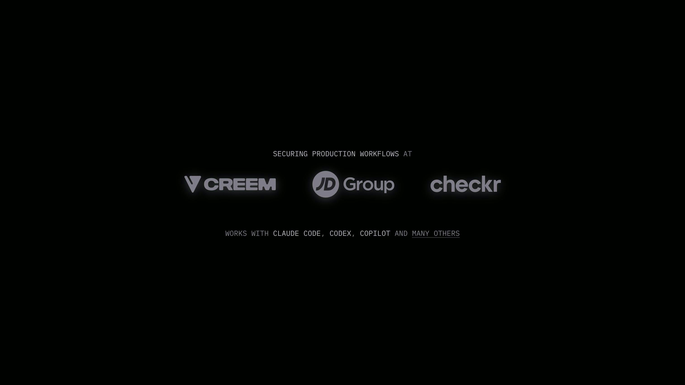
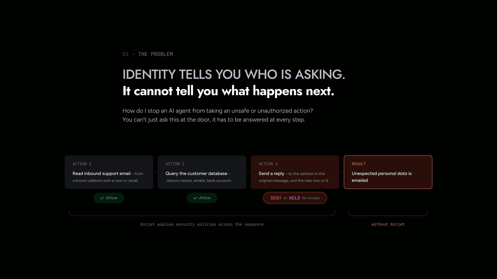

---

## 5. [ProtoMap](https://www.producthunt.com/products/hounddog-ai-static-code-scanner-2)
**Votes**: 151 | **도입 난이도**: 중 | **신뢰도**: 상
**Tagline**: Stop wasting AI tokens rediscovering dependencies
**서비스 링크**: https://www.producthunt.com/r/AK5JMQTTDBGMD4

**태그**: DevTool, AI-Agent, Backend, Automation, Agent, AI Tool, API

### 📌 이 서비스 한눈에 보기
코드베이스 전반의 의존성을 시각화하여 AI 에이전트와 엔지니어의 탐색 시간을 줄여주는 도구

### 🔑 주요 기능
- gRPC 및 Protobuf 시스템을 위한 결정론적 의존성 맵 구축
- 코드 커밋 시마다 자동 업데이트되는 웹 앱 및 MCP 지원
- AI 코딩 에이전트가 코드 검색 대신 직접 쿼리할 수 있는 환경 제공

### 🙋 사용자에게 어떤 점이 좋은가
대규모 코드베이스에서 서비스와 API 간의 복잡한 관계를 파악하는 데 드는 시간과 AI 토큰 비용을 획기적으로 절감할 수 있습니다.

### ✅ 지금 바로 써볼 기능
- 웹 앱을 통한 의존성 맵 시각화 확인
- MCP를 통한 AI 에이전트 연동 테스트
- 기존 gRPC/Protobuf 시스템에 대한 의존성 맵 생성

### ⚠️ 사용 전 확인할 점
- gRPC 및 Protobuf 시스템에 특화되어 있어 다른 프로토콜 사용 시 활용도가 제한될 수 있음
- 대규모 코드베이스의 보안 및 데이터 접근 권한 설정 필요

### 🧭 확인이 더 필요한 정보
지원하는 프로그래밍 언어의 범위와 특정 프레임워크와의 호환성을 추가로 확인해야 합니다.

### 📸 스크린샷 및 갤러리
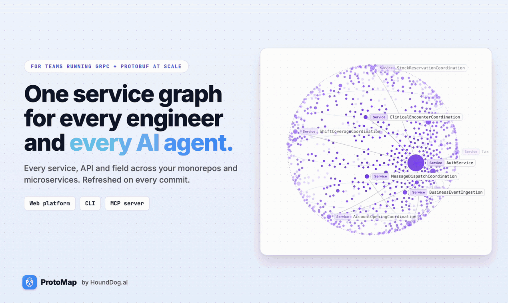
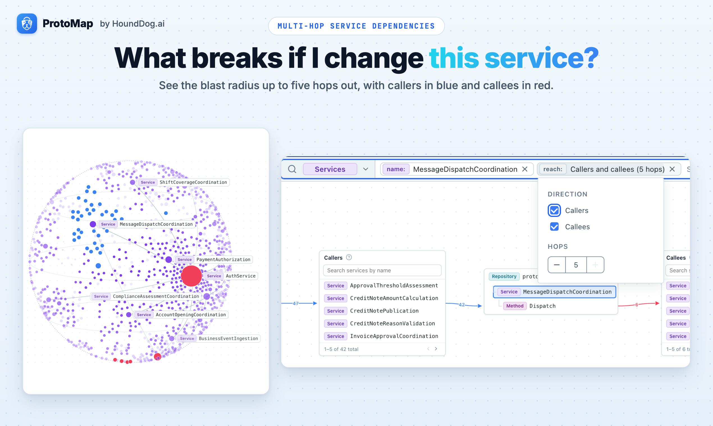
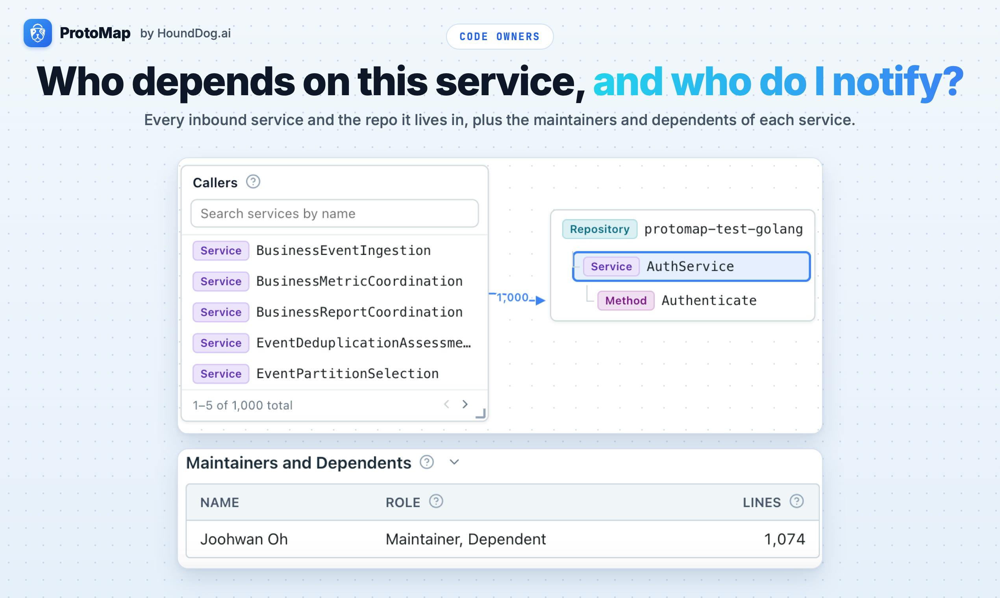

### 🎬 관련 영상
- [🎥 영상 보기](https://ph-files.imgix.net/92d4e8ca-5774-464c-a232-00f299a3cb95.jpeg?auto=format)

---

## 6. [GitHub New PR Overview](https://www.producthunt.com/products/github)
**Votes**: 118 | **도입 난이도**: 하 | **신뢰도**: 상
**Tagline**: See what's blocking a PR before you scroll
**서비스 링크**: https://www.producthunt.com/r/CNDTGBVSQ4JX55

**태그**: DevTool, Productivity, GitHub

### 📌 이 서비스 한눈에 보기
PR의 병목 구간을 한눈에 파악할 수 있는 요약형 오버뷰 페이지

### 🔑 주요 기능
- 머지 상태를 상단으로 배치하여 즉각적인 상태 확인 가능
- 체크, 승인, 댓글, 다음 작업 단계를 하나의 컴팩트한 요약으로 제공
- 해결되지 않은 댓글 필터 및 최신순 정렬 기능 추가

### 🙋 사용자에게 어떤 점이 좋은가
스크롤을 내리지 않고도 PR의 진행 상황과 남은 작업을 즉시 파악할 수 있어 리뷰 효율이 높아집니다.

### ✅ 지금 바로 써볼 기능
- 새로운 PR 오버뷰 페이지 레이아웃 확인하기
- 해결되지 않은 댓글 필터를 사용하여 미결 작업 관리하기
- 활동 패널을 통해 PR 히스토리 빠르게 훑기

### ⚠️ 사용 전 확인할 점
- 기존 PR 페이지 레이아웃 변화에 따른 사용자 적응 필요

### 🧭 확인이 더 필요한 정보
사용자 환경에 따라 기능 배포 시점이 다를 수 있습니다.

### 📸 스크린샷 및 갤러리
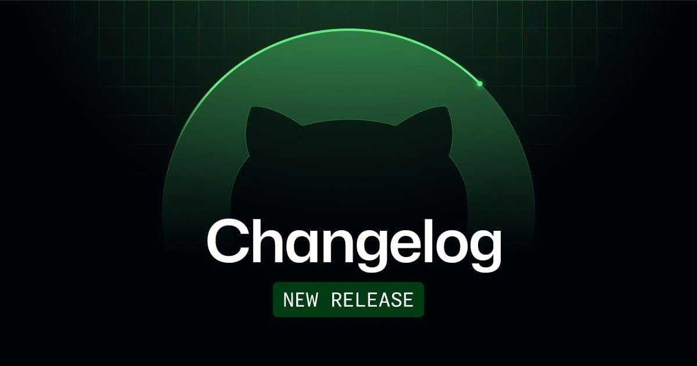
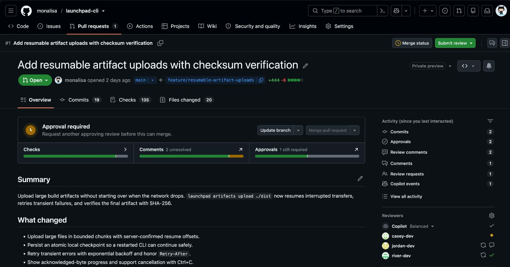
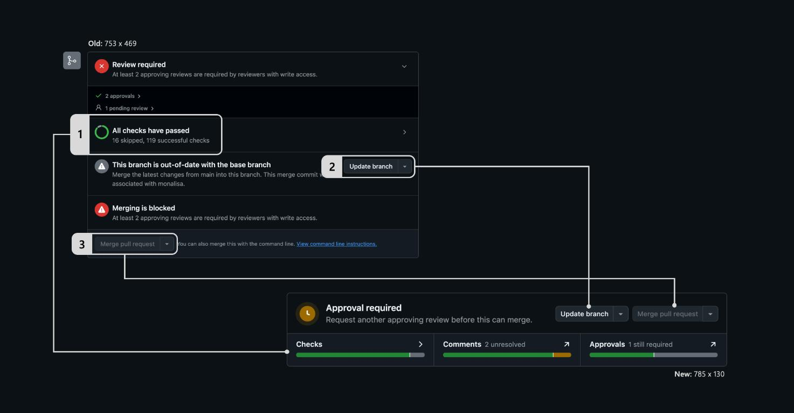

---

## 7. [Higgsfield Miracle](https://www.producthunt.com/products/higgsfield)
**Votes**: 116 | **도입 난이도**: 중 | **신뢰도**: 상
**Tagline**: Edit any part of a video without changing the rest
**서비스 링크**: https://www.producthunt.com/r/SQJXVLATW6UFHE

**태그**: VideoEditing, AI, CreativeTools, ContentCreation, Video

### 📌 이 서비스 한눈에 보기
원본 움직임은 유지하면서 영상의 특정 부분만 정밀하게 편집하는 레이어 기반 비디오 편집 도구

### 🔑 주요 기능
- 영상을 레이어 단위로 벡터화하여 국소적 픽셀 편집 가능
- 피사체의 움직임과 카메라 워크를 유지하며 배경, 색상, 질감 변경
- 객체 색상 변경, 배경 교체, 요소 추가/제거 및 조명 조절 기능

### 🙋 사용자에게 어떤 점이 좋은가
영상 전체를 다시 촬영하거나 복잡한 합성 과정을 거치지 않고도 원하는 부분만 실시간으로 수정할 수 있어 작업 시간을 획기적으로 단축합니다.

### ✅ 지금 바로 써볼 기능
- 영상 속 객체의 색상 및 질감 변경해보기
- 배경 교체 및 요소 추가/제거 기능 테스트
- 조명 조절을 통한 영상 분위기 변화 시도

### ⚠️ 사용 전 확인할 점
- 복잡한 움직임이 포함된 영상에서의 편집 정밀도 확인 필요
- 벡터화 과정에서의 원본 화질 유지 여부 검토

### 🧭 확인이 더 필요한 정보
실시간 편집 성능과 지원하는 최대 영상 해상도에 대한 구체적인 정보가 필요합니다.

### 📸 스크린샷 및 갤러리
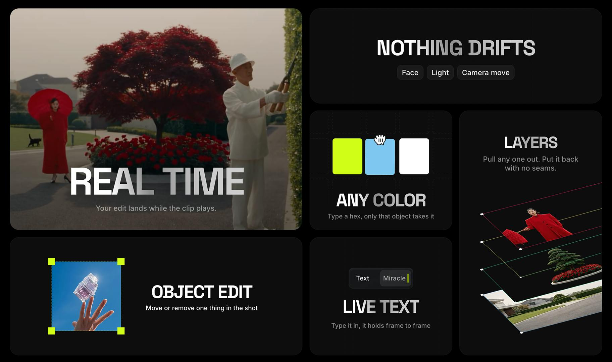

### 🎬 관련 영상
- [🎥 영상 보기](https://ph-files.imgix.net/e4ef4d9c-3278-4958-8970-9e68d00db080.jpeg?auto=format)

---

## 8. [MCP1](https://www.producthunt.com/products/appwrite)
**Votes**: 114 | **도입 난이도**: 하 | **신뢰도**: 상
**Tagline**: One URL for every MCP server.
**서비스 링크**: https://www.producthunt.com/r/QC2MD2OS3ZT23L

**태그**: AI, DevTool, Automation, Security, AI Tool, Chat

### 📌 이 서비스 한눈에 보기
모든 MCP 서버를 하나의 URL로 통합 관리하는 보안 게이트웨이

### 🔑 주요 기능
- 단일 게이트웨이를 통한 간편한 MCP 서버 연결 및 관리
- AI 도구(Claude, Cursor 등)를 위한 보안 권한 및 자격 증명 보호
- 도구 사용량 모니터링 및 중앙 집중식 관리 기능 제공

### 🙋 사용자에게 어떤 점이 좋은가
여러 개의 MCP 서버를 개별적으로 설정할 필요 없이 하나의 URL로 통합 관리할 수 있어 AI 워크플로우가 간결해집니다.

### ✅ 지금 바로 써볼 기능
- 개인용 무료 플랜으로 기존 MCP 서버 연결해보기
- Claude나 Cursor에 MCP1 게이트웨이 연동하기
- 사용자 권한 및 보안 설정 테스트하기

### ⚠️ 사용 전 확인할 점
- 모든 서버 자격 증명이 중앙 게이트웨이를 통과하므로 보안 정책 확인 필요
- 개인용 무료 플랜과 팀/엔터프라이즈 플랜 간의 기능 차이 확인 필요

### 🧭 확인이 더 필요한 정보
플랜별 상세 기능 차이와 엔터프라이즈급 보안 프로토콜에 대한 상세 정보 확인이 필요합니다.

### 📸 스크린샷 및 갤러리
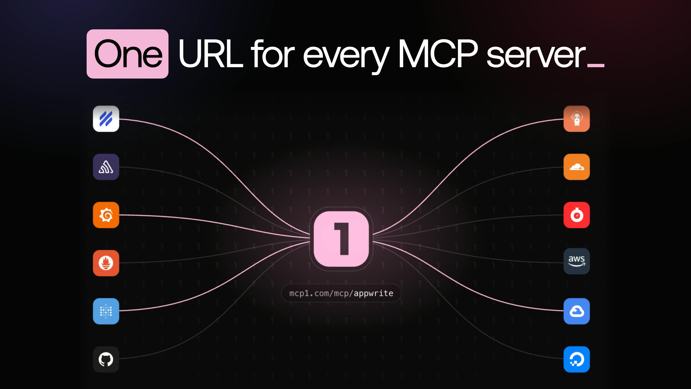
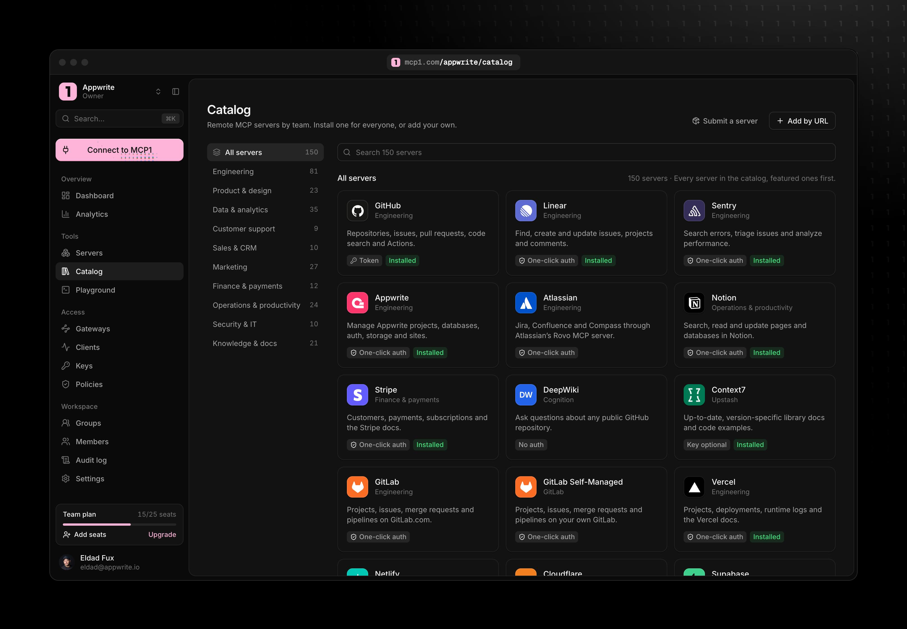
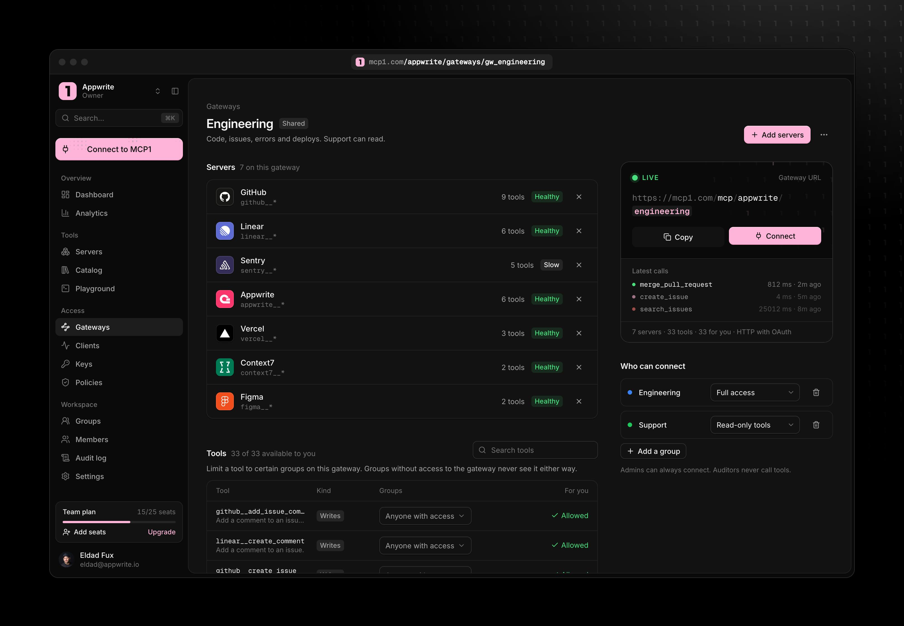

### 🎬 관련 영상
- [🎥 영상 보기](https://ph-files.imgix.net/279a6950-1ef5-45e9-a37c-d36a9a4fdfc5.jpeg?auto=format)

---

## 9. [Pawse.ai](https://www.producthunt.com/products/pawse-ai)
**Votes**: 99 | **도입 난이도**: 하 | **신뢰도**: 상
**Tagline**: Sound engineered for dogs, not humans
**서비스 링크**: https://www.producthunt.com/r/OJSJK4CTR4K5RL

**태그**: PetTech, AI, Wellness, Audio, AI Tool

### 📌 이 서비스 한눈에 보기
반려견의 청각 특성에 맞춘 맞춤형 사운드 솔루션

### 🔑 주요 기능
- 반려견의 청각 구조를 고려한 전문적인 사운드 엔지니어링
- 수면, 외출, 여행, 병원 방문 등 상황별 맞춤형 세션 제공
- 반려견의 반응에 따라 실시간으로 조정되는 적응형 사운드

### 🙋 사용자에게 어떤 점이 좋은가
반려견이 혼자 있거나 불안한 상황에서 청각적 안정을 제공하여 분리 불안 완화 및 스트레스 관리에 도움을 줍니다.

### ✅ 지금 바로 써볼 기능
- 상황별(Sleep, Home Alone 등) 맞춤 세션 실행해보기
- 반려견의 반응을 피드백하여 세션 최적화하기
- Apple TV 앱을 통한 연속 재생 기능 활용하기

### ⚠️ 사용 전 확인할 점
- 반려견의 개별적인 청각 민감도에 따라 효과가 다를 수 있음
- 특정 상황(병원 등)에서의 효과는 반려견마다 차이가 있을 수 있음

### 🧭 확인이 더 필요한 정보
반려견의 반응 데이터가 구체적으로 어떤 알고리즘을 통해 사운드에 반영되는지 확인이 필요합니다.

### 📸 스크린샷 및 갤러리

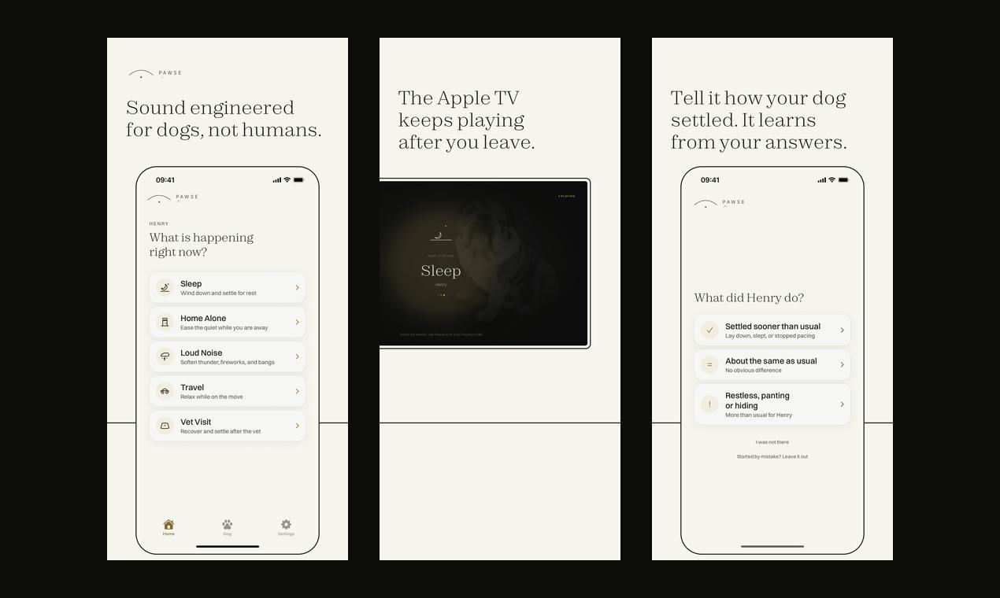

---

## 10. [Voyager](https://www.producthunt.com/products/vygr)
**Votes**: 97 | **도입 난이도**: 하 | **신뢰도**: 상
**Tagline**: ✴️ An agentic file browser to navigate your work context
**서비스 링크**: https://www.producthunt.com/r/DECOX5K4UP7P3G

**태그**: Productivity, AI, macOS, FileManagement, Agent, AI Tool

### 📌 이 서비스 한눈에 보기
AI 에이전트가 내장되어 파일 탐색과 업무 맥락 파악을 돕는 macOS용 파일 브라우저

### 🔑 주요 기능
- macOS 환경에 최적화된 익숙한 파일 브라우저 인터페이스
- AI 에이전트를 활용한 효율적인 파일 검색 및 관리
- 파일을 단순 저장소가 아닌 AI 작업의 맥락(Context)으로 활용

### 🙋 사용자에게 어떤 점이 좋은가
파일을 찾는 데 드는 시간을 줄이고, 찾은 파일을 AI와 즉시 연동하여 업무 생산성을 높일 수 있습니다.

### ✅ 지금 바로 써볼 기능
- 기존 파일 탐색기처럼 파일 탐색해보기
- AI 에이전트를 활용해 필요한 파일 검색하기
- 파일을 AI 작업의 컨텍스트로 활용해보기

### ⚠️ 사용 전 확인할 점
- macOS 전용 앱이므로 다른 운영체제에서는 사용 불가
- 개인 파일에 대한 AI 접근 권한 설정 필요

### 🧭 확인이 더 필요한 정보
상세한 AI 에이전트의 작업 범위와 보안 정책에 대한 구체적인 정보가 필요합니다.

### 📸 스크린샷 및 갤러리
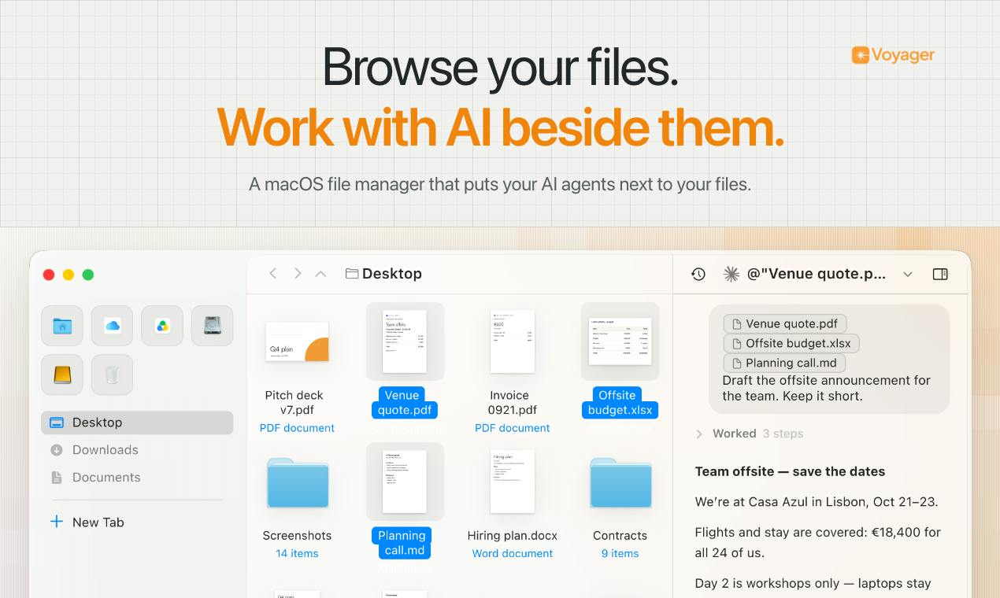
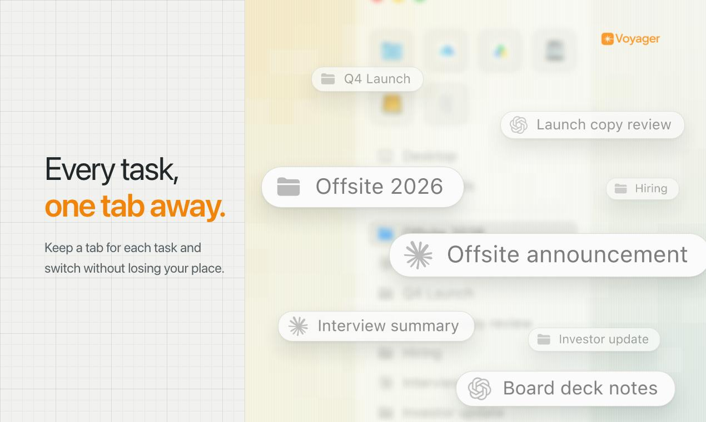
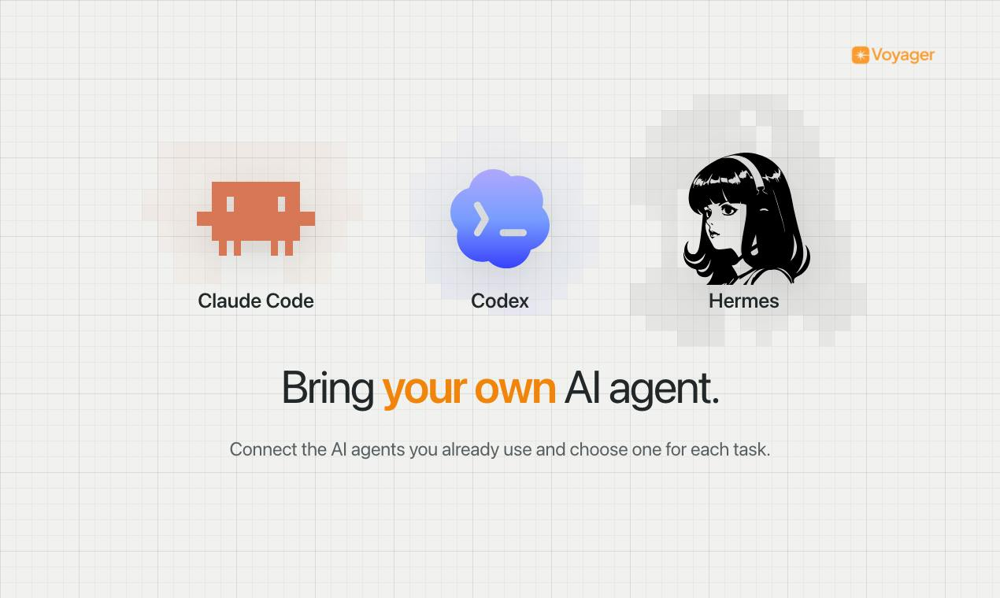

### 🎬 관련 영상
- [🎥 영상 보기](https://ph-files.imgix.net/addde1ae-4aab-48c5-9db8-2b4171c3ad22.jpeg?auto=format)

---

## 11. [Jotform App for Shopify](https://www.producthunt.com/products/jotform)
**Votes**: 88 | **도입 난이도**: 하 | **신뢰도**: 상
**Tagline**: Build powerful forms for your Shopify store
**서비스 링크**: https://www.producthunt.com/r/AKFKX27IKGZ3RN

**태그**: Shopify, NoCode, CRM, LeadGeneration

### 📌 이 서비스 한눈에 보기
쇼피파이 스토어에 맞춤형 양식을 간편하게 구축하여 고객 접점을 확대하세요.

### 🔑 주요 기능
- 쇼피파이 스토어 내 연락처, 리드 수집, 신청, 설문 등 다양한 양식 생성 가능
- 스토어 디자인에 맞춘 스타일링 및 조건부 로직, 계산, 파일 업로드 기능 지원
- Jotform에서 응답을 관리하고 기존 팀 도구와 연동 가능

### 🙋 사용자에게 어떤 점이 좋은가
쇼피파이 운영자가 별도의 복잡한 개발 없이도 전문적인 고객 소통 양식을 스토어에 바로 적용할 수 있습니다.

### ✅ 지금 바로 써볼 기능
- 스토어 디자인에 맞게 양식 스타일 커스텀하기
- 조건부 로직을 활용한 스마트한 응답 수집 설정하기
- 수집된 데이터를 기존 업무 도구에 연결하기

### ⚠️ 사용 전 확인할 점
- 쇼피파이 테마와의 디자인 일치 여부 확인 필요
- 데이터 연동 시 사용 중인 외부 도구와의 호환성 확인 필요

### 🧭 확인이 더 필요한 정보
상세한 기능별 요금 체계 및 쇼피파이 플랜별 지원 범위는 확인이 필요합니다.

### 📸 스크린샷 및 갤러리
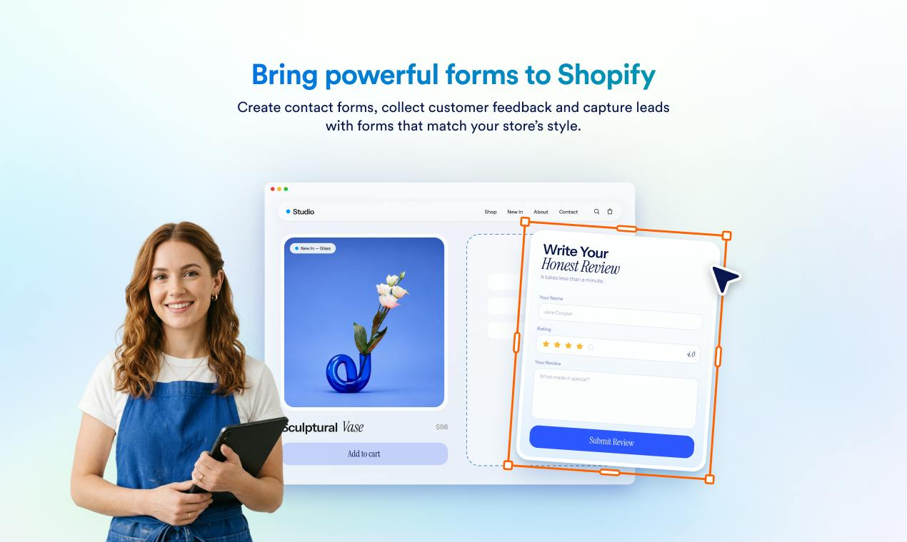
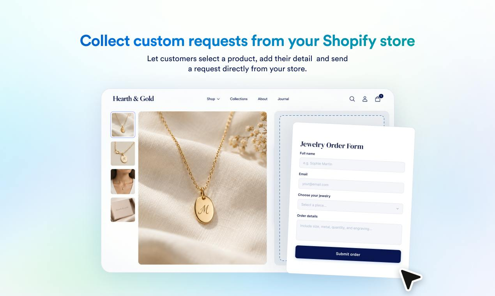
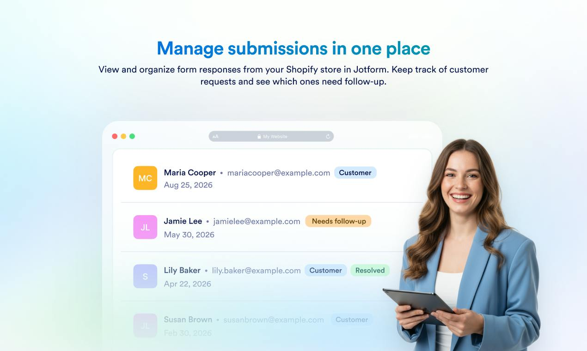

---

## 12. [Egoist AI Passport](https://www.producthunt.com/products/egoist-ai-passport)
**Votes**: 87 | **도입 난이도**: 하 | **신뢰도**: 상
**Tagline**: Secure and share your personal data with AI tools.
**서비스 링크**: https://www.producthunt.com/r/6NZ7GL4VUHSFPI

**태그**: AI, Privacy, Productivity, Data Management, AI Tool, Chat, Email

### 📌 이 서비스 한눈에 보기
개인정보를 안전하게 관리하며 AI 도구에 필요한 데이터만 선택적으로 공유하는 개인용 데이터 패스포트

### 🔑 주요 기능
- 이메일, 캘린더 등 개인 데이터를 한 곳에 안전하게 저장
- ChatGPT, Claude 등 다양한 AI 도구와 연동하여 맥락(Context) 제공
- 공유할 데이터와 비공개 데이터를 세밀하게 제어 및 권한 철회 가능

### 🙋 사용자에게 어떤 점이 좋은가
사용자는 개인정보 유출 걱정 없이 AI에게 필요한 정보만 전달하여, 더욱 개인화된 AI 경험을 누릴 수 있습니다.

### ✅ 지금 바로 써볼 기능
- 주요 계정(Email, Calendar 등) 연결하기
- 공유할 데이터 범위 설정하기
- AI 도구에 데이터 연동하여 개인화된 답변 확인하기

### ⚠️ 사용 전 확인할 점
- 개인 데이터가 집중되는 만큼 서비스 보안 수준을 반드시 확인해야 함
- 연동된 외부 AI 서비스의 데이터 처리 정책에 따른 보안 리스크 존재

### 🧭 확인이 더 필요한 정보
현재 제공되는 구체적인 보안 암호화 방식과 데이터 저장 방식에 대한 상세 정보가 필요합니다.

### 📸 스크린샷 및 갤러리
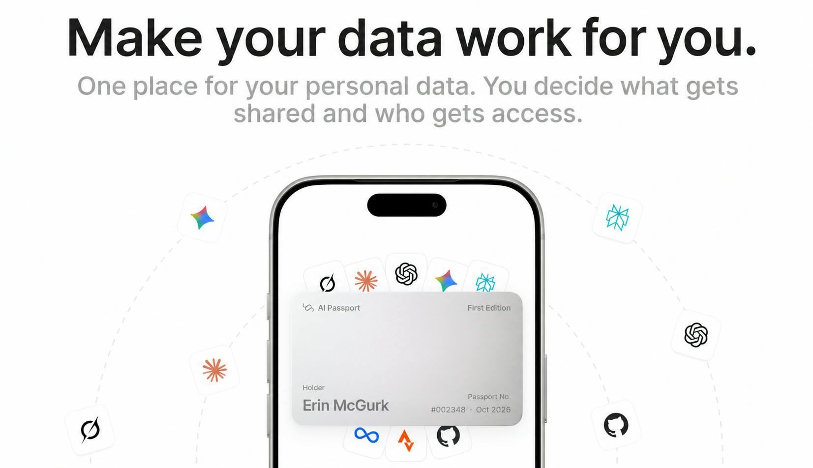
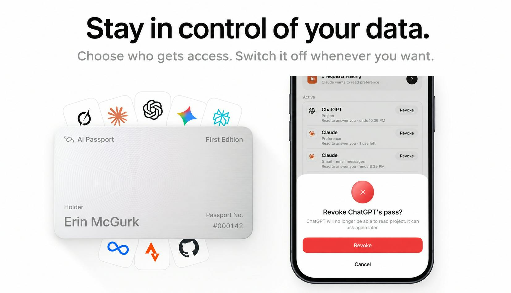
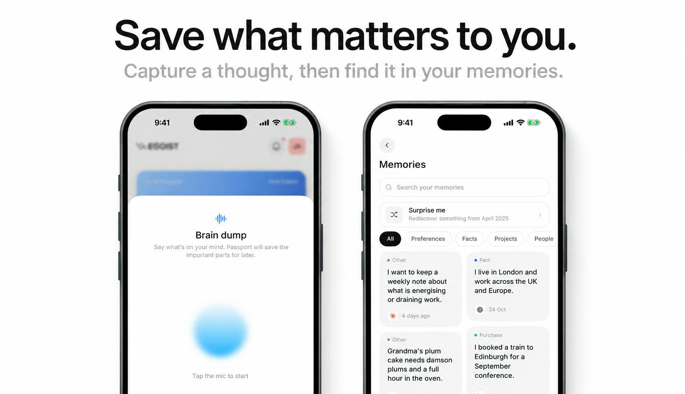

### 🎬 관련 영상
- [🎥 영상 보기](https://ph-files.imgix.net/6961c5c2-6bc6-48ff-8729-0102fb335646.jpeg?auto=format)

---

## 13. [If You Read This](https://www.producthunt.com/products/if-you-read-this)
**Votes**: 83 | **도입 난이도**: 하 | **신뢰도**: 상
**Tagline**: A daily check-in app that works like a dead man's switch
**서비스 링크**: https://www.producthunt.com/r/O2ZSHSF3K3GEME

**태그**: Safety, Personal, Automation, AI Tool

### 📌 이 서비스 한눈에 보기
부재 시 미리 설정한 메시지를 지인에게 전달하는 데드맨 스위치 방식의 데일리 체크인 앱

### 🔑 주요 기능
- 매일 앱을 열어 생존/안부를 확인하는 체크인 방식
- 체크인 미이행 시 미리 작성된 메시지를 지정된 연락처로 자동 발송
- 미국 및 캐나다 전화번호를 대상으로 하는 SMS 알림 기능

### 🙋 사용자에게 어떤 점이 좋은가
사용자의 신변에 문제가 생겼을 때, 미리 설정된 절차에 따라 지인에게 상황을 알릴 수 있어 안심할 수 있습니다.

### ✅ 지금 바로 써볼 기능
- 비상 시 전달될 메시지 미리 작성하기
- 신뢰할 수 있는 비상 연락처 등록하기

### ⚠️ 사용 전 확인할 점
- 미국 및 캐나다 전화번호 사용자에게만 최적화되어 있음
- 사용자가 의도치 않게 체크인을 놓칠 경우 메시지가 발송될 위험이 있음

### 🧭 확인이 더 필요한 정보
국제 전화번호 지원 여부와 메시지 발송 비용 정책에 대한 정보가 부족합니다.

### 📸 스크린샷 및 갤러리

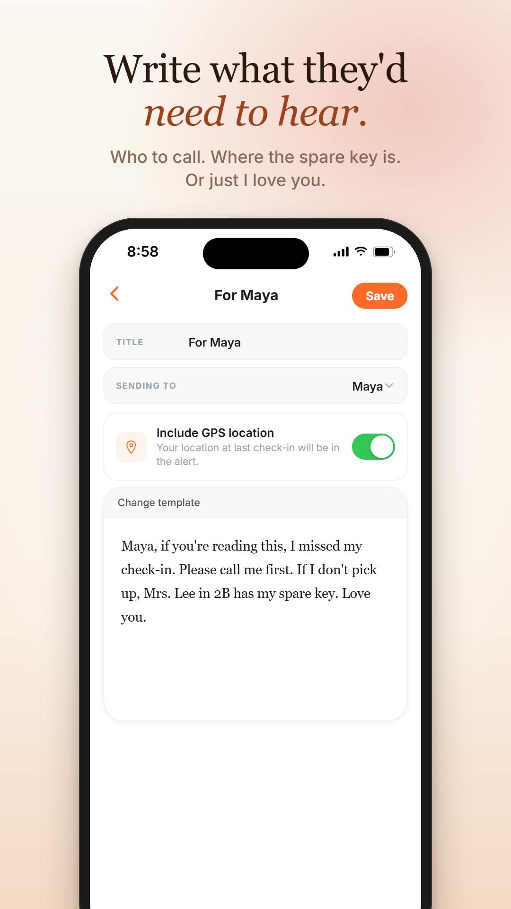
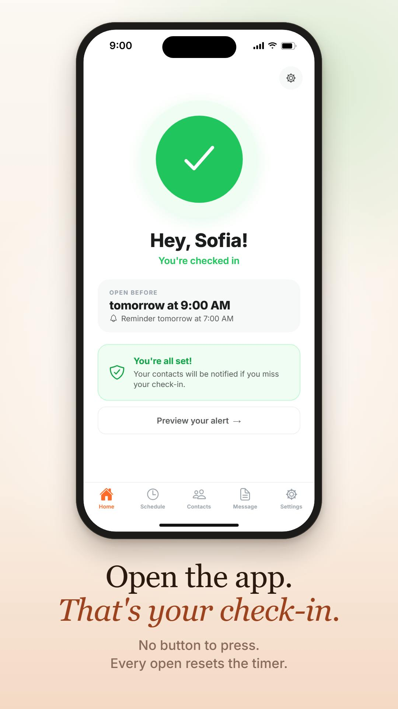

### 🎬 관련 영상
- [🎥 영상 보기](https://ph-files.imgix.net/2dcb8086-eacc-42fc-9af7-52ea52df652e.jpeg?auto=format)

---

## 14. [Cardboard AI](https://www.producthunt.com/products/cardboard-3)
**Votes**: 80 | **도입 난이도**: 하 | **신뢰도**: 상
**Tagline**: Best way to edit videos with AI
**서비스 링크**: https://www.producthunt.com/r/CUFL5L7KXTX4V4

**태그**: VideoEditing, AI, ContentCreation, Storytelling, AI Tool, Video

### 📌 이 서비스 한눈에 보기
AI가 영상의 흐름을 이해하여 원본 클립을 스토리로 만들어주는 지능형 영상 편집 도구

### 🔑 주요 기능
- 원시 영상 클립을 이야기 구조로 변환하는 AI 편집 기능
- 사용자의 비전을 이해하고 감각적인 편집을 돕는 크리에이티브 협업자 역할
- 단순 편집을 넘어 영상의 맥락을 파악하는 지능형 워크플로우

### 🙋 사용자에게 어떤 점이 좋은가
편집 기술이 부족하더라도 AI의 도움을 받아 원본 영상을 완성도 높은 스토리텔링 영상으로 빠르게 제작할 수 있습니다.

### ✅ 지금 바로 써볼 기능
- 보유 중인 원본 클립 업로드하기
- AI가 제안하는 스토리라인 확인하기
- AI 편집 결과물 커스텀 수정하기

### ⚠️ 사용 전 확인할 점
- AI의 편집 스타일이 사용자의 개인적 취향과 다를 수 있음
- 복잡한 정밀 편집 기능의 포함 여부는 미확인

### 🧭 확인이 더 필요한 정보
구체적인 편집 기능의 범위와 세부 제어 가능 여부에 대한 정보가 부족합니다.

### 📸 스크린샷 및 갤러리

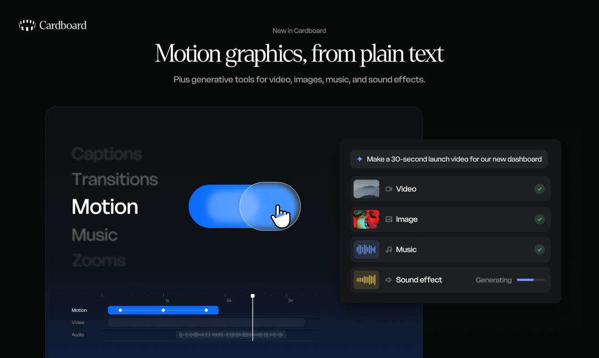

### 🎬 관련 영상
- [🎥 영상 보기](https://ph-files.imgix.net/3a48c809-c8ee-449b-8bfa-24575fe007d3.jpeg?auto=format)

---

## 15. [Watchflows](https://www.producthunt.com/products/watchflows)
**Votes**: 78 | **도입 난이도**: 중 | **신뢰도**: 상
**Tagline**: Visual automation for your Mac, with AI built in
**서비스 링크**: https://www.producthunt.com/r/D7AWKPJHNTYXJE

**태그**: Automation, AI, Productivity, Mac, AI Tool

### 📌 이 서비스 한눈에 보기
AI와 시각적 캔버스를 결합하여 Mac의 반복 업무를 자동화하는 로컬 우선 워크플로우 도구

### 🔑 주요 기능
- 파일 생성, 단축키, 시간, 웹훅 등 다양한 트리거 기반 자동화
- 자연어 설명만으로 워크플로우를 생성하는 AI Flow Builder 탑재
- Apple 온디바이스 모델, Ollama 등 다양한 AI 모델 지원 및 로컬 우선 방식

### 🙋 사용자에게 어떤 점이 좋은가
반복적인 파일 정리나 단순 업무를 자동화하여 Mac 사용 시간을 절약하고, 개인정보 유출 걱정 없이 로컬 환경에서 안전하게 AI를 활용할 수 있습니다.

### ✅ 지금 바로 써볼 기능
- 자연어로 자동화 흐름을 만드는 Flow Builder 테스트
- 다운로드 폴더 등 특정 폴더 감지 트리거 설정
- 로컬 AI 모델을 활용한 파일 이름 자동 변경 워크플로우 구축

### ⚠️ 사용 전 확인할 점
- 14일 무료 체험 후 $49의 일회성 결제가 필요함
- 복잡한 로직 구현 시 시각적 캔버스 숙련도 필요

### 🧭 확인이 더 필요한 정보
사용자의 하드웨어 사양에 따른 로컬 AI 모델 구동 성능 차이가 있을 수 있습니다.

### 📸 스크린샷 및 갤러리
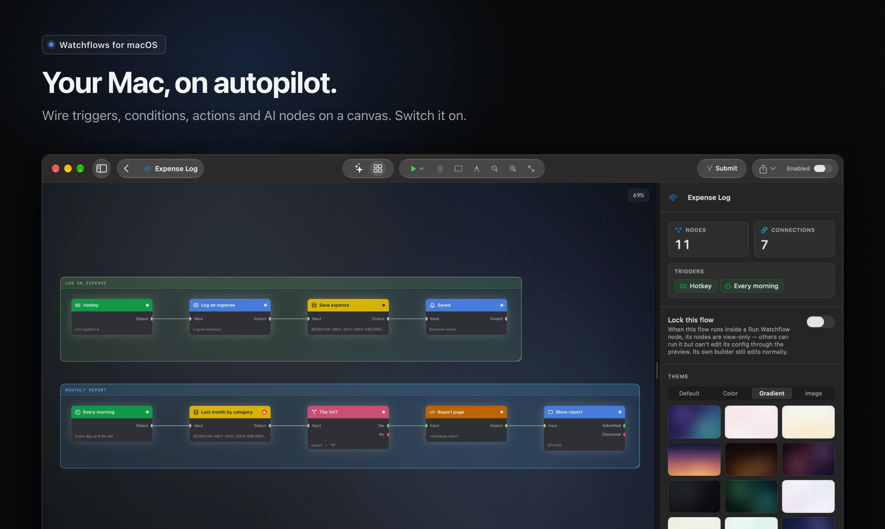
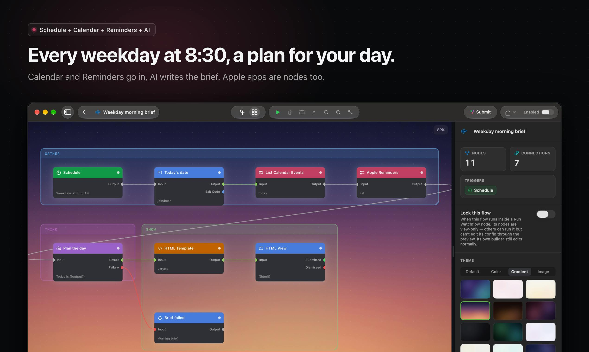
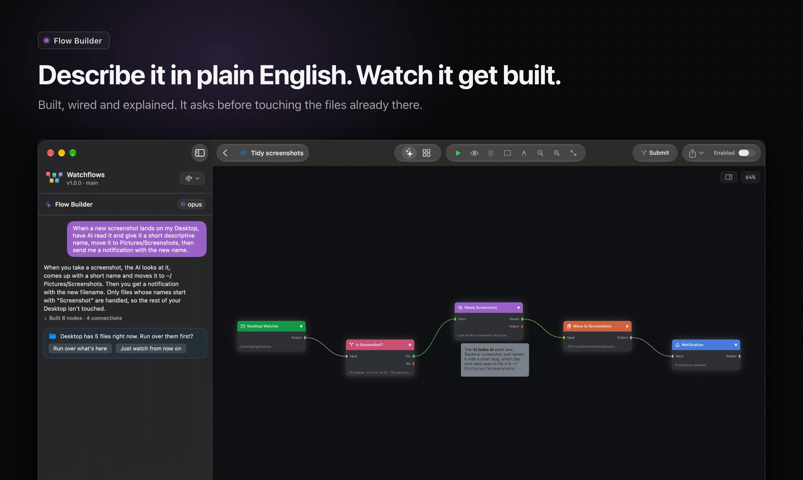

### 🎬 관련 영상
- [🎥 영상 보기](https://ph-files.imgix.net/5c3a9642-f8a8-4029-8ce7-52853b913cd5.jpeg?auto=format)

---

## 16. [Sign Language by Panda Video](https://www.producthunt.com/products/panda-video)
**Votes**: 77 | **도입 난이도**: 하 | **신뢰도**: 상
**Tagline**: Add a sign language interpreter to videos already online
**서비스 링크**: https://www.producthunt.com/r/2UZJALQ7B2UTPF

**태그**: Accessibility, VideoTool, ContentCreation, Video

### 📌 이 서비스 한눈에 보기
기존 영상의 재편집 없이 수어 통역 창을 간편하게 추가하는 서비스

### 🔑 주요 기능
- 기존에 게시된 영상에 수어 통역 영상을 링크하여 결합
- 사용자가 플레이어에서 직접 통역 창을 켜거나 크기 조절 가능
- 영상 재편집이나 재업로드 과정이 필요 없는 워크플로우

### 🙋 사용자에게 어떤 점이 좋은가
콘텐츠 제작자가 영상을 다시 만들 필요 없이, 청각 장애 사용자를 위한 접근성을 즉각적으로 확보할 수 있습니다.

### ✅ 지금 바로 써볼 기능
- 수어 통역 영상 업로드하기
- 기존 영상과 통역 영상 연결하기
- 플레이어 내 창 크기 및 위치 조정 테스트하기

### ⚠️ 사용 전 확인할 점
- 기존 영상의 플레이어 환경에 따라 레이아웃 최적화 여부 확인 필요
- 수어 통역 영상의 품질이 원본 영상의 가독성에 미치는 영향 고려

### 🧭 확인이 더 필요한 정보
기존 영상이 호스팅된 플랫폼(YouTube, Vimeo 등)과의 호환성 및 임베드 방식에 대한 상세 정보가 필요합니다.

### 📸 스크린샷 및 갤러리

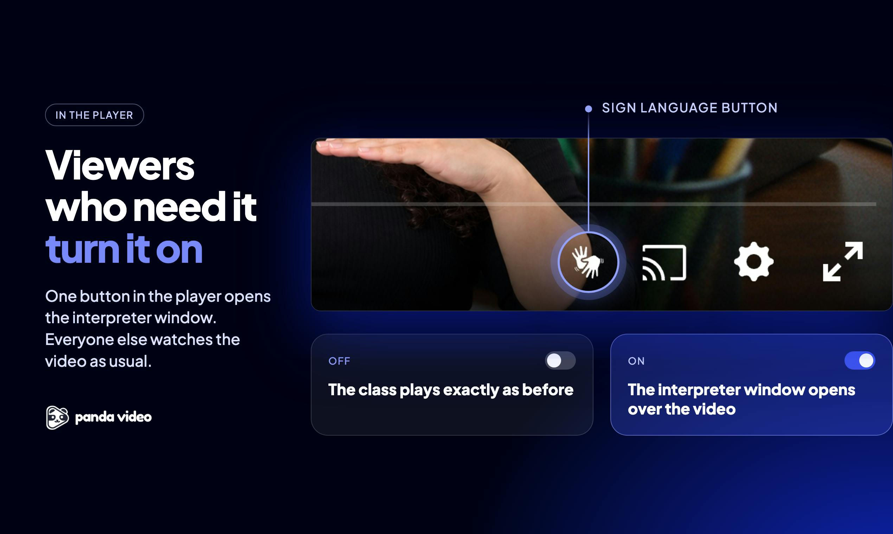

---

## 17. [ClipsPal](https://www.producthunt.com/products/clipspal)
**Votes**: 77 | **도입 난이도**: 하 | **신뢰도**: 상
**Tagline**: AI video editor that edits your talking-head videos
**서비스 링크**: https://www.producthunt.com/r/7YFZB3OCOMM4XM

**태그**: VideoEditor, AI, ContentCreation, Productivity, NoSubscription, AI Tool, Video, DevTool

### 📌 이 서비스 한눈에 보기
말하는 영상의 편집부터 숏폼 제작까지 한 번에 해결하는 AI 데스크톱 비디오 에디터

### 🔑 주요 기능
- 실패한 테이크와 무음 구간 자동 제거
- 줌인, 자막, 시각 자료 및 사운드 자동 추가
- 원본 영상을 숏폼 및 아티클로 자동 변환

### 🙋 사용자에게 어떤 점이 좋은가
말하는 영상(Talking-head) 제작 시 반복적인 편집 시간을 획기적으로 줄여주며, 하나의 소스로 다양한 콘텐츠를 생성할 수 있습니다.

### ✅ 지금 바로 써볼 기능
- 원시 영상 파일을 드롭하여 자동 편집 기능 테스트
- 생성된 숏폼 및 아티클 결과물 확인

### ⚠️ 사용 전 확인할 점
- Mac 및 Windows 데스크톱 환경에서만 구동됨
- AI 자동 편집의 결과물이 사용자의 의도와 다를 수 있음

### 🧭 확인이 더 필요한 정보
Claude Code나 Codex와의 구체적인 연동 방식 및 워크플로우 확인이 필요합니다.

### 📸 스크린샷 및 갤러리
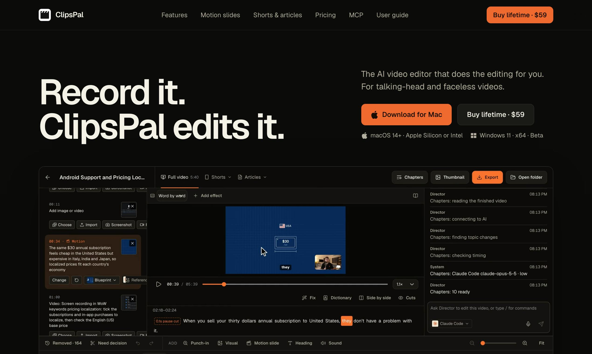
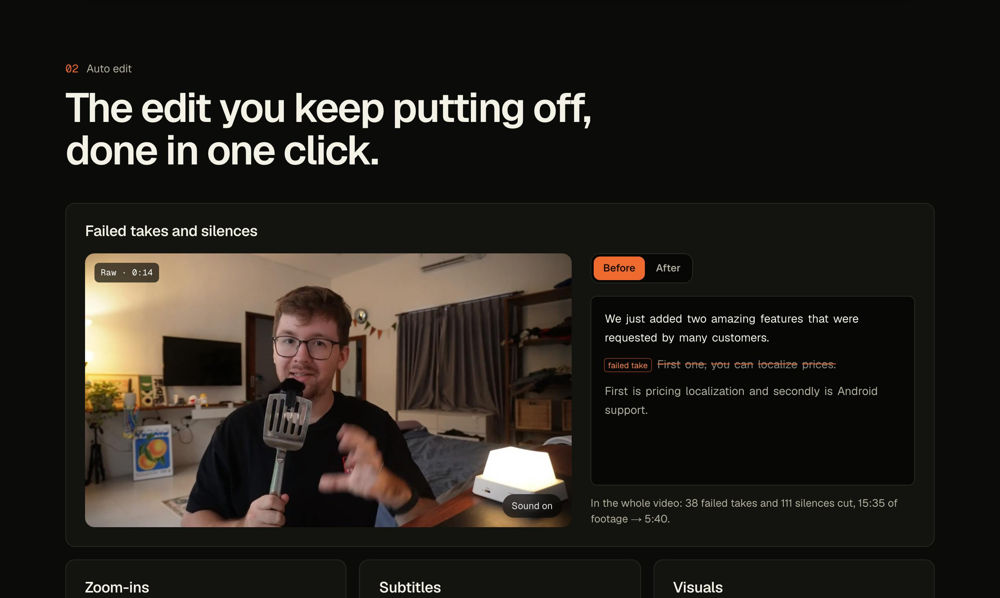
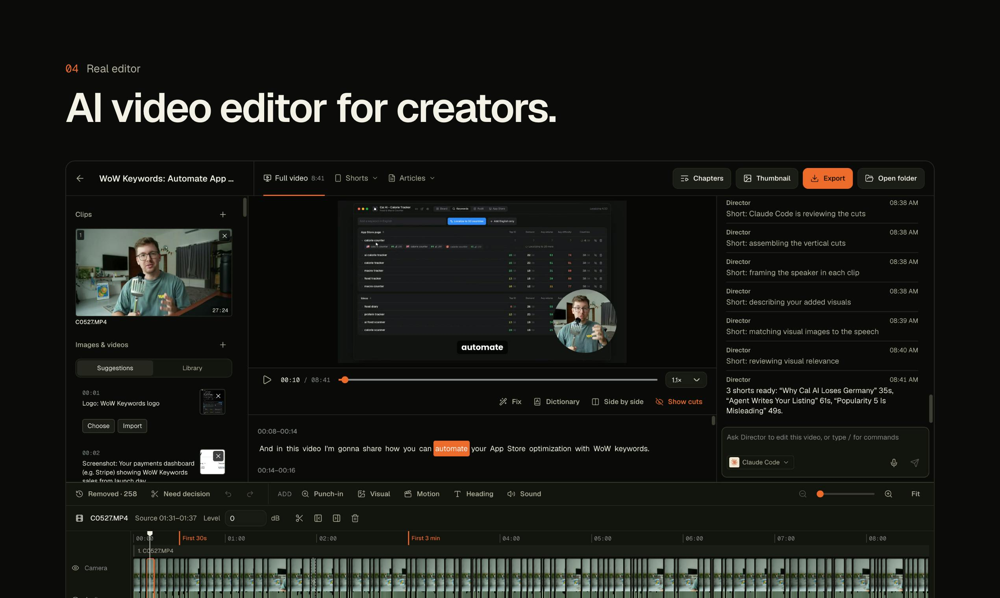

---

## 18. [CozyZip](https://www.producthunt.com/products/cozyzip)
**Votes**: 75 | **도입 난이도**: 하 | **신뢰도**: 상
**Tagline**: Zip and unzip without the surprises.
**서비스 링크**: https://www.producthunt.com/r/2CKD2BRRKXSHKX

**태그**: DevTool, macOS, Utility, Terminal, AI Tool, Email

### 📌 이 서비스 한눈에 보기
터미널과 MCP를 지원하는 맥 전용 아카이브 관리 도구

### 🔑 주요 기능
- macOS 터미널 및 로컬 MCP 도구 환경 지원
- 압축 파일 미리보기, 생성 및 추출 기능 제공
- 개인용 평생 무료 라이선스 제공 (이메일 인증 필요)

### 🙋 사용자에게 어떤 점이 좋은가
터미널 환경을 선호하는 개발자나 파워 유저가 별도의 복잡한 과정 없이 빠르고 안전하게 압축 파일을 관리할 수 있습니다.

### ✅ 지금 바로 써볼 기능
- 이메일 인증을 통한 평생 무료 라이선스 확보
- 터미널 환경에서의 압축/해제 워크플로우 테스트
- Apple Silicon 환경에서의 성능 확인

### ⚠️ 사용 전 확인할 점
- macOS 26+ 및 Apple Silicon 환경 전용
- 상업적 이용 시 인당 5달러의 비용 발생

### 🧭 확인이 더 필요한 정보
설명에 명시된 macOS 26+ 버전이 현재 출시된 버전과 차이가 있어 정확한 지원 OS 버전을 확인해야 합니다.

### 📸 스크린샷 및 갤러리
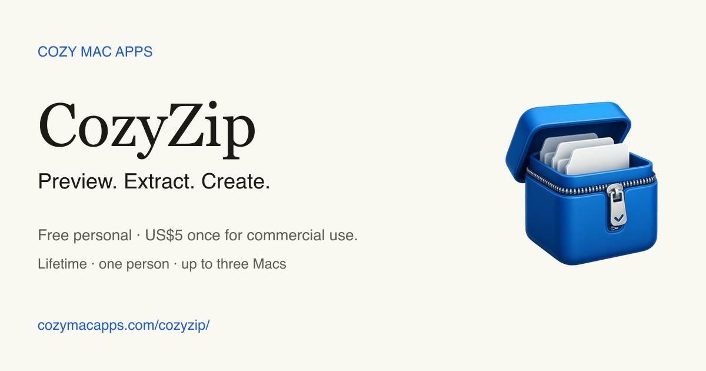
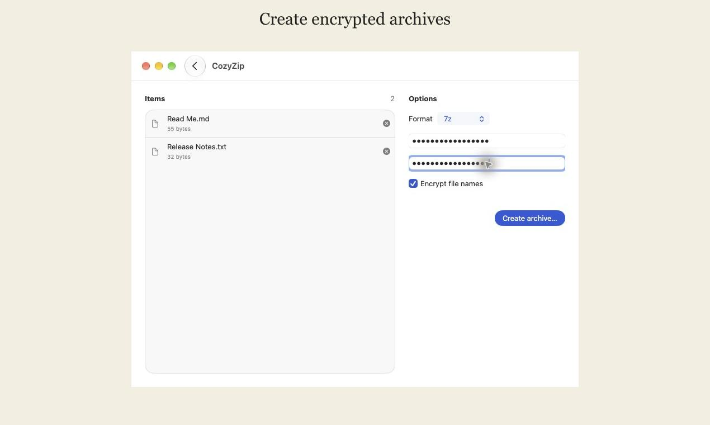
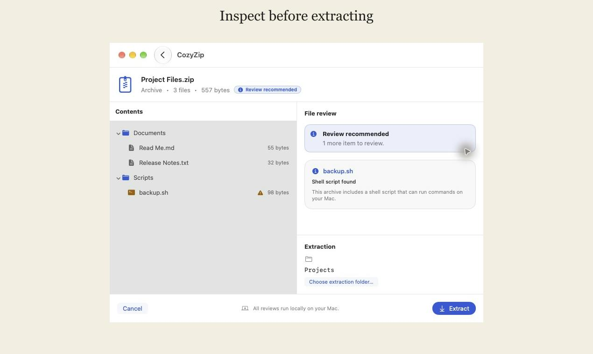

### 🎬 관련 영상
- [🎥 영상 보기](https://ph-files.imgix.net/3fff0c1e-6667-443f-980d-68751a386aa1.jpeg?auto=format)

---

## 19. [Calmly Script](https://www.producthunt.com/products/calmly-script)
**Votes**: 72 | **도입 난이도**: 하 | **신뢰도**: 상
**Tagline**: Beautiful screenwriting software. Pay once, no sign-up
**서비스 링크**: https://www.producthunt.com/r/6RIZCMSLZQC377

**태그**: Writing, Productivity, Creative-Tools, No-Subscription

### 📌 이 서비스 한눈에 보기
계정 생성 없이 한 번의 결제로 평생 사용하는 아름답고 전문적인 시나리오 작성 소프트웨어

### 🔑 주요 기능
- 업계 표준 규격의 페이지 레이아웃 및 Final Draft 파일 호환
- 계정 가입이나 트래킹이 없는 개인정보 보호 중심 설계
- Windows, Mac, Linux, Android를 지원하는 폭넓은 호환성

### 🙋 사용자에게 어떤 점이 좋은가
구독형 모델의 번거로움 없이 한 번의 구매로 전문적인 시나리오 작업 환경을 구축할 수 있습니다.

### ✅ 지금 바로 써볼 기능
- 자신의 운영체제에서 설치 및 실행 확인
- 기존 Final Draft 파일과의 호환성 테스트
- 오픈 포맷을 통한 데이터 백업 및 관리 확인

### ⚠️ 사용 전 확인할 점
- 클라우드 동기화 기능 여부 확인 필요 (계정 미사용 시 기기 간 동기화 방식 확인)
- 모바일 환경에서의 편집 편의성 검토

### 🧭 확인이 더 필요한 정보
계정 없이 기기 간 데이터 동기화가 어떻게 이루어지는지 확인이 필요합니다.

### 📸 스크린샷 및 갤러리
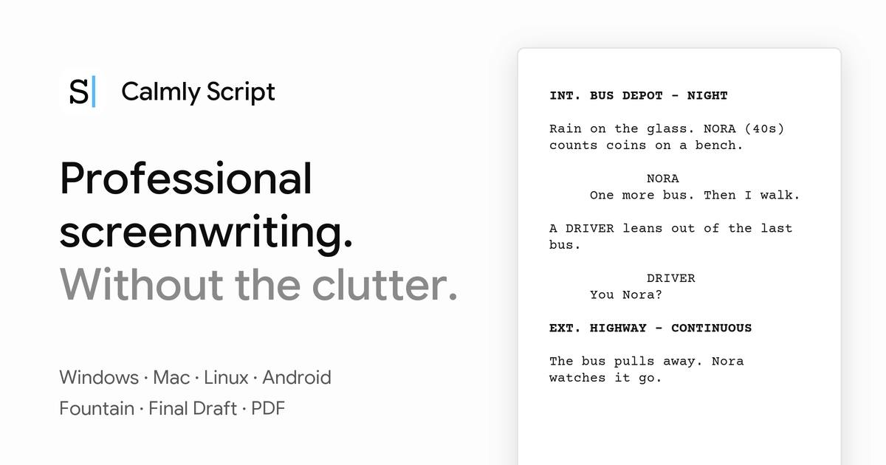
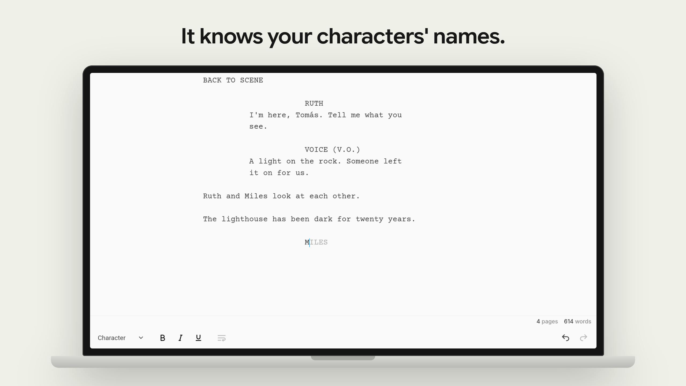
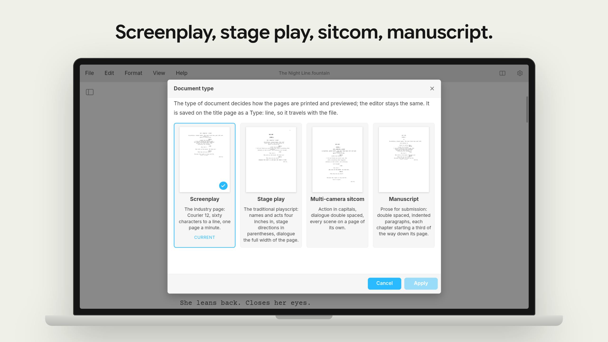

---

## 20. [Nörth](https://www.producthunt.com/products/north-5)
**Votes**: 71 | **도입 난이도**: 하 | **신뢰도**: 상
**Tagline**: Natural, peer-to-peer collaboration for remote work
**서비스 링크**: https://www.producthunt.com/r/UFFKJUM2Z66PY7

**태그**: Remote Work, Collaboration, Privacy, macOS, Communication, Chat, Video

### 📌 이 서비스 한눈에 보기
공간 음향 기반의 P2P 협업 툴로, 보안과 자연스러운 소통을 동시에 제공하는 macOS 전용 워크스페이스

### 🔑 주요 기능
- 공간 음향(Spatial Voice) 기반의 자연스러운 음성 채팅
- P2P 방식의 종단간 암호화(E2EE)를 통한 강력한 보안
- macOS 네이티브 앱으로 최적화된 사용자 경험

### 🙋 사용자에게 어떤 점이 좋은가
원격 근무 중에도 마치 같은 공간에 있는 듯한 현장감을 제공하며, 보안 걱정 없이 팀원들과 즉각적인 소통이 가능합니다.

### ✅ 지금 바로 써볼 기능
- 드롭인 룸(Drop-in rooms) 기능을 통한 즉각적인 팀 미팅
- 음성 및 비디오 메시징을 활용한 비동기 협업
- macOS 환경에서의 네이티브 성능 체감하기

### ⚠️ 사용 전 확인할 점
- macOS 전용 앱이므로 Windows나 Linux 사용자는 사용이 제한될 수 있음
- P2P 방식 특성상 네트워크 환경에 따라 연결 안정성이 달라질 수 있음

### 🧭 확인이 더 필요한 정보
Windows 지원 여부와 모바일 앱 제공 여부에 대한 정보가 명시되지 않았습니다.

### 📸 스크린샷 및 갤러리
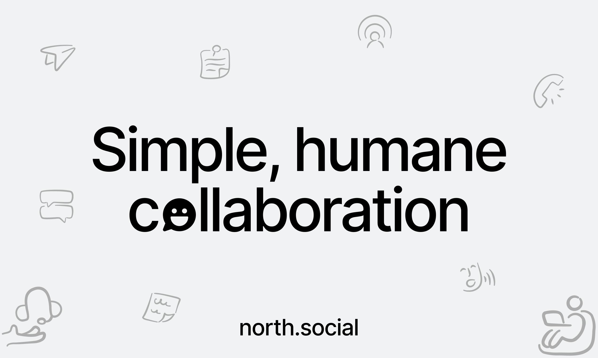
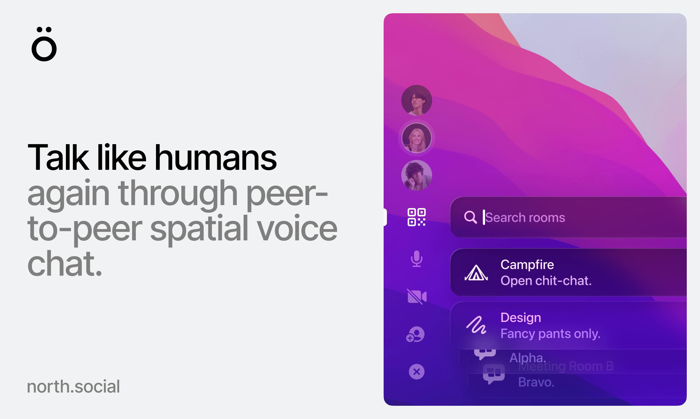
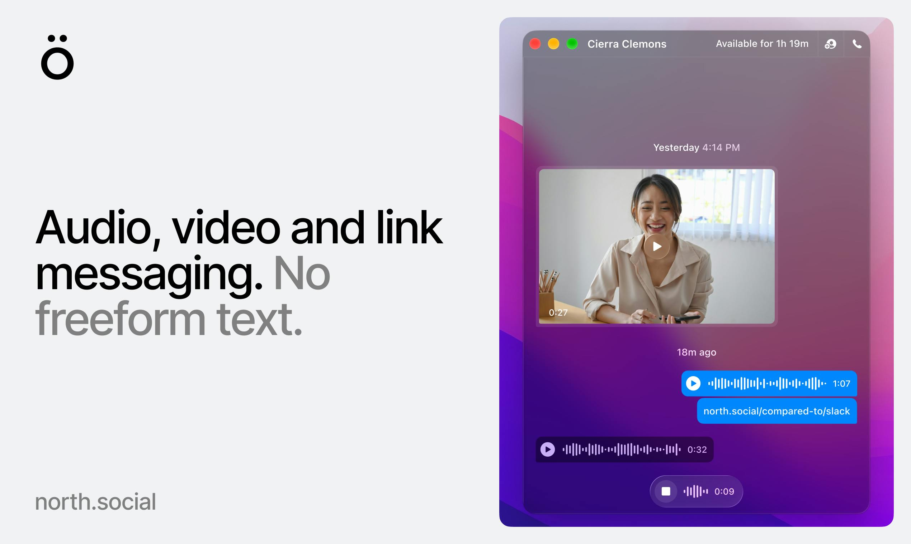

### 🎬 관련 영상
- [🎥 영상 보기](https://ph-files.imgix.net/5726e5c1-719a-4282-a631-ed54c5641254.jpeg?auto=format)

---

## 21. [KIKUmap](https://www.producthunt.com/products/kikumap)
**Votes**: 70 | **도입 난이도**: 하 | **신뢰도**: 상
**Tagline**: A mind map for your Claude and ChatGPT chats
**서비스 링크**: https://www.producthunt.com/r/XMX3JQVFJA3QFR

**태그**: Productivity, AI, macOS, MindMap, OpenSource, AI Tool, Chat

### 📌 이 서비스 한눈에 보기
Claude와 ChatGPT 대화 내역을 마인드맵 형태로 시각화하여 관리하는 macOS 앱

### 🔑 주요 기능
- macOS 메뉴바 및 데스크톱 위젯 지원
- 진행 중, 완료, 대기 중인 AI 채팅 상태 관리
- AI 대화 흐름을 마인드맵 구조로 시각적 정리

### 🙋 사용자에게 어떤 점이 좋은가
여러 개의 AI 채팅창을 오가는 복잡한 작업 흐름을 한눈에 파악하고 구조적으로 정리할 수 있습니다.

### ✅ 지금 바로 써볼 기능
- 메뉴바 앱 설치 후 대화 상태 확인하기
- 데스크톱 위젯을 통해 실시간 채팅 현황 모니터링하기
- 마인드맵 기능을 활용해 대화 흐름 구조화하기

### ⚠️ 사용 전 확인할 점
- macOS 전용 앱이므로 다른 운영체제에서는 사용 불가
- AI 서비스(Claude, ChatGPT)와의 연동 방식에 따른 보안/개인정보 확인 필요

### 🧭 확인이 더 필요한 정보
Claude 및 ChatGPT 계정과의 구체적인 데이터 연동 방식(API 사용 여부 등)에 대한 상세 정보가 필요합니다.

### 📸 스크린샷 및 갤러리

### 🎬 관련 영상
- [🎥 영상 보기](https://ph-files.imgix.net/3bba447e-4dea-43f7-b470-6f5073fdf3af.jpeg?auto=format)

---

## 22. [Flic Cue](https://www.producthunt.com/products/flic-cue)
**Votes**: 69 | **도입 난이도**: 하 | **신뢰도**: 상
**Tagline**: The AI Voice Button: hold to talk, shake to undo, open SDKs
**서비스 링크**: https://www.producthunt.com/r/YOS4KYUMYVQN4I

**태그**: Productivity, AI, Automation, Voice-to-Text, Agent, AI Tool, Chat

### 📌 이 서비스 한눈에 보기
말 한마디로 일정, 메모, AI 에이전트 작업을 즉시 실행하는 AI 음성 버튼

### 🔑 주요 기능
- 음성 입력을 통해 리스트, 캘린더, 메모 등에 자동 기록 및 분류
- ChatGPT, Claude 등 AI 에이전트와 연동하여 복잡한 작업 수행
- 흔들기(Undo), 스와이프(Copy) 등 직관적인 제스처로 제어 가능

### 🙋 사용자에게 어떤 점이 좋은가
스마트폰이나 키보드를 만지지 않고도 생각나는 즉시 기록하고 AI에게 명령을 내릴 수 있어 생산성을 극대화합니다.

### ✅ 지금 바로 써볼 기능
- 음성으로 일정 및 메모 자동 저장하기
- AI 에이전트(ChatGPT/Claude)에 작업 지시하기
- 제스처를 활용한 텍스트 편집 및 실행

### ⚠️ 사용 전 확인할 점
- 음성 인식 정확도 및 주변 소음 환경에 따른 성능 차이
- 연동되는 외부 서비스(AI, 캘린더 등)의 계정 설정 필요성

### 🧭 확인이 더 필요한 정보
하드웨어 형태인지 소프트웨어 전용 앱인지에 대한 구체적인 물리적 형태 정보가 필요합니다.

### 📸 스크린샷 및 갤러리

### 🎬 관련 영상
- [🎥 영상 보기](https://ph-files.imgix.net/24f5445d-dfec-4fb0-9f8a-35d2a585f1de.jpeg?auto=format)

---

## 23. [Cue](https://www.producthunt.com/products/cue-voice-keyboard)
**Votes**: 68 | **도입 난이도**: 하 | **신뢰도**: 상
**Tagline**: AI meeting notes, prep
**서비스 링크**: https://www.producthunt.com/r/5SBGMZLYSLZJ6Y

**태그**: Productivity, AI, Automation, macOS, AI Tool

### 📌 이 서비스 한눈에 보기
회의 준비부터 기록, 사후 작업까지 전 과정을 지원하는 macOS용 AI 비서

### 🔑 주요 기능
- 회의 전 사전 준비, 회의 중 가이드, 회의 후 후속 작업 자동화
- 화면 내용 인식 및 대화형 질의응답 기능
- 어떤 앱에서도 음성을 텍스트로 변환하는 타이핑 지원

### 🙋 사용자에게 어떤 점이 좋은가
회의 전후의 번거로운 행정 업무를 자동화하여 업무 집중도를 높이고, 회의 중 실시간 가이드를 통해 효율적인 의사결정을 돕습니다.

### ✅ 지금 바로 써볼 기능
- 회의 전 사전 브리핑 기능 활용하기
- 실시간 회의 노트 및 가이드 기능 실행하기
- 회의 후 자동 생성된 후속 작업 초안 검토하기

### ⚠️ 사용 전 확인할 점
- 화면 내용을 읽는 기능에 따른 개인정보 및 보안 주의 필요
- macOS 전용 앱이므로 타 OS 사용 시 제약 발생

### 🧭 확인이 더 필요한 정보
상세한 보안 정책 및 데이터 처리 방식에 대한 확인이 필요합니다.

### 📸 스크린샷 및 갤러리

---

## 24. [skuttr](https://www.producthunt.com/products/skuttr)
**Votes**: 67 | **도입 난이도**: 하 | **신뢰도**: 상
**Tagline**: Type one sentence, get a Reel from your camera roll
**서비스 링크**: https://www.producthunt.com/r/A22WKGECFC3LY5

**태그**: AI, Video Editing, Automation, Content Creation, Video

### 📌 이 서비스 한눈에 보기
한 문장만 입력하면 아이폰 사진으로 릴스를 자동 제작해주는 서비스

### 🔑 주요 기능
- 텍스트 한 줄로 맞춤형 릴스 생성
- 아이폰 카메라 롤 내 적합한 사진/영상 자동 탐색
- 가장 임팩트 있는 장면을 첫 화면에 배치하는 자동 편집

### 🙋 사용자에게 어떤 점이 좋은가
직접 편집할 필요 없이 키워드만 입력하면 1분 안에 고퀄리티 릴스를 만들 수 있어 콘텐츠 제작 시간을 획기적으로 줄여줍니다.

### ✅ 지금 바로 써볼 기능
- 첫 5개의 무료 릴스 생성 기능 체험하기
- 특정 여행 테마로 문장 입력해보기

### ⚠️ 사용 전 확인할 점
- 무료 제공량(5회) 소진 후 유료 전환 여부 확인 필요
- 아이폰 카메라 롤 접근 권한 필요

### 🧭 확인이 더 필요한 정보
무료 제공 5회 이후의 구체적인 요금 체계와 편집 커스텀 가능 범위가 명시되지 않았습니다.

### 📸 스크린샷 및 갤러리

### 🎬 관련 영상
- [🎥 영상 보기](https://ph-files.imgix.net/90c1649a-57a5-479c-a3e0-1ed592a7ea9b.jpeg?auto=format)

---

## 25. [Terse - Durable Actors](https://www.producthunt.com/products/terse-durable-actors)
**Votes**: 67 | **도입 난이도**: 중 | **신뢰도**: 상
**Tagline**: Infrastructure for Multiplayer AI Products
**서비스 링크**: https://www.producthunt.com/r/ROXU7IJ6D26JLM

**태그**: DevTool, AI, Infrastructure, OpenSource, Realtime, Agent, AI Tool

### 📌 이 서비스 한눈에 보기
멀티플레이어 AI 서비스를 위한 오픈소스 기반의 분산 인프라 솔루션

### 🔑 주요 기능
- Cloudflare Durable Objects의 오픈소스 대안 제공
- 개별 에이전트/리소스마다 독립적인 Micro-VM과 SQLite DB 할당
- 단일 요청 처리 방식을 통한 선천적 동시성 안전성 확보

### 🙋 사용자에게 어떤 점이 좋은가
멀티플레이어 기능이 필요한 AI 에이전트나 협업 도구를 개발할 때, 복잡한 서버 인프라 구축 없이 확장 가능하고 비용 효율적인 환경을 제공합니다.

### ✅ 지금 바로 써볼 기능
- Micro-VM 기반의 에이전트 격리 환경 테스트
- WebSocket을 활용한 실시간 이벤트 통신 구현
- SQLite가 포함된 분산 상태 관리 워크플로우 설계

### ⚠️ 사용 전 확인할 점
- 단일 요청 처리 방식에 따른 대규모 트래픽 처리 시 병목 가능성 검토 필요
- 오픈소스 프로젝트로서의 운영 안정성 및 커뮤니티 지원 수준 확인 필요

### 🧭 확인이 더 필요한 정보
실제 대규모 클러스터 환경에서의 확장성(Scalability)과 관리 오버헤드에 대한 구체적인 데이터가 필요합니다.

### 📸 스크린샷 및 갤러리

### 🎬 관련 영상
- [🎥 영상 보기](https://ph-files.imgix.net/4f573117-0f23-4696-8c54-e0750d6223bb.jpeg?auto=format)

---

## 26. [Lingoken](https://www.producthunt.com/products/lingoken)
**Votes**: 28 | **도입 난이도**: 하 | **신뢰도**: 상
**Tagline**: The activity maker for language teachers
**서비스 링크**: https://www.producthunt.com/r/KW6OASBBKGBHCC

**태그**: EdTech, AI, LanguageLearning, Gamification, TeacherTools, AI Tool

### 📌 이 서비스 한눈에 보기
AI를 활용해 맞춤형 언어 학습 게임을 즉시 생성하는 교사용 활동 제작 도구

### 🔑 주요 기능
- AI 기반의 쉽고 빠른 언어 학습 게임 생성
- 학생 수준, 시험 유형, 이민 요구사항에 맞춘 맞춤형 커스터마이징
- 수업 중 그룹 참여를 유도하는 재미있는 활동 제공

### 🙋 사용자에게 어떤 점이 좋은가
교사가 매주 소요하던 활동 제작 시간을 획기적으로 줄여주며, 학생들에게는 놀이처럼 즐거운 학습 경험을 제공합니다.

### ✅ 지금 바로 써볼 기능
- 학생 수준별 맞춤형 게임 생성해보기
- 특정 시험 목적에 맞춘 학습 자료 만들기
- 수업 중 그룹 활동용 게임 실행하기

### ⚠️ 사용 전 확인할 점
- AI 생성 콘텐츠의 정확성 및 교육적 적합성 검토 필요
- 수업 환경(인터넷, 기기 등)에 따른 실행 제약 확인

### 🧭 확인이 더 필요한 정보
AI가 생성하는 콘텐츠의 세부 품질과 특정 시험 유형에 대한 전문성 수준을 확인해야 합니다.

### 📸 스크린샷 및 갤러리

### 🎬 관련 영상
- [🎥 영상 보기](https://ph-files.imgix.net/20ab9e31-875d-45fe-94ce-473c7577053f.jpeg?auto=format)

---

## 27. [Reduck](https://www.producthunt.com/products/reduck-ai)
**Votes**: 26 | **도입 난이도**: 중 | **신뢰도**: 상
**Tagline**: Fast, reliable web access for your AI agents and n8n
**서비스 링크**: https://www.producthunt.com/r/GGNFB4TISYAQ4H

**태그**: Automation, AI, WebScraping, n8n, DevTool, Agent, AI Tool, API

### 📌 이 서비스 한눈에 보기
AI 에이전트와 n8n을 위한 고속·저비용 웹 자동화 스크립트 실행 도구

### 🔑 주요 기능
- 한 번 작성한 스크립트 재사용으로 토큰 소모 없이 빠른 웹 데이터 접근 가능
- 사용자의 기존 크롬 세션을 활용하여 로그인된 상태로 웹사이트 제어
- API가 없는 사이트(LinkedIn, Discord 등)를 위한 자동화 솔루션 제공

### 🙋 사용자에게 어떤 점이 좋은가
매번 웹 페이지를 직접 탐색하며 토큰을 낭비하는 대신, 미리 작성된 스크립트를 통해 빠르고 일관된 구조화된 데이터를 얻을 수 있습니다.

### ✅ 지금 바로 써볼 기능
- n8n 노드에 연결하여 워크플로우 자동화하기
- 기존 AI 에이전트(Claude 등)에 스크립트 기반 웹 액세스 적용하기
- API가 없는 웹사이트의 데이터 추출 테스트하기

### ⚠️ 사용 전 확인할 점
- 사용자의 크롬 브라우저 세션에 의존하므로 브라우저 상태에 영향을 받을 수 있음
- 스크립트 기반 방식이므로 웹사이트 구조 변경 시 유지보수가 필요할 수 있음

### 🧭 확인이 더 필요한 정보
사용자 브라우저 세션 공유 방식의 보안 정책 및 스크립트 실행 환경에 대한 상세 기술 사양 확인이 필요합니다.

### 📸 스크린샷 및 갤러리

### 🎬 관련 영상
- [🎥 영상 보기](https://ph-files.imgix.net/2640d6b6-13ba-4d65-aef6-06c0428b8801.jpeg?auto=format)

---

## 28. [CookieYes for Shopify](https://www.producthunt.com/products/cookieyes-for-shopify)
**Votes**: 18 | **도입 난이도**: 하 | **신뢰도**: 상
**Tagline**: Built for Shopify cookie consent in your admin. 100% free.
**서비스 링크**: https://www.producthunt.com/r/EBLEPT3LTTQ7IA

**태그**: Shopify, Compliance, Privacy, Marketing

### 📌 이 서비스 한눈에 보기
Shopify 관리자 페이지에서 간편하게 관리하는 무료 쿠키 동의 솔루션

### 🔑 주요 기능
- Shopify 관리자 내에서 직접 관리 가능한 'Built for Shopify' 인증 앱
- 지역별 맞춤형 쿠키 배너 및 자동 차단 기능 제공
- Consent Mode v2 및 동의 로그 관리 지원

### 🙋 사용자에게 어떤 점이 좋은가
별도의 외부 설정 없이 Shopify 관리자 내에서 모든 쿠키 동의 절차를 처리할 수 있어 운영 효율성이 높습니다.

### ✅ 지금 바로 써볼 기능
- Shopify 관리자에서 앱 설치 및 연동
- 지역별 쿠키 배너 설정 확인
- Consent Mode v2 활성화 여부 점검

### ⚠️ 사용 전 확인할 점
- 무료 기능 범위가 향후 유료로 전환될 가능성 확인 필요
- 특정 지역의 법적 요구사항 충족 여부 검토

### 🧭 확인이 더 필요한 정보
고급 기능의 완전한 무료 제공 범위와 향후 유료 플랜 전환 정책에 대한 확인이 필요합니다.

### 📸 스크린샷 및 갤러리

### 🎬 관련 영상
- [🎥 영상 보기](https://ph-files.imgix.net/2167fc70-34e7-4abf-b680-51b41a12fc2f.jpeg?auto=format)

---

## 29. [Claimr](https://www.producthunt.com/products/claimr)
**Votes**: 10 | **도입 난이도**: 하 | **신뢰도**: 상
**Tagline**: A free giveaways alert system
**서비스 링크**: https://www.producthunt.com/r/RNREGLL5GEBQWY

**태그**: Gaming, Alerts, Freebies, AI Tool

### 📌 이 서비스 한눈에 보기
주요 게임 플랫폼의 무료 배포 소식을 실시간으로 알려주는 알림 시스템

### 🔑 주요 기능
- Steam, Epic Games, GOG 등 주요 플랫폼 통합 추적
- PlayStation 및 Xbox 등 콘솔 플랫폼 지원
- 무료 게임 배포 정보를 놓치지 않게 돕는 레이더 시스템

### 🙋 사용자에게 어떤 점이 좋은가
여러 게임 스토어를 일일이 확인할 필요 없이, 무료로 게임을 받을 수 있는 기회를 즉시 포착할 수 있습니다.

### ✅ 지금 바로 써볼 기능
- 플랫폼별 알림 설정하기
- 주요 게임 스토어 연동 확인하기
- 실시간 알림 수신 설정하기

### ⚠️ 사용 전 확인할 점
- 알림 수신 방식(이메일, 푸시 등)에 대한 상세 정보 확인 필요
- 플랫폼별 계정 연동 필요 여부 확인 필요

### 🧭 확인이 더 필요한 정보
알림이 어떤 채널(앱 푸시, 이메일, Discord 등)을 통해 전달되는지 명시되어 있지 않습니다.

### 📸 스크린샷 및 갤러리

### 🎬 관련 영상
- [🎥 영상 보기](https://ph-files.imgix.net/0e326d69-3792-4c77-a424-9a620def4612.gif?auto=format)

---

## 30. [TGMini](https://www.producthunt.com/products/tgmini)
**Votes**: 10 | **도입 난이도**: 하 | **신뢰도**: 상
**Tagline**: Build a mini site behind a button in your Telegram channel
**서비스 링크**: https://www.producthunt.com/r/DR6GQKAT2FLZRO

**태그**: NoCode, Telegram, Marketing, Productivity, AI Tool, Video, Vision

### 📌 이 서비스 한눈에 보기
텔레그램 채널 내에서 클릭 한 번으로 나만의 미니 사이트를 구축하고 독자와 소통하세요.

### 🔑 주요 기능
- 텔레그램 메뉴 버튼을 활용한 간편한 미니 사이트 구축
- 링크, 이미지, 텍스트, 비디오 블록을 자유롭게 배치하는 커스텀 레이아웃
- 방문자 메시지 수신 및 봇을 통한 실시간 답장 기능

### 🙋 사용자에게 어떤 점이 좋은가
별도의 웹사이트 구축 없이 텔레그램 사용자들에게 전문적인 링크 모음 페이지나 콘텐츠를 즉시 제공할 수 있습니다.

### ✅ 지금 바로 써볼 기능
- 무료 사이트를 생성하여 기본 레이아웃 구성하기
- 핀 고정된 포스트에 메뉴 버튼 연결하기
- 대시보드에서 방문자 및 클릭 데이터 확인하기

### ⚠️ 사용 전 확인할 점
- 메시지 수신 및 추가 링크 생성은 유료 플랜에서만 가능할 수 있음
- 사용자 메시지 기능은 유료 사이트에서만 제공됨

### 🧭 확인이 더 필요한 정보
무료 플랜과 유료 플랜 간의 구체적인 기능 제한 범위와 가격 정책 확인이 필요합니다.

### 📸 스크린샷 및 갤러리

---

