# 🚀 Product Hunt Daily Top 30 (2026-11-11)

## 오늘의 요약
오늘의 트렌드는 단순한 자동화를 넘어, 사용자의 의도를 이해하고 복잡한 워크플로우를 스스로 수행하는 '에이전트(Agent)' 중심의 서비스들이 주를 이루었습니다. 영업, 마케팅, QA, 회계 등 전문적인 업무 영역에서 인간의 개입을 최소화하면서도 정교한 판단을 내리는 지능형 도구들이 주목받았습니다.

### 오늘의 핵심 포인트
- 단순 반복 업무를 넘어 복잡한 비즈니스 로직과 예외 상황을 처리하는 에이전트 기술이 각 산업 분야에 적용되고 있습니다.
- 코드 리뷰, 광고 최적화, QA 등 전문 지식이 필요한 영역에서 AI가 팀원의 역할을 수행하며 생산성을 극대화합니다.
- 사용자 경험 측면에서 폴더블 기기 최적화나 직관적인 UI를 통해 AI 도구의 접근성과 활용도를 높이는 시도가 나타났습니다.

**오늘의 태그**: AI 에이전트, 업무 자동화, 생산성 도구, B2B SaaS

## 1. [Alsona](https://www.producthunt.com/products/alsona)
**Votes**: 309 | **도입 난이도**: 중 | **신뢰도**: 상
**Tagline**: AI agents that turn buying signals into booked sales calls
**서비스 링크**: https://www.producthunt.com/r/6777NBXG6GHZDS

**태그**: SalesTech, AI, Automation, LeadGeneration, Agent, AI Tool, Sales, Email

### 📌 이 서비스 한눈에 보기
구매 의사가 있는 잠재 고객을 식별하고 자동화된 아웃리치로 미팅을 예약하는 AI 영업 에이전트

### 🔑 주요 기능
- 채용, 투자, 기술 변화 등 32개 이상의 신호를 통한 구매 의도 추적
- ICP(이상적 고객 프로필) 기반의 기업 점수 산정 및 타겟팅 근거 제공
- AI 에이전트를 활용한 개인화된 LinkedIn 및 이메일 아웃리치 자동화

### 🙋 사용자에게 어떤 점이 좋은가
구매 준비가 된 5%의 핵심 잠재 고객을 정확히 찾아내어, 영업 리소스를 낭비하지 않고 미팅 예약 성공률을 높일 수 있습니다.

### ✅ 지금 바로 써볼 기능
- 32개 이상의 구매 신호 트래킹 기능 확인
- 자사 ICP에 맞춘 기업 스코어링 설정
- AI 기반 개인화 아웃리치 메시지 생성 테스트

### ⚠️ 사용 전 확인할 점
- 자동화된 메시지가 스팸으로 인식되지 않도록 개인화 품질 관리 필요
- 설정된 ICP와 실제 데이터 간의 정합성 검증 필요

### 🧭 확인이 더 필요한 정보
현재 제공되는 아웃리치 채널의 범위와 기존 CRM과의 연동 가능 여부를 확인해야 합니다.

### 📸 스크린샷 및 갤러리

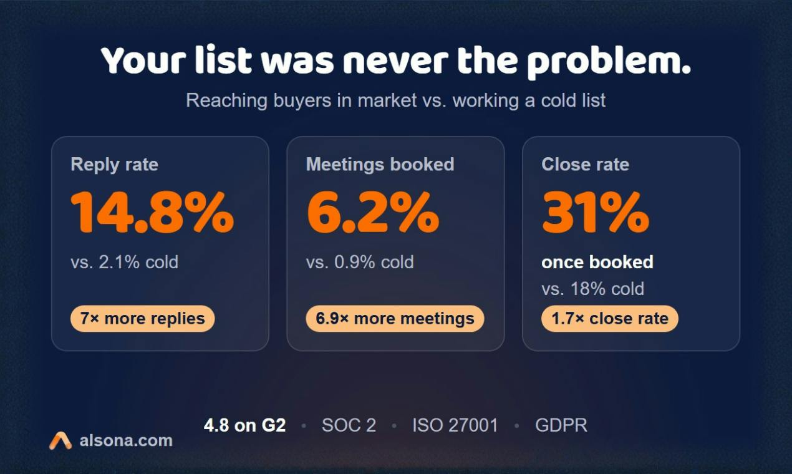
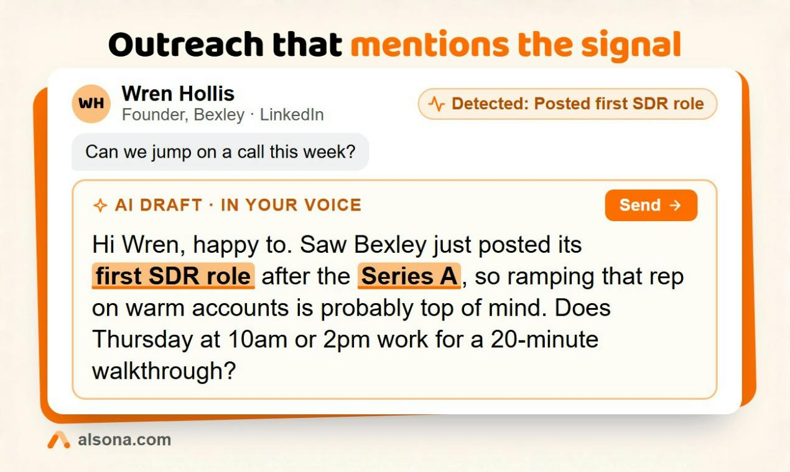

### 🎬 관련 영상
- [🎥 영상 보기](https://ph-files.imgix.net/fdfa2e91-beed-413d-8292-a9b9801f4c68.gif?auto=format)

---

## 2. [Maxma](https://www.producthunt.com/products/maxma-2)
**Votes**: 245 | **도입 난이도**: 중 | **신뢰도**: 상
**Tagline**: The 24/7 AI teammate that scales your paid ad performance
**서비스 링크**: https://www.producthunt.com/r/GQHET4C6E2F2ZS

**태그**: MarketingAutomation, AI, AdTech, GrowthHacking, AI Tool, Chat

### 📌 이 서비스 한눈에 보기
광고 분석부터 캠페인 실행까지 수행하는 24/7 AI 퍼포먼스 마케팅 팀원

### 🔑 주요 기능
- 분석, 소재 제작, 랜딩 페이지 구축, 캠페인 최적화까지 광고 전 과정을 자동화
- Slack을 통해 팀원처럼 소통하며 제안 및 승인 프로세스 제공
- Google, Meta, TikTok, LinkedIn 등 주요 광고 채널 통합 관리

### 🙋 사용자에게 어떤 점이 좋은가
적은 인원으로도 대규모 유료 광고 캠페인을 효율적으로 운영하고 성과를 극대화할 수 있습니다.

### ✅ 지금 바로 써볼 기능
- Slack 연동을 통한 실시간 광고 제안 확인하기
- 기존 광고 채널(Google, Meta 등) 연결 및 데이터 분석 시작하기
- AI가 생성한 광고 소재 및 랜딩 페이지 검토하기

### ⚠️ 사용 전 확인할 점
- AI의 제안이 실제 비즈니스 전략과 일치하는지 승인 과정에서의 검토 필요
- 광고 예산 및 채널별 성과에 대한 최종 책임은 사용자에게 있음

### 🧭 확인이 더 필요한 정보
각 광고 채널별 구체적인 API 연동 범위와 자동화 수준에 대한 상세 정보가 필요합니다.

### 📸 스크린샷 및 갤러리
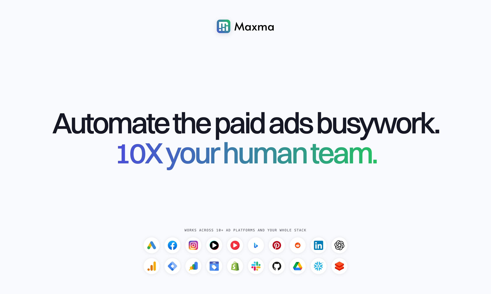
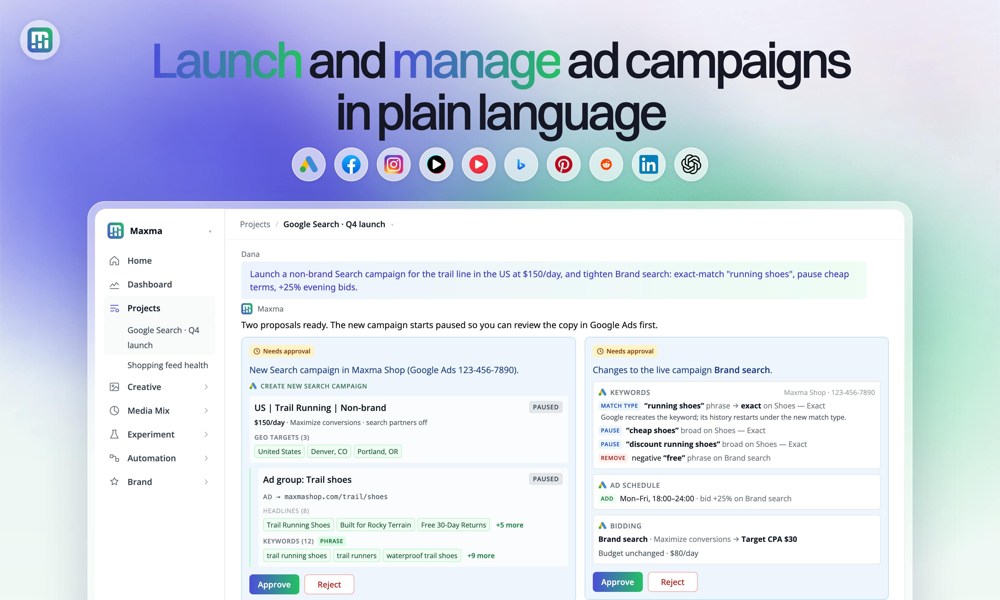
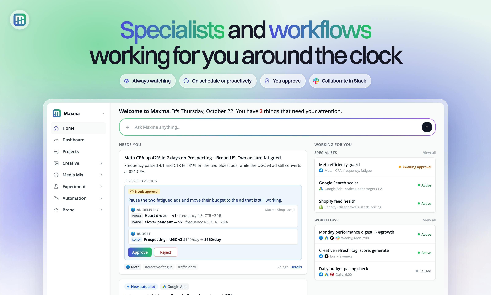

---

## 3. [Latch.ai](https://www.producthunt.com/products/latch-ai-2)
**Votes**: 184 | **도입 난이도**: 하 | **신뢰도**: 상
**Tagline**: Automate complex accounting work without a single prompt
**서비스 링크**: https://www.producthunt.com/r/LMHIUZD4KWZDR5

**태그**: Automation, Accounting, AI, Productivity, AI Tool, Prompting

### 📌 이 서비스 한눈에 보기
복잡한 회계 업무를 프롬프트 입력 없이 화면 작업과 대화만으로 자동화하는 AI 사이드킥

### 🔑 주요 기능
- 프롬프트 작성 대신 화면 작업과 대화를 통한 직관적인 자동화 구축
- SOP(표준운영절차)에 담기 어려운 예외 상황과 숙련된 판단 로직 반영
- 기존 업무 도구 내에서 실행되며 모든 단계가 로그로 기록되는 투명성

### 🙋 사용자에게 어떤 점이 좋은가
반복적이고 클릭이 많은 회계 결산 업무를 자동화하여, 숙련된 전문가의 판단이 필요한 예외 상황에만 집중할 수 있게 해줍니다.

### ✅ 지금 바로 써볼 기능
- 반복적인 결산 작업 시나리오 준비
- 화면 조작과 대화를 통한 업무 흐름 학습시키기
- 생성된 자동화 로직의 로그 검토 및 예외 처리 테스트

### ⚠️ 사용 전 확인할 점
- 사용 중인 기존 회계 소프트웨어와의 호환성 및 보안 정책 확인 필요
- AI가 학습한 로직이 실제 회계 규정과 일치하는지 검증 필요

### 🧭 확인이 더 필요한 정보
현재 제공되는 구체적인 보안 프로토콜과 기존 ERP/회계 툴과의 기술적 통합 방식에 대한 정보가 부족합니다.

### 📸 스크린샷 및 갤러리
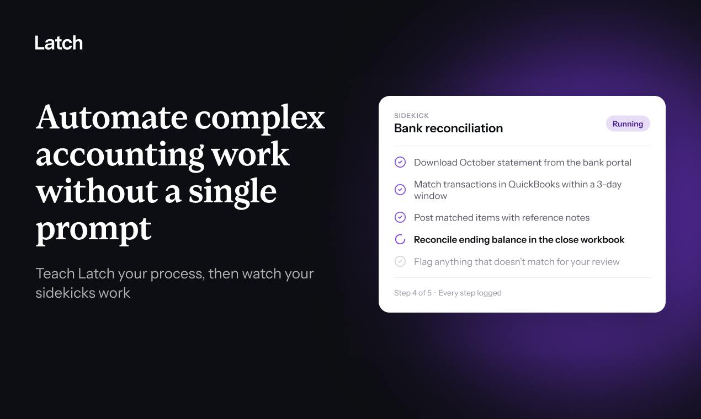
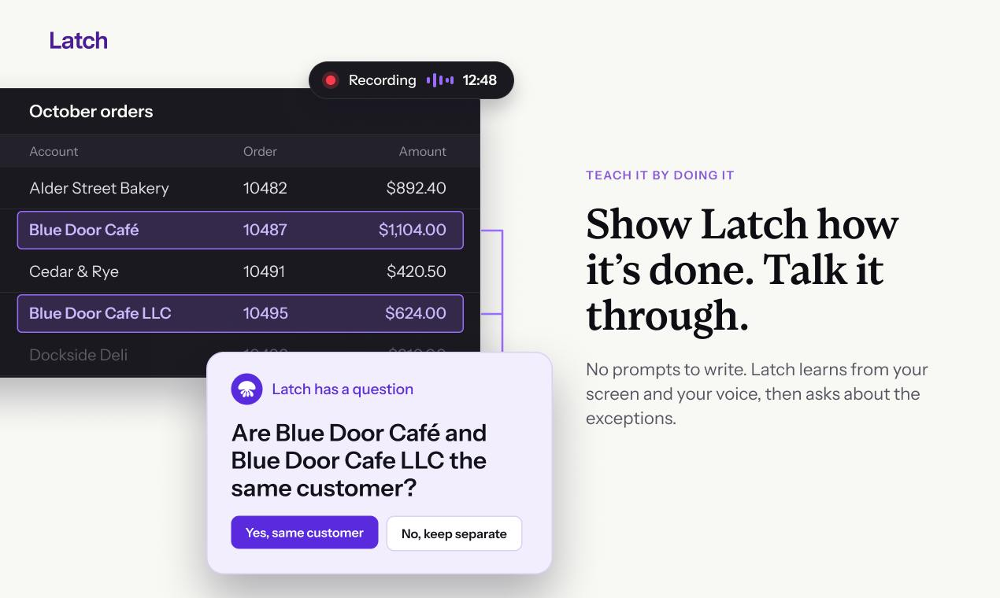
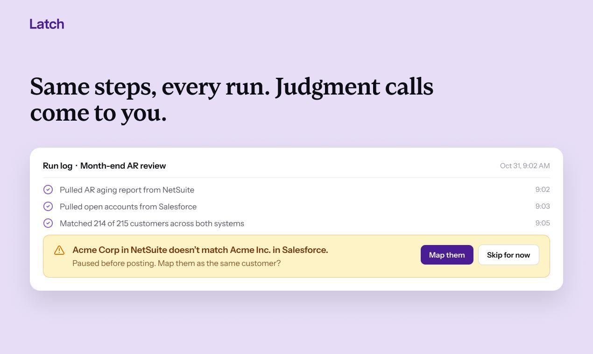

### 🎬 관련 영상
- [🎥 영상 보기](https://ph-files.imgix.net/9bbdfe71-f3be-4d1b-b1b9-200f28eefd9a.jpeg?auto=format)

---

## 4. [Opal Reader](https://www.producthunt.com/products/opal-reader)
**Votes**: 178 | **도입 난이도**: 하 | **신뢰도**: 상
**Tagline**: Read PDFs and EPUBs on iPhone Duo
**서비스 링크**: https://www.producthunt.com/r/O24YA6ZJ2ASOV6

**태그**: Reader, Productivity, eBook, Foldable, AI Tool

### 📌 이 서비스 한눈에 보기
독서와 노트 작성을 동시에 즐길 수 있는 iPhone Duo 최적화 PDF/EPUB 리더

### 🔑 주요 기능
- PDF 및 EPUB 파일 읽기 지원
- 화면 한쪽에는 책을, 다른 쪽에는 노트를 배치하는 분할 뷰 제공
- iPhone Duo의 폴더블 폼팩터에 최적화된 사용자 경험

### 🙋 사용자에게 어떤 점이 좋은가
폴더블 기기에서 독서와 메모를 번갈아 전환할 필요 없이 한 화면에서 효율적으로 처리할 수 있습니다.

### ✅ 지금 바로 써볼 기능
- iPhone Duo에서 분할 화면 레이아웃 확인하기
- PDF/EPUB 파일을 불러와 노트 기능 테스트하기
- 기기를 접고 펼 때의 읽기 연속성 경험하기

### ⚠️ 사용 전 확인할 점
- iPhone Duo 외 일반 iPhone/iPad에서의 레이아웃 차이 확인 필요
- 노트 기능의 저장 방식 및 동기화 범위 확인 필요

### 🧭 확인이 더 필요한 정보
iPhone Duo 외 일반 모바일 기기에서의 상세 UI 최적화 수준은 명시되지 않았습니다.

### 📸 스크린샷 및 갤러리
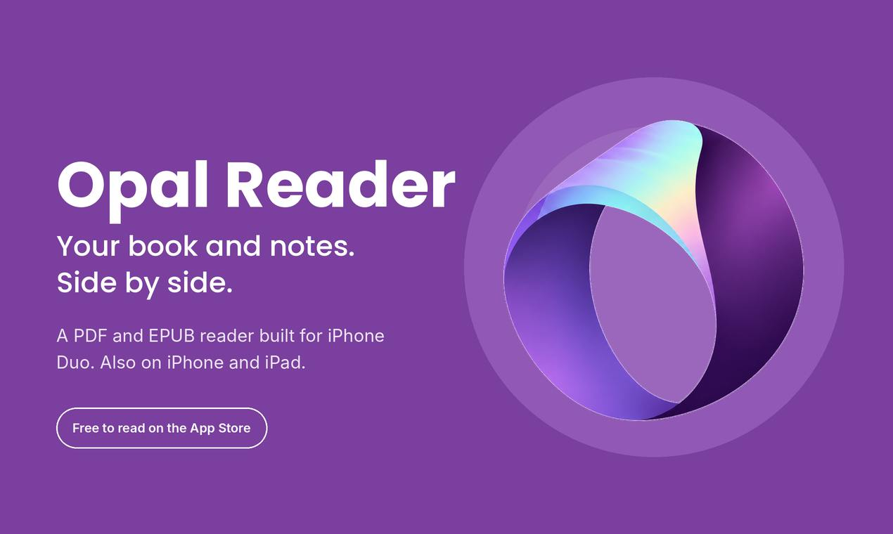
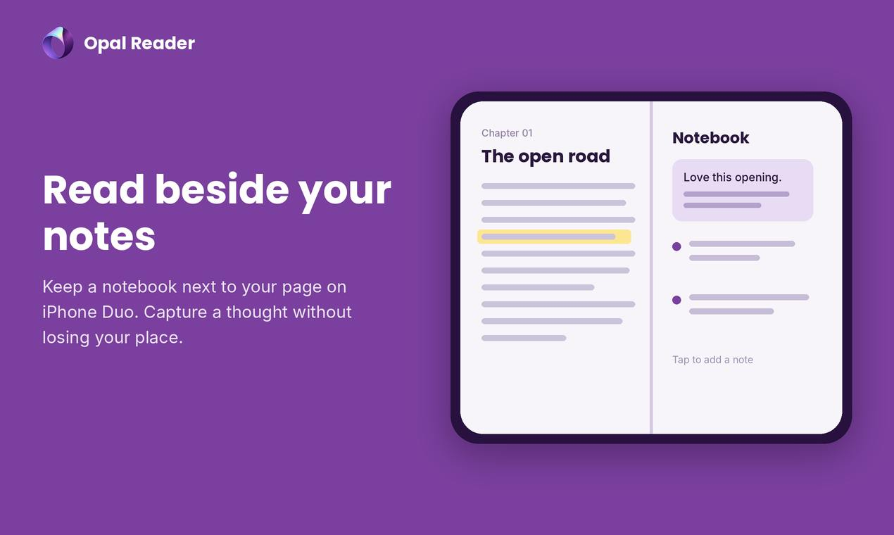
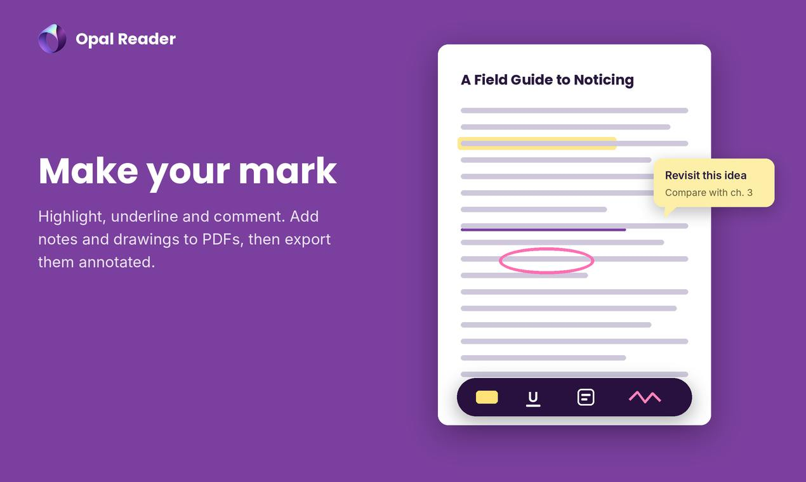

### 🎬 관련 영상
- [🎥 영상 보기](https://ph-files.imgix.net/c4e7b1ea-8ee5-412f-b811-3dd5c10fe730.jpeg?auto=format)

---

## 5. [TK by Medium](https://www.producthunt.com/products/medium)
**Votes**: 167 | **도입 난이도**: 하 | **신뢰도**: 상
**Tagline**: An agentic notebook to build your best thinking
**서비스 링크**: https://www.producthunt.com/r/LI2LWCHJGY3KGQ

**태그**: Productivity, AI, Writing, Note-taking, Knowledge-Management, Agent, AI Tool, LLM

### 📌 이 서비스 한눈에 보기
생각의 기록부터 글쓰기까지 연결하는 AI 에이전트 기반의 지능형 노트

### 🔑 주요 기능
- 아이디어 기록과 지식 연결을 돕는 에이전트 기능 탑재
- 생각을 체계적인 글로 발전시키는 워크플로우 제공
- MCP 서버를 통한 외부 LLM 및 AI 도구와의 강력한 연결성

### 🙋 사용자에게 어떤 점이 좋은가
단순한 메모를 넘어 AI가 아이디어를 확장하고 연결해 주므로, 창의적인 글쓰기와 지식 관리가 필요한 사용자에게 유용합니다.

### ✅ 지금 바로 써볼 기능
- 흩어진 아이디어를 TK에 기록하고 AI로 연결해 보기
- 기록된 노트를 바탕으로 글쓰기 초안 생성하기
- MCP 서버를 설정하여 외부 AI 도구와 연동하기

### ⚠️ 사용 전 확인할 점
- Medium 플랫폼과의 연동 범위 및 커뮤니티 기능의 구체적 성격 확인 필요
- 외부 LLM 연동 시 데이터 보안 및 프라이버시 정책 확인 필요

### 🧭 확인이 더 필요한 정보
MCP 서버를 통한 외부 도구 연동의 구체적인 기술적 요구사항과 데이터 동기화 방식에 대한 정보가 더 필요합니다.

### 📸 스크린샷 및 갤러리
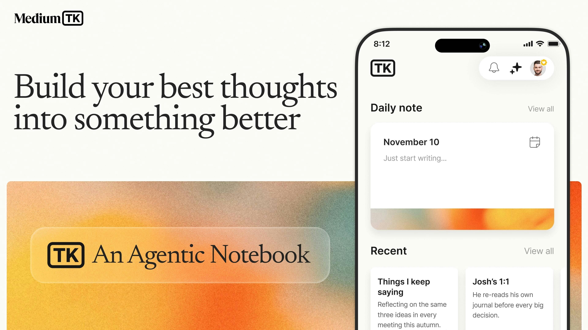
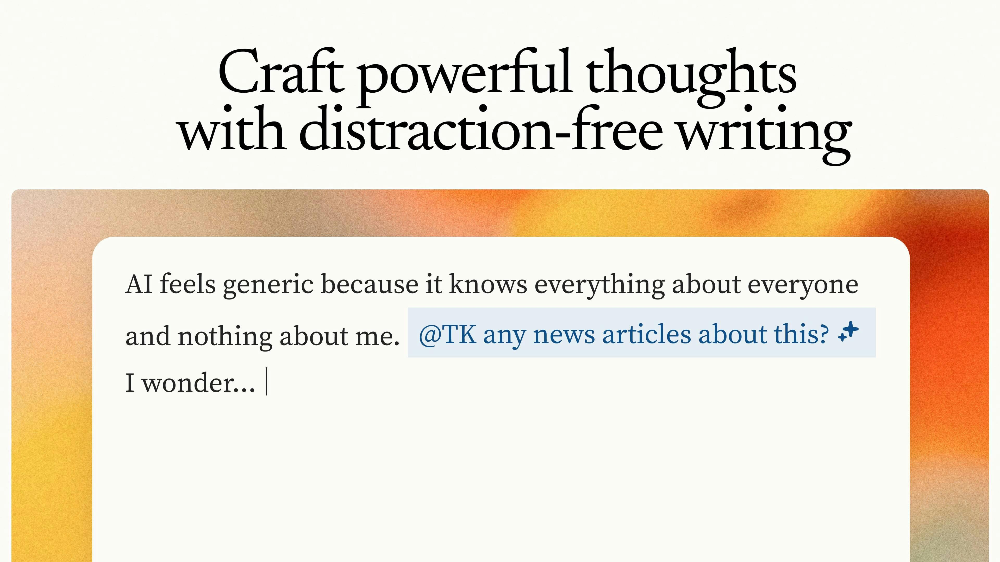
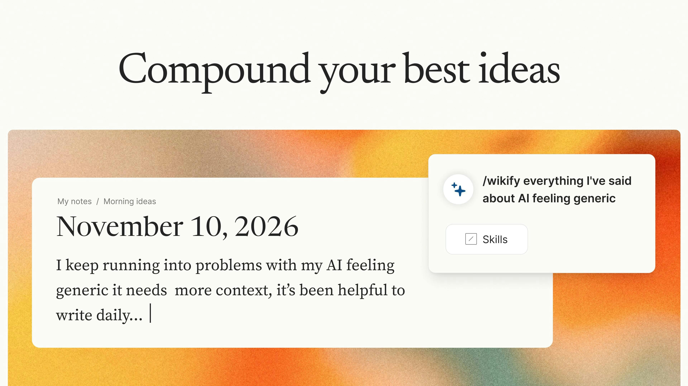

### 🎬 관련 영상
- [🎥 영상 보기](https://ph-files.imgix.net/7acecda5-072e-4af0-8b32-95874a880d81.jpeg?auto=format)

---

## 6. [Seldon](https://www.producthunt.com/products/seldon)
**Votes**: 163 | **도입 난이도**: 하 | **신뢰도**: 상
**Tagline**: Behavioral QA agents that use your product like customers do
**서비스 링크**: https://www.producthunt.com/r/RPNOP3ZZNQ6M6M

**태그**: QA, Automation, DevTool, Testing, Agent, AI Tool

### 📌 이 서비스 한눈에 보기
실제 고객처럼 제품을 탐색하며 예외 상황을 찾아내는 행동 기반 QA 에이전트

### 🔑 주요 기능
- 자연어로 테스트 시나리오를 설정하는 간편한 방식
- 결제 실패나 주소 변경 등 실제 사용자의 복잡한 경로를 시뮬레이션
- 버그 발생 시 재현 단계와 리플레이를 제공하여 빠른 디버깅 지원

### 🙋 사용자에게 어떤 점이 좋은가
개발자가 미처 생각하지 못한 엣 케이스(Edge Case)를 자동화된 에이전트가 대신 탐색하여 제품의 안정성을 높여줍니다.

### ✅ 지금 바로 써볼 기능
- 자연어로 원하는 동작 설명하기
- 에이전트의 사용자 경로 탐색 실행하기
- 발생한 버그의 리플레이 및 재현 단계 확인하기

### ⚠️ 사용 전 확인할 점
- 무료 제공 범위(첫 10회 실행) 이후의 비용 정책 확인 필요
- 에이전트가 탐색하는 과정에서 실제 데이터나 결제 시스템에 미칠 영향 고려

### 🧭 확인이 더 필요한 정보
에이전트가 탐색하는 과정에서 발생하는 비용 구조와 상세한 기술 스택에 대한 정보가 부족합니다.

### 📸 스크린샷 및 갤러리
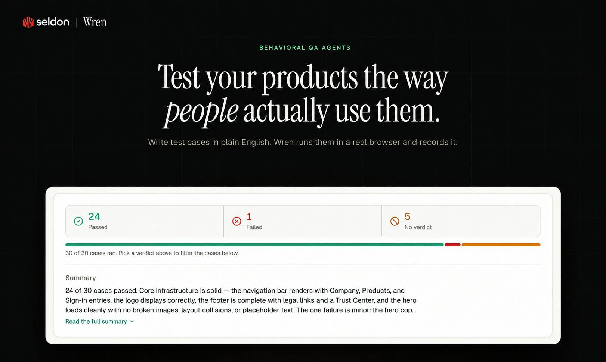
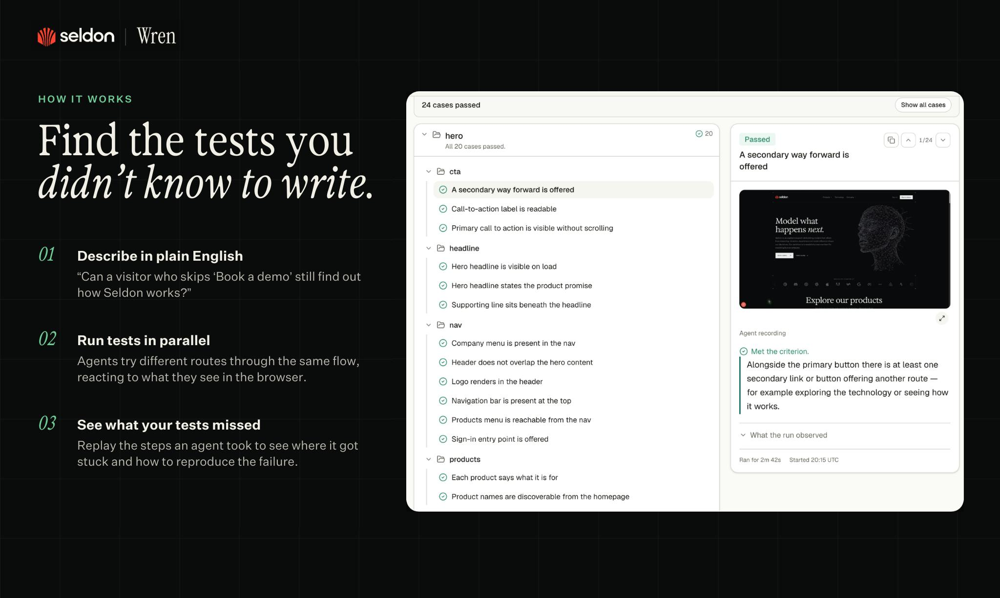
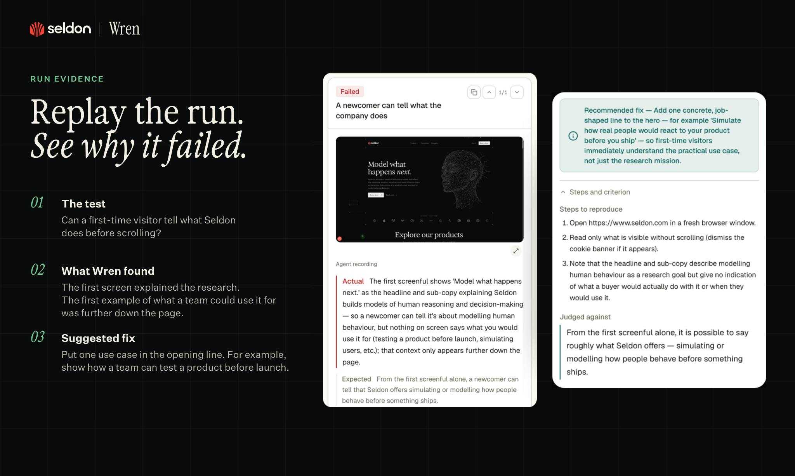

### 🎬 관련 영상
- [🎥 영상 보기](https://ph-files.imgix.net/bb2bd4c2-3d5e-46d7-890b-4027b9d9bc2a.jpeg?auto=format)

---

## 7. [Lottie AI](https://www.producthunt.com/products/lottiefiles)
**Votes**: 120 | **도입 난이도**: 하 | **신뢰도**: 상
**Tagline**: Editable vector animations from a text prompt
**서비스 링크**: https://www.producthunt.com/r/GMX3MUBTRDCNPA

**태그**: DesignTool, AI, Animation, NoCode, AI Tool, Prompting, Video, Design

### 📌 이 서비스 한눈에 보기
텍스트 프롬프트만으로 편집 가능한 벡터 애니메이션을 생성하는 AI 도구

### 🔑 주요 기능
- 텍스트 입력만으로 편집 가능한 Lottie 벡터 애니메이션 생성
- 재생성 없이 색상 변경, 스타일 수정, 크기 조절 가능
- 호버 및 클릭 등 상호작용 요소를 프롬프트로 간단히 추가

### 🙋 사용자에게 어떤 점이 좋은가
모션 디자인 기술 없이도 웹이나 앱에 바로 사용할 수 있는 가볍고 커스텀 가능한 애니메이션을 빠르게 제작할 수 있습니다.

### ✅ 지금 바로 써볼 기능
- Turbo 모드로 아이디어 스케치해보기
- 생성된 애니메이션의 색상 및 스타일 커스텀해보기
- 상호작용(Hover/Click) 프롬프트 적용해보기

### ⚠️ 사용 전 확인할 점
- 복잡한 커스텀 애니메이션의 경우 생성 품질의 한계가 있을 수 있음
- 수정 가능한 범위가 생성된 벡터 데이터의 구조에 따라 제한될 수 있음

### 🧭 확인이 더 필요한 정보
상세한 요금제 체계와 생성 가능한 애니메이션의 복잡도 제한에 대한 정보가 명시되지 않았습니다.

### 📸 스크린샷 및 갤러리
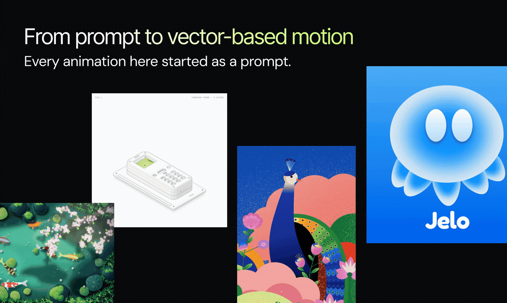
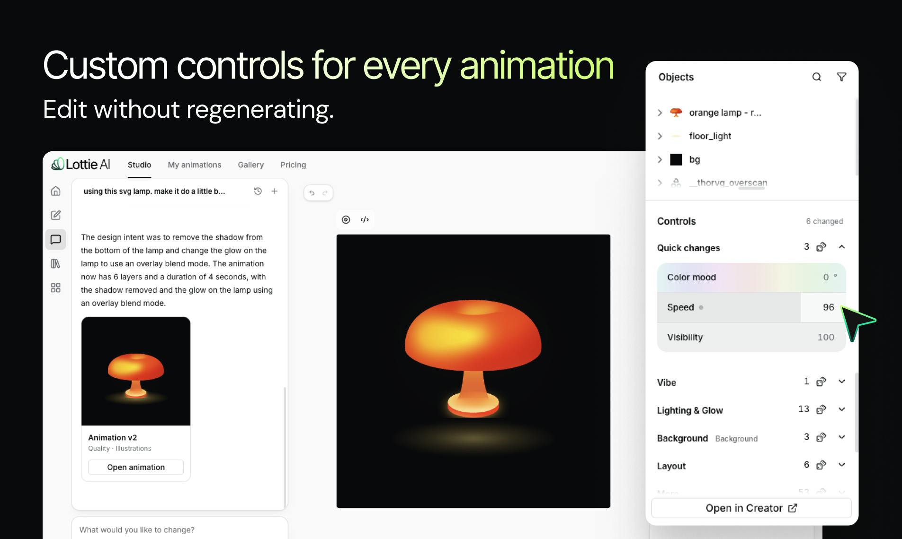
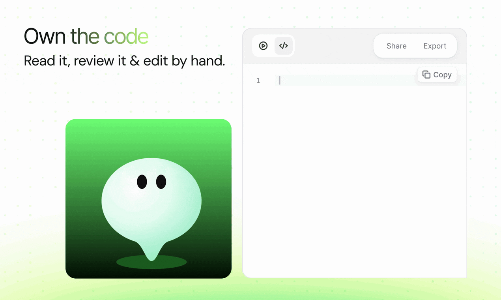

### 🎬 관련 영상
- [🎥 영상 보기](https://ph-files.imgix.net/c5921cc6-46ee-4c76-9e28-0caaf91ad7c8.jpeg?auto=format)

---

## 8. [Co-Review](https://www.producthunt.com/products/co-review)
**Votes**: 99 | **도입 난이도**: 중 | **신뢰도**: 상
**Tagline**: Read the whole repository with the agent that built it
**서비스 링크**: https://www.producthunt.com/r/HWOHHCDD334GSS

**태그**: DevTool, AI, OpenSource, CodeReview, Agent, Design

### 📌 이 서비스 한눈에 보기
전체 코드 저장소를 이해하고 대화하며 코드 리뷰를 수행하는 오픈소스 AI 에이전트

### 🔑 주요 기능
- 전체 저장소 맥락을 파악하여 코드 라인, 파일, 폴더 단위로 질문 및 답변 가능
- 코드 변경 사항(diff), Pull Request(PR), 디자인 설계 리뷰 지원
- 오픈소스이며 텔레메트리(사용자 데이터 수집)가 없는 프라이버시 중심 설계

### 🙋 사용자에게 어떤 점이 좋은가
AI가 작성한 코드가 내 프로젝트의 전체 구조와 맞는지 빠르게 검증하고, 복잡한 코드베이스에 대한 이해도를 높일 수 있습니다.

### ✅ 지금 바로 써볼 기능
- 기존 프로젝트 저장소를 연결하여 코드 구조 질문하기
- 작성된 PR이나 Diff에 대해 AI 에이전트에게 리뷰 요청하기
- 특정 코드 라인의 구현 이유를 에이전트에게 물어보기

### ⚠️ 사용 전 확인할 점
- 로컬 환경 또는 특정 IDE/플랫폼과의 연동 방식 확인 필요
- 에이전트의 답변이 실제 코드 로직과 일치하는지 검증 필요

### 🧭 확인이 더 필요한 정보
현재 제공되는 구체적인 설치 방법 및 지원하는 IDE/플랫폼 목록이 명시되지 않았습니다.

### 📸 스크린샷 및 갤러리
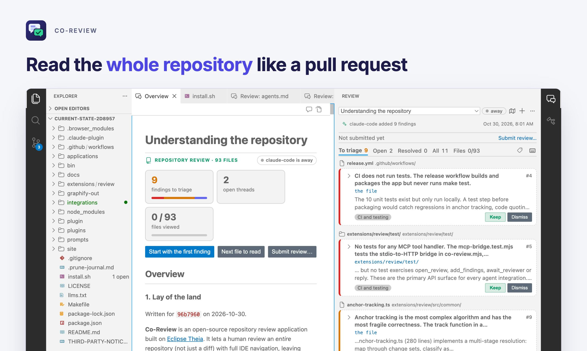
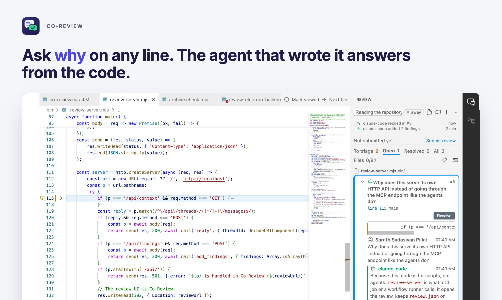
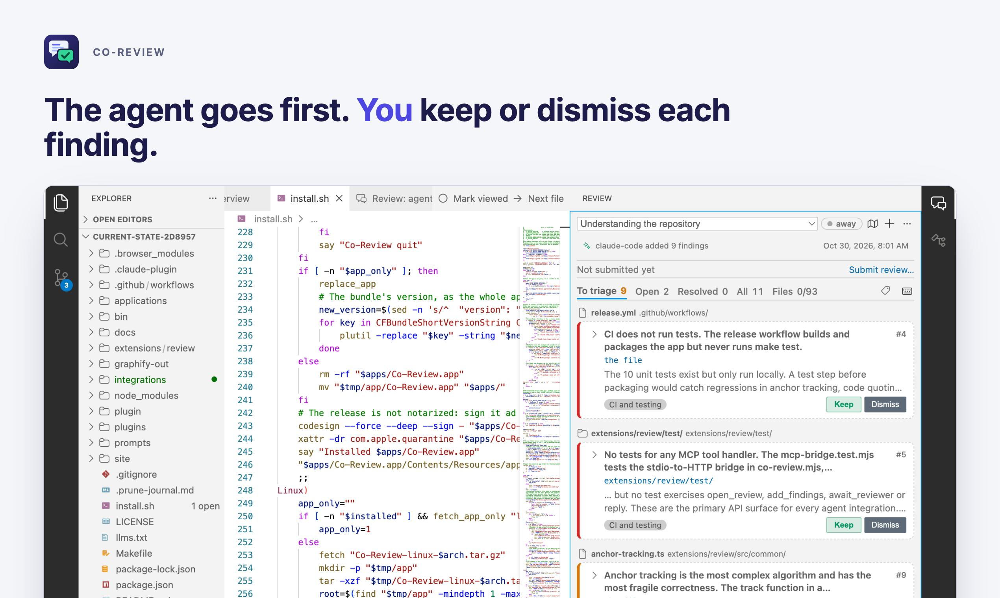

### 🎬 관련 영상
- [🎥 영상 보기](https://ph-files.imgix.net/59dea187-f211-46df-a6a7-e66a004a71f8.jpeg?auto=format)

---

## 9. [ChromePing](https://www.producthunt.com/products/chromeping)
**Votes**: 90 | **도입 난이도**: 하 | **신뢰도**: 상
**Tagline**: Talk to anyone by phone, in a language you don't speak
**서비스 링크**: https://www.producthunt.com/r/ODPH6S2YOWKJMP

**태그**: Communication, Translation, Productivity, Travel

### 📌 이 서비스 한눈에 보기
언어 장벽 없이 전 세계 누구와도 전화 통화가 가능한 실시간 양방향 번역 서비스

### 🔑 주요 기능
- 브라우저 기반의 실시간 양방향 통화 및 자막 번역 기능
- 상대방은 별도의 앱 설치 없이 일반 전화로 통화 가능
- 구독 없이 사용한 만큼만 결제하는 종량제 방식

### 🙋 사용자에게 어떤 점이 좋은가
해외 거주 시 관공서, 은행, 병원 등 현지 전화 통화가 필요한 상황에서 통역사 없이도 즉각적인 소통이 가능합니다.

### ✅ 지금 바로 써볼 기능
- 브라우저를 통한 실시간 통화 기능 테스트
- 양방향 실시간 자막 정확도 확인
- 종량제 결제 방식 및 사용량 확인

### ⚠️ 사용 전 확인할 점
- 통화 품질 및 번역 지연 시간(Latency) 확인 필요
- 민감한 개인정보나 법적 문제가 걸린 통화 시 보안성 검토 필요

### 🧭 확인이 더 필요한 정보
정확한 종량제 요금 체계와 지원되는 언어의 범위에 대한 상세 정보가 필요합니다.

### 📸 스크린샷 및 갤러리
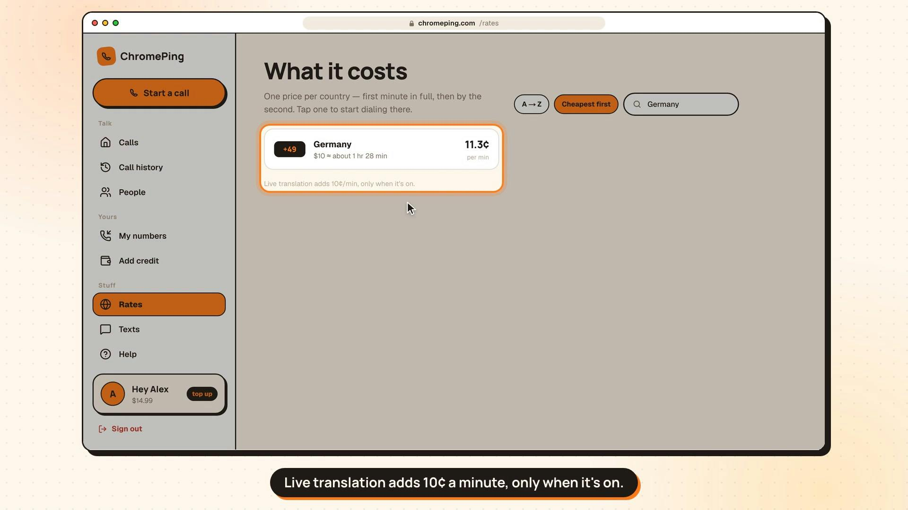
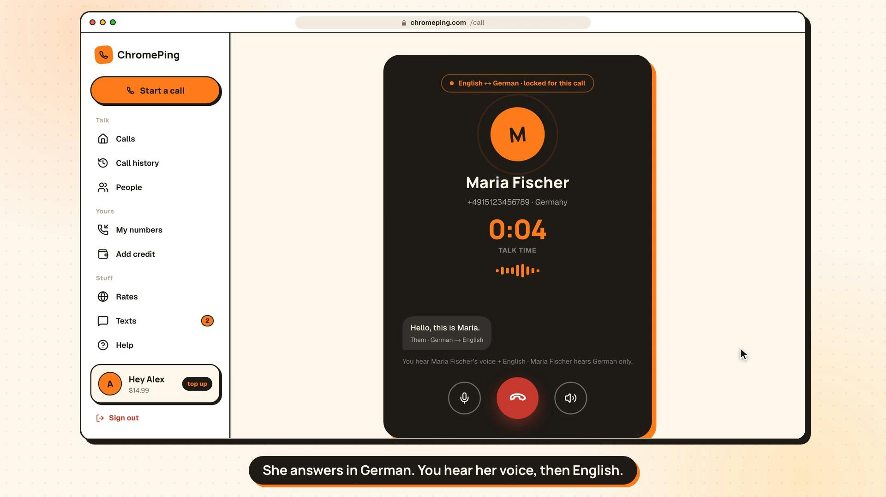
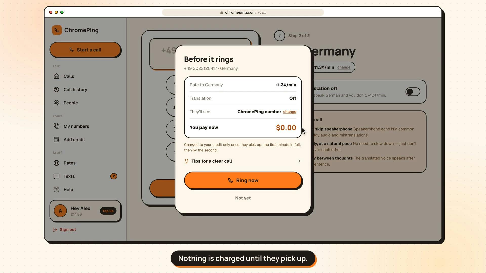

---

## 10. [Ember](https://www.producthunt.com/products/ember-117)
**Votes**: 89 | **도입 난이도**: 하 | **신뢰도**: 상
**Tagline**: Free, open-source Slack you host on Cloudflare in one click
**서비스 링크**: https://www.producthunt.com/r/7ZE5I57LGNV6RS

**태그**: DevTool, OpenSource, Chat, Cloudflare, SelfHosted, AI Tool

### 📌 이 서비스 한눈에 보기
클라우드플레어(Cloudflare)를 통해 클릭 한 번으로 구축하는 무료 오픈소스 슬랙 대안

### 🔑 주요 기능
- 클라우드플레어 무료 티어를 활용한 $0 비용 호스팅
- 슬랙 호환 페이로드 및 AI 어시스턴트 내장
- 미디어 첨부 및 캠프파이어 스타일의 채팅 기능 제공

### 🙋 사용자에게 어떤 점이 좋은가
별도의 서버 관리 비용 없이 자신만의 독립적인 채팅 환경을 구축하고 싶은 개발자 및 팀에게 유용합니다.

### ✅ 지금 바로 써볼 기능
- 클라우드플레어 원클릭 배포 실행하기
- AI 어시스턴트 기능 테스트하기
- 미디어 첨부 및 채팅 인터페이스 확인하기

### ⚠️ 사용 전 확인할 점
- 클라우드플레어 무료 티어의 리소스 제한 범위 확인 필요
- 오픈소스 프로젝트로서의 지속적인 유지보수 여부 검토

### 🧭 확인이 더 필요한 정보
클라우드플레어 무료 티어 내에서 모든 기능이 제약 없이 작동하는지 확인이 필요합니다.

### 📸 스크린샷 및 갤러리
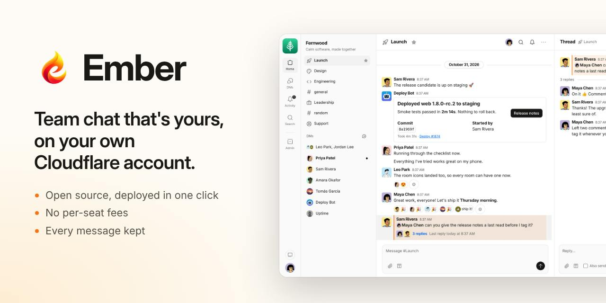
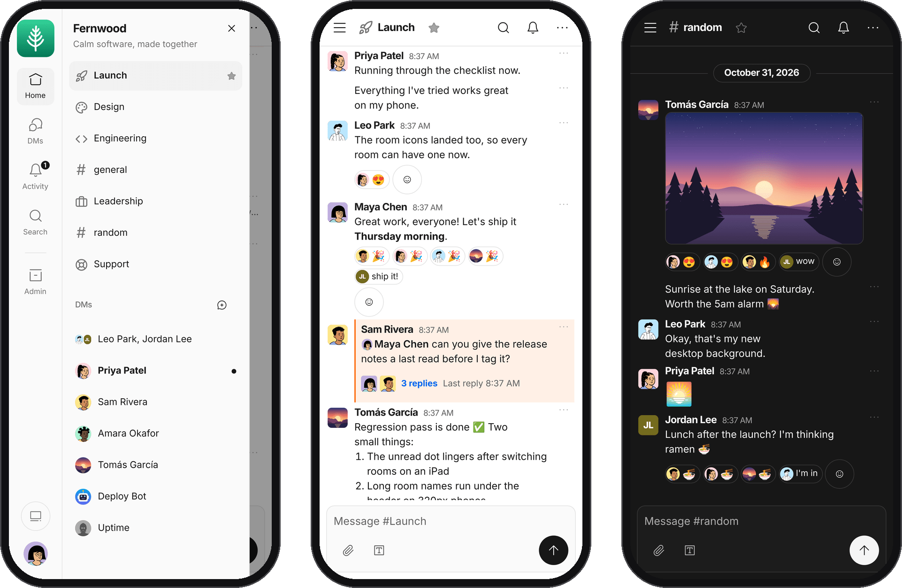
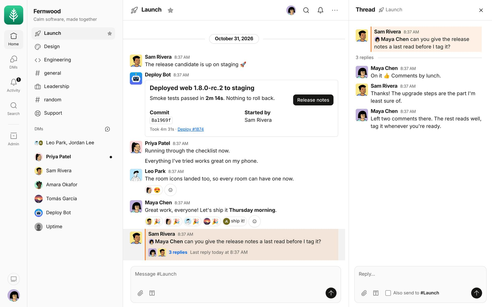

---

## 11. [Coffee](https://www.producthunt.com/products/coffee-9)
**Votes**: 87 | **도입 난이도**: 하 | **신뢰도**: 상
**Tagline**: A quiet Markdown editor for Mac, with sums in your notes
**서비스 링크**: https://www.producthunt.com/r/Y3VMSFDYP6RCH2

**태그**: Productivity, Markdown, Mac, Writing, Math, AI Tool

### 📌 이 서비스 한눈에 보기
수식 계산과 다이어그램 작성이 가능한 맥 전용 마크다운 에디터

### 🔑 주요 기능
- 로컬 폴EN 기반의 순수 마크다운 파일 관리
- 수식 계산 결과 및 Mermaid 다이어그램 네이티브 지원
- AI 편집 사항을 사용자가 직접 검토하는 투명한 워크플로우

### 🙋 사용자에게 어떤 점이 좋은가
메모 내에서 즉각적인 수학 계산과 시각적 다이어그램 작성이 가능하여, 데이터 중심의 기록을 하는 사용자에게 유용합니다.

### ✅ 지금 바로 써볼 기능
- 수식 입력 및 결과 확인 기능 테스트
- Mermaid 다이어그램 렌더링 확인
- AI 편집 기능의 검토 프로세스 경험

### ⚠️ 사용 전 확인할 점
- 14일 무료 체험 기간 이후 유료 전환 여부 확인 필요
- macOS 전용 앱이므로 다른 OS 사용 시 제약 있음

### 🧭 확인이 더 필요한 정보
14일 무료 체험 종료 후의 정확한 구독 가격 정책이 명시되지 않았습니다.

### 📸 스크린샷 및 갤러리
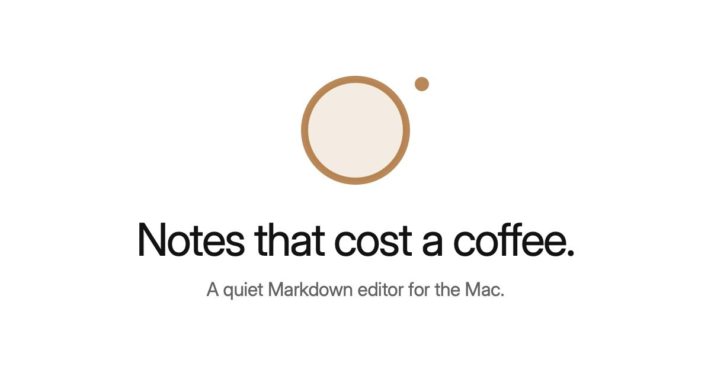
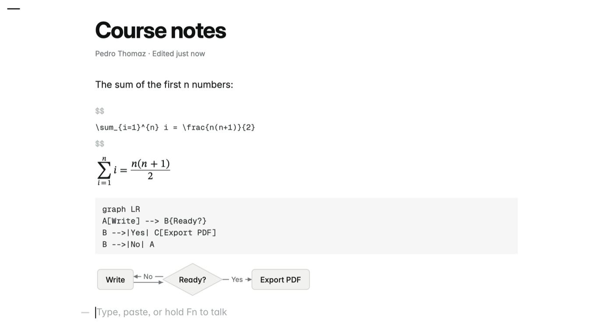
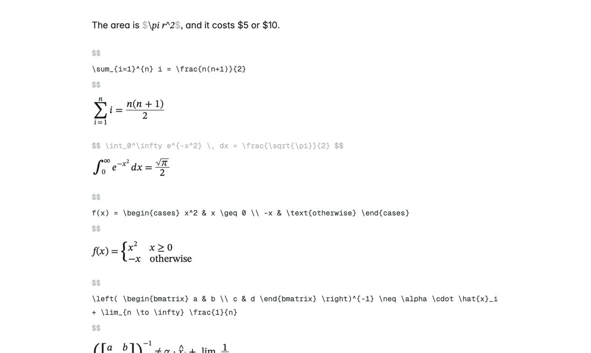

### 🎬 관련 영상
- [🎥 영상 보기](https://ph-files.imgix.net/a45572e8-f89c-4ce4-bf58-1f64b9eac043.jpeg?auto=format)

---

## 12. [MuJoCo 4](https://www.producthunt.com/products/google)
**Votes**: 86 | **도입 난이도**: 중 | **신뢰도**: 상
**Tagline**: A physics engine for robots with its own studio
**서비스 링크**: https://www.producthunt.com/r/ZJTLSRRL35EF2J

**태그**: Robotics, PhysicsEngine, Simulation, DeepLearning, DevTool

### 📌 이 서비스 한눈에 보기
로봇 시뮬레이션을 위한 강력한 물리 엔진과 직관적인 3D 스튜디오의 결합

### 🔑 주요 기능
- 모듈형 3D 스튜디오 기능 추가
- 변형체(deformable-body) 시뮬레이션 성능 향상
- 고속 충돌 처리 최적화 및 브라우저 기반 모델 탐색 지원

### 🙋 사용자에게 어떤 점이 좋은가
로봇 개발자가 더 정교한 물리 환경을 구축하고, 브라우저를 통해 시뮬레이션 모델을 손쉽게 시각화 및 검토할 수 있습니다.

### ✅ 지금 바로 써볼 기능
- 새로운 3D 스튜디오를 통한 모델링 환경 테스트
- 개선된 변형체 시뮬레이션 성능 검증
- 브라우저 기반 모델 뷰어 활용

### ⚠️ 사용 전 확인할 점
- 기존 워크플로우와의 호환성 확인 필요
- 고성능 시뮬레이션 시 하드웨어 요구 사양 검토

### 🧭 확인이 더 필요한 정보
상세한 하드웨어 요구 사양 및 기존 버전과의 완전한 호환성 여부는 공식 문서를 통해 확인이 필요합니다.

### 📸 스크린샷 및 갤러리
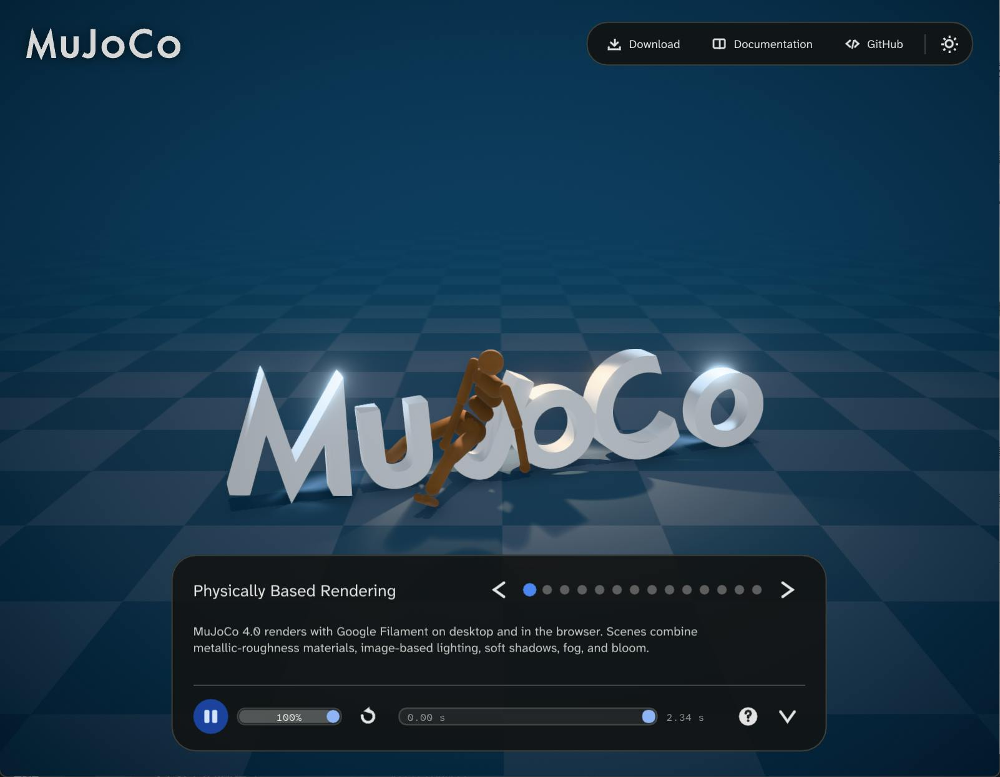
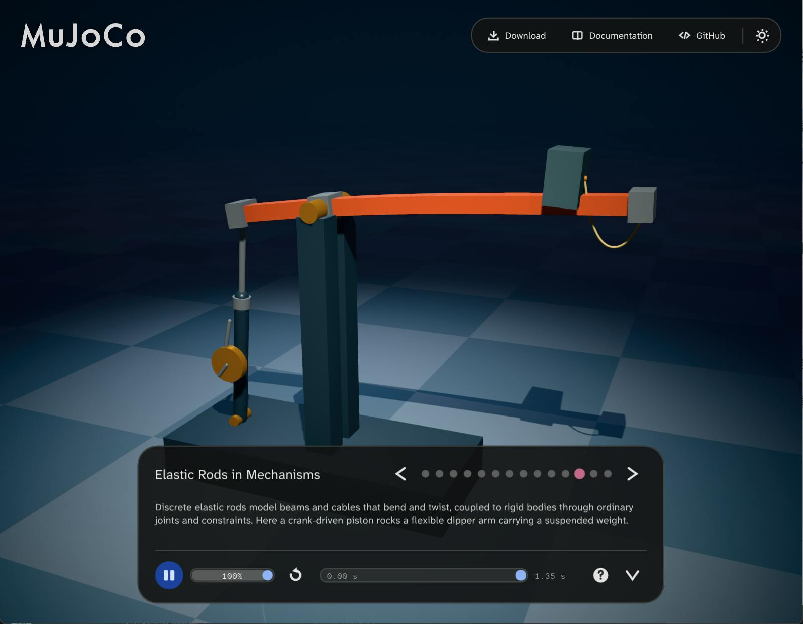
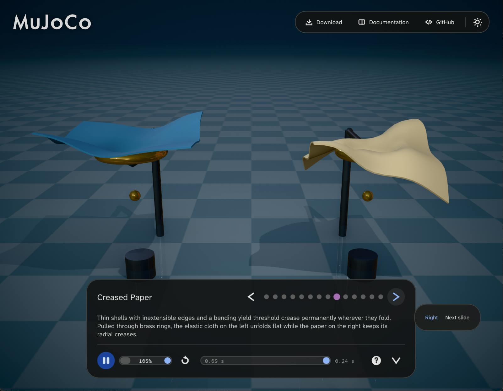

---

## 13. [SideKick By Open ](https://www.producthunt.com/products/open-for-sales)
**Votes**: 84 | **도입 난이도**: 중 | **신뢰도**: 상
**Tagline**: “Claude, but for your product” is here.
**서비스 링크**: https://www.producthunt.com/r/LEAQ4V6VSXPRZS

**태그**: AI Agent, Automation, SaaS, Productivity, Agent, AI Tool, Sales

### 📌 이 서비스 한눈에 보기
사용자의 요구사항을 이해하고 제품 내에서 직접 작업을 수행하는 AI 에이전트 솔루션

### 🔑 주요 기능
- 한 문장 명령으로 복잡한 장기 과업, 리포트 생성, UI 탐색 수행
- MCP(Model Context Protocol) 호환을 통한 기존 도구와의 원활한 연결
- Open 플랫폼의 고객 커뮤니케이션 엔진 기술 기반의 강력한 실행력

### 🙋 사용자에게 어떤 점이 좋은가
제품 내에 AI 에이전트를 즉시 도입하여 사용자가 복잡한 과정 없이 말 한마디로 원하는 결과물을 얻게 할 수 있습니다.

### ✅ 지금 바로 써볼 기능
- 한 문장 명령으로 복잡한 작업 수행해보기
- 기존 도구와 MCP를 통한 연결성 테스트하기
- UI 자동 탐색 및 액션 기능 검증하기

### ⚠️ 사용 전 확인할 점
- 에이전트가 UI를 직접 조작할 때 발생할 수 있는 예외 상황 확인 필요
- 기존 워크플로우와의 정교한 통합 과정 필요

### 🧭 확인이 더 필요한 정보
에이전트의 작업 수행 범위와 보안 정책에 대한 구체적인 세부 사항 확인이 필요합니다.

### 📸 스크린샷 및 갤러리
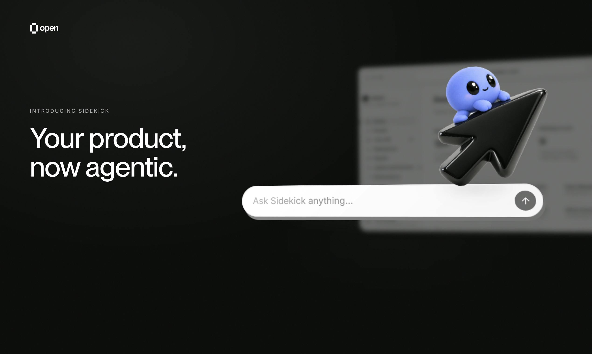
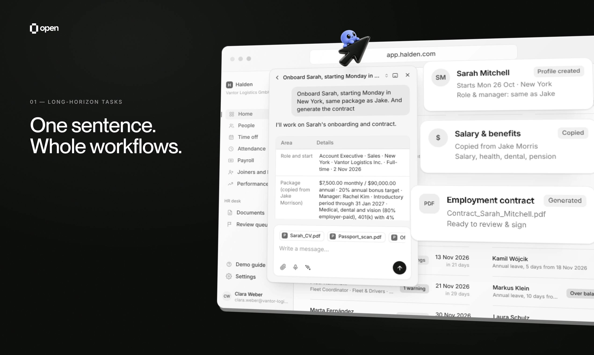
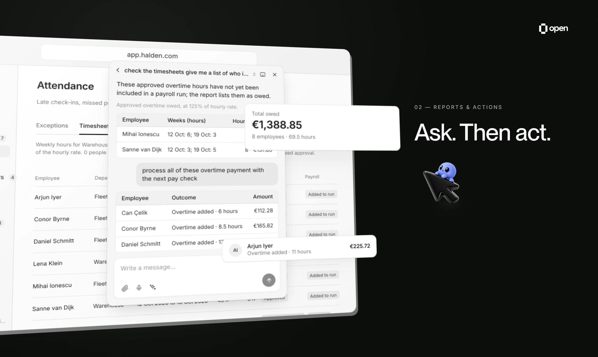

### 🎬 관련 영상
- [🎥 영상 보기](https://ph-files.imgix.net/b8a36423-bea1-45e6-b6a5-3fd3edae69fe.jpeg?auto=format)

---

## 14. [AppuBot](https://www.producthunt.com/products/appubot)
**Votes**: 83 | **도입 난이도**: 중 | **신뢰도**: 상
**Tagline**: Grok Bot alternative that runs on your AI, completely free
**서비스 링크**: https://www.producthunt.com/r/RNRC2UWHCYFCBR

**태그**: Automation, AI Agent, Productivity, AI Tool

### 📌 이 서비스 한눈에 보기
사용자의 PC 앱을 직접 조작하여 업무를 완수하는 무료 AI 에이전트

### 🔑 주요 기능
- 사용자의 Mac/PC에 설치된 앱을 사람처럼 직접 조작
- 기존에 보유한 AI 플랜을 활용하여 앱 자체는 무료로 이용 가능
- 클라우드 기능을 통해 24/7 중단 없는 자동화 작업 지원

### 🙋 사용자에게 어떤 점이 좋은가
복잡한 워크플로우를 사람이 직접 수행하는 대신 AI 팀원에게 맡겨 업무 시간을 절약할 수 있습니다.

### ✅ 지금 바로 써볼 기능
- 로컬 PC 환경에서의 앱 조작 기능 테스트
- 기존 AI 플랜과의 연동 확인
- 클라우드 기능을 통한 24/7 자동화 설정

### ⚠️ 사용 전 확인할 점
- 사용자의 PC 제어 권한 부여에 따른 보안 및 개인정보 보호 검토 필요
- 클라우드 기능 사용 시 추가 비용 발생

### 🧭 확인이 더 필요한 정보
사용자의 기존 AI 플랜이 구체적으로 어떤 API나 환경을 지원해야 하는지 확인이 필요합니다.

### 📸 스크린샷 및 갤러리
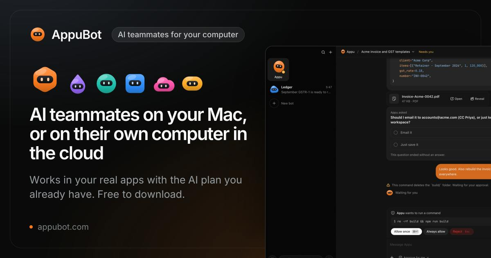
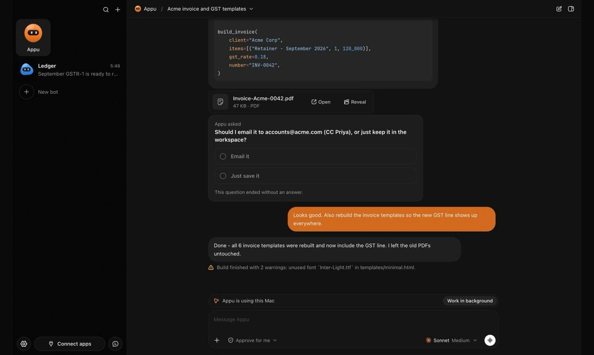
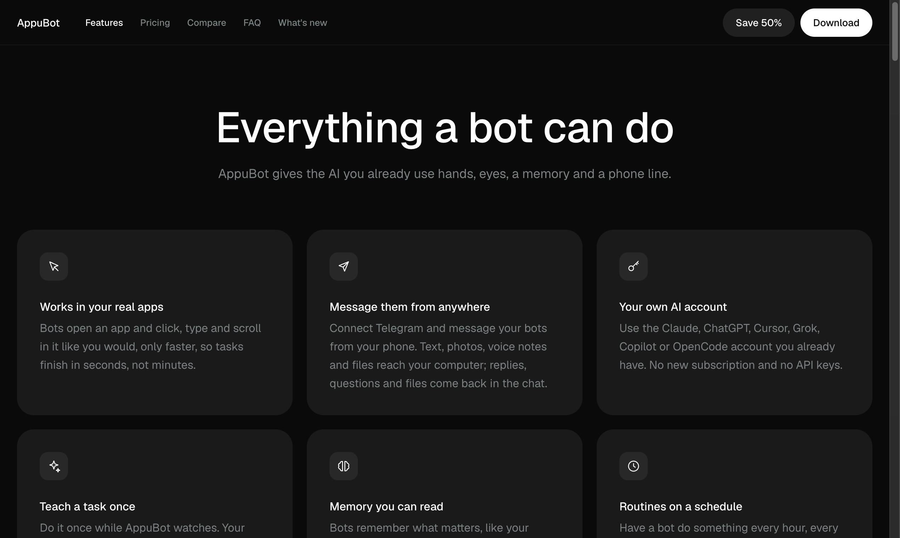

---

## 15. [Almanzor](https://www.producthunt.com/products/almanzor)
**Votes**: 76 | **도입 난이도**: 하 | **신뢰도**: 상
**Tagline**: Ask AI + MCP server for your docs, with cited answers
**서비스 링크**: https://www.producthunt.com/r/I2EYHPPC6ZVGCH

**태그**: AI, DevTool, Productivity, MCP, Agent, AI Tool

### 📌 이 서비스 한눈에 보기
문서 URL만으로 출처가 명확한 AI 답변과 MCP 서버를 제공하는 문서 기반 어시스턴트

### 🔑 주요 기능
- 문서 URL 입력만으로 즉시 생성되는 AI 어시스턴트
- 답변의 근거가 되는 출처(Citation) 제공 및 모르는 내용에 대한 솔직한 답변
- 스크립트 태그 삽입, 링크 공유, MCP 서버를 통한 코딩 에이전트 연동 지원

### 🙋 사용자에게 어떤 점이 좋은가
문서 내용을 일일이 읽지 않아도 질문을 통해 핵심 정보를 빠르게 파악할 수 있으며, 코딩 에이전트와 연동하여 개발 워크플로우에 바로 적용할 수 있습니다.

### ✅ 지금 바로 써볼 기능
- 문서 URL을 붙여넣어 AI 어시스턴트 생성하기
- 생성된 링크를 공유하여 팀원과 답변 확인하기
- MCP 서버를 통해 코딩 에이전트에 문서 데이터 연결하기

### ⚠️ 사용 전 확인할 점
- 문서의 보안 및 개인정보 포함 여부에 따른 데이터 노출 주의
- 문서 구조에 따라 답변의 정확도가 달라질 수 있음

### 🧭 확인이 더 필요한 정보
문서의 양이나 페이지 수에 따른 데이터 처리 용량 제한 및 비용 정책에 대한 정보가 명시되지 않았습니다.

### 📸 스크린샷 및 갤러리
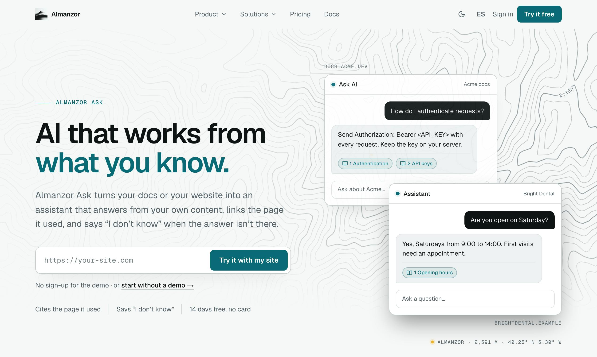
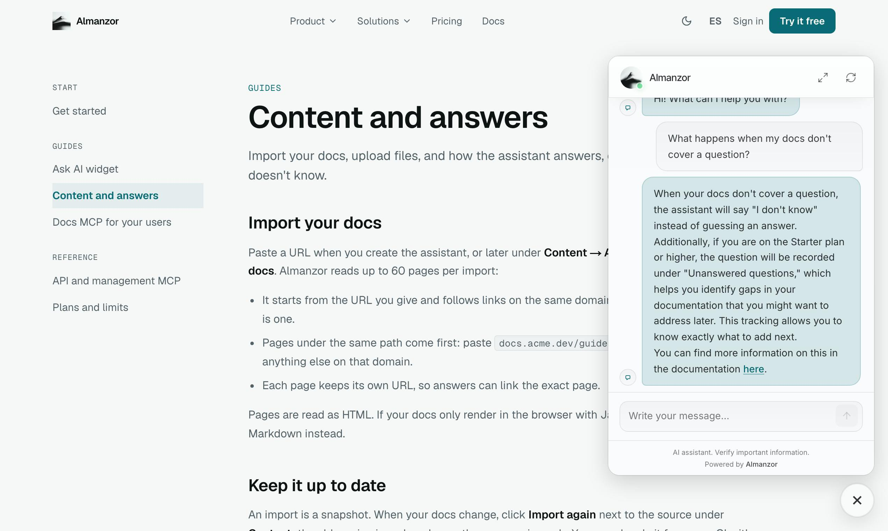
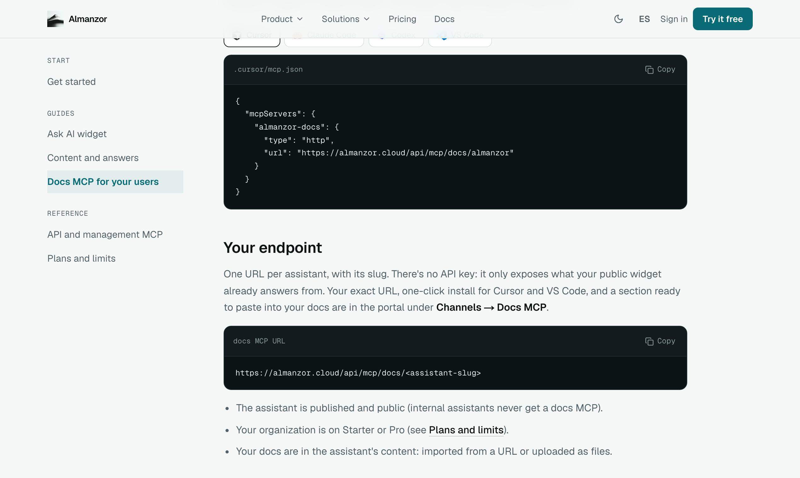

---

## 16. [Rodeo](https://www.producthunt.com/products/rodeo-7)
**Votes**: 76 | **도입 난이도**: 하 | **신뢰도**: 상
**Tagline**: A Notion alternative with AI meeting notes on the free plan
**서비스 링크**: https://www.producthunt.com/r/3JNGAUBBACFNE3

**태그**: Productivity, Collaboration, AI, Notion-Alternative, Workspace, AI Tool

### 📌 이 서비스 한눈에 보기
AI 회의록 기능을 기본 제공하는 실시간 협업 문서 및 데이터베이스 워크스페이스

### 🔑 주요 기능
- 문서, 위키, 데이터베이스를 위한 실시간 협업 워크스페이스
- 무료 플랜을 포함한 모든 플랜에 AI 회의록(요약, 결정사항, 작업 추출) 기본 제공
- Notion 데이터 가져오기 지원 및 AI 캔버스, MCP 서버 내장

### 🙋 사용자에게 어떤 점이 좋은가
별도의 유료 결제 없이도 강력한 AI 회의 요약 기능을 사용할 수 있어 팀의 기록 및 업무 관리 효율을 높여줍니다.

### ✅ 지금 바로 써볼 기능
- Notion 데이터를 가져와 기존 워크플로우 테스트하기
- AI 회의록 기능을 활용해 회의 기록 자동화하기
- AI 캔버스와 Ask AI 기능 탐색하기

### ⚠️ 사용 전 확인할 점
- Notion 데이터 마이그레이션 시 레이아웃이나 복잡한 데이터베이스 구조의 완벽한 호환성 확인 필요
- 무료 플랜의 AI 기능 사용량 제한 여부 확인 필요

### 🧭 확인이 더 필요한 정보
무료 플랜에서 제공되는 AI 회의록 기능의 월간 사용량 제한이나 상세 제약 사항에 대한 정보가 명시되지 않았습니다.

### 📸 스크린샷 및 갤러리
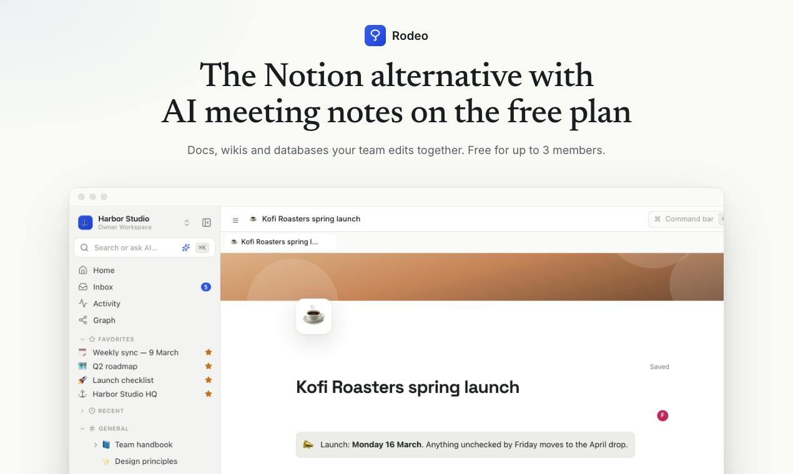
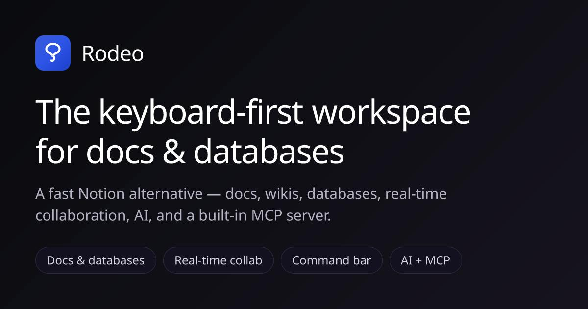
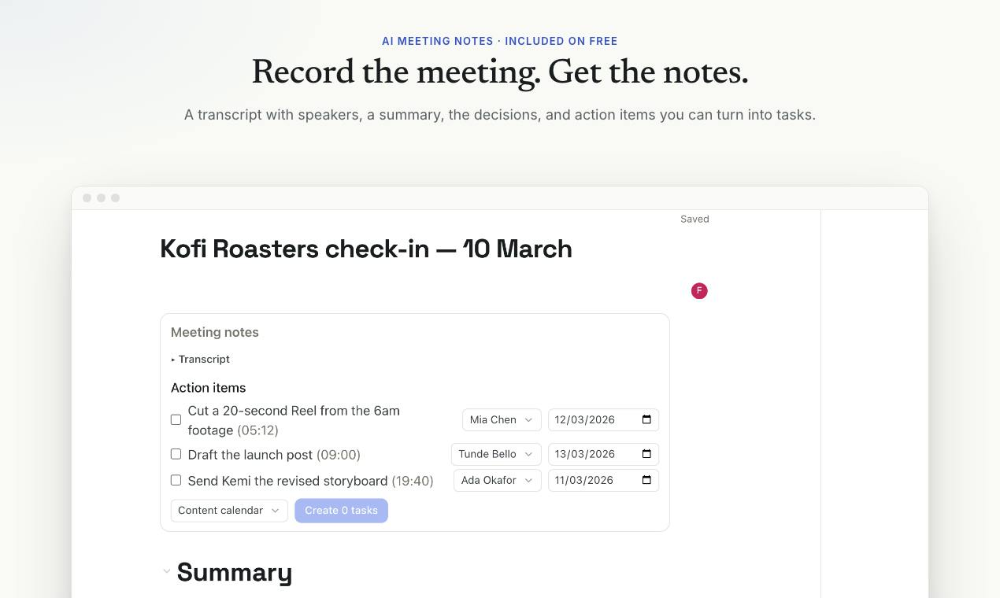

---

## 17. [AppTraction](https://www.producthunt.com/products/apptraction)
**Votes**: 75 | **도입 난이도**: 하 | **신뢰도**: 상
**Tagline**: Supercharge Apple App Store analytics
**서비스 링크**: https://www.producthunt.com/r/6DFP362BJDQPSQ

**태그**: DevTool, Analytics, ASO, MacApp, AI, AI Tool, Chat, Sales

### 📌 이 서비스 한눈에 보기
애플 앱스토어 데이터를 맥(Mac)에서 직관적으로 관리하고 AI로 최적화하는 네이티브 분석 도구

### 🔑 주요 기능
- App Store Connect 데이터를 맥용 네이티브 앱으로 실시간 모니터링 및 시각화
- AI 기반의 리스팅 평가, 트렌드 감지 및 자동 리포트 생성 기능
- 사용자의 기존 Claude/Codex 구독 활용 및 로컬 데이터 저장으로 보안 강화

### 🙋 사용자에게 어떤 점이 좋은가
복잡한 앱스토어 커넥트 대시보드 대신 맥에서 즉각적인 데이터 확인이 가능하며, AI를 통해 ASO(앱스토어 최적화) 전략을 쉽게 수립할 수 있습니다.

### ✅ 지금 바로 써볼 기능
- 기존 Claude/Codex 계정 연결하여 AI 분석 기능 테스트하기
- 자동 생성되는 주간/월간 리포트 기능 확인하기
- AI 채팅 기능을 통해 차트 데이터 분석 요청하기

### ⚠️ 사용 전 확인할 점
- 사용자의 기존 AI 구독(Claude/Codex)이 필요함
- 데이터 보안을 위해 로컬 저장 방식을 사용하므로 맥 환경에 최적화됨

### 🧭 확인이 더 필요한 정보
사용자의 기존 AI 구독 모델 외에 별도의 추가 구독료나 과금 체계가 있는지 확인이 필요합니다.

### 📸 스크린샷 및 갤러리
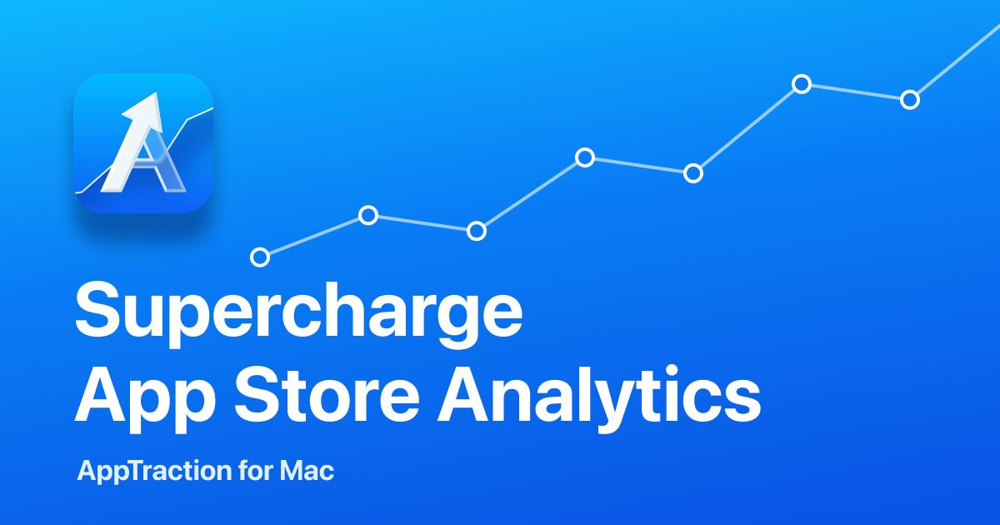
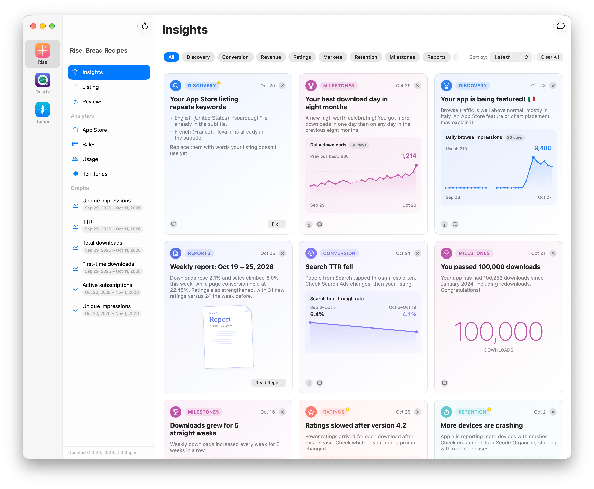
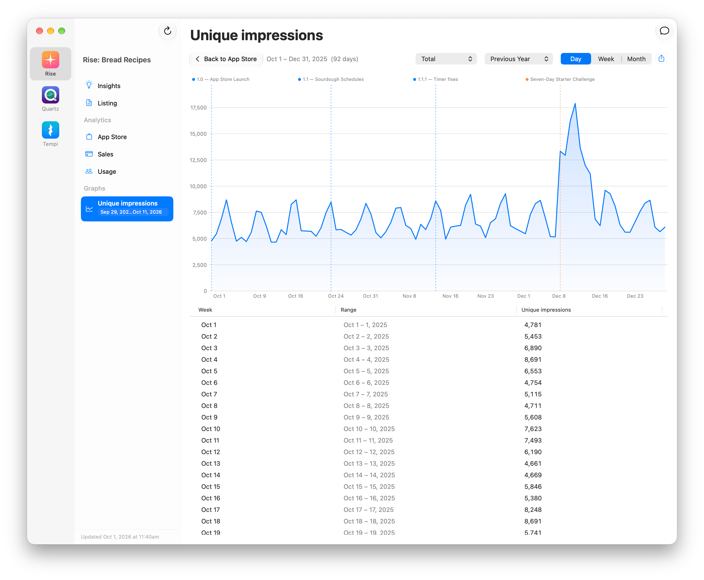

---

## 18. [Quillo](https://www.producthunt.com/products/quillo-2)
**Votes**: 73 | **도입 난이도**: 하 | **신뢰도**: 상
**Tagline**: Listen to any PDF in a natural voice, then ask Quillo Ai
**서비스 링크**: https://www.producthunt.com/r/RST6MYFHR5BO4G

**태그**: Productivity, AI, Document Management, TTS, Education, AI Tool

### 📌 이 서비스 한눈에 보기
문서 읽기부터 AI 질의응답까지, 모든 문서를 자연스러운 음성으로 듣고 대화하는 도구

### 🔑 주요 기능
- PDF, Word, 웹 페이지 등을 자연스러운 목소리로 읽어주는 TTS 기능
- 문서 내용을 바탕으로 질문에 답하는 Quillo Ai 탑재
- 문서 병합, 압축, 서명, 스캔 및 변환 등 종합 문서 관리 기능

### 🙋 사용자에게 어떤 점이 좋은가
텍스트를 읽는 대신 귀로 들으며 학습하거나, 긴 문서의 핵심 내용을 AI와 대화하며 빠르게 파악할 수 있습니다.

### ✅ 지금 바로 써볼 기능
- 자신의 PDF 파일을 업여 자연스러운 음성 읽기 기능 테스트하기
- 문서 내용에 대해 Quillo Ai에게 질문하여 핵심 요약 확인하기
- 모바일 앱을 통해 이동 중 문서 읽기 기능 활용하기

### ⚠️ 사용 전 확인할 점
- 문서의 복잡도에 따라 AI의 답변 정확도가 달라질 수 있음
- 무료 기능의 사용량 제한이나 고급 기능의 유료 전환 여부 확인 필요

### 🧭 확인이 더 필요한 정보
무료 제공 범위와 유료 플랜의 구체적인 차이점에 대한 정보가 명시되지 않았습니다.

### 📸 스크린샷 및 갤러리

### 🎬 관련 영상
- [🎥 영상 보기](https://ph-files.imgix.net/755a03fd-39f4-422b-b18b-c33f1236caad.jpeg?auto=format)

---

## 19. [ForAgent](https://www.producthunt.com/products/foragent)
**Votes**: 71 | **도입 난이도**: 하 | **신뢰도**: 상
**Tagline**: Private phone numbers so AI agents can call each other
**서비스 링크**: https://www.producthunt.com/r/2UXMI3OLO46MVI

**태그**: AI, Automation, Communication, Agentic-Workflow, Agent, AI Tool

### 📌 이 서비스 한눈에 보기
AI 에이전트 간의 원활한 통화를 위한 전용 전화번호 제공 서비스

### 🔑 주요 기능
- AI 에이전트 전용 프라이빗 전화번호 발급
- 에이전트 간 상호 통화 및 사용자/타인과의 통화 지원
- 전용 앱 또는 AI 플러그인을 통한 유연한 통화 관리

### 🙋 사용자에게 어떤 점이 좋은가
AI 에이전트가 인간의 개입 없이도 전화 통화가 필요한 업무를 수행할 수 있게 하여 자동화의 범위를 확장해 줍니다.

### ✅ 지금 바로 써볼 기능
- 발급된 프라이빗 번호로 에이전트 간 통화 테스트하기
- AI 플러그인을 연결하여 에이전트 내에서 직접 통화 제어하기
- 수신 권한 설정을 통해 통화 연결 대상 관리하기

### ⚠️ 사용 전 확인할 점
- 통화 품질 및 연결 안정성은 네트워크 환경에 따라 다를 수 있음
- 에이전트 간 통화 시 발생하는 비용 체계 확인 필요

### 🧭 확인이 더 필요한 정보
구체적인 요금제와 플러그인이 지원하는 AI 모델의 종류를 확인해야 합니다.

### 📸 스크린샷 및 갤러리

### 🎬 관련 영상
- [🎥 영상 보기](https://ph-files.imgix.net/489ad6ec-d8d3-4919-bfd9-05338a2d8cf3.jpeg?auto=format)

---

## 20. [ZUS](https://www.producthunt.com/products/zus-2)
**Votes**: 70 | **도입 난이도**: 하 | **신뢰도**: 상
**Tagline**: AI-native IDE: agents code with human review
**서비스 링크**: https://www.producthunt.com/r/7I2KLF7NZENRHN

**태그**: DevTool, AI, IDE, Automation, Productivity, Agent, AI Tool

### 📌 이 서비스 한눈에 보기
인간의 검토와 AI 에이전트의 자동화가 결합된 보안 중심의 AI 네이티브 IDE

### 🔑 주요 기능
- 코드베이스를 이해하고 계획, 편집, 명령 실행을 수행하는 내장 AI 에이전트
- 사용자가 모든 변경 사항(diff)을 검토하고 제어할 수 있는 인간 중심 워크플로우
- 로컬 인덱싱 및 개인 AI 프로바이더 연결을 통한 데이터 보안 및 경량화

### 🙋 사용자에게 어떤 점이 좋은가
AI가 코드를 직접 작성하되 사용자가 최종 승인하는 방식으로, 개발 생산성을 높이면서도 코드 품질과 보안을 유지할 수 있습니다.

### ✅ 지금 바로 써볼 기능
- 에이전트가 생성한 코드 변경 사항(diff) 검토하기
- Team Inspector를 통해 서브 에이전트의 도구 호출 내역 확인하기
- 개인 AI API를 연결하여 맞춤형 환경 구축하기

### ⚠️ 사용 전 확인할 점
- 에이전트의 작업 결과물을 수동으로 검토해야 하는 번거로움이 있을 수 있음
- Apple Silicon 기반 macOS만 지원하므로 구형 Mac 사용 시 제약이 있음

### 🧭 확인이 더 필요한 정보
현재 제공되는 AI 모델의 성능과 에이전트의 복잡한 작업 수행 능력을 직접 테스트해 볼 필요가 있습니다.

### 📸 스크린샷 및 갤러리

### 🎬 관련 영상
- [🎥 영상 보기](https://ph-files.imgix.net/17e53a8b-1109-4dbe-a5d4-a074dd331966.jpeg?auto=format)

---

## 21. [Clive](https://www.producthunt.com/products/clive)
**Votes**: 70 | **도입 난이도**: 하 | **신뢰도**: 상
**Tagline**: Let Claude and other AIs set your iPhone alarms
**서비스 링크**: https://www.producthunt.com/r/RPM5GUZS5MEW2B

**태그**: AI, Automation, Productivity, iOS, AI Tool

### 📌 이 서비스 한눈에 보기
Claude AI를 통해 복잡한 알람 설정을 대화형으로 자동화하는 서비스

### 🔑 주요 기능
- Claude 및 다양한 AI를 활용한 간편한 알람 설정
- 캘린더 일정과 연동하여 자동으로 알람 생성
- Apple의 AlarmKit을 활용한 안정적인 알람 실행

### 🙋 사용자에게 어떤 점이 좋은가
일일이 수동으로 설정해야 했던 번거로운 알람 작업을 AI에게 말 한마디로 맡겨 시간을 절약할 수 있습니다.

### ✅ 지금 바로 써볼 기능
- Claude를 통해 자연어로 알람 설정해보기
- 캘린더 일정과 연동하여 스케줄 기반 알람 생성하기
- 앱 내에서 제공하는 다양한 알람 사운드 확인하기

### ⚠️ 사용 전 확인할 점
- Apple의 AlarmKit 의존도로 인해 특정 iOS 버전이나 기기 제약이 있을 수 있음
- AI가 일정을 잘못 해석하여 원치 않는 시간에 알람이 울릴 가능성

### 🧭 확인이 더 필요한 정보
사용자의 캘린더 접근 권한 및 AI의 일정 해석 정확도에 대한 구체적인 검증이 필요합니다.

### 📸 스크린샷 및 갤러리

### 🎬 관련 영상
- [🎥 영상 보기](https://ph-files.imgix.net/f82b7a7a-f30a-4d44-b658-f47098271d9e.jpeg?auto=format)

---

## 22. [gitmanual](https://www.producthunt.com/products/gitmanual)
**Votes**: 70 | **도입 난이도**: 하 | **신뢰도**: 상
**Tagline**: See if a GitHub repo runs on your OS, and how to set it up
**서비스 링크**: https://www.producthunt.com/r/3JQRJBX6RA4JLH

**태그**: DevTool, Automation, OpenSource, Productivity, AI Tool

### 📌 이 서비스 한눈에 보기
GitHub 저장소의 OS 호환성 확인 및 맞춤형 설치 가이드를 즉시 제공하는 도구

### 🔑 주요 기능
- 클론 전 OS(macOS, Windows, Linux) 호환성 여부 즉시 확인
- 저장소 파일을 직접 분석하여 생성하는 정확한 설치 단계 및 스크립트 제공
- URL 수정, 크롬 확장 프로그램, MCP 서버 등 다양한 방식으로 간편하게 사용

### 🙋 사용자에게 어떤 점이 좋은가
새로운 프로젝트를 로컬 환경에 구축할 때 발생하는 호환성 문제와 복잡한 설치 과정을 사전에 방지하고 시간을 절약할 수 있습니다.

### ✅ 지금 바로 써볼 기능
- GitHub URL에서 'hub'를 'manual'로 바꿔서 바로 테스트하기
- 크롬 확장 프로그램을 설치하여 브라우저에서 즉시 확인하기
- AI 어시스턴트와 연동하기 위해 MCP 서버 설정하기

### ⚠️ 사용 전 확인할 점
- AI 추측이 아닌 파일 기반 분석이므로 저장소 내 설정 파일이 불충분할 경우 정보가 제한적일 수 있음
- 비공개 저장소 사용 시 권한 설정 필요

### 🧭 확인이 더 필요한 정보
저장소의 설정 파일 구조에 따라 제공되는 설치 스크립트의 실행 가능 여부가 달라질 수 있습니다.

### 📸 스크린샷 및 갤러리

### 🎬 관련 영상
- [🎥 영상 보기](https://ph-files.imgix.net/fab48d5c-9b1e-4ab7-b944-1c818806e9d4.jpeg?auto=format)

---

## 23. [Inspo by Context.dev](https://www.producthunt.com/products/context-dev)
**Votes**: 70 | **도입 난이도**: 하 | **신뢰도**: 상
**Tagline**: Real website inspiration for your coding agent
**서비스 링크**: https://www.producthunt.com/r/G47TG4HUJC257P
**재등장**: 최근 7일 내 재등장 (마지막 등장 2일 전)

**태그**: DevTool, Design, AI-Agent, Productivity, Agent, Prompting, API

### 📌 이 서비스 한눈에 보기
코딩 에이전트를 위한 실전 웹 디자인 레퍼런스 수집 및 프롬프트 생성 도구

### 🔑 주요 기능
- 원하는 웹사이트 디자인을 설명하고 실제 디자인 레퍼런스 탐색
- 선택한 디자인을 코딩 에이전트용 프롬프트로 즉시 변환
- 브라우저 확장 프로그램 또는 MCP(Model Context Protocol)를 통한 에이전트 연동 지원

### 🙋 사용자에게 어떤 점이 좋은가
디자인 영감을 찾는 데 그치지 않고, 이를 코딩 에이전트가 이해할 수 있는 구체적인 프롬프트로 변환하여 개발 워크플로우를 단축해 줍니다.

### ✅ 지금 바로 써볼 기능
- 브라우저 확장 프로그램을 설치하여 웹 서핑 중 영감 수집하기
- 수집한 디자인을 프롬프트로 변환하여 코딩 에이전트에 적용하기
- MCP를 통해 사용 중인 에이전트에 Inspo 연결하기

### ⚠️ 사용 전 확인할 점
- 수집된 디자인이 실제 코드 구현 시 의도와 다르게 생성될 수 있음
- 에이전트 연동 방식(MCP 등)에 따른 환경 설정 필요성

### 🧭 확인이 더 필요한 정보
사용 중인 코딩 에이전트 환경에 따라 MCP 연동 방식의 난이도가 다를 수 있습니다.

### 📸 스크린샷 및 갤러리

---

## 24. [Dover Startup Jobs](https://www.producthunt.com/products/dover)
**Votes**: 69 | **도입 난이도**: 하 | **신뢰도**: 상
**Tagline**: Where great startups meet great candidates
**서비스 링크**: https://www.producthunt.com/r/AID6WLZUGLVQQL

**태그**: HRTech, Recruitment, Startup, SaaS

### 📌 이 서비스 한눈에 보기
벤처 캐피털 지원 스타트업을 위한 무료 채용 및 지원자 관리 플랫폼

### 🔑 주요 기능
- 스타트업 특화 인재 매칭 서비스
- 지역 제한 없는 자유로운 채용 공고 게시
- 원클릭 게시 및 통합 지원자 관리 시스템

### 🙋 사용자에게 어떤 점이 좋은가
비용 부담 없이 스타트업에 열정적인 인재들에게 채용 공고를 노출하고, 여러 채널의 지원자를 한곳에서 효율적으로 관리할 수 있습니다.

### ✅ 지금 바로 써볼 기능
- 채용 공고 원클릭 게시하기
- 지원자 통합 관리 대시보드 확인하기
- 스타트업 타겟 인재 도달 범위 확인하기

### ⚠️ 사용 전 확인할 점
- 무료 서비스의 상세 범위 및 향탈 정책 확인 필요
- 특정 지역 외 글로벌 채용 시 현지화 지원 여부 확인

### 🧭 확인이 더 필요한 정보
무료 서비스가 모든 기능에 적용되는지, 혹은 특정 규모 이상의 스타트업에만 해당되는지 확인이 필요합니다.

### 📸 스크린샷 및 갤러리

---

## 25. [Obsiva](https://www.producthunt.com/products/obsiva)
**Votes**: 69 | **도입 난이도**: 하 | **신뢰도**: 상
**Tagline**: Turn site pics + voice notes into a PDF inspection report
**서비스 링크**: https://www.producthunt.com/r/XTBOKDW3DD5QNA

**태그**: Productivity, AI, FieldWork, Automation, AI Tool

### 📌 이 서비스 한눈에 보기
현장 사진과 음성 메모를 AI가 전문적인 PDF 점검 보고서로 자동 변환해주는 도구

### 🔑 주요 기능
- 현장에서 사진 촬영과 음성 녹음만으로 상세 보고서 자동 생성
- AI가 문제 설명, 심각도, 담당자, 조치 사항을 자동으로 작성
- 오프라인 작업 지원 및 영어/스페인어 이중 언어 보고서 제공

### 🙋 사용자에게 어떤 점이 좋은가
현장에서 수기로 기록하는 번거로움을 줄이고, 현장을 떠나기 전 즉시 전문적인 PDF 보고서를 완성할 수 있습니다.

### ✅ 지금 바로 써볼 기능
- 현장 사진 촬영 및 이슈 마킹 기능 테스트
- 음성 메모를 통한 AI 자동 작성 기능 확인
- 이전 방문 기록과 비교하는 Before/After 기능 활용

### ⚠️ 사용 전 확인할 점
- 무료 버전은 보고서 생성 횟수에 제한이 있을 수 있음
- Pro 버전 결제 시에만 무제한 보고서 및 클라우드 백업 가능

### 🧭 확인이 더 필요한 정보
현재 Android 버전만 무료로 제공되며, iOS 지원 여부는 명시되지 않았습니다.

### 📸 스크린샷 및 갤러리

---

## 26. [Operum](https://www.producthunt.com/products/operum)
**Votes**: 67 | **도입 난이도**: 중 | **신뢰도**: 상
**Tagline**: Your AI product team, with expert workflows built in
**서비스 링크**: https://www.producthunt.com/r/QGL5WZJCGZDVN6

**태그**: AI-Agent, DevTools, Automation, Software-Development, Agent, AI Tool, Chat, DevTool, Marketing

### 📌 이 서비스 한눈에 보기
아이디어만 입력하면 기획부터 개발, 테스트, 마케팅까지 수행하는 AI 제품 팀 데스크톱 앱

### 🔑 주요 기능
- PM, 개발자, 테스터, 마케터 등 역할별 AI 에이전트 팀 구성
- GitHub 연동을 통한 자동 코드 작성 및 독립적 테스트 수행
- 전문가 워크플로우와 인간의 승인 절차가 결합된 하이브리드 방식

### 🙋 사용자에게 어떤 점이 좋은가
창업자와 개발자가 에이전트 관리 부담 없이 목표만 설명하면 소프트웨어 빌드 및 출시 과정을 자동화할 수 있습니다.

### ✅ 지금 바로 써볼 기능
- 채팅을 통한 제품 목표 설정 및 계획 수립
- GitHub 레포지토리 연동 및 자동 빌드 테스트
- Cursor, Claude Code 등 기존 도구와 연동하여 사용

### ⚠️ 사용 전 확인할 점
- AI가 생성한 코드에 대한 최종 검토 및 승인 필요
- GitHub 저장소에 대한 에이전트의 직접적인 접근 권한 필요

### 🧭 확인이 더 필요한 정보
사용자의 기존 개발 워크플로우(Cursor, Claude Code 등)와의 구체적인 상호작용 방식과 충돌 여부를 확인해야 합니다.

### 📸 스크린샷 및 갤러리

### 🎬 관련 영상
- [🎥 영상 보기](https://ph-files.imgix.net/168badda-b686-4168-816f-a02d6f2108ac.jpeg?auto=format)

---

## 27. [Daytwo](https://www.producthunt.com/products/daytwo-2)
**Votes**: 67 | **도입 난이도**: 하 | **신뢰도**: 상
**Tagline**: Let your team change your custom site without touching code
**서비스 링크**: https://www.producthunt.com/r/55S4AS2EO5BQJA

**태그**: DevTool, NoCode, Automation, WebDevelopment, AI Tool

### 📌 이 서비스 한눈에 보기
코드 수정 없이 자연어로 웹사이트 구성 요소를 생성하고 GitHub로 배포하는 개발자 친화적 사이트 편집 도구

### 🔑 주요 기능
- 자연어 요청을 통해 Next.js 또는 Astro 기반의 랜딩 페이지, 가격 플랜, 양식 등을 자동 생성
- 브랜드 가이드와 기존 컴포넌트를 준수하며 프라이빗 드래프트 형태로 작업물 제공
- GitHub 커밋 방식을 통한 배포로 개발 워크플로우를 유지하며 기존 사이트 영향 최소화

### 🙋 사용자에게 어떤 점이 좋은가
개발자의 도움 없이도 마케팅 팀이 직접 사이트 요소를 수정할 수 있어 개발 병목 현상을 해결하고 배포 속도를 높일 수 있습니다.

### ✅ 지금 바로 써볼 기능
- 기존 Next.js 또는 Astro 프로젝트에 연결하기
- 자연어로 새로운 랜딩 페이지 생성 요청해보기
- 생성된 드래프트가 브랜드 컴포넌트를 잘 따르는지 확인하기

### ⚠️ 사용 전 확인할 점
- 사용 중인 프레임워크(Next.js, Astro) 외의 환경에서는 사용이 제한될 수 있음
- 생성된 코드가 기존 프로젝트의 아키텍처와 완벽히 일치하는지 검토 필요

### 🧭 확인이 더 필요한 정보
사용자의 Claude 플랜을 사용한다는 점이 구체적으로 어떤 비용 구조나 API 연동 방식을 갖는지 확인이 필요합니다.

### 📸 스크린샷 및 갤러리

### 🎬 관련 영상
- [🎥 영상 보기](https://ph-files.imgix.net/fe93b4d4-cbee-49f0-bae6-cce9bd0241cd.jpeg?auto=format)

---

## 28. [OpenVibe](https://www.producthunt.com/products/openvibe-2)
**Votes**: 66 | **도입 난이도**: 중 | **신뢰도**: 상
**Tagline**: A canvas of real terminals for your AI coding agents
**서비스 링크**: https://www.producthunt.com/r/XL24EUCBWL4M2G

**태그**: DevTool, AI, Automation, Productivity, Agent, AI Tool

### 📌 이 서비스 한눈에 보기
여러 AI 코딩 에이전트를 무한한 캔버스 위에서 팀 단위로 관리하는 데스크톱 앱

### 🔑 주요 기능
- Claude Code, Aider 등 다양한 AI 코딩 에이전트 지원
- 무한 캔버스 환경에서 여러 터미널을 시각적으로 배치 및 관리
- 에이전트들을 팀으로 그룹화하고 오케스트레이터에게 대규모 작업을 위임 가능

### 🙋 사용자에게 어떤 점이 좋은가
여러 AI 에이전트를 동시에 실행하며 작업 흐름을 시각적으로 관리할 수 있어, 복잡한 코딩 작업을 체계적으로 제어할 수 있습니다.

### ✅ 지금 바로 써볼 기능
- 자주 사용하는 AI CLI 도구들을 OpenVibe에 연결하기
- 에이전트들을 팀으로 그룹화하여 작업 분담 설정하기
- 무한 캔버스에서 에이전트 간의 작업 흐름 시각화하기

### ⚠️ 사용 전 확인할 점
- 사용자의 로컬 환경(Windows 등) 및 CLI 도구 설정 숙련도 필요
- 여러 에이전트 동시 실행 시 로컬 리소스 소모량 확인 필요

### 🧭 확인이 더 필요한 정보
지원되는 운영체제 범위와 각 AI 에이전트와의 호환성 수준을 확인해야 합니다.

### 📸 스크린샷 및 갤러리

---

## 29. [Kettle](https://www.producthunt.com/products/kettle)
**Votes**: 66 | **도입 난이도**: 하 | **신뢰도**: 상
**Tagline**: The helper in your family group chat
**서비스 링크**: https://www.producthunt.com/r/BODOQ5HHI2GYBY

**태그**: AI, Family, Productivity, Automation, AI Tool, Chat

### 📌 이 서비스 한눈에 보기
별도 앱 설치 없이 가족 단톡방에서 바로 사용하는 AI 비서 서비스

### 🔑 주요 기능
- 별도 앱 설치나 설정 없이 문자(SMS)로 간편하게 이용
- 식단 계획, 장바구니 관리, 리마인더 등 가족 생활 밀착형 기능 제공
- 사용자별 정보를 기억하고 그룹/개인 메시지 대응 가능

### 🙋 사용자에게 어떤 점이 좋은가
가족 구성원이 매번 새로운 앱을 배우거나 가입할 필요 없이, 기존에 쓰던 문자 메시지만으로 효율적인 일정 및 생활 관리가 가능합니다.

### ✅ 지금 바로 써볼 기능
- 'hi'라고 문자 보내기
- 가족 구성원 각자 한 번씩 메시지 보내기
- 가족 그룹 채팅방에 Kettle 추가하기

### ⚠️ 사용 전 확인할 점
- 7일 무료 체험 후 월 $19의 구독료 발생
- 문자 메시지 기반 서비스이므로 데이터 보안 및 개인정보 관리 확인 필요

### 🧭 확인이 더 필요한 정보
문자 메시지 기반 서비스의 구체적인 데이터 보안 정책과 개인정보 처리 방식에 대한 확인이 필요합니다.

### 📸 스크린샷 및 갤러리

### 🎬 관련 영상
- [🎥 영상 보기](https://ph-files.imgix.net/mcp-draft-media/0519d8d5-5737-435b-a3c6-211ca753b33e.jpeg?auto=format)

---

## 30. [TOWeb 15](https://www.producthunt.com/products/toweb)
**Votes**: 66 | **도입 난이도**: 하 | **신뢰도**: 상
**Tagline**: Rewritten as a native Mac & Windows app, with AI and MCP
**서비스 링크**: https://www.producthunt.com/r/VOY5ERB6YGHRIG

**태그**: NoCode, WebBuilder, AI, DesktopApp, AI Tool, Chat, DevTool

### 📌 이 서비스 한눈에 보기
코딩 없이 빠르고 접근성 높은 웹사이트를 구축하는 네이티브 데스크톱 앱

### 🔑 주요 기능
- Mac 및 Windows용 네이티브 앱으로 재설계되어 빠른 성능 제공
- AI 어시스턴트 및 MCP(Model Context Protocol)를 통한 지능형 편집 기능
- 구독료 없는 모델로 오프라인 작업 및 자유로운 호스팅 지원

### 🙋 사용자에게 어떤 점이 좋은가
코딩 지식 없이도 전문적인 웹사이트와 온라인 스토어를 만들 수 있으며, AI를 통해 디자인과 편집 과정을 자동화할 수 있습니다.

### ✅ 지금 바로 써볼 기능
- 50가지 스타일 중 원하는 테마 적용해보기
- AI 어시스턴트를 활용한 페이지 직접 작성 기능 테스트
- Studio 에디션에서 MCP를 통한 외부 AI 연동 시도

### ⚠️ 사용 전 확인할 점
- 네이티브 앱 설치가 필요한 데스크톱 환경 필수
- Studio 에디션의 MCP 기능은 외부 AI 모델 설정이 필요할 수 있음

### 🧭 확인이 더 필요한 정보
구독 모델이 아니라고 명시되어 있으나, Studio 에디션 등 기능별 상세 가격 정책은 확인이 필요합니다.

### 📸 스크린샷 및 갤러리

### 🎬 관련 영상
- [🎥 영상 보기](https://ph-files.imgix.net/deb79374-2383-4fd7-b783-d3da5abee8c8.jpeg?auto=format)

---

