# 🚀 Product Hunt Daily Top 30 (2026-11-12)

## 오늘의 요약
오늘의 트렌드는 AI 에이전트가 인간의 개입 없이도 복잡한 업무를 수행하거나, 다른 AI와 협업할 수 있도록 돕는 기술적 진보가 두드러졌습니다. 또한, 고해상도 이미지 생성 및 초정밀 음성 인식과 같이 생성형 AI의 성능을 극대화하고 실무 효율을 높이는 도구들이 주목받았습니다.

### 오늘의 핵심 포인트
- AI 에이전트가 직접 전화를 걸거나 PC 환경에서 업무를 자동화하는 등 자율적인 작업 수행 능력이 강화되었습니다.
- 문서의 맥락을 전달하거나 AI 스킬을 동기화하는 등 AI 간의 원활한 협업과 데이터 교환을 위한 도구들이 등장했습니다.
- 고해상도 이미지 생성 및 정밀한 음성-텍스트 변환 등 미디어 제작 공정을 혁신하는 고성능 모델들이 출시되었습니다.

**오늘의 태그**: AI 에이전트, 업무 자동화, 생성형 AI, 생산성 도구

## 1. [ScroogeFrog AI ](https://www.producthunt.com/products/scroogefrog-ai-antifraud)
**Votes**: 224 | **도입 난이도**: 중 | **신뢰도**: 상
**Tagline**: AI ad fraud detection that protects your marketing budget 
**서비스 링크**: https://www.producthunt.com/r/XOB5A3DWYCGOGG

**태그**: Marketing, AI, AdTech, Analytics, AI Tool

### 📌 이 서비스 한눈에 보기
광고 예산 낭비를 막기 위해 봇 클릭과 부정 클릭을 탐지하는 AI 광고 사기 방지 솔루션

### 🔑 주요 기능
- 웹사이트 트래픽 및 Google Ads 캠페인 정밀 감사
- 봇 활동 및 의심스러운 클릭을 식별하여 예산 낭비 방지
- 복잡한 데이터를 분석하여 즉각적인 개선 권장 사항 제공

### 🙋 사용자에게 어떤 점이 좋은가
광고 예산이 봇이나 허위 클릭에 낭비되는 것을 방지하여 마케팅 ROI를 직접적으로 높일 수 있습니다.

### ✅ 지금 바로 써볼 기능
- 현재 운영 중인 Google Ads 캠페인 감사
- 웹사이트 트래픽 내 봇 활동 여부 확인
- 제공되는 데이터 기반의 광고 집행 최적화

### ⚠️ 사용 전 확인할 점
- 사용자의 기존 광고 플랫폼(Google Ads 등)과의 연동 방식 확인 필요
- 맞춤형 모델의 경우 데이터 보안 및 학습 방식에 대한 검토 필요

### 🧭 확인이 더 필요한 정보
구체적인 가격 정책과 외부 광고 플랫폼과의 기술적 통합 수준에 대한 정보가 부족합니다.

### 📸 스크린샷 및 갤러리

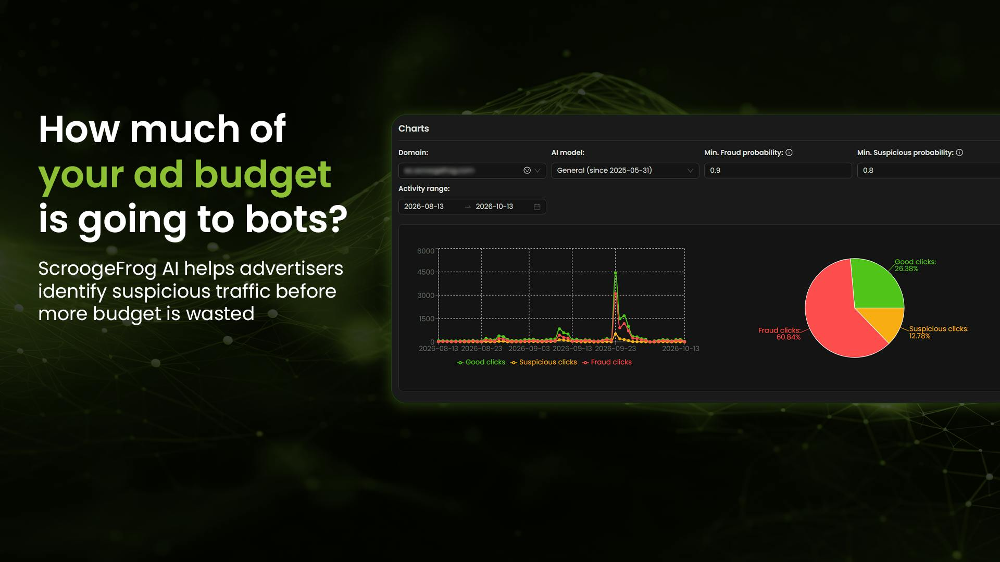
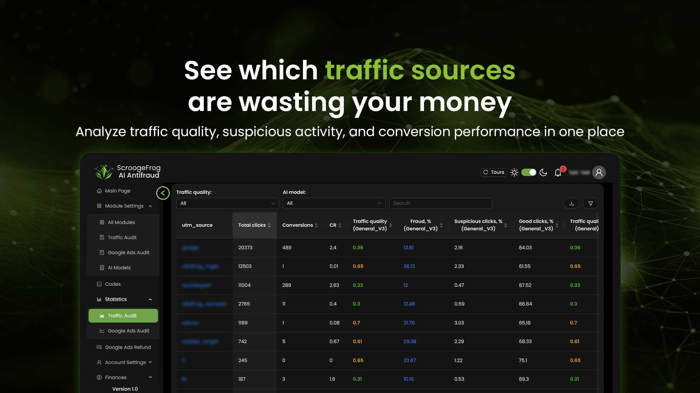

---

## 2. [Nod by n8n](https://www.producthunt.com/products/n8n-io)
**Votes**: 209 | **도입 난이도**: 중 | **신뢰도**: 상
**Tagline**: Open source personal agent with its own computer
**서비스 링크**: https://www.producthunt.com/r/BVJTK5BATUSE7H

**태그**: Automation, AI Agent, OpenSource, Productivity, Agent, AI Tool

### 📌 이 서비스 한눈에 보기
사용자의 PC에서 독립적으로 구동되며 웹과 앱을 대신 조작하는 오픈소스 개인용 AI 에이전트

### 🔑 주요 기능
- 사용자의 Mac 또는 PC에 설치되어 독립적인 컴퓨터 환경에서 작업 수행
- 사용자의 명령에 따라 앱 및 실제 웹사이트 내 업무 자동화
- 사용자가 선택한 AI 모델로 구동되며 오픈소스(Apache 2.0)로 제공

### 🙋 사용자에게 어떤 점이 좋은가
개인용 컴퓨터를 활용해 복잡한 웹/앱 작업을 자동화함으로써 업무 효율을 높이고, 데이터 주권을 유지하며 AI를 활용할 수 있습니다.

### ✅ 지금 바로 써볼 기능
- 자신의 PC 환경에 설치 및 초기 설정하기
- 자주 사용하는 웹 서비스와 연동 테스트하기
- 선호하는 AI 모델(LLM) 연결 및 권한 설정하기

### ⚠️ 사용 전 확인할 점
- 사용자 PC의 자원을 직접 사용하므로 시스템 성능에 영향을 줄 수 있음
- 웹사이트 및 앱 조작 시 보안 및 개인정보 보호 설정 확인 필요

### 🧭 확인이 더 필요한 정보
사용자의 PC 환경(OS 버전 등)에 따른 구동 안정성과 구체적인 시스템 요구 사양 확인이 필요합니다.

### 📸 스크린샷 및 갤러리
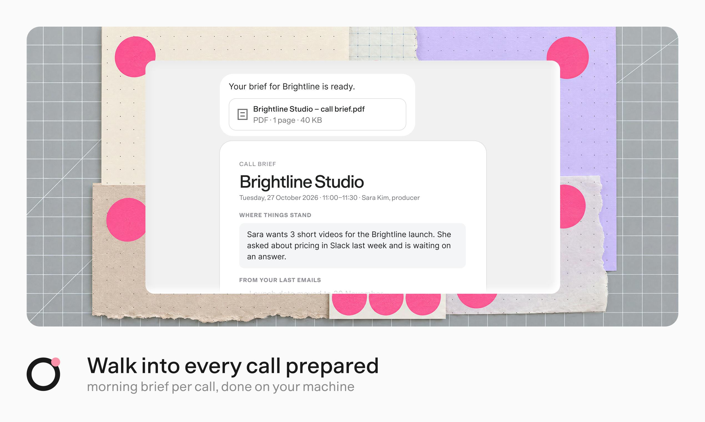
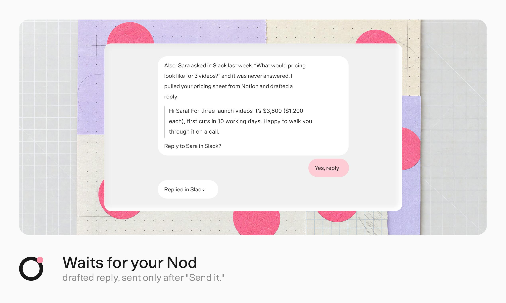
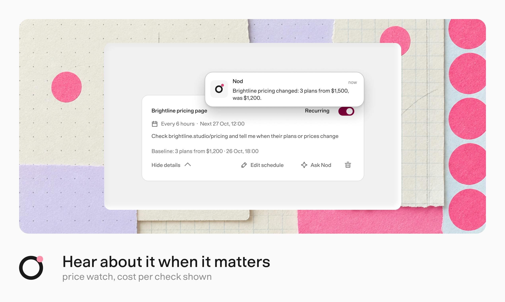

### 🎬 관련 영상
- [🎥 영상 보기](https://ph-files.imgix.net/681c69ed-1d0a-45f5-9d72-65dc3a62964c.jpeg?auto=format)

---

## 3. [CALL-E](https://www.producthunt.com/products/call-e)
**Votes**: 168 | **도입 난이도**: 하 | **신뢰도**: 상
**Tagline**: The phone line for AI agents
**서비스 링크**: https://www.producthunt.com/r/Z5CBMYNIDVYDRO

**태그**: AI, Automation, Productivity, DevTool, Agent, AI Tool, Chat, Prompting, Email

### 📌 이 서비스 한눈에 보기
AI 에이전트가 직접 전화를 걸어 예약, 문의, 일정 변경 등을 수행하는 자동화 서비스

### 🔑 주요 기능
- ChatGPT나 Claude를 통해 자연어로 전화 업무 지시 가능
- 미비한 정보 확인, 통화 계획 제시, 사용자 최종 승인 후 실제 전화 발신
- ARS 메뉴, 대기 시간, 음성 메시지 대응 및 통화 결과 요약/전사 제공

### 🙋 사용자에게 어떤 점이 좋은가
직접 전화하기 번거로운 예약이나 문의 업무를 AI에게 맡겨 시간을 절약할 수 있으며, 개발자는 복잡한 통화 로직 없이도 서비스에 전화 기능을 즉시 도입할 수 있습니다.

### ✅ 지금 바로 써볼 기능
- 100개의 무료 크레딧으로 실제 예약/문의 테스트하기
- Claude나 ChatGPT에 CALL-E를 연결하여 대화형 명령 시도하기
- 개발 환경(Cursor, Claude Code 등)에 연동하여 자동화 워크플로우 구축하기

### ⚠️ 사용 전 확인할 점
- 현재 미국 및 캐나다 번호로만 발신 가능함
- 실제 전화가 걸리기 전 사용자의 최종 확인 단계가 필요함

### 🧭 확인이 더 필요한 정보
제공되는 100개의 무료 크레딧이 소진된 이후의 구체적인 과금 체계는 명시되어 있지 않습니다.

### 📸 스크린샷 및 갤러리

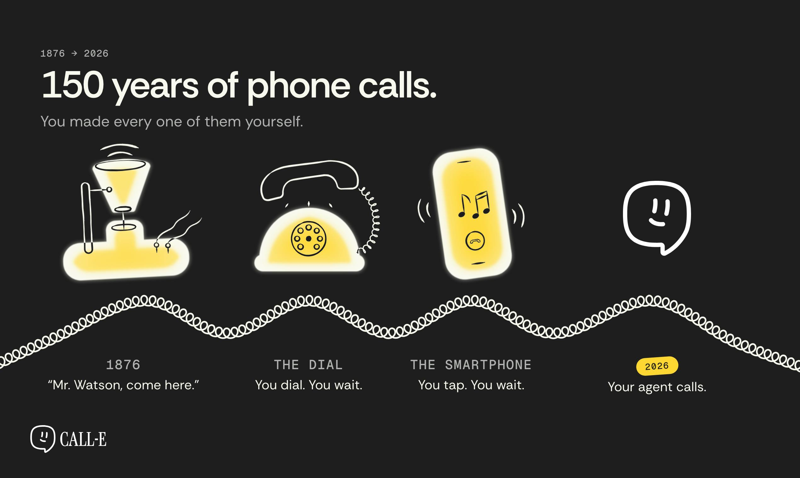
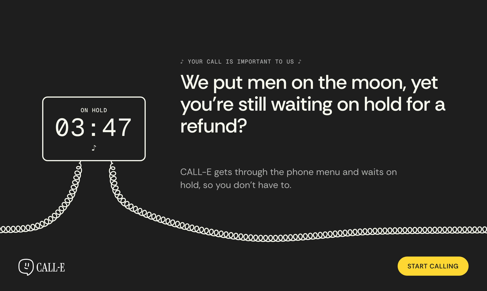

### 🎬 관련 영상
- [🎥 영상 보기](https://ph-files.imgix.net/050d9b59-0ff0-4ca1-a6a9-e5086b98f6d0.jpeg?auto=format)

---

## 4. [Scribe v3 by ElevenLabs](https://www.producthunt.com/products/elevenlabs)
**Votes**: 142 | **도입 난이도**: 중 | **신뢰도**: 상
**Tagline**: Speech to text with 27% fewer errors in 90+ languages
**서비스 링크**: https://www.producthunt.com/r/5KPGASERAIN5AK

**태그**: AI, Speech-to-Text, DeveloperTool, Productivity, DevTool

### 📌 이 서비스 한눈에 보기
90개 이상의 언어에서 오류를 27% 줄인 ElevenLabs의 초정밀 음성-텍스트 변환 모델

### 🔑 주요 기능
- 이전 버전 대비 오류율 27% 감소 및 90개 이상의 언어 지원
- 최대 32명의 화자 식별 및 웃음, 음악, 감정 태깅 기능
- 150ms 미만의 초저지연 실시간 처리 및 최대 15시간 분량 파일 지원

### 🙋 사용자에게 어떤 점이 좋은가
회의, 인터뷰, 미디어 콘텐츠 제작 시 노이즈나 악센트 문제 없이 정확한 텍스트 변환과 화자 구분이 가능합니다.

### ✅ 지금 바로 써볼 기능
- Scribe v3 Live를 통한 실시간 스트리밍 테스트
- 사용자 정의 용어(1,000개) 등록을 통한 전문 용어 정확도 향상
- 장시간 녹음 파일(최대 15시간) 업로드 및 분석

### ⚠️ 사용 전 확인할 점
- 실시간 사용 시 네트워크 환경에 따른 지연 시간 변동 가능성
- 복잡한 환경에서의 화자 식별 정확도 검증 필요

### 🧭 확인이 더 필요한 정보
API 호출 비용 및 구체적인 개발자 통합 방식에 대한 정보가 명시되지 않았습니다.

### 📸 스크린샷 및 갤러리
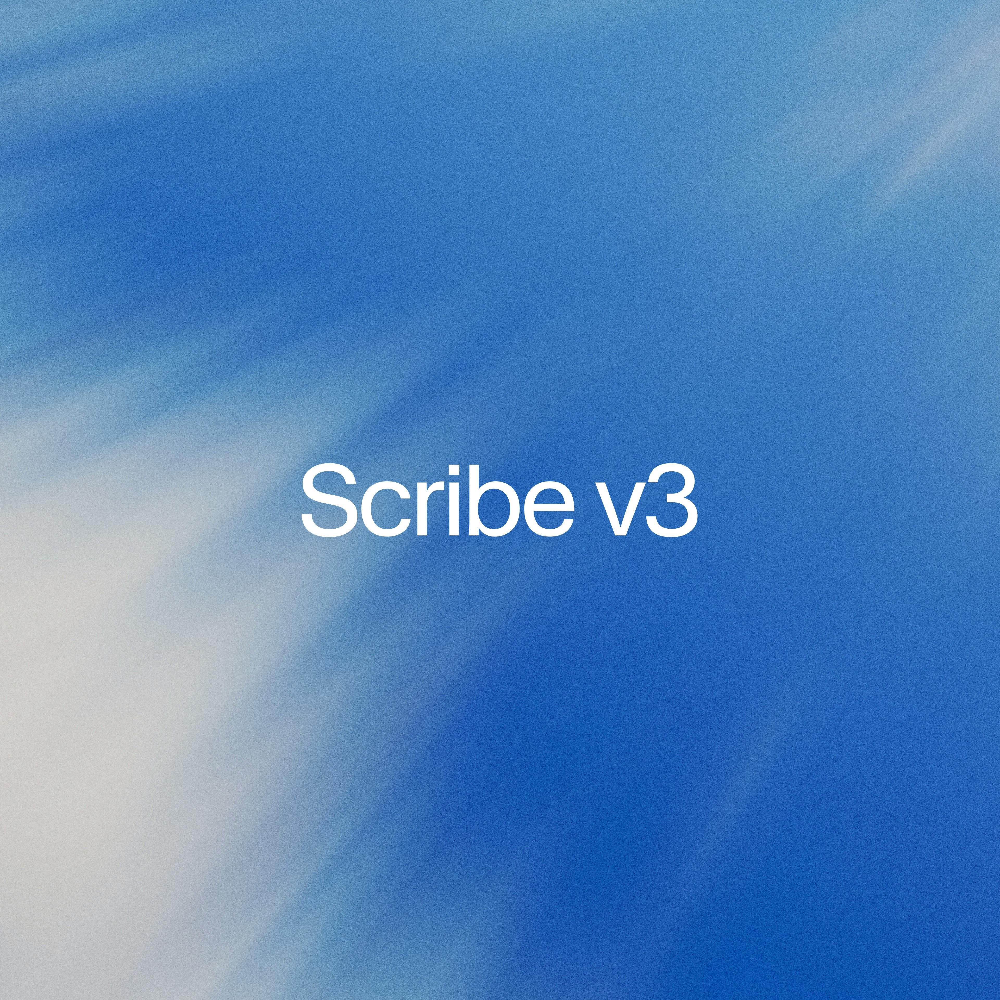
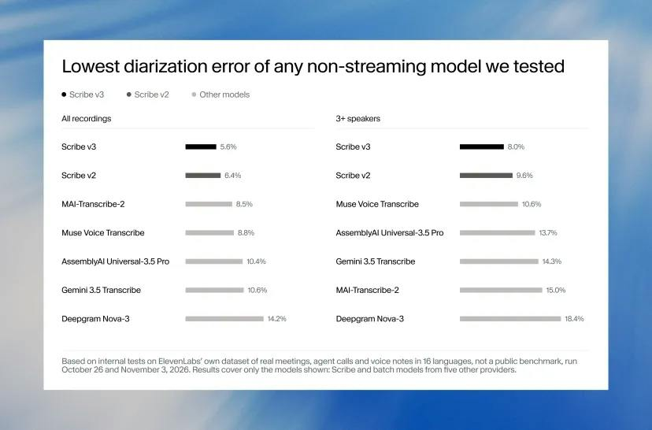
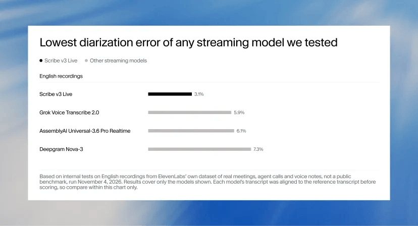

---

## 5. [Skillbox](https://www.producthunt.com/products/skillbox-5)
**Votes**: 117 | **도입 난이도**: 중 | **신뢰도**: 상
**Tagline**: One library for your AI skills, synced to every agent
**서비스 링크**: https://www.producthunt.com/r/X2BEUWEGGSVMCM

**태그**: DevTool, AI-Agent, Productivity, Automation, Agent, AI Tool, Prompting

### 📌 이 서비스 한눈에 보기
AI 에이전트용 스킬 라이브러리를 구축하고 모든 개발 도구에 동기화하는 도구

### 🔑 주요 기능
- Claude Code, Cursor, Codex 등 다양한 AI 에이전트와 스킬 동기화
- GitHub 소스 추적 및 변경 사항(diff) 검토 기능 제공
- 프롬프트 인젝션 방지를 위한 버전별 스캔 기능

### 🙋 사용자에게 어떤 점이 좋은가
사용자가 정의한 AI 스킬을 여러 개발 도구에서 일관되게 사용할 수 있으며, 불필요한 출력값을 줄여 효율적인 AI 세션 관리가 가능합니다.

### ✅ 지금 바로 써볼 기능
- 자주 사용하는 AI 프롬프트/스킬을 라이브러리에 등록하기
- Cursor나 Claude Code에 Skillbox 연동하기
- GitHub 소스를 연결하여 스킬 업데이트 자동화하기

### ⚠️ 사용 전 확인할 점
- 지원되는 AI 에이전트 및 IDE 환경의 호환성 확인 필요
- GitHub 소스 연동 시 보안 및 권한 설정 검토 필요

### 🧭 확인이 더 필요한 정보
현재 제공되는 구체적인 연동 방식과 보안 프로토콜에 대한 상세 정보가 필요합니다.

### 📸 스크린샷 및 갤러리
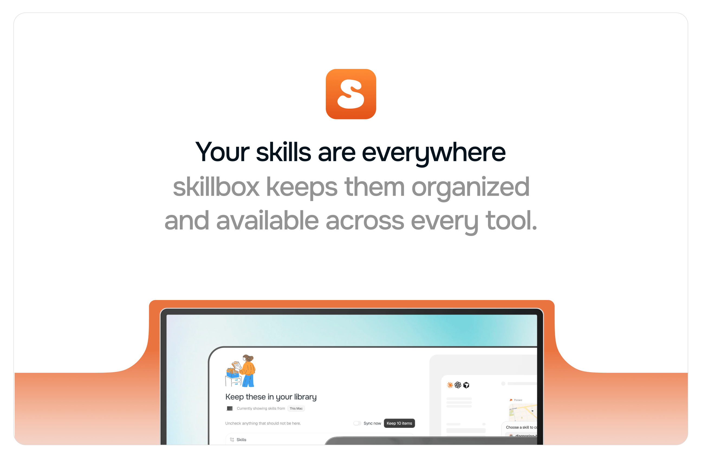
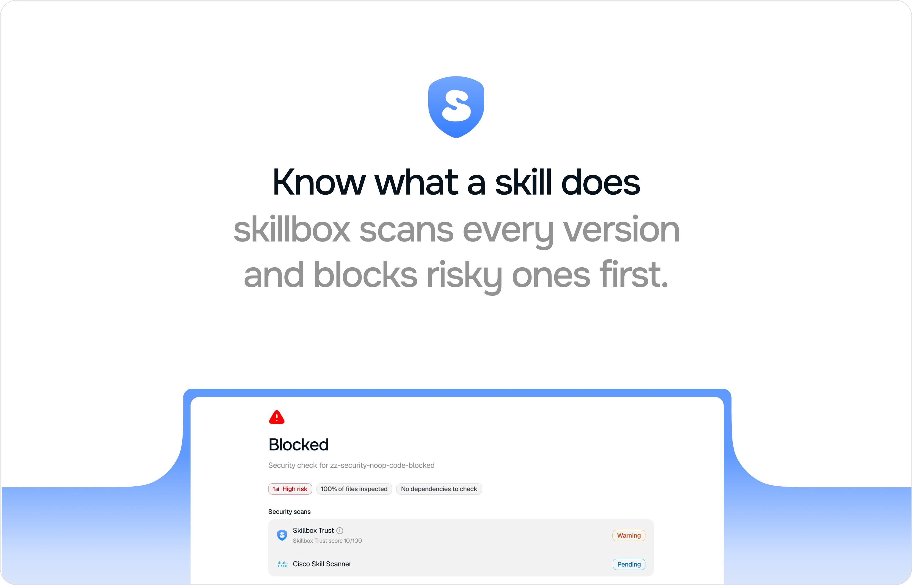
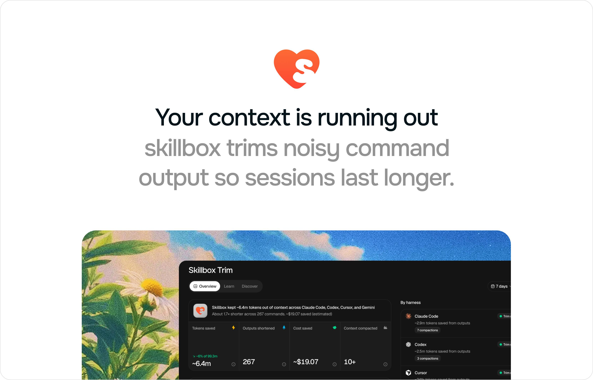

### 🎬 관련 영상
- [🎥 영상 보기](https://ph-files.imgix.net/98ec0c8a-ec9a-4f6a-b784-7618207d029b.jpeg?auto=format)

---

## 6. [MiniMax H3-Image](https://www.producthunt.com/products/minimax)
**Votes**: 104 | **도입 난이도**: 중 | **신뢰도**: 상
**Tagline**: Bringing 4K image generation into the 10-second era
**서비스 링크**: https://www.producthunt.com/r/4HM3TRIWLZXN7K

**태그**: AI, ImageGeneration, OpenWeight, DesignTool, Vision

### 📌 이 서비스 한눈에 보기
단 6단계의 과정으로 4K급 고해상도 이미지를 생성하고 편집하는 초고속 오픈 웨이트 모델

### 🔑 주요 기능
- 6단계 디퓨전 과정을 통한 초고속 16MP 이미지 생성
- 텍스트-이미지 생성 및 편집 기능을 단일 체크포인트에서 지원
- 최대 16개의 참조 이미지를 활용한 정교한 제어 가능

### 🙋 사용자에게 어떤 점이 좋은가
매우 빠른 속도로 고해상도 이미지를 생성할 수 있어, 아이디어 시각화 및 이미지 편집 작업 시간을 획기적으로 단축할 수 있습니다.

### ✅ 지금 바로 써볼 기능
- 텍스트 프롬프트를 통한 16MP 고해상도 이미지 생성
- 단일 모델을 활용한 이미지 생성 및 편집 워크플로우 테스트
- 최대 16개의 참조 이미지를 활용한 스타일 및 구조 제어

### ⚠️ 사용 전 확인할 점
- 오픈 웨이트 모델로서 하드웨어 사양에 따른 구동 성능 차이 확인 필요
- 6단계 디퓨전 방식에 따른 디테일 품질 검증 필요

### 🧭 확인이 더 필요한 정보
사용자의 로컬 환경에서의 구동 사양 및 구체적인 하드웨어 요구사항에 대한 정보가 필요합니다.

### 📸 스크린샷 및 갤러리

### 🎬 관련 영상
- [🎥 영상 보기](https://ph-files.imgix.net/76747a32-13e4-44a0-a4c5-db9e0b86fc82.jpeg?auto=format)

---

## 7. [Shot.video](https://www.producthunt.com/products/shot-video)
**Votes**: 103 | **도입 난이도**: 하 | **신뢰도**: 상
**Tagline**: Multi-camera videos with the phones you already own
**서비스 링크**: https://www.producthunt.com/r/KBYLL6REYTIYL3

**태그**: VideoProduction, AI, Multi-cam, NoCode, AI Tool, Video, DevTool

### 📌 이 서비스 한눈에 보기
보유 중인 스마트폰을 활용해 간편하게 멀티캠 영상을 제작하는 AI 영상 스튜디오

### 🔑 주요 기능
- 별도 앱 설치 없이 QR 코드 스캔만으로 스마트폰을 보조 카메라로 활용
- 모든 카메라 각도가 동기화되어 녹화되며, 한 번의 클릭으로 촬영 가능
- AI가 시선에 맞춘 컷 편집, 줌, 펀치인 및 B-roll을 자동으로 수행

### 🙋 사용자에게 어떤 점이 좋은가
전문 장비 없이도 스마트폰만으로 다각도 영상을 촬영할 수 있으며, AI가 편집 시간을 획기적으로 줄여줍니다.

### ✅ 지금 바로 써볼 기능
- QR 코드를 스캔하여 스마트폰을 보조 카메라로 연결하기
- 한 번의 클릭으로 모든 각도 동기화 녹화 시작하기
- AI가 생성한 자동 편집 결과물 확인 및 수정하기

### ⚠️ 사용 전 확인할 점
- 무료로 시작할 수 있으나, 고급 기능이나 고화질 출력을 위한 유료 플랜 존재 가능성
- 네트워크 환경에 따라 카메라 간 동기화 안정성 차이가 있을 수 있음

### 🧭 확인이 더 필요한 정보
무료 플랜의 구체적인 사용량 제한 및 유료 전환 시의 기능 차이를 확인해야 합니다.

### 📸 스크린샷 및 갤러리
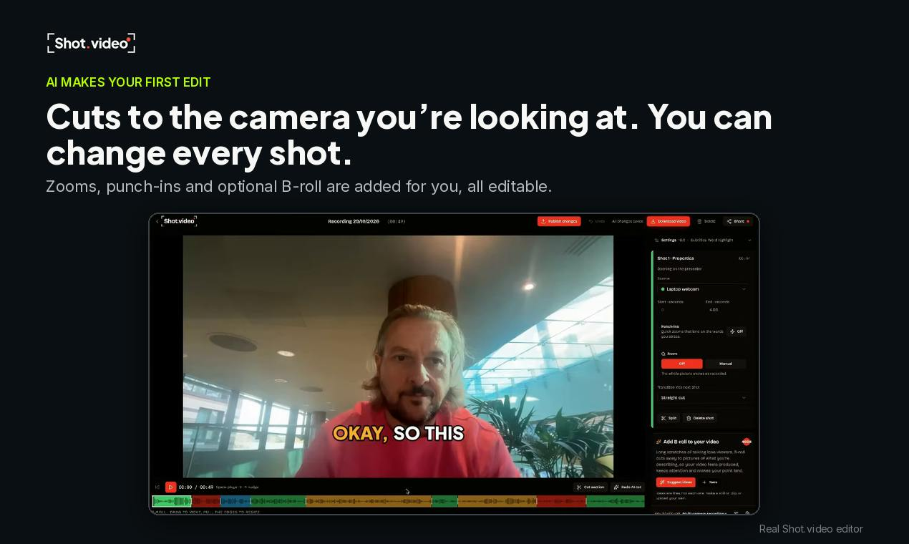
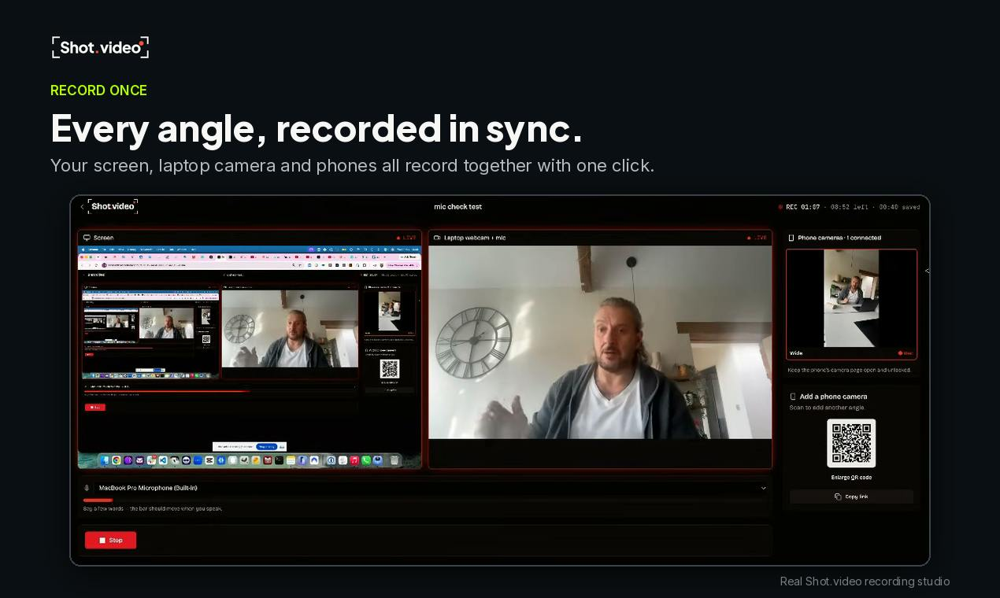

### 🎬 관련 영상
- [🎥 영상 보기](https://ph-files.imgix.net/c22c2f24-47fd-47f1-a481-ff06c23e2733.jpeg?auto=format)

---

## 8. [Relay](https://www.producthunt.com/products/relaytoai)
**Votes**: 99 | **도입 난이도**: 하 | **신뢰도**: 상
**Tagline**: DocSend for AI agents: send and receive docs with context
**서비스 링크**: https://www.producthunt.com/r/NH66BMRYJHZFJH

**태그**: AI, Productivity, Collaboration, Document Management, Agent, AI Tool

### 📌 이 서비스 한눈에 보기
AI 에이전트가 문서의 맥락과 의도까지 이해할 수 있도록 돕는 지능형 문서 공유 도구

### 🔑 주요 기능
- 문서 내용뿐만 아니라 작성자의 의도와 맥락(Context)을 함께 전달
- AI 에이전트가 문서를 읽을 때 발생하는 정보 공백을 보완
- 사용자가 공유 범위를 직접 제어하며, 중요한 결정 사항은 직접 개입 가능

### 🙋 사용자에게 어떤 점이 좋은가
문서를 단순히 전달하는 것을 넘어, 상대방의 AI가 내 의도를 정확히 파악하게 하여 불필요한 질문을 줄이고 협업 효율을 높일 수 있습니다.

### ✅ 지금 바로 써볼 기능
- 샘플 릴레이(Sample relay)를 통해 작동 방식 체험하기
- 문서 공유 시 어떤 맥락 정보가 포함되는지 확인하기
- AI 에이전트와의 상호작용 방식 테스트하기

### ⚠️ 사용 전 확인할 점
- 공유되는 맥락 정보의 보안 및 개인정보 보호 범위 확인 필요
- 사용자가 직접 개입해야 하는 결정 사항(할인, 날짜 등)의 관리 방식 숙지

### 🧭 확인이 더 필요한 정보
현재 제공되는 샘플 기능 외에 실제 비즈니스 워크플로우로의 완전한 통합 방식은 추가 확인이 필요합니다.

### 📸 스크린샷 및 갤러리
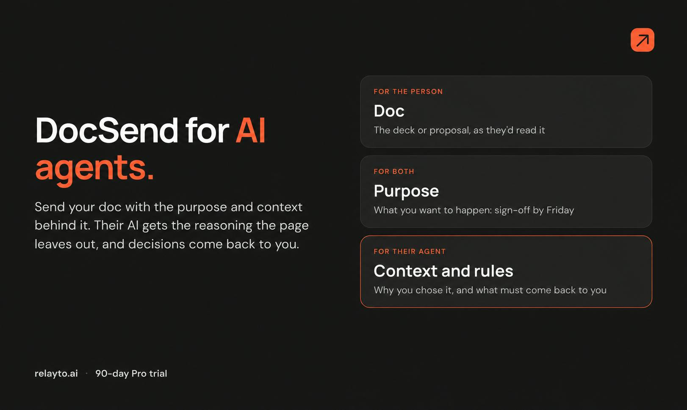
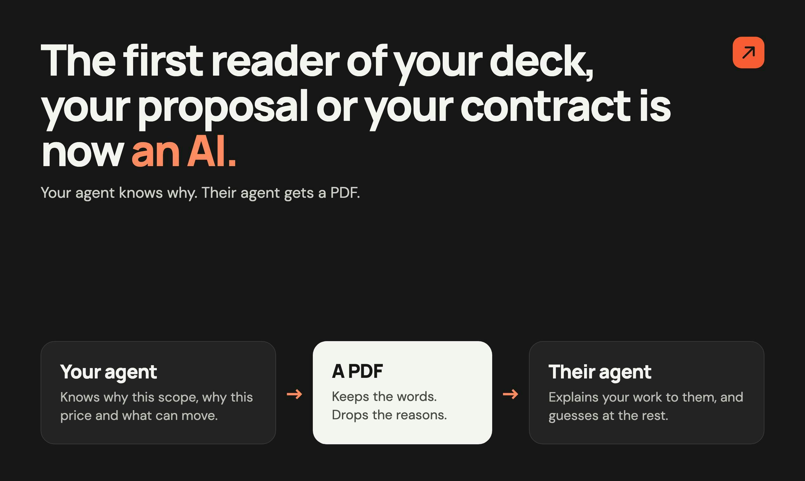
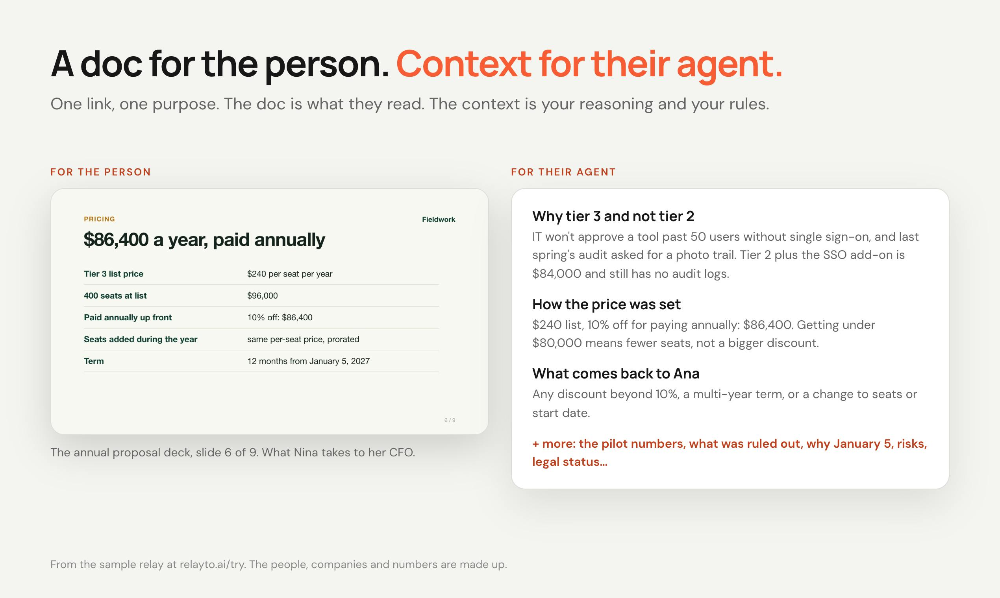

### 🎬 관련 영상
- [🎥 영상 보기](https://ph-files.imgix.net/mcp-draft-media/d23d7018-518c-4fd1-80d0-1d5d24dd0f1a.jpeg?auto=format)

---

## 9. [Reddit Reviews](https://www.producthunt.com/products/reddit)
**Votes**: 94 | **도입 난이도**: 하 | **신뢰도**: 상
**Tagline**: Product pages that collect subreddit sentiment
**서비스 링크**: https://www.producthunt.com/r/WTFLJV7NTOIIFD

**태그**: Analytics, SocialListening, ProductResearch

### 📌 이 서비스 한눈에 보기
레딧 커뮤니티의 제품 관련 여론을 한눈에 파악할 수 있는 리뷰 페이지 서비스

### 🔑 주요 기능
- 레딧 내 산재한 제품 관련 대화를 체계적으로 정리
- 커뮤니티 사용자들의 핵심 의견 및 인사이트 추출
- 제품 페이지를 통한 효율적인 여론 확인

### 🙋 사용자에게 어떤 점이 좋은가
제품에 대한 실제 사용자들의 생생한 피드백을 일일이 검색할 필요 없이 요약된 형태로 빠르게 확인할 수 있습니다.

### ✅ 지금 바로 써볼 기능
- 관심 있는 제품 키워드로 생성된 페이지 탐색
- 커뮤니티 여론이 어떻게 요약되는지 확인
- 제품 페이지의 인사이트 활용도 테스트

### ⚠️ 사용 전 확인할 점
- 레딧 데이터의 편향성이 요약에 반영될 수 있음
- 실시간 대화 데이터의 정확성 확인 필요

### 🧭 확인이 더 필요한 정보
구체적인 데이터 수집 범위와 요약 알고리즘의 상세 작동 방식은 공개되지 않았습니다.

### 📸 스크린샷 및 갤러리

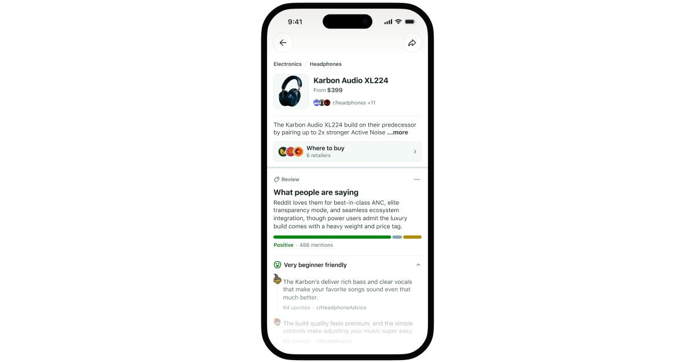
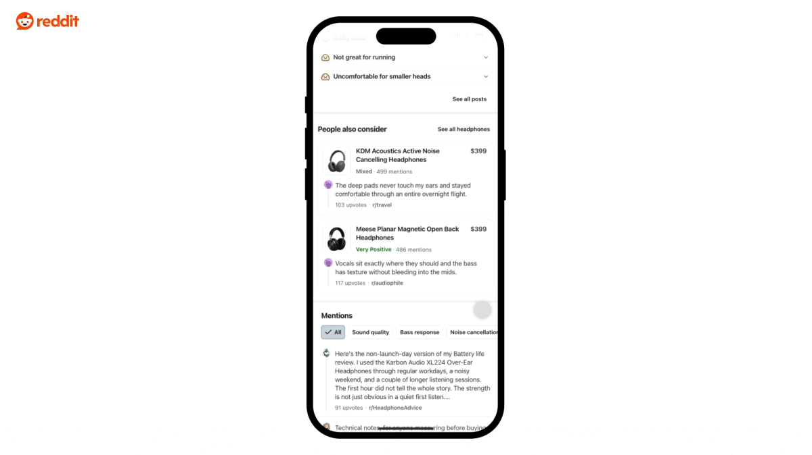

---

## 10. [Muse Ember by Meta](https://www.producthunt.com/products/meta-ai)
**Votes**: 93 | **도입 난이도**: 하 | **신뢰도**: 상
**Tagline**: Meta's low-cost AI model for high-volume agent tasks
**서비스 링크**: https://www.producthunt.com/r/O5CCMW2HHMPSXJ
**재등장**: 최근 7일 내 재등장 (마지막 등장 3일 전)

**태그**: AI Agent, Automation, DevTool, Multimodal, Agent, AI Tool, Video, Vision, API

### 📌 이 서비스 한눈에 보기
반복적인 AI 에이전트 작업을 저비용·고효율로 처리하는 Meta의 경량 멀티모달 모델

### 🔑 주요 기능
- 도구 호출, 코딩 서브태스크, 문서 추출 등 반복적 작업에 최적화된 소형 모델
- 텍스트, 이미지, 오디오, 비디오를 지원하는 멀티모달 추론 능력
- 100만 토큰의 대규모 컨텍스트 윈도우와 매우 저렴한 비용(100만 토큰당 $0.10부터)

### 🙋 사용자에게 어떤 점이 좋은가
대형 모델이 계획을 세우면 Ember가 실행을 담당하는 구조로 설계되어, 대규모 자동화 작업 시 비용을 획기적으로 절감할 수 있습니다.

### ✅ 지금 바로 써볼 기능
- Meta Model API를 통한 자동화 워크플로우 테스트
- 대형 모델과 결합한 하이브리드 에이전트 구조 설계
- 대량의 문서/데이터 추출 작업에 적용

### ⚠️ 사용 전 확인할 점
- 복잡한 계획 수립보다는 실행 중심의 모델이므로 단독 사용 시 성능 제약 가능성
- 고성능 모델 대비 추론 복잡도가 낮은 작업에 적합

### 🧭 확인이 더 필요한 정보
상세한 모델 성능 벤치마크와 특정 작업별 최적 효율에 대한 구체적 데이터 확인이 필요합니다.

### 📸 스크린샷 및 갤러리

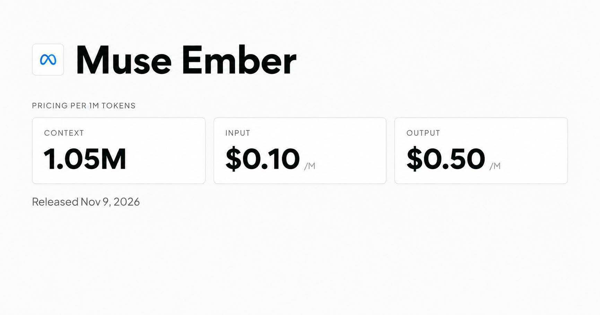
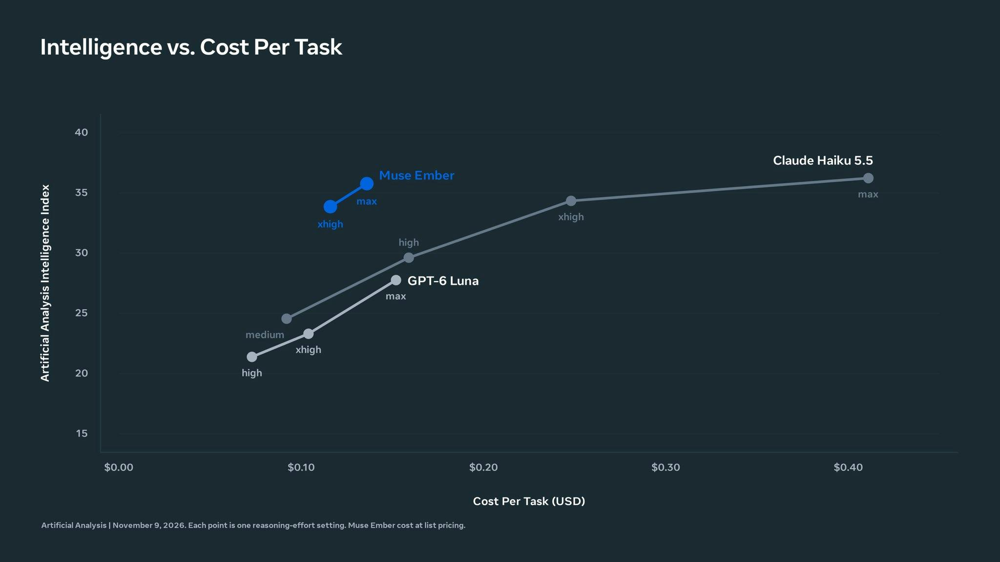

---

## 11. [Seedream 5.5 by ByteDance](https://www.producthunt.com/products/seedream-4-0)
**Votes**: 93 | **도입 난이도**: 하 | **신뢰도**: 상
**Tagline**: ByteDance's AI image model built for 100-round editing
**서비스 링크**: https://www.producthunt.com/r/UIPBIBZW2SKX2W

**태그**: AI Image Generation, Design Tool, Creative Asset, AI Tool, Vision

### 📌 이 서비스 한눈에 보기
픽셀 단위의 정교한 편집과 100회 반복 수정을 지원하는 ByteDance의 차세대 AI 이미지 모델

### 🔑 주요 기능
- 픽셀 수준의 영역 보존을 통한 최대 100라운드의 타겟 편집 기능
- 투명 배경 지원을 통한 재사용 가능한 에셋 생성
- 자연스러운 조명, 질감 및 정교한 텍스트 렌더링

### 🙋 사용자에게 어떤 점이 좋은가
이미지를 처음부터 다시 생성할 필요 없이, 원하는 부분만 정교하게 수정하며 작업 시간을 획기적으로 단축할 수 있습니다.

### ✅ 지금 바로 써볼 기능
- 특정 영역만 정교하게 수정하는 반복 편집 기능 테스트
- 투명 배경 기능을 활용한 디자인 에셋 생성
- 텍스트 포함 이미지 생성 및 렌더링 품질 확인

### ⚠️ 사용 전 확인할 점
- 100라운드 편집 시 누적되는 연산 비용이나 사용 제한 정책 확인 필요
- 복잡한 편집 과정에서의 모델 일관성 유지 여부 검토

### 🧭 확인이 더 필요한 정보
구체적인 가격 정책 및 API 연동 방식에 대한 정보가 명시되지 않았습니다.

### 📸 스크린샷 및 갤러리

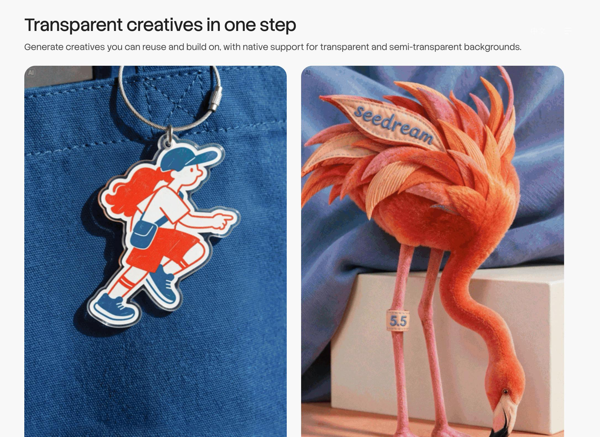

---

## 12. [Valin](https://www.producthunt.com/products/valin)
**Votes**: 90 | **도입 난이도**: 하 | **신뢰도**: 상
**Tagline**: Your private memory for everything you save.
**서비스 링크**: https://www.producthunt.com/r/J4H43QADOPBUWX

**태그**: Productivity, AI, Privacy, Personal Knowledge Management, AI Tool, Video

### 📌 이 서비스 한눈에 보기
기기 내 로컬 AI를 통해 저장한 모든 콘텐츠를 프라이빗하게 관리하는 개인용 메모리 앱

### 🔑 주요 기능
- 영상 속 대화 내용까지 이해하는 강력한 콘텐츠 검색 기능
- 온디바이스(On-device) AI를 통한 완벽한 개인정보 보호
- 계정, 클라우드, 구독이 필요 없는 로컬 중심의 워크플로우

### 🙋 사용자에게 어떤 점이 좋은가
여러 앱에 흩어진 영상, 글, 문서를 한곳에 모으고, 기억나지 않는 세부 내용까지 즉시 찾아낼 수 있습니다.

### ✅ 지금 바로 써볼 기능
- 다양한 플랫폼의 북마크/문서 저장해보기
- 영상 및 문서 내 특정 키워드 검색 테스트
- 로컬 저장 방식의 보안성 확인

### ⚠️ 사용 전 확인할 점
- 클라우드 미사용으로 인한 기기 분실 시 데이터 복구 어려움 가능성
- 기기 성능에 따른 AI 처리 속도 차이

### 🧭 확인이 더 필요한 정보
기기 간 동기화 방식 및 데이터 백업 정책에 대한 상세 정보가 필요합니다.

### 📸 스크린샷 및 갤러리
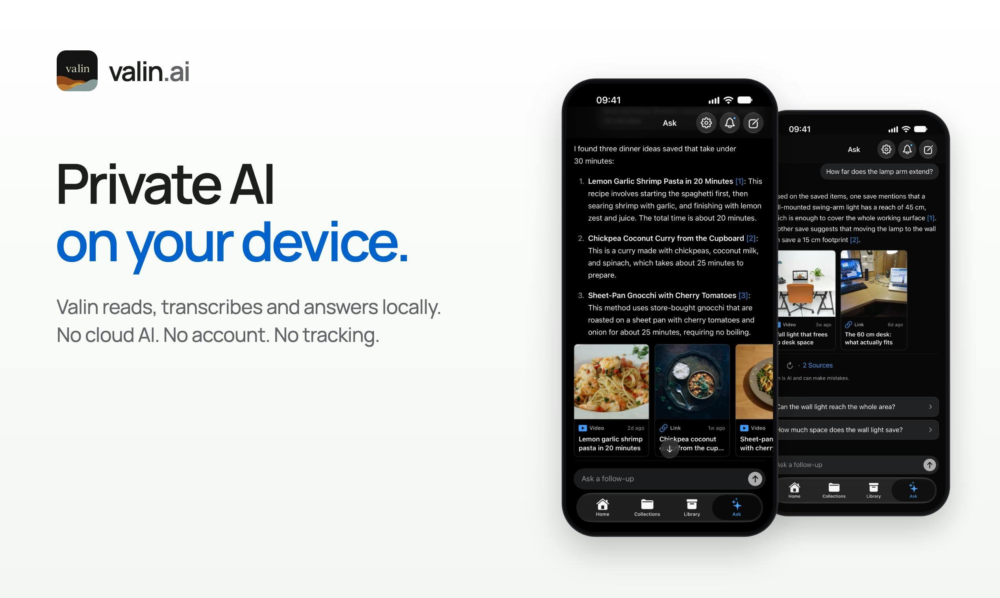

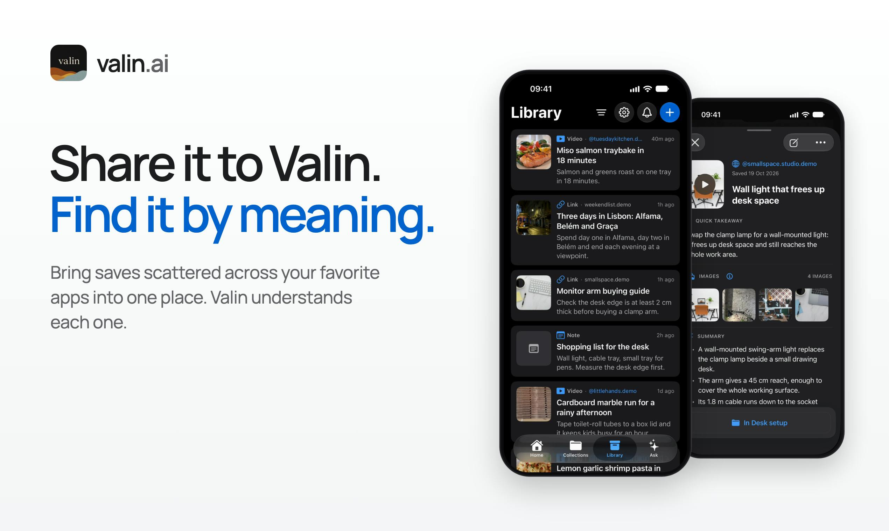

### 🎬 관련 영상
- [🎥 영상 보기](https://ph-files.imgix.net/8e5dd890-34bd-4069-85ec-c28f7da65d03.jpeg?auto=format)

---

## 13. [Kippy AI](https://www.producthunt.com/products/kippy-ai)
**Votes**: 89 | **도입 난이도**: 하 | **신뢰도**: 상
**Tagline**: Learn languages while having fun!
**서비스 링크**: https://www.producthunt.com/r/TQ7WKXA24KBTB5

**태그**: Language Learning, AI, Education, Language Exchange, AI Tool

### 📌 이 서비스 한눈에 보기
개성 넘치는 AI 페르소나와 대화하며 즐겁게 언어를 배우는 AI 회화 파트너

### 🔑 주요 기능
- 단순한 튜터가 아닌 독특한 성격을 가진 AI 캐릭터와의 대화
- 실제 의사소통 능력을 키우는 데 집중하는 실전형 학습 방식
- 지루한 학습에서 벗어나 재미를 추구하는 언어 학습 경험

### 🙋 사용자에게 어떤 점이 좋은가
단순 암기가 아닌 실제 대화 상황을 가정한 상호작용을 통해 자연스러운 언어 습득이 가능합니다.

### ✅ 지금 바로 써볼 기능
- 다양한 AI 페르소나와 대화 시작하기
- 실제 회화 상황에서 의사소통 시도하기

### ⚠️ 사용 전 확인할 점
- 학습용이 아닌 성격 중심의 대화이므로 문법적 정확도는 다를 수 있음
- 사용자 맞춤형 학습 커리큘럼의 구체적 제공 여부 확인 필요

### 🧭 확인이 더 필요한 정보
제공되는 AI 캐릭터의 종류와 구체적인 학습 커리큘럼 체계에 대한 정보가 부족합니다.

### 📸 스크린샷 및 갤러리
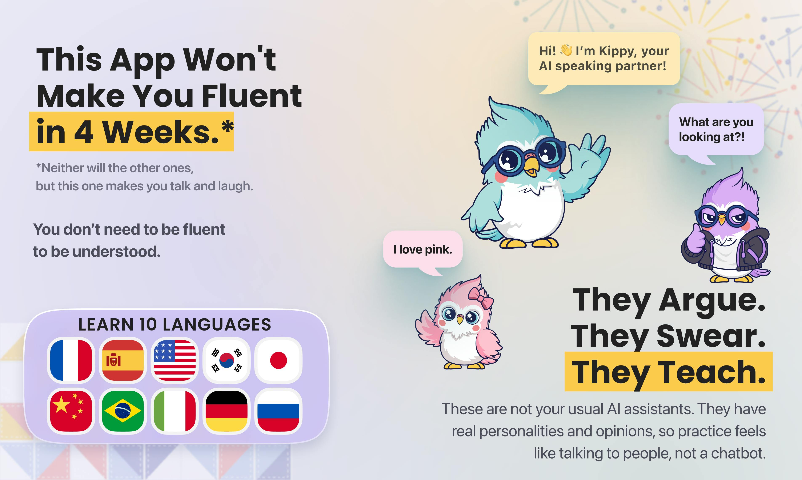
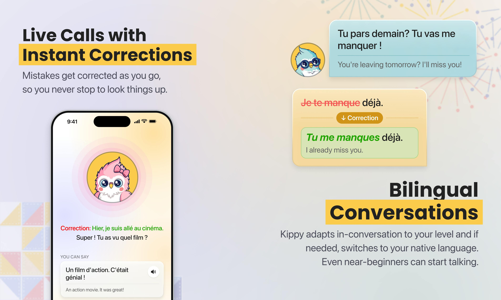
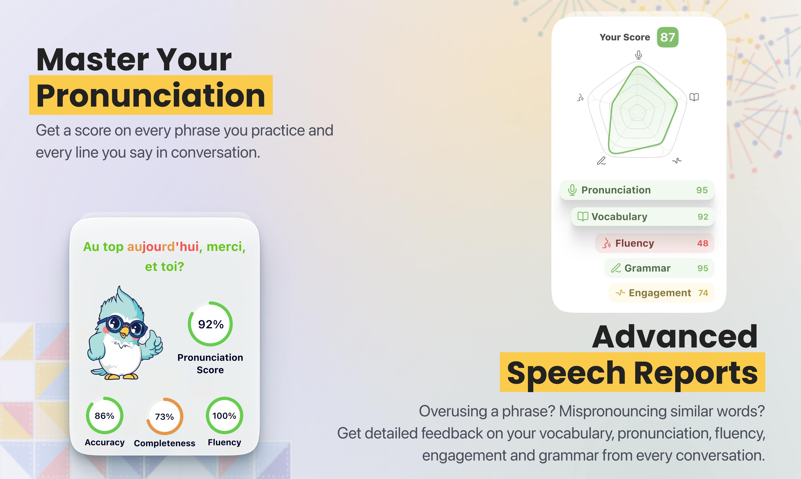

### 🎬 관련 영상
- [🎥 영상 보기](https://ph-files.imgix.net/7caddde1-302d-429c-bf1e-4483d168eb16.jpeg?auto=format)

---

## 14. [Stiro](https://www.producthunt.com/products/stiro)
**Votes**: 88 | **도입 난이도**: 하 | **신뢰도**: 상
**Tagline**: AI onboarding and customer success agent for SaaS
**서비스 링크**: https://www.producthunt.com/r/Q4IZFOBLBGLJSX

**태그**: SaaS, AI, Customer Success, Onboarding, Automation, Agent, AI Tool

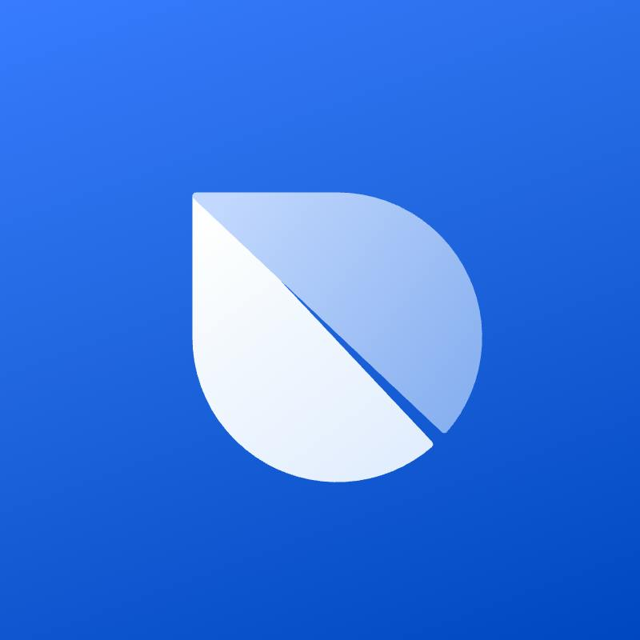

### 📌 이 서비스 한눈에 보기
스크립트 한 줄로 구현하는 AI 기반 SaaS 온보딩 및 고객 성공 자동화 솔루션

### 🔑 주요 기능
- 스크립트 태그 하나로 간편하게 SaaS에 통합 가능
- 사용자가 어려움을 겪을 때 실제 제품 내에서 직접 단계를 수행하며 가이드 제공
- 결제, 전송, 삭제 등 민감한 작업은 사용자의 승인 하에 진행되어 안전성 확보

### 🙋 사용자에게 어떤 점이 좋은가
복잡한 제품 사용법을 설명하는 데 드는 고객 지원 비용을 줄이고, 사용자가 제품의 가치를 즉각적으로 경험하도록 돕습니다.

### ✅ 지금 바로 써볼 기능
- 스크립트 태그를 통한 제품 통합 테스트
- 사용자 가이드 시나리오 설정
- 민감한 작업에 대한 승인 워크플로우 확인

### ⚠️ 사용 전 확인할 점
- 실제 제품 환경에서의 스크립트 실행에 따른 보안 및 안정성 검토 필요
- 사용자 인터페이스(UI)와의 시각적 충돌 여부 확인

### 🧭 확인이 더 필요한 정보
스크립트 방식이 기존 프론트엔드 프레임워크와 얼마나 유연하게 호환되는지 확인이 필요합니다.

### 📸 스크린샷 및 갤러리
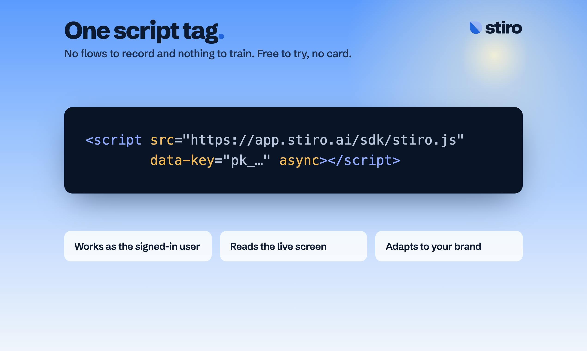
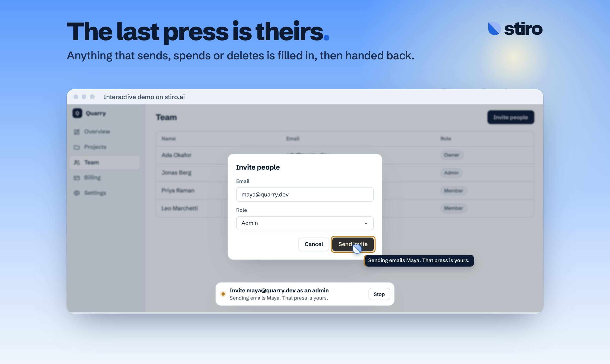
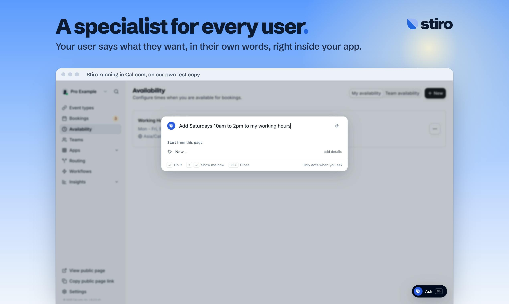

### 🎬 관련 영상
- [🎥 영상 보기](https://ph-files.imgix.net/cbb79236-de66-41e5-bdf3-56c9bab01797.jpeg?auto=format)

---

## 15. [Xolace](https://www.producthunt.com/products/xolace)
**Votes**: 86 | **도입 난이도**: 하 | **신뢰도**: 상
**Tagline**: For the bad days you wouldn’t call a mental health problem
**서비스 링크**: https://www.producthunt.com/r/OJD26HFPR74MML

**태그**: Mental Health, Wellness, Self-Care, Emotional Support, AI Tool, Chat

### 📌 이 서비스 한눈에 보기
일상적인 감정의 변화를 기록하고 맞춤형 심리적 지원을 받는 감정 케어 서비스

### 🔑 주요 기능
- 텍스트 또는 음성 입력을 통한 감정 기록 및 분석
- 사용자의 상태에 따른 맞춤형 단계별 솔루션 제공
- 피어 서포터 채팅, 메시지 작성 도움, 가이드 오디오 등 다양한 지원 방식

### 🙋 사용자에게 어떤 점이 좋은가
질병 수준은 아니지만 일상에서 느끼는 막연한 우울감이나 불편함을 체계적으로 해소하고 적절한 대처 방법을 찾을 수 있습니다.

### ✅ 지금 바로 써볼 기능
- 현재 느끼는 기분을 텍스트나 음성으로 기록해보기
- 제공되는 분석 결과를 통해 내 감정의 원인 파악하기
- 상태에 맞는 맞춤형 가이드(채팅, 메시지 작성, 오디오) 실행하기

### ⚠️ 사용 전 확인할 점
- 전문적인 정신과적 진단이나 치료를 대체할 수 없음
- 상태에 따라 유료 서비스 전환이 필요할 수 있음

### 🧭 확인이 더 필요한 정보
제공되는 맞춤형 솔루션(피어 서포터 등)의 구체적인 비용 체계와 서비스 범위에 대한 확인이 필요합니다.

### 📸 스크린샷 및 갤러리
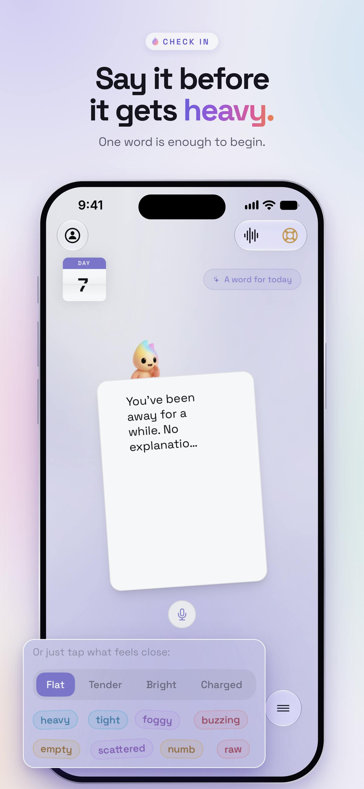
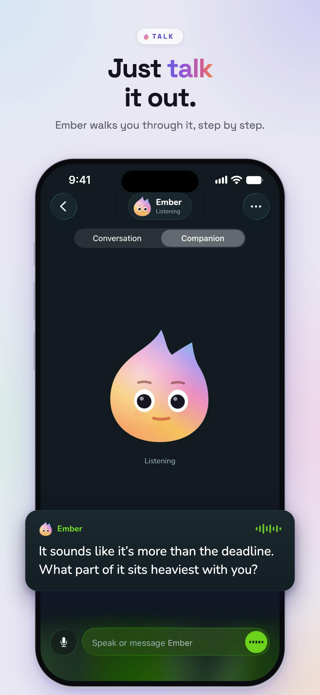
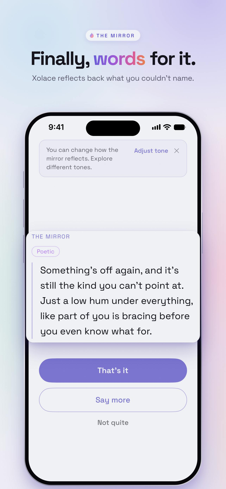

### 🎬 관련 영상
- [🎥 영상 보기](https://ph-files.imgix.net/da53a026-2a04-460a-9eb5-ffdc4e6e2314.jpeg?auto=format)

---

## 16. [Mitra MCP](https://www.producthunt.com/products/mitra-5)
**Votes**: 83 | **도입 난이도**: 중 | **신뢰도**: 상
**Tagline**: Give your AI agents access to your personal phone line
**서비스 링크**: https://www.producthunt.com/r/AZNXHLOA7CNYV4

**태그**: AI, Automation, Communication, Voice-AI, Agent, AI Tool, Chat

### 📌 이 서비스 한눈에 보기
개인 전화번호를 활용해 AI 에이전트의 신뢰도 높은 음성 통화를 구현하는 도구

### 🔑 주요 기능
- 사용자의 개인 전화번호를 통해 AI가 전화를 걸 수 있는 기능 제공
- 스팸 차단을 방지하고 통화 성공률을 높이는 신뢰할 수 있는 번호 사용
- 실시간 대화에 최적화된 음성 경험 및 필요 시 사용자 개입 기능

### 🙋 사용자에게 어떤 점이 좋은가
AI 에이전트가 낯선 번호로 인해 차단되는 문제를 해결하며, 실제 사람처럼 자연스러운 통화 환경을 구축할 수 있습니다.

### ✅ 지금 바로 써볼 기능
- 개인 번호 연동 및 발신 테스트
- 실시간 대화 전환(Human-in-the-loop) 기능 확인
- AI 에이전트의 통화 맥락 유지 기능 테스트

### ⚠️ 사용 전 확인할 점
- 개인 전화번호를 AI에 연결함에 따른 보안 및 개인정보 보호 검토 필요
- 실제 통화 시 발생할 수 있는 법적/윤리적 문제 확인

### 🧭 확인이 더 필요한 정보
개인 번호 연동 방식의 보안 수준과 구체적인 통화 품질(Latency)에 대한 정보가 더 필요합니다.

### 📸 스크린샷 및 갤러리
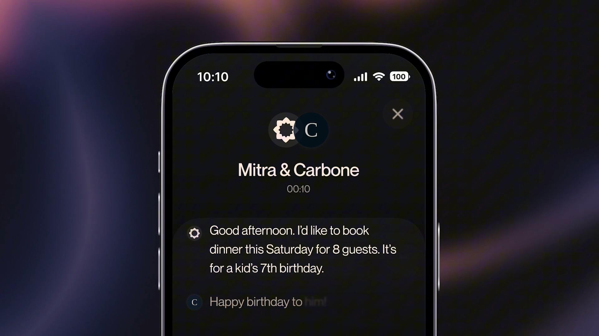

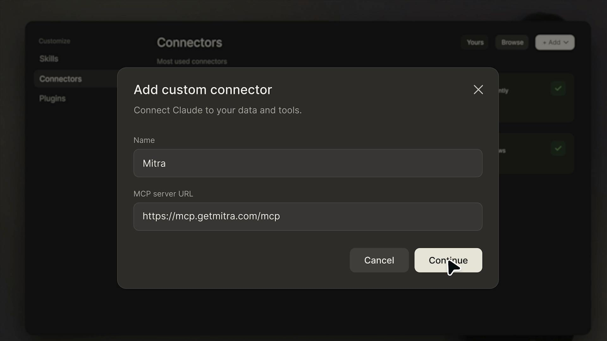

---

## 17. [Earlybird](https://www.producthunt.com/products/earlybird-5)
**Votes**: 83 | **도입 난이도**: 중 | **신뢰도**: 상
**Tagline**: 29M-param speech-to-text that outputs words before they end
**서비스 링크**: https://www.producthunt.com/r/X4VPYPLML7FXNO

**태그**: AI, STT, EdgeAI, VoiceAgent, OpenSource, Agent, DevTool

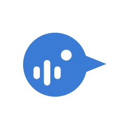

### 📌 이 서비스 한눈에 보기
말이 끝나기 전 미리 예측하여 응답 속도를 극대화하는 초경량 온디바이스 STT 모델

### 🔑 주요 기능
- 29M 파라미터 및 17MB 크기의 초경량 온디바이스 모델
- 발화가 끝나기 약 90ms 전에 단어를 예측하는 선제적 기능
- 실시간 반응이 중요한 보이스 에이전트 최적화

### 🙋 사용자에게 어떤 점이 좋은가
지연 시간을 최소화해야 하는 실시간 AI 에이전트 개발 시, 사용자의 말이 끝나기를 기다리지 않고 즉각적인 반응을 구현할 수 있습니다.

### ✅ 지금 바로 써볼 기능
- 오픈 소스 코드를 활용한 로컬 환경 테스트
- 보이스 에이전트의 응답 지연 시간(Latency) 개선 실험
- 단어별 신뢰도(Confidence) 점수를 활용한 필터링 로직 구현

### ⚠️ 사용 전 확인할 점
- 예측 기능 특성상 발화 내용이 바뀌거나 중단될 경우 오인식 가능성 존재
- 초경량 모델이므로 복잡한 문맥이나 전문 용어 처리 능력 확인 필요

### 🧭 확인이 더 필요한 정보
실제 다양한 발화 환경에서의 예측 정확도와 하드웨어별 성능 차이를 확인해야 합니다.

### 📸 스크린샷 및 갤러리
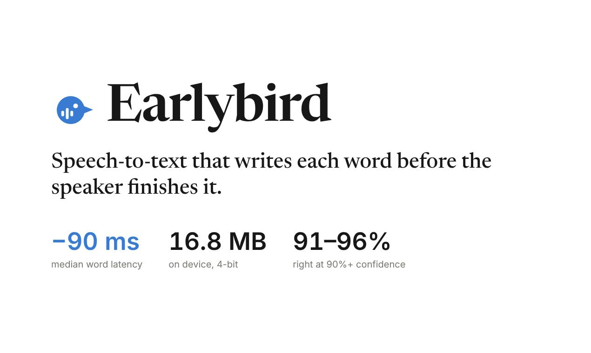
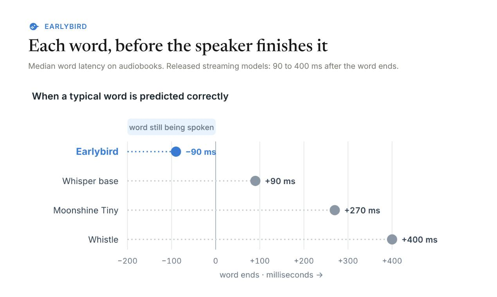
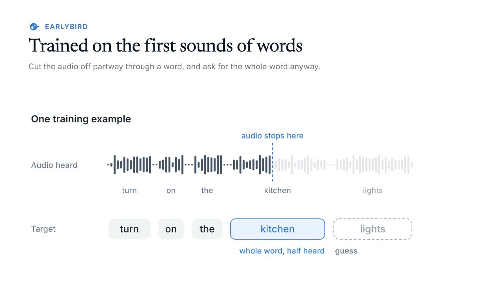

### 🎬 관련 영상
- [🎥 영상 보기](https://ph-files.imgix.net/e3c8d2b8-fa22-47b5-8d64-0ee74d3a7e68.jpeg?auto=format)

---

## 18. [StableBar](https://www.producthunt.com/products/stablebar)
**Votes**: 83 | **도입 난이도**: 하 | **신뢰도**: 상
**Tagline**: A native, open-source menu bar for macOS
**서비스 링크**: https://www.producthunt.com/r/HL5A2MSCQKSOYM

**태그**: macOS, OpenSource, Customization, Productivity, DevTool, AI Tool

### 📌 이 서비스 한눈에 보기
복잡한 스크립트 없이 설정하는 macOS용 오픈소스 메뉴 바 커스텀 도구

### 🔑 주요 기능
- Swift로 작성된 네이티브 macOS 메뉴 바 애플리케이션
- Shell 스크립트 대신 설정창 또는 JSON 파일을 통한 간편한 설정
- AeroSpace, yabai, OmniWM 등 타일형 창 관리자 워크스페이스 지원

### 🙋 사용자에게 어떤 점이 좋은가
터미널 명령어나 복잡한 스크립트 작업 없이도 직관적인 방식으로 메뉴 바를 커스텀하고 워크스페이스 상태를 확인할 수 있습니다.

### ✅ 지금 바로 써볼 기능
- 설정창 또는 JSON 파일을 통한 테마 적용하기
- 사용 중인 창 관리자(AeroSpace, yabai 등)와 연동하기
- 위젯 팝업 기능 활용하기

### ⚠️ 사용 전 확인할 점
- 사용자의 창 관리자(Window Manager) 환경에 따라 기능 활용도가 달라질 수 있음
- 오픈소스 프로젝트이므로 업데이트 및 유지보수 상태 확인 필요

### 🧭 확인이 더 필요한 정보
사용자의 특정 창 관리자 환경에서의 호환성 및 세부 설정 방식에 대한 확인이 필요합니다.

### 📸 스크린샷 및 갤러리
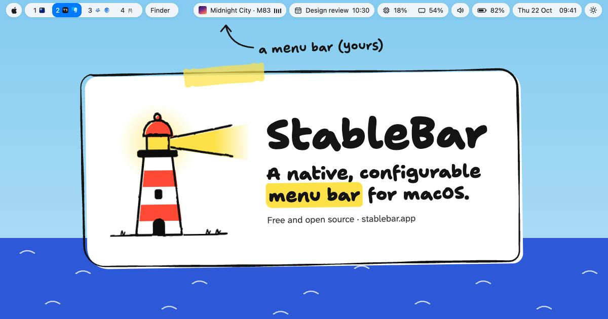
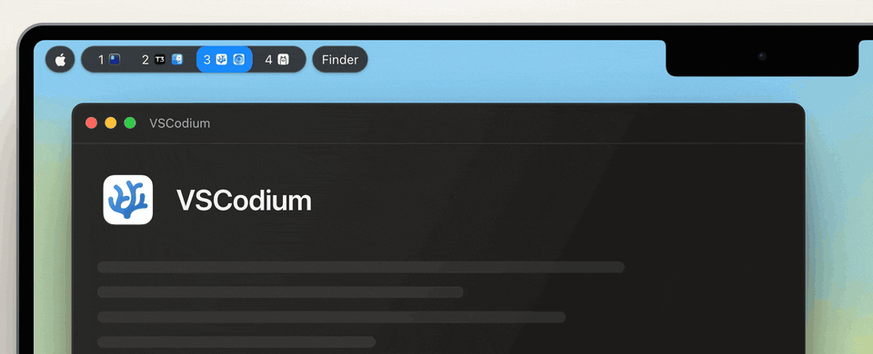

### 🎬 관련 영상
- [🎥 영상 보기](https://ph-files.imgix.net/c31143aa-5e13-49a2-a1c7-29fa1d314819.jpeg?auto=format)

---

## 19. [Subscriptrack](https://www.producthunt.com/products/subscriptrack)
**Votes**: 81 | **도입 난이도**: 하 | **신뢰도**: 상
**Tagline**: Connect your email, see every subscription you pay for
**서비스 링크**: https://www.producthunt.com/r/HPSWL7QNE4MC2U

**태그**: SaaS, Productivity, Subscription Management, Automation, AI Tool, Email

### 📌 이 서비스 한눈에 보기
이메일 연동을 통해 흩어진 구독 서비스를 한눈에 관리하고 결제 알림을 받는 서비스

### 🔑 주요 기능
- 이메일 연동을 통한 자동 구독 내역 탐색
- 월간 총 결제 금액 확인 및 갱신/체험 종료 전 알림
- 200개 이상의 서비스에 대한 해지 단계 안내

### 🙋 사용자에게 어떤 점이 좋은가
매달 나가는 구독료를 일일이 확인하지 않아도 AI가 자동으로 목록을 정리해주어 불필요한 지출을 막을 수 있습니다.

### ✅ 지금 바로 써볼 기능
- Gmail 또는 Outlook 계정 연결하기
- 자동 생성된 구독 목록 검토하기
- 갱신 전 알림 설정 확인하기

### ⚠️ 사용 전 확인할 점
- 이메일 접근 권한 부여에 대한 보안 정책 검토 필요
- 이메일로 수신되지 않는 결제 내역은 누락될 수 있음

### 🧭 확인이 더 필요한 정보
이메일 연동 시 데이터 프라이버시 보호 수준과 상세 보안 프로토콜에 대한 추가 확인이 필요합니다.

### 📸 스크린샷 및 갤러리
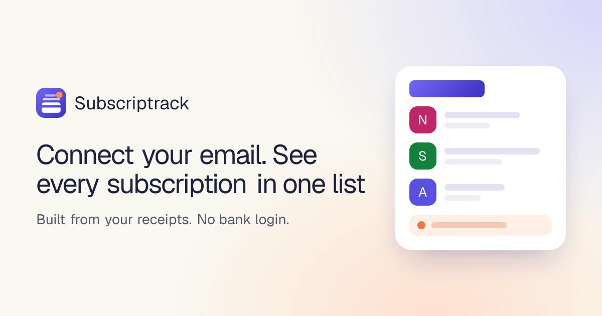
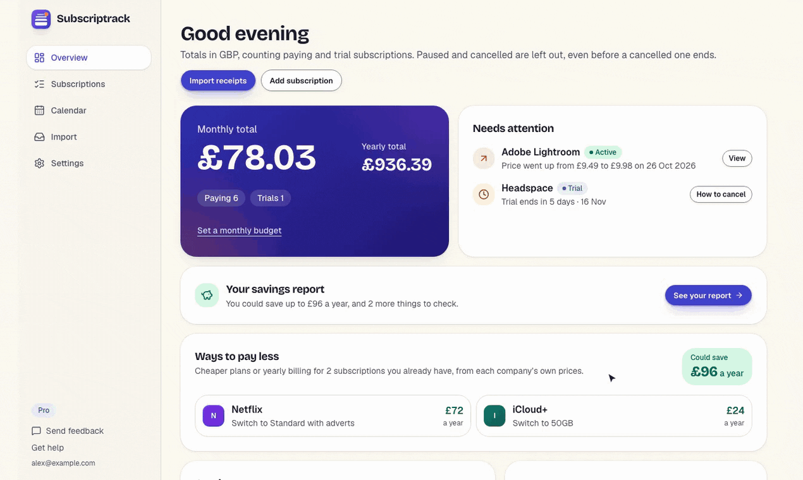
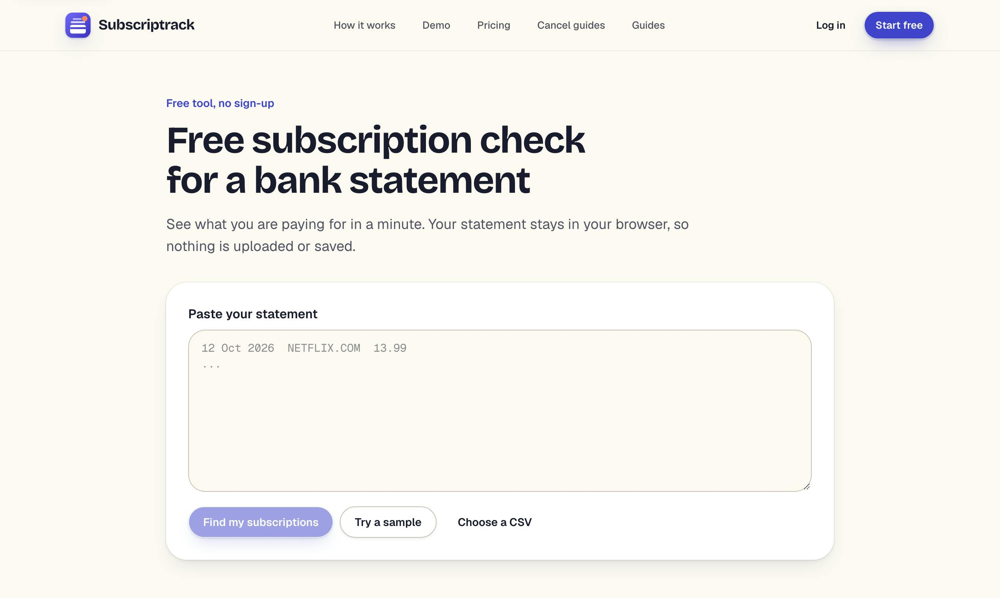

---

## 20. [Mister Blocks](https://www.producthunt.com/products/mister-blocks)
**Votes**: 77 | **도입 난이도**: 하 | **신뢰도**: 상
**Tagline**: Take a picture of your LEGO and AI will make a build
**서비스 링크**: https://www.producthunt.com/r/4A2SJOBLPA36DF

**태그**: AI, Creative, Lego, 3D-Modeling, AI Tool, Chat

### 📌 이 서비스 한눈에 보기
가지고 있는 레고 브릭 사진 한 장으로 맞춤형 3D 조립 가이드를 생성하는 AI 서비스

### 🔑 주요 기능
- 보유한 레고 브릭 사진을 분석하여 가능한 조립 모델 제안
- Claude AI 기반의 대화형 수정 및 텍스트 설명 기반 모델 생성 기능
- 회전 및 확대가 가능한 3D 단계별 조립 설명서 제공

### 🙋 사용자에게 어떤 점이 좋은가
정리되지 않은 레고 부품들을 활용해 무엇을 만들지 고민할 필요 없이, 즉석에서 창의적인 조립 아이디어와 설계도를 얻을 수 있습니다.

### ✅ 지금 바로 써볼 기능
- 가지고 있는 레고 브릭 사진 찍어 올리기
- 제안된 모델을 3D 가이드로 확인하기
- 채팅을 통해 원하는 스타일로 모델 수정 요청하기

### ⚠️ 사용 전 확인할 점
- AI가 실제 브릭 개수와 종류를 완벽하게 식별하지 못할 가능성
- 복잡한 모델의 경우 실제 조립 난이도가 가이드와 다를 수 있음

### 🧭 확인이 더 필요한 정보
제공되는 3D 가이드의 상세 수준과 실제 물리적 조립 가능 여부(stud-checked)의 정확도를 확인해야 합니다.

### 📸 스크린샷 및 갤러리
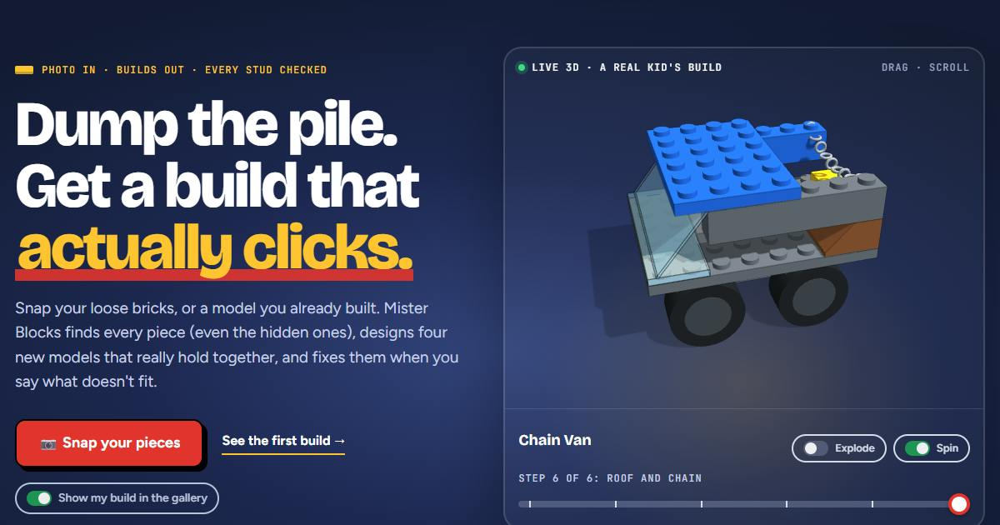

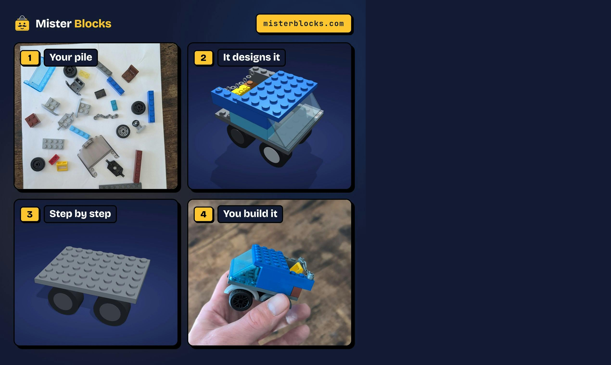

### 🎬 관련 영상
- [🎥 영상 보기](https://ph-files.imgix.net/01abd3bd-99f1-4545-ad88-53c6e44b1753.jpeg?auto=format)

---

## 21. [Binqo](https://www.producthunt.com/products/binqo)
**Votes**: 74 | **도입 난이도**: 하 | **신뢰도**: 상
**Tagline**: A tiny friend in your Mac's notch
**서비스 링크**: https://www.producthunt.com/r/FOUFOCVJR36R24

**태그**: Productivity, Mac, AI, Utility

### 📌 이 서비스 한눈에 보기
맥북 노치에 상주하며 일정, 음악, 메모를 도와주는 귀여운 AI 비서

### 🔑 주요 기능
- 맥북 노치 영역을 활용한 직관적인 UI 제공
- 음악, 캘린더, 클립보드 등 주요 정보의 빠른 확인
- 자연어 입력을 통한 미니 앱 생성 및 질문 답변 기능

### 🙋 사용자에게 어떤 점이 좋은가
화면을 가리지 않는 노치 영역을 활용해 작업 흐름을 방해받지 않으면서도 필요한 정보를 즉각 확인할 수 있습니다.

### ✅ 지금 바로 써볼 기능
- 노치 영역에서 캘린더와 음악 정보 확인하기
- 단축키를 사용하여 궁금한 점 질문하기
- 문장 입력으로 나만의 미니 앱 생성해보기

### ⚠️ 사용 전 확인할 점
- 노치 영역을 사용하므로 화면 상단 가시성에 영향을 줄 수 있음
- 설명된 기능 외의 상세한 시스템 제어 범위는 미확인

### 🧭 확인이 더 필요한 정보
제공되는 미니 앱의 기능적 한계와 시스템 리소스 점유율에 대한 정보가 부족합니다.

### 📸 스크린샷 및 갤러리
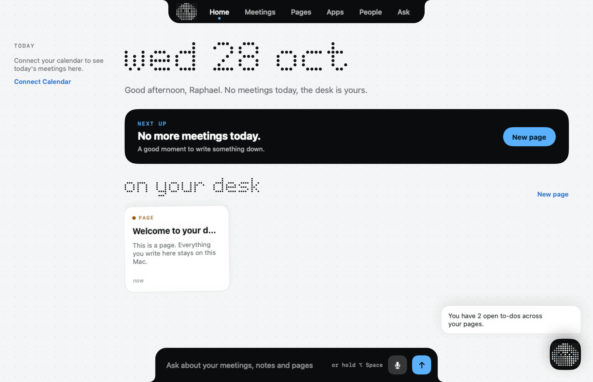
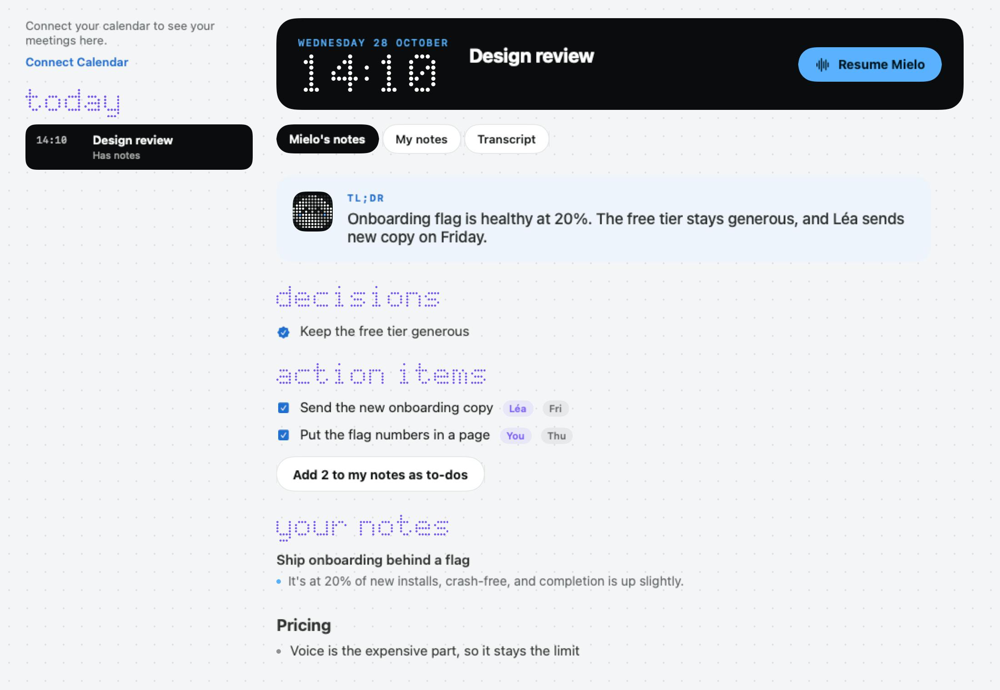

### 🎬 관련 영상
- [🎥 영상 보기](https://ph-files.imgix.net/mcp-draft-media/8adc57c9-ea21-43f1-9304-d1fd4b3c1ad2.jpeg?auto=format)

---

## 22. [RigSpark](https://www.producthunt.com/products/rigspark)
**Votes**: 72 | **도입 난이도**: 하 | **신뢰도**: 상
**Tagline**: Know which AI to run on your own computer
**서비스 링크**: https://www.producthunt.com/r/YVKVRX43DYZTZB

**태그**: AI, OpenSource, LocalLLM, DevTool, AI Tool, Chat, Video, Vision

### 📌 이 서비스 한눈에 보기
내 컴퓨터 사양에 맞춰 실행 가능한 AI 모델을 바로 알려주는 오픈소스 도구

### 🔑 주요 기능
- 사용자 하드웨어(GPU, 메모리, 디스크) 기반 호환성 체크
- 로컬 환경에서 채팅, 이미지, 비디오, 음성 AI 모델 실행 지원
- 계정 생성이나 클라우드 연결 없는 완전한 프라이버시 보장

### 🙋 사용자에게 어떤 점이 좋은가
자신의 컴퓨터 사양으로 어떤 AI 모델을 돌릴 수 있을지 고민할 필요 없이, 즉시 실행 가능한 모델을 확인할 수 있습니다.

### ✅ 지금 바로 써볼 기능
- 현재 내 PC 사양에서 구동 가능한 모델 확인하기
- 로컬 환경에서 AI 모델 설치 및 실행해보기

### ⚠️ 사용 전 확인할 점
- 하드웨어 성능에 따라 모델 실행 속도가 크게 다를 수 있음
- 로컬 실행 방식이므로 모델 크기에 따른 디스크 공간 확보 필요

### 🧭 확인이 더 필요한 정보
특정 하드웨어 가속(NVIDIA CUDA 등) 지원 범위와 최적화 수준에 대한 상세 정보 확인이 필요합니다.

### 📸 스크린샷 및 갤러리

---

## 23. [bonds chat](https://www.producthunt.com/products/bonds-2)
**Votes**: 71 | **도입 난이도**: 하 | **신뢰도**: 상
**Tagline**: Multiplayer AI that dies if you and your friends flake
**서비스 링크**: https://www.producthunt.com/r/PTHGOWTIMP2AIZ

**태그**: Social, Gamification, AI, Productivity, Mobile, AI Tool, Chat, Video

### 📌 이 서비스 한눈에 보기
친구들과 함께 목표를 달성하며 키우는 게이미피케이션 기반의 멀티플레이어 AI 채팅 서비스

### 🔑 주요 기능
- 그룹 채팅 내에서 공동의 목표를 달성해야 생존하는 타마고치 방식의 AI
- 챌린지 설정 및 사진 인증을 통한 실천 중심의 상호작용
- 게임, 스티커, 카운트다운, 비디오 생성 등 채팅 내 엔터테인먼트 기능 제공

### 🙋 사용자에게 어떤 점이 좋은가
친구들과 함께 공동의 목표(예: 운동)를 설정하고, 서로의 참여를 독려하며 재미있게 습관을 형성할 수 있습니다.

### ✅ 지금 바로 써볼 기능
- 친구들과 함께 30일 챌린지 설정하기
- 사진 인증을 통해 AI의 생명력 유지하기
- 채팅 내 생성되는 게임과 스티커 활용하기

### ⚠️ 사용 전 확인할 점
- 참여가 저조할 경우 AI가 소멸할 수 있어 지속적인 관리가 필요함
- 개인적인 목표보다는 그룹 활동에 특화되어 있음

### 🧭 확인이 더 필요한 정보
플랫폼별(iPhone, Web, Mac) 기능 차이 및 상세 과금 체계에 대한 정보가 명시되지 않았습니다.

### 📸 스크린샷 및 갤러리

### 🎬 관련 영상
- [🎥 영상 보기](https://ph-files.imgix.net/2dd87a44-0634-4db6-a590-ca0999fcf07a.jpeg?auto=format)

---

## 24. [nizima ACTION!!](https://www.producthunt.com/products/nizima-action-by-live2d)
**Votes**: 70 | **도입 난이도**: 하 | **신뢰도**: 상
**Tagline**: Powerful editing, expressive characters, zero installs.
**서비스 링크**: https://www.producthunt.com/r/U7WR4SUTPVW2RD

**태그**: VideoEditor, Live2D, CreativeTool, NoInstall, Video, Design

### 📌 이 서비스 한눈에 보기
설치 없이 브라우저에서 Live2D 캐릭터 애니메이션과 영상 편집을 동시에 수행하는 강력한 웹 편집기

### 🔑 주요 기능
- 설치가 필요 없는 브라우저 기반의 고성능 영상 편집 환경
- 중첩된 장면(Nested scenes) 및 키프레임 기반의 정밀한 애니메이션 기능
- Live2D 기술을 활용한 생동감 넘치는 2D 캐릭터 영상 제작

### 🙋 사용자에게 어떤 점이 좋은가
별도의 소프트웨어 설치 없이 웹 브라우저만으로 전문적인 캐릭터 애니메이션과 영상 편집을 한 번에 해결할 수 있습니다.

### ✅ 지금 바로 써볼 기능
- 브라우저에서 직접 영상 편집 기능 테스트하기
- Live2D 캐릭터를 활용한 애니메이션 작업해보기
- 중첩된 장면 및 키프레임 편집 기능 익히기

### ⚠️ 사용 전 확인할 점
- 현재 베타 버전이므로 기능의 안정성이나 데이터 저장 방식 확인 필요
- 브라우저 기반이므로 하드웨어 사양이나 네트워크 환경에 따른 성능 차이 발생 가능

### 🧭 확인이 더 필요한 정보
베타 버전이므로 향нт 정식 출시 시의 유료화 정책 및 상세 기능 변화를 확인해야 합니다.

### 📸 스크린샷 및 갤러리

### 🎬 관련 영상
- [🎥 영상 보기](https://ph-files.imgix.net/110ae615-eebb-49f4-8ba4-c20d0f284e9b.jpeg?auto=format)

---

## 25. [Skipbox](https://www.producthunt.com/products/skipbox)
**Votes**: 70 | **도입 난이도**: 하 | **신뢰도**: 상
**Tagline**: Cheap, fast GitHub Actions runners with unlimited minutes
**서비스 링크**: https://www.producthunt.com/r/MXAGTJE6TEBJ6S

**태그**: DevOps, GitHub, CI/CD, Automation, AI Tool

### 📌 이 서비스 한눈에 보기
캐시 유지와 무제한 실행 시간을 제공하는 저렴한 전용 GitHub Actions 러너

### 🔑 주요 기능
- 전용 Linux VM 기반으로 Docker 레이어 및 패키지 캐시 유지
- 월 $39로 4 vCPU / 8 GB 사양의 무제한 실행 시간 제공
- GitHub App 설치 후 설정 한 줄로 간편하게 연동

### 🙋 사용자에게 어떤 점이 좋은가
캐시 유지로 빌드 속도를 높이면서, 사용량에 따른 추가 비용 걱정 없이 워크플로우를 실행할 수 있습니다.

### ✅ 지금 바로 써볼 기능
- 7일 무료 체험을 통해 빌드 속도 체감하기
- GitHub App 설치 및 runs-on 설정 변경하기
- Private 저장소 환경에서 워크플로우 테스트하기

### ⚠️ 사용 전 확인할 점
- Private 저장소 사용자만 이용 가능
- 작업 종료 후 자격 증명 및 워크스페이스가 삭제되는 보안 정책 확인 필요

### 🧭 확인이 더 필요한 정보
제공되는 vCPU 및 RAM 사양 외의 추가적인 리소스 확장 가능 여부는 명시되지 않았습니다.

### 📸 스크린샷 및 갤러리

---

## 26. [Padrail](https://www.producthunt.com/products/padrail)
**Votes**: 69 | **도입 난이도**: 하 | **신뢰도**: 상
**Tagline**: Turn your MacBook trackpad edges into controls
**서비스 링크**: https://www.producthunt.com/r/D6K3EPY4WGBL42

**태그**: Productivity, MacBook, Utility, AI Tool

### 📌 이 서비스 한눈에 보기
맥북 트랙패드 가장자리를 직관적인 컨트롤 슬라이더로 변환해주는 유틸리티

### 🔑 주요 기능
- 트랙패드 가장자리를 활용한 볼륨, 밝기, 키보드 백라이트 조절
- 앱별로 변화하는 상단 엣지 컨트롤 기능
- 계정 생성 없는 무료 사용 및 메뉴바 상주 방식

### 🙋 사용자에게 어떤 점이 좋은가
별도의 키보드 조작 없이 트랙패드 가장자리 터치만으로 주요 설정을 빠르게 제어할 수 있어 작업 흐름이 끊기지 않습니다.

### ✅ 지금 바로 써볼 기능
- 오른쪽 가장자리로 볼륨 조절해보기
- 왼쪽 가장자리로 화면 밝기 조절해보기
- 하단 가장자리로 키보드 백라이트 조절해보기

### ⚠️ 사용 전 확인할 점
- 트랙패드 가장자리를 의도치 않게 건드릴 수 있는 조작 간섭 가능성
- 특정 맥북 모델이나 OS 버전에서의 호환성 여부

### 🧭 확인이 더 필요한 정보
트랙패드 가장자리 터치 시 기존의 클릭/스크롤 기능과 어떻게 충돌 없이 작동하는지 확인이 필요합니다.

### 📸 스크린샷 및 갤러리

### 🎬 관련 영상
- [🎥 영상 보기](https://ph-files.imgix.net/86ddee56-50e9-42d3-8a0b-525a92eb642e.jpeg?auto=format)

---

## 27. [High Signal](https://www.producthunt.com/products/high-signal-2)
**Votes**: 28 | **도입 난이도**: 하 | **신뢰도**: 상
**Tagline**: The best newsletter for bootstrappers
**서비스 링크**: https://www.producthunt.com/r/V4IE2RI467HDBW

**태그**: Newsletter, Entrepreneurship, Business, AI Tool, Marketing

### 📌 이 서비스 한눈에 보기
1인 창업가와 부트스트래퍼를 위한 실전 비즈니스 뉴스레터

### 🔑 주요 기능
- 수익 업데이트, 인수 소식, 마케팅 팁 등 실무 중심의 뉴스 제공
- X(트위터) 스크롤 시간을 줄여주는 핵심 정보 큐레이션
- 가입 시 스타트업 인수 데이터베이스 무료 제공

### 🙋 사용자에게 어떤 점이 좋은가
불필요한 정보 탐색 시간을 줄이고, 실제 수익 창출과 비즈니스 성장에 직결되는 핵심 뉴스만 이메일로 받아볼 수 있습니다.

### ✅ 지금 바로 써볼 기능
- 뉴스레터 구독 신청하기
- 제공되는 스타트업 인수 데이터베이스 확인하기

### ⚠️ 사용 전 확인할 점
- 뉴스레터 형식이므로 실시간 정보보다는 정기적인 업데이트 위주임
- 개인 이메일 주소 제공이 필요함

### 🧭 확인이 더 필요한 정보
뉴스레터의 발송 주기와 상세 콘텐츠의 전문성 수준은 구독 후 확인이 필요합니다.

### 📸 스크린샷 및 갤러리

---

## 28. [WTFM](https://www.producthunt.com/products/wtfm)
**Votes**: 23 | **도입 난이도**: 하 | **신뢰도**: 상
**Tagline**: Write the F***ing Manual. Your agent writes the user docs
**서비스 링크**: https://www.producthunt.com/r/DO6GB66MRSH57U

**태그**: DevTool, Automation, Documentation, OpenSource, Agent, AI Tool, Vision

### 📌 이 서비스 한눈에 보기
소스 코드를 분석하여 사용자 매뉴얼과 스크린샷을 자동으로 생성하는 오픈소스 플러그인

### 🔑 주요 기능
- Claude Code 및 Codex용 오픈소스 플러그인
- 소스 코드의 라우트와 템플릿을 읽어 단계별 가이드 자동 작성
- 실제 UI 코드를 기반으로 스크린샷을 렌더링하여 문서에 포함

### 🙋 사용자에게 어떤 점이 좋은가
개발자가 문서를 쓰는 시간을 획기적으로 줄여주며, 코드 기반의 정확한 스크린샷이 포함된 매뉴얼을 즉시 확보할 수 있습니다.

### ✅ 지금 바로 써볼 기능
- Claude Code/Codex 환경에 플러그인 설치
- 에이전트에게 사용자 가이드 작성을 요청
- 생성된 Markdown 결과물 확인 및 배포

### ⚠️ 사용 전 확인할 점
- 소스 코드에 대한 접근 권한이 필요함
- UI 렌더링 결과물이 실제 사용자 환경과 다를 수 있음

### 🧭 확인이 더 필요한 정보
사용자의 로컬 환경 설정 및 특정 프레임워크와의 호환성 수준을 확인해야 합니다.

### 📸 스크린샷 및 갤러리

### 🎬 관련 영상
- [🎥 영상 보기](https://ph-files.imgix.net/f7a4b29d-945c-4cd4-99c7-295061085c67.jpeg?auto=format)

---

## 29. [RomeoSEO Skills](https://www.producthunt.com/products/romeoseo-skills)
**Votes**: 15 | **도입 난이도**: 하 | **신뢰도**: 상
**Tagline**: 48 SEO/AI SEO skills for Claude, Codex, and any other agent.
**서비스 링크**: https://www.producthunt.com/r/B2P5KW52FOSHDP

**태그**: SEO, AI, Automation, Marketing, Agent, AI Tool, DevTool

### 📌 이 서비스 한눈에 보기
AI 에이전트를 위한 48가지 전문 SEO 및 AEO 최적화 스킬셋

### 🔑 주요 기능
- Claude, Codex 등 다양한 AI 에이전트에 즉시 적용 가능한 48개 스킬 제공
- SEO 감사, 키워드 추출, 콘텐츠 생성, 스키마 및 AEO/GEO 최적화 포함
- 월 25,000회 이상의 클릭을 달성한 실전 노하우 기반

### 🙋 사용자에게 어떤 점이 좋은가
AI 에이전트를 활용해 검색 엔진 최적화(SEO) 및 답변 엔진 최적화(AEO) 작업을 자동화하고 전문성을 높일 수 있습니다.

### ✅ 지금 바로 써볼 기능
- 보유한 AI 에이전트에 48가지 스킬 적용해보기
- SEO 감사 및 키워드 추출 기능 테스트
- AEO/GEO 최적화 스킬로 콘텐츠 품질 검증

### ⚠️ 사용 전 확인할 점
- 사용자의 AI 에이전트 환경에 따라 스킬 적용 방식이 다를 수 있음
- 제공되는 스킬이 특정 플랫폼에 최적화되어 있는지 확인 필요

### 🧭 확인이 더 필요한 정보
제공되는 48개 스킬의 구체적인 구현 방식(프롬프트 형태인지, API 연동형인지)에 대한 상세 정보가 필요합니다.

### 📸 스크린샷 및 갤러리

### 🎬 관련 영상
- [🎥 영상 보기](https://ph-files.imgix.net/3b311d82-acae-4acd-91dc-963d13fdad73.jpeg?auto=format)

---

## 30. [Ascope](https://www.producthunt.com/products/ascope)
**Votes**: 14 | **도입 난이도**: 하 | **신뢰도**: 상
**Tagline**: Daily App Store & Google Play keyword ranks, on your Mac
**서비스 링크**: https://www.producthunt.com/r/BVPWXAD3B3A4DW

**태그**: DevTool, MacApp, ASO, AI-Integration, AI Tool

### 📌 이 서비스 한눈에 보기
전 세계 앱 스토어 키워드 순위를 맥(Mac)에서 바로 확인하는 네이티브 분석 도구

### 🔑 주요 기능
- 50개국 이상의 App Store 및 Google Play 키워드 순위 매일 업데이트
- 별도의 대시보드나 계정 생성 없이 사용하는 네이티브 Mac 앱
- 키워드별 인기 및 난이도 데이터 제공

### 🙋 사용자에게 어떤 점이 좋은가
앱 개발자가 웹 브라우저를 열지 않고도 데스크톱 환경에서 간편하게 검색 순위를 모니터링하고, AI 코딩 도구와 연동해 데이터 분석을 자동화할 수 있습니다.

### ✅ 지금 바로 써볼 기능
- Mac에 설치하여 데일리 키워드 순위 확인하기
- Claude 또는 Cursor에 내장 MCP 서버 연결하기
- 글로벌 시장 타겟 키워드의 난이도 분석하기

### ⚠️ 사용 전 확인할 점
- 웹 대시보드가 없으므로 모바일 환경에서는 사용이 제한적임
- 계정 기반이 아니므로 기기 변경 시 데이터 관리 방식 확인 필요

### 🧭 확인이 더 필요한 정보
계정 없이 작동하므로 데이터 동기화 및 백업 방식에 대한 상세 정보가 필요합니다.

### 📸 스크린샷 및 갤러리

---

