# 🚀 Product Hunt Daily Top 30 (2026-11-14)

## 오늘의 요약
오늘의 트렌드는 AI 에이전트가 사용자의 개입 없이 백그라운드에서 복잡한 업무를 수행하거나, 회의 및 코딩 워크플로우를 자동화하는 등 '자율적 생산성'에 집중되었습니다. 또한, 기존의 웹 빌더나 디자인 도구에서 생성된 결과물을 코드로 변환하거나 콘텐츠로 변환하는 등 도구 간의 경계를 허무는 통합형 솔루션들이 주목받았습니다.

### 오늘의 핵심 포인트
- AI 에이전트가 실시간 회의 기록, 코딩, 업무 수행을 자율적으로 처리하며 인간의 개입을 최소화하는 방향으로 진화하고 있습니다.
- 웹 빌더에서 생성한 디자인을 코드로 변환하거나, 채팅만으로 교육 콘텐츠를 만드는 등 워크플로우의 자동화가 가속화되고 있습니다.
- 기존의 단순한 도구 기능을 넘어, 실시간 데이터 동기화나 위젯형 인터페이스를 통해 작업 소식의 연속성을 보장하는 제품들이 등장했습니다.

**오늘의 태그**: AI 에이전트, 워크플로우 자동화, 생산성 도구, No-Code to Code

## 1. [Templify AI](https://www.producthunt.com/products/templify)
**Votes**: 315 | **도입 난이도**: 하 | **신뢰도**: 상
**Tagline**: Powerful content editor for people who aren’t editors
**서비스 링크**: https://www.producthunt.com/r/T53GXHFXDGAANJ

**태그**: VideoEditor, AI, ContentCreation, MobileApp, SocialMedia, AI Tool, Video, Design

### 📌 이 서비스 한눈에 보기
전문 편집 기술 없이도 템플릿을 통해 고퀄리티 숏폼 영상을 만드는 AI 모바일 편집기

### 🔑 주요 기능
- 1,200개 이상의 디자이너 템플릿 제공
- 타임라인 없이 클릭 몇 번으로 완성되는 자동 편집 기능
- AI 비디오 편집, 비트 동기화, 자동 자막 등 강력한 기능 탑재

### 🙋 사용자에게 어떤 점이 좋은가
복잡한 영상 편집 과정을 생략하고 사진과 영상만 넣으면 인스타그램 릴스나 틱톡용 콘텐츠를 즉시 제작할 수 있습니다.

### ✅ 지금 바로 써볼 기능
- 1,200개 이상의 템플릿 탐색하기
- AI 스튜디오를 활용한 자동 편집 시도하기
- 비트 동기화 기능을 통한 음악 맞춤형 영상 만들기

### ⚠️ 사용 전 확인할 점
- 모바일(iPhone) 전용 앱이므로 데스크톱 작업 환경과는 차이가 있음
- 고급 기능을 위한 Pro 구독 모델 존재

### 🧭 확인이 더 필요한 정보
무료 버전에서 제공하는 기능의 범위와 워터마크 유무를 확인해야 합니다.

### 📸 스크린샷 및 갤러리
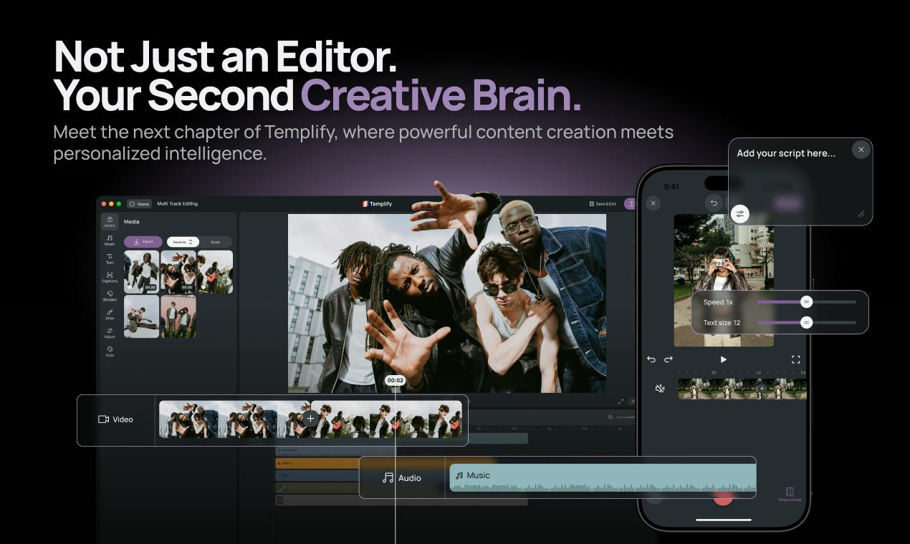

### 🎬 관련 영상
- [🎥 영상 보기](https://ph-files.imgix.net/979dcb91-d000-4fdd-9fbc-48f2b5cb35af.jpeg?auto=format)

---

## 2. [Filament by Galaxy](https://www.producthunt.com/products/galaxy)
**Votes**: 223 | **도입 난이도**: 중 | **신뢰도**: 상
**Tagline**: Move data using your terminal or agent. Fast & open source.
**서비스 링크**: https://www.producthunt.com/r/2VIY3N6BRL2YSZ

**태그**: DevTool, Data Engineering, OpenSource, Go, Agent

### 📌 이 서비스 한눈에 보기
터미널이나 에이전트를 통해 빠르고 안전하게 데이터를 복제하는 오픈소스 엔진

### 🔑 주요 기능
- Go 언어로 작성된 고성능 데이터 복제 엔진
- 전체 로드, 증분 복제 및 CDC(변경 데이터 캡처) 지원
- Arrow 배치 검증을 통한 데이터 무결성 보장

### 🙋 사용자에게 어떤 점이 좋은가
터미널 환경에서 쉽고 빠르게 데이터를 이동시킬 수 있으며, Go 애플리케이션에 직접 임베딩하여 데이터 파이프라인을 구축할 수 있습니다.

### ✅ 지금 바로 써볼 기능
- 단독 바이너리로 데이터 복제 테스트하기
- Go 애플리케이션에 임베딩하여 워크플로우 통합하기
- CDC 기능을 활용한 실시간 데이터 동기화 시도하기

### ⚠️ 사용 전 확인할 점
- 사용 중인 데이터 소스/싱크(Sink)의 호환성 확인 필요
- Go 언어 숙련도에 따라 임베딩 난이도 차이 발생 가능

### 🧭 확인이 더 필요한 정보
지원하는 구체적인 데이터베이스 및 클라우드 스토리지 소스 목록이 명시되지 않았습니다.

### 📸 스크린샷 및 갤러리
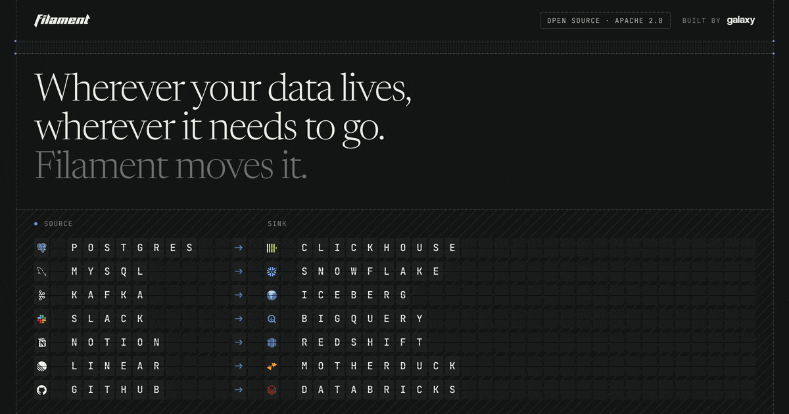
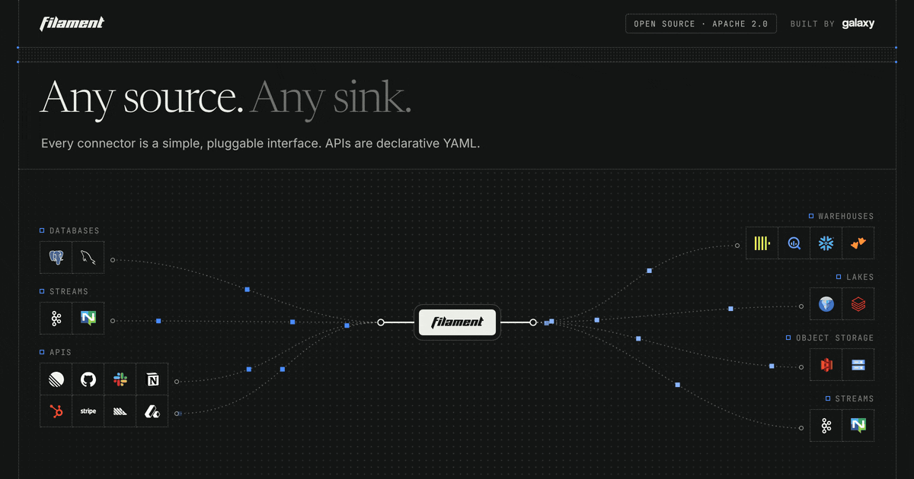
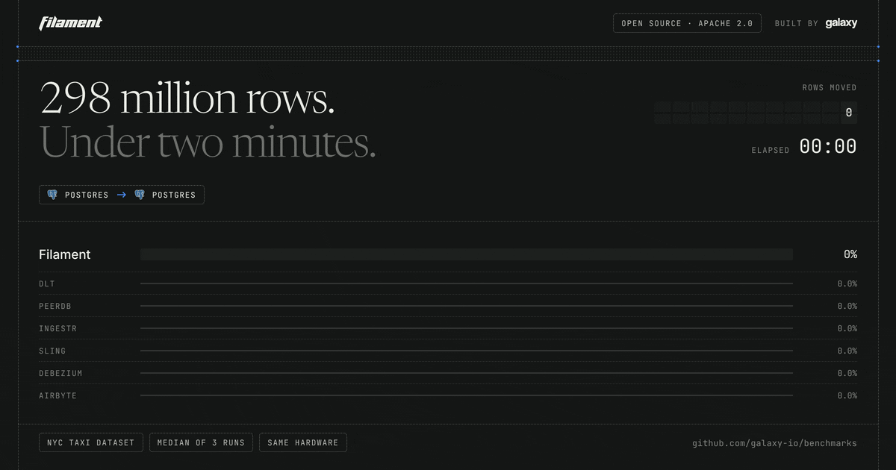

### 🎬 관련 영상
- [🎥 영상 보기](https://ph-files.imgix.net/6da2e77d-d224-4021-ac72-2c7bbe251ae0.jpeg?auto=format)

---

## 3. [Claude Meetings](https://www.producthunt.com/products/claude)
**Votes**: 209 | **도입 난이도**: 하 | **신뢰도**: 상
**Tagline**: Add Claude to your call and get work started as you talk
**서비스 링크**: https://www.producthunt.com/r/BBCWQILYWRBAP6

**태그**: Productivity, AI, Collaboration, Automation, Chat

### 📌 이 서비스 한눈에 보기
회의 참여자로 Claude를 초대하여 실시간 기록 및 문서 작성을 자동화하는 도구

### 🔑 주요 기능
- Google Meet에 가시적인 참여자로 Claude를 직접 초대
- 대화 중 실시간으로 회의록, 액션 아이템, 문서 및 화이트보드 생성
- 회의 종료 후 모든 기록과 생성된 결과물을 Claude 내에서 즉시 확인

### 🙋 사용자에게 어떤 점이 좋은가
회의 중 기록에 신경 쓸 필요 없이 대화에만 집중할 수 있으며, 실시간 협업을 통해 회의 결과물을 즉각적으로 완성할 수 있습니다.

### ✅ 지금 바로 써볼 기능
- Google Meet에 Claude 초대하기
- 채팅이나 음성을 통해 Claude에게 질문하기
- 실시간으로 생성되는 문서 및 화이트보드 편집하기

### ⚠️ 사용 전 확인할 점
- 현재 Team 및 Enterprise 플랜 사용자 대상 베타 버전임
- 현재 Google Meet를 시작으로 지원됨

### 🧭 확인이 더 필요한 정보
지원되는 다른 화상 회의 플랫폼(Zoom, Teams 등)의 확장 여부는 명시되지 않았습니다.

### 📸 스크린샷 및 갤러리

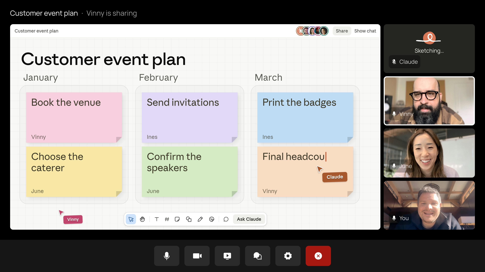

### 🎬 관련 영상
- [🎥 영상 보기](https://ph-files.imgix.net/mcp-draft-media/acc3f375-c32e-43e0-a7a1-bdb355801bda.jpeg?auto=format)

---

## 4. [Replicate](https://www.producthunt.com/products/replicate-10)
**Votes**: 167 | **도입 난이도**: 중 | **신뢰도**: 상
**Tagline**: Turn Webflow/Framer app into a Claude/Codex project for free
**서비스 링크**: https://www.producthunt.com/r/RENYHO4NIPEVIS

**태그**: DevTool, NoCodeToCode, WebDevelopment, Automation, Vision

### 📌 이 서비스 한눈에 보기
Webflow나 Framer로 만든 웹사이트를 1:1 디자인 유지와 함께 Next.js 코드로 자동 변환해주는 도구

### 🔑 주요 기능
- Webflow, Framer 등 웹 빌더 프로젝트를 Next.js 앱으로 완벽하게 복제
- 이미지 CDN, CMS 연동, 난독화된 JS 코드 등 마이그레이션 시 발생하는 기술적 난제 해결
- 생성된 코드를 GitHub 저장소에 직접 커밋하여 개발 워크플로우와 연결

### 🙋 사용자에게 어떤 점이 좋은가
웹 빌더의 제약에서 벗어나 자유로운 개발 환경(Next.js)으로 이동하고 싶지만, 수동 코딩과 데이터 이전이 부담스러웠던 사용자에게 유용합니다.

### ✅ 지금 바로 써볼 기능
- 현재 운영 중인 Webflow/Framer 프로젝트 연결하기
- 생성된 Next.js 코드의 디자인 일치도 확인하기
- GitHub 저장소로의 코드 커밋 및 로컬 환경 실행 테스트하기

### ⚠️ 사용 전 확인할 점
- 복잡한 커스텀 기능이나 백엔드 로직의 완벽한 이식 여부 확인 필요
- 무료 서비스인 만큼 향상된 기능이나 대규모 프로젝트 지원 범위 확인 필요

### 🧭 확인이 더 필요한 정보
제공되는 코드의 품질과 복잡한 CMS 데이터의 완벽한 동기화 수준을 직접 검증해야 합니다.

### 📸 스크린샷 및 갤러리
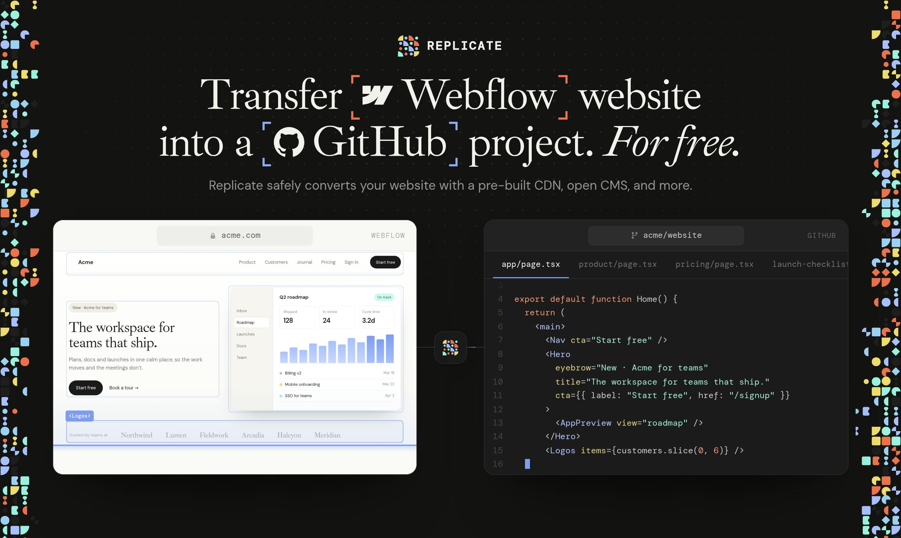
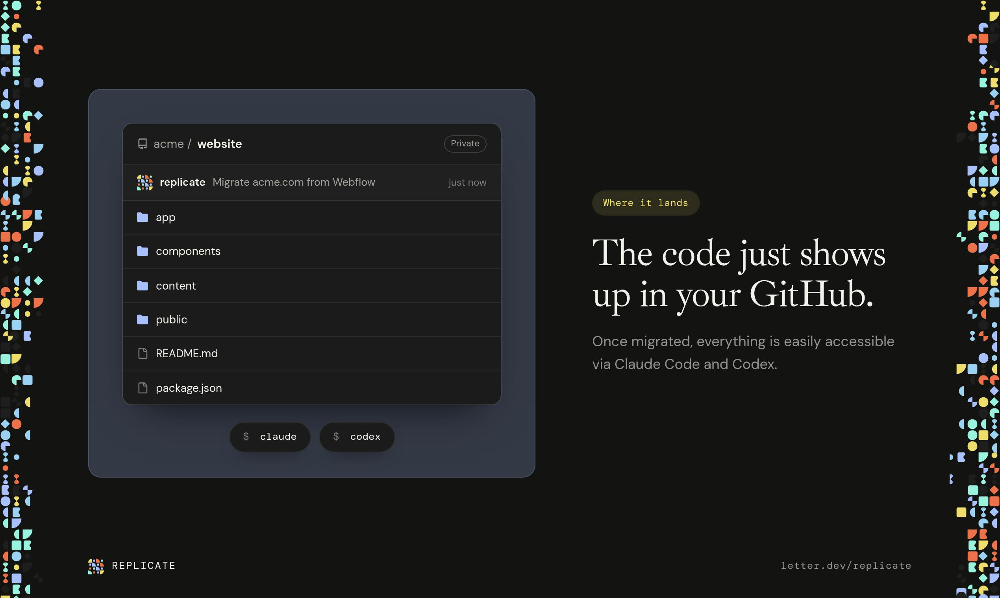
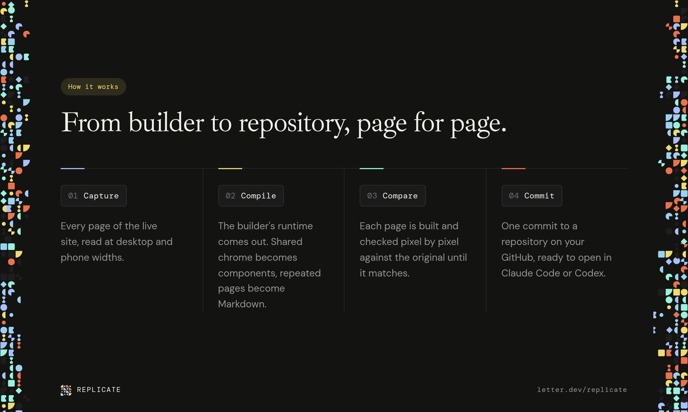

### 🎬 관련 영상
- [🎥 영상 보기](https://ph-files.imgix.net/8b4a3a27-23e0-4cb4-99e0-f1bf85821830.jpeg?auto=format)

---

## 5. [Trainn MCP](https://www.producthunt.com/products/trainn)
**Votes**: 160 | **도입 난이도**: 하 | **신뢰도**: 상
**Tagline**: Create product videos and courses from any AI chat
**서비스 링크**: https://www.producthunt.com/r/BYPQ26JPIEII6M

**태그**: AI, Automation, ProductMarketing, EdTech, NoCode, Agent, AI Tool, Chat, Video

### 📌 이 서비스 한눈에 보기
AI 채팅만으로 제품 영상, 도움말 문서, 교육 코스를 자동 생성하는 도구

### 🔑 주요 기능
- Claude, ChatGPT 등 AI 에이전트와 연동하여 대화형 콘텐츠 제작
- 제품 녹화본을 기반으로 제품 영상 및 교육 코스 자동 구축
- 제품 업데이트 시 대화를 통해 콘텐츠를 간편하게 업데이트

### 🙋 사용자에게 어떤 점이 좋은가
제품 기능이 변경될 때마다 매번 새로 제작할 필요 없이, AI와의 대화만으로 최신 교육 콘텐츠를 유지할 수 있습니다.

### ✅ 지금 바로 써볼 기능
- 기존 제품 녹화본을 업로드하여 영상 생성해보기
- AI 에이전트(Claude/ChatGPT)와 연결 설정하기
- 채팅을 통해 생성된 도움말 문서 편집해보기

### ⚠️ 사용 전 확인할 점
- 사용자의 최종 승인 절차가 필요하므로 자동 생성물의 품질 검수가 필수적임
- 연동되는 AI 모델의 성능에 따라 생성되는 콘텐츠의 질이 달라질 수 있음

### 🧭 확인이 더 필요한 정보
지원하는 구체적인 외부 AI 에이전트 목록과 연동 방식에 대한 상세 정보가 필요합니다.

### 📸 스크린샷 및 갤러리
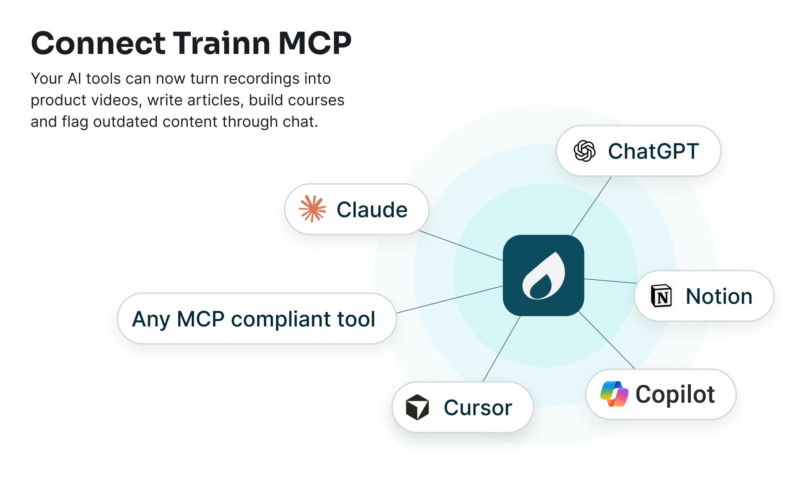
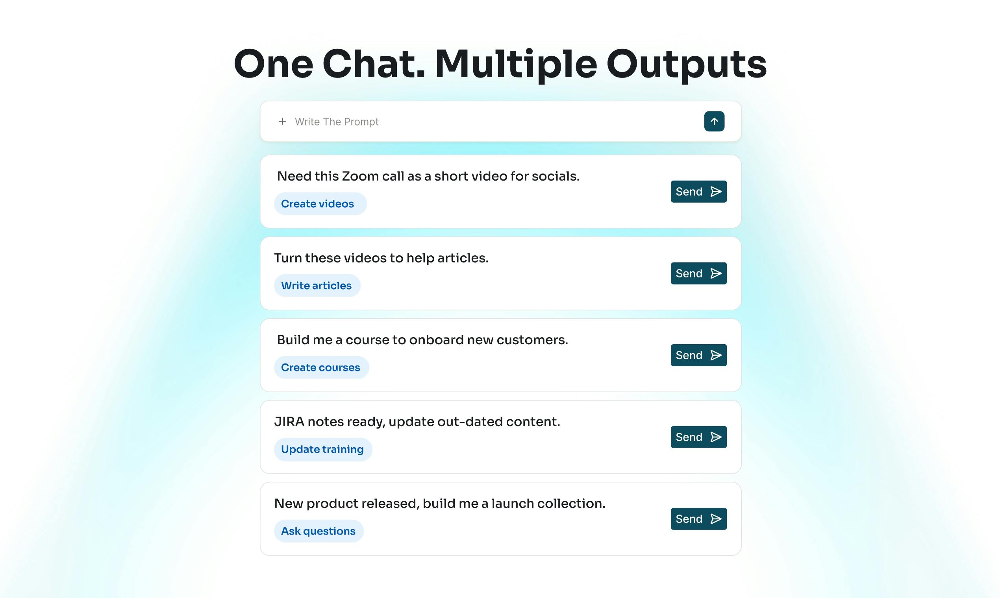
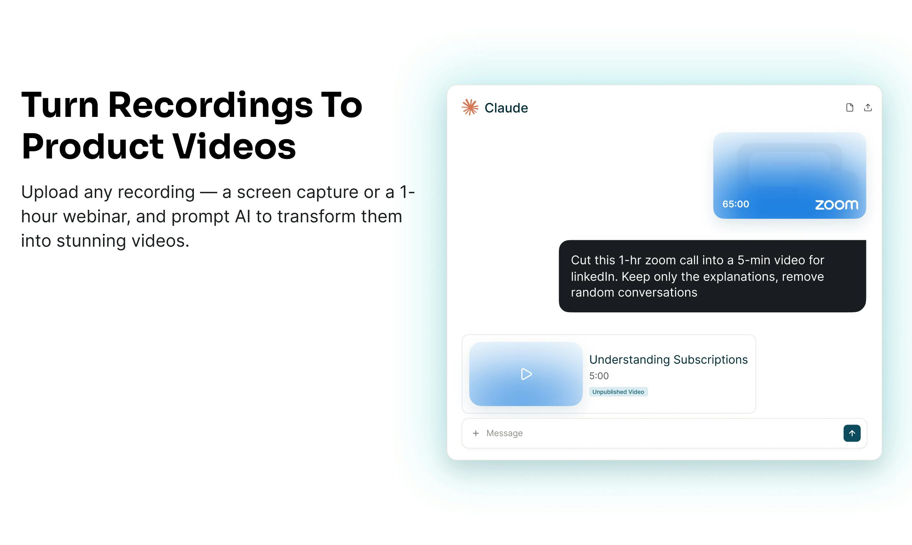

### 🎬 관련 영상
- [🎥 영상 보기](https://ph-files.imgix.net/1877a948-9e09-4a84-8fe2-d66cd305fe4c.jpeg?auto=format)

---

## 6. [Gemini 4 Hydrogen](https://www.producthunt.com/products/gemini-6)
**Votes**: 113 | **도입 난이도**: 하 | **신뢰도**: 상
**Tagline**: Fast agentic development for coders
**서비스 링크**: https://www.producthunt.com/r/A2CQHZMKSW455X

**태그**: DevTool, AI, Coding, Automation, Agent, AI Tool

### 📌 이 서비스 한눈에 보기
비용 효율적인 에이전트 기반 코딩 및 디버깅을 위한 Google의 새로운 모델

### 🔑 주요 기능
- 비용 효율적인 에이전트 중심의 개발 환경 제공
- 코딩 및 디버깅 작업에 최적화된 모델 성능
- Google AI Studio를 통한 즉각적인 개발 시작 가능

### 🙋 사용자에게 어떤 점이 좋은가
개발자가 더 적은 비용으로 자동화된 코딩 에이전트를 구축하고 디버깅 시간을 단축할 수 있습니다.

### ✅ 지금 바로 써볼 기능
- Google AI Studio 접속하기
- 에이전트 워크플로우 테스트하기
- 코딩 및 디버깅 작업에 적용해보기

### ⚠️ 사용 전 확인할 점
- 모델의 구체적인 비용 구조 및 토큰 제한 확인 필요
- 특정 프로그래밍 언어나 프레임워크에서의 성능 차이 확인 필요

### 🧭 확인이 더 필요한 정보
상세한 벤치마크 성능과 구체적인 비용 산정 방식에 대한 정보가 추가로 필요합니다.

### 📸 스크린샷 및 갤러리
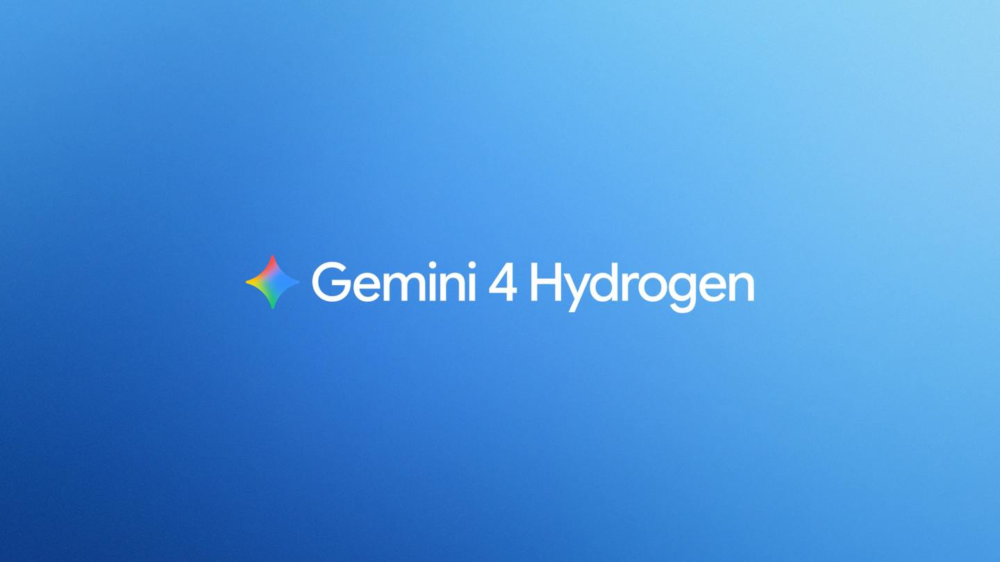
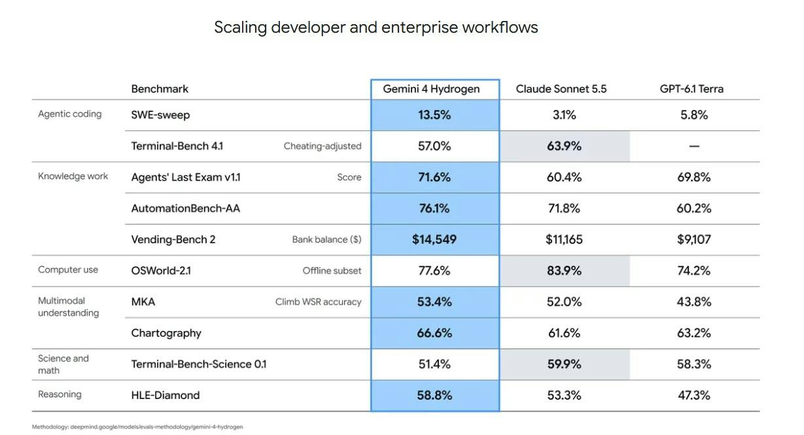
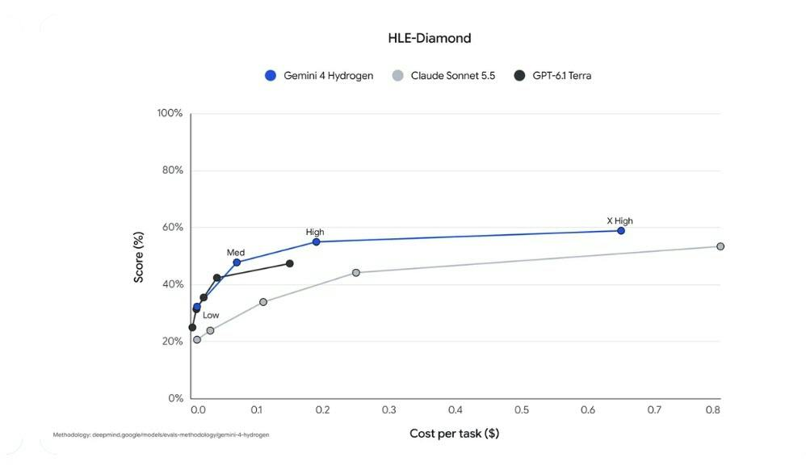

### 🎬 관련 영상
- [🎥 영상 보기](https://ph-files.imgix.net/c96cb12c-5df7-44e0-8613-fa0b34165eb1.jpeg?auto=format)
- [🎥 영상 보기](https://ph-files.imgix.net/9639c019-22f6-4293-91a6-b3f4b3d57768.jpeg?auto=format)
- [🎥 영상 보기](https://ph-files.imgix.net/84b1599a-0f54-4a7e-9c66-6467ebf7c010.jpeg?auto=format)
- [🎥 영상 보기](https://ph-files.imgix.net/97911233-2824-437f-b41d-5f4cdaf58201.jpeg?auto=format)
- [🎥 영상 보기](https://ph-files.imgix.net/a92e4c72-8d78-46a4-b7e2-563c96b131ff.jpeg?auto=format)

---

## 7. [qorqbot](https://www.producthunt.com/products/qorqbot)
**Votes**: 101 | **도입 난이도**: 중 | **신뢰도**: 상
**Tagline**: Proactive agent for business work
**서비스 링크**: https://www.producthunt.com/r/NYNNNLD7RHSCVR

**태그**: Automation, AI-Agent, Productivity, Workflow, Agent, DevTool

### 📌 이 서비스 한눈에 보기
기존 AI 구독 서비스를 활용하여 백그라운드에서 복잡한 업무를 수행하는 프로액티브 에이전트

### 🔑 주요 기능
- 사용자가 이미 결제 중인 Claude, Codex 등 다양한 AI 모델을 활용하는 애그노스틱(Agnostic) 방식
- 사용자의 개입 없이 백그라운드에서 복잡하고 긴 작업 흐름을 관리
- 사용자의 선호도와 워크플로우를 자연스럽게 학습하여 맥락을 유지하는 지능형 레이어 제공

### 🙋 사용자에게 어떤 점이 좋은가
사용자가 일일이 명령을 내리지 않아도 AI가 업무 맥락을 파악해 백그라운드에서 작업을 수행하므로, 업무 집중도를 높이고 반복적인 운영 업무를 자동화할 수 있습니다.

### ✅ 지금 바로 써볼 기능
- 기존에 사용 중인 AI 구독 계정 연동하기
- 반복적인 비즈니스 워크플로우 설정하기
- 백그라운드 작업 수행 및 학습 과정 모니터링하기

### ⚠️ 사용 전 확인할 점
- 기존 AI 서비스 계정 권한 및 보안 정책 확인 필요
- 사용자 맥락 학습 과정에서의 데이터 프라이버시 검토 필요

### 🧭 확인이 더 필요한 정보
사용자의 기존 구독 서비스를 어떻게 기술적으로 연결하고 제어하는지에 대한 구체적인 연동 방식 확인이 필요합니다.

### 📸 스크린샷 및 갤러리
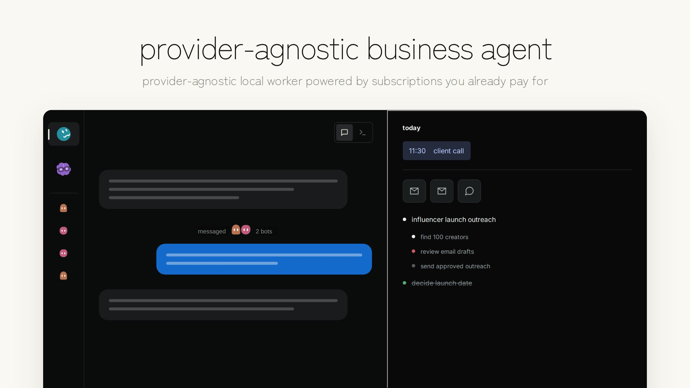
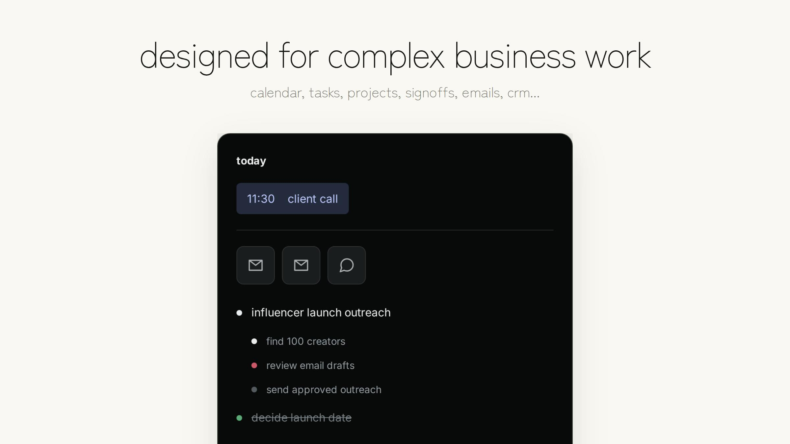
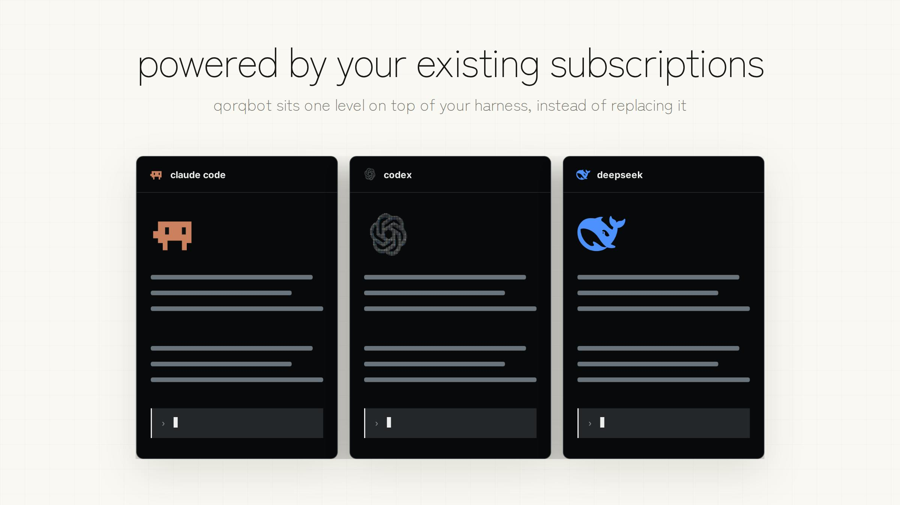

### 🎬 관련 영상
- [🎥 영상 보기](https://ph-files.imgix.net/cc3aaa32-f4ee-44d6-88a9-9ce9d12f473d.jpeg?auto=format)

---

## 8. [Ganella](https://www.producthunt.com/products/ganella)
**Votes**: 101 | **도입 난이도**: 하 | **신뢰도**: 상
**Tagline**: Your Mac Dock, with live widgets for the apps you use
**서비스 링크**: https://www.producthunt.com/r/723AUCMMDVZ3TU

**태그**: Productivity, macOS, Workflow, UI/UX, Agent, AI Tool, Chat, DevTool

### 📌 이 서비스 한눈에 보기
애플 기본 독(Dock)을 대체하여 실시간 위젯 기능을 제공하는 맥 전용 생산성 도구

### 🔑 주요 기능
- Spotify, 캘린더, 브라우저 탭 등 앱별 실시간 위젯 기능 제공
- Xcode 빌드, 터미널, AI 에이전트(Claude, ChatGPT 등) 연동 지원
- 클립보드 히스토리, 앱 폴더, 디스플레이별 위치 설정 및 4가지 디자인 스타일

### 🙋 사용자에게 어떤 점이 좋은가
기존 독을 단순한 앱 실행창에서 실시간 정보 확인 및 작업 제어 센터로 진화시켜 작업 흐름을 끊김 없이 유지해 줍니다.

### ✅ 지금 바로 써볼 기능
- 자주 사용하는 앱을 위젯으로 등록하여 실시간 상태 확인하기
- Liquid Glass를 포함한 4가지 스타일로 데스크탑 커스텀하기
- 7일 무료 체험을 통해 기존 macOS 독과의 호환성 테스트하기

### ⚠️ 사용 전 확인할 점
- 기존 macOS 기본 독을 완전히 대체하므로 사용자 인터페이스 적응이 필요함
- 일회성 구매($9.99) 모델이며 7일 이후 유료 전환됨

### 🧭 확인이 더 필요한 정보
기존 macOS 시스템 기능과의 충돌 여부 및 하드웨어 리소스 점유율에 대한 정보가 부족합니다.

### 📸 스크린샷 및 갤러리
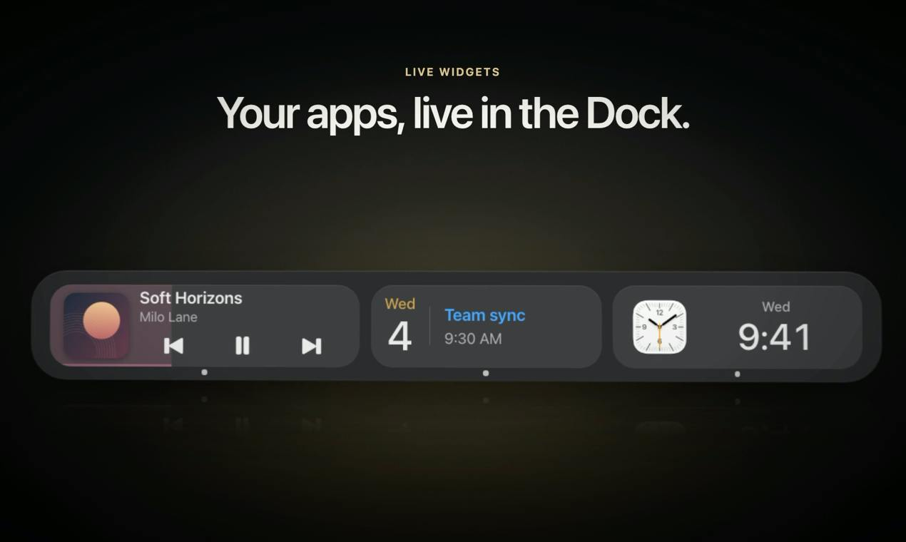

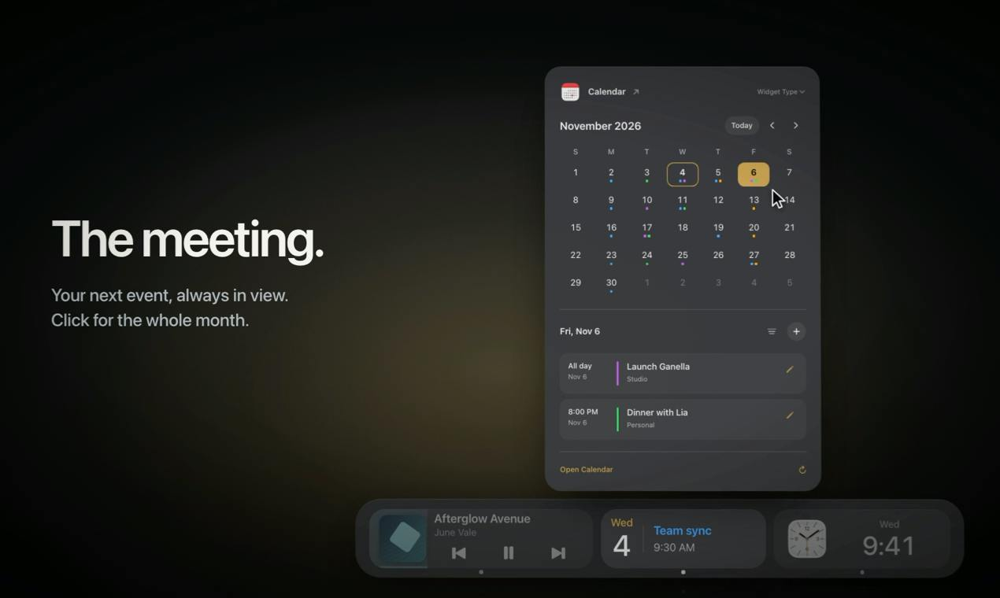

### 🎬 관련 영상
- [🎥 영상 보기](https://ph-files.imgix.net/238d5afd-9bb7-473a-96a4-ae0db0cf6a97.jpeg?auto=format)

---

## 9. [Paxper](https://www.producthunt.com/products/paxper)
**Votes**: 100 | **도입 난이도**: 중 | **신뢰도**: 상
**Tagline**: Create cloud infrastructure visually and review every change
**서비스 링크**: https://www.producthunt.com/r/AHT6BFH3RQ27QR

**태그**: DevOps, Cloud, Infrastructure, AWS, LowCode, Design, DevTool

### 📌 이 서비스 한눈에 보기
다이어그램 기반의 시각적 설계로 클라우드 인프라를 구축하고 변경 사항을 검토하는 도구

### 🔑 주요 기능
- 시각적 인프라 코드(Visual IaC) 방식 제공
- 다이어그램을 통한 직관적인 클라우드 리소스 설계
- 변경 사항에 대한 검토 및 사용자 AWS 계정으로의 적용

### 🙋 사용자에게 어떤 점이 좋은가
복잡한 코드를 직접 작성하는 대신 시각적인 도구로 인프라를 설계할 수 있어 직관적이며, 변경 사항을 사전에 검토하여 실수를 방지할 수 있습니다.

### ✅ 지금 바로 써볼 기능
- 다이어그램 인터페이스를 통한 리소스 설계 시도
- 설계된 변경 사항의 검토 프로세스 확인
- 개인/기업 AWS 계정과의 연동 테스트

### ⚠️ 사용 전 확인할 점
- 사용자 본인의 AWS 계정에 직접 적용되므로 권한 관리 주의 필요
- 시각적 도구와 실제 코드 간의 정밀한 동기화 여부 확인 필요

### 🧭 확인이 더 필요한 정보
지원하는 AWS 서비스의 범위와 복잡한 인프라 구성 시의 제약 사항을 확인해야 합니다.

### 📸 스크린샷 및 갤러리
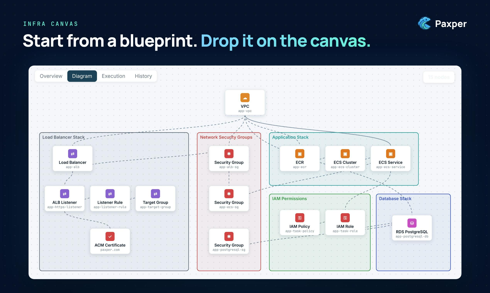
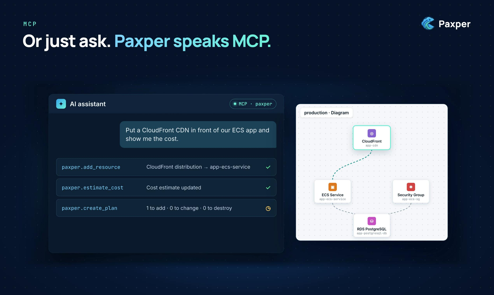
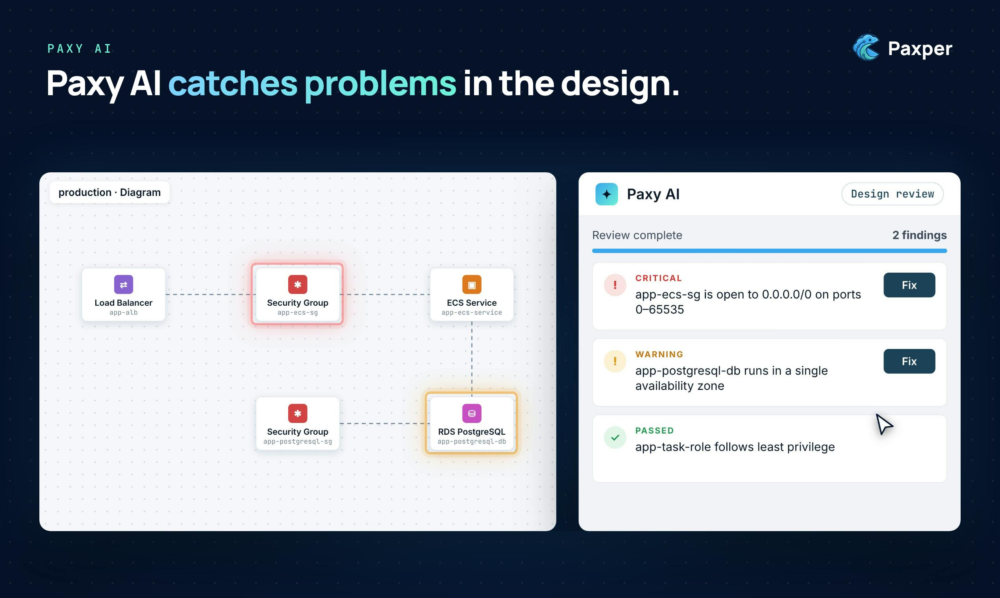

### 🎬 관련 영상
- [🎥 영상 보기](https://ph-files.imgix.net/172a6f0f-dd73-45c6-876a-a794eba4ecff.jpeg?auto=format)

---

## 10. [Google Pixel Tag](https://www.producthunt.com/products/google)
**Votes**: 98 | **도입 난이도**: 하 | **신뢰도**: 상
**Tagline**: Google’s $30 Android-ready tracking tag
**서비스 링크**: https://www.producthunt.com/r/SOWQ42MOQPLT26
**재등장**: 최근 7일 내 재등장 (마지막 등장 2일 전)

**태그**: Hardware, Android, Gadget, Tracking, Design

### 📌 이 서비스 한눈에 보기
10억 대 이상의 안드로이드 기기 네트워크를 활용하는 가성비 위치 추적 태그

### 🔑 주요 기능
- 10억 대 이상의 안드로이드 기기 네트워크를 통한 정밀 위치 추적
- 열쇠, 지갑, 수하물 등에 부착 가능한 슬림하고 방수되는 디자인
- 태그를 두 번 눌러 무음 모드인 스마트폰을 찾는 기능 제공

### 🙋 사용자에게 어떤 점이 좋은가
저렴한 가격으로 소중한 물건의 분실 위험을 줄이고, 안드로이드 사용자라면 누구나 쉽게 기기를 찾을 수 있습니다.

### ✅ 지금 바로 써볼 기능
- 분실 방지를 위해 열쇠나 지갑에 부착하기
- 스마트폰 찾기 기능을 위해 태그 조작법 익히기
- 안드로이드 9 이상의 기기 호환성 확인하기

### ⚠️ 사용 전 확인할 점
- 안드로이드 9 이상의 운영체제 필요
- 배터리 교체형 모델이므로 주기적인 배터리 관리 필요

### 🧭 확인이 더 필요한 정보
정확한 방수 등급(IP 등급)과 배터리 교체 방식에 대한 상세 정보 확인이 필요합니다.

### 📸 스크린샷 및 갤러리

---

## 11. [GAtrends](https://www.producthunt.com/products/gatrends)
**Votes**: 96 | **도입 난이도**: 하 | **신뢰도**: 상
**Tagline**: Spike alerts for your keywords in Telegram, Claude, ChatGPT
**서비스 링크**: https://www.producthunt.com/r/KGFXAXOXP52YCO

**태그**: Trend Monitoring, Automation, AI Integration, Analytics, Chat, API

### 📌 이 서비스 한눈에 보기
설정한 키워드의 트렌드 급증을 실시간으로 감지하여 알림을 주는 트렌드 레이더

### 🔑 주요 기능
- Google News, GitHub, Product Hunt 등 7개 주요 소스 모니터링
- 키워드별 평소 수치를 학습하여 급격한 변화(Spike) 발생 시 즉시 알림
- Telegram, Claude, ChatGPT와 연동하여 트렌드 분석 및 알림 수신

### 🙋 사용자에게 어떤 점이 좋은가
관심 분야의 트렌드 변화를 수동으로 검색할 필요 없이, 변화가 일어나는 순간 즉시 파악하여 빠른 의사결정을 할 수 있습니다.

### ✅ 지금 바로 써볼 기능
- 관심 있는 키워드 3개 등록하여 무료 플랜 테스트하기
- Telegram 알림 연결하여 실시간 모니터링 시작하기
- Claude/ChatGPT 연동하여 상승 원인 분석해보기

### ⚠️ 사용 전 확인할 점
- 무료 플랜은 키워드 개수가 3개로 제한됨
- 알림 소스가 7개로 특정 분야에 국한될 수 있음

### 🧭 확인이 더 필요한 정보
사용자별 맞춤형 데이터 소스 추가 가능 여부는 명시되지 않았습니다.

### 📸 스크린샷 및 갤러리
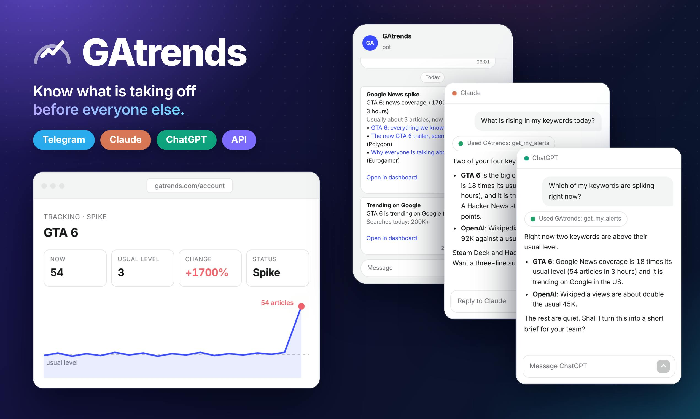
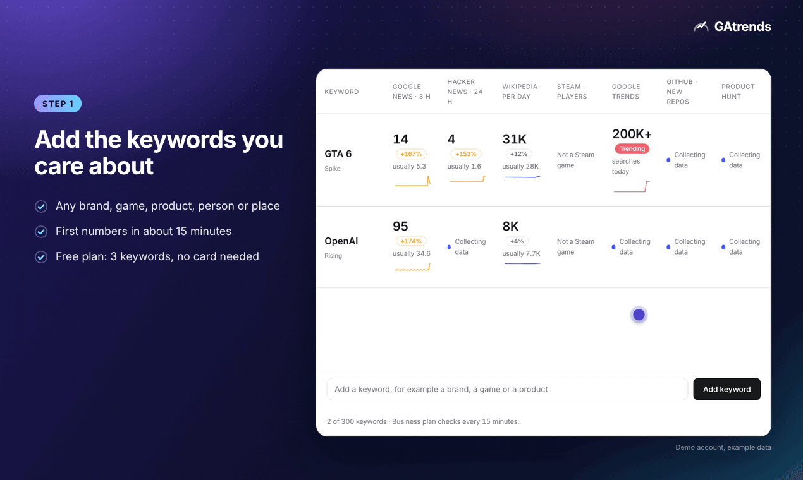
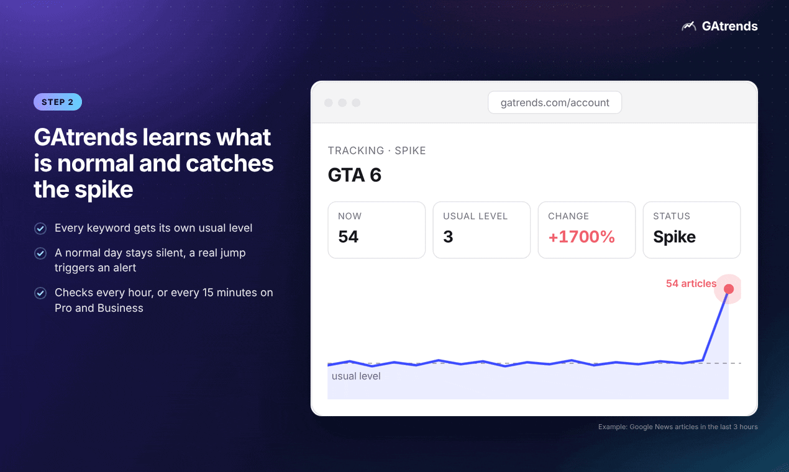

---

## 12. [WHOOP Humans](https://www.producthunt.com/products/whoop)
**Votes**: 88 | **도입 난이도**: 하 | **신뢰도**: 상
**Tagline**: WHOOP's social network built around real health data
**서비스 링크**: https://www.producthunt.com/r/BNYTYX3PFROSIA

**태그**: Social, Health, Fitness, Lifestyle, AI Tool

### 📌 이 서비스 한눈에 보기
실제 건강 데이터를 기반으로 친구들과 성과를 공유하고 격려하는 WHOOP 전용 소셜 네트워크

### 🔑 주요 기능
- 수면, 회복, 스트레인 등 실제 건강 데이터 기반의 소셜 경험
- 사진과 노트를 결합하여 데이터 뒤에 숨겨진 의미 있는 순간 기록
- 세밀한 개인정보 보호 설정을 통한 안전한 데이터 공유

### 🙋 사용자에게 어떤 점이 좋은가
단순한 일상 공유를 넘어, 신뢰할 수 있는 신체 데이터를 통해 친구들과 건강한 경쟁과 동기부여를 주고받을 수 있습니다.

### ✅ 지금 바로 써볼 기능
- 친구 팔로우 및 데이터 공유 설정하기
- 활동 데이터와 함께 사진/메모로 순간 기록하기
- 개인정보 보호를 위한 공유 범위 설정하기

### ⚠️ 사용 전 확인할 점
- WHOOP 하드웨어 사용자와의 데이터 연동 중심 서비스임
- 공유되는 데이터의 범위와 프라이버시 설정을 사전에 확인 필요

### 🧭 확인이 더 필요한 정보
WHOOP 하드웨어 사용자 외의 일반 사용자 대상 확장 여부는 명시되지 않았습니다.

### 📸 스크린샷 및 갤러리
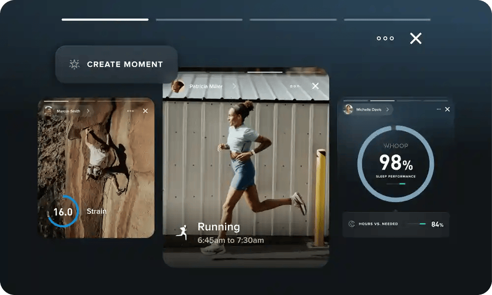

---

## 13. [Aven App Agent](https://www.producthunt.com/products/aven-app-agent)
**Votes**: 88 | **도입 난이도**: 중 | **신뢰도**: 상
**Tagline**: AI that guides users through your app
**서비스 링크**: https://www.producthunt.com/r/MGLYXUMWD5BQTH

**태그**: AI, UX, Onboarding, Productivity, Agent, AI Tool

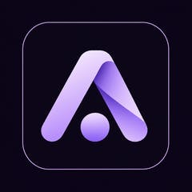

### 📌 이 서비스 한눈에 보기
사용자가 앱 내에서 원하는 작업을 쉽게 수행할 수 있도록 돕는 AI 가이드 에이전트

### 🔑 주요 기능
- 질문 기반의 대화형 AI 가이드 제공
- 사용자 작업 수행을 위한 단계별 워크스루(Walkthrough) 기능
- 개발팀이 가이드 범위를 정의하고 앱이 내비게이션을 처리하는 구조

### 🙋 사용자에게 어떤 점이 좋은가
새로운 앱 기능에 적응해야 하는 사용자가 복잡한 매뉴얼 없이도 대화를 통해 즉각적인 도움을 받을 수 있습니다.

### ✅ 지금 바로 써볼 기능
- AI 가이드가 앱의 UI 컨트롤을 정확히 하이라이트하는지 테스트
- 사용자 질문에 따른 워크스루 흐름의 직관성 확인
- 팀이 정의한 가이드 범위 내에서 동작하는지 검증

### ⚠️ 사용 전 확인할 점
- 앱의 내비게이션 로직이 Aven의 가이드와 충돌할 가능성
- 가이드 범위 외의 질문에 대한 AI의 대응 능력 확인 필요

### 🧭 확인이 더 필요한 정보
앱 내 내비게이션 제어 방식과 기존 UI 프레임워크와의 호환성 수준을 확인해야 합니다.

### 📸 스크린샷 및 갤러리
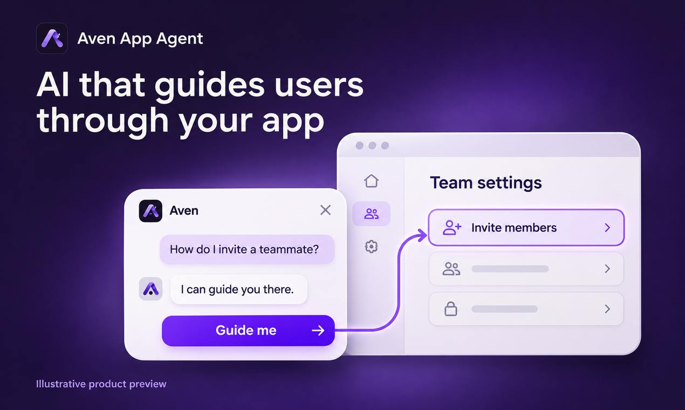
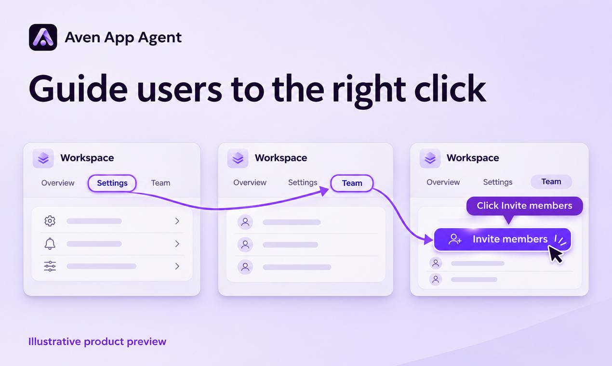
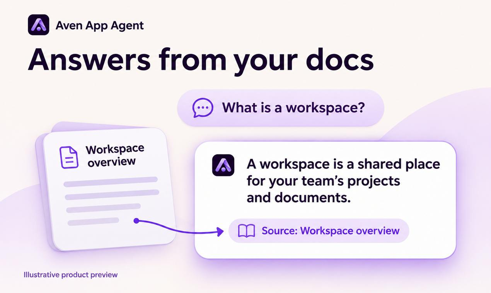

### 🎬 관련 영상
- [🎥 영상 보기](https://ph-files.imgix.net/mcp-draft-media/87df59d1-f28e-43bf-9615-9fa48ac1c7ae.jpeg?auto=format)

---

## 14. [Burnstate](https://www.producthunt.com/products/burnstate)
**Votes**: 87 | **도입 난이도**: 하 | **신뢰도**: 상
**Tagline**: Claude Code, Codex & Cursor limits, paced in your menu bar
**서비스 링크**: https://www.producthunt.com/r/H2T26HYRCIEWMM

**태그**: DevTool, Productivity, AI, MacApp, AI Tool, Prompting, Analytics

### 📌 이 서비스 한눈에 보기
AI 코딩 도구의 사용량 제한과 비용을 실시간으로 관리하는 Mac 메뉴바 앱

### 🔑 주요 기능
- Claude Code, Cursor, Vercel 등 AI 서비스의 사용량 및 남은 한도 실시간 모니터링
- 현재 페이스 기준 소진 예상 시점 및 세션별 토큰/비용 분석 제공
- 계정 생성이나 데이터 분석 없이 로컬에서 작동하는 프라이버시 중심 설계

### 🙋 사용자에게 어떤 점이 좋은가
AI 코딩 도구의 할당량 제한으로 인한 작업 중단을 방지하고, 사용량과 비용을 직관적으로 관리할 수 있습니다.

### ✅ 지금 바로 써볼 기능
- 메뉴바에서 실시간 사용량 및 남은 한도 확인하기
- Claude Code 권한 프롬프트 및 질문에 즉각 응답하기
- 세션별 토큰 소모량과 비용 데이터 분석하기

### ⚠️ 사용 전 확인할 점
- Mac 전용 네이티브 앱이므로 macOS 환경에서만 사용 가능
- 각 AI 서비스의 API 또는 세션 데이터 연동 방식에 따른 설정 필요성

### 🧭 확인이 더 필요한 정보
각 AI 서비스(Claude, Cursor 등)의 API 키나 인증 방식이 어떻게 연동되는지에 대한 구체적인 기술적 절차 확인이 필요합니다.

### 📸 스크린샷 및 갤러리

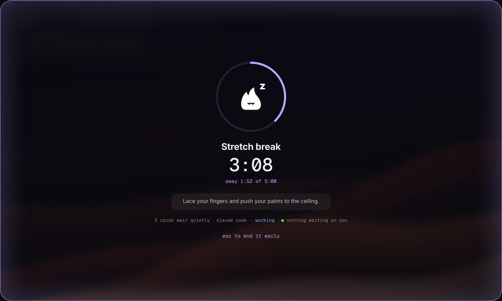

### 🎬 관련 영상
- [🎥 영상 보기](https://ph-files.imgix.net/3a42f4d5-975e-4754-8231-fd367d054b60.jpeg?auto=format)

---

## 15. [de:volt](https://www.producthunt.com/products/de-volt)
**Votes**: 82 | **도입 난이도**: 하 | **신뢰도**: 상
**Tagline**: A breadboard simulator with real physics, in your browser
**서비스 링크**: https://www.producthunt.com/r/LKBWY3GBG5GTN3

**태그**: EdTech, Hardware, Simulation, STEM

### 📌 이 서비스 한눈에 보기
실제 물리 법칙이 적용되는 브라우저 기반의 인터랙티브 브레드보드 시뮬레이터

### 🔑 주요 기능
- 실제 회로 물리 법칙이 적용되는 정교한 브레드보드 시뮬레이션
- Arduino, micro:bit, RP2040 등 다양한 마이크로컨트롤러 지원
- 스코프, 멀티미터 및 가이드형 레슨을 포함한 교육용 기능 탑재

### 🙋 사용자에게 어떤 점이 좋은가
하드웨어 없이도 브라우저에서 실제와 유사한 회로 설계 및 프로그래밍 실습이 가능하여 학습과 교육에 매우 유용합니다.

### ✅ 지금 바로 써볼 기능
- 105종의 부품을 활용한 회로 구성해보기
- Arduino 및 RP2040 프로그래밍 실습하기
- 4채널 스코프와 멀티미터로 회로 측정해보기

### ⚠️ 사용 전 확인할 점
- 브라우저 기반이므로 매우 복잡한 대규모 회로 시뮬레이션 시 성능 제약 가능성
- 실제 물리적 부품의 오차나 환경 변수가 완벽히 재현되는지 확인 필요

### 🧭 확인이 더 필요한 정보
사용자 수나 동시 접속 가능한 클래스 규모에 대한 구체적인 제한 사항은 명시되지 않았습니다.

### 📸 스크린샷 및 갤러리
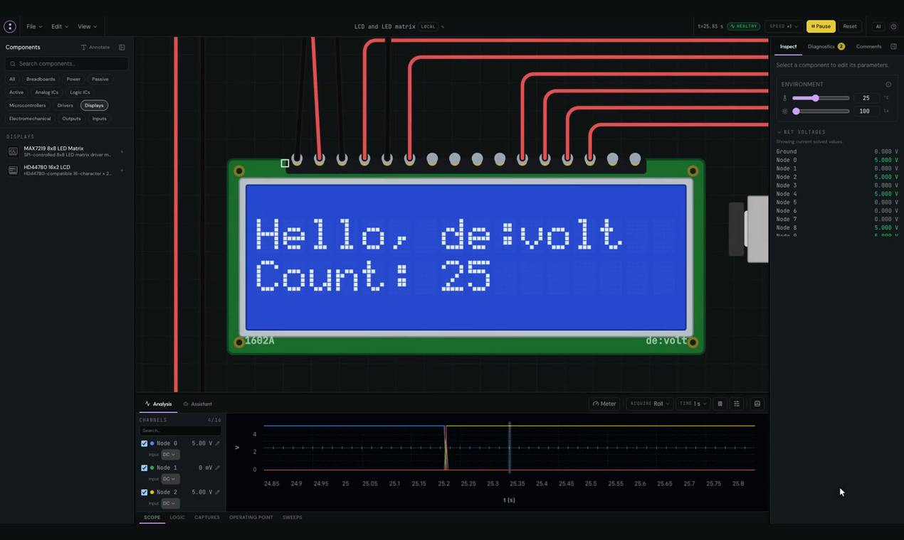
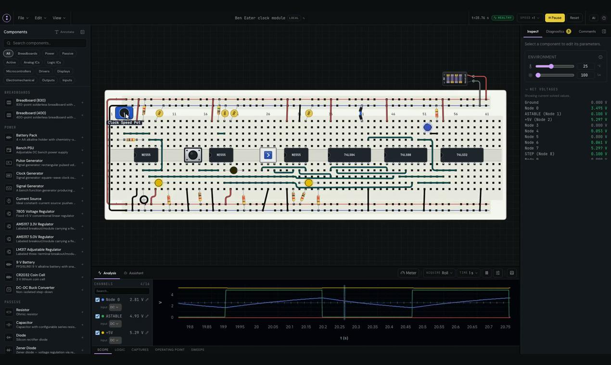
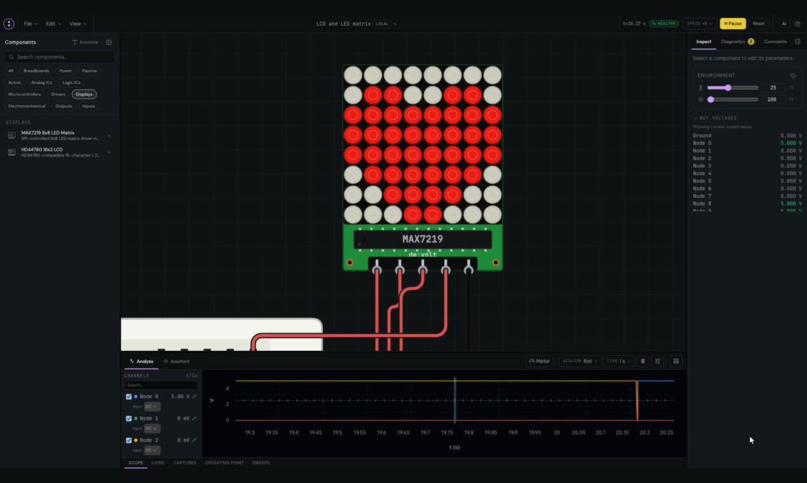

---

## 16. [Willo](https://www.producthunt.com/products/willo-2)
**Votes**: 77 | **도입 난이도**: 하 | **신뢰도**: 상
**Tagline**: A companion you talk to while you play WoW
**서비스 링크**: https://www.producthunt.com/r/UG5FNIOMDTTKLG

**태그**: Gaming, AI Companion, Voice Interface, WoW

### 📌 이 서비스 한눈에 보기
월드 오브 워크래프트 플레이 중 음성으로 대화할 수 있는 AI 동반자

### 🔑 주요 기능
- 게임 플레이 중 실시간 음성 질의응답 가능
- 게임 내 몰입감을 높여주는 위스프(Wisp) 캐릭터 컨셉
- 플레이 흐름을 방해하지 않는 음성 기반 인터페이스

### 🙋 사용자에게 어떤 점이 좋은가
게임 플레이를 중단하고 키보드를 조작할 필요 없이, 음성만으로 궁금한 점을 해결하며 게임 몰입도를 유지할 수 있습니다.

### ✅ 지금 바로 써볼 기능
- 음성 대화 기능 테스트하기
- 게임 플레이 중 반응 속도 확인하기
- 캐릭터 목소리 및 상호작용 경험하기

### ⚠️ 사용 전 확인할 점
- 음성 인식 및 출력 기능이 게임 클라이언트와 충돌할 가능성
- 게임 플레이 중 마이크 사용에 따른 주변 소음 유입 문제

### 🧭 확인이 더 필요한 정보
게임 내 데이터(인게임 정보)를 실시간으로 읽어올 수 있는지 여부는 명시되지 않았습니다.

### 📸 스크린샷 및 갤러리

### 🎬 관련 영상
- [🎥 영상 보기](https://ph-files.imgix.net/f00d1436-852a-411a-a765-ee9d53c8a0bd.jpeg?auto=format)

---

## 17. [Expo Simulators](https://www.producthunt.com/products/expo)
**Votes**: 75 | **도입 난이도**: 중 | **신뢰도**: 상
**Tagline**: Cloud simulators built for agents
**서비스 링크**: https://www.producthunt.com/r/W7P7G4FGP7TWVB

**태그**: DevTool, Automation, AI-Agent, Cloud, Agent

### 📌 이 서비스 한눈에 보기
AI 에이전트가 직접 앱을 설치하고 검증할 수 있는 클라우드 기반 시뮬레이터

### 🔑 주요 기능
- 플랫폼에 구애받지 않는 클라우드 기반 시뮬레이터 환경 제공
- AI 에이전트가 직접 빌드를 설치하고 구동할 수 있는 구조
- 필요한 만큼 병렬로 실행 가능한 확장성

### 🙋 사용자에게 어떤 점이 좋은가
AI 에이전트가 소프트웨어 개발 및 테스트 과정을 자동화할 수 있도록 실질적인 실행 환경을 제공합니다.

### ✅ 지금 바로 써볼 기능
- 에이전트용 빌드 설치 테스트
- 병렬 실행을 통한 대규모 검증 워크플로우 구축
- 플랫폼 간 호환성 확인

### ⚠️ 사용 전 확인할 점
- 에이전트의 작업 결과에 대한 보안 및 제어 권한 확인 필요
- 병렬 실행 시 발생할 수 있는 클라우드 리소스 비용 관리

### 🧭 확인이 더 필요한 정보
지원하는 구체적인 OS 플랫폼 종류와 에이전트 프레임워크와의 호환성 범위 확인이 필요합니다.

### 📸 스크린샷 및 갤러리

### 🎬 관련 영상
- [🎥 영상 보기](https://ph-files.imgix.net/e2ee8389-d06b-4498-beaf-ce5ab1eaa15e.jpeg?auto=format)

---

## 18. [Hoverine](https://www.producthunt.com/products/hoverine)
**Votes**: 73 | **도입 난이도**: 하 | **신뢰도**: 상
**Tagline**: Rive animation templates you can drop into your app
**서비스 링크**: https://www.producthunt.com/r/KDWCVXYLB42SPA

**태그**: DesignTool, UI/UX, Animation, Frontend

### 📌 이 서비스 한눈에 보기
상태 머신이 포함된 인터랙티브 Rive 애니메이션 템플릿 라이브러리

### 🔑 주요 기능
- 버튼, 로더, 토글 등 즉시 사용 가능한 Rive 애니메이션 템플릿 제공
- 각 템플릿에 작동 가능한 상태 머신(State Machine)이 내장됨
- 브라우저 기반의 .riv 파일 검사기 'Riv Eye' 포함

### 🙋 사용자에게 어떤 점이 좋은가
복잡한 애니메이션 작업 없이 템플릿을 앱에 바로 적용하여 고품질의 인터랙티브 UI를 빠르게 구현할 수 있습니다.

### ✅ 지금 바로 써볼 기능
- 무료 템플릿을 다운로드하여 앱에 적용해보기
- Riv Eye를 사용하여 .riv 파일 상태 확인하기
- 상업적 이용을 위한 라이선스 정책 검토하기

### ⚠️ 사용 전 확인할 점
- 전체 카탈로그 이용 및 상업적 라이선스 적용 시 유료 업그레이드 필요
- Rive 프레임워크를 사용하는 환경에서만 활용 가능

### 🧭 확인이 더 필요한 정보
무료 버전과 유료 버전 간의 구체적인 템플릿 차이와 라이선스 범위를 확인해야 합니다.

### 📸 스크린샷 및 갤러리
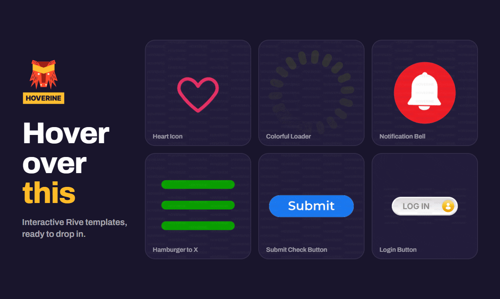
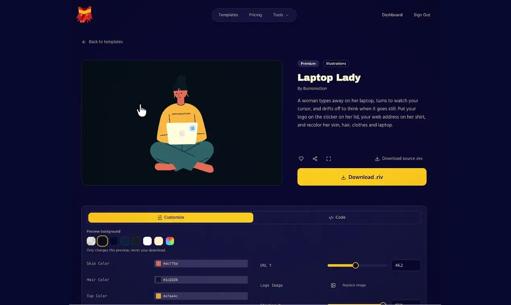
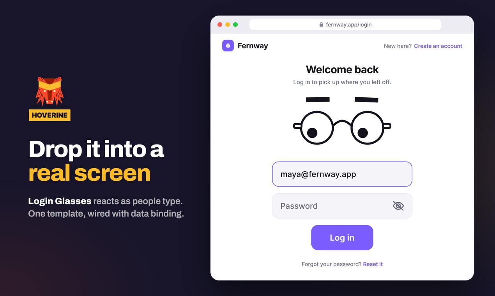

### 🎬 관련 영상
- [🎥 영상 보기](https://ph-files.imgix.net/c447df9b-4ad1-48a7-9a3a-f9e553713097.jpeg?auto=format)

---

## 19. [Pocket Studio for Supabase](https://www.producthunt.com/products/pocket-studio-for-supabase)
**Votes**: 71 | **도입 난이도**: 하 | **신뢰도**: 상
**Tagline**: Supabase dashboard & SQL editor for Android
**서비스 링크**: https://www.producthunt.com/r/S5L2WBS7IOFAYK

**태그**: DevTool, Database, Mobile, Supabase

### 📌 이 서비스 한눈에 보기
안드로이드 기기에서 Supabase를 관리할 수 있는 프라이빗 대시보드 및 SQL 에디터

### 🔑 주요 기능
- 안드로이드 환경에 최적화된 Supabase 관리 도구
- 테이블 브라우징, SQL 실행, 스토리지 및 로그 확인 기능 제공
- 광고와 트래킹이 없는 프라이빗한 무료 플랜 제공

### 🙋 사용자에게 어떤 점이 좋은가
PC 앞을 떠나 이동 중에도 모바일로 즉시 데이터베이스를 조회하거나 SQL을 실행하여 프로젝트 상태를 관리할 수 있습니다.

### ✅ 지금 바로 써볼 기능
- 모바일에서 직접 SQL 쿼리 실행해보기
- 프로젝트 로그 및 스토리지 사용량 확인하기
- 프로젝트 알림 설정 및 모니터링하기

### ⚠️ 사용 전 확인할 점
- 모바일 환경 특성상 복잡한 쿼리 작성이나 대규모 데이터 관리에 제약이 있을 수 있음
- 개인용 프라이빗 대시보드이므로 보안 정책에 따른 접근 권한 확인 필요

### 🧭 확인이 더 필요한 정보
안드로이드 전용 앱이며, 데스크톱 버전과의 기능 차이 및 상세 보안 프로토콜은 명시되지 않았습니다.

### 📸 스크린샷 및 갤러리

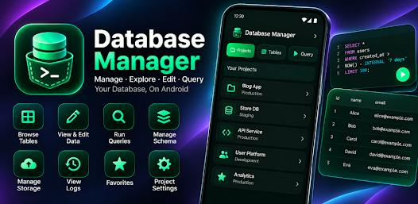

### 🎬 관련 영상
- [🎥 영상 보기](https://ph-files.imgix.net/b71694cc-07fa-4dcd-a80b-e480302dec9e.jpeg?auto=format)

---

## 20. [Kairos](https://www.producthunt.com/products/kairos-18)
**Votes**: 71 | **도입 난이도**: 상 | **신뢰도**: 상
**Tagline**: Personal analytics engine across health, finances, & social
**서비스 링크**: https://www.producthunt.com/r/UA2NN23ZVWYAVY

**태그**: Personal Analytics, Data Integration, Self-Improvement, Privacy-Focused, AI Tool, Analytics

### 📌 이 서비스 한눈에 보기
개인 건강, 금융, 소셜 데이터를 통합하여 나만의 삶의 패턴을 분석하는 개인용 분석 엔진

### 🔑 주요 기능
- 건강, 금융, 일정, 메시지 등 다양한 데이터 스트림 통합
- 타인과의 비교가 아닌 오직 사용자 본인의 데이터 패턴 분석
- 매일 아침 에너지, 기분, 집중도를 기록하여 상관관계 파악

### 🙋 사용자에게 어떤 점이 좋은가
파편화된 개인 데이터를 하나로 모아 내 삶의 질에 영향을 미치는 실질적인 원인을 파악할 수 있습니다.

### ✅ 지금 바로 써볼 기능
- 주요 데이터 소스(은행, 캘린더 등) 연결하기
- 매일 아침 에너지 및 기분 수치 기록하기
- 도출된 데이터 패턴을 통한 의사결정 적용하기

### ⚠️ 사용 전 확인할 점
- 민감한 개인 정보(금융, 메시지 등)를 다루므로 보안 및 프라이버시 정책 확인 필수
- 데이터 연결 범위에 따라 분석의 정확도가 달라질 수 있음

### 🧭 확인이 더 필요한 정보
데이터 보안 방식과 외부 서비스와의 구체적인 연동 방식에 대한 상세 정보가 필요합니다.

### 📸 스크린샷 및 갤러리
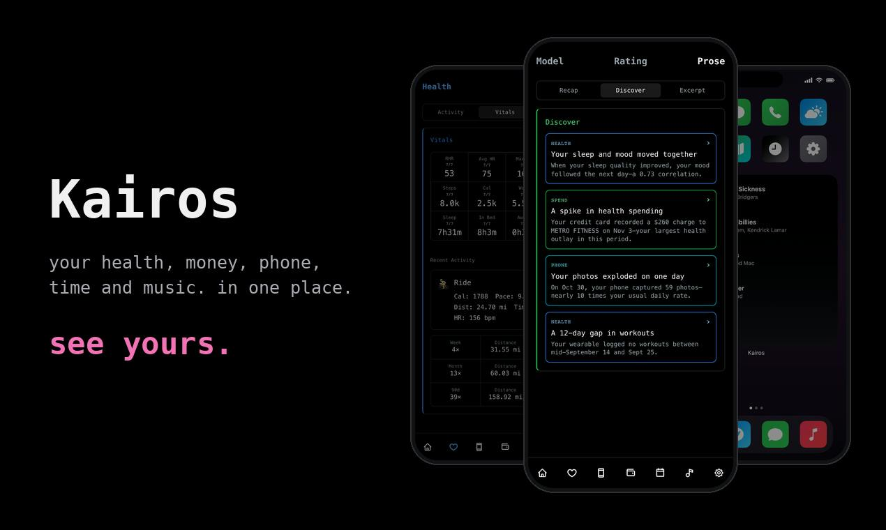
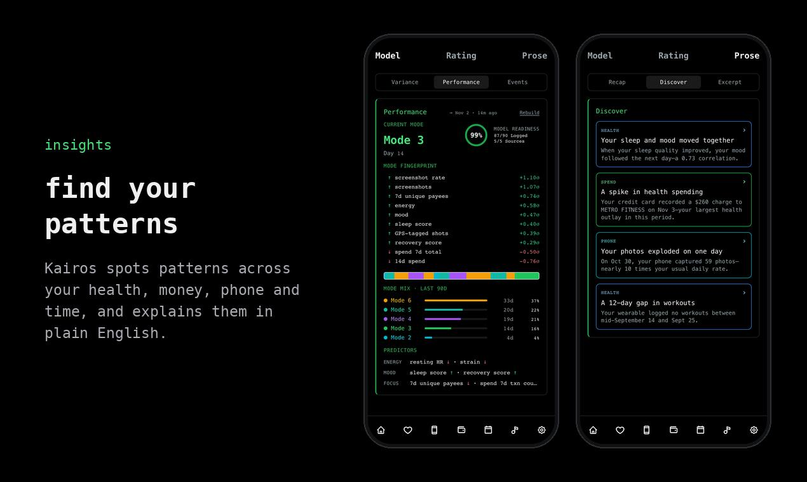
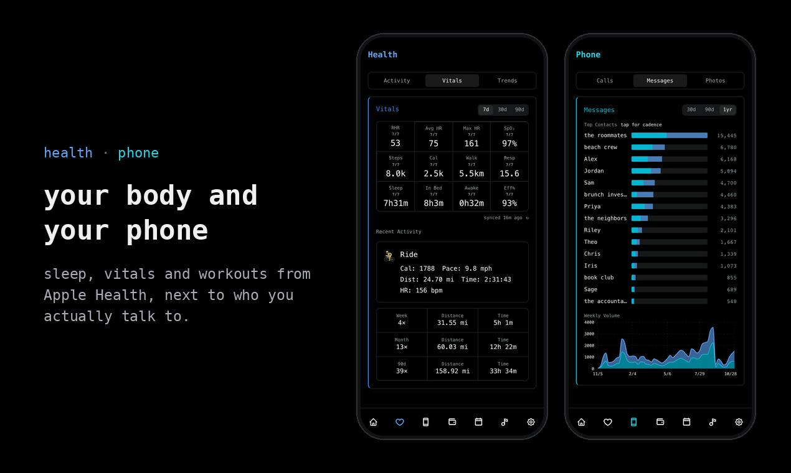

### 🎬 관련 영상
- [🎥 영상 보기](https://ph-files.imgix.net/600464c4-d93f-44f8-9b85-9bb3d472d116.jpeg?auto=format)

---

## 21. [StockRip](https://www.producthunt.com/products/stockrip)
**Votes**: 70 | **도입 난이도**: 하 | **신뢰도**: 상
**Tagline**: Trading cards, literally digital cards with tokenized stocks
**서비스 링크**: https://www.producthunt.com/r/YGRDOGOUMER74O

**태그**: FinTech, Trading, Collectibles, Web3

### 📌 이 서비스 한눈에 보기
실제 주식을 토큰화하여 수집하고 거래하는 디지털 트레이딩 카드 플랫폼

### 🔑 주요 기능
- Nvidia, Tesla 등 유명 기업의 토큰화된 주식을 담은 디지털 카드 수집
- 팩을 개봉(Rip)하여 무작위로 주식 카드를 획득하는 게임화된 경험
- 보유한 카드를 포트폴리오로 구축하거나 즉시 판매 및 선물 가능

### 🙋 사용자에게 어떤 점이 좋은가
주식 투자를 카드 수집과 같은 재미있는 게임 방식으로 경험하며, 소액으로도 기업 지분을 소유하는 듯한 재미를 느낄 수 있습니다.

### ✅ 지금 바로 써볼 기능
- 디지털 팩 개봉하여 주식 카드 뽑기
- 획득한 카드를 활용해 나만의 포트폴리오 구축하기
- 획득한 카드를 다른 사용자에게 선물하거나 판매하기

### ⚠️ 사용 전 확인할 점
- 실제 주식과 토큰화된 자산 간의 법적/금융적 차이 확인 필요
- 자산 가치 변동에 따른 투자 위험성 인지

### 🧭 확인이 더 필요한 정보
토큰화된 주식의 실제 법적 효력과 자산 가치 보장 범위에 대한 상세 정보가 필요합니다.

### 📸 스크린샷 및 갤러리

### 🎬 관련 영상
- [🎥 영상 보기](https://ph-files.imgix.net/f434fbf7-4838-4130-9779-6e9e0f0473e9.jpeg?auto=format)

---

## 22. [Pocket+](https://www.producthunt.com/products/pocket-7)
**Votes**: 20 | **도입 난이도**: 하 | **신뢰도**: 상
**Tagline**: DJI Osmo Pocket made more capable for content creators.
**서비스 링크**: https://www.producthunt.com/r/X65S33YPUVCWUS

**태그**: Content Creation, Video Production, DJI, Mac Tool, Video

### 📌 이 서비스 한눈에 보기
DJI Osmo Pocket을 맥(Mac)에서 강력한 전문 카메라로 변신시켜주는 크리에이터용 제어 솔루션

### 🔑 주요 기능
- Mac을 통한 풀스크린 모니터링 및 정밀한 짐벌/줌 컨트롤
- 스마트 페이스 트래킹 및 장면 전환 기능 제공
- 4K 영상 녹화 및 LUT를 활용한 전문적인 색감 조정

### 🙋 사용자에게 어떤 점이 좋은가
별도의 복잡한 장비 없이도 Mac을 통해 Pocket 시리즈를 전문 스튜디오 카메라처럼 제어하고 고화질 콘텐츠를 제작할 수 있습니다.

### ✅ 지금 바로 써볼 기능
- Mac과 Pocket 기기 연결 및 모니터링 테스트
- LUT를 적용한 색감 조정 및 4K 녹화 기능 확인
- Zoom이나 OBS 환경에서의 카메라 연동 테스트

### ⚠️ 사용 전 확인할 점
- 지원되는 Pocket 모델(2, 3, 4, 4P) 여부 확인 필요
- Mac 환경에서의 하드웨어 호환성 확인 필요

### 🧭 확인이 더 필요한 정보
사용 중인 Mac의 OS 버전 및 하드웨어 사양에 따른 4K 녹화 안정성을 확인해야 합니다.

### 📸 스크린샷 및 갤러리
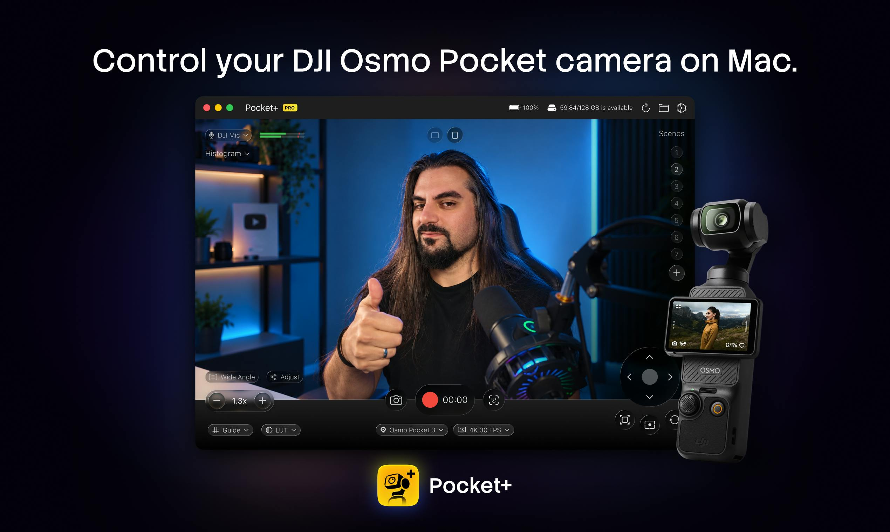
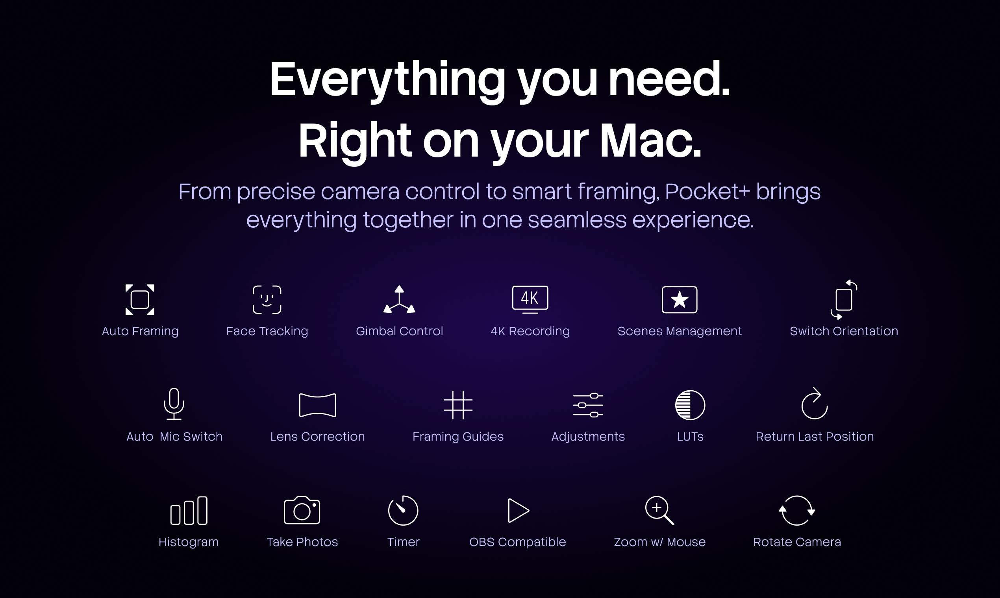
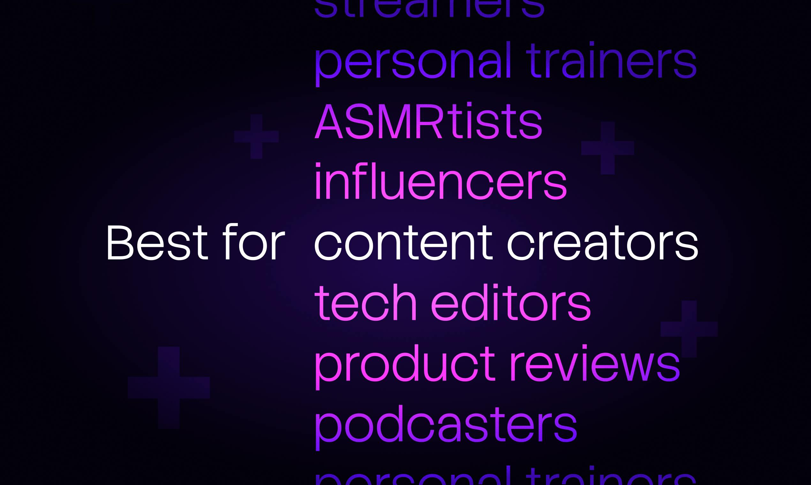

### 🎬 관련 영상
- [🎥 영상 보기](https://ph-files.imgix.net/715a7a20-5969-4ef9-993c-5e6d29cb4a38.jpeg?auto=format)

---

## 23. [miingl social](https://www.producthunt.com/products/miingl-social)
**Votes**: 19 | **도입 난이도**: 하 | **신뢰도**: 상
**Tagline**: Free Intelligent Social Media Management
**서비스 링크**: https://www.producthunt.com/r/MFSA6TZCSLFMXJ

**태그**: SocialMedia, AI, Automation, ContentManagement, AI Tool

### 📌 이 서비스 한눈에 보기
브랜드 맞춤형 AI와 사람이 협업하여 11개 이상의 플랫폼에 콘텐츠를 게시하는 통합 소셜 미디어 관리 도구

### 🔑 주요 기능
- 브랜드 정체성을 학습하는 지능형 콘텐츠 생성 및 관리
- 사람과 AI가 만든 콘텐츠를 혼합하여 11개 이상의 플랫폼에 예약 게시
- 최종 승인 전까지는 게시되지 않는 안전한 워크플로우 제공

### 🙋 사용자에게 어떤 점이 좋은가
브랜드의 톤앤매너를 유지하면서도 AI를 활용해 콘텐츠 제작 효율을 극대화하고, 여러 채널의 게시물을 한 곳에서 관리할 수 있습니다.

### ✅ 지금 바로 써볼 기능
- 브랜드 스타일 학습 기능 테스트
- 11개 이상의 플랫폼 연동 확인
- AI와 팀원 간의 콘텐츠 혼합 게시 기능 활용

### ⚠️ 사용 전 확인할 점
- AI 생성 콘텐츠의 품질을 위한 최종 승인 단계 필수
- 지원되는 11개 플랫폼 외의 채널 사용 시 제약 확인 필요

### 🧭 확인이 더 필요한 정보
무료 플랜의 구체적인 기능 제한 범위와 플랫폼별 상세 연동 범위를 확인해야 합니다.

### 📸 스크린샷 및 갤러리
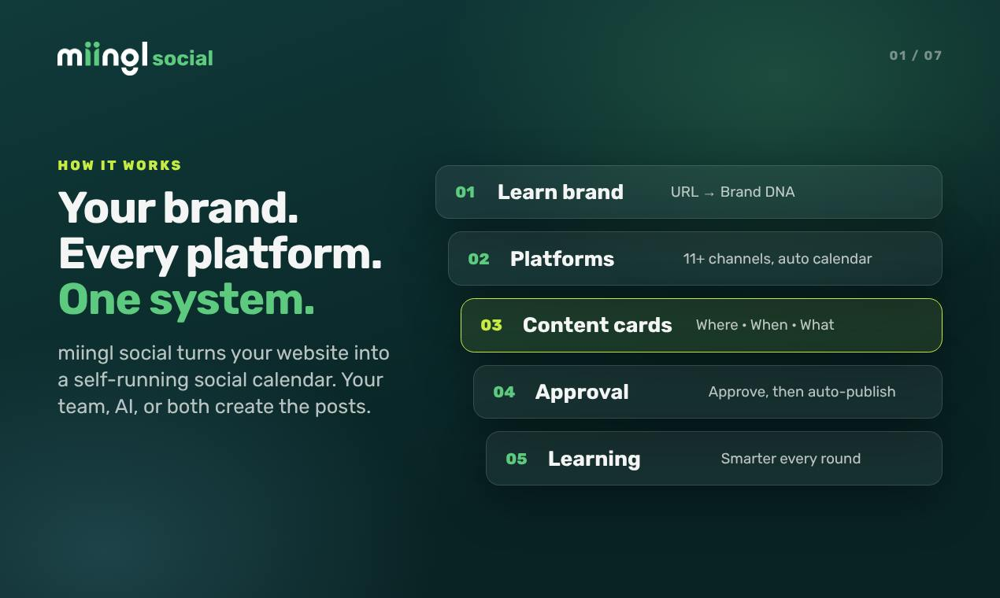
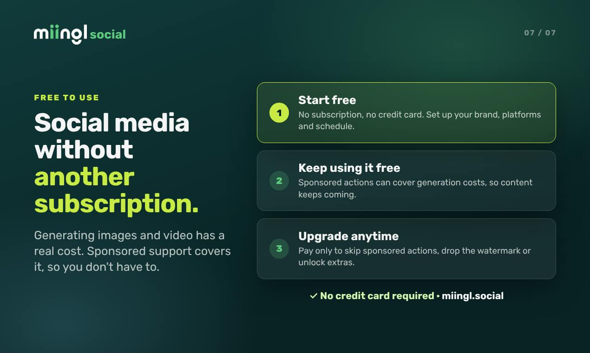
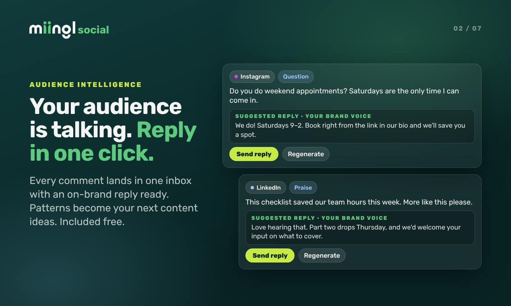

### 🎬 관련 영상
- [🎥 영상 보기](https://ph-files.imgix.net/92b29055-0fc5-45e2-a0fd-25d698521886.jpeg?auto=format)

---

## 24. [Qwen4-Max-Preview](https://www.producthunt.com/products/qwen4-max-preview)
**Votes**: 14 | **도입 난이도**: 중 | **신뢰도**: 상
**Tagline**: A multimodal AI model for reasoning, coding, and agents
**서비스 링크**: https://www.producthunt.com/r/RPXYS34JCLANHO

**태그**: AI, DevTool, Multimodal, Coding, Agent, AI Tool, Video, Vision, Design

### 📌 이 서비스 한눈에 보기
복잡한 추론, 코딩, 멀티모달 작업을 하나로 해결하는 알리바바의 차세대 AI 모델

### 🔑 주요 기능
- 텍스트, 이미지, 비디오를 아우르는 강력한 멀티모달 이해 능력
- 복잡한 논리적 추론 및 고도화된 코딩 작업 최적화
- 에이전트 기능 지원을 통한 AI 기반 도구 활용성 강화

### 🙋 사용자에게 어떤 점이 좋은가
개발자와 크리에이터가 텍    트와 시각적 요소를 결합한 복잡한 프로젝트를 하나의 모델로 효율적으로 수행할 수 있습니다.

### ✅ 지금 바로 써볼 기능
- 복잡한 코딩 문제 해결 및 코드 생성 테스트
- 이미지 및 비디오를 포함한 멀티모달 데이터 분석
- 논리적 추론이 필요한 에이전트 워크플로우 설계

### ⚠️ 사용 전 확인할 점
- Preview 버전이므로 성능의 안정성이나 일관성이 변동될 수 있음
- 멀티모달 처리 시 리소스 소모 및 처리 속도 확인 필요

### 🧭 확인이 더 필요한 정보
Preview 모델로서 구체적인 API 비용 정책과 상세 벤치마크 성능 수치는 공개되지 않았습니다.

### 📸 스크린샷 및 갤러리
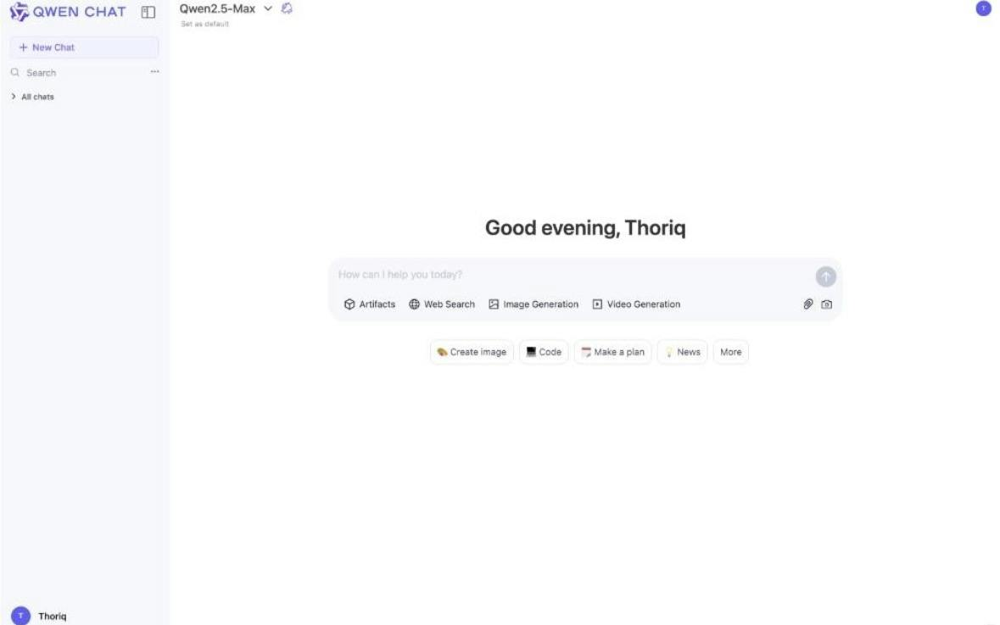
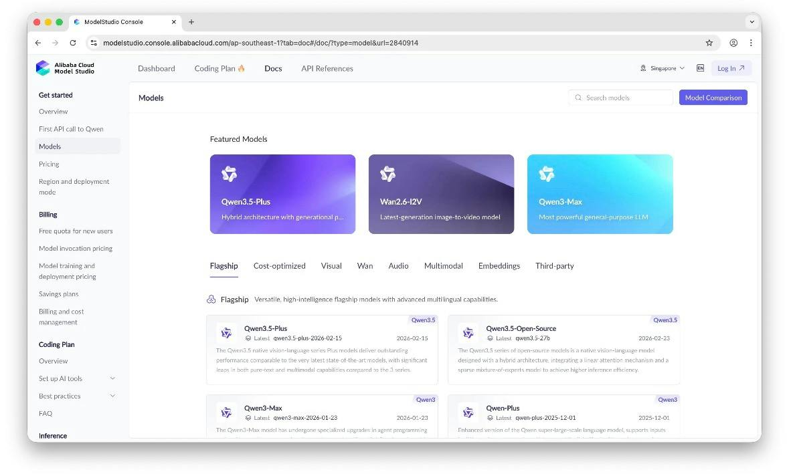
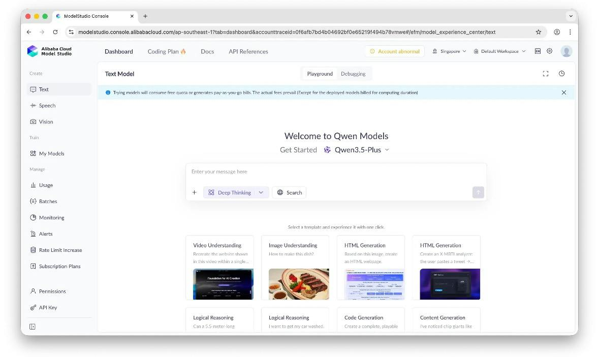

---

## 25. [Flowout 3.0](https://www.producthunt.com/products/flowout-3-0)
**Votes**: 11 | **도입 난이도**: 상 | **신뢰도**: 상
**Tagline**: Your Webflow team for website design, development and growth
**서비스 링크**: https://www.producthunt.com/r/45MALAU4PSGGZM

**태그**: Design, Development, B2B, Marketing, Webflow

### 📌 이 서비스 한눈에 보기
B2B SaaS 및 엔터프라이즈를 위한 전문 웹 디자인, 개발 및 성장 전략 서비스

### 🔑 주요 기능
- 전략, 디자인, 개발을 아우르는 통합 웹사이트 팀 서비스
- B2B SaaS 및 엔터프라이즈 마케팅 팀 대상 전문 솔루션
- 웹사이트 구축, 마이그레이션 및 지속적인 성능 개선 지원

### 🙋 사용자에게 어떤 점이 좋은가
전문적인 웹사이트 구축과 성장이 필요한 기업이 외부 전문 팀을 통해 웹 운영 효율을 높일 수 있습니다.

### ✅ 지금 바로 써볼 기능
- 기업 웹사이트 마이그레이션 전략 상담
- 웹사이트 디자인 및 개발 프로젝트 의뢰
- 성장 중심의 웹사이트 최적화 컨설팅

### ⚠️ 사용 전 확인할 점
- 서비스 형태가 소프트웨어가 아닌 전문 대행/컨설팅 서비스임
- B2B 및 엔터프라이즈 규모의 팀에 최적화되어 있어 개인 사용자에게는 비용 부담이 클 수 있음

### 🧭 확인이 더 필요한 정보
구체적인 서비스 비용 체계와 프로젝트 최소 규모에 대한 정보가 명시되지 않았습니다.

### 📸 스크린샷 및 갤러리

---

## 26. [EVPick](https://www.producthunt.com/products/evpick)
**Votes**: 9 | **도입 난이도**: 하 | **신뢰도**: 상
**Tagline**: Compare electric cars in plain words
**서비스 링크**: https://www.producthunt.com/r/BKPYPM7PJAET22

**태그**: EV, Comparison, ConsumerTool, AI Tool

### 📌 이 서비스 한눈에 보기
복잡한 전기차 스펙을 쉬운 언어로 비교해주는 맞춤형 차량 탐색 서비스

### 🔑 주요 기능
- 84개 브랜드, 1,900개 이상의 전기차 모델 데이터 보유
- 예산, 주행 거리, 가족 구성원 등 사용자 상황에 맞춘 필터링
- 11개국 가격 정보 및 9개 언어 지원

### 🙋 사용자에게 어떤 점이 좋은가
전문 용어 대신 쉬운 언어로 전기차를 비교할 수 있어, 구매 결정 과정에서의 혼란을 줄여줍니다.

### ✅ 지금 바로 써볼 기능
- 자신의 예산 범위 내에서 구매 가능한 모델 확인하기
- 가족 구성원과 주행 패턴에 맞는 차량 적합성 테스트하기

### ⚠️ 사용 전 확인할 점
- 실제 차량 구매 시 현지 대리점의 최종 가격과 다를 수 있음
- 제공되는 데이터가 실시간 재고나 최신 프로모션을 반영하는지 확인 필요

### 🧭 확인이 더 필요한 정보
국가별로 제공되는 데이터의 상세 범위와 최신성 여부를 확인해야 합니다.

### 📸 스크린샷 및 갤러리

### 🎬 관련 영상
- [🎥 영상 보기](https://ph-files.imgix.net/f9b860f4-0902-452f-9126-e2b6323c4671.jpeg?auto=format)

---

## 27. [A Novel Appetite](https://www.producthunt.com/products/a-novel-appetite)
**Votes**: 7 | **도입 난이도**: 하 | **신뢰도**: 상
**Tagline**: Read by the vampire. Against his will.
**서비스 링크**: https://www.producthunt.com/r/S2KHZJZ5KSXSVS

**태그**: Podcast, Storytelling, Audiobook, AI Tool

### 📌 이 서비스 한눈에 보기
흡혈귀가 읽어주는 독특한 컨셉의 오디오북 팟캐스트 시리즈

### 🔑 주요 기능
- 8개의 에피소드로 구성된 몰입형 스토리텔링 팟캐스트
- 흡혈귀 서점 주인이 나쁜 작가들을 심판한다는 독특한 세계관
- Spotify 및 Apple Podcasts에서 무료로 감상 가능

### 🙋 사용자에게 어떤 점이 좋은가
색다른 컨셉의 스토리텔링 콘텐츠를 원하는 사용자에게 색다른 청취 경험을 제공합니다.

### ✅ 지금 바로 써볼 기능
- Spotify 또는 Apple Podcasts에서 에피소드 청취하기
- 제공되는 전체 스크립트(transcript) 읽어보기

### ⚠️ 사용 전 확인할 점
- 오디오 콘텐츠이므로 텍스트 기반의 정보 습득과는 성격이 다름
- 스토리 중심의 콘텐츠로 취향에 따라 호불호가 갈릴 수 있음

### 🧭 확인이 더 필요한 정보
에피소드당 평균 33분 분량의 오디오 콘텐츠입니다.

### 📸 스크린샷 및 갤러리

### 🎬 관련 영상
- [🎥 영상 보기](https://ph-files.imgix.net/735b8a1e-098a-439a-9a8a-744910cfd9fa.jpeg?auto=format)

---

## 28. [Spark](https://www.producthunt.com/products/spark-25b19697-4f70-4f15-a5b2-0557e331e171)
**Votes**: 7 | **도입 난이도**: 하 | **신뢰도**: 중
**Tagline**: Build a Machine God
**서비스 링크**: https://www.producthunt.com/r/P4JZIIYHKWHPLD

**태그**: AI, MLOps, DevTool, Automation, AI Tool

### 📌 이 서비스 한눈에 보기
단 한 번의 시작으로 강력한 AI 모델을 구축하고 배포할 수 있는 플랫폼

### 🔑 주요 기능
- 단일 시점의 데이터/아이디어로 AI 학습 시작
- 복잡한 평가 과정을 생략한 빠른 배포 프로세스
- 안전성을 최우선으로 하는 AI 구축 환경

### 🙋 사용자에게 어떤 점이 좋은가
복잡한 모델 평가나 인프라 구축 과정을 건너뛰고, 아이디어 단계에서 빠르게 AI 서비스를 출시할 수 있습니다.

### ✅ 지금 바로 써볼 기능
- 아이디어 기반 AI 학습 시작하기
- 빠른 배포 프로세스 테스트하기
- 안전성 가이드라인 확인하기

### ⚠️ 사용 전 확인할 점
- 평가 과정을 생략하므로 모델의 성능이나 정확도를 직접 검증해야 할 수 있음
- 상세한 기술적 사양이나 인프라 제약 사항이 명시되지 않음

### 🧭 확인이 더 필요한 정보
구체적인 학습 방식과 모델의 성능 검증 방식에 대한 상세 정보가 필요합니다.

### 📸 스크린샷 및 갤러리

### 🎬 관련 영상
- [🎥 영상 보기](https://ph-files.imgix.net/1ae1792e-ee0e-4268-aca1-6b6f479d2b26.jpeg?auto=format)

---

## 29. [Marta](https://www.producthunt.com/products/marta-2)
**Votes**: 7 | **도입 난이도**: 하 | **신뢰도**: 상
**Tagline**: AI assistant for apartment hunting in Spain
**서비스 링크**: https://www.producthunt.com/r/YQJXMUBWIYZ4C3

**태그**: AI, RealEstate, Automation, Travel, AI Tool

### 📌 이 서비스 한눈에 보기
스페인 집 구하기를 자동화하는 AI 비서, Marta

### 🔑 주요 기능
- 스페인 현지 집주인 및 부동산 중개소 직접 전화 연결
- 허위 매물 및 유효하지 않은 리스팅 자동 필터링
- 매물 투어(viewing) 일정 자동 예약 및 캘린더 연동

### 🙋 사용자에게 어떤 점이 좋은가
스페인 현지 언어와 전화 통화의 장벽을 해결하여, 사용자가 직접 발품을 팔지 않고도 효율적으로 집을 구할 수 있게 돕습니다.

### ✅ 지금 바로 써볼 기능
- 스페인 거주 또는 이주를 위한 매물 검색 시작
- AI가 필터링한 유효 매물 리스트 확인
- 캘린더에 자동 등록된 투어 일정 관리

### ⚠️ 사용 전 확인할 점
- 스페인 현지 부동산 시장 및 언어에 특화된 서비스임
- AI의 전화 통화 품질 및 실제 예약 확정 여부 확인 필요

### 🧭 확인이 더 필요한 정보
서비스의 구체적인 이용 요금 체계와 스페인 외 지역 지원 여부는 명시되지 않았습니다.

### 📸 스크린샷 및 갤러리

### 🎬 관련 영상
- [🎥 영상 보기](https://ph-files.imgix.net/mcp-draft-media/217d59dc-80c4-4394-8331-dda4f7e4d523.jpeg?auto=format)

---

## 30. [Kaizen: Focus & Study Timer](https://www.producthunt.com/products/kaizen-focus-study-timer)
**Votes**: 6 | **도입 난이도**: 하 | **신뢰도**: 상
**Tagline**: Focus timer, app blocker and camera-free study rooms
**서비스 링크**: https://www.producthunt.com/r/QD5XO36SAJMDV5

**태그**: Productivity, Focus, Study, MobileApp, AI Tool

### 📌 이 서비스 한눈에 보기
함께 공부하는 몰입감을 제공하는 카메라 없는 화상 없는 스터디룸 및 집중 관리 앱

### 🔑 주요 기능
- 카메라와 마이크 없이 아바타로 참여하는 실시간 공동 집중 스터디룸
- iOS, Android, Windows, Web을 지원하는 멀티 플랫폼 환경
- 집중 시간 동안 방해되는 앱을 차단하는 강력한 앱 차단 기능

### 🙋 사용자에게 어떤 점이 좋은가
혼자 공부할 때 느끼는 외로움과 유혹을 동시에 해결하며, 여러 앱을 옮겨 다닐 필요 없이 하나의 앱에서 모든 집중 루틴을 관리할 수 있습니다.

### ✅ 지금 바로 써볼 기능
- Focus Room에 접속하여 다른 사용자들과 함께 공부하기
- 방해되는 앱 차단 스케줄 설정하기
- 뽀모도로 타이머로 집중 사이클 만들기

### ⚠️ 사용 전 확인할 점
- 모바일 기기에서의 앱 차단 기능은 OS 권한 설정이 필요할 수 있음
- 카메라를 사용하지 않으므로 대면 학습과는 다른 형태의 사회적 상호작용임

### 🧭 확인이 더 필요한 정보
플랫폼별(Windows, Web 등) 앱 차단 기능의 구현 범위와 상세 방식은 확인이 필요합니다.

### 📸 스크린샷 및 갤러리

---

