# 🚀 Product Hunt Daily Top 30 (2026-11-16)

## 오늘의 요약
오늘의 트렌드는 사용자가 직접 제어하거나 팀과 협업할 수 있는 '에이전트 중심의 자동화'와 '데이터 통합 워크스페이스'가 주를 이루었습니다. 특히 AI가 단순한 도구를 넘어 독립적인 작업 수행자나 협업 파트너로서 역할을 수행하는 솔루션들이 높은 관심을 받았습니다.

### 오늘의 핵심 포인트
- 개별 봇이 독립적으로 작동하거나 팀원과 에이전트를 공유하는 협업형 AI 자동화 솔루션이 주목받았습니다.
- 파편화된 데이터를 통합하고 AI로 워크스페이스를 자동 구축하는 데이터 중심의 생산성 도구들이 등장했습니다.
- 코딩, 디자인, 예약 관리 등 특정 전문 분야에서 인간의 개입을 최소화하는 에이전트 기반의 워크플로우가 강화되었습니다.

**오늘의 태그**: AI 에이전트, 업무 자동화, 협업 플랫폼, 생산성 도구, 오픈소스

## 1. [Rakazo](https://www.producthunt.com/products/rakazo)
**Votes**: 273 | **도입 난이도**: 상 | **신뢰도**: 상
**Tagline**: The open source Grok Bot alternative you actually own
**서비스 링크**: https://www.producthunt.com/r/JJD4SYA4D3EAB6

**태그**: AI, Automation, OpenSource, SelfHosted, AI Tool, Chat

### 📌 이 서비스 한눈에 보기
사용자가 직접 소유하고 제어할 수 있는 오픈 소스 AI 에이전트 솔루션

### 🔑 주요 기능
- 채팅 종료 후에도 독립적으로 작동하는 AI 팀원 기능
- 자체 메모리, 루틴, 브라우저 환경을 갖춘 개별 봇 시스템
- 오픈 소스 및 셀프 호스팅을 통한 데이터 주권 확보

### 🙋 사용자에게 어떤 점이 좋은가
사용자의 API 키와 하드웨어를 사용하여 개인화된 자동화 워크플로우를 구축할 수 있습니다.

### ✅ 지금 바로 써볼 기능
- 자신만의 AI 루틴 설정하기
- 브라우저 제어 기능을 통한 자동화 작업 실행
- 로컬/셀프 호스팅 환경 구축

### ⚠️ 사용 전 확인할 점
- 셀프 호스팅 시 하드웨어 리소스 및 관리 역량 필요
- 사용자 모델 및 키 설정에 따른 운영 비용 발생 가능성

### 🧭 확인이 더 필요한 정보
사용자의 하드웨어 사양에 따른 성능 최적화 수준과 모델 호환 범위에 대한 구체적 정보가 필요합니다.

### 📸 스크린샷 및 갤러리
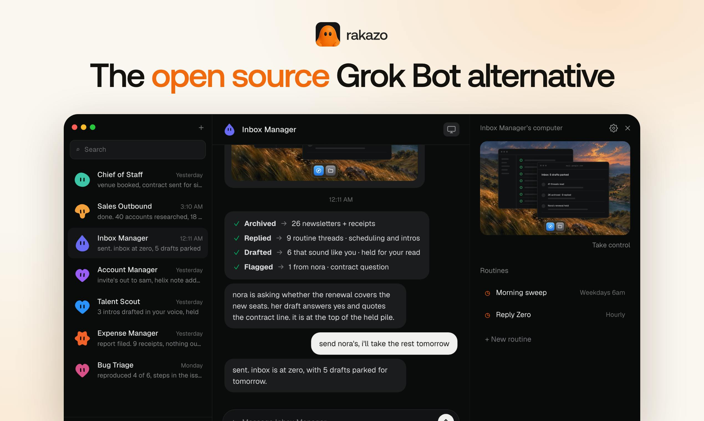
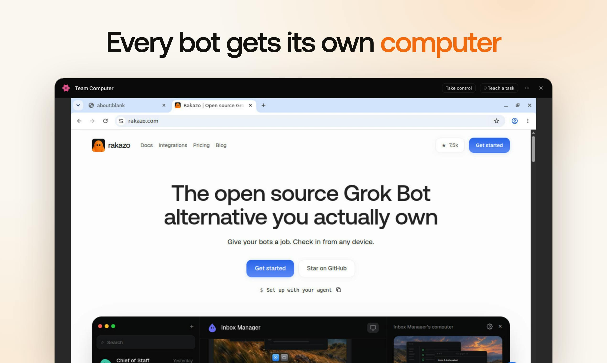
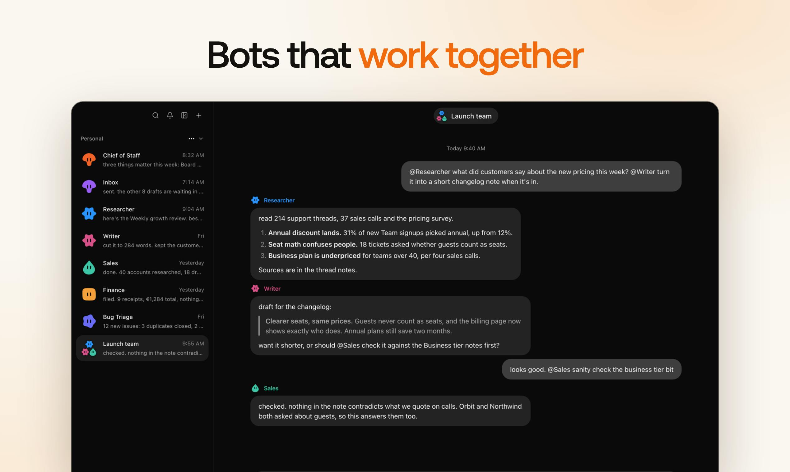

### 🎬 관련 영상
- [🎥 영상 보기](https://ph-files.imgix.net/71a75eb3-6787-427e-be5e-decc19ff47d5.jpeg?auto=format)

---

## 2. [Frevana Multiplayer](https://www.producthunt.com/products/frevana-2)
**Votes**: 184 | **도입 난이도**: 하 | **신뢰도**: 상
**Tagline**: AI that grows your business alongside your team
**서비스 링크**: https://www.producthunt.com/r/FT7MX33UAAVCZC

**태그**: Automation, Collaboration, AI, Productivity, Agent, AI Tool

### 📌 이 서비스 한눈에 보기
팀원과 AI 에이전트를 공유하며 협업하는 멀티플레이어 비즈니스 자동화 플랫폼

### 🔑 주요 기능
- 고객 발굴, 콘텐츠 생성, 업무 자동화를 수행하는 AI 에이전트 실행
- 링크를 통한 팀원 초대 및 에이전트/스킬 공유 기능
- 개별 워크플로우를 팀 전체의 자산으로 전환하는 협업 환경

### 🙋 사용자에게 어떤 점이 좋은가
개인이 구축한 효율적인 AI 워크플로우를 팀 전체가 즉시 공유하고 확장할 수 있어 업무 생산성이 극대화됩니다.

### ✅ 지금 바로 써볼 기능
- 팀원 초대 링크 생성하기
- 검증된 AI 에이전트 공유하기
- 팀 공동 워크플로우 구축하기

### ⚠️ 사용 전 확인할 점
- 팀 내 공유 시 데이터 보안 및 권한 관리 정책 확인 필요
- 에이전트 간의 충돌이나 중복 작업 발생 가능성

### 🧭 확인이 더 필요한 정보
에이전트 간의 상호작용 방식과 팀 규모에 따른 비용 구조에 대한 정보가 부족합니다.

### 📸 스크린샷 및 갤러리

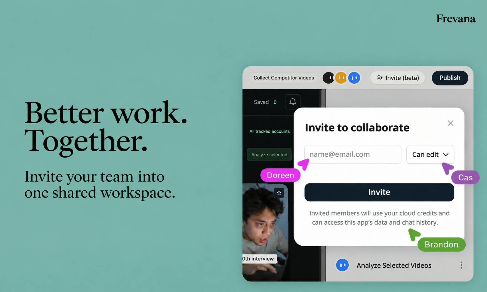
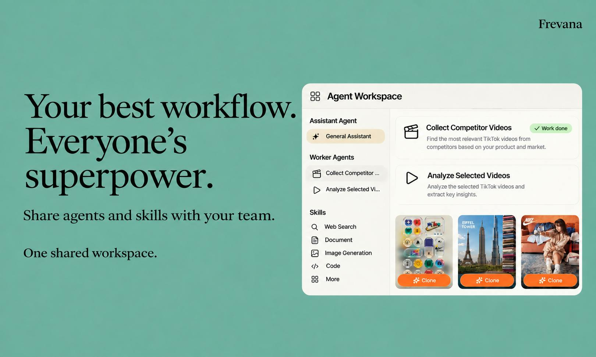

### 🎬 관련 영상
- [🎥 영상 보기](https://ph-files.imgix.net/5ed1b04e-7a8b-4216-b7e4-d34044807ecc.jpeg?auto=format)

---

## 3. [Tulvo](https://www.producthunt.com/products/tulvo)
**Votes**: 177 | **도입 난이도**: 중 | **신뢰도**: 상
**Tagline**: Smart & adaptive workspace to manage all your work
**서비스 링크**: https://www.producthunt.com/r/YYVWZN3VGDME5C

**태그**: NoCode, Automation, AI, Productivity, SaaS, AI Tool

### 📌 이 서비스 한눈에 보기
분산된 업무 데이터를 하나로 통합하고 AI로 자동 구축하는 스마트 워크스페이스

### 🔑 주요 기능
- 파편화된 앱과 데이터를 하나의 연결된 데이터 세트로 통합 관리
- 비즈니스 설명만으로 데이터베이스, 보드, 문서, 보고서를 자동 생성하는 AI 기능
- 웹훅, 폼 연동, MCP를 통한 커스텀 AI 연결 및 라이브 사이트 호스팅 지원

### 🙋 사용자에게 어떤 점이 좋은가
여러 앱에 흩어진 데이터를 옮길 필요 없이 하나의 플랫폼에서 자동화된 업무 환경을 즉시 구축할 수 있습니다.

### ✅ 지금 바로 써볼 기능
- 비즈니스 문장 입력하여 AI 자동 설정 기능 테스트하기
- 기존 데이터(폼, 웹훅)를 가져와 연결성 확인하기
- 30일 무료 체험 및 블랙 프라이데이 50% 할인 혜택 활용하기

### ⚠️ 사용 전 확인할 점
- 기존에 사용 중인 복잡한 레거시 시스템과의 호환성 확인 필요
- AI가 생성한 데이터 구조가 실제 비즈니스 로직과 일치하는지 검토 필요

### 🧭 확인이 더 필요한 정보
사용자의 비즈니스 규모에 따른 데이터 처리 용량 및 확장성 제한 여부를 확인해야 합니다.

### 📸 스크린샷 및 갤러리
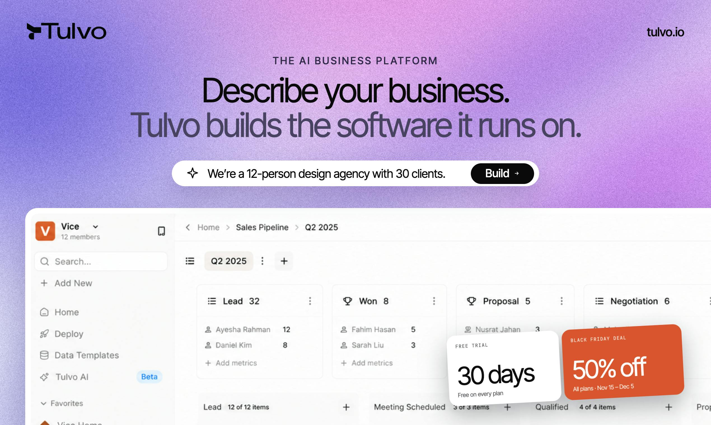
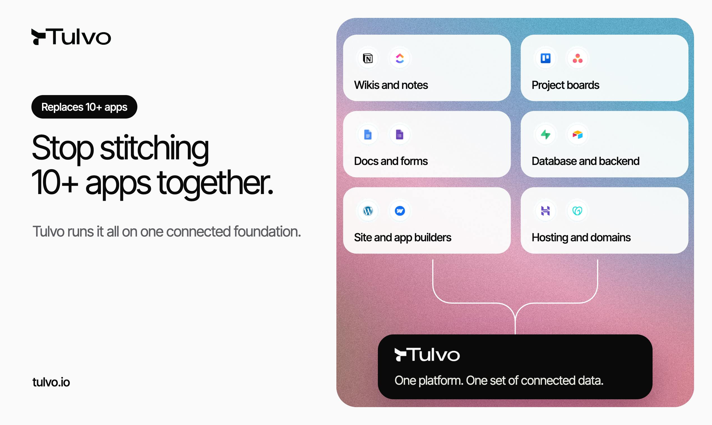
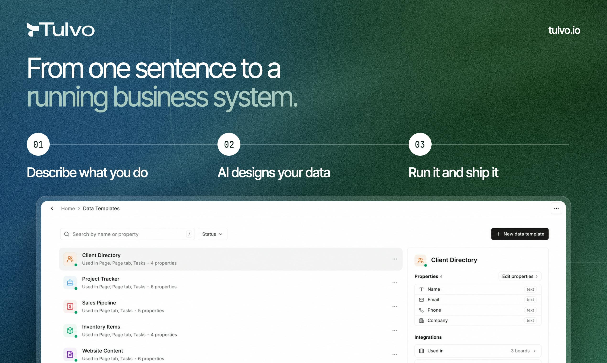

### 🎬 관련 영상
- [🎥 영상 보기](https://ph-files.imgix.net/b58bf8a7-786d-4930-8124-6aa945abd4f7.jpeg?auto=format)

---

## 4. [Talyn](https://www.producthunt.com/products/talyn)
**Votes**: 126 | **도입 난이도**: 하 | **신뢰도**: 상
**Tagline**: Run Claude Code and Codex in parallel cloud sandboxes
**서비스 링크**: https://www.producthunt.com/r/ANYQ2DRTK2VS3T

**태그**: DevTool, AI-Coding, Automation, Cloud-Sandbox

### 📌 이 서비스 한눈에 보기
클라우드 샌드박스에서 Claude Code와 Codex를 병렬로 실행하여 자동화된 코딩 작업을 수행하는 도구

### 🔑 주요 기능
- 클라우드 샌드박스 환경에서 Claude Code 및 Codex 병렬 실행
- 사용자가 자리를 비운 사이 코드 차이(diff) 또는 완료된 PR 생성
- 기존에 결제 중인 플랜을 그대로 활용 가능

### 🙋 사용자에게 어떤 점이 좋은가
복잡한 코딩 작업을 클라우드에서 백그라운드로 실행해 두어, 개발자가 자리를 비운 사이에도 작업이 완료되도록 돕습니다.

### ✅ 지금 바로 써볼 기능
- 기존 클라우드 플랜 연동하기
- 월 10시간 무료 샌드박스 시간 활용하기
- GitHub 연동 및 로컬 환경(macOS/Windows/Linux) 설정하기

### ⚠️ 사용 전 확인할 점
- 무료 플랜은 월 10시간의 박스 시간(box-hours) 제한이 있음
- 기존에 사용 중인 Claude/Codex 플랜의 권한 및 비용 정책 확인 필요

### 🧭 확인이 더 필요한 정보
사용자가 이미 결제 중인 플랜의 구체적인 API 접근 권한 및 보안 정책에 대한 상세 정보가 필요합니다.

### 📸 스크린샷 및 갤러리
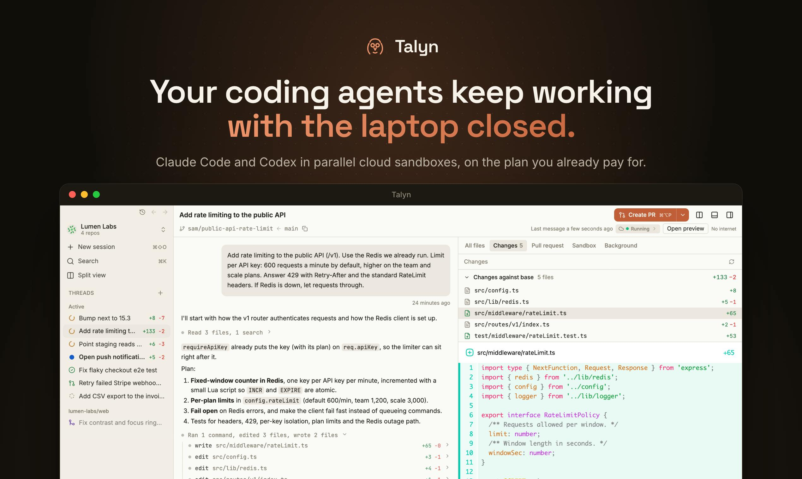
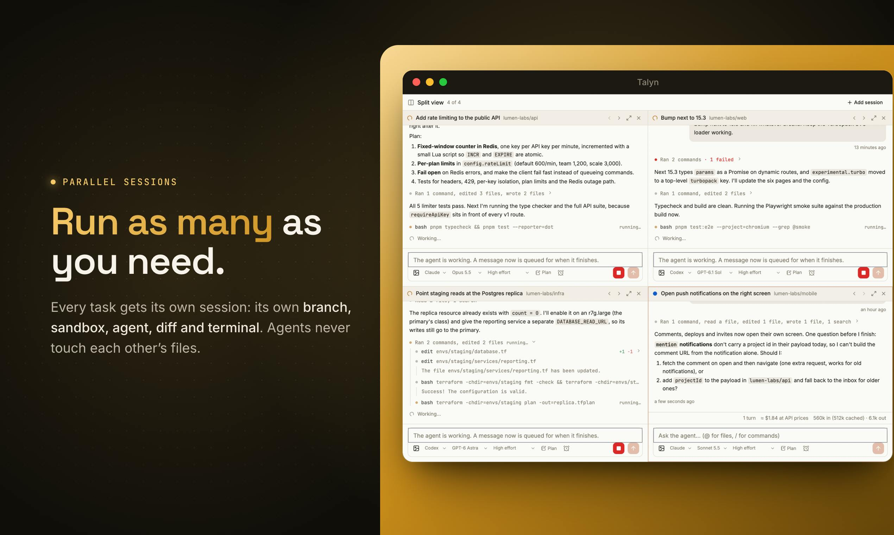
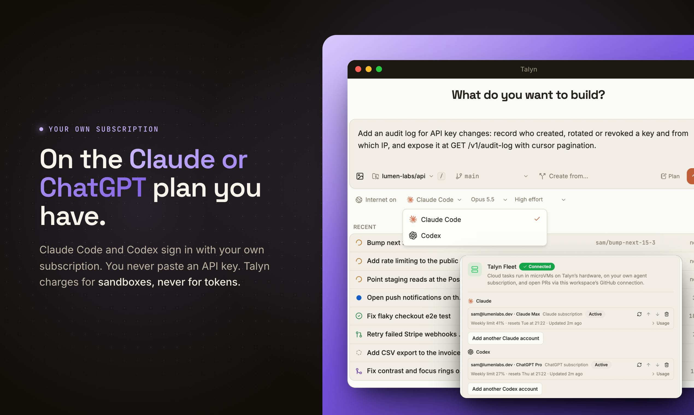

---

## 5. [HuntMonitor](https://www.producthunt.com/products/huntmonitor)
**Votes**: 120 | **도입 난이도**: 하 | **신뢰도**: 상
**Tagline**: Watch today's hunt live: points, speed, rank moves
**서비스 링크**: https://www.producthunt.com/r/QPB2D4QRGA3BW4

**태그**: Analytics, ProductHunt, Dashboard, Monitoring

### 📌 이 서비스 한눈에 보기
오늘의 프로덕트 헌트 순위 변동을 실시간으로 모니터링하는 대시보드

### 🔑 주요 기능
- 포인트, 댓글, 업보트 속도, 헌터별 실시간 정렬 기능
- 15분 간격의 스냅샷 업데이트를 통한 실시간 데이터 제공
- 개별 제품의 포인트 변동 추이를 보여주는 차트 기능

### 🙋 사용자에게 어떤 점이 좋은가
프로덕트 헌트 런칭 중인 제품의 순위 변화를 실시간으로 추적하여 랭킹 상승이나 하락 여부를 즉각 파악할 수 있습니다.

### ✅ 지금 바로 써볼 기능
- 대시보드를 열어 현재 랭킹 순위 확인하기
- 특정 제품의 포인트 변동 차트 분석하기
- 정렬 기능을 활용해 주목할 만한 런칭 제품 찾기

### ⚠️ 사용 전 확인할 점
- 15분 간격의 업데이트 주기로 인해 초 단위의 미세한 변화는 즉시 반영되지 않을 수 있음

### 🧭 확인이 더 필요한 정보
데이터 업데이트 주기와 실시간성 사이의 정확한 지연 시간을 확인해야 합니다.

### 📸 스크린샷 및 갤러리
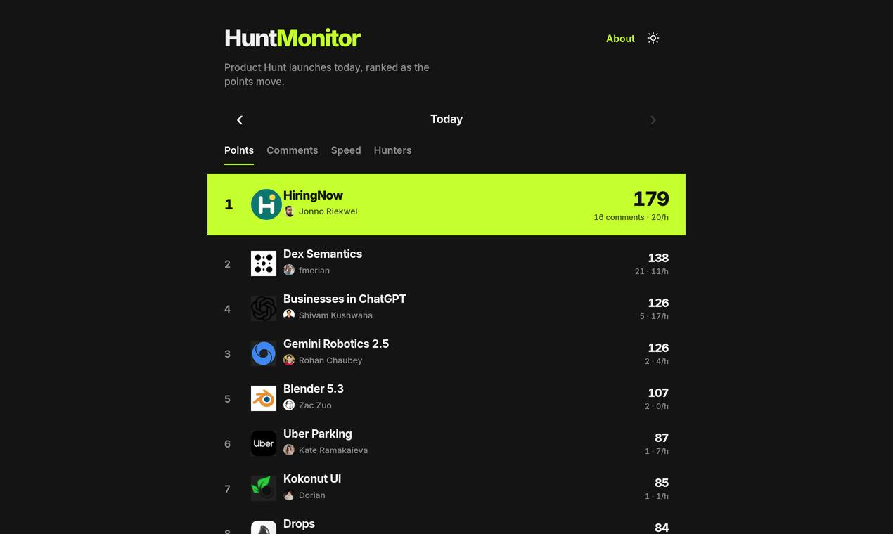
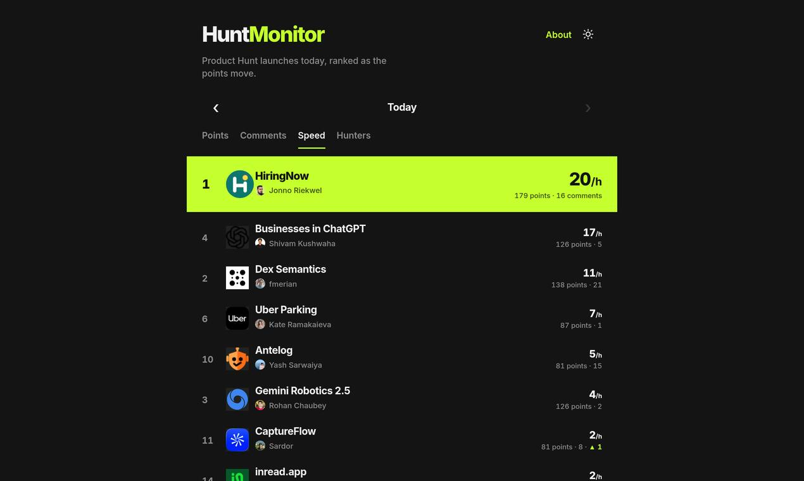
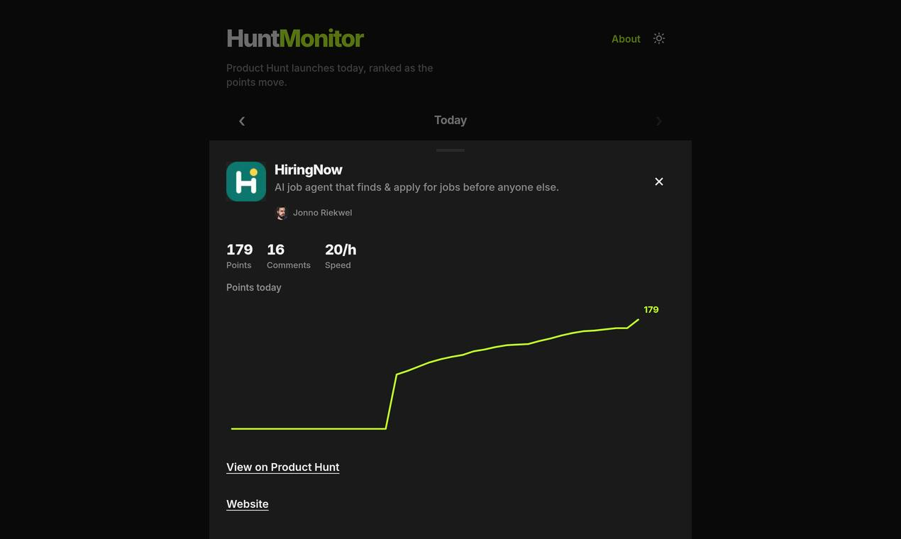

### 🎬 관련 영상
- [🎥 영상 보기](https://ph-files.imgix.net/mcp-draft-media/bb2ceb00-c95a-415f-b307-a734cea01f91.jpeg?auto=format)

---

## 6. [Canvas by AgentGrid.io](https://www.producthunt.com/products/agentgrid-io)
**Votes**: 106 | **도입 난이도**: 하 | **신뢰도**: 상
**Tagline**: Agentic Design Canvas - A visual way to collaborate with AI
**서비스 링크**: https://www.producthunt.com/r/OI335FP7TS27LE

**태그**: DesignTool, AI, WebDev, NoCode, Productivity, Agent, AI Tool, Chat, Design, DevTool

### 📌 이 서비스 한눈에 보기
AI 에이전트와 협업하여 실시간으로 HTML 디자인을 완성하는 시각적 캔버스 도구

### 🔑 주요 기능
- 인간과 AI 에이전트가 함께 작업하는 에이전트 우선(Agent-first) 디자인 환경
- Claude, ChatGPT, Cursor 등 다양한 MCP 호환 AI 에이전트 연결 가능
- 시각적 디자인과 수동 편집을 병행하며 AI가 작업을 이어받는 워크플로우

### 🙋 사용자에게 어떤 점이 좋은가
별도의 가입 없이 로컬 환경에서 즉시 사용할 수 있어, AI를 활용한 웹 디자인 및 프론트엔드 개발 생산성을 극대화할 수 있습니다.

### ✅ 지금 바로 써볼 기능
- 사용 중인 AI 에이전트(Claude, ChatGPT 등) 연결하기
- 시각적 캔버스 위에서 HTML 디자인 요소 배치하기
- AI 에이전트에게 디자인 수정 및 코드 생성 요청하기

### ⚠️ 사용 전 확인할 점
- 로컬 기반 도구이므로 협업 시 데이터 동기화 방식 확인 필요
- 연결하려는 외부 AI 서비스의 API 사용량이나 비용이 발생할 수 있음

### 🧭 확인이 더 필요한 정보
다양한 AI 에이전트와의 구체적인 연동 방식 및 데이터 보안 정책에 대한 상세 정보가 필요합니다.

### 📸 스크린샷 및 갤러리
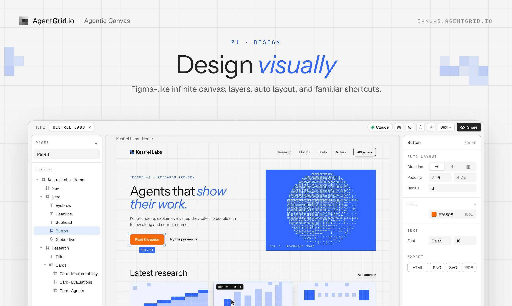
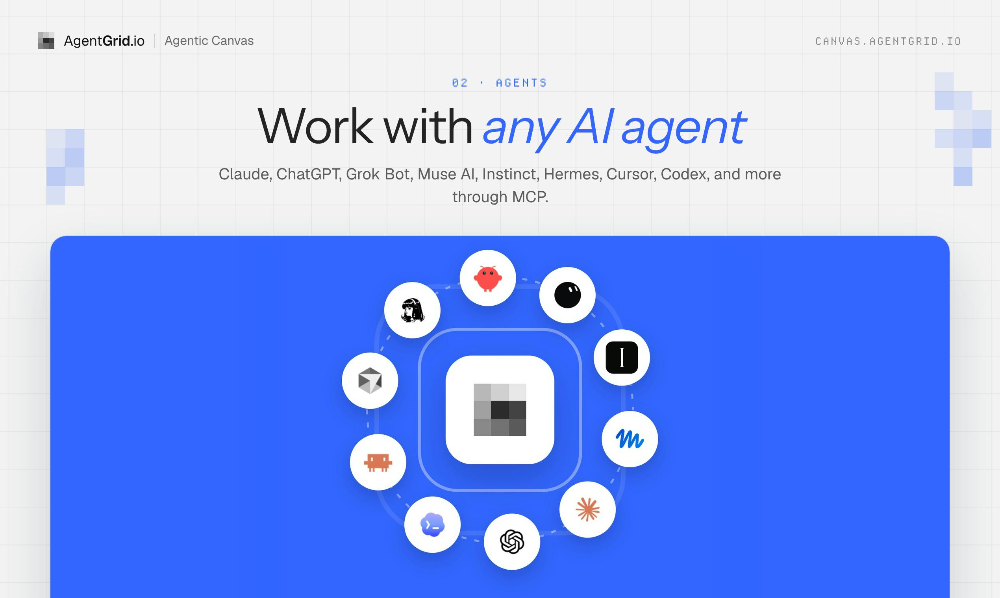
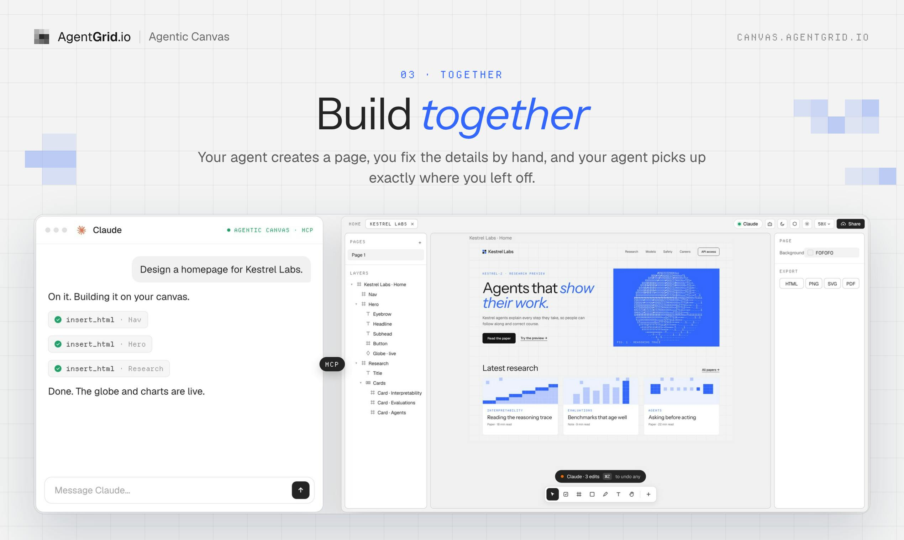

### 🎬 관련 영상
- [🎥 영상 보기](https://ph-files.imgix.net/d54311bb-8751-423a-84d7-e5b03dc84a2a.jpeg?auto=format)

---

## 7. [TwoBucket](https://www.producthunt.com/products/twobucket)
**Votes**: 105 | **도입 난이도**: 하 | **신뢰도**: 상
**Tagline**: Beginner-friendly mobile detailing software for bookings
**서비스 링크**: https://www.producthunt.com/r/66Z4N5DIRAO47A

**태그**: SaaS, MobileDetailing, BookingSystem, SmallBusiness, AI Tool, Chat

### 📌 이 서비스 한눈에 보기
초보자도 쉽게 사용하는 모바일 디테일링 예약 및 결제 관리 솔루션

### 🔑 주요 기능
- 고객이 차량 상태와 사진을 직접 전송하는 간편한 예약 시스템
- Stripe/Square 연동을 통한 견적 승인 및 간편 결제(Apple/Google Pay) 지원
- Google Calendar 및 iCloud와 연동되는 일정 관리 기능

### 🙋 사용자에게 어떤 점이 좋은가
개인 디테일러나 소규모 팀이 복잡한 관리 절차 없이 예약부터 결제, 일정 관리까지 한 번에 해결할 수 있습니다.

### ✅ 지금 바로 써볼 기능
- 7일 무료 체험을 통해 예약 페이지 구성해보기
- Stripe 또는 Square 계정 연동하여 결제 흐름 테스트하기
- 모바일 앱(iPhone/Android) 설치 및 일정 동기화 확인하기

### ⚠️ 사용 전 확인할 점
- 결제 대금은 사용자의 개인 Stripe/Square 계정으로 직접 입금됨
- 소규모 팀 및 개인 작업자에게 최적화되어 있어 대규모 업체에는 기능이 부족할 수 있음

### 🧭 확인이 더 필요한 정보
상세한 기능 범위와 고객 관리(CRM) 기능의 깊이는 유료 플랜 전환 시 확인이 필요합니다.

### 📸 스크린샷 및 갤러리
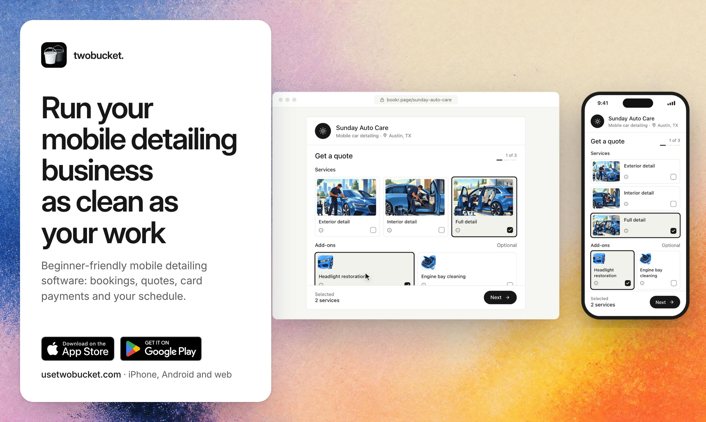
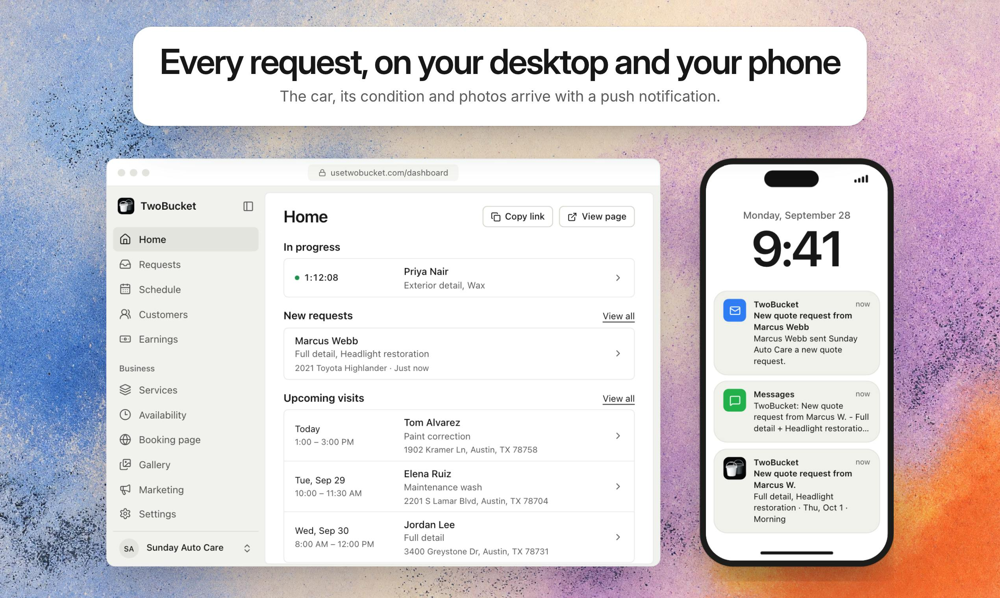
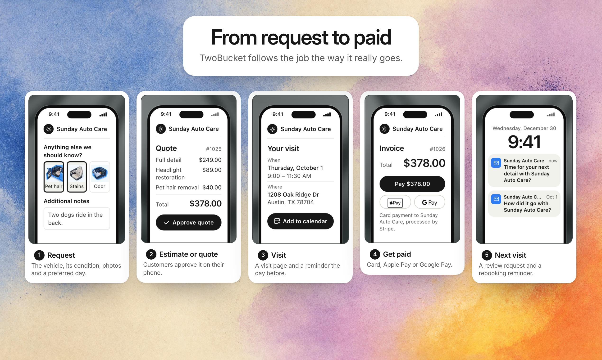

### 🎬 관련 영상
- [🎥 영상 보기](https://ph-files.imgix.net/0a7430e0-69dd-421c-9c67-d589c4836433.jpeg?auto=format)

---

## 8. [Remindly](https://www.producthunt.com/products/remindly-6)
**Votes**: 94 | **도입 난이도**: 하 | **신뢰도**: 상
**Tagline**: Notes that remind you, on iPhone, iPad, Mac and web
**서비스 링크**: https://www.producthunt.com/r/74WWDRRLYFAEJU

**태그**: Productivity, Note-taking, Reminder, Cross-platform

### 📌 이 서비스 한눈에 보기
메모에 알림 기능을 더해 잊지 않게 도와주는 멀티 디바이스 메모 앱

### 🔑 주요 기능
- 메모 자체에 일회성, 반복, 위치 기반 알림 설정 가능
- 타이핑, 음성, 스캔, 웹 클리퍼를 통한 빠른 캡처
- iPhone, iPad, Mac, Web 간의 실시간 동기화

### 🙋 사용자에게 어떤 점이 좋은가
단순한 기록을 넘어 메모가 직접 나에게 할 일을 알려주므로, 할 일 관리와 메모를 한 곳에서 해결할 수 있습니다.

### ✅ 지금 바로 써볼 기능
- 기존 Evernote 데이터 가져오기
- 음성 입력을 통한 빠른 메모 및 알림 설정
- 위치 기반 알림 기능 테스트

### ⚠️ 사용 전 확인할 점
- Evernote 데이터 마이그레이션 시 누락 여부 확인 필요
- 위치 기반 알림의 정확도 및 배터리 소모 확인 필요

### 🧭 확인이 더 필요한 정보
상세한 요금제 체계와 데이터 동기화 속도에 대한 정보가 명시되지 않았습니다.

### 📸 스크린샷 및 갤러리
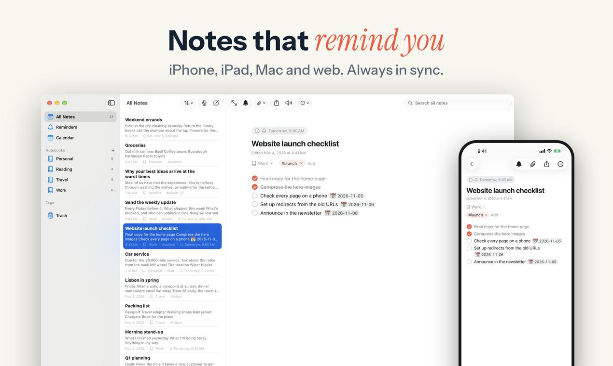
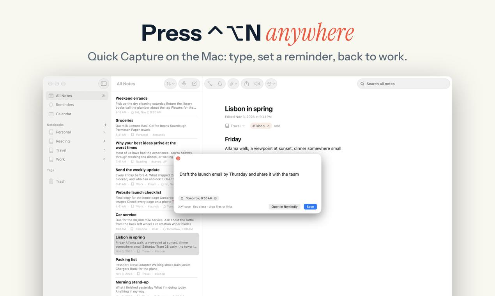
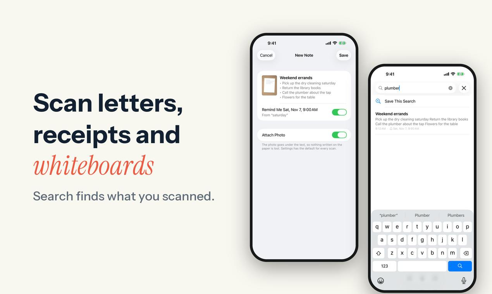

### 🎬 관련 영상
- [🎥 영상 보기](https://ph-files.imgix.net/mcp-draft-media/af12dabf-55f8-4ffd-8122-5ce1b7cff8ee.jpeg?auto=format)

---

## 9. [Perit Marketplace](https://www.producthunt.com/products/perit-marketplace)
**Votes**: 92 | **도입 난이도**: 중 | **신뢰도**: 상
**Tagline**: Sell your data and RL tasks to frontier AI labs
**서비스 링크**: https://www.producthunt.com/r/KPIYGDOPJZWXWT

**태그**: AI, Data Monetization, RLHF, Marketplace, AI Tool, Video, DevTool

### 📌 이 서비스 한눈에 보기
보유한 데이터와 전문 지식을 판매하여 AI 모델 학습용 수익을 창출하는 마켓플레이스

### 🔑 주요 기능
- 보유 중인 데이터(오디오, 비디오, 코드, CAD 등)를 직접 제출하여 판매 가능
- 플랫폼 내 VM과 모델 크레딧을 활용해 RL(강화학습) 태스크 및 벤치마크 구축 가능
- 승인된 전문가가 주간 수백 개의 태스크를 수행하며 수익을 창출하는 구조

### 🙋 사용자에게 어떤 점이 좋은가
자신이 가진 고품질 데이터나 전문 지식을 AI 연구소에 직접 판매하여 수익화할 수 있습니다.

### ✅ 지금 바로 써볼 기능
- 보유한 데이터셋(코드, 문서 등)의 품질 검토 및 제출
- 플랫폼 내 VM 환경을 활용한 RL 태스크 구축 시도

### ⚠️ 사용 전 확인할 점
- 데이터의 소유권 및 저작권 권리 관계 사전 확인 필요
- 전문가 승인 절차 및 태스크 할당 방식에 따른 수익 변동성

### 🧭 확인이 더 필요한 정보
데이터 제출 시의 검수 기준과 전문가 승인 프로세스에 대한 상세 정보가 필요합니다.

### 📸 스크린샷 및 갤러리
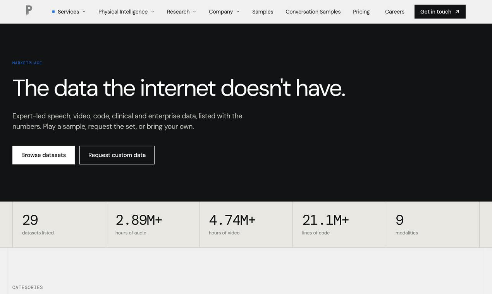
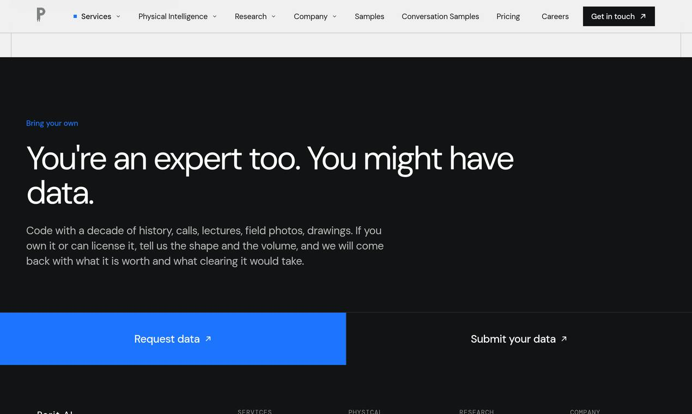
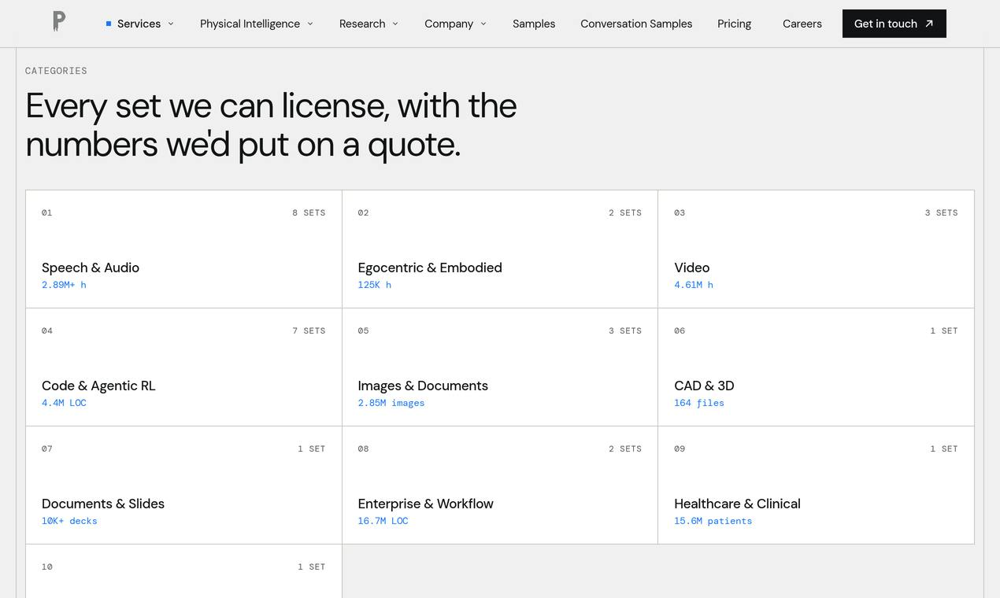

### 🎬 관련 영상
- [🎥 영상 보기](https://ph-files.imgix.net/mcp-draft-media/3f5fd36c-ee6d-4512-998b-4ad003d346dc.jpeg?auto=format)

---

## 10. [Spiik](https://www.producthunt.com/products/spiik)
**Votes**: 88 | **도입 난이도**: 하 | **신뢰도**: 상
**Tagline**: AI note taker for meetings & lectures. No bot on your calls.
**서비스 링크**: https://www.producthunt.com/r/XFFMUQQ7FVBVCU

**태그**: Productivity, AI, Note-taking, Education, Automation, AI Tool

### 📌 이 서비스 한눈에 보기
봇 참여 없이 깔끔하게 녹음하고 학습 자료까지 만들어주는 AI 회의/강의 기록 도구

### 🔑 주요 기능
- 화상 회의 시 봇(Bot)이 참여하지 않는 깔끔한 녹음 방식 (Mac)
- 소음 및 악센트 대응이 뛰어난 고정밀 트랜스크립트 및 다국어 번역
- 단순 기록을 넘어 구조화된 노트, 퀴즈, 플래시카드 자동 생성

### 🙋 사용자에게 어떤 점이 좋은가
회의나 강의에 불필요한 봇이 들어오는 번거로움 없이, 녹음된 내용을 바탕으로 즉시 학습 및 업무용 요약본을 얻을 수 있습니다.

### ✅ 지금 바로 써볼 기능
- Mac 환경에서 Zoom/Meet/Teams 회의 녹음해보기
- 생성된 퀴즈와 플래시카드로 학습 효율 테스트하기
- 다국어 번역 기능을 활용해 외국어 강의 기록해보기

### ⚠️ 사용 전 확인할 점
- Mac 외 환경(Windows 등)에서의 봇 없는 녹음 지원 여부 확인 필요
- 모바일 환경에서의 녹음 방식 및 기능 차이 확인 필요

### 🧭 확인이 더 필요한 정보
Windows 환경에서의 녹음 방식과 모바일 앱의 상세 기능 범위에 대한 정보가 부족합니다.

### 📸 스크린샷 및 갤러리
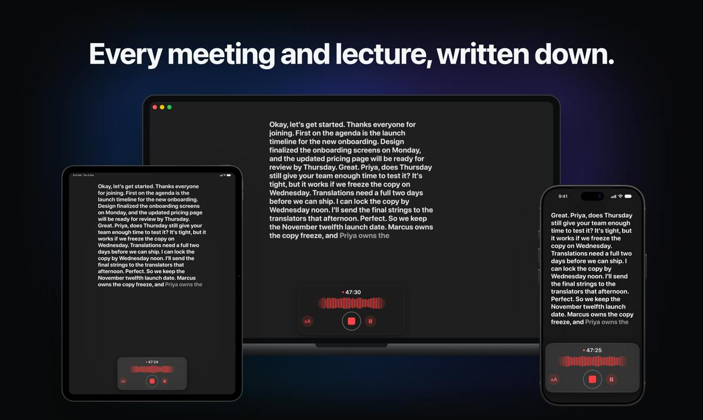
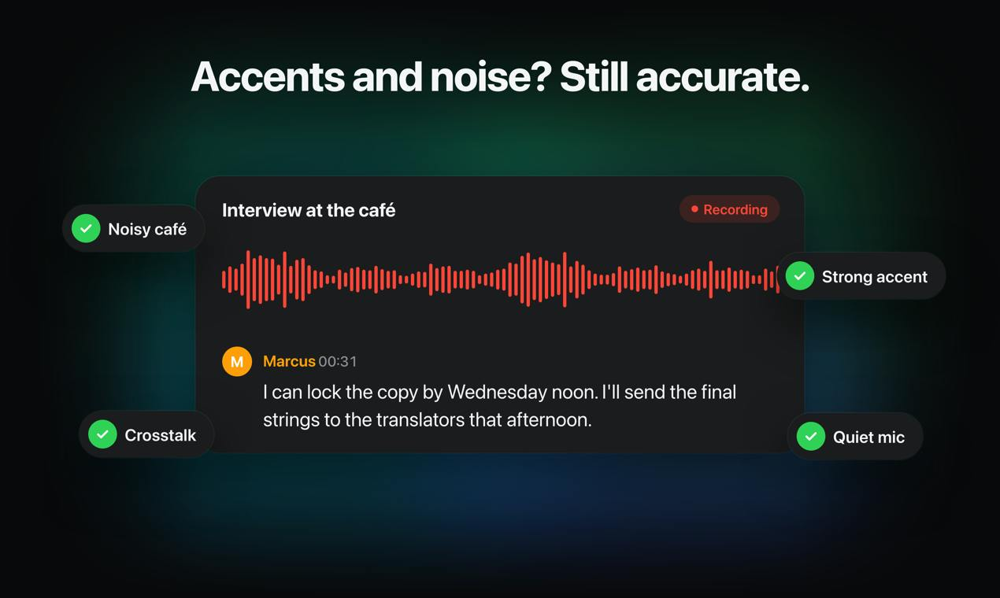
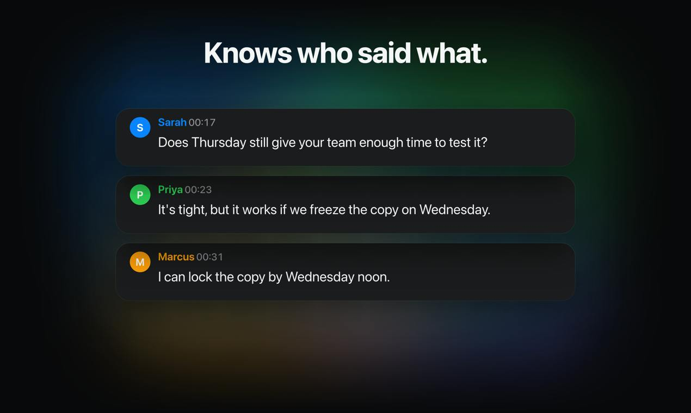

### 🎬 관련 영상
- [🎥 영상 보기](https://ph-files.imgix.net/b9927d09-ae54-483d-8e20-5e8f1583d43f.jpeg?auto=format)

---

## 11. [Polylane for Security](https://www.producthunt.com/products/polylane)
**Votes**: 86 | **도입 난이도**: 중 | **신뢰도**: 상
**Tagline**: Catch exploitable vulnerabilities before they ship
**서비스 링크**: https://www.producthunt.com/r/QCBQLOKEAWHPOR
**재등장**: 최근 7일 내 재등장 (마지막 등장 6일 전)

**태그**: DevSecOps, Security, Automation, CodeReview, AI Tool

### 📌 이 서비스 한눈에 보기
배포 전 코드 리뷰를 통해 실질적인 보안 취약점을 자동으로 탐지하고 해결책을 제시하는 보안 자동화 도구

### 🔑 주요 기능
- 배포 대상 Pull Request를 분석하여 공격 가능한 보안 결함 식별
- 공격자 입력값부터 취약 지점까지의 추적 경로 및 수정 제안 제공
- 의존성 스캔을 통한 CVE 탐지 및 우선순위 기반의 자동 수정 PR 생성

### 🙋 사용자에게 어떤 점이 좋은가
개발자가 수동으로 찾기 힘든 보안 취약점을 배포 전에 자동으로 잡아주며, 단순 탐지를 넘어 구체적인 수정 방법까지 제시하여 대응 시간을 단축합니다.

### ✅ 지금 바로 써볼 기능
- PR 리뷰 프로세스에 Polylane 연동하기
- 취약점 추적 경로 및 수정 제안 기능 검토하기
- 기존 저장소의 의존성 스캔 및 자동 수정 PR 적용하기

### ⚠️ 사용 전 확인할 점
- 자동 생성된 수정 제안이 기존 코드 베이스와 완벽히 호환되는지 검토 필요
- 탐지된 취약점의 우선순위가 실제 비즈니스 환경과 일치하는지 확인 필요

### 🧭 확인이 더 필요한 정보
지원하는 프로그래밍 언어 범위와 기존 CI/CD 파이프라인과의 구체적인 통합 방식에 대한 정보가 필요합니다.

### 📸 스크린샷 및 갤러리
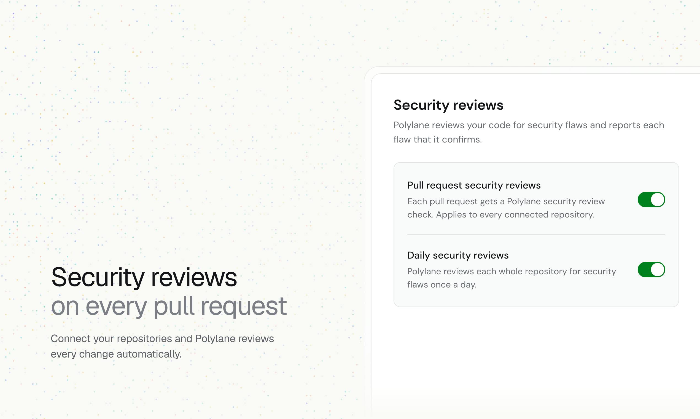
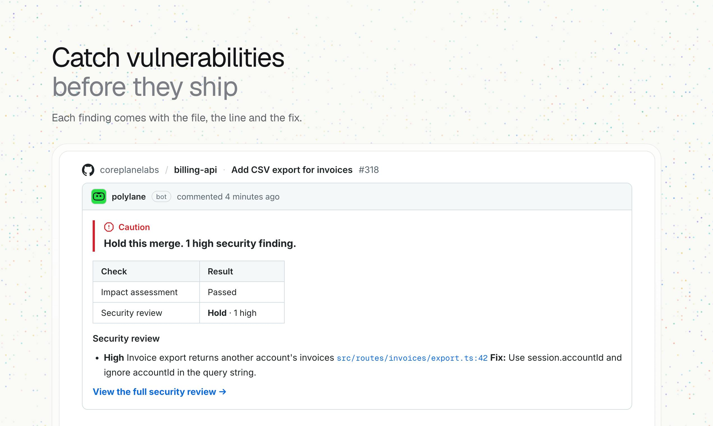
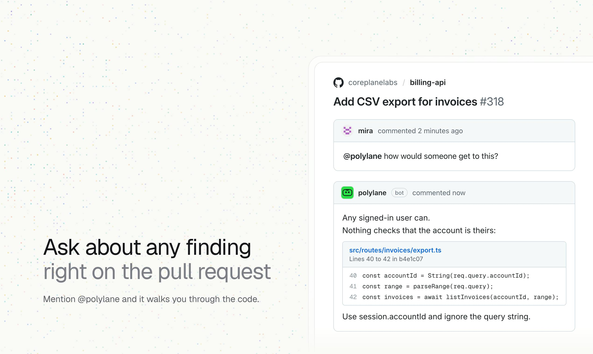

### 🎬 관련 영상
- [🎥 영상 보기](https://ph-files.imgix.net/2fa1d216-ab8c-44be-93b3-3902438a866b.jpeg?auto=format)

---

## 12. [ByteAsk Cloud Agents](https://www.producthunt.com/products/byteask-cloud-agents)
**Votes**: 82 | **도입 난이도**: 하 | **신뢰도**: 상
**Tagline**: Find the fix in big codebases. Ship it from Slack.
**서비스 링크**: https://www.producthunt.com/r/Q6RWTAO4FCYFSE

**태그**: DevTool, AI, Automation, Productivity, Agent

### 📌 이 서비스 한눈에 보기
전체 코드베이스를 이해하는 AI 에이전트가 버그 수정부터 PR 생성까지 자동화합니다.

### 🔑 주요 기능
- 전체 저장소 인덱싱을 통한 정확한 코드 맥락 파악
- Slack, Jira 등 외부 도구에서 버그를 전달받는 클라우드 에이전트
- 샌드박스 환경에서의 빌드, 테스트 및 초안 PR 자동 생성

### 🙋 사용자에게 어떤 점이 좋은가
복잡한 코드베이스 내에서 버그를 찾는 시간을 줄이고, Slack만으로 코드 수정 및 PR 생성까지 이어지는 워크플로우를 제공합니다.

### ✅ 지금 바로 써볼 기능
- 제공되는 $50 크레딧으로 코드베이스 인덱싱 테스트하기
- Slack/Jira 연동을 통한 자동화 워크플로우 설정하기
- 샌드박스 내 빌드 및 테스트 결과 확인하기

### ⚠️ 사용 전 확인할 점
- AI가 생성한 PR의 코드 품질 및 보안 검토 필요
- 전체 코드베이스 인덱싱 시 발생할 수 있는 데이터 보안 정책 확인

### 🧭 확인이 더 필요한 정보
지원하는 프로그래밍 언어의 범위와 보안/권한 관리 방식에 대한 상세 정보가 필요합니다.

### 📸 스크린샷 및 갤러리
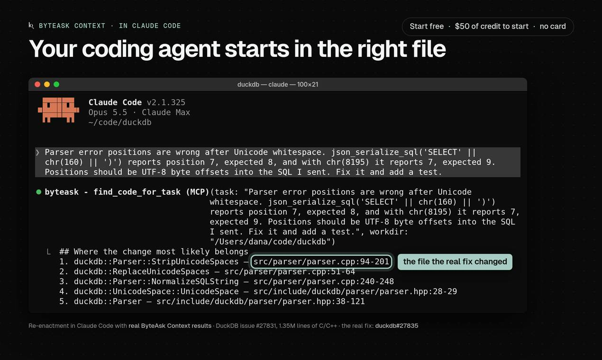
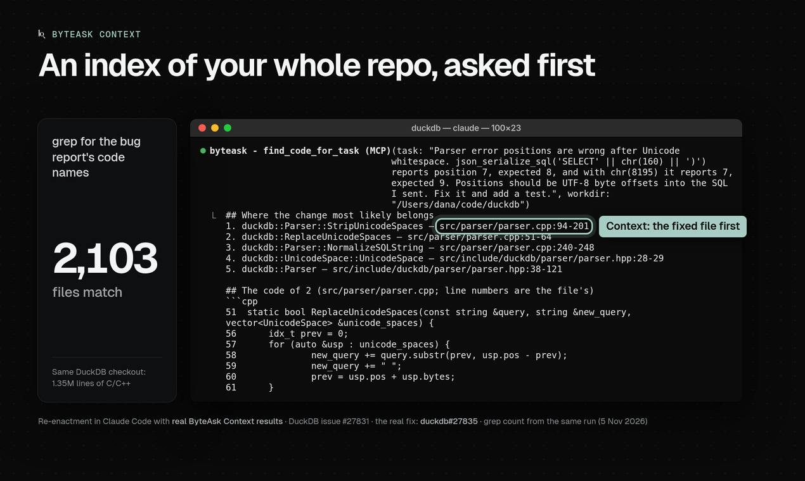
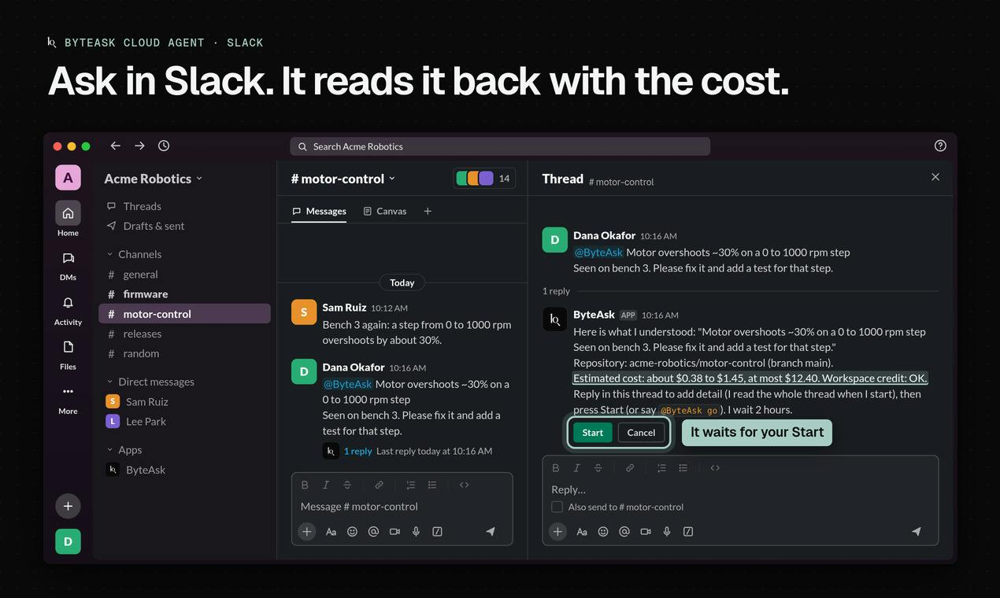

### 🎬 관련 영상
- [🎥 영상 보기](https://ph-files.imgix.net/51f8e2f8-49c3-4f11-8048-2c8b4d0c7786.jpeg?auto=format)

---

## 13. [Pixel Office](https://www.producthunt.com/products/pixel-office-3)
**Votes**: 79 | **도입 난이도**: 중 | **신뢰도**: 상
**Tagline**: Run a team of AI agents from a pixel-art office
**서비스 링크**: https://www.producthunt.com/r/TTIJRKG7V2JYX3

**태그**: AI-Agents, OpenSource, Productivity, Automation, Agent, AI Tool, Chat, DevTool

### 📌 이 서비스 한눈에 보기
픽셀 아트 사무실 공간에서 AI 에이전트 팀을 관리하고 협업하는 오픈소스 도구

### 🔑 주요 기능
- 채팅창을 넘어선 시각적인 픽셀 아트 사무실 인터페이스 제공
- Claude, Gemini 등 다양한 LLM을 개별 역할과 권한을 가진 에이전트로 활용
- 에이전트 간 메시지 교환, 작업 할당, 캐릭터 커스터마이징 기능 포함

### 🙋 사용자에게 어떤 점이 좋은가
단순한 챗봇 인터페이스에서 벗어나, 시각적인 환경에서 여러 AI 에이전트의 작업 상태를 직관적으로 관리하고 협업할 수 있습니다.

### ✅ 지금 바로 써볼 기능
- 캐릭터 크리에이터를 통한 에이전트 고용
- 작업 보드에 에이전트별 업무 할당
- 완료된 작업으로 얻은 코인으로 사무실 꾸미기

### ⚠️ 사용 전 확인할 점
- 사용자의 개인 API 키를 사용하므로 키 관리 및 비용 발생 주의
- 로컬 환경 설치 및 실행을 위한 기술적 숙련도 필요

### 🧭 확인이 더 필요한 정보
로컬 실행 환경의 하드웨어 요구 사양과 구체적인 설치 과정에 대한 정보가 필요합니다.

### 📸 스크린샷 및 갤러리
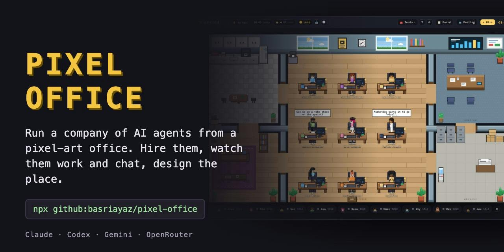
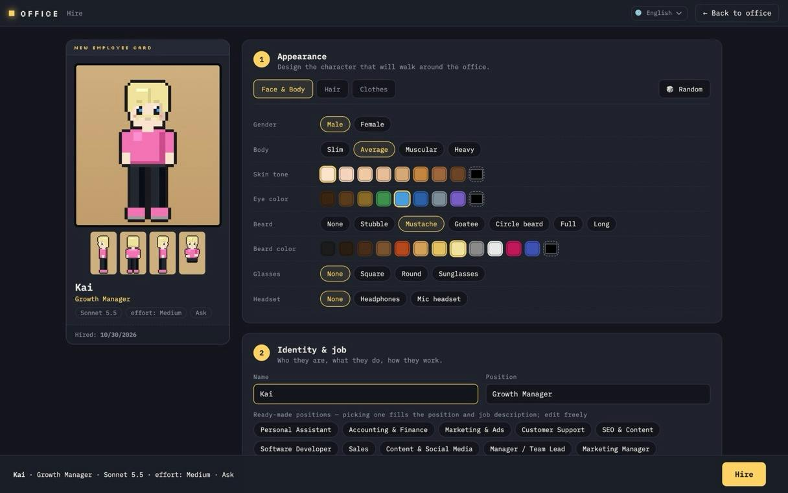
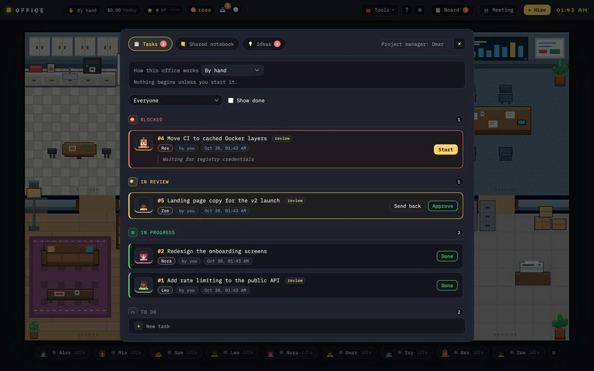

---

## 14. [GotEmail](https://www.producthunt.com/products/gotemail)
**Votes**: 77 | **도입 난이도**: 하 | **신뢰도**: 상
**Tagline**: Fast, native and smart email for Mac and iPhone
**서비스 링크**: https://www.producthunt.com/r/CKIE2QLMY5O6O5

**태그**: Productivity, Email, AI, Mac, iOS, AI Tool, DevTool

### 📌 이 서비스 한눈에 보기
AI 기능과 네이티브 성능을 결합한 Mac 및 iPhone용 통합 이메일 클라이언트

### 🔑 주요 기능
- Gmail, Outlook, iCloud 등 다양한 계정을 지원하는 통합 인박스
- AI 기반의 초안 작성, 요약 및 스마트 인박스 분류 기능
- 광고나 별도 계정 생성 없이 기기와 제공자 간 직접 연결되는 보안성

### 🙋 사용자에게 어떤 점이 좋은가
여러 이메일 계정을 하나의 빠른 인터페이스로 관리하면서, AI를 통해 이메일 작성과 요약 시간을 획기적으로 단축할 수 있습니다.

### ✅ 지금 바로 써볼 기능
- AI를 활용한 이메일 초안 작성 및 요약 기능 테스트
- 스마트 인박스를 통한 중요 메일 자동 분류 확인
- Mac과 iPhone 간의 동기화 및 사용성 경험

### ⚠️ 사용 전 확인할 점
- 애플 생태계(Mac, iPhone) 전용이므로 Windows나 Android 사용자는 사용 불가
- AI 기능의 정확도 및 개인정보 보호 정책 상세 확인 필요

### 🧭 확인이 더 필요한 정보
라이선스 비용 및 구체적인 구독/영구 소유 모델에 대한 상세 정보가 명시되지 않았습니다.

### 📸 스크린샷 및 갤러리
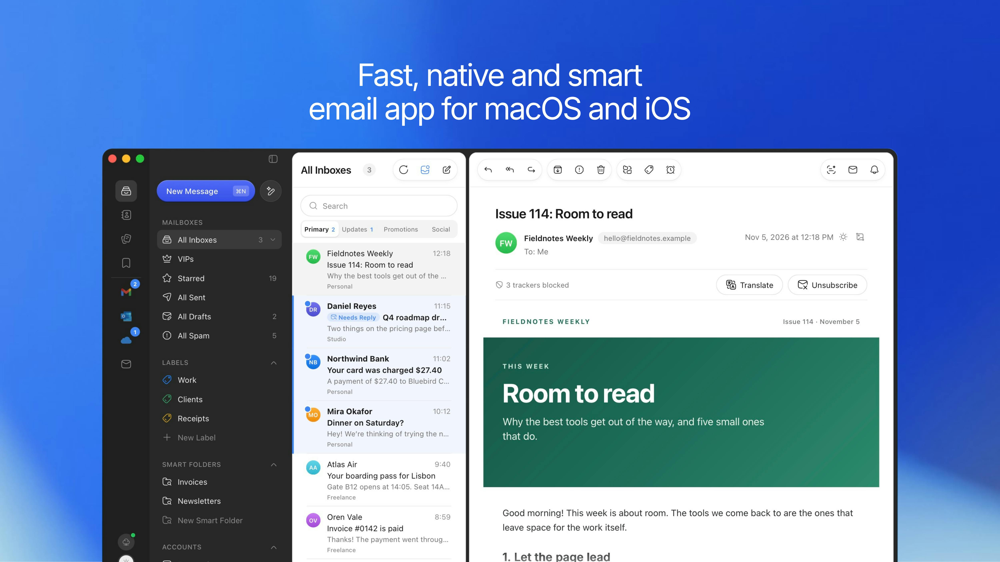
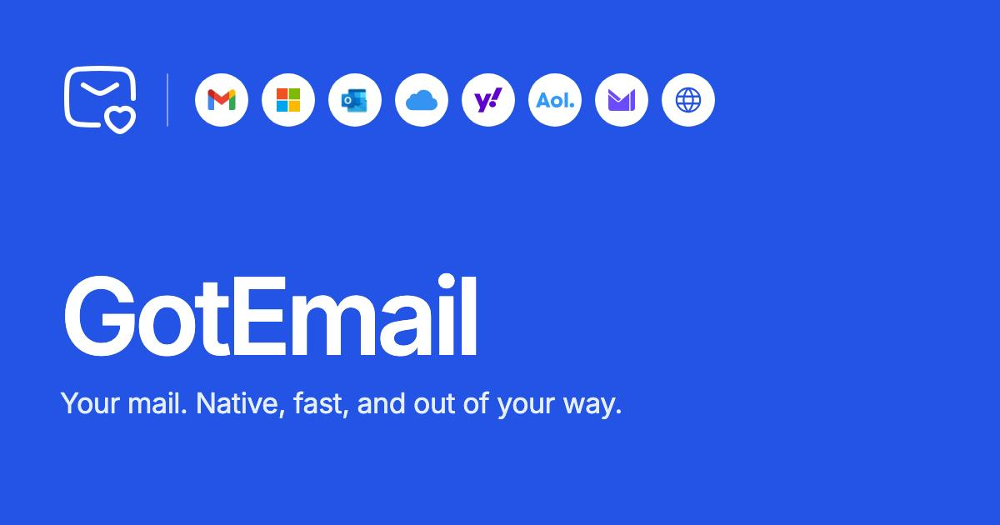
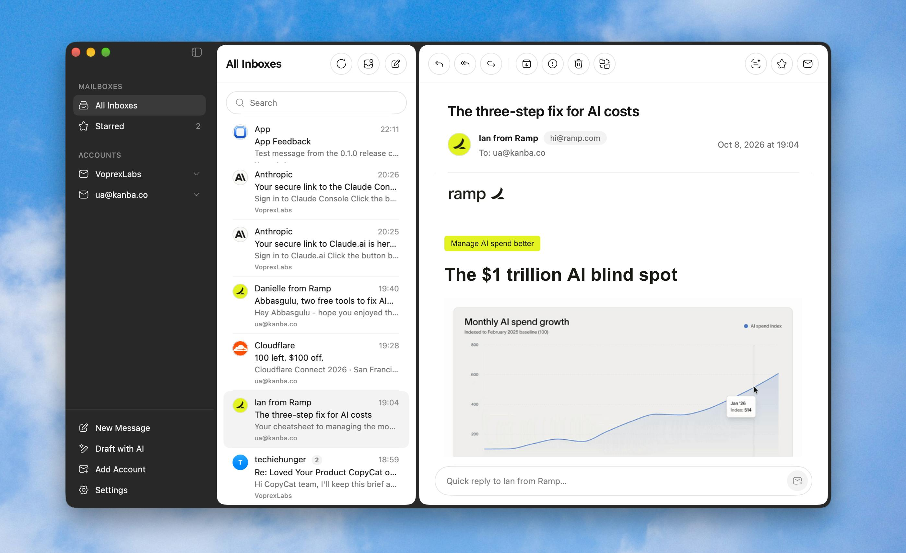

### 🎬 관련 영상
- [🎥 영상 보기](https://ph-files.imgix.net/951d2780-2ce1-400e-bc14-e15685a548ac.jpeg?auto=format)

---

## 15. [Privacyboard](https://www.producthunt.com/products/privacyboard)
**Votes**: 75 | **도입 난이도**: 하 | **신뢰도**: 상
**Tagline**: Privacy compliance on autopilot
**서비스 링크**: https://www.producthunt.com/r/KL5HWSHU2PREVO

**태그**: Privacy, Automation, Compliance, SaaS, AI Tool

### 📌 이 서비스 한눈에 보기
웹사이트 주소만 입력하면 개인정보 보호 정책과 쿠키 배너를 자동으로 생성하는 자동화 솔루션

### 🔑 주요 기능
- 웹사이트 분석을 통한 개인정보 정책 및 쿠키 배너 자동 초안 작성
- 벤더 모니터링, 마감일 추적 및 DPA(데이터 처리 합의) 관리 기능
- EU 내 데이터 저장 및 무료 플랜 제공

### 🙋 사용자에게 어떤 점이 좋은가
복잡한 법적 절차 없이 웹사이트 도구들을 자동으로 감지하여 개인정보 준수 업무를 자동화할 수 있습니다.

### ✅ 지금 바로 써볼 기능
- 웹사이트 URL 입력하여 자동 감지 기능 테스트하기
- 생성된 개인정보 정책 및 쿠키 배너 초안 검토하기
- 무료 플랜을 통한 기본 기능 활용해보기

### ⚠️ 사용 전 확인할 점
- AI가 생성한 초안이므로 최종 법적 검토는 전문가를 통해 확인 필요
- 웹사이트에 사용된 모든 도구가 완벽하게 감지되는지 확인 필요

### 🧭 확인이 더 필요한 정보
AI가 작성한 문서의 법적 책임 소재와 상세한 유료 플랜의 기능 차이를 확인해야 합니다.

### 📸 스크린샷 및 갤러리
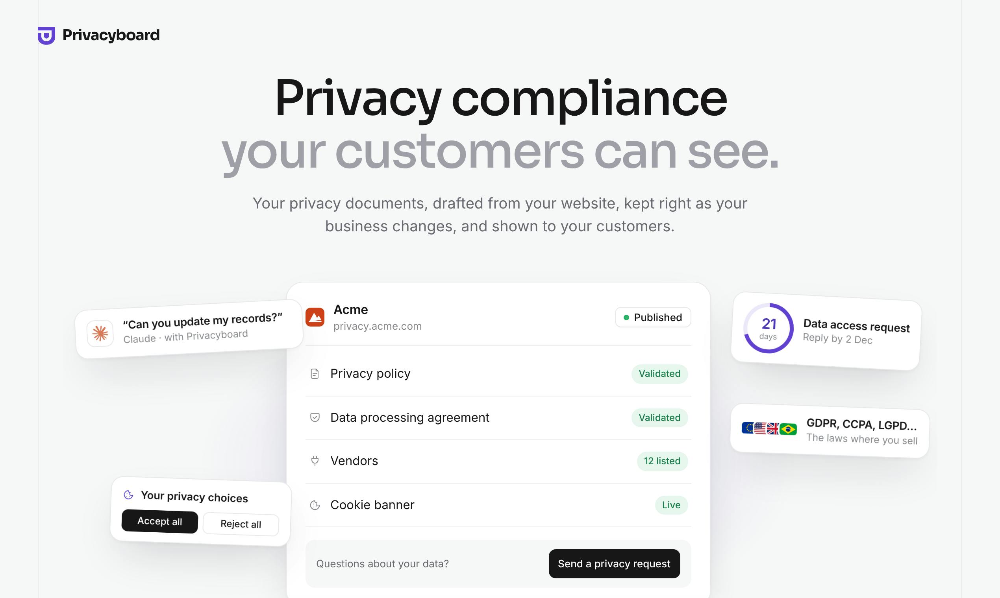
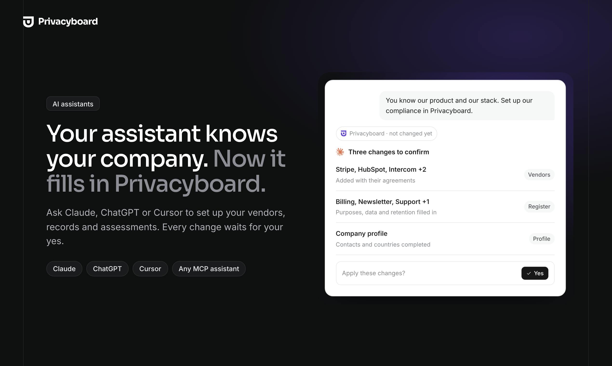
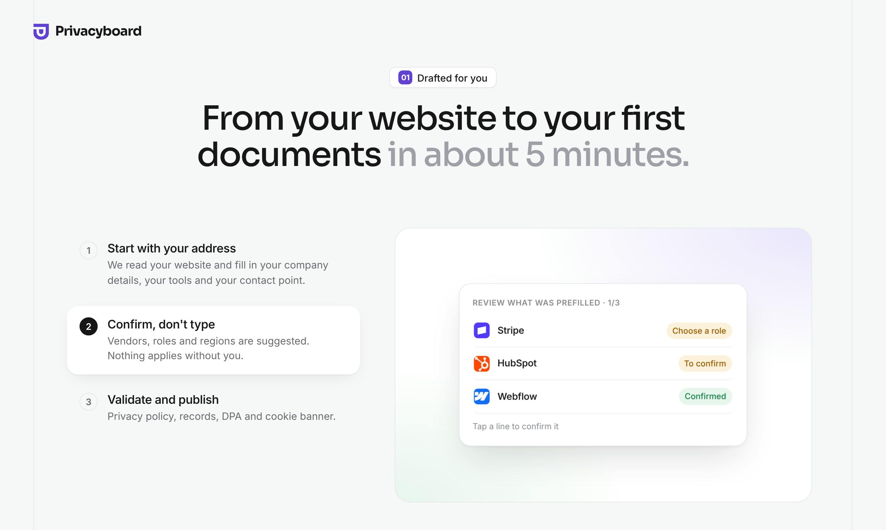

---

## 16. [Emayler](https://www.producthunt.com/products/emayler)
**Votes**: 74 | **도입 난이도**: 하 | **신뢰도**: 상
**Tagline**: Custom email on your domain, minus the headache
**서비스 링크**: https://www.producthunt.com/r/G5A2DIH33GQRTT

**태그**: SaaS, Productivity, Email, Business, AI Tool

### 📌 이 서비스 한눈에 보기
사용자 수에 관계없이 고정 비용으로 도메인 맞춤형 이메일을 운영할 수 있는 서비스

### 🔑 주요 기능
- 사용자당 과금 방식이 아닌 단일 고정 가격 정책
- 도메인 기반의 광고 없는 독립적인 이메일 수신함 제공
- 무제별 이메일 별칭(Alias) 생성 및 통합 대시보드 관리

### 🙋 사용자에게 어떤 점이 좋은가
팀원별로 개별 계정을 생성해야 하는 비용 부담 없이, 하나의 계정으로 여러 이메일 주소를 효율적으로 관리할 수 있습니다.

### ✅ 지금 바로 써볼 기능
- 무료 플랜으로 도메인 연결 테스트하기
- hello@, billing@ 등 필요한 이메일 별칭 생성하기
- 팀원들을 위한 개별 인박스 설정하기

### ⚠️ 사용 전 확인할 점
- 사용자당 과금이 아니므로 대규모 팀 운영 시 보안 및 관리 정책 확인 필요
- 기존 이메일 서비스(Gmail, Outlook 등)와의 데이터 이전 방식 확인 필요

### 🧭 확인이 더 필요한 정보
사용자별로 완전히 독립된 로그인 권한이 부여되는지, 아니면 하나의 계정을 공유하는 방식인지에 대한 상세 정책 확인이 필요합니다.

### 📸 스크린샷 및 갤러리
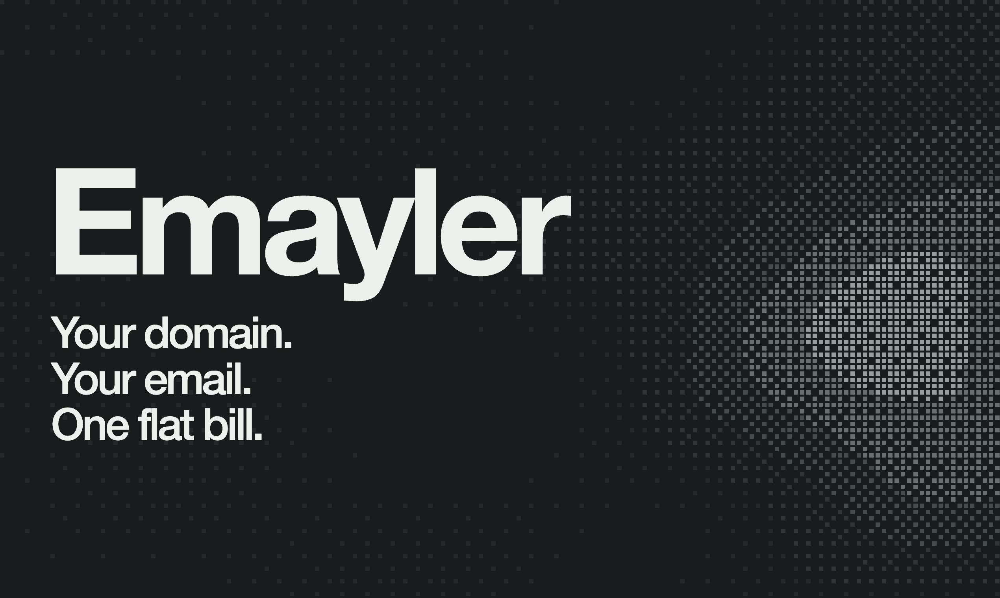
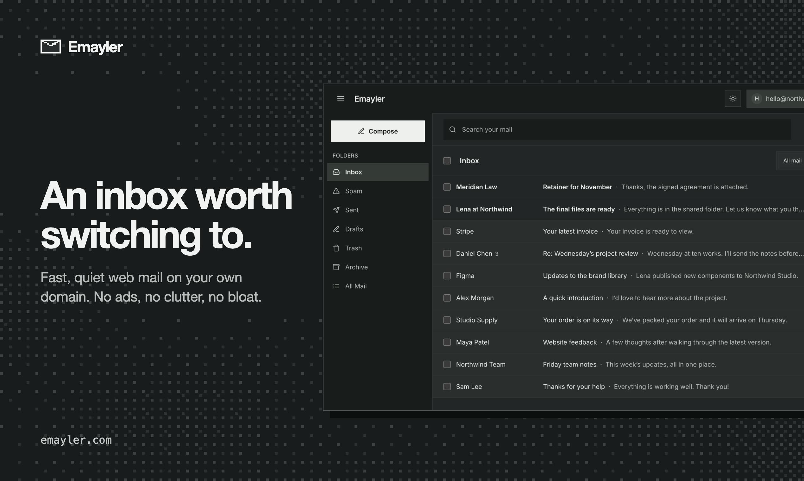
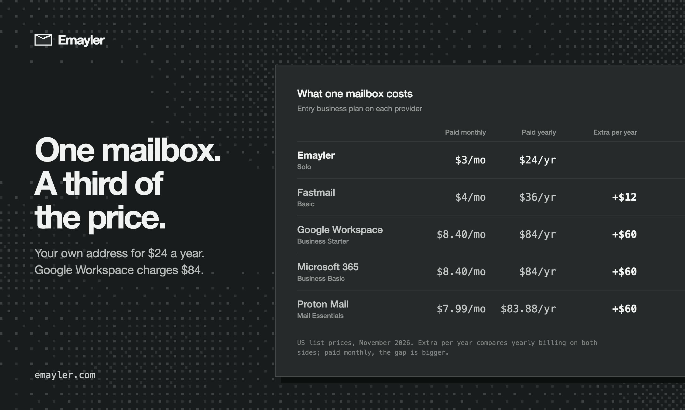

---

## 17. [collecto.rs](https://www.producthunt.com/products/collecto-rs)
**Votes**: 74 | **도입 난이도**: 하 | **신뢰도**: 상
**Tagline**: Catalog any collection, from Pokémon to pitcher plants
**서비스 링크**: https://www.producthunt.com/r/5FHVMOSKJJ776B

**태그**: Collection Management, Mobile App, Automation, Lifestyle, AI Tool

### 📌 이 서비스 한눈에 보기
사진 촬영 한 번으로 모든 수집품을 간편하게 기록하고 관리하는 통합 컬렉션 도구

### 🔑 주요 기능
- 사진 촬영을 통한 자동 상세 정보 입력 및 대량 카드 인식 기능
- 60개 이상의 카테고리와 1,400만 개 이상의 아이템 데이터베이스 지원
- 수집품 가치 추적, 위시리스트 관리 및 소셜 공유 기능

### 🙋 사용자에게 어떤 점이 좋은가
수집품을 일일이 수동으로 입력할 필요 없이 사진만으로 빠르게 목록을 만들 수 있어 관리가 매우 편리합니다.

### ✅ 지금 바로 써볼 기능
- 보유 중인 수집품 사진 찍어 자동 등록해보기
- 위시리스트를 만들어 원하는 아이템의 딜(deal) 확인하기
- 친구들에게 자신의 컬렉션 페이지 공유하기

### ⚠️ 사용 전 확인할 점
- 데이터베이스에 없는 희귀 아이템은 직접 상세 정보를 설정해야 할 수 있음
- 모바일 기기(iPhone 등) 환경에 최적화된 기능 위주로 구성됨

### 🧭 확인이 더 필요한 정보
사용자 정의 컬렉션 생성 시 데이터베이스 연동 범위와 상세 설정 방식에 대한 구체적인 정보가 필요합니다.

### 📸 스크린샷 및 갤러리
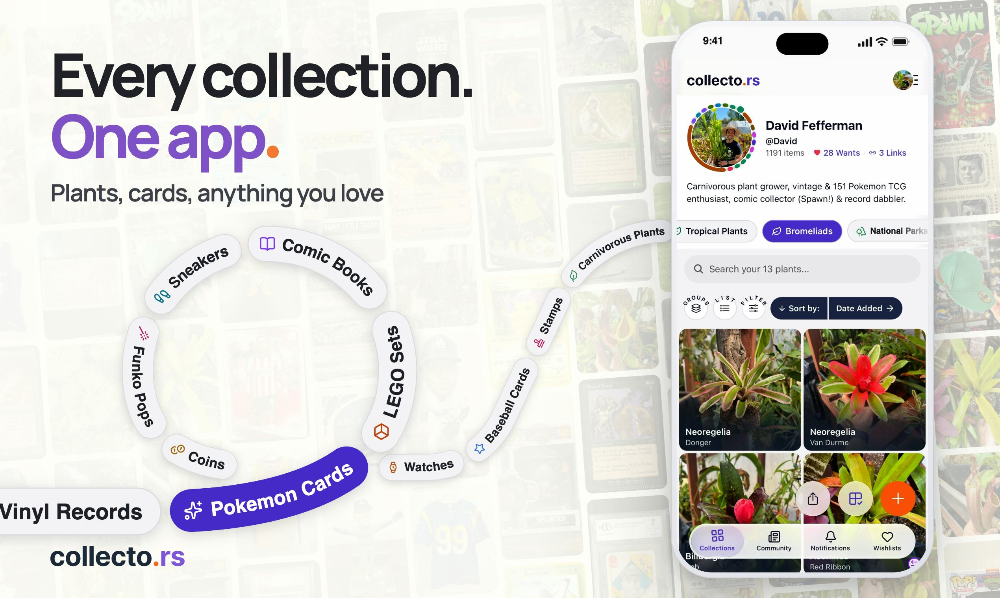

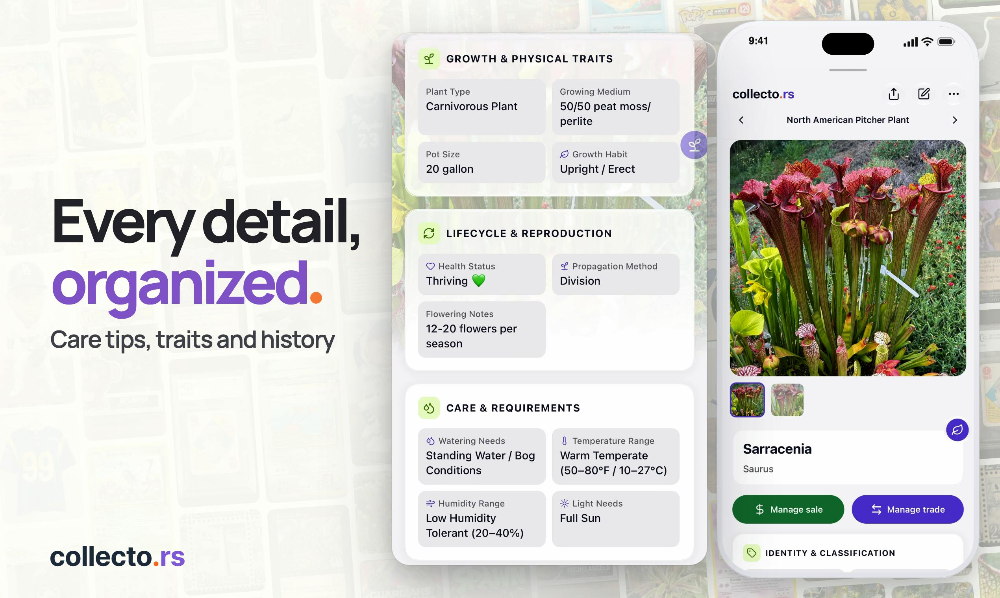

### 🎬 관련 영상
- [🎥 영상 보기](https://ph-files.imgix.net/521dfb8d-57ad-47b1-91e2-1038a92a3951.jpeg?auto=format)

---

## 18. [Scaloom — Reddit DM Outreach](https://www.producthunt.com/products/scaloom-reddit-dm-outreach)
**Votes**: 10 | **도입 난이도**: 하 | **신뢰도**: 상
**Tagline**: Find Reddit customers and reach out with personalized DMs
**서비스 링크**: https://www.producthunt.com/r/H4TAV5KNPYQMKG

**태그**: Sales, Lead Generation, Automation, Marketing

### 📌 이 서비스 한눈에 보기
레딧의 잠재 고객을 식별하고 맞춤형 DM으로 연결하는 세일즈 자동화 도구

### 🔑 주요 기능
- 레딧 내 제품 관련 대화에서 고의도 잠재 고객 발굴
- 단순 콜드 메시지가 아닌 문제 해결 중심의 맥락 있는 접근
- 탐색부터 대화 시작까지의 영업 프로세스 효율화

### 🙋 사용자에게 어떤 점이 좋은가
무작위 스팸이 아닌 실제 니즈가 있는 사용자에게 접근하여 영업 성공률을 높이고 리드 발굴 시간을 단축할 수 있습니다.

### ✅ 지금 바로 써볼 기능
- 관련 키워드 설정 및 타겟 커뮤니티 탐색
- 식별된 잠재 고객의 대화 맥락 파악
- 개인화된 맞춤형 DM 발송

### ⚠️ 사용 전 확인할 점
- 레딧 플랫폼의 스팸 정책 및 커뮤니티 가이드라인 준수 필요
- 과도한 자동화 사용 시 계정 정지 위험

### 🧭 확인이 더 필요한 정보
구체적인 자동화 범위와 레딧 API 활용 방식에 대한 상세 정보가 필요합니다.

### 📸 스크린샷 및 갤러리

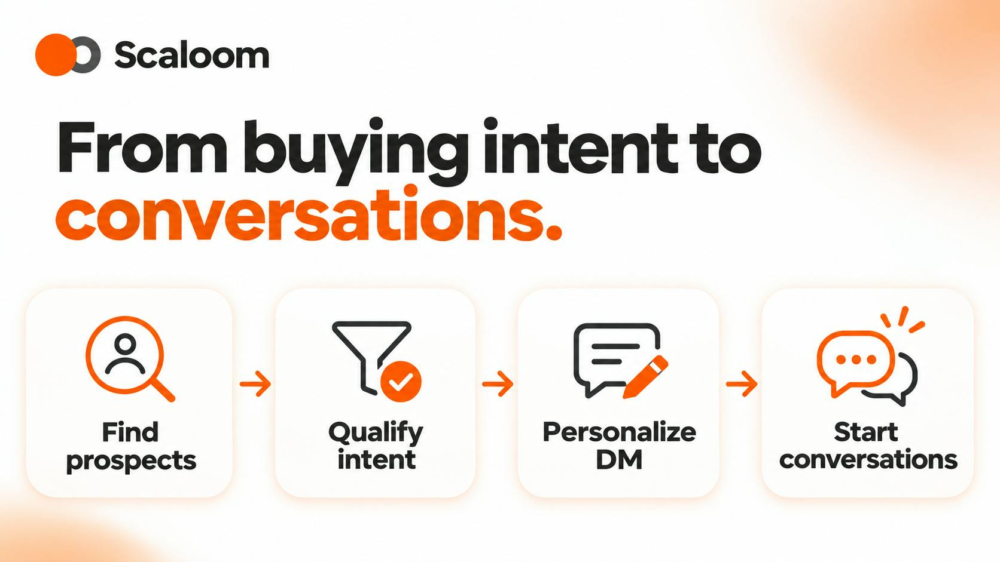

### 🎬 관련 영상
- [🎥 영상 보기](https://ph-files.imgix.net/978efb09-b307-43c1-8a7d-007aa225f08c.jpeg?auto=format)

---

## 19. [Skepia](https://www.producthunt.com/products/skepia)
**Votes**: 10 | **도입 난이도**: 하 | **신뢰도**: 상
**Tagline**: Boost your creativity with daily mental fitness
**서비스 링크**: https://www.producthunt.com/r/2A6A5JLE7JMPGI

**태그**: Creativity, Brain Training, Productivity, Mobile App, AI Tool, Design

### 📌 이 서비스 한눈에 보기
창의적 사고와 두뇌 훈련을 결합한 디자인 중심의 멘탈 피트니스 앱

### 🔑 주요 기능
- SCAMPER 및 수평적 사고 기법 기반의 100개 이상의 창의성 챌린지
- 개인별 창의성 프로필을 보여주는 맞춤형 피드백 제공
- 매일 습관을 형성할 수 있도록 설계된 아름답고 도전적인 퍼즐형 두뇌 트레이닝

### 🙋 사용자에게 어떤 점이 좋은가
창의적 사고 역량을 키우고 싶거나, 매일 즐겁게 두뇌를 자극할 수 있는 루틴을 만들고 싶은 사용자에게 유용합니다.

### ✅ 지금 바로 써볼 기능
- 창의성 프로필 확인을 위한 첫 번째 챌린지 도전
- 매일의 두뇌 훈련을 위한 퍼즐 플레이
- 개인 맞춤형 피드백 분석

### ⚠️ 사용 전 확인할 점
- 모바일 앱 기반이므로 데스크톱 환경에서의 작업과는 차이가 있을 수 있음
- 창의적 사고 기법 학습에 집중되어 있어 일반적인 두뇌 게임과는 성격이 다를 수 있음

### 🧭 확인이 더 필요한 정보
구체적인 구독 모델이나 유료 기능 포함 여부는 명시되지 않았습니다.

### 📸 스크린샷 및 갤러리

### 🎬 관련 영상
- [🎥 영상 보기](https://ph-files.imgix.net/mcp-draft-media/aa764a91-a165-4790-8ec1-418cf5a299e6.jpeg?auto=format)

---

## 20. [ScreenOtter 2.0](https://www.producthunt.com/products/screenotter)
**Votes**: 9 | **도입 난이도**: 하 | **신뢰도**: 상
**Tagline**: Beautiful Screen Recordings and Screenshots Without Editing
**서비스 링크**: https://www.producthunt.com/r/BZ7ROY2TQ24VAQ

**태그**: Productivity, Video, Screen-Recording, Mac

### 📌 이 서비스 한눈에 보기
편집 과정 없이 클릭 한 번으로 전문가 수준의 화면 녹화 영상을 만드는 도구

### 🔑 주요 기능
- 클릭 시 자동 줌 및 부드러운 포인터 움직임 적용
- 타임라인 편집 대신 텍text 삭제로 실수를 수정하는 직관적 방식
- 구독료 없는 일회성 구매 방식 및 4K 60fps 고화질 내보내기

### 🙋 사용자에게 어떤 점이 좋은가
복잡한 영상 편집 기술 없이도 제품 시연이나 튜토리얼 영상을 빠르고 깔끔하게 제작할 수 있습니다.

### ✅ 지금 바로 써볼 기능
- 8가지 레이아웃 중 원하는 카메라 배치 설정하기
- 텍스트 기반 편집 기능을 통해 불필요한 부분 삭제해보기
- 4K 고화질로 결과물 내보내기 테스트하기

### ⚠️ 사용 전 확인할 점
- Mac 전용 소프트웨어이므로 Windows 사용자는 사용 불가
- 정교한 타임라인 기반의 복잡한 영상 편집에는 한계가 있음

### 🧭 확인이 더 필요한 정보
현재 제공되는 기능이 Mac OS 환경에서만 완벽하게 작동하는지 확인이 필요합니다.

### 📸 스크린샷 및 갤러리

### 🎬 관련 영상
- [🎥 영상 보기](https://ph-files.imgix.net/f9f2c218-5b6f-4fc9-94d4-b86865bb2725.jpeg?auto=format)

---

## 21. [Draftss](https://www.producthunt.com/products/draftss)
**Votes**: 8 | **도입 난이도**: 하 | **신뢰도**: 상
**Tagline**: Black Friday SaaS Deals 2026
**서비스 링크**: https://www.producthunt.com/r/UMVGUUHEOHUB7L

**태그**: SaaS, Deals, Shopping, Productivity, AI Tool, Security

### 📌 이 서비스 한눈에 보기
SaaS, AI, 호스팅 등 140개 이상의 블랙 프라이데이 할인 정보를 한눈에 확인하는 큐레이션 서비스

### 🔑 주요 기능
- SaaS, WordPress, AI, 호스팅, 보안 등 140개 이상의 다양한 분야 딜 트래킹
- 할인율과 종료 날짜를 한눈에 비교할 수 있는 직관적인 인터페이스
- 사이버 먼데이까지 실시간 업데이트되는 최신 할인 정보 제공

### 🙋 사용자에게 어떤 점이 좋은가
블랙 프라이데이 기간 동안 여러 소프트웨어의 할인 정보를 일일이 찾는 번거로움을 줄이고, 가장 경제적인 구매 시점을 결정하는 데 도움을 줍니다.

### ✅ 지금 바로 써볼 기능
- 제공되는 140개 이상의 딜 리스트 탐색하기
- 필요한 소프트웨어의 할인율 및 종료 날짜 확인하기
- 관심 있는 딜의 사이버 먼데이 최종 업데이트 확인하기

### ⚠️ 사용 전 확인할 점
- 제공되는 정보는 큐레이션된 것이므로 실제 결제 전 해당 서비스의 최종 가격을 재확인해야 함
- 할인 기간이 한정적이므로 사이버 먼데이 전후로 정보가 변동될 수 있음

### 🧭 확인이 더 필요한 정보
특정 소프트웨어의 직접적인 판매가 아닌 할인 정보 제공 서비스이므로, 실제 구매는 개별 서비스 사이트에서 이루어집니다.

### 📸 스크린샷 및 갤러리

### 🎬 관련 영상
- [🎥 영상 보기](https://ph-files.imgix.net/0150a9be-2ec5-43a7-bfe7-61cef28954c6.jpeg?auto=format)

---

## 22. [City of Children: The Recovered Memories](https://www.producthunt.com/products/city-of-children-the-recovered-memories)
**Votes**: 7 | **도입 난이도**: 하 | **신뢰도**: 상
**Tagline**: The children don't know they're being recorded
**서비스 링크**: https://www.producthunt.com/r/GRPNFO347TTNVK

**태그**: Audio Drama, Storytelling, Free Content

### 📌 이 서비스 한눈에 보기
매일 저녁 새로운 기억이 깨어나는 11부작 미스터리 오디오 드라마

### 🔑 주요 기능
- 몰입감 넘치는 11부작 가족 오디오 드라마 시리즈
- 매일 오후 6시(CT)에 순차적으로 공개되는 에피소드 형식
- Spotify와 Apple Podcasts에서 무료로 감상 가능

### 🙋 사용자에게 어떤 점이 좋은가
매일 정해진 시간에 새로운 이야기를 들으며 몰입감 있는 스토리텔링 경험을 즐길 수 있습니다.

### ✅ 지금 바로 써볼 기능
- Spotify 또는 Apple Podcasts에서 채널 구독하기
- 공식 웹사이트에서 동반 게임(Companion Game) 1장 플레이하기
- 에피소드와 함께 제공되는 전체 대본(Transcripts) 확인하기

### ⚠️ 사용 전 확인할 점
- 미국 중부 표준시(CT) 기준으로 매일 공개되므로 한국 시간과는 차이가 있음
- 11부작 단기 시리즈로 구성되어 있음

### 🧭 확인이 더 필요한 정보
에피소드 공개 일정과 게임 플레이 가능 여부는 현지 시간 기준이므로 사용자 거주 지역에 따른 시간 확인이 필요합니다.

### 📸 스크린샷 및 갤러리

---

## 23. [Nightjar](https://www.producthunt.com/products/nightjar-3)
**Votes**: 6 | **도입 난이도**: 하 | **신뢰도**: 상
**Tagline**: Put your thoughts in the jar. Get a sleep story made for it.
**서비스 링크**: https://www.producthunt.com/r/X7HPNMZ3J367CK

**태그**: Wellness, Sleep, MentalHealth, Productivity

### 📌 이 서비스 한눈에 보기
머릿속 고민을 적어 저장하고, 그에 맞춘 맞춤형 수면 이야기를 듣는 30초 취침 루틴

### 🔑 주요 기능
- 잠들기 전 고민을 적어 '저장'하는 심리적 해소 프로세스
- 작성된 고민을 바탕으로 생성되는 맞춤형 수면 스토리
- 수면 연구를 기반으로 설계된 간결한 취침 의식

### 🙋 사용자에게 어떤 점이 좋은가
생각이 많아 잠 못 이루는 밤, 고민을 디지털로 격리하고 맞춤형 이야기를 통해 자연스러운 수면 유도를 돕습니다.

### ✅ 지금 바로 써볼 기능
- 잠들기 전 고민을 짧게 적어보기
- 생성된 수면 스토리 들어보기

### ⚠️ 사용 전 확인할 점
- 디지털 기기 사용이 수면에 미칠 수 있는 영향 고려 필요
- 개인적인 고민 내용의 데이터 보안 및 프라이버시 확인

### 🧭 확인이 더 필요한 정보
사용자의 고민 내용이 실제 수면 스토리에 어느 정도의 정교함으로 반영되는지 확인이 필요합니다.

### 📸 스크린샷 및 갤러리

### 🎬 관련 영상
- [🎥 영상 보기](https://ph-files.imgix.net/485e8015-08e9-4e46-921c-102a8be9ebd0.jpeg?auto=format)

---

## 24. [Transformer.gg](https://www.producthunt.com/products/transformer-gg)
**Votes**: 5 | **도입 난이도**: 하 | **신뢰도**: 상
**Tagline**: The agentic influencer marketplace
**서비스 링크**: https://www.producthunt.com/r/XGYDD3UFFPGIZL

**태그**: Marketing, Influencer, Automation, Analytics, Agent, AI Tool

### 📌 이 서비스 한눈에 보기
AI 에이전트와 대시보드를 통해 크리에이터 협업 및 성과 측정을 자동화하는 인플루언서 마켓플레이스

### 🔑 주요 기능
- 실제 크리에이터와 브랜드 간의 직접적인 유료 협업 매칭
- X(구 트위터) 포스팅 기반의 성과 추적 및 클릭/판매 데이터 제공
- 대시보드 또는 AI 에이전트를 통한 워크플로우 관리

### 🙋 사용자에게 어떤 점이 좋은가
브랜드는 검증된 크리에이터를 통해 X 플랫폼에서 효율적인 마케팅을 수행할 수 있으며, 모든 성과가 트래킹되어 투명한 ROI 측정이 가능합니다.

### ✅ 지금 바로 써볼 기능
- 대시보드를 통한 브랜드 오퍼 발송
- 트래킹 링크를 활용한 성과 모니터링
- 에이전트 기능을 통한 자동화 워크플로우 설정

### ⚠️ 사용 전 확인할 점
- X(트위터) 플랫폼 의존도가 높음
- 크리에이터의 실제 포스팅 여부에 따른 정산 프로세스 확인 필요

### 🧭 확인이 더 필요한 정보
에이전트 기능이 구체적으로 어떤 자동화 범위를 제공하는지 확인이 필요합니다.

### 📸 스크린샷 및 갤러리

---

## 25. [Planana AI](https://www.producthunt.com/products/planana-ai)
**Votes**: 5 | **도입 난이도**: 하 | **신뢰도**: 상
**Tagline**: The personal AI coach that gets you hired
**서비스 링크**: https://www.producthunt.com/r/27YYE2P3IILBW6

**태그**: EdTech, Career, AI Coaching, Job Hunting, AI Tool

### 📌 이 서비스 한눈에 보기
개별 학습 데이터에 맞춰 진화하는 개인 맞춤형 AI 취업 코치

### 🔑 주요 기능
- 사용자의 취약점을 실시간으로 반영하는 동적 학습 플랜
- 고정된 커리큘럼이 아닌 개인의 이해도에 따른 맞춤형 레슨
- 테크 및 금융 직군 취업 준비에 특화된 코칭

### 🙋 사용자에게 어떤 점이 좋은가
정해진 강의를 듣는 대신, 본인이 모르는 부분만 집중적으로 학습하여 취업 준비 시간을 효율적으로 단축할 수 있습니다.

### ✅ 지금 바로 써볼 기능
- 자신의 직무 관련 학습 목표 설정하기
- 문제 풀이 및 피드백 과정을 통한 개인화된 플랜 생성
- 취약한 개념에 대한 맞춤형 레슨 확인하기

### ⚠️ 사용 전 확인할 점
- 현재 테크 및 금융 직군 위주로 서비스가 제한적일 수 있음
- 학습 데이터가 쌓이기 전까지는 개인화 효과가 낮을 수 있음

### 🧭 확인이 더 필요한 정보
지원 가능한 직군 범위와 구체적인 학습 콘텐츠의 깊이는 서비스 업데이트에 따라 달라질 수 있습니다.

### 📸 스크린샷 및 갤러리

### 🎬 관련 영상
- [🎥 영상 보기](https://ph-files.imgix.net/mcp-draft-media/10f7499b-2564-4db6-a60c-98906746717e.jpeg?auto=format)

---

## 26. [OSRMRoute](https://www.producthunt.com/products/osrmroute)
**Votes**: 5 | **도입 난이도**: 중 | **신뢰도**: 상
**Tagline**: Maps, routing & search APIs for your apps
**서비스 링크**: https://www.producthunt.com/r/KLCFCXC6AVFLHE

**태그**: DevTool, Maps, Logistics, API

### 📌 이 서비스 한눈에 보기
지도 제작부터 경로 최적화까지 한 번에 해결하는 통합 위치 서비스 API 플랫폼

### 🔑 주요 기능
- 지도 제작, 경로 계산, 장소 검색 등 위치 기반 기능 통합 제공
- 3D 적재 계획(Load Placement) 기능을 통한 물류 최적화 지원
- 개발자를 위한 Map Studio 및 상세한 문서화 제공

### 🙋 사용자에게 어떤 점이 좋은가
지도, 경로 탐색, 물류 관련 기능을 개별적으로 구축할 필요 없이 하나의 API 플랫폼에서 통합 관리할 수 있어 개발 효율성이 높습니다.

### ✅ 지금 바로 써볼 기능
- Map Studio를 통한 지도 커스텀 시각화
- Routing 및 Matrix API를 활용한 경로 최적화 테스트
- 3D Load Placement 기능을 통한 적재 시뮬레이션

### ⚠️ 사용 전 확인할 점
- 통합 플랫폼인 만큼 서비스 장애 시 위치 관련 기능 전체에 영향을 줄 수 있음
- 상세한 가격 정책 및 데이터 커버리지 범위 확인 필요

### 🧭 확인이 더 필요한 정보
제공되는 데이터의 지리적 커버리지 범위와 구체적인 요금 체계에 대한 정보가 명시되지 않았습니다.

### 📸 스크린샷 및 갤러리

---

## 27. [iOS Push Notification Mockup](https://www.producthunt.com/products/ios-push-notification-mockup)
**Votes**: 5 | **도입 난이도**: 하 | **신뢰도**: 상
**Tagline**: Free iPhone Lock Screen mockup with iOS 27 Liquid Glass
**서비스 링크**: https://www.producthunt.com/r/5RVHHOOXKIMA5Y

**태그**: DesignTool, Mockup, iOS, Freebie, Chat, Vision

### 📌 이 서비스 한눈에 보기
나만의 커스텀 푸시 알림이 포함된 고해상도 아이폰 잠금화면 목업을 즉시 생성하는 도구

### 🔑 주요 기능
- 최대 3개의 커스텀 푸시 알림 및 앱 아이콘, 아바타 설정 가능
- iOS 27 Liquid Glass 스타일 등 세련된 시계 디자인 및 배경화면 선택 기능
- 가입 없이 워터마크 없는 고해상도 PNG 다운로드 지원

### 🙋 사용자에게 어떤 점이 좋은가
디자이너나 마케터가 실제 아이폰 화면처럼 보이는 고퀄리티 목업 이미지를 별도의 복잡한 작업 없이 빠르게 제작할 수 있습니다.

### ✅ 지금 바로 써볼 기능
- 원하는 문구로 3개의 푸시 알림 작성하기
- 커스텀 앱 아이콘 및 아바타 업로드하기
- Liquid Glass 스타일 적용 후 고해상도 PNG 다운로드하기

### ⚠️ 사용 전 확인할 점
- 브라우저 기반 도구이므로 브라우저 환경에 따라 성능 차이가 있을 수 있음
- 제공되는 프레임 외의 특수한 기기 규격이 필요한 경우 제한적일 수 있음

### 🧭 확인이 더 필요한 정보
제품 설명에 언급된 'iOS 27'은 실제 iOS 버전이 아닌 디자인 스타일 명칭으로 판단됩니다.

### 📸 스크린샷 및 갤러리

---

## 28. [Brandssynergy](https://www.producthunt.com/products/brandssynergy)
**Votes**: 5 | **도입 난이도**: 하 | **신뢰도**: 상
**Tagline**: Find Nordic influencers, run campaigns, start to finish.
**서비스 링크**: https://www.producthunt.com/r/GSYYUEFJ2K3KXK

**태그**: InfluencerMarketing, SaaS, AI, MarketingAutomation, Nordic, AI Tool, Chat, Marketing, Sales

### 📌 이 서비스 한눈에 보기
북유럽 인플루언서 발굴부터 캠페인 관리까지 한 번에 해결하는 AI 통합 워크스페이스

### 🔑 주요 기능
- 북유럽 지역 니치/타겟/참여도 기반 크리에이터 검색
- 초대, 채팅, 캠페인 관리를 위한 통합 워크스페이스 제공
- 초안 검토부터 라이브 포스트까지 체계적인 승인 프로세스

### 🙋 사용자에게 어떤 점이 좋은가
인플루언서 섭외부터 성과 측정까지 파편화된 업무 과정을 하나의 플랫폼으로 통합하여 운영 효율을 극대화할 수 있습니다.

### ✅ 지금 바로 써볼 기능
- 북유럽 지역 타겟 크리에이터 검색 기능 테스트
- AI 기반 캠페인 관리 워크플로우 확인
- 14일 무료 체험을 통한 성과 추적 대시보드 검토

### ⚠️ 사용 전 확인할 점
- 북유럽 지역에 특화된 서비스이므로 해당 지역 외 타겟팅 시 활용도 확인 필요
- 무료 체험 기간 종료 후 유료 전환 정책 확인 필요

### 🧭 확인이 더 필요한 정보
북유럽 외 글로벌 지역의 크리에이터 데이터베이스 확보 여부는 명시되어 있지 않습니다.

### 📸 스크린샷 및 갤러리

### 🎬 관련 영상
- [🎥 영상 보기](https://ph-files.imgix.net/e8091a15-8e70-4de1-98d9-b87d9a764ab6.jpeg?auto=format)

---

## 29. [Crazy Rich Markdown Editor](https://www.producthunt.com/products/crazy-rich-markdown-editor)
**Votes**: 4 | **도입 난이도**: 하 | **신뢰도**: 상
**Tagline**: A feature-rich markdown editor for VS Code
**서비스 링크**: https://www.producthunt.com/r/KIWIWM4VLFDZDK

**태그**: DevTool, Productivity, Markdown, VSCode, Automation

### 📌 이 서비스 한눈에 보기
VS Code 환경을 벗어나지 않고도 전문적인 문서 작성을 가능하게 하는 강력한 마크다운 에디터

### 🔑 주요 기능
- VS Code 내에서 바로 사용하는 고급 스타일링 기능
- 실시간 미리보기를 통한 직관적인 편집 경험
- 개발자와 작가를 위한 효율적인 문서 작업 워크플로우

### 🙋 사용자에게 어떤 점이 좋은가
별도의 에디터를 왔다 갔다 할 필요 없이 VS Code 안에서 깔끔한 문서를 즉시 제작할 수 있어 작업 흐름이 끊기지 않습니다.

### ✅ 지금 바로 써볼 기능
- 실시간 미리보기 기능 활성화하기
- 고급 스타일링 옵션 적용해보기
- 기존 마크다운 파일 불러와서 편집해보기

### ⚠️ 사용 전 확인할 점
- VS Code 확장 프로그램 설치 및 설정 필요
- 기존 마크다운 문법과의 호환성 확인 필요

### 🧭 확인이 더 필요한 정보
상세한 스타일링 옵션의 범위와 외부 테마와의 호환성은 직접 사용해봐야 확인 가능합니다.

### 📸 스크린샷 및 갤러리

---

## 30. [Vithrin.com](https://www.producthunt.com/products/vithrin-com)
**Votes**: 4 | **도입 난이도**: 하 | **신뢰도**: 상
**Tagline**: Curated online fashion marketplace with outfits and boards
**서비스 링크**: https://www.producthunt.com/r/M4LDFGPKBK3KHZ

**태그**: Fashion, Curated, Marketplace, Lifestyle

### 📌 이 서비스 한눈에 보기
수많은 브랜드 중 엄선된 아이템과 스타일링을 한눈에 확인하는 큐레이션 패션 마켓플레이스

### 🔑 주요 기능
- 100개 이상의 브랜드에서 엄선된 아이템과 에디터 픽 제공
- 카테고리별 분류 및 완성된 아웃핏(Outfit) 중심의 탐색
- 동일 제품을 판매하는 여러 셀러를 한 페이지에서 비교 가능

### 🙋 사용자에게 어떤 점이 좋은가
끝없는 상품 목록 대신 전문가가 선별한 스타일을 통해 쇼핑 시간을 단축하고, 자신의 패션 취향을 시각적으로 관리할 수 있습니다.

### ✅ 지금 바로 써볼 기능
- 에디터가 제안하는 아웃핏 스타일 살펴보기
- 마음에 드는 아이템을 공유 가능한 보드에 저장하기
- 동일 제품의 다양한 판매처 비교하기

### ⚠️ 사용 전 확인할 점
- 터키 기반 플랫폼으로 국내 배송 및 반품 정책 확인 필요
- 일부 아이템은 외부 원본 스토어에서 구매해야 할 수 있음

### 🧭 확인이 더 필요한 정보
사용자의 거주 지역에 따른 배송 가능 여부와 최종 결제 프로세스를 확인해야 합니다.

### 📸 스크린샷 및 갤러리

---

