# 🚀 Product Hunt Daily Top 30 (2026-11-17)

## 오늘의 요약
오늘의 트렌드는 AI 에이전트가 단순한 보조를 넘어 결제, IT 운영, 업무 자동화 등 실질적인 실행력을 갖추는 방향으로 진화하고 있음을 보여줍니다. 특히 사용자의 승인 하에 안전하게 업무를 수행하거나, 기존의 복잡한 도구 없이 이메일이나 웹 환경에서 즉각적으로 작동하는 실용적인 자동화 솔루션들이 주목받았습니다.

### 오늘의 핵심 포인트
- AI 에이전트가 사용자의 승인 절차를 거쳐 결제, IT 유지보수, 업무 수행을 대행하는 실행형 서비스가 등장했습니다.
- 복잡한 설정 없이 이메일이나 브라우저 확장 프로그램처럼 기존 환경에 자연스럽게 녹아드는 간편한 자동화 도구들이 인기를 끌었습니다.
- 기업의 보안과 데이터 거버넌스를 위해 자체 호스팅 및 보안 결제 방식을 지원하는 전문적인 AI 운영 체계가 강조되었습니다.

**오늘의 태그**: AI 에이전트, 업무 자동화, 생산성 도구, 보안 및 결제

## 1. [Zoom Slides](https://www.producthunt.com/products/zoom)
**Votes**: 229 | **도입 난이도**: 하 | **신뢰도**: 상
**Tagline**: Turn your Zoom meetings into ready-to-present slides
**서비스 링크**: https://www.producthunt.com/r/EZUGWR53JD3PM7

**태그**: AI, Productivity, Presentation, Automation, AI Tool

### 📌 이 서비스 한눈에 보기
회의 기록을 클릭 한 번으로 완성된 발표 슬라이드로 변환하는 AI 도구

### 🔑 주요 기능
- 회의 녹취록 및 문서를 구조화된 프레젠테이션으로 자동 변환
- 전문적인 레이아웃, 시각 자료, 발표자 노트 자동 생성
- 팀 협업 기능 및 PowerPoint 파일 내보내기 지원

### 🙋 사용자에게 어떤 점이 좋은가
회의가 끝난 후 빈 슬라이드에서 시작할 필요 없이, 회의 내용을 즉시 발표 자료로 만들어 업무 시간을 획기적으로 단축할 수 있습니다.

### ✅ 지금 바로 써볼 기능
- 회의 녹취록을 업로드하여 초안 생성해보기
- AI가 생성한 레이아웃 및 시각 자료 편집하기
- 생성된 슬라이드를 PowerPoint로 내보내기

### ⚠️ 사용 전 확인할 점
- AI가 생성한 내용의 사실 관계 및 논리적 흐름 검토 필요
- 복잡한 커스텀 디자인 요구사항 충족 여부 확인 필요

### 🧭 확인이 더 필요한 정보
현재 제공되는 AI 모델의 상세 기능과 외부 문서(PDF 등)의 구조화 정밀도를 확인해야 합니다.

### 📸 스크린샷 및 갤러리
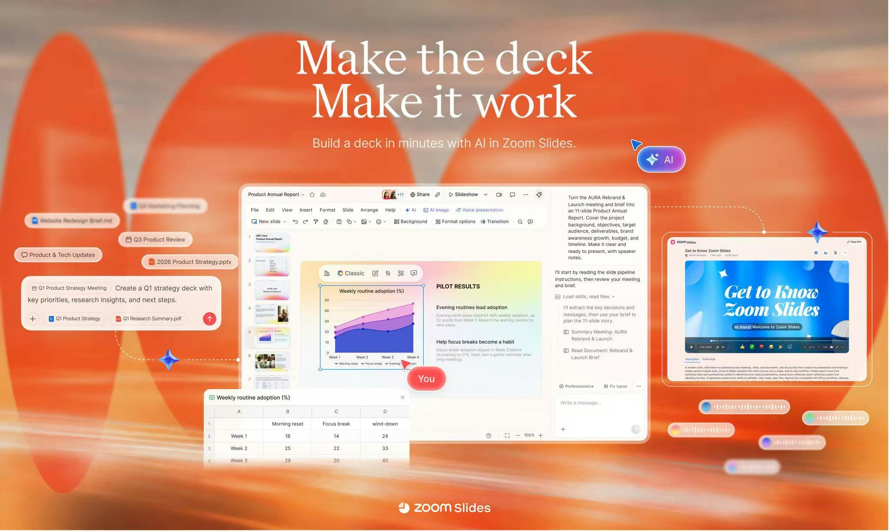
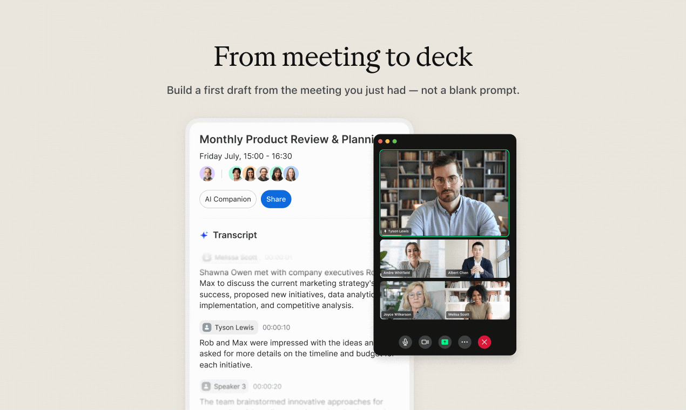

### 🎬 관련 영상
- [🎥 영상 보기](https://ph-files.imgix.net/98e4df25-efd4-42ce-9f5a-dddd383e81d3.jpeg?auto=format)

---

## 2. [Boost.space AgentOS](https://www.producthunt.com/products/boost-space)
**Votes**: 188 | **도입 난이도**: 중 | **신뢰도**: 상
**Tagline**: One operating system for all your AI agents
**서비스 링크**: https://www.producthunt.com/r/76XJJBTD4NW3OM

**태그**: AI, Automation, Agentic-Workflow, SaaS, Productivity, Agent, AI Tool, Chat

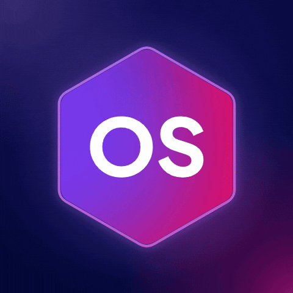

### 📌 이 서비스 한눈에 보기
1,500개 이상의 도구와 1,400개 이상의 AI 모델을 연결하여 전문화된 AI 에이전트 팀을 구축하는 운영체제

### 🔑 주요 기능
- 컨텍스트, 기술, 도구를 공유하는 전문화된 AI 에이전트 구축 가능
- 1,400개 이상의 AI 모델 및 1,500개 이상의 기존 도구와 연동
- 에이전트 배포, 제어, 관리 및 대화형 인터페이스 제공

### 🙋 사용자에게 어떤 점이 좋은가
기존에 사용하던 수많은 업무 도구들을 AI 에이전트와 연결하여, 사람이 개입하지 않아도 업무를 수행하는 자동화된 기업 환경을 구축할 수 있습니다.

### ✅ 지금 바로 써볼 기능
- 기존 업무 도구(1,500개 이상)와의 연동성 테스트
- 특정 업무에 특화된 전문 에이전트 설계 및 배포
- 다양한 AI 모델을 활용한 에이전트 간 협업 워크플로우 구축

### ⚠️ 사용 전 확인할 점
- 수많은 도구와 모델을 연결할 때 발생할 수 있는 보안 및 데이터 프라이버시 설정 확인 필요
- 에이전트 간의 복잡한 워크플로우 설계 시 관리 난이도 증가 가능성

### 🧭 확인이 더 필요한 정보
사용자의 기존 도구와 AI 모델 간의 구체적인 연동 방식 및 데이터 동기화 방식에 대한 상세 확인이 필요합니다.

### 📸 스크린샷 및 갤러리
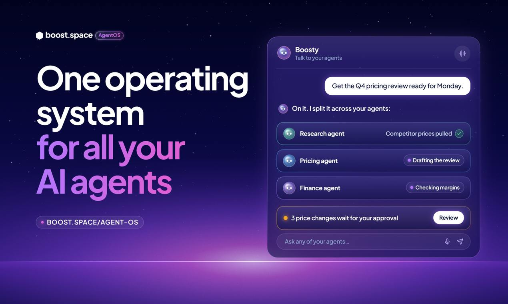
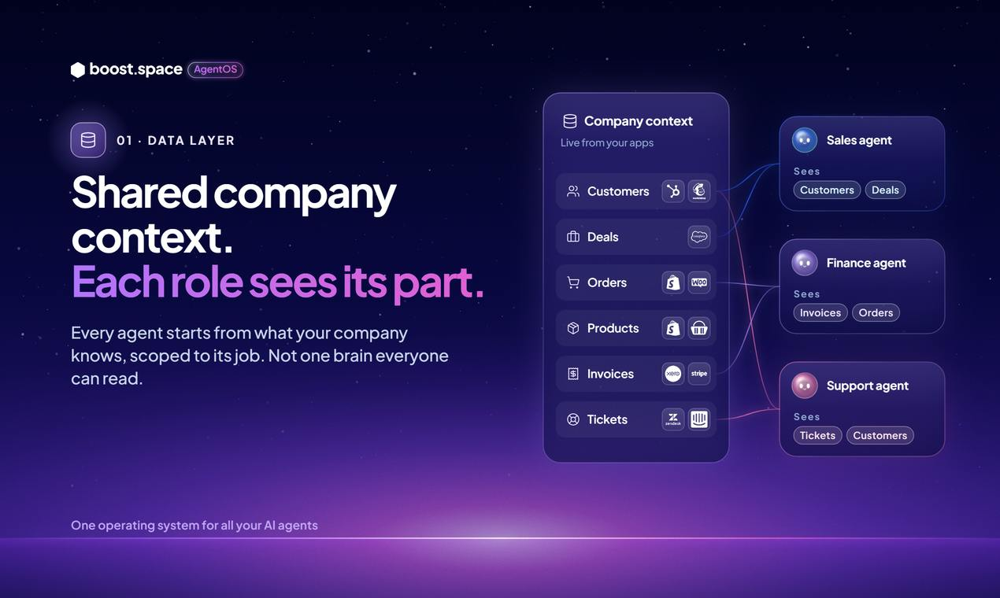
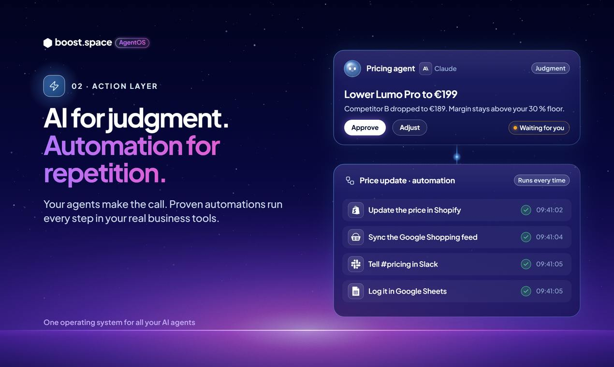

### 🎬 관련 영상
- [🎥 영상 보기](https://ph-files.imgix.net/886bf3bd-423a-41ef-9218-ae0005d7e521.jpeg?auto=format)

---

## 3. [readywhen](https://www.producthunt.com/products/readywhen)
**Votes**: 186 | **도입 난이도**: 하 | **신뢰도**: 상
**Tagline**: Your personal assistant that lives in email around the clock
**서비스 링크**: https://www.producthunt.com/r/55JJFHJGIO46RN

**태그**: Productivity, Automation, AI Assistant, Email, AI Tool

### 📌 이 서비스 한눈에 보기
이메일로 명령하고 승인하는 방식의 개인 비서 서비스

### 🔑 주요 기능
- 별도의 계정 설정 없이 이메일로 즉시 시작 가능
- 이메일을 통해 업무를 지시하고 결과물을 확인하는 워크플로우
- 사용자의 최종 승인(reply 'send') 후에만 메일이 발송되는 안전한 방식

### 🙋 사용자에게 어떤 점이 좋은가
복잡한 툴 학습 없이 평소 쓰던 이메일만으로 업무 자동화를 구현할 수 있어 매우 간편합니다.

### ✅ 지금 바로 써볼 기능
- assistant@readywhen.ai로 첫 업무 지시 이메일 보내기
- 작성된 초안 확인 후 'send'로 발송 승인하기
- 진행 중인 업무 상태를 이메일로 질문하기

### ⚠️ 사용 전 확인할 점
- 이메일 기반이므로 복잡한 파일 작업이나 정교한 UI 작업에는 한계가 있을 수 있음
- 개인 이메일 계정의 보안 및 권한 설정 확인 필요

### 🧭 확인이 더 필요한 정보
현재 서비스가 이메일 발송 외에 다른 외부 서비스(캘린더, CRM 등)와 어느 정도 수준으로 연동되는지 명시되지 않았습니다.

### 📸 스크린샷 및 갤러리
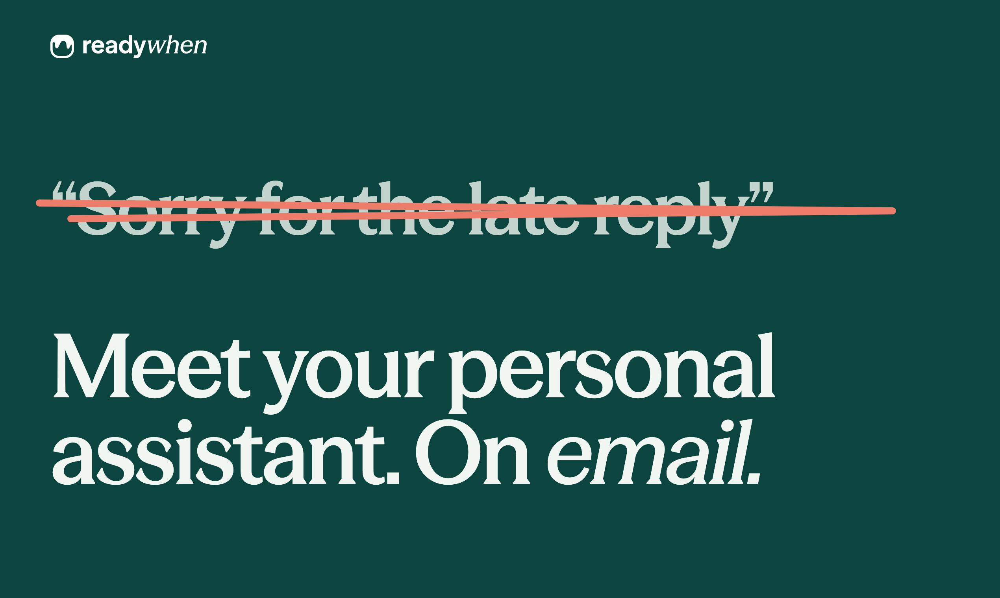

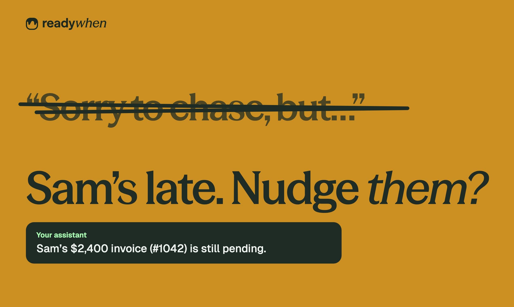

### 🎬 관련 영상
- [🎥 영상 보기](https://ph-files.imgix.net/d6d0cb30-07a7-483b-898c-463297992812.jpeg?auto=format)

---

## 4. [OpenBot](https://www.producthunt.com/products/copilotkit)
**Votes**: 181 | **도입 난이도**: 상 | **신뢰도**: 상
**Tagline**: Grok Bot alternative: self-host, fully customize, any stack
**서비스 링크**: https://www.producthunt.com/r/IVRBK72SWJ3GFA

**태그**: AI, DevTool, Automation, Self-Hosted, Enterprise, Agent, Design

### 📌 이 서비스 한눈에 보기
자체 호스팅과 커스텀이 가능한 기업용 모듈형 AI 에이전트 워크스페이스

### 🔑 주요 기능
- 모듈형 아키텍처를 통한 자유로운 커스터마이징 및 화이트 라벨링 지원
- 자체 호스팅(Self-hosting)을 통한 데이터 보안 및 거버넌스 확보
- 사용자 정의 모델, 도구, 인프라를 자유롭게 선택 가능한 유연한 스택

### 🙋 사용자에게 어떤 점이 좋은가
기업의 보안 요구사항에 맞춰 인프라를 직접 제어하면서도, 독자적인 AI 에이전트 환경을 구축하고 싶은 개발자 및 기업에 유용합니다.

### ✅ 지금 바로 써볼 기능
- 기존 에이전트 워크플로우를 OpenBot 구조로 이식해보기
- 자체 인프라 환경에 배포 및 거버넌스 설정 테스트하기
- 사용 중인 모델과 도구를 OpenBot 스택에 연결하기

### ⚠️ 사용 전 확인할 점
- 직접 호스팅 및 커스텀 아키텍처 관리에 따른 운영 리소스 필요
- 사용자의 기술적 숙련도에 따라 구축 난이도가 높을 수 있음

### 🧭 확인이 더 필요한 정보
구체적인 기술 스택(언어, 프레임워크 등)과 설치 방식에 대한 상세 가이드 확인이 필요합니다.

### 📸 스크린샷 및 갤러리
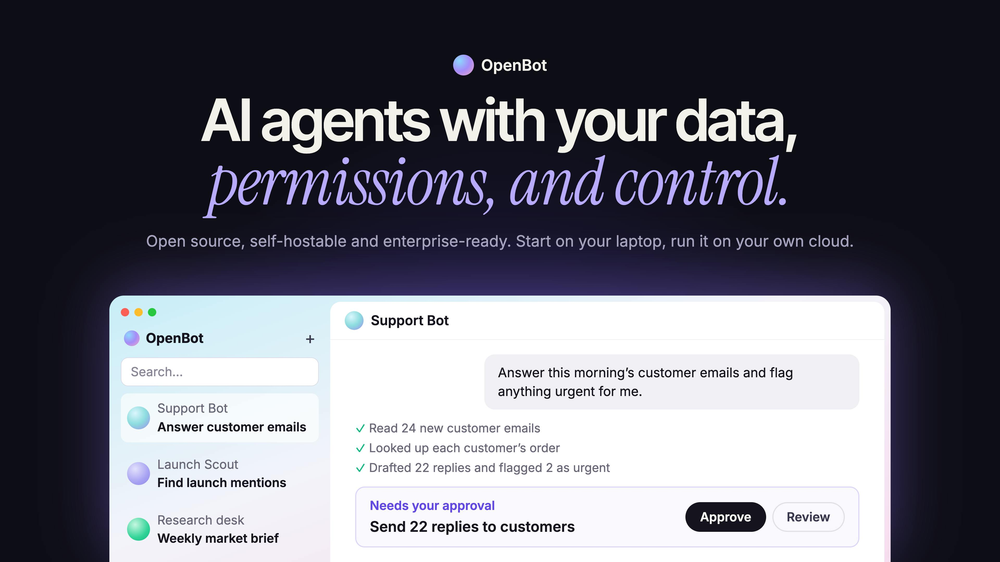
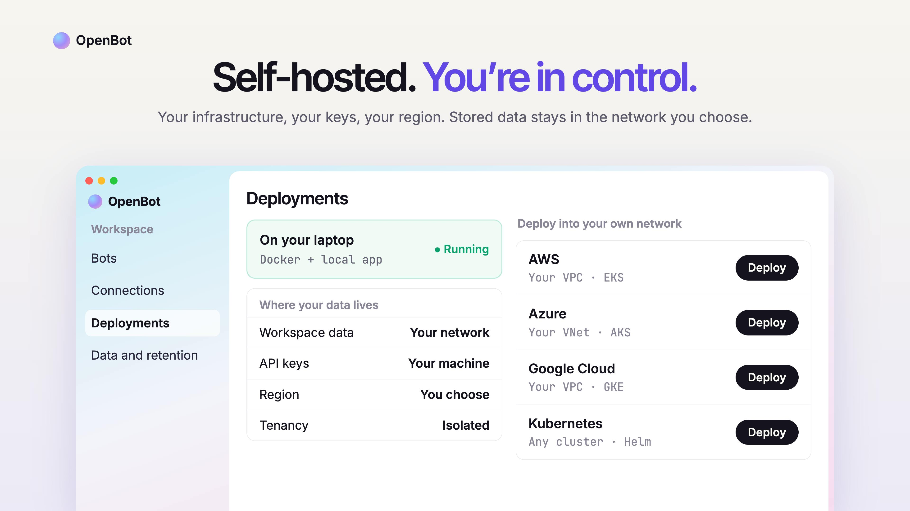
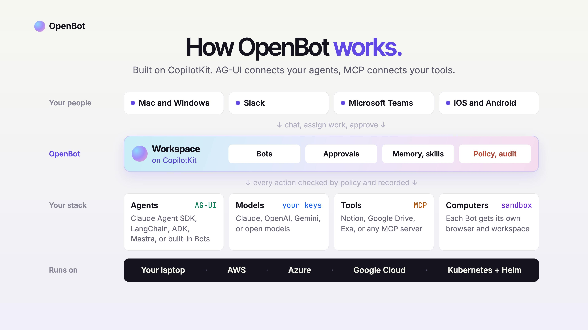

### 🎬 관련 영상
- [🎥 영상 보기](https://ph-files.imgix.net/b46409d4-3f2a-4026-a231-78189c5f9a8c.jpeg?auto=format)

---

## 5. [OpenFrame](https://www.producthunt.com/products/openframe-3)
**Votes**: 152 | **도입 난이도**: 하 | **신뢰도**: 상
**Tagline**: AI agents that run your IT. You approve every fix.
**서비스 링크**: https://www.producthunt.com/r/IN3WYQBAT773W4

**태그**: IT Automation, AI Agents, Endpoint Management, IT Support, Agent, AI Tool

### 📌 이 서비스 한눈에 보기
관리자의 승인 하에 IT 운영과 직원 지원을 자동화하는 AI 에이전트 플랫폼

### 🔑 주요 기능
- Mingo: 장치 패치, 문제 해결 및 루틴한 기술 작업 수행 (관리자 승인 기반)
- Fae: 직원들의 IT 요청 응대 및 지원 자동화
- 주간 보고서를 통한 업무 성과 가시성 제공

### 🙋 사용자에게 어떤 점이 좋은가
소규모 IT 팀이 반복적인 유지보수와 단순 문의 업무에서 벗어나 더 중요한 전략적 업무에 집중할 수 있게 해줍니다.

### ✅ 지금 바로 써볼 기능
- Mingo를 통한 장치 패치 및 루틴 작업 자동화 설정
- Fae를 활용한 직원 IT 요청 처리 프로세스 구축
- 주간 보고서 기능을 통한 IT 성과 리포팅 확인

### ⚠️ 사용 전 확인할 점
- 모든 변경 사항에 대해 관리자의 수동 승인이 필요하므로 초기 운영 공수가 발생할 수 있음
- 지원되는 엔드포인트 운영체제 및 장치 종류에 대한 상세 사양 확인 필요

### 🧭 확인이 더 필요한 정보
지원 가능한 엔드포인트 종류와 구체적인 보안 프로토콜에 대한 정보가 추가로 필요합니다.

### 📸 스크린샷 및 갤러리
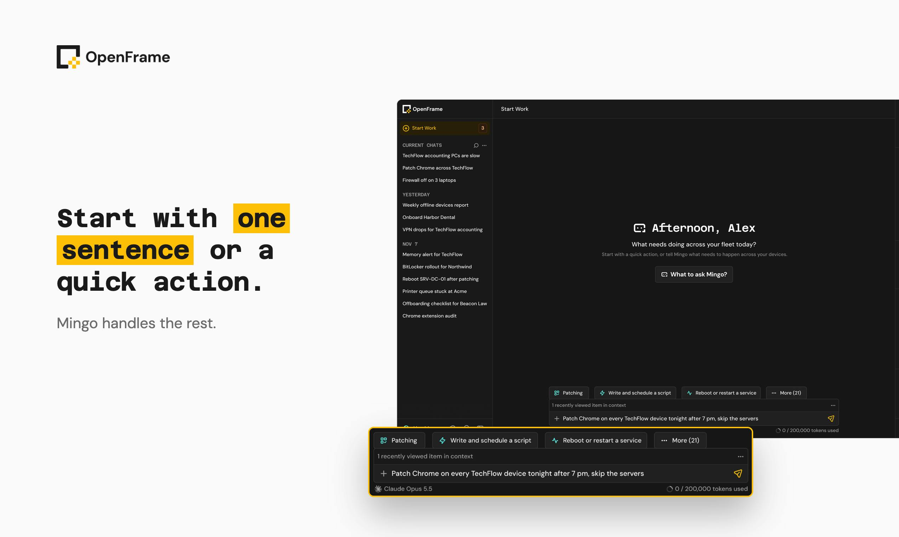
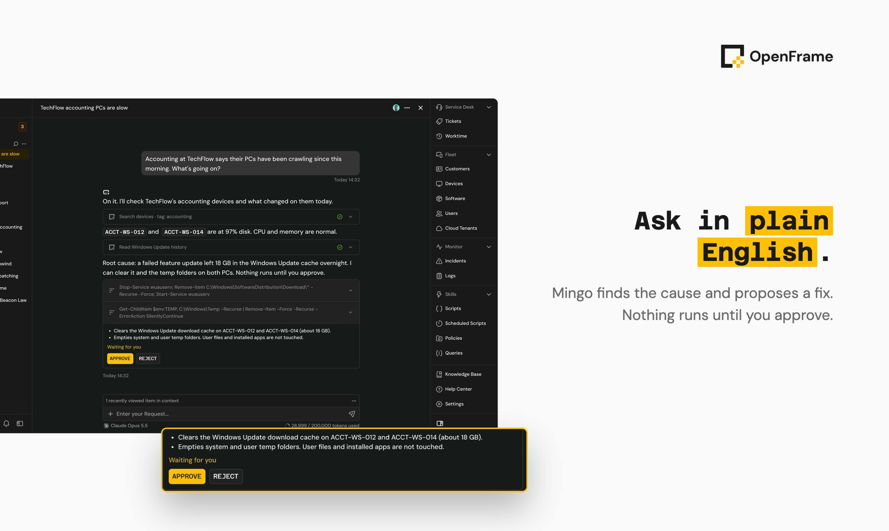
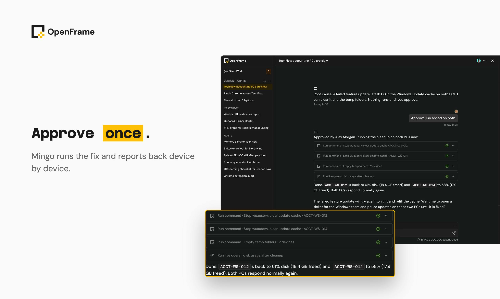

### 🎬 관련 영상
- [🎥 영상 보기](https://ph-files.imgix.net/ab866a73-5f82-4e3e-a52b-9e1382b181b6.jpeg?auto=format)

---

## 6. [Cal.com v7](https://www.producthunt.com/products/cal)
**Votes**: 141 | **도입 난이도**: 하 | **신뢰도**: 상
**Tagline**: Cal.com now has events, discover, an assistant + more
**서비스 링크**: https://www.producthunt.com/r/6OEY6HJXNWQWUC

**태그**: Productivity, AI, Scheduling, Automation, AI Tool

### 📌 이 서비스 한눈에 보기
이벤트, 탐색, AI 비서 기능이 추가된 Cal.com의 차세대 스케줄링 플랫폼

### 🔑 주요 기능
- Cal.com Events: 새로운 이벤트 관리 기능 도입
- Cal.com Discover: 새로운 발견 기능 추가
- Cal.ai Assistant: AI 기반의 일정 관리 비서 탑재

### 🙋 사용자에게 어떤 점이 좋은가
단순한 일정 예약을 넘어 AI 비서와 탐색 기능을 통해 더 능동적이고 효율적인 일정 관리가 가능해집니다.

### ✅ 지금 바로 써볼 기능
- Cal.ai Assistant로 일정 관리 자동화해보기
- 새로운 Events 기능으로 모임 운영해보기
- Discover 기능을 통해 새로운 연결 기회 찾아보기

### ⚠️ 사용 전 확인할 점
- 신규 기능(AI, Discover 등)의 구체적인 사용 정책 및 데이터 보안 확인 필요
- 기존 버전과의 호환성 및 인터페이스 변화 적응 필요

### 🧭 확인이 더 필요한 정보
새로운 기능들의 구체적인 유료 플랜 포함 여부와 상세 작동 방식에 대한 정보가 부족합니다.

### 📸 스크린샷 및 갤러리
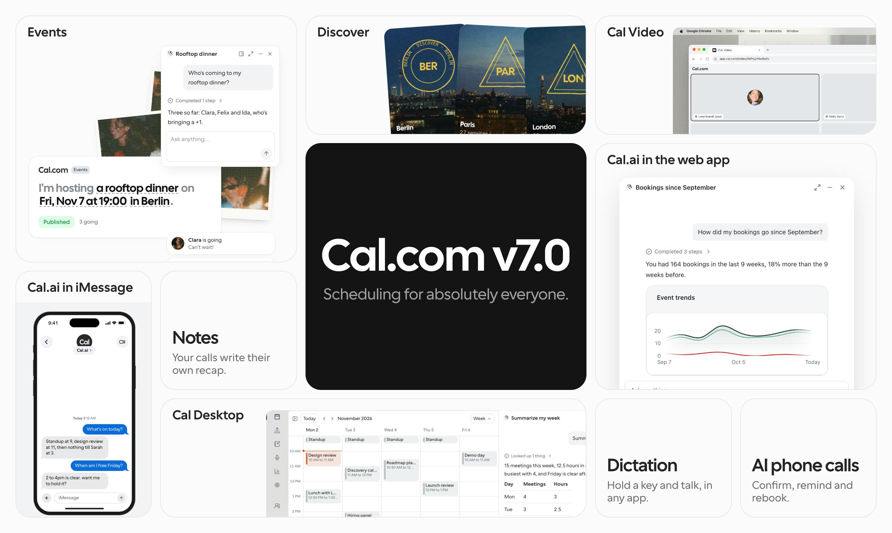
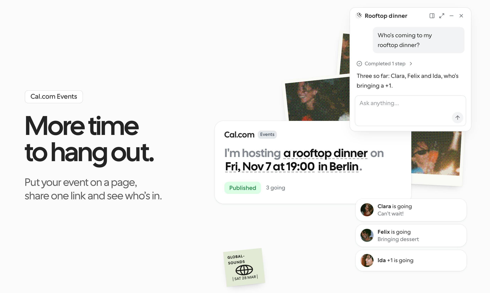
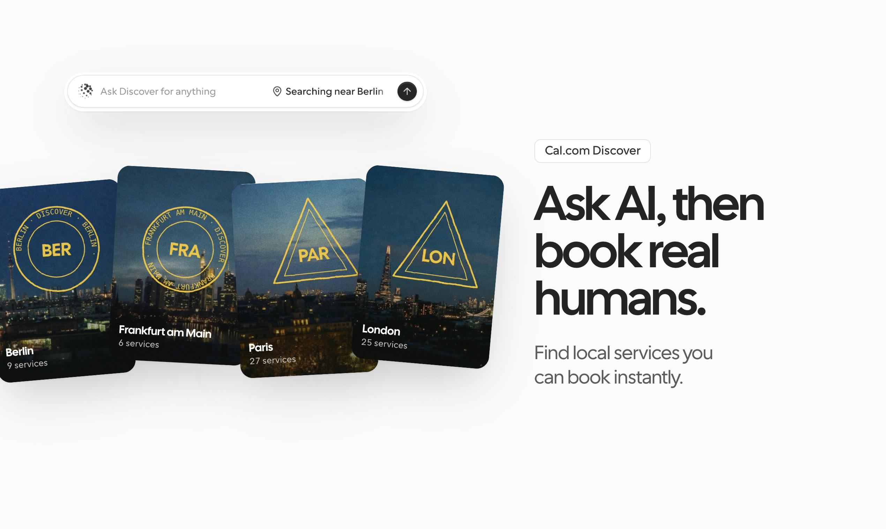

### 🎬 관련 영상
- [🎥 영상 보기](https://ph-files.imgix.net/7761cb7f-1325-4e2b-8b09-f583d18b9ad4.jpeg?auto=format)

---

## 7. [ChatGPT Wallet](https://www.producthunt.com/products/chatgpt)
**Votes**: 122 | **도입 난이도**: 하 | **신뢰도**: 상
**Tagline**: Let ChatGPT agents buy things without seeing your card
**서비스 링크**: https://www.producthunt.com/r/GSPNGEIHJHVZKC

**태그**: AI, Fintech, Automation, Security, Agent, AI Tool, Chat

### 📌 이 서비스 한눈에 보기
AI 에이전트가 사용자의 카드 정보 노출 없이 안전하게 결제를 완료할 수 있는 지갑 서비스

### 🔑 주요 기능
- 카드 번호 노출 없는 토큰 기반 결제 방식
- AI 에이전트의 자동 구매 기능 지원
- 생체 인증(Face ID/지문)을 통한 최종 승인 절차

### 🙋 사용자에게 어떤 점이 좋은가
AI 에이전트가 대신 물건을 구매할 때 발생할 수 있는 보안 문제를 해결하여, 개인정보 유출 걱정 없이 자동화된 쇼핑을 즐길 수 있습니다.

### ✅ 지금 바로 써볼 기능
- 결제 전 최종 품목 및 금액 검토하기
- 생체 인증을 통한 승인 프로세스 테스트하기
- 지원되는 카드 네트워크(Amex, Mastercard, Visa) 확인하기

### ⚠️ 사용 전 확인할 점
- 에이전트의 오작동으로 인한 원치 않는 구매 가능성
- 결제 승인 전 최종 검토 단계가 필수적임

### 🧭 확인이 더 필요한 정보
현재 지원되는 구체적인 AI 에이전트 플랫폼 및 연동 범위에 대한 상세 정보가 필요합니다.

### 📸 스크린샷 및 갤러리
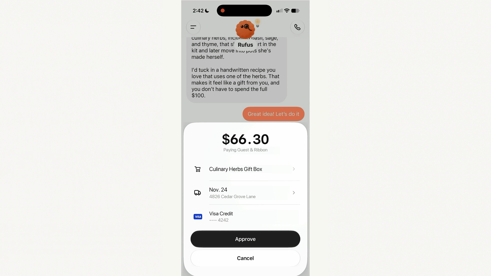

### 🎬 관련 영상
- [🎥 영상 보기](https://ph-files.imgix.net/ae541568-809e-4e86-8ad1-c36e2f980ef2.jpeg?auto=format)

---

## 8. [Cookie Away](https://www.producthunt.com/products/cookie-away)
**Votes**: 101 | **도입 난이도**: 하 | **신뢰도**: 상
**Tagline**: Rejects cookie banners for you, even the sneaky ones
**서비스 링크**: https://www.producthunt.com/r/4O7VFD3VX5PIIG

**태그**: Productivity, Browser Extension, Privacy, Automation

### 📌 이 서비스 한눈에 보기
번거로운 쿠키 배너를 자동으로 거부하여 웹 서핑의 흐름을 지켜주는 오픈소스 확장 프로그램

### 🔑 주요 기능
- 사용자를 대신해 쿠키 수락/거부 버튼을 자동으로 처리
- 거부 버튼이 없는 까다로운 사이트에서도 설정창을 열어 직접 비활성화
- 무료이며 투명한 오픈소스 기반의 크롬 확장 프로그램

### 🙋 사용자에게 어떤 점이 좋은가
웹사이트 방문 시마다 나타나는 쿠키 동의 팝업을 일일이 클릭할 필요 없이 쾌적한 브라우징 환경을 제공합니다.

### ✅ 지금 바로 써볼 기능
- 크롬 웹 스토어에서 확장 프로그램 설치하기
- 자동 거부 기능이 정상 작동하는지 주요 사이트에서 확인하기

### ⚠️ 사용 전 확인할 점
- 사이트 레이아웃에 따라 자동화 동작이 웹 페이지 표시를 방해할 수 있음
- 일부 사이트의 보안 정책이나 복잡한 설정 구조로 인해 거부가 실패할 수 있음

### 🧭 확인이 더 필요한 정보
특정 사이트에서 설정창을 열어 수동으로 스위치를 조작하는 방식이 사용자 경험에 미칠 영향을 확인해야 합니다.

### 📸 스크린샷 및 갤러리
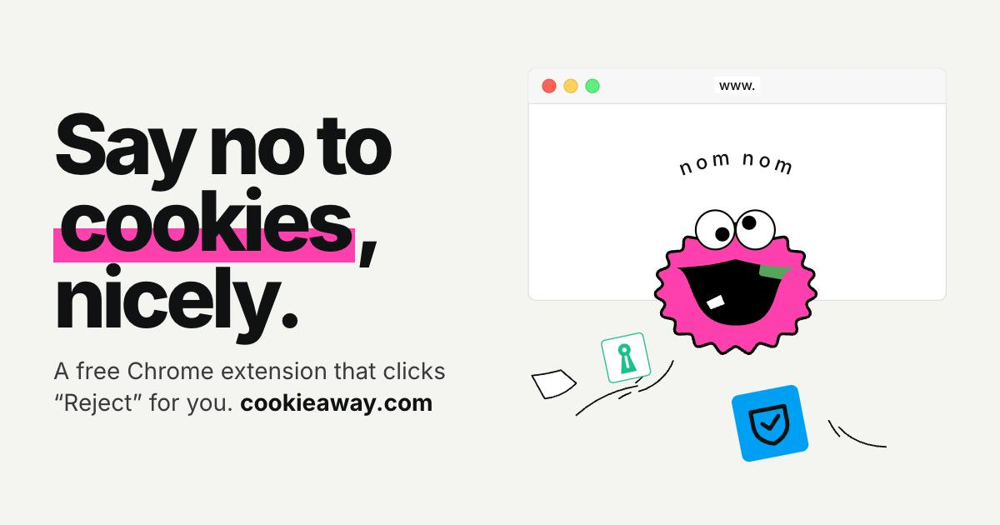
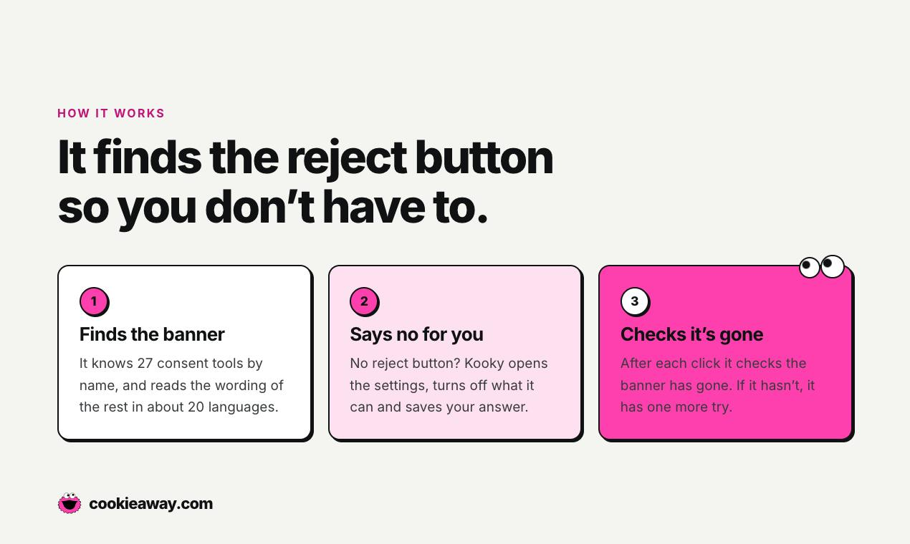
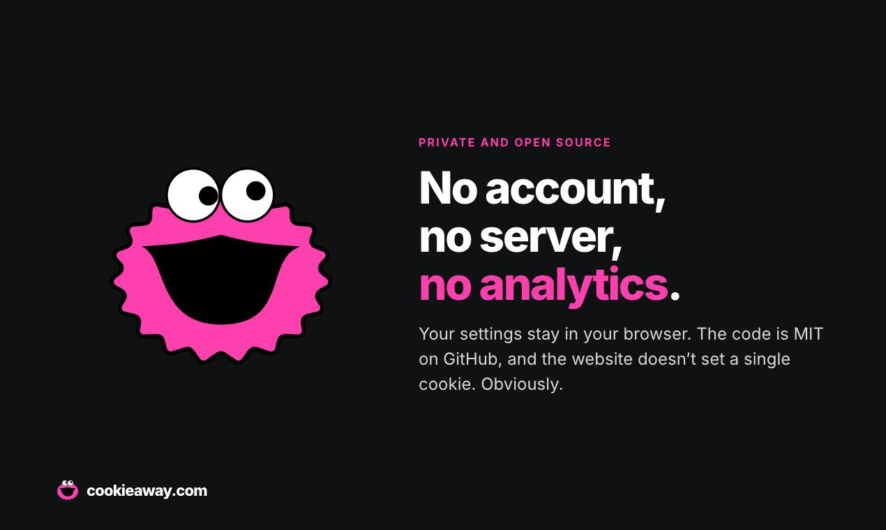

### 🎬 관련 영상
- [🎥 영상 보기](https://ph-files.imgix.net/d2947f1a-c374-4272-871a-ee17d3bed789.jpeg?auto=format)

---

## 9. [Pharen Hub](https://www.producthunt.com/products/pharen-hub)
**Votes**: 88 | **도입 난이도**: 중 | **신뢰도**: 상
**Tagline**: One AI workspace for your whole company
**서비스 링크**: https://www.producthunt.com/r/6B3J75VNZS7YOK

**태그**: AI, Productivity, Collaboration, OpenSource, Security, Agent, AI Tool, DevTool

### 📌 이 서비스 한눈에 보기
모든 업무 데이터와 AI 에이전트를 하나의 맥락으로 통합하는 기업용 AI 워크스페이스

### 🔑 주요 기능
- 프로젝트, 문서, 메일, 미팅 등 모든 업무 요소를 하나의 공유 컨텍스트로 통합
- 명확한 목표와 승인 절차를 갖춘 안전한 AI 에이전트 기능 제공
- EU 호스팅 및 자체 서버 설치 지원으로 강력한 데이터 보안 및 오픈소스(Fair-code) 기반 운영

### 🙋 사용자에게 어떤 점이 좋은가
파편화된 업무 도구들을 하나로 모아 데이터 유실 없이 AI의 도움을 받을 수 있으며, 보안이 중요한 기업 환경에 적합합니다.

### ✅ 지금 바로 써볼 기능
- 기존 문서와 프로젝트 데이터를 업로드하여 공유 컨텍스트 구축하기
- 업무 자동화를 위한 AI 에이전트 설정 및 승인 워크플로우 테스트하기
- 무료 플랜을 통해 팀 규모에 맞는 기능 검토하기

### ⚠️ 사용 전 확인할 점
- 모든 업무 데이터를 한 곳에 모으는 방식이므로 초기 데이터 마이그레이션 비용이 발생할 수 있음
- 에이전트의 자동화 수준에 따른 인간의 검토 작업 필요성

### 🧭 확인이 더 필요한 정보
기업 규모에 따른 구체적인 유료 플랜의 기능 차이와 상세 비용 구조 확인이 필요합니다.

### 📸 스크린샷 및 갤러리
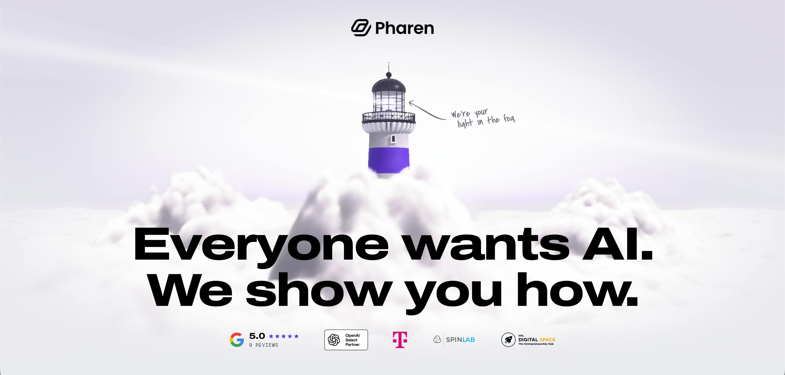
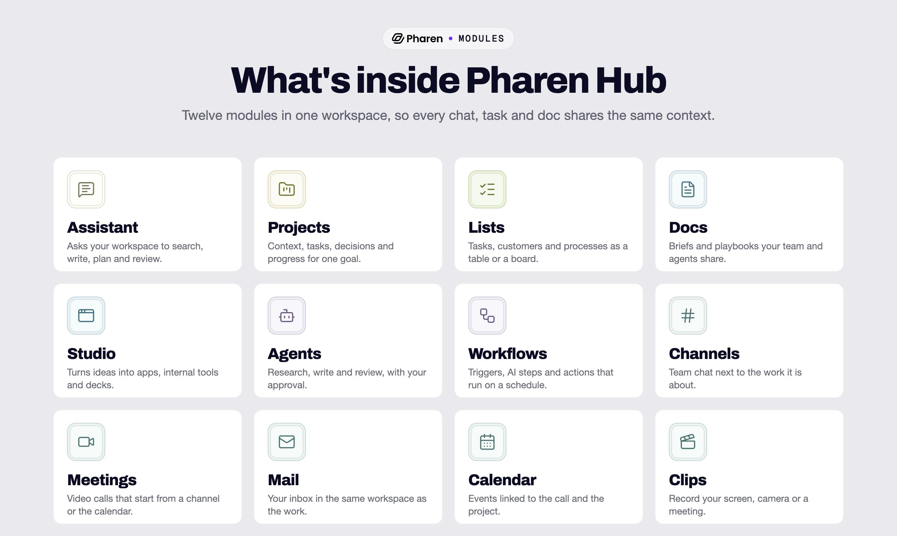
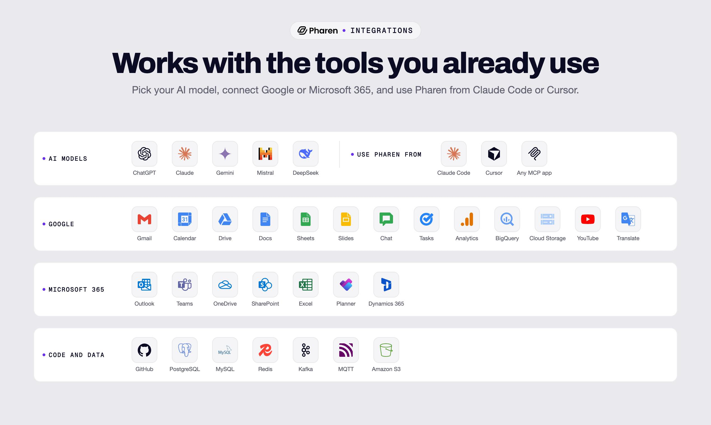

### 🎬 관련 영상
- [🎥 영상 보기](https://ph-files.imgix.net/a0c2bf4f-a062-44d4-aa47-909309996bc2.jpeg?auto=format)

---

## 10. [StateWeave](https://www.producthunt.com/products/stateweave)
**Votes**: 87 | **도입 난이도**: 중 | **신뢰도**: 상
**Tagline**: Test your AI agent on working clones of the apps it uses
**서비스 링크**: https://www.producthunt.com/r/BX7KYDPFK5GVAM

**태그**: AI-Agent, Testing, DevOps, Automation, Agent, AI Tool, API, Sales

### 📌 이 서비스 한눈에 보기
실제 앱 환경과 동일한 샌드박스에서 AI 에이전트의 성능을 테스트하는 도구

### 🔑 주요 기능
- Slack, Salesforce, Gmail 등 주요 앱의 상태가 유지되는 클론 환경 제공
- 시나리오 기반의 데이터 자동 생성 및 네트워크 장애(401, Outage) 등 결함 주입 기능
- 실행 결과에 대한 정밀한 그레이딩 및 실패 원인 분석 제공

### 🙋 사용자에게 어떤 점이 좋은가
AI 에이전트를 실제 운영 환경에 배포하기 전, 다양한 변수와 오류 상황에서도 안정적으로 작동하는지 안전하게 검증할 수 있습니다.

### ✅ 지금 바로 써볼 기능
- 사용 중인 주요 SaaS 앱의 클론 환경 생성해보기
- 의도적인 오류 상황을 설정하여 에이전트의 예외 처리 능력 테스트하기
- 시나리오별 데이터 일관성 및 API 호출 로그 확인하기

### ⚠️ 사용 전 확인할 점
- 제공되는 앱 리스트 외의 서비스에 대한 지원 여부 확인 필요
- 샌드박스 환경과 실제 운영 환경 간의 미세한 차이 가능성

### 🧭 확인이 더 필요한 정보
지원되는 모든 SaaS 앱의 API 및 UI 복제 수준이 실제 환경과 얼마나 완벽하게 일치하는지 확인이 필요합니다.

### 📸 스크린샷 및 갤러리
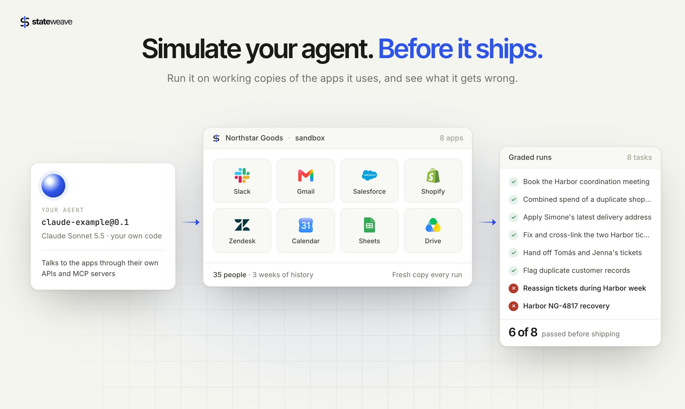
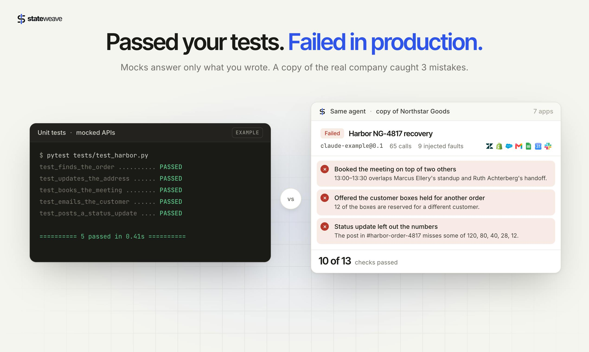
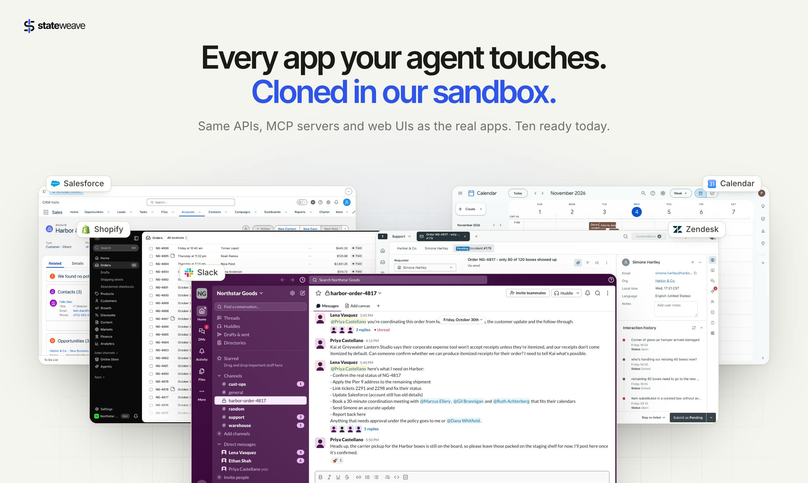

### 🎬 관련 영상
- [🎥 영상 보기](https://ph-files.imgix.net/mcp-draft-media/090bfbcd-31a5-4742-8dae-4c784364aaa9.jpeg?auto=format)

---

## 11. [Trusty CSV](https://www.producthunt.com/products/trusty-csv)
**Votes**: 86 | **도입 난이도**: 하 | **신뢰도**: 상
**Tagline**: Edit CSV files like code, not like a spreadsheet
**서비스 링크**: https://www.producthunt.com/r/7H2YKH2SWT6KCP

**태그**: DevTool, DataPrep, CSV, Productivity

### 📌 이 서비스 한눈에 보기
복잡한 스크립트 없이 코드처럼 직관적으로 CSV 파일을 편집하는 데이터 전처리 도구

### 🔑 주요 기능
- 스프레드시트 형식을 넘어선 코드 스타일의 데이터 편집 방식
- 클러스터링, 피벗, 조인, 필터링 등 강력한 데이터 조작 기능 제공
- 모든 작업 단계에 대한 Ctrl+Z 지원 및 변경 사항만 보여주는 Diff 기능

### 🙋 사용자에게 어떤 점이 좋은가
데이터 분석이나 개발 과정에서 발생하는 번거로운 CSV 전처리 작업을 코드 작성 없이 빠르고 안전하게 처리할 수 있습니다.

### ✅ 지금 바로 써볼 기능
- CSV 파일을 열어 클러스터링 및 조인 기능 테스트하기
- 직접 셀 값을 수정하며 Diff 기능으로 변경 사항 확인하기

### ⚠️ 사용 전 확인할 점
- 대용량 파일 처리 시 성능 및 안정성 확인 필요
- 스프레드시트 소프트웨어와 다른 편집 방식에 대한 적응 필요

### 🧭 확인이 더 필요한 정보
파일 저장 방식 및 로컬/클라우드 환경 지원 여부에 대한 상세 정보가 필요합니다.

### 📸 스크린샷 및 갤러리
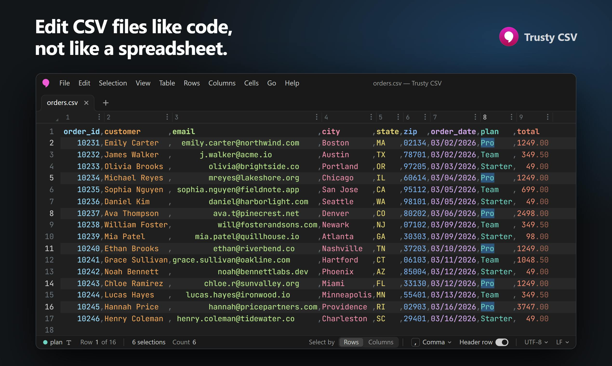
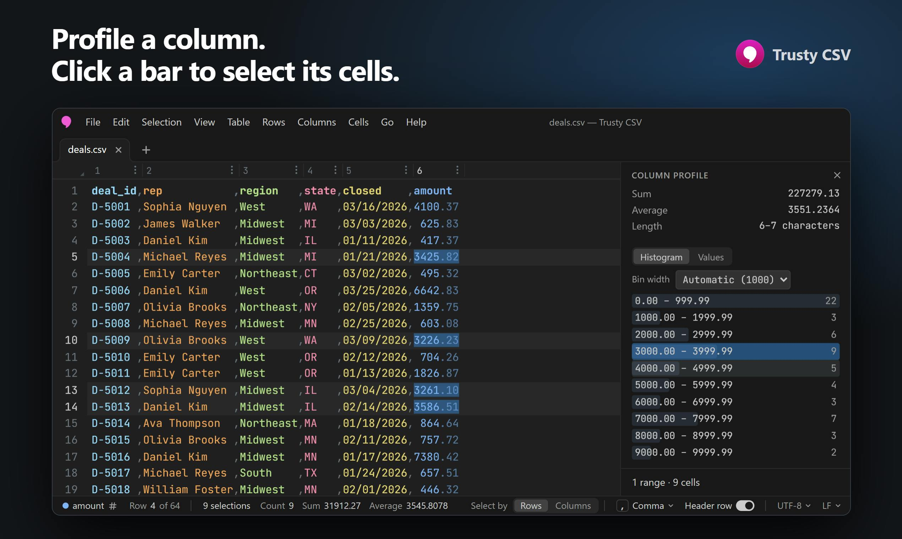
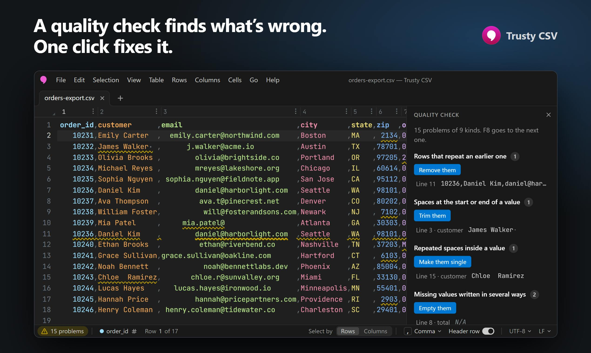

---

## 12. [Curates](https://www.producthunt.com/products/curates)
**Votes**: 84 | **도입 난이도**: 하 | **신뢰도**: 상
**Tagline**: The all-in-one platform for creators
**서비스 링크**: https://www.producthunt.com/r/OT7EABHATYLWGE

**태그**: Creative, Portfolio, Collaboration, Workflow

### 📌 이 서비스 한눈에 보기
창작자를 위한 작업물 관리, 공유 및 포트폴리오 구축 올인원 플랫폼

### 🔑 주요 기능
- 클라이언트 피드백 및 승인 프로세스 간소화
- 재업로드 없는 간편한 포트폴리오 웹사이트 연동
- 프로젝트별 프라이빗 쇼케이스 구축 기능

### 🙋 사용자에게 어떤 점이 좋은가
작업물 관리부터 클라이언트 검토, 포트폴리오 업데이트까지의 워크플로우를 하나로 통합하여 작업 효율을 높여줍니다.

### ✅ 지금 바로 써볼 기능
- 클라이언트용 리뷰 링크 생성 및 피드백 받기
- 기존 사진을 포트폴리오 웹사이트에 두 번의 클릭으로 추가하기
- 프로젝트별 전용 프라이빗 쇼케이스 만들기

### ⚠️ 사용 전 확인할 점
- 외부 웹사이트와의 구체적인 연동 방식 및 호환성 확인 필요
- 파일 저장 용량 및 클라이언트 공유 권한 설정 범위 확인 필요

### 🧭 확인이 더 필요한 정보
제공되는 포트폴리오 웹사이트의 커스텀 기능과 파일 저장 용량 제한에 대한 정보가 부족합니다.

### 📸 스크린샷 및 갤러리
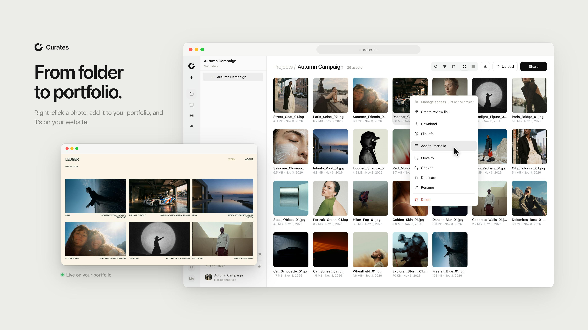

### 🎬 관련 영상
- [🎥 영상 보기](https://ph-files.imgix.net/031ed406-39b2-4001-a008-0db8a2533050.jpeg?auto=format)

---

## 13. [Puffin](https://www.producthunt.com/products/puffin-2)
**Votes**: 83 | **도입 난이도**: 중 | **신뢰도**: 상
**Tagline**: Identity and inboxes for AI agents
**서비스 링크**: https://www.producthunt.com/r/T3J5QCU74BU545

**태그**: AI, Automation, Productivity, Communication, Agent, AI Tool, Email

### 📌 이 서비스 한눈에 보기
AI 에이전트에게 고유한 신원과 커뮤니케이션 채널을 부여하는 자동화 도구

### 🔑 주요 기능
- AI 에이전트 전용 이메일, 디스코드, 슬랙, 텔레그램 계정 제공
- 내장 AI 또는 사용자 정의 에이전트를 통한 자동 답장 기능
- 사용자 승인 모드 또는 완전 자율 주행 모드 선택 가능

### 🙋 사용자에게 어떤 점이 좋은가
AI 에이전트가 인간처럼 소통할 수 있는 독립적인 신원을 갖게 되어, 복잡한 협업 및 커뮤니케이션 업무를 자동화할 수 있습니다.

### ✅ 지금 바로 써볼 기능
- 에이전트용 이메일 및 메신저 계정 생성하기
- 메시지 응답 방식(승인형 vs 자율형) 설정하기
- 기존 워크플로우에 에이전트 연결하기

### ⚠️ 사용 전 확인할 점
- 자율 모드 사용 시 의도치 않은 메시지 발송 위험
- 에이전트의 신원 관리 및 보안 책임 문제

### 🧭 확인이 더 필요한 정보
사용자 정의 에이전트와 외부 툴 간의 구체적인 연동 방식 및 보안 수준에 대한 정보가 필요합니다.

### 📸 스크린샷 및 갤러리
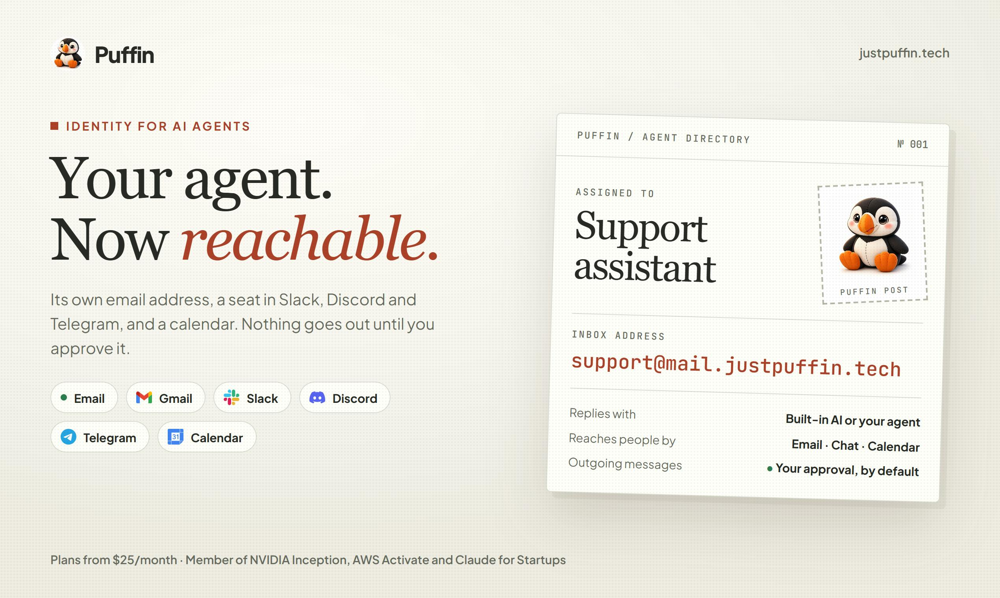
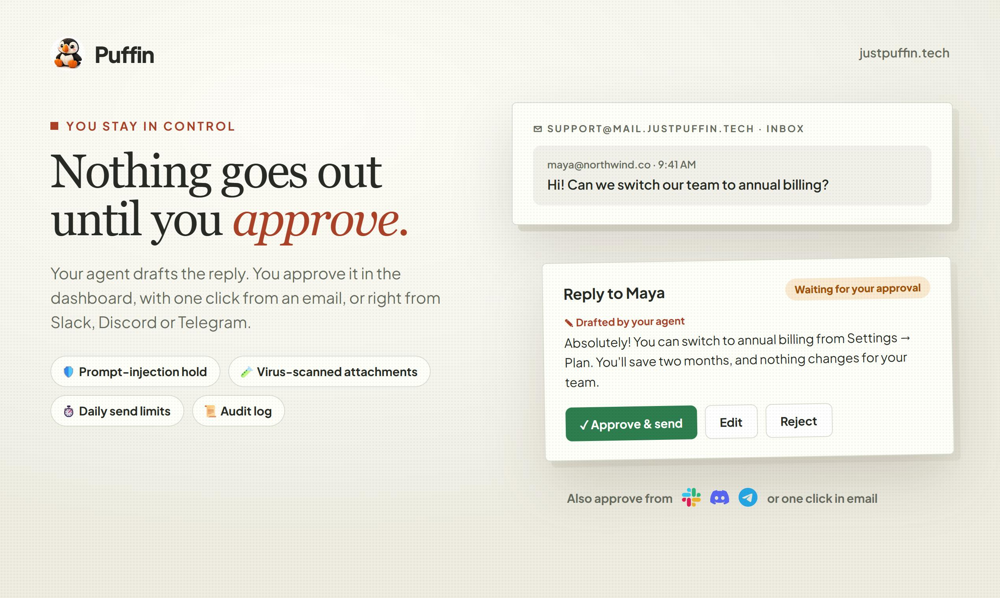
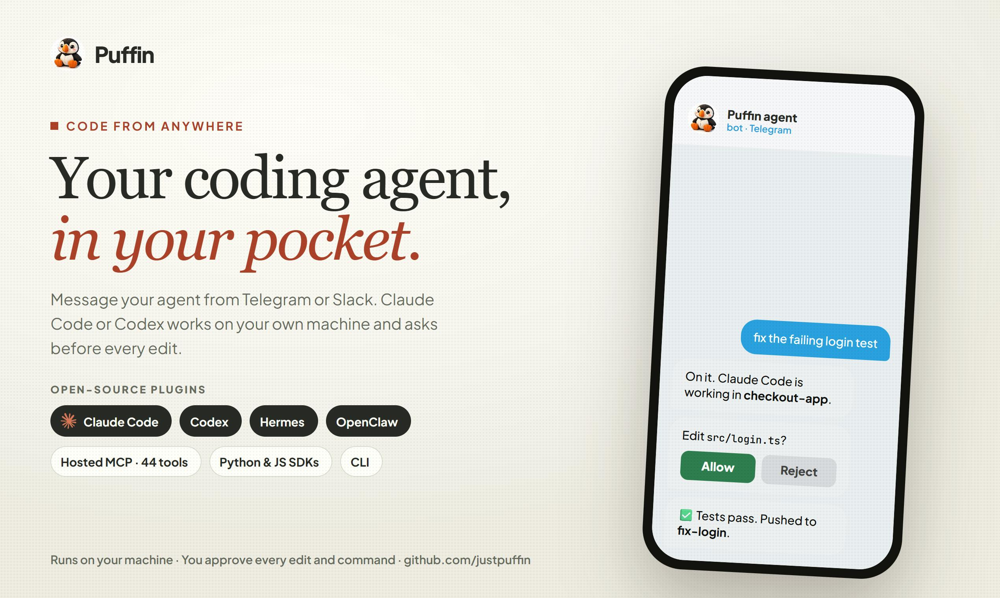

### 🎬 관련 영상
- [🎥 영상 보기](https://ph-files.imgix.net/9e658ae2-5f26-477c-b467-e0f30ef3c385.jpeg?auto=format)

---

## 14. [ByteVoice](https://www.producthunt.com/products/bytevoice)
**Votes**: 81 | **도입 난이도**: 하 | **신뢰도**: 상
**Tagline**: Talk to your coding agents and hear them back
**서비스 링크**: https://www.producthunt.com/r/PX5N57QFL6GGIL

**태그**: DevTool, AI, Voice-to-Code, Productivity, Agent

### 📌 이 서비스 한눈에 보기
코딩 에이전트와 타이핑 대신 음성으로 대화하는 개발 생산성 도구

### 🔑 주요 기능
- Claude Code, Cursor 등 주요 코딩 에이전트와 음성 상호작용 지원
- 텍스트 입력 대신 말로 명령하고 에이전트의 요약을 음성으로 청취
- 대화형 인터페이스를 통한 직관적인 에이전트 제어

### 🙋 사용자에게 어떤 점이 좋은가
키보드 타이핑 시간을 줄이고, 손을 자유롭게 유지하면서 코딩 에이전트와 실시간으로 소통할 수 있습니다.

### ✅ 지금 바로 써볼 기능
- 주로 사용하는 IDE/에이전트 환경에 연결하기
- 음성 명령을 통한 코드 수정 및 요약 기능 테스트하기
- 음성 응답 속도 및 정확도 확인하기

### ⚠️ 사용 전 확인할 점
- 음성 인식 정확도에 따른 명령 오작동 가능성
- 주변 소음이 있는 환경에서의 사용 제약

### 🧭 확인이 더 필요한 정보
지원하는 에이전트 플랫폼의 구체적인 설치 방법과 보안 정책에 대한 정보가 필요합니다.

### 📸 스크린샷 및 갤러리
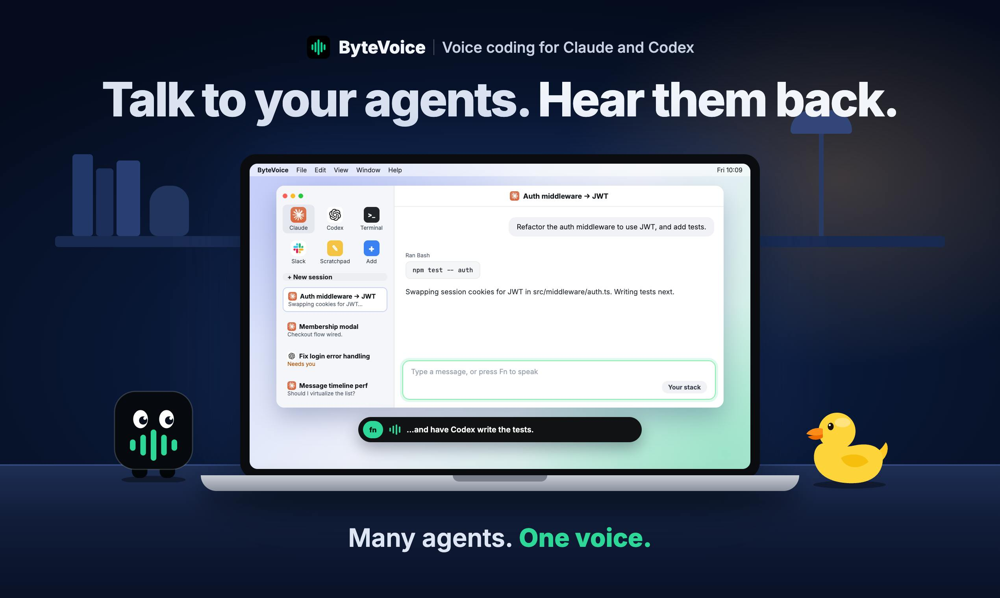
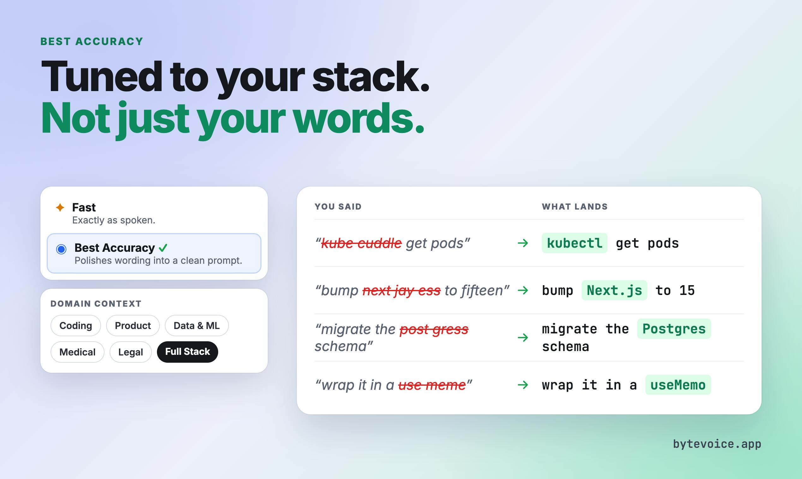
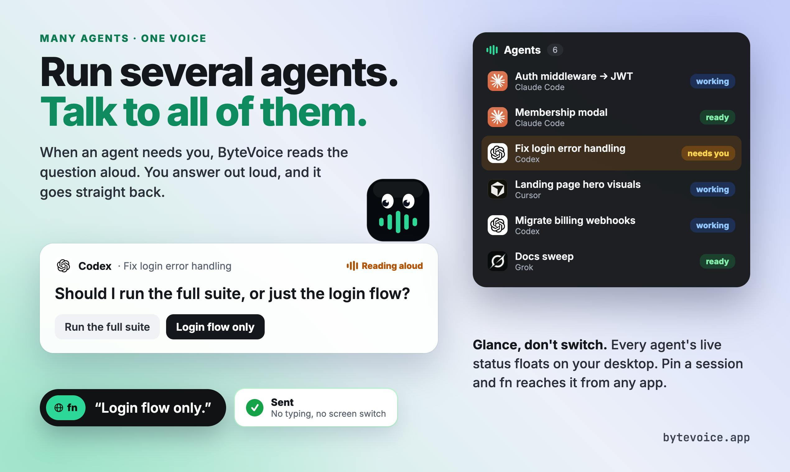

### 🎬 관련 영상
- [🎥 영상 보기](https://ph-files.imgix.net/52c4b56f-ad94-4231-b24f-858d96d46683.jpeg?auto=format)

---

## 15. [Flamigo](https://www.producthunt.com/products/flamigo)
**Votes**: 80 | **도입 난이도**: 하 | **신뢰도**: 상
**Tagline**: Turn rough notes into beautifully designed slides
**서비스 링크**: https://www.producthunt.com/r/IDUB7DOUKMNMT7

**태그**: AI, Productivity, Design, Presentation

### 📌 이 서비스 한눈에 보기
메모를 입력하면 자동으로 디자인된 슬라이드를 생성해주는 AI 프레젠테이션 도구

### 🔑 주요 기능
- 텍스트 노트를 기반으로 슬라이드 개요 및 디자인 자동 생성
- 여러 디자인 시안 비교 및 에디터를 통한 레이아웃 미세 조정 가능
- HTML 내보내기 지원 및 Pro 플랜을 통한 편집 가능한 PowerPoint 내보내기

### 🙋 사용자에게 어떤 점이 좋은가
초안 작성과 디자인 작업에 드는 시간을 획기적으로 줄여주며, 텍스트만으로 전문적인 슬라이드를 빠르게 만들 수 있습니다.

### ✅ 지금 바로 써볼 기능
- 메모를 붙여넣어 자동 생성된 개요 검토하기
- 제공되는 디자인 시안 중 최적의 레이아웃 선택하기
- Pro 플랜을 통해 편집 가능한 PPT 파일로 내보내기

### ⚠️ 사용 전 확인할 점
- 무료 버전에서는 PowerPoint 내보내기 기능이 제한될 수 있음
- 복잡한 데이터 시각화나 정교한 커스텀 디자인에는 한계가 있을 수 있음

### 🧭 확인이 더 필요한 정보
Pro 플랜의 정확한 가격 정책과 편집 가능한 텍�의 호환성 수준을 확인해야 합니다.

### 📸 스크린샷 및 갤러리

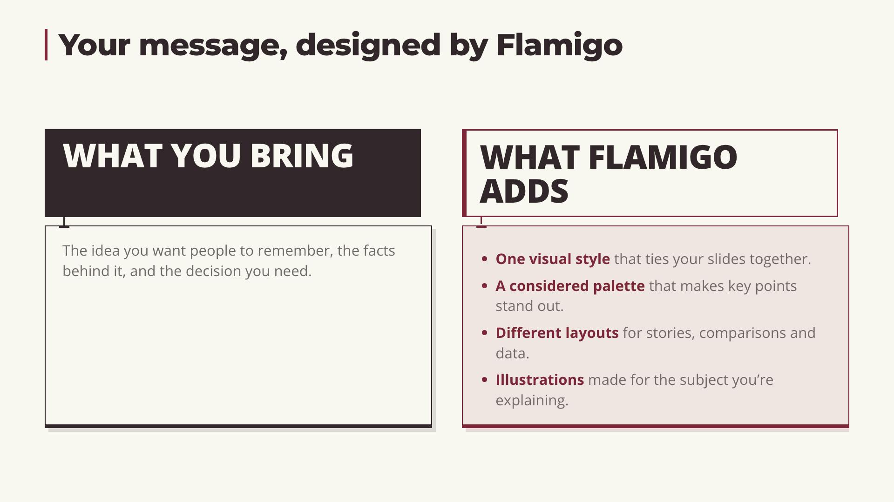

---

## 16. [Blomma for Organizations](https://www.producthunt.com/products/blomma)
**Votes**: 77 | **도입 난이도**: 중 | **신뢰도**: 상
**Tagline**: Scale your people at the speed of your business
**서비스 링크**: https://www.producthunt.com/r/RIGANSR4AL7TDG

**태그**: HRTech, AI Coaching, Productivity, Management, AI Tool

### 📌 이 서비스 한눈에 보기
기업의 가치와 목표에 맞춘 AI 커리어 코칭으로 조직의 성장을 가속화합니다.

### 🔑 주요 기능
- 기업의 핵심 가치, 역량, OKR에 기반한 맞춤형 AI 코칭 제공
- 1:1 면담 준비, 피드백, 성과 리뷰 및 온보딩 지원
- 개인 프라이버시를 보장하며 관리자에게는 집계된 인사이트만 제공

### 🙋 사용자에게 어떤 점이 좋은가
HR 팀의 업무 부담을 줄이면서도 모든 구성원이 개인화된 커리어 코칭을 받을 수 있어 조직 규모 확장이 용이해집니다.

### ✅ 지금 바로 써볼 기능
- 기업의 핵심 가치 및 OKR 데이터 연동하기
- 1:1 면담 및 피드백 세션에 AI 코치 활용하기
- 목표 추적 및 책임감 부여 기능 설정하기

### ⚠️ 사용 전 확인할 점
- 개인 대화의 프라이버시 보호 수준과 관리자 대시보드 간의 데이터 분리 방식 확인 필요
- 기존 HR 시스템(HRIS)과의 연동 가능 여부 확인 필요

### 🧭 확인이 더 필요한 정보
기업의 기존 데이터(OKRs, 역량 모델 등)를 어떤 방식으로 안전하게 가져오는지에 대한 기술적 상세 정보가 필요합니다.

### 📸 스크린샷 및 갤러리
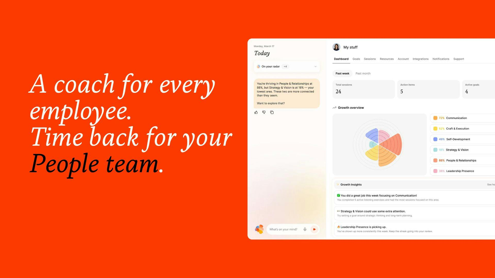
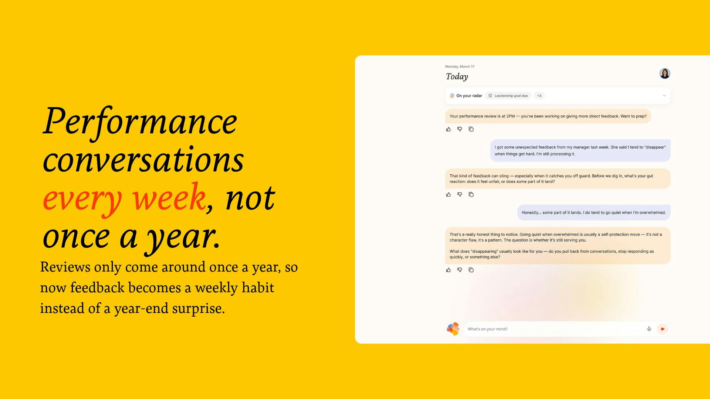
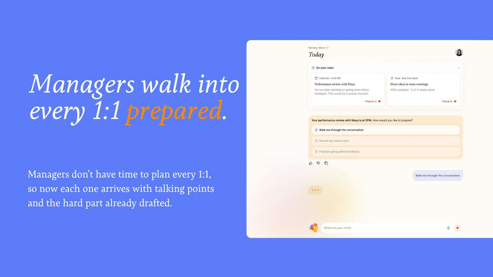

---

## 17. [UI SDK by Vercel](https://www.producthunt.com/products/ui-sdk)
**Votes**: 74 | **도입 난이도**: 중 | **신뢰도**: 상
**Tagline**: Give AI agents the building blocks to create UI
**서비스 링크**: https://www.producthunt.com/r/NMNBBNEKYGAWSD

**태그**: AI, UI/UX, Frontend, DevTool, Agent, AI Tool

### 📌 이 서비스 한눈에 보기
AI 에이전트가 직접 사용자 인터페이스를 구축할 수 있도록 돕는 프레임워크

### 🔑 주요 기능
- AI 에이전트를 위한 재사용 가능한 UI 빌딩 블록 제공
- React, Vue, Svelte, Solid, Web Components를 아우르는 단일 코어 라이브러리
- 접근성을 준수하는 커스텀 UI 컴포넌트 생성 지원

### 🙋 사용자에게 어떤 점이 좋은가
AI가 단순히 텍क을 생성하는 것을 넘어, 사용자가 직접 조작 가능한 고품질의 UI를 동적으로 생성할 수 있게 합니다.

### ✅ 지금 바로 써볼 기능
- 지원하는 프레임워크(React, Vue 등) 환경에 SDK 설치하기
- AI 에이전트가 UI를 생성하는 워크플로우 테스트하기
- 기존 프로젝트의 UI 컴포넌트와 호환성 확인하기

### ⚠️ 사용 전 확인할 점
- 프레임워크 간의 세부적인 렌더링 차이 및 호환성 확인 필요
- AI가 생성한 UI의 복잡도에 따른 성능 영향 검토

### 🧭 확인이 더 필요한 정보
다양한 프레임워크를 지원하지만, 각 프레임워크별 기능 구현의 완전한 동일성 여부는 확인이 필요합니다.

### 📸 스크린샷 및 갤러리
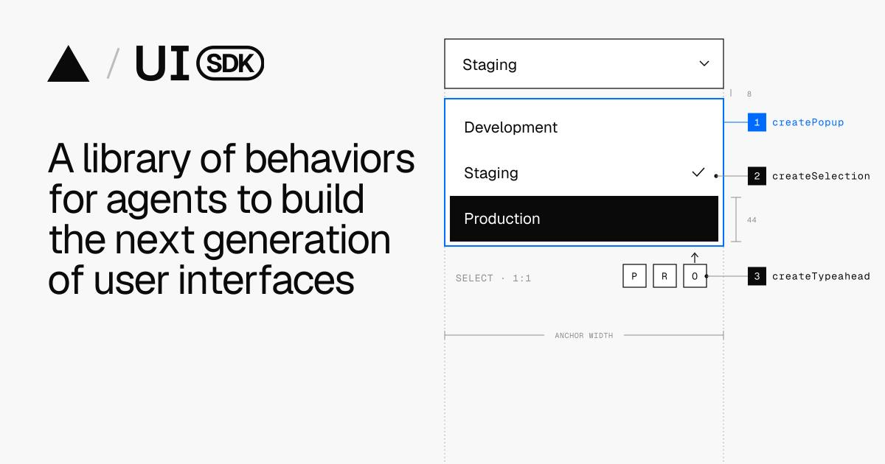
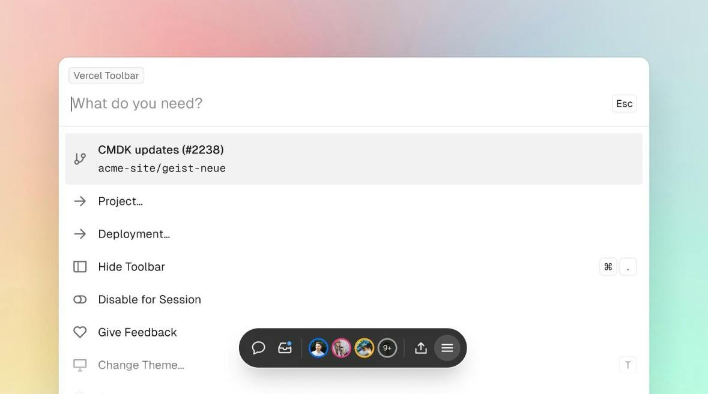

### 🎬 관련 영상
- [🎥 영상 보기](https://ph-files.imgix.net/47c5f91f-c50a-4af6-aa1d-5bc322ec42e5.jpeg?auto=format)

---

## 18. [Freebuff](https://www.producthunt.com/products/freebuff-2)
**Votes**: 73 | **도입 난이도**: 하 | **신뢰도**: 상
**Tagline**: The 100% free coding agent
**서비스 링크**: https://www.producthunt.com/r/5N473CHRNOQU4D

**태그**: DevTool, AI, Coding, Deployment, Free, Agent, AI Tool, Chat

### 📌 이 서비스 한눈에 보기
브라우저, 데스크톱, 터미널 어디서든 무료로 앱을 개발하고 배포할 수 있는 AI 코딩 에이전트

### 🔑 주요 기능
- 100% 무료로 제공되는 AI 코딩 에이전트
- 코드 작성부터 빌드, 배포까지 통합 워크플로우 지원
- 브라우저, 데스크톱, 터미널 등 다양한 작업 환경 지원

### 🙋 사용자에게 어떤 점이 좋은가
비용 부담 없이 아이디어를 즉시 앱으로 구현하고 배포할 수 있어 개인 개발자나 프로토타이핑이 필요한 사용자에게 매우 유용합니다.

### ✅ 지금 바로 써볼 기능
- 브라우저 환경에서 즉시 코드 생성해보기
- AI와 채팅하며 앱 빌드 프로세스 경험하기
- 터미널 환경에서 배포 기능 테스트하기

### ⚠️ 사용 전 확인할 점
- 무료 서비스이므로 향う 유료화 정책이나 사용량 제한 여부 확인 필요
- 복잡한 대규모 프로젝트에서의 성능 및 안정성 검증 필요

### 🧭 확인이 더 필요한 정보
제공되는 무료 플랜의 구체적인 사용량 제한이나 서버 인프라 포함 여부는 명시되지 않았습니다.

### 📸 스크린샷 및 갤러리
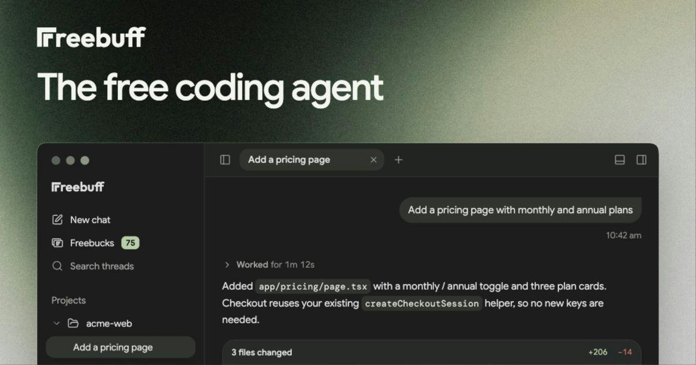
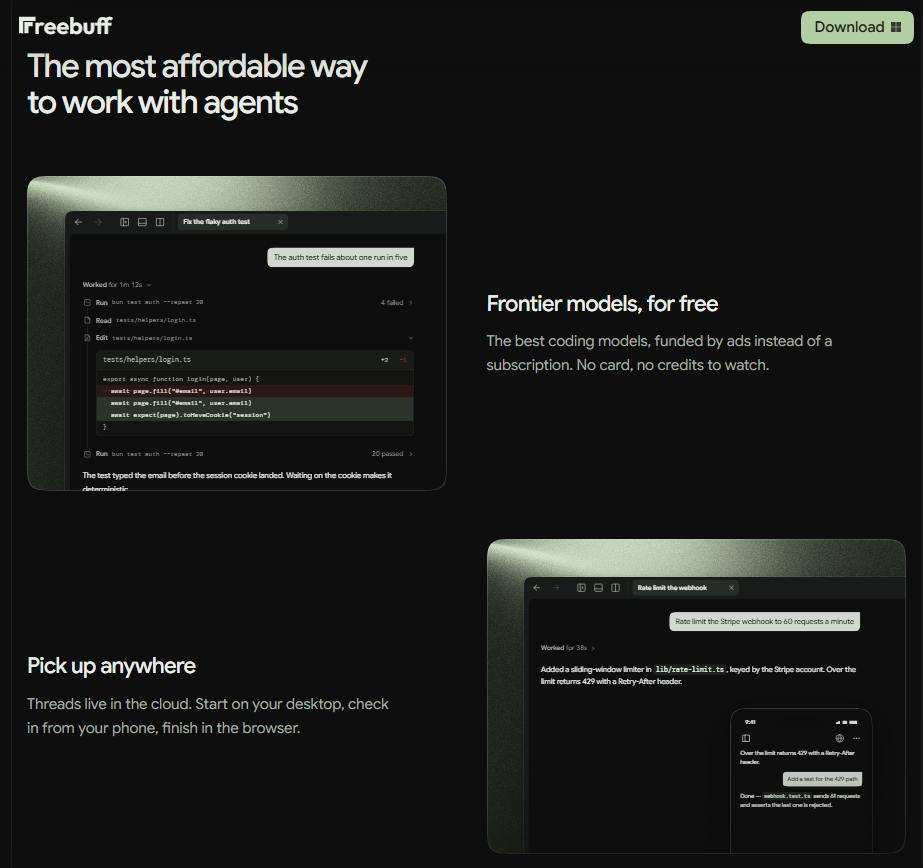
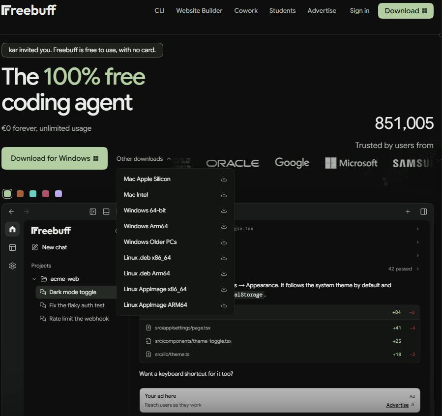

### 🎬 관련 영상
- [🎥 영상 보기](https://ph-files.imgix.net/36c50be5-8555-428c-9935-f9230d583a59.jpeg?auto=format)

---

## 19. [Punchcutter](https://www.producthunt.com/products/punchcutter)
**Votes**: 73 | **도입 난이도**: 중 | **신뢰도**: 상
**Tagline**: Turn a sentence or your handwriting into a real font family
**서비스 링크**: https://www.producthunt.com/r/2MBLFFDPZIMH7Q

**태그**: DesignTool, AI, Typography, OpenSource, Agent, Chat, DevTool

### 📌 이 서비스 한눈에 보기
문장이나 손글씨를 입력하여 전문적인 폰트 패밀리로 변환해주는 AI 도구

### 🔑 주요 기능
- 손글씨나 텍스트 설명을 기반으로 실제 폰트 생성
- TTF, OTF, 가변 폰트(Variable), 웹폰트 등 다양한 포맷 지원
- Claude, ChatGPT, Cursor 등에서 사용 가능한 AI 에이전트 스킬 및 MCP 서버 제공

### 🙋 사용자에게 어떤 점이 좋은가
자신의 손글씨를 디지털 폰트로 만들거나, 텍스트 설명만으로 독창적인 타이포그래피를 즉시 제작할 수 있습니다.

### ✅ 지금 바로 써볼 기능
- 자신의 손글씨를 촬영하여 폰트 변환 시도하기
- AI 에이전트(Claude, Cursor 등)에 MCP 서버로 연결하기
- 생성된 폰트를 Studio 앱에서 편집 및 활용하기

### ⚠️ 사용 전 확인할 점
- 손글씨의 복잡도에 따라 생성된 폰트의 품질이 달라질 수 있음
- AI 에이전트 환경 설정(MCP 서버)에 대한 기술적 이해 필요

### 🧭 확인이 더 필요한 정보
사용자의 손글씨 품질과 AI 모델의 해석 능력에 따른 최종 폰트 완성도를 확인해야 합니다.

### 📸 스크린샷 및 갤러리
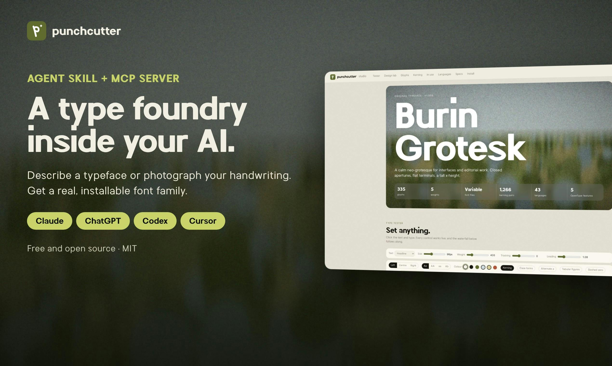
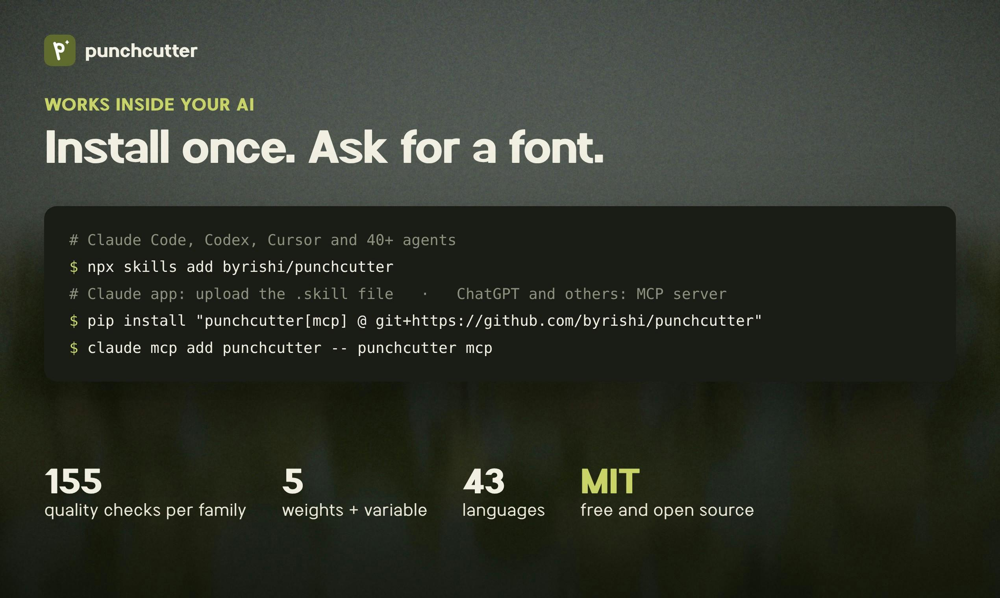
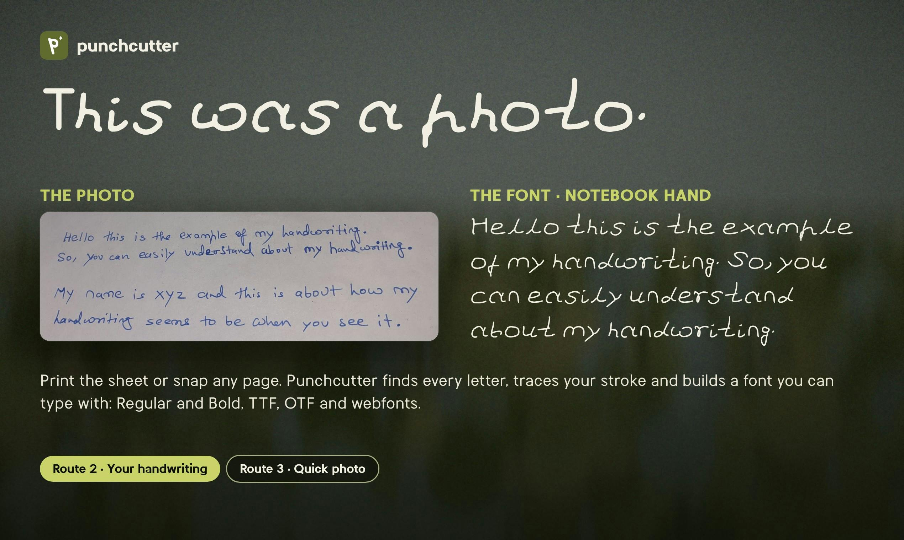

---

## 20. [Centralize](https://www.producthunt.com/products/centralize)
**Votes**: 72 | **도입 난이도**: 중 | **신뢰도**: 상
**Tagline**: Relationship Workspace for Enterprise Deal Teams
**서비스 링크**: https://www.producthunt.com/r/CQBSK45OO3BQAR

**태그**: SalesTech, CRM, AccountMapping, Enterprise

### 📌 이 서비스 한눈에 보기
기업용 딜 팀을 위한 자동화된 관계 매핑 및 영업 전략 워크스페이스

### 🔑 주요 기능
- 이해관계자 자동 매핑 및 구매 의사결정 구조 시각화
- 의사결정 위원회 내 공백(Gap) 식별
- 최적의 영업 경로(Warm paths) 발굴 및 다음 행동 추천

### 🙋 사용자에게 어떤 점이 좋은가
복잡한 기업 영업 과정에서 누구를 만나야 할지, 어떤 전략이 필요한지를 데이터 기반으로 명확하게 제시해 줍니다.

### ✅ 지금 바로 써볼 기능
- 현재 진행 중인 딜의 이해관계자 맵 생성
- 의사결정권자 공백 확인
- 추천된 다음 행동(Next actions) 실행

### ⚠️ 사용 전 확인할 점
- 데이터 소스(CRM 등)와의 연동 수준에 따라 자동화 효율이 달라질 수 있음
- 기업 내부의 실제 인적 네트워크 데이터 확보 필요성

### 🧭 확인이 더 필요한 정보
기존 CRM 시스템과의 자동 동기화 범위 및 데이터 보안 정책에 대한 확인이 필요합니다.

### 📸 스크린샷 및 갤러리
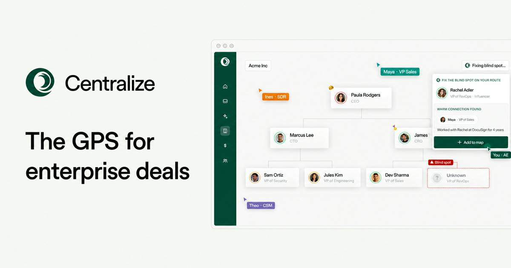

### 🎬 관련 영상
- [🎥 영상 보기](https://ph-files.imgix.net/2e2f5596-3d2f-4f14-9067-3bf6bf944748.jpeg?auto=format)

---

## 21. [Fluid](https://www.producthunt.com/products/kugelaudio)
**Votes**: 72 | **도입 난이도**: 중 | **신뢰도**: 상
**Tagline**: speech-to-speech built to solve problems
**서비스 링크**: https://www.producthunt.com/r/KFKVRI6UD237CK

**태그**: AI, Speech-to-Speech, Automation, CustomerSupport, AI Tool

### 📌 이 서비스 한눈에 보기
다국어 지원과 높은 문제 해결 능력을 갖춘 차세대 음성 대화형 AI 모델

### 🔑 주요 기능
- 24개 이상의 언어와 52개 방언을 지원하는 고도화된 음성 모델
- τ²-bench 기준 84%의 높은 고객 지원 작업 해결 능력
- 사용자 선택에 따른 프론티어 모델 위임 및 OpenAI Live Protocol 호환

### 🙋 사용자에게 어떤 점이 좋은가
사람처럼 자연스러운 대화가 가능하여 고객 지원 자동화나 복잡한 음성 기반 업무를 효율적으로 처리할 수 있습니다.

### ✅ 지금 바로 써볼 기능
- 다국어/방언 지원 성능 테스트
- 고객 지원 업무 자동화 적용 가능성 검토
- OpenAI Live Protocol 연동 테스트

### ⚠️ 사용 전 확인할 점
- 특정 도메인(지원 업무 외)에서의 문제 해결 성능 확인 필요
- 외부 모델 위임 시 발생할 수 있는 지연 시간 및 비용 구조 확인

### 🧭 확인이 더 필요한 정보
사용자가 선택하는 프론티어 모델과의 연동 방식 및 구체적인 API 비용 체계에 대한 정보가 부족합니다.

### 📸 스크린샷 및 갤러리

### 🎬 관련 영상
- [🎥 영상 보기](https://ph-files.imgix.net/ad879896-9cc8-4649-8404-a58510eee252.jpeg?auto=format)

---

## 22. [Findy](https://www.producthunt.com/products/findy-3)
**Votes**: 71 | **도입 난이도**: 하 | **신뢰도**: 상
**Tagline**: Find Files on Your Mac by what you remember
**서비스 링크**: https://www.producthunt.com/r/INIFSUYMKFXSQ7

**태그**: Productivity, Mac, Search, FileManagement, AI Tool, Video, Vision

### 📌 이 서비스 한눈에 보기
일상적인 언어로 맥(Mac) 내 파일을 쉽고 빠르게 찾는 지능형 검색 앱

### 🔑 주요 기능
- 자연어 검색 지원 (예: '지난주 지메일에서 온 PDF')
- 파일 속성 및 내용 기반 검색 (용량, 장소, 이미지 내 텍스트 등)
- 로컬 기반 개인정보 보호 (모든 데이터는 Mac 내에 유지)

### 🙋 사용자에게 어떤 점이 좋은가
복잡한 파일 경로를 기억할 필요 없이, 기억나는 특징만 입력하여 원하는 파일을 즉시 찾을 수 있습니다.

### ✅ 지금 바로 써볼 기능
- 자연어 검색 기능 테스트하기
- 이미지 및 PDF 내 텍스트 검색 확인하기
- 대용량 파일 필터링 기능 사용해보기

### ⚠️ 사용 전 확인할 점
- Mac 전용 앱이므로 다른 OS에서는 사용 불가
- 로컬 인덱싱 과정에서 시스템 리소스 사용량 확인 필요

### 🧭 확인이 더 필요한 정보
상세한 시스템 리소스 점유율 및 인덱싱 속도에 대한 정보는 제공되지 않았습니다.

### 📸 스크린샷 및 갤러리

### 🎬 관련 영상
- [🎥 영상 보기](https://ph-files.imgix.net/d7be4868-b716-46af-ba6b-b5c461a6c645.jpeg?auto=format)

---

## 23. [Glifa](https://www.producthunt.com/products/glifa)
**Votes**: 70 | **도입 난이도**: 하 | **신뢰도**: 상
**Tagline**: The Markdown editor for Mac you can ask for anything
**서비스 링크**: https://www.producthunt.com/r/VGIHAOTGMJHGXW

**태그**: Productivity, Markdown, AI, Mac, Writing, AI Tool, DevTool

### 📌 이 서비스 한눈에 보기
AI가 문서 내부에 내장되어 자연스러운 글쓰기와 편집을 돕는 Mac 전용 마크다운 에디터

### 🔑 주요 기능
- 문서 내 텍text 선택 후 단축키(⇧⌘R)로 즉시 AI 명령 수행 가능
- Claude Code, Apple Intelligence, 로컬 모델 등 다양한 AI 모델 연동 지원
- 라이브 프리뷰, 수식, Mermaid 차트, Obsidian 볼트 호환 등 강력한 편집 기능

### 🙋 사용자에게 어떤 점이 좋은가
문서 작성 중 창을 전환할 필요 없이 AI에게 즉각적인 편집을 요청할 수 있어 작업 흐름이 끊기지 않습니다.

### ✅ 지금 바로 써볼 기능
- 텍스트 선택 후 ⇧⌘R 단축키로 스타일 변경해보기
- 노트 내용을 표(Table) 형식으로 변환 요청하기
- 자신의 API 키를 연결하여 선호하는 AI 모델 사용하기

### ⚠️ 사용 전 확인할 점
- 15일 무료 체험 기간 이후 유료 플랜 전환 필요
- 사용하는 AI 모델(Claude, Codex 등)에 따라 추가 비용이 발생할 수 있음

### 🧭 확인이 더 필요한 정보
사용자의 API 키를 사용할 경우 모델별 비용 발생 구조를 사전에 확인해야 합니다.

### 📸 스크린샷 및 갤러리

### 🎬 관련 영상
- [🎥 영상 보기](https://ph-files.imgix.net/f5471841-5e11-4ea2-b440-c3f9854ecdc4.jpeg?auto=format)

---

## 24. [Docsy](https://www.producthunt.com/products/docsy-4)
**Votes**: 70 | **도입 난이도**: 중 | **신뢰도**: 상
**Tagline**: Open source docs for humans and coding agents
**서비스 링크**: https://www.producthunt.com/r/GRQVINWCK6Q6AT

**태그**: DevTool, Documentation, OpenSource, AI-Ready, Agent, AI Tool, API

### 📌 이 서비스 한눈에 보기
Markdown과 OpenAPI를 기반으로 인간과 AI 에이전트 모두를 위한 아름다운 문서를 구축하는 오픈소스 도구

### 🔑 주요 기능
- Markdown, OpenAPI, SDK 문서를 활용한 아름다운 문서 생성
- YAML 설정을 통한 자유로운 커스터마이징 및 셀프 호스팅 지원
- 코딩 에이전트가 구조화된 컨텍스트를 통해 문서를 유지보수할 수 있는 환경 제공

### 🙋 사용자에게 어떤 점이 좋은가
문서 작성부터 배포까지 자동화할 수 있으며, 특히 AI 코딩 에이전트가 문서를 읽고 수정하기 용이한 구조를 제공하여 문서 관리 효율을 극대화합니다.

### ✅ 지금 바로 써볼 기능
- Markdown 파일을 활용한 기본 문서 레이아웃 구성하기
- OpenAPI 스펙을 연동하여 API 문서 자동 생성하기
- YAML 설정을 통해 브랜드에 맞는 커스텀 테마 적용하기

### ⚠️ 사용 전 확인할 점
- 셀프 호스팅 시 서버 관리 및 보안 설정 필요
- AI 에이전트 활용 시 생성된 PR의 검토 프로세스 필요

### 🧭 확인이 더 필요한 정보
사용자 정의 테마의 복잡도와 특정 프레임워크와의 호환성 수준은 상세 문서 확인이 필요합니다.

### 📸 스크린샷 및 갤러리

### 🎬 관련 영상
- [🎥 영상 보기](https://ph-files.imgix.net/27884c1d-25f3-44f2-ae65-48694aedebca.jpeg?auto=format)

---

## 25. [Newsology](https://www.producthunt.com/products/newsology)
**Votes**: 69 | **도입 난이도**: 하 | **신뢰도**: 상
**Tagline**: Follow news as it develops and see how every side tells it.
**서비스 링크**: https://www.producthunt.com/r/LHX2AWYIPXYDYU

**태그**: News, Media, Analysis, Information

### 📌 이 서비스 한눈에 보기
다양한 언론사의 보도를 한눈에 비교하여 뉴스 편향성을 파악하는 뉴스 큐레이션 서비스

### 🔑 주요 기능
- 여러 언론사의 보도를 나란히 배치하여 비교 분석 기능 제공
- 주요 뉴스 주제별 핵심 스토리를 한곳에 요약
- 언론사 소유 구조 및 각 기사의 편향성 분석(Bias Breakdown) 제공

### 🙋 사용자에게 어떤 점이 좋은가
뉴스를 소비할 때 발생할 수 있는 확증 편향을 방지하고, 동일한 사건을 바라보는 다양한 관점을 쉽고 빠르게 확인할 수 있습니다.

### ✅ 지금 바로 써볼 기능
- 관심 있는 뉴스 주제의 비교 기능 사용해보기
- 기사별 Bias Breakdown 분석 결과 확인하기
- 언론사 소유 구조 정보 탐색하기

### ⚠️ 사용 전 확인할 점
- 제공되는 편향성 분석 수치가 객관적 지표인지 검토 필요
- 무료 시작 후 유료 전환 시의 비용 정책 확인 필요

### 🧭 확인이 더 필요한 정보
무료 서비스의 상세 범위와 유료 플랜의 기능 차이에 대한 정보가 명시되지 않았습니다.

### 📸 스크린샷 및 갤러리

### 🎬 관련 영상
- [🎥 영상 보기](https://ph-files.imgix.net/c66cfe6b-2170-4408-8164-21a0c5338b6e.jpeg?auto=format)

---

## 26. [OffiAI](https://www.producthunt.com/products/offiai)
**Votes**: 69 | **도입 난이도**: 하 | **신뢰도**: 상
**Tagline**: Office, with its last two letters swapped for AI.
**서비스 링크**: https://www.producthunt.com/r/JZL5QUHSOVUQ2C

**태그**: Productivity, AI, MacApp, Visualization, DevTool, Agent, AI Tool, Analytics

### 📌 이 서비스 한눈에 보기
AI 작업 세션을 3D 사무실 공간으로 시각화하여 관리하는 Mac용 데스크탑 앱

### 🔑 주요 기능
- Claude, Gemini 등 AI 세션을 3D 사무실 데스크에 배치하는 시각적 인터페이스
- 리셉션(에이전트), 승인, 작업 검토 등 사무실 컨셉의 워크플로우 제공
- 계정 생성이나 데이터 분석이 필요 없는 프라이버시 중심의 로컬 앱

### 🙋 사용자에게 어떤 점이 좋은가
여러 AI 모델과의 대화 세션을 시각적으로 분리하여 관리할 수 있어, 작업 흐름을 직관적으로 파악하고 관리하기 좋습니다.

### ✅ 지금 바로 써볼 기능
- 3D 데스크 환경에 AI 세션 배치해보기
- 리셉션 및 에이전트 기능을 통한 작업 흐름 테스트
- 로컬 환경에서의 프라이버시 및 데이터 보안 확인

### ⚠️ 사용 전 확인할 점
- Mac 전용 앱이므로 macOS 환경에서만 사용 가능
- 시각적 인터페이스 중심이므로 텍스트 기반 작업 효율성에 미치는 영향 확인 필요

### 🧭 확인이 더 필요한 정보
제공되는 3D 환경이 단순 시각화 도구인지, 아니면 실제 AI API와 연동되어 동작하는지 확인이 필요합니다.

### 📸 스크린샷 및 갤러리

### 🎬 관련 영상
- [🎥 영상 보기](https://ph-files.imgix.net/35d17e82-ade9-4e79-975a-14a93b425bd1.jpeg?auto=format)

---

## 27. [Pine Drama Studio](https://www.producthunt.com/products/pine-drama-studio)
**Votes**: 69 | **도입 난이도**: 중 | **신뢰도**: 상
**Tagline**: The open-source Cursor for AI filmmaking
**서비스 링크**: https://www.producthunt.com/r/V4W3VHJ6C65RHF

**태그**: AI-Video, OpenSource, Creative-Tools, Desktop-App, Agent, Automation, AI Tool, Chat, DevTool

### 📌 이 서비스 한눈에 보기
시나리오부터 최종 편집까지 AI 에이전트와 협업하는 오픈소스 데스크톱 AI 영화 제작 스튜디오

### 🔑 주요 기능
- 시나리오 기반의 캐릭터, 장소, 스토리보드, 샷 생성 및 편집 기능 제공
- 채팅을 통한 디렉팅과 시각적 캔버스를 활용한 결과물 검토 및 승인 워크플로우
- Code-OSS 기반의 오픈소스 소프트웨어로 로컬 폴더에 프로젝트 저장

### 🙋 사용자에게 어떤 점이 좋은가
개인 창작자가 AI 에이전트를 감독처럼 활용하여 복잡한 영상 제작 과정을 효율적으로 관리하고 제어할 수 있습니다.

### ✅ 지금 바로 써볼 기능
- 시나리오를 입력하여 AI 에이전트와 캐릭터/장소 생성하기
- 시각적 캔버스에서 생성된 결과물 검토 및 승인하기
- 사용자 맞춤형 제작 워크플로우 설정하기

### ⚠️ 사용 전 확인할 점
- Mac 환경의 로컬 폴더 기반이므로 하드웨어 사양에 따른 성능 차이가 있을 수 있음
- 오픈소스 프로젝트 특성상 초기 단계의 UI/UX 안정성 확인 필요

### 🧭 확인이 더 필요한 정보
Pine Computer 하드웨어와의 구체적인 최적화 수준 및 상세 시스템 요구 사양 확인이 필요합니다.

### 📸 스크린샷 및 갤러리

### 🎬 관련 영상
- [🎥 영상 보기](https://ph-files.imgix.net/508642b5-372a-487d-b44d-561928b3439b.jpeg?auto=format)

---

## 28. [LexiCAD](https://www.producthunt.com/products/lexicad)
**Votes**: 68 | **도입 난이도**: 하 | **신뢰도**: 상
**Tagline**: Describe a part in plain language to get a CAD design
**서비스 링크**: https://www.producthunt.com/r/NF5CBG7CZPHIYX

**태그**: AI, CAD, Design, Automation, 3DModeling, Agent, AI Tool

### 📌 이 서비스 한눈에 보기
일상 언어로 설명하면 AI가 즉시 CAD 설계를 완성해주는 도구

### 🔑 주요 기능
- 자연어 설명을 통한 CAD 모델링 자동 생성
- 설계 결과물에 대한 AI의 자체 검증 및 측정 기능
- STEP, STL, 3MF, DXF 등 다양한 설계 파일 형식 지원

### 🙋 사용자에게 어떤 점이 좋은가
복잡한 CAD 소프트웨어 숙련도 없이도 아이디어를 즉시 3D 모델로 변환하여 설계 시간을 획기적으로 단축할 수 있습니다.

### ✅ 지금 바로 써볼 기능
- 간단한 부품 형상을 자연어로 설명해보기
- 생성된 모델을 다양한 파일 형식으로 내보내기
- AI가 설계한 치수가 요청 사항과 일치하는지 확인하기

### ⚠️ 사용 전 확인할 점
- 복잡한 기계적 메커니즘이나 정밀한 공학적 설계 구현 여부 확인 필요
- 생성된 파일의 품질이 실제 제조 공정에 적합한지 검토 필요

### 🧭 확인이 더 필요한 정보
복잡한 어셈블리나 정밀 공학 설계가 필요한 전문 설계 영역에서의 성능은 추가 확인이 필요합니다.

### 📸 스크린샷 및 갤러리

### 🎬 관련 영상
- [🎥 영상 보기](https://ph-files.imgix.net/52ebfd79-73b5-41fd-b2a0-9c48425ba942.jpeg?auto=format)

---

## 29. [Kafkador](https://www.producthunt.com/products/kafkador)
**Votes**: 67 | **도입 난이도**: 중 | **신뢰도**: 상
**Tagline**: A console for to manage, observe & play Apache Kafka
**서비스 링크**: https://www.producthunt.com/r/SO62O2TM27E3WH

**태그**: DevTool, DataEngineering, Kafka, AI, Observability, AI Tool, Design

### 📌 이 서비스 한눈에 보기
AI 어시스턴트가 결합된 직관적인 Apache Kafka 통합 관리 및 모니터링 콘솔

### 🔑 주요 기능
- Kafka 클러스터에 대한 중앙 집중식 모니터링 및 운영 인사이트 제공
- 설정 및 운영 관리를 위한 직관적인 대시보드 인터페이스
- 운영 효율을 높여주는 AI 어시스턴트 탑재

### 🙋 사용자에게 어떤 점이 좋은가
복잡한 Kafka 클러스터 운영을 하나의 인터페이스로 통합하여 엔지니어링 팀의 가시성과 제어력을 높여줍니다.

### ✅ 지금 바로 써볼 기능
- AI 어시스턴트를 활용한 클러스터 운영 인사이트 확인
- 중앙 집중식 대시보드를 통한 실시간 모니터링
- Kafka 설정 및 구성 관리 기능 테스트

### ⚠️ 사용 전 확인할 점
- 클러스터 연결 시 보안 및 권한 설정 필요
- AI 어시스턴트의 제안 내용에 대한 엔지니어의 검증 필요

### 🧭 확인이 더 필요한 정보
상세한 보안 프로토콜 및 클러스터 연결 방식에 대한 구체적인 정보가 필요합니다.

### 📸 스크린샷 및 갤러리

### 🎬 관련 영상
- [🎥 영상 보기](https://ph-files.imgix.net/6ae3187b-be4d-4204-ac63-8ad063dc9776.jpeg?auto=format)

---

## 30. [Papyras](https://www.producthunt.com/products/papyras)
**Votes**: 67 | **도입 난이도**: 하 | **신뢰도**: 상
**Tagline**: For people who still read the last page
**서비스 링크**: https://www.producthunt.com/r/6OWRB5GEPMDNN7

**태그**: Reading, Writing, E-book, Productivity, Classic, AI Tool

### 📌 이 서비스 한눈에 보기
고전적인 독서 경험과 차분한 집필 환경을 제공하는 디지털 북 플랫폼

### 🔑 주요 기능
- 5,000개 이상의 퍼블릭 도메인 고전 문학 무료 열람
- 클래식한 타이포그래피와 양면 페이지 레이아웃 기반의 독서 경험
- 챕터별 집필 및 커버/목차 생성이 가능한 차분한 글쓰기 에디터

### 🙋 사용자에게 어떤 점이 좋은가
디지털 기기에서도 종이책을 읽는 듯한 미학적 경험을 원하는 독자와, 블로그보다 정돈된 형태의 글쓰기를 선호하는 작가에게 유용합니다.

### ✅ 지금 바로 써볼 기능
- 고전 문학 라이브러리 탐색하기
- 클래식 폰트 기반의 독서 환경 설정하기
- 새로운 챕터 작성 및 출판 기능 테스트하기

### ⚠️ 사용 전 확인할 점
- 로컬 AI 구동을 위한 사용자 컴퓨터의 사양 확인 필요
- 전통적인 블로그 기능과 전자책 기능 사이의 사용자 경험 차이

### 🧭 확인이 더 필요한 정보
로컬 AI 기능의 구체적인 하드웨어 요구 사양과 지원 언어 범위를 확인해야 합니다.

### 📸 스크린샷 및 갤러리

### 🎬 관련 영상
- [🎥 영상 보기](https://ph-files.imgix.net/a87328f1-bde2-4e89-aa56-9a7d3323cdf6.jpeg?auto=format)

---

