# 🚀 Product Hunt Daily Top 30 (2026-11-18)

## 오늘의 요약
오늘의 트렌드는 AI 에이전트가 단순한 보조를 넘어 실질적인 경제 활동, 콘텐츠 발행, 코드 수정까지 수행하는 '실행형 에이전트'로 진화하는 양상을 보였습니다. 특히 SEO 최적화, 광고 운영, 버그 수정 등 전문적인 워크플로우를 자동화하여 인간의 개입을 최소화하는 솔루션들이 주목받았습니다.

### 오늘의 핵심 포인트
- AI 에이전트가 직접 결제하거나 콘텐츠를 발행하는 등 자율적인 경제적·업무적 활동을 수행하는 도구들이 등장했습니다.
- 개발자 도구 및 API 기업을 위한 AI 기반 SEO와 프로덕션 환경의 맥락을 이해하는 디버깅 솔루션이 강조되었습니다.
- 광고 전략 수립부터 영상 제작, 투자 유치까지 비즈니스 운영의 핵심 과정을 자동화하는 올인원 플랫폼들이 주목받았습니다.

**오늘의 태그**: AI 에이전트, 업무 자동화, AI SEO, AI 코딩, 마케팅 자동화

## 1. [RankSpot](https://www.producthunt.com/products/rankspot)
**Votes**: 301 | **도입 난이도**: 하 | **신뢰도**: 상
**Tagline**: Pay-as-you-go SEO and AI Search execution layer for agents
**서비스 링크**: https://www.producthunt.com/r/ZXC3TLTUHNL3JP

**태그**: SEO, AI-Automation, Content-Marketing, Agentic-Workflow, Agent, AI Tool, Chat, Prompting

### 📌 이 서비스 한눈에 보기
AI 에이전트를 위한 종량제 방식의 SEO 및 AI 검색 실행 레이어

### 🔑 주요 기능
- MCP를 통해 Claude 또는 ChatGPT와 2분 만에 연결 가능
- 검색 결과 기반의 다국어(100개 이상) 콘텐츠 작성 및 자동 발행
- 백링크 확보를 위한 이메일 피칭 자동화

### 🙋 사용자에게 어떤 점이 좋은가
구독료 부담 없이 AI 에이전트에게 SEO 업무를 위임하여 콘텐츠 제작부터 백링크 확보까지 자동화할 수 있습니다.

### ✅ 지금 바로 써볼 기능
- 1달러 크레딧으로 무료 아티클 생성해보기
- Claude/ChatGPT에 MCP 연결하기
- 자동화된 콘텐츠 발행 및 백링크 피칭 프로세스 테스트

### ⚠️ 사용 전 확인할 점
- 콘텐츠 품질이 검색 엔진 최적화 기준에 부합하는지 검토 필요
- 자동화된 백링크 피칭이 스팸으로 분류될 위험성 확인 필요

### 🧭 확인이 더 필요한 정보
사용량 증가에 따른 총 비용 예측과 생성된 콘텐츠의 품질 관리 방식에 대한 구체적 정보가 필요합니다.

### 📸 스크린샷 및 갤러리
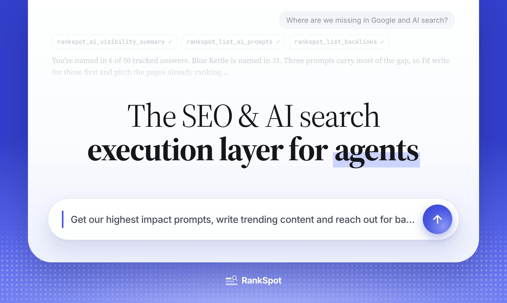
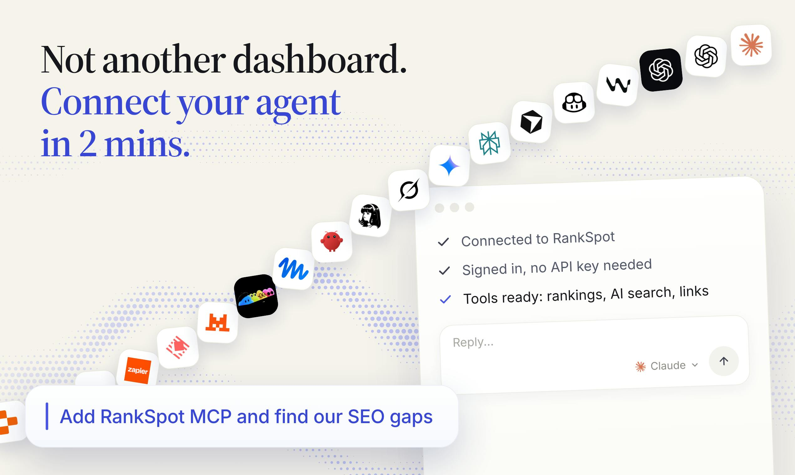
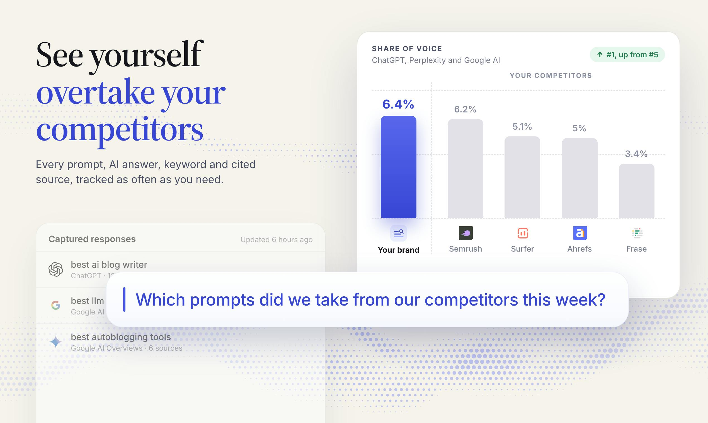

### 🎬 관련 영상
- [🎥 영상 보기](https://ph-files.imgix.net/df9a58a9-cff3-41a9-9e7d-7a982df725e2.jpeg?auto=format)

---

## 2. [Creatify Max](https://www.producthunt.com/products/creatify)
**Votes**: 272 | **도입 난이도**: 하 | **신뢰도**: 상
**Tagline**: Your ad teammate, from strategy to creation to launch
**서비스 링크**: https://www.producthunt.com/r/NWW6YNL6LTJ6TX

**태그**: Marketing, Automation, AI-Video, AdTech, AI Tool, Video

### 📌 이 서비스 한눈에 보기
제품 URL만으로 광고 전략 수립부터 영상 제작, 캠페인 실행까지 수행하는 AI 광고 자동화 팀메이트

### 🔑 주요 기능
- 제품 URL 또는 브리프를 통한 자동 영상 광고 제작
- Meta 및 TikTok 캠페인 자동 설정 및 운영
- 24/7 실시간 성과 모니터링 및 개선 사항 제안

### 🙋 사용자에게 어떤 점이 좋은가
광고 기획부터 실행, 최적화까지의 복잡한 과정을 자동화하여 마케터의 운영 공수를 획기적으로 줄여줍니다.

### ✅ 지금 바로 써볼 기능
- 제품 URL을 입력하여 AI가 생성하는 광고 영상 확인하기
- Meta/TikTok 캠페인 자동 설정 기능 테스트하기
- 실시간 성과 피드백 및 개선 제안 기능 살펴보기

### ⚠️ 사용 전 확인할 점
- 최종 승인 전까지는 자동화된 결과물이 사용자의 의도와 다를 수 있음
- 광고 매체(Meta, TikTok) 외의 플랫폼 확장성 확인 필요

### 🧭 확인이 더 필요한 정보
구체적인 광고 제작 비용 및 매체별 광고 집행 비용 구조에 대한 정보가 명시되지 않았습니다.

### 📸 스크린샷 및 갤러리
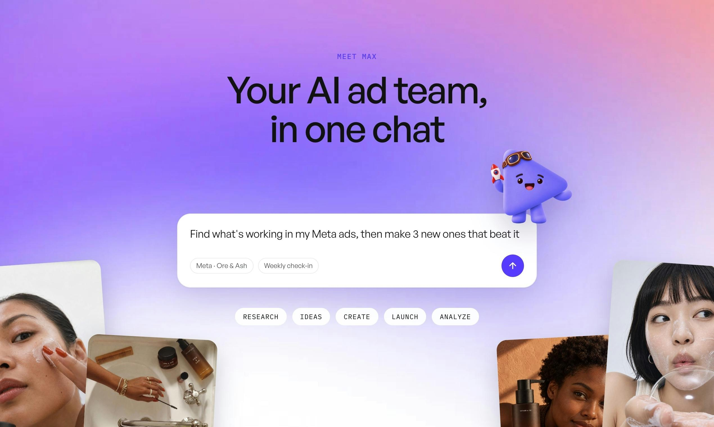
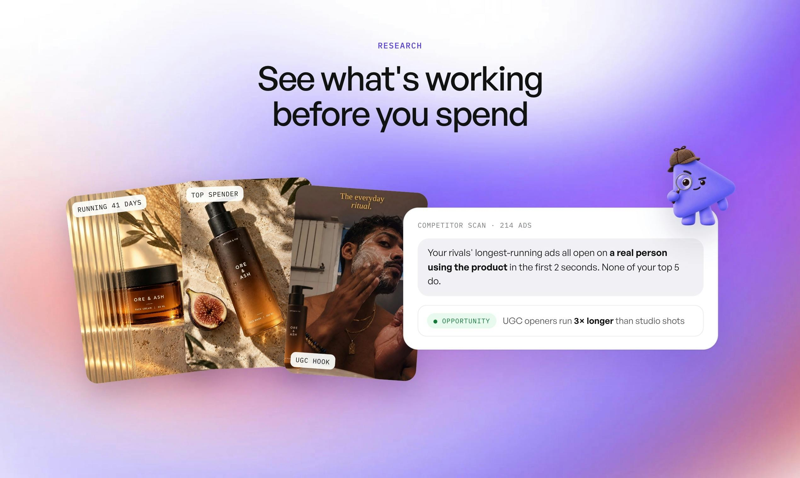
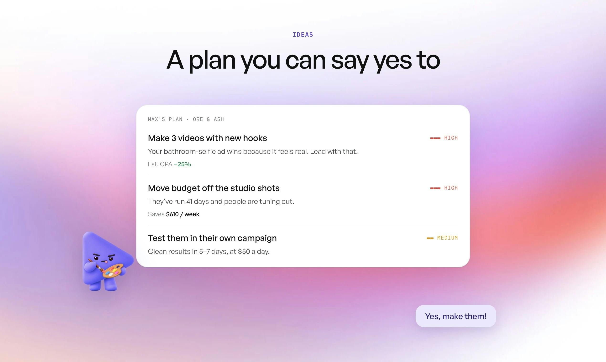

### 🎬 관련 영상
- [🎥 영상 보기](https://ph-files.imgix.net/eb1b2e03-1d6d-4391-9b64-3ea03efba8c9.jpeg?auto=format)

---

## 3. [TheBold](https://www.producthunt.com/products/thebold)
**Votes**: 267 | **도입 난이도**: 중 | **신뢰도**: 상
**Tagline**: Turn execution into meetings with investors
**서비스 링크**: https://www.producthunt.com/r/C7KPFSSB5AHOYX

**태그**: Startup, Investor-Access, AI, Fintech, AI Tool

### 📌 이 서비스 한눈에 보기
스타트업의 실행 성과를 검증하여 투자자와의 직접적인 미팅 기회로 연결하는 플랫폼

### 🔑 주요 기능
- 실행 성과를 기반으로 한 투자자 딜 플로우(Deal Flow) 진입
- AI 투자자 인터뷰 및 시뮬레이션을 통한 투자 준비도 향상
- 투자자 기준에 맞춘 실행 지표 추적 및 검증

### 🙋 사용자에게 어떤 점이 좋은가
창업자가 투자자의 요구사항을 이해하고 실질적인 성과를 증명함으로써, 검증된 상태에서 효율적으로 투자 미팅을 잡을 수 있습니다.

### ✅ 지금 바로 써볼 기능
- Launch Fast Track 참여를 통한 투자자 매칭 기회 확보
- AI 투자자 시뮬레이션을 통한 인터뷰 연습
- 투자자 기준에 따른 실행 지표 및 트랙션 관리

### ⚠️ 사용 전 확인할 점
- 투자자 매칭은 플랫폼 내 검증된 실행 성과를 전제로 함
- 특정 기간(Launch Fast Track)에 한정된 혜택이 있을 수 있음

### 🧭 확인이 더 필요한 정보
투자자 매칭의 구체적인 규모와 매칭되는 투자자 풀의 범위는 명시되지 않았습니다.

### 📸 스크린샷 및 갤러리
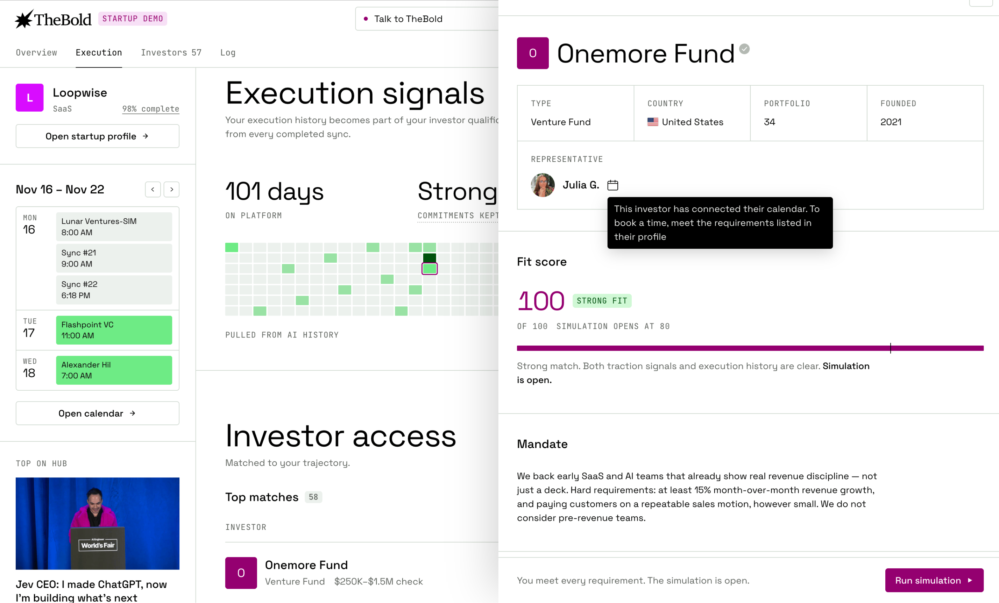
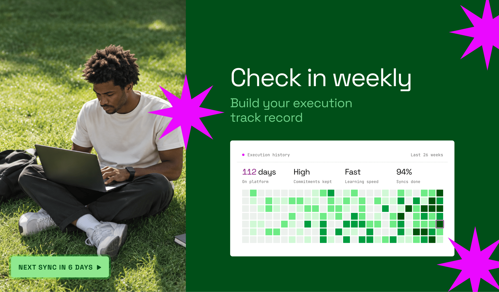
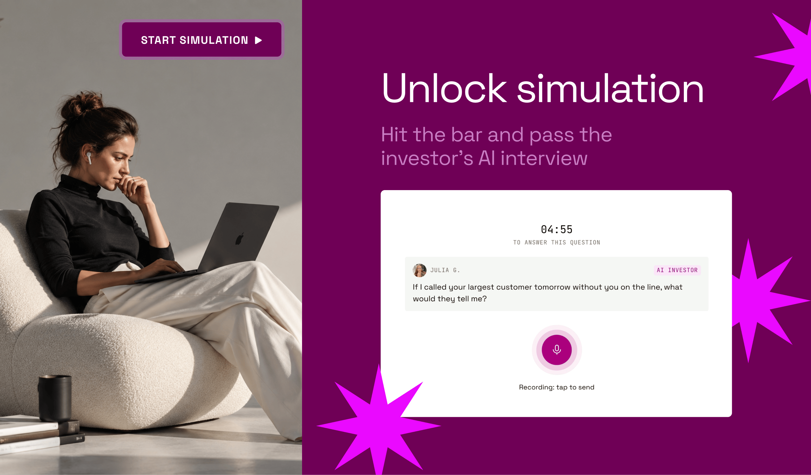

### 🎬 관련 영상
- [🎥 영상 보기](https://ph-files.imgix.net/980611e0-917c-453e-9a6e-71b23a769ff7.jpeg?auto=format)
- [🎥 영상 보기](https://ph-files.imgix.net/d9c04fdb-b930-4629-9f33-f24fd4ede222.jpeg?auto=format)

---

## 4. [Appxiom](https://www.producthunt.com/products/appxiom)
**Votes**: 208 | **도입 난이도**: 중 | **신뢰도**: 상
**Tagline**: Context layer for AI coding agents to detect & fix bugs
**서비스 링크**: https://www.producthunt.com/r/4U3S4XIEYDOCDN

**태그**: DevTool, AI, Debugging, Automation, Agent, AI Tool

### 📌 이 서비스 한눈에 보기
AI 코딩 에이전트가 버그를 정확히 탐지하고 해결할 수 있도록 실시간 프로덕션 컨텍스트를 제공하는 도구

### 🔑 주요 기능
- 크래시, 프리징, 메모리 누수, 네트워크 오류 등 실시간 프로덕션 데이터 제공
- 사용자 목표 달성 방해 정도(Goal Friction Impact)를 기준으로 버그 우선순위 지정
- Android, iOS, Flutter, Web 등 다양한 모바일 및 웹 프레임워크 지원

### 🙋 사용자에게 어떤 점이 좋은가
AI 에이전트가 단순 코드 분석을 넘어 실제 실행 환경의 맥락을 이해하게 함으로써, 버그 수정의 정확도를 높이고 비즈니스 가치가 높은 문제부터 해결할 수 있게 돕습니다.

### ✅ 지금 바로 써볼 기능
- 현재 사용 중인 AI 코딩 에이전트와 연동 가능 여부 확인
- 지원하는 프레임워크(React, Swift, Kotlin 등) 환경에 적용 테스트
- Goal Friction Impact 지표를 통한 버그 우선순위 관리 실험

### ⚠️ 사용 전 확인할 점
- 실제 프로덕션 데이터를 수집하므로 보안 및 개인정보 보호 정책 확인 필요
- AI 에이전트의 성능이 Appxiom이 제공하는 컨텍스트를 얼마나 잘 활용하는지에 따라 효과가 달라질 수 있음

### 🧭 확인이 더 필요한 정보
AI 에이전트와의 구체적인 통합 방식 및 데이터 보안 처리 방식에 대한 상세 정보가 필요합니다.

### 📸 스크린샷 및 갤러리
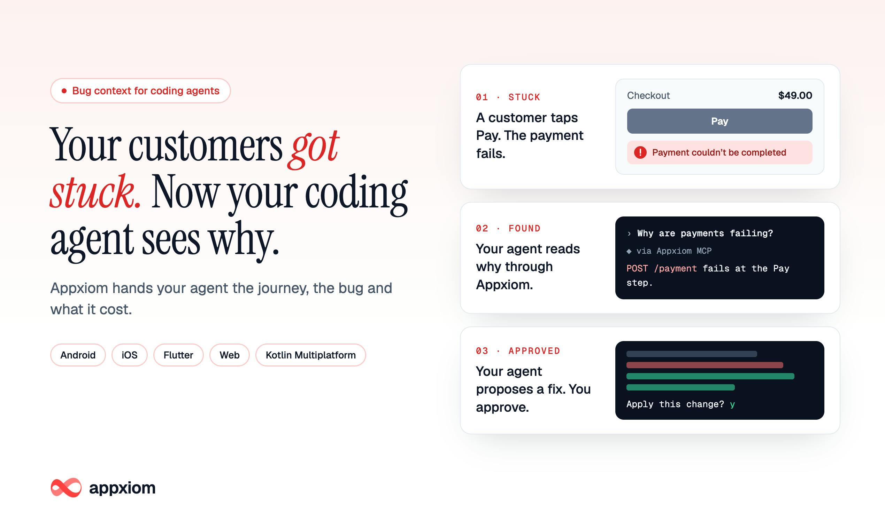
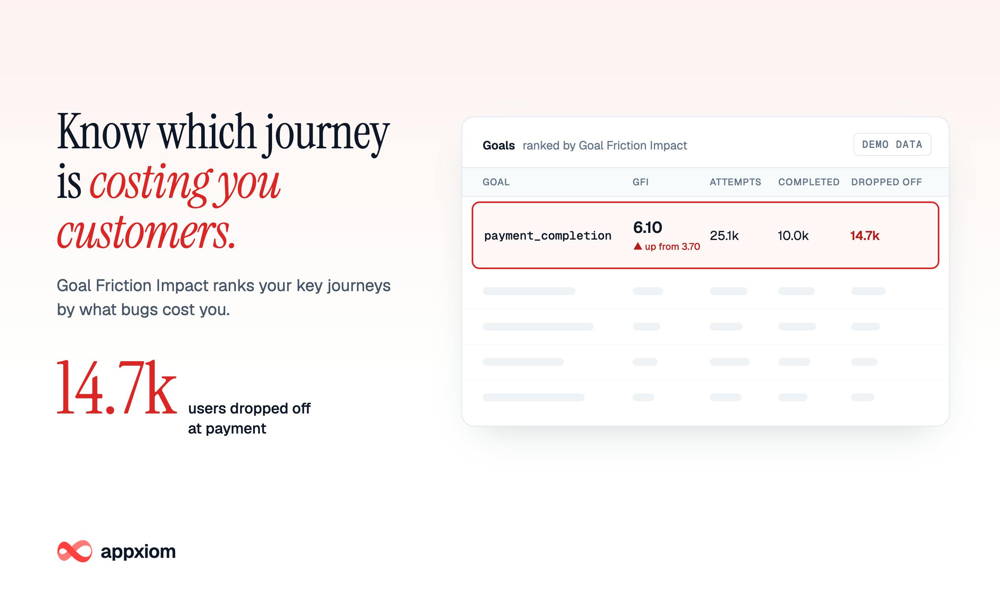
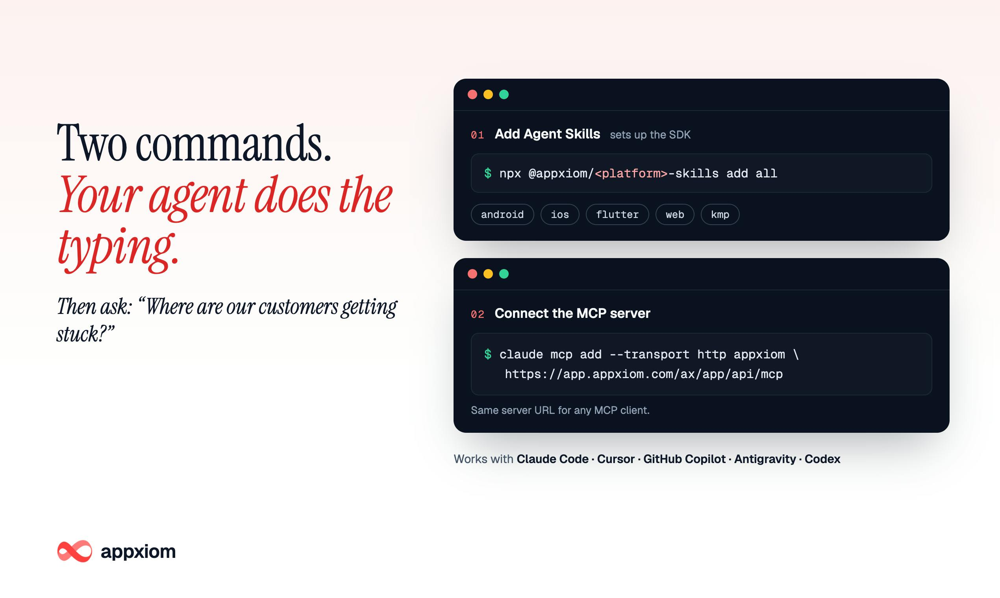

### 🎬 관련 영상
- [🎥 영상 보기](https://ph-files.imgix.net/6efa402a-4a89-4ee3-b028-f4fac8cf17ad.jpeg?auto=format)

---

## 5. [Versine](https://www.producthunt.com/products/versine)
**Votes**: 176 | **도입 난이도**: 중 | **신뢰도**: 상
**Tagline**: Let your AI send and receive money. We're Venmo for agents.
**서비스 링크**: https://www.producthunt.com/r/SLJZPHAQH5CWEI

**태그**: AI, FinTech, Automation, Agentic-Workflow, Agent, AI Tool, Chat

### 📌 이 서비스 한눈에 보기
AI 에이전트가 직접 송금하고 결제할 수 있는 자동화 금융 플랫폼

### 🔑 주요 기능
- ChatGPT, Claude 등 AI 에이전트와 MCP를 통한 간편한 연결
- 수취인이 별도 계정 없이도 은행 계좌로 즉시 출금 가능
- 패스키 승인 또는 신뢰할 수 있는 연락처로의 자율 송금 기능

### 🙋 사용자에게 어떤 점이 좋은가
AI 에이전트가 사용자의 개입 없이도 경제적 활동을 수행할 수 있어, 자동화된 워크플로우 내에서 결제 및 정산 업무를 처리할 수 있습니다.

### ✅ 지금 바로 써볼 기능
- MCP를 통해 선호하는 AI 에이전트(ChatGPT, Claude 등)에 연결하기
- 신뢰할 수 있는 연락처를 설정하여 자율 송금 기능 테스트하기
- 패스키를 설정하여 보안 및 승인 프로세스 구축하기

### ⚠️ 사용 전 확인할 점
- 자율 송금 설정 시 예기치 못한 지출이 발생할 수 있으므로 신뢰할 수 있는 연락처 관리가 필수적임
- 수취인이 계정이 없어도 출금이 가능하지만, 보안 및 규제 준수 여부 확인 필요

### 🧭 확인이 더 필요한 정보
현재 지원하는 구체적인 법정 화폐 및 국가별 금융 규제 준수 범위는 명시되지 않았습니다.

### 📸 스크린샷 및 갤러리
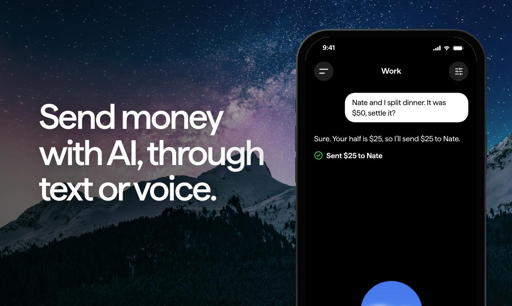

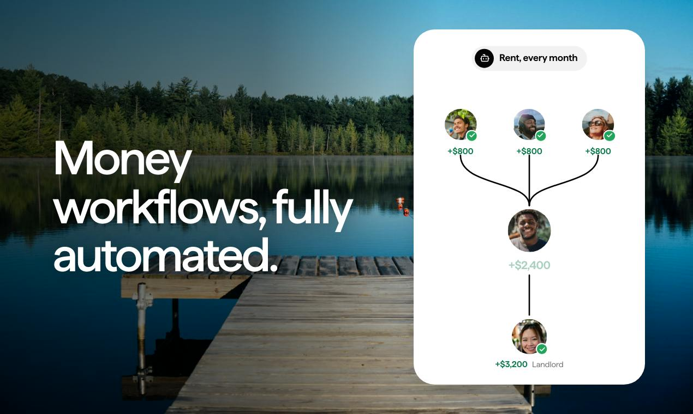

### 🎬 관련 영상
- [🎥 영상 보기](https://ph-files.imgix.net/765cba81-f2b9-4f8d-99bd-62fa1fa57b3a.jpeg?auto=format)

---

## 6. [EkLine](https://www.producthunt.com/products/ekline)
**Votes**: 174 | **도입 난이도**: 중 | **신뢰도**: 상
**Tagline**: AI SEO for Developer Tools and API first companies! 
**서비스 링크**: https://www.producthunt.com/r/RX3ZWI6MXJWW7K

**태그**: DevTool, AI-SEO, Automation, DeveloperExperience, Agent, AI Tool, Chat, API

### 📌 이 서비스 한눈에 보기
AI 에이전트가 문서와 코드를 분석하여 개발자 도구의 SEO를 자동 최적화하는 솔루션

### 🔑 주요 기능
- AI 에이전트가 웹사이트, 문서, GitHub, 커뮤니티 콘텐츠를 종합적으로 감사
- AI 모델(ChatGPT, Cursor 등)이 제품을 잘못 이해하거나 구현하지 못하는 지점 식별
- 코드 기반의 수정 사항을 Pull Request 형태로 제안하여 개발 팀의 승인 후 적용

### 🙋 사용자에게 어떤 점이 좋은가
개발자 도구나 API 기업이 AI 기반 검색 및 코딩 에이전트 환경에서 제품이 올바르게 추천되고 사용될 수 있도록 자동화된 최적화를 제공합니다.

### ✅ 지금 바로 써볼 기능
- AI 에이전트의 웹사이트 및 문서 감사 기능 실행
- 식별된 SEO 격차(Gap) 및 우선순위 확인
- 제안된 코드 수정 사항에 대한 Pull Request 검토

### ⚠️ 사용 전 확인할 점
- 코드 수정 사항이 기존 코드베이스와 충돌할 수 있으므로 반드시 팀의 승인 절차 필요
- AI가 생성한 수정 사항이 실제 기술적 의도와 일치하는지 검증 필요

### 🧭 확인이 더 필요한 정보
제안된 수정 사항이 실제 운영 환경에 반영되는 자동화 수준과 보안 정책에 대한 상세 정보가 필요합니다.

### 📸 스크린샷 및 갤러리
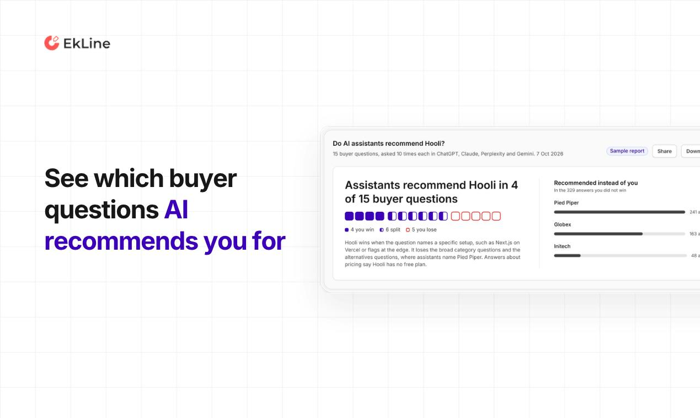
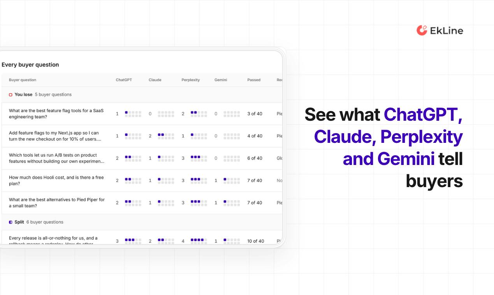
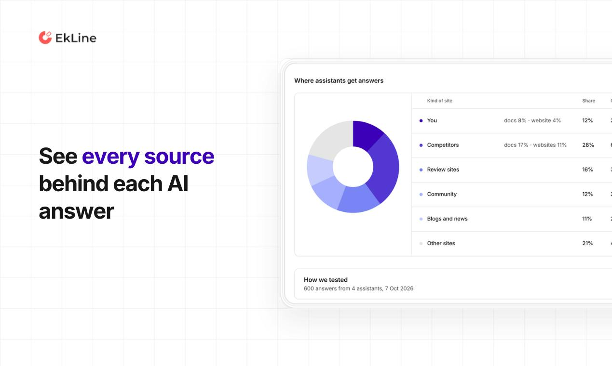

### 🎬 관련 영상
- [🎥 영상 보기](https://ph-files.imgix.net/c4ee4673-9f37-4caa-92de-756c0be36f88.jpeg?auto=format)

---

## 7. [superlog](https://www.producthunt.com/products/superlog)
**Votes**: 151 | **도입 난이도**: 중 | **신뢰도**: 상
**Tagline**: Finds the production bugs your monitoring never sees
**서비스 링크**: https://www.producthunt.com/r/QPAYF22JVBNIOY

**태그**: DevTool, Automation, Debugging, SRE

### 📌 이 서비스 한눈에 보기
설정되지 않은 잠재적 버그를 자동으로 탐지하고 해결책까지 제안하는 자동 디버깅 도구

### 🔑 주요 기능
- 사용자가 직접 설정한 모니터링 범위를 벗어난 예외 상황 탐지
- 24/7 자동 조사 및 코드 수정 제안 기능
- 100개 이상의 스타트업 도입 및 높은 코드 병합 성공률(87%)

### 🙋 사용자에게 어떤 점이 좋은가
수동 모니터링의 한계로 발생하는 미탐지 버그를 자동으로 찾아주어, 고객 리포트 이전에 문제를 해결할 수 있게 돕습니다.

### ✅ 지금 바로 써볼 기능
- 기존 모니터링 시스템과 병행하여 미탐지 에러 확인하기
- 제안된 수정 코드가 실제 코드베이스와 호환되는지 검토하기

### ⚠️ 사용 전 확인할 점
- 자동 생성된 수정 코드가 기존 로직에 미칠 영향성 검증 필요
- 기존 인프라/언어 환경과의 통합 가능 여부 확인 필요

### 🧭 확인이 더 필요한 정보
구체적인 지원 프로그래밍 언어 및 프레임워크 범위에 대한 정보가 부족합니다.

### 📸 스크린샷 및 갤러리

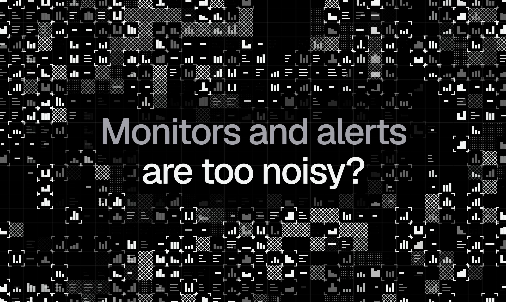
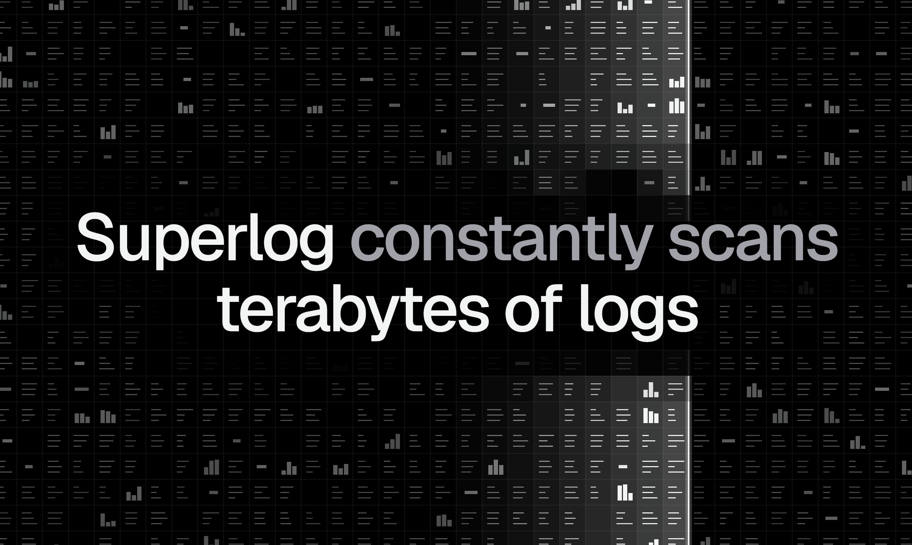

### 🎬 관련 영상
- [🎥 영상 보기](https://ph-files.imgix.net/a5a8d2fe-9a6a-434d-a7f2-a076adc7ebef.jpeg?auto=format)

---

## 8. [VINC](https://www.producthunt.com/products/vinc)
**Votes**: 135 | **도입 난이도**: 중 | **신뢰도**: 상
**Tagline**: Bring your filmmaking vision to life.
**서비스 링크**: https://www.producthunt.com/r/5TFM5AL6BZDXRS

**태그**: AI Video, Filmmaking, Creative Tool, Workflow

### 📌 이 서비스 한눈에 보기
아이디어 구상부터 최종 영상 편집까지 지원하는 올인원 AI 영화 제작 워크플로우

### 🔑 주요 기능
- 시나리오 개발, 스토리보드 스케치, 샷 생성의 통합 워크플로우
- 생성된 샷을 바로 편집할 수 있는 내장 에디터 제공
- SFX(효과음) 및 BGM(배경음악)이 포함된 최종 결과물 출력 기능

### 🙋 사용자에게 어떤 점이 좋은가
창작자가 머릿속의 비전을 구체적인 영상으로 구현하는 데 드는 기술적 번거로움을 줄여줍니다.

### ✅ 지금 바로 써볼 기능
- 시나리오를 바탕으로 스토리보드 스케치해보기
- AI를 활용해 계획한 샷 생성 및 검토하기
- 내장 에디터로 SFX/BGM을 입혀 최종 영상 완성하기

### ⚠️ 사용 전 확인할 점
- 생성된 영상의 일관성(Consistency) 유지 여부 확인 필요
- 복잡한 연출이나 정교한 편집 요구사항 충족 여부 확인 필요

### 🧭 확인이 더 필요한 정보
사용자의 구체적인 연출 의도를 얼마나 정밀하게 반영할 수 있는지에 대한 기술적 수준 확인이 필요합니다.

### 📸 스크린샷 및 갤러리
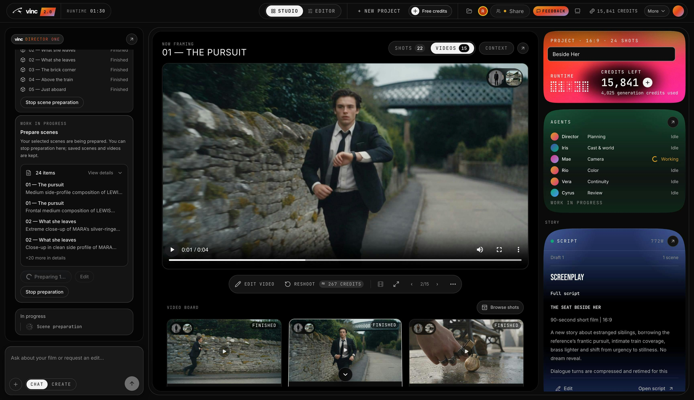
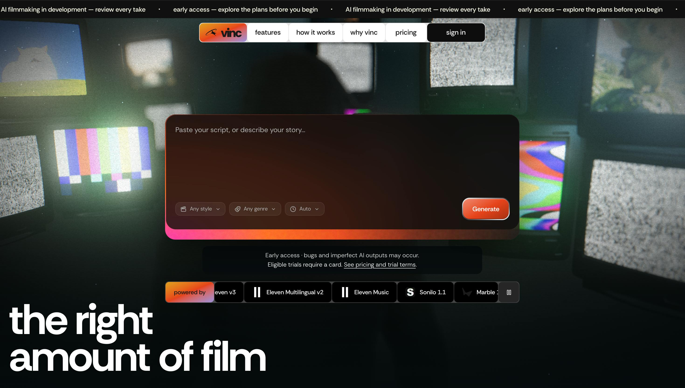
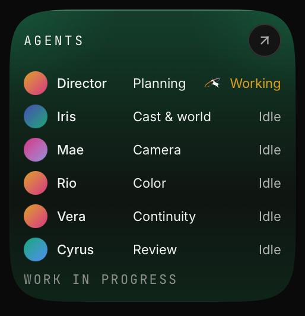

### 🎬 관련 영상
- [🎥 영상 보기](https://ph-files.imgix.net/02fd7fdc-e14e-438a-835a-a35ec2f0a715.jpeg?auto=format)

---

## 9. [seshka](https://www.producthunt.com/products/seshka)
**Votes**: 107 | **도입 난이도**: 하 | **신뢰도**: 상
**Tagline**: Kill what Claude Code left behind
**서비스 링크**: https://www.producthunt.com/r/IPCIDIB7EGGJHC

**태그**: DevTool, Automation, Productivity

### 📌 이 서비스 한눈에 보기
Claude Code 세션 종료 후 남은 개발 서버와 프로세스를 한 번에 정리하는 도구

### 🔑 주요 기능
- Claude Code 세션 종료 후 잔류하는 서버, 워처, 스크립트 관리
- 메뉴 바에서 세션별로 그룹화된 프로세스 및 포트 확인
- 원클릭 프로세스 종료 및 유휴 세션 자동/수동 종료 지원

### 🙋 사용자에게 어떤 점이 좋은가
개발 세션이 끝난 뒤에도 백그라운드에서 돌아가는 불필요한 프로세스를 간편하게 정리하여 시스템 자원을 확보할 수 있습니다.

### ✅ 지금 바로 써볼 기능
- 메뉴 바에서 현재 실행 중인 세션 그룹 확인하기
- 사용하지 않는 유휴 세션 원클릭으로 종료하기
- 자동 종료 설정을 통해 시스템 자원 최적화하기

### ⚠️ 사용 전 확인할 점
- Claude Code 환경 외의 일반 프로세스 종료 시 주의 필요
- 자동 종료 설정 시 의도치 않은 작업 중단 가능성

### 🧭 확인이 더 필요한 정보
사용자의 로컬 환경에 따라 프로세스 식별 및 종료 권한이 다를 수 있습니다.

### 📸 스크린샷 및 갤러리
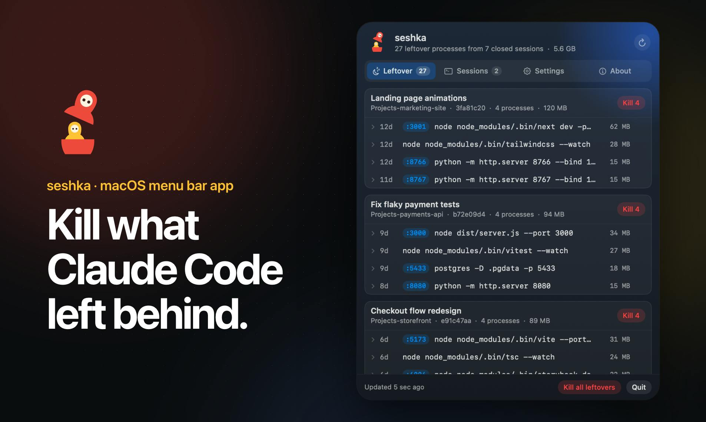
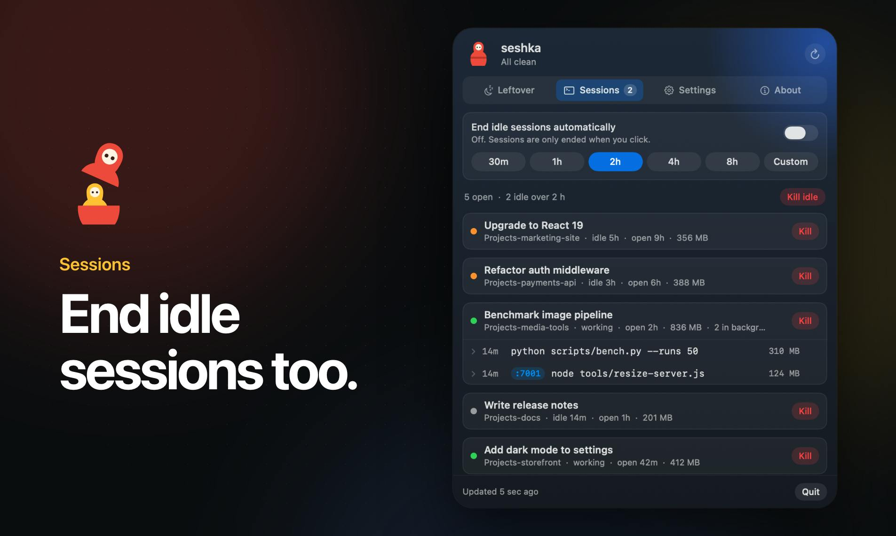
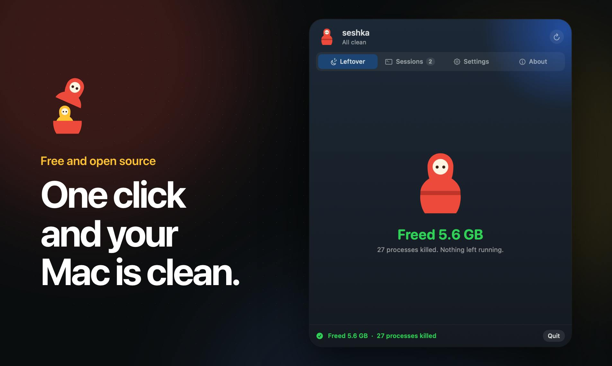

### 🎬 관련 영상
- [🎥 영상 보기](https://ph-files.imgix.net/mcp-draft-media/870852e8-270a-43c0-88d5-40e73b586cdc.jpeg?auto=format)

---

## 10. [Superhands](https://www.producthunt.com/products/stencil-by-superhands)
**Votes**: 93 | **도입 난이도**: 중 | **신뢰도**: 상
**Tagline**: Design the system, not every output.
**서비스 링크**: https://www.producthunt.com/r/UXLAJKIOFASLOH

**태그**: DesignSystem, AI-Workflow, Automation, Productivity, Agent, AI Tool, Design

### 📌 이 서비스 한눈에 보기
개별 결과물을 수정하는 대신, AI 에이전트가 따를 시스템을 설계하여 디자인 일관성을 유지하는 도구

### 🔑 주요 기능
- 결과물 중심이 아닌 시스템 중심의 디자인 워크플로우 제공
- 팀이 사용하는 모든 AI 도구에 적용 가능한 가이드라인 구축
- 반복적인 수정 작업 대신 시스템 수정을 통한 효율적 관리

### 🙋 사용자에게 어떤 점이 좋은가
디자이너가 일일이 결과물을 검수하는 대신, 한 번의 시스템 설정으로 팀 전체의 AI 생성물 품질을 관리할 수 있습니다.

### ✅ 지금 바로 써볼 기능
- 팀의 AI 워크플로우에 적용할 가이드라인 설계
- AI 에이전트가 생성한 결과물 모니터링
- 시스템 수정을 통한 결과물 일괄 업데이트 테스트

### ⚠️ 사용 전 확인할 점
- 시스템 설계 역량에 따라 결과물의 품질이 결정될 수 있음
- 기존 AI 도구들과의 연동 방식 확인 필요

### 🧭 확인이 더 필요한 정보
현재 제공되는 AI 도구들의 구체적인 연동 범위와 지원 플랫폼을 확인해야 합니다.

### 📸 스크린샷 및 갤러리
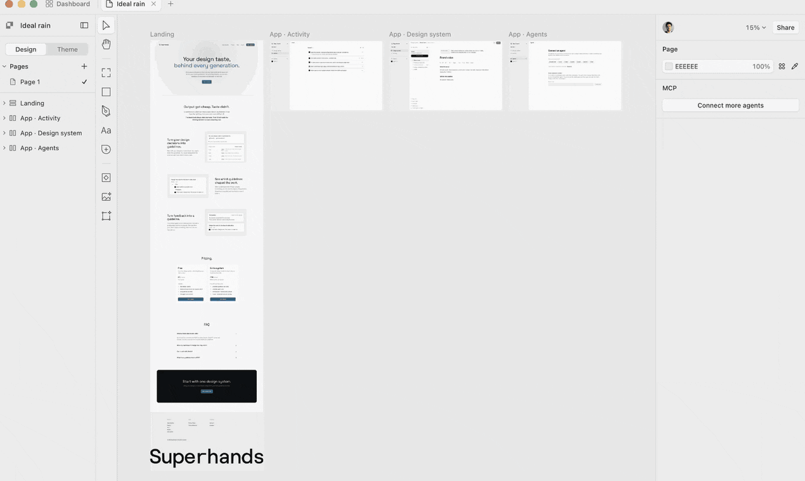
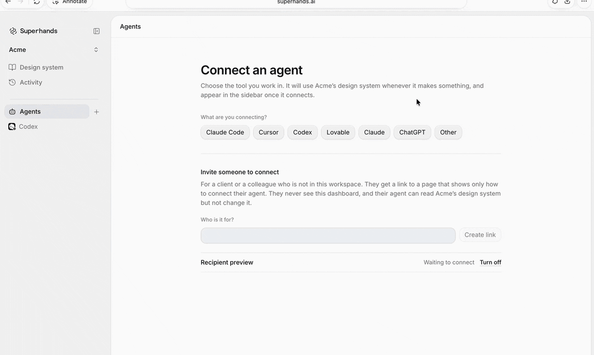
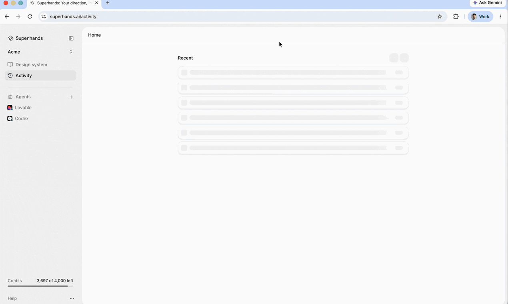

### 🎬 관련 영상
- [🎥 영상 보기](https://ph-files.imgix.net/mcp-draft-media/310b5dbc-0023-4fd2-9c5c-790fb1ee0623.jpeg?auto=format)

---

## 11. [Ridian](https://www.producthunt.com/products/ridian)
**Votes**: 91 | **도입 난이도**: 중 | **신뢰도**: 상
**Tagline**: The AI-first scheduling suite for everything around meetings
**서비스 링크**: https://www.producthunt.com/r/5Q3FPLS2WO53YS

**태그**: Productivity, AI, CRM, Automation, Scheduling, Agent, AI Tool, Chat

### 📌 이 서비스 한눈에 보기
AI 기반의 예약, 결제, CRM이 통합된 올인원 스케줄링 스위트

### 🔑 주요 기능
- 결제 및 대기 명단 기능이 포함된 스마트 예약 페이지 구축
- 리드 분류를 위한 맞춤형 퍼널 및 내장 CRM 제공
- 다양한 캘린더/인박스 동기화 및 AI 에이전트 연동

### 🙋 사용자에게 어떤 점이 좋은가
단순 일정 예약을 넘어 리드 수집부터 결제, 고객 관리까지 미팅 전후의 모든 과정을 자동화할 수 있습니다.

### ✅ 지금 바로 써볼 기능
- 결제 기능이 포함된 예약 페이지 만들기
- 질문형 퍼널을 설정하여 리드 분류하기
- 기존 캘린더 및 이메일 계정 연동하기

### ⚠️ 사용 전 확인할 점
- AI 에이전트(Claude, ChatGPT 등) 연동 시 외부 API 설정 필요 가능성
- 복합적인 기능을 제공하므로 초기 워크플로우 설정에 시간이 소요될 수 있음

### 🧭 확인이 더 필요한 정보
AI 에이전트의 자동화 수준과 외부 서비스와의 구체적인 연동 방식에 대한 상세 정보가 필요합니다.

### 📸 스크린샷 및 갤러리
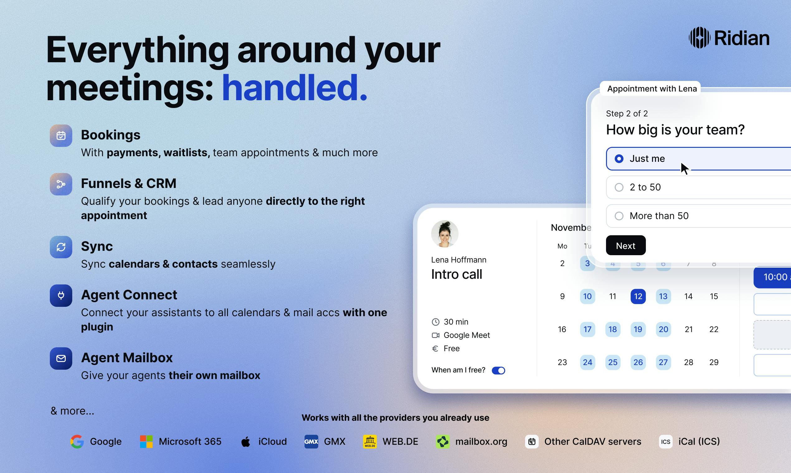
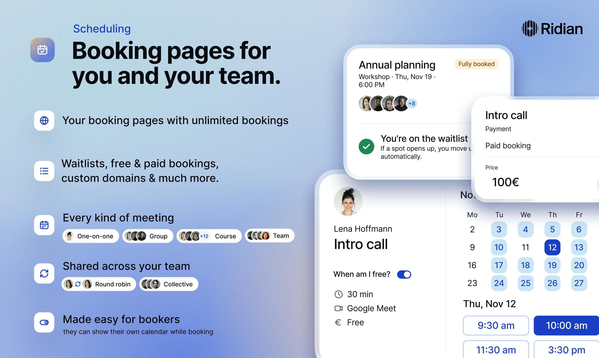
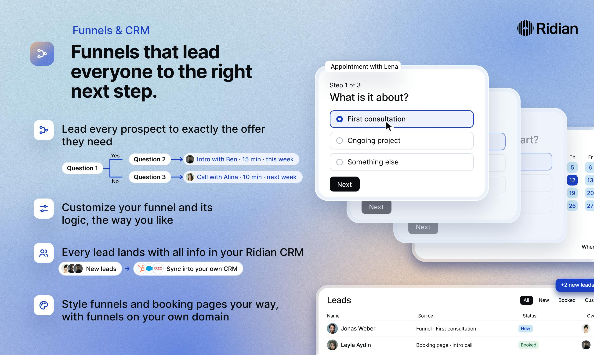

### 🎬 관련 영상
- [🎥 영상 보기](https://ph-files.imgix.net/mcp-draft-media/14d274fc-e2b0-4851-84b6-4621d13f0b9b.jpeg?auto=format)

---

## 12. [Link.bio](https://www.producthunt.com/products/link-bio)
**Votes**: 90 | **도입 난이도**: 하 | **신뢰도**: 상
**Tagline**: Paste your link, we build your page that your AI runs
**서비스 링크**: https://www.producthunt.com/r/Y6VJNN2FTLFYJW

**태그**: AI, NoCode, SocialMedia, PersonalBranding, Automation, Agent, AI Tool, Chat

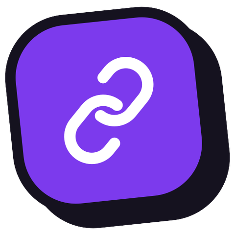

### 📌 이 서비스 한눈에 보기
SNS 링크를 붙여넣기만 하면 AI가 개인 맞춤형 프로필 페이지를 자동 구축해주는 서비스

### 🔑 주요 기능
- SNS 계정(Instagram, TikTok, YouTube 등) 링크를 통한 자동 페이지 생성
- AI가 바이오, 버튼, 테마를 몇 초 만에 자동 작성
- ChatGPT나 Claude를 활용한 간편한 편집 및 커스터마이징

### 🙋 사용자에게 어떤 점이 좋은가
복잡한 웹 디자인 과정 없이도 SNS 프로필 페이지를 즉시 만들 수 있어 개인 브랜딩 시간을 획기적으로 단축해줍니다.

### ✅ 지금 바로 써볼 기능
- 자신의 SNS 링크를 붙여넣어 자동 생성 기능 테스트하기
- AI가 작성한 바이오와 테마를 ChatGPT/Claude로 수정해보기

### ⚠️ 사용 전 확인할 점
- AI가 생성한 콘텐츠의 정확성 및 개인 브랜딩 적합성 검토 필요
- 외부 AI 모델(ChatGPT, Claude) 연동 방식에 따른 추가 비용 발생 가능성

### 🧭 확인이 더 필요한 정보
AI 에이전트가 페이지를 운영하는 구체적인 자동화 범위와 외부 모델 연동 방식에 대한 상세 정보가 필요합니다.

### 📸 스크린샷 및 갤러리
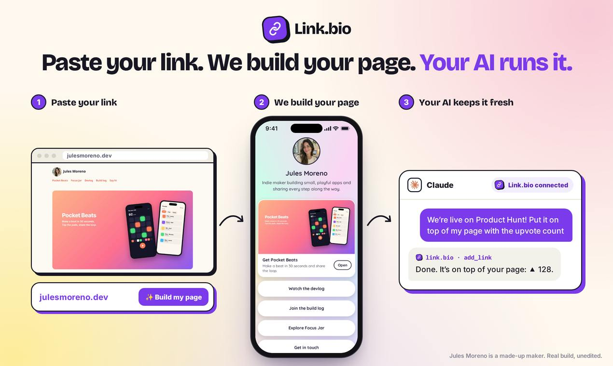
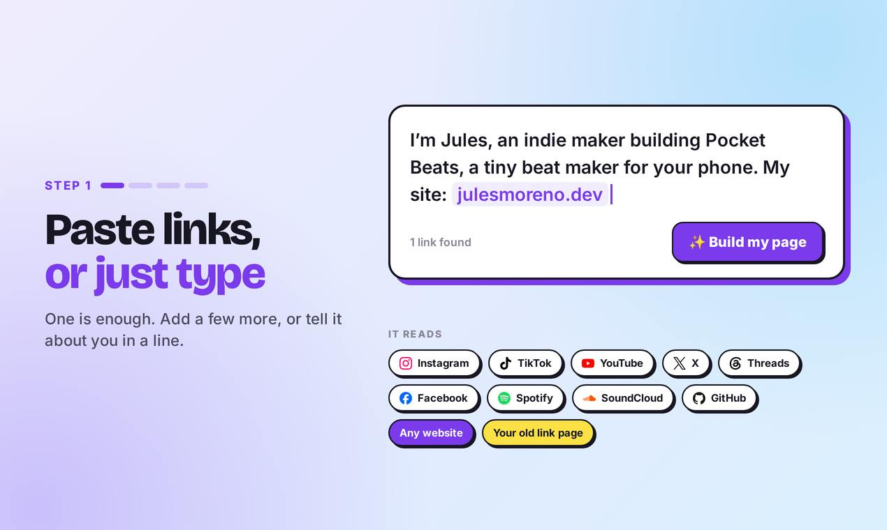
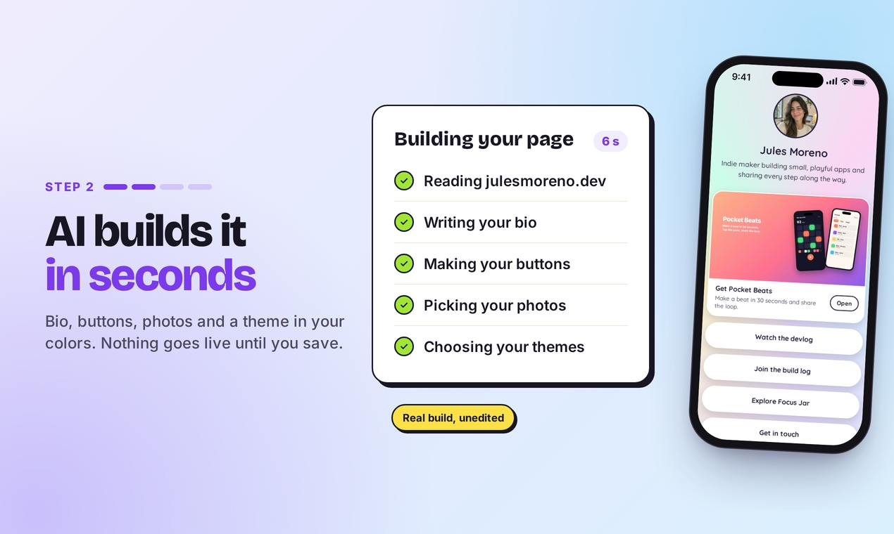

### 🎬 관련 영상
- [🎥 영상 보기](https://ph-files.imgix.net/mcp-draft-media/4bcdbd79-ed95-45cd-941f-326fcaa5570d.jpeg?auto=format)

---

## 13. [Clamor](https://www.producthunt.com/products/clamor-2)
**Votes**: 89 | **도입 난이도**: 하 | **신뢰도**: 상
**Tagline**: Turns social signals into actionable insights
**서비스 링크**: https://www.producthunt.com/r/2DLZK25XGL4UA6

**태그**: Marketing, SocialAnalytics, AI, DataIntegration, API

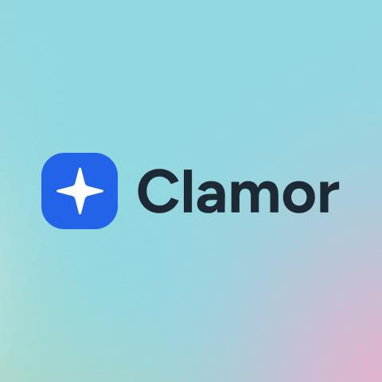

### 📌 이 서비스 한눈에 보기
소셜 데이터를 분석하여 즉각적인 실행 전략을 제공하는 마케팅 인사이트 도구

### 🔑 주요 기능
- 로그인 없이 공개된 소셜 계정 데이터 분석 가능
- AI 기반 'Ask Clamor'를 통한 대화형 인사이트 탐색
- API를 통한 외부 도구와의 데이터 통합 지원

### 🙋 사용자에게 어떤 점이 좋은가
데이터 수집에 드는 시간을 줄이고, 분석된 결과를 바탕으로 마케팅 의사결정에만 집중할 수 있게 해줍니다.

### ✅ 지금 바로 써볼 기능
- 로그인 없이 공개 계정 데이터 분석해보기
- Ask Clamor 기능을 활용해 질문 던지기
- API를 활용한 워크플로우 통합 테스트

### ⚠️ 사용 전 확인할 점
- 로그인이 필요한 비공개 계정 데이터는 접근이 제한될 수 있음
- 제공되는 데이터의 신뢰도는 소셜 플랫폼의 공개 정보에 의존함

### 🧭 확인이 더 필요한 정보
API의 상세 기능 범위와 데이터 업데이트 주기에 대한 구체적인 정보가 필요합니다.

### 📸 스크린샷 및 갤러리
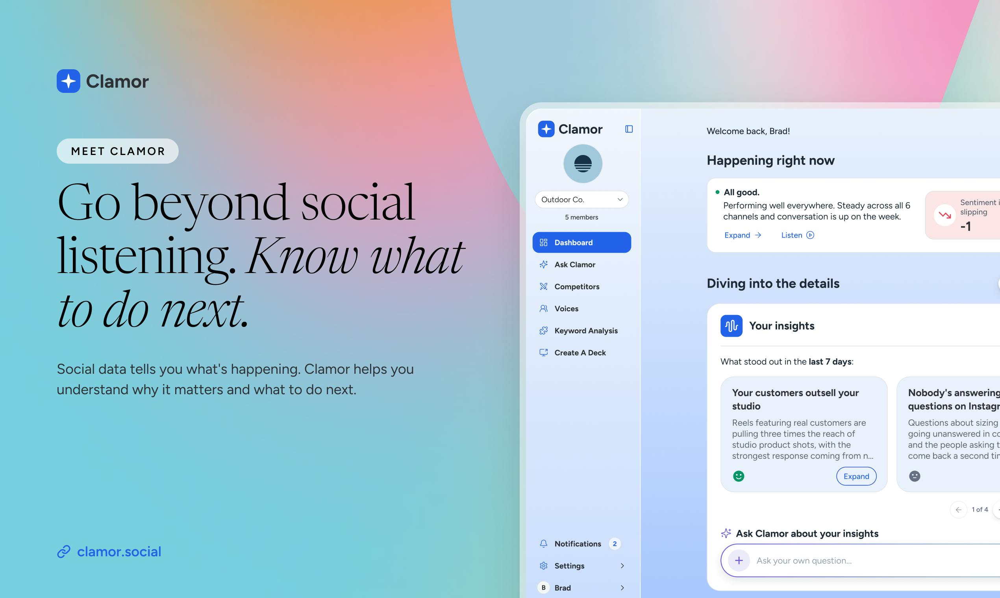
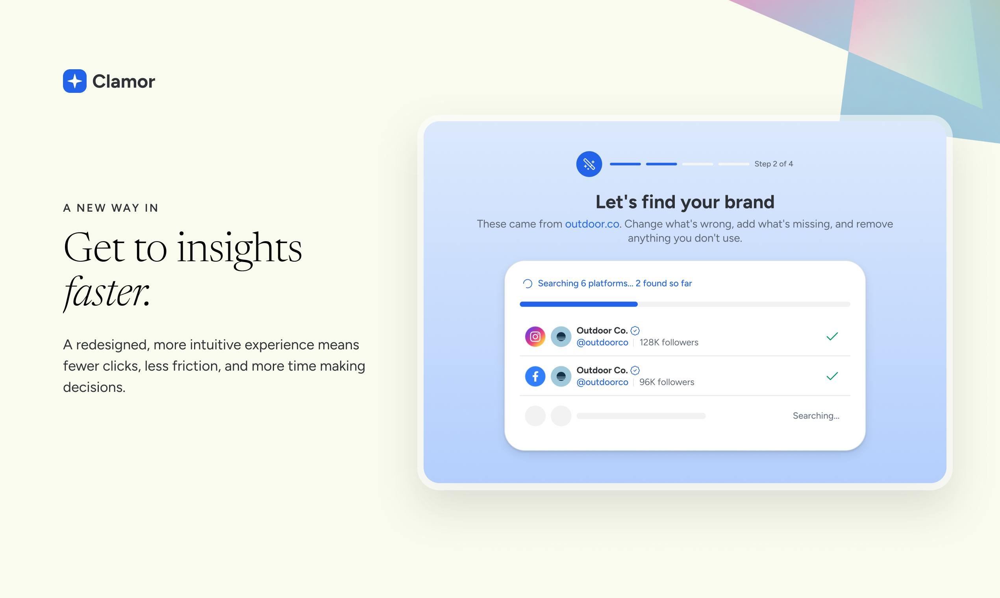
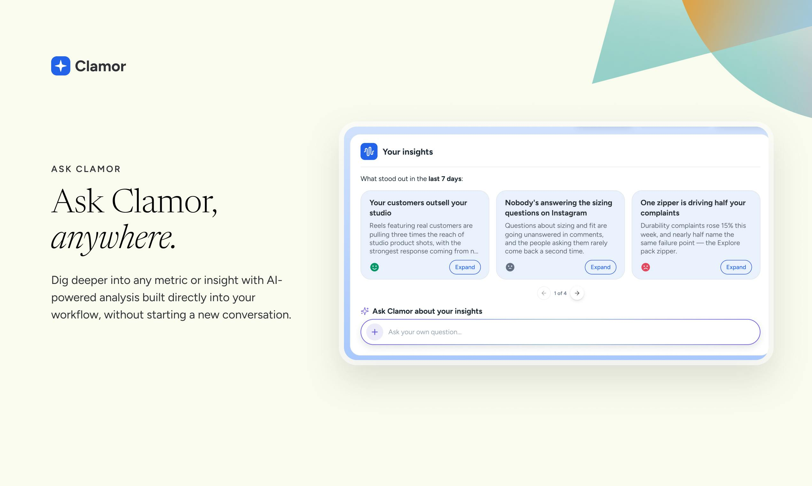

---

## 14. [Glass Page](https://www.producthunt.com/products/glass-page)
**Votes**: 86 | **도입 난이도**: 하 | **신뢰도**: 상
**Tagline**: A place for people to review an agent's work
**서비스 링크**: https://www.producthunt.com/r/Y2UONP3DNUDJNS

**태그**: AI-Collaboration, Productivity, DevTool, Workflow, Agent, Chat, Design

### 📌 이 서비스 한눈에 보기
AI 에이전트가 생성한 결과물을 팀원들과 실시간으로 검토하고 피드백을 주고받는 협업 캔버스

### 🔑 주요 기능
- AI 에이전트(Claude, ChatGPT 등)가 만든 결과물을 링크 하나로 공유 가능한 'Pane'으로 발행
- 캔버스 인터페이스를 통해 여러 결과물을 배치하고 팬/줌 기능을 통해 시각적으로 검토
- 특정 위치에 직접 댓글을 남기면 AI가 이를 읽고 새로운 버전으로 업데이트하는 워크플로우

### 🙋 사용자에게 어떤 점이 좋은가
AI가 작성한 문서나 코드를 팀원들이 일일이 복사할 필요 없이, 하나의 링크에서 시각적으로 검토하고 즉각적인 피드백 루프를 형성할 수 있습니다.

### ✅ 지금 바로 써볼 기능
- AI 에이전트 결과물을 Pane으로 발행해보기
- 공유된 링크를 통해 팀원들과 댓글 피드백 주고받기
- 피드백을 바탕으로 AI가 생성하는 새로운 버전 확인하기

### ⚠️ 사용 전 확인할 점
- 최대 10개의 Pane까지만 무료로 제공됨
- 에이전트가 MCP(Model Context Protocol) 등을 통해 결과물을 발행하는 설정이 필요할 수 있음

### 🧭 확인이 더 필요한 정보
사용 중인 특정 AI 에이전트와 Glass Page 간의 자동화 연동 방식에 대한 상세 기술 사양은 확인이 필요합니다.

### 📸 스크린샷 및 갤러리
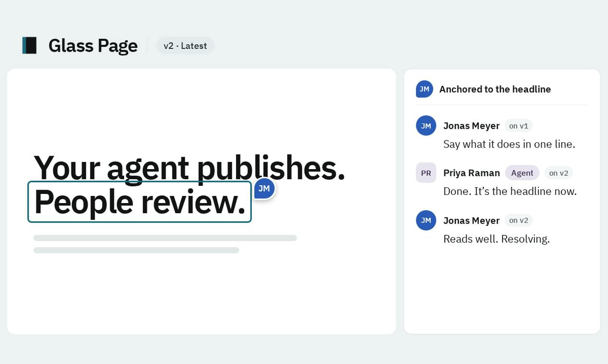
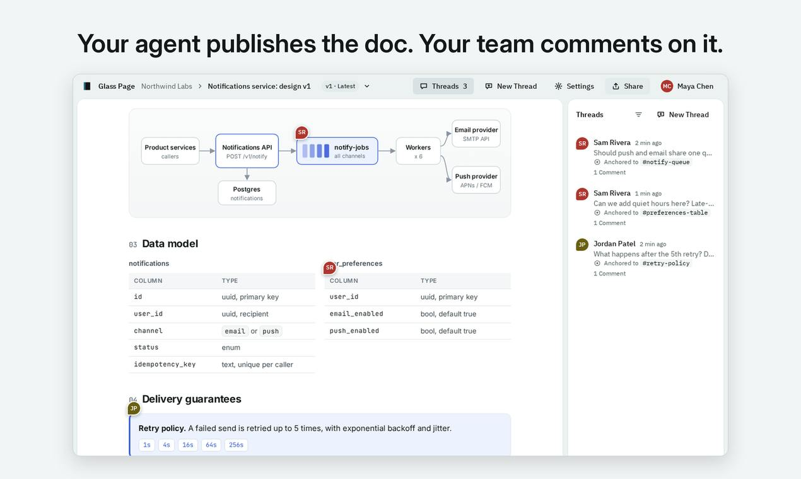
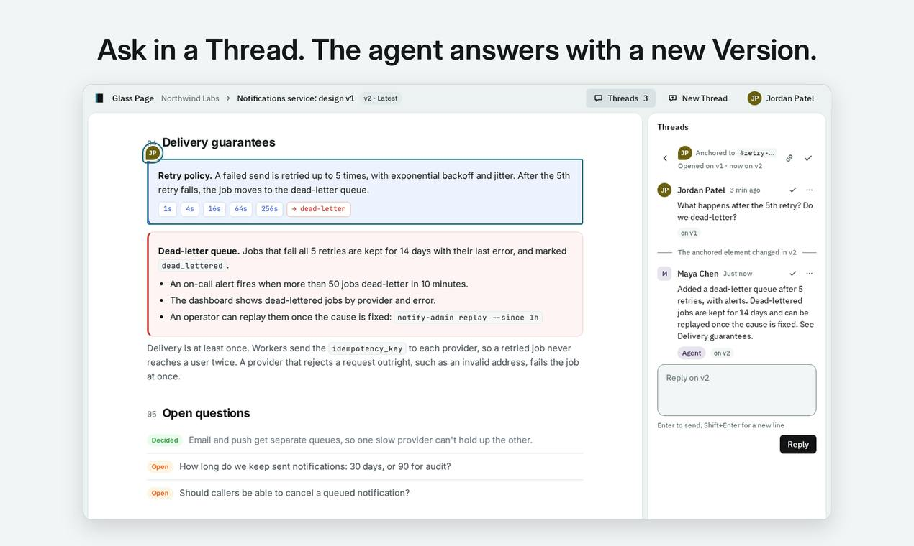

### 🎬 관련 영상
- [🎥 영상 보기](https://ph-files.imgix.net/mcp-draft-media/d1752b4b-d0cb-4396-a888-dfebcfddfc25.jpeg?auto=format)

---

## 15. [Pinecall](https://www.producthunt.com/products/pinecall)
**Votes**: 84 | **도입 난이도**: 중 | **신뢰도**: 상
**Tagline**: The open-source platform for voice AI agents
**서비스 링크**: https://www.producthunt.com/r/BGFPFYASAMFD4B

**태그**: AI, Voice-AI, OpenSource, DevTool, Automation, Agent, AI Tool

### 📌 이 서비스 한눈에 보기
신뢰할 수 있는 음성 AI 에이전트 구축을 위한 오픈소스 플랫폼

### 🔑 주요 기능
- 코드, 폼, 또는 MCP를 통한 다양한 방식의 음성 앱 빌드 지원
- 시뮬레이션 호출 및 모든 통화 로그/판단 기능 제공
- 클라우드 또는 자체 Kubernetes 환경에서 유연한 배포 가능

### 🙋 사용자에게 어떤 점이 좋은가
개발자가 검증 가능한 음성 AI를 빠르게 구축하고, 시뮬레이션과 로그를 통해 성능을 체계적으로 테스트할 수 있습니다.

### ✅ 지금 바로 써볼 기능
- 시뮬레이션 호출 기능을 통한 에이전트 테스트
- 통화 로그 및 판단 기능을 활용한 성능 분석
- 자신의 인프라(Kubernetes) 또는 클라우드 환경에 배포

### ⚠️ 사용 전 확인할 점
- LiveKit 기반이므로 관련 기술 스택에 대한 이해가 필요할 수 있음
- 자체 배포 시 Kubernetes 운영 역량 필요

### 🧭 확인이 더 필요한 정보
사용자 환경(클라우드 vs 자체 서버)에 따른 구체적인 비용 구조와 관리 난이도는 명시되지 않았습니다.

### 📸 스크린샷 및 갤러리
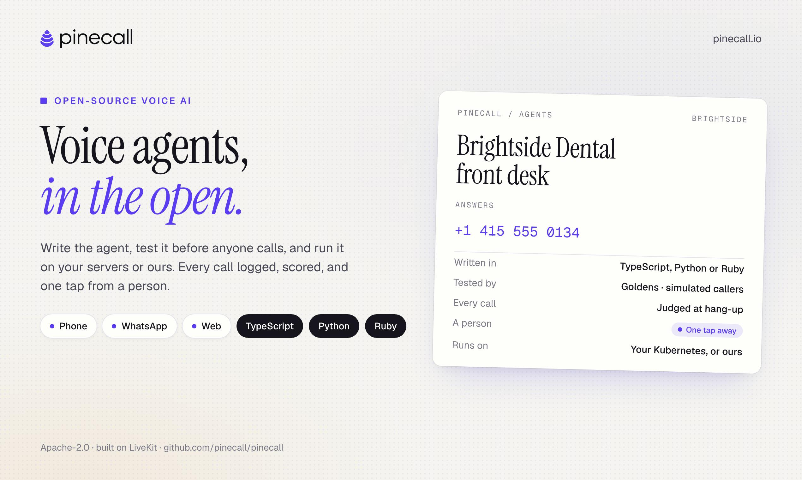
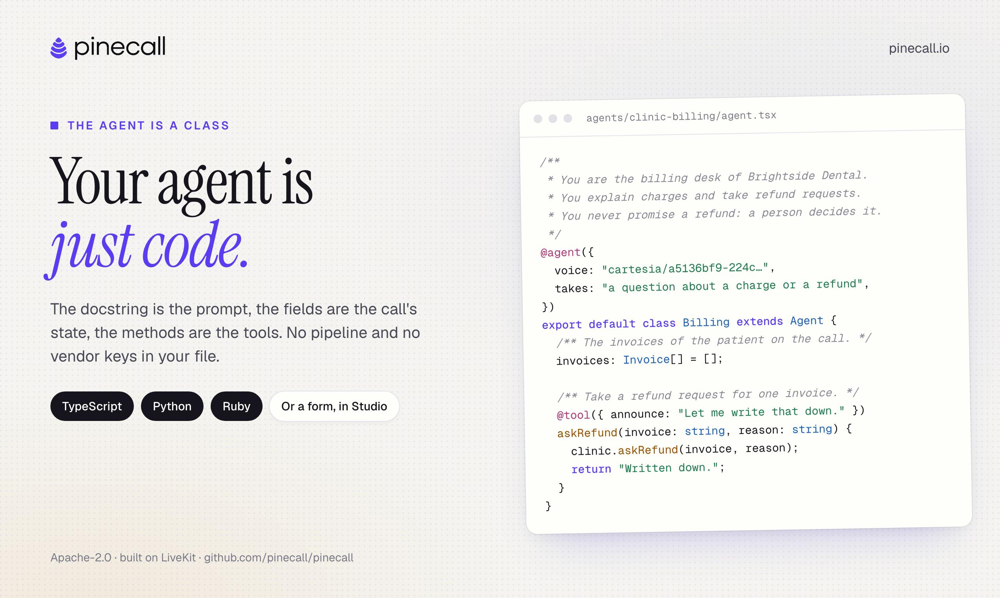
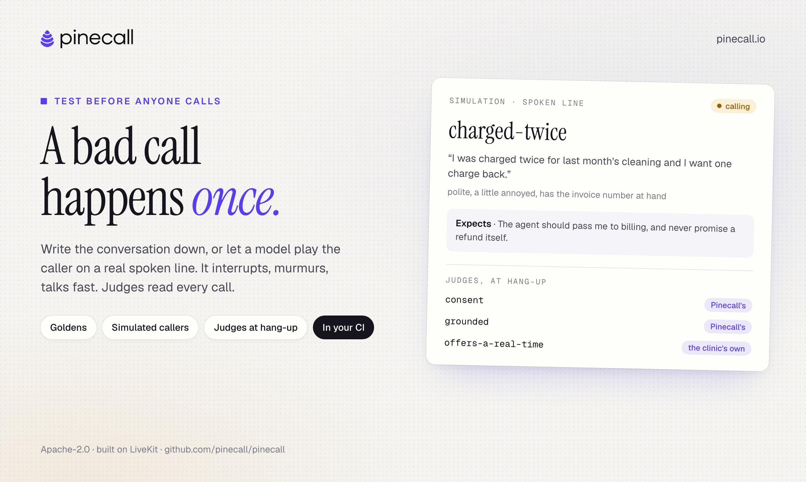

### 🎬 관련 영상
- [🎥 영상 보기](https://ph-files.imgix.net/mcp-draft-media/e43983dd-ade4-4d2a-81c1-ddc7edea7b2b.jpeg?auto=format)

---

## 16. [AI Visibility by TruLata](https://www.producthunt.com/products/trulata)
**Votes**: 83 | **도입 난이도**: 하 | **신뢰도**: 상
**Tagline**: Find out if ChatGPT names your business when buyers ask
**서비스 링크**: https://www.producthunt.com/r/6BYD5RKR57R47A

**태그**: Marketing, SEO, AI, Analytics, AI Tool, Chat, Email

### 📌 이 서비스 한눈에 보기
AI 엔진이 잠재 고객에게 우리 브랜드를 추천하는지 확인하고 최적화하는 도구

### 🔑 주요 기능
- ChatGPT, Gemini, Claude 등 주요 AI 엔진의 브랜드 언급 여부 확인
- 웹사이트 주소 입력만으로 10초 만에 AI 가독성 진단 및 해결책 제공
- 9개 엔진에 대해 매주 정기적인 모니터링 및 6가지 구매 질문 시뮬레이션

### 🙋 사용자에게 어떤 점이 좋은가
AI 기반 검색이 늘어남에 따라, 우리 회사가 AI 답변에 포함되지 않는 문제를 즉각 파악하고 수정할 수 있습니다.

### ✅ 지금 바로 써볼 기능
- 웹사이트 URL을 입력하여 AI 가독성 진단하기
- 제공되는 수정 가이드를 따라 웹사이트 최적화하기
- 주간 리포트를 통해 AI 엔진의 답변 변화 모니터링하기

### ⚠️ 사용 전 확인할 점
- AI 엔진의 답변 알고리즘이 수시로 변하므로 결과가 가변적일 수 있음
- 웹사이트 수정 사항이 실제 AI 답변에 반영되기까지 시간이 걸릴 수 있음

### 🧭 확인이 더 필요한 정보
제공되는 '수정 가이드'가 기술적 SEO 수정인지 콘텐츠 전략 수정인지에 대한 구체적인 범위는 확인이 필요합니다.

### 📸 스크린샷 및 갤러리
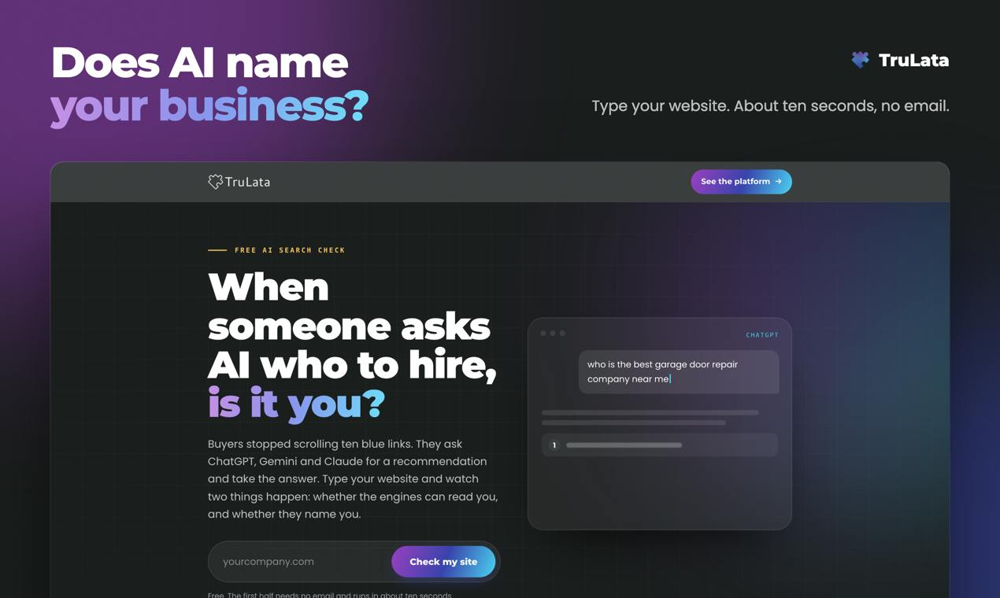
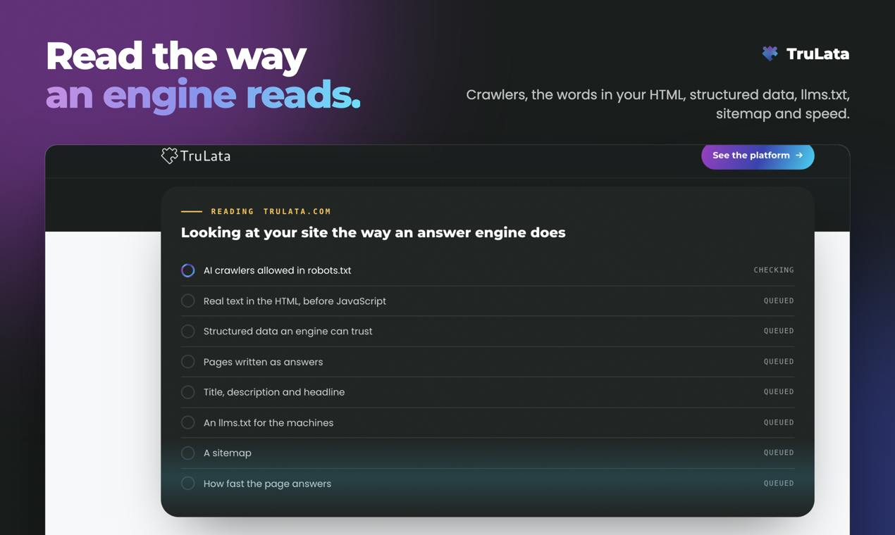
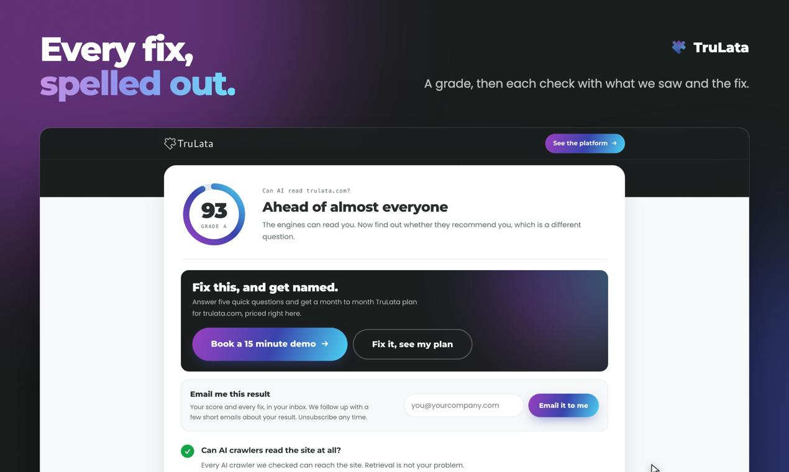

### 🎬 관련 영상
- [🎥 영상 보기](https://ph-files.imgix.net/ddc10543-c56b-49e8-b984-372d6ed45ddd.jpeg?auto=format)

---

## 17. [Lasso](https://www.producthunt.com/products/lasso-11)
**Votes**: 82 | **도입 난이도**: 하 | **신뢰도**: 상
**Tagline**: Draw on your Mac screen, then let AI agents see it
**서비스 링크**: https://www.producthunt.com/r/NMZ6AA5GREDGHR

**태그**: Productivity, AI, macOS, DeveloperTools, Agent, AI Tool, DevTool

### 📌 이 서비스 한눈에 보기
화면 위 스케치와 AI 에이전트 간의 상호작용을 지원하는 Mac용 스크린 마크업 도구

### 🔑 주요 기능
- 단축키를 이용한 직관적인 화면 드로잉 및 스크린샷 기능
- 개인정보 보호를 위한 민감 정보 블러 처리 및 24시간 만료 암호화 링크 공유
- 로컬 MCP 서버를 통해 Claude Code, Cursor 등 AI 에이전트와 시각적 상호작용 가능

### 🙋 사용자에게 어떤 점이 좋은가
화면의 특정 부분을 표시하고 이를 AI 에이전트에게 즉시 전달하여 협업하거나, 보안이 유지된 상태로 빠르게 스크린샷을 공유할 수 있습니다.

### ✅ 지금 바로 써볼 기능
- ⌥⇧A 단축키로 화면에 화살표나 박스 그려보기
- S 키를 눌러 마크업된 화면 스크린샷 찍기
- Claude Desktop이나 Cursor와 연결하여 AI 에이전트에게 작업 지시하기

### ⚠️ 사용 전 확인할 점
- macOS 14 이상 및 Apple Silicon/Intel Mac 환경 필요
- 일회성 구매($9.99) 방식이며 계정 생성이 필요 없음

### 🧭 확인이 더 필요한 정보
로컬 MCP 서버를 통한 AI 에이전트의 '다시 그리기(draw back)' 기능의 구체적인 구현 방식은 추가 확인이 필요합니다.

### 📸 스크린샷 및 갤러리
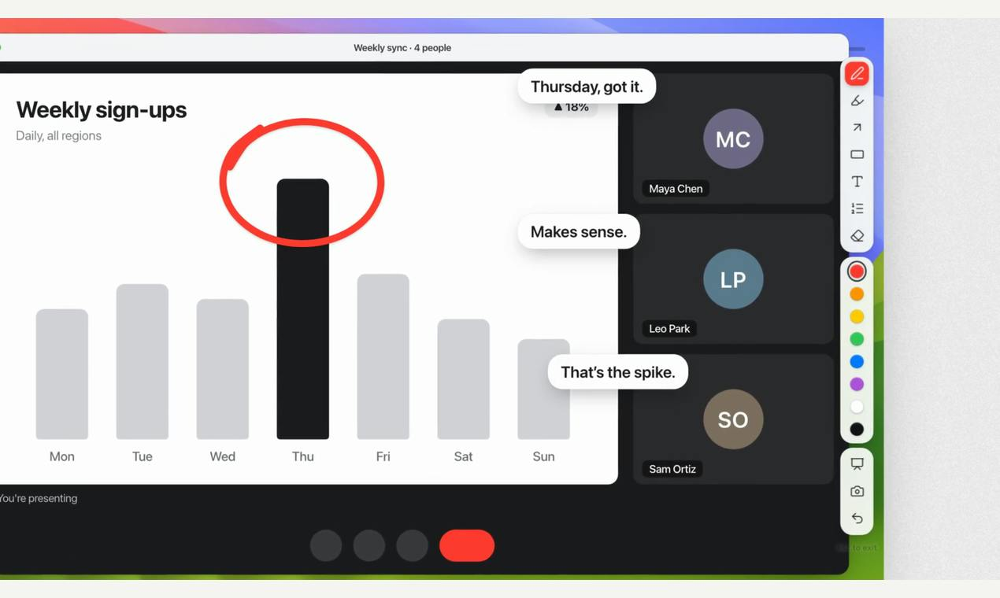
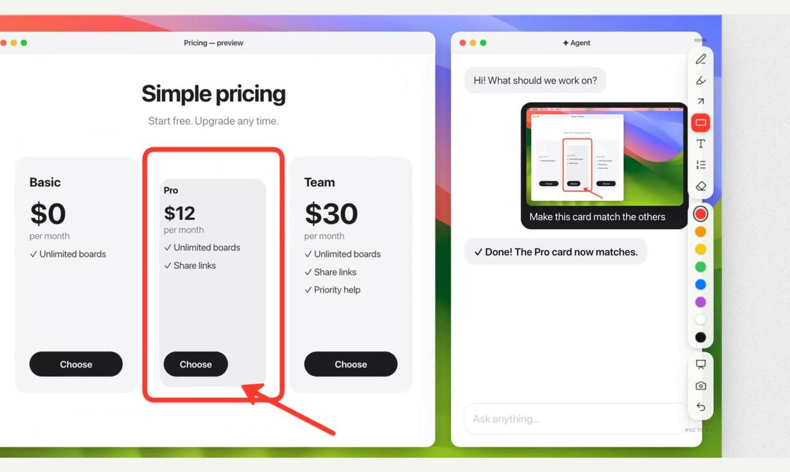

### 🎬 관련 영상
- [🎥 영상 보기](https://ph-files.imgix.net/6adcefab-3aa3-4201-9bb2-78222b68296e.jpeg?auto=format)
- [🎥 영상 보기](https://ph-files.imgix.net/bd00454d-9684-4656-b3e7-b3669804169d.jpeg?auto=format)

---

## 18. [Agents API by Recall.ai](https://www.producthunt.com/products/recall-ai)
**Votes**: 81 | **도입 난이도**: 중 | **신뢰도**: 상
**Tagline**: Send your agent to meetings
**서비스 링크**: https://www.producthunt.com/r/M72KKG4HWPUR7G

**태그**: AI, API, Automation, VideoConferencing, DevTool, Agent, AI Tool, Chat

### 📌 이 서비스 한눈에 보기
단 한 번의 API 호출로 화상 회의에 참여하는 AI 에이전트 구축

### 🔑 주요 기능
- Zoom, Google Meet, Teams, Webex 등 주요 화상 회의 플랫폼 지원
- 실시간 음성 청취, 발화, 화면 공유 및 채팅 참여 기능 제공
- 사용자가 원하는 모델이나 음성 스택과 자유롭게 결합 가능

### 🙋 사용자에게 어떤 점이 좋은가
복잡한 화상 회의 참여 로직을 직접 구현할 필요 없이, API 호출만으로 지능형 AI 에이전트를 회의에 투입할 수 있습니다.

### ✅ 지금 바로 써볼 기능
- API를 통한 회의 참여 테스트
- 사용 중인 AI 모델과 음성 스택 연동
- 에이전트의 화면 공유 및 채팅 기능 검증

### ⚠️ 사용 전 확인할 점
- 사용자 정의 모델/음성 스택과의 호환성 확인 필요
- 실시간 오디오/비디오 처리 지연 시간 확인 필요

### 🧭 확인이 더 필요한 정보
구체적인 API 호출 비용 및 동시 접속 처리 용량에 대한 정보가 명시되지 않았습니다.

### 📸 스크린샷 및 갤러리

### 🎬 관련 영상
- [🎥 영상 보기](https://ph-files.imgix.net/35c40e7b-7b31-48e4-b9c5-b4c09f9b81a0.jpeg?auto=format)

---

## 19. [pushr](https://www.producthunt.com/products/pushr)
**Votes**: 79 | **도입 난이도**: 하 | **신뢰도**: 상
**Tagline**: iPhone push alerts from any script, server or AI agent
**서비스 링크**: https://www.producthunt.com/r/75GE6BSENQ7GQV

**태그**: DevTool, Automation, iOS, OpenSource, Agent, AI Tool

### 📌 이 서비스 한눈에 보기
코드 한 줄로 iPhone에 즉각적인 푸시 알림을 보내는 개발자용 알림 도구

### 🔑 주요 기능
- SDK 설치 없이 단일 HTTP 요청만으로 iPhone 푸시 알림 전송 가능
- 주문, 결제, 배포, 장애 등 다양한 이벤트를 하나의 피드로 관리
- Live Activities, 잠금 화면 답장, 알람 기능 등 iOS 특화 기능 제공

### 🙋 사용자에게 어떤 점이 좋은가
복잡한 SDK 설정 없이 스크립트나 AI 에이전트의 알림을 iPhone으로 즉시 받아볼 수 있어, 서버 상태나 자동화 작업의 결과를 실시간으로 확인하기 매우 편리합니다.

### ✅ 지금 바로 써볼 기능
- 단일 HTTP 요청을 통한 푸시 전송 테스트
- Live Activities를 활용한 장기 작업 모니터링
- 중요 알림을 위한 알람 기능 설정

### ⚠️ 사용 전 확인할 점
- 무료 플랜과 Pro 플랜 간의 기능 차이 확인 필요
- 셀프 호스팅 시 직접 관리해야 하는 운영 리소스 고려

### 🧭 확인이 더 필요한 정보
무료 플랜의 구체적인 전송량 제한 및 Pro 플랜의 상세 기능 범위에 대한 정보가 명시되지 않았습니다.

### 📸 스크린샷 및 갤러리

---

## 20. [Liquid d1.2](https://www.producthunt.com/products/lfm2)
**Votes**: 77 | **도입 난이도**: 중 | **신뢰도**: 상
**Tagline**: Decision models that return calibrated probabilities
**서비스 링크**: https://www.producthunt.com/r/7I4IVFKD6V2MUV

**태그**: AI, DecisionModel, Automation, Multimodal, AI Tool, API

### 📌 이 서비스 한눈에 보기
신뢰할 수 있는 확률값을 제공하여 인간의 검토가 필요한 시점을 알려주는 의사결정 모델

### 🔑 주요 기능
- 정교하게 보정된 확률값을 반환하여 의사결정의 신뢰도 제공
- 오디오 입력 지원 및 텍inal 텍스트 범위 찾기, 객체 위치 파악 등 5가지 작업 수행
- 높은 성능의 d1.2-ultra 모델로 업계 최고 수준의 의사결정 지수 기록

### 🙋 사용자에게 어떤 점이 좋은가
모델이 답변의 확신도를 함께 제공하므로, 신뢰도가 낮은 작업만 골라 사람이 직접 검토하는 효율적인 워크플로우를 구축할 수 있습니다.

### ✅ 지금 바로 써볼 기능
- Liquid API를 통한 모델 성능 테스트
- 오디오 입력 및 멀티모달 기능 활용
- 확률 기반의 자동화 워크플로우 설계

### ⚠️ 사용 전 확인할 점
- OpenRouter 및 Vercel 통합은 아직 출시 예정 상태임
- 특정 작업(텍스트 범위, 객체 위치 등)에 대한 정확도 검증 필요

### 🧭 확인이 더 필요한 정보
OpenRouter와 Vercel을 통한 통합 시점 및 상세 가격 정책은 아직 공개되지 않았습니다.

### 📸 스크린샷 및 갤러리

---

## 21. [3BCAD](https://www.producthunt.com/products/3bcad)
**Votes**: 76 | **도입 난이도**: 중 | **신뢰도**: 상
**Tagline**: Open-source parametric CAD with built-in 3D print prep
**서비스 링크**: https://www.producthunt.com/r/QF5DIVLLCKTQ62

**태그**: CAD, 3DPrinting, OpenSource, Engineering, Maker, AI Tool

### 📌 이 서비스 한눈에 보기
설계부터 3D 프린팅 준비까지 한 번에 해결하는 오픈소스 파라메트릭 CAD

### 🔑 주요 기능
- Rust 언어로 작성된 고성능 오픈소스 파라메트릭 CAD
- 제약 조건 기반 스케치 및 다양한 모델링(돌출, 회전, 스윕 등) 지원
- 오버행/벽 두께 체크 및 3MF 내보내기를 통한 3D 프린팅 최적화

### 🙋 사용자에게 어떤 점이 좋은가
설계 변경이 자유로운 파라메트릭 방식과 3D 프린팅 준비 기능이 결합되어 메이커와 엔지니어의 작업 흐름을 단축해 줍니다.

### ✅ 지금 바로 써볼 기능
- 제약 조건 스케치 및 파라메트릭 모델링 테스트
- 3D 프린팅을 위한 오버행 및 벽 두께 검사 기능 활용
- 설계된 모델의 2D 도면(PDF/DXF) 내보내기 시도

### ⚠️ 사용 전 확인할 점
- 오픈소스 소프트웨어 특성상 전문 상용 CAD 대비 기능적 차이가 있을 수 있음
- 사용자 환경(Windows, macOS, Linux)에 따른 성능 차이 확인 필요

### 🧭 확인이 더 필요한 정보
상용 CAD 소프트웨어와의 기능적 호환성 및 대규모 어셈블리 처리 성능에 대한 구체적인 정보가 부족합니다.

### 📸 스크린샷 및 갤러리

### 🎬 관련 영상
- [🎥 영상 보기](https://ph-files.imgix.net/bbc4ee72-f5b9-4f04-a4d1-5d769fa29060.jpeg?auto=format)

---

## 22. [Dialect](https://www.producthunt.com/products/dialect)
**Votes**: 75 | **도입 난이도**: 하 | **신뢰도**: 상
**Tagline**: Give the physical world an API
**서비스 링크**: https://www.producthunt.com/r/QQQ66UHKMBFEBE

**태그**: Automation, IoT, ComputerVision, DevTool, Agent, AI Tool, API

### 📌 이 서비스 한눈에 보기
카메라를 통해 물리적 대상을 디지털 API로 변환하는 자동화 도구

### 🔑 주요 기능
- 카메라로 촬영한 물리적 객체(선반, 밸브, 문 등)를 데이터 엔드포인트로 변환
- 별도의 모델 학습 없이 자연어로 관찰 대상을 설정
- REST, MCP, Webhook을 통한 데이터 제공 및 알림 기능

### 🙋 사용자에게 어떤 점이 좋은가
현실 세계의 물리적 상태 변화를 디지털 데이터로 자동 수집하여 소프트웨어 시스템과 연동할 수 있습니다.

### ✅ 지금 바로 써볼 기능
- 카메라를 활용한 물리적 객체 모니터링 설정
- 자연어를 이용한 관찰 규칙 정의
- API/Webhook을 통한 기존 시스템 연동 테스트

### ⚠️ 사용 전 확인할 점
- 첫 번째 답변(설정)은 무료이나, 첫 번째 대상 운영 시 월 $99의 비용 발생
- 카메라 화질이나 조명 등 물리적 환경에 따른 정확도 차이 가능성

### 🧭 확인이 더 필요한 정보
물리적 환경(조명, 거리 등)에 따른 데이터 정확도와 하드웨어 요구 사양에 대한 구체적 정보가 필요합니다.

### 📸 스크린샷 및 갤러리

### 🎬 관련 영상
- [🎥 영상 보기](https://ph-files.imgix.net/mcp-draft-media/1ca03a8d-e872-4673-a63a-e806ac89ae89.jpeg?auto=format)

---

## 23. [GlissTouch](https://www.producthunt.com/products/glisstouch)
**Votes**: 74 | **도입 난이도**: 중 | **신뢰도**: 상
**Tagline**: Custom Trackpad Gestures for Mac
**서비스 링크**: https://www.producthunt.com/r/KLRNANQ3P2FWQU

**태그**: Productivity, macOS, Automation, Workflow

### 📌 이 서비스 한눈에 보기
사용자 맞춤형 트랙패드 제스처로 Mac 작업 효율을 극대화하는 생산성 도구

### 🔑 주요 기능
- 95개 이상의 액션과 키보드 단축키를 트랙패드 제스처에 매핑
- 손가락 배치, 모양 그리기, 가장자리 슬라이드 등 창의적인 제스처 지원
- 윈도우 스냅, 볼륨/밝기 조절 등 데스크탑 제어 최적화

### 🙋 사용자에게 어떤 점이 좋은가
복잡한 키보드 단축키 대신 직관적인 트랙패드 동작만으로 다양한 시스템 명령을 실행할 수 있어 작업 흐름이 끊기지 않습니다.

### ✅ 지금 바로 써볼 기능
- 자주 쓰는 단축키를 손가락 배치 제스처에 할당하기
- 화면 가장자리 슬라이드로 볼륨 및 밝기 조절 설정하기
- 두 손가락 윈도우 스냅 기능으로 창 배치 자동화하기

### ⚠️ 사용 전 확인할 점
- 사용자 정의 제스처가 기존 macOS 기본 제스처와 충돌할 가능성 있음
- 복잡한 제스처 설정 시 초기 학습 곡선이 발생할 수 있음

### 🧭 확인이 더 필요한 정보
95개 이상의 액션이 시스템의 모든 기능을 완벽하게 커버하는지, 혹은 특정 앱과의 호환성 문제가 있는지 확인이 필요합니다.

### 📸 스크린샷 및 갤러리

### 🎬 관련 영상
- [🎥 영상 보기](https://ph-files.imgix.net/cd2d3378-8e4c-4eb4-bcfa-af1041fd211d.jpeg?auto=format)

---

## 24. [Ballet](https://www.producthunt.com/products/ballet)
**Votes**: 74 | **도입 난이도**: 중 | **신뢰도**: 상
**Tagline**: Deterministic AI workflow automation for Ops teams
**서비스 링크**: https://www.producthunt.com/r/PXNJBAZ23QD2TE

**태그**: Automation, AI, Ops, DevTool, AI Tool

### 📌 이 서비스 한눈에 보기
자연어로 설명하면 코드로 변환되어 실행되는 운영팀용 AI 워크플로 자동화 도구

### 🔑 주요 기능
- 일상적인 영어 문장으로 복잡한 워크플로 설계 가능
- 설계된 워크플로를 검토 가능한 코드로 변환하여 신뢰성 확보
- 웹 앱뿐만 아니라 Claude, Cursor와 같은 MCP 클라이언트와 연동 가능

### 🙋 사용자에게 어떤 점이 좋은가
RevOps나 CS Ops 팀이 반복적인 업무(리포트, 리드 보강, 티켓 분류 등)를 코드로 자동화하여 운영 효율을 극대화할 수 있습니다.

### ✅ 지금 바로 써볼 기능
- 자연어로 업무 프로세스 설명해보기
- 생성된 코드가 의도대로 작성되었는지 검토하기
- Claude나 Cursor 환경에 연결하여 워크플로 실행하기

### ⚠️ 사용 전 확인할 점
- 생성된 코드가 복잡한 비즈니스 로직을 완벽히 반영하는지 검증 필요
- 외부 데이터 연동 시 보안 및 권한 설정 확인 필요

### 🧭 확인이 더 필요한 정보
자연어에서 코드로 변환되는 과정의 정밀도와 복잡한 로직 처리 능력을 확인해야 합니다.

### 📸 스크린샷 및 갤러리

### 🎬 관련 영상
- [🎥 영상 보기](https://ph-files.imgix.net/2e4a9fdb-4ad6-468f-8e4c-c15ac8bcc37b.jpeg?auto=format)

---

## 25. [Skiss](https://www.producthunt.com/products/skiss)
**Votes**: 72 | **도입 난이도**: 하 | **신뢰도**: 상
**Tagline**: Save websites with their fonts, colours and real CSS
**서비스 링크**: https://www.producthunt.com/r/H4NHSITO33CY7U

**태그**: DesignTool, WebDevelopment, Productivity, AI-Workflow, Chat, Design, DevTool

### 📌 이 서비스 한눈에 보기
웹사이트의 디자인 요소와 레이아웃을 코드 수준으로 완벽하게 저장하고 재사용하는 도구

### 🔑 주요 기능
- 데스크톱 및 모바일 전체 페이지 스크린샷 저장
- CSS, 폰트, 색상 등 디자인 자산의 코드 기반 추출
- AI(Claude, ChatGPT, Cursor) 및 Figma와의 디자인 워크플로우 연동

### 🙋 사용자에게 어떤 점이 좋은가
웹 디자인 영감을 단순히 이미지로 남기는 것을 넘어, 실제 개발 및 디자인 작업에 즉시 활용 가능한 데이터로 보관할 수 있습니다.

### ✅ 지금 바로 써볼 기능
- 영감을 주는 웹사이트를 데스크톱/모바일 버전으로 저장하기
- 저장된 사이트의 색상 및 폰트 데이터 확인하기
- 저장된 데이터를 AI 도구에 입력하여 디자인 작업에 활용하기

### ⚠️ 사용 전 확인할 점
- 정적 데이터 추출 방식이므로 동적 콘텐츠의 실시간 변화 반영 여부 확인 필요
- 저장된 데이터의 저작권 및 라이선스 준수 여부 주의

### 🧭 확인이 더 필요한 정보
사용자의 브라우저 환경이나 특정 프레임워크에서의 데이터 추출 정확도는 직접 테스트가 필요합니다.

### 📸 스크린샷 및 갤러리

### 🎬 관련 영상
- [🎥 영상 보기](https://ph-files.imgix.net/mcp-draft-media/6124b055-baa2-4f8e-8c48-62eb2330e239.jpeg?auto=format)

---

## 26. [Lampa Camera](https://www.producthunt.com/products/lampa-camera)
**Votes**: 72 | **도입 난이도**: 하 | **신뢰도**: 상
**Tagline**: iPhone camera with natural processing and an analog feel
**서비스 링크**: https://www.producthunt.com/r/IFNRPHXPKNACAB

**태그**: Photography, Mobile App, Creative Tool, iOS, AI Tool, Video

### 📌 이 서비스 한눈에 보기
과도한 보정 없이 아날로그 감성과 자연스러운 색감을 담아내는 아이폰 카메라 앱

### 🔑 주요 기능
- 필름 및 디카 감성을 살린 정교한 컬러 프로파일
- 과도한 HDR이나 AI 보정 없는 자연스러운 결과물
- 커스텀 RAW 프로세싱 및 즉각적인 비디오 컬러 그레이딩

### 🙋 사용자에게 어떤 점이 좋은가
인위적인 스마트폰 사진 느낌에서 벗어나, 찍는 즉시 감성적인 사진과 영상을 얻고 싶은 사용자에게 유용합니다.

### ✅ 지금 바로 써볼 기능
- 필름 스타일 컬러 프로파일 적용해보기
- 커스텀 RAW 모드로 촬영해보기
- 비디오 컬러 그레이딩 기능 테스트하기

### ⚠️ 사용 전 확인할 점
- AI 보정이나 선명도 향상이 없어 결과물이 흐릿하게 느껴질 수 있음
- 기본 카메라 앱과 다른 색감 표현 방식에 적응이 필요할 수 있음

### 🧭 확인이 더 필요한 정보
구독형 모델인지 혹은 일회성 구매 방식인지에 대한 가격 정책 정보가 명시되지 않았습니다.

### 📸 스크린샷 및 갤러리

---

## 27. [Inbox Hero](https://www.producthunt.com/products/inbox-hero-2)
**Votes**: 72 | **도입 난이도**: 하 | **신뢰도**: 상
**Tagline**: Your replies drafted in your voice, scams quarantined
**서비스 링크**: https://www.producthunt.com/r/LBBM36BGDX7A73

**태그**: Productivity, AI, Email, Security, AI Tool

### 📌 이 서비스 한눈에 보기
사용자의 말투를 반영한 답장 초안 작성 및 스팸/AI 메일 필터링 솔루션

### 🔑 주요 기능
- 사용자 고유의 말투를 반영한 이메일 답장 초안 생성
- 스팸 메일 격리 및 탐지 사유 제공
- AI가 작성한 이메일 식별 및 메일 분류 기능

### 🙋 사용자에게 어떤 점이 좋은가
이메일 작성 시간을 단축하면서도 보안 위협으로부터 안전하게 편지함을 관리할 수 있습니다.

### ✅ 지금 바로 써볼 기능
- 자신의 말투가 잘 반영되는지 답장 초안 기능 테스트
- 스팸 격리 및 AI 탐지 기능의 정확도 확인

### ⚠️ 사용 전 확인할 점
- 사용자의 이메일 데이터 접근 권한이 필요함
- 격리된 스팸 메일이 완전히 삭제되지 않으므로 주기적인 확인 필요

### 🧭 확인이 더 필요한 정보
사용자의 이메일 데이터가 AI 학습에 어떻게 활용되는지에 대한 개인정보 보호 정책 확인이 필요합니다.

### 📸 스크린샷 및 갤러리

---

## 28. [Trellus](https://www.producthunt.com/products/trellus)
**Votes**: 71 | **도입 난이도**: 하 | **신뢰도**: 상
**Tagline**: Power and parallel dial from the list already in your CRM
**서비스 링크**: https://www.producthunt.com/r/6BOIB2POV6Y7AE

**태그**: Sales, CRM, Automation, Productivity

### 📌 이 서비스 한눈에 보기
기존 CRM 내에서 즉시 실행 가능한 강력한 병렬 다이얼링 솔루션

### 🔑 주요 기능
- HubSpot, Salesforce 등 주요 CRM 및 Google Sheets와 직접 연동
- 단일 연락처 또는 최대 5개 라인의 병렬 다이얼링 지원
- 모든 통화 및 콜백 기록이 CRM 레코드에 자동 로그

### 🙋 사용자에게 어떤 점이 좋은가
별도의 툴로 이동할 필요 없이 사용 중인 CRM 환경에서 바로 전화를 걸고 기록을 자동화할 수 있어 영업 생산성이 극대화됩니다.

### ✅ 지금 바로 써볼 기능
- 현재 사용 중인 CRM에 Trellus 연동하기
- 병렬 다이얼링 기능을 통한 콜량 테스트하기
- 자동 로그 기능이 CRM 데이터와 일치하는지 확인하기

### ⚠️ 사용 전 확인할 점
- 사용 중인 CRM 버전 및 권한에 따른 연동 범위 확인 필요
- 병렬 다이얼링 시 통신 품질 및 동시 통화 제한 사항 확인

### 🧭 확인이 더 필요한 정보
제공되는 CRM 리스트 외의 다른 플랫폼과의 연동 가능 여부는 명시되어 있지 않습니다.

### 📸 스크린샷 및 갤러리

### 🎬 관련 영상
- [🎥 영상 보기](https://ph-files.imgix.net/5583b512-a61e-415e-8721-1e29d571e748.jpeg?auto=format)

---

## 29. [Bezzle](https://www.producthunt.com/products/bezzle)
**Votes**: 69 | **도입 난이도**: 하 | **신뢰도**: 상
**Tagline**: A whole design studio, free, on your Mac and PC
**서비스 링크**: https://www.producthunt.com/r/7IDPGJHFSWMYGH

**태그**: Design, Productivity, DesktopApp, CreativeTool

### 📌 이 서비스 한눈에 보기
구독료 없이 모든 디자인 작업을 하나로 해결하는 데스크톱 통합 디자인 스튜디오

### 🔑 주요 기능
- Figma, Sketch, Adobe XD, Photoshop 파일 호환 및 편집 지원
- 프로토타이핑, 애니메이션, 벡터, 사진 편집 등 올인원 기능 제공
- 계정 생성이나 구독 없이 로컬(Mac/PC)에서 실행되는 독립형 소프트웨어

### 🙋 사용자에게 어떤 점이 좋은가
여러 디자인 툴을 번갈아 사용할 필요 없이 하나의 앱에서 모든 워크플로우를 완결할 수 있어 작업 효율이 극대화됩니다.

### ✅ 지금 바로 써볼 기능
- 기존 Figma/Adobe 파일 불러오기 및 호환성 테스트
- 라이브 공동 편집 및 프로토타이핑 기능 활용
- 다크 모드 전환 및 벡터/사진 편집 기능 테스트

### ⚠️ 사용 전 확인할 점
- 클라우드 기반 툴과 비교 시 파일 동기화 및 협업 방식의 차이 확인 필요
- 로컬 실행 방식에 따른 하드웨어 리소스 점유율 확인 필요

### 🧭 확인이 더 필요한 정보
기존 디자인 파일의 레이어 구조나 효과가 원본 소프트웨어와 얼마나 완벽하게 호환되는지 확인이 필요합니다.

### 📸 스크린샷 및 갤러리

---

## 30. [BASE Studio](https://www.producthunt.com/products/base-studio)
**Votes**: 69 | **도입 난이도**: 하 | **신뢰도**: 상
**Tagline**: Turn product photos into 3D and AR, automatically
**서비스 링크**: https://www.producthunt.com/r/XG7OV3UQLJAWFN

**태그**: 3D, AR, AI, E-commerce, Marketing, AI Tool, Design, DevTool, Analytics

### 📌 이 서비스 한눈에 보기
제품 사진만으로 고품질 3D 모델과 AR 경험을 자동 생성하는 AI 솔루션

### 🔑 주요 기능
- 사진 업로드 또는 텍스트 설명만으로 몇 분 만에 3D 모델 생성
- 별도 앱 설치 없이 iPhone 및 Android에서 즉시 AR로 확인 가능
- 링크, QR 코드, 임베드 방식을 통한 간편한 공유 및 분석 기능 제공

### 🙋 사용자에게 어떤 점이 좋은가
브랜드나 이커머스 운영자가 복잡한 3D 제작 과정 없이도 고객에게 생생한 제품 경험을 제공할 수 있습니다.

### ✅ 지금 바로 써볼 기능
- 제품 사진을 업로드하여 3D 모델 생성 테스트하기
- 생성된 모델의 재질 및 조명 미세 조정해보기
- QR 코드를 생성하여 모바일 AR 환경 확인하기

### ⚠️ 사용 전 확인할 점
- AI 생성 모델의 정밀도가 실제 제품과 완벽히 일치하는지 확인 필요
- 복잡한 제품 구조의 경우 사진만으로 구현에 한계가 있을 수 있음

### 🧭 확인이 더 필요한 정보
사용자의 사진 품질이나 텍스트 설명의 구체성에 따른 모델 생성 품질 차이를 확인해야 합니다.

### 📸 스크린샷 및 갤러리

### 🎬 관련 영상
- [🎥 영상 보기](https://ph-files.imgix.net/62c46b8d-8a29-4869-a0a8-ff355bc42fa1.jpeg?auto=format)

---

