# 🚀 Product Hunt Daily Top 30 (2026-11-19)

## 오늘의 요약
오늘의 트렌드는 개별 AI 에이전트들을 하나의 워크스페이스로 통합하거나, 자연어를 통해 복잡한 자동화 워크플로우를 구축하는 '에이전트 중심의 협업'이 주를 이루었습니다. 또한 기업 데이터를 기반으로 맞춤형 앱을 생성하거나, 기존 AI 구독 모델을 활용해 팀 단위의 봇을 구축하는 등 실질적인 업무 자동화 솔루션들이 주목받았습니다.

### 오늘의 핵심 포인트
- 단순한 챗봇을 넘어 에이전트 간의 협업, 데이터 공유, 워크플로우 자동화를 지원하는 통합 플랫폼들이 대거 등장했습니다.
- 자연어 명령만으로 복잡한 데이터 분석, 소프트웨어 빌드, 업무 루틴을 실행하는 에이전트 중심의 생산성 도구가 강화되었습니다.
- 기업 내부 데이터와 외부 서비스를 유기적으로 연결하여 실무에 즉시 적용 가능한 자동화 환경을 구축하는 것이 핵심입니다.

**오늘의 태그**: AI 에이전트, 워크플로우 자동화, 생산성 도구, 협업 플랫폼

## 1. [S.Space](https://www.producthunt.com/products/s-space)
**Votes**: 275 | **도입 난이도**: 중 | **신뢰도**: 상
**Tagline**: Your team and everyone's AI agents, in one workspace
**서비스 링크**: https://www.producthunt.com/r/3NGQFAYB2FLK2V

**태그**: AI, Automation, Collaboration, Productivity, DevTool, Agent, AI Tool

### 📌 이 서비스 한눈에 보기
팀원과 AI 에이전트가 협업하며 업무를 완결하는 통합 워크스페이스

### 🔑 주요 기능
- 개별적으로 흩어진 AI 에이전트들을 하나의 워크스페이스로 통합
- Claude Code, Codex 등 다양한 벤더의 에이전트 연동 지원
- 에이전트 간 작업 전달 및 공유 메모리를 통한 반복 설명 최소화

### 🙋 사용자에게 어떤 점이 좋은가
여러 AI를 번갈아 쓰며 발생하는 복사/붙여넣기 번거로움을 줄이고, 에이전트들이 스스로 협업하여 결과물을 가져오므로 업무 효율이 극대화됩니다.

### ✅ 지금 바로 써볼 기능
- 기존에 사용 중인 AI 에이전트(Claude Code 등) 연결하기
- 에이전트 간 작업 위임 및 자동화 워크플로우 설정하기
- 공유 메모리 기능을 활용한 팀 지식 베이스 구축하기

### ⚠️ 사용 전 확인할 점
- 다양한 외부 에이전트 연동 시 보안 및 데이터 권한 설정 확인 필요
- 에이전트 간 자율 작업에 따른 결과물 검토 프로세스 수립 필요

### 🧭 확인이 더 필요한 정보
외부 벤더 에이전트들의 구체적인 연동 범위와 보안 정책에 대한 상세 정보가 필요합니다.

### 📸 스크린샷 및 갤러리
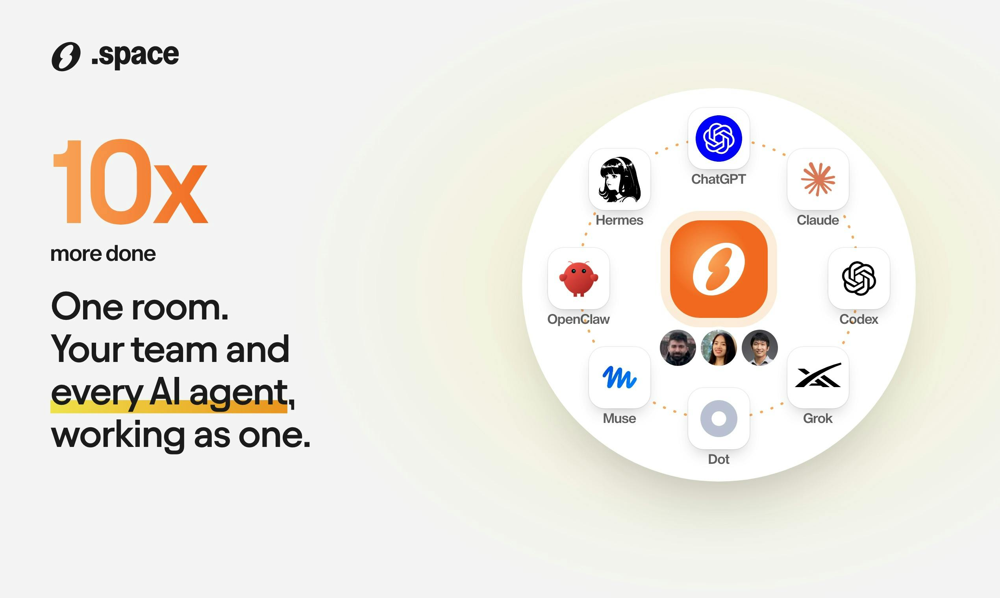
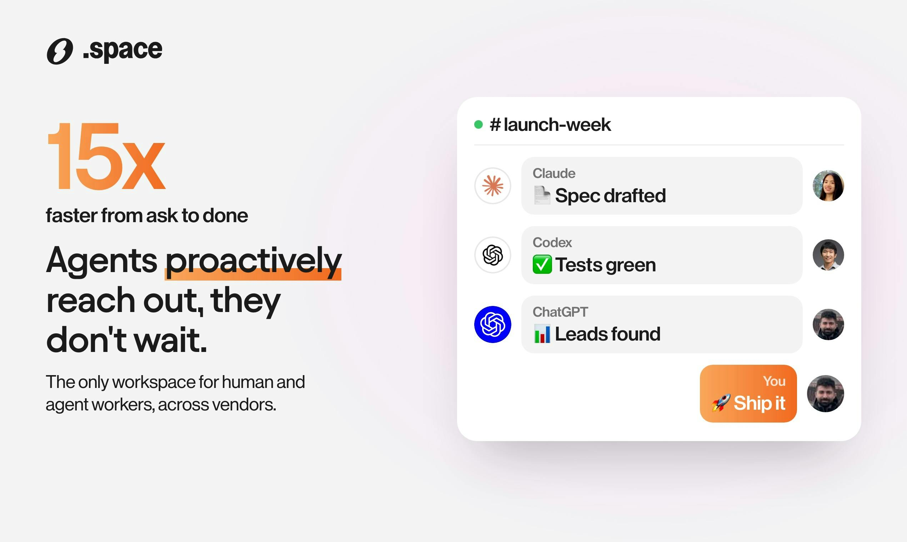
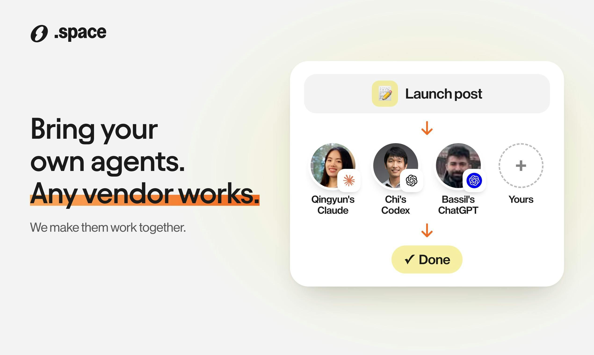

### 🎬 관련 영상
- [🎥 영상 보기](https://ph-files.imgix.net/mcp-draft-media/5b132a58-2085-41b1-9b65-f945b76be9b2.jpeg?auto=format)

---

## 2. [Bluedot Phone Calls](https://www.producthunt.com/products/bluedot-2)
**Votes**: 243 | **도입 난이도**: 하 | **신뢰도**: 상
**Tagline**: AI note taker for phone calls
**서비스 링크**: https://www.producthunt.com/r/ULWYTTAYG5XTLI

**태그**: AI, Productivity, Automation, Transcription, AI Tool

### 📌 이 서비스 한눈에 보기
전화 통화 내용을 자동으로 기록하고 요약해주는 AI 비서

### 🔑 주요 기능
- 웹 및 모바일 앱을 통한 간편한 전화 발신 기능
- 기존 발신 번호(Caller ID) 유지로 자연스러운 통화 가능
- 통화 종료 후 자동 생성되는 스크립트, 요약 및 실행 항목

### 🙋 사용자에게 어떤 점이 좋은가
회의뿐만 아니라 일상적인 전화 통화에서도 기록의 번거로움을 없애고, 중요한 업무 내용을 놓치지 않게 도와줍니다.

### ✅ 지금 바로 써볼 기능
- 모바일 앱 설치 후 전화 걸어보기
- 자동 생성된 통화 요약본 확인하기
- 추출된 액션 아이템(Action Items) 관리하기

### ⚠️ 사용 전 확인할 점
- 통화 녹음 및 기록에 대한 상대방의 동의 여부 확인 필요
- 개인정보 및 통화 데이터 보안 정책 검토

### 🧭 확인이 더 필요한 정보
국가별 통신망 호환성 및 통화 품질에 대한 구체적인 정보가 필요합니다.

### 📸 스크린샷 및 갤러리
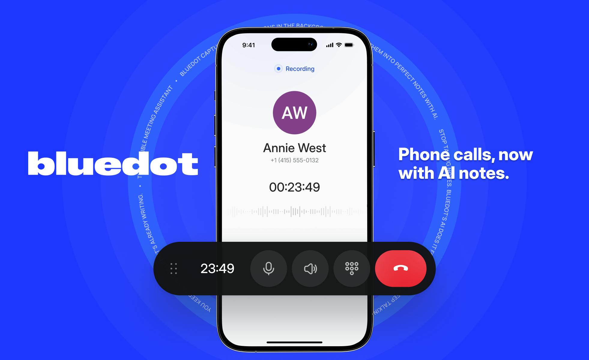
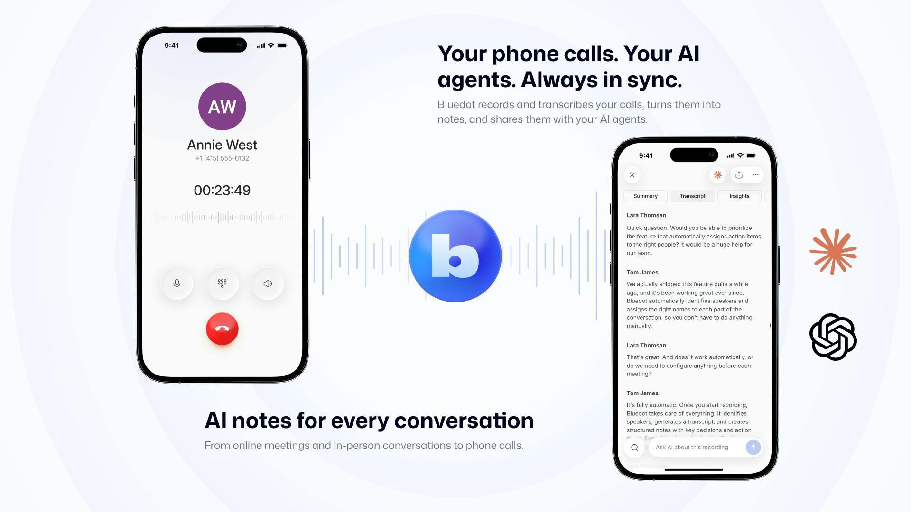
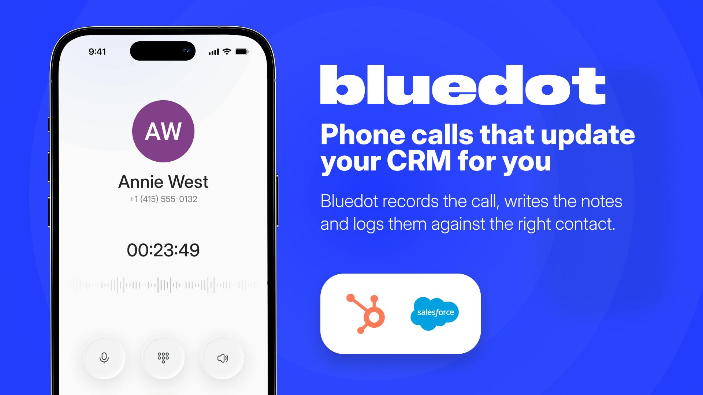

### 🎬 관련 영상
- [🎥 영상 보기](https://ph-files.imgix.net/d39176a1-73a8-497d-a359-b50da55aa1db.jpeg?auto=format)

---

## 3. [Toone](https://www.producthunt.com/products/toone)
**Votes**: 201 | **도입 난이도**: 하 | **신뢰도**: 상
**Tagline**: Grokbot meets n8n/zapier
**서비스 링크**: https://www.producthunt.com/r/46Q2MJEJGU72E3

**태그**: Automation, AI, Workflow, Productivity, Agent, AI Tool, Chat, API

### 📌 이 서비스 한눈에 보기
자연어로 정교한 AI 에이전트 워크플로우를 구축하는 자동화 플랫폼

### 🔑 주요 기능
- 자연어 기반의 에이전트 중심 워크플로우 설계
- AI 에이전트와 고정된 자동화 스텝의 하이브리드 구성
- 실시간 공유, Git 연동, MCP 지원 등 협업 및 확장성 특화

### 🙋 사용자에게 어떤 점이 좋은가
복잡한 코딩 없이 대화만으로 반복적인 업무 루틴을 자동화하고, AI 에이전트가 실시간으로 작업을 관리하게 할 수 있습니다.

### ✅ 지금 바로 써볼 기능
- 자연어로 첫 번째 자동화 워크플로우 구축하기
- ChatGPT 또는 Claude 모델을 노드로 연결해보기
- Zen Mode를 활용한 작업 집중 환경 설정하기

### ⚠️ 사용 전 확인할 점
- AI 모델의 응답에 따라 워크플로우 결과가 가변적일 수 있음
- 복잡한 로직 구현 시 에이전트 제어(babysitting)가 필요할 수 있음

### 🧭 확인이 더 필요한 정보
상세한 가격 정책 및 외부 서비스와의 구체적인 API 연동 범위는 명시되지 않았습니다.

### 📸 스크린샷 및 갤러리
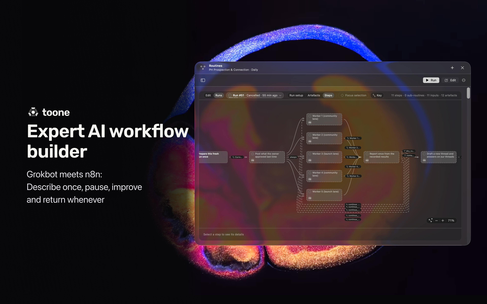
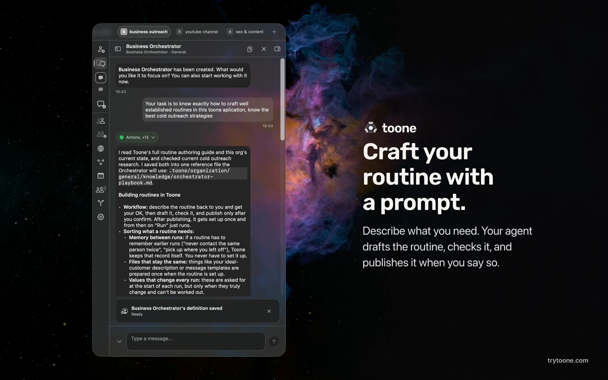
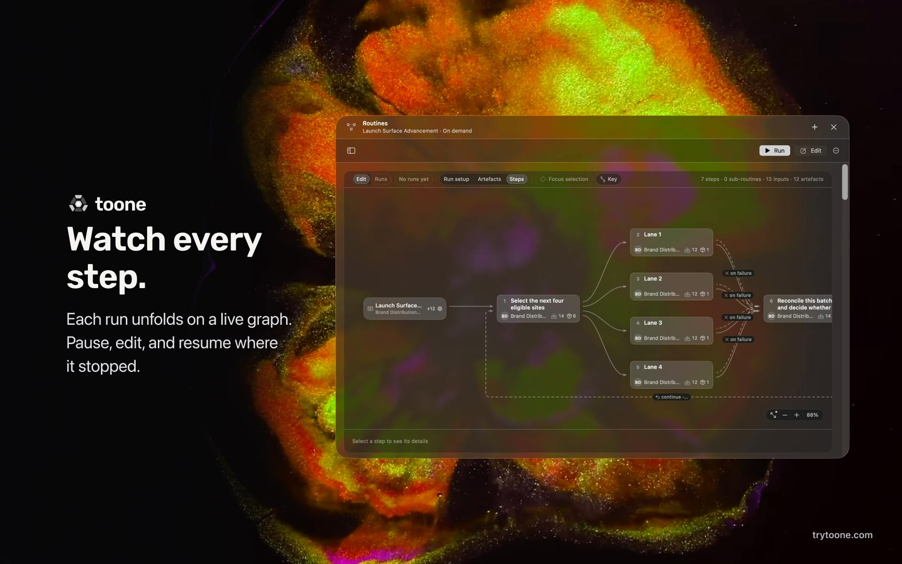

### 🎬 관련 영상
- [🎥 영상 보기](https://ph-files.imgix.net/d979aa60-8ff3-4d5f-9164-0f706d1c747b.jpeg?auto=format)

---

## 4. [Waldo by Wherobots](https://www.producthunt.com/products/waldo-by-wherobots)
**Votes**: 177 | **도입 난이도**: 중 | **신뢰도**: 상
**Tagline**: The AI agent that accelerates engineering with spatial data
**서비스 링크**: https://www.producthunt.com/r/7GHVBKIFOJ7ABR

**태그**: DevTool, Automation, Spatial-AI, Data-Engineering, Agent, AI Tool, Vision, Analytics

### 📌 이 서비스 한눈에 보기
공간 데이터 분석과 파이프라인 구축을 자동화하는 AI 에이전트

### 🔑 주요 기능
- 위성 이미지, 지리 데이터 및 조직 내 1차 데이터를 결합한 분석 수행
- 질문을 답변, 지도, 프로덕션급 데이터 파이프라인으로 즉시 변환
- Apache Sedona 제작진이 구축한 확장 가능한 공간 분석 솔루션

### 🙋 사용자에게 어떤 점이 좋은가
복잡한 공간 데이터 분석 코드를 직접 작성하는 대신, 자연어 질문만으로 분석 결과와 자동화된 데이터 파이프라인을 확보할 수 있습니다.

### ✅ 지금 바로 써볼 기능
- 자연어 질문을 통한 공간 데이터 분석 테스트
- 기존 데이터 플랫폼과의 파이프라인 연동 확인
- 위성 이미지 및 지리 데이터 분석 결과 검증

### ⚠️ 사용 전 확인할 점
- 사용자 데이터와 외부 지리 데이터 간의 보안 및 권한 설정 확인 필요
- 생성된 분석 코드 및 파이프라인의 정확도 검증 필요

### 🧭 확인이 더 필요한 정보
사용자의 기존 데이터 플랫폼(Data Platform)과의 구체적인 통합 방식과 호환 범위에 대한 확인이 필요합니다.

### 📸 스크린샷 및 갤러리
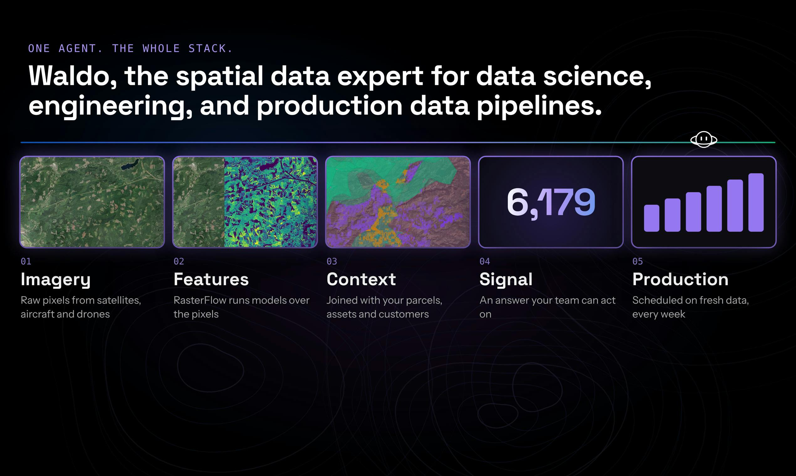
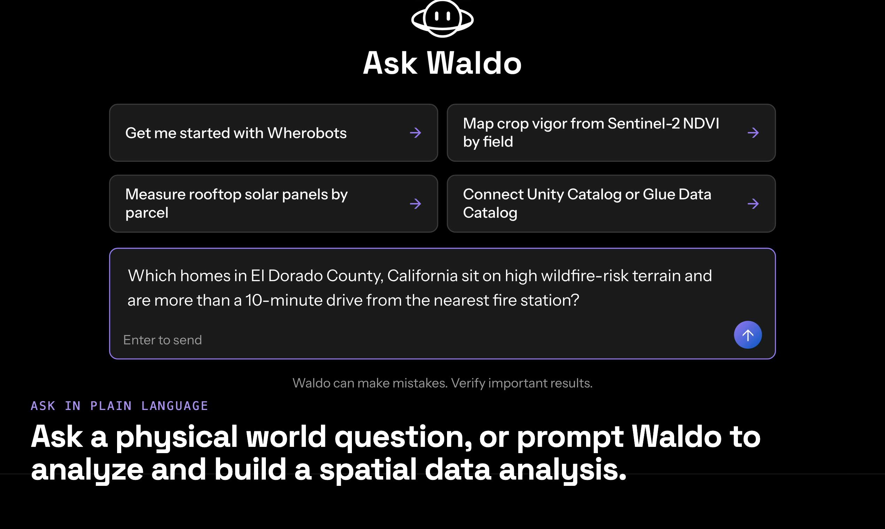
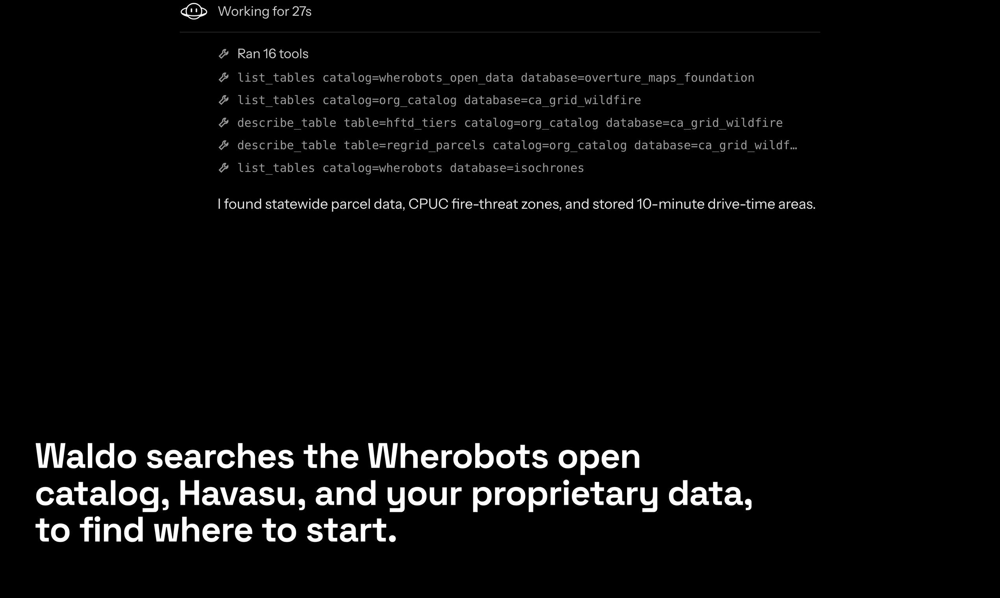

### 🎬 관련 영상
- [🎥 영상 보기](https://ph-files.imgix.net/30ff8980-9f61-46d8-8e27-511ee85edbbf.jpeg?auto=format)

---

## 5. [Dippr](https://www.producthunt.com/products/dippr)
**Votes**: 166 | **도입 난이도**: 중 | **신뢰도**: 상
**Tagline**: A data platform served to your agents, with one prompt
**서비스 링크**: https://www.producthunt.com/r/FOOJ7X4LAUBRQ3

**태그**: AI, Automation, DataPlatform, AgenticWorkflow, Agent, Prompting

### 📌 이 서비스 한눈에 보기
단 한 번의 프롬프트로 기업 데이터를 활용한 맞춤형 소프트웨어를 구축하는 에이전트용 데이터 플랫폼

### 🔑 주요 기능
- 기업 내 다양한 소스의 데이터 통합 및 접근 권한 관리
- AI 에이전트가 소프트웨어와 앱을 직접 빌드하고 실행할 수 있는 환경 제공
- 데이터 맥락 이해 및 안전한 사용 규칙 적용

### 🙋 사용자에게 어떤 점이 좋은가
복잡한 코딩 없이도 기업 데이터를 기반으로 한 자동화 도구와 앱을 에이전트가 즉시 생성하고 운영할 수 있습니다.

### ✅ 지금 바로 써볼 기능
- 기업 데이터 소스 연결하기
- 에이전트용 맞춤형 앱 빌드 시도하기
- 데이터 보안 및 사용 규칙 설정하기

### ⚠️ 사용 전 확인할 점
- 기업 내부 데이터 보안 및 권한 관리 체계 검토 필요
- 에이전트가 생성한 결과물의 품질 및 안정성 확인 필요

### 🧭 확인이 더 필요한 정보
구체적인 데이터 소스 연동 범위와 보안 프로토콜에 대한 상세 정보가 필요합니다.

### 📸 스크린샷 및 갤러리
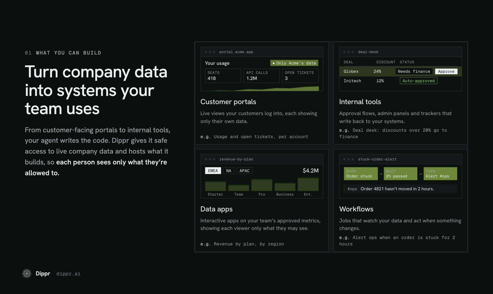
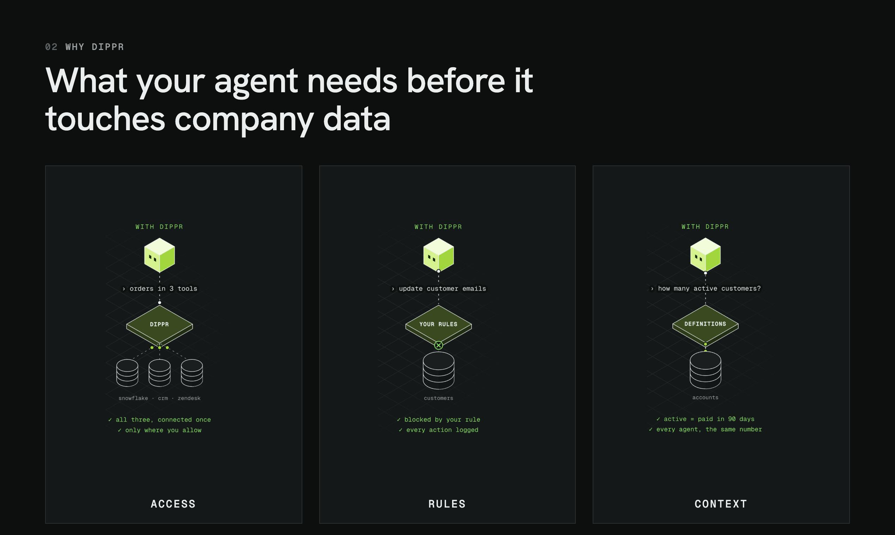
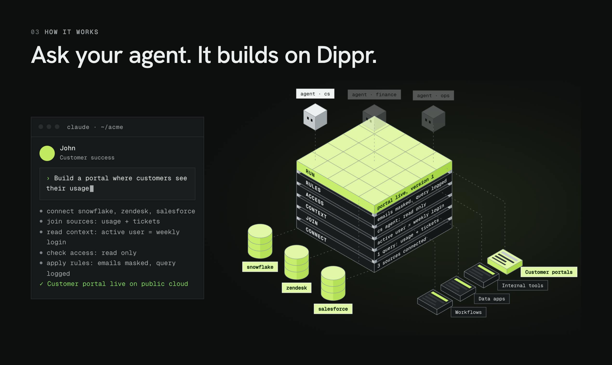

### 🎬 관련 영상
- [🎥 영상 보기](https://ph-files.imgix.net/mcp-draft-media/443befc3-4726-4fd6-b0cf-431584e4bd4c.jpeg?auto=format)

---

## 6. [Pitch Avatar HR Suite](https://www.producthunt.com/products/pitchavatar)
**Votes**: 141 | **도입 난이도**: 중 | **신뢰도**: 상
**Tagline**: Onboarding, training & comms with conversational AI avatars
**서비스 링크**: https://www.producthunt.com/r/LAAO4P46MHJORU

**태그**: HRTech, AI, Automation, Onboarding, AI Tool, DevTool

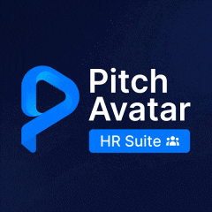

### 📌 이 서비스 한눈에 보기
대화형 AI 아바타를 통해 온보딩, 교육 및 인사 업무를 자동화하는 HR 솔루션

### 🔑 주요 기능
- 대화형 AI 아바타를 활용한 자동화된 온보딩 및 교육 프로세스
- 기업 내부 자료를 기반으로 한 맞춤형 교육 및 질의응답 기능
- 학습 진행 상황 추적 및 병목 구간 확인이 가능한 관리자 대시보드

### 🙋 사용자에게 어떤 점이 좋은가
반복적인 인사 행정 업무를 AI에게 맡기고, HR 담당자는 사람과의 소통에 더 집중할 수 있습니다.

### ✅ 지금 바로 써볼 기능
- 기존 교육 자료를 업로드하여 AI 아바타 학습시키기
- 14일 무료 체험을 통해 대화형 인터페이스 테스트하기
- 프로모션 코드(PRODUCTHUNT2026)로 할인 혜택 적용하기

### ⚠️ 사용 전 확인할 점
- AI 아바타의 답변 정확도를 위해 초기 자료 검증 필요
- 프로모션 코드는 2026년 11월 30일까지만 유효함

### 🧭 확인이 더 필요한 정보
제공된 자료에는 AI 아바타의 기술적 커스텀 범위나 외부 시스템(Slack, ERP 등)과의 연동 여부가 명시되지 않았습니다.

### 📸 스크린샷 및 갤러리
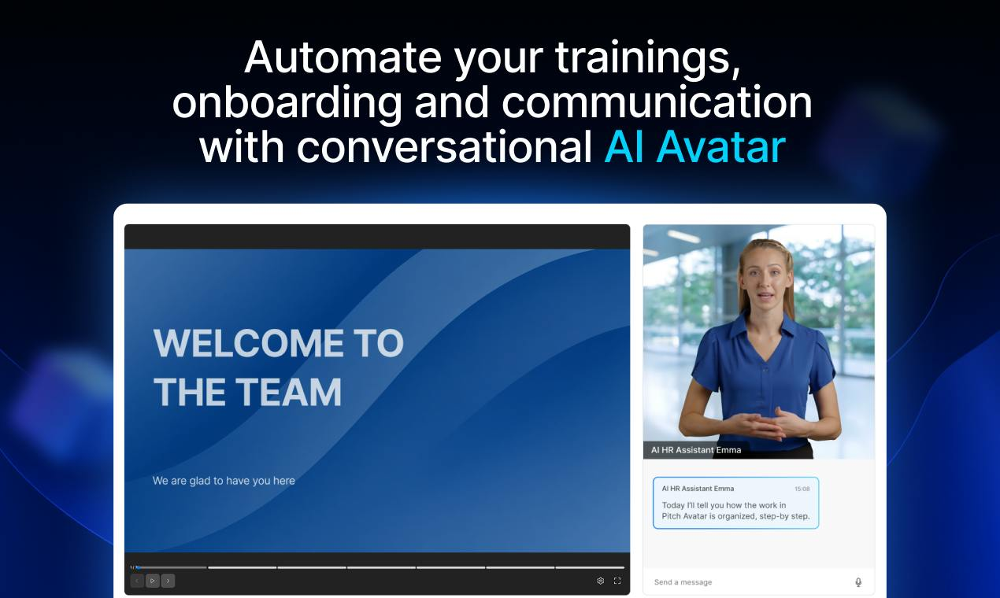
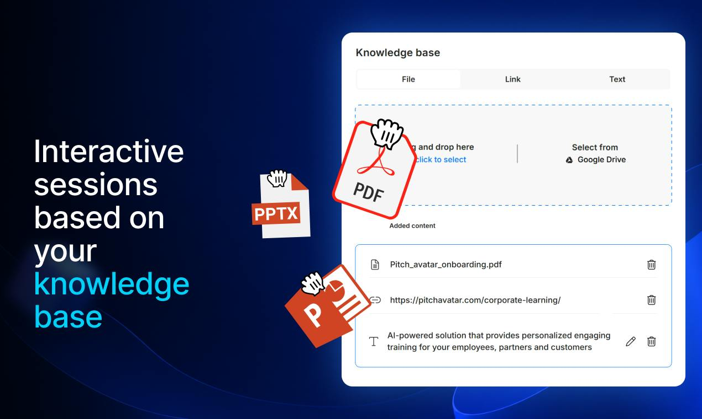
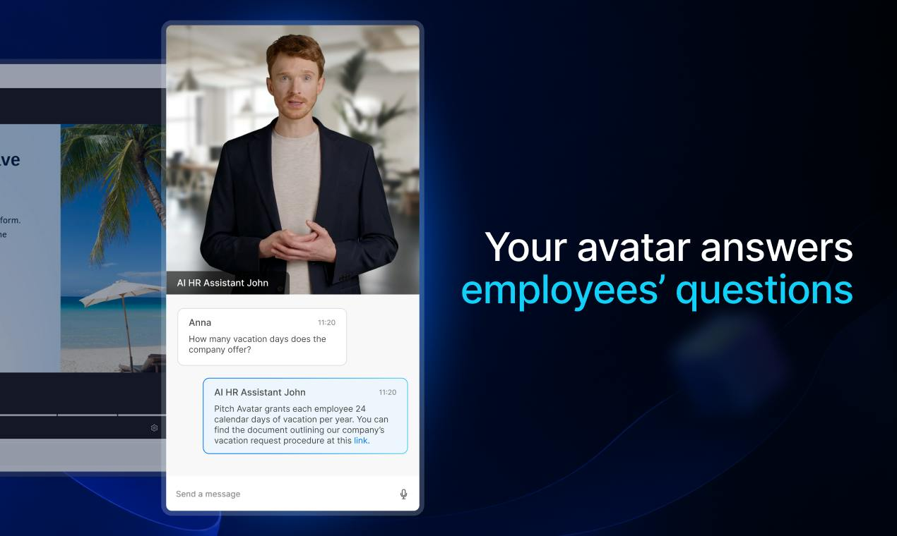

### 🎬 관련 영상
- [🎥 영상 보기](https://ph-files.imgix.net/096671a5-6ce9-4134-b323-f9c21b5daac1.jpeg?auto=format)

---

## 7. [Mermaid Flow](https://www.producthunt.com/products/mermaid-chart)
**Votes**: 128 | **도입 난이도**: 하 | **신뢰도**: 상
**Tagline**: The visual builder for agentic workflows
**서비스 링크**: https://www.producthunt.com/r/6TWGPBZTSE7PQW

**태그**: Automation, AI, Workflow, DevTool, Agent, AI Tool, Prompting

### 📌 이 서비스 한눈에 보기
다이어그램 기반의 시각적 설계를 통해 복잡한 AI 에이전트 워크플로우를 구축하고 실행하는 도구

### 🔑 주요 기능
- 다이어그램 형식의 직관적인 시각적 워크플로우 빌더
- GitHub, Slack, Notion 등 다양한 외부 서비스와의 원클릭 연동
- 단계별 실행 기록 저장으로 투명한 워크플로우 추적 가능

### 🙋 사용자에게 어떤 점이 좋은가
복잡한 프롬프트나 수동 작업 대신, 시각화된 자동화 흐름을 통해 이슈 트리아지나 PR 리뷰 같은 반복 업무를 자동화할 수 있습니다.

### ✅ 지금 바로 써볼 기능
- 제공되는 템플릿을 활용해 기본 워크플로우 생성하기
- GitHub나 Slack 연동하여 자동화 흐름 구축하기
- 스케줄링 기능을 설정하여 정기적인 자동 작업 실행하기

### ⚠️ 사용 전 확인할 점
- 워크플로우의 복잡도에 따른 실행 비용이나 제한 사항 확인 필요
- 외부 서비스 연동 시 데이터 접근 권한 및 보안 정책 검토 필요

### 🧭 확인이 더 필요한 정보
제공되는 템플릿의 종류와 구체적인 워크플로우 실행 비용 체계에 대한 정보가 부족합니다.

### 📸 스크린샷 및 갤러리
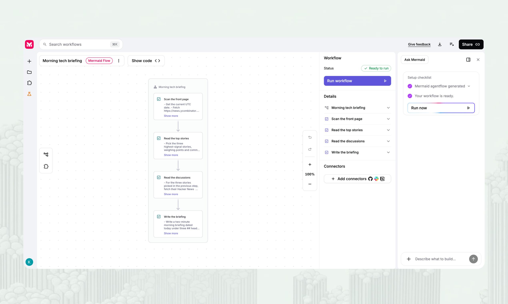
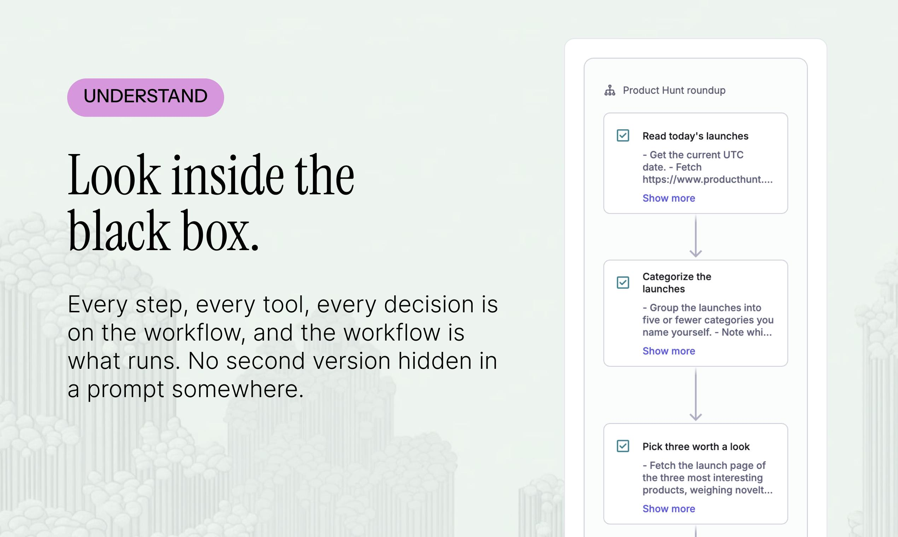
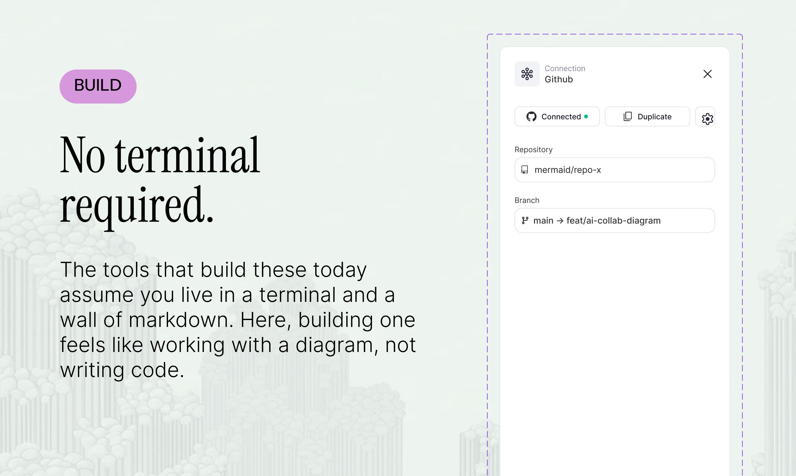

### 🎬 관련 영상
- [🎥 영상 보기](https://ph-files.imgix.net/25ee117c-8442-4f63-854c-7b843e03b11a.jpeg?auto=format)

---

## 8. [dusk bot](https://www.producthunt.com/products/dusk-bot)
**Votes**: 122 | **도입 난이도**: 중 | **신뢰도**: 상
**Tagline**: free open source Grok bot alternative
**서비스 링크**: https://www.producthunt.com/r/U6XX5FHY4UCNF3

**태그**: Automation, AI, OpenSource, Productivity, Chat

### 📌 이 서비스 한눈에 보기
기존 AI 구독 플랜을 활용해 팀 단위의 자동화 봇을 구축하는 오픈소스 도구

### 🔑 주요 기능
- 사용 중인 ChatGPT, Claude, Grok 등의 유료 플랜을 그대로 활용
- 각기 다른 역할과 메모리를 가진 봇 팀 구축 가능
- 스케줄링, 위험 단계 확인, 독립적인 컴퓨팅 환경 제공

### 🙋 사용자에게 어떤 점이 좋은가
추가 비용 없이 기존에 결제한 AI 모델들을 연결하여, 특정 업무를 수행하는 자동화된 봇 팀을 운영할 수 있습니다.

### ✅ 지금 바로 써볼 기능
- 기존 AI 계정(ChatGPT, Claude 등) 연동하기
- 특정 업무를 수행할 봇 역할 설정하기
- 스케줄링 기능을 통한 자동화 워크플로우 실행하기

### ⚠️ 사용 전 확인할 점
- 사용자의 개인 API 키나 계정 권한을 사용하므로 보안 설정 주의 필요
- 사용 중인 AI 서비스의 API 호출 제한이나 정책에 영향을 받을 수 있음

### 🧭 확인이 더 필요한 정보
사용자의 개인 계정 로그인 방식을 사용하므로, 데이터 보안 및 개인정보 보호 수준에 대한 상세 확인이 필요합니다.

### 📸 스크린샷 및 갤러리
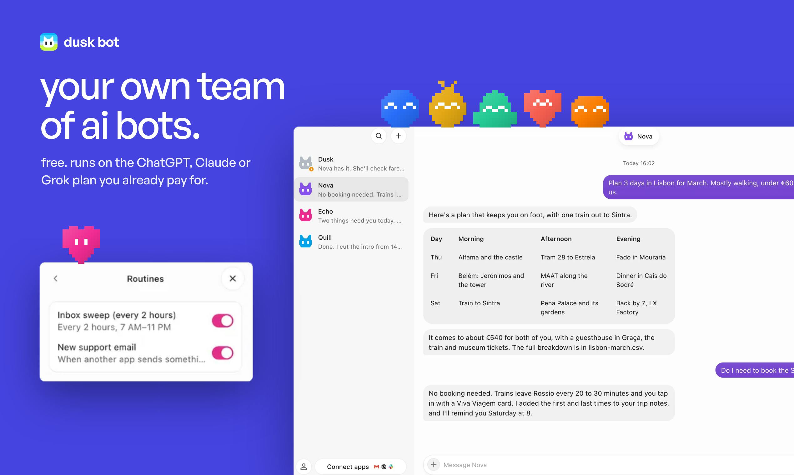
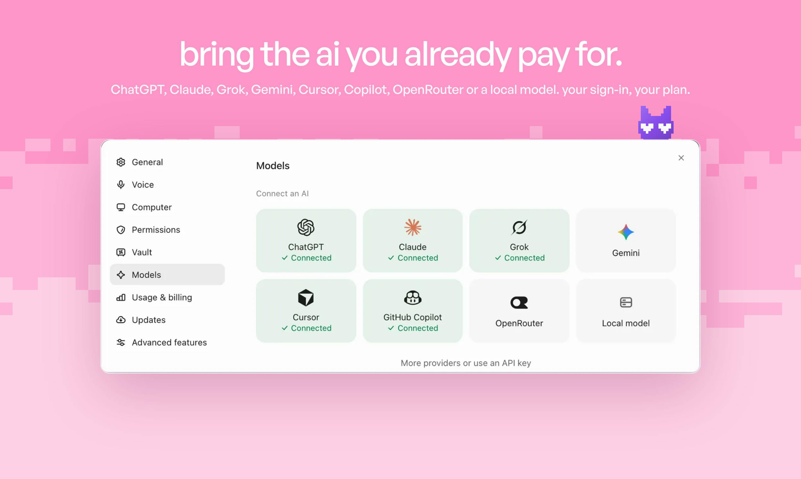
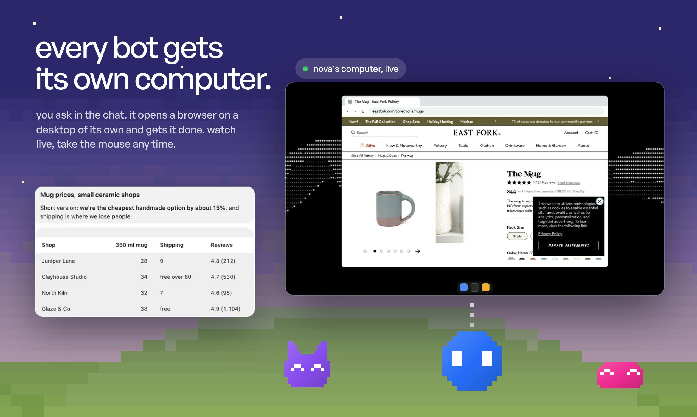

### 🎬 관련 영상
- [🎥 영상 보기](https://ph-files.imgix.net/c30d506e-bf79-42ab-8841-98b031e6bc5c.jpeg?auto=format)

---

## 9. [Review Box](https://www.producthunt.com/products/review-box)
**Votes**: 118 | **도입 난이도**: 하 | **신뢰도**: 상
**Tagline**: A fast desktop app for reviewing GitHub pull requests
**서비스 링크**: https://www.producthunt.com/r/TEHSB3S2PP4OU7

**태그**: DevTool, GitHub, AI, Productivity, AI Tool

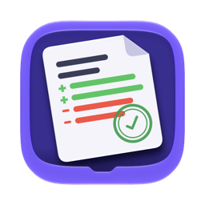

### 📌 이 서비스 한눈에 보기
GitHub Pull Request 리뷰 과정을 빠르고 효율적으로 만드는 데스크톱 앱

### 🔑 주요 기능
- 리뷰된 파일 추적 기능
- 심볼 정의 및 사용처로 즉시 이동 기능
- PR 전체 내용 검색 및 AI 기반 변경 사항 질의

### 🙋 사용자에게 어떤 점이 좋은가
복잡한 PR 코드를 더 빠르게 파악하고, AI와 강력한 탐색 기능을 통해 리뷰 시간을 단축할 수 있습니다.

### ✅ 지금 바로 써볼 기능
- 전체 PR 내용 검색 기능 활용하기
- AI에게 코드 변경 사항 질문하기
- 심볼 정의 이동 기능을 통한 코드 흐름 파악

### ⚠️ 사용 전 확인할 점
- 데스크톱 앱 설치 및 GitHub 계정 연동 필요
- AI 기능 사용 시 데이터 보안 정책 확인 필요

### 🧭 확인이 더 필요한 정보
AI 기능의 구체적인 모델 및 데이터 처리 방식에 대한 상세 정보가 필요합니다.

### 📸 스크린샷 및 갤러리
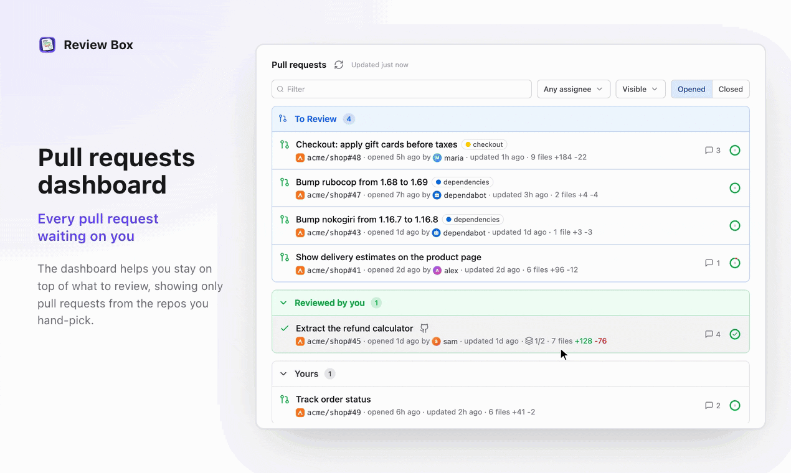
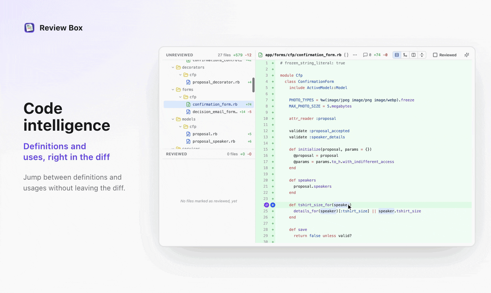
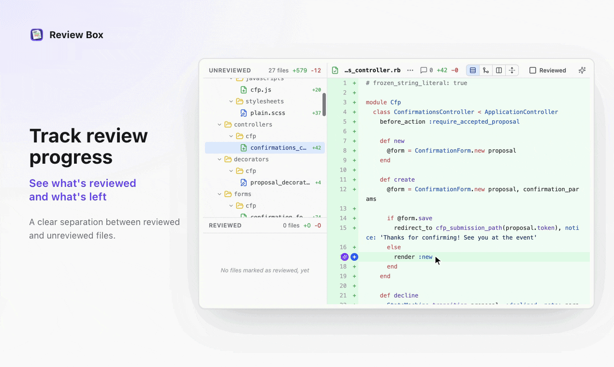

### 🎬 관련 영상
- [🎥 영상 보기](https://ph-files.imgix.net/902d13ef-19af-4d10-b7a0-032025775e1c.jpeg?auto=format)

---

## 10. [GPT-6.2 Astra and Sol](https://www.producthunt.com/products/openai)
**Votes**: 116 | **도입 난이도**: 하 | **신뢰도**: 상
**Tagline**: Two new OpenAI models: frontier Astra and efficient Sol
**서비스 링크**: https://www.producthunt.com/r/ZQTBM36RYPXJZM
**재등장**: 최근 7일 내 재등장 (마지막 등장 3일 전)

**태그**: AI, Productivity, DeveloperTool, Automation, Agent, AI Tool, Chat, Design, DevTool, API

### 📌 이 서비스 한눈에 보기
전문가용 고성능 모델 Astra와 일상 업무용 효율 모델 Sol로 구성된 OpenAI의 차세대 모델 라인업

### 🔑 주요 기능
- Astra: 웹사이트, 3D 디자인, 과학 연구 등 고난도 프로젝트를 위한 프론티어 모델
- Sol: 코딩 및 다단계 에이전트 작업을 위한 효율적인 데일리 모델
- 비용 효율성: Astra는 기존 GPT-6 Astra 대비 1/3 미만의 비용으로 작업 가능

### 🙋 사용자에게 어떤 점이 좋은가
작업의 난이도에 따라 고성능(Astra)과 효율성(Sol)을 선택할 수 있어 비용과 성능의 균형을 맞춘 전문적 업무 수행이 가능합니다.

### ✅ 지금 바로 써볼 기능
- 복잡한 디자인 및 연구 프로젝트에 Astra 적용해보기
- 일상적인 코딩 및 자동화 작업에 Sol 활용하기
- 기존 워크플로우에 API를 통한 모델 교체 테스트하기

### ⚠️ 사용 전 확인할 점
- 모델별 특화 영역(Astra vs Sol)에 따른 작업 적합성 검토 필요
- API 사용 시 토큰당 비용(In/Out) 구조 확인 필요

### 🧭 확인이 더 필요한 정보
기존 GPT-6 Astra 모델과의 구체적인 성능 벤치마크 비교 데이터는 명시되지 않았습니다.

### 📸 스크린샷 및 갤러리
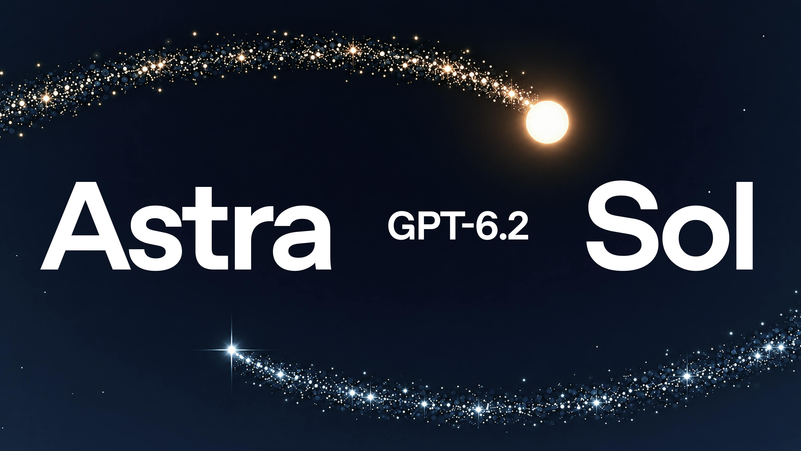
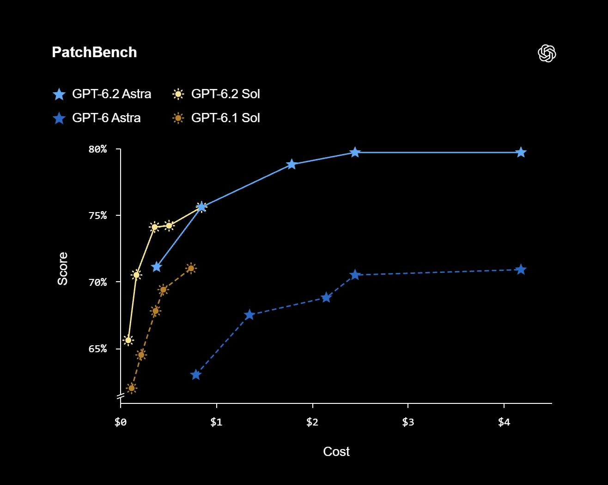
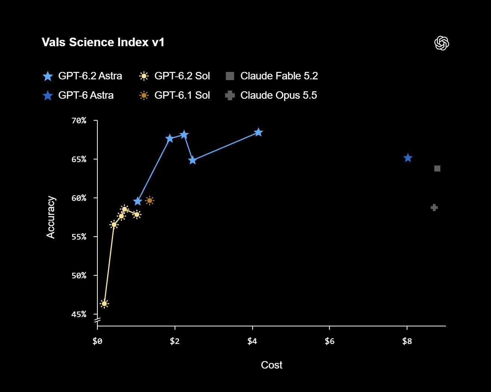

### 🎬 관련 영상
- [🎥 영상 보기](https://ph-files.imgix.net/f0aa6f8b-479d-492a-aa89-044da0fdb1ae.jpeg?auto=format)

---

## 11. [Incredible Agents](https://www.producthunt.com/products/incredible)
**Votes**: 103 | **도입 난이도**: 중 | **신뢰도**: 상
**Tagline**: Fast Voice AI that sees your screen and runs your agents
**서비스 링크**: https://www.producthunt.com/r/7QMVFIJZQVX5XH

**태그**: Automation, AI Agent, Productivity, Voice AI, Agent, AI Tool

### 📌 이 서비스 한눈에 보기
사용자의 화면을 보고 컴퓨터 작업을 대신 수행하는 음성 기반 AI 에이전트

### 🔑 주요 기능
- 음성 명령을 통한 새로운 AI 에이전트 생성 및 실행
- 브라우저, 앱, 파일을 넘나드는 컴퓨터 직접 제어 기능
- 24/7 반복 작업 수행 및 실시간 공유 페이지/대시보드 구축

### 🙋 사용자에게 어떤 점이 좋은가
사용자가 직접 하던 복잡한 컴퓨터 작업을 AI가 화면을 보며 대신 수행하므로, 반복적인 업무 시간을 획기적으로 줄일 수 있습니다.

### ✅ 지금 바로 써볼 기능
- 음성 명령으로 새로운 에이전트 생성해보기
- 반복적인 컴퓨터 작업 자동화 설정하기
- 생성된 대시보드 및 페이지 공유 기능 테스트하기

### ⚠️ 사용 전 확인할 점
- 컴퓨터 화면과 앱을 직접 제어하므로 개인정보 및 보안 설정 주의 필요
- Mac 및 Windows 환경에서의 호환성 확인 필요

### 🧭 확인이 더 필요한 정보
에이전트가 시스템 권한을 어느 범위까지 사용하는지에 대한 상세 보안 정책 확인이 필요합니다.

### 📸 스크린샷 및 갤러리
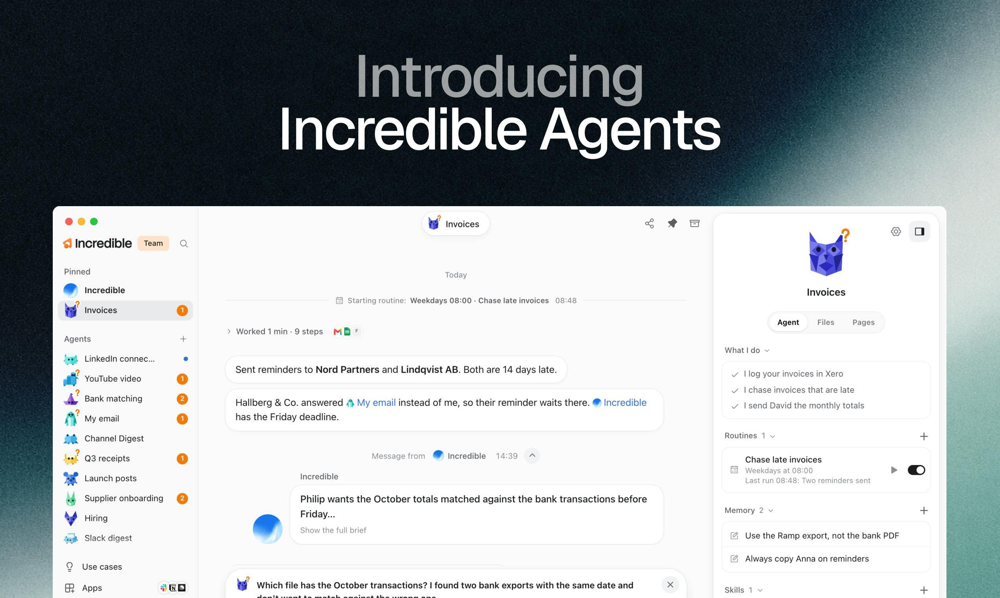
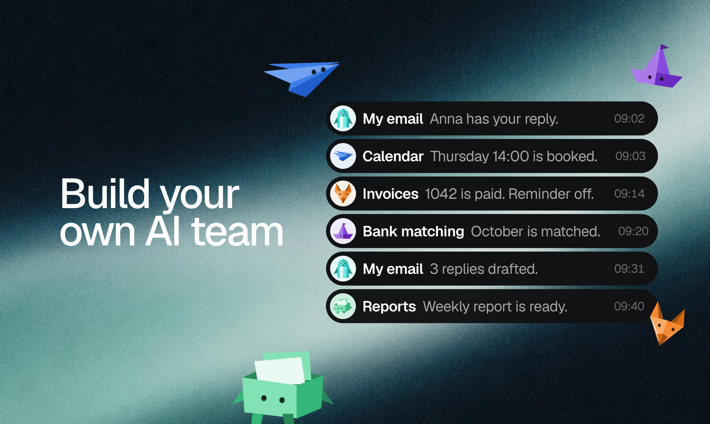
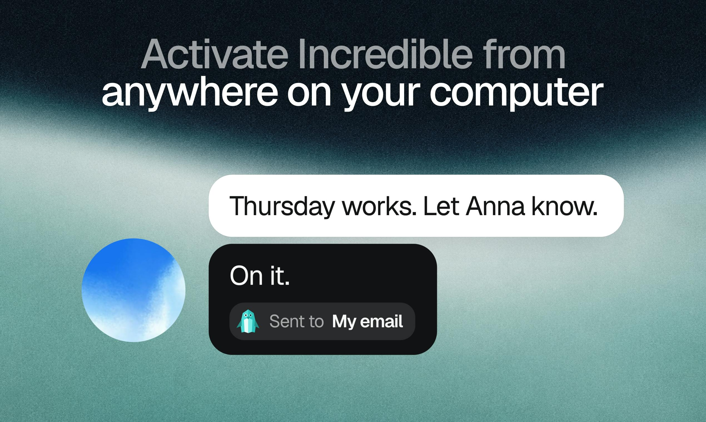

### 🎬 관련 영상
- [🎥 영상 보기](https://ph-files.imgix.net/38247377-585f-40c1-bd2e-39df934fac0f.jpeg?auto=format)

---

## 12. [Tencent Hy4 flash](https://www.producthunt.com/products/hunyuan-a13b)
**Votes**: 101 | **도입 난이도**: 하 | **신뢰도**: 상
**Tagline**: Fast, low-cost model from $0.07/M input
**서비스 링크**: https://www.producthunt.com/r/XOB6V2WUKZDQJV

**태그**: AI, LLM, Productivity, Automation, DevTool

### 📌 이 서비스 한눈에 보기
초저가 비용과 초고속 속도를 갖춘 텐센트의 실용적인 멀티모달 AI 모델

### 🔑 주요 기능
- 100만 토큰의 대규모 컨텍스트 창 지원
- 초당 150 토큰 이상의 압도적인 디코딩 속도
- 백만 토큰당 입력 $0.07 수준의 극강의 가성비

### 🙋 사용자에게 어떤 점이 좋은가
문서 작업, 슬라이드 제작, 리서치 등 일상적인 업무를 저렴하고 빠르게 처리할 수 있어 대량의 데이터 처리에 유리합니다.

### ✅ 지금 바로 써볼 기능
- 대용량 문서 분석 및 요약 작업
- 빠른 응답이 필요한 자동화 워크플로우 구축
- 멀티모달 입력을 활용한 데이터 추출

### ⚠️ 사용 전 확인할 점
- 현재 모델 가중치(weights)가 공개되지 않아 직접적인 로컬 설치 불가
- 복잡한 엔지니어링 작업보다는 일상적 업무에 최적화된 모델임

### 🧭 확인이 더 필요한 정보
현재 모델 가중치가 공개되지 않아 실제 사용 가능 시점과 접근 방식이 불분명합니다.

### 📸 스크린샷 및 갤러리
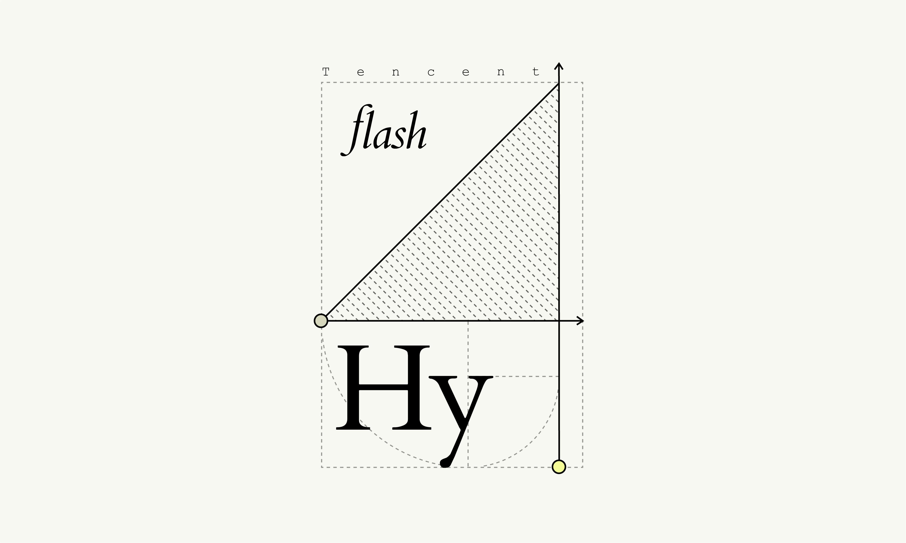

---

## 13. [Replay QA Self-healing Mode](https://www.producthunt.com/products/replayio)
**Votes**: 94 | **도입 난이도**: 하 | **신뢰도**: 상
**Tagline**: Turn user frustration into verified fixes
**서비스 링크**: https://www.producthunt.com/r/VEQ45TWEFJVACH

**태그**: DevTool, QA, Automation, ProductAnalytics, Agent, AI Tool

### 📌 이 서비스 한눈에 보기
사용자의 불편함을 즉각적인 버그 리포트와 해결책으로 전환하는 자동 QA 솔루션

### 🔑 주요 기능
- 사용자 세션 자동 캡처 및 좌절 신호 감지
- 상세한 원인 분석과 실행 증거가 포함된 버그 리포트 생성
- 이슈 트래커 또는 코딩 에이전트로의 자동 워크플로우 지원

### 🙋 사용자에게 어떤 점이 좋은가
사용자가 겪는 문제를 수동으로 재현할 필요 없이, 자동화된 분석을 통해 즉각적인 버그 수정과 개발 루프를 가능하게 합니다.

### ✅ 지금 바로 써볼 기능
- 사용자 세션 캡처 기능 활성화
- 이슈 트래커 연동 설정
- 데일리 요약 리포트 확인

### ⚠️ 사용 전 확인할 점
- Fullstory 기반의 세션 캡처에 따른 데이터 프라이버시 검토 필요
- 자동 생성된 리포트의 정확성에 대한 개발자의 최종 검증 필요

### 🧭 확인이 더 필요한 정보
Fullstory 외의 다른 세션 기록 도구와의 호환성 및 상세 연동 범위에 대한 정보가 부족합니다.

### 📸 스크린샷 및 갤러리
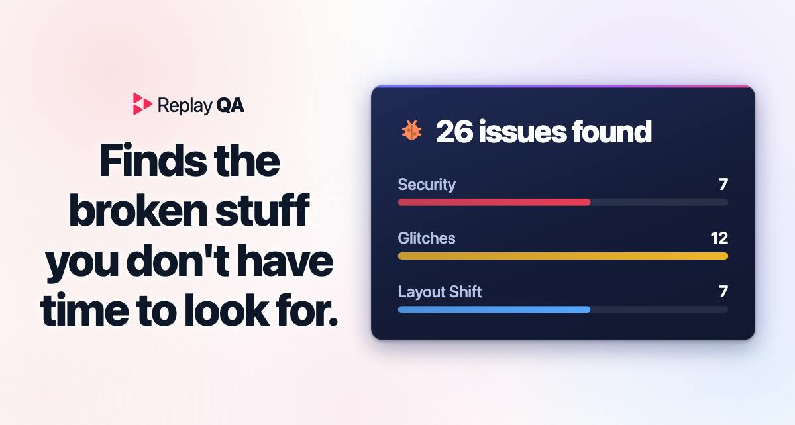
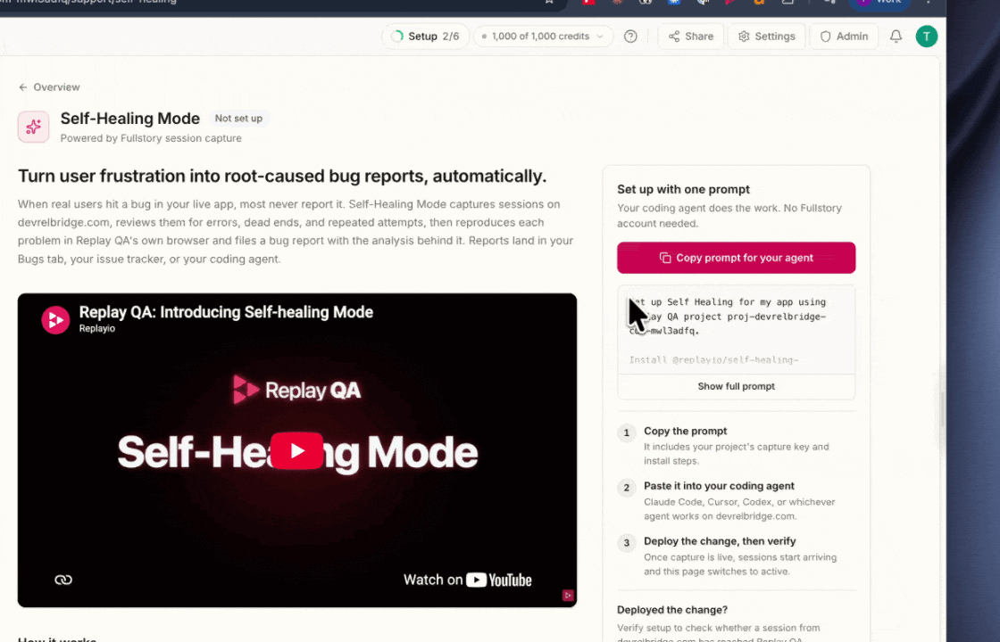
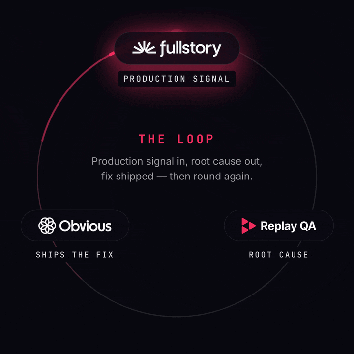

### 🎬 관련 영상
- [🎥 영상 보기](https://ph-files.imgix.net/41d91af0-cb27-4242-bf34-dab8028561f1.jpeg?auto=format)

---

## 14. [lepoly](https://www.producthunt.com/products/lepoly)
**Votes**: 93 | **도입 난이도**: 하 | **신뢰도**: 상
**Tagline**: One place for all your 3D assets
**서비스 링크**: https://www.producthunt.com/r/TUZ7YC7663UAJN

**태그**: 3D, AssetManagement, Collaboration, DesignTool

### 📌 이 서비스 한눈에 보기
모든 3D 에셋을 한곳에서 관리하고 공유하는 브라우저 기반 디지털 자산 관리 플랫폼

### 🔑 주요 기능
- 3D 에셋 전용 디지털 자산 관리(DAM) 플랫폼
- 브라우저를 통한 간편한 호스팅 및 조직화
- 효율적인 리뷰 및 공유 기능 제공

### 🙋 사용자에게 어떤 점이 좋은가
별도의 무거운 소프트웨어 설치 없이 브라우저만으로 3D 작업물을 관리하고 협업할 수 있어 워크플로우가 간결해집니다.

### ✅ 지금 바로 써볼 기능
- 3D 에셋 업로드 및 호스팅 테스트
- 에셋 정리 및 폴더 구조 구성
- 팀원과의 공유 및 리뷰 기능 확인

### ⚠️ 사용 전 확인할 점
- 브라우저 기반이므로 대용량 3D 파일 처리 성능 확인 필요
- 상세한 보안 및 권한 관리 기능 확인 필요

### 🧭 확인이 더 필요한 정보
지원하는 구체적인 3D 파일 포맷과 용량 제한에 대한 정보가 명시되지 않았습니다.

### 📸 스크린샷 및 갤러리
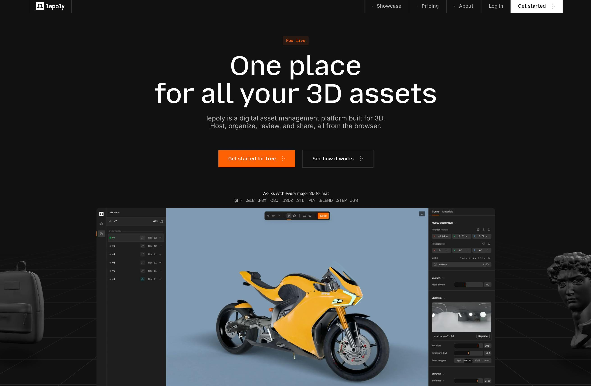

### 🎬 관련 영상
- [🎥 영상 보기](https://ph-files.imgix.net/9cffb829-83f9-4f22-bbdb-862d78b58937.jpeg?auto=format)

---

## 15. [Arcade](https://www.producthunt.com/products/arcade)
**Votes**: 91 | **도입 난이도**: 하 | **신뢰도**: 상
**Tagline**: AI video generator for marketing teams
**서비스 링크**: https://www.producthunt.com/r/WYLXBVWMKZGE5C

**태그**: Marketing, AI-Video, Content-Creation, Automation, AI Tool, Prompting, Video

### 📌 이 서비스 한눈에 보기
프롬프트와 기존 자료만으로 브랜드 맞춤형 마케팅 영상을 만드는 AI 비디오 생성기

### 🔑 주요 기능
- 텍스트 프롬프트, 화면 녹화, 기존 문서(Notion, Google Drive 등)를 활용한 영상 생성
- 브랜드 키트 적용 및 자연스러운 AI 보이스오버 지원
- 생성된 모든 장면의 편집 가능 및 SNS(YouTube, LinkedIn, X) 직통 게시

### 🙋 사용자에게 어떤 점이 좋은가
마케팅 팀이 복잡한 편집 과정 없이도 브랜드 아이덴티티가 유지된 고품질 영상을 몇 분 만에 제작할 수 있습니다.

### ✅ 지금 바로 써볼 기능
- 기존 Notion이나 Google Drive 문서를 연동하여 영상 초안 만들기
- 브랜드 키트를 설정하여 일관된 브랜드 스타일 적용하기
- 생성된 영상의 장면별 편집 기능 테스트하기

### ⚠️ 사용 전 확인할 점
- 무료 플랜의 기능 제한 범위 확인 필요
- 복잡한 연출이나 정교한 커스텀 편집의 한계 여부 확인

### 🧭 확인이 더 필요한 정보
무료 플랜에서 제공하는 기능의 범위와 워터마크 유무에 대한 상세 정보가 명시되지 않았습니다.

### 📸 스크린샷 및 갤러리
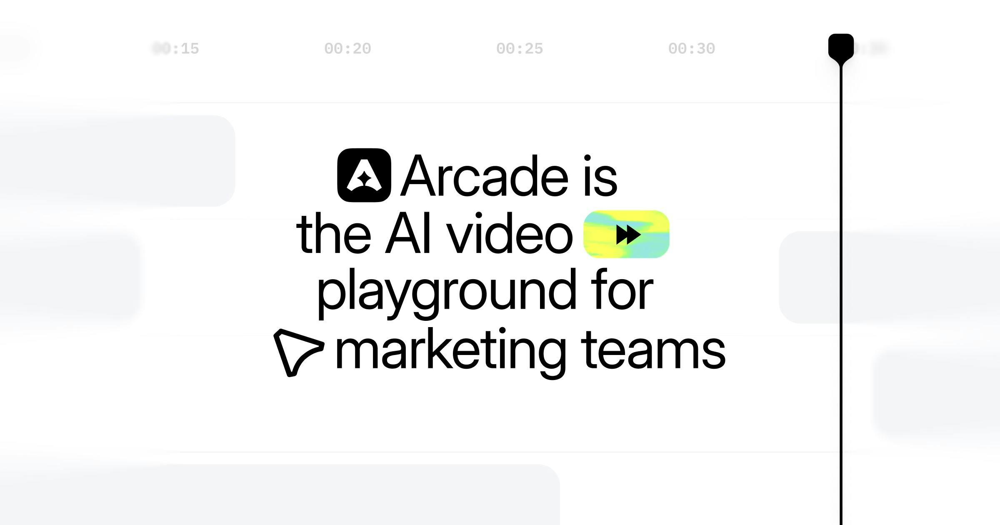
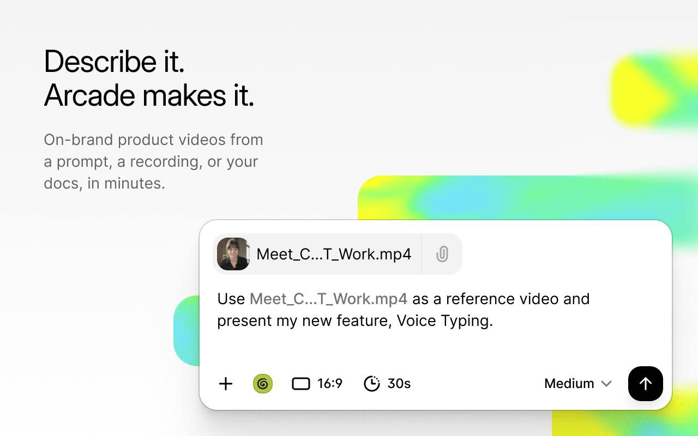
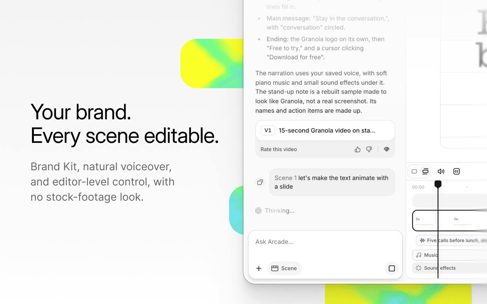

### 🎬 관련 영상
- [🎥 영상 보기](https://ph-files.imgix.net/bbebc209-ffaf-40d8-8624-311663573995.jpeg?auto=format)

---

## 16. [UI Verify](https://www.producthunt.com/products/ui-verify)
**Votes**: 89 | **도입 난이도**: 하 | **신뢰도**: 상
**Tagline**: Visual testing for coding agents
**서비스 링크**: https://www.producthunt.com/r/P4CUKR2JSTPHUP

**태그**: DevTool, Automation, AI-Agent, Testing, Agent, AI Tool

### 📌 이 서비스 한눈에 보기
코딩 에이전트가 UI 버그를 스스로 감지하고 수정할 수 있게 돕는 시각적 테스트 도구

### 🔑 주요 기능
- 코딩 에이전트가 변경 사항이 영향을 미친 모든 화면을 확인할 수 있도록 지원
- Playwright, Storybook, Vitest, Bun 및 iOS/Android 앱과 호환
- 한 줄 설정으로 간편하게 도입 가능

### 🙋 사용자에게 어떤 점이 좋은가
에이전트가 코드를 수정할 때 발생할 수 있는 UI 버그를 사용자에게 노출되기 전에 미리 잡아낼 수 있습니다.

### ✅ 지금 바로 써볼 기능
- 기존 Playwright 또는 Storybook 환경에 한 줄 설정으로 연동하기
- 에이전트 기반 개발 워크플로우에 시각적 테스트 통합하기
- 오픈 소스 프로젝트에 무료 플랜(월 5만 스냅샷) 적용해보기

### ⚠️ 사용 전 확인할 점
- 무료 플랜의 월 50,000 스냅샷 제한 확인 필요
- 에이전트가 생성하는 스냅샷 양에 따른 비용 발생 가능성

### 🧭 확인이 더 필요한 정보
에이전트가 자동으로 버그를 수정하는 과정에서의 정확도와 워크플로우 통합 방식에 대한 구체적인 검증이 필요합니다.

### 📸 스크린샷 및 갤러리
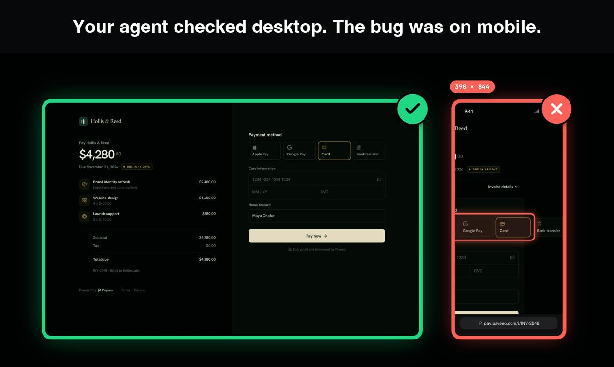
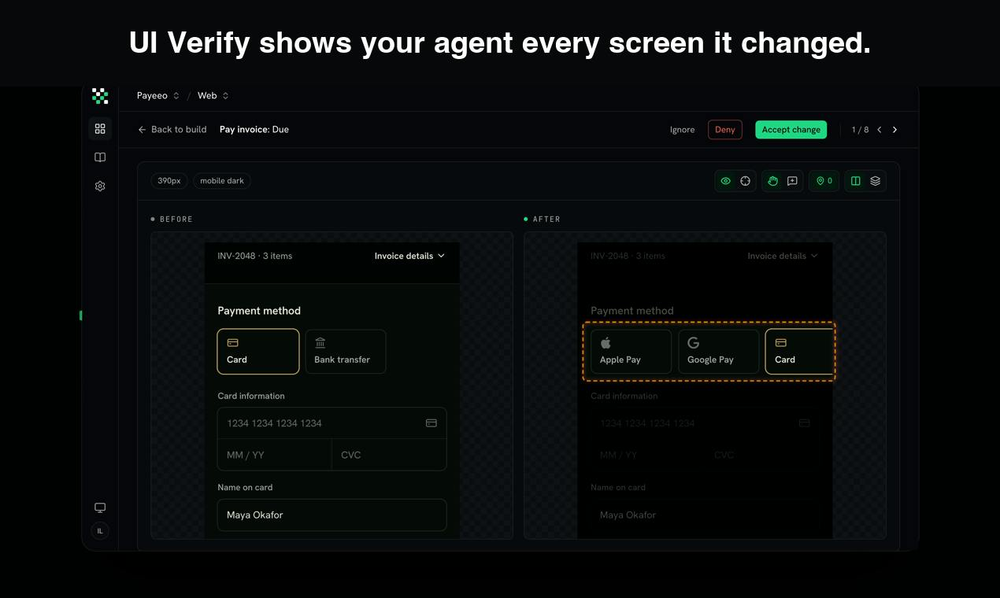
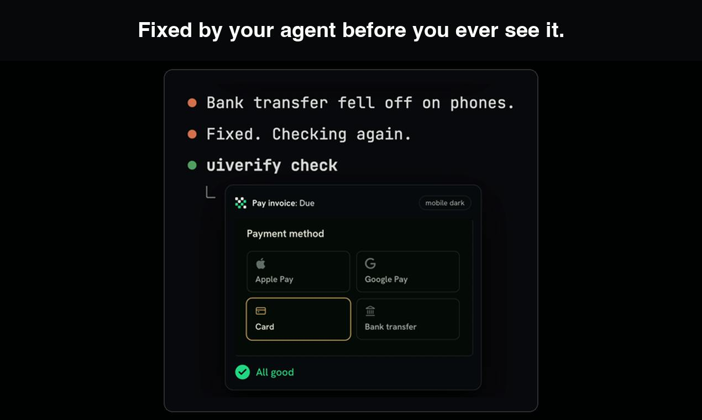

### 🎬 관련 영상
- [🎥 영상 보기](https://ph-files.imgix.net/mcp-draft-media/2ad1dcb3-715e-470c-8cdb-515273f18349.jpeg?auto=format)

---

## 17. [Introzy](https://www.producthunt.com/products/introzy)
**Votes**: 84 | **도입 난이도**: 하 | **신뢰도**: 상
**Tagline**: Track referrals from intro to commission
**서비스 링크**: https://www.producthunt.com/r/LNP6BFPPUAKL73

**태그**: Sales, Automation, Partnership, Fintech

### 📌 이 서비스 한눈에 보기
소개부터 수수료 정산까지 모든 추천 과정을 관리하는 자동화 솔루션

### 🔑 주요 기능
- 소개(Introduction)부터 최종 커미션 지급까지의 전 과정 추적
- 매출 기여도(Attribution) 자동 산정
- 파트너를 위한 정시 수수료 지급 관리

### 🙋 사용자에게 어떤 점이 좋은가
수동으로 관리하기 까다로운 추천/파트너 관계를 자동화하여 매출 누락을 방지하고 파트너 신뢰를 높일 수 있습니다.

### ✅ 지금 바로 써볼 기능
- 소개 및 추천 프로세스 등록
- 파트너별 매출 기여도 확인
- 수수료 정산 자동화 설정

### ⚠️ 사용 전 확인할 점
- 초기 무료 플랜의 상세 범위 확인 필요
- 기존 CRM 또는 결제 시스템과의 연동 여부 확인 필요

### 🧭 확인이 더 필요한 정보
현재 제공되는 무료 플랜의 기능 제한 범위와 상세 연동 가능 범위를 확인해야 합니다.

### 📸 스크린샷 및 갤러리
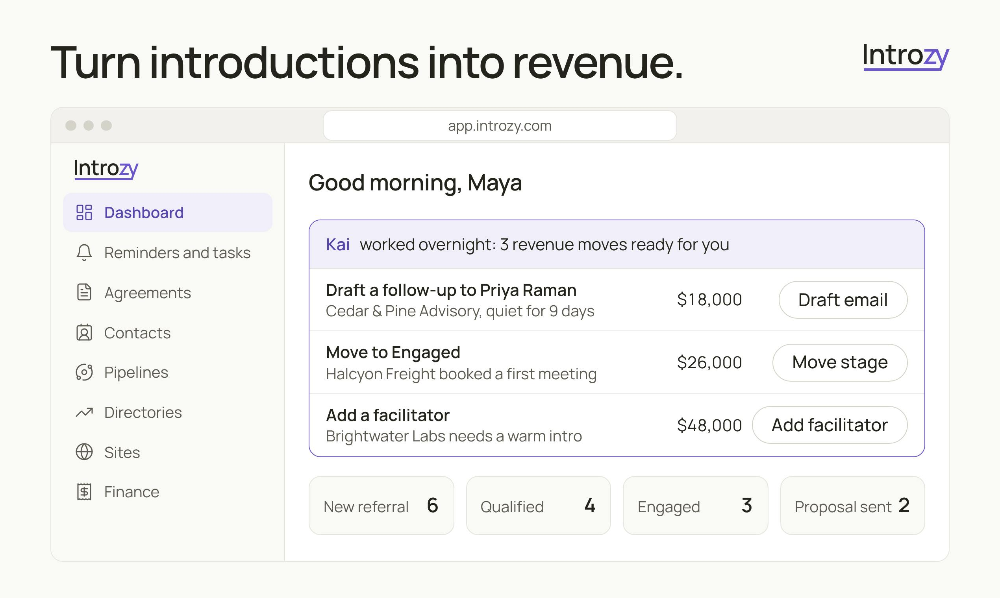
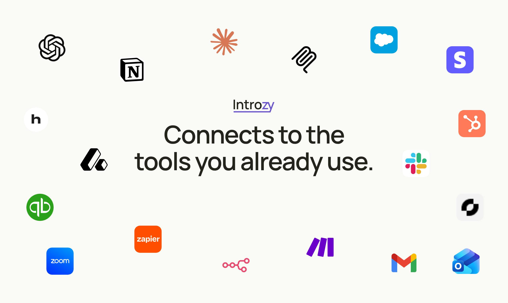

### 🎬 관련 영상
- [🎥 영상 보기](https://ph-files.imgix.net/1903b8aa-ba58-493e-ad8f-f4aaa87a36bd.jpeg?auto=format)

---

## 18. [Polylane for CI](https://www.producthunt.com/products/polylane)
**Votes**: 83 | **도입 난이도**: 하 | **신뢰도**: 상
**Tagline**: Fix broken builds before they block your team
**서비스 링크**: https://www.producthunt.com/r/LE3S5WBOHMK6YD
**재등장**: 최근 7일 내 재등장 (마지막 등장 2일 전)

**태그**: DevTool, Automation, CI/CD, GitHub, AI Tool

### 📌 이 서비스 한눈에 보기
CI 빌드 실패를 자동으로 분석하고 수정 PR까지 생성하는 자동화 도구

### 🔑 주요 기능
- CI 로그 분석을 통한 원인 커밋 자동 식별
- 실패 원인을 수정한 후 자동으로 Pull Request 생성
- 메인 브랜치 빌드 성공 시 이슈 자동 종료 및 워크플로우 관리

### 🙋 사용자에게 어떤 점이 좋은가
빌드 실패로 인해 팀의 개발 흐름이 끊기는 것을 방지하고, 수동으로 로그를 분석하여 수정하는 번거로움을 줄여줍니다.

### ✅ 지금 바로 써볼 기능
- GitHub Actions 연동 설정하기
- 기존 CI 워크플로우와 호환성 테스트하기
- 자동 생성된 PR의 코드 품질 검토하기

### ⚠️ 사용 전 확인할 점
- 자동 생성된 수정 코드가 프로젝트의 코딩 컨벤션과 일치하는지 확인 필요
- 복잡한 의존성 문제로 인한 빌드 실패 시 자동 수정의 한계 가능성

### 🧭 확인이 더 필요한 정보
사용자의 기존 CI/CD 파이프라인에 미치는 영향도와 보안 정책 준수 여부를 확인해야 합니다.

### 📸 스크린샷 및 갤러리

### 🎬 관련 영상
- [🎥 영상 보기](https://ph-files.imgix.net/4de5af79-5a3a-475b-8cb4-a93d1246345e.jpeg?auto=format)

---

## 19. [Qwen4-Max](https://www.producthunt.com/products/qwen3)
**Votes**: 81 | **도입 난이도**: 중 | **신뢰도**: 상
**Tagline**: Qwen's new flagship for long-running agent work
**서비스 링크**: https://www.producthunt.com/r/2ZYZ5TVPUIM3PM

**태그**: AI, LLM, Automation, Coding, Agent, AI Tool, API

### 📌 이 서비스 한눈에 보기
2.4T 파라미터와 100만 토큰 컨텍스트를 갖춘 Qwen의 차세대 플래그십 AI 모델

### 🔑 주요 기능
- 2.4T 파라미터 기반의 강력한 성능과 네이티브 비전 기능 탑재
- 100만 토큰의 대규모 컨텍스트 윈도우 지원
- 코딩, 전문 워크플로우 및 장기 실행 에이전트 작업 최적화

### 🙋 사용자에게 어떤 점이 좋은가
방대한 양의 문서를 한 번에 처리하거나 복잡한 코딩 및 에이전트 기반 자동화 작업을 수행할 때 매우 유용합니다.

### ✅ 지금 바로 써볼 기능
- API를 통한 대규모 컨텍스트 처리 테스트
- 복잡한 코딩 및 워크플로우 자동화 적용
- 비전 기능을 활용한 멀티모달 작업 수행

### ⚠️ 사용 전 확인할 점
- 모델 규모가 커 대규모 연산 자원이나 비용이 발생할 수 있음
- 에이전트 작업 시 장기 실행에 따른 결과의 일관성 확인 필요

### 🧭 확인이 더 필요한 정보
구체적인 API 비용 체계와 하드웨어 요구 사양에 대한 정보가 필요합니다.

### 📸 스크린샷 및 갤러리

### 🎬 관련 영상
- [🎥 영상 보기](https://ph-files.imgix.net/10565c96-51c6-4530-9149-f7cff7cc961d.jpeg?auto=format)

---

## 20. [KaDeep AI](https://www.producthunt.com/products/kadeep-ai)
**Votes**: 80 | **도입 난이도**: 중 | **신뢰도**: 상
**Tagline**: Agentic QA, localization & accessibility: know when to ship
**서비스 링크**: https://www.producthunt.com/r/5CLZNVUY6IXLUS

**태그**: DevTool, QA, Automation, Accessibility, Localization, Agent, AI Tool, Video, Vision

### 📌 이 서비스 한눈에 보기
자연어 명령으로 QA, 현지화, 접근성 검사를 자동화하여 배포 여부를 결정하는 AI 에이전트

### 🔑 주요 기능
- 자연어 기반의 간편한 테스트 실행 (Web, iOS, Android, Desktop 지원)
- 100개 이상의 파일 형식에 대한 강력한 현지화 검증
- WCAG 2.2, ADA 등 글로벌 법규를 준수하는 접근성 감사

### 🙋 사용자에게 어떤 점이 좋은가
복잡한 테스트 케이스를 영어 문장 하나로 실행하고, 배포 전 필수적인 현지화 및 접근성 검사를 자동화하여 출시 품질을 보장합니다.

### ✅ 지금 바로 써볼 기능
- 자연어로 테스트 시나리오 작성해보기
- 기존 빌드(Web/Mobile)에 테스트 실행해보기
- CI/CD 환경에 CLI 연동 테스트하기

### ⚠️ 사용 전 확인할 점
- 자연어 명령의 정확도가 복잡한 테스트 시나리오에서 어떻게 작동하는지 확인 필요
- 실제 배포 전 모든 법적/기술적 요구사항을 완벽히 대체할 수 있는지 검토 필요

### 🧭 확인이 더 필요한 정보
사용자의 구체적인 기술 스택(프레임워크 등)과의 호환성 및 상세 가격 정책에 대한 정보가 부족합니다.

### 📸 스크린샷 및 갤러리

### 🎬 관련 영상
- [🎥 영상 보기](https://ph-files.imgix.net/0d209e32-107a-4935-91e4-5e6128836ed9.jpeg?auto=format)

---

## 21. [uRun](https://www.producthunt.com/products/urun)
**Votes**: 78 | **도입 난이도**: 중 | **신뢰도**: 상
**Tagline**: Real-time decisions for voice and video agents
**서비스 링크**: https://www.producthunt.com/r/6LIUKY3DAUN3W7

**태그**: AI, Voice-AI, Real-time, DeveloperTool, Agent, Video

### 📌 이 서비스 한눈에 보기
음성 및 영상 에이전트를 위한 실시간 의사결정 모델

### 🔑 주요 기능
- 스트리밍 오디오/비디오 데이터를 기반으로 초당 수차례 실시간 판단 제공
- 사용자 발화 종료 여부, 인터럽트 발생, 에이전트 발화 중단 시점 등을 감지
- 사용자 정의 질문에 대한 답변을 통해 에이전트의 행동을 제어

### 🙋 사용자에게 어떤 점이 좋은가
실시간 대화형 AI 에이전트를 개발할 때, 자연스러운 상호작용을 위한 복잡한 판단 로직을 직접 구현할 필요 없이 즉시 적용할 수 있습니다.

### ✅ 지금 바로 써볼 기능
- SDK를 활용한 실시간 세션 구축 테스트
- 단일 요청(Single requests) 기능을 통한 모델 성능 탐색
- 제공되는 1,000 무료 크레딧으로 프로토타입 개발

### ⚠️ 사용 전 확인할 점
- 실시간 스트리밍 환경에서의 지연 시간(Latency) 확인 필요
- 사용자 정의 질문에 따른 판단 정확도 검증 필요

### 🧭 확인이 더 필요한 정보
제공되는 SDK의 지원 언어 및 구체적인 API 연동 방식에 대한 상세 정보가 필요합니다.

### 📸 스크린샷 및 갤러리

---

## 22. [Stringman](https://www.producthunt.com/products/stringman)
**Votes**: 75 | **도입 난이도**: 상 | **신뢰도**: 상
**Tagline**: Turns your room into a crane game
**서비스 링크**: https://www.producthunt.com/r/JHYQSFQGWY2Q67

**태그**: Automation, Robotics, Hardware, SmartHome, AI Tool

### 📌 이 서비스 한눈에 보기
공간을 활용한 천장 매달림 방식의 2자유도 픽앤플레이스 로봇 솔루션

### 🔑 주요 기능
- 천장에 매달린 형태로 작동하는 2자유도(2-DOF) 그리퍼
- 최대 2kg 페이로드 지원 및 자동 주차 기능
- 원격 텔레오퍼레이션 또는 보안을 위한 에어갭(Air-gapped) 로컬 제어 지원

### 🙋 사용자에게 어떤 점이 좋은가
공간 바닥을 차지하지 않고 천장에 설치하여 물건을 옮기거나, 멀티 로봇 환경에서 자동 운송 시스템을 구축할 수 있습니다.

### ✅ 지금 바로 써볼 기능
- 2kg 이내의 대상물에 대한 정밀 집기 테스트
- 설치 공간의 천장 구조 및 배선 환경 확인
- 원격 제어와 로컬 제어 중 적합한 보안 방식 선택

### ⚠️ 사용 전 확인할 점
- 2자유도(2-DOF)로 인한 움직임 범위 및 복잡한 경로 이동의 한계
- 2kg이라는 상대적으로 낮은 페이로드 제한

### 🧭 확인이 더 필요한 정보
정확한 설치 방식(천장 고정 방식)과 구체적인 제어 프로토콜에 대한 정보가 더 필요합니다.

### 📸 스크린샷 및 갤러리

---

## 23. [SaaS Toolkit MCP](https://www.producthunt.com/products/saas-toolkit-mcp)
**Votes**: 73 | **도입 난이도**: 하 | **신뢰도**: 상
**Tagline**: An SDR and CMO on your site 24/7, for one JavaScript snippet
**서비스 링크**: https://www.producthunt.com/r/U46BGFN63KCRNI

**태그**: SaaS, SalesAutomation, AI, Marketing, LeadGen, Agent, AI Tool, Chat, Sales, Email

### 📌 이 서비스 한눈에 보기
단 하나의 스니펫으로 웹사이트 방문자를 잠재 고객으로 전환하는 AI 영업 및 마케팅 자동화 도구

### 🔑 주요 기능
- 자바스크립트 스니펫 하나로 사이트 내 24/7 영업/마케팅 자동화 구현
- 익명 방문자를 실명 리드로 전환하고 행동 기반 이메일 트리거 발송
- AI 에이전트(MCP)를 통해 Claude, ChatGPT, Cursor에서 직접 고객 응대 및 후속 조치 가능

### 🙋 사용자에게 어떤 점이 좋은가
웹사이트 방문자를 놓치지 않고 실시간으로 리드를 확보하며, AI 에이전트를 통해 영업 업무를 자동화할 수 있습니다.

### ✅ 지금 바로 써볼 기능
- 웹사이트에 자바스크립트 스니펫 설치하기
- AI 챗봇 및 리드 캡처 기능 활성화하기
- MCP를 연결하여 AI 에이전트 기반의 고객 응대 테스트하기

### ⚠️ 사용 전 확인할 점
- 사이트 내 스크립트 설치에 따른 성능 영향 확인 필요
- AI 자동 응대 시 브랜드 톤앤매너 일치 여부 검토 필요

### 🧭 확인이 더 필요한 정보
제공되는 기능의 상세한 커스텀 설정 범위와 외부 툴(Stripe, Slack 등)과의 연동 깊이는 별도 확인이 필요합니다.

### 📸 스크린샷 및 갤러리

### 🎬 관련 영상
- [🎥 영상 보기](https://ph-files.imgix.net/9bcfe793-1de8-4c43-9a76-8bd9be19d15f.jpeg?auto=format)

---

## 24. [Happo animation testing](https://www.producthunt.com/products/happo-2)
**Votes**: 73 | **도입 난이도**: 중 | **신뢰도**: 상
**Tagline**: Visual regression testing, now for animations
**서비스 링크**: https://www.producthunt.com/r/EOLSWUHAG4B4WX

**태그**: DevTool, QA, Automation, UI/UX

### 📌 이 서비스 한눈에 보기
애니메이션의 미세한 움직임 변화까지 잡아내는 시각적 회귀 테스트 도구

### 🔑 주요 기능
- 애니메이션 프레임 단위 캡처를 통한 움직임 변화 감지
- 브라우저별(Chrome, Firefox, Safari, Edge) UI 스크린샷 비교
- 프레임별 단계적 검토 및 전후 비교 스와이프 기능 제공

### 🙋 사용자에게 어떤 점이 좋은가
UI 애니메이션 수정 시 의도치 않은 움직임 변화를 즉각 발견할 수 있어, 배포 전 시각적 품질을 완벽하게 검증할 수 있습니다.

### ✅ 지금 바로 써볼 기능
- 애니메이션 프레임별 단계적 검토 기능 테스트
- 브라우저 간 UI 차이 확인을 위한 스크린샷 비교
- 2026년까지 제공되는 무료 애니메이션 테스트 기능 활용

### ⚠️ 사용 전 확인할 점
- 애니메이션 테스트 기능의 무료 제공 기간(2026년까지) 확인 필요
- 기존 시각적 회귀 테스트 워크플로우와의 통합 방식 검토

### 🧭 확인이 더 필요한 정보
애니메이션 테스트 기능의 상세한 기술적 구현 방식과 향탈 정책에 대한 정보가 추가로 필요합니다.

### 📸 스크린샷 및 갤러리

### 🎬 관련 영상
- [🎥 영상 보기](https://ph-files.imgix.net/6c0ea97b-44b6-4865-bdb9-c9c6fac34ac0.jpeg?auto=format)

---

## 25. [AssemblyAI-STT-3.7](https://www.producthunt.com/products/assemblyai)
**Votes**: 71 | **도입 난이도**: 중 | **신뢰도**: 상
**Tagline**: Speech-to-Text for live calls, voice agents, and recordings
**서비스 링크**: https://www.producthunt.com/r/EF3PLRYNCZR3CE

**태그**: AI, STT, Voice-Agent, Productivity, Agent, AI Tool

### 📌 이 서비스 한눈에 보기
실시간 통화부터 녹음 파일까지, 용도별로 최적화된 3종의 고성능 음성 인식 모델

### 🔑 주요 기능
- 실시간 회의 및 통화를 위한 Realtime 모델 (화자 식별 포함)
- AI 음성 에이전트 전용 Realtime-Agent 모델
- 녹음된 오디오 처리를 위한 기본 STT 모델

### 🙋 사용자에게 어떤 점이 좋은가
사용자의 목적(라이브 콜, AI 에이전트, 녹음 파일)에 따라 최적화된 모델을 선택하여 정확도 높은 텍스트 변환이 가능합니다.

### ✅ 지금 바로 써볼 기능
- 실시간 회의 기록을 위한 Realtime 모델 테스트
- AI 에이전트 구축을 위한 Agent 모델 적용
- 기존 녹음 데이터의 텍text 변환 작업

### ⚠️ 사용 전 확인할 점
- 사용자의 특정 언어/방언에 대한 정확도 확인 필요
- 실시간 모델의 네트워크 지연 시간(Latency) 영향성 검토

### 🧭 확인이 더 필요한 정보
각 모델별 구체적인 API 호출 비용 및 처리 속도(Latency) 수치는 명시되지 않았습니다.

### 📸 스크린샷 및 갤러리

---

## 26. [Kino](https://www.producthunt.com/products/kino-2)
**Votes**: 71 | **도입 난이도**: 상 | **신뢰도**: 상
**Tagline**: Store, edit and review video with Claude Code and Codex
**서비스 링크**: https://www.producthunt.com/r/SC2MA57W6NBNHX

**태그**: VideoEditing, AI-Agent, DevTool, Collaboration, Automation, Agent, AI Tool, Prompting, Video

### 📌 이 서비스 한눈에 보기
AI 에이전트와 협업하여 코드로 영상을 편집하고 관리하는 통합 비디오 워크플로우 플랫폼

### 🔑 주요 기능
- Claude Code 및 Codex와 연동되는 코드 기반의 Remotion 편집 환경
- 에이전트와 팀원이 동일한 타임라인에서 협업할 수 있는 통합 워크플로우
- 영상 자산 저장, 편집, 리뷰 링크 공유 기능을 하나로 통합

### 🙋 사용자에게 어떤 점이 좋은가
코드로 영상을 제어하므로 AI 에이전트가 생성한 결과물을 프롬프트 재입력 없이 정밀하게 수정할 수 있으며, 팀원 간의 리뷰와 피드백이 효율적입니다.

### ✅ 지금 바로 써볼 기능
- Remotion 기반의 코드 편집 환경 테스트
- Claude Code/Codex를 활용한 에이전트 협업 워크플로우 구축
- 팀 리뷰용 공유 링크 기능 활용

### ⚠️ 사용 전 확인할 점
- 코드 기반 편집 방식이므로 개발 지식(Remotion 등)이 필요할 수 있음
- 에이전트와 수동 편집 간의 워크플로우 최적화 숙련도 필요

### 🧭 확인이 더 필요한 정보
사용자의 개발 숙련도에 따른 편집 난이도와 에이전트 연동의 구체적인 기술 스택 확인이 필요합니다.

### 📸 스크린샷 및 갤러리

### 🎬 관련 영상
- [🎥 영상 보기](https://ph-files.imgix.net/1bbe2cf0-2f66-4acd-9546-8d706cd1dfdf.jpeg?auto=format)

---

## 27. [canfit](https://www.producthunt.com/products/canfit)
**Votes**: 70 | **도입 난이도**: 하 | **신뢰도**: 상
**Tagline**: The top command for people running local LLMs and apps
**서비스 링크**: https://www.producthunt.com/r/YNUXBOR3NYB7PK

**태그**: DevTool, LLM, CLI, Rust, Productivity

### 📌 이 서비스 한눈에 보기
로컬 LLM 실행을 위한 최적의 시스템 자원 확보 및 관리 도구

### 🔑 주요 기능
- 현재 시스템에서 로컬 모델이나 앱 실행 가능 여부 즉시 확인
- 자원 부족 시 안전하게 종료 가능한 프로세스 제안
- 시스템 프로세스를 건드리지 않는 안전한 자원 관리

### 🙋 사용자에게 어떤 점이 좋은가
로컬 LLM 구동 시 발생하는 메모리 부족 문제를 해결하고, 시스템 안정성을 유지하면서 효율적으로 자원을 확보할 수 있습니다.

### ✅ 지금 바로 써볼 기능
- 터미널에서 canfit 명령어로 현재 가용 자원 확인하기
- 모델 실행 전 canfit를 통해 실행 가능 여부 체크하기
- 자원 확보가 필요할 때 제안된 프로세스 검토하기

### ⚠️ 사용 전 확인할 점
- CLI/TUI 환경에 익숙한 사용자에게 최적화되어 있음
- 사용자의 수동 판단이 개입되어야 하는 프로세스 종료 제안 방식

### 🧭 확인이 더 필요한 정보
특정 하드웨어 사양에서의 구체적인 자원 계산 알고리즘은 명시되지 않았습니다.

### 📸 스크린샷 및 갤러리

### 🎬 관련 영상
- [🎥 영상 보기](https://ph-files.imgix.net/3bed5ad2-0ff1-4ed1-ac30-f4bc11327293.jpeg?auto=format)

---

## 28. [Afterall Photo](https://www.producthunt.com/products/afterall-photo)
**Votes**: 69 | **도입 난이도**: 하 | **신뢰도**: 상
**Tagline**: Line up your after photo exactly with your before
**서비스 링크**: https://www.producthunt.com/r/5OQFQRWP773XQB

**태그**: Photography, BeforeAfter, MobileApp, Productivity

### 📌 이 서비스 한눈에 보기
이전 사진을 투명 가이드로 겹쳐 보여주어 완벽한 비포/애프터 사진 촬영을 돕는 도구

### 🔑 주요 기능
- 이전 사진을 투명한 고스트 이미지로 실시간 카메라 화면에 오버레이
- 비포와 애프터 사진의 구도를 완벽하게 일치시킴
- 크로스페이드, 리빌, 사이드 바이 사이드 등 다양한 내보내기 방식 지원

### 🙋 사용자에게 어떤 점이 좋은가
운동 변화, 인테리어, 메이크업 등 구도가 중요한 비포/애프터 촬영 시 매번 구도를 맞추는 번거로움을 해결해 줍니다.

### ✅ 지금 바로 써볼 기능
- 고스트 가이드를 활용한 정밀한 구도 맞추기
- 촬영 후 다양한 스타일로 결과물 내보내기
- 일회성 구매로 프로 기능 사용하기

### ⚠️ 사용 전 확인할 점
- Pro 기능은 일회성 구매가 필요함
- 서버 저장 방식이 아니므로 기기 분실 시 데이터 관리 주의

### 🧭 확인이 더 필요한 정보
Pro 버전의 정확한 가격과 지원되는 플랫폼(iOS/Android 등) 정보가 명시되지 않았습니다.

### 📸 스크린샷 및 갤러리

---

## 29. [AI Canvas](https://www.producthunt.com/products/ai-canvas-2)
**Votes**: 67 | **도입 난이도**: 중 | **신뢰도**: 상
**Tagline**: A design system for AI agents to design badass interfaces
**서비스 링크**: https://www.producthunt.com/r/2POTHXNUZ4A3IB

**태그**: DesignSystem, AI-Agent, React, DevTool, UI/UX, Agent, AI Tool, Chat, Design

### 📌 이 서비스 한눈에 보기
AI 에이전트가 일관된 디자인 시스템을 바탕으로 고품질 UI를 생성할 수 있게 돕는 도구

### 🔑 주요 기능
- AI 에이전트 전용 디자인 시스템 및 토큰/패턴 제공
- 820여 개의 React 컴포넌트, 아이콘 및 효과 포함
- MCP 서버를 통해 Claude, ChatGPT, VS Code 등에서 소스 직접 설치 및 편집 가능

### 🙋 사용자에게 어떤 점이 좋은가
AI가 생성하는 디자인이 일관성 없이 무너지는 문제를 해결하며, 개발자가 직접 편집 가능한 소스 코드를 제공하여 작업 효율을 높여줍니다.

### ✅ 지금 바로 써볼 기능
- MIT 라이선스 컴포넌트와 Line 아이콘으로 무료 시작하기
- MCP 서버를 설정하여 선호하는 AI IDE(VS Code 등)에 연결하기
- AI 에이전트의 디자인 작업에 Andromeda Pro AI Brain 적용해보기

### ⚠️ 사용 전 확인할 점
- AI 에이전트의 숙련도에 따라 디자인 결과물의 품질이 달라질 수 있음
- React 기반 환경에서의 활용도가 높으므로 프레임워크 호환성 확인 필요

### 🧭 확인이 더 필요한 정보
Andromeda Pro AI Brain의 구체적인 작동 방식과 완전한 자동화 수준에 대한 상세 정보가 필요합니다.

### 📸 스크린샷 및 갤러리

### 🎬 관련 영상
- [🎥 영상 보기](https://ph-files.imgix.net/0ea4c2a1-ef06-439f-b650-636b21b36f2b.jpeg?auto=format)

---

## 30. [Diagramly 2.0](https://www.producthunt.com/products/diagramly-2)
**Votes**: 66 | **도입 난이도**: 하 | **신뢰도**: 상
**Tagline**: Type a diagram. Get it reviewed. Present it as the deck.
**서비스 링크**: https://www.producthunt.com/r/JNQGKBBMGTED4K

**태그**: Productivity, Diagramming, Automation, Design, API

### 📌 이 서비스 한눈에 보기
텍스트 입력만으로 다이어그램을 생성하고 슬라이드 발표까지 한 번에 해결하는 도구

### 🔑 주요 기능
- 텍스트 기반의 간편한 다이어그램 생성 기능
- 피드백을 위한 공유 및 댓글 기능 (수정, 댓글, 보기 전용 링크)
- 생성된 다이어그램을 발표용 슬라이드로 즉시 변환

### 🙋 사용자에게 어떤 점이 좋은가
복잡한 드래그 앤 드롭 없이 텍스트만으로 구조도를 만들 수 있어 설계 시간을 단축하고, 이를 바로 발표 자료로 활용할 수 있습니다.

### ✅ 지금 바로 써볼 기능
- 텍스트로 간단한 흐름도 그려보기
- 다양한 스킨을 적용해 디자인 스타일 변경하기
- 공유 링크를 생성하여 팀원 피드백 받아보기

### ⚠️ 사용 전 확인할 점
- 텍스트 기반 생성 방식이므로 복잡한 비즈니스 로직 구현 시 수동 편집이 필요할 수 있음
- 무료 버전의 기능 제한 범위 확인 필요

### 🧭 확인이 더 필요한 정보
무료 버전과 Teams 플랜 간의 구체적인 기능 차이와 데이터 저장 방식에 대한 확인이 필요합니다.

### 📸 스크린샷 및 갤러리

---

