# 🚀 Product Hunt Daily Top 30 (2026-11-20)

## 오늘의 요약
오늘의 제품 트렌드는 AI 에이전트의 활용도를 높이는 자동화 도구와 브라우저 기반의 효율적인 워크플로우 솔루션이 주를 이루었습니다. 특히 개발 생산성을 높이는 테스트 자동화와 실시간 데이터 처리를 위한 서버리스 환경, 그리고 개인정보를 보호하며 웹 데이터를 추출하는 기술이 주목받았습니다.

### 오늘의 핵심 포인트
- AI 에이전트를 활용한 자동화된 테스트, 광고 운영, 데이터 추출 등 실무 중심의 솔루션이 다수 출시되었습니다.
- 별도의 설치 없이 브라우저 환경에서 즉시 실행되거나 봇 없이 작동하는 사용자 친화적인 도구들이 강세를 보였습니다.
- 3D 렌더링 공유, 실시간 웹소켓, MCP 배포 등 복잡한 기술적 워크플로우를 단순화하는 서비스들이 주목받았습니다.

**오늘의 태그**: AI 에이전트, 자동화, 개발 생산성, 브라우저 기반, 워크플로우

## 1. [TestSprite 4.0](https://www.producthunt.com/products/testsprite)
**Votes**: 258 | **도입 난이도**: 하 | **신뢰도**: 상
**Tagline**: Fix one thing, break another? This agent checks it all
**서비스 링크**: https://www.producthunt.com/r/7TKIXW445YMK2C

**태그**: DevTool, Automation, Testing, AI, Agent, AI Tool

### 📌 이 서비스 한눈에 보기
코드 수정 시 발생하는 사이드 이펙트를 방지하는 AI 기반 자동 E2E 테스트 에이전트

### 🔑 주요 기능
- 자연어 명령을 통한 간편한 테스트 시나리오 작성
- 실행 중인 앱을 탐색하여 자동으로 E2E 테스트 작성 및 실행
- 웹, 터미널, PR 등 다양한 환경에서의 지속적인 테스트 체크

### 🙋 사용자에게 어떤 점이 좋은가
코드 수정 후 발생하는 예기치 못한 버그를 자동으로 감지하여, 개발자가 기능 구현에만 집중할 수 있도록 돕습니다.

### ✅ 지금 바로 써볼 기능
- 자연어로 테스트 시나리오 입력해보기
- 실행 중인 앱 연결하여 자동 탐색 기능 테스트하기
- PR 연동을 통한 자동 테스트 워크플로우 설정하기

### ⚠️ 사용 전 확인할 점
- 에이전트가 식별한 실패가 실제 버그인지 사용자의 검토가 필요할 수 있음
- 테스트 대상 앱의 환경(Web/Terminal)에 따른 호환성 확인 필요

### 🧭 확인이 더 필요한 정보
지원하는 프로그래밍 언어 및 프레임워크의 범위에 대한 상세 정보가 필요합니다.

### 📸 스크린샷 및 갤러리
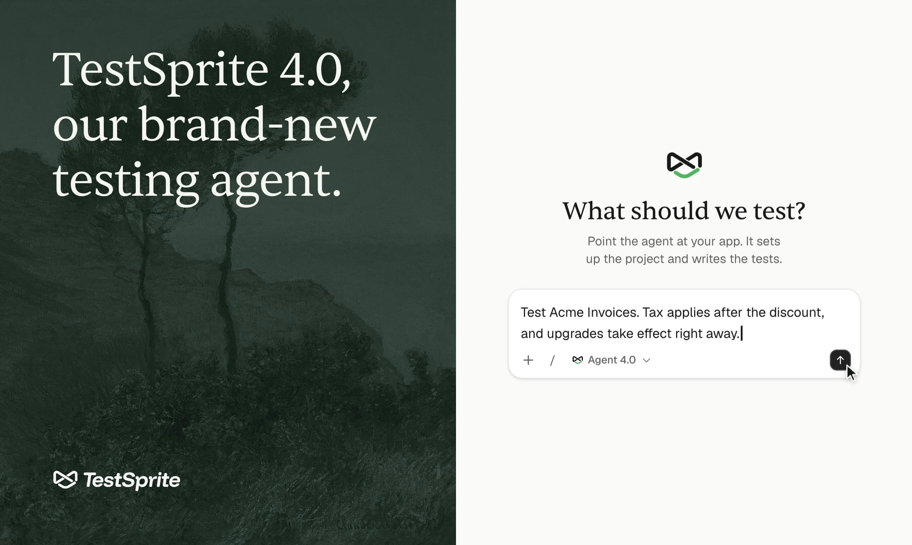
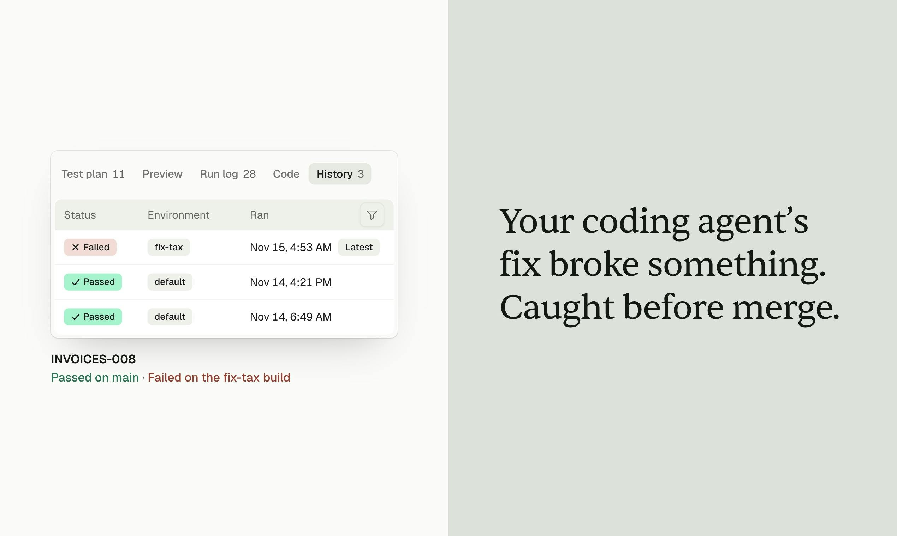
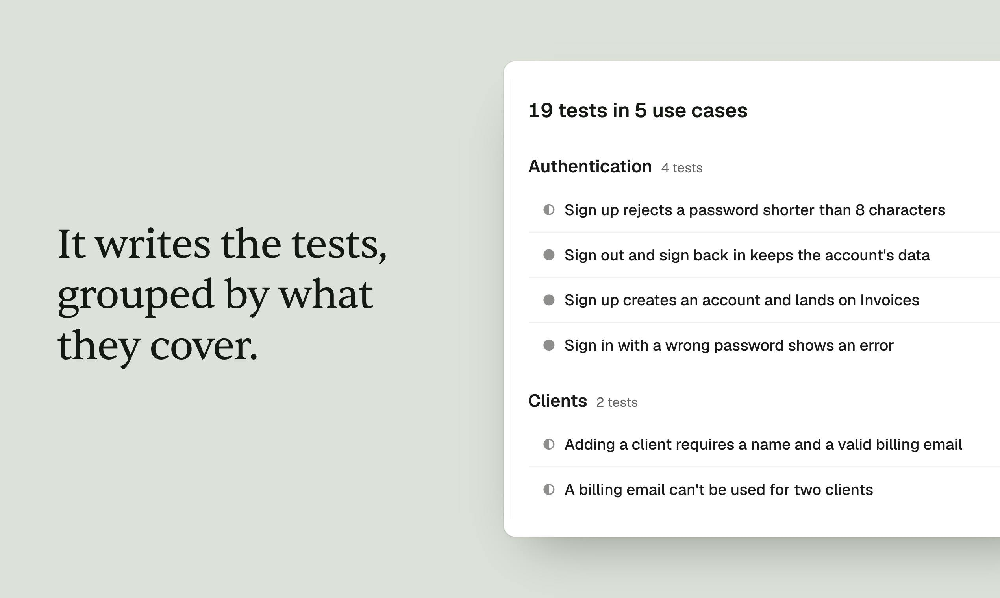

### 🎬 관련 영상
- [🎥 영상 보기](https://ph-files.imgix.net/725acadf-a563-4f71-9403-e3c172ff5cca.jpeg?auto=format)

---

## 2. [Verse Engine by Ctruh](https://www.producthunt.com/products/verse-engine-by-ctruh)
**Votes**: 230 | **도입 난이도**: 하 | **신뢰도**: 상
**Tagline**: Blender, Unity or Unreal to a live 3D link in one click
**서비스 링크**: https://www.producthunt.com/r/CBNSNOACCLEF75

**태그**: 3D, XR, DesignTool, NoCode, Workflow, AI Tool, DevTool, API

### 📌 이 서비스 한눈에 보기
Blender, Unity, Unreal의 3D 결과물을 클릭 한 번으로 웹에서 즉시 공유하는 브라우저 네이티브 엔진

### 🔑 주요 기능
- 별도 앱 설치나 다운로드 없이 브라우저에서 즉시 실행되는 3D/XR 환경 제공
- Blender, Unity, Unreal 엔진과의 원활한 워크플로우 지원
- 시야에 보이는 부분만 스트리밍하는 기술로 대규모 폴리곤 데이터도 가볍게 구동

### 🙋 사용자에게 어떤 점이 좋은가
복잡한 3D 파일을 클라이언트나 고객에게 전달할 때, 별도의 뷰어 설치 없이 링크 하나로 고품질 결과물을 보여줄 수 있습니다.

### ✅ 지금 바로 써볼 기능
- Blender/Unity/Unreal에서 작업 중인 프로젝트를 링크로 내보내기
- 14일 Pro 트라이얼을 통해 대용량 씬의 스트리밍 성능 테스트하기
- 웹사이트에 3D 모델 임베드 기능 활용하기

### ⚠️ 사용 전 확인할 점
- 고성능 3D 렌더링 특성상 네트워크 대역폭에 따른 로딩 속도 차이 발생 가능
- Pro 기능 사용을 위한 14일 무료 체험 기간 확인 필요

### 🧭 확인이 더 필요한 정보
사용자의 하드웨어 사양에 따른 브라우저 렌더링 최적화 수준을 확인해야 합니다.

### 📸 스크린샷 및 갤러리
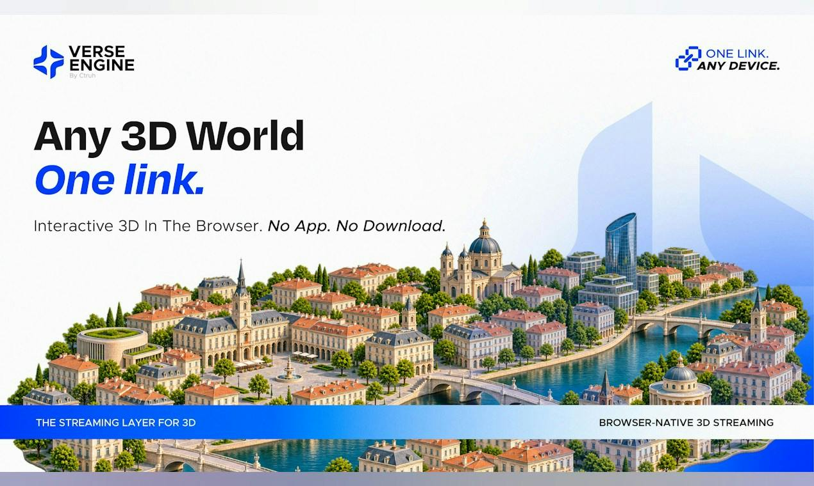
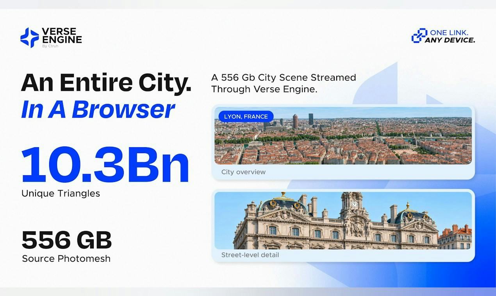
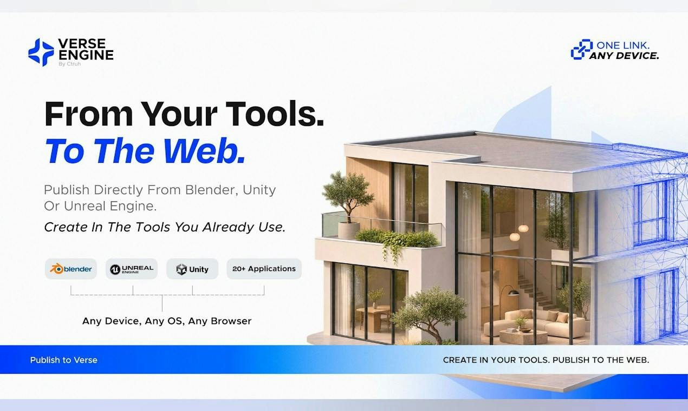

### 🎬 관련 영상
- [🎥 영상 보기](https://ph-files.imgix.net/76a21323-877f-47f2-a86e-312e4ae1dfc1.jpeg?auto=format)

---

## 3. [Netlify Server](https://www.producthunt.com/products/netlify)
**Votes**: 204 | **도입 난이도**: 하 | **신뢰도**: 상
**Tagline**: Run WebSockets, multiplayer apps, and long-running agents
**서비스 링크**: https://www.producthunt.com/r/VOJHOAWTB6DIXE

**태그**: Backend, Realtime, AI, DevOps, WebSockets, Agent, AI Tool, DevTool

### 📌 이 서비스 한눈에 보기
실시간 웹소켓과 장시간 실행되는 AI 에이전트를 위한 Netlify의 서버리스 백엔드 솔루션

### 🔑 주요 기능
- 웹소켓(WebSockets) 연결 유지 및 상태 메모리 보관 지원
- Express, Fastify, Hono, Koa 등 기존 프레임워크 코드 그대로 사용 가능
- 사용자 접속 시 활성화되고 유휴 시 0으로 스케일링되는 효율적 구조

### 🙋 사용자에게 어떤 점이 좋은가
멀티플레이어 게임이나 AI 에이전트처럼 연결이 끊기지 않아야 하는 실시간 애플리케이션을 기존 Netlify 워크플로우 내에서 쉽게 구축할 수 있습니다.

### ✅ 지금 바로 써볼 기능
- 기존 Express/Hono 코드를 Netlify Server로 마이그레이션해보기
- 웹소켓 기반의 실시간 채팅 또는 멀티플레이어 기능 구현하기
- 장시간 실행이 필요한 AI 에이전트 워크플로우 테스트하기

### ⚠️ 사용 전 확인할 점
- 초기 액세스(Early Access) 기간이므로 서비스 안정성 확인 필요
- 상태가 메모리에 유지되므로 서버 스케일링 시 데이터 유실 주의

### 🧭 확인이 더 필요한 정보
현재 초기 액세스 단계로, 향후 정식 출시 시의 가격 정책과 확장성 제한 사항을 확인해야 합니다.

### 📸 스크린샷 및 갤러리
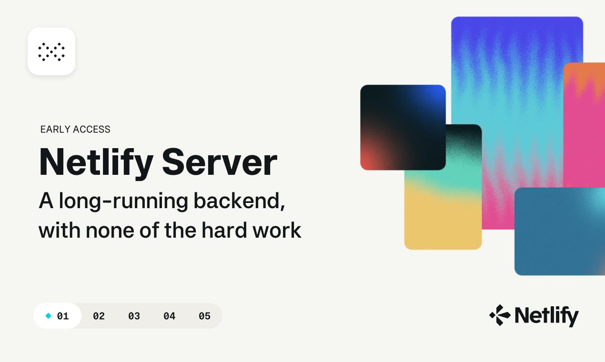
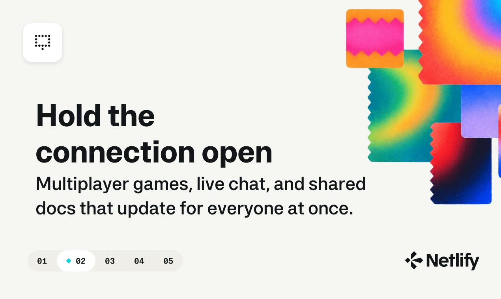
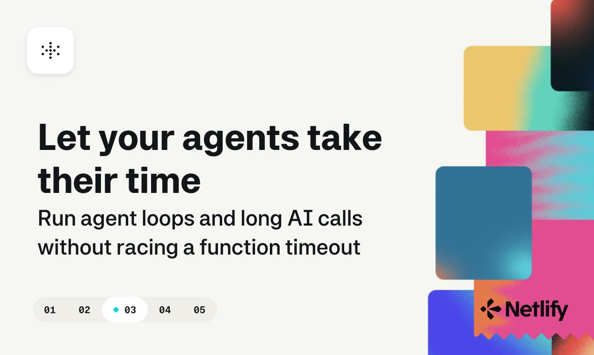

### 🎬 관련 영상
- [🎥 영상 보기](https://ph-files.imgix.net/33904cc7-616f-4c51-93d5-e41c1d8a4ec2.jpeg?auto=format)

---

## 4. [Stripo Email Widgets](https://www.producthunt.com/products/stripo-email)
**Votes**: 192 | **도입 난이도**: 하 | **신뢰도**: 상
**Tagline**: Put a game, quiz or survey in your next email. No coding
**서비스 링크**: https://www.producthunt.com/r/Q2V6HYMV6Q7K4J

**태그**: Email Marketing, NoCode, Engagement, Marketing Automation, AI Tool, Design, Email

### 📌 이 서비스 한눈에 보기
코딩 없이 이메일 안에 게임, 퀴즈, 설문조사를 바로 삽입하는 인터랙티브 위젯 도구

### 🔑 주요 기능
- 20개 이상의 다양한 인터랙티브 위젯(스크래치 카드, 퀴즈, 투표 등) 제공
- AI 어시스턴트를 통한 텍스트, 색상, 질문 등의 간편한 커스텀
- 인터랙티브를 지원하는 인박스에서는 동적 기능을, 미지원 환경에서는 정적 블록으로 자동 전환

### 🙋 사용자에게 어떤 점이 좋은가
복잡한 코딩 없이도 이메일 내에서 사용자의 참여를 유도할 수 있어, 클릭률과 고객 반응을 높이는 데 효과적입니다.

### ✅ 지금 바로 써볼 기능
- 드래그 앤 드롭으로 위젯을 에디터에 배치해보기
- AI 어시스턴트를 사용하여 위젯 디자인 및 질문 수정하기
- 생성된 컨테이너를 저장하여 다른 템플릿에 재사용하기

### ⚠️ 사용 전 확인할 점
- 사용자의 이메일 클라이언트(인박스) 환경에 따라 기능 작동 여부가 달라질 수 있음
- 인터랙티브 기능이 지원되지 않는 환경에서는 정적인 이미지/블록 형태로만 노출됨

### 🧭 확인이 더 필요한 정보
각 위젯이 지원하는 구체적인 이메일 클라이언트(Gmail, Outlook 등)의 호환 범위는 확인이 필요합니다.

### 📸 스크린샷 및 갤러리
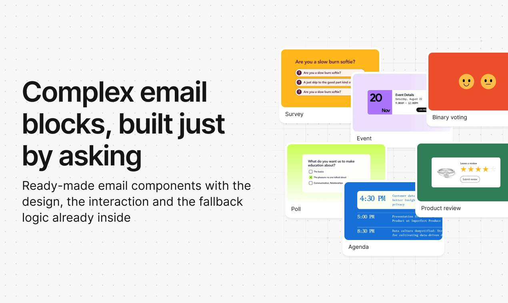
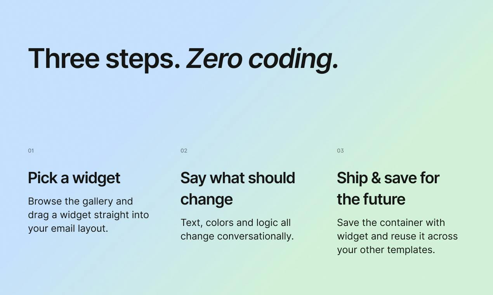
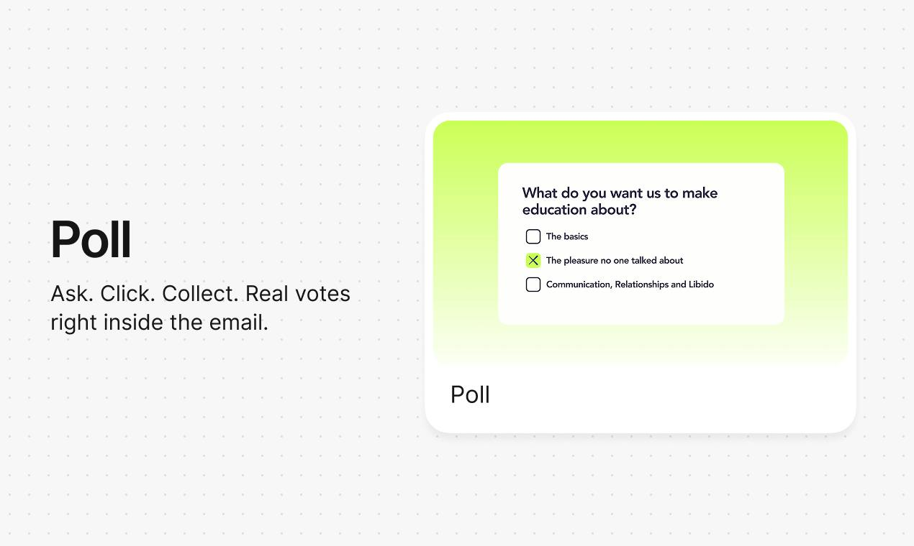

### 🎬 관련 영상
- [🎥 영상 보기](https://ph-files.imgix.net/38f79443-528c-46ae-bb78-3b399d319f21.jpeg?auto=format)

---

## 5. [Spellar for Chrome](https://www.producthunt.com/products/spellar)
**Votes**: 166 | **도입 난이도**: 하 | **신뢰도**: 상
**Tagline**: Free, no-bot meeting notes with memory, now in your browser
**서비스 링크**: https://www.producthunt.com/r/Z7H2A7X3VNOPOU

**태그**: Productivity, AI, Automation, Meeting, AI Tool

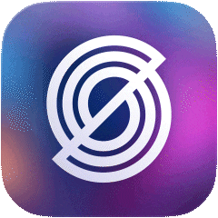

### 📌 이 서비스 한눈에 보기
별도 설치 없이 브라우저에서 바로 실행되는 봇 없는 회의 기록 및 통합 메모 서비스

### 🔑 주요 기능
- 데스크톱 앱 설치 없이 브라우저에서 Google Meet, Zoom, Teams, Webex 녹화 지원
- 회의 참여 봇 없이 기록하며, Google Meet 시 실제 화자 이름 표시
- 모든 회의 기록이 하나의 메모로 통합되어 과거 대화 내용 검색 가능

### 🙋 사용자에게 어떤 점이 좋은가
회의에 봇이 참여하지 않아 깔끔한 환경에서 기록할 수 있으며, 여러 기기의 메모가 통합되어 과거 맥락을 쉽게 파악할 수 있습니다.

### ✅ 지금 바로 써볼 기능
- 300분 무료 크레딧으로 주요 화상 회의 플랫폼 테스트하기
- Slack 또는 Notion으로 회의록 자동 전송 설정하기
- 통합 메모 기능을 활용해 과거 회의 내용 질문해보기

### ⚠️ 사용 전 확인할 점
- 브라우저 기반이므로 데스크톱 앱 환경과 기능 차이가 있을 수 있음
- 무료 제공 시간(300분) 소진 시 유료 전환 필요성 검토 필요

### 🧭 확인이 더 필요한 정보
무료 300분 제공 이후의 구체적인 유료 요금제 체계는 명시되어 있지 않습니다.

### 📸 스크린샷 및 갤러리
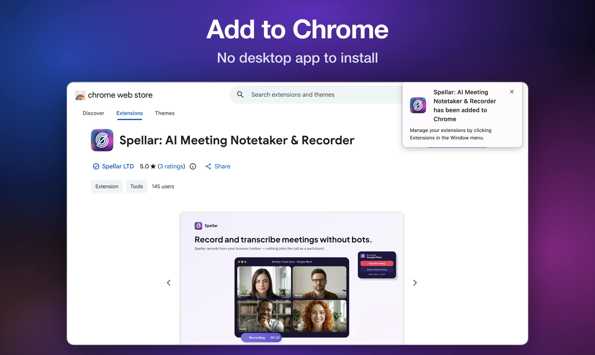
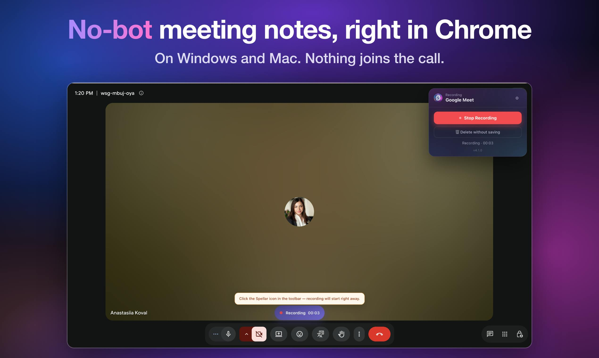
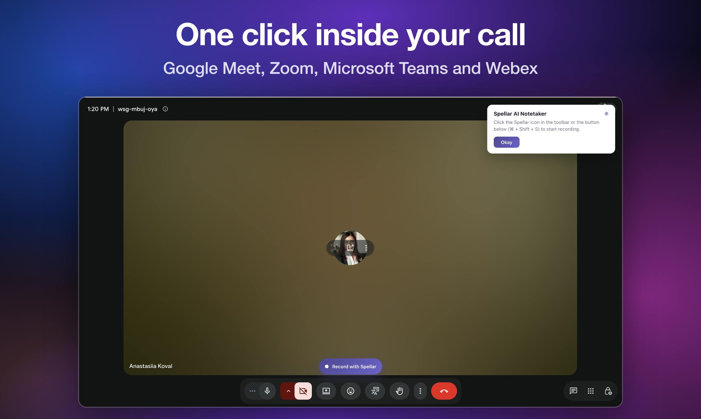

### 🎬 관련 영상
- [🎥 영상 보기](https://ph-files.imgix.net/a384264f-dc75-4df2-8989-2a419ddb76f7.jpeg?auto=format)

---

## 6. [Adside](https://www.producthunt.com/products/adside)
**Votes**: 161 | **도입 난이도**: 중 | **신뢰도**: 상
**Tagline**: A team of specialized AI agents that manage paid ads for you
**서비스 링크**: https://www.producthunt.com/r/32JCPUC6N6DHBO

**태그**: AI, Marketing, Automation, Advertising, Agent, AI Tool

### 📌 이 서비스 한눈에 보기
구글부터 트위터까지 주요 광고 채널을 자동 관리하는 AI 에이전트 팀

### 🔑 주요 기능
- Google, Meta, LinkedIn, Reddit, Twitter 등 주요 광고 플랫폼 통합 관리
- 특화된 AI 에이전트 팀이 유료 광고 운영 자동화
- 사용자 직접 운영 또는 전문가 대행 서비스 선택 가능

### 🙋 사용자에게 어떤 점이 좋은가
광고 운영에 드는 시간과 복잡도를 줄여주며, AI와 전문가의 협업을 통해 광고 효율을 최적화할 수 있습니다.

### ✅ 지금 바로 써볼 기능
- 주요 광고 채널 연동하기
- AI 에이전트의 광고 관리 방식 확인하기
- 전문가 대행 서비스 옵션 검토하기

### ⚠️ 사용 전 확인할 점
- AI 에이전트의 광고 예산 집행 및 최적화 로직 확인 필요
- 전문가 대행 서비스 이용 시 별도 비용 발생 가능성

### 🧭 확인이 더 필요한 정보
플랫폼별 상세 기능 차이와 전문가 대행 서비스의 비용 구조에 대한 정보가 필요합니다.

### 📸 스크린샷 및 갤러리

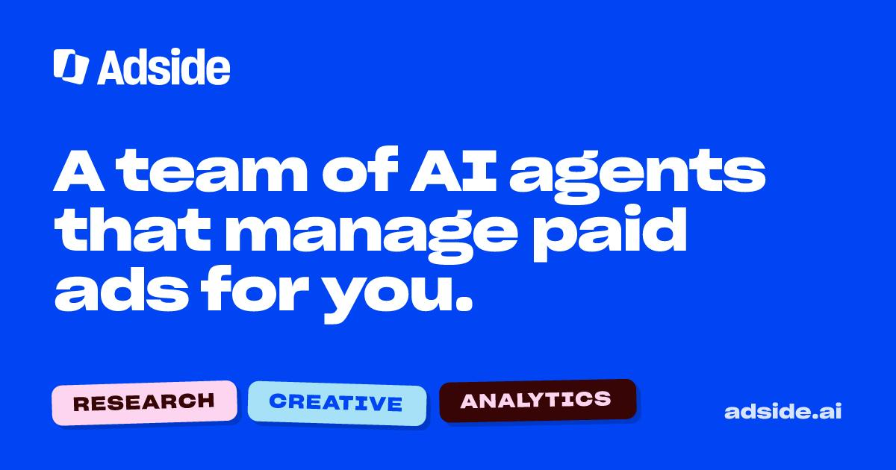
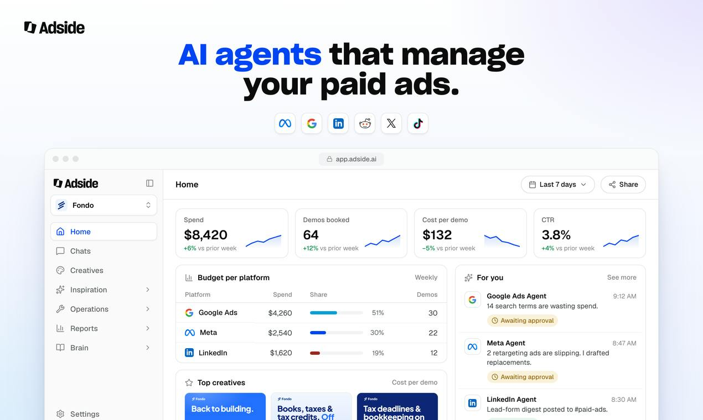

### 🎬 관련 영상
- [🎥 영상 보기](https://ph-files.imgix.net/c32aa6b4-139b-4a45-bc87-0f836378d3ad.jpeg?auto=format)

---

## 7. [Tabstack by Mozilla](https://www.producthunt.com/products/tabstack)
**Votes**: 160 | **도입 난이도**: 하 | **신뢰도**: 상
**Tagline**: Give your model the web without giving up your privacy
**서비스 링크**: https://www.producthunt.com/r/FM63R7JHAJZXNE

**태그**: DevTool, Automation, AI-Agent, Data-Extraction, Privacy, Agent, AI Tool, API

### 📌 이 서비스 한눈에 보기
개인정보 보호를 유지하면서 웹 데이터를 추출하고 자동화할 수 있는 Mozilla의 API 서비스

### 🔑 주요 기능
- 단일 API 호출로 웹 데이터 추출, 정제된 텍스트, JSON 매칭 및 브라우저 작업 수행 가능
- 모델 외부에서 브라우저와 웹 루프를 실행하여 모델 학습에 데이터가 사용되지 않음
- Mozilla가 구축한 기본 제공 프라이버시 보호 기능

### 🙋 사용자에게 어떤 점이 좋은가
웹 스택을 직접 구축할 필요 없이 API만으로 에이전트의 웹 탐색 및 데이터 추출 기능을 즉시 구현할 수 있습니다.

### ✅ 지금 바로 써볼 기능
- 10,000 크레딧을 활용한 무료 테스트
- 웹 데이터 추출 및 JSON 변환 기능 테스트
- 브라우저 자동화 작업 워크플로우 구축

### ⚠️ 사용 전 확인할 점
- 무료 크레딧 소진 후의 과금 체계 확인 필요
- 복잡한 웹 사이트의 동적 요소 처리 성능 확인 필요

### 🧭 확인이 더 필요한 정보
제공되는 10,000 크레딧의 구체적인 소진 기준과 유료 플랜의 가격 정책이 명시되지 않았습니다.

### 📸 스크린샷 및 갤러리
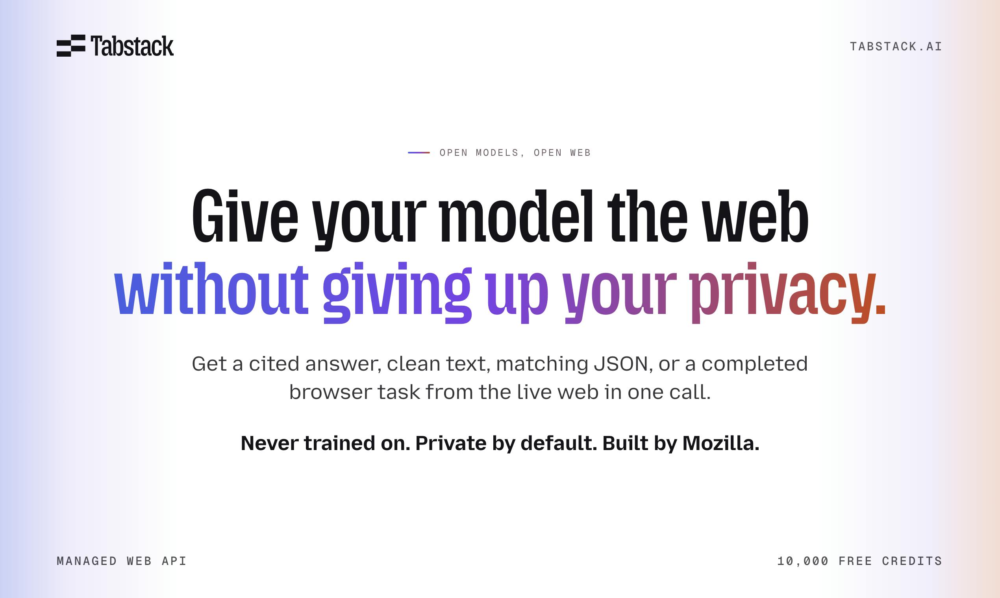
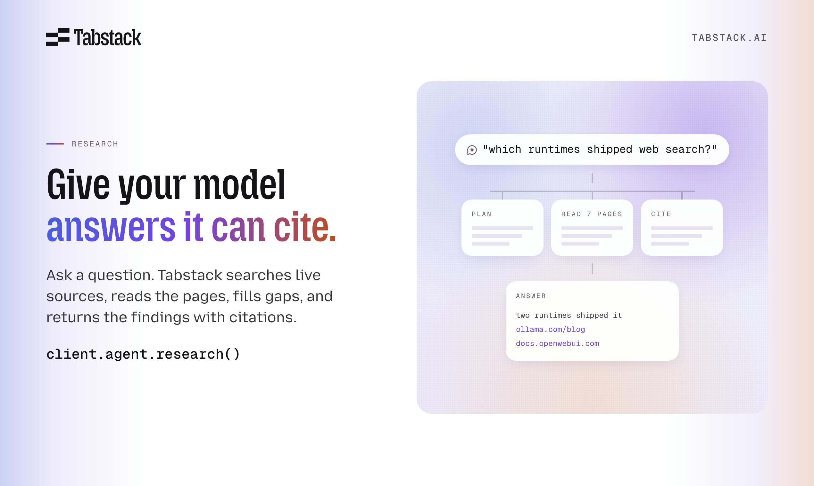
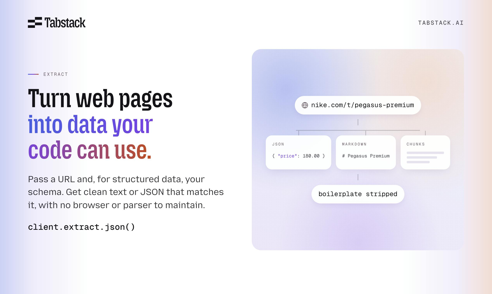

---

## 8. [Manufact](https://www.producthunt.com/products/manufact)
**Votes**: 150 | **도입 난이도**: 중 | **신뢰도**: 상
**Tagline**: Ship and test your MCP to every plugin marketplace
**서비스 링크**: https://www.producthunt.com/r/UI6BJYW7WUUNYS

**태그**: DevTool, MCP, Automation, Testing, Agent

### 📌 이 서비스 한눈에 보기
MCP 서버와 플러그인을 다양한 마켓플레이스에 간편하게 배포하고 테스트하는 워크플로우 도구

### 🔑 주요 기능
- 다양한 플러그인 마켓플레이스에 MCP 서버 배포 지원
- 에이전트의 사용 방식 분석 및 세션 트레이스 제공
- 여러 클라이언트에 걸친 교차 테스트 및 배포 체크 통합

### 🙋 사용자에게 어떤 점이 좋은가
MCP 서버 개발자가 여러 클라이언트 환경에서 플러그인이 어떻게 작동하는지 일일이 확인하는 번거로움을 줄여줍니다.

### ✅ 지금 바로 써볼 기능
- MCP 서버 배포 워크플로우 설정하기
- 세션 트레이스를 통한 에이전트 사용 패턴 분석하기
- 다양한 클라이언트 대상 교차 테스트 실행하기

### ⚠️ 사용 전 확인할 점
- 지원하는 마켓플레이스 및 클라이언트 종류 확인 필요
- 에이전트 사용 데이터 분석 시 보안 및 개인정보 정책 검토 필요

### 🧭 확인이 더 필요한 정보
현재 지원하는 구체적인 마켓플레이스 목록과 클라이언트 호환 범위를 확인해야 합니다.

### 📸 스크린샷 및 갤러리
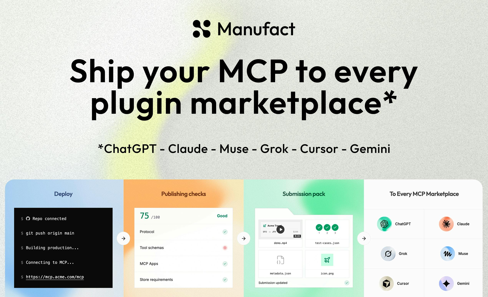
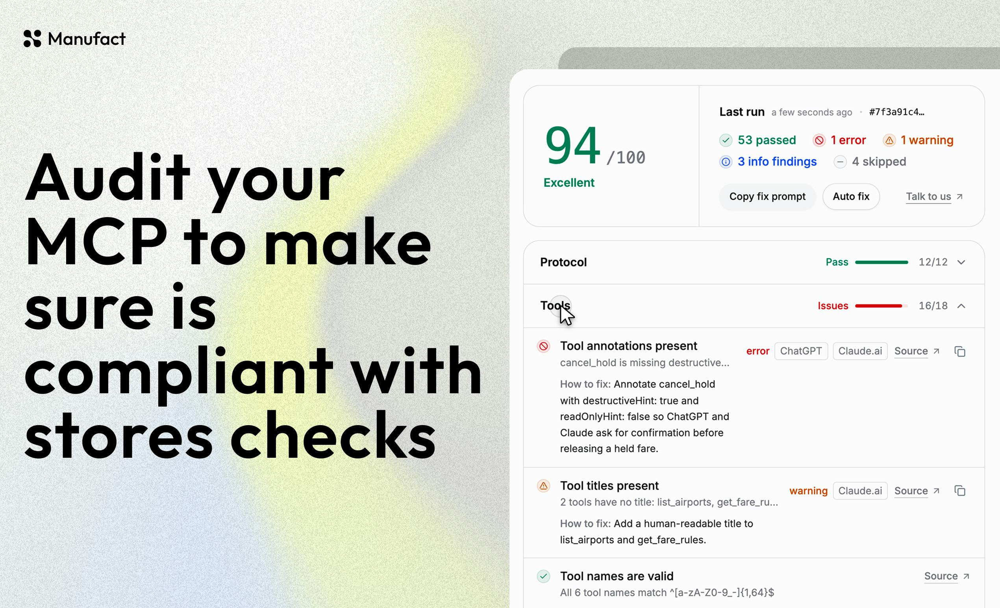
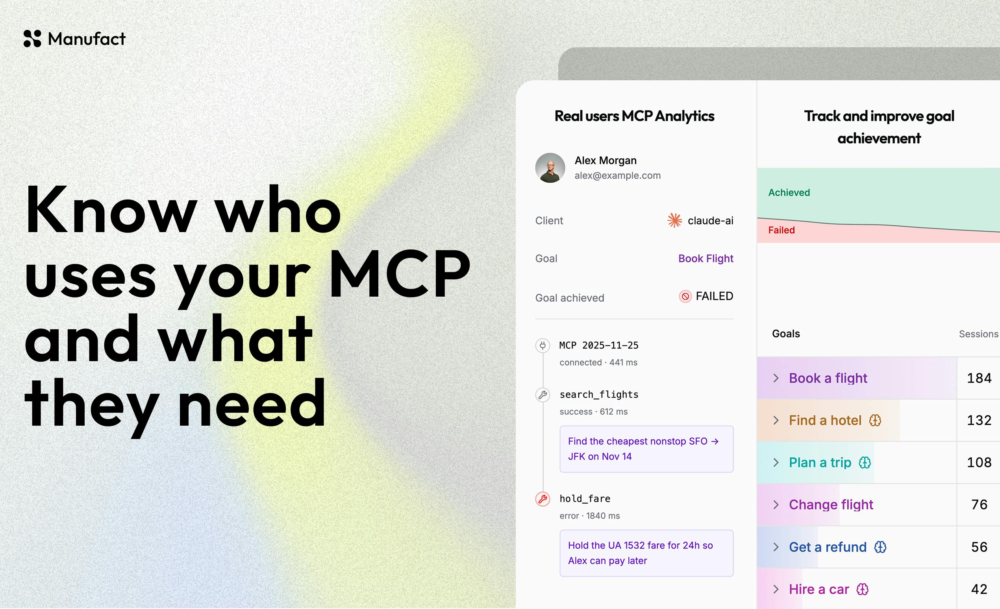

### 🎬 관련 영상
- [🎥 영상 보기](https://ph-files.imgix.net/659d38dd-586c-46c5-bad3-83cc2496705f.jpeg?auto=format)

---

## 9. [Teaflask](https://www.producthunt.com/products/teaflask)
**Votes**: 144 | **도입 난이도**: 하 | **신뢰도**: 상
**Tagline**: Self-improving AI copilot for your app. No backend changes.
**서비스 링크**: https://www.producthunt.com/r/P7M5XVDZPLYNNQ

**태그**: AI, SaaS, DevTool, LowCode, AI Tool

### 📌 이 서비스 한눈에 보기
백엔드 수정 없이 기존 SaaS에 AI 코파일럿 기능을 즉시 도입하는 솔루션

### 🔑 주요 기능
- 백엔드 재구축 없이 프론트엔드 통합만으로 AI 기능 구현 가능
- 코드 기반의 지식 학습 및 실제 사용 패턴을 통한 지속적 성능 개선
- 기존 UI 컴포넌트를 그대로 활용하여 브랜드 일관성 유지

### 🙋 사용자에게 어떤 점이 좋은가
기존 서비스의 구조를 건드리지 않고도 사용자에게 강력한 AI 기능을 제공하여 제품을 AI-native로 빠르게 전환할 수 있습니다.

### ✅ 지금 바로 써볼 기능
- 프론트엔드 연동을 통한 AI 코파일럿 기능 활성화
- 기존 UI 컴포넌트와 AI 기능의 결합 테스트
- 실제 사용자 피드백을 통한 AI 학습 데이터 축적

### ⚠️ 사용 전 확인할 점
- 프론트엔드 중심의 통합 방식이므로 복잡한 백엔드 로직 제어에는 한계가 있을 수 있음
- 코드 기반 지식 학습 시 보안 및 데이터 프라이버시 정책 확인 필요

### 🧭 확인이 더 필요한 정보
백엔드 변경 없이 어느 정도 수준의 복잡한 사용자 작업(Action)까지 수행 가능한지 구체적인 범위 확인이 필요합니다.

### 📸 스크린샷 및 갤러리
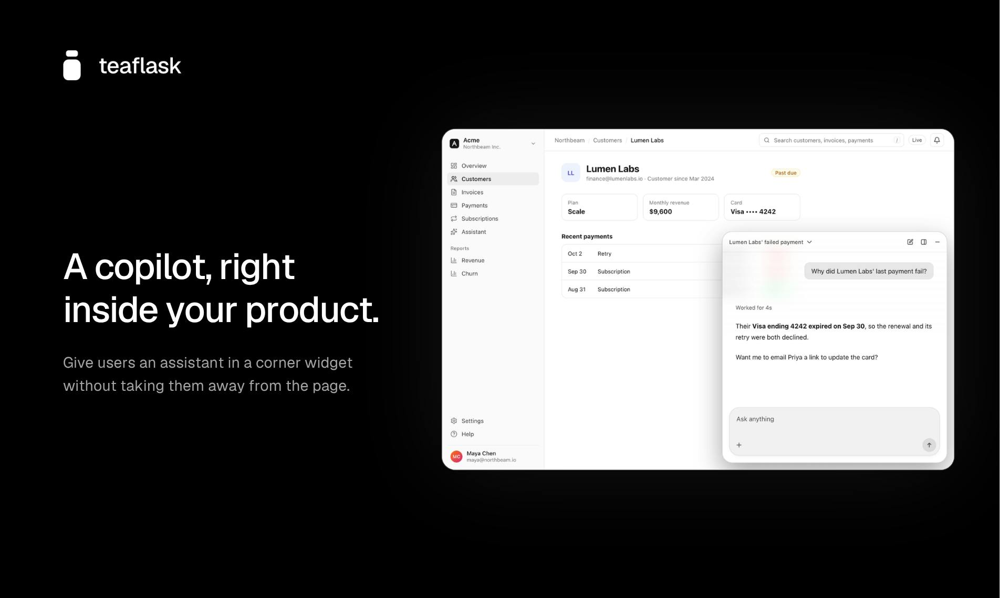
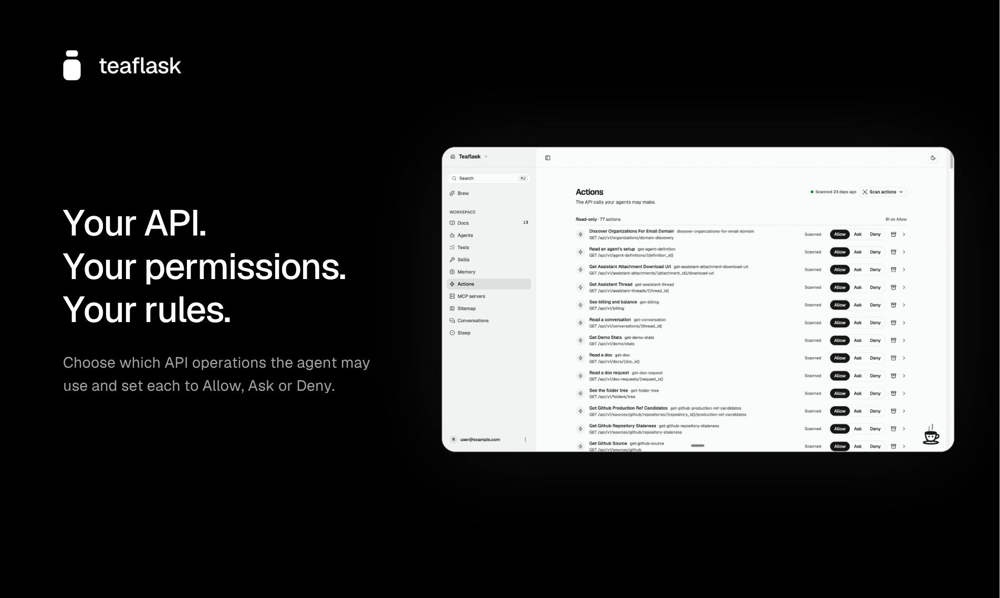
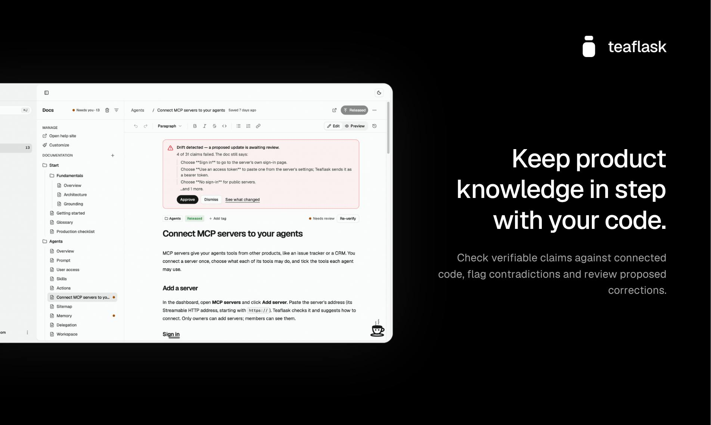

### 🎬 관련 영상
- [🎥 영상 보기](https://ph-files.imgix.net/c6523d04-d99b-457e-b893-dd4dbe92f2a7.jpeg?auto=format)

---

## 10. [Mesh API](https://www.producthunt.com/products/mesh-api)
**Votes**: 123 | **도입 난이도**: 하 | **신뢰도**: 상
**Tagline**: Token-efficient AI gateway for 1,000+ models
**서비스 링크**: https://www.producthunt.com/r/UXMJJTC7X6QE6N

**태그**: AI, DevTool, CostOptimization, Automation, AI Tool, API

### 📌 이 서비스 한눈에 보기
코드 한 줄로 AI 비용을 최대 4배 절감하는 지능형 AI 게이트웨이

### 🔑 주요 기능
- 최적의 비용과 품질을 고려한 자동 모델 라우팅
- 직접 모델 할인 적용을 통한 추가 비용 절감
- 서비스 중단을 방지하는 자동 장애 복구(Failover) 기능

### 🙋 사용자에게 어떤 점이 좋은가
기존 코드를 최소한으로 수정하면서도 AI 모델 비용을 획기적으로 줄이고 서비스 안정성을 확보할 수 있습니다.

### ✅ 지금 바로 써볼 기능
- 코드 한 줄로 모델 라우팅 적용하기
- 품질 기준(Quality Bar) 설정 및 자동 최적화 테스트
- 모델별 할인율 및 비용 절감 효과 확인

### ⚠️ 사용 전 확인할 점
- 자동 라우팅 시 모델 변경에 따른 응답 품질 변화 확인 필요
- 직접 모델 할인 적용 범위 및 대상 모델 확인 필요

### 🧭 확인이 더 필요한 정보
제시된 비용 절감 수치가 모든 사용자 환경에서 동일하게 적용되는지 확인이 필요합니다.

### 📸 스크린샷 및 갤러리
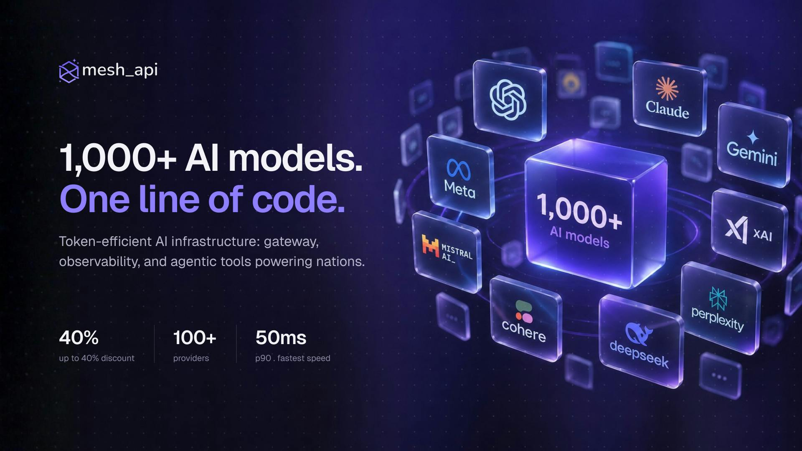
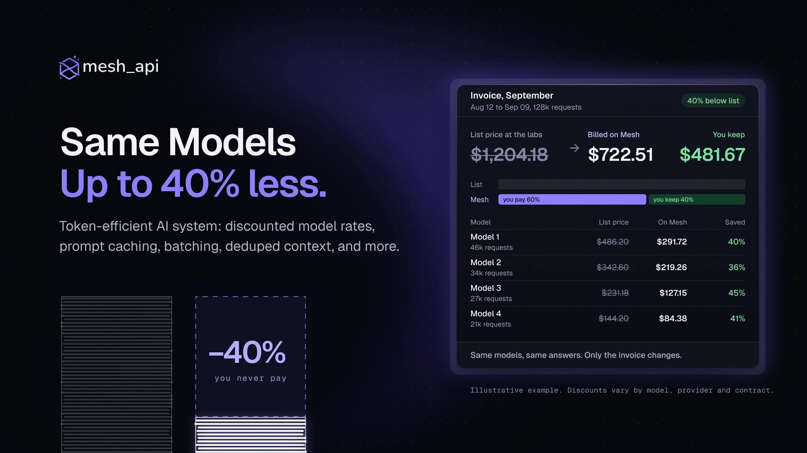
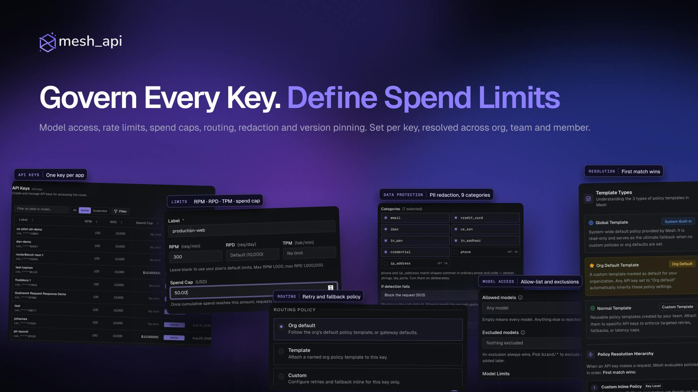

### 🎬 관련 영상
- [🎥 영상 보기](https://ph-files.imgix.net/a0be4df6-44ac-454d-9035-7945ceb9817e.jpeg?auto=format)

---

## 11. [Gemini 4 Neon](https://www.producthunt.com/products/gemini-6)
**Votes**: 123 | **도입 난이도**: 하 | **신뢰도**: 상
**Tagline**: Frontier reasoning with faster task completion
**서비스 링크**: https://www.producthunt.com/r/VNQ2C436QNLPO3
**재등장**: 최근 7일 내 재등장 (마지막 등장 5일 전)

**태그**: AI, DeveloperTool, Automation, LLM, Agent, AI Tool, API

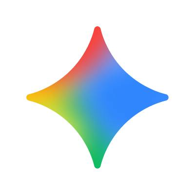

### 📌 이 서비스 한눈에 보기
더 빠른 작업 속도와 강력한 추론 능력을 결합한 차세대 멀티모달 AI 모델

### 🔑 주요 기능
- Gemini 4 Carbon 기반의 고도화된 추론 능력 제공
- 코딩, 리서치, 에이전트 워크플로우에 최적화된 빠른 속도
- 100만 토큰의 대규모 컨텍스트 윈도우 및 멀티모달 입력 지원

### 🙋 사용자에게 어떤 점이 좋은가
방대한 데이터를 처리하면서도 빠른 응답 속도가 필요한 개발자나 연구자에게 효율적인 작업 환경을 제공합니다.

### ✅ 지금 바로 써볼 기능
- Gemini API를 통한 기존 워크플로우 통합 테스트
- AI Studio를 활용한 대규모 컨텍스트 처리 실험
- Antigravity를 통한 에이전트 기반 작업 자동화 시도

### ⚠️ 사용 전 확인할 점
- Carbon 모델 대비 성능 차이 및 특정 작업에서의 효율성 검증 필요
- 대규모 컨텍스트 사용 시 발생할 수 있는 비용 및 지연 시간 확인

### 🧭 확인이 더 필요한 정보
Gemini 4 Carbon 모델과의 구체적인 성능 차이 및 비용 구조에 대한 정보가 필요합니다.

### 📸 스크린샷 및 갤러리

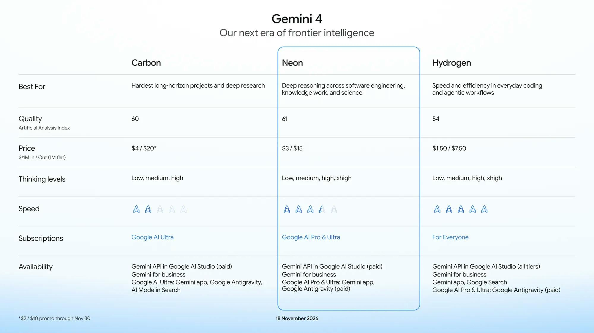
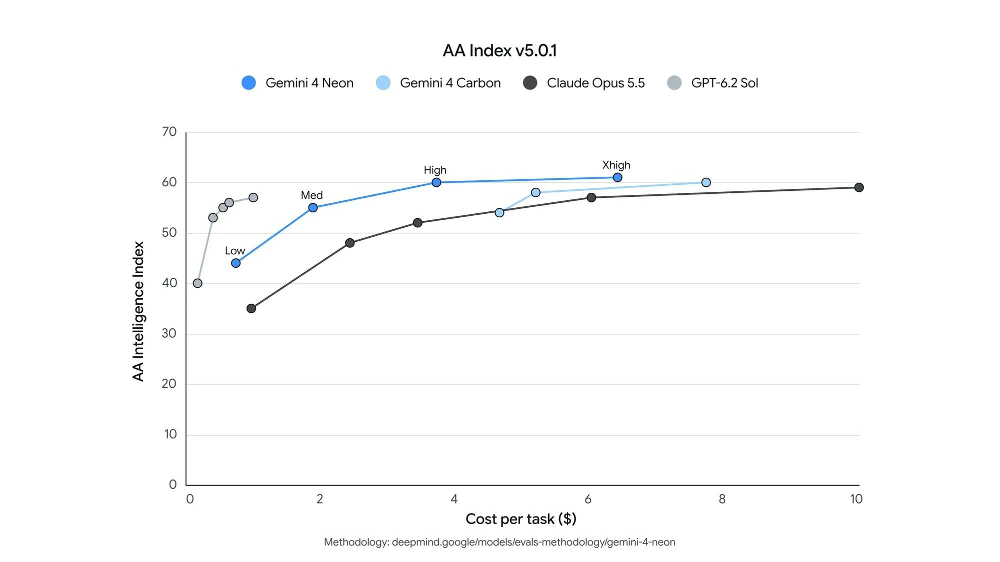

---

## 12. [Wispr Flow Notetaker for iPhone](https://www.producthunt.com/products/wisprflow)
**Votes**: 108 | **도입 난이도**: 하 | **신뢰도**: 상
**Tagline**: Free AI meeting notes, wherever work takes you
**서비스 링크**: https://www.producthunt.com/r/HTWKRZXSXSNV54

**태그**: Productivity, AI, Mobile, Note-taking, AI Tool

### 📌 이 서비스 한눈에 보기
장소에 구애받지 않고 대면 및 화상 회의를 기록하는 모바일 AI 노트 테이커

### 🔑 주요 기능
- iPhone 지원으로 대면 회의 현장 기록 가능
- 데스크톱과 모바일 간의 원활한 노트 동기화
- 무료로 제공되는 AI 기반 회의 기록 기능

### 🙋 사용자에게 어떤 점이 좋은가
이동 중이거나 현장 미팅 시에도 스마트폰으로 간편하게 기록할 수 있으며, 모든 기록이 기기 간에 통합되어 업무 연속성을 유지할 수 있습니다.

### ✅ 지금 바로 써볼 기능
- iPhone 앱 설치 및 대면 미팅 기록 테스트
- 데스크톱과 모바일 간의 동기화 확인
- 무료 플랜의 기능 범위 확인

### ⚠️ 사용 전 확인할 점
- 무료 버전의 사용량 제한 여부 확인 필요
- 모바일 환경에서의 배터리 소모 및 마이크 권한 설정 확인

### 🧭 확인이 더 필요한 정보
무료 플랜의 구체적인 기능 제한이나 유료 플랜으로의 전환 시점이 명시되지 않았습니다.

### 📸 스크린샷 및 갤러리

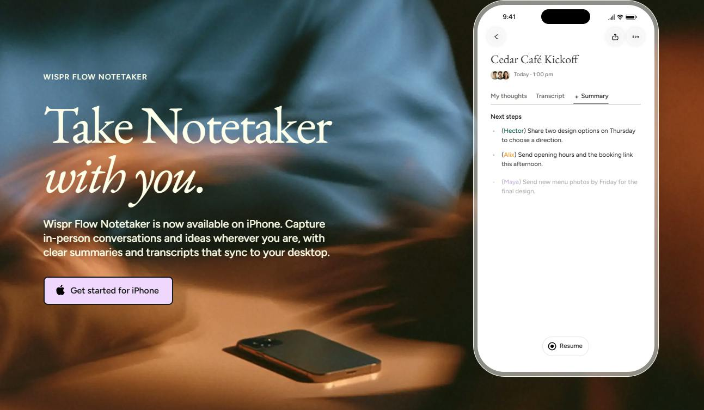
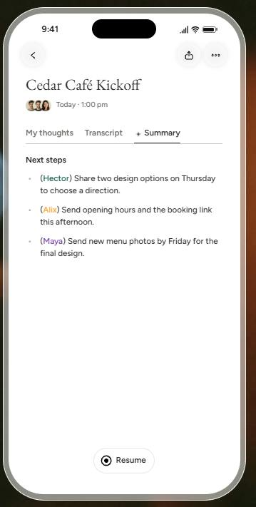

### 🎬 관련 영상
- [🎥 영상 보기](https://ph-files.imgix.net/3af81bfb-6b0b-476e-a28f-96b0988ed61e.jpeg?auto=format)

---

## 13. [Cleared](https://www.producthunt.com/products/cleared-quit-nicotine)
**Votes**: 96 | **도입 난이도**: 하 | **신뢰도**: 상
**Tagline**: Your personal plan to give up vapes, pouches and cigarettes
**서비스 링크**: https://www.producthunt.com/r/QI6NDILPISPNA5

**태그**: Health, Wellness, Habit Tracker, AI, AI Tool

### 📌 이 서비스 한눈에 보기
개인 맞춤형 계획과 AI 코칭을 통해 니코틴 중독에서 벗어나도록 돕는 금연 플래너

### 🔑 주요 기능
- 사용자의 사용 습관에 맞춘 개인별 맞춤형 금연 계획 수립
- 데일리 체크인, 코칭, 원탭 기록 및 위기 상황을 위한 'Craving SOS' 제공
- AI 기반의 니코틴 테스트 결과 판독 기능

### 🙋 사용자에게 어떤 점이 좋은가
체계적인 계획 없이 금연을 시도하는 사용자가 일상 속에서 실질적인 도움을 받으며 중독을 극복할 수 있게 합니다.

### ✅ 지금 바로 써볼 기능
- 자신의 사용 습관을 입력하여 맞춤형 플랜 생성하기
- 흡연 욕구가 강할 때 'Craving SOS' 기능 활용하기
- 니코틴 테스트 결과 사진을 찍어 AI 판독 기능 사용하기

### ⚠️ 사용 전 확인할 점
- 의학적 진단이 아닌 보조적인 코칭 도구임을 인지해야 함
- AI 판독 결과는 참고용이며 정확도는 테스트 키트의 품질에 따라 다를 수 있음

### 🧭 확인이 더 필요한 정보
사용자의 구체적인 중독 단계나 건강 상태에 따른 의학적 가이드라인 포함 여부는 명시되지 않았습니다.

### 📸 스크린샷 및 갤러리
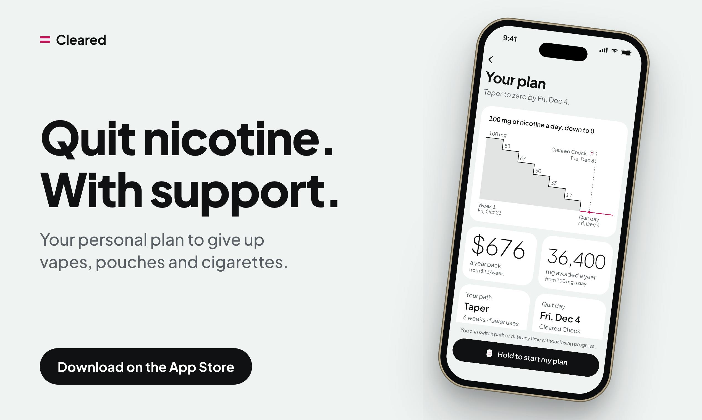
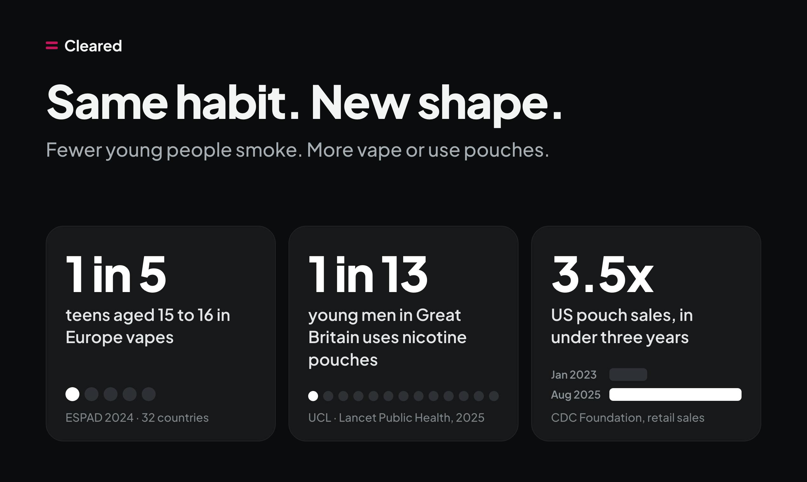
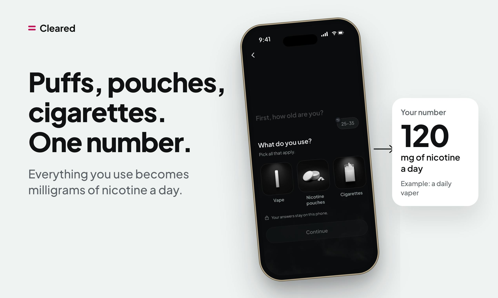

### 🎬 관련 영상
- [🎥 영상 보기](https://ph-files.imgix.net/41bef221-98f2-4ab5-a6d8-718c45d955ca.jpeg?auto=format)

---

## 14. [Enrichable by Context.dev](https://www.producthunt.com/products/context-dev)
**Votes**: 92 | **도입 난이도**: 중 | **신뢰도**: 상
**Tagline**: Open-source AI spreadsheet for data enrichment
**서비스 링크**: https://www.producthunt.com/r/3LIRC5KMTJRIG5

**태그**: AI, Automation, Sales, OpenSource, DataEnrichment, AI Tool, Prompting, Email

### 📌 이 서비스 한눈에 보기
프롬프트만으로 리드 리스트를 만들고 실시간 웹 데이터를 활용해 데이터를 보강하는 오픈소스 AI 스프레드시트

### 🔑 주요 기능
- 프롬프트를 통한 자동화된 리드 리스트 구축
- 실시간 웹 데이터를 활용한 행 단위 리서치 기능
- 워크 이메일 발굴을 위한 데이터 보강 기능

### 🙋 사용자에게 어떤 점이 좋은가
수동으로 하던 리드 조사와 데이터 수집 과정을 AI로 자동화하여 영업 및 마케팅 리스트 작성 시간을 획기적으로 단축할 수 있습니다.

### ✅ 지금 바로 써볼 기능
- 프롬프트를 입력하여 타겟 리드 리스트 생성해보기
- 실시간 웹 데이터 검색 기능을 통한 데이터 검증하기
- 생성된 데이터를 바탕으로 이메일 주소 추출하기

### ⚠️ 사용 전 확인할 점
- 오픈소스 도구이므로 데이터 보안 및 프라이버시 정책 확인 필요
- 실시간 웹 데이터의 정확도 및 최신성 검증 필요

### 🧭 확인이 더 필요한 정보
상세한 데이터 보안 정책 및 외부 API 연동 방식에 대한 구체적인 정보가 필요합니다.

### 📸 스크린샷 및 갤러리
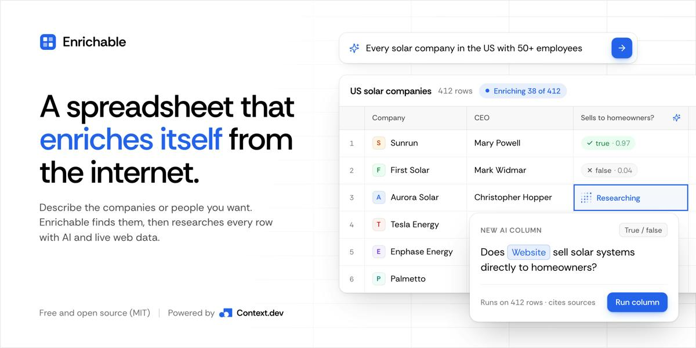
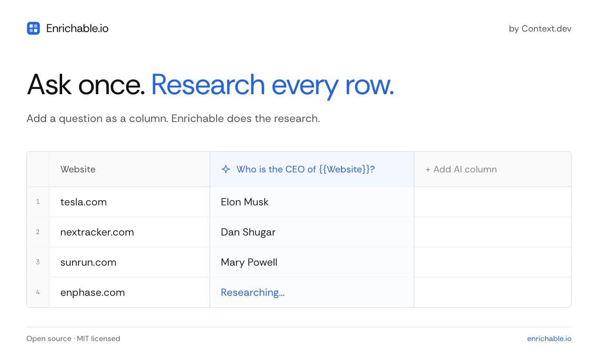
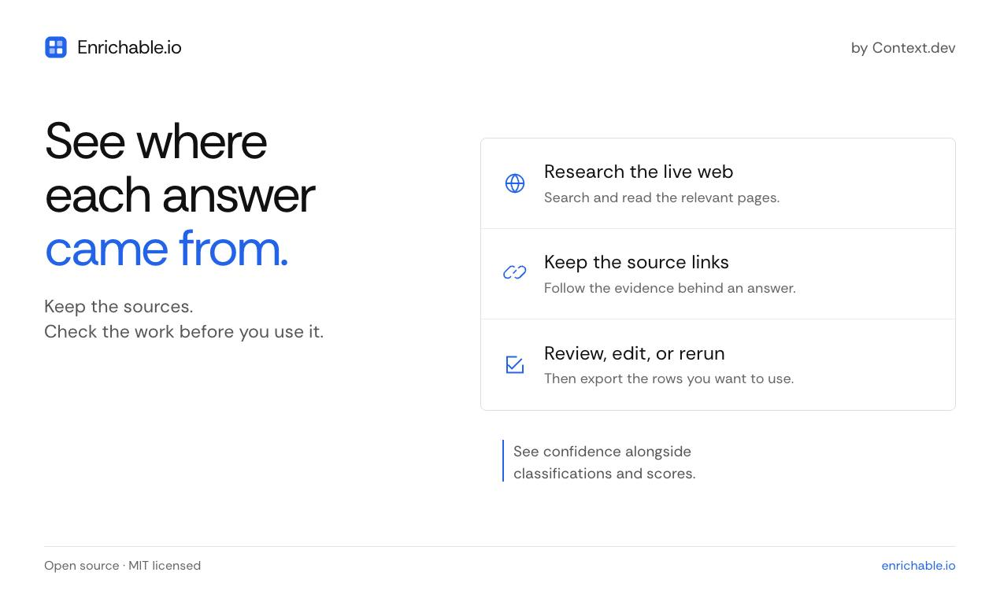

### 🎬 관련 영상
- [🎥 영상 보기](https://ph-files.imgix.net/b3245d6b-c673-4c1a-aead-ea2c576a5735.jpeg?auto=format)

---

## 15. [ToolJet](https://www.producthunt.com/products/tooljet)
**Votes**: 90 | **도입 난이도**: 중 | **신뢰도**: 상
**Tagline**: Vibe-coded business apps that pass the security review
**서비스 링크**: https://www.producthunt.com/r/63XRNRXTZNRZ6N

**태그**: LowCode, AI-Native, DevOps, Security, InternalTools, Automation, DevTool

### 📌 이 서비스 한눈에 보기
AI 코딩 도구로 만든 커스텀 앱에 강력한 보안과 데이터 통합을 더하는 엔터프라이즈급 플랫폼

### 🔑 주요 기능
- AI 에이전트(Claude Code, Cursor 등)로 생성한 React 기반 내부 도구의 안정적 구동
- 100개 이상의 데이터 통합 및 내장 데이터베이스 제공
- 보안 스캔, 버전 리뷰, 승인 워크플로우 등 엔터프라이즈급 거버넌스 기능

### 🙋 사용자에게 어떤 점이 좋은가
AI로 빠르게 만든 앱을 보안 검토 없이 바로 실무에 투입할 수 있는 안전한 운영 환경을 제공합니다.

### ✅ 지금 바로 써볼 기능
- AI 코딩 도구로 생성한 코드의 ToolJet 배포 테스트
- 기존 데이터 소스와의 연동성 확인
- 워크플로우 승인 프로세스 설정

### ⚠️ 사용 전 확인할 점
- AI가 생성한 코드의 품질이 플랫폼의 보안 기능과 충돌할 가능성 확인 필요
- 복잡한 커스텀 로직 구현 시 플랫폼 제약 사항 검토

### 🧭 확인이 더 필요한 정보
AI 코딩 도구와의 구체적인 연동 방식 및 자동화 수준에 대한 상세 기술 문서 확인이 필요합니다.

### 📸 스크린샷 및 갤러리
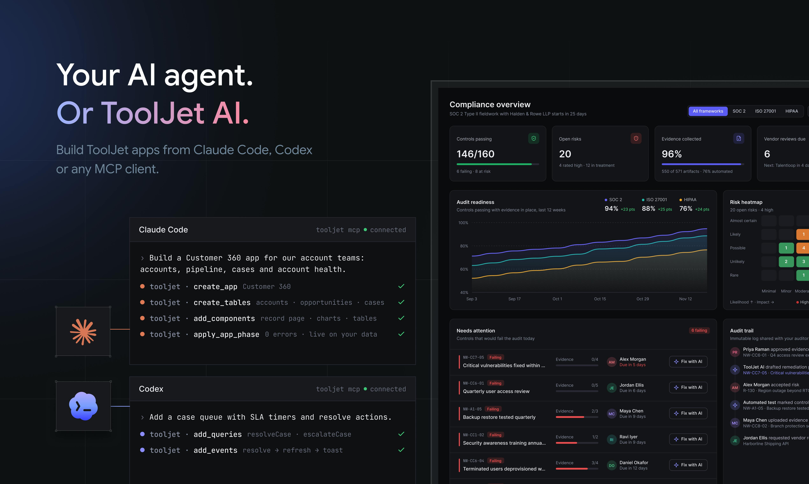
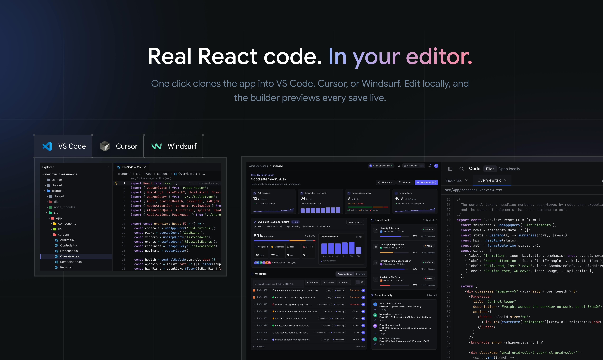
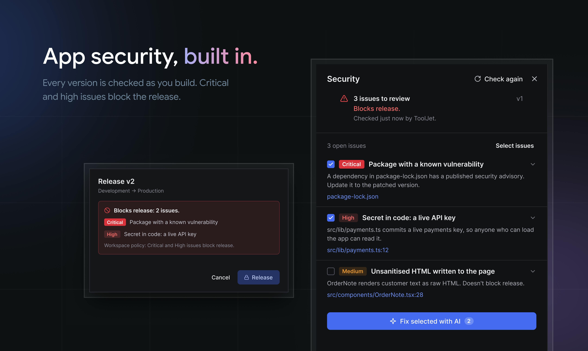

### 🎬 관련 영상
- [🎥 영상 보기](https://ph-files.imgix.net/71a8cf99-1fa4-4506-bd53-3e8b6e3a1f75.jpeg?auto=format)

---

## 16. [Meilisearch Searchandising](https://www.producthunt.com/products/meilisearch-cloud)
**Votes**: 89 | **도입 난이도**: 하 | **신뢰도**: 상
**Tagline**: Pin, boost, hide and personalize search results
**서비스 링크**: https://www.producthunt.com/r/5BN2UXRUFBLPFJ

**태그**: Search, E-commerce, Marketing, DevTool, AI Tool, API

### 📌 이 서비스 한눈에 보기
시각적 편집기로 검색 결과를 제어하고 개인화할 수 있는 Meilisearch의 새로운 검색 상용화 기능

### 🔑 주요 기능
- 드래그 앤 드롭 방식의 시각적 규칙 편집기 제공
- 특정 필터에 따른 결과 고정(Pin), 부스트(Boost), 숨기기 기능
- 캠페인 일정 예약 및 배포 전 결과 비교 기능

### 🙋 사용자에게 어떤 점이 좋은가
코드 수정 없이도 비즈니스 전략에 맞춰 검색 결과를 즉각 조정할 수 있어, 마케팅 캠페인이나 상품 노출 전략을 유연하게 실행할 수 있습니다.

### ✅ 지금 바로 써볼 기능
- 시각적 편집기를 통한 검색 규칙 생성 테스트
- 캠페인 기간을 위한 규칙 예약 기능 설정
- 배포 전 규칙 적용 전후 결과 비교 기능 활용

### ⚠️ 사용 전 확인할 점
- 개인화 기능은 현재 실험적 단계이며 요청 시에만 제공됨
- 프로젝트당 3개의 무료 규칙만 제공됨

### 🧭 확인이 더 필요한 정보
개인화 기능의 구체적인 적용 방식과 기술적 요구사항은 별도 요청이 필요합니다.

### 📸 스크린샷 및 갤러리
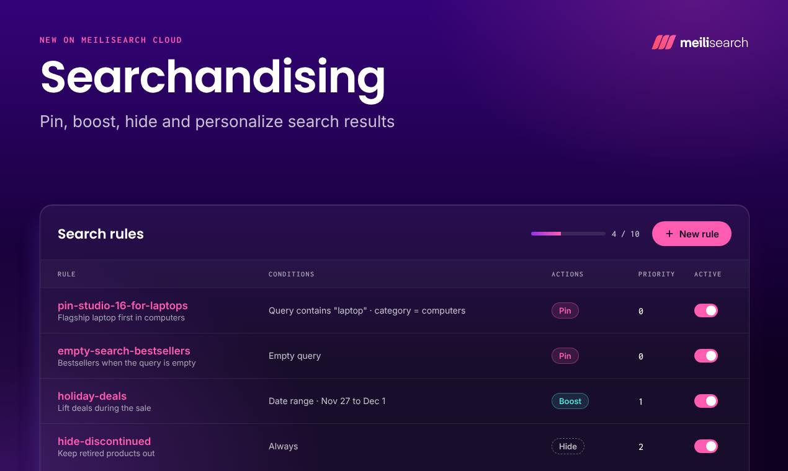
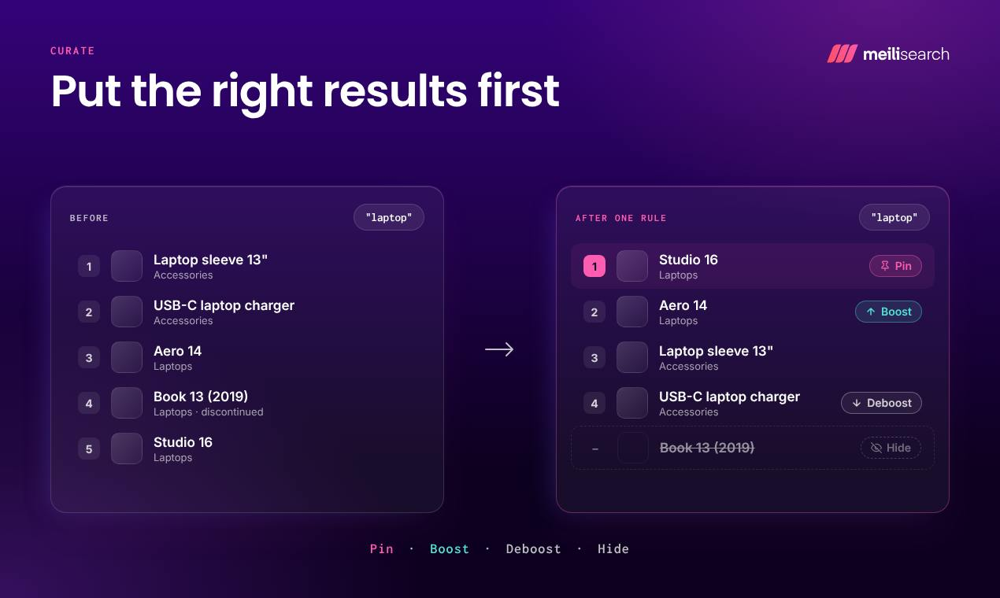
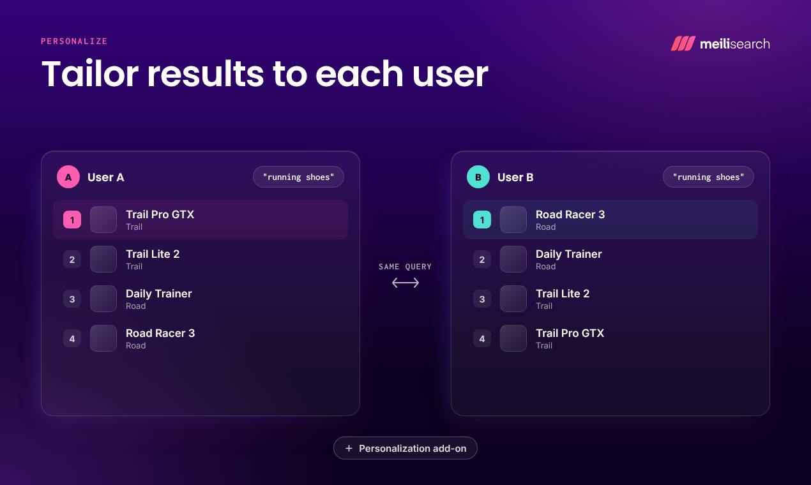

### 🎬 관련 영상
- [🎥 영상 보기](https://ph-files.imgix.net/81b7ea0b-31eb-4c69-9cd3-aaa337efec10.jpeg?auto=format)

---

## 17. [Impractical](https://www.producthunt.com/products/impractical)
**Votes**: 88 | **도입 난이도**: 하 | **신뢰도**: 상
**Tagline**: Make launch videos in the style of Framer, Notion, and more
**서비스 링크**: https://www.producthunt.com/r/P52M6QUEUFMMAC

**태그**: VideoGen, Marketing, DesignTool, NoCode, AI, AI Tool, Video

### 📌 이 서비스 한눈에 보기
Framer나 Notion 스타일의 세련된 제품 출시 영상을 템플릿 기반으로 빠르게 제작하는 AI 도구

### 🔑 주요 기능
- Framer, Notion 스타일의 감각적인 영상 템플릿 제공
- UI, 카피, 브랜드를 입력하여 맞춤형 영상 생성
- AI를 통한 간편한 영상 수정 및 편집 기능

### 🙋 사용자에게 어떤 점이 좋은가
디자인 전문 지식 없이도 창업자와 마케터가 고퀄리티의 제품 소개 및 기능 발표 영상을 제작할 수 있습니다.

### ✅ 지금 바로 써볼 기능
- 원하는 스타일의 영상 템플릿 선택하기
- 제품 UI와 브랜드 요소 적용하기
- AI 프롬프트를 통해 영상 디테일 수정하기

### ⚠️ 사용 전 확인할 점
- 템플릿 기반이므로 아주 독창적인 커스텀 애니메이션 구현에는 한계가 있을 수 있음
- 상세한 가격 정책 및 유료 플랜 범위 확인 필요

### 🧭 확인이 더 필요한 정보
제공되는 템플릿의 종류와 AI 편집 기능의 세부 제어 범위에 대한 정보가 더 필요합니다.

### 📸 스크린샷 및 갤러리
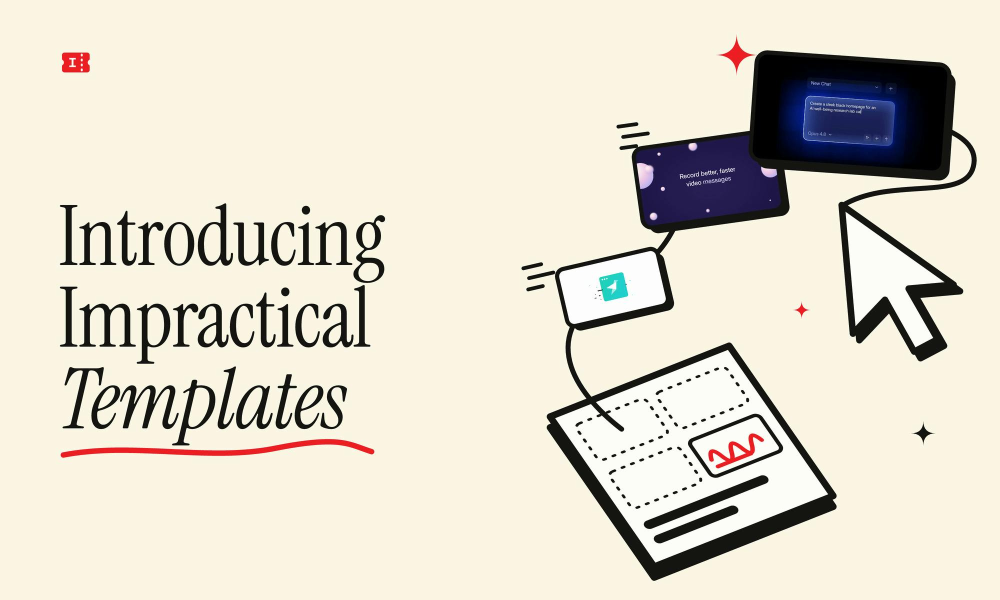
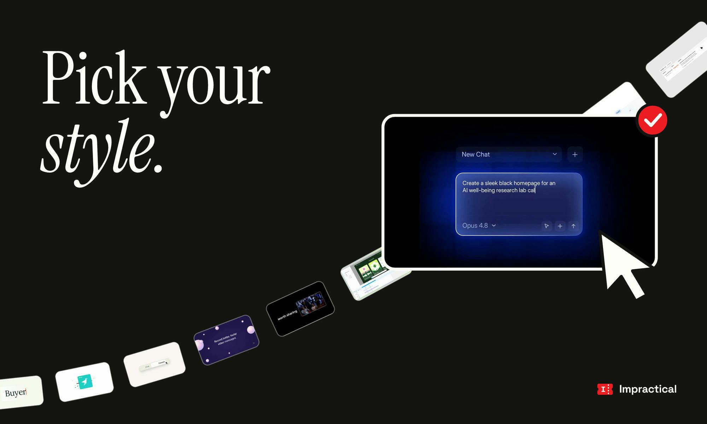
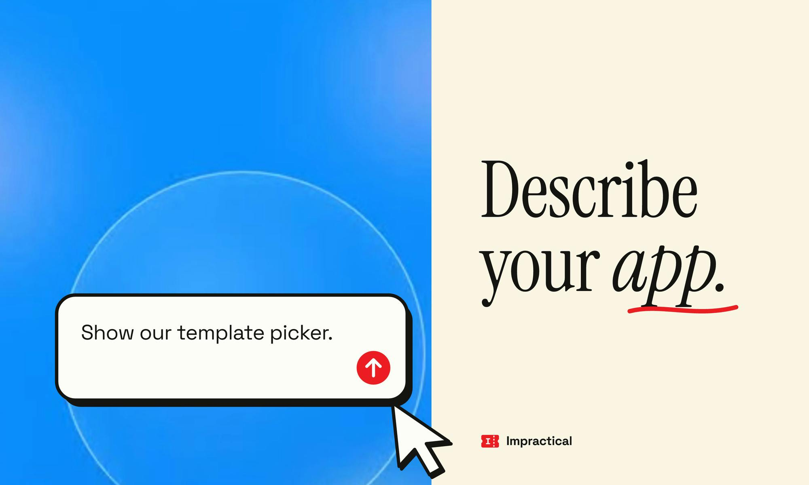

### 🎬 관련 영상
- [🎥 영상 보기](https://ph-files.imgix.net/aafffa2d-e952-4656-98c9-2d5af9b0057f.jpeg?auto=format)

---

## 18. [mio click](https://www.producthunt.com/products/mio-click)
**Votes**: 88 | **도입 난이도**: 하 | **신뢰도**: 상
**Tagline**: A fidget that's also a friend
**서비스 링크**: https://www.producthunt.com/r/7QTHEXQJELGBYL

**태그**: Hardware, Lifestyle, Gaming, Fidget

### 📌 이 서비스 한눈에 보기
나만의 디지털 생명체를 키우며 즐기는 손맛 가득한 피젯 클릭기

### 🔑 주요 기능
- 세상에 하나뿐인 고유한 디지털 캐릭터(Squig, Goober, Meatball) 육성
- 5천만 회 클릭 내구성을 갖춘 기계식 버튼과 소형 스크린 탑재
- Wi-Fi를 통한 실시간 리더보드 동기화 및 친구와의 교환 기능

### 🙋 사용자에게 어떤 점이 좋은가
단순한 스트레스 해소용 피젯을 넘어, 수집과 경쟁이라는 게임 요소를 결합해 일상 속 소소한 재미를 제공합니다.

### ✅ 지금 바로 써볼 기능
- 나만의 고유한 캐릭터 부화시키기
- 클릭을 통해 캐릭터 성장시키고 리더보드 순위 확인하기
- 친구와 캐릭터를 교환하거나 새로운 캐릭터 부화하기

### ⚠️ 사용 전 확인할 점
- Wi-Fi 연결 환경에 따라 리더보드 동기화 기능이 제한될 수 있음
- 수작업 소량 생산 제품이므로 재고 확보가 어려울 수 있음

### 🧭 확인이 더 필요한 정보
정확한 배터리 수명 및 충전 방식에 대한 정보가 명시되어 있지 않습니다.

### 📸 스크린샷 및 갤러리

### 🎬 관련 영상
- [🎥 영상 보기](https://ph-files.imgix.net/mcp-draft-media/74419fdb-1106-4065-b37b-c3b66d81863e.jpeg?auto=format)

---

## 19. [HeyGen Avatar 6](https://www.producthunt.com/products/heygen)
**Votes**: 84 | **도입 난이도**: 하 | **신뢰도**: 상
**Tagline**: AI Avatar Model That Looks Like You
**서비스 링크**: https://www.producthunt.com/r/XKTD6ZBSXTVWWN

**태그**: AI, VideoGeneration, ContentCreation, AI Tool, Video

### 📌 이 서비스 한눈에 보기
실제 영상과 구분이 어려울 정도로 정교한 초현실적 AI 아바타 생성 모델

### 🔑 주요 기능
- 실제 영상과 84.4% 일치하는 높은 현실감 제공
- 사용자의 모습을 닮은 맞춤형 AI 아바타 생성
- 첫 영상 제작 무료 체험 지원

### 🙋 사용자에게 어떤 점이 좋은가
실제 인물이 촬영한 듯한 고품질 영상을 통해 콘텐츠 제작 비용과 시간을 획기적으로 절감할 수 있습니다.

### ✅ 지금 바로 써볼 기능
- 무료 체험을 통한 아바타 품질 테스트
- 본인 모습과 얼마나 유사한지 확인하기
- 제작된 영상의 현실감 검증하기

### ⚠️ 사용 전 확인할 점
- 84.4%의 일치도가 모든 환경에서 완벽함을 보장하지 않을 수 있음
- 무료 체험 이후의 유료 플랜 정책 확인 필요

### 🧭 확인이 더 필요한 정보
사용자 맞춤형 아바타 생성 시 필요한 데이터(사진, 영상 등)의 범위와 보안 정책을 확인해야 합니다.

### 📸 스크린샷 및 갤러리

### 🎬 관련 영상
- [🎥 영상 보기](https://ph-files.imgix.net/249e8bb5-b01f-4860-b41b-39796673990e.jpeg?auto=format)

---

## 20. [Room AI](https://www.producthunt.com/products/room-ai-2)
**Votes**: 84 | **도입 난이도**: 하 | **신뢰도**: 상
**Tagline**: Talk to it like a designer. Your room, one change at a time
**서비스 링크**: https://www.producthunt.com/r/G53UCEFFU7ZFGQ

**태그**: AI, Interior Design, Image Editing, Home Decor, AI Tool, Design

### 📌 이 서비스 한눈에 보기
대화하듯 요청하여 방의 인테리어를 한 단계씩 바꿔가는 AI 디자인 도구

### 🔑 주요 기능
- 사진 업로드 후 자연어로 변경 사항 요청 가능
- 기존 공간의 틀을 유지하며 특정 요소만 변경하는 정교한 편집
- 버전별 비교 기능 및 크레딧 제한 없는 자유로운 시도

### 🙋 사용자에게 어떤 점이 좋은가
인테리어 전문가 없이도 자신의 방 사진을 바탕으로 다양한 디자인 변화를 즉각적으로 시뮬레이션할 수 있습니다.

### ✅ 지금 바로 써볼 기능
- 현재 방 사진 업로드하기
- 원하는 가구나 색상 변경 요청하기
- 생성된 버전 간의 차이 비교하기

### ⚠️ 사용 전 확인할 점
- 실제 가구 배치나 물리적 치수와는 차이가 있을 수 있음
- 복잡한 구조 변경 시 원본 유지력이 변동될 가능성 있음

### 🧭 확인이 더 필요한 정보
현재 카드 등록 없이 무료로 제공되는 초기 단계 서비스로 보입니다.

### 📸 스크린샷 및 갤러리

### 🎬 관련 영상
- [🎥 영상 보기](https://ph-files.imgix.net/b4e0c2cd-06e8-4236-ac6f-395fcf8eb68b.jpeg?auto=format)

---

## 21. [Fieldwork Code](https://www.producthunt.com/products/fieldwork-code)
**Votes**: 81 | **도입 난이도**: 중 | **신뢰도**: 상
**Tagline**: AI coding on your laptop or in the cloud, from your phone
**서비스 링크**: https://www.producthunt.com/r/WVBWK6BMQQ5JMY

**태그**: DevTool, AI-Coding, Mobile-Development, Productivity, Agent, AI Tool

### 📌 이 서비스 한눈에 보기
모바일과 데스크톱을 넘나들며 어디서든 AI 코딩 세션을 이어가는 하이브리드 개발 환경

### 🔑 주요 기능
- 데스크톱 앱(무료)과 클라우드 샌드박스($50/mo)를 통한 유연한 실행 환경
- 모바일 앱과 웹을 통한 끊김 없는 세션 동기화 및 이어하기
- 터미널, 파일 차이점(diff), PR 상태, CI 체크를 포함한 통합 사이드 패널

### 🙋 사용자에게 어떤 점이 좋은가
이동 중에도 모바일로 코딩 작업을 확인하거나 이어갈 수 있으며, 데스크톱과 클라우드 환경을 자유롭게 오가며 AI 에이전트와 협업할 수 있습니다.

### ✅ 지금 바로 써볼 기능
- 데스크톱 앱을 설치하여 로컬 환경에서 무료로 AI 코딩 시작하기
- 모바일 앱을 통해 외부에서도 작업 세션 확인 및 이어하기 테스트
- 다양한 AI 모델(Claude Code, Codex 등)과 하네스 교체해보기

### ⚠️ 사용 전 확인할 점
- 클라우드 샌드박스 사용 시 월 $50의 비용 발생
- 모바일 환경에서의 복잡한 코드 수정 및 디버깅 제약 가능성

### 🧭 확인이 더 필요한 정보
모바일 앱에서의 코드 편집 및 실행 기능의 상세 수준과 데스크톱 앱과의 완전한 기능 일치 여부를 확인해야 합니다.

### 📸 스크린샷 및 갤러리

### 🎬 관련 영상
- [🎥 영상 보기](https://ph-files.imgix.net/03f8ba8c-5df9-42f3-a141-25b7eea56f51.jpeg?auto=format)

---

## 22. [Every Signal](https://www.producthunt.com/products/every-signal)
**Votes**: 80 | **도입 난이도**: 하 | **신뢰도**: 상
**Tagline**: Diligence on any company in an hour, every number sourced
**서비스 링크**: https://www.producthunt.com/r/B5RAMWOUWHS5R2

**태그**: AI, Market Research, Business Intelligence, Automation, Agent

### 📌 이 서비스 한눈에 보기
단 한 시간 만에 기업의 모든 핵심 지표를 출처와 함께 분석해 주는 AI 리서치 에이전트

### 🔑 주요 기능
- 트래픽, 광고, 수익 모델, 경쟁사 등 기업 분석 리포트 자동 생성
- 모든 수치에 대해 검증됨, 추정됨, 추론됨, 루머 등의 출처 태그 제공
- 기업 데이터의 변화를 실시간으로 모니터링

### 🙋 사용자에게 어떤 점이 좋은가
기업 조사에 드는 시간을 획기적으로 단축하며, 데이터의 신뢰도를 즉각적으로 판단할 수 있어 의사결정 속도를 높여줍니다.

### ✅ 지금 바로 써볼 기능
- 특정 기업에 대한 심층 분석 리포트 생성해보기
- 제공된 수치의 출처 태그(Verified vs Estimate) 확인하기
- 관심 기업의 데이터 변화 알림 설정하기

### ⚠️ 사용 전 확인할 점
- 추정치나 루머로 분류된 데이터의 실제 정확성 검증 필요
- 자동화된 리포트이므로 최종 의사결정 전 수동 검토 권장

### 🧭 확인이 더 필요한 정보
제공되는 데이터의 원천 소스와 실시간 업데이트 주기에 대한 상세 정보 확인이 필요합니다.

### 📸 스크린샷 및 갤러리

---

## 23. [Alfred 6](https://www.producthunt.com/products/alfred)
**Votes**: 80 | **도입 난이도**: 하 | **신뢰도**: 상
**Tagline**: Supercharging macOS since 2010
**서비스 링크**: https://www.producthunt.com/r/SLO3STP6FKM77U

**태그**: Productivity, macOS, Automation, Workflow

### 📌 이 서비스 한눈에 보기
새로운 UI 툴킷과 강화된 히스토리 기능을 갖춘 macOS 생산성 극대화 도구

### 🔑 주요 기능
- 새로운 macOS 네이티브 UI 툴킷(Alfred UI) 도입으로 인터랙티브한 워크플로우 구축 가능
- 쿼리 히스토리 및 확장된 클립보드 히스토리 기능 추가
- 더욱 세련된 테마와 설정 화면을 포함한 현대적인 디자인

### 🙋 사용자에게 어떤 점이 좋은가
사용자는 더 직관적인 인터페이스를 통해 복잡한 작업을 간편한 워크플로우로 자동화할 수 있으며, 강화된 히스토리 기능으로 작업 효율을 높일 수 있습니다.

### ✅ 지금 바로 써볼 기능
- 새로운 Alfred UI를 활용한 커스텀 워크플로우 제작
- 확장된 클립보드 히스토리 기능 활용
- 새로운 테마 적용 및 개인화 설정

### ⚠️ 사용 전 확인할 점
- 기존 워크플로우와의 호환성 여부 확인 필요
- macOS 전용 도구이므로 Windows/Linux 환경에서는 사용 불가

### 🧭 확인이 더 필요한 정보
기존 버전 사용자들을 위한 마이그레이션 과정 및 구체적인 워크플로우 호환성에 대한 상세 정보가 필요합니다.

### 📸 스크린샷 및 갤러리

---

## 24. [Tecla](https://www.producthunt.com/products/tecla-3)
**Votes**: 79 | **도입 난이도**: 하 | **신뢰도**: 상
**Tagline**: A proactive AI agent whose interface is a TODO list
**서비스 링크**: https://www.producthunt.com/r/FG773WTAL3VKJL

**태그**: AI Agent, Productivity, Automation, Workflow, Agent, AI Tool, Chat, Prompting, Email

### 📌 이 서비스 한눈에 보기
업무 대화 속 할 일을 자동으로 추출하여 실행까지 돕는 프로액티브 AI 에이전트

### 🔑 주요 기능
- Slack, 이메일, 회의 등에서 발생하는 업무를 자동으로 감지하여 할 일 목록 생성
- 프롬프트 입력 없이 클릭 한 번으로 업무를 수행하는 인터페이스
- 맥락(Context)을 유지하며 누락 없는 업무 관리 지원

### 🙋 사용자에게 어떤 점이 좋은가
복잡한 프롬프트 작성이나 수동 할 일 등록 없이, 대화 흐름 속에서 자연스럽게 업무를 관리하고 실행할 수 있습니다.

### ✅ 지금 바로 써볼 기능
- Slack/이메일 연동을 통한 업무 자동 추출 테스트
- 생성된 TODO 리스트의 맥락 정확도 확인
- 클릭을 통한 AI 자동 실행 기능 검증

### ⚠️ 사용 전 확인할 점
- 개인/기업용 메신저 및 이메일 접근 권한에 따른 보안 검토 필요
- AI가 업무 맥락을 오해하여 잘못된 작업을 수행할 가능성

### 🧭 확인이 더 필요한 정보
현재 제공되는 외부 서비스(Slack, Email 등)와의 구체적인 연동 범위와 보안 정책 확인이 필요합니다.

### 📸 스크린샷 및 갤러리

### 🎬 관련 영상
- [🎥 영상 보기](https://ph-files.imgix.net/c75d7a63-0bcf-4f90-9a08-dd2ed711f157.jpeg?auto=format)

---

## 25. [Play That Back](https://www.producthunt.com/products/play-that-back)
**Votes**: 77 | **도입 난이도**: 하 | **신뢰도**: 상
**Tagline**: A pro camera built for iPhone Duo
**서비스 링크**: https://www.producthunt.com/r/FDUQOIPJUZJPIL

**태그**: Camera, ContentCreation, Foldable, VideoEditing, AI Tool, Video, Design

### 📌 이 서비스 한눈에 보기
폴더블 기기의 듀얼 스크린을 활용해 촬영자와 피사체가 실시간으로 소통하는 프로급 카메라 앱

### 🔑 주요 기능
- 폴더블 폰의 내/외부 디스플레이를 활용한 촬영 및 피사체 모니터링
- 시네마틱 룩과 전문적인 컨트롤을 제공하는 프로급 카메라 기능
- Mac을 통한 소셜 미디어 영상(Reels, Shorts, TikTok) 편집 및 레시피 제작

### 🙋 사용자에게 어떤 점이 좋은가
촬영자는 내부 화면으로 구도를 잡고, 피사체는 외부 화면으로 결과물을 확인하며 최적의 결과물을 만들 수 있습니다. 또한 촬영한 영상을 다양한 소셜 미디어 규격에 맞춰 쉽게 편집할 수 있습니다.

### ✅ 지금 바로 써볼 기능
- 폴더블 기기에서 내/외부 화면 분할 촬영 기능 테스트
- Mac에서 소셜 미디어용 영상 레시피 적용해보기
- iPhone 및 iPad와의 호환성 확인

### ⚠️ 사용 전 확인할 점
- 폴더블 기기 외 일반 스마트폰 사용 시 기능 제약 가능성
- Mac 연동 시 기기 간 동기화 환경 필요

### 🧭 확인이 더 필요한 정보
기기별(iPhone, iPad, Mac) 상세 호환성 및 구체적인 편집 기능의 범위는 추가 확인이 필요합니다.

### 📸 스크린샷 및 갤러리

---

## 26. [The Calm Creator Mastermind](https://www.producthunt.com/products/the-calm-creator-mastermind)
**Votes**: 77 | **도입 난이도**: 하 | **신뢰도**: 상
**Tagline**: For solopreneurs who are tired of being solo.
**서비스 링크**: https://www.producthunt.com/r/EHNAJAIPXD2DBC

**태그**: Community, Mindset, Solopreneur, Lifestyle, Design

### 📌 이 서비스 한눈에 보기
지속 가능한 성장과 삶의 균형을 추구하는 1인 창업가들을 위한 마인드셋 및 커뮤니티 마스터마인드

### 🔑 주요 기능
- 수익뿐만 아니라 개인의 삶과 신경계 건강을 성공의 핵심 지표로 설정
- 무분별한 성장이 아닌, 삶의 균형을 유지하며 비즈니스를 키우는 방식 지향
- 고립된 1인 창업가들을 위한 소규모 커뮤니티 및 지지 그룹 제공

### 🙋 사용자에게 어떤 점이 좋은가
번아웃을 방지하면서도 비즈니스를 성장시키고 싶은 솔로프러너에게 정서적 지지와 전략적 방향성을 제공합니다.

### ✅ 지금 바로 써볼 기능
- 마스터마인드 운영 방식 및 커리큘럼 확인
- 참가자 모집 조건 및 커뮤니티 가이드라인 검토
- 본인의 삶의 가치관과 프로그램의 철학이 일치하는지 확인

### ⚠️ 사용 전 확인할 점
- 수익 극대화 위주의 공격적 성장을 원하는 사용자에게는 맞지 않을 수 있음
- 소규모 그룹이므로 참여 인원 및 일정에 따른 제약이 있을 수 있음

### 🧭 확인이 더 필요한 정보
구체적인 운영 일정, 비용, 그리고 참여 가능한 인원 규모에 대한 정보가 명시되지 않았습니다.

### 📸 스크린샷 및 갤러리

---

## 27. [Nuko](https://www.producthunt.com/products/nuko)
**Votes**: 77 | **도입 난이도**: 하 | **신뢰도**: 상
**Tagline**: Motion design in your browser
**서비스 링크**: https://www.producthunt.com/r/SIQ2URKDUDEFCU

**태그**: Design, MotionGraphics, SocialMedia, WebTool, Video

### 📌 이 서비스 한눈에 보기
브라우저에서 간편하게 모션 그래픽을 제작하고 내보낼 수 있는 디자인 도구

### 🔑 주요 기능
- 템플릿 기반의 빠른 디자인 작업 가능
- SNS용 포스트, 스토리, 영상 제작 특화
- 설치 없이 브라우저에서 바로 실행되는 워크플로우

### 🙋 사용자에게 어떤 점이 좋은가
별도의 무거운 소프트웨어 설치 없이 웹 브라우저만으로 고품질의 애니메이션 콘텐츠를 제작할 수 있습니다.

### ✅ 지금 바로 써볼 기능
- 제공되는 템플릿 탐색하기
- 빈 캔버스에서 직접 애니메이션 요소 배치해보기
- 제작한 결과물 내보내기 기능 테스트하기

### ⚠️ 사용 전 확인할 점
- 브라우저 기반이므로 고해상도 영상 작업 시 하드웨어 성능에 영향을 받을 수 있음
- 상세한 편집 기능이나 고급 효과의 포함 여부는 확인 필요

### 🧭 확인이 더 필요한 정보
상세한 내보내기 포맷(MP4, GIF 등)과 유료 플랜의 범위를 확인해야 합니다.

### 📸 스크린샷 및 갤러리

### 🎬 관련 영상
- [🎥 영상 보기](https://ph-files.imgix.net/4749dd89-1430-469f-91a7-bf49ae4aa390.jpeg?auto=format)

---

## 28. [Polylane for Azure](https://www.producthunt.com/products/polylane)
**Votes**: 76 | **도입 난이도**: 하 | **신뢰도**: 상
**Tagline**: An AI on-call engineer for your Azure apps
**서비스 링크**: https://www.producthunt.com/r/EJOWKM6M4CT3QV
**재등장**: 최근 7일 내 재등장 (마지막 등장 3일 전)

**태그**: DevOps, AI, Azure, Automation, AI Tool, DevTool

### 📌 이 서비스 한눈에 보기
Azure 앱의 장애 원인을 분석하고 코드 수정안까지 제안하는 AI 온콜 엔지니어

### 🔑 주요 기능
- Azure Monitor 알람 조사 및 로그/메트릭 기반 원인 분석
- 리소스 변경 사항 추적 및 코드 수정안 자동 생성
- Azure Lighthouse를 통한 안전한 연결 및 리소스 매핑

### 🙋 사용자에게 어떤 점이 좋은가
장애 발생 시 원인 파악과 해결책 마련에 드는 시간을 획기적으로 줄여주며, 개발자가 코드 리뷰만으로 문제를 해결할 수 있게 돕습니다.

### ✅ 지금 바로 써볼 기능
- Azure Lighthouse를 통한 환경 연결
- 기존 Azure Monitor 알람 연동
- AI가 생성한 코드 수정안 검토

### ⚠️ 사용 전 확인할 점
- AI가 생성한 코드 수정안은 반드시 사람이 직접 검토 후 적용해야 함
- Azure 환경 및 리포지토리 권한 설정 필요

### 🧭 확인이 더 필요한 정보
지원하는 프로그래밍 언어 및 프레임워크의 범위와 코드 수정 제안의 정확도 수준을 확인해야 합니다.

### 📸 스크린샷 및 갤러리

### 🎬 관련 영상
- [🎥 영상 보기](https://ph-files.imgix.net/3df91507-fc2e-485e-b8e7-af4b61aeb5d9.jpeg?auto=format)

---

## 29. [Upsolve MCP Connections](https://www.producthunt.com/products/upsolve-ai)
**Votes**: 75 | **도입 난이도**: 중 | **신뢰도**: 상
**Tagline**: Plug Notion, Linear and more into your data agent
**서비스 링크**: https://www.producthunt.com/r/57X5NBYTWGCUB3

**태그**: Automation, DataAgent, Workflow, Productivity, Agent

### 📌 이 서비스 한눈에 보기
데이터 에이전트에 Notion, Linear 등 업무 도구를 연결하여 실무 워크플로우를 자동화하세요.

### 🔑 주요 기능
- MCP 서버를 통한 외부 도구(Notion, Linear 등) 연동 지원
- 데이터 웨어하우스의 거버넌스를 유지하며 외부 도구와 상호작용
- 분석 결과 저장 및 티켓 생성 등 업무 도구 내 읽기/쓰기 기능 제공

### 🙋 사용자에게 어떤 점이 좋은가
데이터 분석 결과를 별도로 복사할 필요 없이, 에이전트가 직접 Notion에 기록하거나 Linear 티켓을 생성하여 업무 흐름을 단축할 수 있습니다.

### ✅ 지금 바로 써볼 기능
- 사용 중인 Notion/Linear 계정 연결하기
- 데이터 분석 결과를 Notion 페이지로 자동 저장하기
- 분석 결과에 기반한 Linear 티켓 생성 테스트하기

### ⚠️ 사용 전 확인할 점
- 외부 도구에 대한 쓰기 권한 부여 시 데이터 보안 정책 확인 필요
- 연결된 외부 서비스의 API 권한 및 데이터 노출 범위 검토 필요

### 🧭 확인이 더 필요한 정보
지원되는 구체적인 MCP 서버 목록과 보안 프로토콜에 대한 상세 정보가 필요합니다.

### 📸 스크린샷 및 갤러리

### 🎬 관련 영상
- [🎥 영상 보기](https://ph-files.imgix.net/6878bd7a-0b61-4ced-b39c-58705246571e.jpeg?auto=format)

---

## 30. [Ableten Hybrid AI Travel Planner](https://www.producthunt.com/products/ableten-source-library)
**Votes**: 74 | **도입 난이도**: 하 | **신뢰도**: 상
**Tagline**: Get your group on the same map.
**서비스 링크**: https://www.producthunt.com/r/CMPH3SHCF3E2QP

**태그**: Travel, AI, Collaboration, Productivity, AI Tool, Chat

### 📌 이 서비스 한눈에 보기
AI 기반의 지도 협업 기능을 통해 복잡한 단체 여행 계획을 간편하게 해결하는 플래너

### 🔑 주요 기능
- AI를 활용한 개인 맞춤형 여행지 추천 기능
- 지도 기반의 인터페이스로 직관적인 일정 관리
- 여러 명이 동시에 참여하여 의견을 모으는 공유형 일정 수립

### 🙋 사용자에게 어떤 점이 좋은가
파편화된 메신저 대화 대신 하나의 지도 위에서 친구들과 함께 일정을 짜고 결정할 수 있어 계획 시간을 획기적으로 줄여줍니다.

### ✅ 지금 바로 써볼 기능
- AI에게 가고 싶은 지역이나 테마를 질문해보기
- 추천된 장소를 지도 위 일정에 드래그 앤 드롭하기
- 친구들을 초대하여 공유 일정에 함께 참여하기

### ⚠️ 사용 전 확인할 점
- AI 추천 결과가 실제 현지 상황과 다를 수 있음
- 동시 접속 인원에 따른 협업 기능의 안정성 확인 필요

### 🧭 확인이 더 필요한 정보
현재 제공되는 AI 모델의 구체적인 범위와 모바일 앱 지원 여부에 대한 정보가 부족합니다.

### 📸 스크린샷 및 갤러리

### 🎬 관련 영상
- [🎥 영상 보기](https://ph-files.imgix.net/638a9332-bab2-484a-9b0e-829b520ef3a4.jpeg?auto=format)

---

