# 🚀 Product Hunt Daily Top 30 (2026-11-21)

## 오늘의 요약
오늘의 트렌드는 단순한 대화를 넘어 실제 업무와 복잡한 워크로드를 자율적으로 수행하는 '에이전트(Agent)' 기술의 심화였습니다. AI 에이전트의 보안, 배포, 자동 디버깅 등 인프라와 거버넌스 측면의 솔루션이 등장하며 에이전트 시대의 실질적인 운영 환경이 구축되는 양상을 보였습니다.

### 오늘의 핵심 포인트
- 사용자의 승인 하에 복잡한 업무를 병렬로 처리하거나 실질적인 컴퓨터 작업을 수행하는 에이전트 서비스가 주목받았습니다.
- AI 에이전트의 보안 격리, 자동 디버깅, 자가 치유형 클라우드 등 에이전트 운영을 위한 인프라 기술이 구체화되었습니다.
- 쇼핑, 여행, 독서, 노약자 안부 확인 등 일상 속 번거로운 과정을 자동화하여 사용자 경험을 개선하는 데 초점이 맞춰졌습니다.

**오늘의 태그**: AI 에이전트, 업무 자동화, 클라우드 인프라, 생산성 도구

## 1. [Saparo](https://www.producthunt.com/products/saparo)
**Votes**: 244 | **도입 난이도**: 하 | **신뢰도**: 상
**Tagline**: Muse for shopping with deals stacks
**서비스 링크**: https://www.producthunt.com/r/CGUN3ORBJWPLHU

**태그**: Shopping, Automation, Personal Assistant, Deals, Agent, DevTool

### 📌 이 서비스 한눈에 보기
최저가 결합과 프로모션 적용을 자동으로 수행하는 개인 쇼핑 에이전트

### 🔑 주요 기능
- 미국 내 스토어에서 사용자의 사이즈에 맞는 동일 제품 검색
- 프로모션 코드, 캐시백, 카드 혜택을 중복 적용하여 최적의 비용 계산
- 배송비와 세금을 포함한 최종 예상 비용 기준으로 옵션 순위 제공

### 🙋 사용자에게 어떤 점이 좋은가
여러 사이트를 돌아다니며 할인 코드를 찾을 필요 없이, 가장 저렴한 최종 결제 금액을 즉시 확인할 수 있습니다.

### ✅ 지금 바로 써볼 기능
- 원하는 아이템과 사이즈 설정하기
- 제시된 최저가 옵션 비교하기
- 자동 적용된 혜택 확인 후 최종 결제하기

### ⚠️ 사용 전 확인할 점
- 미국 내 스토어 대상으로 서비스가 제한될 수 있음
- 최종 결제는 사용자가 직접 수행해야 하므로 결제 수단 사전 등록 필요 가능성 있음

### 🧭 확인이 더 필요한 정보
지원하는 결제 수단 및 카드 혜택의 범위가 어디까지인지 확인이 필요합니다.

### 📸 스크린샷 및 갤러리

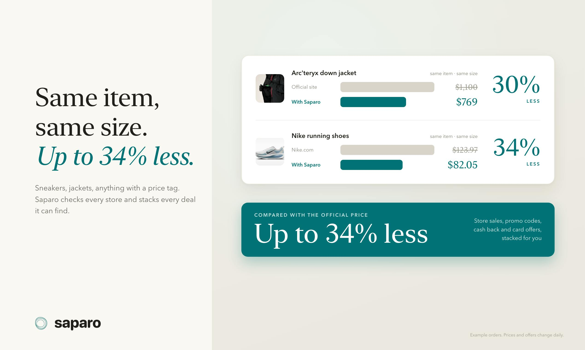
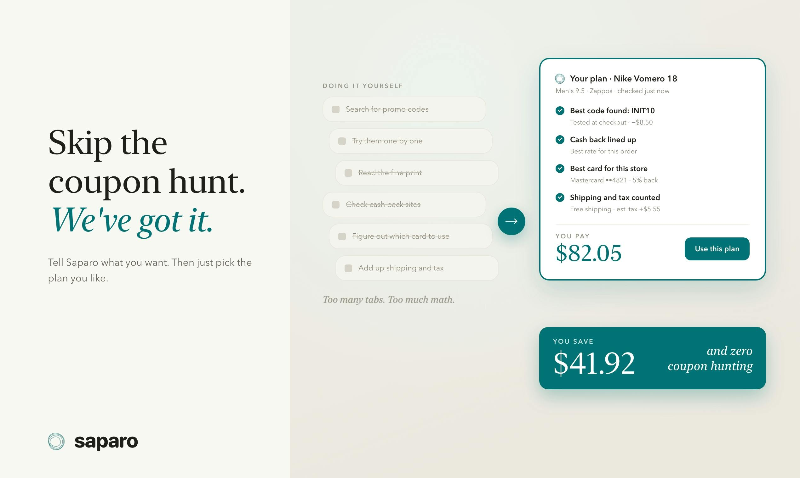

### 🎬 관련 영상
- [🎥 영상 보기](https://ph-files.imgix.net/97408e28-2f6c-487c-8462-32929030c22f.jpeg?auto=format)

---

## 2. [Tripmojo](https://www.producthunt.com/products/tripmojo)
**Votes**: 205 | **도입 난이도**: 하 | **신뢰도**: 상
**Tagline**: Agentic travel app that helps plan, book and run your trip
**서비스 링크**: https://www.producthunt.com/r/MGYYGRQ2OTZNMZ

**태그**: Travel, AI, Automation, Mobile, Agent, AI Tool, Chat, Email

### 📌 이 서비스 한눈에 보기
예약 관리부터 현지 일정 관리까지 책임지는 AI 여행 에이전트

### 🔑 주요 기능
- 예약 이메일 자동 동기화를 통한 통합 여행 일정 생성
- 그룹 채팅 기반의 AI 플래닝 및 투표 기능
- 체크인, 보딩패스 저장, 지연 알림 등 실시간 여행 관리

### 🙋 사용자에게 어떤 점이 좋은가
여행 준비부터 현지 이동, 비용 정산까지 복잡한 과정을 AI가 자동화하여 여행의 번거로움을 줄여줍니다.

### ✅ 지금 바로 써볼 기능
- 예약 이메일 연동하여 여행 일정 자동 생성하기
- 그룹 채팅방에서 AI Mojo와 함께 여행지 투표하기
- 여행 당일 실시간 알림 및 체크인 기능 활용하기

### ⚠️ 사용 전 확인할 점
- 이메일 접근 권한 부여에 따른 개인정보 보안 확인 필요
- 항공사/숙소별 실시간 데이터 동기화 정확도 차이 가능성

### 🧭 확인이 더 필요한 정보
이메일 동기화 방식과 개인정보 보호 정책에 대한 상세 확인이 필요합니다.

### 📸 스크린샷 및 갤러리
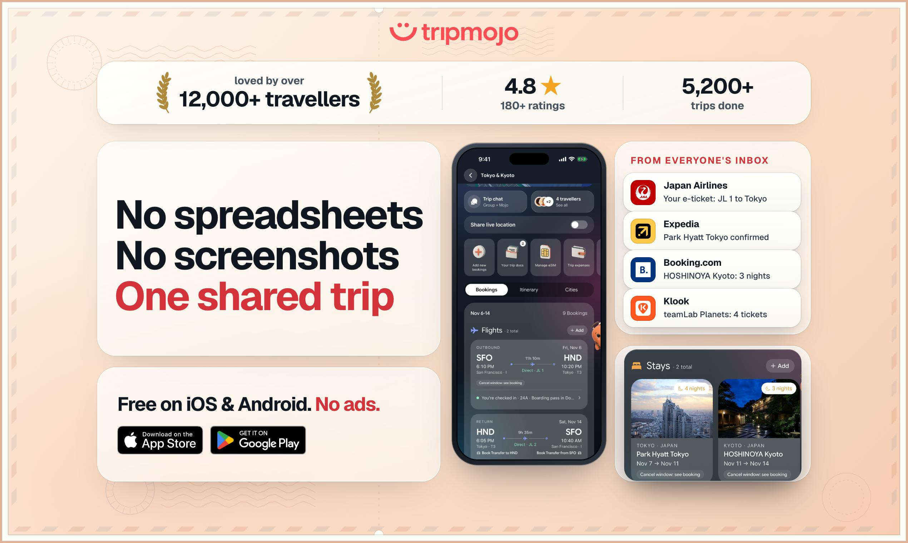

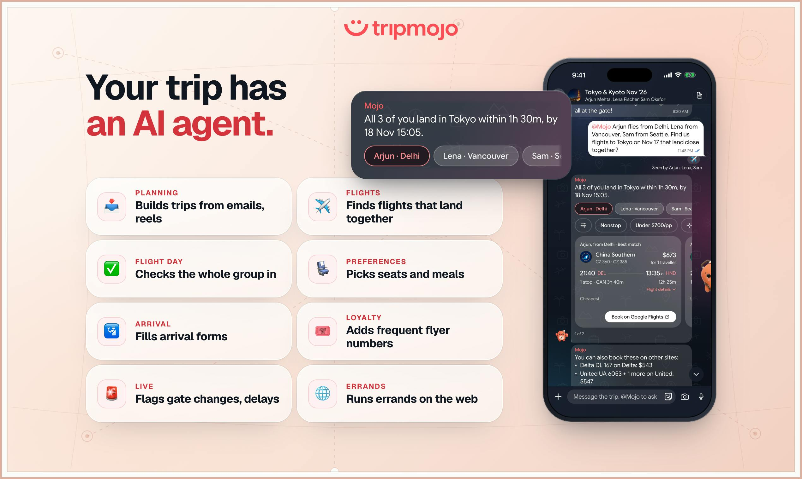

### 🎬 관련 영상
- [🎥 영상 보기](https://ph-files.imgix.net/42b8781a-98a1-4e61-a97d-0ba4974ba83a.jpeg?auto=format)

---

## 3. [Docker](https://www.producthunt.com/products/docker)
**Votes**: 166 | **도입 난이도**: 중 | **신뢰도**: 상
**Tagline**: Built to run on trust, for the agentic era
**서비스 링크**: https://www.producthunt.com/r/4IV63EDN4UZ3NO

**태그**: AI, DevOps, Security, Container, Automation, Agent, AI Tool, Design

### 📌 이 서비스 한눈에 보기
AI 에이전트 시대를 위한 보안 격리 및 거버넌스 중심의 차세대 Docker 플랫폼

### 🔑 주요 기능
- 에이전트 중심의 워크로드 격리 및 보안 강화
- 신뢰할 수 있는 공급망과 런타임(Docker Sandboxes) 제공
- 팀 단위의 AI 에이전트 관리 및 거버넌스(Docker AI Governance) 기능

### 🙋 사용자에게 어떤 점이 좋은가
AI 에이전트가 단순한 워크로드를 넘어 자율적인 액터로 동작할 때 발생할 수 있는 보안 위협을 격리된 환경에서 안전하게 관리할 수 있습니다.

### ✅ 지금 바로 써볼 기능
- Docker Sandboxes를 통한 에이전트 격리 환경 테스트
- Docker AI Governance를 활용한 팀 내 에이전트 관리 정책 수립
- 새로운 에이전트용 공급망 도구 적용

### ⚠️ 사용 전 확인할 점
- 에이전트 중심의 새로운 아키텍처에 따른 기존 워크로드와의 호환성 확인 필요
- 샌드박스 환경 도입 시 성능 오버헤드 검토 필요

### 🧭 확인이 더 필요한 정보
기존 Docker 컨테이너 워크로드와 새로운 에이전트용 기능 간의 구체적인 통합 방식과 성능 차이를 확인해야 합니다.

### 📸 스크린샷 및 갤러리
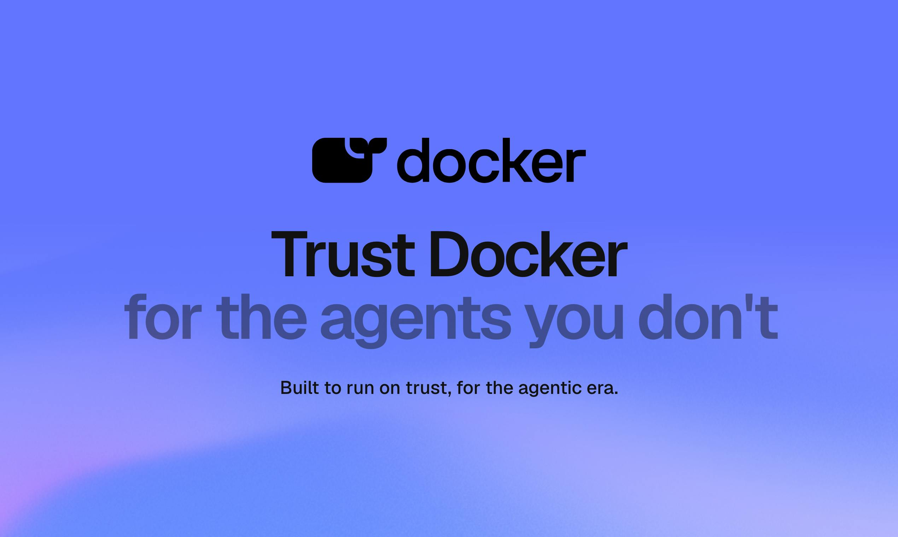
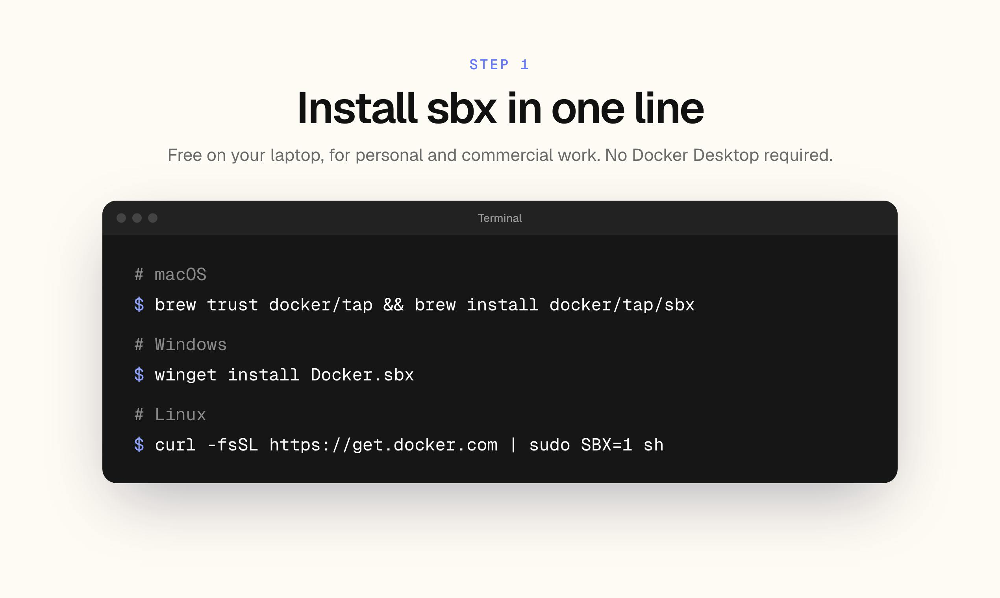
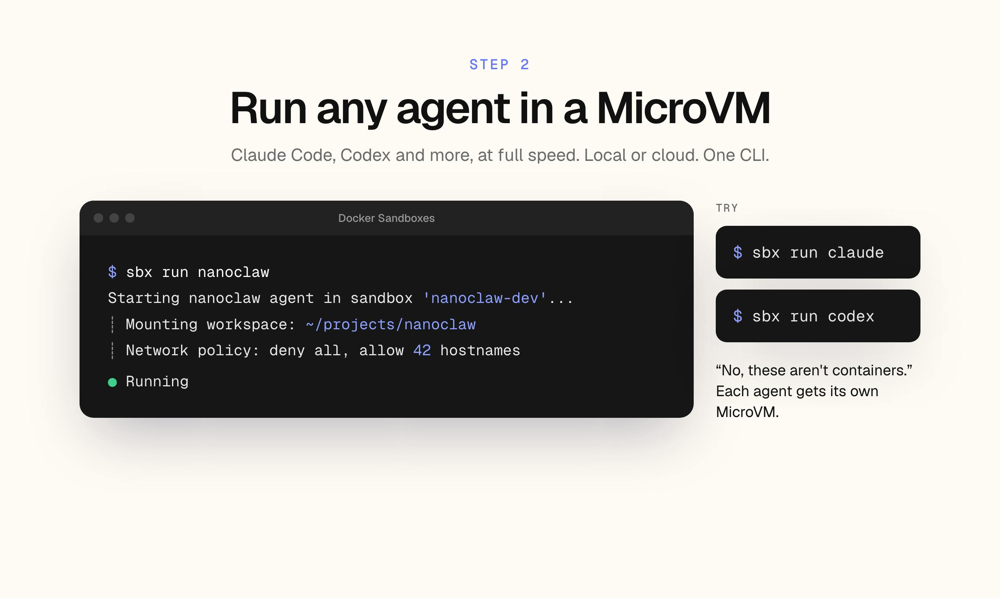

### 🎬 관련 영상
- [🎥 영상 보기](https://ph-files.imgix.net/9219384a-4695-467d-9789-e430d6917257.jpeg?auto=format)

---

## 4. [Bookella](https://www.producthunt.com/products/bookella)
**Votes**: 144 | **도입 난이도**: 하 | **신뢰도**: 상
**Tagline**: A reading tracker that helps you read more
**서비스 링크**: https://www.producthunt.com/r/XLV3656TB6CLUY

**태그**: Productivity, Reading, Mobile App, Personal Organizer, AI Tool, DevTool

### 📌 이 서비스 한눈에 보기
방대한 도서 데이터베이스와 AI를 활용해 독서 습관을 체계적으로 관리하는 스마트 독서 트래커

### 🔑 주요 기능
- 1억 2천만 권 이상의 타이틀 검색 및 바코드 스캔을 통한 간편한 도서 등록
- 독서 목표 설정, 세션 타이머, 독서 속도 추적 등 체계적인 독서 관리 기능
- Goodreads, StoryGraph, CSV 데이터 가져오기 지원 및 광고 없는 사용자 경험

### 🙋 사용자에게 어떤 점이 좋은가
기존 독서 기록 서비스를 쉽게 이전할 수 있으며, AI 추천과 목표 관리 기능을 통해 더 꾸준하고 몰입감 있는 독서 습관을 만들 수 있습니다.

### ✅ 지금 바로 써볼 기능
- 기존 독서 기록(Goodreads 등) 데이터 가져오기
- 바코드 스캔 기능을 이용해 소장 도서 목록 만들기
- AI 추천 기능을 통해 다음 읽을 책 선정하기

### ⚠️ 사용 전 확인할 점
- 모바일 앱 기반 서비스이므로 데스크톱 환경에서의 관리 기능 여부 확인 필요
- 데이터 가져오기 시 기존 서비스와의 완벽한 동기화 여부 확인 필요

### 🧭 확인이 더 필요한 정보
모바일 플랫폼(iOS/Android) 외에 웹 브라우저를 통한 관리 기능 제공 여부는 명시되지 않았습니다.

### 📸 스크린샷 및 갤러리
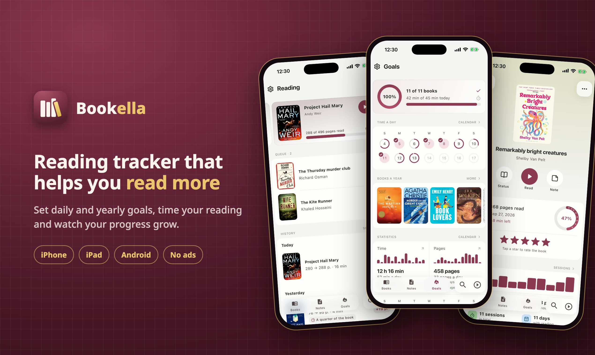
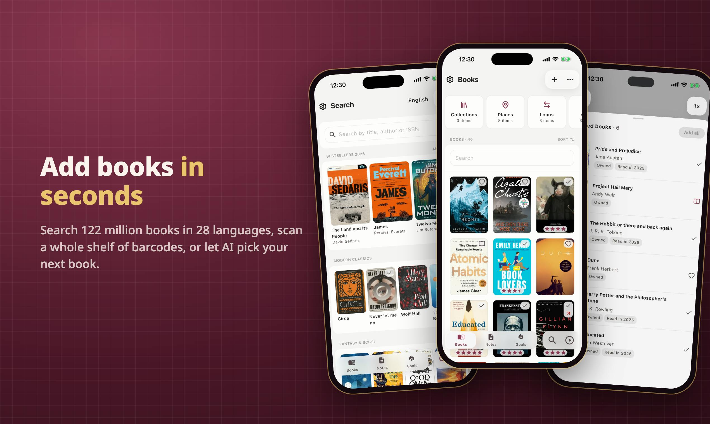
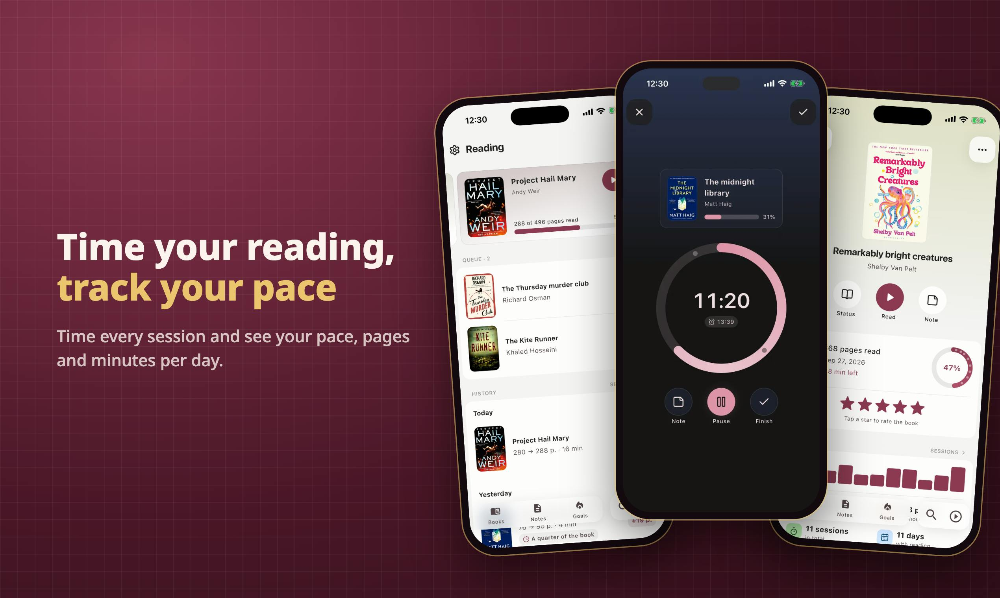

---

## 5. [Currents](https://www.producthunt.com/products/currents-4)
**Votes**: 134 | **도입 난이도**: 하 | **신뢰도**: 상
**Tagline**: Currents for Claude & Codex to see all your tests
**서비스 링크**: https://www.producthunt.com/r/5CEHDWRBU3OWTX

**태그**: DevTool, AI, Testing, Automation, CI/CD, Agent, AI Tool, Chat

### 📌 이 서비스 한눈에 보기
CI 환경의 Playwright 테스트 결과를 AI 에이전트와 연결하여 자동 디버깅을 지원하는 도구

### 🔑 주요 기능
- CI 환경에서 실행되는 모든 Playwright 테스트 기록 자동 저장
- Claude 및 ChatGPT/Codex 플러그인을 통한 테스트 데이터 연동
- 실패 원인, 히스토리, 트레이스 데이터를 AI가 즉시 분석

### 🙋 사용자에게 어떤 점이 좋은가
CI 실패 원인을 분석하기 위해 로그를 일일이 뒤지는 대신, AI 에이전트에게 질문하여 즉각적인 해결책을 얻을 수 있습니다.

### ✅ 지금 바로 써볼 기능
- Claude 또는 ChatGPT 플러그인 디렉토리에서 Currents 연결하기
- CI 환경에 Playwright 테스트 실행 환경 구축하기
- AI 에이전트에게 CI 실패 원인 질문해보기

### ⚠️ 사용 전 확인할 점
- CI 환경의 Playwright 테스트 결과가 외부 플러그인에 노출되므로 보안 정책 확인 필요
- AI 모델의 분석 결과가 실제 원인과 다를 수 있음

### 🧭 확인이 더 필요한 정보
현재 제공되는 플러그인의 구체적인 보안 및 데이터 처리 방식에 대한 상세 정보가 필요합니다.

### 📸 스크린샷 및 갤러리
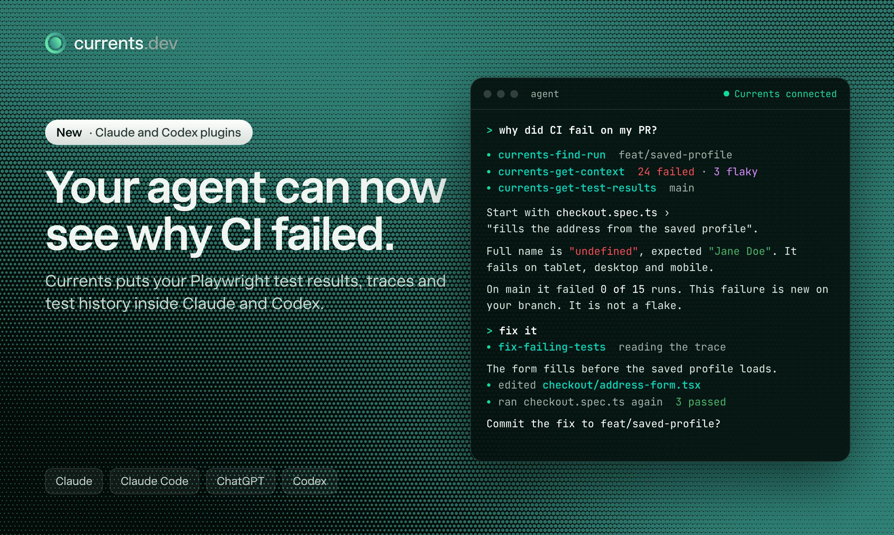
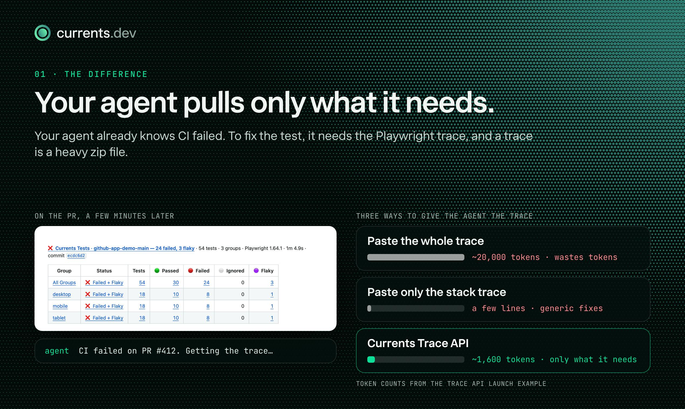
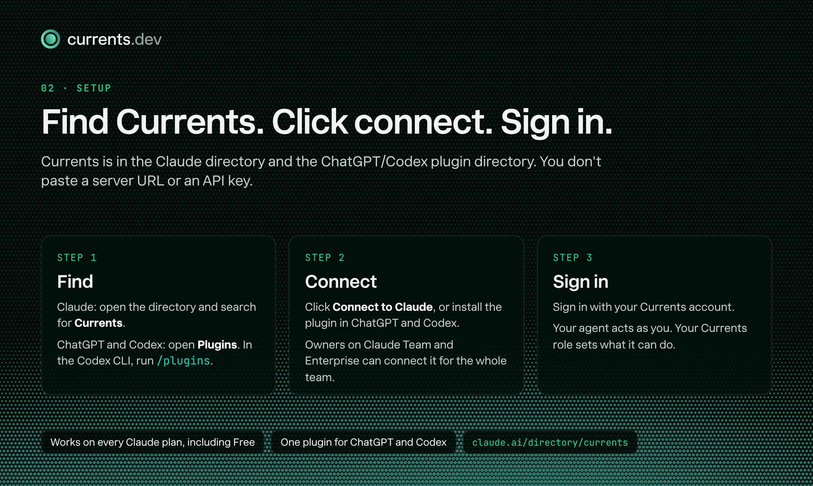

### 🎬 관련 영상
- [🎥 영상 보기](https://ph-files.imgix.net/cfe7571d-2738-4181-87f7-cac376074238.jpeg?auto=format)

---

## 6. [Kuc-kuc](https://www.producthunt.com/products/kuc-kuc)
**Votes**: 111 | **도입 난이도**: 하 | **신뢰도**: 상
**Tagline**: A knock on the door when dangerous weather comes
**서비스 링크**: https://www.producthunt.com/r/LKBGU35INMLRUR

**태그**: Safety, ElderlyCare, Automation, IoT

### 📌 이 서비스 한눈에 보기
위험 기상 상황 시 홀로 계신 어르신의 안부를 확인하고 이웃과 가족에게 알리는 자동 안부 확인 서비스

### 🔑 주요 기능
- 위험 기상 예보 시 자동 전화 발신 기능
- 응답이 없거나 위급 상황 시 이웃에게 즉시 연락
- 가족이 실시간 상황을 확인할 수 있는 프로세스

### 🙋 사용자에게 어떤 점이 좋은가
멀리 떨어져 사는 가족이 위험한 날씨에 어르신의 안전을 실시간으로 확인하고, 이웃과 연계하여 즉각적인 대처가 가능합니다.

### ✅ 지금 바로 써볼 기능
- 서비스의 자동 전화 발신 로직 확인
- 이웃 및 가족 연락처 설정 방식 확인
- 유선전화 연결 방식 및 호환성 확인

### ⚠️ 사용 전 확인할 점
- 전화 응답이 없을 경우의 물리적 구조대 투입 여부 확인 필요
- 유선전화 기반이므로 인터넷 연결 상태에 따른 작동 여부 확인 필요

### 🧭 확인이 더 필요한 정보
위험 기상 판단 기준과 이웃에게 연락이 가는 구체적인 트리거 조건에 대한 상세 정보가 필요합니다.

### 📸 스크린샷 및 갤러리

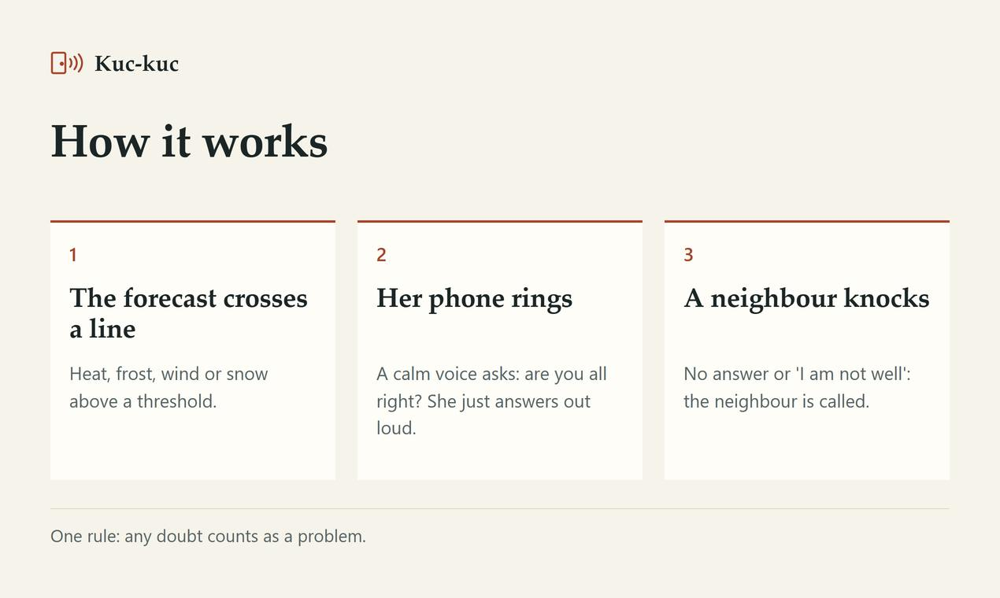
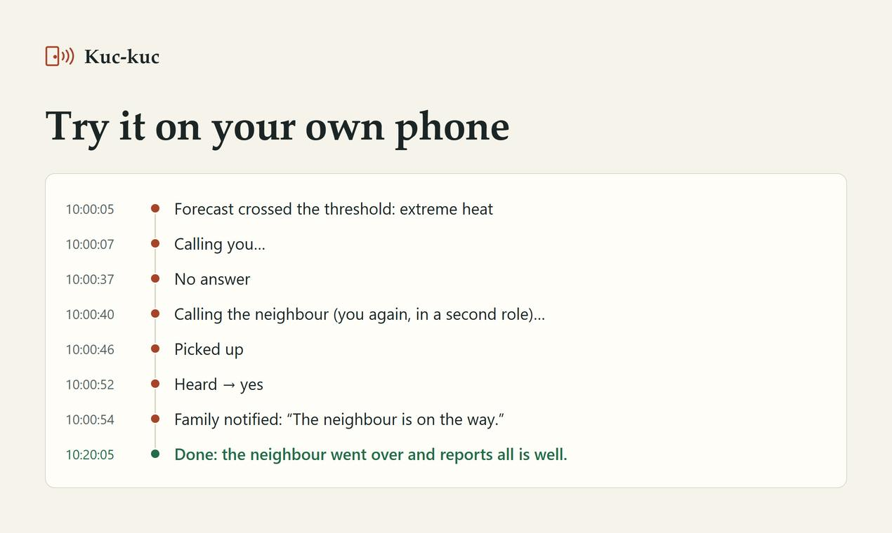

---

## 7. [Tamekoshi](https://www.producthunt.com/products/tamekoshi)
**Votes**: 100 | **도입 난이도**: 중 | **신뢰도**: 상
**Tagline**: A Tamagotchi-style AI companion that does real work
**서비스 링크**: https://www.producthunt.com/r/D7S6JA3X5PKAUF

**태그**: AI Agent, Automation, Productivity, Workflow, Agent, AI Tool

### 📌 이 서비스 한눈에 보기
사용자의 승인 하에 복잡한 업무를 병렬로 처리하는 다재다능한 AI 에이전트

### 🔑 주요 기능
- 한 번의 메시지로 여러 하위 에이전트를 생성하여 병렬 작업 수행
- 컴퓨터 작업 수행, 메신저(WhatsApp, Telegram) 응대, 회의록 작성 등 실질적 업무 처리
- 사용자의 최종 승인 후에만 동작하는 안전한 자동화 방식

### 🙋 사용자에게 어떤 점이 좋은가
단순한 대화를 넘어 실제 컴퓨터 작업과 메신저 응대를 대신 처리해주므로 업무 생산성을 크게 높일 수 있습니다.

### ✅ 지금 바로 써볼 기능
- 메시지 하나로 여러 작업을 동시에 요청해보기
- 메신저 연동을 통한 고객 응대 자동화 테스트
- 회의록 자동 작성 기능 활용하기

### ⚠️ 사용 전 확인할 점
- 현재 베타 버전이므로 기능의 안정성이 완벽하지 않을 수 있음
- 컴퓨터 제어 권한 부여 시 보안 및 개인정보 보호 주의 필요

### 🧭 확인이 더 필요한 정보
현재 베타 단계로 모바일 앱, 멀티플레이어, 오픈소스 전환 등 로드맵 기능의 구현 여부를 확인해야 합니다.

### 📸 스크린샷 및 갤러리

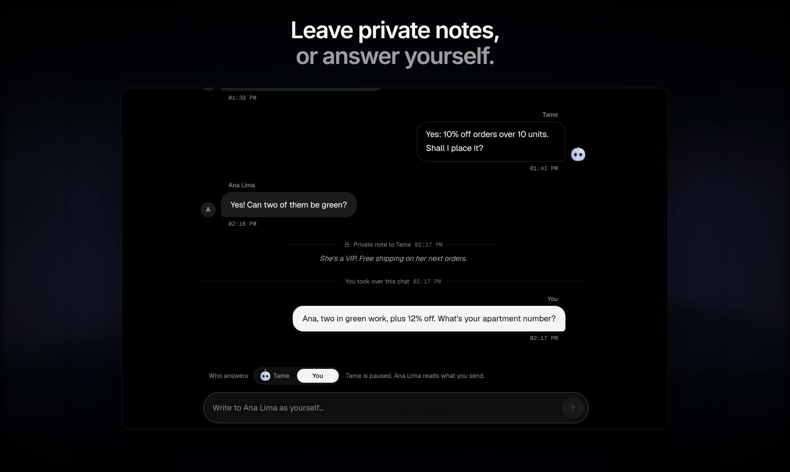
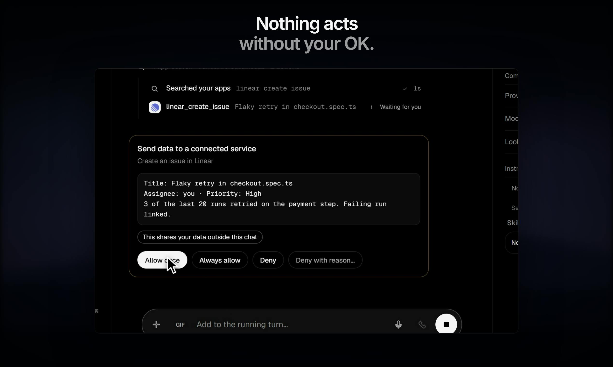

### 🎬 관련 영상
- [🎥 영상 보기](https://ph-files.imgix.net/bca1bbcf-7d7f-496e-925c-02d78cab4190.jpeg?auto=format)

---

## 8. [Volcano](https://www.producthunt.com/products/volcano-3)
**Votes**: 97 | **도입 난이도**: 중 | **신뢰도**: 상
**Tagline**: The self-healing agent cloud by Kong
**서비스 링크**: https://www.producthunt.com/r/M2PZAL4CR53OAW

**태그**: AI, DevOps, Cloud, Automation, Backend, Agent, AI Tool, DevTool

### 📌 이 서비스 한눈에 보기
AI 에이전트와 앱을 위한 자가 치유형 클라우드 호스팅 플랫폼

### 🔑 주요 기능
- 코드 에이전트(Claude Code, Cursor 등) 및 AI 빌더를 통한 간편한 배포
- 지속 가능한 함수, 분산 락, 브랜치 가능한 Postgres 등 강력한 백엔드 인프라 제공
- LavaFlow 기능을 통한 자동 버그 탐지 및 자가 치유(Self-healing) 기능

### 🙋 사용자에게 어떤 점이 좋은가
개발자가 인프라 관리 부담 없이 AI 에이전트와 앱을 즉시 배포하고, 자동화된 유지보수를 통해 안정적인 운영이 가능합니다.

### ✅ 지금 바로 써볼 기능
- 기존 코드 에이전트(Cursor, Claude Code 등)와 연동하여 배포 시도
- LavaFlow의 자동 버그 수정 기능 테스트
- Next.js 및 백엔드 호스팅 환경 설정

### ⚠️ 사용 전 확인할 점
- 자체 인프라 환경에 대한 보안 및 데이터 제어 정책 확인 필요
- 자동화된 자가 치유 기능이 복잡한 로직에서 의도치 않은 변경을 일으킬 가능성

### 🧭 확인이 더 필요한 정보
LavaFlow의 자동 수정 범위와 기존 코드베이스와의 호환성 수준을 확인해야 합니다.

### 📸 스크린샷 및 갤러리
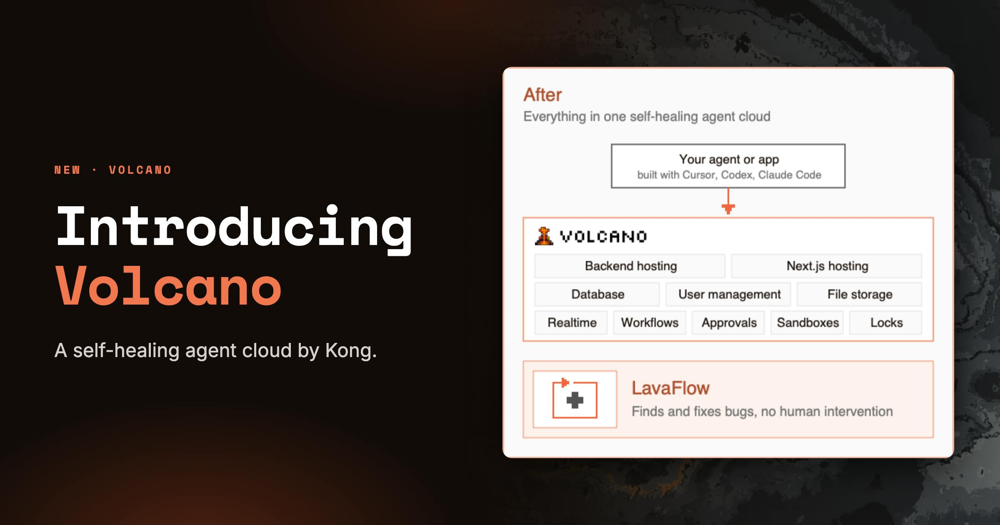
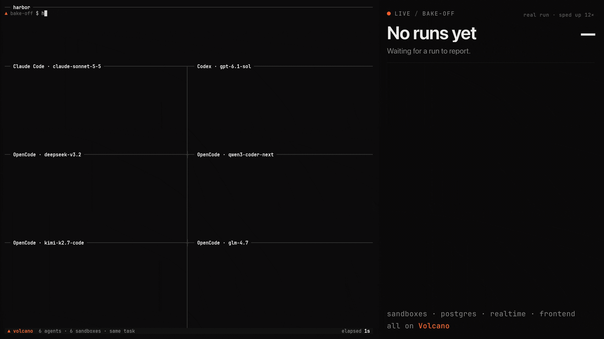
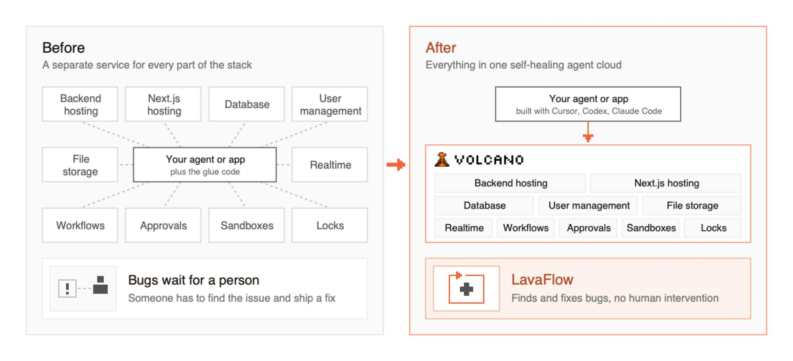

### 🎬 관련 영상
- [🎥 영상 보기](https://ph-files.imgix.net/8ddb1683-785e-4310-bebf-a6a1dcfb2081.gif?auto=format)

---

## 9. [Direct by Instagram](https://www.producthunt.com/products/instagram)
**Votes**: 93 | **도입 난이도**: 하 | **신뢰도**: 상
**Tagline**: Instagram DMs, without the feed or Instagram account
**서비스 링크**: https://www.producthunt.com/r/WTPU56RQWCD2XV

**태그**: Social, Messaging, Mobile App, AI Tool, Chat, Email

### 📌 이 서비스 한눈에 보기
피드와 스토리 없이 인스타그램 DM 기능만 모아둔 독립형 메시징 앱

### 🔑 주요 기능
- 인스타그램 피드, 릴스, 스토리 없이 채팅에만 집중할 수 있는 환경 제공
- 기존 인스타그램 계정 연동 또는 이메일/전화번호를 통한 신규 가입 지원
- 그리기, 커스텀 스티커, 음성 효과, Notes 등 개인화된 채팅 기능 탑재

### 🙋 사용자에게 어떤 점이 좋은가
SNS의 과도한 콘텐츠 노출에서 벗어나 지인과의 순수한 대화에만 집중하고 싶은 사용자에게 유용합니다.

### ✅ 지금 바로 써볼 기능
- 기존 인스타그램 대화 내역 동기화하기
- 커스텀 스티커와 음성 효과로 개인화된 채팅 즐기기
- 이메일 또는 전화번호로 간편하게 가입하기

### ⚠️ 사용 전 확인할 점
- 현재 터키와 태국에서 iOS 및 Android를 대상으로 테스트 중인 단계임
- 인스타그램 계정이 없는 사용자는 일부 기능 이용에 제한이 있을 수 있음

### 🧭 확인이 더 필요한 정보
글로벌 서비스 확대 일정과 인스타그램 계정 미보유 사용자에 대한 최종 정책이 불분명합니다.

### 📸 스크린샷 및 갤러리

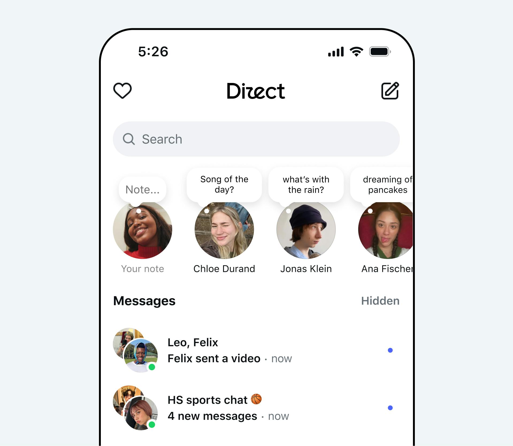
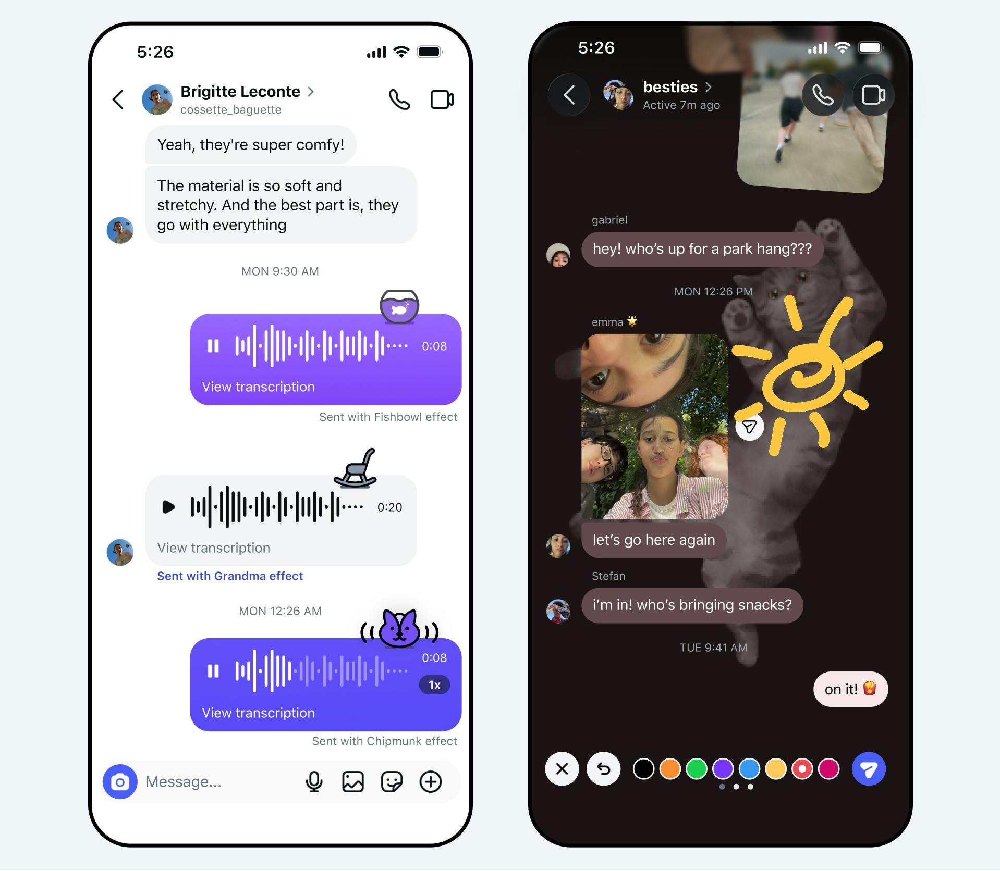

---

## 10. [tensorViz](https://www.producthunt.com/products/tensorviz)
**Votes**: 86 | **도입 난이도**: 하 | **신뢰도**: 상
**Tagline**: Let your coding agent see inside your PyTorch model
**서비스 링크**: https://www.producthunt.com/r/GGVBUX3ATW7EJK

**태그**: DevTool, AI-Agent, PyTorch, Visualization, Agent

### 📌 이 서비스 한눈에 보기
코딩 에이전트가 PyTorch 모델 내부의 텐서 흐름을 직접 확인하고 디버깅할 수 있게 돕는 시각화 도구

### 🔑 주요 기능
- 실제 포워드 패스를 실행하여 모듈과 텐서 모양(shape)이 포함된 대화형 그래프 생성
- Claude Code, Cursor 등 코딩 에이전트가 그래프를 탐색하여 근거 기반의 코드 수정 가능
- 560개 이상의 최신 논문 모델 그래프를 제공하는 모델 익스플로러 탑재

### 🙋 사용자에게 어떤 점이 좋은가
추측이 아닌 실제 텐서 모양과 흐름을 바탕으로 코딩 에이전트가 모델 코드를 정확하게 수정할 수 있어 디버깅 시간을 단축합니다.

### ✅ 지금 바로 써볼 기능
- 자신의 PyTorch 모델에 적용하여 대화형 그래프 생성하기
- 생성된 그래프를 코딩 에이전트(Cursor, Claude Code 등)에 전달하여 코드 수정 요청하기
- Model Explorer에서 최신 논문 모델들의 구조 탐색하기

### ⚠️ 사용 전 확인할 점
- 로컬 환경에서 실행 시 모델 구조와 데이터 흐름을 시각화하기 위한 환경 설정 필요
- 에이전트가 그래프를 읽는 방식에 따라 디버깅 효율이 달라질 수 있음

### 🧭 확인이 더 필요한 정보
에이전트(Cursor, Claude Code 등)와의 구체적인 연동 방식 및 자동화 수준은 사용자 설정에 따라 다를 수 있습니다.

### 📸 스크린샷 및 갤러리
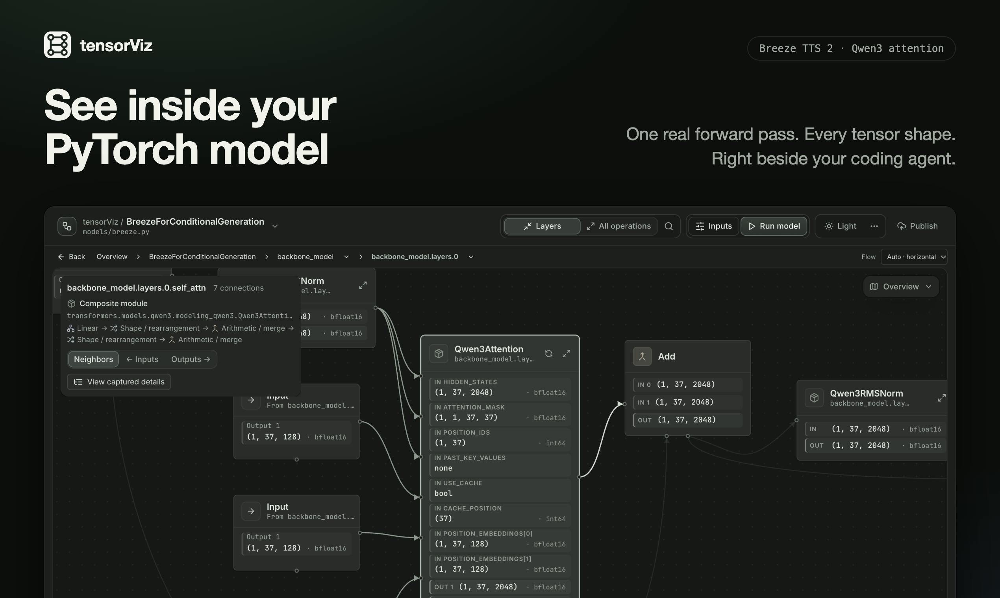
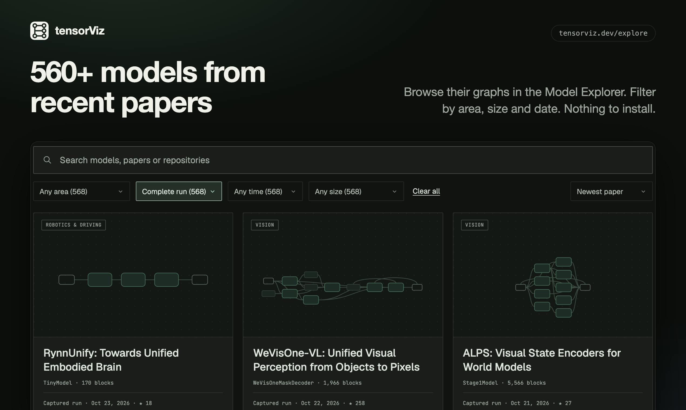
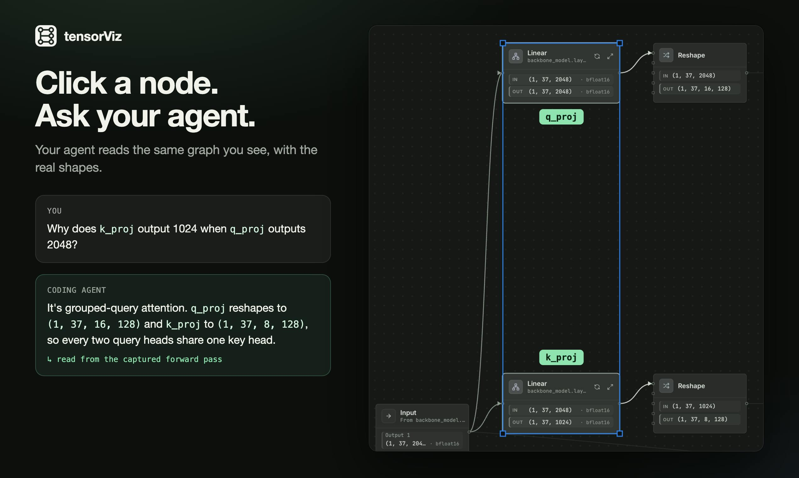

### 🎬 관련 영상
- [🎥 영상 보기](https://ph-files.imgix.net/1d49a82d-0b58-4bab-a396-57a2e113c741.jpeg?auto=format)

---

## 11. [Compass OS](https://www.producthunt.com/products/compassos-dev)
**Votes**: 85 | **도입 난이도**: 하 | **신뢰도**: 상
**Tagline**: Your career, ready before you need it
**서비스 링크**: https://www.producthunt.com/r/YZO4X6632LA7NO

**태그**: Career, Automation, AI, Productivity, AI Tool

### 📌 이 서비스 한눈에 보기
시니어 리더를 위한 AI 기반 커리어 관리 및 자동 지원 솔루션

### 🔑 주요 기능
- 90개 이상의 채용 시스템에서 디렉터/VP급 직무 자동 탐색 및 매칭
- 사용자 프로필 기반의 진실성 있는 이력서 최적화 및 자동 작성
- 크롬 확장 프로그램을 통한 간편한 지원 및 인터뷰 연습 지원

### 🙋 사용자에게 어떤 점이 좋은가
경력직 리더가 구직 활동에 들이는 시간을 최소화하면서, 자신의 경험에 부합하는 최적의 기회를 놓치지 않도록 돕습니다.

### ✅ 지금 바로 써볼 기능
- 프로필 등록 및 이력서 데이터 동기화
- 크롬 확장 프로그램을 통한 자동 지원 기능 테스트
- AI 기반 인터뷰 연습 기능 활용

### ⚠️ 사용 전 확인할 점
- 자동화된 이력서 수정이 본인의 의도와 다르게 반영될 수 있음
- 시니어급 직무에 특화되어 있어 주니어/신입 사용자에게는 적합하지 않을 수 있음

### 🧭 확인이 더 필요한 정보
90개 이상의 채용 시스템과 크롬 확장 프로그램 간의 데이터 보안 및 개인정보 보호 수준을 확인해야 합니다.

### 📸 스크린샷 및 갤러리
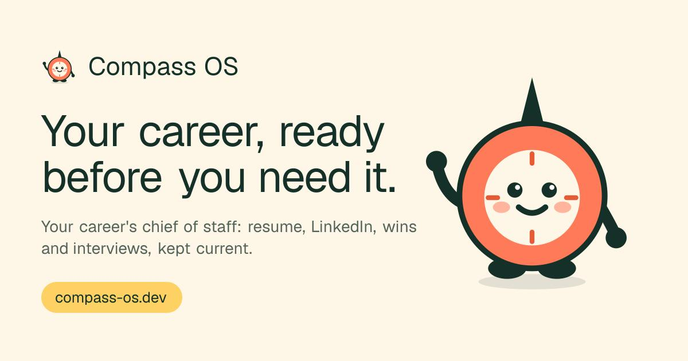
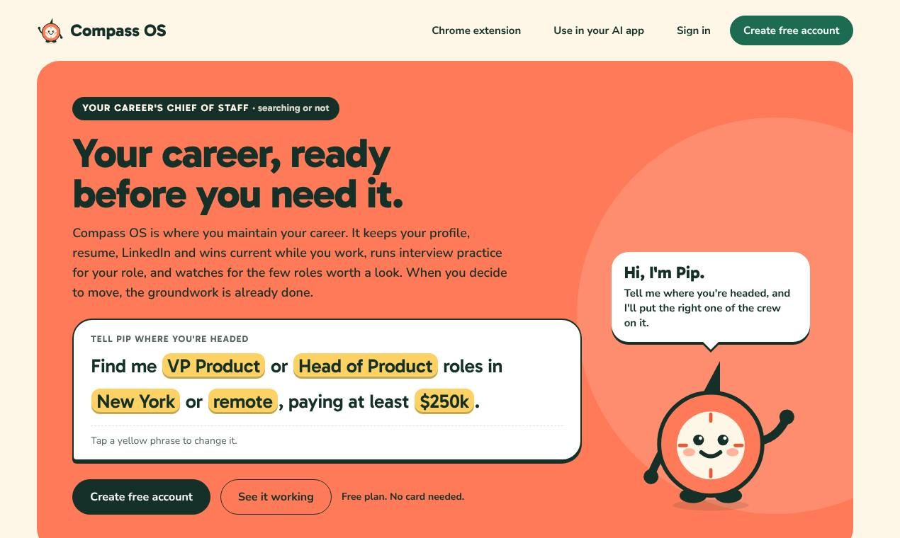
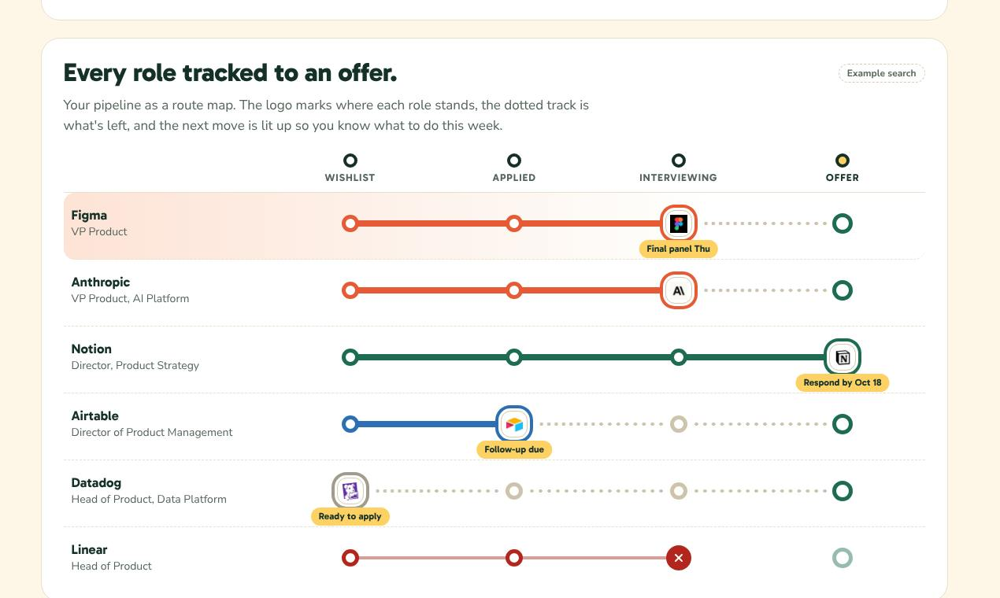

### 🎬 관련 영상
- [🎥 영상 보기](https://ph-files.imgix.net/fa728f4f-60bb-4092-9753-883d3caae8a2.jpeg?auto=format)

---

## 12. [HelpCard](https://www.producthunt.com/products/helpcard)
**Votes**: 80 | **도입 난이도**: 하 | **신뢰도**: 상
**Tagline**: a free emergency QR card
**서비스 링크**: https://www.producthunt.com/r/LDLMMYRUGGE5NY

**태그**: Safety, Health, Privacy, Utility, DevTool

### 📌 이 서비스 한눈에 보기
개인정보 유출 걱정 없이 만드는 QR 코드 기반 응급 처치 카드

### 🔑 주요 기능
- QR 코드를 통한 간편한 응급 정보 제공
- 혈액형, 알레르기, 복용 약물, 비상 연락처 포함
- 데이터를 서버에 저장하지 않는 프라이버시 중심 설계

### 🙋 사용자에게 어떤 점이 좋은가
응급 상황 발생 시 구조자에게 핵심 의료 정보를 즉각적으로 전달할 수 있어 골든타임을 확보하는 데 도움을 줍니다.

### ✅ 지금 바로 써볼 기능
- 자신의 응급 정보를 담은 QR 카드 생성하기
- 아이들을 위한 맞춤형 테마 적용하기
- 비상 연락처 및 알레르기 정보 정확도 검토하기

### ⚠️ 사용 전 확인할 점
- QR 코드가 물리적으로 손상되거나 식별이 어려울 경우 사용 불가
- 데이터가 저장되지 않으므로 정보 수정 시 카드를 새로 생성해야 할 수 있음

### 🧭 확인이 더 필요한 정보
데이터가 저장되지 않는 방식이 오프라인 로컬 저장 방식인지, 아니면 단순 출력용인지에 대한 기술적 상세 구현 방식 확인이 필요합니다.

### 📸 스크린샷 및 갤러리
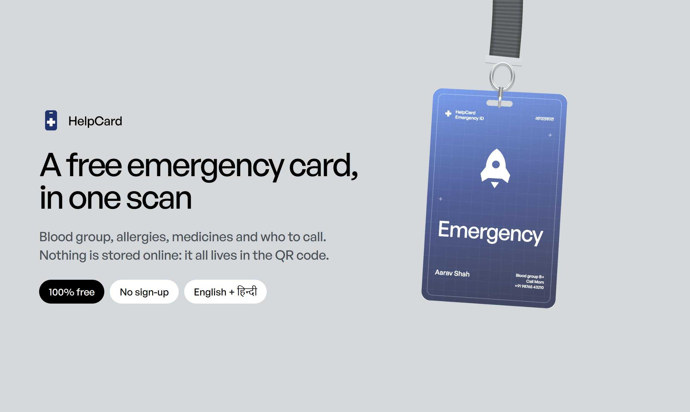
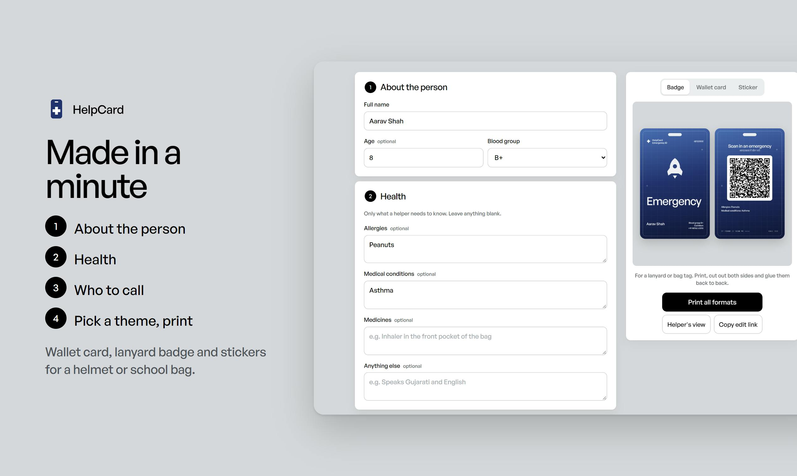
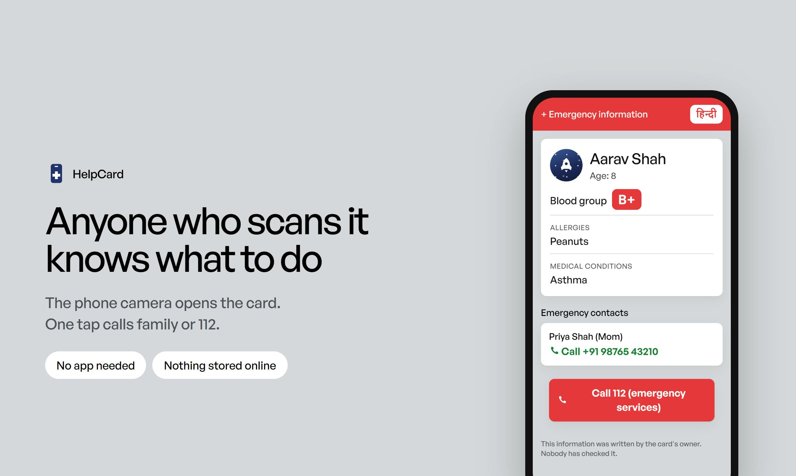

---

## 13. [MakePixel](https://www.producthunt.com/products/makepixel)
**Votes**: 80 | **도입 난이도**: 하 | **신뢰도**: 상
**Tagline**: Pixel art editor for game sprites, tilesets and maps
**서비스 링크**: https://www.producthunt.com/r/NJCEPA4Y4KCKSX

**태그**: GameDev, PixelArt, DesignTool, WebApp, AI Tool

### 📌 이 서비스 한눈에 보기
브라우저와 iPad에서 간편하게 게임 에셋을 제작하는 픽셀 아트 에디터

### 🔑 주요 기능
- 브라우저 및 iPad 지원으로 장소 제약 없는 작업 환경 제공
- Aseprite 스타일의 익숙한 키보드 단축키로 애니메이션 작업 가능
- 타일셋 자동 생성 및 레벨 페인팅 기능 포함

### 🙋 사용자에게 어떤 점이 좋은가
별도의 설치 없이 웹이나 태블릿에서 즉시 게임용 스프라이트와 맵을 제작할 수 있어 작업 흐름이 매우 효율적입니다.

### ✅ 지금 바로 써볼 기능
- Aseprite 단축키를 활용한 스프라이트 애니메이션 제작
- 자동 타일 생성 기능을 이용한 타일셋 제작
- 제작한 에셋을 Unity나 Godot로 내보내기

### ⚠️ 사용 전 확인할 점
- 무료 버전의 기능 제한 범위 확인 필요
- iPad 환경에서의 세부 기능 지원 여부 확인 필요

### 🧭 확인이 더 필요한 정보
무료 버전에서 제공하는 기능의 범위와 유료 플랜의 구체적인 차이점을 확인해야 합니다.

### 📸 스크린샷 및 갤러리

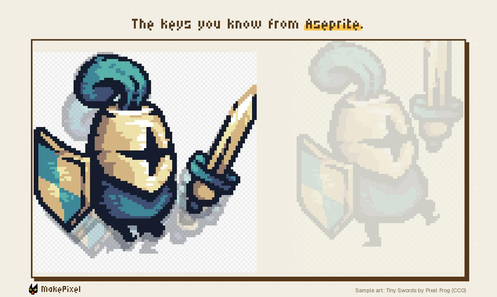

### 🎬 관련 영상
- [🎥 영상 보기](https://ph-files.imgix.net/mcp-draft-media/c730516d-17b5-4e01-8935-35526934fa06.jpeg?auto=format)

---

## 14. [ThreadLore](https://www.producthunt.com/products/threadlore)
**Votes**: 79 | **도입 난이도**: 중 | **신뢰도**: 상
**Tagline**: Turn fabric photos into editable loom drafts
**서비스 링크**: https://www.producthunt.com/r/IM4QGOTXXMUZFG

**태그**: Textile, DesignTool, Digitalization, AI Tool

### 📌 이 서비스 한눈에 보기
직물 사진을 분석하여 편집 가능한 직조 도안으로 변환해주는 도구

### 🔑 주요 기능
- 직물 사진 속 실의 교차를 분석하여 제안된 직조 패턴 확인
- 승인된 패턴을 출력 가능한 룸 카드(Loom Card) 또는 WIF 파일로 변환
- 유실된 직조 지침을 사진을 통해 복원 및 디지털화

### 🙋 사용자에게 어떤 점이 좋은가
직조 패턴이 없는 오래된 직물 사진을 디지털 도안으로 빠르게 변환하여 작업 효율을 높일 수 있습니다.

### ✅ 지금 바로 써볼 기능
- 보유 중인 직물 사진 업로드 및 분석 기능 테스트
- 생성된 패턴의 정확도 검토
- WIF 파일 내보내기 및 출력 기능 확인

### ⚠️ 사용 전 확인할 점
- 사진의 해상도나 각도에 따라 분석 정확도가 달라질 수 있음
- 복잡한 직조 구조의 경우 수동 수정이 필요할 수 있음

### 🧭 확인이 더 필요한 정보
사진의 품질이 분석 결과에 미치는 영향과 지원하는 파일 형식의 범위를 확인해야 합니다.

### 📸 스크린샷 및 갤러리
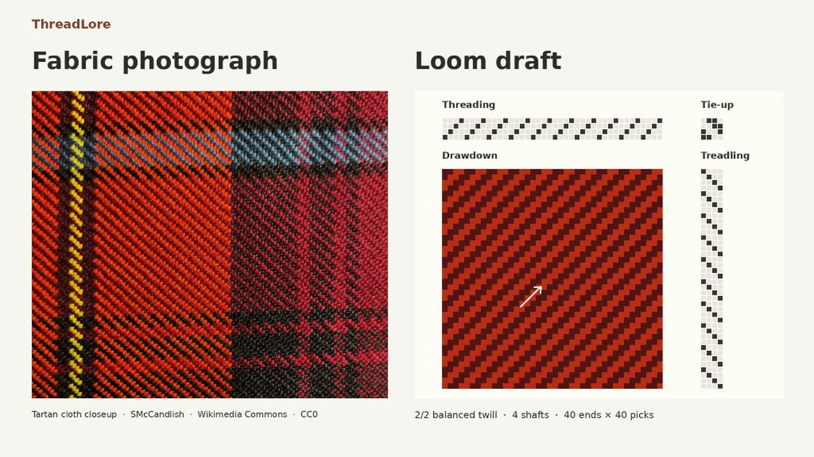
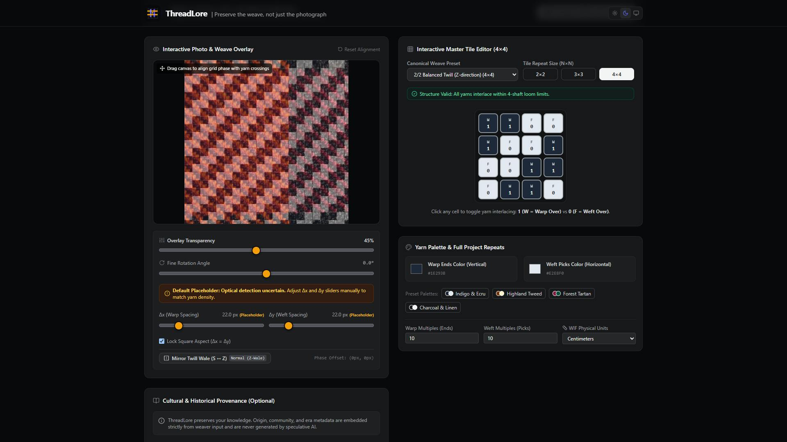
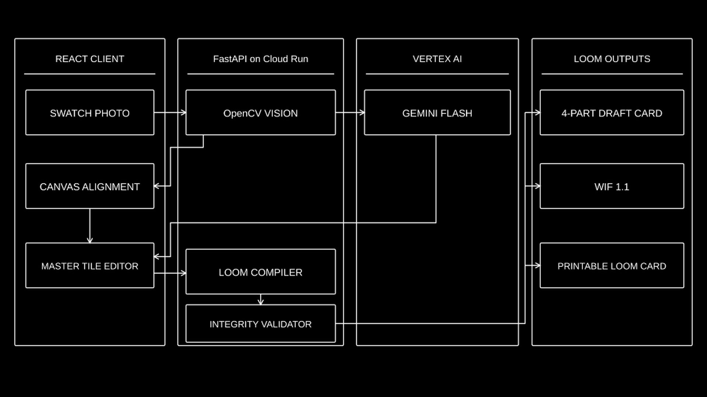

### 🎬 관련 영상
- [🎥 영상 보기](https://ph-files.imgix.net/mcp-draft-media/3706c763-49d4-418d-a440-246fc64ab820.jpeg?auto=format)

---

## 15. [Scam Link Check](https://www.producthunt.com/products/scam-link-check)
**Votes**: 78 | **도입 난이도**: 하 | **신뢰도**: 상
**Tagline**: Paste a suspicious text or link, get a plain-English verdict
**서비스 링크**: https://www.producthunt.com/r/ZEFS6PVRQ5SLD6

**태그**: Security, Safety, Phishing-Detection, Easy-to-use, AI Tool

### 📌 이 서비스 한눈에 보기
의심스러운 링크나 메시지를 붙여넣으면 안전 여부를 쉬운 언어로 알려주는 스캠 탐지 도구

### 🔑 주요 기능
- 텍스트나 링크를 붙여넣으면 숨겨진 URL 추출 및 최종 목적지 추적
- 브랜드 사칭, 신규 도메인, IP 주소 사용 등 스캠 징후 자동 분석
- 위험도(위험/의심/안전)와 향후 조치 방법을 쉬운 영어/중국어로 제공

### 🙋 사용자에게 어떤 점이 좋은가
기술에 익숙하지 않은 어르신이나 일반 사용자가 피싱 메시지의 위험성을 직관적으로 판단할 수 있게 도와줍니다.

### ✅ 지금 바로 써볼 기능
- 의심스러운 문자 메시지 전체를 복사하여 붙여넣기
- 단축 URL이 실제 어디로 연결되는지 확인하기
- 분석 결과에 따른 다음 행동 지침 확인하기

### ⚠️ 사용 전 확인할 점
- Google Web Risk 등 외부 데이터베이스에 의존하므로 최신 스캠은 탐지가 늦을 수 있음
- 완벽한 보안 솔루션이 아니므로 분석 결과에만 전적으로 의존하는 것은 위험함

### 🧭 확인이 더 필요한 정보
사용자 데이터가 저장되지 않는다고 명시되어 있으나, 분석 과정에서의 개인정보 노출 여부를 유의해야 합니다.

### 📸 스크린샷 및 갤러리
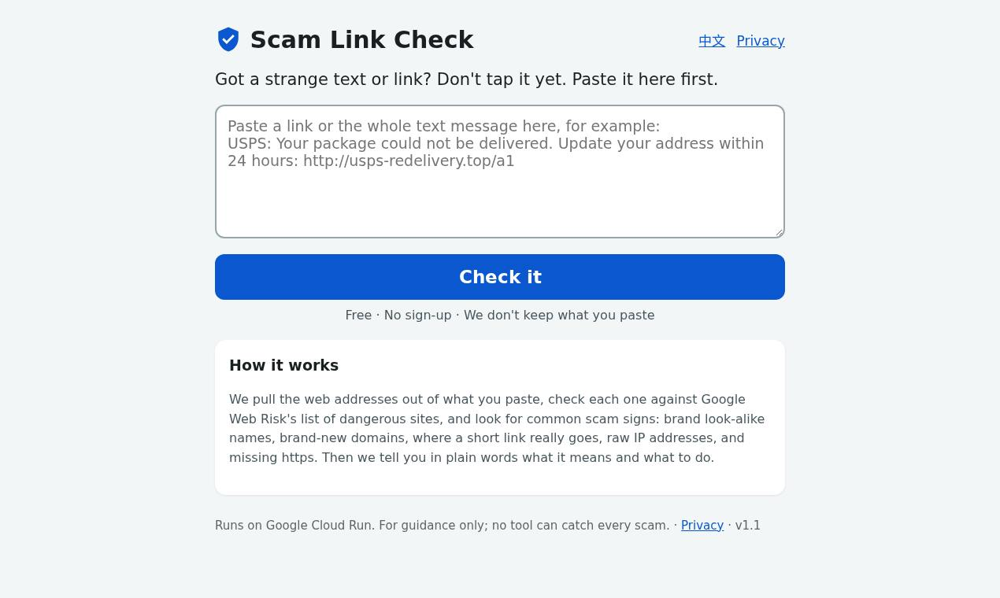
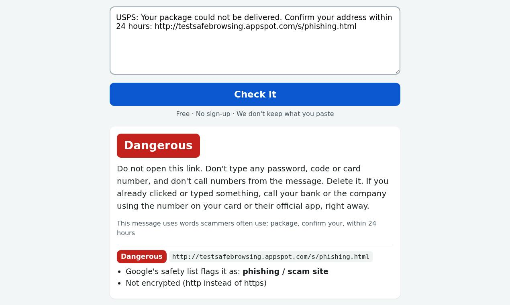
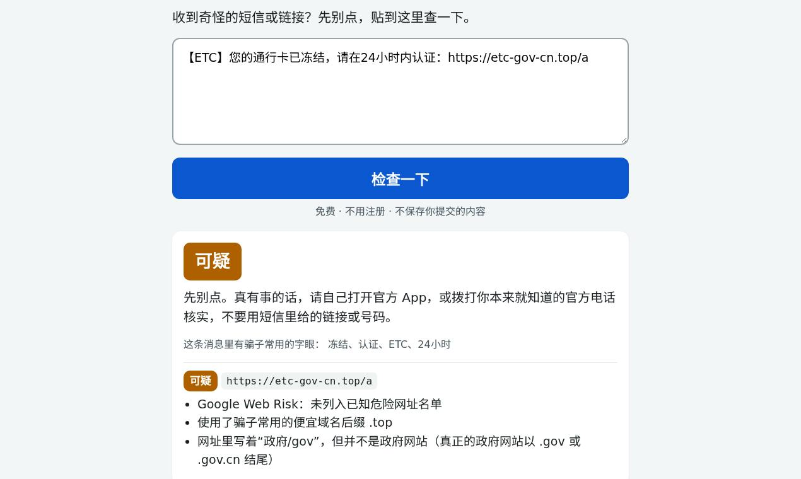

---

## 16. [Rox](https://www.producthunt.com/products/rox-2)
**Votes**: 76 | **도입 난이도**: 하 | **신뢰도**: 상
**Tagline**: Your AI companion for living with chronic illness
**서비스 링크**: https://www.producthunt.com/r/VNRODUBHN7RRUP

**태그**: HealthTech, AI, ChronicIllness, PersonalCare, AI Tool

### 📌 이 서비스 한눈에 보기
만성 질환자를 위한 AI 건강 동반자: 증상 기록부터 진료 준비까지 한 번에

### 🔑 주요 기능
- POTS, 섬유근육통, ME/CFS 등 만성 질환 특화 관리
- 증상 및 복약 기록과 웨어러블 데이터의 통합 관리
- 축적된 데이터를 바탕으로 한 질병 패턴 분석 및 진료 준비 지원

### 🙋 사용자에게 어떤 점이 좋은가
매번 반복해야 했던 자신의 건강 상태 설명 시간을 줄여주고, 데이터 기반의 체계적인 일상 관리를 가능하게 합니다.

### ✅ 지금 바로 써볼 기능
- 현재 복용 중인 약물 및 증상 기록하기
- 웨어러블 기기 연동하여 건강 데이터 동기화하기
- 축적된 패턴을 바탕으로 다음 병원 진료 리포트 확인하기

### ⚠️ 사용 전 확인할 점
- 의학적 진단이나 처방을 대신할 수 없으므로 전문의 상담이 우선되어야 함
- 민감한 개인 건강 데이터가 포함되므로 보안 및 개인정보 보호 정책 확인 필요

### 🧭 확인이 더 필요한 정보
웨어러블 기기와의 구체적인 연동 범위와 데이터 보안 수준에 대한 상세 정보가 필요합니다.

### 📸 스크린샷 및 갤러리

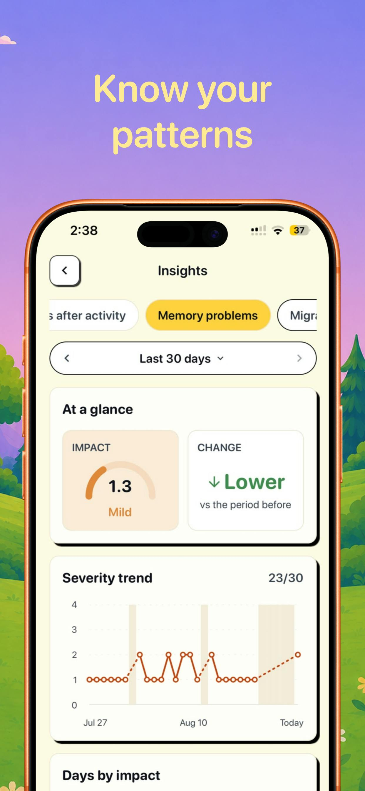
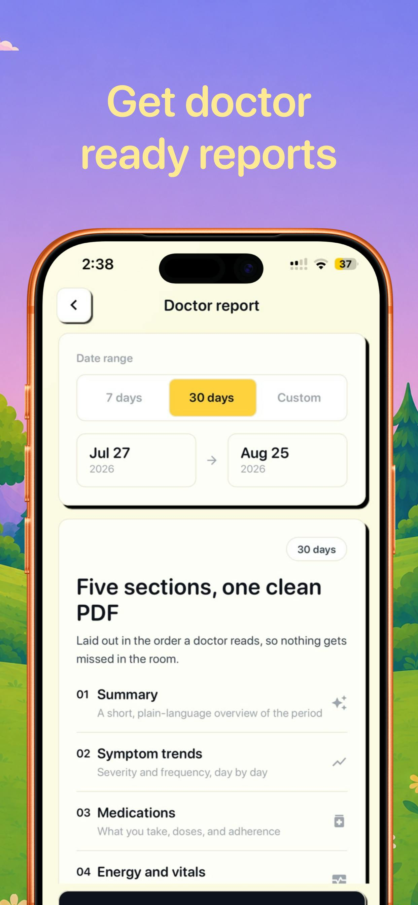

---

## 17. [Fack’d](https://www.producthunt.com/products/fack-d)
**Votes**: 75 | **도입 난이도**: 하 | **신뢰도**: 상
**Tagline**: Fact checks right on YouTube as it plays, with sources
**서비스 링크**: https://www.producthunt.com/r/BPUZPJG5G3SBU6

**태그**: Fact-Check, YouTube, Information-Verification, AI Tool, Video

### 📌 이 서비스 한눈에 보기
유튜브 영상을 시청하며 실시간으로 팩트 체크와 근거를 확인할 수 있는 도구

### 🔑 주요 기능
- 유튜브 영상 재생과 동시에 발언 내용의 사실 여부 확인
- 발언 시점(타임스탬프), 신뢰도 등급, 출처 제공
- 검증된 영상 무료 시청 및 사용자 직접 팩트 체크 기능

### 🙋 사용자에게 어떤 점이 좋은가
토론이나 인터뷰 영상을 볼 때 정보의 진위 여부를 즉각적으로 판단하여 정보 왜곡을 방지할 수 있습니다.

### ✅ 지금 바로 써볼 기능
- 기존에 검증된 영상들을 통해 서비스의 정확도 확인하기
- 로그인하여 10회의 무료 팩트 체크 기능 사용해보기

### ⚠️ 사용 전 확인할 점
- 사용자 직접 체크 기능은 로그인(계정 생성)이 필요함
- 제공되는 출처와 등급의 객관성을 사용자가 직접 판단해야 함

### 🧭 확인이 더 필요한 정보
사용자 직접 체크 기능의 10회 제한 이후의 유료화 정책이나 추가 비용에 대한 정보가 명시되지 않았습니다.

### 📸 스크린샷 및 갤러리
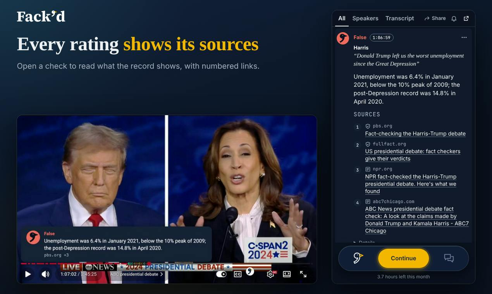
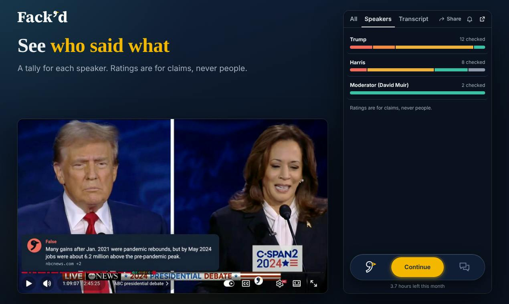
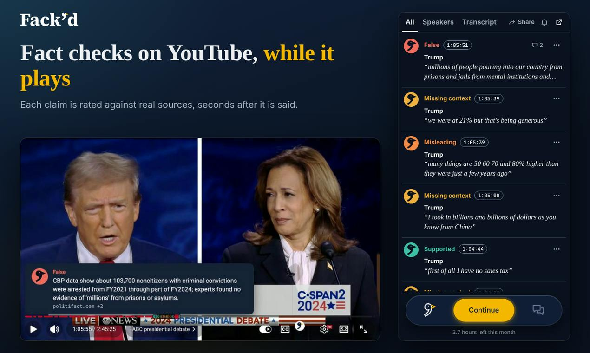

### 🎬 관련 영상
- [🎥 영상 보기](https://ph-files.imgix.net/de1361e9-c1cd-4491-93bc-6bfa4c21f552.jpeg?auto=format)

---

## 18. [EarthSort](https://www.producthunt.com/products/earthsort)
**Votes**: 74 | **도입 난이도**: 하 | **신뢰도**: 상
**Tagline**: Ask how to recycle anything and get your city's answer
**서비스 링크**: https://www.producthunt.com/r/MNWAUU6Y5MXT3E

**태그**: Sustainability, Lifestyle, Utility

### 📌 이 서비스 한눈에 보기
내 지역의 정확한 분리배출 규칙을 알려주는 맞춤형 재활용 가이드

### 🔑 주요 기능
- 750개 이상의 미국 도시별 맞춤형 재활용 규칙 제공
- 텍스트 입력 또는 사진 업로드를 통한 간편한 질문 기능
- 별도의 앱 설치 없이 웹에서 바로 사용 가능

### 🙋 사용자에게 어떤 점이 좋은가
지역마다 다른 복잡한 분리배출 규칙을 일일이 찾을 필요 없이, 물건 이름이나 사진만으로 즉시 정답을 얻을 수 있습니다.

### ✅ 지금 바로 써볼 기능
- earthsort.com/ask에서 궁금한 물건 검색하기
- 사진 업로드 기능을 통해 물건의 재활용 여부 확인하기
- 이동 중에는 EarthSort 무료 앱 활용하기

### ⚠️ 사용 전 확인할 점
- 현재 750개 이상의 미국 도시 규칙 위주로 제공되므로, 한국 등 타 국가에서는 정확도가 낮을 수 있음
- 제공되는 정보가 해당 지역의 최신 규정과 일치하는지 최종 확인 필요

### 🧭 확인이 더 필요한 정보
미국 외 지역(한국 등)에 대한 데이터 지원 범위와 정확도를 확인해야 합니다.

### 📸 스크린샷 및 갤러리
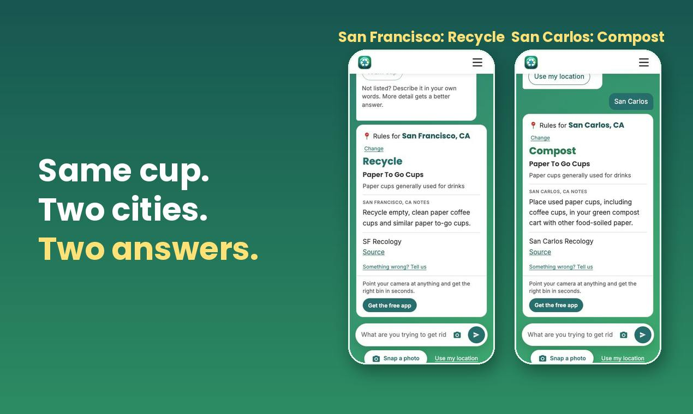
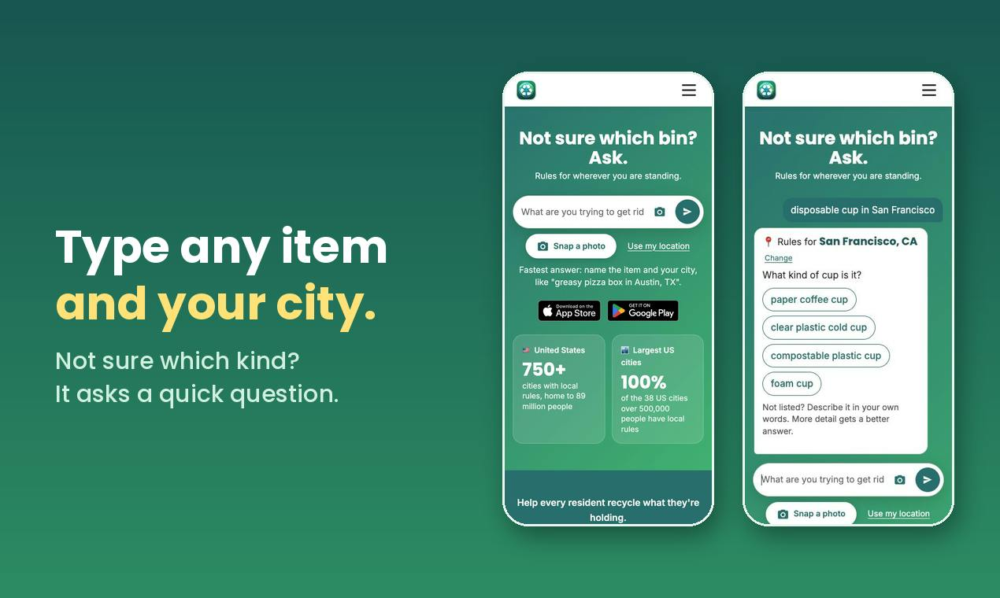
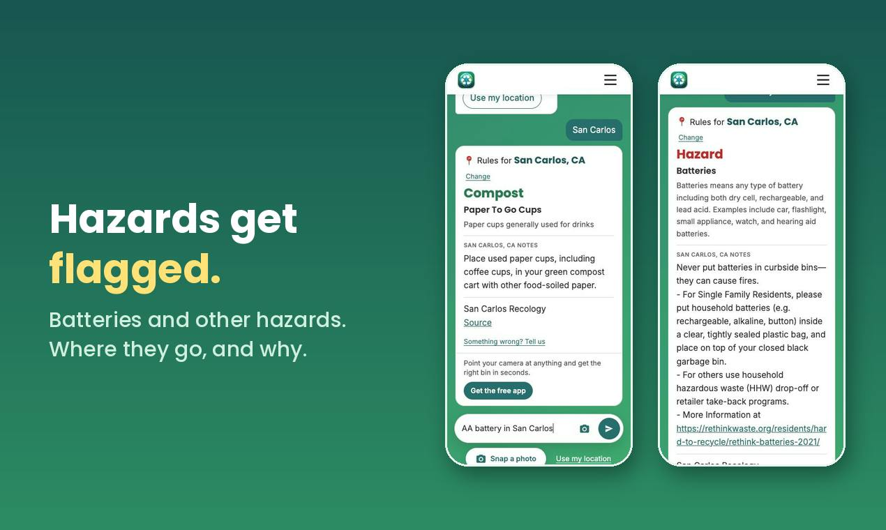

### 🎬 관련 영상
- [🎥 영상 보기](https://ph-files.imgix.net/eee3a2e3-b7d2-4128-be8b-c67fd1c6283e.jpeg?auto=format)

---

## 19. [Baby's Day In](https://www.producthunt.com/products/baby-s-day-in)
**Votes**: 74 | **도입 난이도**: 하 | **신뢰도**: 상
**Tagline**: Turn two phones into a baby monitor
**서비스 링크**: https://www.producthunt.com/r/2RAMITKDUNOPCD

**태그**: AI, Parenting, Mobile App, Automation, AI Tool

### 📌 이 서비스 한눈에 보기
남는 스마트폰을 활용해 별도 하드웨어 구매 없이 만드는 AI 베이비 모니터

### 🔑 주요 기능
- 두 대의 스마트폰을 활용한 간편한 베이비 모니터 구성
- AI 기반의 아기 울음소리 감지 및 실시간 알림
- 울음 감지 시 자동으로 자장가를 재생하는 자동화 기능

### 🙋 사용자에게 어떤 점이 좋은가
추가적인 하드웨어 구매 비용 없이 집에 있는 여분의 스마트폰을 활용해 스마트한 육아 환경을 구축할 수 있습니다.

### ✅ 지금 바로 써볼 기능
- 남는 스마트폰과 현재 스마트폰 준비하기
- AI 울음 감지 기능 테스트하기
- 자동 자장가 재생 기능 설정하기

### ⚠️ 사용 전 확인할 점
- 스마트폰의 배터리 소모 및 발열 문제 확인 필요
- Wi-Fi 연결 안정성에 따른 알림 지연 가능성

### 🧭 확인이 더 필요한 정보
사용 중인 스마트폰 기종에 따른 앱 성능 및 배터리 효율 차이가 있을 수 있습니다.

### 📸 스크린샷 및 갤러리
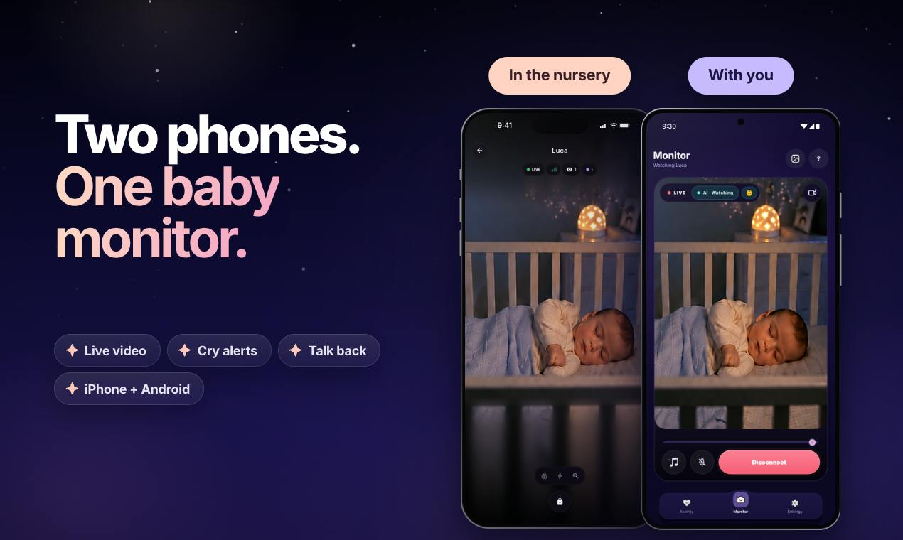
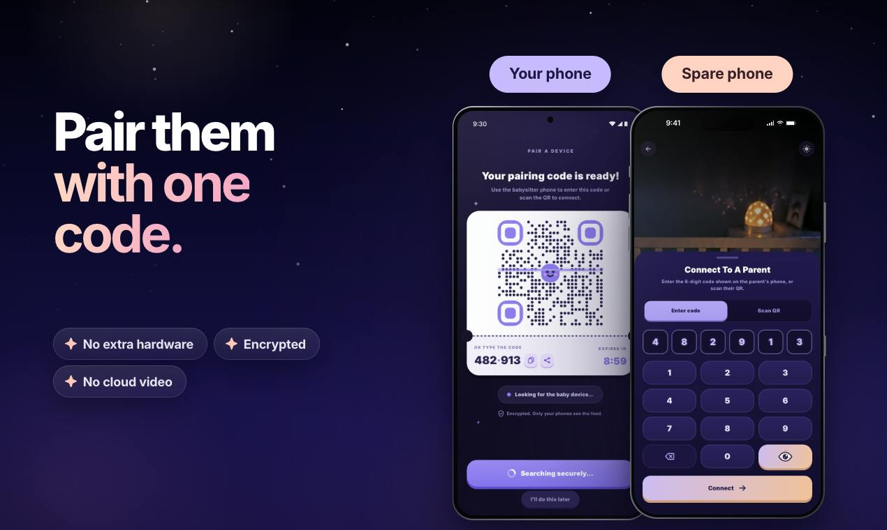

### 🎬 관련 영상
- [🎥 영상 보기](https://ph-files.imgix.net/711294ed-905a-47c1-84ff-605eb1d85fe0.jpeg?auto=format)

---

## 20. [Same Moon](https://www.producthunt.com/products/same-moon)
**Votes**: 73 | **도입 난이도**: 하 | **신뢰도**: 상
**Tagline**: Free bedtime stories for children who had to leave home
**서비스 링크**: https://www.producthunt.com/r/5DYONWKQKCNUXW

**태그**: Education, SocialImpact, Accessibility, OfflineFirst

### 📌 이 서비스 한눈에 보기
난민 및 이주 아동을 위한 저사양 기기 최적화 오프라인 동화 서비스

### 🔑 주요 기능
- 영어, 아랍어, 스페인어 지원을 통한 다국어 동화 제공
- 저사양 스마트폰을 고려한 가벼운 로딩 및 오프라인 작동
- 개인정보 보호를 위한 가입 및 트래킹 없는 구조

### 🙋 사용자에게 어떤 점이 좋은가
인터넷 연결이 불안정하거나 저사양 기기를 사용하는 환경에서도 아이들에게 안전하고 교육적인 콘텐츠를 즉시 제공할 수 있습니다.

### ✅ 지금 바로 써볼 기능
- 오프라인 모드 작동 여부 확인
- 지원되는 언어 및 음성 품질 확인
- 저사양 기기에서의 로딩 속도 테스트

### ⚠️ 사용 전 확인할 점
- 오프라인 환경에서의 콘텐츠 업데이트 방식 확인 필요
- 제한된 언어 지원(영어, 아랍어, 스페인어) 범위 확인

### 🧭 확인이 더 필요한 정보
현재 제공되는 동화의 총 수량과 콘텐츠 업데이트 주기에 대한 정보가 부족합니다.

### 📸 스크린샷 및 갤러리
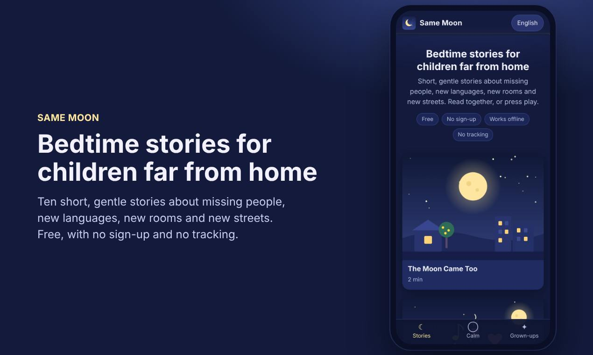

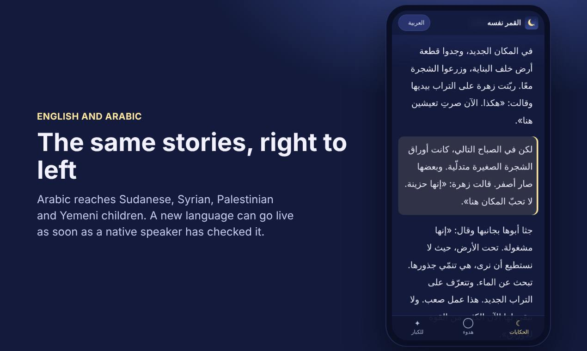

### 🎬 관련 영상
- [🎥 영상 보기](https://ph-files.imgix.net/d2aa54f4-a609-4261-954b-ce5279067b44.jpeg?auto=format)

---

## 21. [aiteam.space](https://www.producthunt.com/products/aiteam-space)
**Votes**: 73 | **도입 난이도**: 중 | **신뢰도**: 상
**Tagline**: An AI team where every agent has its own computer
**서비스 링크**: https://www.producthunt.com/r/RF2OKIMTLSTKGS

**태그**: AI-Agents, Automation, DevTools, Productivity, Agent, AI Tool, Chat, Video, DevTool

### 📌 이 서비스 한눈에 보기
각 AI 에이전트에게 독립된 컴퓨터를 부여하여 실질적인 업무를 수행하는 AI 팀 빌딩 플랫폼

### 🔑 주요 기능
- 각 AI 에이전트에게 독립적인 컴퓨팅 환경(Son) 제공
- 코드 작성, 웹사이트 배포, 영상 제작, 화상 회의 참여 등 실질적 업무 수행
- 시각적 조직도 기반의 팀 관리 및 다양한 채널(Claude, ChatGPT, Telegram, Discord) 연동

### 🙋 사용자에게 어떤 점이 좋은가
단순한 챗봇을 넘어 실제 업무를 수행하는 AI 팀을 구축하여 자동화된 워크플로우를 운영할 수 있습니다.

### ✅ 지금 바로 써볼 기능
- 첫 번째 AI 에이전트(Son) 생성하기
- 시각적 조직도를 통한 팀 구성 및 관리해보기
- Claude Code 세션을 통한 개발 자동화 테스트하기

### ⚠️ 사용 전 확인할 점
- 사용자 개인 구독 기반의 실행 환경이므로 계정 보안 및 권한 관리에 유의 필요
- 에이전트의 자율적 작업에 따른 비용 및 결과물 검토 필요

### 🧭 확인이 더 필요한 정보
에이전트가 사용하는 컴퓨팅 자원의 상세 사양과 작업 수행 시 발생하는 비용 구조에 대한 정보가 추가로 필요합니다.

### 📸 스크린샷 및 갤러리

### 🎬 관련 영상
- [🎥 영상 보기](https://ph-files.imgix.net/c3238c82-bcde-4329-ac5c-4b1a1f3d0bbb.jpeg?auto=format)
- [🎥 영상 보기](https://ph-files.imgix.net/a7cf872b-7dfa-4d1b-ab54-16fa931a8117.jpeg?auto=format)
- [🎥 영상 보기](https://ph-files.imgix.net/0bc87cda-2206-4f8d-83cd-d7891c19e14b.jpeg?auto=format)
- [🎥 영상 보기](https://ph-files.imgix.net/4f01f69f-09b0-4103-8c00-8f7ee91a71de.jpeg?auto=format)

---

## 22. [Conversaflex](https://www.producthunt.com/products/conversaflex)
**Votes**: 71 | **도입 난이도**: 하 | **신뢰도**: 상
**Tagline**: AI speaking practice for multilingual teams
**서비스 링크**: https://www.producthunt.com/r/BUQWNJPOHLMZ6O

**태그**: AI, LanguageLearning, HRTech, Productivity, AI Tool

### 📌 이 서비스 한눈에 보기
실제 업무 상황을 가정한 AI 스피킹 연습을 통해 다국어 팀의 커뮤니케이션 역량을 강화하는 솔루션

### 🔑 주요 기능
- 프랑스어, 영어, 스페인어 기반의 실무 상황(회의, 고객 통화 등) 시뮬레이션
- 발음 피드백 및 CEFR(A1~C2) 기준의 정밀한 언어 능력 측정
- HR을 위한 대시보드, 참여 기록 및 규제 준수(퀘벡 Bill 96 등) 리포트 제공

### 🙋 사용자에게 어떤 점이 좋은가
직원들이 실제 업무 환경과 유사한 상황에서 안전하게 말하기 연습을 할 수 있으며, HR은 객관적인 데이터로 직원의 언어 숙련도를 관리할 수 있습니다.

### ✅ 지금 바로 써볼 기능
- Madame AI와 실무 시나리오로 스피킹 연습하기
- 개별 발음 피드백 및 교정 받기
- CEFR 기반의 언어 레벨 측정하기

### ⚠️ 사용 전 확인할 점
- 지원 언어가 프랑스어, 영어, 스페인어로 제한적임
- 실제 대면 커뮤니케이션과의 차이 존재 가능성

### 🧭 확인이 더 필요한 정보
기업 규모에 따른 구체적인 요금 체계와 API 연동 가능 여부는 명시되지 않았습니다.

### 📸 스크린샷 및 갤러리

### 🎬 관련 영상
- [🎥 영상 보기](https://ph-files.imgix.net/mcp-draft-media/3b149702-c849-45b9-9b7d-fe45df4b6e23.jpeg?auto=format)

---

## 23. [Memanto Cloud](https://www.producthunt.com/products/memanto-by-moorcheh)
**Votes**: 70 | **도입 난이도**: 하 | **신뢰도**: 상
**Tagline**: A companion memory for agents to improve as you work
**서비스 링크**: https://www.producthunt.com/r/WIR6MUSPKUTQKS

**태그**: AI, DevTool, Productivity, Automation, Agent, API

### 📌 이 서비스 한눈에 보기
AI 에이전트의 학습 내용을 안전하게 관리하고 작업 효율을 높여주는 클라우드 메모리 솔루션

### 🔑 주요 기능
- Claude Code, Cursor 등 주요 AI 도구와 연동되는 에이전트 전용 메모리
- 사용자가 학습 데이터에 대한 소유권을 유지하며 에이전트 성능 개선
- Docker나 API 키 설정 없이 간편하게 로그인하여 즉시 사용 가능

### 🙋 사용자에게 어떤 점이 좋은가
AI 에이전트가 작업 중 습득한 지식을 공유하고 축적하여, 사용자가 매번 같은 맥락을 설명할 필요 없이 작업 효율을 극대화할 수 있습니다.

### ✅ 지금 바로 써볼 기능
- 주로 사용하는 IDE(Cursor 등)에 연동하기
- 에이전트의 학습 데이터 소유권 및 보안 정책 확인하기
- 클라우드 호스팅 환경에서의 데이터 동기화 테스트하기

### ⚠️ 사용 전 확인할 점
- 클라우드 호스팅 방식이므로 데이터 보안 및 프라이버시 정책 확인 필요
- 지원되는 30여 개의 도구 외의 환경에서는 사용이 제한될 수 있음

### 🧭 확인이 더 필요한 정보
제공되는 31개 이상의 도구 목록과 구체적인 데이터 보안 관리 방식에 대한 상세 정보가 필요합니다.

### 📸 스크린샷 및 갤러리

### 🎬 관련 영상
- [🎥 영상 보기](https://ph-files.imgix.net/64125990-1b77-462b-a01a-114541542557.jpeg?auto=format)

---

## 24. [AI Gateway](https://www.producthunt.com/products/ai-gateway-6)
**Votes**: 70 | **도입 난이도**: 중 | **신뢰도**: 상
**Tagline**: Manage your company's AI from one place
**서비스 링크**: https://www.producthunt.com/r/NS263Q77RQ2QUF

**태그**: AI, DevOps, Infrastructure, LLM, AI Tool

### 📌 이 서비스 한눈에 보기
자체 서버와 외부 AI 모델을 하나의 엔드포인트로 통합 관리하는 하이브리드 AI 게이트웨이

### 🔑 주요 기능
- 자체 호스팅 모델과 외부 API(OpenAI, Groq 등)를 하나의 OpenAI 호환 엔드포인트로 통합
- 자체 GPU를 우선 사용하고 필요 시에만 외부 벤더로 전환하는 효율적 트래픽 관리
- 사용자 정의 정책을 통한 모델 사용 권한 및 리소스 제어

### 🙋 사용자에게 어떤 점이 좋은가
여러 AI 모델을 개별적으로 관리할 필요 없이 하나의 인터페이스로 통합하여 운영 효율을 높이고, 자체 인프라와 외부 API 간의 비용 및 성능 균형을 최적화할 수 있습니다.

### ✅ 지금 바로 써볼 기능
- 자체 호스팅 모델과 외부 API 연동 테스트
- OpenAI 호환 엔드포인트 전환 설정
- 트래픽 우선순위 및 폴백(Fallback) 정책 구성

### ⚠️ 사용 전 확인할 점
- 자체 서버 인프라 관리 및 GPU 리소스 확보 필요
- 외부 벤더로의 트래픽 전환 시 발생할 수 있는 지연 시간 확인 필요

### 🧭 확인이 더 필요한 정보
자체 서버 설치 방식(Docker, Kubernetes 등)과 구체적인 하드웨어 요구 사양에 대한 확인이 필요합니다.

### 📸 스크린샷 및 갤러리

### 🎬 관련 영상
- [🎥 영상 보기](https://ph-files.imgix.net/mcp-draft-media/52b5defe-9b19-45fc-aeb4-5017800ee7c5.jpeg?auto=format)

---

## 25. [Nova by Vybe](https://www.producthunt.com/products/vybe-4)
**Votes**: 69 | **도입 난이도**: 하 | **신뢰도**: 상
**Tagline**: Nova audits your website free, then fixes what it finds
**서비스 링크**: https://www.producthunt.com/r/KQZOWEPXCNCTWU

**태그**: AI, Automation, WebOptimization, SEO, NoCode, Agent, AI Tool, Security

### 📌 이 서비스 한눈에 보기
AI가 웹사이트 진단부터 문제 해결까지 자동으로 수행하는 올인원 최적화 에이전트

### 🔑 주요 기능
- SEO, 속도, 전환율, 접근성, 보안을 아우르는 종합 웹사이트 감사
- 수정 전후 비교를 위한 모크업 및 경쟁사 벤치마크 리포트 제공
- 분석에 그치지 않고 AI 에이전트가 직접 권장 사항을 적용하는 자동화 기능

### 🙋 사용자에게 어떤 점이 좋은가
웹사이트 성능 개선을 위해 전문가를 고용하거나 직접 코드를 수정하는 번거로움 없이, AI에게 권한을 부여하여 즉각적인 개선 효과를 얻을 수 있습니다.

### ✅ 지금 바로 써볼 기능
- 무료 웹사이트 감사 리포트 생성하기
- 제공되는 수정 권장 사항 우선순위 확인하기
- Vybe 플랫폼을 통한 자동 수정 기능 적용해보기

### ⚠️ 사용 전 확인할 점
- AI가 직접 코드를 수정할 경우 사이트 기능에 미칠 영향 검토 필요
- 자동 수정 기능 사용 시 백업 및 복구 대책 확인 필요

### 🧭 확인이 더 필요한 정보
AI가 직접 코드를 수정할 때의 안전성 및 사이트 규모에 따른 제약 사항에 대한 정보가 추가로 필요합니다.

### 📸 스크린샷 및 갤러리

---

## 26. [Vatsalya Circle](https://www.producthunt.com/products/vatsalya-circle)
**Votes**: 69 | **도입 난이도**: 하 | **신뢰도**: 상
**Tagline**: Family elder care: check-ins, missed alerts, SOS, scam help
**서비스 링크**: https://www.producthunt.com/r/5TET2GJ6UIUQYY

**태그**: ElderlyCare, FamilySafety, MobileApp, HealthTech, AI Tool

### 📌 이 서비스 한눈에 보기
멀리 떨어져 있는 가족을 위한 노인 돌봄 및 안전 확인 앱

### 🔑 주요 기능
- 약 복용 및 일상 체크인 알림 기능
- 체크인 미이행 시 가족에게 알림 전송
- 긴급 상황을 위한 SOS 및 보이스피싱 방지(Safety Check) 기능

### 🙋 사용자에게 어떤 점이 좋은가
부모님과 떨어져 사는 자녀들이 부모님의 안부를 실시간으로 확인하고, 위급 상황이나 사기 피해에 신속히 대응할 수 있도록 돕습니다.

### ✅ 지금 바로 써볼 기능
- 부모님과 함께 앱 설치 및 언어 설정하기
- 가족 구성원 초대 및 역할 분담하기
- SOS 및 체크인 알림 작동 방식 확인하기

### ⚠️ 사용 전 확인할 점
- 부모님의 스마트폰 조작 숙련도에 따라 사용이 어려울 수 있음
- 알림이 오지 않을 경우를 대비한 통신 상태 확인 필요

### 🧭 확인이 더 필요한 정보
앱의 구체적인 데이터 보안 정책 및 개인정보 처리 방식에 대한 정보가 부족합니다.

### 📸 스크린샷 및 갤러리

### 🎬 관련 영상
- [🎥 영상 보기](https://ph-files.imgix.net/mcp-draft-media/5e6315f7-0c9e-46bd-bbbb-8efc428506a3.jpeg?auto=format)

---

## 27. [Samiksa](https://www.producthunt.com/products/samiksa)
**Votes**: 69 | **도입 난이도**: 중 | **신뢰도**: 상
**Tagline**: Understand research, test it yourself, publish your own
**서비스 링크**: https://www.producthunt.com/r/EHJGSQYO47CREO

**태그**: AI, Research, DataScience, Productivity, AI Tool, DevTool

### 📌 이 서비스 한눈에 보기
문서 분석부터 실험 및 연구 출판까지 지원하는 AI 공동 연구 파트너

### 🔑 주요 기능
- 문서를 질문 중심의 인터랙티브한 형태로 변환하여 핵심 정보 추출
- 모든 주장에 대한 출처 추적 기능 제공
- 코드 및 데이터 지원을 통한 가설 검증 및 샌드박스 실험 환경 제공

### 🙋 사용자에게 어떤 점이 좋은가
복잡한 연구 문서를 빠르게 이해하고, 단순히 읽는 것을 넘어 직접 실험하고 검증하며 연구 성과를 만드는 과정을 효율화할 수 있습니다.

### ✅ 지금 바로 써볼 기능
- 관심 있는 논문이나 블로그 포스트 업로드하기
- 질문을 통해 문서의 핵심 내용 탐색하기
- 샌드박스 기능을 활용해 가설 검증 및 코드 실행하기

### ⚠️ 사용 전 확인할 점
- AI 생성 결과물의 정확성을 위해 반드시 제공된 출처를 교차 검증해야 함
- 현재는 대기 명단(Waitlist) 가입 단계로 즉시 사용이 제한적일 수 있음

### 🧭 확인이 더 필요한 정보
현재 서비스가 대기 명단 단계이므로 실제 기능의 완전한 구현 여부와 상세 사용법 확인이 필요합니다.

### 📸 스크린샷 및 갤러리

### 🎬 관련 영상
- [🎥 영상 보기](https://ph-files.imgix.net/mcp-draft-media/a83c13aa-732f-4723-8101-22fc8d44f419.jpeg?auto=format)

---

## 28. [FFMPA Kids News](https://www.producthunt.com/products/ffmpa-kids-news)
**Votes**: 68 | **도입 난이도**: 하 | **신뢰도**: 상
**Tagline**: Calm, fact-checked news for kids 5 to 15
**서비스 링크**: https://www.producthunt.com/r/MZP6ELN5FXDHZZ

**태그**: Education, News, Kids, SafeSearch, Chat

### 📌 이 서비스 한눈에 보기
5~15세 아이들을 위한 광고 없는 안전한 맞춤형 뉴스 서비스

### 🔑 주요 기능
- 연령별 3단계 읽기 수준 제공 및 철저한 팩트 체크
- 광고, 외부 링크, 채팅이 없는 안전한 독서 환경
- 주간 단위의 심층적인 'Big Story' 중심 뉴스 구성

### 🙋 사용자에게 어떤 점이 좋은가
아이들이 자극적인 매체 대신 신뢰할 수 있는 뉴스를 통해 세상을 배우고 어휘력을 높일 수 있습니다.

### ✅ 지금 바로 써볼 기능
- 아이의 연령에 맞는 읽기 수준 선택하기
- 모르는 단어를 탭하여 학습 기능 활용하기
- 주간 단위로 업데이트되는 Big Story 구독하기

### ⚠️ 사용 전 확인할 점
- 특정 연령대(5~15세)에 특화되어 있어 성인 사용자는 적합하지 않음
- 뉴스 소비의 깊이보다는 안전과 교육적 가치에 집중된 서비스임

### 🧭 확인이 더 필요한 정보
현재 무료로 제공되지만 향후 유료 모델로 전환될 가능성이 있는지 확인이 필요합니다.

### 📸 스크린샷 및 갤러리

---

## 29. [Interview Coach](https://www.producthunt.com/products/interview-coach-3)
**Votes**: 68 | **도입 난이도**: 하 | **신뢰도**: 상
**Tagline**: Practice job interviews out loud
**서비스 링크**: https://www.producthunt.com/r/7KMZUFA54ZXGKF

**태그**: AI, Career, Productivity, Interview, AI Tool, Video

### 📌 이 서비스 한눈에 보기
실제 면접처럼 말하며 피드백을 받는 대화형 AI 면접 연습 도구

### 🔑 주요 기능
- 직무 및 면접 스타일 맞춤형 모의 면접 진행
- 음성 답변에 따른 실시간 후속 질문 및 피드백 제공
- 개인정보 보호를 위해 기기 내 음성 처리 및 녹화 미저장

### 🙋 사용자에게 어떤 점이 좋은가
실제 목소리로 답변하는 연습을 통해 면접 실전 감각을 키울 수 있으며, 개인화된 코칭 리포트로 자신의 답변을 객관적으로 점검할 수 있습니다.

### ✅ 지금 바로 써볼 기능
- 원하는 직무와 직무 기술서 입력하기
- 음성 기능을 활용해 직접 답변해 보기
- 생성된 코칭 리포트와 텍스트 스크립트 확인하기

### ⚠️ 사용 전 확인할 점
- 데스크톱 크롬 브라우저 환경에서 최적화되어 있음
- 로그인 시 코칭 리포트와 텍스트 기록이 저장됨

### 🧭 확인이 더 필요한 정보
사용 중인 기기의 하드웨어 성능에 따라 음성 처리 속도가 달라질 수 있습니다.

### 📸 스크린샷 및 갤러리

### 🎬 관련 영상
- [🎥 영상 보기](https://ph-files.imgix.net/e61f645b-1c8d-4434-9229-4d67a3a87509.jpeg?auto=format)

---

## 30. [Stormi](https://www.producthunt.com/products/stormi)
**Votes**: 66 | **도입 난이도**: 하 | **신뢰도**: 상
**Tagline**: An AI team on your iPhone that does real work
**서비스 링크**: https://www.producthunt.com/r/M53YOYDLGUYATI

**태그**: AI Agents, Automation, Mobile Productivity, Workflow, Agent, AI Tool

### 📌 이 서비스 한눈에 보기
아이폰에서 전문적인 업무를 수행하는 AI 에이전트 팀을 소유하세요.

### 🔑 주요 기능
- 각기 다른 역할과 모델을 가진 전문 AI 에이전트 팀 제공
- 아이폰을 꺼두어도 서버에서 지속적으로 업무 수행
- 89개의 플러그인과 수백 개의 모델 지원

### 🙋 사용자에게 어떤 점이 좋은가
스마트폰만으로도 복잡한 업무를 자동화할 수 있으며, 사용자의 최종 승인 전에는 중요한 동작을 수행하지 않아 안전합니다.

### ✅ 지금 바로 써볼 기능
- 특정 직무를 가진 AI 에이전트 생성하기
- 89개 플러그인을 활용한 업무 자동화 설정
- 서버 기반의 백그라운드 작업 실행 테스트

### ⚠️ 사용 전 확인할 점
- 에이전트의 작업 결과물에 대한 최종 검토 필요
- 서버 기반 작업 시 데이터 보안 및 개인정보 관리 확인 필요

### 🧭 확인이 더 필요한 정보
제공되는 수백 개의 모델과 플러그인이 사용자의 특정 워크플로우와 얼마나 완벽히 호환되는지 확인이 필요합니다.

### 📸 스크린샷 및 갤러리

### 🎬 관련 영상
- [🎥 영상 보기](https://ph-files.imgix.net/9f3f94be-38c0-4a8c-aeaa-e391083e7dd2.jpeg?auto=format)

---

