# 🚀 Product Hunt Daily Top 30 (2026-11-24)

## 오늘의 요약
오늘의 트렌드는 단순한 자동화를 넘어, 여러 AI 에이전트가 협업하거나 복잡한 문제를 스스로 해결하는 '에이전트 중심의 워크플로우'가 주를 이루었습니다. 또한, 로컬 환경에서의 고성능 모델 실행과 개인 맞춤형 학습/마케팅 등 사용자 경험을 극대화하는 도구들이 주목받았습니다.

### 오늘의 핵심 포인트
- 복잡한 운영 장애나 고객 이슈를 스스로 감지하고 해결책을 제시하는 자율형 AI 에이전트 기술이 강조되었습니다.
- 웹사이트 분석, 마케팅 영상 제작, 학습 계획 수립 등 특정 목적에 특화된 AI 자동화 도구들이 다양하게 출시되었습니다.
- 로컬 환경에서도 강력한 성능을 발휘하는 모델과 클라우드 연동을 통한 업무 자동화 등 효율적인 작업 환경 구축이 핵심이었습니다.

**오늘의 태그**: AI 에이전트, 업무 자동화, 생산성 도구, 로컬 AI, 마케팅 자동화

## 1. [Letter Visitors](https://www.producthunt.com/products/visitors)
**Votes**: 278 | **도입 난이도**: 하 | **신뢰도**: 상
**Tagline**: See website visitors on your website itself
**서비스 링크**: https://www.producthunt.com/r/D6BRBNLRH7WD47

**태그**: Analytics, UX, Marketing, AI, Agent, AI Tool

### 📌 이 서비스 한눈에 보기
웹사이트 방문자와 AI 에이전트를 실시간으로 확인하고 세션을 재생하는 분석 도구

### 🔑 주요 기능
- 방문자 정보(개인 및 기업) 실시간 확인
- AI 에이전트의 웹사이트 방문 감지
- 방문자 세션 리플레이 기능 제공

### 🙋 사용자에게 어떤 점이 좋은가
누가 내 사이트에 들어와 있는지 직관적으로 파악하고, 실제 사용자 행동을 영상처럼 재현하여 UX를 개선할 수 있습니다.

### ✅ 지금 바로 써볼 기능
- 방문자 정보 대시보드 확인하기
- 세션 리플레이를 통한 사용자 행동 분석하기
- AI 에이전트 유입 트래픽 모니터링하기

### ⚠️ 사용 전 확인할 점
- 개인정보 보호 및 데이터 수집 정책 확인 필요
- 세션 리플레이 기능이 사이트 성능에 미치는 영향 검토

### 🧭 확인이 더 필요한 정보
상세한 데이터 수집 범위와 개인정보 보호 준수 여부에 대한 구체적인 정보가 필요합니다.

### 📸 스크린샷 및 갤러리
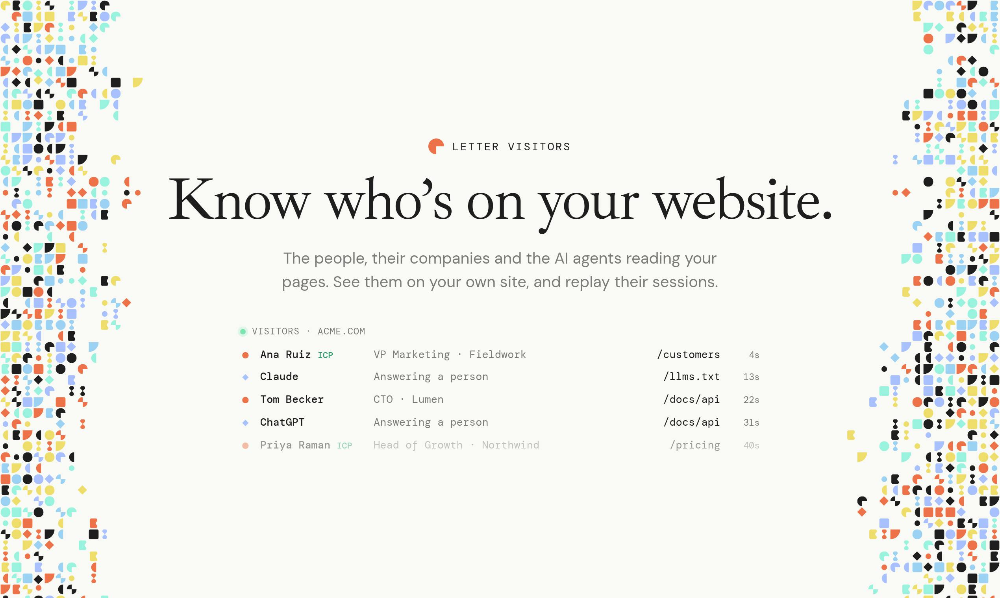
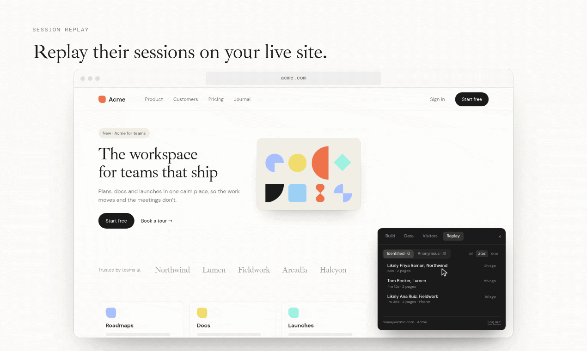
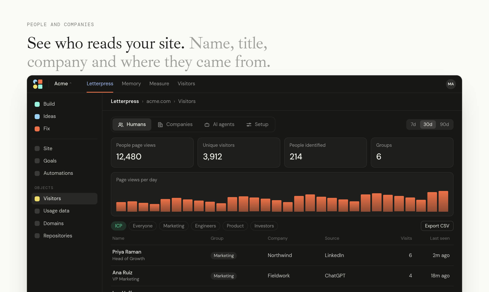

---

## 2. [Gauth Personal Study Agent](https://www.producthunt.com/products/gauth-ai-course)
**Votes**: 224 | **도입 난이도**: 하 | **신뢰도**: 상
**Tagline**: An AI study agent that remembers where you struggle
**서비스 링크**: https://www.producthunt.com/r/UYCH2W5E56E2XN

**태그**: EdTech, AI, Personalized Learning, Productivity, Agent, AI Tool

### 📌 이 서비스 한눈에 보기
학습자의 취약점을 분석하여 맞춤형 복습 계획을 제안하는 AI 개인 학습 에이전트

### 🔑 주요 기능
- 질문, 퀴즈, 학습 주제를 연결하여 개인별 학습 패턴 분석
- 오답 원인을 파악하여 맞춤형 일일 학습 계획 자동 생성
- 플래시카드, 단계별 가이드, 퀴즈를 통한 반복 학습 및 성취도 관리

### 🙋 사용자에게 어떤 점이 좋은가
매번 무엇을 공부할지 고민할 필요 없이, AI가 나의 부족한 부분을 찾아내어 최적화된 학습 경로를 제공합니다.

### ✅ 지금 바로 써볼 기능
- Gauth 앱 내에서 문제 사진 찍어 학습 데이터 쌓기
- 생성된 일일 학습 계획에 따라 맞춤형 퀴즈 풀기
- 플래시카드를 활용한 취약 개념 복습하기

### ⚠️ 사용 전 확인할 점
- Gauth 앱 내에 내장된 기능이므로 기존 Gauth 앱 사용이 필요함
- 학습 데이터가 축적될수록 정확도가 높아지므로 초기 데이터 입력이 중요함

### 🧭 확인이 더 필요한 정보
Gauth 앱의 기존 유료 플랜과의 연동 여부 및 추가 비용 발생 여부를 확인해야 합니다.

### 📸 스크린샷 및 갤러리
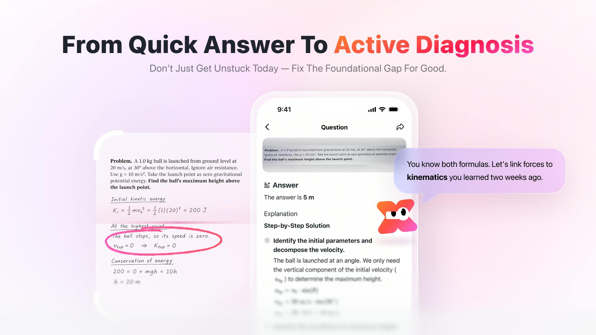
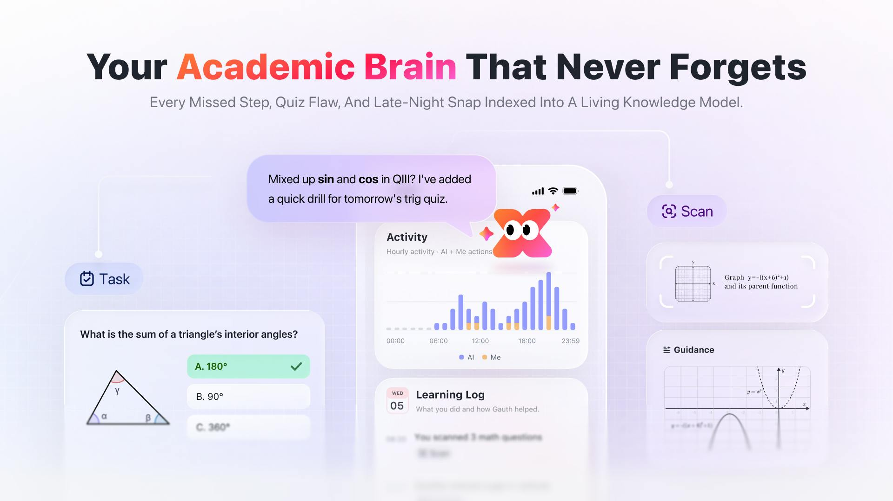
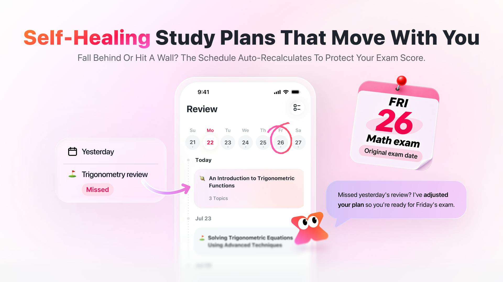

---

## 3. [Motionflare](https://www.producthunt.com/products/motionflare)
**Votes**: 204 | **도입 난이도**: 하 | **신뢰도**: 상
**Tagline**: Turn your website into a stunning launch video in minutes
**서비스 링크**: https://www.producthunt.com/r/AM4QLKUSKUV34E

**태그**: Marketing, VideoAutomation, NoCode, AI, Chat, Video

### 📌 이 서비스 한눈에 보기
URL 입력만으로 브랜드 맞춤형 홍보 영상을 자동 생성하는 AI 마케팅 툴

### 🔑 주요 기능
- 웹사이트 URL을 입력하면 제품 스크린샷, 로고, 색상을 활용한 브랜드 영상 자동 생성
- 채팅 인터페이스를 통한 간편한 결과물 수정 및 4K 고화질 내보내기 지원
- 실사 느낌의 광고를 만들 수 있는 'Film mode' 제공

### 🙋 사용자에게 어떤 점이 좋은가
디자인 기술이 없어도 웹사이트 주소만으로 전문적인 브랜드 홍보 영상을 빠르게 제작할 수 있습니다.

### ✅ 지금 바로 써볼 기능
- 자사 웹사이트 URL을 붙여넣어 자동 생성 기능 테스트하기
- 채팅 기능을 활용해 영상 스타일 미세 조정하기
- Film mode를 통해 실사 스타일의 광고 영상 생성해보기

### ⚠️ 사용 전 확인할 점
- 웹사이트의 레이아웃에 따라 스크린샷 캡처 품질이 달라질 수 있음
- 고화질(4K) 내보내기 시 별도의 유료 플랜이 필요할 수 있음

### 🧭 확인이 더 필요한 정보
구체적인 요금 체계와 무료 플랜의 내보내기 제한 범위에 대한 확인이 필요합니다.

### 📸 스크린샷 및 갤러리

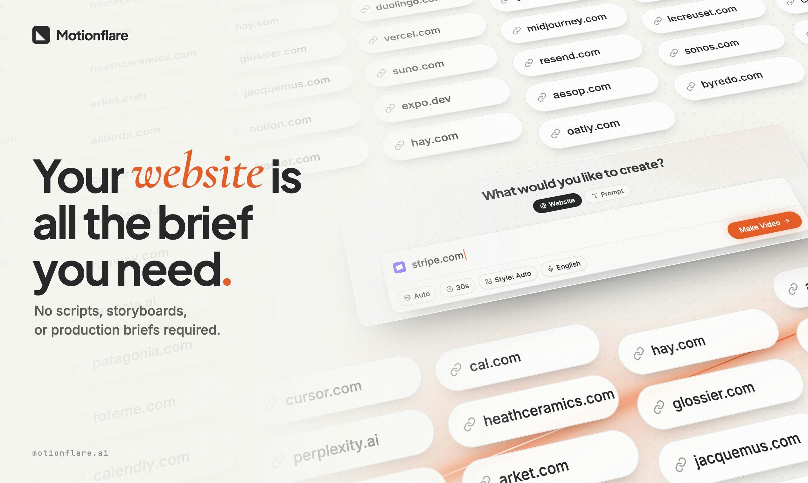
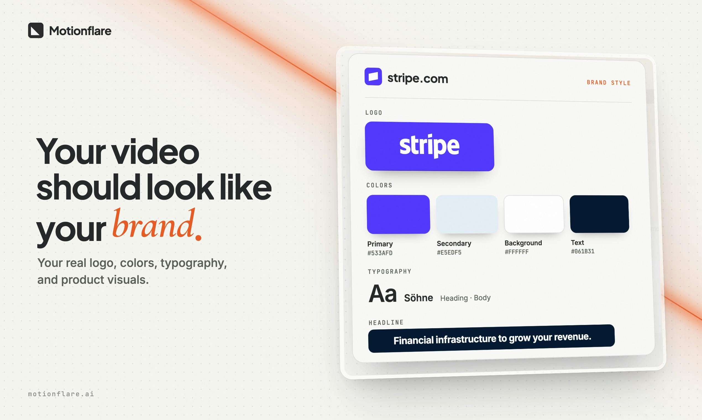

### 🎬 관련 영상
- [🎥 영상 보기](https://ph-files.imgix.net/b2fade8d-bb65-43dc-98e6-39dcadd815fd.jpeg?auto=format)

---

## 4. [Modem](https://www.producthunt.com/products/modem)
**Votes**: 160 | **도입 난이도**: 중 | **신뢰도**: 상
**Tagline**: Find, fix, and follow up on every customer concern
**서비스 링크**: https://www.producthunt.com/r/CEZ34BGBUK2Q27

**태그**: Automation, CustomerSupport, DevOps, Workflow, Agent, AI Tool, Chat, Sales

### 📌 이 서비스 한눈에 보기
고객 피드백을 실시간으로 감지하여 이슈 해결부터 고객 응대까지 자동화하는 워크플로우 도구

### 🔑 주요 기능
- 지원 티켓, 채팅, 영업 통화 등 다양한 채널의 고객 이슈 실시간 모니터링
- 이슈 자동 생성, 코딩 에이전트 실행 및 담당 팀 에스컬레이션 자동화
- 문제 해결 시 고객에게 피드백을 전달하는 루프 자동화

### 🙋 사용자에게 어떤 점이 좋은가
고객의 요청이나 버그 리포트를 놓치지 않고, 문제 해결 과정을 자동화하여 운영 효율을 극대화할 수 있습니다.

### ✅ 지금 바로 써볼 기능
- 고객 소통 채널 연동하기
- 자동 이슈 생성 및 에이전트 워크플로우 설정하기
- 해결 완료 시 고객 알림 규칙 설정하기

### ⚠️ 사용 전 확인할 점
- 자동화된 코딩 에이전트가 생성한 코드의 품질 및 보안 검토 필요
- 다양한 외부 채널과의 연동 설정 및 권한 관리 필요

### 🧭 확인이 더 필요한 정보
지원하는 구체적인 외부 채널(SaaS, 메신저 등)의 종류와 코딩 에이전트의 기술적 사양에 대한 정보가 부족합니다.

### 📸 스크린샷 및 갤러리
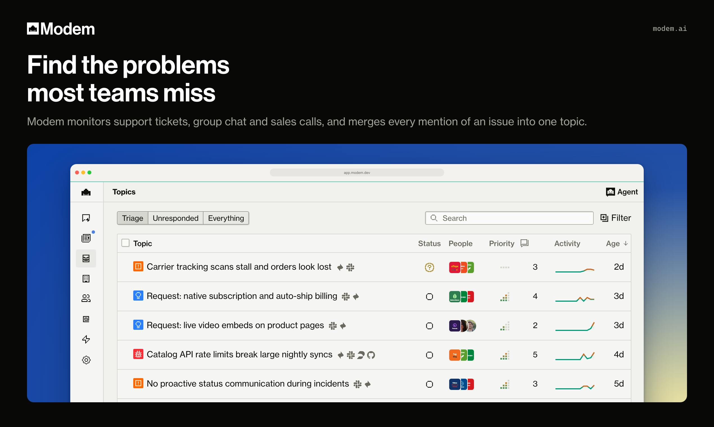
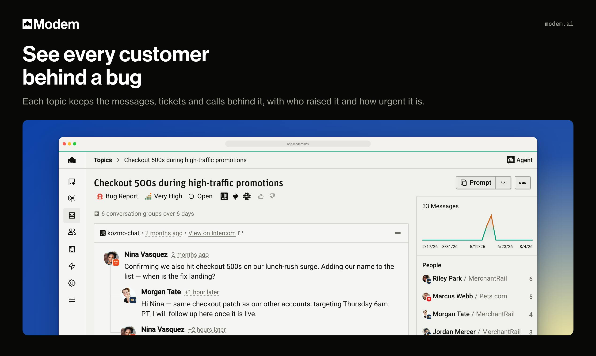
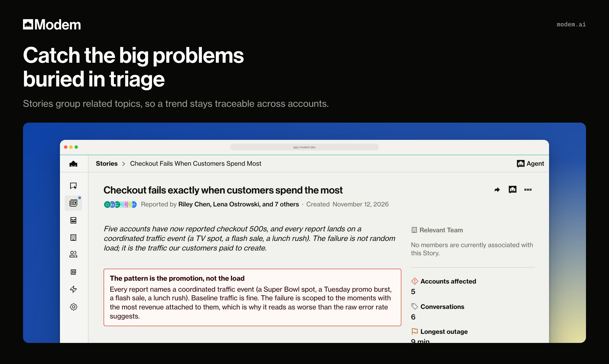

### 🎬 관련 영상
- [🎥 영상 보기](https://ph-files.imgix.net/mcp-draft-media/748bb8a0-1d66-4872-ae3f-197410b570ae.jpeg?auto=format)

---

## 5. [Dog Translator SuperTranslator](https://www.producthunt.com/products/dog-translator-supertranslator)
**Votes**: 155 | **도입 난이도**: 하 | **신뢰도**: 상
**Tagline**: Dogs talking in English (real)
**서비스 링크**: https://www.producthunt.com/r/ORWSMEJ2HYDXEB

**태그**: AI, Pets, Communication, AI Tool

### 📌 이 서비스 한눈에 보기
AI를 통해 반려견의 몸짓과 소리를 영어로 번역해주는 반려견 소통 도구

### 🔑 주요 기능
- AI 기반의 반려견 바디랭귀지 및 음성 분석
- 단순한 짖음 해석을 넘어 주변 환경과의 상호작용까지 고려한 다각적 분석
- 사용자 이해를 돕기 위한 쉬운 영어 문장으로의 변환

### 🙋 사용자에게 어떤 점이 좋은가
반려견의 감정과 의도를 더 깊이 이해함으로써 반려견과의 정서적 유대감을 높일 수 있습니다.

### ✅ 지금 바로 써볼 기능
- 반려견의 행동 패턴 기록하기
- AI 번역 결과와 실제 반려견 상태 비교하기
- 다양한 상황에서의 음성/몸짓 데이터 입력해보기

### ⚠️ 사용 전 확인할 점
- AI 해석이 실제 반려견의 의도와 다를 수 있음
- 정확한 분석을 위해 특정 환경이나 데이터가 필요할 수 있음

### 🧭 확인이 더 필요한 정보
제시된 벤치마크 결과의 구체적인 검증 방법과 데이터 수집 방식에 대한 확인이 필요합니다.

### 📸 스크린샷 및 갤러리

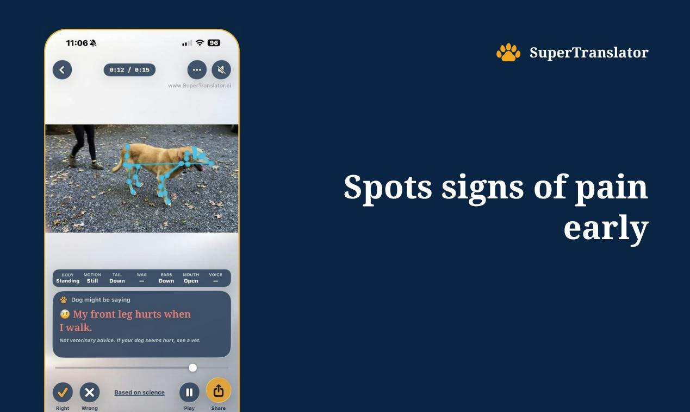

### 🎬 관련 영상
- [🎥 영상 보기](https://ph-files.imgix.net/7ae091b8-853f-4c34-9864-12de1abae828.jpeg?auto=format)

---

## 6. [Polylane Swarms](https://www.producthunt.com/products/polylane)
**Votes**: 117 | **도입 난이도**: 중 | **신뢰도**: 상
**Tagline**: A team of AI agents on your roughest production incidents
**서비스 링크**: https://www.producthunt.com/r/32EVX2QO6UY7TY
**재등장**: 최근 7일 내 재등장 (마지막 등장 3일 전)

**태그**: DevOps, AI Agents, Incident Management, Automation, Agent, AI Tool

### 📌 이 서비스 한눈에 보기
복잡한 운영 장애를 해결하기 위해 여러 AI 에이전트가 협업하여 근본 원인과 해결책을 제시하는 도구

### 🔑 주요 기능
- 여러 AI 에이전트가 병렬로 장애 원인을 조사
- 에이전트 간 증거 공유 및 상호 검증 프로세스 수행
- 최종적인 근본 원인 분석과 제안된 수정안 제공

### 🙋 사용자에게 어떤 점이 좋은가
대규모 운영 장애 발생 시 수동 조사 시간을 획기적으로 줄이고, 신뢰도 높은 원인 분석과 해결책을 즉시 얻을 수 있습니다.

### ✅ 지금 바로 써볼 기능
- 실제 운영 환경의 로그/데이터 연동 가능 여부 확인
- 에이전트가 제안하는 수정안의 신뢰도 테스트
- 장애 발생 시 워크플로우 통합 시나리오 검토

### ⚠️ 사용 전 확인할 점
- AI가 제안한 수정안을 실제 운영 환경에 적용할 때 발생할 수 있는 위험성
- 운영 데이터(로그, 메트릭 등)에 대한 접근 권한 및 보안 문제

### 🧭 확인이 더 필요한 정보
현재 제공되는 데이터 소스(로그, 모니터링 툴 등)와의 구체적인 통합 방식과 보안 프로토콜에 대한 정보가 부족합니다.

### 📸 스크린샷 및 갤러리
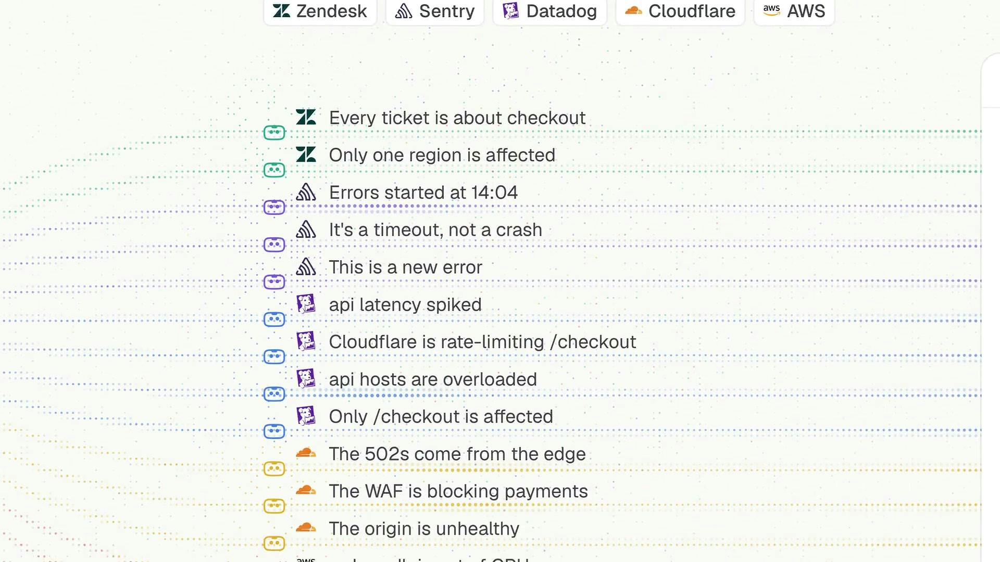
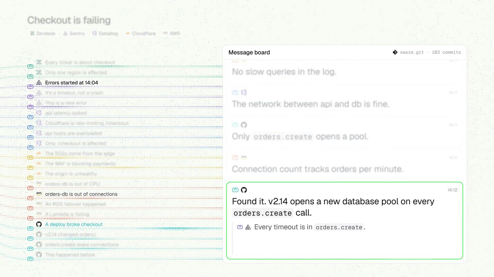
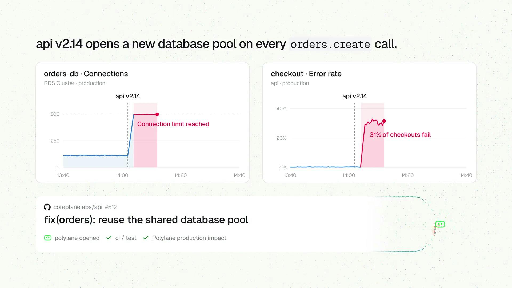

### 🎬 관련 영상
- [🎥 영상 보기](https://ph-files.imgix.net/mcp-draft-media/871caf1e-a5f3-420e-b573-56f874ec29d7.jpeg?auto=format)

---

## 7. [Chat with Work](https://www.producthunt.com/products/chat-with-work)
**Votes**: 111 | **도입 난이도**: 하 | **신뢰도**: 상
**Tagline**: AI bots in Europe. They work. You decide.
**서비스 링크**: https://www.producthunt.com/r/N4OOSBHZF6Z4DD

**태그**: Automation, AI, Productivity, Workflow, AI Tool, Chat

### 📌 이 서비스 한눈에 보기
단 한 문장으로 생성하여 1,920개 이상의 서비스와 연동되는 유럽 기반 AI 자동화 봇

### 🔑 주요 기능
- 단 한 문장의 설명만으로 작동하는 AI 봇 생성 가능
- 1,920개 이상의 서비스와 연동되어 노트북이 꺼져 있어도 자동 실행
- 모든 결정과 승인 요청이 한 곳으로 모이는 중앙 집중식 관리

### 🙋 사용자에게 어떤 점이 좋은가
복잡한 설정 없이 말 한마디로 업무 자동화 봇을 만들고, 결정이 필요한 순간에만 개입하여 업무 효율을 극대화할 수 있습니다.

### ✅ 지금 바로 써볼 기능
- 300 크레딧 무료 체험으로 봇 생성해보기
- 자주 사용하는 업무 프로세스를 한 문장으로 정의해보기
- 통합 가능한 1,920개 이상의 서비스 목록 확인하기

### ⚠️ 사용 전 확인할 점
- 결정적 순간에 사용자의 승인이 필요하므로 실시간 확인이 중요함
- 무료 크레딧 소진 후 유료 플랜 전환 필요

### 🧭 확인이 더 필요한 정보
1,920개 이상의 통합 서비스 중 사용자가 원하는 특정 서비스가 포함되어 있는지 확인이 필요합니다.

### 📸 스크린샷 및 갤러리
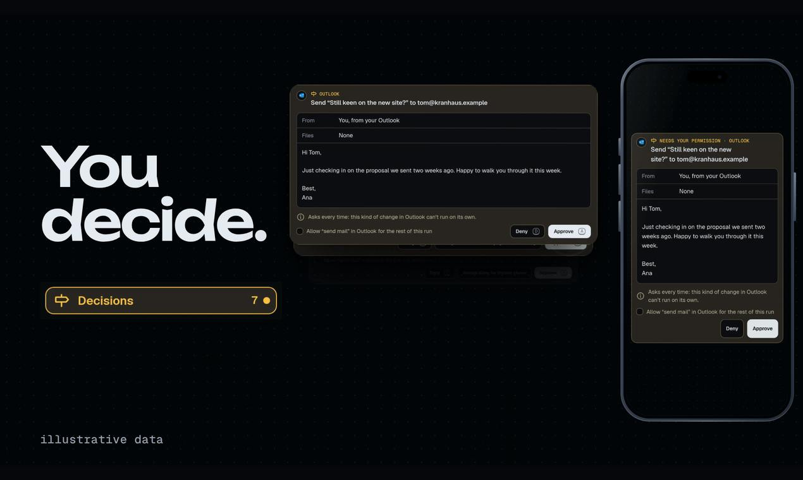
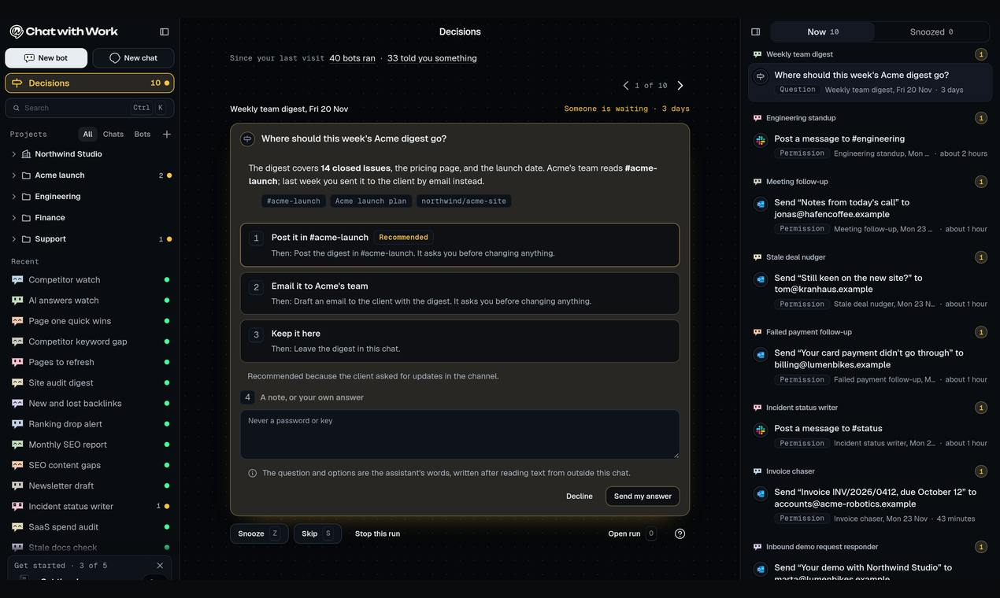
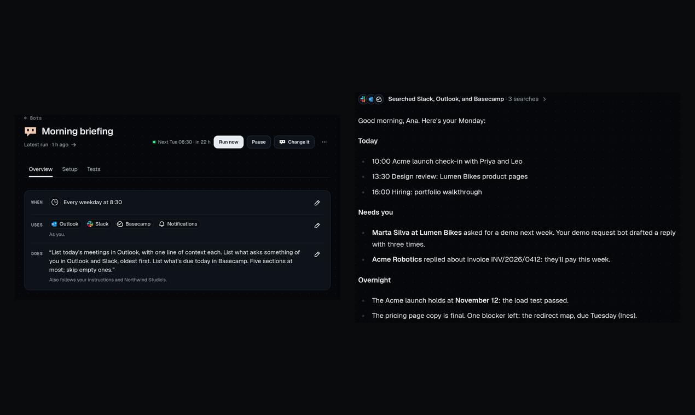

### 🎬 관련 영상
- [🎥 영상 보기](https://ph-files.imgix.net/086d6b49-2f2c-49ec-8613-7540ba9868f0.jpeg?auto=format)

---

## 8. [Inkling 2 Mini](https://www.producthunt.com/products/tinker-2)
**Votes**: 105 | **도입 난이도**: 중 | **신뢰도**: 상
**Tagline**: 26B looped model for coding on your laptop
**서비스 링크**: https://www.producthunt.com/r/SG2HQWZE7PXLKB

**태그**: AI, Coding, LocalLLM, DevTool, Agent

### 📌 이 서비스 한눈에 보기
노트북에서도 강력한 추론이 가능한 26B급 로컬 코딩 모델

### 🔑 주요 기능
- 26.4B 파라미터 규모의 오픈 웨이트 모델
- 중간 트랜스포머 레이어 반복 실행을 통한 효율적 추론 구조
- 32GB RAM 탑재 Mac 환경(Ollama) 최적화

### 🙋 사용자에게 어떤 점이 좋은가
로컬 환경에서 개인정보 유출 걱정 없이 고성능 코딩 및 에이전트 작업을 수행할 수 있습니다.

### ✅ 지금 바로 써볼 기능
- Ollama를 통한 모델 설치 및 구동
- 로컬 코딩 에이전트 워크플로우 테스트
- 32GB RAM 환경에서의 추론 속도 확인

### ⚠️ 사용 전 확인할 점
- 32GB 이상의 RAM을 가진 Mac 환경 권장
- 로컬 하드웨어 사양에 따른 추론 속도 차이 발생 가능성

### 🧭 확인이 더 필요한 정보
특정 하드웨어 사양 외의 운영체제 지원 범위와 구체적인 추론 속도(tokens/sec)는 확인이 필요합니다.

### 📸 스크린샷 및 갤러리

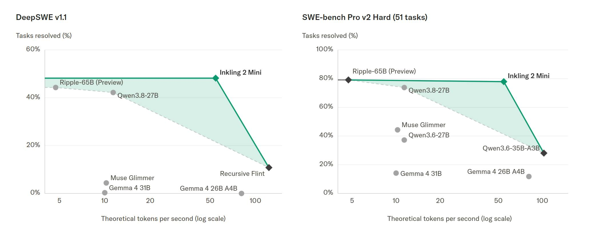
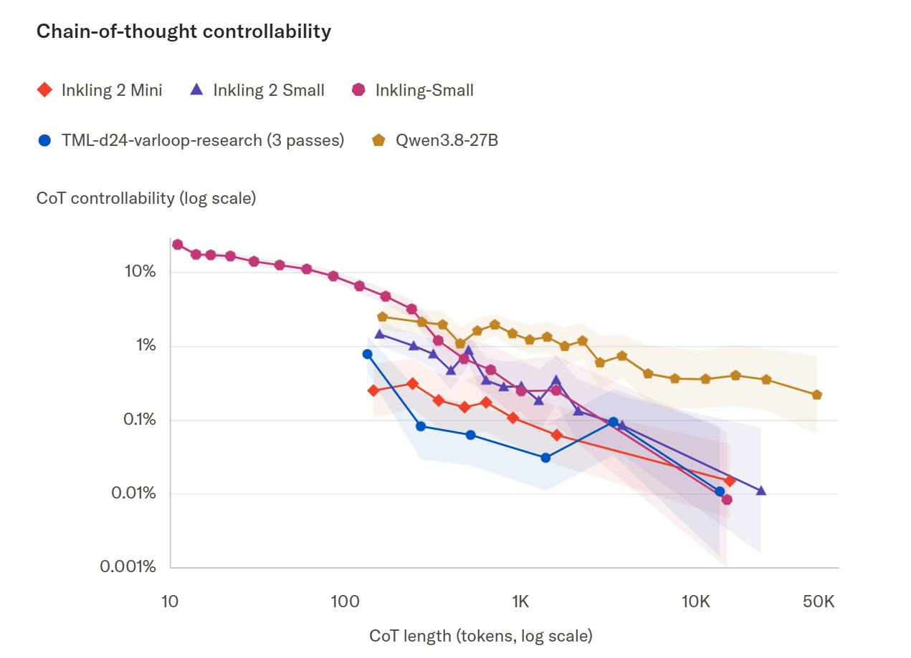

---

## 9. [Hydrilla](https://www.producthunt.com/products/hydrilla)
**Votes**: 97 | **도입 난이도**: 하 | **신뢰도**: 상
**Tagline**: Generate production-ready 3D assets with AI
**서비스 링크**: https://www.producthunt.com/r/YLLJRDLS4IHATL

**태그**: 3D, AI, GameDev, ContentCreation, AI Tool, Prompting, Design, DevTool

### 📌 이 서비스 한눈에 보기
텍스트 프롬프트만으로 즉시 사용 가능한 고품질 3D 에셋을 생성하는 AI 도구

### 🔑 주요 기능
- 단순한 프롬프트로 고품질 3D 모델 생성
- 게임 개발, 애니메이션, XR 제작을 위한 프로덕션급 품질 제공
- 에셋 제작 시간을 며칠에서 몇 분 단위로 단축

### 🙋 사용자에게 어떤 점이 좋은가
수작업 기반의 3D 모델링 시간을 획기적으로 줄여 콘텐츠 제작 파이프라인의 속도를 높일 수 있습니다.

### ✅ 지금 바로 써볼 기능
- 프롬프트를 입력하여 기본 3D 모델 생성해보기
- 생성된 모델의 폴리곤 구조 및 텍스처 품질 확인하기
- 워크플로우 적용을 위한 파일 포맷 호환성 테스트하기

### ⚠️ 사용 전 확인할 점
- 생성된 모델의 토폴로지(Topology)가 전문 작업용으로 적합한지 확인 필요
- 복잡한 구조나 특정 스타일의 정밀한 제어 가능 여부 검토 필요

### 🧭 확인이 더 필요한 정보
생성된 에셋의 파일 형식 지원 범위와 리깅(Rigging) 지원 여부에 대한 정보가 필요합니다.

### 📸 스크린샷 및 갤러리
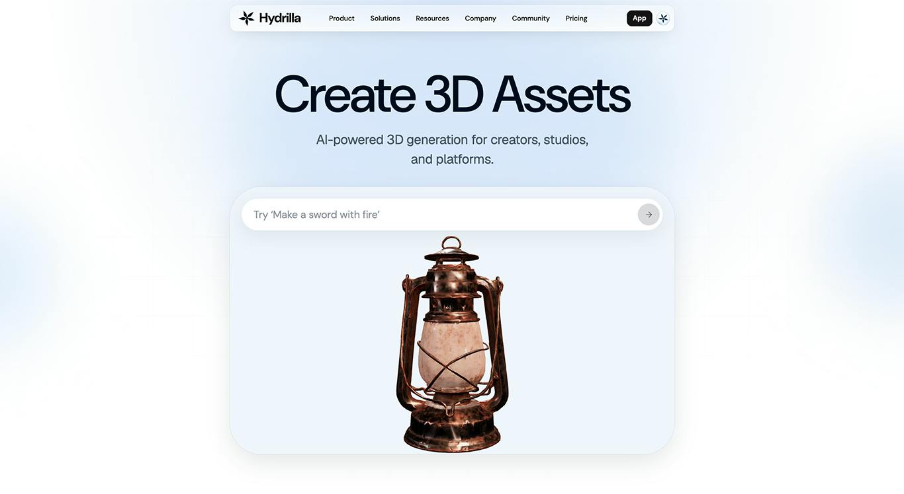
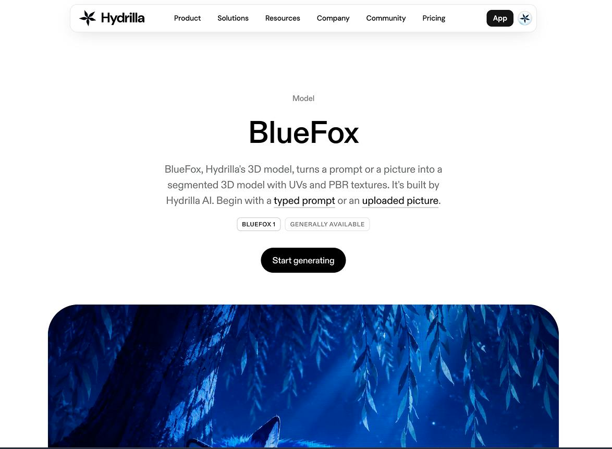
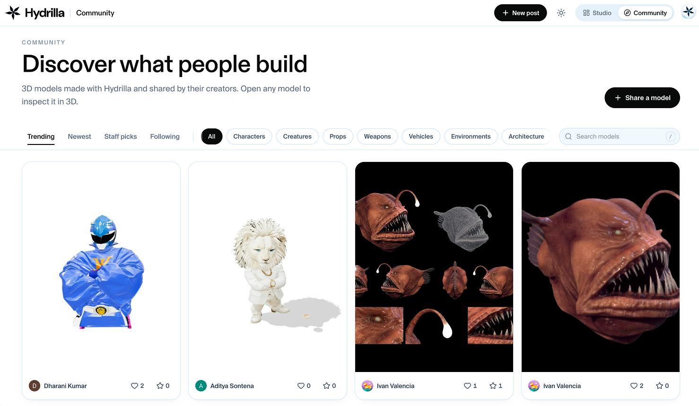

### 🎬 관련 영상
- [🎥 영상 보기](https://ph-files.imgix.net/1814a6d5-abed-485f-8966-fa7a6cfbc34f.jpeg?auto=format)

---

## 10. [Journalistic Tech](https://www.producthunt.com/products/journalistic-tech)
**Votes**: 91 | **도입 난이도**: 하 | **신뢰도**: 상
**Tagline**: Async interviews that get you published on HackerNoon
**서비스 링크**: https://www.producthunt.com/r/ERXD7JWZGTWCIQ

**태그**: ContentCreation, Journalism, TechWriting, PersonalBranding

### 📌 이 서비스 한눈에 보기
비동기 인터뷰를 통해 HackerNoon에 전문적인 기술 기사를 발행하는 서비스

### 🔑 주요 기능
- 273개의 기술 인터뷰 주제 중 본인에게 맞는 주제 매칭
- 음성 또는 텍스트로 약 13개의 질문에 답변하는 방식
- 답변을 바탕으로 초안 작성부터 편집, 배포까지 이어지는 워크플로우

### 🙋 사용자에게 어떤 점이 좋은가
전문적인 글쓰기 부담 없이 자신의 기술적 성과나 소식을 전 세계 기술 커뮤니티에 공식적으로 알릴 수 있습니다.

### ✅ 지금 바로 써볼 기능
- 자신의 전문 분야와 일치하는 인터뷰 주제 찾기
- 음성 또는 텍스트로 질문에 답변하기
- 편집자가 다듬은 최종 기사 확인 및 발행

### ⚠️ 사용 전 확인할 점
- 최종 결과물은 편집자의 검토를 거치므로 본인의 의도와 다를 수 있음
- 완전한 자유 집필이 아닌 질문 답변 형식에 국한됨

### 🧭 확인이 더 필요한 정보
편집 및 배포 과정에서 발생하는 비용이나 수익 배분 구조에 대한 정보가 명시되지 않았습니다.

### 📸 스크린샷 및 갤러리
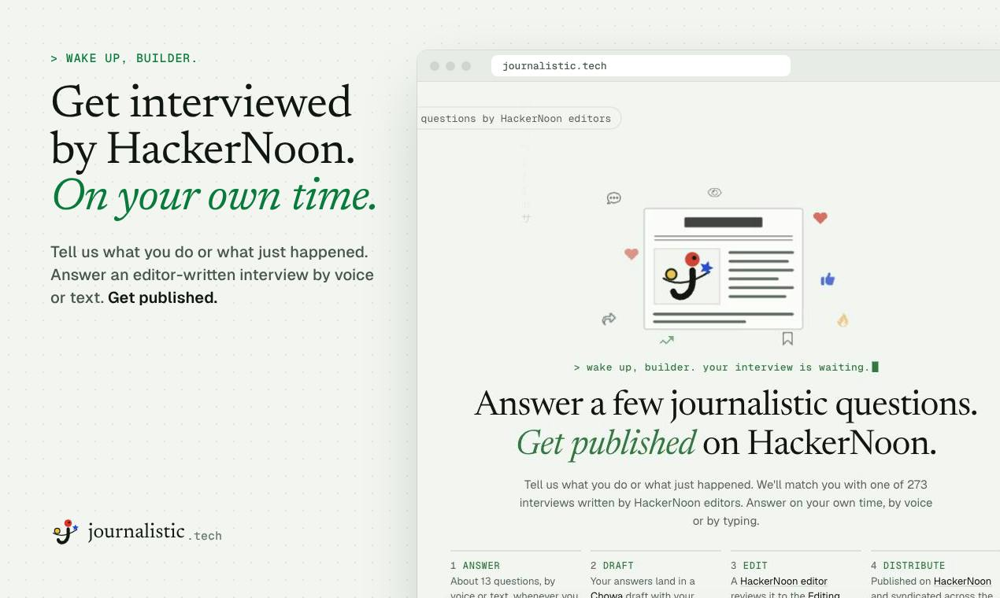
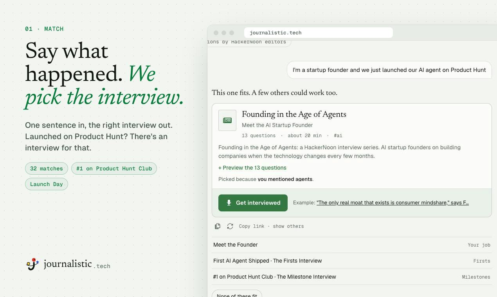
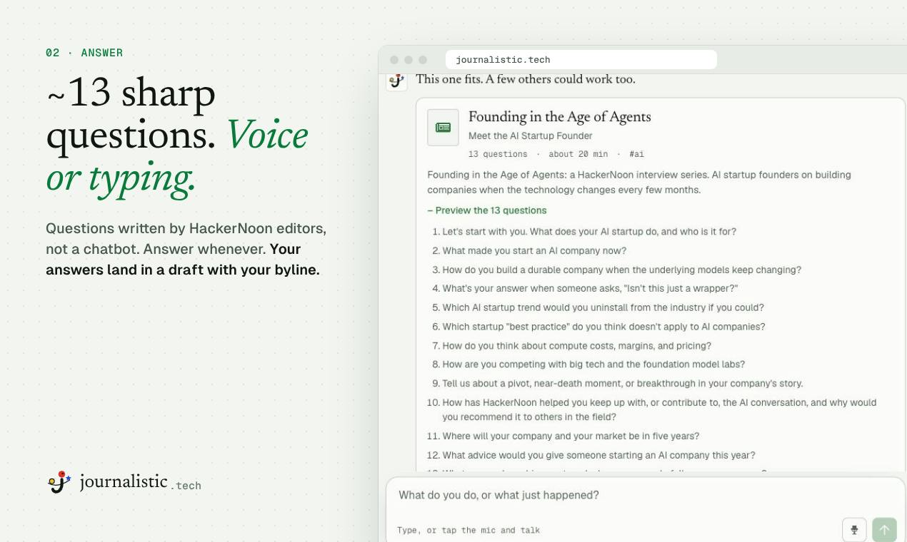

---

## 11. [Tesla Self-Driving V15](https://www.producthunt.com/products/tesla)
**Votes**: 88 | **도입 난이도**: 하 | **신뢰도**: 상
**Tagline**: Upgrading every part of the end-to-end driving network
**서비스 링크**: https://www.producthunt.com/r/4LP5G5GXVPZU6G

**태그**: Autonomous Driving, AI, Tesla, Smart Mobility

### 📌 이 서비스 한눈에 보기
안전성과 시각적 직관성을 극대화한 테슬라의 차세대 엔드투엔드 자율주행 시스템

### 🔑 주요 기능
- 안전 필수 상황에 대한 처리 능력 25배 향상
- 실시간 생성형 뷰를 통한 직관적인 주행 계획 확인 (Tesla Reality View)
- 도로 상황(표지판, 동물, 노면 상태 등) 감지 및 주행 제어 최적화

### 🙋 사용자에게 어떤 점이 좋은가
더 정교해진 주행 제어와 시각적 피드백을 통해 운전자가 시스템의 판단을 더 쉽게 이해하고 신뢰할 수 있습니다.

### ✅ 지금 바로 써볼 기능
- Tesla Reality View를 통해 FSD의 경로 계획 확인하기
- 새로운 시각화 모드(전체 화면, 지도, 분할 모드) 설정해보기
- 개선된 노면 및 장애물 감지 성능 테스트하기

### ⚠️ 사용 전 확인할 점
- 완전 자율주행이 아니므로 운전자의 상시 주시가 필요함
- 새로운 알고리즘 적용에 따른 초기 주행 이질감이 있을 수 있음

### 🧭 확인이 더 필요한 정보
V15 업데이트가 모든 하드웨어 사양에서 동일하게 지원되는지 확인이 필요합니다.

### 📸 스크린샷 및 갤러리

### 🎬 관련 영상
- [🎥 영상 보기](https://ph-files.imgix.net/mcp-draft-media/dbab7b03-d222-44d8-bc99-c6da732d4228.jpeg?auto=format)

---

## 12. [LeanTake](https://www.producthunt.com/products/leantake)
**Votes**: 88 | **도입 난이도**: 하 | **신뢰도**: 상
**Tagline**: 4.1 MB native Mac screen recorder — zero export wait
**서비스 링크**: https://www.producthunt.com/r/MJNZZBJ6ARRUB4

**태그**: Productivity, macOS, ScreenRecorder, Video, AI Tool, Prompting

### 📌 이 서비스 한눈에 보기
내보내기 대기 시간 없이 즉시 녹화가 완료되는 초경량 Mac 전용 화면 녹화 도구

### 🔑 주요 기능
- Apple Silicon 및 macOS 15+ 최적화된 4.1MB 초경량 네이티브 앱
- 하드웨어 인코딩을 통한 실시간 .mov 영상 저장 (중단 즉시 파일 완성)
- 펜 도구, 확대기, 3D 커서, 스텔스 프롬프터 등 실용적인 부가 기능 포함

### 🙋 사용자에게 어떤 점이 좋은가
녹화 종료 후 파일 변환을 기다릴 필요가 없어 작업 흐름이 끊기지 않으며, 워터마크나 로그인 없이 즉시 사용 가능합니다.

### ✅ 지금 바로 써볼 기능
- 녹화 중 12색 라이브 펜으로 강조하기
- 9가지 3D 고양이 발 커서를 활용한 개성 있는 화면 공유
- 윈도우 제외 기능을 활용한 스텔스 프롬프터 모드 테스트

### ⚠️ 사용 전 확인할 점
- macOS 15 이상 및 Apple Silicon 환경에서만 작동
- 구형 Intel 기반 Mac에서는 사용이 제한될 수 있음

### 🧭 확인이 더 필요한 정보
상세한 Pro 버전의 추가 기능 범위와 구형 macOS 지원 여부에 대한 정보가 필요합니다.

### 📸 스크린샷 및 갤러리
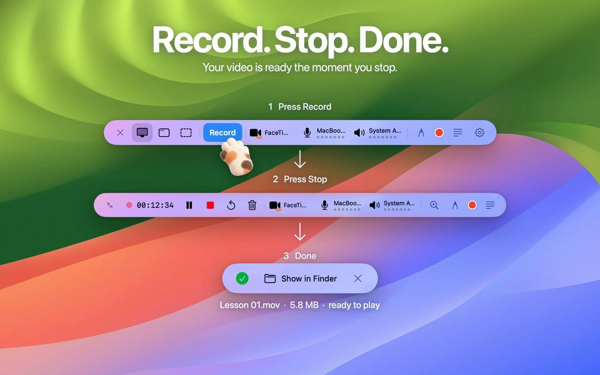
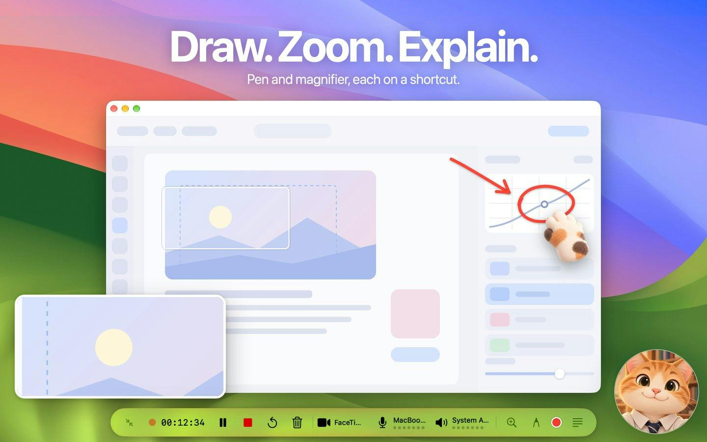
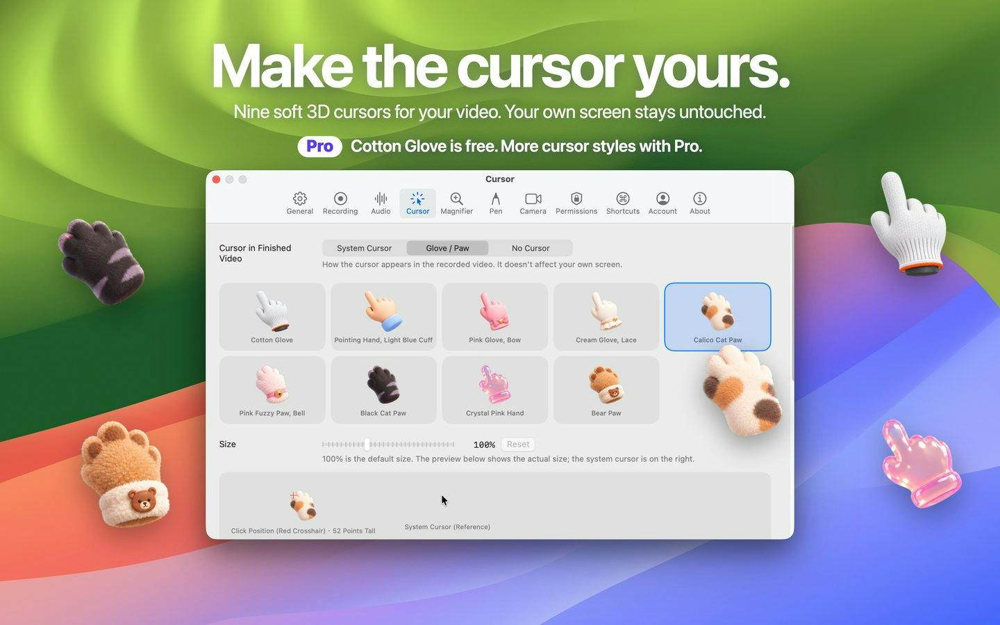

---

## 13. [Strict](https://www.producthunt.com/products/strict)
**Votes**: 87 | **도입 난이도**: 중 | **신뢰도**: 상
**Tagline**: Run GitHub Actions on any spare Mac or Linux machine
**서비스 링크**: https://www.producthunt.com/r/VMOX2C2RXO5VX2

**태그**: DevOps, CI/CD, Automation, Infrastructure, AI Tool

### 📌 이 서비스 한눈에 보기
유휴 Mac 및 Linux 기기를 활용한 비용 제로 GitHub Actions 러너 구축 도구

### 🔑 주요 기능
- 남는 Mac/Linux 기기를 자동 로드 밸런싱되는 GitHub Actions 플릿으로 전환
- Tailscale 기반의 네이티브 설정 및 계정 생성 불필요
- 7단계 디스크 정리 및 사전 점검(Preflight doctor) 기능 포함

### 🙋 사용자에게 어떤 점이 좋은가
추가적인 클라우드 비용 없이 집에 있는 구형 기기들을 활용해 강력한 CI/CD 인프라를 구축할 수 있습니다.

### ✅ 지금 바로 써볼 기능
- 보유 중인 유휴 Mac/Linux 기기에 설치하기
- Tailscale를 통한 네트워크 연결 설정하기
- 7단계 디스크 정리 기능을 통한 스토리지 관리하기

### ⚠️ 사용 전 확인할 점
- 유휴 기기의 하드웨어 성능 및 안정성에 따라 빌드 속도가 달라질 수 있음
- 로컬 네트워크 환경(Tailscale)에 대한 이해 필요

### 🧭 확인이 더 필요한 정보
하드웨어 사양에 따른 자동 스케일링 및 자가 치유(Self-healing)의 구체적인 작동 방식 확인이 필요합니다.

### 📸 스크린샷 및 갤러리
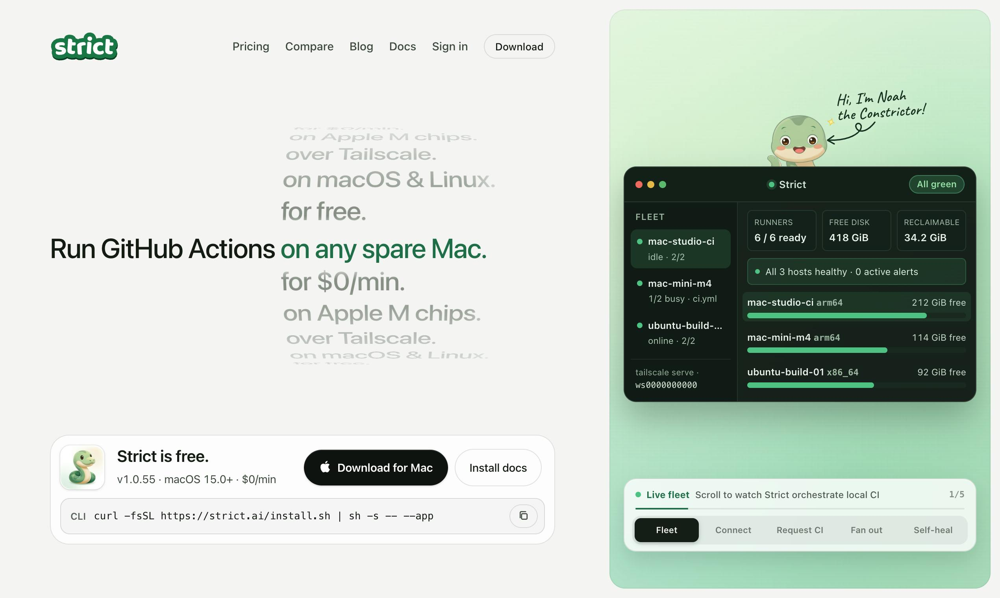
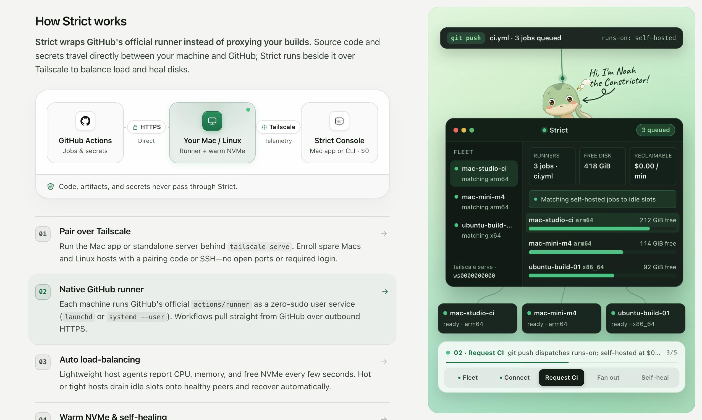
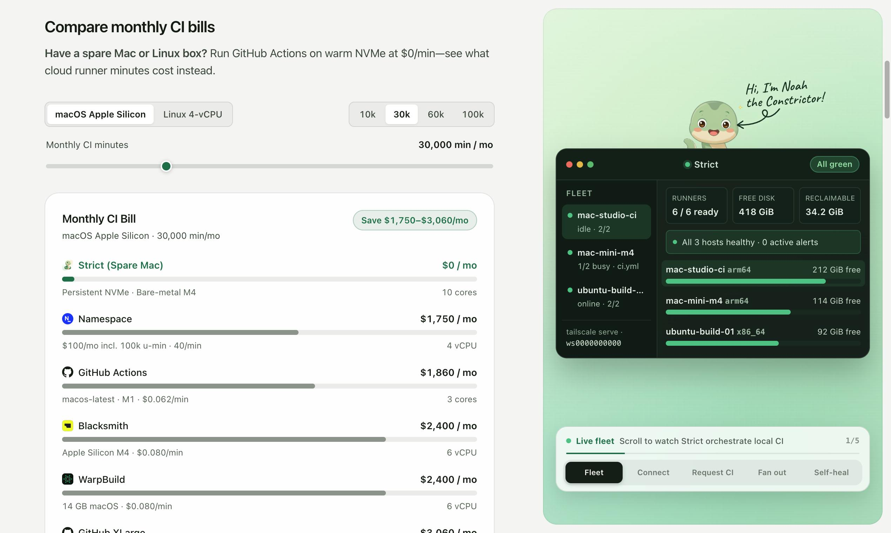

---

## 14. [Plango](https://www.producthunt.com/products/plango)
**Votes**: 86 | **도입 난이도**: 하 | **신뢰도**: 상
**Tagline**: Plango lets your AI agents work all night - safely
**서비스 링크**: https://www.producthunt.com/r/YBSB274ICF73IG

**태그**: Cybersecurity, AI-Agent, Privacy, Automation, Agent, AI Tool, Security

### 📌 이 서비스 한눈에 보기
AI 에이전트의 보안 위협으로부터 기기를 보호하는 온디바이스 보안 커맨드 센터

### 🔑 주요 기능
- 외부 AI 공격자의 취약점 악용 및 내부 AI의 위험한 행동 방지
- 취약점 조사 및 패치 프로세스 자동화
- 데이터 유출 걱정 없는 완전한 온디바이스(On-device) 실행

### 🙋 사용자에게 어떤 점이 좋은가
AI 에이전트를 활용하는 사용자가 보안 위협 없이 밤새 안전하게 자동화 작업을 수행할 수 있도록 돕습니다.

### ✅ 지금 바로 써볼 기능
- 현재 기기의 보안 취약점 진단 실행
- AI 에이전트 설정 보안 상태 점검
- 발견된 취약점 및 패치 가이드 확인

### ⚠️ 사용 전 확인할 점
- 온디바이스 실행 환경에서의 시스템 권한 필요 여부 확인
- 특정 운영체제나 하드웨어에 국한된 기능인지 확인

### 🧭 확인이 더 필요한 정보
제공되는 패치가 자동 적용되는지 아니면 사용자의 수동 조작이 필요한지 명확하지 않습니다.

### 📸 스크린샷 및 갤러리

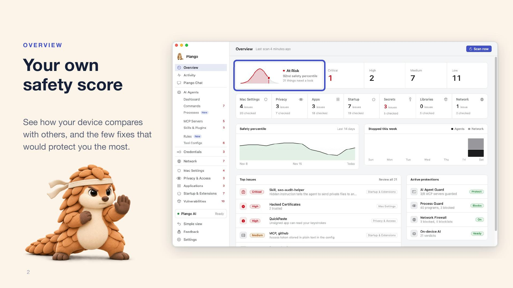
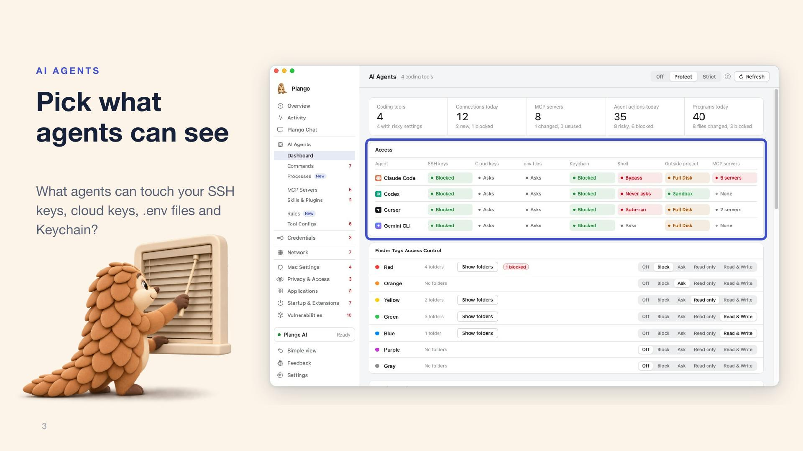

---

## 15. [naturefunding.org](https://www.producthunt.com/products/naturefunding-org)
**Votes**: 84 | **도입 난이도**: 하 | **신뢰도**: 상
**Tagline**: Grants for nature projects, checked against funder pages
**서비스 링크**: https://www.producthunt.com/r/KLJUSYH6UJFN6N

**태그**: Environment, Grants, OpenData, Directory, AI Tool

### 📌 이 서비스 한눈에 보기
자연 복원 및 보존 프로젝트를 위한 1,000개 이상의 지원금 정보를 제공하는 무료 디렉토리

### 🔑 주요 기능
- 숲, 해안, 습지, 야생동물 등 자연 보호 관련 1,000개 이상의 지원금 데이터 제공
- 모든 마감일, 금액, 자격 요건이 원본 기금 제공자의 페이지와 직접 연결됨
- 지역, 마감일, 신청 방식(직접, 파트너, 초청)에 따른 필터링 기능 제공

### 🙋 사용자에게 어떤 점이 좋은가
자연 보호 프로젝트를 운영하는 개인이나 단체가 신뢰할 수 있는 지원금을 빠르고 정확하게 찾을 수 있습니다.

### ✅ 지금 바로 써볼 기능
- 필터 기능을 사용하여 내 프로젝트에 맞는 지원금 검색하기
- 제공되는 링크를 통해 원본 기금 페이지에서 최종 자격 요건 확인하기
- 필요 시 JSON, CSV 또는 Atom 피드를 통해 데이터 다운로드하기

### ⚠️ 사용 전 확인할 점
- 데이터가 마지막으로 확인된 날짜를 기준으로 하므로, 실시간 업데이트 여부를 원본 페이지에서 재확인해야 함
- 지원금의 세부 조건이 변경되었을 가능성이 있으므로 최종 결정 전 반드시 기금 제공자 페이지 확인 필요

### 🧭 확인이 더 필요한 정보
데이터 업데이트 주기와 원본 페이지와의 동기화 빈도에 대한 구체적인 정보가 필요합니다.

### 📸 스크린샷 및 갤러리
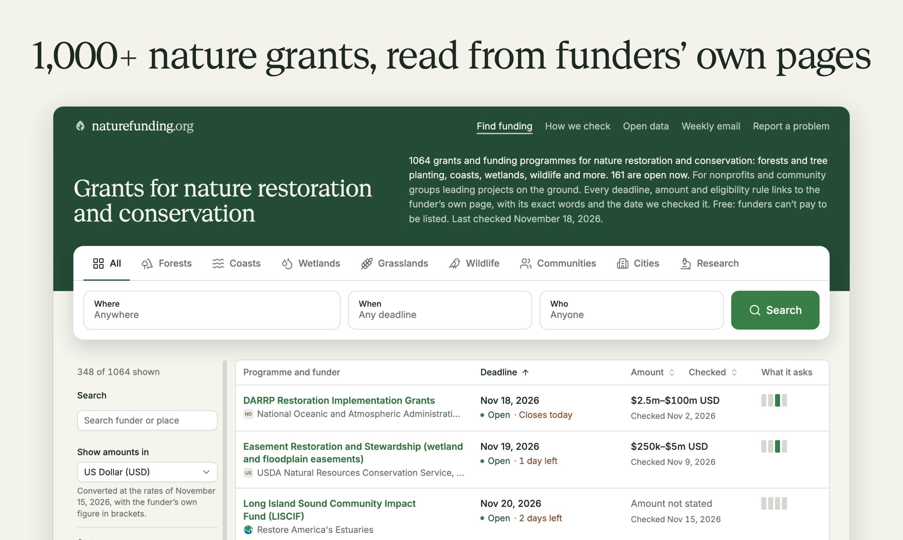
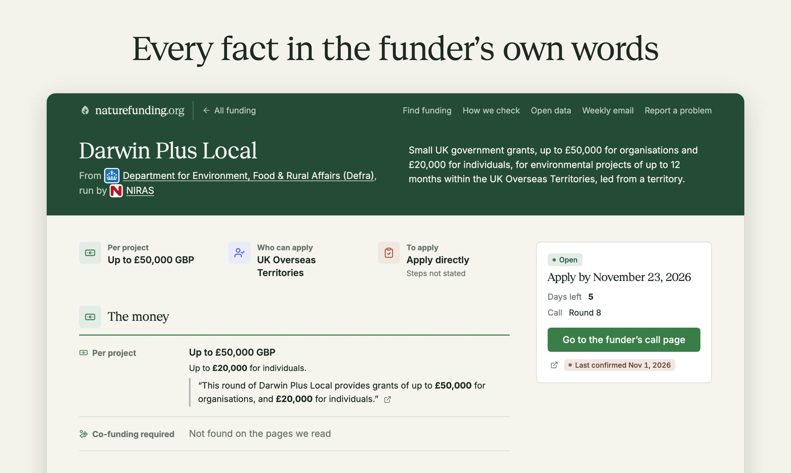
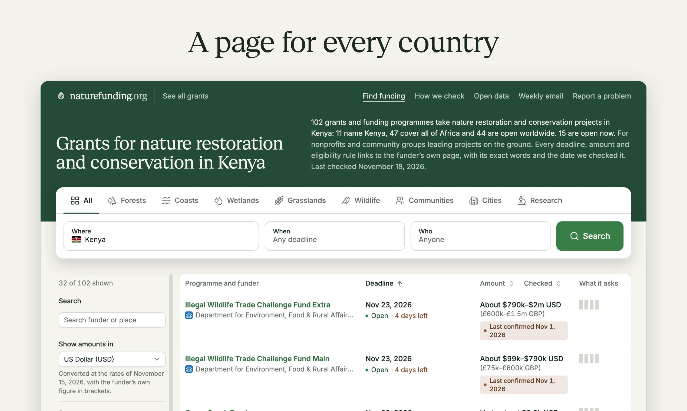

---

## 16. [Omi Work](https://www.producthunt.com/products/omi-work)
**Votes**: 83 | **도입 난이도**: 중 | **신뢰도**: 상
**Tagline**: Omi can build anything. Now it finds your next 100 customers
**서비스 링크**: https://www.producthunt.com/r/M4ERXOZGJQVAIT

**태그**: AI Agent, Automation, Productivity, Workflow, Agent, AI Tool

### 📌 이 서비스 한눈에 보기
복잡한 업무를 스스로 계획하고 실행하는 AI 에이전트 워크스페이스

### 🔑 주요 기능
- 목표 설정 시 계획 수립부터 하위 에이전트 분업까지 자동 수행
- 웹 검색, 앱 연동, 백그라운드 실행을 통한 지속적인 업무 처리
- 문서, 스프레드시트, 슬라이드 등 결과물 직접 생성 및 전달

### 🙋 사용자에게 어떤 점이 좋은가
사용자가 브라우저를 닫아도 AI가 계획에 따라 업무를 완수하므로, 반복적이고 복잡한 프로젝트 관리에 유용합니다.

### ✅ 지금 바로 써볼 기능
- 목표(Goal)를 입력하여 AI의 자동 계획 수립 기능 테스트하기
- 연동 가능한 앱을 연결하여 워크플로우 자동화 시도하기
- 생성된 문서 및 슬라이드 결과물 품질 확인하기

### ⚠️ 사용 전 확인할 점
- 에이전트의 자율적 실행 과정에서 발생할 수 있는 결과물 오류 검토 필요
- 외부 앱 연동 시 데이터 접근 권한 및 보안 설정 확인 필요

### 🧭 확인이 더 필요한 정보
구체적인 연동 가능한 앱 목록과 상세 보안 프로토콜에 대한 정보가 부족합니다.

### 📸 스크린샷 및 갤러리
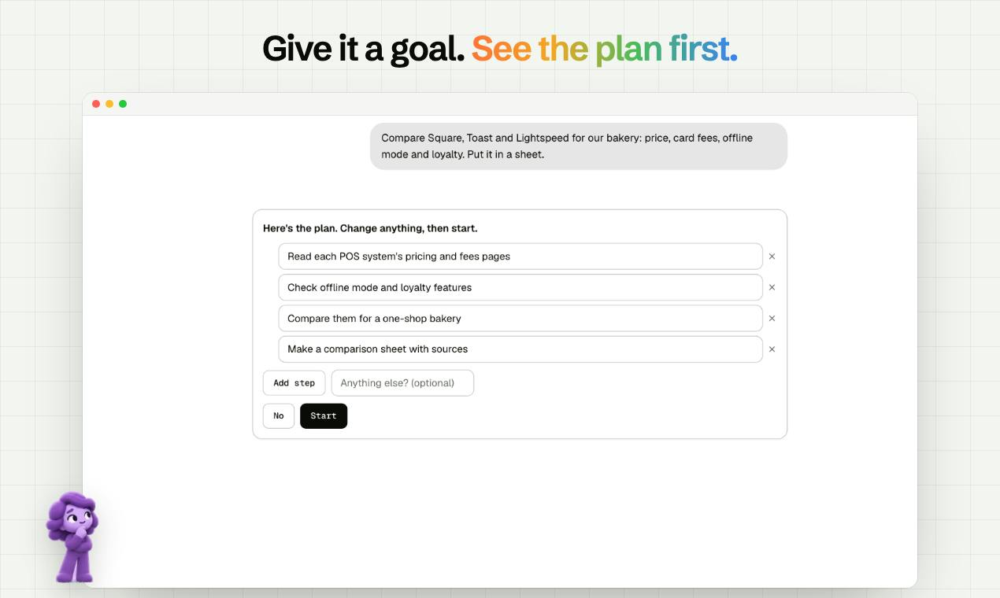
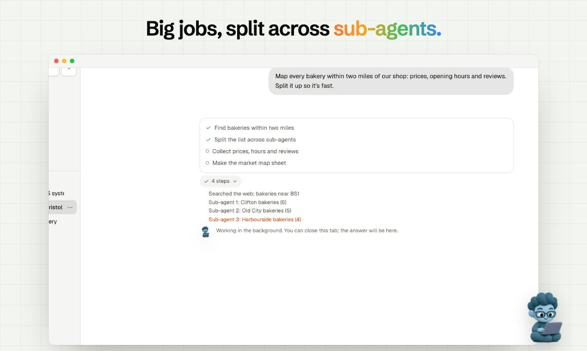
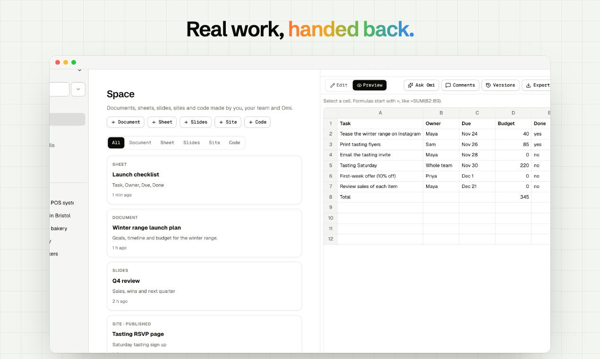

### 🎬 관련 영상
- [🎥 영상 보기](https://ph-files.imgix.net/mcp-draft-media/fd3226c4-b627-4581-b26b-0d9b5d6d09e0.jpeg?auto=format)

---

## 17. [Replit Missions](https://www.producthunt.com/products/replit)
**Votes**: 82 | **도입 난이도**: 중 | **신뢰도**: 상
**Tagline**: Set a budget, coordinate teams of AI agents,
**서비스 링크**: https://www.producthunt.com/r/TDH4FSFWJH5AA7

**태그**: AI Agents, Automation, Project Management, DevTool, Agent, AI Tool

### 📌 이 서비스 한눈에 보기
예산 설정과 AI 에이전트 협업을 통해 복잡한 목표를 결과물로 전환하는 자동화 도구

### 🔑 주요 기능
- 예산 설정을 통한 효율적인 리소스 관리
- 다수의 AI 에이전트 팀 코디네이션
- 명확한 성공 기준에 따른 진행 상황 검토

### 🙋 사용자에게 어떤 점이 좋은가
사용자는 복잡한 프로젝트를 AI 에이전트 팀에게 위임하고, 설정한 예산과 목표에 따라 결과물을 관리할 수 있습니다.

### ✅ 지금 바로 써볼 기능
- 목표 달성을 위한 예산 설정하기
- AI 에이전트 팀 구성 및 작업 할당
- 설정된 성공 기준에 따른 결과물 검토

### ⚠️ 사용 전 확인할 점
- AI 에이전트의 작업 결과가 설정한 성공 기준을 충족하는지 지속적인 모니터링 필요
- 예산 관리 방식에 따른 비용 발생 가능성 확인 필요

### 🧭 확인이 더 필요한 정보
AI 에이전트의 구체적인 작업 범위와 예산 집행 방식에 대한 상세 정보가 필요합니다.

### 📸 스크린샷 및 갤러리
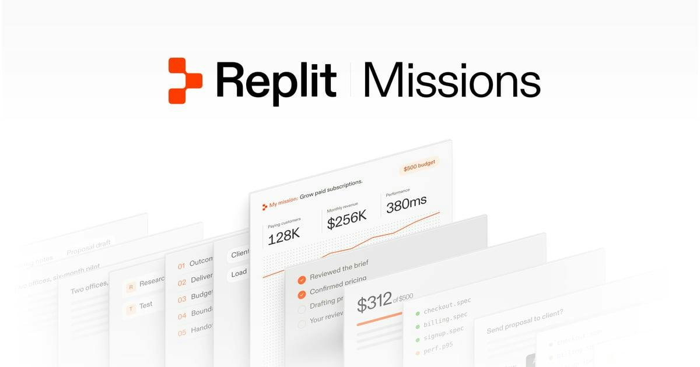

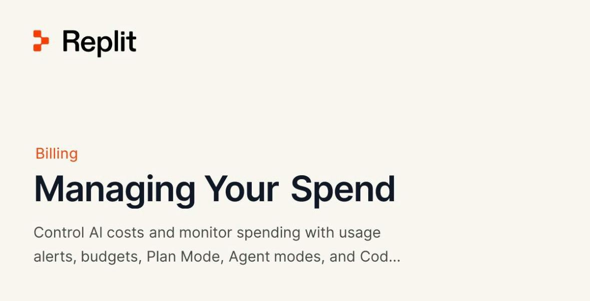

### 🎬 관련 영상
- [🎥 영상 보기](https://ph-files.imgix.net/755d03c4-f529-455d-8594-fc5a10e0d61f.jpeg?auto=format)

---

## 18. [Othor AI](https://www.producthunt.com/products/othor-ai)
**Votes**: 82 | **도입 난이도**: 중 | **신뢰도**: 상
**Tagline**: Your Head of Intelligence. Know what your numbers are hiding
**서비스 링크**: https://www.producthunt.com/r/CB4247BWVHVFRX

**태그**: BI, Automation, OpenSource, DataAnalysis, AI Tool, DevTool

### 📌 이 서비스 한눈에 보기
정보기관의 분석 기법을 결합하여 데이터 속 숨겨진 신호를 포착하는 자동화된 비즈니스 인텔리전스 솔루션

### 🔑 주요 기능
- 정보기관의 분석 기법과 신호 분석 기술을 결합한 차세대 BI
- AI의 언어 생성 능력과 코드 기반의 정밀한 수치 계산 결합
- 오픈 소스(Apache-2.0) 기반으로 호스팅 또는 자체 서버 설치 가능

### 🙋 사용자에게 어떤 점이 좋은가
수동 분석 없이도 데이터 속 핵심 신호를 빠르게 파악하여 의사결정 속도를 높이고 AI 운영 비용을 최소화할 수 있습니다.

### ✅ 지금 바로 써볼 기능
- 데이터 소스 연결 및 자동 통계 분석 실행
- AI가 생성한 분석 리포트 검토
- 과거 데이터 재현(Replay) 기능을 통한 분석 검증

### ⚠️ 사용 전 확인할 점
- 코드 기반 계산 방식에 대한 사용자 숙련도 필요성
- 자체 서버 설치 시 인프라 관리 역량 필요

### 🧭 확인이 더 필요한 정보
구체적인 데이터 소스 연동 범위와 데이터 보안 프로토콜에 대한 상세 정보가 필요합니다.

### 📸 스크린샷 및 갤러리
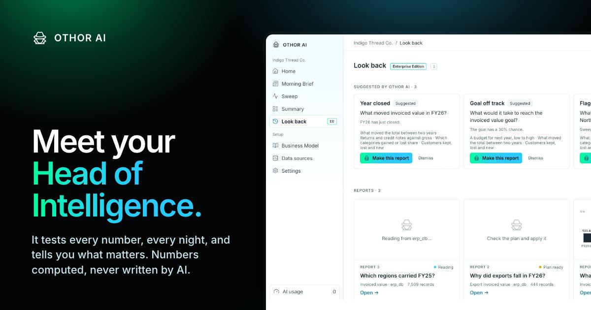
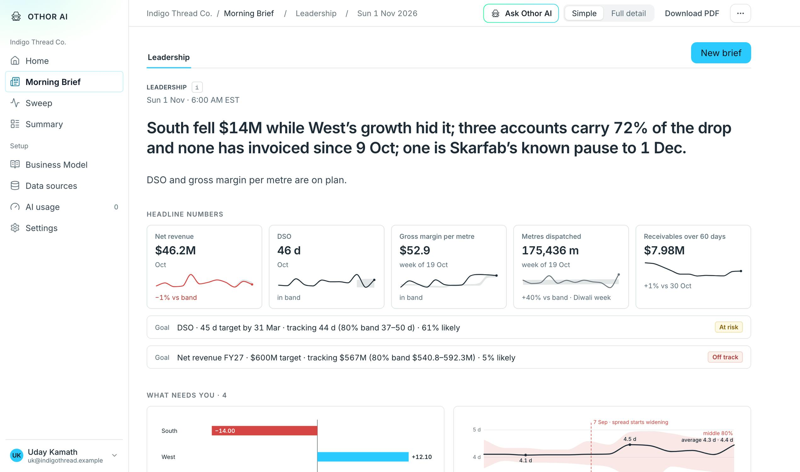
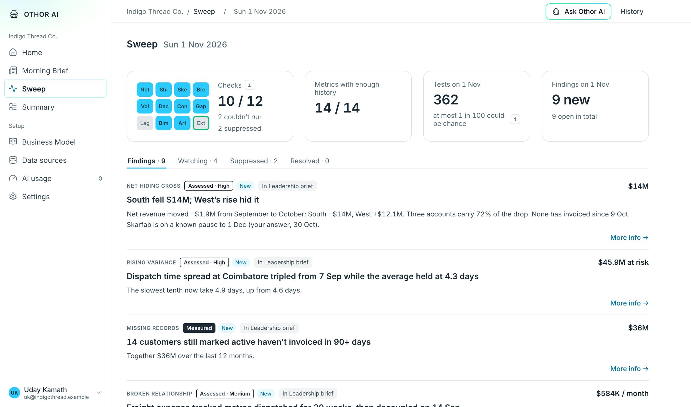

---

## 19. [freddy](https://www.producthunt.com/products/freddy)
**Votes**: 82 | **도입 난이도**: 중 | **신뢰도**: 상
**Tagline**: Private health data server: talk to your health with any AI
**서비스 링크**: https://www.producthunt.com/r/DRT2MUJLMD3RNE

**태그**: HealthTech, DataHub, AI, PersonalHealth, AI Tool

### 📌 이 서비스 한눈에 보기
모든 건강 데이터를 한곳에 모아 AI와 대화할 수 있게 해주는 개인용 헬스 데이터 서버

### 🔑 주요 기능
- 웨어러블, 혈당계, 앱, 검사 결과 등 다양한 건강 데이터 통합 관리
- 데이터 원본 값을 그대로 유지하는 신뢰할 수 있는 데이터 서버
- 수집된 데이터를 외부 AI와 연동하거나 직접 내보내기 가능

### 🙋 사용자에게 어떤 점이 좋은가
여러 곳에 흩어진 건강 데이터를 하나로 통합하여, AI를 통해 자신의 건강 상태를 쉽게 분석하고 관리할 수 있습니다.

### ✅ 지금 바로 써볼 기능
- 웨어러블 및 건강 앱(Apple Health, Health Connect 등) 연동하기
- 개인 건강 검사 결과 데이터 추가하기
- 연동된 데이터를 AI와 연결하여 건강 상담 시도하기

### ⚠️ 사용 전 확인할 점
- 민감한 개인 건강 정보가 포함되므로 보안 및 개인정보 보호 정책 확인 필요
- 외부 AI 서비스 사용 시 데이터 유출 위험성 고려 필요

### 🧭 확인이 더 필요한 정보
데이터 보안 방식과 외부 AI 서비스와의 구체적인 연동 방식에 대한 상세 정보가 필요합니다.

### 📸 스크린샷 및 갤러리
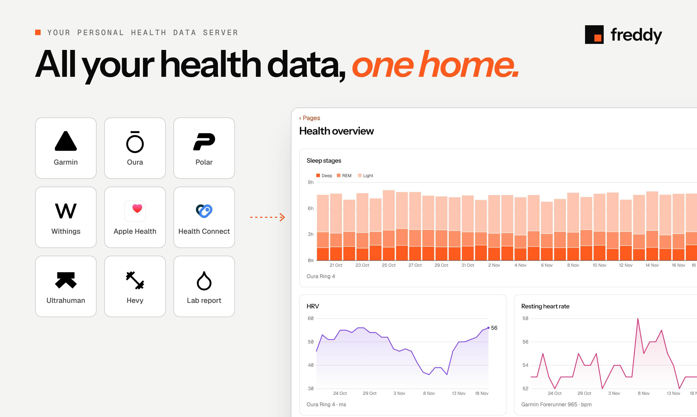
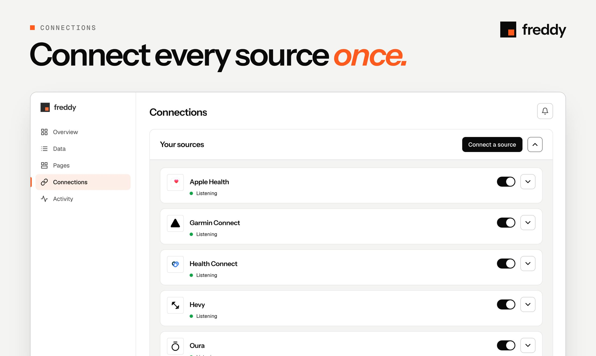
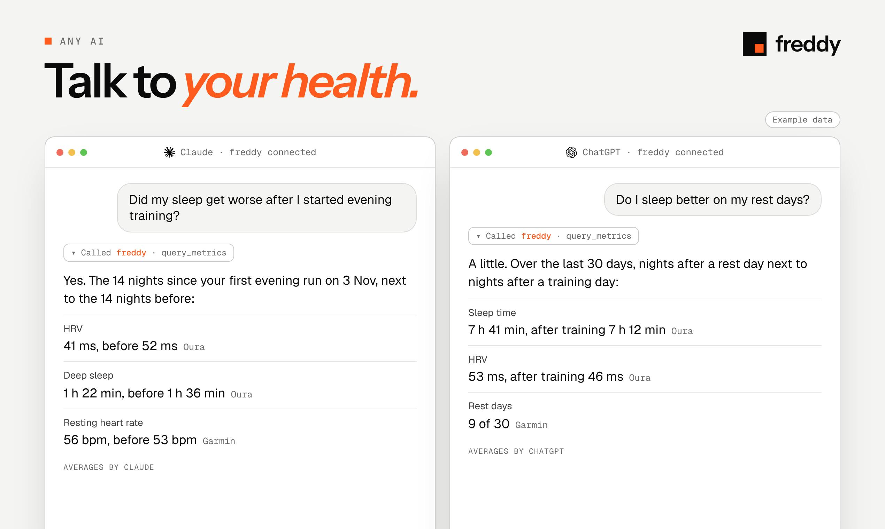

### 🎬 관련 영상
- [🎥 영상 보기](https://ph-files.imgix.net/mcp-draft-media/a37f82fb-33a6-4702-8ab9-b8b1e8381ff9.jpeg?auto=format)

---

## 20. [Ashwa](https://www.producthunt.com/products/ashwa)
**Votes**: 80 | **도입 난이도**: 하 | **신뢰도**: 상
**Tagline**: Your AI companion that never forgets what you say
**서비스 링크**: https://www.producthunt.com/r/CT2RNDPTLAGHON

**태그**: AI Companion, Journaling, Personalization, Productivity, AI Tool

### 📌 이 서비스 한눈에 보기
과거의 대화를 기억하여 맥락 있는 대화와 일기 작성을 돕는 AI 동반자

### 🔑 주요 기능
- 장기 기억력을 바탕으로 과거 대화 및 일기 내용 기억
- 반복적인 설명 없이 이전 맥락에서 대화 이어가기 가능
- 사용자의 감정적 맥락을 반영한 개인화된 응답 제공

### 🙋 사용자에게 어떤 점이 좋은가
사용자의 일상과 감정을 기억하므로, 매번 상황을 설명할 필요 없이 깊이 있는 대화와 성찰이 가능합니다.

### ✅ 지금 바로 써볼 기능
- 오늘의 일상이나 감정 기록하기
- 과거에 나눈 대화 내용에 대해 질문하기
- 개인적인 고민이나 생각 나누기

### ⚠️ 사용 전 확인할 점
- 개인적인 일기와 대화 내용이 저장되므로 데이터 보안 및 프라이버시 정책 확인 필요
- 기억 저장 방식에 따른 데이터 관리 정책 확인 필요

### 🧭 확인이 더 필요한 정보
사용자의 민감한 개인 정보가 어떻게 암호화되고 보호되는지에 대한 구체적인 보안 기술 정보가 필요합니다.

### 📸 스크린샷 및 갤러리
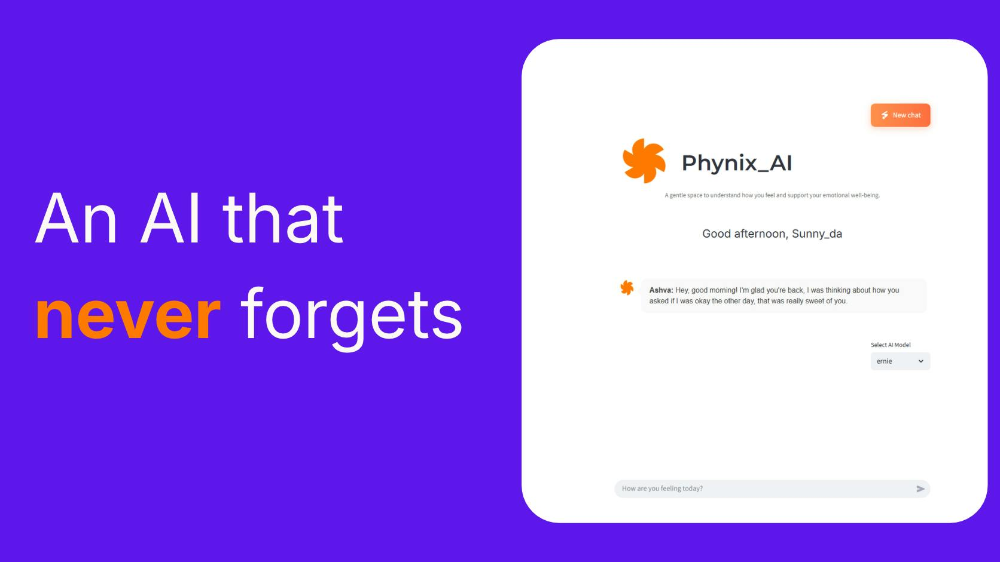
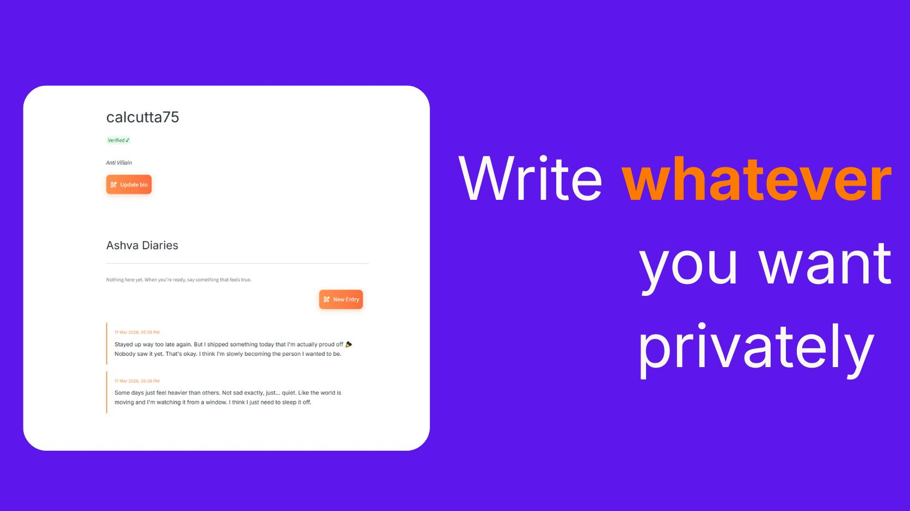

### 🎬 관련 영상
- [🎥 영상 보기](https://ph-files.imgix.net/7d174a69-69ee-4237-ab1f-80462931ee16.jpeg?auto=format)

---

## 21. [Snowly](https://www.producthunt.com/products/snowly-2)
**Votes**: 75 | **도입 난이도**: 하 | **신뢰도**: 상
**Tagline**: Plan ski trips with friends. Remember every run.
**서비스 링크**: https://www.producthunt.com/r/RGBITCFOHZQFKD

**태그**: Travel, Outdoor, Lifestyle, iOS, AI Tool

### 📌 이 서비스 한눈에 보기
친구들과 함께 스키 여행을 계획하고 모든 활주 기록을 자동으로 저장하는 앱

### 🔑 주요 기능
- 친구들과 함께하는 스키/스노보드 여행 계획 및 실시간 위치 확인
- 애플 워치를 통한 자동 활주 기록 및 스키 패스포트 기능
- 광고 없는 무료 서비스 및 실시간 스노우 체크

### 🙋 사용자에게 어떤 점이 좋은가
친구들과의 스키 여행을 체계적으로 계획할 수 있으며, 별도의 조작 없이도 모든 활주 기록이 자동으로 저장되어 여행의 추억을 간편하게 관리할 수 있습니다.

### ✅ 지금 바로 써볼 기능
- 애플 워치와 연동하여 자동 기록 기능 테스트하기
- 친구들을 초대하여 트레일 맵에서 크루 위치 확인하기
- 여행 전 실시간 스노우 체크 기능 활용하기

### ⚠️ 사용 전 확인할 점
- iPhone 및 Apple Watch 환경에 최적화되어 있어 타 OS 사용 시 제약이 있을 수 있음
- 자동 기록 기능의 정확도를 위해 웨어러블 기기 착용 필수

### 🧭 확인이 더 필요한 정보
애플 워치 외의 다른 스마트워치나 안드로이드 기기와의 호환 여부는 명시되지 않았습니다.

### 📸 스크린샷 및 갤러리

---

## 22. [Spikely](https://www.producthunt.com/products/spikely)
**Votes**: 75 | **도입 난이도**: 하 | **신뢰도**: 상
**Tagline**: Startup Metric Alerts for iPhone, Mac and Apple Watch
**서비스 링크**: https://www.producthunt.com/r/RTYB37H3VW4FYC

**태그**: SaaS, Monitoring, Alerts, Startup, Productivity, Sales

### 📌 이 서비스 한눈에 보기
주요 비즈니스 지표의 이상 징후를 실시간으로 감지하여 Apple 기기로 알려주는 스타트업용 알림 서비스

### 🔑 주요 기능
- Stripe, Vercel, PostHog 등 주요 도구와 연동하여 데이터 모니터링
- 머신러닝 기반의 패턴 학습을 통한 지표 이상 징후 감지
- 문제 발생 시 원인(배포, 에러, 리퍼러 등)을 포함한 즉각적인 알림 제공

### 🙋 사용자에게 어떤 점이 좋은가
매번 대시보드를 확인할 필요 없이, 지표가 평소와 다르게 움직일 때만 즉시 알림을 받아 빠른 의사결정과 대응이 가능합니다.

### ✅ 지금 바로 써볼 기능
- 사용 중인 주요 툴(Stripe, Vercel 등) 연동하기
- 기본 지표 패턴 학습 대기하기
- iPhone 및 Apple Watch 알림 설정하기

### ⚠️ 사용 전 확인할 점
- 데이터 연동 시 보안 및 권한 설정 확인 필요
- 학습 데이터가 충분히 쌓이기 전까지는 오탐(False Positive)이 발생할 수 있음

### 🧭 확인이 더 필요한 정보
지원하는 16개 이상의 도구 목록과 구체적인 데이터 보안 정책에 대한 확인이 필요합니다.

### 📸 스크린샷 및 갤러리

### 🎬 관련 영상
- [🎥 영상 보기](https://ph-files.imgix.net/c8ad57a0-c9f0-46d1-b096-081825f4d590.jpeg?auto=format)

---

## 23. [Mobile Agent Testers](https://www.producthunt.com/products/mobile-agent-testers)
**Votes**: 73 | **도입 난이도**: 중 | **신뢰도**: 상
**Tagline**: Free open-source AI agents that beta-test your app on phones
**서비스 링크**: https://www.producthunt.com/r/2C2HXU42PFYG6O

**태그**: DevTool, Automation, QA, OpenSource, Mobile, Agent, AI Tool

### 📌 이 서비스 한눈에 보기
다양한 페르소나를 가진 AI 에이전트가 실제 모바일 환경에서 앱을 직접 테스트하고 버그 리포트를 작성하는 오픈소스 도구

### 🔑 주요 기능
- 테스트 스크립트 작성 없이 AI 에이전트가 사용자처럼 앱을 직접 조작
- 다양한 기기(iOS/Android), 언어, 화면 크기 등 실제 사용자 환경 시뮬레이션
- GitHub Actions 기반의 클라우드 환경에서 스크린샷을 포함한 버그 리포트 자동 생성

### 🙋 사용자에게 어떤 점이 좋은가
수동으로 하기 번거로운 다양한 기기 및 언어별 UI/UX 테스트를 자동화하여 배포 전 잠재적 버그를 빠르게 발견할 수 있습니다.

### ✅ 지금 바로 써볼 기능
- GitHub Actions 환경에 에이전트 설정하기
- 다양한 언어 및 화면 크기 페르소나 적용해보기
- 생성된 버그 리포트와 스크린샷 검토하기

### ⚠️ 사용 전 확인할 점
- 에이전트의 판단에 의존하므로 생성된 버그 리포트의 정확성 검증 필요
- GitHub Actions 리소스 사용량 및 실행 시간에 따른 비용 발생 가능성

### 🧭 확인이 더 필요한 정보
사용자의 앱 규모나 복잡도에 따른 에이전트의 테스트 커버리지 범위를 확인해야 합니다.

### 📸 스크린샷 및 갤러리

### 🎬 관련 영상
- [🎥 영상 보기](https://ph-files.imgix.net/mcp-draft-media/c5c38867-e119-4764-88a8-e0b338a8c0d0.jpeg?auto=format)

---

## 24. [Orpheus](https://www.producthunt.com/products/orpheus-2)
**Votes**: 71 | **도입 난이도**: 하 | **신뢰도**: 상
**Tagline**: Run all your Claude subscriptions from one place
**서비스 링크**: https://www.producthunt.com/r/KDCSUR3A623FF7

**태그**: AI, Productivity, Collaboration, Management, Agent, Chat

### 📌 이 서비스 한눈에 보기
여러 개의 Claude 구독을 하나의 대시보드에서 통합 관리하고 팀과 협업하는 도구

### 🔑 주요 기능
- 여러 Claude 구독의 사용량(주간/5시간 단위) 및 리셋 일정 통합 관리
- 유휴 에이전트를 여유 있는 계정으로 이동하여 효율적 자원 배분
- 팀원과 에이전트가 함께 소통할 수 있는 'Rooms' 기능 제공

### 🙋 사용자에게 어떤 점이 좋은가
여러 계정의 사용량 제한을 효율적으로 관리하고, 팀원들이 에이전트와 원활하게 협업할 수 있는 환경을 제공합니다.

### ✅ 지금 바로 써볼 기능
- 현재 보유한 Claude 구독 계정 연결하기
- 사용량 예측 및 리셋 일정 확인하기
- 팀 협업을 위한 Rooms 생성하기

### ⚠️ 사용 전 확인할 점
- 여러 계정의 구독 정보를 통합하는 과정에서의 보안 및 접근 권한 확인 필요
- Claude API 또는 계정 정책에 따른 기능 제한 가능성

### 🧭 확인이 더 필요한 정보
다양한 Claude 구독 플랜(Pro, Team 등)에 대한 구체적인 지원 범위와 계정 연동 방식에 대한 확인이 필요합니다.

### 📸 스크린샷 및 갤러리

---

## 25. [ExtraBar](https://www.producthunt.com/products/extrabar)
**Votes**: 70 | **도입 난이도**: 하 | **신뢰도**: 상
**Tagline**: Build a custom menu bar for your Mac
**서비스 링크**: https://www.producthunt.com/r/T32AJENA7NVI5Z

**태그**: Productivity, macOS, Customization

### 📌 이 서비스 한눈에 보기
자주 사용하는 앱 위주로 맥 메뉴 바를 직접 구성하는 커스텀 메뉴 바 빌더

### 🔑 주요 기능
- 사용하지 않는 아이콘으로 가득 찬 메뉴 바 정리
- 자주 사용하는 앱 위주의 맞춤형 메뉴 바 구축
- 중요한 기능이 메뉴 속에 숨겨지는 문제 해결

### 🙋 사용자에게 어떤 점이 좋은가
불필요한 아이콘을 줄이고 작업에 꼭 필요한 기능만 메뉴 바에 배치하여 맥 사용 효율을 높일 수 있습니다.

### ✅ 지금 바로 써볼 기능
- 현재 메뉴 바에 있는 불필요한 아이콘 정리하기
- 자주 쓰는 앱 위주로 메뉴 바 레이아웃 구성하기
- 사용자 맞춤형 메뉴 바 환경 설정하기

### ⚠️ 사용 전 확인할 점
- 기존 메뉴 바 아이콘과의 호환성 확인 필요
- 메뉴 바 공간 제약에 따른 구성 제약 가능성

### 🧭 확인이 더 필요한 정보
상세한 기능 구성 방식과 기존 앱과의 연동 방식에 대한 구체적인 정보가 부족합니다.

### 📸 스크린샷 및 갤러리

### 🎬 관련 영상
- [🎥 영상 보기](https://ph-files.imgix.net/mcp-draft-media/ec3c30f6-28b8-4f05-a7e6-2f694b2235fd.jpeg?auto=format)

---

## 26. [Open Source Solana Wallet](https://www.producthunt.com/products/open-source-solana-wallet)
**Votes**: 68 | **도입 난이도**: 중 | **신뢰도**: 상
**Tagline**: Your own keys, your very own network
**서비스 링크**: https://www.producthunt.com/r/2EUXVWXA4DRNN6

**태그**: Wallet, Solana, OpenSource, Privacy, iOS

### 📌 이 서비스 한눈에 보기
백엔드 없이 사용자가 직접 RPC를 연결하여 자산과 프라이버시를 완벽히 통제하는 오픈소스 솔라나 지갑

### 🔑 주요 기능
- 백엔드 서버 없이 선택한 RPC(공용, 개인용, 커스텀 URL)에 직접 연결
- SOL, USDC, USDT 등 주요 자산에 대한 프라이버시 보호 및 스팸 토큰 차단
- iOS/iPadOS 최적화 및 멀티 윈도우 지원, 커스텀 테마 기능 제공

### 🙋 사용자에게 어떤 점이 좋은가
중앙화된 서버를 거치지 않아 보안성이 높으며, 사용자가 직접 네트워크 노드를 관리함으로써 자산과 데이터에 대한 완전한 주권을 가질 수 있습니다.

### ✅ 지금 바로 써볼 기능
- 자신이 신뢰하는 RPC 엔드포인트 설정하기
- 필요한 토큰만 추가하여 깔끔한 자산 목록 유지하기
- iPad 환경에서 멀티 윈도우 기능 활용해보기

### ⚠️ 사용 전 확인할 점
- 사용자가 직접 RPC를 설정해야 하므로 잘못된 엔드포인트 사용 시 보안 위험 발생 가능
- 백엔드가 없으므로 네트워크 연결 상태에 따라 서비스 안정성이 결정됨

### 🧭 확인이 더 필요한 정보
사용자가 직접 설정하는 RPC 노드의 보안 수준에 따라 전체 지갑의 보안성이 결정됩니다.

### 📸 스크린샷 및 갤러리

---

## 27. [Jot](https://www.producthunt.com/products/jot-15)
**Votes**: 66 | **도입 난이도**: 하 | **신뢰도**: 상
**Tagline**: One key for everything you do with text
**서비스 링크**: https://www.producthunt.com/r/SF3P24RGZUU5KX

**태그**: Productivity, Automation, Text-Tool, Workflow, AI Tool, Email

### 📌 이 서비스 한눈에 보기
단축키 하나로 텍ively 텍스트 편집, 번역, 요약을 해결하는 올인원 텍스트 도구

### 🔑 주요 기능
- 어떤 앱에서든 텍스트를 선택하고 단축키 하나로 70가지 이상의 작업 수행
- 요약, 번역, 리마인더 생성, 이메일 변환 등 강력한 텍스트 처리 기능
- 과거에 복사했던 모든 기록을 검색할 수 있는 히스토리 기능

### 🙋 사용자에게 어떤 점이 좋은가
반복적인 텍스트 작업(복사, 붙여넣기, 편집) 시간을 획기적으로 줄여 업무 효율을 높여줍니다.

### ✅ 지금 바로 써볼 기능
- 복사한 텍스트를 즉시 이메일이나 워드 파일로 변환하기
- 긴 글을 단축키로 빠르게 요약하거나 번역하기
- 과거에 복사했던 중요한 정보를 검색하여 찾기

### ⚠️ 사용 전 확인할 점
- 개인정보나 보안이 중요한 텍스처를 처리할 때 데이터 처리 방식 확인 필요
- 단축키 충돌 여부 확인 필요

### 🧭 확인이 더 필요한 정보
지원하는 운영체제(Windows, macOS 등)와 상세한 보안 정책에 대한 정보가 명시되지 않았습니다.

### 📸 스크린샷 및 갤러리

### 🎬 관련 영상
- [🎥 영상 보기](https://ph-files.imgix.net/a91b2b5b-ed63-46ee-9982-edd905ee8054.jpeg?auto=format)

---

## 28. [MAI Image 2.7](https://www.producthunt.com/products/mai-image-2-3)
**Votes**: 59 | **도입 난이도**: 하 | **신뢰도**: 상
**Tagline**: Microsoft's image model with precise edits and Canvas
**서비스 링크**: https://www.producthunt.com/r/33YB7677N3QADD

**태그**: Design, AI-Image, Microsoft, Creative-Tools, AI Tool, Prompting, Vision

### 📌 이 서비스 한눈에 보기
정교한 편집과 캔버스 기능을 갖춘 Microsoft의 차세대 이미지 생성 및 편집 모델

### 🔑 주요 기능
- 객체의 색상, 재질, 위치를 주변 배경 손상 없이 정교하게 변경 가능
- 로고 및 제품 이미지를 위한 투명 배경 출력 지원
- Flash 모델 기반의 Canvas 기능을 통해 프롬프트와 스케치를 편집 가능한 이미지로 변환

### 🙋 사용자에게 어떤 점이 좋은가
디자이너나 마케터가 제품 이미지를 수정하거나 스케치를 실사 이미지로 변환할 때 매우 효율적입니다.

### ✅ 지금 바로 써볼 기능
- Flash 모델의 Canvas 기능을 활용한 스케치 기반 이미지 생성
- 기존 이미지의 객체 속성(색상, 재질) 변경 테스트
- 투명 배경 출력을 통한 로고/제품 이미지 제작

### ⚠️ 사용 전 확인할 점
- 현재 Public Preview 단계이므로 서비스 안정성 확인 필요
- 사용량에 따른 비용 발생 (1,000장당 약 $10~$35)

### 🧭 확인이 더 필요한 정보
현재 제공되는 가격 정책과 상세 기능의 완전한 공개 여부를 확인해야 합니다.

### 📸 스크린샷 및 갤러리

---

## 29. [FigmaMCP](https://www.producthunt.com/products/figmamcp)
**Votes**: 59 | **도입 난이도**: 중 | **신뢰도**: 상
**Tagline**: Let Claude Code or Codex edit your open Figma file
**서비스 링크**: https://www.producthunt.com/r/BSQLWN3Z4O6C3A

**태그**: DesignTool, AI, Automation, Productivity, Agent, DevTool, API

### 📌 이 서비스 한눈에 보기
Claude Code나 Codex가 열려 있는 피그마 파일을 직접 읽고 편집할 수 있게 해주는 도구

### 🔑 주요 기능
- Figma 데스크톱 앱과 연동되는 Mac 앱 및 플러그인 조합
- 별도의 Figma API 토큰이나 호출 할당량(quota)이 필요 없음
- 원클릭 스위치로 파일 읽기 전용 모드 전환 가능

### 🙋 사용자에게 어떤 점이 좋은가
AI 에이전트가 사용자의 피그마 작업 환경에 직접 접근하여 디자인 수정 및 읽기 작업을 자동화할 수 있습니다.

### ✅ 지금 바로 써볼 기능
- Mac용 앱 설치 및 피그마 플러그인 연결
- AI 에이전트(Claude Code/Codex)와 연동 테스트
- 읽기 전용 스위치를 활용한 안전한 작업 환경 설정

### ⚠️ 사용 전 확인할 점
- Mac 환경 전용 앱이므로 다른 OS에서는 사용이 제한될 수 있음
- AI 에이전트가 직접 파일을 편집하므로 작업 전 백업 권장

### 🧭 확인이 더 필요한 정보
사용자의 Mac 환경 및 피그마 데스크톱 앱 버전과의 호환성 확인이 필요합니다.

### 📸 스크린샷 및 갤러리

### 🎬 관련 영상
- [🎥 영상 보기](https://ph-files.imgix.net/4325f180-9103-4776-9eb9-dc4ac5481e25.jpeg?auto=format)

---

## 30. [Branchery](https://www.producthunt.com/products/branchery)
**Votes**: 56 | **도입 난이도**: 하 | **신뢰도**: 상
**Tagline**: Branchery, a Git client for Mac
**서비스 링크**: https://www.producthunt.com/r/CWAR3XHZ4KPUYW

**태그**: DevTool, Git, Mac, Productivity

### 📌 이 서비스 한눈에 보기
Apple Silicon에 최적화된 빠르고 프라이빗한 Mac 전용 Git 클라이언트

### 🔑 주요 기능
- Apple Silicon 기반 Mac에 최적화된 성능
- 대규모 저장소(Large Repositories) 원활한 처리
- 오프라인 작업 지원 및 개인정보 보호(No Telemetry)

### 🙋 사용자에게 어떤 점이 좋은가
대용량 레포지토리를 다루는 Mac 사용자에게 빠르고 안정적인 Git 작업 환경을 제공하며, 데이터 수집 없는 보안 중심의 작업이 가능합니다.

### ✅ 지금 바로 써볼 기능
- Apple Silicon Mac에서 대규모 저장소 성능 테스트
- 오프라인 환경에서의 Git 작업 흐름 확인
- 공개 저장소 무료 사용 및 기능 검토

### ⚠️ 사용 전 확인할 점
- Mac 전용 소프트웨어이므로 Windows/Linux 사용 불가
- 비공개 저장소 사용 시 유료 정책 확인 필요

### 🧭 확인이 더 필요한 정보
비공개 저장소 사용 시의 구체적인 유료 플랜 및 과금 체계에 대한 정보가 필요합니다.

### 📸 스크린샷 및 갤러리

---

