# 🚀 Product Hunt Daily Top 30 (2026-11-28)

## 오늘의 요약
오늘의 트렌드는 단순한 자동화를 넘어, AI 에이전트가 인간의 개입(전화, 피드백)과 유기적으로 상호작용하며 업무 내용을 유지하는 데 집중되었습니다. 또한, 기존 소프트웨어를 API로 변환하거나 코딩 과정을 교육하는 등 AI가 전문적인 업무 프로세스에 깊숙이 통합되는 양상을 보였습니다.

### 오늘의 핵심 포인트
- AI 에이전트가 업무 수행 중 발생하는 결정 사항을 전화로 전달하거나 실시간 피드백을 받는 등 인간과의 협업 방식이 진화하고 있습니다.
- 코딩, 디자인, 콘텐츠 제작 등 전문 영역에서 작업 효율을 극대화하고 결과물의 품질을 검증하는 AI 도구들이 주목받았습니다.
- 클라우드와 로컬 환경의 경계를 허물며, 기존의 업무 프로세스를 API화하거나 브라우저 내에서 보안을 유지하며 작업하는 기술이 강조되었습니다.

**오늘의 태그**: AI 에이전트, 업무 자동화, 생산성 도구, AI 코딩, 콘텐츠 제작

## 1. [Wizstar R1](https://www.producthunt.com/products/wizstar)
**Votes**: 235 | **도입 난이도**: 하 | **신뢰도**: 상
**Tagline**: Seedance 2.0-level product videos at a lower cost
**서비스 링크**: https://www.producthunt.com/r/MFADSN4RJLJCWY

**태그**: AI Video, Content Creation, Product Marketing, Animation, AI Tool, Video, Vision

### 📌 이 서비스 한눈에 보기
저렴한 비용으로 고품질 제품 홍보 영상을 제작할 수 있는 AI 비디오 생성 모델

### 🔑 주요 기능
- 최대 9개의 참조 이미지/영상을 조합한 5~15초 분량의 영상 생성
- 네이티브 오디오가 포함된 애니메이션 및 3D 콘텐츠 특화
- Seedance 2.0 수준의 제품 영상 품질을 더 낮은 비용으로 제공

### 🙋 사용자에게 어떤 점이 좋은가
고가의 영상 제작 비용 없이도 제품, 캐릭터, 스타일을 반영한 상업적 수준의 영상을 빠르게 만들 수 있습니다.

### ✅ 지금 바로 써볼 기능
- 참조 이미지와 영상을 조합하여 스타일 테스트하기
- 5~15초 분량의 제품 홍보 영상 생성해보기
- 엘리저블 멤버십을 통한 무제한 생성 기능 확인하기

### ⚠️ 사용 전 확인할 점
- 생성 가능한 영상 길이가 5~15초로 제한적임
- 무제한 생성 기능은 특정 멤버십 대상자에게만 적용됨

### 🧭 확인이 더 필요한 정보
사용자별 구체적인 구독 플랜 및 무제한 생성 권한 부여 조건에 대한 상세 정보가 필요합니다.

### 📸 스크린샷 및 갤러리

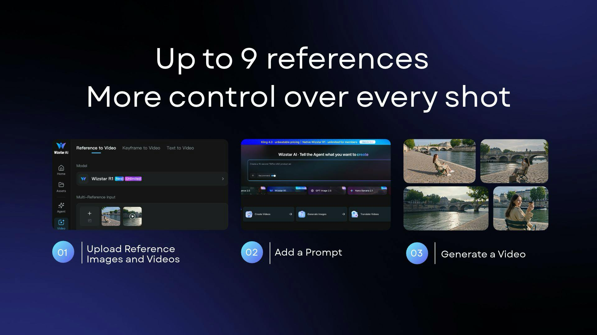

### 🎬 관련 영상
- [🎥 영상 보기](https://ph-files.imgix.net/3e1ca6ec-c247-4aa6-bbf9-5d3eec4fd9d2.jpeg?auto=format)

---

## 2. [Depost AI](https://www.producthunt.com/products/depost-ai)
**Votes**: 181 | **도입 난이도**: 하 | **신뢰도**: 상
**Tagline**: The LinkedIn AI agent that learns what works for your brand
**서비스 링크**: https://www.producthunt.com/r/32DE54NLUY7ZZ4

**태그**: AI Agent, LinkedIn, Content Automation, Marketing, Agent, AI Tool, Chat, Design, API

### 📌 이 서비스 한눈에 보기
브랜드 보이스를 학습하여 콘텐츠 기획부터 디자인, 댓글 관리까지 수행하는 LinkedIn 전문 AI 에이전트

### 🔑 주요 기능
- 과거 성과 분석을 통한 맞춤형 콘텐츠 전략 및 월간 플랜 수립
- 사용자의 고유한 말투를 반영한 글쓰기와 그래픽 디자인 자동화
- 리드 확보를 위한 대화형 댓글 초안 작성 및 공식 API를 통한 게시

### 🙋 사용자에게 어떤 점이 좋은가
LinkedIn 콘텐츠 제작에 드는 시간을 획기적으로 줄이면서도, 브랜드 정체성을 유지하며 잠재 고객과의 상호작용을 자동화할 수 있습니다.

### ✅ 지금 바로 써볼 기능
- 기존 LinkedIn 게시물 연동을 통한 브랜드 보이스 학습시키기
- AI가 제안하는 월간 콘텐츠 플랜 검토 및 승인하기
- Claude나 ChatGPT(MCP) 환경에서 워크플로우 연결하기

### ⚠️ 사용 전 확인할 점
- AI가 작성한 콘텐츠의 최종 검토 및 승인 과정이 필수적임
- LinkedIn 공식 API를 사용하지만, 자동화된 활동에 대한 플랫폼 정책 준수 필요

### 🧭 확인이 더 필요한 정보
사용자의 기존 데이터 양에 따른 학습 속도와 정확도 차이를 확인해야 합니다.

### 📸 스크린샷 및 갤러리
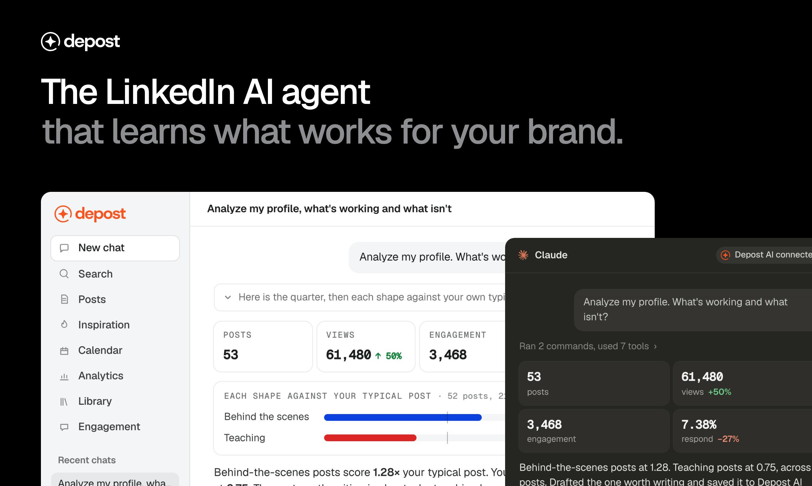
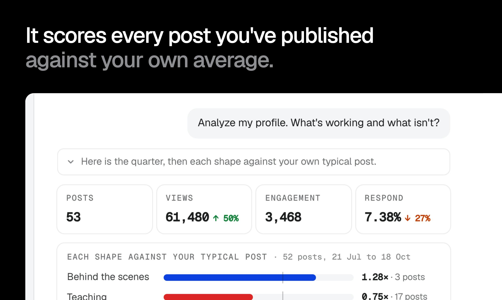
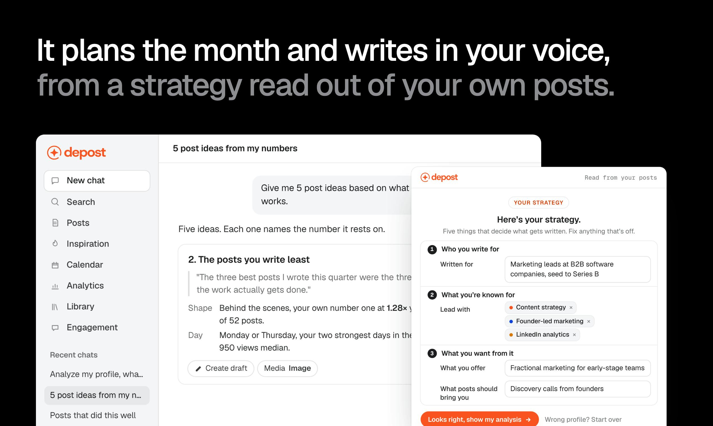

### 🎬 관련 영상
- [🎥 영상 보기](https://ph-files.imgix.net/6242c64c-8045-439a-83e5-f3159693b94b.jpeg?auto=format)

---

## 3. [Contral](https://www.producthunt.com/products/contral)
**Votes**: 158 | **도입 난이도**: 하 | **신뢰도**: 상
**Tagline**: The AI coding agent that checks its work and teaches you
**서비스 링크**: https://www.producthunt.com/r/O345273IOJN5AK

**태그**: DevTool, AI-Agent, Learning, Coding, Agent, AI Tool, Video

### 📌 이 서비스 한눈에 보기
코드 작성부터 검증, 학습까지 한 번에 해결하는 AI 코딩 에이전트

### 🔑 주요 기능
- 사용자 계정 기반의 다양한 AI 모델(Claude Code, Cursor 등) 통합 지원
- 요청 사항과 결과물을 대조하는 자동 검증 및 피드백 루프
- 코드 변경 사항에 대한 교육용 카드 제공 및 원클릭 실행 취소 기능

### 🙋 사용자에게 어떤 점이 좋은가
단순히 코드를 짜주는 것을 넘어, 작업 결과가 요청과 일치하는지 검증하고 변경 이유를 설명해 주어 개발 역량 향상에 도움을 줍니다.

### ✅ 지금 바로 써볼 기능
- 기존 IDE(VS Code, Cursor 등) 환경에서 연동하여 사용하기
- 제공되는 Teaching Card를 통해 AI의 코드 변경 로직 이해하기
- Learn mode를 활용하여 다국어 학습 환경 경험하기

### ⚠️ 사용 전 확인할 점
- 사용자 개인 계정의 AI 모델(Claude, Gemini 등)을 사용하므로 해당 모델의 API 비용이 발생할 수 있음
- 베타 단계 종료 직후이므로 기능 안정성 확인 필요

### 🧭 확인이 더 필요한 정보
사용자 개인 계정 연동 시 발생하는 구체적인 비용 체계와 모델별 호환 범위를 확인해야 합니다.

### 📸 스크린샷 및 갤러리
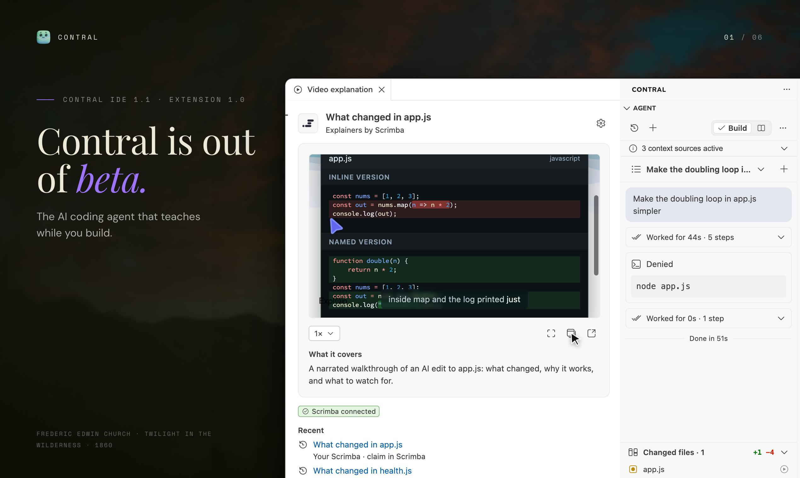
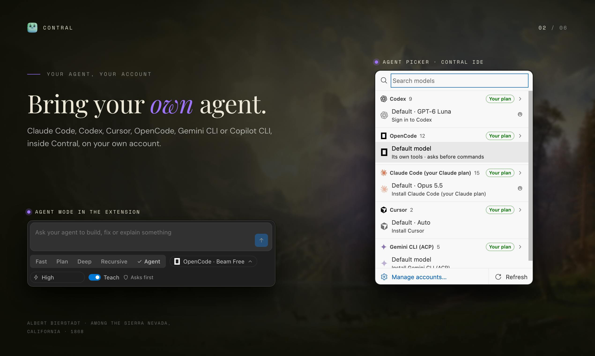
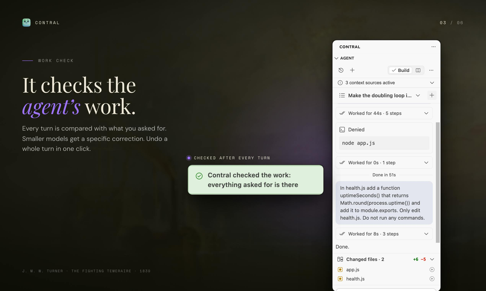

### 🎬 관련 영상
- [🎥 영상 보기](https://ph-files.imgix.net/mcp-draft-media/814b2da6-bbfa-4313-acd9-4d326533d900.jpeg?auto=format)

---

## 4. [Periscope](https://www.producthunt.com/products/periscope-4)
**Votes**: 141 | **도입 난이도**: 중 | **신뢰도**: 상
**Tagline**: Turn any work into an API
**서비스 링크**: https://www.producthunt.com/r/MKDWAD6MXFEF3A

**태그**: Automation, AI-Agent, DevTool, Workflow, Agent, Chat, API

### 📌 이 서비스 한눈에 보기
어떤 업무든 클릭 한 번으로 API로 변환하는 자동화 도구

### 🔑 주요 기능
- 작업 내용을 설명하면 자동으로 엔드포인트 생성
- 클라우드 데스크톱 기반의 에이전트가 소프트웨어 조작 수행
- REST API, Claude, ChatGPT, Cursor(MCP) 등과 연동 가능

### 🙋 사용자에게 어떤 점이 좋은가
기존 소프트웨어를 수정하지 않고도 모든 업무 프로세스를 API화하여 최신 AI 도구들과 즉시 연결할 수 있습니다.

### ✅ 지금 바로 써볼 기능
- 수동 반복 업무를 설명하여 엔드포인트 생성해보기
- 생성된 API를 ChatGPT나 Cursor에 연결해보기
- 무료 플랜으로 워크플로우 테스트하기

### ⚠️ 사용 전 확인할 점
- 에이전트가 화면을 직접 조작하므로 작업의 안정성 확인 필요
- 클라우드 데스크톱 환경에서의 보안 및 데이터 처리 방식 검토 필요

### 🧭 확인이 더 필요한 정보
에이전트가 복잡한 UI나 예외 상황을 얼마나 정확하게 처리하는지 확인이 필요합니다.

### 📸 스크린샷 및 갤러리
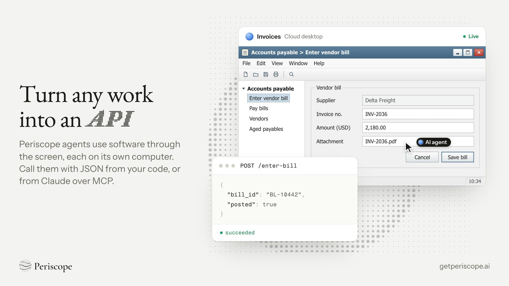
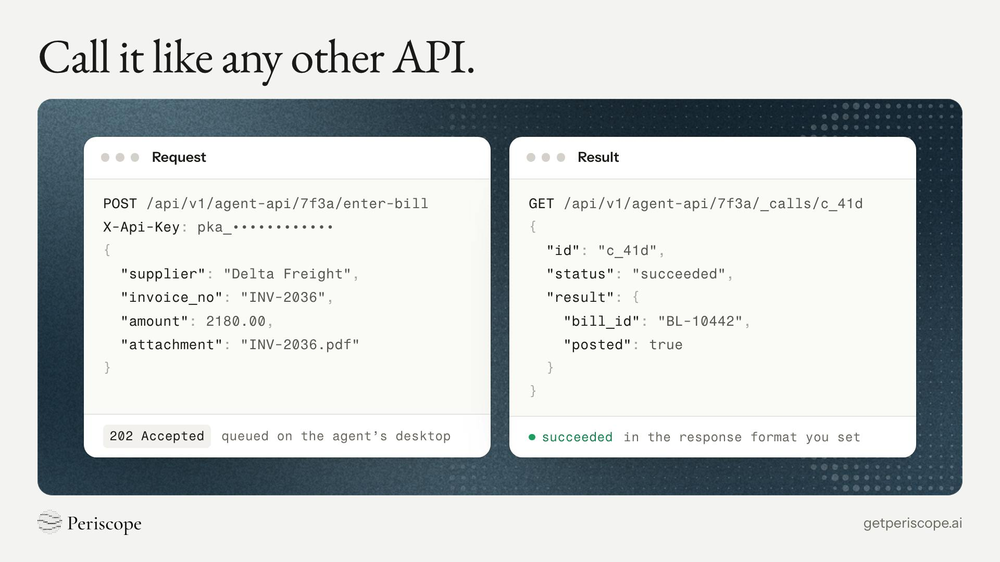
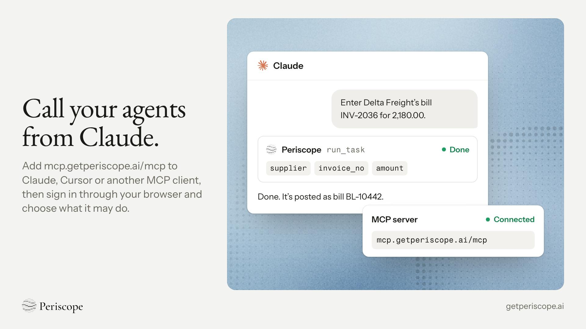

---

## 5. [Pushary Calls](https://www.producthunt.com/products/pushary)
**Votes**: 127 | **도입 난이도**: 하 | **신뢰도**: 상
**Tagline**: Miss your AI agent’s ping? Pushary calls you.
**서비스 링크**: https://www.producthunt.com/r/KPT5IG56HJWKXE

**태그**: AI, Automation, DevTool, Productivity, Agent, AI Tool

### 📌 이 서비스 한눈에 보기
AI 에이전트의 중요한 질문을 전화로 즉시 연결해주는 실시간 의사결정 도구

### 🔑 주요 기능
- AI 에이전트의 승인 요청을 전화로 전달하여 즉각적인 피드백 가능
- 사용자가 부재 중이거나 메시지를 놓쳐도 전화를 통해 업무 흐름 유지
- Claude Code, Gemini CLI 등 주요 AI 개발 도구와 연동 가능

### 🙋 사용자에게 어떤 점이 좋은가
중요한 작업 중 AI의 승인을 기다리며 대기할 필요 없이, 전화 한 통으로 어디서든 업무를 재개할 수 있습니다.

### ✅ 지금 바로 써볼 기능
- 사용 중인 AI CLI/에이전트 도구와 연동 설정하기
- 업무 시간 외 방해받지 않도록 통화 가능 시간 설정하기
- 에이전트의 승인 프로세스 워크플로우 구성하기

### ⚠️ 사용 전 확인할 점
- 전화 통화 방식이므로 음성 인식이 정확하지 않을 경우 의사결정 오류 가능성 있음
- 사용자가 설정한 시간 외에는 알림을 받지 못할 수 있음

### 🧭 확인이 더 필요한 정보
현재 지원하는 외부 AI 도구 외에 추가적인 커스텀 연동 가능 여부는 확인이 필요합니다.

### 📸 스크린샷 및 갤러리
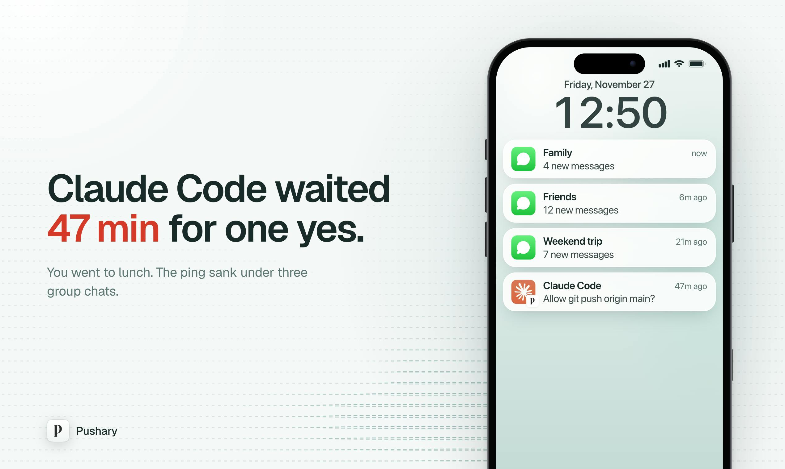
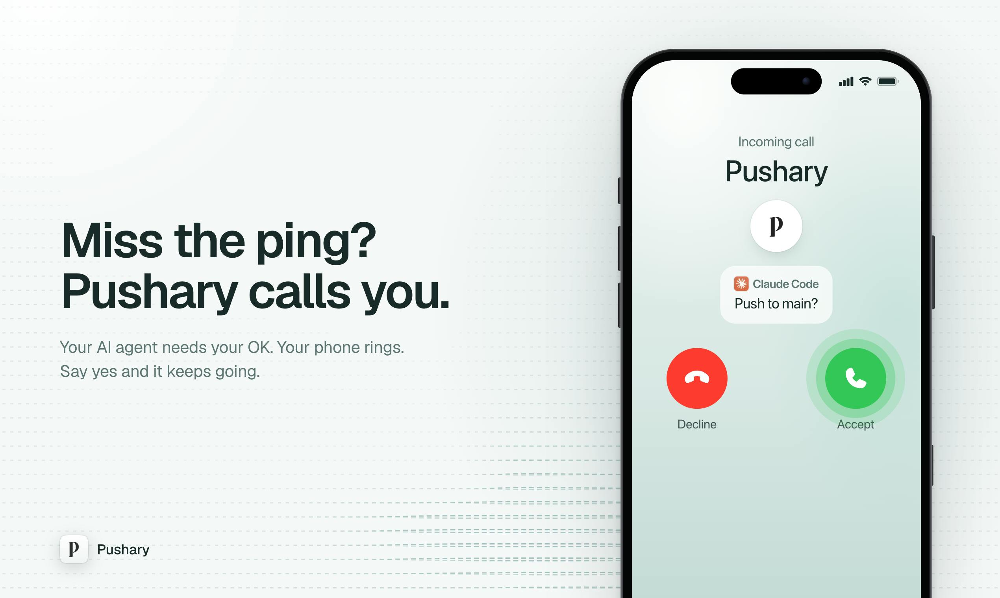
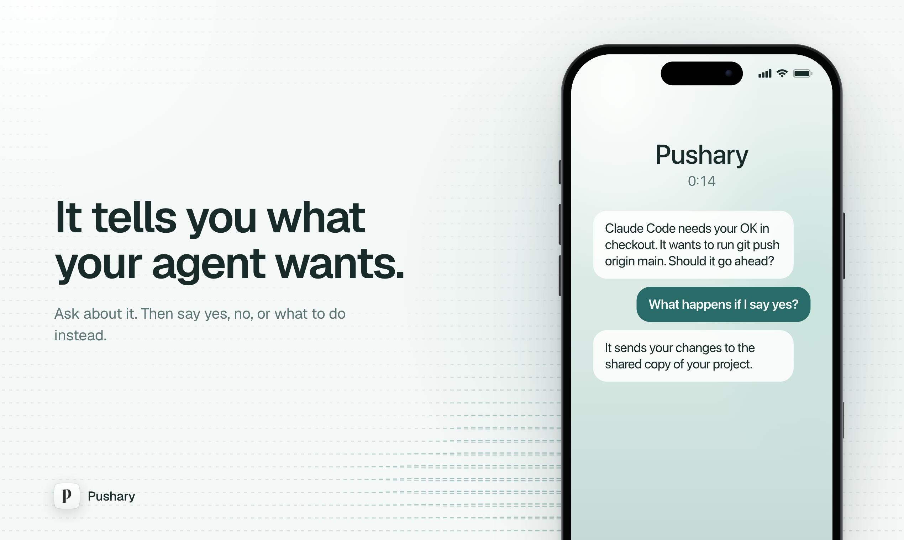

### 🎬 관련 영상
- [🎥 영상 보기](https://ph-files.imgix.net/c75282db-f7b5-4951-8ea9-d1223f70bd6d.jpeg?auto=format)

---

## 6. [RightFont 2026](https://www.producthunt.com/products/rightfont)
**Votes**: 116 | **도입 난이도**: 하 | **신뢰도**: 상
**Tagline**: The right font, right now.
**서비스 링크**: https://www.producthunt.com/r/OD5RPEPLXTOXMS

**태그**: DesignTool, Productivity, Typography, AI Tool, Design

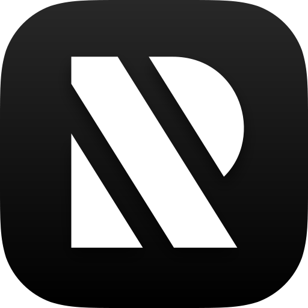

### 📌 이 서비스 한눈에 보기
수만 개의 폰트도 막힘없이 관리하고 디자인에 즉시 적용하는 차세대 폰트 관리 솔루션

### 🔑 주요 기능
- 20만 개 이상의 대규모 폰트 라이브러리를 지원하는 강력한 속도와 성능
- 디자인 작업 중 즉시 미리보기 및 적용이 가능한 직관적인 워크플로우
- 온디바이스 AI를 활용한 스마트한 폰트 탐색 및 중복 제거 기능

### 🙋 사용자에게 어떤 점이 좋은가
폰트 관리 시간을 획기적으로 줄여주어 디자이너가 창의적인 작업에만 집중할 수 있도록 돕습니다.

### ✅ 지금 바로 써볼 기능
- 대규모 폰트 라이브러리 동기화 및 성능 테스트
- AI 기반 폰트 추천 및 탐색 기능 활용
- Font Insights를 통한 중복 폰트 정리

### ⚠️ 사용 전 확인할 점
- 대량의 폰트 로드 시 시스템 리소스 점유율 확인 필요
- 특정 디자인 소프트웨어와의 호환성 확인 필요

### 🧭 확인이 더 필요한 정보
지원하는 구체적인 디자인 소프트웨어(Adobe, Figma 등)와의 통합 방식 및 운영체제 호환성을 확인해야 합니다.

### 📸 스크린샷 및 갤러리
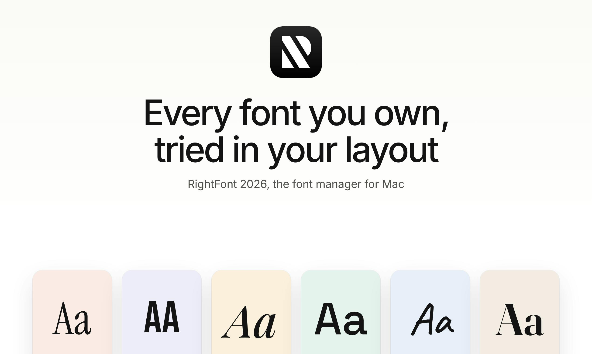
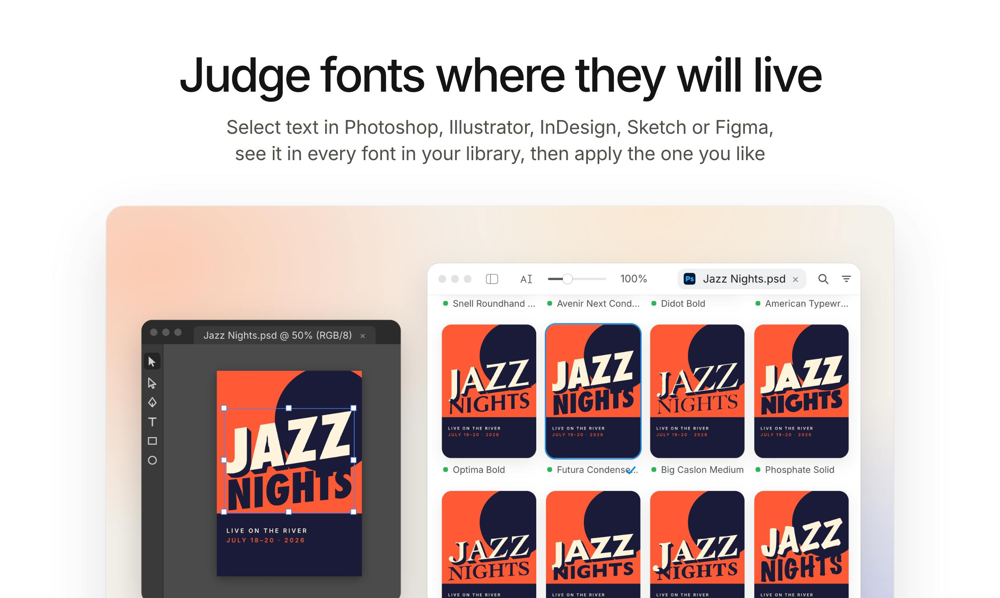
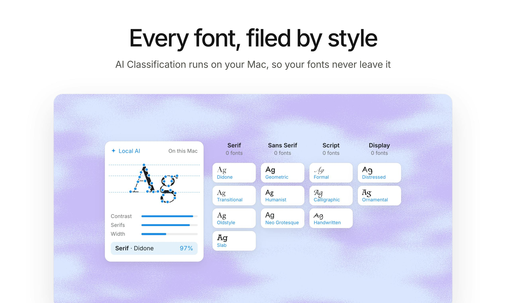

---

## 7. [Espresso 27](https://www.producthunt.com/products/espresso-27)
**Votes**: 115 | **도입 난이도**: 중 | **신뢰도**: 상
**Tagline**: The web editor for people who love the Mac
**서비스 링크**: https://www.producthunt.com/r/GZAIXAZWRZ3ICN

**태그**: WebEditor, AI, macOS, Design, Development, AI Tool

### 📌 이 서비스 한눈에 보기
macOS 환경에 최적화된 강력한 AI 기반 웹 에디터

### 🔑 주요 기능
- macOS 27에 맞춘 새로운 디자인과 사용자 경험
- 로컬 환경을 유지하며 사이트 전체를 구축하는 AI 기능
- 더 강력해진 내부 엔진을 갖춘 웹 에디터

### 🙋 사용자에게 어떤 점이 좋은가
Mac 사용자에게 익숙한 인터페이스를 바탕으로, 로컬 환경에서 벗어나지 않고도 AI를 통해 효율적인 웹 사이트 구축이 가능합니다.

### ✅ 지금 바로 써볼 기능
- 새로운 macOS 디자인 인터페이스 탐색
- AI를 활용한 사이트 구축 기능 테스트
- 강화된 에디터 엔진 기능 확인

### ⚠️ 사용 전 확인할 점
- macOS 전용 환경이므로 타 OS 사용자는 사용이 제한될 수 있음
- AI 기능의 구체적인 작동 방식 및 보안 정책 확인 필요

### 🧭 확인이 더 필요한 정보
AI가 로컬 환경에서 사이트를 구축하는 구체적인 기술적 방식과 호환되는 웹 프레임워크 범위를 확인해야 합니다.

### 📸 스크린샷 및 갤러리
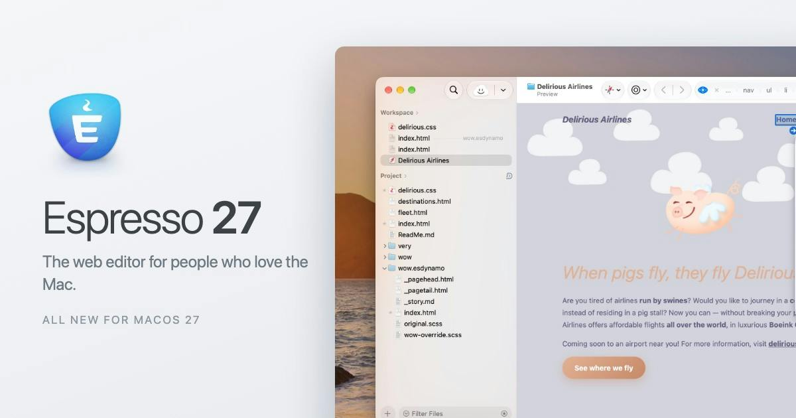
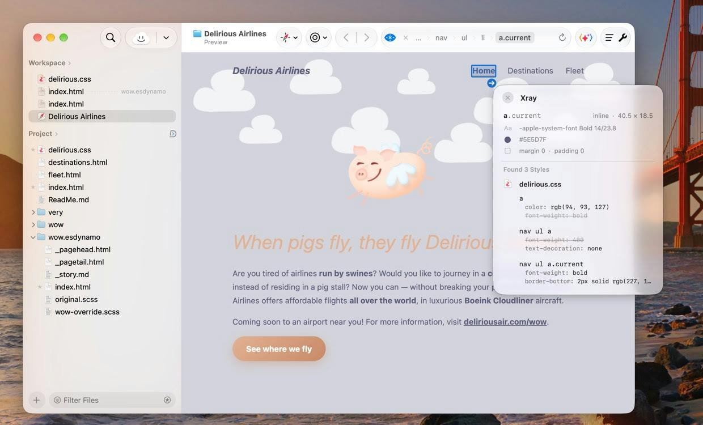
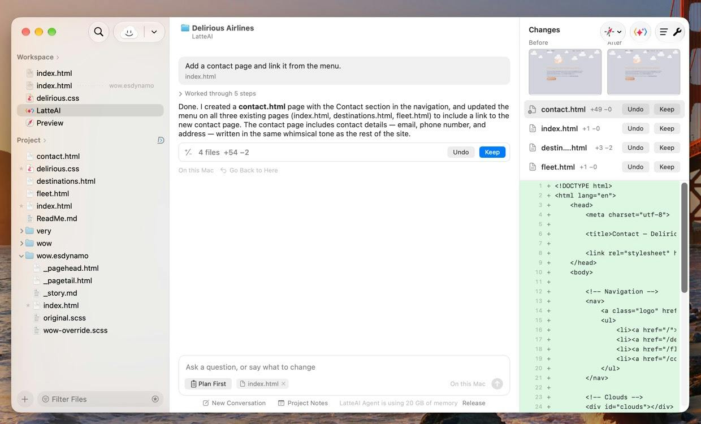

---

## 8. [Remove Silence](https://www.producthunt.com/products/remove-silence)
**Votes**: 102 | **도입 난이도**: 하 | **신뢰도**: 상
**Tagline**: Cut the silence from audio in your browser, free
**서비스 링크**: https://www.producthunt.com/r/X7WERDIFQLWNNM

**태그**: AudioTool, Productivity, Privacy, Video

### 📌 이 서비스 한눈에 보기
브라우저에서 간편하게 오디오의 무음 구간을 제거하여 깔끔한 파일을 만드는 도구

### 🔑 주요 기능
- 브라우저 기반의 간편한 오디오 편집 기능
- 로컬 디바이스 실행 방식으로 개인정보 보호 및 보안 강화
- 계정 생성이나 워터마크 없이 무료로 사용 가능

### 🙋 사용자에게 어떤 점이 좋은가
파일을 서버에 업로드할 필요 없이 브라우저 내에서 즉시 처리하므로 보안이 유지되며, 무음 구간을 빠르게 제거해 편집 시간을 단축할 수 있습니다.

### ✅ 지금 바로 써볼 기능
- 오디오/비디오 파일 드롭하여 파형 확인하기
- 임계값(Threshold) 조절로 무음 구간 정밀 설정하기
- 편집된 WAV 파일 다운로드하기

### ⚠️ 사용 전 확인할 점
- 비디오 파일의 경우 컷 편집 기능은 iPhone용 앱(QuellCut)을 별도로 사용해야 함
- 브라우저 리소스 사용량에 따라 대용량 파일 처리 성능이 달라질 수 있음

### 🧭 확인이 더 필요한 정보
지원하는 최대 파일 크기 및 브라우저별 호환성에 대한 구체적인 정보가 명시되지 않았습니다.

### 📸 스크린샷 및 갤러리
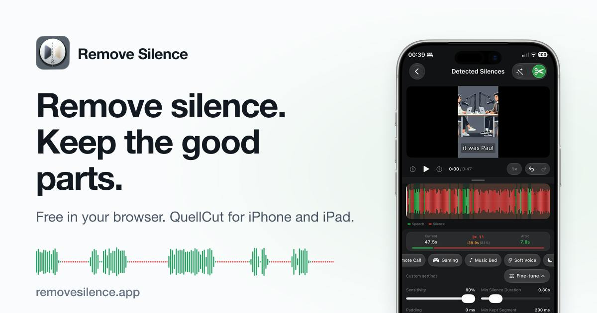
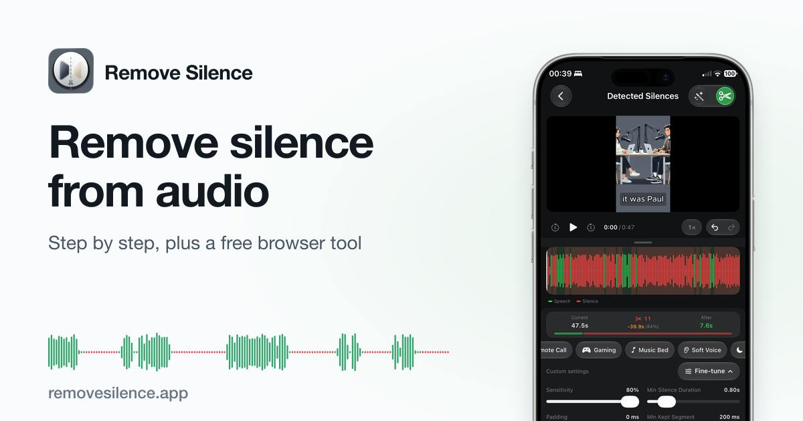
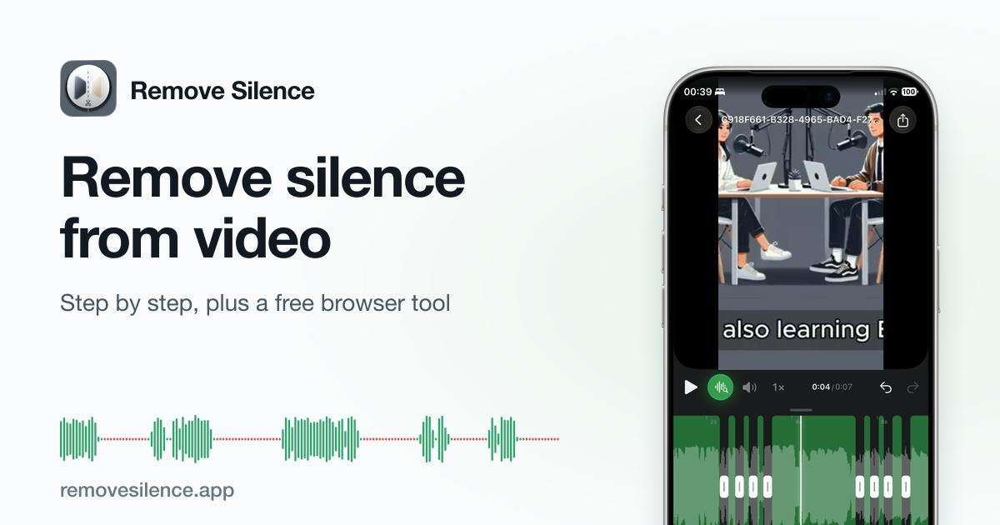

---

## 9. [snibl](https://www.producthunt.com/products/snibl)
**Votes**: 96 | **도입 난이도**: 하 | **신뢰도**: 상
**Tagline**: Save highlighted text from any app, then ask AI about it
**서비스 링크**: https://www.producthunt.com/r/IET2H5J64ZBLDK

**태그**: Productivity, AI, Knowledge Management, Windows, Mac, AI Tool

### 📌 이 서비스 한눈에 보기
어떤 앱에서든 텍스트를 저장하고 AI와 대화하며 지식을 관리하는 도구

### 🔑 주요 기능
- Mac 및 Windows 환경의 모든 앱에서 텍text 하이라이트 저장 가능
- 출처와 문맥을 포함한 스마트한 스니펫 저장 기능
- 저장된 개인 데이터를 기반으로 답변하는 맞춤형 AI 질의응답

### 🙋 사용자에게 어떤 점이 좋은가
중요한 정보를 일일이 복사해서 옮길 필요 없이, 읽던 흐름을 유지하며 지식 베이스를 구축할 수 있습니다.

### ✅ 지금 바로 써볼 기능
- 중요한 텍스트 하이라이트하여 저장해보기
- 저장된 스니펫에 대해 AI에게 질문해보기
- 출처와 문맥이 어떻게 유지되는지 확인하기

### ⚠️ 사용 전 확인할 점
- 개인적인 텍스트 데이터가 AI 학습이나 서버에 저장되는 방식에 대한 보안 검토 필요
- 운영체제별 기능 지원 범위 확인 필요

### 🧭 확인이 더 필요한 정보
데이터 저장 방식 및 개인정보 보호 정책에 대한 구체적인 정보가 명시되지 않았습니다.

### 📸 스크린샷 및 갤러리
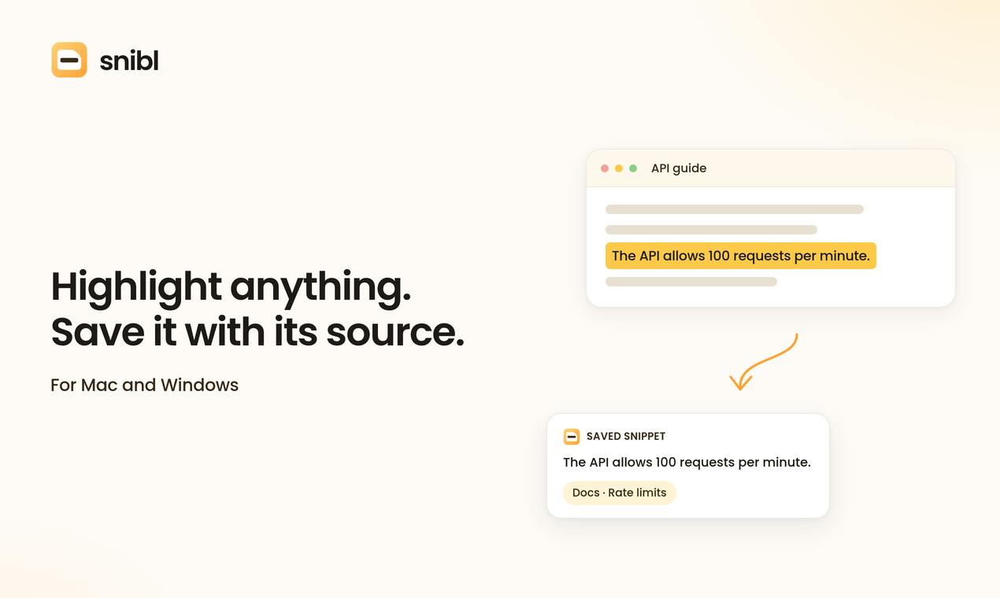
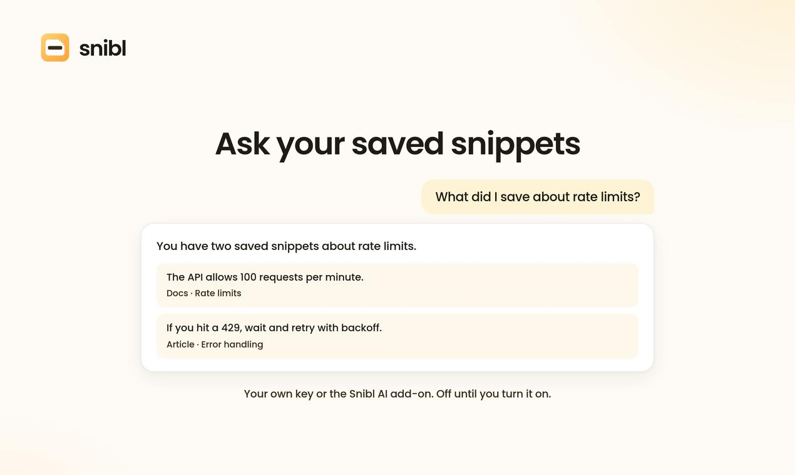
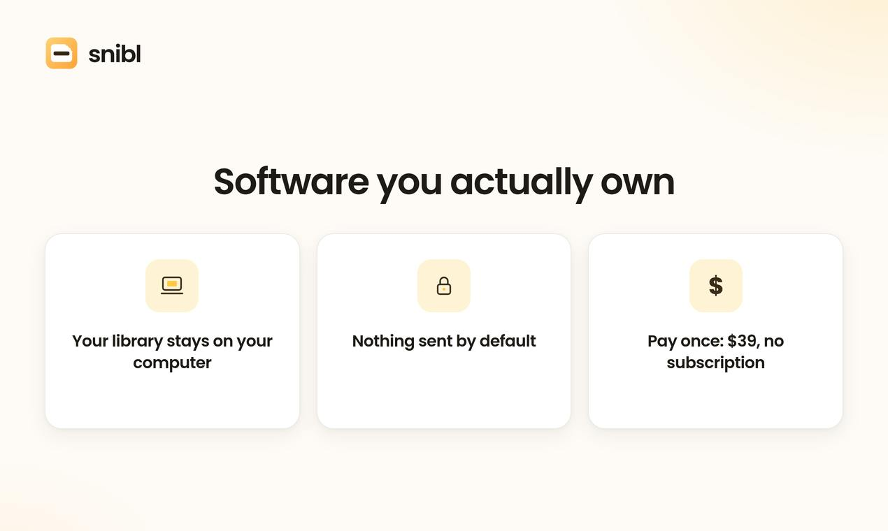

### 🎬 관련 영상
- [🎥 영상 보기](https://ph-files.imgix.net/fcb81e77-139a-47a8-895c-ea89c28b942c.jpeg?auto=format)

---

## 10. [ChickyTutor](https://www.producthunt.com/products/chickytutor)
**Votes**: 94 | **도입 난이도**: 하 | **신뢰도**: 상
**Tagline**: A language tutor that knows you better daily. Now on iOS
**서비스 링크**: https://www.producthunt.com/r/B3RVPTDDB3W4LG

**태그**: LanguageLearning, AI, MobileApp, Education, AI Tool

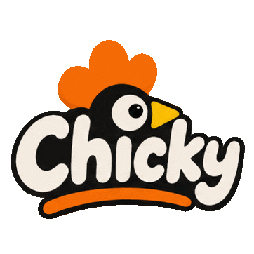

### 📌 이 서비스 한눈에 보기
개인 맞춤형 AI와 대화하며 실전 언어 능력을 키우는 모바일 언어 튜터

### 🔑 주요 기능
- iOS(iPhone, iPad) 지원 및 멀티 디바이스 동기화
- AI 튜터와 실시간 대면 대화 및 즉각적인 피드백
- 사용자 수준별 맞춤형 학습 여정(Journey) 제공

### 🙋 사용자에게 어떤 점이 좋은가
언어 학습을 위한 별도의 시간 확보 없이, 모바일 환경에서 마치 실제 튜터와 대화하듯 자연스럽게 회화 연습을 할 수 있습니다.

### ✅ 지금 바로 써볼 기능
- 원하는 언어 및 학습 레벨 설정하기
- 가이드된 Journey 챕터 따라가기
- 음성 대화 기능을 통한 실시간 피드백 받기

### ⚠️ 사용 전 확인할 점
- 모바일 앱 중심의 서비스이므로 데스크톱 환경과의 기능 차이 확인 필요
- 지원되는 언어 종류와 학습 가능 범위 확인 필요

### 🧭 확인이 더 필요한 정보
구체적인 지원 언어 목록과 상세 학습 커리큘럼의 범위는 공식 웹사이트 확인이 필요합니다.

### 📸 스크린샷 및 갤러리
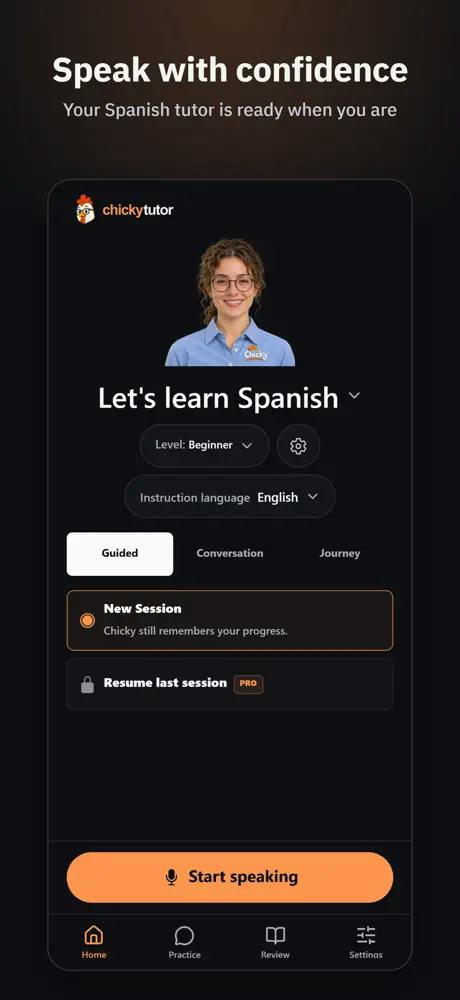

### 🎬 관련 영상
- [🎥 영상 보기](https://ph-files.imgix.net/e5f1022b-9da6-4b75-861b-fa654d59e898.jpeg?auto=format)

---

## 11. [Woomool](https://www.producthunt.com/products/woomool)
**Votes**: 92 | **도입 난이도**: 하 | **신뢰도**: 상
**Tagline**: AI Canvas where thinking becomes tangible
**서비스 링크**: https://www.producthunt.com/r/Y5ICTAOJGXUV2K

**태그**: AI, Productivity, Collaboration, Knowledge Management, Design, AI Tool

### 📌 이 서비스 한눈에 보기
아이디어 구상부터 지식 관리까지 돕는 아름답고 직관적인 AI 협업 캔버스

### 🔑 주요 기능
- 아이디어 구상 및 지식 관리에 최적화된 AI 기반 캔버스 인터페이스
- 집중력을 높여주는 깔끔하고 미니멀한 디자인
- 실시간 협업을 지원하는 워크스페이스

### 🙋 사용자에게 어떤 점이 좋은가
복잡한 도구 대신 시각적이고 직관적인 환경에서 깊이 있는 사고와 아이디어 정리를 원하는 사용자에게 유용합니다.

### ✅ 지금 바로 써볼 기능
- 자유로운 캔버스 공간에 아이디어 배치해보기
- AI 기능을 활용한 생각의 확장 경험하기
- 팀원과 실시간 협업 모드 테스트하기

### ⚠️ 사용 전 확인할 점
- 구체적인 AI 기능의 범위와 활용 방식 확인 필요
- 복잡한 데이터 구조 관리 기능 포함 여부 확인 필요

### 🧭 확인이 더 필요한 정보
제공되는 AI 기능의 구체적인 기술적 사양과 워크플로우 통합 범위가 명시되지 않았습니다.

### 📸 스크린샷 및 갤러리
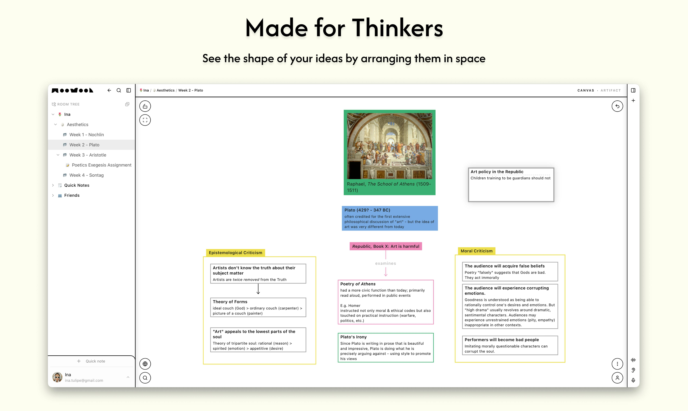
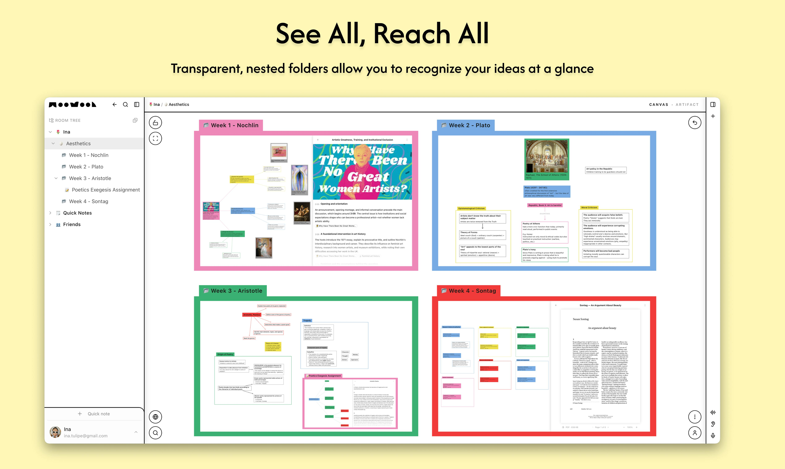
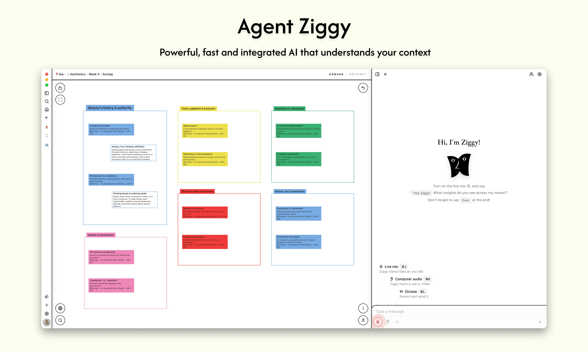

### 🎬 관련 영상
- [🎥 영상 보기](https://ph-files.imgix.net/936e3f1b-bc6f-4193-b976-cbb34c71de55.jpeg?auto=format)

---

## 12. [slay](https://www.producthunt.com/products/slay-3)
**Votes**: 91 | **도입 난이도**: 하 | **신뢰도**: 상
**Tagline**: AI composition guide camera app for iPhone
**서비스 링크**: https://www.producthunt.com/r/XVZL46OAKSN6YJ

**태그**: Photography, iPhone, AI, Creative, AI Tool

### 📌 이 서비스 한눈에 보기
전문적인 구도와 색감을 실시간으로 가이드해주는 아이폰용 AI 사진 촬영 앱

### 🔑 주요 기능
- 14가지 전문 구도 가이드 오버레이 제공
- 카메라 높이, 각도, 줌, 거리 등 상세 촬영 가이드 포함
- 38종의 내장 LUT를 통한 즉각적인 색감 보정

### 🙋 사용자에게 어떤 점이 좋은가
별도의 복잡한 편집 과정 없이도 전문가 수준의 구도와 색감을 갖춘 사진을 즉석에서 촬영할 수 있습니다.

### ✅ 지금 바로 써볼 기능
- 14가지 구도 가이드를 활용해 인물 및 풍경 촬영해보기
- 제공되는 38종의 LUT로 사진 분위기 테스트하기
- 가이드에 맞춰 카메라 높이와 각도 조절해보기

### ⚠️ 사용 전 확인할 점
- 아이폰 전용 앱이므로 iOS 환경에서만 사용 가능
- 가이드에 맞춘 물리적 위치 조절이 필요함

### 🧭 확인이 더 필요한 정보
구독형 모델인지 혹은 일회성 구매 방식인지에 대한 가격 정책 정보가 명시되지 않았습니다.

### 📸 스크린샷 및 갤러리
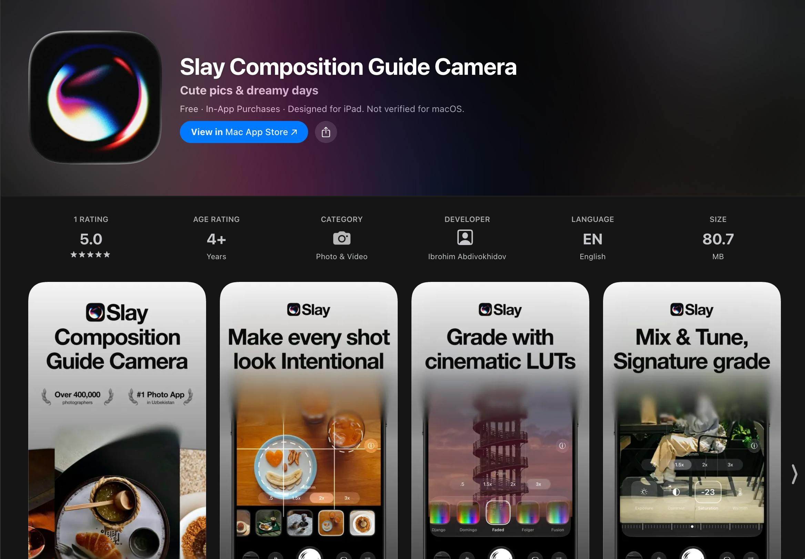
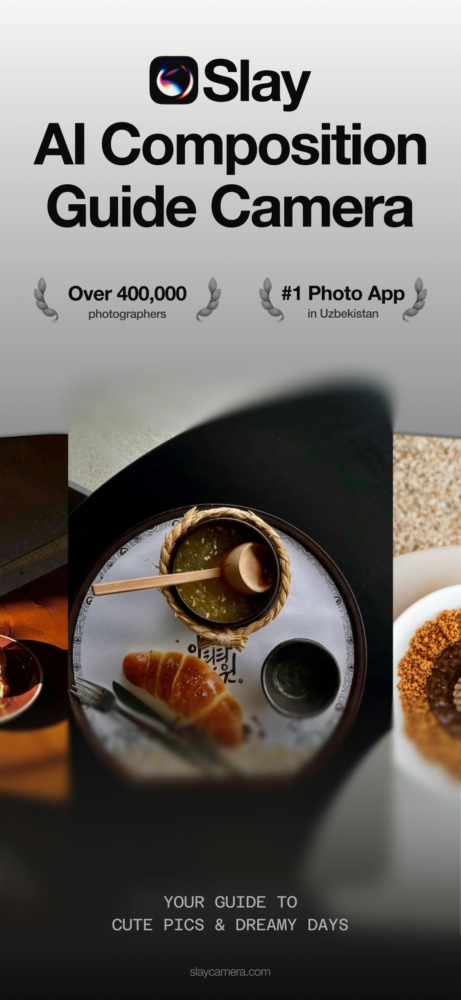

### 🎬 관련 영상
- [🎥 영상 보기](https://ph-files.imgix.net/6daa5a7f-646d-4aad-9bb2-0c724290bd08.jpeg?auto=format)

---

## 13. [Prosed AI 2.0 + MCP](https://www.producthunt.com/products/prosed-turn-your-content-into-a-book)
**Votes**: 90 | **도입 난이도**: 하 | **신뢰도**: 상
**Tagline**: Your company's words, assembled into a book
**서비스 링크**: https://www.producthunt.com/r/4E5Q4A6HUSE5YM

**태그**: Writing, AI, KnowledgeManagement, Productivity, AI Tool

### 📌 이 서비스 한눈에 보기
팀의 산재된 아이디어와 기록을 모아 하나의 완성된 비소설 도서로 변환해주는 AI 서비스

### 🔑 주요 기능
- 팀원들이 이미 작성한 아이디어와 기록을 기반으로 도서 집필
- Source Map 및 리뷰 패킷을 통해 내용 간의 연결성 검토 지원
- AI가 생성한 연결 구간(bridges)을 명시하여 검토자가 쉽게 확인 가능

### 🙋 사용자에게 어떤 점이 좋은가
개별적인 업무 기록이나 아이디어를 모아 전문적인 지식 자산(도서)으로 빠르게 자산화할 수 있습니다.

### ✅ 지금 바로 써볼 기능
- 기존에 작성된 팀의 아이디어/문서 모으기
- 무료 단계(아웃라인 생성 전까지)를 통해 서비스 품질 확인하기
- 할인 기간(11월 30일까지) 내 결제 검토하기

### ⚠️ 사용 전 확인할 점
- AI가 생성한 연결 부위는 반드시 사람이 직접 검토해야 함
- 기존에 이미 존재하는 텍스트 데이터가 충분해야 결과물 품질 확보 가능

### 🧭 확인이 더 필요한 정보
사용자의 기존 데이터 양에 따른 최종 도서 품질과 편집 자유도에 대한 구체적 정보가 필요합니다.

### 📸 스크린샷 및 갤러리
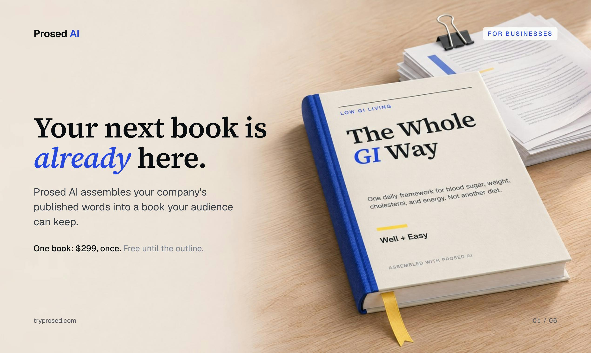
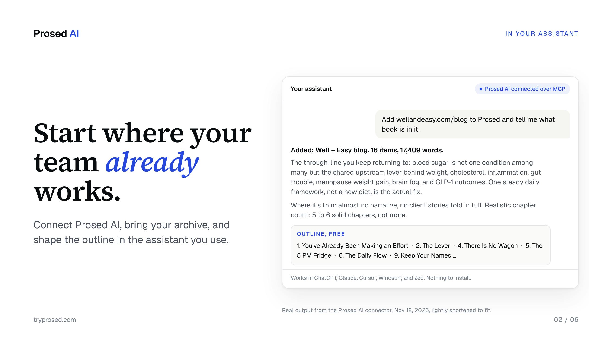
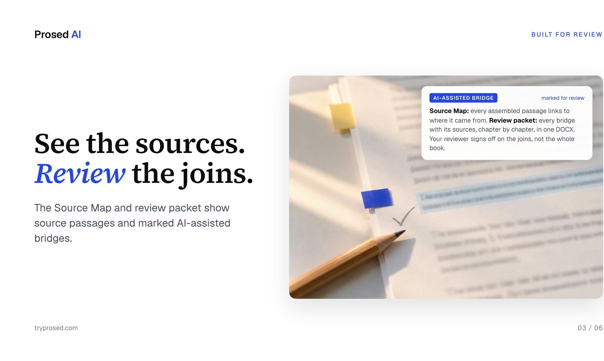

### 🎬 관련 영상
- [🎥 영상 보기](https://ph-files.imgix.net/c4f45da1-ad76-4841-b9c9-d4e3e7591c9e.jpeg?auto=format)

---

## 14. [Onset](https://www.producthunt.com/products/onset)
**Votes**: 89 | **도입 난이도**: 하 | **신뢰도**: 상
**Tagline**: AI reviews, titles and thumbnails for YouTube creators
**서비스 링크**: https://www.producthunt.com/r/R5R2P35SGKOPBT

**태그**: AI, YouTube, ContentCreation, Automation, AI Tool, Analytics

### 📌 이 서비스 한눈에 보기
유튜브 분석 데이터를 기반으로 맞춤형 제목과 썸네일을 제안하는 AI 크리에이터 어시스턴트

### 🔑 주요 기능
- 유튜브 분석 데이터를 읽고 업로드 48시간 후 성과를 분석
- 채널 고유의 목소리와 스타일을 반영한 제목 및 썸네일 초안 작성
- 읽기 전용 권한만 사용하여 직접 게시하지 않는 안전한 운영 방식

### 🙋 사용자에게 어떤 점이 좋은가
데이터 분석과 아이디어 구상 시간을 줄여주며, 채널의 기존 스타일을 유지하면서도 성과를 최적화할 수 있습니다.

### ✅ 지금 바로 써볼 기능
- 대기 명단(Waitlist) 등록 및 승인 확인
- 유튜브 분석 데이터 연동 및 스타일 학습 확인
- 제안된 제목과 썸네일 초안 검토

### ⚠️ 사용 전 확인할 점
- 현재 대기 명단을 통해 소수의 사용자만 순차적으로 초대 중
- 직접 게시 기능이 없는 읽기 전용 도구이므로 최종 결정은 사용자가 해야 함

### 🧭 확인이 더 필요한 정보
현재 대기 명단 기반으로 운영되고 있어 즉각적인 전체 사용 가능 여부는 불투명합니다.

### 📸 스크린샷 및 갤러리
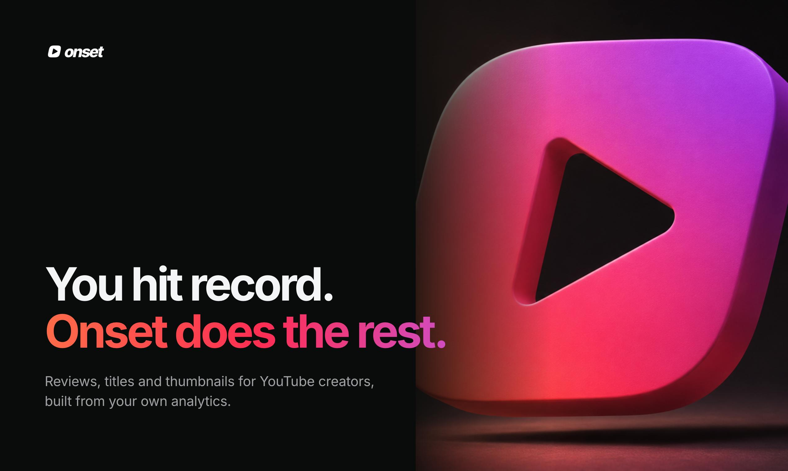
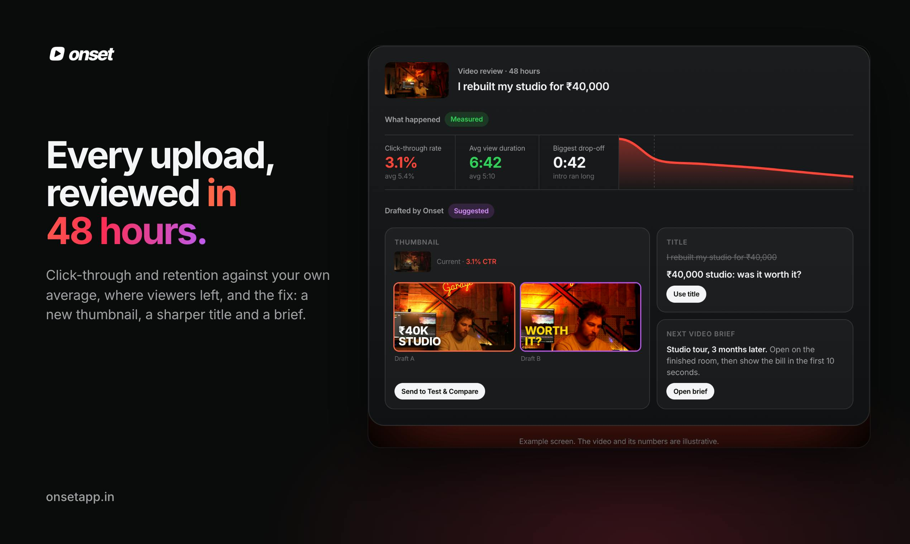
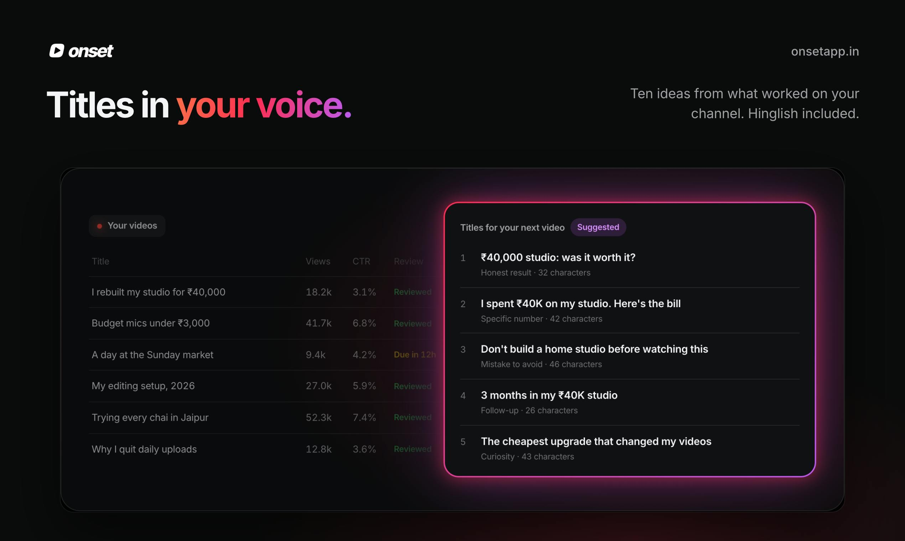

---

## 15. [gpyou](https://www.producthunt.com/products/gpyou)
**Votes**: 87 | **도입 난이도**: 하 | **신뢰도**: 상
**Tagline**: The OpenRouter for compute for the cheapest GPU in stock
**서비스 링크**: https://www.producthunt.com/r/ZUD3HJIGUCLI3N

**태그**: DevTool, GPU, Cloud, MLOps, Automation, AI Tool

### 📌 이 서비스 한눈에 보기
전 세계 GPU 클라우드에서 가장 저렴한 자원을 실시간으로 찾아 연결해주는 통합 CLI 도구

### 🔑 주요 기능
- 전 세계 GPU 클라우드 자원을 하나의 CLI로 통합 관리
- 재고가 있는 가장 저렴한 GPU를 자동으로 탐색 및 대여
- 자원 소진 시 다음 최적의 오퍼로 자동 이동 및 초 단위 과금

### 🙋 사용자에게 어떤 점이 좋은가
사용자는 복잡한 클라우드 설정 없이 가장 저렴한 비용으로 컨테이너 실행, 모델 파인튜닝, 서빙 작업을 수행할 수 있습니다.

### ✅ 지금 바로 써볼 기능
- CLI 설치 및 클라우드 연동
- 사전 충전 크레딧 설정
- 컨테이너 배포 테스트

### ⚠️ 사용 전 확인할 점
- 저렴한 자원 확보를 위한 자동 이동 시 작업 중단 가능성 확인 필요
- 특정 GPU 모델의 가용성 및 성능 편차 고려

### 🧭 확인이 더 필요한 정보
자동 이동(move to the next offer) 시 기존 작업의 상태 유지 또는 복구 메커니즘에 대한 상세 정보가 필요합니다.

### 📸 스크린샷 및 갤러리
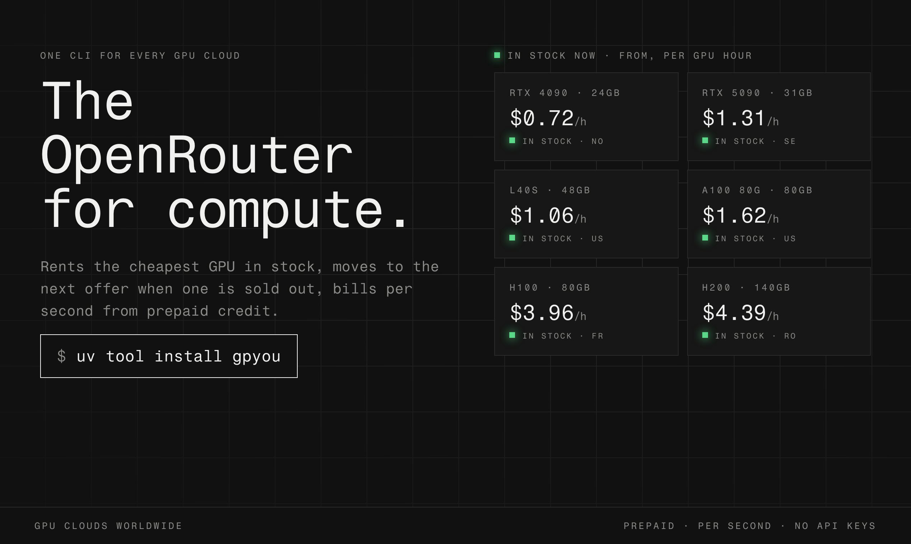
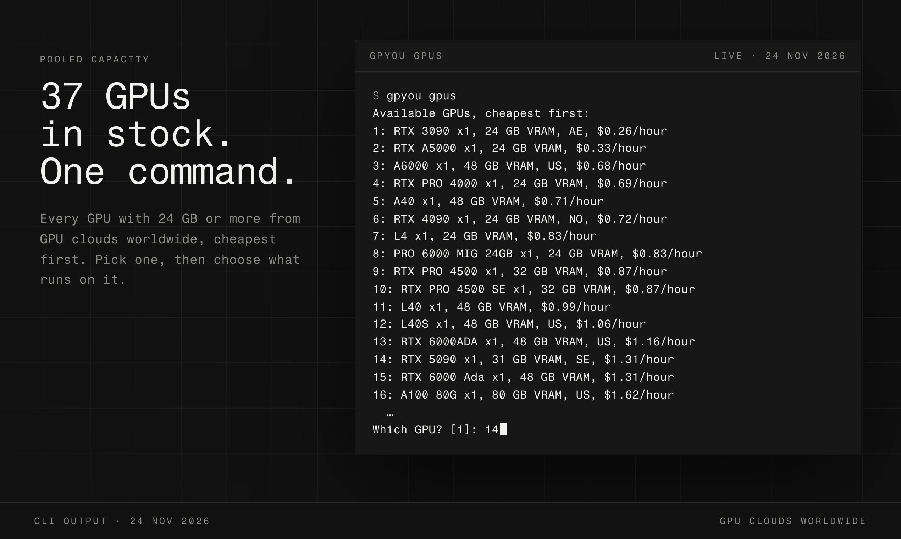
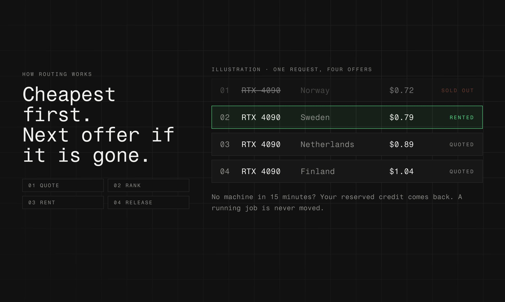

### 🎬 관련 영상
- [🎥 영상 보기](https://ph-files.imgix.net/c4953a62-3f41-4832-8962-859867ad607f.jpeg?auto=format)

---

## 16. [Arbitrica](https://www.producthunt.com/products/arbitrica)
**Votes**: 82 | **도입 난이도**: 하 | **신뢰도**: 상
**Tagline**: Agent that finds hidden prices & fights pricing algorithms
**서비스 링크**: https://www.producthunt.com/r/W5GP4HCVG27USC

**태그**: AI Agent, Price Tracker, Travel, Automation, Agent, AI Tool, Design

### 📌 이 서비스 한눈에 보기
전 세계 195개국 가격 데이터를 탐색하여 최저가를 찾아주는 AI 에이전트

### 🔑 주요 기능
- 사용자별로 다르게 적용되는 가격 알고리즘(국가, 기기, 시간 등) 우회
- 결제 직전 단계에서 전 세계 최저가를 실시간으로 탐색
- 결제 준비가 완료된 상태로 최적의 가격 제안

### 🙋 사용자에게 어떤 점이 좋은가
개인별로 다르게 책정되는 가격 알고리즘으로부터 사용자를 보호하고, 전 세계 어디서든 가장 저렴한 가격으로 예약/구매할 수 있게 돕습니다.

### ✅ 지금 바로 써볼 기능
- 호텔 예약 전 Arbitrica 에이전트 실행하기
- 현재 보고 있는 가격이 최저가인지 검증받기

### ⚠️ 사용 전 확인할 점
- 현재 호텔 분야부터 시작되어 다른 카테고리 확장 여부 확인 필요
- 결제 단계에서의 자동화가 실제 결제 수단과 어떻게 연동되는지 확인 필요

### 🧭 확인이 더 필요한 정보
현재 서비스가 호텔 외의 다른 상품군으로 어디까지 확장되었는지 명확하지 않습니다.

### 📸 스크린샷 및 갤러리
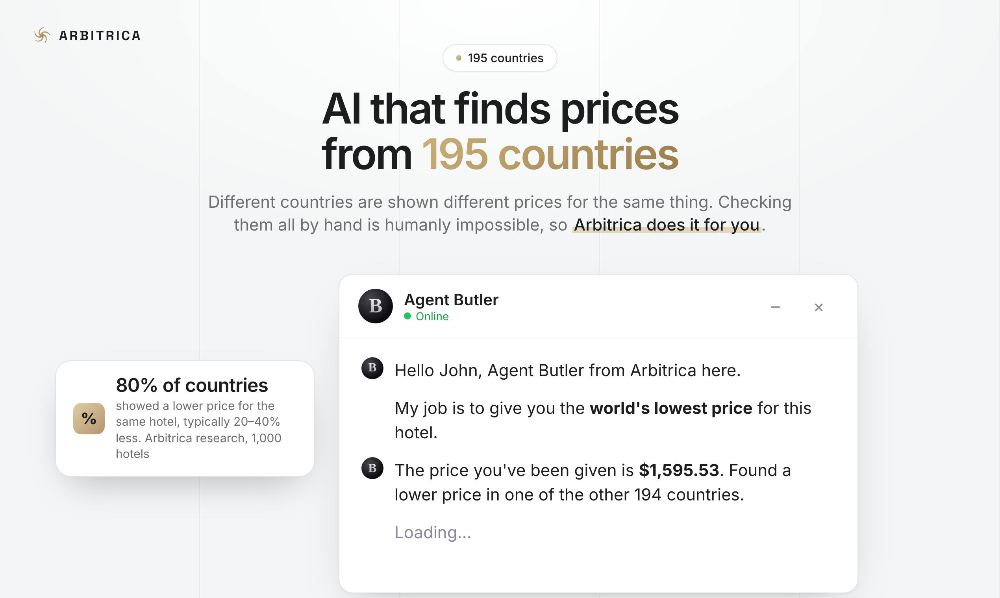
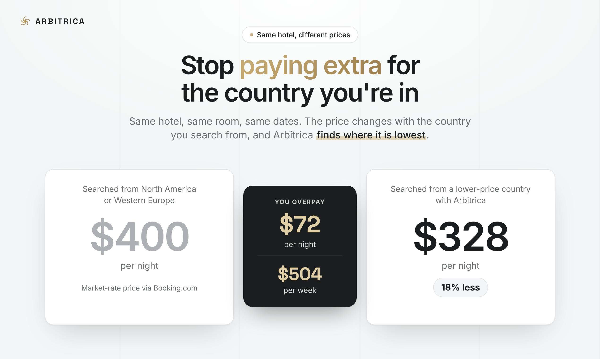
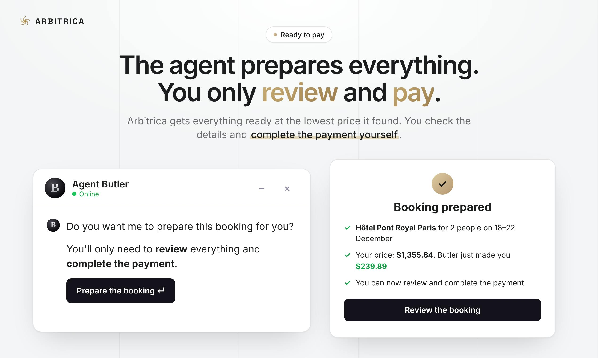

### 🎬 관련 영상
- [🎥 영상 보기](https://ph-files.imgix.net/f4de5e63-1b69-4057-a0bd-599063ef9384.jpeg?auto=format)

---

## 17. [Ploid](https://www.producthunt.com/products/ploid)
**Votes**: 75 | **도입 난이도**: 중 | **신뢰도**: 상
**Tagline**: People search for AI agents, across 2B+ profiles
**서비스 링크**: https://www.producthunt.com/r/7UOODGSVFW3NGE

**태그**: SearchEngine, AI-Agent, Data-Integration, DevTool, Agent, AI Tool, Chat, API

### 📌 이 서비스 한눈에 보기
20억 명 이상의 프로필을 기반으로 인물 정보를 탐색하고 통합하는 AI 기반 인물 검색 엔진

### 🔑 주요 기능
- 20억 개 이상의 프로필을 포함하는 방대한 인물 인덱스 보유
- 역할, 회사, 기술, 위치 기반 검색 및 최대 150개의 결과 제공
- 개별 인물의 전문적·사회적·개인적 사이트를 하나의 '슈퍼프로필'로 통합

### 🙋 사용자에게 어떤 점이 좋은가
방대한 인물 데이터를 기반으로 타겟 인물을 정교하게 찾을 수 있으며, AI 에이전트를 통해 단순 검색을 넘어 인물의 맥락까지 파악할 수 있습니다.

### ✅ 지금 바로 써볼 기능
- API 또는 CLI를 통해 기존 워크플로우에 인물 검색 기능 통합하기
- MCP 서버를 설정하여 Claude나 Cursor 내에서 즉시 인물 정보 검색하기
- 슈퍼프로필 기능을 통해 타겟 인물의 통합 프로필 확인하기

### ⚠️ 사용 전 확인할 점
- 데이터의 최신성 및 개인정보 보호 정책 확인 필요
- AI 에이전트의 추론 결과가 실제 인물의 의도와 다를 가능성

### 🧭 확인이 더 필요한 정보
20억 명 이상의 데이터 업데이트 주기와 상세 API 사용 비용 체계에 대한 정보가 명시되지 않았습니다.

### 📸 스크린샷 및 갤러리
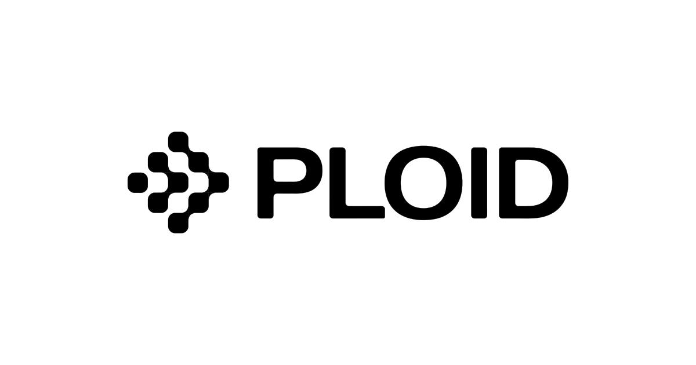
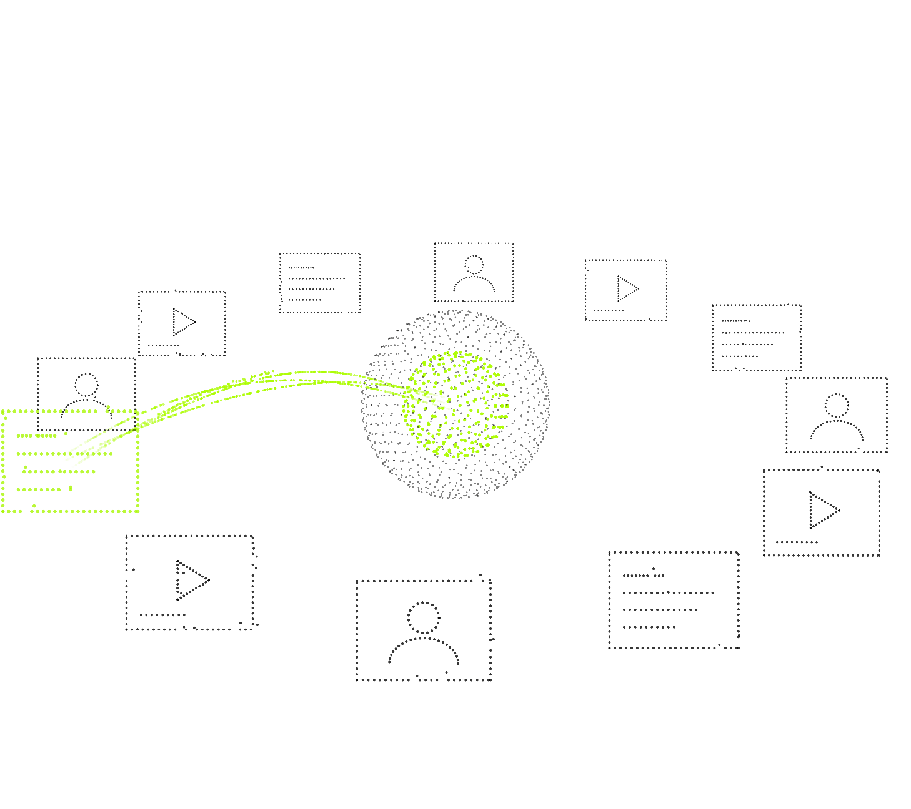
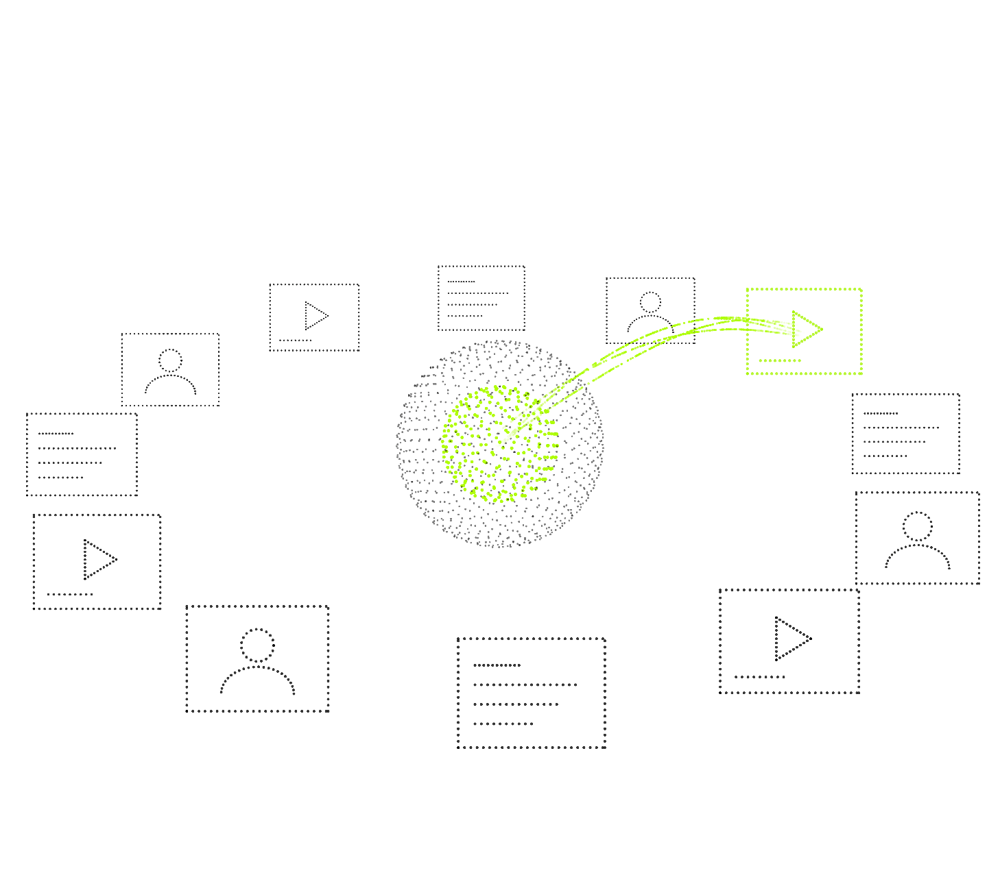

---

## 18. [Spark AI](https://www.producthunt.com/products/spark-ai-7)
**Votes**: 74 | **도입 난이도**: 중 | **신뢰도**: 상
**Tagline**: AI-native permitting & diligence services for data centers
**서비스 링크**: https://www.producthunt.com/r/RZDYXTD2NJLGDS

**태그**: AI, DataCenter, Infrastructure, Compliance, Automation, Agent, AI Tool

### 📌 이 서비스 한눈에 보기
데이터 센터 구축을 위한 AI 기반 인허가 및 실사 자동화 서비스

### 🔑 주요 기능
- 20,000개 이상의 관할 구역에 대한 AI 에이전트 조사 및 전문가 검수 결합
- 이해관계자 정보, 인허가 매트릭스, 프로젝트 실사(규제/전력/경쟁) 제공
- NextEra, Prologis 등 대규모 에너지/데이터 센터 기업들이 사용하는 검증된 플랫폼

### 🙋 사용자에게 어떤 점이 좋은가
데이터 센터 개발 시 발생하는 복잡한 인허가 절차와 규제 리스크를 AI를 통해 신속하고 정확하게 파악할 수 있습니다.

### ✅ 지금 바로 써볼 기능
- Stakeholder Intelligence를 통한 의사결정권자 파악
- Permit Matrices를 활용한 인허가 타임라인 및 담당 기관 확인
- Project Diligence를 통한 규제 및 전력 공급 리스크 분석

### ⚠️ 사용 전 확인할 점
- AI 조사 결과에 대해 최종 전문가 검수가 포함되어 있으나, 최종 결정은 사용자의 책임임
- 특정 지역이나 규제 환경에 따라 서비스의 유효성이 달라질 수 있음

### 🧭 확인이 더 필요한 정보
사용자의 특정 프로젝트 지역에 대한 데이터 커버리지와 상세 리포트 형식을 확인해야 합니다.

### 📸 스크린샷 및 갤러리
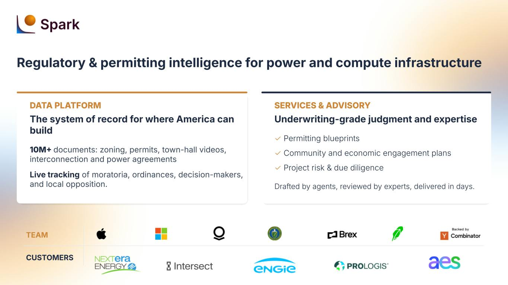
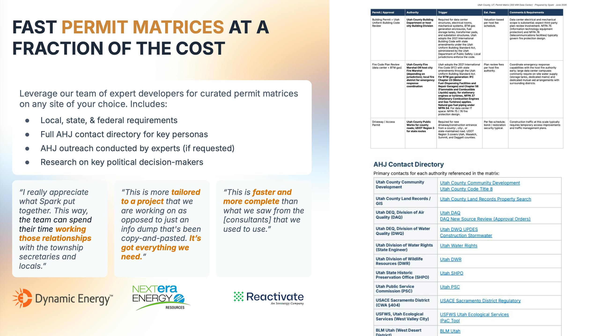

### 🎬 관련 영상
- [🎥 영상 보기](https://ph-files.imgix.net/mcp-draft-media/acebc066-fbbb-4b11-b0c2-ad35da2e9c89.gif?auto=format)

---

## 19. [Form Action Store](https://www.producthunt.com/products/form-action-store)
**Votes**: 65 | **도입 난이도**: 하 | **신뢰도**: 중
**Tagline**: Discover, create and grow with powerful digital tools.
**서비스 링크**: https://www.producthunt.com/r/LEEVV5I5BWSPQI

**태그**: Education, Marketing, Business, AI Tool

### 📌 이 서비스 한눈에 보기
디지털 비즈니스 구축과 성장을 위한 교육 및 리소스 제공 플랫폼

### 🔑 주요 기능
- DSA, EML, CYL 등 디지털 트레이닝 교육 제공
- 소셜 미디어 마케팅 및 온라인 비즈니스 전략 학습
- 초보자를 위한 실행 중심의 리소스 제공

### 🙋 사용자에게 어떤 점이 좋은가
온라인 비즈니스 창업이나 디지털 마케팅 역량을 키우고 싶은 초보자에게 실질적인 학습 가이드를 제공합니다.

### ✅ 지금 바로 써볼 기능
- 제공되는 디지털 트레이닝 커리큘럼 확인
- 소셜 미디어 마케팅 전략 학습
- 초보자용 리소스 활용하기

### ⚠️ 사용 전 확인할 점
- 구체적인 교육 콘텐츠의 깊이나 커리큘럼 상세 내용 확인 필요
- 실제 비즈니스 적용 결과는 개인의 실행력에 따라 다를 수 있음

### 🧭 확인이 더 필요한 정보
제공되는 교육 과정(DSA, EML, CYL)의 구체적인 학습 내용과 운영 방식에 대한 정보가 부족합니다.

### 📸 스크린샷 및 갤러리

---

## 20. [Botric](https://www.producthunt.com/products/botric)
**Votes**: 19 | **도입 난이도**: 하 | **신뢰도**: 상
**Tagline**: Invisible in AI Search? Get your brand into AI answers
**서비스 링크**: https://www.producthunt.com/r/427JDRIH7ODHJU

**태그**: AI, Marketing, Analytics, SEO, Agent, AI Tool, Chat

### 📌 이 서비스 한눈에 보기
AI 검색 엔진 결과에 브랜드가 노출되도록 최적화하고 모니터링하는 솔루션

### 🔑 주요 기능
- ChatGPT, Gemini, Claude 등 주요 AI 모델에서의 브랜드 노출도 추적
- AI 답변 내 브랜드 언급 및 인용 현황 모니터링
- AI 추천 확률을 높이기 위한 콘텐츠 최적화 에이전트 제공

### 🙋 사용자에게 어떤 점이 좋은가
AI가 답변을 생성할 때 우리 브랜드가 추천 리스트에 포함되는지 확인하고, 이를 전략적으로 개선할 수 있습니다.

### ✅ 지금 바로 써볼 기능
- 주요 AI 모델에서의 브랜드 언급 현황 확인하기
- 경쟁사 브랜드의 AI 노출도 비교 분석하기
- Botric 콘텐츠 에이전트를 활용한 최적화 콘텐츠 생성하기

### ⚠️ 사용 전 확인할 점
- AI 모델의 답변 알고리즘이 수시로 변하므로 지속적인 모니터링이 필요함
- 콘텐츠 최적화가 반드시 AI의 직접적인 추천으로 이어지지 않을 수 있음

### 🧭 확인이 더 필요한 정보
구체적인 데이터 수집 방식과 콘텐츠 에이전트의 자동화 수준에 대한 상세 정보가 필요합니다.

### 📸 스크린샷 및 갤러리

### 🎬 관련 영상
- [🎥 영상 보기](https://ph-files.imgix.net/4f78858f-7f5b-4ff6-be0e-fe8546f89070.jpeg?auto=format)

---

## 21. [RunSEO](https://www.producthunt.com/products/runseo)
**Votes**: 13 | **도입 난이도**: 중 | **신뢰도**: 상
**Tagline**: AI visibility on autopilot: run your SEO, AEO and GEO.
**서비스 링크**: https://www.producthunt.com/r/HVXVLXQ7G3S6AU

**태그**: SEO, AI, Automation, Marketing, AI Tool, Prompting, Analytics

### 📌 이 서비스 한눈에 보기
기획부터 발행까지 SEO와 AI 검색 최적화를 자동화하는 올인원 워크플로우 솔루션

### 🔑 주요 기능
- SEO, AEO(답변 엔진 최적화), GEO(생성형 엔진 최적화) 통합 관리
- 리서치, 발행, 인덱싱, 트래킹을 아우르는 전체 라이프사이클 자동화
- 전문 SEO 에이전시의 노하우를 바탕으로 한 고품질 콘텐츠 생성

### 🙋 사용자에게 어떤 점이 좋은가
검색 엔진뿐만 아니라 AI 답변 엔진에 최적화된 콘텐츠를 효율적으로 관리하여 디지털 가시성을 극대화할 수 있습니다.

### ✅ 지금 바로 써볼 기능
- AI 검색 엔진 최적화(AEO/GEO) 기능 테스트
- 콘텐츠 발행 및 인덱싱 자동화 워크플로우 설정
- AI 검색 프롬프트 트래킹 기능 확인

### ⚠️ 사용 전 확인할 점
- 사용자가 최종 승인을 결정하는 구조이나, 자동화된 콘텐츠의 품질 관리가 필요함
- 에이전시 기반의 로직이므로 사용자 맞춤형 전략과의 정렬 확인 필요

### 🧭 확인이 더 필요한 정보
구체적인 콘텐츠 생성량 제한이나 가격 정책에 대한 정보가 명시되지 않았습니다.

### 📸 스크린샷 및 갤러리

### 🎬 관련 영상
- [🎥 영상 보기](https://ph-files.imgix.net/6c41ba3f-5134-49a4-a59b-e7319cf7425b.jpeg?auto=format)

---

## 22. [AI Builder Week by Product School](https://www.producthunt.com/products/product-school)
**Votes**: 12 | **도입 난이도**: 하 | **신뢰도**: 상
**Tagline**: Free 20-minute AI workshops to build better products, faster
**서비스 링크**: https://www.producthunt.com/r/M64WPZPGC22YKO

**태그**: AI, Workshop, ProductManagement, NoCode, Agent, Automation, AI Tool

### 📌 이 서비스 한눈에 보기
글로벌 리더들에게 배우며 직접 AI 에이전트와 워크플로우를 구축하는 5일간의 무료 실습 워크숍

### 🔑 주요 기능
- Amazon, Google, SpaceX 등 글로벌 기업 리더들이 진행하는 10개 이상의 라이브 워크숍
- 단 20분 만에 실제 AI 에이전트, 워크플로우 또는 기능을 직접 구축하는 실습 중심 구성
- 세션 종료 후 결과물과 다음 단계를 위한 설정 가이드를 즉시 확보 가능

### 🙋 사용자에게 어떤 점이 좋은가
이론 교육을 넘어 실제 도구를 사용하여 결과물을 만들어내므로, AI 기술을 제품에 즉각 적용해보고 싶은 빌더들에게 유용합니다.

### ✅ 지금 바로 써볼 기능
- 관심 있는 분야의 라이브 워크숍 세션 선택하기
- 실습을 위해 필요한 도구 및 환경 미리 준비하기
- 세션 종료 후 제공되는 녹화본과 설정 가이드 활용하기

### ⚠️ 사용 전 확인할 점
- 20분이라는 짧은 시간 내에 실습이 진행되므로 사전 준비가 부족할 경우 따라가기 어려울 수 있음
- 실시간 라이브 세션 위주이므로 정해진 일정(12월 7-11일)에 맞춰 참여해야 함

### 🧭 확인이 더 필요한 정보
워크숍에서 다루는 구체적인 기술 스택이나 도구의 종류는 세션별로 다를 수 있습니다.

### 📸 스크린샷 및 갤러리

---

## 23. [Wisp](https://www.producthunt.com/products/wisp-12)
**Votes**: 12 | **도입 난이도**: 하 | **신뢰도**: 상
**Tagline**: Your AI, right where you're looking
**서비스 링크**: https://www.producthunt.com/r/OMDAKLXCCIZG7R

**태그**: AI Assistant, Productivity, Automation, Cross-Platform, AI Tool

### 📌 이 서비스 한눈에 보기
화면을 실시간으로 이해하고 작업 흐름을 돕는 커서 기반 AI 동반자

### 🔑 주요 기능
- 화면 내용을 인식하여 질문에 답하고 시각적으로 가리키는 화면 인지 기능
- 문서 작성, 슬라이드 제작, 화이트보드 교육 등 창의적 작업 지원
- 브라우저와 앱 내에서 복잡한 다단계 작업을 수행하는 자동화 기능

### 🙋 사용자에게 어떤 점이 좋은가
별도의 설정 없이 커서 옆에서 즉시 실행되어, 학습이나 문서 작업 시 맥락을 유지하며 생산성을 높일 수 있습니다.

### ✅ 지금 바로 써볼 기능
- 단축키를 눌러 현재 화면에 대해 질문하기
- Studio 기능을 활용해 슬라이드나 문서 초안 만들기
- 브라우저 내 자동화 작업을 통한 반복 업무 위임하기

### ⚠️ 사용 전 확인할 점
- 화면 전체를 스캔하므로 개인정보나 민감한 데이터 노출 주의 필요
- 다단계 작업 수행 시 의도치 않은 동작이 발생할 가능성

### 🧭 확인이 더 필요한 정보
상세한 유료 플랜 정책과 데이터 보안 처리 방식에 대한 구체적인 정보가 필요합니다.

### 📸 스크린샷 및 갤러리

### 🎬 관련 영상
- [🎥 영상 보기](https://ph-files.imgix.net/6611f78a-5c32-4c1d-8181-e91b85e0d6b7.jpeg?auto=format)

---

## 24. [Gold Master Kit](https://www.producthunt.com/products/gold-master-kit)
**Votes**: 10 | **도입 난이도**: 중 | **신뢰도**: 상
**Tagline**: Claude Code skills that launch your Mac or iOS app
**서비스 링크**: https://www.producthunt.com/r/FGWQRX76XKKYH5

**태그**: DevTool, Automation, Design, Marketing, iOS/Mac, AI Tool

### 📌 이 서비스 한눈에 보기
실제 UI를 기반으로 앱 출시용 마케팅 에셋을 자동 생성하는 Claude Code 스킬 팩

### 🔑 주요 기능
- 실제 앱 UI를 활용한 스크린샷, 랜딩 페이지, 홍보 영상 제작
- 파일 무결성을 스스로 검증하는 5가지 특화된 Claude Code 스킬
- 일반 Claude Code 대비 검증된 자동화 워크플로우

### 🙋 사용자에게 어떤 점이 좋은가
앱 개발 후 마케팅 에셋 제작에 드는 시간을 획기적으로 줄여주며, 실제 UI를 기반으로 하여 디자인 일관성을 유지할 수 있습니다.

### ✅ 지금 바로 써볼 기능
- Claude Code 환경에 스킬 설치 및 설정
- 앱 소스 코드를 통한 스크린샷 자동 생성 테스트
- 생성된 마케팅 에셋의 UI 일치성 확인

### ⚠️ 사용 전 확인할 점
- Claude Code 환경에 대한 사전 숙련도 필요
- 생성된 디자인 에셋의 최종 수동 검수 필요

### 🧭 확인이 더 필요한 정보
사용자의 로컬 개발 환경 및 Claude Code 설정 상태에 따라 설치 난이도가 달라질 수 있습니다.

### 📸 스크린샷 및 갤러리

---

## 25. [Liftx](https://www.producthunt.com/products/liftx)
**Votes**: 9 | **도입 난이도**: 중 | **신뢰도**: 상
**Tagline**: Ultra-Low Latency PRO Crypto Trading Terminal
**서비스 링크**: https://www.producthunt.com/r/GU6ZY7WLJ36O2L

**태그**: Trading, Crypto, FinTech, High-Performance

### 📌 이 서비스 한눈에 보기
전문 트레이더를 위한 초저지연 암호화폐 거래 터미널

### 🔑 주요 기능
- 고성능 시스템 엔지니어와 전문 트레이더가 개발한 프로급 거래 환경
- 독자적인 ⓧEngine을 통한 초저지연 및 검증된 실행 엔진
- 무제한 독립 포지션/주문 및 실시간 P&L 시각화 기능

### 🙋 사용자에게 어떤 점이 좋은가
전문적인 수준의 빠른 실행 속도와 정교한 포지션 관리 기능을 통해 복잡한 암호화폐 거래를 효율적으로 수행할 수 있습니다.

### ✅ 지금 바로 써볼 기능
- 지원되는 거래소 연결 및 API 연동
- 시각적 포지션 트래킹 기능 활용
- 실시간 P&L 및 Breakeven 기능 테스트

### ⚠️ 사용 전 확인할 점
- 지원되는 거래소 목록 및 API 연동 범위 확인 필요
- 전문가용 도구이므로 숙련도에 따른 운용 리스크 존재

### 🧭 확인이 더 필요한 정보
지원되는 구체적인 거래소 목록과 API 연동 방식에 대한 상세 정보가 필요합니다.

### 📸 스크린샷 및 갤러리

---

## 26. [TigerTrust](https://www.producthunt.com/products/tigertrust)
**Votes**: 9 | **도입 난이도**: 상 | **신뢰도**: 상
**Tagline**: Enterprise PKI Management & Certificate Lifecycle Automation
**서비스 링크**: https://www.producthunt.com/r/O4LJSICFW6OHOA

**태그**: Security, Automation, Enterprise, PKI, DevOps

### 📌 이 서비스 한눈에 보기
기업용 PKI 관리 및 인증서 수명 주기 자동화 솔루션

### 🔑 주요 기능
- 인증서 자동 갱신 및 수명 주기 관리 자동화
- HSM 기반의 프라이빗 CA 및 다양한 프로토콜(SCEP/ACME/EST) 지원
- 자산 탐색 및 컴플라이언스 증빙 패키지 제공

### 🙋 사용자에게 어떤 점이 좋은가
복잡한 인증서 관리 과정을 자동화하여 만료로 인한 서비스 중단을 방지하고, 보안 규정 준수를 간편하게 관리할 수 있습니다.

### ✅ 지금 바로 써볼 기능
- 기존 네트워크 내 인증서 자산 탐색 기능 실행
- 자동 갱신 워크플로우 설정
- 컴플라이언스 증빙 패키지 생성 테스트

### ⚠️ 사용 전 확인할 점
- 엔터프라이즈급 인프라 환경에 최적화되어 있어 초기 설정 및 도입 난이도가 높을 수 있음
- HSM 등 하드웨어 보안 모듈과의 연동 환경 확인 필요

### 🧭 확인이 더 필요한 정보
상세한 설치 방식(On-premise vs Cloud)과 기존 인프라와의 호환성 범위에 대한 정보가 추가로 필요합니다.

### 📸 스크린샷 및 갤러리

### 🎬 관련 영상
- [🎥 영상 보기](https://ph-files.imgix.net/4f190a99-0632-402d-9e69-b5884701a0fc.jpeg?auto=format)

---

## 27. [Cinemation - AI Long Videos Maker](https://www.producthunt.com/products/cinemation-ai-long-videos-maker)
**Votes**: 8 | **도입 난이도**: 중 | **신뢰도**: 상
**Tagline**: Create long videos, cinema, serials, promotions & more.
**서비스 링크**: https://www.producthunt.com/r/VVNCEAMA2XWDNB

**태그**: AI Video, Content Creation, Automation, Storytelling, AI Tool, Video

### 📌 이 서비스 한눈에 보기
아이디어만으로 일관된 캐릭터와 배경을 유지하며 최대 30분 분량의 장편 영상을 제작하는 AI 영화 제작 도구

### 🔑 주요 기능
- 캐릭터와 장소의 일관성을 유지하며 최대 30분 길이의 영상 생성 가능
- 스크립트 작성부터 샷 계획(와이드/미디엄/클로즈업) 및 편집까지 자동화
- 실사, 3D, 애니메이션 등 다양한 스타일과 다양한 화면 비율 지원

### 🙋 사용자에게 어떤 점이 좋은가
콘텐츠 제작자가 복잡한 영상 편집 과정 없이 텍스트만으로 고품질의 시리즈물이나 홍보 영상을 빠르게 제작할 수 있습니다.

### ✅ 지금 바로 써볼 기능
- 원하는 장르와 캐스트를 설정하여 첫 번째 스크립트 생성해보기
- 자연어 명령어를 사용하여 특정 샷의 구도나 스타일 편집해보기
- 제작 목적에 맞는 화면 비율(16:9, 9:16 등) 설정하여 영상 뽑아보기

### ⚠️ 사용 전 확인할 점
- 장편 영상 생성 시 연산량에 따른 생성 시간 및 비용 발생 가능성 확인 필요
- AI 특성상 복잡한 서사 구조에서의 캐릭터 일관성 유지 정도 확인 필요

### 🧭 확인이 더 필요한 정보
구체적인 요금 체계와 생성 가능한 영상의 해상도(Resolution) 정보가 명시되지 않았습니다.

### 📸 스크린샷 및 갤러리

---

## 28. [Master Wang](https://www.producthunt.com/products/master-wang)
**Votes**: 7 | **도입 난이도**: 하 | **신뢰도**: 상
**Tagline**: Learn Chinese from scratch and get ready for the HSK exam
**서비스 링크**: https://www.producthunt.com/r/KBERRCOVNUM7NO

**태그**: LanguageLearning, Education, ExamPrep, Chinese, AI Tool

### 📌 이 서비스 한눈에 보기
HSK 3.0 체계에 맞춘 개인 맞춤형 중국어 학습 및 시험 대비 코칭 서비스

### 🔑 주요 기능
- HSK 1–9 및 YCT 1–4 급수별 맞춤형 커리큘럼 제공
- 시험 날짜에 맞춘 일일 학습 플랜 및 공식 형식의 모의고사
- 음성 인식을 통한 성조 체크 및 단계별 필기 연습 기능

### 🙋 사용자에게 어떤 점이 좋은가
시험 일정에 맞춘 체계적인 학습 계획을 제공하며, 성조와 쓰기 등 실전 역량을 동시에 강화할 수 있습니다.

### ✅ 지금 바로 써볼 기능
- 자신의 목표 시험 급수에 맞는 학습 플랜 설정하기
- 음성 인식 기능을 활용한 성조 연습하기
- 공식 형식의 모의 테스트 진행하기

### ⚠️ 사용 전 확인할 점
- 학습자의 현재 수준에 따른 커리큘럼 적합성 확인 필요
- 모바일 및 웹 환경에서의 학습 경험 차이 확인 필요

### 🧭 확인이 더 필요한 정보
구체적인 유료 구독 모델이나 기능별 가격 정책은 명시되지 않았습니다.

### 📸 스크린샷 및 갤러리

### 🎬 관련 영상
- [🎥 영상 보기](https://ph-files.imgix.net/9d92b2ae-5864-4943-9184-6d38d1b5174a.jpeg?auto=format)

---

## 29. [Nexim](https://www.producthunt.com/products/nexim)
**Votes**: 7 | **도입 난이도**: 하 | **신뢰도**: 상
**Tagline**: Edit video like a doc. Free forever, in your browser
**서비스 링크**: https://www.producthunt.com/r/BF4CWGVR2DVSF2

**태그**: VideoEditing, AI, ContentCreation, Productivity, AI Tool, Video

### 📌 이 서비스 한눈에 보기
텍스트 편집만으로 영상과 팟캐스트를 손쉽게 편집하는 브라우저 기반 AI 스튜디오

### 🔑 주요 기능
- 텍스트 스크립트 편집을 통한 직관적인 영상/오디오 컷 편집
- 무제한 로컬 편집, 워터마크 없는 무료 핵심 기능 제공
- 말실수 수정, 불필요한 추임새 제거, 스타일리시한 자막 생성 기능

### 🙋 사용자에게 어떤 점이 좋은가
복잡한 영상 편집 툴 대신 문서 편집하듯 빠르게 결과물을 만들 수 있어 콘텐츠 제작 시간을 획기적으로 단축해 줍니다.

### ✅ 지금 바로 써볼 기능
- 텍스트 편집으로 영상 구간 자르기
- 불필요한 휴지기(pauses) 및 추임새 제거하기
- AI를 활용한 말실수 수정 및 자막 스타일링

### ⚠️ 사용 전 확인할 점
- 클라우드 기능 사용 시 별도의 종량제(pay-as-you-go) 비용 발생 가능성
- 로컬 편집 위주이므로 고사양 작업 시 브라우저 환경에 따른 성능 제약 가능성

### 🧭 확인이 더 필요한 정보
클라우드 기능의 구체적인 과금 체계와 브라우저 환경별 최적 성능 범위를 확인해야 합니다.

### 📸 스크린샷 및 갤러리

---

## 30. [Ship or Split - Shippibility Buddies](https://www.producthunt.com/products/ship-or-split-shippibility-buddies)
**Votes**: 6 | **도입 난이도**: 하 | **신뢰도**: 상
**Tagline**: Join a community of beginning founders to reach $10k mmr.
**서비스 링크**: https://www.producthunt.com/r/GIH7YR5GSPRATX

**태그**: Community, Entrepreneurship, SaaS, SideProject, AI Tool

### 📌 이 서비스 한눈에 보기
매달 새로운 SaaS를 출시하며 월 반복 매출(MRR) 1만 달러를 목표로 하는 창업가 커뮤니티

### 🔑 주요 기능
- 초보 창업가를 위한 커뮤니티 기반 학습 및 실행 환경 제공
- 매달 새로운 유료 SaaS를 출시하는 도전적인 루틴 형성
- 수익 창출(MRR $10k)을 목표로 하는 동료 창업가 네트워크

### 🙋 사용자에게 어떤 점이 좋은가
아이디어 단계에 머물지 않고 실제 제품을 시장에 출시하는 실행력을 기를 수 있습니다.

### ✅ 지금 바로 써볼 기능
- 커뮤니티 가입 및 동료 창업가 네트워킹
- 매달 새로운 SaaS 출시 도전 과제 참여
- 수익 모델 설계 및 실행 전략 학습

### ⚠️ 사용 전 확인할 점
- 매달 제품을 출시해야 하는 높은 실행 압박이 있을 수 있음
- 수익 창출 결과가 개인의 역량에 따라 크게 달라질 수 있음

### 🧭 확인이 더 필요한 정보
커뮤니티 참여 방식(유료/무료)과 구체적인 교육 커리큘럼에 대한 정보가 부족합니다.

### 📸 스크린샷 및 갤러리

---

